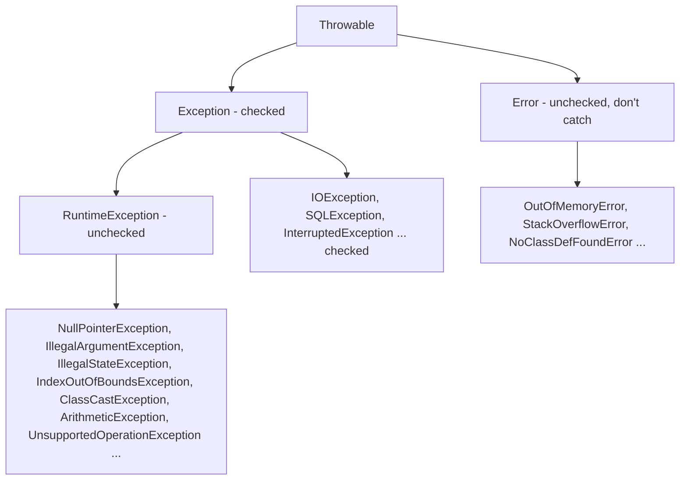
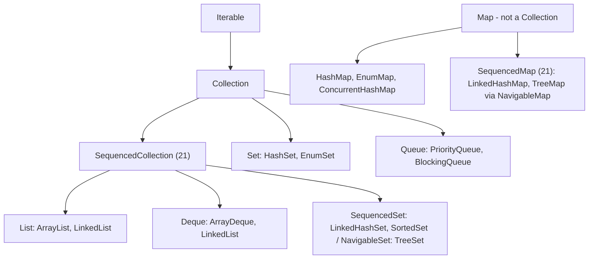

# Chapter 20 — Cheat Sheets and Glossary

This last chapter compresses Chapters 1–19 into pages you can scan in a minute. There is one **cheat sheet** per area of the language and platform, a **feature-by-version table** for Java 17 → 25, the build and test **commands** you type every day, an **index of the interview questions** answered in Chapter 19, a short **"where next"** guide, and an alphabetical **glossary** of 340+ terms, each linked to the section that explains it properly.

Nothing here is new. If a line doesn't make sense, follow its link back to the full explanation. References look like **§10.5**, meaning Chapter 10, section 5.

**What you'll learn:** how to use this chapter as a revision tool. Read a sheet, cover the right-hand column, and try to say the answer before you look. The glossary is a good last check before an interview: if you can't define a term in one sentence, follow its link.

**Every concrete value on the sheets is tested.** Primitive ranges, the `Integer` cache, the string pool, collection behaviours, stream results, `BigDecimal` and `java.time` edge cases, concurrency results and more are asserted by [`code/ch20/CheatsheetChecks.java`](code/ch20/CheatsheetChecks.java) (package `ch20`), compiled with `javac --release 25` and run on JDK 26 by the book's runner (`bash tools_run_java.sh java`). A failed check throws `AssertionError`. Real output:

```text
OK   20.1 syntax, types, primitives           29 checks
OK   20.2 operators & precedence              16 checks
OK   20.3 control flow & patterns             12 checks
OK   20.4 methods & arrays                    16 checks
OK   20.5 OOP                                 13 checks
OK   20.6 core APIs                           45 checks
OK   20.7 exceptions                          12 checks
OK   20.8 generics                             7 checks
OK   20.9 collections                         28 checks
OK   20.10 functional interfaces & Optional   12 checks
OK   20.11 streams & collectors               18 checks
OK   20.12 I/O & NIO.2                        11 checks
OK   20.13 concurrency                        13 checks
OK   20.14 JVM                                 9 checks
OK   20.15 modern Java 17-25                   9 checks
all 250 checks passed on Java 26
```

The helper is three small methods — `eq(actual, expected, label)`, `yes(condition, label)` and `throwsA(ExceptionType.class, code, label)` — because Java's own `assert` keyword is switched off unless you run `java -ea` ([§19.1](../19-java-for-coding-interviews/README.md#191-testing-your-solutions-assert-is-off-use-a-helper)). A few lines as a taste:

```java
Integer i1 = 127, i2 = 127, i3 = 128, i4 = 128;
eq(i1 == i2, true, "Integer cache -128..127");
eq(i3 == i4, false, "outside the cache: different objects");
throwsA(IllegalStateException.class, () -> emps.stream().collect(Collectors.toMap(Emp::dept, Emp::name)),
        "toMap duplicate key throws");
eq(LocalDate.of(2024, 1, 31).plusMonths(1), LocalDate.of(2024, 2, 29), "plusMonths clamps to month end");
```

**What's inside**

| § | Sheet | Built from |
|---|---|---|
| [20.1](#201-syntax-types-and-primitive-ranges) | Syntax, types and primitive ranges | Ch 1, 2 |
| [20.2](#202-operators-and-precedence) | Operators and precedence | Ch 2 |
| [20.3](#203-control-flow-switch-and-patterns) | Control flow, `switch` and patterns | Ch 3 |
| [20.4](#204-methods-and-arrays) | Methods and arrays | Ch 4 |
| [20.5](#205-oop-classes-interfaces-records-enums-and-sealed-types) | OOP: classes, interfaces, records, enums, sealed types | Ch 5, 6 |
| [20.6](#206-core-apis-string-numbers-dates) | Core APIs: strings, numbers, dates | Ch 7 |
| [20.7](#207-exceptions) | Exceptions | Ch 8 |
| [20.8](#208-generics-and-pecs) | Generics and PECS | Ch 9 |
| [20.9](#209-collections-big-o-and-which-to-choose) | Collections: big-O and which to choose | Ch 10 |
| [20.10](#2010-functional-interfaces-lambdas-and-optional) | Functional interfaces, lambdas and `Optional` | Ch 11 |
| [20.11](#2011-streams-and-collectors) | Streams and collectors | Ch 12 |
| [20.12](#2012-io-and-nio2) | I/O and NIO.2 | Ch 13 |
| [20.13](#2013-concurrency) | Concurrency | Ch 14, 15 |
| [20.14](#2014-the-jvm-memory-gc-flags-and-tools) | The JVM: memory, GC, flags, tools | Ch 1, 16 |
| [20.15](#2015-modern-java-by-version-17-to-25) | Modern Java by version, 17 → 25 | Ch 17 |
| [20.16](#2016-testing-build-and-tooling-commands) | Testing, build and tooling commands | Ch 1, 18 |
| [20.17](#2017-interview-question-index) | Interview question index | Ch 19 |
| [20.18](#2018-where-next) | Where next | Ch 18 |
| [20.19](#2019-glossary-az) | Glossary A–Z | all |

---

## 20.1 Syntax, types and primitive ranges

**Program shapes** ([§1.5](../01-java-and-the-jvm/README.md#15-write--compile--run), [§1.10](../01-java-and-the-jvm/README.md#110-launching-source-files-directly), [§4.9](../04-methods-and-arrays/README.md#49-main-command-line-arguments-and-simpler-main-java-25)):

```java
// Classic: file Hello.java, class name = file name
public class Hello {
    public static void main(String[] args) { System.out.println("Hi " + args.length); }
}

// Java 25 compact source file (JEP 512): no class declaration, instance main, java.lang.IO
void main() { IO.println("Hi"); }
```

| Command | Does | Since |
|---|---|---|
| `javac Hello.java` → `java Hello` | compile to `Hello.class`, then run it on the JVM | 1.0 |
| `javac -d out $(find src -name '*.java')` → `java -cp out pkg.Main` | compile a tree into `out/`, run with a class path | — |
| `java Hello.java` | compile in memory and run a single source file | 11 |
| `java Main.java` (other files next to it) | launch a multi-file source program | 22 |
| `jshell` | interactive REPL: type expressions, see results | 9 |
| `javap -c Hello` | disassemble bytecode | — |

**Basic rules** ([§2.1](../02-basics-types-and-operators/README.md#21-statements-identifiers-keywords-and-comments)): statements end with `;`; blocks use `{}`; Java is case-sensitive; identifiers start with a letter, `_` or `$` (a lone `_` is not a name — since 22 it means "unnamed"); comments are `//`, `/* */` and `/** Javadoc */` (Markdown `///` doc comments since 23). Naming: `ClassName`, `methodAndVariable`, `CONSTANT_NAME`, `com.example.pkg`. Contextual keywords — `var`, `record`, `sealed`, `non-sealed`, `permits`, `yield`, `when`, `module` — are keywords only in their positions.

**The eight primitives** ([§2.3](../02-basics-types-and-operators/README.md#23-primitive-types)) — everything else is a reference type ([§2.5](../02-basics-types-and-operators/README.md#25-reference-types-and-null)):

| Type | Bits | Range | Default (fields) | Literal |
|---|---|---|---|---|
| `byte` | 8 | −128 … 127 | `0` | `(byte) 1` |
| `short` | 16 | −32 768 … 32 767 | `0` | `(short) 1` |
| `int` | 32 | −2 147 483 648 … 2 147 483 647 (±2.1 × 10⁹) | `0` | `42`, `0x2A`, `0b101010`, `052`, `1_000_000` |
| `long` | 64 | −9 223 372 036 854 775 808 … 9 223 372 036 854 775 807 (±9.2 × 10¹⁸) | `0L` | `42L` |
| `float` | 32 | ±3.4028235 × 10³⁸, ~7 significant digits | `0.0f` | `3.14f` |
| `double` | 64 | ±1.7976931348623157 × 10³⁰⁸, ~15–16 digits | `0.0` | `3.14`, `1e-9` |
| `char` | 16 | 0 … 65 535 (unsigned UTF-16 code unit) | `'\u0000'` | `'A'`, `'\n'`, `'\u0041'` |
| `boolean` | — | `true`, `false` | `false` | `true` |

- `Double.MIN_VALUE` (4.9E-324) is the smallest **positive** double; the most negative is `-Double.MAX_VALUE`.
- Fields get defaults (`0`, `false`, `null`); **local variables don't** — reading one before assigning it is a compile error ([§2.2](../02-basics-types-and-operators/README.md#22-variables)).
- Money: `long` cents or `BigDecimal`, never `double` ([§2.11](../02-basics-types-and-operators/README.md#211-floating-point-numbers)).

**Conversions** ([§2.7](../02-basics-types-and-operators/README.md#27-type-conversion-widening-narrowing-casting-promotion)):

| Rule | Example | Result |
|---|---|---|
| Widening is automatic: `byte → short → int → long → float → double`, `char → int` | `long l = 42;` | ok |
| Narrowing needs a cast and keeps the low bits | `(byte) 200` | `-56` |
| Casting a floating value to an integer truncates toward zero | `(int) 3.99` | `3` |
| Arithmetic promotes `byte`/`short`/`char` to `int` | `byte b = 10; b = b + 1;` | compile error |
| Compound assignment hides a cast | `byte b = 10; b += 300;` | `54` |
| `char` is a number | `(int) 'A'`, `(char) ('a' + 1)` | `65`, `'b'` |

**Integer and floating-point facts** ([§2.10](../02-basics-types-and-operators/README.md#210-integer-overflow), [§2.11](../02-basics-types-and-operators/README.md#211-floating-point-numbers)):

| Expression | Value | Why |
|---|---|---|
| `Integer.MAX_VALUE + 1` | `-2147483648` | silent wrap-around; use `Math.addExact` to get an `ArithmeticException` |
| `7 / 2`, `-7 / 2` | `3`, `-3` | integer division truncates toward zero |
| `-7 % 3` / `Math.floorMod(-7, 3)` | `-1` / `2` | `%` takes the dividend's sign |
| `7 / 2.0` | `3.5` | one `double` operand → `double` arithmetic |
| `0.1 + 0.2` | `0.30000000000000004` | binary fractions can't represent 0.1 exactly |
| `1.0 / 0`, `0.0 / 0`, `1 / 0` | `Infinity`, `NaN`, `ArithmeticException` | floats have special values; ints throw |
| `Double.NaN == Double.NaN` | `false` | test with `Double.isNaN` |

**`var`** (Java 10, [§2.6](../02-basics-types-and-operators/README.md#26-var--local-variable-type-inference-java-10)): local variables with an initializer only (also in `for` loops and lambda parameters); not for fields, parameters or return types; `var x = null;` and `var a = {1, 2};` don't compile. The type is fixed at compile time — `var` is not dynamic typing.

**Text blocks** (Java 15, [§2.12](../02-basics-types-and-operators/README.md#212-strings-and-text-blocks)): `"""` + newline opens; common indentation is stripped (the closing `"""` position counts); a closing delimiter on its own line adds a trailing `\n`; `\` at line end joins lines; `\s` keeps a trailing space.

**Console I/O** ([§2.13](../02-basics-types-and-operators/README.md#213-console-output-and-input), [§13.8](../13-io-and-nio/README.md#138-console-and-standard-streams)): `System.out.println/print/printf`; input with `Scanner(System.in)` (`nextInt`, `nextLine` — beware the leftover newline), `BufferedReader`, or `IO.readln("prompt")` in Java 25. `System.console()` returns `null` without an interactive terminal (IDEs, pipes) — always check it (Java 22–24 briefly returned a JLine-based console even then; 25 reverted).

---

## 20.2 Operators and precedence

From highest to lowest ([§2.8](../02-basics-types-and-operators/README.md#28-operators), [§2.9](../02-basics-types-and-operators/README.md#29-operator-precedence-and-associativity)). Operands are always evaluated **left to right**; associativity only decides grouping.

| Level | Operators | Associativity |
|---|---|---|
| 1 Postfix | `x++` `x--` | left |
| 2 Unary | `++x` `--x` `+` `-` `~` `!` `(type)` | right |
| 3 Multiplicative | `*` `/` `%` | left |
| 4 Additive | `+` `-` (and `String` `+`) | left |
| 5 Shift | `<<` `>>` `>>>` | left |
| 6 Relational | `<` `>` `<=` `>=` `instanceof` | left |
| 7 Equality | `==` `!=` | left |
| 8–10 Bitwise | `&` then `^` then `\|` | left |
| 11–12 Logical | `&&` then `\|\|` (short-circuit) | left |
| 13 Ternary | `? :` | right |
| 14 Assignment, lambda | `=` `+=` `-=` `*=` `/=` `%=` `&=` `\|=` `^=` `<<=` `>>=` `>>>=` `->` | right |

Memory hook: **unary → multiply → add → shift → compare → equal → bitwise → logical → ternary → assign.**

| Expression | Value | Lesson |
|---|---|---|
| `2 + 3 * 4` | `14` | `*` before `+` |
| `10 - 4 - 3` | `3` | left-associative |
| `1 + 2 + "3" + 4 + 5` | `"3345"` | numbers add until the first `String`, then everything concatenates |
| `true \|\| false && false` | `true` | `&&` binds tighter than `\|\|` |
| `x & 1 == 0` | compile error for `int x` | `==` binds tighter than `&` — write `(x & 1) == 0` |
| `i = 5; i++ + ++i` | `12` | `5 + 7`; never write this in real code |
| `-8 >> 1`, `-8 >>> 28` | `-4`, `15` | `>>` keeps the sign, `>>>` fills with zeros |
| `5 ^ 3`, `~5`, `1 << 10` | `6`, `-6`, `1024` | XOR, complement (−(n+1)), shift = ×2ⁿ |
| `a = b = c = 7` | all `7` | assignment is right-associative |
| `s != null && s.length() > 0` with `s = null` | `false`, no exception | `&&` stops at the first `false` |
| `o instanceof String str && str.length() == 4` | `true` for `"text"` | pattern variable in scope after `&&` (Java 16) |

`==` on objects compares **references**; use `equals` for content ([§6.13](../06-oop-inheritance-interfaces-and-more/README.md#613-object-methods-equals-hashcode-and-tostring), [§7.6](../07-core-apis/README.md#76-wrapper-classes-and-autoboxing)).

---

## 20.3 Control flow, `switch` and patterns

**Branches and loops** ([§3.1](../03-control-flow/README.md#31-if-else-if-else), [§3.8](../03-control-flow/README.md#38-loops), [§3.9](../03-control-flow/README.md#39-break-continue-and-labels)):

| Construct | Shape | Notes |
|---|---|---|
| `if` / `else if` / `else` | `if (cond) { … } else { … }` | condition must be `boolean` — `if (1)` doesn't compile |
| Ternary | `cond ? a : b` | an expression; keep it short |
| `for` | `for (int i = 0; i < n; i++)` | index loops |
| Enhanced `for` | `for (String s : list)` | arrays and any `Iterable`; can't remove safely inside |
| `while` / `do … while` | test first / body runs at least once | |
| `break` / `continue` | leave / skip to next iteration of the innermost loop | `break outer;` / `continue outer;` with a label |

**The four `switch` shapes** ([§3.2](../03-control-flow/README.md#32-the-classic-switch-statement), [§3.3](../03-control-flow/README.md#33-arrow-labels-and-switch-expressions-java-14), [§3.4](../03-control-flow/README.md#34-choosing-between-if-ternary-and-switch)):

| Shape | Falls through? | Produces a value? | Must be exhaustive? |
|---|---|---|---|
| Statement, `case X:` | **yes** — until `break` | no | no (unless it uses patterns or `null`) |
| Statement, `case X ->` (14) | no | no | no (same exception) |
| Expression, `case X ->` (14) | no | yes; blocks use `yield` | **yes** |
| Expression, `case X:` + `yield` | yes | yes | yes |

```java
String type = switch (day) {
    case 1, 2, 3, 4, 5 -> "weekday";
    case 6, 7 -> "weekend";
    default -> { yield "invalid"; }
};
```

Selector types: `int` and smaller (`char`, `byte`, `short`) and their wrappers, `String`, enums — and, with patterns (21), **any reference type**. `long`, `float`, `double` and `boolean` selectors need *primitive patterns*, which are still **preview** in Java 25.

**Pattern matching** ([§3.5](../03-control-flow/README.md#35-pattern-matching-for-instanceof-java-16), [§3.6](../03-control-flow/README.md#36-pattern-matching-for-switch-java-21), [§3.7](../03-control-flow/README.md#37-record-patterns-java-21-and-unnamed-patterns-java-22)):

| Feature | Syntax | Final in |
|---|---|---|
| Type pattern in `instanceof` | `if (o instanceof String s && !s.isEmpty())` | 16 |
| Type pattern in `switch` | `case Integer i ->` | 21 |
| Guard | `case Integer i when i < 0 ->` | 21 |
| `null` label | `case null ->` or `case null, default ->` | 21 |
| Record pattern (nestable) | `case Point(int x, int y) when x == y ->` | 21 |
| `var` in a record pattern | `case Point(var x, var y) ->` | 21 |
| Unnamed pattern / variable | `case Point(var x, _) ->`, `catch (Exception _)`, `for (var _ : list)` | 22 |

Rules to remember: without `case null`, a `null` selector throws `NullPointerException`; the first matching label wins, and a label that can never match (dominated, e.g. `CharSequence` before `String`) is a compile error; a pattern `switch` must be exhaustive — add `default` or cover every permitted subtype of a **sealed** type:

```java
sealed interface Shape permits Circle, Square {}
record Circle(double r) implements Shape {}
record Square(double side) implements Shape {}

static double area(Shape s) {
    return switch (s) {                 // no default needed: the compiler knows all subtypes
        case Circle c -> Math.PI * c.r() * c.r();
        case Square q -> q.side() * q.side();
    };
}
```

**Loop pitfalls** ([§3.10](../03-control-flow/README.md#310-loop-pitfalls)): off-by-one (`<=` vs `<`), modifying a collection inside for-each (→ `ConcurrentModificationException`), `float` loop counters, `==` on strings in conditions, and infinite `while` loops whose variable never changes.

---

## 20.4 Methods and arrays

**Methods** ([§4.1](../04-methods-and-arrays/README.md#41-methods--declaring-and-calling)–[§4.5](../04-methods-and-arrays/README.md#45-recursion)):

| Topic | Rule |
|---|---|
| Signature | name + parameter types (not the return type, not parameter names) |
| Passing | **always by value**; for objects the value is a copy of the reference — the callee can mutate the object but not rebind the caller's variable |
| Overload resolution | phase 1: exact match or widening; phase 2: boxing/unboxing; phase 3: varargs. `over(5)` with `over(long)`, `over(Integer)`, `over(int...)` picks `long` |
| Varargs | `int... nums` is an `int[]`; must be the last parameter; one per method; zero arguments allowed |
| `return` | a non-`void` method must return on every path |
| Recursion | needs a base case; each call adds a stack frame → `StackOverflowError` if too deep (Java has no tail-call elimination) |
| `static` | called on the class, has no `this` ([§5.5](../05-oop-classes-and-objects/README.md#55-static-members)) |

**Arrays** ([§4.6](../04-methods-and-arrays/README.md#46-arrays), [§4.7](../04-methods-and-arrays/README.md#47-multidimensional-and-jagged-arrays)):

```java
int[] a = new int[3];             // [0, 0, 0] — elements get default values
int[] b = {3, 1, 2};              // initializer
String[] names = new String[2];   // [null, null]
int[][] grid = new int[3][4];     // rectangular
int[][] jagged = {{1}, {2, 3}, {}};  // rows of different lengths
a.length                           // a field, not a method; fixed forever
```

Index `0 … length − 1`; anything else → `ArrayIndexOutOfBoundsException`. Arrays are objects: `a.equals(b)` and `==` compare identity; `a.toString()` prints something like `[I@1b6d3586`.

**`java.util.Arrays`** ([§4.8](../04-methods-and-arrays/README.md#48-the-javautilarrays-toolbox)):

| Method | Does | Example result |
|---|---|---|
| `toString(a)` / `deepToString(m)` | print 1D / nested | `[1, 2, 3]`, `[[1], [2, 3], []]` |
| `equals(a, b)` / `deepEquals` | compare contents | `true` for `{3,1,2}` vs `{3,1,2}` |
| `sort(a)`, `sort(a, from, to)`, `sort(T[], cmp)` | sort in place (dual-pivot quicksort for primitives, stable merge sort — TimSort — for objects) | |
| `binarySearch(a, key)` | on a **sorted** array; not found → `-(insertionPoint) − 1` | `binarySearch([1,2,3], 5)` = `-4` |
| `copyOf(a, n)`, `copyOfRange(a, from, to)` | new array, padded with defaults | `copyOf([1,2,3], 5)` = `[1, 2, 3, 0, 0]` |
| `fill(a, v)`, `setAll(a, i -> …)` | set every element | |
| `asList(…)` | fixed-size `List` **view** of the array — `add` throws, `set` writes through | |
| `stream(a)` | `IntStream` / `Stream<T>` | |
| `mismatch(a, b)`, `compare(a, b)` | first differing index / lexicographic order (9) | |

**Command-line arguments**: `args` is never `null` (empty array when none); all elements are `String`s; the program name is not included ([§4.9](../04-methods-and-arrays/README.md#49-main-command-line-arguments-and-simpler-main-java-25)).

---

## 20.5 OOP: classes, interfaces, records, enums and sealed types

**Access modifiers** ([§5.6](../05-oop-classes-and-objects/README.md#56-access-modifiers)):

| Modifier | Same class | Same package | Subclass (other package) | Everywhere |
|---|---|---|---|---|
| `private` | ✓ | | | |
| *(none)* package-private | ✓ | ✓ | | |
| `protected` | ✓ | ✓ | ✓ (through inheritance) | |
| `public` | ✓ | ✓ | ✓ | ✓ |

Top-level classes can only be `public` or package-private; one `public` top-level class per file, named like the file.

**Constructors and initialisation** ([§5.3](../05-oop-classes-and-objects/README.md#53-constructors), [§5.10](../05-oop-classes-and-objects/README.md#510-initialisation-order)):
- If you write no constructor, the compiler adds a no-argument one; write any constructor and it doesn't.
- `this(...)` calls another constructor of the same class, `super(...)` the parent's; if you write neither, `super()` is inserted. Since **Java 25** (JEP 513) statements that don't use `this` — validation, computing arguments, assigning the class's own fields — may appear **before** `super(...)`/`this(...)`.
- Order: static fields and `static {}` blocks run **once**, in source order, when the class is initialised → for each `new`: parent constructor → instance field initialisers and `{}` blocks in source order → the rest of the constructor body.

**`static` and `final`** ([§5.5](../05-oop-classes-and-objects/README.md#55-static-members), [§5.8](../05-oop-classes-and-objects/README.md#58-the-final-keyword)): `static` = one per class, shared; a static method has no `this`. `final` variable = assigned once; `final` method = can't be overridden; `final` class = can't be extended. `final` on a reference doesn't freeze the object.

**Inheritance and overriding** ([§6.1](../06-oop-inheritance-interfaces-and-more/README.md#61-inheritance-and-super)–[§6.4](../06-oop-inheritance-interfaces-and-more/README.md#64-polymorphism-and-casting)):

| Overriding rule | Detail |
|---|---|
| Same signature | otherwise it's an overload; use `@Override` to let the compiler check |
| Return type | same or a subtype (covariant) |
| Access | same or wider (`protected` → `public` ok, not the reverse) |
| Checked exceptions | same, narrower or none — never new or broader |
| Not overridable | `private`, `static` (hidden instead), `final` methods; constructors |
| Dispatch | instance methods use the object's run-time class; fields and static methods use the compile-time type |

```java
class Base    { static String who() { return "Base"; }    String me() { return "Base"; }
                String call() { return me() + "/" + who(); } }
class Derived extends Base { static String who() { return "Derived"; }
                @Override String me() { return "Derived"; } }
new Derived().call()   // "Derived/Base"
```

**Choosing a type** ([§6.12](../06-oop-inheritance-interfaces-and-more/README.md#612-choosing-abstract-class-interface-record-enum-or-plain-class)):

| Need | Use | Key facts |
|---|---|---|
| Mutable object with identity and lifecycle | **class** (`final` unless designed for extension) | full control of encapsulation |
| Shared state/code for a family of related classes | **abstract class** | fields, constructors, any access; single inheritance; can't be instantiated ([§6.5](../06-oop-inheritance-interfaces-and-more/README.md#65-abstract-classes)) |
| A capability many unrelated types can have | **interface** | many per class; `abstract`, `default` (8), `static` (8), `private` (9) methods; fields are `public static final` constants; no instance state ([§6.6](../06-oop-inheritance-interfaces-and-more/README.md#66-interfaces)) |
| Immutable data where equal values are interchangeable | **record** (16) | private final fields, canonical constructor, accessors `x()`, `equals`/`hashCode`/`toString`; implicitly `final`; extends `Record`; no extra instance fields; compact constructor for validation ([§6.8](../06-oop-inheritance-interfaces-and-more/README.md#68-records)) |
| A fixed set of instances known at compile time | **enum** | fields, constructors (private), methods, per-constant bodies; `values()`, `valueOf`, `ordinal()`; `EnumSet`/`EnumMap` ([§6.9](../06-oop-inheritance-interfaces-and-more/README.md#69-enums)) |
| A closed set of variants | **sealed** interface/class (17) + records | `permits` lists subtypes; each is `final`, `sealed` or `non-sealed`; exhaustive `switch` without `default` ([§6.7](../06-oop-inheritance-interfaces-and-more/README.md#67-sealed-classes-and-interfaces-java-17)) |

```java
record Range(int lo, int hi) {
    Range {                                       // compact constructor
        if (lo > hi) throw new IllegalArgumentException(lo + " > " + hi);
    }
}
new Point(1, 2).equals(new Point(1, 2))          // record Point(int x, int y): true;  toString() = "Point[x=1, y=2]"
```

**Nested types** ([§6.10](../06-oop-inheritance-interfaces-and-more/README.md#610-nested-classes-static-nested-and-inner), [§6.11](../06-oop-inheritance-interfaces-and-more/README.md#611-local-classes-anonymous-classes-and-lambdas)):

| Kind | Declared | Has an outer instance? | Typical use |
|---|---|---|---|
| Static nested class | `static class Node` inside a class | no | helpers, builders, `Map.Entry`-like types — the default choice |
| Inner class | `class Itr` inside a class | yes (`Outer.this`) | iterators that read the outer object's fields |
| Local class | inside a method body | yes if in an instance method | one-off helper with a name |
| Anonymous class | `new Interface() { … }` | yes if in an instance method | one-off implementation with state or several methods |
| Lambda | `x -> …` | captures effectively final locals | single-method (functional) interfaces |

Nested records, enums and interfaces are implicitly `static`.

**`Object` methods contract** ([§6.13](../06-oop-inheritance-interfaces-and-more/README.md#613-object-methods-equals-hashcode-and-tostring)): `equals` must be reflexive, symmetric, transitive, consistent, and `false` for `null`; equal objects **must** have equal `hashCode`s; override both or neither (`Objects.equals`, `Objects.hash` help). `toString` defaults to `ClassName@hexHash`. Immutability recipe ([§5.9](../05-oop-classes-and-objects/README.md#59-immutability-basics)): `final` class, `private final` fields, no setters, defensive copies in and out (`List.copyOf`), don't leak `this` from the constructor. Design-level treatment: [LLD handbook](../../../lld/).

---

## 20.6 Core APIs: String, numbers, dates

**Strings** ([§7.1](../07-core-apis/README.md#71-strings-immutability-the-pool-and-memory), [§7.2](../07-core-apis/README.md#72-the-string-api-toolkit)) are immutable; every "modifying" method returns a new `String`.

| Fact | Value |
|---|---|
| `"java" == "java"` (two literals) | `true` — both are the pooled object |
| `"java" == new String("java")` | `false` — `new` always makes a new object |
| `"java" == new String("java").intern()` | `true` |
| `"java" == part + "va"` (run time, `part = "ja"`) | `false`; `"ja" + "va"` (constants) is folded → `true` |
| `"Java".substring(1, 3)` | `"av"` — end index exclusive |
| `"a,b,,".split(",").length` / `split(",", -1)` | `2` / `4` — trailing empties dropped unless limit is negative |
| `"a.b".replace(".", "-")` / `replaceAll(".", "-")` | `"a-b"` / `"---"` — `replaceAll` takes a **regex** |
| `" ".isBlank()` / `" ".isEmpty()` | `true` / `false` |
| `compareTo` | negative, zero or positive — not necessarily −1/1 |

Everyday methods: `length`, `charAt`, `indexOf` (−1 if absent), `contains`, `startsWith`/`endsWith`, `substring`, `strip` (Unicode-aware; prefer to `trim`), `toLowerCase(Locale.ROOT)`, `equalsIgnoreCase`, `split`, `String.join`, `repeat` (11), `lines` (11), `formatted` (15), `chars`, `codePoints`.

**Builders** ([§7.3](../07-core-apis/README.md#73-stringbuilder-stringbuffer-and-stringjoiner)): `StringBuilder` (mutable, not synchronised — use it for loops: `append`, `insert`, `reverse`, `deleteCharAt`, `setLength(0)`); `StringBuffer` (synchronised, legacy); `StringJoiner` / `String.join` / `Collectors.joining` for delimited lists. `s += x` in a loop is O(n²).

**Formatting** ([§7.4](../07-core-apis/README.md#74-formatting-text-and-numbers)): `String.format(Locale.US, "%5.2f|%-4s|%04d|%,d", 3.14159, "ab", 42, 1234567)` → `" 3.14|ab  |0042|1,234,567"`. Conversions `%s %d %f %e %x %c %b %n %%`; flags `-` left, `0` pad, `,` grouping, `+` sign; `%2$s` argument index. Always pass a `Locale` when the output is parsed by machines.

**`Math`** ([§7.5](../07-core-apis/README.md#75-math)):

| Call | Result | Note |
|---|---|---|
| `Math.round(2.5)`, `Math.round(-2.5)` | `3`, `-2` | ties toward +∞; returns `long` for `double` |
| `Math.rint(2.5)` | `2.0` | ties to even |
| `Math.floorDiv(-7, 2)`, `floorMod(-7, 3)` | `-4`, `2` | round toward −∞ |
| `Math.abs(Integer.MIN_VALUE)` | `-2147483648` | overflow! `absExact` throws |
| `Math.clamp(15, 0, 10)` | `10` | Java 21 |
| `addExact`, `multiplyExact`, `toIntExact`, `powExact` (25) | throw `ArithmeticException` on overflow | |
| `Math.random()` | `double` in [0.0, 1.0) | prefer `RandomGenerator` |

**Wrappers and autoboxing** ([§7.6](../07-core-apis/README.md#76-wrapper-classes-and-autoboxing)):

| Fact | Detail |
|---|---|
| `Integer a = 127, b = 127; a == b` | `true` — `Integer.valueOf` caches **−128 … 127** (also `Short`, `Byte`, `Long`, `Character` ≤ 127, both `Boolean`s) |
| `Integer c = 128, d = 128; c == d` | `false` — always compare wrappers with `equals` |
| `int x = (Integer) null` | `NullPointerException` on unboxing |
| `list.remove(1)` vs `list.remove(Integer.valueOf(1))` | removes **index** 1 vs the **value** 1 |
| `Integer.parseInt("ff", 16)` | `255`; bad input → `NumberFormatException` |
| `Boolean.parseBoolean("YES")` | `false` — only `"true"` (any case) is true |

**`BigInteger` / `BigDecimal`** ([§7.7](../07-core-apis/README.md#77-biginteger-and-bigdecimal)): immutable, arbitrary precision.

| Rule | Example |
|---|---|
| Build from a `String` (or `BigDecimal.valueOf(double)`) | `new BigDecimal("0.1").add(new BigDecimal("0.2"))` = `0.3`; `new BigDecimal(0.1)` = `0.1000000000000000055511…` |
| `equals` checks value **and scale**; `compareTo` checks value only | `2.0` vs `2.00`: `equals` false, `compareTo` 0 — so `HashSet<BigDecimal>` can hold both |
| Non-terminating division needs a scale or `MathContext` | `ONE.divide(valueOf(3))` → `ArithmeticException`; `divide(valueOf(3), 4, HALF_UP)` = `0.3333` |
| Rounding modes | `2.345` → `HALF_UP` `2.35`, `HALF_EVEN` (banker's) `2.34` |
| `BigInteger` | `BigInteger.TWO.pow(100)` has 31 digits |

**`java.time`** ([§7.8](../07-core-apis/README.md#78-the-javatime-model)–[§7.11](../07-core-apis/README.md#711-formatting-and-parsing-dates)) — immutable, thread-safe; months are 1–12:

| Class | Represents | Example |
|---|---|---|
| `LocalDate` / `LocalTime` / `LocalDateTime` | wall-calendar date/time, **no zone** | birthdays, opening hours |
| `ZonedDateTime` | date-time in a region (`ZoneId.of("Europe/Paris")`), DST-aware | meetings |
| `OffsetDateTime` | date-time with a fixed offset (`+02:00`) | API timestamps |
| `Instant` | a point on the UTC time-line | logs, DB timestamps |
| `Duration` | seconds + nanos (machine time) | `Duration.ofMinutes(90)` → `PT1H30M` |
| `Period` | years, months, days (calendar) | 2024-01-15 → 2025-03-20 = `P1Y2M5D` |
| `DateTimeFormatter` | format/parse, thread-safe | `ofPattern("yyyy-MM-dd HH:mm")` |

Edge cases (all checked): `LocalDate.of(2024, 1, 31).plusMonths(1)` → `2024-02-29` (clamped); in `America/New_York`, 2025-03-09 01:30 plus 1 hour → 03:30, and that day lasts 23 hours; `yyyy` vs `YYYY` for 2025-12-29 → `2025` vs `2026` (week-based year — a classic bug); `MM` month vs `mm` minute; `HH` 0–23 vs `hh` 1–12; `LocalDate.of(2025, 2, 29)` → `DateTimeException`. Legacy `Date`/`Calendar`/`SimpleDateFormat` are mutable and not thread-safe — convert at the edges.

**Random numbers** ([§7.12](../07-core-apis/README.md#712-random-numbers)): `new Random(42)` is reproducible (same seed → same sequence); `ThreadLocalRandom.current()` for concurrent code; `SecureRandom` for tokens and passwords; `RandomGenerator.of("L64X128MixRandom")` (17) for choosing an algorithm; `random.nextInt(lo, hi)` (17) excludes `hi`.

---


## 20.7 Exceptions

**The hierarchy** ([§8.2](../08-exceptions/README.md#82-the-throwable-hierarchy-checked-unchecked-and-errors)):



| Kind | Which classes | Compiler rule | Meaning |
|---|---|---|---|
| **Checked** | `Exception` and subclasses **except** the `RuntimeException` branch | must be caught or declared with `throws` ([§8.3](../08-exceptions/README.md#83-handle-or-declare-checked-exceptions-and-throws)) | a recoverable problem outside the program's control (file, network, DB) |
| **Unchecked** | `RuntimeException` and subclasses | no rule | a programming error (bad argument, bad state, `null`) |
| **Error** | `Error` and subclasses (also unchecked) | no rule | the JVM or environment is in trouble — let it propagate |

| Common exception | Thrown when | Kind |
|---|---|---|
| `NullPointerException` | dereferencing `null` (helpful messages name the `null` part: Java 14, on by default since 15) | unchecked |
| `IllegalArgumentException` / `NumberFormatException` | bad argument / unparsable number | unchecked |
| `IllegalStateException` | object not in the right state (stream reused, `toMap` duplicate key) | unchecked |
| `ArrayIndexOutOfBoundsException`, `StringIndexOutOfBoundsException` | bad index | unchecked |
| `ClassCastException`, `ArithmeticException` | bad cast / integer `/ 0`, overflow in `*Exact` | unchecked |
| `UnsupportedOperationException` | mutating an unmodifiable collection | unchecked |
| `ConcurrentModificationException` | structural change during iteration | unchecked |
| `IOException`, `FileNotFoundException`, `NoSuchFileException` | I/O failure | **checked** |
| `InterruptedException` | a blocked thread was interrupted | **checked** |
| `SQLException` | JDBC failure | **checked** |
| `UncheckedIOException` | an `IOException` wrapped for lambdas/streams | unchecked |

**Syntax rules** ([§8.4](../08-exceptions/README.md#84-try--catch--finally-and-control-flow)–[§8.6](../08-exceptions/README.md#86-try-with-resources)):

| Construct | Rule |
|---|---|
| `try { } catch (A e) { } finally { }` | `catch` or `finally` (or both) required; `finally` runs on normal exit, exception, `return`, `break` |
| Catch order | subclasses before superclasses, else "exception has already been caught" compile error |
| Multi-catch `catch (A \| B e)` | `A` and `B` must not be subtype-related; `e` is effectively final |
| `return` in `finally` | overrides the `try`'s return **and swallows exceptions** — never do it (`try { return 1; } finally { return 2; }` returns `2`) |
| try-with-resources `try (var r = open())` | any `AutoCloseable`; closed automatically in **reverse** order; a close failure is added as **suppressed** to the body's exception (`getSuppressed()`) |
| `finally` doesn't run | only if the JVM exits (`System.exit`, crash) or the thread never leaves `try` |
| Rethrow | `catch (Exception e) { throw e; }` — precise rethrow keeps the narrower checked types |
| Chaining | `throw new ServiceException("load failed", e)` — keep the cause ([§8.8](../08-exceptions/README.md#88-chaining-and-exception-translation)) |

```java
try (Res a = new Res("A", log); Res b = new Res("B", log)) {
    throw new RuntimeException("body failed");
}   // log: open A, open B, body, close B, close A — both close() failures become suppressed
```

**Custom exceptions** ([§8.7](../08-exceptions/README.md#87-throwing-exceptions-and-writing-custom-ones)): extend `Exception` (checked) or `RuntimeException` (unchecked); provide `(String message)` and `(String message, Throwable cause)` constructors; add fields for context.

**Best practices** ([§8.10](../08-exceptions/README.md#810-best-practices-and-anti-patterns)): throw early (validate arguments with `Objects.requireNonNull`, `IllegalArgumentException`), catch late (where you can really handle it); never swallow (`catch (Exception e) {}`); don't use exceptions for control flow; catch the most specific type; translate low-level exceptions at layer boundaries and keep the cause; log **or** rethrow, not both; clean up with try-with-resources. Reading traces: the first line is the type and message, then frames newest-first; read `Caused by:` sections bottom-up to find the root ([§8.9](../08-exceptions/README.md#89-reading-stack-traces)).

---

## 20.8 Generics and PECS

**Syntax** ([§9.1](../09-generics/README.md#91-why-generics)–[§9.5](../09-generics/README.md#95-bounded-type-parameters)):

| Form | Example |
|---|---|
| Generic class / record | `class Box<T> { T value; }`, `record Pair<A, B>(A first, B second) {}` |
| Generic interface | `interface Repository<T, ID> { Optional<T> findById(ID id); }` |
| Generic method | `static <T> List<T> repeat(T x, int n)` — type parameter before the return type |
| Explicit type argument | `Collections.<String>emptyList()` (rarely needed — inference) |
| Diamond | `Map<String, List<Integer>> m = new HashMap<>();` |
| Bounded type | `<T extends Number>`, several bounds: `<T extends Number & Comparable<T>>` (class first) |
| Recursive bound | `<T extends Comparable<? super T>> T max(List<? extends T> xs)` |
| Wildcards | `List<?>`, `List<? extends Number>`, `List<? super Integer>` |

Naming convention: `T` type, `E` element, `K`/`V` key/value, `R` result, `ID` identifier.

**Invariance and PECS** ([§9.6](../09-generics/README.md#96-invariance-wildcards-and-pecs)): `List<Integer>` is **not** a `List<Number>` (arrays are covariant and fail at run time with `ArrayStoreException`; generics refuse at compile time).

| Wildcard | You can read as | You can add | Use when the parameter… | Example |
|---|---|---|---|---|
| `List<? extends Number>` | `Number` | nothing (except `null`) | **produces** values for you | `double sumAll(List<? extends Number> xs)` |
| `List<? super Integer>` | `Object` | `Integer` | **consumes** values you give it | `void fill(List<? super Integer> sink)` accepts `List<Number>`, `List<Object>` |
| `List<?>` | `Object` | nothing | you only use `Object` methods / size | `printAll(List<?> xs)` |
| `List<T>` | `T` | `T` | you both read and write | `swap(List<T> xs, int i, int j)` |

**P**roducer **E**xtends, **C**onsumer **S**uper — e.g. `Collections.copy(List<? super T> dest, List<? extends T> src)`. Don't use wildcards in return types.

**Type erasure** ([§9.7](../09-generics/README.md#97-type-erasure-how-generics-really-work), [§9.8](../09-generics/README.md#98-restrictions-and-workarounds-consequences-of-erasure)): generics are checked by the compiler, then erased to their bounds (`Object` if unbounded) with casts inserted. `new ArrayList<String>().getClass() == new ArrayList<Integer>().getClass()` is `true`. So you **can't**: use primitives (`List<int>`), `new T()`, `new T[n]`, `instanceof List<String>`, use `T` in static members, overload `f(List<String>)` with `f(List<Integer>)` (same erasure), or make a generic `Throwable`. Workarounds: `Supplier<T>` factories, `Class<T>` tokens, `List<T>` instead of `T[]`. Raw types (`List raw`) switch checking off — they exist only for pre-Java-5 code. Eliminate unchecked warnings; suppress only on the smallest scope with a comment; mark safe generic varargs methods `@SafeVarargs`.

---

## 20.9 Collections: big-O and which to choose

**The hierarchy** ([§10.1](../10-collections/README.md#101-the-collections-framework-and-its-hierarchy)):



**Big-O** ([§10.12](../10-collections/README.md#1012-big-o-cheat-sheet-and-a-measured-demo)) — `*` amortised, `†` average (worst case O(log n) in a tree-ified bucket):

| Collection | add at end | add/remove at front | `get(i)` | `contains` / `get(key)` | remove element | Order | `null`? |
|---|---|---|---|---|---|---|---|
| `ArrayList` | O(1)* | O(n) | O(1) | O(n) | O(n) | index | yes |
| `LinkedList` | O(1) | O(1) | O(n) | O(n) | O(n) | index | yes |
| `ArrayDeque` | O(1)* | O(1)* | — | O(n) | O(n) | head → tail | **no** |
| `PriorityQueue` | O(log n) | `poll` O(log n), `peek` O(1) | — | O(n) | O(n) | heap (iteration unsorted) | no |
| `HashSet` / `HashMap` | O(1)† | — | — | O(1)† | O(1)† | none | one `null` key |
| `LinkedHashSet` / `LinkedHashMap` | O(1)† | — | — | O(1)† | O(1)† | insertion (or access) | one `null` key |
| `TreeSet` / `TreeMap` | O(log n) | — | — | O(log n) | O(log n) | sorted | no `null` keys (natural order) |
| `EnumSet` / `EnumMap` | O(1) | — | — | O(1) | O(1) | enum order | no |
| `CopyOnWriteArrayList` | O(n) | O(n) | O(1) | O(n) | O(n) | index | yes |
| `ConcurrentHashMap` | O(1)† | — | — | O(1)† | O(1)† | none | **no** |

**Which one?** ([§10.13](../10-collections/README.md#1013-choosing-a-collection)) Key → value: `HashMap`; insertion order or LRU: `LinkedHashMap`; sorted or range queries: `TreeMap`. Unique elements: `HashSet` / `LinkedHashSet` / `TreeSet` by the same rule. Indexed or append: `ArrayList` (the default list). Stack or queue: `ArrayDeque` (not `Stack`, not `LinkedList`). "Smallest next": `PriorityQueue`. Enum keys: `EnumMap`/`EnumSet`. Fixed data: `List.of`/`Set.of`/`Map.of`. Shared between threads: `ConcurrentHashMap`, `CopyOnWriteArrayList`, `BlockingQueue`.

**`HashMap` internals** ([§10.5](../10-collections/README.md#105-hashmap-internals)): table of buckets, default capacity 16, load factor 0.75 (resize — double — when size > capacity × 0.75); index = `(h ^ (h >>> 16)) & (capacity − 1)`; collisions chain in a list that turns into a red-black tree past 8 entries once the table has ≥ 64 buckets; lookup = hash, then `equals`. Keys must have consistent `equals`/`hashCode` and must not change while in the map.

**Unmodifiable vs views** ([§10.10](../10-collections/README.md#1010-unmodifiable-and-immutable-collections)):

| Factory | Changes through it? | Sees later changes to the source? | `null`s |
|---|---|---|---|
| `List.of`, `Set.of`, `Map.of` (9) | no — `UnsupportedOperationException` | — (no source) | **rejected** (NPE); `Set.of("a","a")` → `IllegalArgumentException` |
| `List.copyOf` (10), `stream.toList()` (16) | no | no — a snapshot | `copyOf` rejects; `toList()` **allows** `null` (unlike `Collectors.toUnmodifiableList()`) |
| `Collections.unmodifiableList(src)` | no | **yes** — a read-only view | allowed |
| `Arrays.asList(array)` | `set` yes (writes through to the array); `add`/`remove` no | yes | allowed |

**API you use daily** ([§10.2](../10-collections/README.md#102-lists-arraylist-and-linkedlist)–[§10.6](../10-collections/README.md#106-queues-deques-and-priority-queues), [§10.9](../10-collections/README.md#109-the-collections-utility-class), [§10.11](../10-collections/README.md#1011-sequenced-collections-java-21)):

| Want | Call | Result in the checks |
|---|---|---|
| Count words | `map.merge(w, 1, Integer::sum)` | `{a=1, b=3, c=1}` in a `TreeMap` |
| Group into lists | `map.computeIfAbsent(k, x -> new ArrayList<>()).add(v)` | |
| Default | `map.getOrDefault(k, -1)` | `-1` |
| Previous value | `map.put("a", 2)` | returns the old value (`null` if none) |
| Nearest keys | `treeMap.floorKey(25)`, `ceilingKey(25)` on {10, 20, 30} | `20`, `30`; `floorKey(5)` = `null` |
| Sub-ranges | `headMap(20)` / `tailMap(20)` | `[10]` / `[20, 30]` (head exclusive, tail inclusive) |
| Stack | `deque.push(x)`, `pop()`, `peek()` | `push` = `addFirst` |
| Queue | `deque.offer(x)`, `poll()`, `peek()` | `offer` = `addLast`; `poll` returns `null` when empty, `remove` throws |
| Min-heap / max-heap | `new PriorityQueue<>()` / `new PriorityQueue<>(Comparator.reverseOrder())` | `poll()` of {5, 1, 4}: `1` / `5` |
| LRU cache | `new LinkedHashMap<>(16, 0.75f, true)` + override `removeEldestEntry` → `size() > cap` | |
| Ends of an ordered collection (21) | `getFirst()`, `getLast()`, `addFirst`, `removeLast`, `reversed()` | `[x, y, z]` → `x`, `z`, `[z, y, x]` |
| Sort with several keys | `list.sort(comparing(String::length).thenComparing(reverseOrder()))` | `[fig, pear, kiwi, apple]` |
| Remove while iterating | `removeIf(pred)` or `iterator.remove()` | for-each + `list.remove` → `ConcurrentModificationException` |
| Utilities | `Collections.sort`, `reverse`, `shuffle`, `frequency`, `max`, `nCopies`, `emptyList` | |

**Ordering** ([§10.8](../10-collections/README.md#108-ordering-comparable-and-comparator)): `Comparable<T>.compareTo` = the class's one natural order; `Comparator<T>` = any number of external orders (`comparing`, `thenComparing`, `reversed`, `nullsFirst`). Never compare by subtraction (`a - b` overflows) — use `Integer.compare`. `TreeSet`/`TreeMap` treat `compareTo == 0` as "equal", so keep it consistent with `equals`.

---

## 20.10 Functional interfaces, lambdas and `Optional`

**`java.util.function`** ([§11.2](../11-lambdas-and-functional-programming/README.md#112-functional-interfaces-and-lambda-syntax), [§11.3](../11-lambdas-and-functional-programming/README.md#113-the-built-in-functional-interfaces-javautilfunction)) — a *functional interface* has exactly one abstract method:

| Interface | Shape | Method | Typical use |
|---|---|---|---|
| `Supplier<T>` | `() → T` | `get` | factories, lazy defaults, `orElseGet` |
| `Consumer<T>` / `BiConsumer<T,U>` | `T → void` / `(T,U) → void` | `accept` | `forEach`, `Map.forEach` |
| `Predicate<T>` / `BiPredicate<T,U>` | `T → boolean` | `test` | `filter`, `removeIf` |
| `Function<T,R>` / `BiFunction<T,U,R>` | `T → R` / `(T,U) → R` | `apply` | `map`, `computeIfAbsent`, `merge` |
| `UnaryOperator<T>` / `BinaryOperator<T>` | `T → T` / `(T,T) → T` | `apply` | `replaceAll`, `reduce` |
| `IntPredicate`, `IntFunction<R>`, `ToIntFunction<T>`, `IntUnaryOperator`, `IntBinaryOperator`, `IntSupplier`, `ObjIntConsumer<T>` … | primitive versions (also `Long…`, `Double…`) | `test`, `apply`, `applyAsInt`, `getAsInt` … | avoid boxing in hot code |
| `Runnable` / `Callable<V>` | `() → void` / `() → V`, may throw | `run` / `call` | tasks |
| `Comparator<T>` | `(T,T) → int` | `compare` | sorting |

**Lambda syntax**: `() -> 42`, `x -> x * 2`, `(a, b) -> a + b`, `(String s) -> s.length()`, `(var x, var y) -> …`, block form `x -> { …; return r; }`. Captured local variables must be **effectively final** (assigned once) ([§11.5](../11-lambdas-and-functional-programming/README.md#115-variable-capture-and-effectively-final)); fields can change. `this` in a lambda is the enclosing object (in an anonymous class it's the anonymous object).

**Method references** ([§11.4](../11-lambdas-and-functional-programming/README.md#114-method-references)):

| Kind | Syntax | Equivalent lambda |
|---|---|---|
| Static method | `Integer::sum` | `(a, b) -> Integer.sum(a, b)` |
| Bound instance (specific object) | `System.out::println`, `"*"::repeat` | `x -> System.out.println(x)` |
| Unbound instance (first argument is the receiver) | `String::toUpperCase` | `s -> s.toUpperCase()` |
| Constructor | `ArrayList::new`, `int[]::new` | `() -> new ArrayList<>()` |

**Composition** ([§11.6](../11-lambdas-and-functional-programming/README.md#116-composing-functions)): `f.andThen(g)` runs `f` then `g`; `f.compose(g)` runs `g` then `f` (with `plus1`, `times2` on 3: `8` vs `7`); `Predicate.and/or/negate`, `Predicate.not(String::isBlank)` (11); `Function.identity()`; `Comparator.comparing(...).thenComparing(...)`.

**`Optional<T>`** ([§11.7](../11-lambdas-and-functional-programming/README.md#117-optional)) — a return type for "maybe no result":

| Do | Don't |
|---|---|
| `opt.map(f).filter(p).orElse(default)` | `opt.get()` without checking (→ `NoSuchElementException`) |
| `orElseGet(() -> expensive())` for costly defaults | `orElse(expensive())` — the argument is **always** evaluated |
| `orElseThrow()` (10) when absence is a bug | `Optional` fields, parameters, collection elements |
| `ifPresentOrElse`, `or`, `stream()` (9) | returning `null` from a method that returns `Optional` |
| return an empty collection for "no results" | `Optional<List<…>>` |
| `Optional.ofNullable(x)` for maybe-null values | `Optional.of(null)` (→ `NullPointerException`) |
| `OptionalInt`/`OptionalDouble` for primitives | `Optional<Integer>` in hot numeric code |

---

## 20.11 Streams and collectors

A **stream** is a one-shot, lazy pipeline over a source: **source → zero or more intermediate operations → one terminal operation** ([§12.1](../12-streams/README.md#121-what-a-stream-is), [§12.2](../12-streams/README.md#122-laziness-how-a-pipeline-really-executes)). Nothing runs until the terminal operation; elements flow one at a time, and short-circuiting operations stop early:

```java
Stream.of(1, 2, 3, 4).peek(x -> trace.add("saw " + x)).filter(x -> x > 1).findFirst();
// result 2, trace [saw 1, saw 2] — elements 3 and 4 are never touched
```

| Stage | Operations |
|---|---|
| Sources | `coll.stream()`, `Stream.of(…)`, `Arrays.stream(a)`, `IntStream.range(0, n)` / `rangeClosed`, `Stream.iterate(seed, hasNext, next)` (9), `Stream.generate(s)`, `Files.lines(p)`, `str.chars()`, `map.entrySet().stream()` |
| Intermediate, stateless | `filter`, `map`, `mapToInt/Long/Double`, `mapToObj`, `boxed`, `flatMap`, `mapMulti` (16), `peek` (debugging only) |
| Intermediate, stateful | `distinct`, `sorted`, `limit`, `skip`, `takeWhile` / `dropWhile` (9), `gather(…)` (24) |
| Terminal | `forEach`, `collect`, `toList()` (16), `toArray`, `reduce`, `count`, `min`/`max`, `sum`/`average` (primitive streams), `findFirst`/`findAny`, `anyMatch`/`allMatch`/`noneMatch` |

**Terminal facts** ([§12.4](../12-streams/README.md#124-terminal-operations-and-reduce)): on an empty stream `anyMatch` → `false`, `allMatch` and `noneMatch` → `true`; `reduce(identity, op)` returns `T`, `reduce(op)` returns `Optional<T>`; `IntStream.average()` returns `OptionalDouble`; `Stream.toList()` is unmodifiable but accepts `null` elements; reusing a consumed stream → `IllegalStateException`.

**Collectors** ([§12.5](../12-streams/README.md#125-collectors)) — the examples use five employees (eng: Ann 120, Bob 100; ops: Cid 90, Dee 95; hr: Eve 80):

| Collector | Result in the checks | Watch out |
|---|---|---|
| `groupingBy(Emp::dept, TreeMap::new, counting())` | `{eng=2, hr=1, ops=2}` | default map is a `HashMap` (no order) |
| `partitioningBy(e -> e.salary() >= 100, mapping(Emp::name, toList()))` | `{false=[Cid, Dee, Eve], true=[Ann, Bob]}` | always has both keys, even for an empty stream |
| `toMap(Emp::dept, Emp::name)` | `IllegalStateException` | duplicate keys throw; `null` values → NPE |
| `toMap(Emp::dept, Emp::salary, Math::max, TreeMap::new)` | `{eng=120, hr=80, ops=95}` | merge function resolves duplicates |
| `joining(", ", "[", "]")` | `[Ann, Bob, Cid, Dee, Eve]` | elements must be `CharSequence` |
| `counting()`, `summingInt`, `averagingDouble`, `minBy`, `maxBy`, `summarizingInt` | numbers, `Optional`, `IntSummaryStatistics` | usually as downstream collectors |
| `mapping`, `filtering` (9), `flatMapping` (9), `collectingAndThen`, `teeing` (12) | adapted results | |
| `toList()`, `toSet()`, `toUnmodifiableList()` (10), `toCollection(TreeSet::new)` | collections | `Collectors.toList()` mutability is unspecified |

**Primitive streams** ([§12.6](../12-streams/README.md#126-primitive-streams)): `IntStream`, `LongStream`, `DoubleStream` have `sum`, `average`, `summaryStatistics`, `range`; convert with `mapToInt` / `boxed` / `mapToObj`. `IntStream.rangeClosed(1, 5).reduce(1, (a, b) -> a * b)` = `120`.

**Gatherers** (Java 24, [§12.9](../12-streams/README.md#129-stream-gatherers-java-24)): `stream.gather(g)` is a custom intermediate operation. Built-ins in `Gatherers`: `windowFixed(2)` on 1..5 → `[[1, 2], [3, 4], [5]]`; `windowSliding(n)`; `scan(() -> 0, Integer::sum)` on 1, 2, 3 → `[1, 3, 6]`; `fold`; `mapConcurrent(n, f)` (runs `f` on virtual threads, keeps order).

**Rules and mistakes** ([§12.7](../12-streams/README.md#127-streams-optional-and-nulls), [§12.8](../12-streams/README.md#128-parallel-streams), [§12.10](../12-streams/README.md#1210-common-mistakes), [§12.11](../12-streams/README.md#1211-streams-vs-loops-and-a-real-world-pipeline)): lambdas in a pipeline should be stateless and must not modify the source; don't use `peek`/`forEach` to fill an outside list — collect instead; `sorted`/`distinct` on infinite streams never finish; close streams from `Files.lines`/`list`/`walk`. Parallel streams pay off only for large, CPU-bound, easily split, stateless work (they use the common `ForkJoinPool`); never for I/O. Loops remain better for early exits with complex state, checked exceptions and index arithmetic.

---

## 20.12 I/O and NIO.2

**Which API?** ([§13.1](../13-io-and-nio/README.md#131-the-big-picture-javaio-vs-nio2)):

| Need | Use | Since |
|---|---|---|
| Name a file or directory | `Path.of("dir", "a.txt")` (was `Paths.get`) | 7 (`Path.of` 11) |
| Small text file in one call | `Files.readString(p)`, `Files.writeString(p, s)` | 11 |
| Lines of a small file | `Files.readAllLines(p)`, `Files.write(p, lines)` | 7 |
| Huge text file | `try (Stream<String> s = Files.lines(p))` or `Files.newBufferedReader(p)` | 8 / 7 |
| Raw bytes from anywhere | `InputStream` / `OutputStream` (+ `transferTo`, `readAllBytes`) | 1.0 (9) |
| Text from anywhere | `Reader` / `Writer` with an explicit charset | 1.1 |
| Big files, random access, memory mapping | `FileChannel` + `ByteBuffer` | 1.4 |
| Legacy code that wants `File` | `path.toFile()`, `file.toPath()` | 7 |

**`Path`** ([§13.2](../13-io-and-nio/README.md#132-path-naming-files-and-directories)) never touches the disk: `Path.of("/a/b/../c/./d.txt").normalize()` → `/a/c/d.txt`; `Path.of("/a/b").relativize(Path.of("/a/c/d"))` → `../c/d`; `Path.of("/a").resolve("b.txt")` → `/a/b.txt`; `getFileName`, `getParent`, `getRoot`, `toAbsolutePath`, `startsWith`.

**`Files`** ([§13.3](../13-io-and-nio/README.md#133-files-managing-files-and-directories), [§13.4](../13-io-and-nio/README.md#134-reading-and-writing-whole-files)): `exists`, `isDirectory`, `createDirectories` (no error if present), `createFile` (fails if the file exists — `FileAlreadyExistsException`), `createTempFile`/`createTempDirectory`, `copy`/`move` (add `REPLACE_EXISTING`, `ATOMIC_MOVE`), `delete` (throws if missing or a non-empty directory) / `deleteIfExists`, `size`, `mismatch` (12), `list` / `walk` / `find` (lazy `Stream<Path>` — **close them**). `Files.size` counts **bytes**: `"ünï\n"` is 6 bytes in UTF-8.

**Streams and decorators** ([§13.5](../13-io-and-nio/README.md#135-byte-streams-and-character-streams), [§13.6](../13-io-and-nio/README.md#136-buffering)): byte streams (`InputStream`/`OutputStream`) vs character streams (`Reader`/`Writer`); bridge with `InputStreamReader`/`OutputStreamWriter` and a charset; wrap in `BufferedReader`/`BufferedWriter`/`BufferedInputStream` (8 KB buffer by default) — unbuffered byte-at-a-time I/O is very slow, and a writer you forget to `flush`/`close` loses data. Always use try-with-resources.

**Charsets** ([§13.7](../13-io-and-nio/README.md#137-charsets-and-encodings)): the default charset is **UTF-8** since Java 18 (`Charset.defaultCharset()`); still pass `StandardCharsets.UTF_8` explicitly for files other systems produce. Mojibake = bytes decoded with the wrong charset.

**Binary data** ([§13.9](../13-io-and-nio/README.md#139-binary-data-channels-and-buffers)): `DataInputStream`/`DataOutputStream` for primitives; `FileChannel`, `ByteBuffer` (`flip` before reading what you wrote), memory-mapped files; `WatchService` for directory change events.

**Serialization** ([§13.10](../13-io-and-nio/README.md#1310-serialization-and-why-to-avoid-it)): `implements Serializable`, `transient` fields are skipped, declare `serialVersionUID`. Deserialising untrusted data is a **security risk** (gadget chains) — prefer JSON or protobuf; if you must, use deserialization filters (`ObjectInputFilter`, 9; context-specific filters, 17).

**Also** ([§13.8](../13-io-and-nio/README.md#138-console-and-standard-streams), [§13.11](../13-io-and-nio/README.md#1311-properties-files)–[§13.13](../13-io-and-nio/README.md#1313-best-practices-and-common-mistakes-checklist)): `Properties` for `key=value` config (`load`, `getProperty(k, default)`); JSON needs a library (Jackson, Gson) — the JDK has none; `System.in`/`out`/`err`, `Console`, `Scanner`, `IO` (25).

---


## 20.13 Concurrency

**Threads** ([§14.1](../14-concurrency-1/README.md#141-concurrency-basics)–[§14.4](../14-concurrency-1/README.md#144-interruption-cooperative-cancellation)):

```java
Thread t = Thread.ofPlatform().name("worker").start(task);      // or new Thread(task).start()
Thread v = Thread.ofVirtual().start(task);                       // Java 21
t.join();                                                        // wait for it to finish
```

Call `start()`, not `run()` (which runs on the *current* thread). States: `NEW` → `RUNNABLE` → (`BLOCKED` on a monitor · `WAITING` on `wait`/`join`/`park` · `TIMED_WAITING` on `sleep`/timeouts) → `TERMINATED`. Interruption is cooperative: `t.interrupt()` sets a flag; blocking methods throw `InterruptedException` — rethrow it or restore the flag with `Thread.currentThread().interrupt()`, never swallow it. There is no safe way to kill a thread: `Thread.stop()` threw `UnsupportedOperationException` from Java 20 and was removed in JDK 26. The JVM exits when only daemon threads remain.

**The primitives** ([§14.5](../14-concurrency-1/README.md#145-race-conditions)–[§14.13](../14-concurrency-1/README.md#1413-synchronizers-countdownlatch-cyclicbarrier-semaphore-phaser)):

| Tool | Gives you | Use for | Remember |
|---|---|---|---|
| `synchronized` (method or block) | mutual exclusion **and** visibility; reentrant | protecting shared mutable state, multi-variable invariants | instance method locks `this`, static method locks the `Class` object; released automatically |
| `volatile` field | visibility and ordering only | a stop flag, safely publishing a reference | `count++` on a volatile is **still a race** |
| `AtomicInteger`, `AtomicLong`, `AtomicReference` | lock-free single-variable updates via CAS | counters, sequence numbers | `compareAndSet(expected, new)` → `true` only if the value matched; `LongAdder` for very hot counters |
| `ReentrantLock` | `tryLock`, timeouts, interruptible, fair mode, several `Condition`s | when `synchronized` isn't flexible enough | **`unlock()` in `finally`** |
| `ReadWriteLock` / `StampedLock` | many readers or one writer / optimistic reads | read-mostly data | `StampedLock` is not reentrant |
| `wait` / `notifyAll` | guarded blocks | legacy code — prefer `java.util.concurrent` | call in a `while` loop, holding the lock |
| `ConcurrentHashMap` | thread-safe map with atomic `merge`, `compute`, `computeIfAbsent`, `putIfAbsent` | shared caches, counters | no `null` keys/values; iterators weakly consistent |
| `CopyOnWriteArrayList` | snapshot iteration, never throws CME | listeners, read-mostly lists | every write copies the array |
| `BlockingQueue` (`ArrayBlockingQueue`, `LinkedBlockingQueue`) | `put` waits when full, `take` waits when empty | producer–consumer | prefer bounded queues |
| `CountDownLatch(n)` | wait until n `countDown()` calls | start/finish gates | one-shot |
| `CyclicBarrier(n)` | n threads wait for each other, repeatedly | phased algorithms | reusable |
| `Semaphore(k)` | at most k holders at a time | limit concurrent DB/API calls (also with virtual threads) | `release` in `finally` |
| `ThreadLocal` / `ScopedValue` (25) | per-thread value / immutable per-call context | request context | remove `ThreadLocal`s on pooled threads |

**Executors** ([§14.11](../14-concurrency-1/README.md#1411-executors-and-thread-pools)): `try (ExecutorService pool = Executors.newFixedThreadPool(n)) { Future<T> f = pool.submit(callable); }` — `ExecutorService` is `AutoCloseable` since Java 19, and `close()` waits for submitted tasks. Factories: `newFixedThreadPool(n)` (unbounded queue!), `newCachedThreadPool()` (unbounded threads!), `newSingleThreadExecutor()`, `newScheduledThreadPool(n)`, `newWorkStealingPool()`, `newVirtualThreadPerTaskExecutor()` (21). For full control use `new ThreadPoolExecutor(core, max, keepAlive, unit, boundedQueue, factory, rejectionPolicy)`. Size CPU-bound pools ≈ number of cores.

**`CompletableFuture`** ([§15.1](../15-concurrency-2-modern/README.md#151-future-and-its-limits), [§15.2](../15-concurrency-2-modern/README.md#152-completablefuture)):

| Method | Does | Checked result |
|---|---|---|
| `supplyAsync(supplier[, executor])` / `runAsync` | start async work (default: common `ForkJoinPool`) | |
| `thenApply(fn)` | transform (like `map`) | |
| `thenCompose(fn)` | chain another async step (like `flatMap`) | `5` → `6` |
| `thenCombine(other, fn)` | combine two independent results | price 20 × qty 3 = `60` |
| `allOf(…)` / `anyOf(…)` | wait for all / the first | |
| `exceptionally(fn)` | recover on failure | `-1` |
| `handle((v, ex) -> …)` / `whenComplete` | always runs; can change result / can't | |
| `orTimeout(d, unit)` / `completeOnTimeout(v, d, unit)` (9) | time limits | |
| `join()` / `get()` | block for the result | `join` wraps failures in `CompletionException` (unchecked); `get` in `ExecutionException` (checked) |

**Virtual threads** (Java 21, [§15.4](../15-concurrency-2-modern/README.md#154-virtual-threads), [§15.5](../15-concurrency-2-modern/README.md#155-pinning-and-jep-491)): cheap threads scheduled by the JVM onto a few carrier (platform) threads; blocking I/O unmounts them. Use one per task (`newVirtualThreadPerTaskExecutor()`) for **I/O-bound**, high-concurrency work; they don't speed up CPU-bound work. Don't pool them; cap scarce resources with a `Semaphore`; avoid big `ThreadLocal` caches. They are always daemon threads. Since **Java 24** (JEP 491) blocking inside `synchronized` no longer pins the carrier; native calls that call back into blocking Java code, and class initialisation, still do.

**Also modern** ([§15.3](../15-concurrency-2-modern/README.md#153-forkjoin), [§15.6](../15-concurrency-2-modern/README.md#156-threadlocal-and-scoped-values), [§15.7](../15-concurrency-2-modern/README.md#157-structured-concurrency-preview)): Fork/Join (`RecursiveTask`, work stealing — used by parallel streams); **scoped values** are final in Java 25 (`ScopedValue.where(USER, "alice").call(() -> USER.get())` → `"alice"`, and unbound again afterwards); **structured concurrency** (`StructuredTaskScope.open()` plus a `Joiner` policy) is still **preview** in 25 (JEP 505) and kept changing in 26 (JEP 525) and 27 (JEP 533: built-in joiners make `join()` throw `ExecutionException`, `awaitAll()` removed) — don't write production code against it yet.

**Java Memory Model** ([§15.8](../15-concurrency-2-modern/README.md#158-the-java-memory-model-and-happens-before)): without a *happens-before* edge another thread may never see your write. Edges: program order in one thread; unlock → later lock of the same monitor; volatile write → later read of that field; `Thread.start()` → actions in the thread; actions in a thread → a successful `join()`; `java.util.concurrent` hand-offs (queue put → take, `countDown` → `await`, task submit → run, task → `Future.get`); transitivity. Safe publication: `final` fields, volatile, locks, concurrent collections, static initialisers.

**Liveness** ([§15.9](../15-concurrency-2-modern/README.md#159-liveness-deadlock-livelock-starvation)): **deadlock** (threads wait for each other's locks forever — fix with one global lock order, `tryLock` with timeout, fewer locks; diagnose with `jstack`/`jcmd Thread.print`), **livelock** (threads keep reacting to each other without progress — add randomised back-off), **starvation** (a thread never gets CPU or a lock — fair locks, bounded work).

**Choosing a model** ([§15.10](../15-concurrency-2-modern/README.md#1510-best-practices-and-choosing-a-concurrency-model)): blocking I/O at scale → virtual threads; fan-out/fan-in with composition → `CompletableFuture` (structured concurrency once final); CPU-heavy data work → parallel streams / Fork/Join / fixed pool of ≈ cores; periodic jobs → `ScheduledExecutorService`; shared counters/caches → atomics, `LongAdder`, `ConcurrentHashMap`. For design-level concurrency case studies see the [LLD handbook](../../../lld/).

---

## 20.14 The JVM: memory, GC, flags and tools

**How code runs** ([§1.6](../01-java-and-the-jvm/README.md#16-bytecode-and-class-files), [§1.7](../01-java-and-the-jvm/README.md#17-how-the-jvm-runs-your-code-class-loading-interpreter-jit), [§16.1](../16-jvm-internals-and-performance/README.md#161-the-jvms-architecture), [§16.2](../16-jvm-internals-and-performance/README.md#162-class-loading-in-depth), [§16.8](../16-jvm-internals-and-performance/README.md#168-jit-compilation-inlining-and-escape-analysis)): `javac` → bytecode in `.class` files → class loaders load classes lazily (bootstrap → platform → application, **parent-first delegation**) → verify, prepare, resolve, initialise (static initialisers run once) → the interpreter runs bytecode; hot methods are compiled by the tiered JIT (**C1** fast, then **C2** heavily optimising: inlining, devirtualisation, escape analysis, loop optimisations, deoptimisation when assumptions break). Hence "warm-up". Class loaders in the checks: `String.class.getClassLoader()` is `null` (bootstrap), `java.sql` classes use the `platform` loader, your classes the `app` loader.

**Memory areas** ([§16.3](../16-jvm-internals-and-performance/README.md#163-runtime-memory-areas), [§1.8](../01-java-and-the-jvm/README.md#18-memory-and-garbage-collection--an-overview)):

| Area | Per thread? | Holds | Size flag | When it runs out |
|---|---|---|---|---|
| Heap (young: eden + survivors; old) | shared | all objects and arrays | `-Xms`, `-Xmx`, `-XX:MaxRAMPercentage` | `OutOfMemoryError: Java heap space` |
| Java stack | per thread | frames: locals, operand stack | `-Xss` | `StackOverflowError` |
| Metaspace (native memory; replaced PermGen in 8) | shared | class metadata | `-XX:MaxMetaspaceSize` (unlimited by default) | `OutOfMemoryError: Metaspace` |
| Code cache | shared | JIT-compiled code | `-XX:ReservedCodeCacheSize` | JIT stops compiling (slow, not a crash) |
| Direct / native memory | shared | direct `ByteBuffer`s, thread stacks, GC structures | `-XX:MaxDirectMemorySize` | `OutOfMemoryError: Direct buffer memory` / `unable to create native thread` |

Object size basics ([§16.4](../16-jvm-internals-and-performance/README.md#164-object-layout-basics)): 12-byte header (8 with `-XX:+UseCompactObjectHeaders`, Java 25; the default from JDK 27), 4-byte compressed references, padded to 8 bytes — `new Object()` is 16 bytes; `record Point(int x, int y)` 24.

**Garbage collectors** ([§16.5](../16-jvm-internals-and-performance/README.md#165-garbage-collection-algorithms)–[§16.7](../16-jvm-internals-and-performance/README.md#167-gc-tuning-basics)) — an object is garbage when it isn't reachable from GC roots (thread stacks, static fields, JNI handles):

| Collector | Flag | Pauses | Choose it for |
|---|---|---|---|
| **G1** (default since 9 on machines with ≥ 2 CPUs and ≥ 1792 MB; in all environments from JDK 27, JEP 523) | `-XX:+UseG1GC` | goal `-XX:MaxGCPauseMillis` (200 ms default); typically a few–tens of ms | most services — the default for a reason |
| Parallel | `-XX:+UseParallelGC` | longer, grows with live data | batch jobs: maximum throughput |
| Serial | `-XX:+UseSerialGC` | stop-the-world, single thread | tiny heaps, 1 CPU, CLI tools (before JDK 27 the JVM picked it on machines with < 2 CPUs or < 1792 MB) |
| **ZGC** (generational; generational-only since 24) | `-XX:+UseZGC` | typically < 1 ms, independent of heap size | latency-sensitive services, huge heaps |
| Shenandoah (generational mode product in 25) | `-XX:+UseShenandoahGC` | sub-ms to a few ms | low latency; in most OpenJDK builds, not Oracle's |
| Epsilon | `-XX:+UnlockExperimentalVMOptions -XX:+UseEpsilonGC` | none — never collects | benchmarks, ultra-short jobs |

**Key flags** ([§16.7](../16-jvm-internals-and-performance/README.md#167-gc-tuning-basics)):

| Flag | Meaning |
|---|---|
| `-Xms512m -Xmx2g` | initial / maximum heap (set them equal for servers to avoid resizing) |
| `-XX:MaxRAMPercentage=75` | heap as % of container memory (default 25) |
| `-Xss1m` | thread stack size (default platform-dependent: about 1 MB on 64-bit Linux, 2 MB on macOS/AArch64) |
| `-Xlog:gc*` (or `-Xlog:gc:file=gc.log`) | unified GC logging (9+) |
| `-XX:+HeapDumpOnOutOfMemoryError -XX:HeapDumpPath=/dumps` | heap dump on OOM |
| `-XX:+PrintFlagsFinal` | print every flag's final value |
| `-XX:StartFlightRecording=duration=60s,filename=app.jfr` | record with JDK Flight Recorder at start-up |
| `-XX:TieredStopAtLevel=1` | C1 only: faster start-up, lower peak speed |
| `-ea` | enable `assert` statements |
| `--enable-preview` | allow preview features (needs `--release N` at compile time) |
| `-XX:+UseCompactObjectHeaders` | 8-byte object headers (25, opt-in; on by default from JDK 27, JEP 534) |

**Diagnostic tools** ([§16.10](../16-jvm-internals-and-performance/README.md#1610-profiling-and-diagnostic-tools), [§16.11](../16-jvm-internals-and-performance/README.md#1611-memory-leaks)):

| Tool | Use |
|---|---|
| `jps -l` | list running JVMs and PIDs |
| `jcmd <pid> help` | the Swiss-army knife: `VM.flags`, `GC.heap_info`, `GC.class_histogram`, `Thread.print`, `GC.heap_dump file.hprof`, `JFR.start` / `JFR.dump`, `VM.native_memory` |
| `jstat -gcutil <pid> 1000` | heap occupancy and GC counts every second |
| `jstack <pid>` | thread dump — look for `BLOCKED` and "Found one Java-level deadlock" |
| JFR + `jfr view hot-methods app.jfr` / JDK Mission Control | low-overhead production profiling |
| VisualVM, Eclipse MAT, async-profiler | GUI monitoring, heap-dump analysis (dominator tree), flame graphs |
| JMH | micro-benchmarks that avoid warm-up and dead-code traps ([§16.9](../16-jvm-internals-and-performance/README.md#169-benchmarking-why-naive-timing-lies-and-jmh)) |
| `jdeps`, `jlink` | module dependencies / build a trimmed runtime ([§16.12](../16-jvm-internals-and-performance/README.md#1612-modules-jpms-basics)) |

Symptom → first tool: high CPU → JFR hot methods; latency spikes → GC log pauses; hangs → two or three thread dumps; memory growth → `jstat` old-gen trend + class histogram twice, then a heap dump; RSS far above heap → native memory tracking. Classic leaks: unbounded static caches, unregistered listeners, `ThreadLocal`s on pooled threads, mutated `HashMap` keys, class-loader leaks.

**Modules (JPMS)** ([§16.12](../16-jvm-internals-and-performance/README.md#1612-modules-jpms-basics)): `module-info.java` with `requires`, `exports`, `opens` (for reflection), `uses`/`provides` (services); the class path is the *unnamed module*; `import module java.base;` (25) imports every exported package of a module.

---

## 20.15 Modern Java by version: 17 to 25

Final features only — the version that **finalised** each one ([§17.2](../17-modern-java-17-to-25/README.md#172-the-version-table); JEP numbers in parentheses). The book's baseline before 17: `var` (10), `HttpClient` and `java Hello.java` (11), switch expressions and helpful NPE messages (14; the messages on by default since 15), text blocks (15), records, `instanceof` patterns and `Stream.toList()` (16).

| Release | GA | Language and libraries | JVM and tools |
|---|---|---|---|
| **17 LTS** | Sep 2021 | sealed classes (409), enhanced pseudo-random generators (356), always-strict floating point (306), context-specific deserialization filters (415) | strong encapsulation of JDK internals (403), macOS/AArch64 port (391) |
| **18** | Mar 2022 | UTF-8 by default (400), `@snippet` in Javadoc (413) | simple web server `jwebserver` (408); finalization deprecated for removal (421) |
| **19, 20** | Sep 2022, Mar 2023 | previews and incubators only | Linux/RISC-V port (422, in 19) |
| **21 LTS** | Sep 2023 | record patterns (440), pattern matching for `switch` (441), **virtual threads** (444), sequenced collections (431), key encapsulation mechanism API (452) | generational ZGC (439), warnings for dynamically loaded agents (451) |
| **22** | Mar 2024 | unnamed variables and patterns `_` (456), Foreign Function & Memory API (454), multi-file source launch (458) | region pinning for G1 (423) |
| **23** | Sep 2024 | Markdown documentation comments `///` (467) | ZGC generational by default (474); `sun.misc.Unsafe` memory access deprecated for removal (471) |
| **24** | Mar 2025 | **stream gatherers** (485), Class-File API (484), ML-KEM (496) and ML-DSA (497) post-quantum crypto | virtual threads without `synchronized` pinning (491), AOT class loading and linking (483), non-generational ZGC removed (490), Security Manager permanently disabled (486) |
| **25 LTS** | Sep 2025 | compact source files and instance `main` (512), module import declarations (511), flexible constructor bodies (513), **scoped values** (506), key derivation function API (510) | compact object headers (519, opt-in), generational Shenandoah (521), AOT ergonomics (514) and method profiling (515), JFR cooperative sampling (518) and method timing (520) |

**Still not final in Java 25** ([§17.11](../17-modern-java-17-to-25/README.md#1711-still-preview-or-incubating-in-java-25--and-what-came-next)): structured concurrency (fifth preview, 505; sixth in 26, seventh in 27), primitive types in patterns (third preview, 507), stable values (preview, 502; renamed *lazy constants* in 26), PEM encodings (preview, 470), Vector API (tenth incubator, 508), JFR CPU-time profiling (experimental, 509). **Withdrawn**: string templates (previewed in 21 and 22, removed in 23). Try a preview with `javac --release 25 --enable-preview` and `java --enable-preview`. After 25 ([§17.11](../17-modern-java-17-to-25/README.md#1711-still-preview-or-incubating-in-java-25--and-what-came-next)): JDK 26 (Mar 2026) finalised HTTP/3 in `HttpClient` (517) and removed the Applet API (504) and `Thread.stop`; JDK 27 (Sep 2026) made G1 the default everywhere (523) and compact object headers the default (534). LTS releases: 8, 11, 17, 21, 25 (every two years); the next is expected to be 29 in September 2027 ([§1.12](../01-java-and-the-jvm/README.md#112-java-releases-lts-and-jeps)).

Upgrading 17 → 25 ([§17.12](../17-modern-java-17-to-25/README.md#1712-upgrading-17--21--25-removals-and-deprecations)): raise the JDK first and `--release` second; upgrade build plugins and bytecode libraries (Lombok, Mockito, Byte Buddy, Spring); run `jdeps --jdk-internals` and `jdeprscan`; read the start-up warnings (agents, JNI, `Unsafe`); drop removed flags such as `-XX:-ZGenerational`.

---

## 20.16 Testing, build and tooling commands

**JDK tools** ([§1.4](../01-java-and-the-jvm/README.md#14-installing-a-jdk-and-checking-it-works)–[§1.11](../01-java-and-the-jvm/README.md#111-ides-editors-and-build-tools), [§18.12](../18-testing-build-and-tooling/README.md#1812-packaging-jar-files), [§18.13](../18-testing-build-and-tooling/README.md#1813-other-everyday-tools)):

| Command | Does |
|---|---|
| `java -version`, `javac -version` | check the installed JDK |
| `javac --release 25 -d out $(find src -name '*.java')` | compile for a target Java version |
| `java -cp out:lib/* com.example.Main` | run with a class path (`;` on Windows) |
| `jar --create --file app.jar --main-class com.example.Main -C out .` | build an executable JAR; run with `java -jar app.jar` |
| `javadoc -d docs …`, `javap -c`, `jshell` | docs, bytecode, REPL |
| `jlink`, `jpackage` | custom runtime image / native installer |
| `bash tools_run_java.sh java` | this book's runner: compiles each chapter's `code/` with `--release 25` and runs every `main` |

**Maven** ([§18.2](../18-testing-build-and-tooling/README.md#182-maven); this book: Maven 3.9.14, Gradle 9.4.1) — `pom.xml`; coordinates `groupId:artifactId:version`; scopes `compile`, `test`, `provided`, `runtime`; "nearest wins" for version conflicts (pin with `dependencyManagement`); pin every plugin version too. Lifecycle: `validate → compile → test-compile → test → package → verify → install → deploy` — running a phase runs every phase before it.

| Command | Does |
|---|---|
| `mvn clean verify` | full build with all checks (what CI runs) |
| `mvn test`, `mvn -Dtest=CartTest test` | run all / one test class (`CartTest#method` for one method) |
| `mvn package -DskipTests` | build the JAR without running tests |
| `mvn dependency:tree` | print the resolved dependency tree |
| `./mvnw …` | the Maven Wrapper: pinned Maven version, committed to the repo |

**Gradle** ([§18.3](../18-testing-build-and-tooling/README.md#183-gradle)) — `build.gradle(.kts)`; configurations `implementation`, `testImplementation`, `runtimeOnly`; incremental and cached tasks.

| Command | Does |
|---|---|
| `./gradlew build` | compile, test, assemble |
| `./gradlew test --tests 'ch18.shop.CartTest'` | run matching tests |
| `./gradlew run` | run the `application` plugin's main class |
| `./gradlew dependencies --configuration testRuntimeClasspath`, `./gradlew tasks` | inspect |

**JUnit Jupiter** ([§18.4](../18-testing-build-and-tooling/README.md#184-junit-your-first-automated-tests), [§18.5](../18-testing-build-and-tooling/README.md#185-parameterized-repeated-and-dynamic-tests), [§18.8](../18-testing-build-and-tooling/README.md#188-reading-a-failing-test-report)) — the same API in JUnit 5 and JUnit 6 (6.0, 2025: Java 17 baseline, one version number for Platform/Jupiter/Vintage, JSpecify annotations, Vintage deprecated); this book ran JUnit 6.1.3:

| Annotation | Meaning |
|---|---|
| `@Test` | a test method (package-private is fine) |
| `@BeforeEach` / `@AfterEach` | run around every test (a new test-class instance per test by default) |
| `@BeforeAll` / `@AfterAll` | once per class (`static`) |
| `@DisplayName`, `@Disabled`, `@Tag`, `@Timeout`, `@Nested` | naming, skipping, filtering, time limit, grouping |
| `@ParameterizedTest` + `@ValueSource`, `@CsvSource`, `@MethodSource`, `@EnumSource`, `@NullAndEmptySource` | one test, many inputs |
| `@TempDir Path dir` | fresh temporary directory |
| `@ExtendWith(MockitoExtension.class)` | plug in an extension |

Assertions: `assertEquals(expected, actual)` (expected first), `assertTrue`, `assertNull`, `assertThrows(X.class, () -> …)` (returns the exception), `assertAll(…)` (report every failure), `assertIterableEquals`, `assertTimeout`. Console launcher: `java -jar junit-platform-console-standalone-<version>.jar execute --class-path out:libs --scan-class-path`.

**Mockito** ([§18.6](../18-testing-build-and-tooling/README.md#186-test-doubles-and-mockito)): `mock(Repo.class)` or `@Mock`; stub with `when(repo.find("a")).thenReturn(Optional.of(x))` / `thenThrow`; `verify(repo).save(any())`, `verify(repo, never()).delete(…)`, `times(2)`; `ArgumentCaptor`; `@InjectMocks`; stub only what the test needs (strict stubs flag the rest). Fakes beat mocks for simple collaborators. Mockito 5 (this book: 5.24.0) mocks `final` classes through an agent — on JDK 21+ add `-javaagent:mockito-core.jar` to the test JVM (Surefire `argLine`, Gradle `jvmArgs`) instead of letting it self-attach.

**AssertJ** ([§18.7](../18-testing-build-and-tooling/README.md#187-assertj-fluent-assertions)): `assertThat(list).hasSize(3).containsExactly("a", "b", "c")`; `assertThat(s).startsWith("J").contains("av")`; `assertThatThrownBy(() -> …).isInstanceOf(IllegalArgumentException.class).hasMessageContaining("negative")`; `extracting(Order::id)`; `usingRecursiveComparison()`.

**Test design** ([§18.9](../18-testing-build-and-tooling/README.md#189-test-design)): Arrange–Act–Assert; one behaviour per test; name tests after behaviour; FIRST (fast, independent, repeatable, self-validating, timely); inject clocks and random seeds; test pyramid (many unit, some integration — Testcontainers — few end-to-end).

**Logging** ([§18.10](../18-testing-build-and-tooling/README.md#1810-logging)): code against SLF4J (`private static final Logger log = LoggerFactory.getLogger(Foo.class); log.info("order {} placed", id);` — placeholders, not concatenation), with Logback or Log4j 2 as the backend; levels `TRACE < DEBUG < INFO < WARN < ERROR`; `java.util.logging` is built in (`FINE`, `INFO`, `WARNING`, `SEVERE`). Pass the exception as the last argument to keep the stack trace.

**JDBC** ([§18.11](../18-testing-build-and-tooling/README.md#1811-jdbc-basics)): `try (Connection c = dataSource.getConnection(); PreparedStatement ps = c.prepareStatement("SELECT … WHERE id = ?")) { ps.setLong(1, id); try (ResultSet rs = ps.executeQuery()) { while (rs.next()) … } }` — always `PreparedStatement` (prevents SQL injection), a connection pool (HikariCP) in real apps, `setAutoCommit(false)` + `commit`/`rollback` for transactions. SQL itself: the [SQL handbook](../../../sql/).

---

## 20.17 Interview question index

All 42 questions are answered in [Chapter 19 §19.29](../19-java-for-coding-interviews/README.md#1929-java-interview-qa), each with links back to the teaching section; claims marked ✔ there are proven by a runnable program. The coding side — the Java DSA toolkit ([§19.1](../19-java-for-coding-interviews/README.md#191-testing-your-solutions-assert-is-off-use-a-helper)–[§19.7](../19-java-for-coding-interviews/README.md#197-complexity-cheat-table)) and twenty patterns from two pointers to math and geometry ([§19.8](../19-java-for-coding-interviews/README.md#198-two-pointers)–[§19.27](../19-java-for-coding-interviews/README.md#1927-math-and-geometry)) — is in the same chapter. Pattern finder:

| Problem says… | Pattern | Section |
|---|---|---|
| sorted input, pair with target sum, in place | two pointers | [§19.8](../19-java-for-coding-interviews/README.md#198-two-pointers) |
| longest/shortest contiguous substring or subarray | sliding window | [§19.9](../19-java-for-coding-interviews/README.md#199-sliding-window) |
| seen before, count, group, pair in unsorted data | hashing | [§19.10](../19-java-for-coding-interviews/README.md#1910-hashing) |
| range sums, subarrays summing to k (negatives allowed) | prefix sums | [§19.11](../19-java-for-coding-interviews/README.md#1911-prefix-sums) |
| brackets, next greater element | stack / monotonic stack | [§19.12](../19-java-for-coding-interviews/README.md#1912-stacks-and-monotonic-stacks) |
| k largest, merge k lists, running median, best among currently eligible | heap, two heaps | [§19.13](../19-java-for-coding-interviews/README.md#1913-heaps-and-top-k) |
| sorted, first true, minimum capacity such that | binary search (on the answer) | [§19.14](../19-java-for-coding-interviews/README.md#1914-binary-search-and-binary-search-on-the-answer) |
| meetings, overlaps, rooms | intervals | [§19.15](../19-java-for-coding-interviews/README.md#1915-intervals) |
| fewest steps, islands, weighted route | BFS / DFS / Dijkstra | [§19.16](../19-java-for-coding-interviews/README.md#1916-bfs-and-dfs-trees-grids-and-graphs) |
| prerequisites, order with dependencies | topological sort | [§19.17](../19-java-for-coding-interviews/README.md#1917-topological-sort) |
| connected groups as edges arrive | union-find | [§19.18](../19-java-for-coding-interviews/README.md#1918-union-find-disjoint-set-union) |
| number of ways, min cost, longest subsequence | dynamic programming | [§19.19](../19-java-for-coding-interviews/README.md#1919-dynamic-programming) |
| all subsets, permutations, N-Queens | backtracking | [§19.20](../19-java-for-coding-interviews/README.md#1920-backtracking) |
| many prefix queries, autocomplete | trie | [§19.21](../19-java-for-coding-interviews/README.md#1921-tries) |
| k-th from end, middle, cycle start, intersection, palindrome list | linked lists, fast/slow pointers | [§19.22](../19-java-for-coding-interviews/README.md#1922-linked-lists-and-fastslow-pointers) |
| validate BST, lowest common ancestor, path sum, serialise | tree recursion (top-down / bottom-up) | [§19.23](../19-java-for-coding-interviews/README.md#1923-trees-recursion-templates-lca-and-serialisation) |
| jump game, gas station, candies, local best is safe | greedy | [§19.24](../19-java-for-coding-interviews/README.md#1924-greedy) |
| k-th element without full sort, sort colours, sort a list | quickselect, Dutch flag, merge sort | [§19.25](../19-java-for-coding-interviews/README.md#1925-sort-and-search-quicksort-quickselect-dutch-flag-merge-sort-on-a-list) |
| appears twice except one, count 1-bits, subsets of ≤ 20 | bit manipulation | [§19.26](../19-java-for-coding-interviews/README.md#1926-bit-manipulation) |
| spiral matrix, reverse digits, points on a line, Josephus | math and geometry | [§19.27](../19-java-for-coding-interviews/README.md#1927-math-and-geometry) |

**Strings, objects and the language → [§19.29](../19-java-for-coding-interviews/README.md#strings-objects-and-the-language)**

| Q | Topic | Q | Topic |
|---|---|---|---|
| 1 | why `String` is immutable | 7 | `final` vs `finally` vs `finalize` |
| 2 | the string pool; objects made by `new String("hi")` | 8 | making a class immutable |
| 3 | `String` vs `StringBuilder` vs `StringBuffer` | 9 | interface vs abstract class |
| 4 | the `equals`/`hashCode` contract | 10 | records and their limits |
| 5 | `==` vs `equals`, the `Integer` cache | 11 | sealed classes |
| 6 | pass-by-value | 12 | overloading vs overriding |

**Collections → [§19.29](../19-java-for-coding-interviews/README.md#collections)**: Q13 `HashMap` internals · Q14 mutating a key · Q15 `HashMap` vs `Hashtable` vs `synchronizedMap` vs `ConcurrentHashMap` · Q16 how `ConcurrentHashMap` is thread-safe · Q17 `ArrayList` vs `LinkedList` · Q18 map orderings and an LRU cache · Q19 `Comparable` vs `Comparator` · Q20 fail-fast vs weakly consistent iterators · Q21 `ArrayDeque` vs `Stack` · Q22 `List.of` vs `Arrays.asList` vs `unmodifiableList`.

**Exceptions → [§19.29](../19-java-for-coding-interviews/README.md#exceptions)**: Q23 checked vs unchecked · Q24 how try-with-resources works · Q25 when `finally` doesn't run.

**Generics, lambdas and streams → [§19.29](../19-java-for-coding-interviews/README.md#generics-lambdas-and-streams)**: Q26 type erasure and its limits · Q27 PECS · Q28 streams vs loops · Q29 misusing `Optional` · Q30 functional interfaces and effectively final.

**Concurrency → [§19.29](../19-java-for-coding-interviews/README.md#concurrency)**: Q31 `volatile` vs `synchronized` · Q32 happens-before · Q33 deadlock · Q34 virtual threads · Q35 `Runnable`/`Callable`, `Future`/`CompletableFuture` · Q36 why executors.

**The JVM → [§19.29](../19-java-for-coding-interviews/README.md#the-jvm)**: Q37 memory areas · Q38 GC and the default collector · Q39 memory leaks · Q40 class loading, interpreter and JIT · Q41 `static` and static initialisers · Q42 modern Java features to use in interviews.

More interview material: each chapter's **In the interview** sections, the modern-Java round in [§17.13](../17-modern-java-17-to-25/README.md#1713-in-the-interview), and exam-level traps in the [OCP Java 21 study notes](../../../../ocp-java21-study/README.md).

---

## 20.18 Where next

You now know the language, the core library, the JVM and the tools. What to learn next depends on the job you want:

| Direction | What it is | First step |
|---|---|---|
| **Spring Boot** | the dominant framework for Java back-ends (Boot 4.0, Nov 2025, on Spring Framework 7; 4.1 in 2026; Java 17+): dependency injection, auto-configuration, starters for web, data, security, and Actuator for operations ([§18.14](../18-testing-build-and-tooling/README.md#1814-where-next-spring-boot-and-friends)) | generate a project at start.spring.io, build a small REST API with JDBC or JPA, test it with JUnit, Mockito and Testcontainers |
| **Jakarta EE** (formerly Java EE) | the standard enterprise specifications — Servlet, CDI, JPA, JAX-RS (Jakarta REST), Bean Validation — implemented by WildFly, Open Liberty, Payara | learn JPA and CDI; much of Spring uses the same specifications (e.g. JPA via Hibernate) |
| **Quarkus, Micronaut, Helidon** | cloud-native frameworks with fast start-up and small memory, strong GraalVM native-image support | port your Spring REST API to compare |
| **Kotlin** | a JetBrains language on the JVM, fully interoperable with Java: null-safe types, data classes, coroutines; Google's preferred language for Android since 2019 | rewrite one small program; call it from Java |
| **Other JVM languages** | Scala (functional + OO, Spark), Groovy (Gradle scripts, scripting), Clojure (Lisp) | only if a job needs them |
| **Android** | mobile apps with the Android SDK (Kotlin-first today, Java supported) | Android Developers' basic course |
| **Data and messaging** | JDBC/JPA, Kafka clients, Spark, Flink | the [SQL handbook](../../../sql/) and the [DDIA notes](../../../ddia/) |
| **Design** | SOLID, patterns, low-level design case studies in Java | the [LLD handbook](../../../lld/) |
| **Certification** | Oracle Certified Professional: Java SE 21 Developer (1Z0-830) | the [OCP Java 21 study notes](../../../../ocp-java21-study/README.md) |
| **Performance** | JFR, JMH, GC tuning, async-profiler | revisit [Chapter 16](../16-jvm-internals-and-performance/README.md) with a real service |

Keep up to date by reading the JEP list for each release on openjdk.org and the dev.java articles; a new feature release ships every March and September.

---

## 20.19 Glossary (A–Z)

Each term has a short definition and a link to the section that teaches it. Backticks and symbols are ignored when sorting; *italic* names point to another entry. 344 terms.


**A**

- **Abstract class** — A class declared `abstract` that can't be instantiated; it may hold state, constructors and abstract methods for subclasses to implement. [§6.5](../06-oop-inheritance-interfaces-and-more/README.md#65-abstract-classes)
- **Abstract method** — A method with no body that a concrete subclass (or implementing class) must implement. [§6.5](../06-oop-inheritance-interfaces-and-more/README.md#65-abstract-classes)
- **Access modifier** — `private`, package-private (none), `protected` or `public` — controls where a member can be used. [§5.6](../05-oop-classes-and-objects/README.md#56-access-modifiers)
- **Accessor (record)** — The generated method named like a record component, e.g. `x()` for `record Point(int x, int y)`. [§6.8](../06-oop-inheritance-interfaces-and-more/README.md#68-records)
- **Actuator** — The Spring Boot module that exposes health, metrics and info endpoints for operations. [§18.14](../18-testing-build-and-tooling/README.md#1814-where-next-spring-boot-and-friends)
- **Amortised O(1)** — Constant cost on average over many calls, even if an occasional call (such as an `ArrayList` resize) is O(n). [§10.12](../10-collections/README.md#1012-big-o-cheat-sheet-and-a-measured-demo)
- **Annotation** — Metadata written `@Name` on code (`@Override`, `@FunctionalInterface`, `@Test`) that the compiler, tools or frameworks read. [§6.3](../06-oop-inheritance-interfaces-and-more/README.md#63-overriding), [§18.4](../18-testing-build-and-tooling/README.md#184-junit-your-first-automated-tests)
- **Anonymous class** — A class declared and instantiated in one expression, `new Interface() { … }`, with no name. [§6.11](../06-oop-inheritance-interfaces-and-more/README.md#611-local-classes-anonymous-classes-and-lambdas)
- **AOT cache** — Ahead-of-time class loading and linking data (Java 24–25) that the JVM reuses to start faster. [§17.9](../17-modern-java-17-to-25/README.md#179-java-24), [§17.10](../17-modern-java-17-to-25/README.md#1710-java-25-lts)
- **`ArithmeticException`** — Unchecked exception for integer division by zero or overflow detected by `Math.*Exact` methods. [§2.10](../02-basics-types-and-operators/README.md#210-integer-overflow), [§7.5](../07-core-apis/README.md#75-math)
- **Array** — A fixed-length, indexed, zero-based container of one element type; an object with a `length` field. [§4.6](../04-methods-and-arrays/README.md#46-arrays)
- **`ArrayDeque`** — A resizable circular-array `Deque`; the recommended stack and queue; rejects `null`. [§10.6](../10-collections/README.md#106-queues-deques-and-priority-queues)
- **`ArrayIndexOutOfBoundsException`** — Thrown when an array index is negative or ≥ `length`. [§4.6](../04-methods-and-arrays/README.md#46-arrays)
- **`ArrayList`** — A growable-array `List` with O(1) indexed access and amortised O(1) append; the default list. [§10.2](../10-collections/README.md#102-lists-arraylist-and-linkedlist)
- **`Arrays.asList`** — Returns a fixed-size `List` view backed by an array: `set` writes through, `add`/`remove` throw. [§4.8](../04-methods-and-arrays/README.md#48-the-javautilarrays-toolbox), [§10.10](../10-collections/README.md#1010-unmodifiable-and-immutable-collections)
- **`assert`** — A statement that checks a condition only when the JVM runs with `-ea`; disabled by default. [§19.1](../19-java-for-coding-interviews/README.md#191-testing-your-solutions-assert-is-off-use-a-helper)
- **AssertJ** — A fluent assertion library: `assertThat(x).isEqualTo(y)`. [§18.7](../18-testing-build-and-tooling/README.md#187-assertj-fluent-assertions)
- **Associativity** — The grouping order for operators of equal precedence — left for most, right for assignment and the ternary. [§2.9](../02-basics-types-and-operators/README.md#29-operator-precedence-and-associativity)
- **Atomic variable** — A class such as `AtomicInteger` whose single-variable updates are atomic without locks, using CAS. [§14.10](../14-concurrency-1/README.md#1410-atomic-variables)
- **Autoboxing** — Automatic conversion from a primitive to its wrapper (`int` → `Integer`); unboxing is the reverse. [§7.6](../07-core-apis/README.md#76-wrapper-classes-and-autoboxing)
- **`AutoCloseable`** — The interface with `close()` that try-with-resources calls automatically. [§8.6](../08-exceptions/README.md#86-try-with-resources)

**B**

- **Backing array** — The array behind an `ArrayList` or an `Arrays.asList` view. [§10.2](../10-collections/README.md#102-lists-arraylist-and-linkedlist), [§10.10](../10-collections/README.md#1010-unmodifiable-and-immutable-collections)
- **`BigDecimal`** — Immutable arbitrary-precision decimal number with an explicit scale; used for money. [§7.7](../07-core-apis/README.md#77-biginteger-and-bigdecimal)
- **`BigInteger`** — Immutable arbitrary-size integer. [§7.7](../07-core-apis/README.md#77-biginteger-and-bigdecimal)
- **Big-O notation** — How an operation's cost grows with input size n: O(1), O(log n), O(n), O(n log n), O(n²). [§10.12](../10-collections/README.md#1012-big-o-cheat-sheet-and-a-measured-demo), [§19.7](../19-java-for-coding-interviews/README.md#197-complexity-cheat-table)
- **Binary search** — Finding a key in sorted data by halving the range each step, O(log n). [§4.8](../04-methods-and-arrays/README.md#48-the-javautilarrays-toolbox), [§19.14](../19-java-for-coding-interviews/README.md#1914-binary-search-and-binary-search-on-the-answer)
- **Bitwise operators** — `&`, `\|`, `^`, `~`, `<<`, `>>`, `>>>` — operate on the individual bits of integers. [§2.8](../02-basics-types-and-operators/README.md#28-operators)
- **`BLOCKED`** — The thread state of a thread waiting to acquire a monitor held by another thread. [§14.3](../14-concurrency-1/README.md#143-thread-lifecycle)
- **`BlockingQueue`** — A queue whose `put` waits when full and `take` waits when empty; the core of producer–consumer. [§14.12](../14-concurrency-1/README.md#1412-concurrent-collections)
- **Bootstrap class loader** — The JVM's built-in loader for core modules such as `java.base`; shown as `null` by `getClassLoader()`. [§16.2](../16-jvm-internals-and-performance/README.md#162-class-loading-in-depth)
- **Bounded type parameter** — A type parameter with a limit, e.g. `<T extends Number>`. [§9.5](../09-generics/README.md#95-bounded-type-parameters)
- **Boxing** — Wrapping a primitive value in its wrapper object. [§7.6](../07-core-apis/README.md#76-wrapper-classes-and-autoboxing)
- **`break`** — Leaves the innermost loop or `switch` (or a labelled statement with `break label`). [§3.9](../03-control-flow/README.md#39-break-continue-and-labels)
- **Bucket** — One slot of a hash table's array, holding the entries whose hashes map to that index. [§10.5](../10-collections/README.md#105-hashmap-internals)
- **Buffering** — Reading or writing data in blocks through an in-memory buffer to avoid many slow system calls. [§13.6](../13-io-and-nio/README.md#136-buffering)
- **Build tool** — Software (Maven, Gradle) that resolves dependencies, compiles, tests and packages a project. [§18.2](../18-testing-build-and-tooling/README.md#182-maven), [§18.3](../18-testing-build-and-tooling/README.md#183-gradle)
- **Byte stream** — `InputStream`/`OutputStream`: I/O in raw 8-bit bytes. [§13.5](../13-io-and-nio/README.md#135-byte-streams-and-character-streams)
- **`ByteBuffer`** — A NIO container of bytes with position, limit and capacity, used with channels. [§13.9](../13-io-and-nio/README.md#139-binary-data-channels-and-buffers)
- **Bytecode** — The platform-independent instruction set in `.class` files that the JVM executes. [§1.6](../01-java-and-the-jvm/README.md#16-bytecode-and-class-files)

**C**

- **C1 / C2** — HotSpot's two JIT compilers: C1 compiles quickly with light optimisation, C2 slowly with heavy optimisation. [§1.7](../01-java-and-the-jvm/README.md#17-how-the-jvm-runs-your-code-class-loading-interpreter-jit), [§16.8](../16-jvm-internals-and-performance/README.md#168-jit-compilation-inlining-and-escape-analysis)
- **`Callable`** — A task interface `V call() throws Exception` that returns a value; see `Runnable`. [§14.11](../14-concurrency-1/README.md#1411-executors-and-thread-pools)
- **Carrier thread** — A platform thread on which the JVM mounts virtual threads to run them. [§15.4](../15-concurrency-2-modern/README.md#154-virtual-threads)
- **CAS (compare-and-set)** — An atomic CPU instruction that updates a value only if it still equals an expected value. [§14.10](../14-concurrency-1/README.md#1410-atomic-variables)
- **Casting** — Explicit conversion `(Type) value` — narrowing a primitive, or checking an object's run-time type. [§2.7](../02-basics-types-and-operators/README.md#27-type-conversion-widening-narrowing-casting-promotion), [§6.4](../06-oop-inheritance-interfaces-and-more/README.md#64-polymorphism-and-casting)
- **`char`** — The 16-bit unsigned primitive holding one UTF-16 code unit (0 … 65 535). [§2.3](../02-basics-types-and-operators/README.md#23-primitive-types)
- **Character stream** — `Reader`/`Writer`: I/O in 16-bit characters, decoded with a charset. [§13.5](../13-io-and-nio/README.md#135-byte-streams-and-character-streams)
- **Charset** — A mapping between characters and bytes, such as UTF-8; the JDK default since Java 18 is UTF-8. [§13.7](../13-io-and-nio/README.md#137-charsets-and-encodings)
- **Checked exception** — An `Exception` outside the `RuntimeException` branch; must be caught or declared with `throws`. [§8.2](../08-exceptions/README.md#82-the-throwable-hierarchy-checked-unchecked-and-errors), [§8.3](../08-exceptions/README.md#83-handle-or-declare-checked-exceptions-and-throws)
- **Class** — A blueprint that defines fields, constructors and methods; objects are its instances. [§5.1](../05-oop-classes-and-objects/README.md#51-classes-and-objects)
- **Class file** — The `.class` file `javac` produces, containing bytecode and a constant pool. [§1.6](../01-java-and-the-jvm/README.md#16-bytecode-and-class-files)
- **Class initialisation** — Running a class's static field initialisers and `static {}` blocks, once, on first active use. [§5.10](../05-oop-classes-and-objects/README.md#510-initialisation-order), [§16.2](../16-jvm-internals-and-performance/README.md#162-class-loading-in-depth)
- **Class loader** — The object that finds and loads class bytes; loaders delegate to their parent first. [§16.2](../16-jvm-internals-and-performance/README.md#162-class-loading-in-depth)
- **Class path** — The list of directories and JARs where the JVM looks for classes (`-cp`). [§1.5](../01-java-and-the-jvm/README.md#15-write--compile--run)
- **Class-File API** — The `java.lang.classfile` API (final in Java 24) for reading and writing class files. [§17.9](../17-modern-java-17-to-25/README.md#179-java-24)
- **Closure** — A function together with the variables it captured from its surrounding scope; lambdas capture effectively final locals. [§11.5](../11-lambdas-and-functional-programming/README.md#115-variable-capture-and-effectively-final)
- **Code cache** — Memory where the JIT stores compiled machine code. [§16.3](../16-jvm-internals-and-performance/README.md#163-runtime-memory-areas)
- **Collection** — The root interface of lists, sets and queues (maps are separate). [§10.1](../10-collections/README.md#101-the-collections-framework-and-its-hierarchy)
- **`Collections`** — Utility class with `sort`, `reverse`, `shuffle`, `frequency`, `unmodifiableList` and more. [§10.9](../10-collections/README.md#109-the-collections-utility-class)
- **Collector** — A recipe for accumulating stream elements into a result, e.g. `groupingBy`, `toMap`, `joining`. [§12.5](../12-streams/README.md#125-collectors)
- **Compact constructor** — A record constructor without a parameter list, used to validate or normalise components. [§6.8](../06-oop-inheritance-interfaces-and-more/README.md#68-records)
- **Compact object headers** — Java 25 option (`-XX:+UseCompactObjectHeaders`) that shrinks object headers from 12 to 8 bytes; on by default from JDK 27. [§16.4](../16-jvm-internals-and-performance/README.md#164-object-layout-basics), [§17.10](../17-modern-java-17-to-25/README.md#1710-java-25-lts)
- **Compact source file** — A Java 25 source file with top-level methods and no class declaration; run with `java File.java`. [§4.9](../04-methods-and-arrays/README.md#49-main-command-line-arguments-and-simpler-main-java-25), [§17.10](../17-modern-java-17-to-25/README.md#1710-java-25-lts)
- **`Comparable`** — Interface whose `compareTo` defines a class's natural order. [§10.8](../10-collections/README.md#108-ordering-comparable-and-comparator)
- **`Comparator`** — A separate object whose `compare` defines an ordering; built with `comparing`, `thenComparing`, `reversed`. [§10.8](../10-collections/README.md#108-ordering-comparable-and-comparator)
- **Compile-time constant** — A `final` primitive or `String` initialised with a constant expression; folded by `javac`. [§7.1](../07-core-apis/README.md#71-strings-immutability-the-pool-and-memory)
- **`CompletableFuture`** — A `Future` you can complete manually and compose asynchronously (`thenApply`, `thenCompose`, `allOf`). [§15.2](../15-concurrency-2-modern/README.md#152-completablefuture)
- **`CompletionException`** — The unchecked wrapper `CompletableFuture.join()` throws when the computation failed. [§15.2](../15-concurrency-2-modern/README.md#152-completablefuture)
- **Compound assignment** — Operators such as `+=`, which include an implicit cast back to the variable's type. [§2.8](../02-basics-types-and-operators/README.md#28-operators)
- **Concurrency** — Several tasks in progress over the same period, possibly interleaved on one core. [§14.1](../14-concurrency-1/README.md#141-concurrency-basics)
- **`ConcurrentHashMap`** — A thread-safe, highly scalable hash map with atomic `merge`/`compute`; no `null` keys or values. [§14.12](../14-concurrency-1/README.md#1412-concurrent-collections)
- **`ConcurrentModificationException`** — Thrown by fail-fast iterators when a collection is structurally changed during iteration. [§10.7](../10-collections/README.md#107-iterators-and-fail-fast-behaviour)
- **Constructor** — A special method with the class's name that initialises a new object. [§5.3](../05-oop-classes-and-objects/README.md#53-constructors)
- **Constructor chaining** — Calling another constructor with `this(...)` or the parent's with `super(...)`. [§5.3](../05-oop-classes-and-objects/README.md#53-constructors), [§6.1](../06-oop-inheritance-interfaces-and-more/README.md#61-inheritance-and-super)
- **Context switch** — The OS pausing one thread and running another on the same CPU core. [§14.1](../14-concurrency-1/README.md#141-concurrency-basics)
- **`continue`** — Skips to the next iteration of the innermost (or labelled) loop. [§3.9](../03-control-flow/README.md#39-break-continue-and-labels)
- **`CopyOnWriteArrayList`** — A thread-safe list that copies its array on every write; iterators see a snapshot. [§14.12](../14-concurrency-1/README.md#1412-concurrent-collections)
- **`CountDownLatch`** — A one-shot synchronizer: threads `await()` until `countDown()` has been called n times. [§14.13](../14-concurrency-1/README.md#1413-synchronizers-countdownlatch-cyclicbarrier-semaphore-phaser)
- **Covariant return type** — An overriding method may return a subtype of the overridden method's return type. [§6.3](../06-oop-inheritance-interfaces-and-more/README.md#63-overriding)
- **Critical section** — Code that touches shared mutable state and must not run in two threads at once. [§14.1](../14-concurrency-1/README.md#141-concurrency-basics)
- **`CyclicBarrier`** — A reusable synchronizer where n threads wait for each other before all continue. [§14.13](../14-concurrency-1/README.md#1413-synchronizers-countdownlatch-cyclicbarrier-semaphore-phaser)

**D**

- **Daemon thread** — A background thread that doesn't keep the JVM alive; virtual threads are always daemon. [§14.2](../14-concurrency-1/README.md#142-creating-and-starting-threads)
- **Data race** — Two threads access the same variable without a happens-before order and at least one writes. [§15.8](../15-concurrency-2-modern/README.md#158-the-java-memory-model-and-happens-before)
- **`DateTimeFormatter`** — Immutable, thread-safe formatter and parser for `java.time` values. [§7.11](../07-core-apis/README.md#711-formatting-and-parsing-dates)
- **Deadlock** — Threads wait forever for locks each other holds. [§15.9](../15-concurrency-2-modern/README.md#159-liveness-deadlock-livelock-starvation)
- **Default method** — An interface method with a body (Java 8), inherited by implementing classes unless overridden. [§6.6](../06-oop-inheritance-interfaces-and-more/README.md#66-interfaces)
- **Default value** — The initial value of a field or array element: `0`, `false` or `null`; local variables have none. [§2.2](../02-basics-types-and-operators/README.md#22-variables), [§2.3](../02-basics-types-and-operators/README.md#23-primitive-types)
- **Defensive copy** — Copying a mutable input or output so outside code can't change an object's internal state. [§5.9](../05-oop-classes-and-objects/README.md#59-immutability-basics)
- **Deoptimisation** — The JIT discarding compiled code whose speculative assumptions stopped holding. [§16.8](../16-jvm-internals-and-performance/README.md#168-jit-compilation-inlining-and-escape-analysis)
- **Dependency injection** — Supplying an object's collaborators from outside (usually through the constructor) instead of creating them inside. [§18.6](../18-testing-build-and-tooling/README.md#186-test-doubles-and-mockito), [§18.14](../18-testing-build-and-tooling/README.md#1814-where-next-spring-boot-and-friends)
- **`Deque`** — A double-ended queue: insert and remove at both ends; used as stack or queue. [§10.6](../10-collections/README.md#106-queues-deques-and-priority-queues)
- **Diamond operator** — `<>` in `new HashMap<>()` — lets the compiler infer the type arguments. [§9.2](../09-generics/README.md#92-generic-classes-and-records)
- **Direct memory** — Native memory outside the heap used by direct `ByteBuffer`s. [§16.3](../16-jvm-internals-and-performance/README.md#163-runtime-memory-areas)
- **`double`** — The 64-bit IEEE 754 floating-point primitive; the default for decimals. [§2.3](../02-basics-types-and-operators/README.md#23-primitive-types), [§2.11](../02-basics-types-and-operators/README.md#211-floating-point-numbers)
- **`do-while`** — A loop that runs its body once before testing the condition. [§3.8](../03-control-flow/README.md#38-loops)
- **`Duration`** — A `java.time` amount of time in seconds and nanoseconds (e.g. `PT1H30M`). [§7.10](../07-core-apis/README.md#710-zones-instants-duration-and-daylight-saving)
- **Dynamic dispatch** — Choosing which overridden method to run from the object's run-time class. [§6.4](../06-oop-inheritance-interfaces-and-more/README.md#64-polymorphism-and-casting)

**E**

- **Effectively final** — A local variable that is never reassigned after initialisation; lambdas may capture only these. [§11.5](../11-lambdas-and-functional-programming/README.md#115-variable-capture-and-effectively-final)
- **Encapsulation** — Hiding an object's state behind methods so its invariants can't be broken from outside. [§5.7](../05-oop-classes-and-objects/README.md#57-encapsulation)
- **Enhanced `for`** — The for-each loop, `for (T x : iterable)`. [§3.8](../03-control-flow/README.md#38-loops)
- **Enum** — A type with a fixed set of named instances; may have fields, constructors and methods. [§6.9](../06-oop-inheritance-interfaces-and-more/README.md#69-enums)
- **`EnumMap` / `EnumSet`** — Very compact, fast map/set implementations for enum keys/elements. [§10.4](../10-collections/README.md#104-maps-hashmap-linkedhashmap-treemap), [§10.3](../10-collections/README.md#103-sets-hashset-linkedhashset-treeset)
- **Epsilon GC** — A no-op collector that never frees memory; for testing. [§16.5](../16-jvm-internals-and-performance/README.md#165-garbage-collection-algorithms)
- **`equals`** — The method that defines logical equality; must be consistent with `hashCode`. [§6.13](../06-oop-inheritance-interfaces-and-more/README.md#613-object-methods-equals-hashcode-and-tostring)
- **Erasure** — See *type erasure*. [§9.7](../09-generics/README.md#97-type-erasure-how-generics-really-work)
- **`Error`** — The `Throwable` branch for serious JVM problems such as `OutOfMemoryError`; unchecked, normally not caught. [§8.2](../08-exceptions/README.md#82-the-throwable-hierarchy-checked-unchecked-and-errors)
- **Escape analysis** — A JIT analysis proving an object doesn't leave a method, enabling scalar replacement and lock elision. [§16.8](../16-jvm-internals-and-performance/README.md#168-jit-compilation-inlining-and-escape-analysis)
- **Exception** — An object signalling an abnormal condition, thrown with `throw` and caught with `catch`. [§8.1](../08-exceptions/README.md#81-what-an-exception-is)
- **Exception chaining** — Wrapping a low-level exception as the cause of a higher-level one. [§8.8](../08-exceptions/README.md#88-chaining-and-exception-translation)
- **Exception translation** — Catching an exception at a layer boundary and throwing one that fits the higher layer's abstraction. [§8.8](../08-exceptions/README.md#88-chaining-and-exception-translation)
- **`ExecutorService`** — A thread-pool abstraction that accepts tasks and returns `Future`s; `AutoCloseable` since Java 19. [§14.11](../14-concurrency-1/README.md#1411-executors-and-thread-pools)
- **Exhaustive switch** — A `switch` whose cases cover every possible value (all enum constants, all permitted subtypes, or `default`). [§3.3](../03-control-flow/README.md#33-arrow-labels-and-switch-expressions-java-14), [§3.6](../03-control-flow/README.md#36-pattern-matching-for-switch-java-21)
- **Explicit lock** — A `java.util.concurrent.locks.Lock` such as `ReentrantLock`, acquired and released in code. [§14.9](../14-concurrency-1/README.md#149-explicit-locks-reentrantlock-condition-readwritelock-stampedlock)

**F**

- **Fail-fast iterator** — An iterator that throws `ConcurrentModificationException` on a best-effort basis when its collection changes structurally. [§10.7](../10-collections/README.md#107-iterators-and-fail-fast-behaviour)
- **`final`** — Modifier: a final variable is assigned once, a final method can't be overridden, a final class can't be extended. [§5.8](../05-oop-classes-and-objects/README.md#58-the-final-keyword)
- **Finalization** — The deprecated-for-removal `finalize()` mechanism (Java 18, JEP 421); use try-with-resources or `Cleaner`. [§17.12](../17-modern-java-17-to-25/README.md#1712-upgrading-17--21--25-removals-and-deprecations)
- **`finally`** — A block after `try` that always runs when control leaves the `try`. [§8.4](../08-exceptions/README.md#84-try--catch--finally-and-control-flow)
- **Flexible constructor bodies** — Java 25 feature allowing statements that don't use `this` before `super(...)` or `this(...)`. [§17.10](../17-modern-java-17-to-25/README.md#1710-java-25-lts)
- **`float`** — The 32-bit IEEE 754 floating-point primitive (~7 significant digits). [§2.3](../02-basics-types-and-operators/README.md#23-primitive-types)
- **Floating-point error** — Rounding error because binary fractions can't represent most decimals exactly (`0.1 + 0.2`). [§2.11](../02-basics-types-and-operators/README.md#211-floating-point-numbers)
- **Foreign Function & Memory API** — The `java.lang.foreign` API (final in Java 22) to call native code and manage off-heap memory, replacing JNI. [§17.7](../17-modern-java-17-to-25/README.md#177-java-22)
- **Fork/Join** — A framework for recursive divide-and-conquer tasks run by a work-stealing `ForkJoinPool`. [§15.3](../15-concurrency-2-modern/README.md#153-forkjoin)
- **Formatter specifier** — A pattern such as `%5.2f` or `%-10s` in `String.format`/`printf`. [§7.4](../07-core-apis/README.md#74-formatting-text-and-numbers)
- **Functional interface** — An interface with exactly one abstract method; a lambda or method reference can implement it. [§11.2](../11-lambdas-and-functional-programming/README.md#112-functional-interfaces-and-lambda-syntax)
- **`Future`** — A handle to an asynchronous result, obtained with a blocking `get()`. [§15.1](../15-concurrency-2-modern/README.md#151-future-and-its-limits)

**G**

- **Garbage collection (GC)** — Automatic reclamation of memory used by objects that are no longer reachable. [§1.8](../01-java-and-the-jvm/README.md#18-memory-and-garbage-collection--an-overview), [§16.5](../16-jvm-internals-and-performance/README.md#165-garbage-collection-algorithms)
- **Garbage-First (G1)** — The default collector since Java 9 (in all environments from JDK 27); region-based, with a pause-time goal. [§16.5](../16-jvm-internals-and-performance/README.md#165-garbage-collection-algorithms)
- **Gatherer** — A custom intermediate stream operation used with `stream.gather(...)` (final in Java 24). [§12.9](../12-streams/README.md#129-stream-gatherers-java-24)
- **GC roots** — Starting points for reachability: thread stacks, static fields, JNI references. [§16.5](../16-jvm-internals-and-performance/README.md#165-garbage-collection-algorithms)
- **Generational hypothesis** — Most objects die young, so collectors split the heap into young and old generations. [§16.5](../16-jvm-internals-and-performance/README.md#165-garbage-collection-algorithms)
- **Generic method** — A method that declares its own type parameters: `static <T> T first(List<T> xs)`. [§9.4](../09-generics/README.md#94-generic-methods-and-type-inference)
- **Generics** — Type parameters on classes, interfaces and methods for compile-time type safety without casts. [§9.1](../09-generics/README.md#91-why-generics)
- **Gradle** — A build tool using a Groovy or Kotlin DSL with incremental, cached tasks. [§18.3](../18-testing-build-and-tooling/README.md#183-gradle)
- **Guard (pattern)** — A `when` condition attached to a `case` pattern. [§3.6](../03-control-flow/README.md#36-pattern-matching-for-switch-java-21)

**H**

- **Happens-before** — The Java Memory Model relation guaranteeing one action's effects are visible to another. [§15.8](../15-concurrency-2-modern/README.md#158-the-java-memory-model-and-happens-before)
- **`hashCode`** — Returns an `int` used by hash-based collections; equal objects must return equal hash codes. [§6.13](../06-oop-inheritance-interfaces-and-more/README.md#613-object-methods-equals-hashcode-and-tostring)
- **`HashMap`** — An unordered hash-table map with average O(1) operations; allows one `null` key. [§10.4](../10-collections/README.md#104-maps-hashmap-linkedhashmap-treemap), [§10.5](../10-collections/README.md#105-hashmap-internals)
- **`HashSet`** — A set backed by a `HashMap`; unordered, average O(1). [§10.3](../10-collections/README.md#103-sets-hashset-linkedhashset-treeset)
- **Heap** — The JVM memory area where all objects and arrays live, shared by all threads and garbage-collected. [§16.3](../16-jvm-internals-and-performance/README.md#163-runtime-memory-areas)
- **Heap dump** — A snapshot of every object in the heap, analysed with Eclipse MAT or VisualVM. [§16.10](../16-jvm-internals-and-performance/README.md#1610-profiling-and-diagnostic-tools), [§16.11](../16-jvm-internals-and-performance/README.md#1611-memory-leaks)
- **Heap pollution** — A variable of a parameterized type referring to an object of the wrong type, caused by unchecked operations. [§9.8](../09-generics/README.md#98-restrictions-and-workarounds-consequences-of-erasure)
- **Helpful NullPointerException** — NPE messages that name exactly which expression was `null` (Java 14, on by default since 15). [§8.1](../08-exceptions/README.md#81-what-an-exception-is)
- **Hiding** — A static method or field in a subclass with the same name as the parent's; chosen by compile-time type, not overridden. [§6.2](../06-oop-inheritance-interfaces-and-more/README.md#62-what-a-subclass-gets--members-hiding-and-object)

**I**

- **`IllegalArgumentException`** — Unchecked exception for a method argument that violates a precondition. [§8.7](../08-exceptions/README.md#87-throwing-exceptions-and-writing-custom-ones)
- **`IllegalStateException`** — Unchecked exception for a call made when the object is in the wrong state. [§8.7](../08-exceptions/README.md#87-throwing-exceptions-and-writing-custom-ones)
- **Immutable object** — An object whose state can't change after construction, such as `String` or a record of immutable values. [§5.9](../05-oop-classes-and-objects/README.md#59-immutability-basics)
- **Incubator module** — An experimental API in a `jdk.incubator.*` module, e.g. the Vector API. [§17.1](../17-modern-java-17-to-25/README.md#171-reading-a-features-status)
- **Inheritance** — A subclass acquiring a superclass's members with `extends`; Java has single class inheritance. [§6.1](../06-oop-inheritance-interfaces-and-more/README.md#61-inheritance-and-super)
- **Initialisation order** — Static initialisers once per class, then for each object: parent constructor, field initialisers and instance blocks, constructor body. [§5.10](../05-oop-classes-and-objects/README.md#510-initialisation-order)
- **Inlining** — The JIT copying a callee's body into its caller to remove call overhead and enable further optimisation. [§16.8](../16-jvm-internals-and-performance/README.md#168-jit-compilation-inlining-and-escape-analysis)
- **Inner class** — A non-static nested class; each instance holds a reference to an enclosing instance. [§6.10](../06-oop-inheritance-interfaces-and-more/README.md#610-nested-classes-static-nested-and-inner)
- **Instance main method** — A Java 25 `main` that is not `static` and may take no parameters: `void main()`. [§4.9](../04-methods-and-arrays/README.md#49-main-command-line-arguments-and-simpler-main-java-25), [§17.10](../17-modern-java-17-to-25/README.md#1710-java-25-lts)
- **`instanceof`** — Operator testing an object's run-time type; with a pattern it also binds a variable (Java 16). [§3.5](../03-control-flow/README.md#35-pattern-matching-for-instanceof-java-16)
- **`int`** — The 32-bit signed integer primitive, range −2³¹ … 2³¹−1. [§2.3](../02-basics-types-and-operators/README.md#23-primitive-types)
- **`Integer` cache** — `Integer.valueOf` returns cached objects for −128 … 127, so `==` happens to work only in that range. [§7.6](../07-core-apis/README.md#76-wrapper-classes-and-autoboxing)
- **Integer overflow** — A result outside a type's range wraps around silently (`Integer.MAX_VALUE + 1` is `MIN_VALUE`). [§2.10](../02-basics-types-and-operators/README.md#210-integer-overflow)
- **Interface** — A contract type: abstract, default, static and private methods plus constants; a class can implement many. [§6.6](../06-oop-inheritance-interfaces-and-more/README.md#66-interfaces)
- **Intermediate operation** — A lazy stream operation such as `filter` or `map` that returns a new stream. [§12.3](../12-streams/README.md#123-intermediate-operations)
- **Interning** — Obtaining the pooled copy of a string with `intern()`. [§7.1](../07-core-apis/README.md#71-strings-immutability-the-pool-and-memory)
- **Interpreter** — The JVM component that executes bytecode instruction by instruction before the JIT compiles hot code. [§1.7](../01-java-and-the-jvm/README.md#17-how-the-jvm-runs-your-code-class-loading-interpreter-jit)
- **Interruption** — Cooperative cancellation: `interrupt()` sets a flag that blocking methods answer with `InterruptedException`. [§14.4](../14-concurrency-1/README.md#144-interruption-cooperative-cancellation)
- **`IO` class** — `java.lang.IO` (Java 25): `println`, `print` and `readln` for simple console programs. [§4.9](../04-methods-and-arrays/README.md#49-main-command-line-arguments-and-simpler-main-java-25), [§17.10](../17-modern-java-17-to-25/README.md#1710-java-25-lts)
- **`Iterable`** — Anything with an `iterator()`; usable in an enhanced `for`. [§10.1](../10-collections/README.md#101-the-collections-framework-and-its-hierarchy), [§10.7](../10-collections/README.md#107-iterators-and-fail-fast-behaviour)
- **`Iterator`** — An object with `hasNext`, `next` and optional `remove` for walking a collection. [§10.7](../10-collections/README.md#107-iterators-and-fail-fast-behaviour)

**J**

- **Jakarta EE** — The Eclipse Foundation's enterprise Java specifications (formerly Java EE): Servlet, JPA, CDI, REST. [§1.2](../01-java-and-the-jvm/README.md#12-the-java-ecosystem-se-ee-openjdk-and-vendors), [§18.14](../18-testing-build-and-tooling/README.md#1814-where-next-spring-boot-and-friends)
- **JAR** — A ZIP archive of class files and resources with a manifest; executable with `java -jar` when it names a `Main-Class`. [§18.12](../18-testing-build-and-tooling/README.md#1812-packaging-jar-files)
- **Java Memory Model (JMM)** — The rules defining when writes by one thread become visible to others. [§15.8](../15-concurrency-2-modern/README.md#158-the-java-memory-model-and-happens-before)
- **`javac`** — The Java compiler; turns `.java` source into `.class` bytecode. [§1.5](../01-java-and-the-jvm/README.md#15-write--compile--run)
- **`java.time`** — The modern date-time API (Java 8): immutable, thread-safe classes such as `LocalDate` and `Instant`. [§7.8](../07-core-apis/README.md#78-the-javatime-model)
- **`jcmd`** — The command-line tool that sends diagnostic commands to a running JVM. [§16.10](../16-jvm-internals-and-performance/README.md#1610-profiling-and-diagnostic-tools)
- **JDBC** — The standard API for talking to relational databases: `Connection`, `PreparedStatement`, `ResultSet`. [§18.11](../18-testing-build-and-tooling/README.md#1811-jdbc-basics)
- **JDK** — Java Development Kit: the JVM, the class library and tools such as `javac`, `jar`, `jshell`, `jcmd`. [§1.3](../01-java-and-the-jvm/README.md#13-jdk-jre-and-jvm)
- **JEP** — JDK Enhancement Proposal: the numbered document describing a new feature. [§1.12](../01-java-and-the-jvm/README.md#112-java-releases-lts-and-jeps), [§17.1](../17-modern-java-17-to-25/README.md#171-reading-a-features-status)
- **JFR (JDK Flight Recorder)** — Low-overhead event recording built into the JVM, for production profiling. [§16.10](../16-jvm-internals-and-performance/README.md#1610-profiling-and-diagnostic-tools)
- **JIT compiler** — Just-in-time compiler that turns hot bytecode into optimised machine code while the program runs. [§1.7](../01-java-and-the-jvm/README.md#17-how-the-jvm-runs-your-code-class-loading-interpreter-jit), [§16.8](../16-jvm-internals-and-performance/README.md#168-jit-compilation-inlining-and-escape-analysis)
- **`jlink`** — Builds a custom runtime image containing only the modules an application needs. [§16.12](../16-jvm-internals-and-performance/README.md#1612-modules-jpms-basics)
- **JMH** — The Java Microbenchmark Harness, which handles warm-up, forks and dead-code elimination for benchmarks. [§16.9](../16-jvm-internals-and-performance/README.md#169-benchmarking-why-naive-timing-lies-and-jmh)
- **JPMS** — The Java Platform Module System (Java 9): `module-info.java` with `requires`, `exports`, `opens`. [§16.12](../16-jvm-internals-and-performance/README.md#1612-modules-jpms-basics)
- **JRE** — Java Runtime Environment: the JVM plus class library, enough to run but not compile programs; since Java 11 Oracle ships only the JDK (trimmed runtimes are built with `jlink`). [§1.3](../01-java-and-the-jvm/README.md#13-jdk-jre-and-jvm)
- **`jshell`** — The Java REPL (Java 9) for trying expressions interactively. [§1.9](../01-java-and-the-jvm/README.md#19-jshell--the-java-repl)
- **`jstack`** — Prints a thread dump of a running JVM. [§16.10](../16-jvm-internals-and-performance/README.md#1610-profiling-and-diagnostic-tools)
- **JUnit** — The standard Java testing framework; tests are methods annotated `@Test`. [§18.4](../18-testing-build-and-tooling/README.md#184-junit-your-first-automated-tests)
- **JVM** — Java Virtual Machine: loads, verifies and runs bytecode, manages memory and threads. [§1.3](../01-java-and-the-jvm/README.md#13-jdk-jre-and-jvm), [§16.1](../16-jvm-internals-and-performance/README.md#161-the-jvms-architecture)

**K**

- **Key derivation function API** — `javax.crypto.KDF` (Java 25) for deriving keys, e.g. with HKDF. [§17.10](../17-modern-java-17-to-25/README.md#1710-java-25-lts)

**L**

- **Label** — A name before a loop (`outer:`) that `break` or `continue` can target. [§3.9](../03-control-flow/README.md#39-break-continue-and-labels)
- **Lambda expression** — An anonymous function, `(params) -> body`, implementing a functional interface. [§11.2](../11-lambdas-and-functional-programming/README.md#112-functional-interfaces-and-lambda-syntax)
- **Lazy evaluation** — Deferring work until a result is needed; streams do nothing until a terminal operation runs. [§12.2](../12-streams/README.md#122-laziness-how-a-pipeline-really-executes)
- **`LinkedHashMap`** — A hash map that keeps insertion (or access) order; the basis of a simple LRU cache. [§10.4](../10-collections/README.md#104-maps-hashmap-linkedhashmap-treemap)
- **`LinkedList`** — A doubly linked `List` and `Deque`; O(1) at the ends, O(n) indexing. [§10.2](../10-collections/README.md#102-lists-arraylist-and-linkedlist)
- **Livelock** — Threads keep changing state in response to each other but make no progress. [§15.9](../15-concurrency-2-modern/README.md#159-liveness-deadlock-livelock-starvation)
- **Load factor** — The fullness ratio (default 0.75) at which a `HashMap` doubles its table. [§10.5](../10-collections/README.md#105-hashmap-internals)
- **Local class** — A class declared inside a method body. [§6.11](../06-oop-inheritance-interfaces-and-more/README.md#611-local-classes-anonymous-classes-and-lambdas)
- **Local variable type inference** — `var` (Java 10): the compiler infers a local variable's type from its initializer. [§2.6](../02-basics-types-and-operators/README.md#26-var--local-variable-type-inference-java-10)
- **`LocalDate`** — A date without time or zone, e.g. `2025-03-09`. [§7.9](../07-core-apis/README.md#79-local-dates-times-adjusters-and-period)
- **`LocalDateTime`** — A date and time without a zone. [§7.9](../07-core-apis/README.md#79-local-dates-times-adjusters-and-period)
- **Lock elision** — The JIT removing locking on objects proved not to escape their thread. [§16.8](../16-jvm-internals-and-performance/README.md#168-jit-compilation-inlining-and-escape-analysis)
- **Logging** — Recording events with a level and logger name to configurable destinations (SLF4J, Logback, `java.util.logging`). [§18.10](../18-testing-build-and-tooling/README.md#1810-logging)
- **`long`** — The 64-bit signed integer primitive, about ±9.2 × 10¹⁸. [§2.3](../02-basics-types-and-operators/README.md#23-primitive-types)
- **LRU cache** — A cache that evicts the least-recently-used entry; built with an access-ordered `LinkedHashMap`. [§10.4](../10-collections/README.md#104-maps-hashmap-linkedhashmap-treemap)
- **LTS release** — A long-term-support Java release (8, 11, 17, 21, 25) that vendors patch for years. [§1.12](../01-java-and-the-jvm/README.md#112-java-releases-lts-and-jeps)

**M**

- **`main` method** — The program entry point: classically `public static void main(String[] args)`. [§4.9](../04-methods-and-arrays/README.md#49-main-command-line-arguments-and-simpler-main-java-25)
- **`Map`** — A key → value collection with unique keys; not a subtype of `Collection`. [§10.4](../10-collections/README.md#104-maps-hashmap-linkedhashmap-treemap)
- **`Math`** — Utility class for arithmetic: `abs`, `pow`, `sqrt`, `round`, `floorMod`, `clamp`, `*Exact`. [§7.5](../07-core-apis/README.md#75-math)
- **Maven** — A build tool driven by `pom.xml`, with a fixed lifecycle of phases and a central repository. [§18.2](../18-testing-build-and-tooling/README.md#182-maven)
- **Memory leak (Java)** — Objects that are no longer needed but stay reachable, so the GC can't free them. [§16.11](../16-jvm-internals-and-performance/README.md#1611-memory-leaks)
- **Metaspace** — Native memory holding class metadata (replaced PermGen in Java 8). [§16.3](../16-jvm-internals-and-performance/README.md#163-runtime-memory-areas)
- **Method** — A named block of code in a class that can take parameters and return a value. [§4.1](../04-methods-and-arrays/README.md#41-methods--declaring-and-calling)
- **Method overloading** — Several methods with the same name but different parameter lists, chosen at compile time. [§4.3](../04-methods-and-arrays/README.md#43-overloading)
- **Method overriding** — A subclass providing its own implementation of an inherited instance method, chosen at run time. [§6.3](../06-oop-inheritance-interfaces-and-more/README.md#63-overriding)
- **Method reference** — Shorthand for a lambda that calls one method: `String::length`, `System.out::println`, `ArrayList::new`. [§11.4](../11-lambdas-and-functional-programming/README.md#114-method-references)
- **Method signature** — A method's name plus its parameter types. [§4.1](../04-methods-and-arrays/README.md#41-methods--declaring-and-calling)
- **Mock** — A test double that records calls and returns programmed answers (e.g. with Mockito). [§18.6](../18-testing-build-and-tooling/README.md#186-test-doubles-and-mockito)
- **Mockito** — The most widely used Java mocking library: `mock`, `when(...).thenReturn`, `verify`. [§18.6](../18-testing-build-and-tooling/README.md#186-test-doubles-and-mockito)
- **Module** — A named, self-describing group of packages declared in `module-info.java`. [§16.12](../16-jvm-internals-and-performance/README.md#1612-modules-jpms-basics)
- **Module import declaration** — `import module java.base;` (Java 25): imports every package a module exports. [§17.10](../17-modern-java-17-to-25/README.md#1710-java-25-lts)
- **Monitor** — The lock every Java object has, used by `synchronized`, `wait` and `notify`. [§14.6](../14-concurrency-1/README.md#146-synchronized-and-intrinsic-locks)
- **Multi-catch** — `catch (A \| B e)` — one handler for several unrelated exception types. [§8.5](../08-exceptions/README.md#85-multi-catch-catch-order-and-rethrowing)
- **Mutable** — Able to change state after creation. [§5.9](../05-oop-classes-and-objects/README.md#59-immutability-basics)

**N**

- **Narrowing conversion** — Converting to a type with a smaller range (`long` → `int`); requires a cast and may lose information. [§2.7](../02-basics-types-and-operators/README.md#27-type-conversion-widening-narrowing-casting-promotion)
- **Nested class** — A class declared inside another; static nested or inner. [§6.10](../06-oop-inheritance-interfaces-and-more/README.md#610-nested-classes-static-nested-and-inner)
- **NIO.2** — The `java.nio.file` API (Java 7): `Path`, `Files`, `FileSystem`, `WatchService`. [§13.1](../13-io-and-nio/README.md#131-the-big-picture-javaio-vs-nio2)
- **`null`** — The reference value meaning "no object". [§2.5](../02-basics-types-and-operators/README.md#25-reference-types-and-null)
- **`NullPointerException`** — Thrown when code uses a `null` reference as if it pointed to an object. [§8.1](../08-exceptions/README.md#81-what-an-exception-is)

**O**

- **Object** — An instance of a class, with state (fields) and behaviour (methods), living on the heap. [§5.1](../05-oop-classes-and-objects/README.md#51-classes-and-objects)
- **`Object` class** — The root of every class hierarchy; defines `equals`, `hashCode`, `toString`, `getClass`, `wait`, `notify`. [§6.2](../06-oop-inheritance-interfaces-and-more/README.md#62-what-a-subclass-gets--members-hiding-and-object), [§6.13](../06-oop-inheritance-interfaces-and-more/README.md#613-object-methods-equals-hashcode-and-tostring)
- **`Optional`** — A container holding one value or none; a return type for "maybe no result". [§11.7](../11-lambdas-and-functional-programming/README.md#117-optional)
- **Ordinal** — An enum constant's zero-based position in its declaration (`ordinal()`). [§6.9](../06-oop-inheritance-interfaces-and-more/README.md#69-enums)
- **`OutOfMemoryError`** — Thrown when the JVM can't allocate memory in the heap, metaspace or native memory. [§16.3](../16-jvm-internals-and-performance/README.md#163-runtime-memory-areas)

**P**

- **Package** — A namespace grouping related types, declared with `package`; mirrors the directory structure. [§5.4](../05-oop-classes-and-objects/README.md#54-packages-and-imports)
- **Package-private** — The default access (no modifier): visible within the same package only. [§5.6](../05-oop-classes-and-objects/README.md#56-access-modifiers)
- **Parallel GC** — A throughput collector that uses many threads in stop-the-world pauses. [§16.5](../16-jvm-internals-and-performance/README.md#165-garbage-collection-algorithms)
- **Parallel stream** — A stream whose work is split across the common `ForkJoinPool`; only worth it for large CPU-bound tasks. [§12.8](../12-streams/README.md#128-parallel-streams)
- **Parameterized test** — A test run once per set of arguments (`@ParameterizedTest` with a source). [§18.5](../18-testing-build-and-tooling/README.md#185-parameterized-repeated-and-dynamic-tests)
- **Pass-by-value** — Java always copies the argument value into the parameter; for objects, the value copied is the reference. [§4.2](../04-methods-and-arrays/README.md#42-parameters--java-is-always-pass-by-value)
- **`Path`** — An NIO.2 object naming a file-system location; doesn't touch the disk by itself. [§13.2](../13-io-and-nio/README.md#132-path-naming-files-and-directories)
- **Pattern matching** — Testing a value's shape and extracting parts in one step: type, record and unnamed patterns. [§3.5](../03-control-flow/README.md#35-pattern-matching-for-instanceof-java-16), [§3.6](../03-control-flow/README.md#36-pattern-matching-for-switch-java-21), [§3.7](../03-control-flow/README.md#37-record-patterns-java-21-and-unnamed-patterns-java-22)
- **PECS** — "Producer `extends`, consumer `super`": the wildcard rule for flexible generic APIs. [§9.6](../09-generics/README.md#96-invariance-wildcards-and-pecs)
- **`Period`** — A `java.time` amount in years, months and days (e.g. `P1Y2M5D`). [§7.9](../07-core-apis/README.md#79-local-dates-times-adjusters-and-period)
- **Permitted subclass** — A class listed in a sealed type's `permits` clause. [§6.7](../06-oop-inheritance-interfaces-and-more/README.md#67-sealed-classes-and-interfaces-java-17)
- **Pinning** — A virtual thread blocking without unmounting, holding its carrier; `synchronized` no longer pins since Java 24. [§15.5](../15-concurrency-2-modern/README.md#155-pinning-and-jep-491)
- **Platform thread** — A Java thread backed one-to-one by an OS thread. [§15.4](../15-concurrency-2-modern/README.md#154-virtual-threads)
- **Polymorphism** — One reference type, many run-time behaviours: a call runs the implementation of the object's actual class. [§6.4](../06-oop-inheritance-interfaces-and-more/README.md#64-polymorphism-and-casting)
- **Precedence** — The order in which operators bind (`*` before `+`, `&&` before `\|\|`). [§2.9](../02-basics-types-and-operators/README.md#29-operator-precedence-and-associativity)
- **`PreparedStatement`** — A pre-compiled JDBC statement with `?` parameters; prevents SQL injection. [§18.11](../18-testing-build-and-tooling/README.md#1811-jdbc-basics)
- **Preview feature** — A complete feature that may still change; needs `--enable-preview` on `javac` and `java`. [§1.12](../01-java-and-the-jvm/README.md#112-java-releases-lts-and-jeps), [§17.1](../17-modern-java-17-to-25/README.md#171-reading-a-features-status)
- **Primitive stream** — `IntStream`, `LongStream` or `DoubleStream`, which avoid boxing and add `sum`/`average`. [§12.6](../12-streams/README.md#126-primitive-streams)
- **Primitive type** — One of the eight built-in value types: `byte`, `short`, `int`, `long`, `float`, `double`, `char`, `boolean`. [§2.3](../02-basics-types-and-operators/README.md#23-primitive-types)
- **`PriorityQueue`** — A binary-heap queue that always removes the smallest element (by natural order or a comparator). [§10.6](../10-collections/README.md#106-queues-deques-and-priority-queues)
- **`private`** — Access modifier: visible only inside the declaring top-level class. [§5.6](../05-oop-classes-and-objects/README.md#56-access-modifiers)
- **Promotion (numeric)** — Automatic widening of `byte`, `short` and `char` to `int` (or to the wider operand type) in arithmetic. [§2.7](../02-basics-types-and-operators/README.md#27-type-conversion-widening-narrowing-casting-promotion)
- **`protected`** — Access modifier: visible in the package and to subclasses. [§5.6](../05-oop-classes-and-objects/README.md#56-access-modifiers)

**R**

- **Race condition** — A result that depends on the timing of threads, e.g. lost updates from `count++`. [§14.5](../14-concurrency-1/README.md#145-race-conditions)
- **Raw type** — A generic type used without type arguments (`List`); disables generic type checking. [§9.7](../09-generics/README.md#97-type-erasure-how-generics-really-work)
- **Reachability** — An object is live if a chain of references leads to it from a GC root. [§16.5](../16-jvm-internals-and-performance/README.md#165-garbage-collection-algorithms)
- **`ReadWriteLock`** — A lock pair allowing many concurrent readers or one writer. [§14.9](../14-concurrency-1/README.md#149-explicit-locks-reentrantlock-condition-readwritelock-stampedlock)
- **Record** — A concise immutable data carrier (Java 16) with generated constructor, accessors, `equals`, `hashCode`, `toString`. [§6.8](../06-oop-inheritance-interfaces-and-more/README.md#68-records)
- **Record pattern** — A pattern that deconstructs a record: `case Point(int x, int y)` (Java 21). [§3.7](../03-control-flow/README.md#37-record-patterns-java-21-and-unnamed-patterns-java-22)
- **Recursion** — A method calling itself; needs a base case to stop. [§4.5](../04-methods-and-arrays/README.md#45-recursion)
- **Reduction** — Combining stream elements into one result with `reduce` or a collector. [§12.4](../12-streams/README.md#124-terminal-operations-and-reduce)
- **`ReentrantLock`** — An explicit reentrant lock with `tryLock`, timeouts, fairness and conditions. [§14.9](../14-concurrency-1/README.md#149-explicit-locks-reentrantlock-condition-readwritelock-stampedlock)
- **Reference type** — Any non-primitive type; variables hold references to objects (or `null`). [§2.5](../02-basics-types-and-operators/README.md#25-reference-types-and-null)
- **Reflection** — Inspecting and using classes, methods and fields at run time (`getClass()`, `java.lang.reflect`). [§16.2](../16-jvm-internals-and-performance/README.md#162-class-loading-in-depth)
- **Regular expression** — A pattern language for matching text, used by `split`, `replaceAll`, `matches`, `Pattern`. [§7.2](../07-core-apis/README.md#72-the-string-api-toolkit)
- **REPL** — Read-eval-print loop: an interactive prompt such as `jshell`. [§1.9](../01-java-and-the-jvm/README.md#19-jshell--the-java-repl)
- **Resource leak** — Failing to close a file, socket or connection; prevented by try-with-resources. [§8.6](../08-exceptions/README.md#86-try-with-resources), [§13.13](../13-io-and-nio/README.md#1313-best-practices-and-common-mistakes-checklist)
- **`Runnable`** — A task interface with `void run()` and no result. [§14.2](../14-concurrency-1/README.md#142-creating-and-starting-threads)
- **`RuntimeException`** — The superclass of unchecked exceptions. [§8.2](../08-exceptions/README.md#82-the-throwable-hierarchy-checked-unchecked-and-errors)

**S**

- **Scalar replacement** — Replacing a non-escaping object's fields with local variables so it's never allocated. [§16.8](../16-jvm-internals-and-performance/README.md#168-jit-compilation-inlining-and-escape-analysis)
- **Scoped value** — An immutable value bound for the duration of a call and readable by code it invokes (final in Java 25). [§15.6](../15-concurrency-2-modern/README.md#156-threadlocal-and-scoped-values)
- **Sealed class** — A class or interface (Java 17) that lists its permitted subclasses with `permits`. [§6.7](../06-oop-inheritance-interfaces-and-more/README.md#67-sealed-classes-and-interfaces-java-17)
- **`Semaphore`** — A synchronizer handing out a fixed number of permits to limit concurrent access. [§14.13](../14-concurrency-1/README.md#1413-synchronizers-countdownlatch-cyclicbarrier-semaphore-phaser)
- **Sequenced collection** — Java 21 interfaces (`SequencedCollection`, `SequencedSet`, `SequencedMap`) with `getFirst`, `getLast`, `reversed`. [§10.11](../10-collections/README.md#1011-sequenced-collections-java-21)
- **Serial GC** — A single-threaded, stop-the-world collector for small heaps. [§16.5](../16-jvm-internals-and-performance/README.md#165-garbage-collection-algorithms)
- **Serialization** — Converting objects to bytes with `ObjectOutputStream`; risky with untrusted data. [§13.10](../13-io-and-nio/README.md#1310-serialization-and-why-to-avoid-it)
- **`serialVersionUID`** — The version number checked when deserialising a `Serializable` class. [§13.10](../13-io-and-nio/README.md#1310-serialization-and-why-to-avoid-it)
- **`Set`** — A collection with no duplicate elements. [§10.3](../10-collections/README.md#103-sets-hashset-linkedhashset-treeset)
- **Shadowing** — A local variable or parameter hiding a field with the same name; use `this.name` to reach the field. [§5.2](../05-oop-classes-and-objects/README.md#52-fields-instance-methods-and-this)
- **Shallow immutability** — Fields can't be reassigned, but the objects they refer to may still be mutable (true of records). [§5.9](../05-oop-classes-and-objects/README.md#59-immutability-basics), [§6.8](../06-oop-inheritance-interfaces-and-more/README.md#68-records)
- **Shenandoah** — A low-pause OpenJDK collector that compacts concurrently. [§16.5](../16-jvm-internals-and-performance/README.md#165-garbage-collection-algorithms)
- **Short-circuit evaluation** — `&&` and `\|\|` skip the right operand when the left decides the result; also short-circuiting stream operations. [§2.8](../02-basics-types-and-operators/README.md#28-operators), [§12.4](../12-streams/README.md#124-terminal-operations-and-reduce)
- **Single-file source launch** — Running `java Hello.java` without a separate compile step (Java 11). [§1.10](../01-java-and-the-jvm/README.md#110-launching-source-files-directly)
- **SLF4J** — Simple Logging Facade for Java: a logging API with pluggable backends such as Logback. [§18.10](../18-testing-build-and-tooling/README.md#1810-logging)
- **Stack (JVM)** — Per-thread memory of frames for active method calls, holding locals and partial results. [§16.3](../16-jvm-internals-and-performance/README.md#163-runtime-memory-areas)
- **Stack trace** — The list of method frames active when an exception was created, newest first. [§8.9](../08-exceptions/README.md#89-reading-stack-traces)
- **`StackOverflowError`** — Thrown when a thread's stack is exhausted, usually by runaway recursion. [§4.5](../04-methods-and-arrays/README.md#45-recursion), [§16.3](../16-jvm-internals-and-performance/README.md#163-runtime-memory-areas)
- **Starvation** — A thread never gets the CPU or lock it needs because others always win. [§15.9](../15-concurrency-2-modern/README.md#159-liveness-deadlock-livelock-starvation)
- **`static`** — Belonging to the class rather than to an instance; one copy shared by all. [§5.5](../05-oop-classes-and-objects/README.md#55-static-members)
- **Static nested class** — A nested class declared `static`; it has no enclosing instance. [§6.10](../06-oop-inheritance-interfaces-and-more/README.md#610-nested-classes-static-nested-and-inner)
- **Stop-the-world pause** — A GC phase during which all application threads are paused. [§16.5](../16-jvm-internals-and-performance/README.md#165-garbage-collection-algorithms)
- **Stream** — A lazy, one-shot pipeline of operations over a source of elements (`java.util.stream`). [§12.1](../12-streams/README.md#121-what-a-stream-is)
- **Stream gatherers** — See *gatherer*. [§12.9](../12-streams/README.md#129-stream-gatherers-java-24)
- **`String`** — An immutable sequence of UTF-16 characters. [§2.12](../02-basics-types-and-operators/README.md#212-strings-and-text-blocks), [§7.1](../07-core-apis/README.md#71-strings-immutability-the-pool-and-memory)
- **String pool** — The JVM table of shared `String` objects for literals and interned strings. [§7.1](../07-core-apis/README.md#71-strings-immutability-the-pool-and-memory)
- **String templates** — A preview feature in Java 21 and 22 that was withdrawn in Java 23. [§17.8](../17-modern-java-17-to-25/README.md#178-java-23)
- **`StringBuilder`** — A mutable, unsynchronised character buffer for building strings efficiently. [§7.3](../07-core-apis/README.md#73-stringbuilder-stringbuffer-and-stringjoiner)
- **Strong encapsulation** — Since Java 17 JDK internals are inaccessible by default; `--add-opens` is required to reach them. [§17.3](../17-modern-java-17-to-25/README.md#173-the-java-17-baseline)
- **Structured concurrency** — Treating a group of concurrent subtasks as one unit (`StructuredTaskScope`); still preview in Java 25. [§15.7](../15-concurrency-2-modern/README.md#157-structured-concurrency-preview)
- **`super`** — Refers to the parent class: `super.method()` calls the parent's version, `super(...)` its constructor. [§6.1](../06-oop-inheritance-interfaces-and-more/README.md#61-inheritance-and-super)
- **Suppressed exception** — An exception from `close()` attached to the primary exception in try-with-resources. [§8.6](../08-exceptions/README.md#86-try-with-resources)
- **Surrogate pair** — Two `char`s encoding one Unicode character outside the Basic Multilingual Plane (many emoji). [§7.2](../07-core-apis/README.md#72-the-string-api-toolkit)
- **`switch` expression** — A `switch` that yields a value (Java 14), using arrow labels or `yield`. [§3.3](../03-control-flow/README.md#33-arrow-labels-and-switch-expressions-java-14)
- **`synchronized`** — Keyword that acquires an object's monitor for a method or block, giving mutual exclusion and visibility. [§14.6](../14-concurrency-1/README.md#146-synchronized-and-intrinsic-locks)
- **Synchronizer** — A coordination object such as a latch, barrier, semaphore or phaser. [§14.13](../14-concurrency-1/README.md#1413-synchronizers-countdownlatch-cyclicbarrier-semaphore-phaser)

**T**

- **Terminal operation** — The stream operation that produces a result and triggers execution (`collect`, `count`, `forEach`). [§12.4](../12-streams/README.md#124-terminal-operations-and-reduce)
- **Ternary operator** — `cond ? a : b` — the conditional expression. [§2.8](../02-basics-types-and-operators/README.md#28-operators)
- **Test double** — Any stand-in for a real collaborator in a test: dummy, stub, fake, spy or mock. [§18.6](../18-testing-build-and-tooling/README.md#186-test-doubles-and-mockito)
- **Text block** — A multi-line string literal delimited by `"""` (Java 15). [§2.12](../02-basics-types-and-operators/README.md#212-strings-and-text-blocks)
- **`this`** — A reference to the current object; `this(...)` calls another constructor. [§5.2](../05-oop-classes-and-objects/README.md#52-fields-instance-methods-and-this), [§5.3](../05-oop-classes-and-objects/README.md#53-constructors)
- **Thread** — An independent path of execution within a process, sharing the heap with other threads. [§14.1](../14-concurrency-1/README.md#141-concurrency-basics)
- **Thread dump** — A snapshot of every thread's state and stack; shows deadlocks. [§16.10](../16-jvm-internals-and-performance/README.md#1610-profiling-and-diagnostic-tools)
- **Thread pool** — A set of reusable worker threads that execute submitted tasks. [§14.11](../14-concurrency-1/README.md#1411-executors-and-thread-pools)
- **`ThreadLocal`** — A variable with an independent value per thread. [§15.6](../15-concurrency-2-modern/README.md#156-threadlocal-and-scoped-values)
- **Thread-safe** — Behaving correctly when used by several threads at once without extra coordination by callers. [§14.1](../14-concurrency-1/README.md#141-concurrency-basics), [§14.14](../14-concurrency-1/README.md#1414-designing-thread-safe-classes)
- **`throw` / `throws`** — `throw` raises an exception; `throws` in a method signature declares checked exceptions it may raise. [§8.3](../08-exceptions/README.md#83-handle-or-declare-checked-exceptions-and-throws), [§8.7](../08-exceptions/README.md#87-throwing-exceptions-and-writing-custom-ones)
- **`Throwable`** — The root class of everything that can be thrown: `Error` and `Exception`. [§8.2](../08-exceptions/README.md#82-the-throwable-hierarchy-checked-unchecked-and-errors)
- **Tiered compilation** — Running code in the interpreter, then C1, then C2 as it gets hotter. [§1.7](../01-java-and-the-jvm/README.md#17-how-the-jvm-runs-your-code-class-loading-interpreter-jit)
- **`toString`** — Returns a text representation; `Object`'s default is `ClassName@hash`. [§6.13](../06-oop-inheritance-interfaces-and-more/README.md#613-object-methods-equals-hashcode-and-tostring)
- **`TreeMap` / `TreeSet`** — Red-black-tree map/set kept in sorted order, O(log n), with navigation methods such as `floorKey`. [§10.4](../10-collections/README.md#104-maps-hashmap-linkedhashmap-treemap), [§10.3](../10-collections/README.md#103-sets-hashset-linkedhashset-treeset)
- **try-with-resources** — `try (Resource r = …)`, which closes every declared `AutoCloseable` automatically, in reverse order. [§8.6](../08-exceptions/README.md#86-try-with-resources)
- **Type erasure** — Compiling generics by checking types and then removing type arguments, inserting casts. [§9.7](../09-generics/README.md#97-type-erasure-how-generics-really-work)
- **Type inference** — The compiler deducing types (`var`, diamond, generic method arguments, lambda parameters). [§2.6](../02-basics-types-and-operators/README.md#26-var--local-variable-type-inference-java-10), [§9.4](../09-generics/README.md#94-generic-methods-and-type-inference)
- **Type parameter** — A placeholder type such as `T` in `class Box<T>`. [§9.2](../09-generics/README.md#92-generic-classes-and-records)

**U**

- **Unboxing** — Converting a wrapper object back to its primitive; unboxing `null` throws `NullPointerException`. [§7.6](../07-core-apis/README.md#76-wrapper-classes-and-autoboxing)
- **Unchecked exception** — `RuntimeException`, `Error` and their subclasses — not checked by the compiler. [§8.2](../08-exceptions/README.md#82-the-throwable-hierarchy-checked-unchecked-and-errors)
- **Unchecked warning** — A compiler warning that a generic operation can't be type-checked (raw types, unchecked casts). [§9.8](../09-generics/README.md#98-restrictions-and-workarounds-consequences-of-erasure)
- **`UncheckedIOException`** — An unchecked wrapper for `IOException`, used inside lambdas and streams. [§13.4](../13-io-and-nio/README.md#134-reading-and-writing-whole-files)
- **Unicode** — The universal character set; Java strings use the UTF-16 encoding of it. [§7.2](../07-core-apis/README.md#72-the-string-api-toolkit)
- **Unmodifiable collection** — A collection whose mutators throw `UnsupportedOperationException`, such as `List.of`. [§10.10](../10-collections/README.md#1010-unmodifiable-and-immutable-collections)
- **Unnamed variable `_`** — An underscore for a variable or pattern you don't use (Java 22). [§3.7](../03-control-flow/README.md#37-record-patterns-java-21-and-unnamed-patterns-java-22), [§17.7](../17-modern-java-17-to-25/README.md#177-java-22)
- **`UnsupportedOperationException`** — Thrown by an operation a collection or object doesn't support. [§10.10](../10-collections/README.md#1010-unmodifiable-and-immutable-collections)
- **UTF-8** — A variable-length encoding using 1–4 bytes per character; the Java default charset since 18. [§13.7](../13-io-and-nio/README.md#137-charsets-and-encodings)

**V**

- **`var`** — Local variable type inference (Java 10). [§2.6](../02-basics-types-and-operators/README.md#26-var--local-variable-type-inference-java-10)
- **Varargs** — A parameter `T... values` accepting zero or more arguments as an array. [§4.4](../04-methods-and-arrays/README.md#44-varargs)
- **Virtual thread** — A lightweight thread (Java 21) scheduled by the JVM onto carrier threads; cheap enough to create one per task. [§15.4](../15-concurrency-2-modern/README.md#154-virtual-threads)
- **Visibility (memory)** — Whether one thread's writes are guaranteed to be seen by another. [§14.7](../14-concurrency-1/README.md#147-volatile-and-visibility), [§15.8](../15-concurrency-2-modern/README.md#158-the-java-memory-model-and-happens-before)
- **`volatile`** — A field modifier guaranteeing visibility and ordering of reads and writes, but not atomic compound actions. [§14.7](../14-concurrency-1/README.md#147-volatile-and-visibility)

**W**

- **`wait` / `notify`** — `Object` methods for guarded blocks; must be called holding the object's monitor. [§14.8](../14-concurrency-1/README.md#148-wait--notify-guarded-blocks)
- **Weakly consistent iterator** — A concurrent-collection iterator that never throws CME and may or may not show concurrent updates. [§14.12](../14-concurrency-1/README.md#1412-concurrent-collections)
- **Widening conversion** — Automatic conversion to a type with a larger range (`int` → `long` → `double`). [§2.7](../02-basics-types-and-operators/README.md#27-type-conversion-widening-narrowing-casting-promotion)
- **Wildcard** — `?` in a generic type: `List<?>`, `List<? extends T>`, `List<? super T>`. [§9.6](../09-generics/README.md#96-invariance-wildcards-and-pecs)
- **Work stealing** — Idle threads taking tasks from the back of busy threads' queues, as `ForkJoinPool` does. [§15.3](../15-concurrency-2-modern/README.md#153-forkjoin)
- **Wrapper class** — The object form of a primitive: `Integer`, `Long`, `Double`, `Character`, `Boolean`, … [§7.6](../07-core-apis/README.md#76-wrapper-classes-and-autoboxing)

**Y**

- **`yield`** — Returns a value from a block inside a `switch` expression. [§3.3](../03-control-flow/README.md#33-arrow-labels-and-switch-expressions-java-14)

**Z**

- **ZGC** — A scalable low-latency collector with sub-millisecond pauses; generational-only since Java 24. [§16.5](../16-jvm-internals-and-performance/README.md#165-garbage-collection-algorithms)
- **`ZonedDateTime`** — A date-time with a time-zone region, aware of daylight-saving rules. [§7.10](../07-core-apis/README.md#710-zones-instants-duration-and-daylight-saving)

---

## Chapter TL;DR

- **Types**: eight primitives with fixed sizes (`int` ±2.1 × 10⁹, `long` ±9.2 × 10¹⁸, `char` 0–65 535); integer overflow wraps silently; `0.1 + 0.2 != 0.3`; money in `BigDecimal` built from strings.
- **Equality**: `==` compares references for objects; use `equals` — the `Integer` cache (−128…127) and the string pool only make `==` *look* right.
- **Modern syntax**: switch expressions, pattern matching with guards, record patterns and `_`, sealed types for exhaustive switches, records for data, `var` for locals, text blocks.
- **Collections**: `ArrayList` and `HashMap` by default, `ArrayDeque` for stacks and queues, `TreeMap` for order and ranges, `LinkedHashMap` for LRU; `List.of` is unmodifiable and rejects `null`.
- **Functional and streams**: `Supplier`/`Consumer`/`Predicate`/`Function`; streams are lazy and one-shot; `groupingBy`, `partitioningBy`, `toMap` (duplicates throw); gatherers in 24; `Optional` only as a return type.
- **Exceptions**: checked = recoverable and declared, unchecked = bugs; try-with-resources closes in reverse and keeps close failures as suppressed; never `return` from `finally`.
- **Concurrency**: `synchronized`/locks for mutual exclusion, `volatile` for visibility only, atomics and `ConcurrentHashMap` for counters and caches, `CompletableFuture` for composition, virtual threads for blocking I/O at scale; happens-before decides visibility.
- **JVM**: heap, stacks, metaspace, code cache; G1 by default, ZGC for low latency; `-Xmx`, `-Xlog:gc*`, heap dumps on OOM; `jcmd`, JFR, `jstack` to diagnose.
- **Versions**: 17 sealed · 21 virtual threads, pattern `switch`, record patterns, sequenced collections · 22 `_`, FFM · 24 gatherers · 25 compact source files, module imports, flexible constructors, scoped values. Structured concurrency is still preview.
- **Tools**: `mvn clean verify` / `./gradlew build`, JUnit + Mockito + AssertJ, SLF4J for logging, `PreparedStatement` for SQL.
- **Next**: Spring Boot (or Jakarta EE, Quarkus), Kotlin if you like, and the LLD, SQL and DDIA notes — then build something real.
