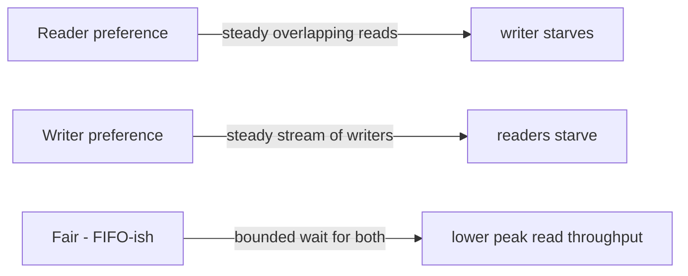
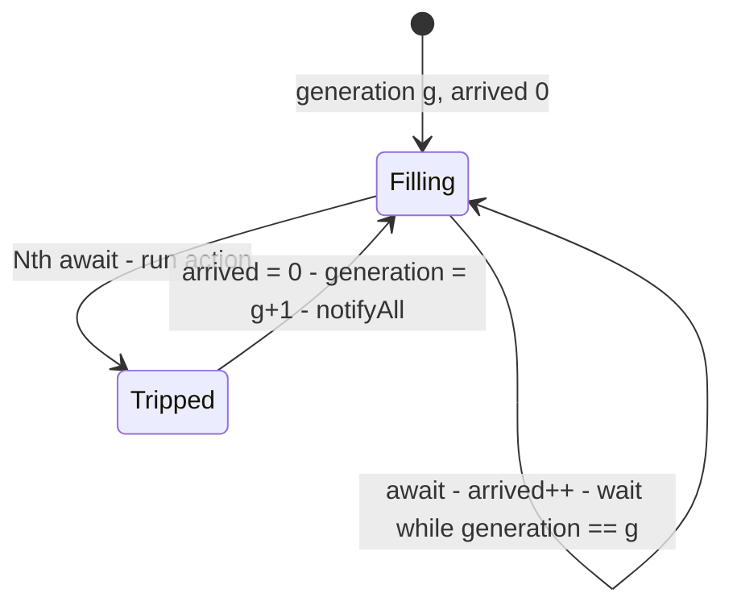
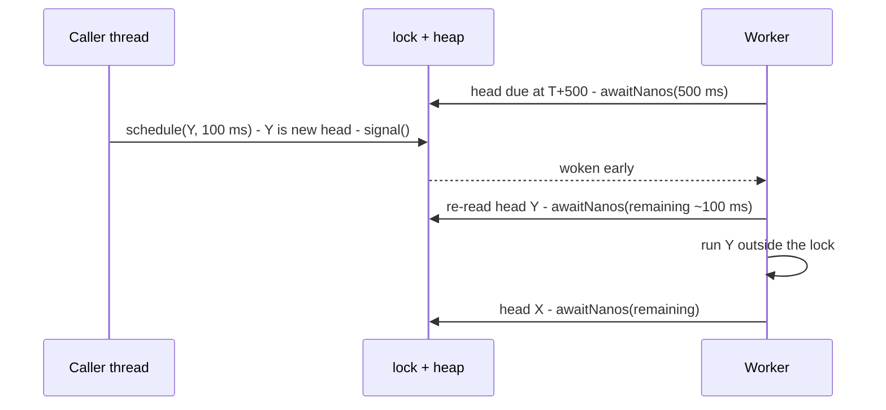
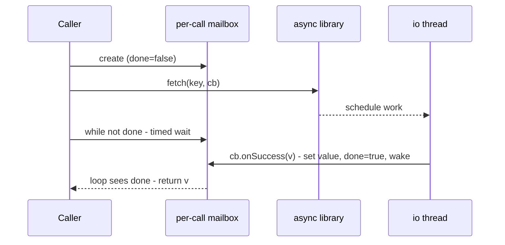
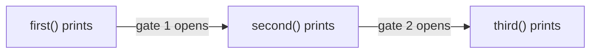
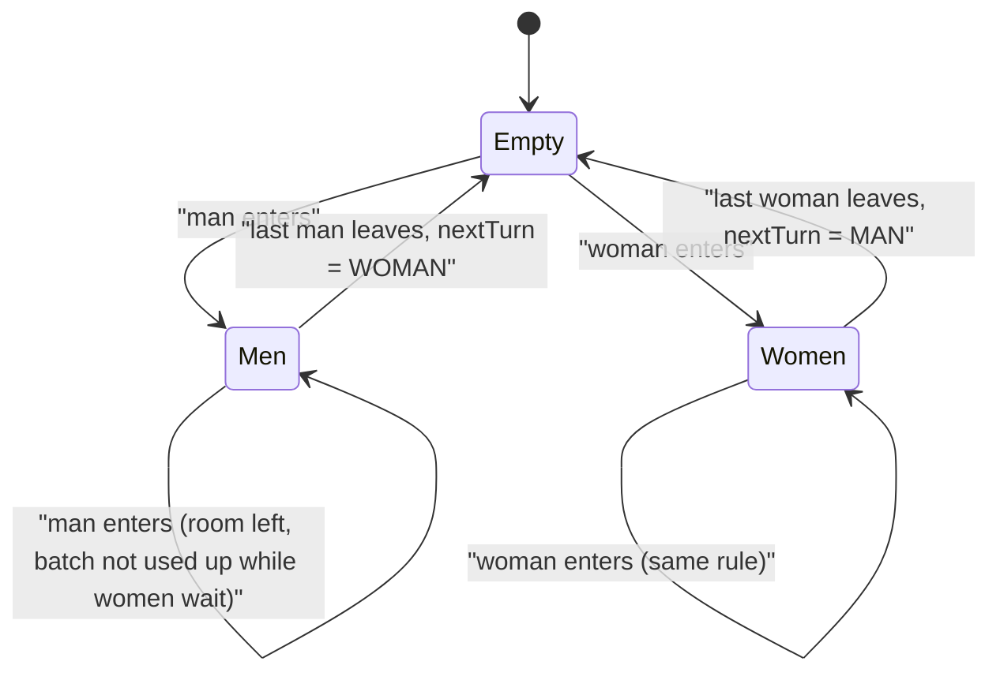
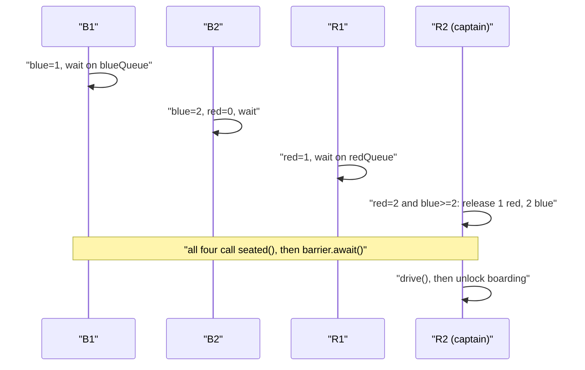
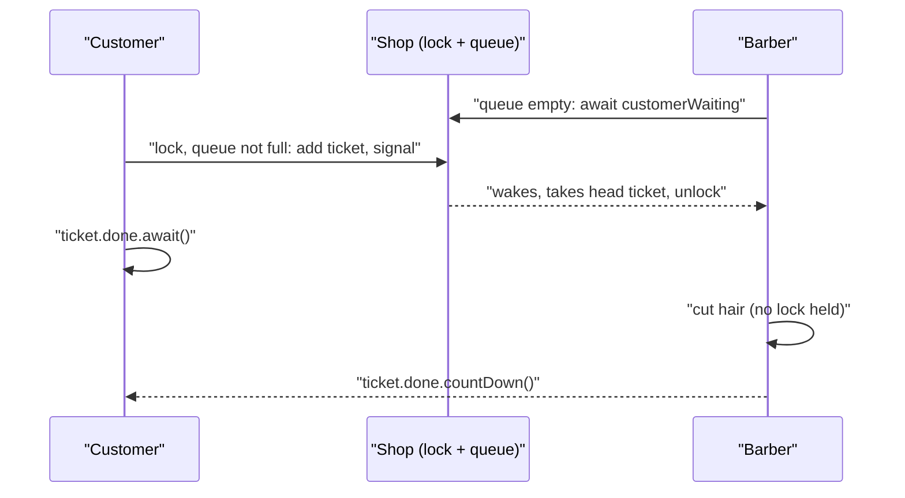

# Chapter 22 — Multithreading Interview Problems

The classic "build it yourself" concurrency problems of senior Java interviews. Each section gives the problem, what the interviewer is testing, the approach, key code (full programs in [`code/`](code/), package `ch22.*`), real output, and pitfalls and follow-ups. The primitives (`synchronized`, `wait`/`notify`, `Lock`/`Condition`, `Semaphore`, latches, barriers, interrupts, the memory model) are taught in [Chapter 14](../14-concurrency-1/README.md) and [Chapter 15](../15-concurrency-2-modern/README.md); this chapter links there instead of repeating them.

Run any problem with: `cd code && javac -d out $(find . -name '*.java') && java -cp out ch22.<topic>.Main` (for example `ch22.semaphore.Main`). Lines marked `[nondeterministic]` change from run to run; lines marked `[machine-dependent]` depend on your hardware.

## 22.1 Blocking queue / bounded buffer — four ways

### The problem
Build a **bounded blocking queue** (also called a **bounded buffer**): a first-in, first-out (FIFO) container with a fixed **capacity** shared by **producer** threads (which call `put(item)`) and **consumer** threads (which call `take()`).

- `put` must **block** — wait without returning — while the queue is full.
- `take` must block while the queue is empty.
- No item may be lost, duplicated or reordered, whatever the number of producers and consumers.

This is the **producer-consumer** problem. The JDK answer is `ArrayBlockingQueue` ([§14.12](../14-concurrency-1/README.md#1412-concurrent-collections)). In the interview you build it yourself, usually in two or three of the following ways, and you explain why the fourth is wrong.

| Way | Waiting mechanism | Verdict |
|---|---|---|
| 1 | object monitor: `synchronized` + `wait`/`notifyAll` | correct; the classic whiteboard answer |
| 2 | one `ReentrantLock` + two `Condition`s | correct; this is how `ArrayBlockingQueue` is built |
| 3 | two counting semaphores + a mutex | correct; the textbook (Dijkstra-style) answer |
| 4 | busy-wait: loop on "lock, check, unlock" | correct but wasteful: it burns a CPU core while waiting |

### What the interviewer is testing
- **Guarded waits** ([§14.8](../14-concurrency-1/README.md#148-wait--notify-guarded-blocks)): `while`, not `if`, because of spurious wakeups and **barging** (another thread takes the lock and changes the state before the woken thread runs, [§14.8.2](../14-concurrency-1/README.md#1482-hoare-vs-mesa-monitors-why-java-needs-while)); check and act under one lock.
- **Who to wake:** when `notify()`/`signal()` is enough and when it wakes the wrong kind of thread.
- **Acquisition order** in the semaphore version, where one wrong order deadlocks.
- **Interrupts and timeouts** ([§14.4](../14-concurrency-1/README.md#144-interruption-cooperative-cancellation)): a cancellable `take`, a timed `poll`.
- **Why busy-waiting is bad**, with numbers rather than "it's slow".

### Approach
All four versions store items in a **circular array** (also called a ring buffer): an `Object[]` of size `capacity`, plus `head` (the index of the oldest item) and `count` (or `tail`). An insert writes at `(head + count) % capacity`. A removal reads `items[head]` and advances `head`. The array never moves, so both operations are O(1) and allocate nothing.

What changes between the versions is **how a thread waits** for "not full" or "not empty".

**Way 1 — the object's monitor.** Make `put` and `take` `synchronized`, so one intrinsic lock guards `items`, `head` and `count`.
1. `put`: `while (count == capacity) wait();` then insert, `count++`, `notifyAll()`.
2. `take`: `while (count == 0) wait();` then remove, `count--`, `notifyAll()`.

Why `notifyAll()`: producers and consumers sleep in the *same* wait set, so a single `notify()` can wake a thread of the kind that cannot proceed (a producer when the buffer is still full); it goes back to sleep and the wake-up the other kind needed is gone ([§14.8.3](../14-concurrency-1/README.md#1483-missed-signals)). `notifyAll()` costs extra wake-ups but is always correct.

**Way 2 — `ReentrantLock` with two `Condition`s** ([§14.9](../14-concurrency-1/README.md#149-explicit-locks-reentrantlock-condition-readwritelock-stampedlock)): producers wait on `notFull`, consumers on `notEmpty`. After an insert, `notEmpty.signal()`: one item can satisfy exactly one consumer, and only consumers wait there, so waking one is enough. After a removal, `notFull.signal()`. No thread is woken for nothing, and `lockInterruptibly()` plus `awaitNanos` make `poll(timeout)` easy.

**Way 3 — semaphores** ([§14.13](../14-concurrency-1/README.md#1413-synchronizers-countdownlatch-cyclicbarrier-semaphore-phaser)). The permit counts carry the "full" and "empty" conditions:
1. `freeSlots = new Semaphore(capacity)`: a producer takes a free slot before inserting.
2. `filledSlots = new Semaphore(0)`: a consumer takes a filled slot before removing.
3. `mutex = new Semaphore(1)` (a binary semaphore used as a lock) protects `head` and `tail`: two producers holding free-slot permits still must not write the same index.
4. `put` = `freeSlots.acquire()` → `mutex.acquire()` → write → `mutex.release()` → `filledSlots.release()`; `take` is the mirror image.

The order in step 4 is the point. A producer that took `mutex` first and then blocked on `freeSlots` would sleep *holding the mutex*, so no consumer could free a slot: **deadlock**. Block on the counting semaphore while holding nothing, then take the short-lived mutex.

**Way 4 — busy-wait.** Loop: lock, check, act if possible, unlock, try again. It is *correct* (check and act share one lock), but a waiting thread never sleeps: every pass is wasted CPU, and the spinner competes for the lock with the threads that could make progress. `Thread.onSpinWait()` (Java 9, [JEP 285](https://openjdk.org/jeps/285)) is only a CPU hint (save power, let a sibling hyper-thread run); the thread still occupies its core. Spinning suits waits of a few hundred nanoseconds inside lock implementations, not a queue whose consumers may wait for seconds.

### Code
Full files: [`code/ch22/blockingqueue/`](code/ch22/blockingqueue/) — `BoundedBuffer` (interface), `MonitorBuffer`, `LockConditionBuffer`, `SemaphoreBuffer`, `SpinBuffer`, `Main`.

Way 2, `LockConditionBuffer` (key parts):
```java
private final ReentrantLock lock = new ReentrantLock();
private final Condition notFull = lock.newCondition();
private final Condition notEmpty = lock.newCondition();

public void put(T item) throws InterruptedException {
    lock.lockInterruptibly();
    try {
        while (count == items.length) notFull.await();
        items[(head + count) % items.length] = item;
        count++;
        notEmpty.signal();               // exactly one consumer can use one new item
    } finally {
        lock.unlock();
    }
}

public T poll(long timeout, TimeUnit unit) throws InterruptedException {
    long nanos = unit.toNanos(timeout);
    lock.lockInterruptibly();
    try {
        while (count == 0) {
            if (nanos <= 0L) return null;
            nanos = notEmpty.awaitNanos(nanos);   // returns the time still left
        }
        return removeHead();                      // removeHead() ends with notFull.signal()
    } finally {
        lock.unlock();
    }
}
```
Way 3, `SemaphoreBuffer.put` (`take` is symmetric):
```java
freeSlots.acquire();                 // 1) reserve a free slot (may block) - holding nothing
try {
    mutex.acquire();                 // 2) exclusive access to the array
} catch (InterruptedException e) {
    freeSlots.release();             // give the reservation back, or capacity leaks
    throw e;
}
try {
    items[tail] = item;
    tail = (tail + 1) % items.length;
} finally {
    mutex.release();
}
filledSlots.release();               // 3) announce one more item
```
Way 4, `SpinBuffer.take` (the anti-pattern):
```java
while (true) {
    if (Thread.interrupted()) throw new InterruptedException();  // nothing else would notice
    lock.lock();
    try {
        if (count > 0) { /* remove and return the head item */ }
    } finally {
        lock.unlock();
    }
    Thread.onSpinWait();                     // CPU hint only; the thread keeps running
}
```
`Main` runs the same workload on all four: 3 producers × 2,000 distinct numbers and 3 consumers, capacity 4, then one **poison pill** (`-1`, "stop") per consumer. It checks that nothing was lost or duplicated and that each consumer saw each producer's items in increasing order (FIFO), measures the CPU time a consumer burns while the buffer stays empty for 300 ms (`ThreadMXBean.getThreadCpuTime`), and interrupts a blocked consumer.

### Output
```text
== 1. correctness: 3 producers x 2000 items, 3 consumers, capacity 4 == [ms: machine-dependent]
monitor (wait/notifyAll)           received=6000 unique=6000 FIFO=true left=0 (87 ms)
Lock + 2 Conditions                received=6000 unique=6000 FIFO=true left=0 (129 ms)
semaphores (free/filled + mutex)   received=6000 unique=6000 FIFO=true left=0 (67 ms)
busy-wait (spin + lock)            received=6000 unique=6000 FIFO=true left=0 (164 ms)

== 2. what a waiting consumer costs (buffer empty for 300 ms) == [ms: machine-dependent]
monitor (wait/notifyAll)           got 42, CPU used while waiting =   0 ms, burned a core? false
Lock + 2 Conditions                got 42, CPU used while waiting =   0 ms, burned a core? false
semaphores (free/filled + mutex)   got 42, CPU used while waiting =   0 ms, burned a core? false
busy-wait (spin + lock)            got 42, CPU used while waiting = 299 ms, burned a core? true

== 3. interrupting a consumer blocked on an empty buffer ==
monitor (wait/notifyAll)           InterruptedException, interrupt flag now false
Lock + 2 Conditions                InterruptedException, interrupt flag now false
semaphores (free/filled + mutex)   InterruptedException, interrupt flag now false
busy-wait (spin + lock)            InterruptedException, interrupt flag now false

poll(100 ms) on empty buffer -> null, waited >= 100 ms: true
```
What to notice:
- All four are *correct*; busy-waiting is wrong in cost, not in result.
- Section 2 is the interview argument: a blocked thread used 0 ms of CPU in 300 ms, the spinning one a whole core. The spin version was also the slowest overall in every run on this 4-core machine (140 ms to over 1 s depending on load, against 50–130 ms), because up to six spinners compete for four cores with the threads that could make progress.
- The flag reads `false` after the exception: throwing `InterruptedException` clears it, so code that can't rethrow must call `Thread.currentThread().interrupt()` ([§14.4](../14-concurrency-1/README.md#144-interruption-cooperative-cancellation)). The spin version must poll `Thread.interrupted()` itself, since no blocking call is there to notice.

### Pitfalls and follow-ups
- **`if` instead of `while`**: with `notifyAll`, two consumers wake for one item and the second removes from an empty buffer, corrupting `count` (demonstrated in [§14.8.2](../14-concurrency-1/README.md#1482-hoare-vs-mesa-monitors-why-java-needs-while)).
- **Changing state without signalling** (or the reverse): every change that can make a waiter's condition true must signal under the same lock — inserts signal `notEmpty`, removals `notFull`.
- **Semaphore order.** Counting semaphore before the mutex; release the mutex before releasing the other counting semaphore. If the mutex `acquire()` is interrupted, give the slot permit back, or every interrupt shrinks the capacity for good.
- **Spinning on unprotected fields.** `while (count == 0) {}` without a lock or `volatile` may never see the update: the JIT may hoist the read out of the loop ([§15.8](../15-concurrency-2-modern/README.md#158-the-java-memory-model-and-happens-before)). That is the *wrong* busy-wait; Way 4 is the correct-but-wasteful one.
- **Fairness.** None of these is fair: a newcomer can barge ahead of a long waiter. `new ReentrantLock(true)`, `new Semaphore(n, true)` and `new ArrayBlockingQueue<>(n, true)` buy FIFO hand-off with throughput.
- **Follow-up: "faster under contention."** Two locks (`putLock`, `takeLock`) and an `AtomicInteger` count let a producer and a consumer work at the same time — the `LinkedBlockingQueue` design.
- **Follow-ups: timed `offer`/`poll`** (above, with `awaitNanos`); **`drainTo`**: remove everything under one lock, then wake producers for every freed slot; **stopping consumers**: one poison pill each, or interrupt them (`shutdownNow()`).
- Related, in less depth: the two-way version in [LLD §13.8](../../../lld/chapters/13-concurrency-problems/README.md#138-thread-safe-bounded-blocking-queue-two-ways).

### TL;DR
- Ring buffer + two guarded waits ("not full", "not empty"). Monitor: `while` + `wait()` and `notifyAll()` (one shared wait set). Lock: two `Condition`s, so `signal()` suffices. Semaphores: `freeSlots(capacity)`, `filledSlots(0)`, then the mutex, in that order.
- Busy-waiting is correct but burns a core per waiter and slows the threads doing real work — measure it and say so.

**Sources:** JDK 21 API — [`Object.wait`](https://docs.oracle.com/en/java/javase/21/docs/api/java.base/java/lang/Object.html#wait(long,int)) (spurious wakeups, call in a loop), [`Condition`](https://docs.oracle.com/en/java/javase/21/docs/api/java.base/java/util/concurrent/locks/Condition.html), [`Semaphore`](https://docs.oracle.com/en/java/javase/21/docs/api/java.base/java/util/concurrent/Semaphore.html), [`ArrayBlockingQueue`](https://docs.oracle.com/en/java/javase/21/docs/api/java.base/java/util/concurrent/ArrayBlockingQueue.html), [`Thread.onSpinWait`](https://docs.oracle.com/en/java/javase/21/docs/api/java.base/java/lang/Thread.html#onSpinWait()); JLS §17.2 (wait sets and notification); JEP 285 (spin-wait hints).

---

## 22.2 Implement a counting semaphore

### The problem
Implement your own `CountingSemaphore(int permits)` with `acquire()`, `release()` and `tryAcquire(timeout)`, without using `java.util.concurrent.Semaphore`. Typical extensions: `acquire(n)` for several permits at once, a **bounded** semaphore that never exceeds its initial count, and a **fair** one that serves waiters in arrival order.

Semantics to state before you start (they match the JDK class):
- The state is a single number of available permits, never negative.
- `acquire()` waits while the count is 0, then decrements it.
- `release()` increments the count and wakes waiters.
- There is **no owner**. Any thread may release, even one that never acquired. That is what separates a semaphore from a lock, and what makes it usable for signalling between threads.

### What the interviewer is testing
- Turning a spec into **state + invariant + guarded wait**: state `permits`, invariant `permits >= 0`, guard `permits >= n`.
- `notify` vs `notifyAll`, clean interrupts, and a **timed wait** with a deadline computed once and the remaining time recomputed after every wake-up.
- **Fairness**: `synchronized` + `notifyAll` give *no* ordering; how would you add one?
- Why a semaphore cannot lose a signal: its count *remembers* releases ([§14.8.1](../14-concurrency-1/README.md#1481-mutex-vs-semaphore-vs-monitor)).

### Approach
**Monitor version (`CountingSemaphore`).**
1. One field, `int permits`, guarded by the object's own monitor. Every method is `synchronized`.
2. `acquire(n)`: `while (permits < n) wait(); permits -= n;`.
3. `release(n)`: `permits += n; notifyAll();`.
4. `tryAcquire()` without a timeout: if `permits == 0`, return `false` immediately, otherwise decrement.
5. `tryAcquire(timeout)`: compute `deadline = now + timeout` once, then loop. If permits are available, take one. Otherwise compute `left = deadline − now`; if `left <= 0`, return `false`; else `wait(left)`. A spurious or "wrong" wake-up then simply waits again for the *remaining* time. Use `System.nanoTime()`, a **monotonic clock**: it never jumps backwards when the wall clock is corrected.

**Why `notifyAll()` and not `notify()`.** With multi-permit `acquire(n)`, waiters want different amounts. Suppose `release(1)` uses `notify()` and wakes a thread that needs 3 permits, while a thread that needed only 1 keeps sleeping. Nobody makes progress, although a waiter could have. If every waiter asks for exactly one permit, `release(1)` with `notify()` is enough, and it avoids waking N threads to let one through. Choose based on whether every waiter can use whatever was released.

**Interrupts.** `wait()` throws `InterruptedException` and the thread leaves *without* taking a permit, because we decrement only after the loop, so the count stays consistent with no extra code. JLS §17.2.4 also says a notification cannot be lost to an interrupt: after a `notify`, at least one waiter returns normally unless all of them leave by `InterruptedException`.

**Bounded variant.** Add `maxPermits`; a `release` beyond it is a caller bug (more releases than acquires), so throw `IllegalStateException`. Some textbooks instead *block* the releaser until the count drops, which turns the semaphore into a two-sided permit buffer; mention it, choose the exception.

**Fair version (`FairSemaphore`).** "Fair" means FIFO: a thread that started waiting earlier gets a permit earlier. Two things are needed:
1. A **queue of waiting threads** (`ArrayDeque<Thread>`): a thread may take a permit only at the **head** of the queue *and* with a permit free; newcomers join the tail, so nobody barges.
2. `ReentrantLock` + one `Condition`, `signalAll()` after every change so the new head re-checks (per-thread `Condition`s would avoid waking everyone — an optimisation).

`new ReentrantLock(true)` alone is **not** a fair semaphore: it orders who gets the *lock*, not the *permit*, and a fresh caller that finds a permit simply takes it.

### Code
Full files: [`code/ch22/semaphore/CountingSemaphore.java`](code/ch22/semaphore/CountingSemaphore.java), [`FairSemaphore.java`](code/ch22/semaphore/FairSemaphore.java), [`Main.java`](code/ch22/semaphore/Main.java).

```java
public synchronized void acquire(int n) throws InterruptedException {
    checkCount(n);
    while (permits < n) {          // while, not if: spurious wakeups and barging threads
        wait();
    }
    permits -= n;
}

public synchronized boolean tryAcquire(long timeout, TimeUnit unit) throws InterruptedException {
    long deadline = System.nanoTime() + unit.toNanos(timeout);
    while (permits == 0) {
        long leftNanos = deadline - System.nanoTime();
        if (leftNanos <= 0) return false;
        long ms = TimeUnit.NANOSECONDS.toMillis(leftNanos);
        int ns = (int) (leftNanos - TimeUnit.MILLISECONDS.toNanos(ms));
        wait(ms, ns == 0 && ms == 0 ? 1 : ns);   // wait(0, 0) would mean "forever"
    }
    permits--;
    return true;
}

public synchronized void release(int n) {
    checkCount(n);
    if (permits > maxPermits - n)                 // overflow-safe form of permits + n > max
        throw new IllegalStateException("release would exceed maxPermits=" + maxPermits);
    permits += n;
    notifyAll();                  // waiters may want different n, so wake them all to re-check
}
```
`FairSemaphore.acquire` — only the head of the queue may take a permit:
```java
lock.lockInterruptibly();
try {
    Thread me = Thread.currentThread();
    queue.addLast(me);
    try {
        while (queue.peekFirst() != me || permits == 0) changed.await();
        permits--;
    } finally {
        queue.remove(me);       // normal exit or interrupt: leave the queue either way
        changed.signalAll();    // the next thread in line may now be at the head
    }
} finally {
    lock.unlock();
}
```
`Main` runs seven checks: 10 workers on 3 permits; a release before anyone waits; `tryAcquire(100 ms)` while the only permit is held; `acquire(3)` fed by three single releases; an over-release on a bounded semaphore; an interrupt while waiting; FIFO order on the fair semaphore.

### Output
```text
1 limit: 10 workers, 3 permits -> max inside at once = 3, permits afterwards = 3
2 signal before wait: waiter finished = true, quickly (< 500 ms) = true
3 tryAcquire(100 ms) while the permit is held -> false, waited >= 100 ms: true, tryAcquire() now -> false
4 acquire(3): woke after 3 single releases, permits left = 0
5 bounded: extra release -> IllegalStateException: release would exceed maxPermits=2
6 interrupt while waiting -> InterruptedException, permits after one release = 1
7 fair semaphore: arrival order 0 1 2 3 4 -> served order [0, 1, 2, 3, 4]
```
What to notice:
- Line 2 is the **missed-signal** test: the count remembers the early release, so the late `acquire()` returns at once (a bare `notify()` would be lost).
- Line 6: the interrupted thread took no permit.
- Line 7 is deterministic only because `Main` releases one permit at a time and waits until it is taken; with five releases at once, threads still *acquire* in FIFO order but may *print* in any order.

### Pitfalls and follow-ups
- **Release in `finally`.** Otherwise one exception loses a permit for good, and with no owner nothing detects it; enough failures and every permit is "in use" by nobody.
- **Over-release.** The JDK `Semaphore` lets the count grow; the bounded version fails loudly.
- **Deadline arithmetic.** Restarting the full timeout after each wake-up can make a 100 ms timeout last forever. Compare `nanoTime` values by subtraction (`deadline - now <= 0`), never with `<`, because `nanoTime` may overflow.
- **`wait(0)` means "forever"**, a classic bug when the remaining time rounds down to 0 ms; the code passes at least 1 ns.
- **Starvation.** An `acquire(3)` can wait forever while single-permit callers take each released permit. The fair queue fixes it; the JDK offers `new Semaphore(n, true)`, whose untimed `tryAcquire()` still barges by design.
- **Follow-up: "a lock from your semaphore"**: `new CountingSemaphore(1)` — non-reentrant (a second `acquire` by the holder deadlocks) and with no owner check.
- **Virtual threads**: on Java 21–23 a virtual thread in `wait()` inside `synchronized` **pins** its carrier ([§15.5](../15-concurrency-2-modern/README.md#155-pinning-and-jep-491)); the `ReentrantLock` version never did, and JDK 24 removed the pinning ([JEP 491](https://openjdk.org/jeps/491)).

### TL;DR
- One non-negative integer under a lock: `acquire` = `while (permits < n) wait(); permits -= n`; `release` = `permits += n; notifyAll()` (waiters want different amounts).
- Timed waits from a fixed `nanoTime` deadline; an interrupted waiter takes nothing; fairness = a queue where only the head proceeds (a fair lock alone is not enough).

**Sources:** JDK 21 API — [`Semaphore`](https://docs.oracle.com/en/java/javase/21/docs/api/java.base/java/util/concurrent/Semaphore.html) (no ownership, fairness, `tryAcquire` barging), [`Object.wait(long, int)`](https://docs.oracle.com/en/java/javase/21/docs/api/java.base/java/lang/Object.html#wait(long,int)), [`System.nanoTime`](https://docs.oracle.com/en/java/javase/21/docs/api/java.base/java/lang/System.html#nanoTime()) (compare with subtraction); JLS §17.2.4 (interaction of waits, notification and interruption); JEP 491.

---

## 22.3 Implement a read-write lock

### The problem
Implement a **read-write lock**: any number of **readers** at once, *or* exactly one **writer**, never both — `lockRead()`, `unlockRead()`, `lockWrite()`, `unlockWrite()`. Then answer the real question: **who goes first when both are waiting?** Reader preference can starve writers and writer preference can starve readers ([starvation, §15.9](../15-concurrency-2-modern/README.md#159-liveness-deadlock-livelock-starvation)). Show it.

### What the interviewer is testing
- **Shared/exclusive state** in two variables (`readers`, `writing`) with the right guard for each side.
- **Policy, not just safety**: why the natural first version starves writers, and the one-counter fix.
- **Who wakes whom**: the last reader out wakes writers; a leaving writer wakes everyone.
- **The interrupt edge case**: a waiting writer that gives up must undo its "waiting" mark.
- The JDK's `ReentrantReadWriteLock`: fairness, reentrancy, no upgrade.

### Approach
**State** (all guarded by the object monitor):
- `int readers`: readers currently inside.
- `boolean writing`: whether a writer is inside.
- `int waitingWriters`: writers blocked in `lockWrite()`. Only the writer-preference version needs it.

**Invariant:** `writing` implies `readers == 0`, and at most one writer is inside.

**Reader preference.**
1. `lockRead`: `while (writing) wait(); readers++;`. A reader enters whenever no writer is *inside*.
2. `unlockRead`: `readers--; if (readers == 0) notifyAll();`. Only the last reader out can let a writer in, so earlier ones need not wake anybody.
3. `lockWrite`: `while (writing || readers > 0) wait(); writing = true;`.
4. `unlockWrite`: `writing = false; notifyAll();`. Wake *all* waiting readers, so they enter together, and the writers.

Why writers starve: if reads overlap (six readers, 30 ms each, staggered starts), `readers` never drops to 0, so a writer waits until the stream of reads stops.

**Writer preference** — the one-line change:
1. `lockWrite`: `waitingWriters++`, wait as before, then `waitingWriters--` and set `writing = true`.
2. `lockRead`: `while (writing || waitingWriters > 0) wait();`. A new reader stays out as soon as a writer is *waiting*.

Readers inside finish, the count reaches 0, the writer enters. The opposite failure follows: writers arriving back to back keep `waitingWriters > 0` and readers starve.

**Fair** is the third answer: roughly arrival order. A waiting writer blocks *later* readers only; when it leaves, the readers that queued meanwhile go in together. That is `new ReentrantReadWriteLock(true)`: on release, either the longest-waiting writer gets the lock, or the group of readers that waited longer than every writer. By hand it needs a ticket queue as in `FairSemaphore` (§22.2); in the interview, describing it and naming the JDK class is usually enough.



### Code
Full files: [`code/ch22/rwlock/`](code/ch22/rwlock/) — `SimpleRWLock` (interface), `ReaderPreferenceRWLock`, `WriterPreferenceRWLock`, `Main` (which also wraps the JDK fair lock as a third contestant).

`WriterPreferenceRWLock` (the reader-preference class is the same without `waitingWriters`):
```java
public synchronized void lockRead() throws InterruptedException {
    while (writing || waitingWriters > 0) wait();   // the one-line difference
    readers++;
}

public synchronized void unlockRead() {
    if (readers <= 0) throw new IllegalMonitorStateException("no read lock held");
    readers--;
    if (readers == 0) notifyAll();
}

public synchronized void lockWrite() throws InterruptedException {
    waitingWriters++;
    try {
        while (writing || readers > 0) wait();
    } catch (InterruptedException e) {
        waitingWriters--;          // give up our place, or readers stay blocked forever
        notifyAll();               // readers held back by us must re-check
        throw e;
    }
    waitingWriters--;
    writing = true;
}

public synchronized void unlockWrite() {
    if (!writing) throw new IllegalMonitorStateException("no write lock held");
    writing = false;
    notifyAll();
}
```
`Main` runs three experiments on each lock: (1) **safety** — 4 readers and 2 writers, 2,000 operations each; writers keep `pair[0] == pair[1]`, readers count torn pairs or overlap with a writer; (2) a writer arriving at 100 ms while six readers overlap for 600 ms; (3) a reader arriving at 100 ms while two writers alternate for 600 ms with a 1 ms gap.

### Output
```text
== 1. safety: 4 readers + 2 writers, 2000 operations each ==
reader-preference                  violations=0  pair=(4000,4000)  readers overlapped (max>1)=true
writer-preference                  violations=0  pair=(4000,4000)  readers overlapped (max>1)=true
JDK ReentrantReadWriteLock(fair)   violations=0  pair=(4000,4000)  readers overlapped (max>1)=true

== 2. writer arrives while 6 readers keep overlapping for 600 ms == [ms: nondeterministic]
reader-preference                  writer waited 505 ms, starved (>= 400 ms)? true
writer-preference                  writer waited  27 ms, starved (>= 400 ms)? false
JDK ReentrantReadWriteLock(fair)   writer waited  16 ms, starved (>= 400 ms)? false

== 3. reader arrives while 2 writers keep alternating (1 ms gap) for 600 ms == [ms: nondeterministic]
reader-preference                  reader waited  22 ms, starved (>= 400 ms)? false
writer-preference                  reader waited 521 ms, starved (>= 400 ms)? true
JDK ReentrantReadWriteLock(fair)   reader waited  25 ms, starved (>= 400 ms)? false
```
What to notice:
- All three are **safe**: starvation is a *liveness* failure (someone never gets in), not a *safety* one (nothing is ever corrupted).
- Experiment 2: under reader preference the writer got in only when the readers stopped (~500 ms); otherwise it waited about one read (≤ 30 ms). Experiment 3 mirrors it: under writer preference one writer is always waiting, so the reader is locked out all run.
- The 1 ms gap: without it the releasing writer re-acquires the lock before any woken thread runs, and even reader preference starved the reader. That is **barging**, a third source of starvation: `notifyAll()` gives woken threads no priority over a running one.

### Pitfalls and follow-ups
- **Waking too few.** `unlockWrite` needs `notifyAll`: with `notify`, one reader enters and the others sleep although they could share.
- **Forgetting `waitingWriters--` on interrupt** blocks every future reader — the subtle bug of the writer-preference version.
- **Unlock checks.** Unlocking a lock you don't hold should throw `IllegalMonitorStateException`, not drive `readers` negative; the JDK tracks per-thread read-hold counts.
- **Reentrancy.** These locks aren't reentrant: in the writer-preference lock, a reader re-entering `lockRead()` while a writer waits deadlocks with it. `ReentrantReadWriteLock` is reentrant.
- **Upgrade deadlock.** Two readers that both try to take the write lock wait for each other forever. The JDK forbids upgrading and allows **downgrading** (write lock → read lock → release write); `StampedLock.tryConvertToWriteLock` covers "read, then maybe write" ([§14.9](../14-concurrency-1/README.md#149-explicit-locks-reentrantlock-condition-readwritelock-stampedlock)).
- **When it doesn't pay.** With short reads, the bookkeeping (every reader writes `readers` under a lock) costs more than plain mutual exclusion; RW locks win for long, frequent reads and rare writes ([LLD §12.23](../../../lld/chapters/12-concurrency-concepts/README.md#1223-reader-writer-pattern)).
- **Follow-up: two `Condition`s** (`canRead`, `canWrite`): `unlockWrite` signals one writer if any waits, else `canRead.signalAll()`, so writers aren't woken for nothing.

### TL;DR
- State `readers`, `writing`, plus `waitingWriters` for writer preference. Readers wait while a writer is inside (or waiting); writers wait while anyone is inside.
- Reader preference starves writers, writer preference starves readers; fair hand-off (`new ReentrantReadWriteLock(true)`) bounds both. Wake everyone when a writer leaves, undo `waitingWriters` on interrupt, never upgrade.

**Sources:** JDK 21 API — [`ReentrantReadWriteLock`](https://docs.oracle.com/en/java/javase/21/docs/api/java.base/java/util/concurrent/locks/ReentrantReadWriteLock.html) (fair and non-fair acquisition, reentrancy, downgrading allowed and upgrading not), [`ReadWriteLock`](https://docs.oracle.com/en/java/javase/21/docs/api/java.base/java/util/concurrent/locks/ReadWriteLock.html) (when a read-write lock helps), [`StampedLock`](https://docs.oracle.com/en/java/javase/21/docs/api/java.base/java/util/concurrent/locks/StampedLock.html); JLS §17.2.

---

## 22.4 Implement a reusable barrier

### The problem
Implement a **barrier** for `N` threads: each calls `await()`, nobody returns until all `N` have, then all are released together. It must be **reusable** (cyclic) for round 2, 3, … of an iterative algorithm, such as a simulation where no thread may start step *k + 1* until every slice of step *k* is done. The JDK class is `CyclicBarrier` ([§14.13](../14-concurrency-1/README.md#1413-synchronizers-countdownlatch-cyclicbarrier-semaphore-phaser)); the interview wants it built, and an explanation of why the obvious version breaks on second use.

### What the interviewer is testing
- Seeing that **"N have arrived" and "my round is over" are different facts**; a count that gets reset can't express the second.
- The **generation** number waiters compare against, so a fast thread can return for round 2 while slow ones are still leaving round 1.
- Interrupt semantics, a **barrier action** (run once per round by the last arriver) and the return value of `await`.

### Approach
**Naive attempt A: never reset.**
```text
count++; if (count == N) notifyAll(); else while (count < N) wait();
```
Round 1 works. In round 2 `count` is already ≥ N, so `while (count < N)` is false immediately and every thread runs straight through without waiting. The barrier has silently stopped being a barrier.

**Naive attempt B: reset in the last thread.**
```text
count++; if (count == N) { count = 0; notifyAll(); } else while (count < N) wait();
```
The last thread resets `count` to 0 and calls `notifyAll()`. The woken threads re-check `count < N`, see `0 < N`, and go back to sleep: everyone except the last thread is stuck in round 1 forever. The `while` loop, correct elsewhere, now re-checks a condition that has *already been undone*.

The problem underneath both attempts is that a waiter asks "have N arrived?", while the question it needs answered is "**is the round I arrived in over?**". Once the count is reset for the next round, it can no longer answer that.

**The generation barrier.**
1. State: `arrived` (arrivals so far in this round) and `generation` (a `long` round number), both guarded by the monitor.
2. On `await()`, record `myGeneration = generation`, then `arrived++`.
3. **Last arriver** (`arrived == N`): run the optional barrier action, set `arrived = 0` for the next round, `generation++` to end this one, `notifyAll()`, and return.
4. **Everyone else**: `while (myGeneration == generation) wait();`. Spurious wake-ups loop back. The real wake-up finds that the generation has changed and returns.
5. Reuse is now safe. A fast thread that comes back for round 2 increments the fresh `arrived` and records the *new* generation, while slow threads from round 1 are still leaving. They compare against *their* generation, which has already ended.



**Interrupts.** Interrupted *before* its round completes, a waiter must withdraw its arrival (`arrived--`), or the round would trip with N−1 real parties. If the round completed at the same moment, it has passed: return normally and restore the interrupt flag. `CyclicBarrier` chooses differently: an interrupt **breaks** the barrier and every other waiter gets `BrokenBarrierException`. Name both; our code withdraws.

**Return value.** As in `CyclicBarrier`, `await()` returns the arrival index (`N−1` for the first, `0` for the last), so one thread can do per-round work without a barrier action.

### Code
Full files: [`code/ch22/barrier/ReusableBarrier.java`](code/ch22/barrier/ReusableBarrier.java), [`NaiveBarriers.java`](code/ch22/barrier/NaiveBarriers.java) (the two broken versions), [`Main.java`](code/ch22/barrier/Main.java).

```java
public synchronized int await() throws InterruptedException {
    final long myGeneration = generation;
    int index = parties - 1 - arrived;
    arrived++;
    if (arrived == parties) {           // last one in trips the barrier
        if (barrierAction != null) barrierAction.run();
        arrived = 0;                    // reset for the next round...
        generation++;                   // ...and end this one
        notifyAll();
        return 0;
    }
    try {
        while (myGeneration == generation) {   // not "arrived < parties"!
            wait();
        }
    } catch (InterruptedException e) {
        if (myGeneration == generation) {       // still waiting: withdraw our arrival
            arrived--;
            throw e;
        }
        Thread.currentThread().interrupt();     // the round already completed: keep the interrupt, return normally
    }
    return index;
}
```
`Main` checks: (1) correct reuse — 3 workers × 4 rounds with random work, each verifying after `await()` that all 3 had arrived; (2) naive A with one thread 200 ms late for round 2; (3) naive B on daemon threads, so stuck ones don't keep the JVM alive; (4) a lone waiter interrupted, then a fresh full round.

### Output
```text
1 barrier action: round 0 complete, all 3 arrived
1 barrier action: round 1 complete, all 3 arrived
1 barrier action: round 2 complete, all 3 arrived
1 barrier action: round 3 complete, all 3 arrived
1 generation barrier: 4 rounds, threads that left a round early = 0
2 NoReset: round 2, fast threads that passed before the slow one arrived = 2 of 2  (BUG)
3 ResetTooEarly: round 1, threads still stuck after 300 ms = 2 of 3  (BUG)
4 interrupted waiter -> InterruptedException, waiting count after withdraw = 0, next full round completed = true
```
What to notice: the barrier action prints exactly once per round, in order, because it runs inside the monitor in the last arriver before anyone is released. Naive A fails *silently* (occasional wrong numbers in a real algorithm); naive B hangs. Both survive a single-round test — which is why interviewers ask for reuse.

### Pitfalls and follow-ups
- **Testing one round only.** Test at least two rounds with uneven arrivals.
- **`int` generation wrap-around** is harmless (only "changed or not" matters); a `long` makes it moot.
- **A throwing barrier action** escapes with `arrived` still at N and no `notifyAll()`: everyone is stuck. Wrap it in `try/finally` and still advance the generation, or break the barrier as `CyclicBarrier` does.
- **Timeouts.** `await(timeout)` is the same loop with a deadline (as in §22.2); on timeout withdraw, or break the barrier (`CyclicBarrier` throws `TimeoutException` to that thread and `BrokenBarrierException` to the others).
- **Alternative: two turnstiles.** The semaphore solution opens gate 1 when N have arrived and gate 2 when N have *left*, which makes it safe to close gate 1 again; correct but harder to explain.
- **Follow-ups:** a varying number of parties is `Phaser` ([§14.13](../14-concurrency-1/README.md#1413-synchronizers-countdownlatch-cyclicbarrier-semaphore-phaser)); a latch is one-shot and its counters need not be its waiters, while a barrier is cyclic and arrivers are the waiters.

### TL;DR
- Waiters must ask "is *my* round over?": loop `while (myGeneration == generation) wait()`; the last arriver resets the count, increments the generation and calls `notifyAll()`.
- No reset passes everyone in round 2; a reset with a count-based wait strands them in round 1. On interrupt, withdraw (ours) or break the barrier (`CyclicBarrier`).

**Sources:** JDK 21 API — [`CyclicBarrier`](https://docs.oracle.com/en/java/javase/21/docs/api/java.base/java/util/concurrent/CyclicBarrier.html) (barrier action, arrival index, broken-barrier rules), [`Phaser`](https://docs.oracle.com/en/java/javase/21/docs/api/java.base/java/util/concurrent/Phaser.html), [`CountDownLatch`](https://docs.oracle.com/en/java/javase/21/docs/api/java.base/java/util/concurrent/CountDownLatch.html); JLS §17.2.

---

## 22.5 Thread-safe deferred callback executor

### The problem
Design `schedule(Runnable callback, long delay, TimeUnit unit)`, callable from any thread. Each callback runs **no earlier than** `now + delay`, as soon as possible after, on one dedicated **worker thread**. A callback scheduled later may be due *earlier* than everything waiting. The worker must not **poll** (wake every few ms to look); it sleeps exactly until the next deadline. In production: `ScheduledThreadPoolExecutor` or `DelayQueue` ([§14.11](../14-concurrency-1/README.md#1411-executors-and-thread-pools)).

### What the interviewer is testing
- **Data structure**: a **min-heap** keyed by deadline — O(log n) insert, O(1) "next due".
- **A timed wait on a moving target**: the earliest deadline can change while the worker sleeps. Do you wake it and re-read the head?
- **Missed signals**: a signal sent while the worker is running a callback wakes nobody. Still correct?
- Callbacks **outside the lock**, surviving one that throws, **clean shutdown**, and `nanoTime` vs `currentTimeMillis`.

### Approach
1. **Task record** `(deadlineNanos, seq, callback)` with `deadlineNanos = System.nanoTime() + delay`: `nanoTime` is monotonic, so a wall-clock correction (NTP) can't fire a callback early or hours late. `seq` (from an `AtomicLong`) breaks ties in scheduling order.
2. **`PriorityQueue<Task>`** (not thread-safe) guarded by a `ReentrantLock`; one `Condition`, `changed`, means "the head may have changed, or shutdown was requested".
3. **`schedule()`**: under the lock, add the task; if it is now the head (`queue.peek() == task`), `changed.signal()` so the worker recomputes its sleep. Otherwise the worker's sleep target is still right.
4. **Worker loop** (`takeNextDue()`, under the lock):
   - empty queue → `changed.await()` (no timeout: nothing to do until `schedule` or `close`);
   - head due (`deadline − now <= 0`) → `poll()` it and return its callback;
   - head not yet due → `changed.awaitNanos(deadline − now)`, a **timed wait on the earliest deadline**, then loop and **re-read the head**, whatever woke us: timeout, signal or spurious wake-up.
5. **Run the callback after releasing the lock**, in `try/catch (RuntimeException)`: a slow callback must not block `schedule()`, and a throwing one must not kill the only worker.
6. **`close()`**: set `shutdown = true` under the lock and signal; later `schedule()` calls throw `IllegalStateException`; the worker runs the queued tasks as they fall due, exits when the queue is empty, and `close()` joins it. (Dropping pending tasks, `shutdownNow`-style, is the other valid choice; say which.)

**Why the signal cannot be missed.** The worker waits *for a condition on the queue*, re-read under the lock before every wait, never "for a signal". If `schedule()` adds an earlier task while the worker runs a callback, the `signal()` wakes nobody, but the worker sees the new head the next time it takes the lock. The heap carries the information; the signal only shortens a sleep in progress.



### Code
Full files: [`code/ch22/deferredcallback/DeferredCallbackExecutor.java`](code/ch22/deferredcallback/DeferredCallbackExecutor.java), [`Main.java`](code/ch22/deferredcallback/Main.java).

```java
private record Task(long deadlineNanos, long seq, Runnable callback) implements Comparable<Task> {
    public int compareTo(Task o) {
        int c = Long.compare(deadlineNanos - o.deadlineNanos, 0);   // overflow-safe nanoTime compare
        return c != 0 ? c : Long.compare(seq, o.seq);              // tie -> first scheduled runs first
    }
}

public void schedule(Runnable callback, long delay, TimeUnit unit) {
    Task task = new Task(System.nanoTime() + unit.toNanos(delay), seq.getAndIncrement(), callback);
    lock.lock();
    try {
        if (shutdown) throw new IllegalStateException("executor is shut down");
        queue.add(task);
        if (queue.peek() == task) changed.signal();   // new earliest deadline: worker must recompute its sleep
    } finally {
        lock.unlock();
    }
}

private Runnable takeNextDue() throws InterruptedException {     // called by the worker loop
    lock.lock();
    try {
        while (true) {
            Task head = queue.peek();
            if (head == null) {
                if (shutdown) return null;
                changed.await();                        // nothing to do: sleep until schedule()/close()
                continue;
            }
            long waitNanos = head.deadlineNanos() - System.nanoTime();
            if (waitNanos <= 0) return queue.poll().callback();   // due now
            changed.awaitNanos(waitNanos);              // loop re-reads the head whatever woke us
        }
    } finally {
        lock.unlock();
    }
}
```
The worker loop calls `takeNextDue()`, then runs the callback outside the lock in `try { due.run(); } catch (RuntimeException e) { log }`.

`Main` checks: (1) four threads schedule A (400 ms), B (100), C (300), D (200) at once; (2) Y (due 150 ms) arrives while the worker sleeps until X (500 ms); (3) a callback throws, then `close()` with one task pending.

### Output
```text
1 scheduled A(400) B(100) C(300) D(200) from 4 threads -> ran B D C A, none ran before its deadline: true
   B due ~119 ms, ran at 121 ms [nondeterministic]
   D due ~220 ms, ran at 220 ms [nondeterministic]
   C due ~320 ms, ran at 320 ms [nondeterministic]
   A due ~415 ms, ran at 418 ms [nondeterministic]
2 X due at 500 ms, Y (due 150 ms) scheduled while worker sleeps -> first ran: Y, Y ran between 150 and 300 ms: true, then X
   [worker] callback threw java.lang.IllegalStateException: boom - worker keeps going
3 callbacks that ran after the throwing one: [after-boom, pending-at-close]
3 schedule() after close() -> IllegalStateException: executor is shut down
```
What to notice: lateness is 0–5 ms (timer resolution and wake-up time) — the guarantee is *not early*, never *exactly on time*. Line 2 is the core: without the `signal()` in `schedule()`, Y would run at ~500 ms, after X. `close()` drained `pending-at-close` before stopping.

### Pitfalls and follow-ups
- **Sleeping for the head's delay, then running whatever is at the head** without re-checking: an earlier task inserted meanwhile runs late, a spurious wake-up runs a task early. Always re-read, recompute, wait again.
- **`Thread.sleep(delay)`** can't be shortened by a newly scheduled earlier task; **polling** (`awaitNanos(10 ms)` in a loop) wakes 100 times a second and is late by up to the interval.
- **Callbacks under the lock**: a 2 s callback blocks every `schedule()` caller for 2 s. **Uncaught callback exceptions** would end the only worker silently (`ScheduledThreadPoolExecutor` captures them in the task's `Future`).
- **One slow callback delays the rest.** Follow-up: the worker only *dispatches* to an `ExecutorService`, or several workers use the **leader–follower** scheme of `DelayQueue` (its source comment names it): one leader does the timed wait on the head, the others wait untimed, and the leader signals a follower when it takes a task — otherwise every worker wakes at every deadline.
- **Starting the worker in the constructor** lets `this` escape; it is safe here only because the class is `final` and `start()` is the last statement (`Thread.start()` happens-before the new thread's actions). Otherwise use a factory (§22.8).
- **Cancellation (follow-up)**: return a handle; remove the task under the lock (O(n)) or mark it and skip it at the head (O(1)) — `ScheduledThreadPoolExecutor.setRemoveOnCancelPolicy` chooses between the two.
- **Huge delays** overflow `nanoTime() + delay`; compare by subtraction and cap the delay.

### TL;DR
- Min-heap of `(deadline, seq, callback)` behind one lock; one worker loops: peek, run if due, else `awaitNanos(deadline − now)`. `schedule()` signals only for a new head; the worker re-reads the head after every wake-up, so state carries the information.
- `nanoTime` deadlines, callbacks outside the lock with exceptions caught, defined shutdown. Production: `ScheduledThreadPoolExecutor` or `DelayQueue`.

**Sources:** JDK 21 API — [`Condition.awaitNanos`](https://docs.oracle.com/en/java/javase/21/docs/api/java.base/java/util/concurrent/locks/Condition.html#awaitNanos(long)) (returns the remaining time), [`PriorityQueue`](https://docs.oracle.com/en/java/javase/21/docs/api/java.base/java/util/PriorityQueue.html) (not synchronized, O(log n) offer/poll), [`DelayQueue`](https://docs.oracle.com/en/java/javase/21/docs/api/java.base/java/util/concurrent/DelayQueue.html), [`ScheduledThreadPoolExecutor`](https://docs.oracle.com/en/java/javase/21/docs/api/java.base/java/util/concurrent/ScheduledThreadPoolExecutor.html) (`setRemoveOnCancelPolicy`), [`System.nanoTime`](https://docs.oracle.com/en/java/javase/21/docs/api/java.base/java/lang/System.html#nanoTime()); JLS §17.4.5 (`Thread.start` happens-before rule).

---

## 22.6 Asynchronous to synchronous

### The problem
A library offers only an **asynchronous**, callback-based API:
```java
void fetch(String key, Callback<String> cb);   // returns at once; later calls cb.onSuccess(v) or cb.onFailure(e)
```
The callback runs on the library's own I/O thread. Your callers want a **synchronous** (blocking) method:
```java
String fetch(String key, Duration timeout) throws InterruptedException, ExecutionException, TimeoutException;
```
It blocks until the result or error arrives, then returns it or throws ([sync vs async, §14.1.2](../14-concurrency-1/README.md#1412-sync-vs-async-io-bound-vs-cpu-bound-throughput-vs-latency)). Implement it and compare `wait`/`notify`, `Lock` + `Condition`, `CountDownLatch` and `CompletableFuture`.

### What the interviewer is testing
- The **missed-signal trap**: the callback may run *before* the caller waits — even synchronously inside `fetch()` for a cached value — so a bare `notify()` is lost ([§14.8.3](../14-concurrency-1/README.md#1483-missed-signals)).
- **Per-call state**, and **safe publication** of the result from the I/O thread (a happens-before edge, [§15.8](../15-concurrency-2-modern/README.md#158-the-java-memory-model-and-happens-before)).
- **Errors, timeouts, interrupts**, and a library that calls back twice.
- The design trap: calling the blocking wrapper *from* the library's callback thread **deadlocks** it.

### Approach
Every correct version has the same shape:
1. **Create a fresh "mailbox" per call**: a small object holding `done`, `value` and `error`.
2. **Register a callback that completes the mailbox**: record the outcome *in state*, then wake the caller. If the mailbox is already complete, ignore the call, so that the first completion wins and a second callback is harmless.
3. **Call the async API.**
4. **Wait on the state**, not on a signal: `while (!done)` with a deadline. If the callback already ran, the loop never waits.
5. **Return the value**, or throw `ExecutionException(cause)` for a failure, or `TimeoutException`.

The four tools differ only in how steps 2 and 4 are written:

| Tool | Mailbox | Wait | Notes |
|---|---|---|---|
| `wait` / `notifyAll` | fields guarded by the mailbox's monitor | `while (!done) TimeUnit.NANOSECONDS.timedWait(box, left)` | most code; you write the deadline loop yourself |
| `Lock` + `Condition` | fields guarded by a per-call lock | `while (!done) nanos = finished.awaitNanos(nanos)` | interruptible lock acquisition; no virtual-thread pinning on Java 21 |
| `CountDownLatch(1)` | `AtomicReference<Outcome>` + latch | `latch.await(timeout)` | the latch *is* the done flag; `compareAndSet` makes the first completion win |
| `CompletableFuture` | the future itself | `future.get(timeout)` | shortest; `complete` ignores later calls; failures arrive as `ExecutionException` |

The latch and the future need no lock: `countDown()` happens-before a successful `await()` return, and completing a `CompletableFuture` happens-before `get()` returns, so the I/O thread's result is visible.

**Preferred answer:** wrap the callback API once as `fetchAsync(key)` returning a `CompletableFuture`; the blocking version is `fetchAsync(key).get(timeout)`, and callers that can stay asynchronous compose (`thenCombine`, `thenApply`) and block nobody. The monitor, `Condition` and latch versions show you can derive it from first principles.



### Code
Full files: [`code/ch22/asynctosync/AsyncService.java`](code/ch22/asynctosync/AsyncService.java) (the simulated library, with one key per edge case), [`SyncWrappers.java`](code/ch22/asynctosync/SyncWrappers.java) (all four wrappers), [`Main.java`](code/ch22/asynctosync/Main.java).

The monitor version (`MonitorSync`):
```java
private static final class Mailbox {          // one per call; its monitor guards its fields
    boolean done;
    String value;
    Throwable error;

    synchronized void complete(String v, Throwable e) {
        if (done) return;                      // first completion wins
        value = v;
        error = e;
        done = true;                           // the STATE that makes a missed signal impossible
        notifyAll();
    }
}

public String fetch(String key, Duration timeout) throws InterruptedException, ExecutionException, TimeoutException {
    Mailbox box = new Mailbox();
    service.fetch(key, new AsyncService.Callback<>() {
        public void onSuccess(String v) { box.complete(v, null); }
        public void onFailure(Throwable e) { box.complete(null, e); }
    });
    long deadline = System.nanoTime() + timeout.toNanos();
    synchronized (box) {
        while (!box.done) {                    // checks state first: fine if the callback already ran
            long left = deadline - System.nanoTime();
            if (left <= 0) throw new TimeoutException("no reply within " + timeout.toMillis() + " ms");
            TimeUnit.NANOSECONDS.timedWait(box, left);
        }
        if (box.error != null) throw new ExecutionException(box.error);
        return box.value;
    }
}
```
The latch and future versions (`LatchSync`, `FutureSync`), core lines:
```java
// CountDownLatch
CountDownLatch latch = new CountDownLatch(1);
AtomicReference<Outcome> result = new AtomicReference<>();
service.fetch(key, new AsyncService.Callback<>() {
    public void onSuccess(String v) { if (result.compareAndSet(null, new Outcome(v, null))) latch.countDown(); }
    public void onFailure(Throwable e) { if (result.compareAndSet(null, new Outcome(null, e))) latch.countDown(); }
});
if (!latch.await(timeout.toNanos(), TimeUnit.NANOSECONDS)) throw new TimeoutException(...);

// CompletableFuture: the reusable bridge, then block only if the caller must
public CompletableFuture<String> fetchAsync(String key) {
    CompletableFuture<String> f = new CompletableFuture<>();
    service.fetch(key, new AsyncService.Callback<>() {
        public void onSuccess(String v) { f.complete(v); }               // later calls return false
        public void onFailure(Throwable e) { f.completeExceptionally(e); }
    });
    return f;
}
// fetch(key, timeout) = fetchAsync(key).get(timeout); on TimeoutException also f.cancel(false)
```
`Main` runs every wrapper against every edge case (`slow` = success after 150 ms, `fail` = `onFailure`, `cached` = callback runs *synchronously* inside `fetch()`, `never` = no callback, `twice` = duplicate callbacks), then 50 concurrent callers, an interrupt while blocked, a blocking call made *from* the I/O thread, and composition without blocking.

### Output
```text
== 1. every wrapper against every edge case (timeout 300 ms) ==
1 slow    -> value-of-slow   (same for all 4 wrappers)
1 fail    -> ExecutionException(connection reset)   (same for all 4 wrappers)
1 cached  -> value-of-cached   (same for all 4 wrappers)
1 never   -> TimeoutException   (same for all 4 wrappers)
1 twice   -> first   (same for all 4 wrappers)

== 2. 50 threads call the latch wrapper at once, each with its own key ==
2 callers that got exactly their own result: 50 of 50

== 3. interrupting a caller that is blocked waiting ==
3 blocked caller interrupted -> InterruptedException, left within 100 ms (not after the 10 s timeout): true

== 4. calling the blocking wrapper FROM a callback on the io thread ==
4 sync call from the io thread -> TimeoutException (would hang forever without a timeout)

5 no blocking needed when the caller can compose: value-of-k1+value-of-k2
```
What to notice:
- `cached` passes everywhere because each wrapper records completion in state (`done`, the latch count, the future) before waking anyone; a `notify()`-only version hangs here.
- `twice` → `first`: the second completion is ignored, so a buggy library can't change an answer already returned (or, with a reused mailbox, deliver it to the *next* call).
- Check 4 is the **self-deadlock**: a callback on the only I/O thread called the blocking wrapper, whose reply needs that same thread. Only the timeout saved it; without one, every request in the application would stall.

### Pitfalls and follow-ups
- **Signal without state** — the missed-signal bug the problem is built around. **Shared mailbox** — concurrent callers overwrite each other (check 2). **Bare fields** written by the I/O thread — the caller may never see `value`, or see `done` before it.
- **No timeout**: a lost request (`never`) blocks forever. On timeout make the late callback harmless (mailbox already done, or `cancel` the future).
- **Failures**: throw `ExecutionException(cause)` to keep the original stack trace; never return `null`. **Interrupts**: propagate ([§14.4](../14-concurrency-1/README.md#144-interruption-cooperative-cancellation)) and cancel the library call if it can be cancelled.
- **Blocking on the callback or event-loop thread** (check 4): chain with `thenApply`/`thenCompose` there instead of `get()`/`join()`.
- **Follow-up: thousands of callers.** Run them on **virtual threads** ([§15.4](../15-concurrency-2-modern/README.md#154-virtual-threads)): `CountDownLatch.await`, `Condition.await` and `CompletableFuture.get` unmount cheaply; the `synchronized`/`wait` version pins the carrier before JDK 24 ([JEP 491](https://openjdk.org/jeps/491)).
- **Follow-up: sync to async** is `CompletableFuture.supplyAsync(() -> blockingCall(), executor)` — some thread still blocks; you choose which.

### TL;DR
- A **per-call mailbox**: the callback records the outcome *in state* (first wins) and wakes the caller, who waits `while (!done)` with a deadline and returns or throws `ExecutionException`/`TimeoutException`. `CountDownLatch` and `CompletableFuture` give state, wake-up and happens-before for free; best is `fetchAsync()` + `get(timeout)` only where needed.
- Traps: callback before the wait, shared result fields, no timeout, blocking on the library's callback thread.

**Sources:** JDK 21 API — [`CountDownLatch`](https://docs.oracle.com/en/java/javase/21/docs/api/java.base/java/util/concurrent/CountDownLatch.html) (memory-consistency effects), [`CompletableFuture`](https://docs.oracle.com/en/java/javase/21/docs/api/java.base/java/util/concurrent/CompletableFuture.html) (`complete`, `get(long, TimeUnit)`, `cancel`), [`TimeUnit.timedWait`](https://docs.oracle.com/en/java/javase/21/docs/api/java.base/java/util/concurrent/TimeUnit.html#timedWait(java.lang.Object,long)), [`Condition`](https://docs.oracle.com/en/java/javase/21/docs/api/java.base/java/util/concurrent/locks/Condition.html), [`java.util.concurrent` package summary](https://docs.oracle.com/en/java/javase/21/docs/api/java.base/java/util/concurrent/package-summary.html#MemoryVisibility) (memory visibility guarantees); JLS §17.4.5; JEP 444 (virtual threads), JEP 491.

---

## 22.7 Ordered printing (three threads print in order)

### The problem
One object has three methods, `first()`, `second()` and `third()`. Three different threads call them, one method each, and the threads may arrive in **any** order. Whatever the arrival order, the output must be `first second third`. (This is LeetCode 1114, "Print in Order".) Each method receives a `Runnable` that does the actual printing, so your job is purely the **ordering**: deciding when each thread may go.

### What the interviewer is testing
- Seeing a **signalling** problem, not mutual exclusion: nothing is protected; one thread tells another "you may go" ([LLD §12.20](../../../lld/chapters/12-concurrency-concepts/README.md#1220-signaling-pattern)).
- A signal that survives being sent **before** anyone waits (no missed signal, [§14.8.3](../14-concurrency-1/README.md#1483-missed-signals)).
- Comparing a latch, a semaphore, a monitor and a spin loop.

### Approach
Draw the dependencies: `second` waits for `first`, and `third` waits for `second`. That makes two **gates**, and each gate is opened exactly once. Any primitive that **remembers** that it was opened will work:

1. **`CountDownLatch(1)` per gate** ([§14.13](../14-concurrency-1/README.md#1413-synchronizers-countdownlatch-cyclicbarrier-semaphore-phaser)): `first()` prints then `countDown()`; `second()` `await()`s first. A latch at zero stays open, so a late waiter passes straight through. Reads most like the problem statement.
2. **`Semaphore(0)` per gate**: a gate that starts closed; `release()` stores a permit even if nobody waits yet. Unlike a latch it is reusable, which matters in looping variants such as FooBar (§22.13).
3. **A monitor** ([§14.8](../14-concurrency-1/README.md#148-wait--notify-guarded-blocks)) guarding `int stage`: each method waits `while (stage != myStage)`, prints, increments `stage`, `notifyAll()`. The state makes the signal durable: a late thread checks `stage` before waiting.
4. **A `volatile` stage with busy-waiting** ([§14.7](../14-concurrency-1/README.md#147-volatile-and-visibility)): correct, since only the thread whose turn it is writes `stage` (no CAS needed), but each waiter burns a core; only for microsecond waits.



### Code
[`code/ch22/orderedprinting/OrderedPrinters.java`](code/ch22/orderedprinting/OrderedPrinters.java) (two of the four solutions):
```java
public static final class LatchPrinter implements Printer {
    private final CountDownLatch firstDone = new CountDownLatch(1);
    private final CountDownLatch secondDone = new CountDownLatch(1);

    public void first(Runnable p) { p.run(); firstDone.countDown(); }
    public void second(Runnable p) throws InterruptedException {
        firstDone.await();                 // returns immediately if first() already finished
        p.run();
        secondDone.countDown();
    }
    public void third(Runnable p) throws InterruptedException { secondDone.await(); p.run(); }
}

public static final class MonitorPrinter implements Printer {
    private int stage = 1;                 // whose turn it is; guarded by 'this'

    private synchronized void runAt(int myStage, Runnable p) throws InterruptedException {
        while (stage != myStage) wait();   // while, not if: spurious and wrong-turn wakeups
        p.run();
        stage++;
        notifyAll();                       // wake everyone; the right thread sees its stage
    }
    public void first(Runnable p) throws InterruptedException  { runAt(1, p); }
    public void second(Runnable p) throws InterruptedException { runAt(2, p); }
    public void third(Runnable p) throws InterruptedException  { runAt(3, p); }
}
```
[`Main.java`](code/ch22/orderedprinting/Main.java) starts the three callers 20 ms apart in all 6 arrival orders, so the "wrong" thread really arrives first, collects output in a (synchronized) `StringBuffer`, and joins every thread before reading it.

### Output
```text
-- broken version: prints in arrival order --
arrival 3,2,1 -> third second first
arrival 2,3,1 -> second third first
-- correct versions, all 6 arrival orders each --
CountDownLatch    6/6 arrival orders printed 'first second third'
Semaphore(0)      6/6 arrival orders printed 'first second third'
wait/notifyAll    6/6 arrival orders printed 'first second third'
volatile spin     6/6 arrival orders printed 'first second third'
```

### Pitfalls and follow-ups
- **`if` instead of `while`**: with `notifyAll()`, `third` also wakes when `first` finishes although it is not its turn (and spurious wakeups exist).
- **`notify()` instead of `notifyAll()`**: if it wakes `third` while `second` should run, `third` sleeps again and nobody wakes `second` — a hang.
- **A plain flag without `volatile` or a lock**: the JIT may hoist the read out of the spin loop ([§15.8](../15-concurrency-2-modern/README.md#158-the-java-memory-model-and-happens-before)). The other versions need no `volatile`: `countDown()` happens-before a successful `await()`, `release()` before a successful `acquire()`.
- **Follow-up: N stages**: `N−1` gates where stage *i* waits on gate *i−1* and opens gate *i*, or the monitor with an integer. **Repeat the sequence**: latches can't be reset, so semaphores or `stage` modulo N — the FooBar and zero-even-odd problems (§22.13).

### TL;DR
Two one-time gates: a `CountDownLatch(1)` or `Semaphore(0)` each is shortest, because both remember the signal; a monitor needs a state variable plus `while`/`notifyAll`; spinning on a `volatile` works but wastes a core.

**Sources:** JDK 21 javadoc for `java.util.concurrent.CountDownLatch`, `Semaphore` and `Object.wait` (spurious wakeups); JLS §17.4.5 (happens-before); `java.util.concurrent` package summary, "Memory Consistency Properties".

---

## 22.8 Token-bucket rate limiter — blocking and background-refill versions

### The problem
A **token bucket** holds up to `capacity` tokens (the burst size) and gains `rate` tokens per second; a caller needs a token before working. Two twists on the yes/no limiter of [LLD §13.11](../../../lld/chapters/13-concurrency-problems/README.md#1311-rate-limiter--token-bucket-thread-safe):
1. `getToken()` **blocks** until a token is available.
2. Write it twice: **lazy refill** (tokens computed from elapsed time, no extra thread) and a **background daemon thread** that adds tokens — and explain why that thread must not be started in the constructor.

### What the interviewer is testing
- "Refill, check, take" as one **atomic** step.
- Waiting *while releasing the lock* (`wait`/`await`, never `sleep` under the lock), re-checking after waking, interrupts.
- Safe publication and **`this` escape** from a constructor; the trade-off between the two designs.

### Approach
**Lazy refill (`LazyRefillBucket`).**
1. State `tokens` and `lastRefillNanos` (monotonic `nanoTime`), guarded by `this`.
2. `refill()` adds `elapsed / nanosPerToken` whole tokens, capped at `capacity`, and advances `lastRefillNanos` by exactly the time those tokens represent, so the fraction carries over. A full bucket resets the clock on every call, so idle time is never banked (resetting it only when a token is earned would let a bucket that sat full bank up to one period and hand out an extra token early).
3. `synchronized getToken()` refills; if still empty it waits until the next token is due with `TimeUnit.timedWait(this, nanos)` (`wait(ms, ns)`, releasing the monitor), then refills and loops, since another waiter may have won.

**Background refill (`BackgroundRefillBucket`).**
1. A **daemon** thread ([§14.2](../14-concurrency-1/README.md#142-creating-and-starting-threads)) wakes every `1/rate` s and, under the lock, adds a token if there is room and calls `notify()`.
2. `getToken()`: `while (tokens == 0) wait(); tokens--;`. `notify()` is justified: every waiter wants the same thing and one token serves exactly one.
3. The refiller sleeps to an absolute deadline (`next += nanosPerToken`), so work time doesn't make the schedule drift.
4. **Factory, not constructor**: the constructor creates the `Thread`; a static `start(capacity, rate)` starts it after construction completes; `close()` interrupts and joins it.

Why not `start()` in the constructor? `Thread.start()` publishes everything written *before* it, but fields assigned *after* it, and subclass fields (subclass constructors run later), can be seen unset; the object is reachable before it is built (**`this` escape**, JCIP §3.2.1); and there is no way to create one without a running thread (tests). The factory makes the order impossible to get wrong.

| | Lazy refill | Background thread |
|---|---|---|
| Threads | none | one per bucket |
| Idle cost | zero | wakes `rate` times a second forever |
| Per-client buckets (thousands to millions) | fine | impossible (a thread each) |
| Precision | exact, computed from time | depends on sleep accuracy |
| Lifecycle | nothing to stop | must `close()`, or the thread lingers |

Lazy refill is the better default (also the [LLD §13.11](../../../lld/chapters/13-concurrency-problems/README.md#1311-rate-limiter--token-bucket-thread-safe) design and Guava's `RateLimiter` approach); the background version tests thread-lifecycle skills.

### Code
[`LazyRefillBucket.java`](code/ch22/tokenbucket/LazyRefillBucket.java) (core):
```java
private void refill() {                                  // caller holds the lock
    long now = System.nanoTime();
    if (tokens == capacity) { lastRefillNanos = now; return; }   // a full bucket banks no time
    long earned = (now - lastRefillNanos) / nanosPerToken;
    if (earned > 0) {
        tokens = Math.min(capacity, tokens + earned);
        lastRefillNanos += earned * nanosPerToken;       // keep the fractional remainder
        if (tokens == capacity) lastRefillNanos = now;
    }
}

public synchronized void getToken() throws InterruptedException {
    refill();
    while (tokens == 0) {
        long waitNanos = nanosPerToken - (System.nanoTime() - lastRefillNanos);
        if (waitNanos > 0) TimeUnit.NANOSECONDS.timedWait(this, waitNanos);  // releases the monitor
        refill();                                        // re-check: another waiter may have won
    }
    tokens--;
}
```
[`BackgroundRefillBucket.java`](code/ch22/tokenbucket/BackgroundRefillBucket.java) (lifecycle and refill):
```java
private BackgroundRefillBucket(int capacity, int tokensPerSecond) {
    ...
    this.refiller = new Thread(this::refillLoop, "token-refiller");  // created, NOT started
    this.refiller.setDaemon(true);
}
public static BackgroundRefillBucket start(int capacity, int tokensPerSecond) {
    BackgroundRefillBucket bucket = new BackgroundRefillBucket(capacity, tokensPerSecond);
    bucket.refiller.start();               // only after the constructor has completed
    return bucket;
}
private void refillLoop() {
    long next = System.nanoTime() + nanosPerToken;
    try {
        while (!Thread.currentThread().isInterrupted()) {
            long sleep = next - System.nanoTime();
            if (sleep > 0) TimeUnit.NANOSECONDS.sleep(sleep);   // deadline-based: no drift
            next += nanosPerToken;
            synchronized (this) {
                if (tokens < capacity) { tokens++; notify(); }  // one token -> one waiter
            }
        }
    } catch (InterruptedException e) { /* close() asked us to stop */ }
}
public synchronized void getToken() throws InterruptedException {
    while (tokens == 0) wait();
    tokens--;
}
```
[`Main.java`](code/ch22/tokenbucket/Main.java): capacity 3, 10 tokens/s (one per 100 ms); eight threads released together by a `CountDownLatch` record when they got a token.

### Output
```text
LazyRefillBucket (no extra thread)
  grant times, rounded to 100 ms: [0, 0, 0, 100, 200, 300, 400, 500]
  first 3 within 50 ms (burst):    true
  8th token not before ~500 ms:    true
  tryGetToken() right after:       false
BackgroundRefillBucket (daemon refiller)
  grant times, rounded to 100 ms: [0, 0, 0, 100, 200, 300, 400, 500]
  first 3 within 50 ms (burst):    true
  8th token not before ~500 ms:    true
  tryGetToken() right after:       false
  after 350 ms idle, tokens available: 3 (capped at capacity 3)
  refiller alive after close(): false
```
Rounding hides a few ms of jitter: a burst of 3, then one grant per 100 ms. The background refiller ticks on its own schedule from `start()`, so on a loaded machine its first refill can land sooner after the burst; the lazy bucket's timing is always relative to the last grant.

### Pitfalls and follow-ups
- **`Thread.sleep()` inside `synchronized`** keeps the monitor: every other caller, and the background refiller, is stuck — a deadlock. Use `wait`/`await`.
- **Fairness**: a monitor has no ordering. For FIFO use `ReentrantLock(true)` + `Condition`, or a fair `Semaphore` the refiller `release()`s (the cap still needs a check under a lock).
- **Missed signal?** No: the refiller changes `tokens` and notifies under the lock, and waiters check `tokens` under the same lock before `wait()`.
- **Shutdown**: after `close()`, a thread in `getToken()` waits forever; add a `closed` flag that makes `getToken()` throw, plus `notifyAll()` in `close()`. A timed `getToken(timeout)` is `wait(remaining)` in a deadline loop.
- **Follow-ups**: `scheduleAtFixedRate` instead of a raw thread handles drift and lifecycle ([§14.11](../14-concurrency-1/README.md#1411-executors-and-thread-pools)); lock-free = an immutable record in an `AtomicReference` updated by CAS ([LLD §13.11](../../../lld/chapters/13-concurrency-problems/README.md#1311-rate-limiter--token-bucket-thread-safe)), which fits `tryGetToken` since blocking still needs park/wait.

### TL;DR
Lazy refill: compute earned tokens from elapsed `nanoTime` in a `synchronized` method and timed-`wait` until the next is due — no extra thread, the default. Background: a daemon refiller plus `notify()`, created in the constructor but started from a static factory so `this` never escapes, with `close()`.

**Sources:** JDK 21 javadoc for `Object.wait(long, int)`, `TimeUnit.timedWait`, `Thread.start`/`setDaemon`, `System.nanoTime`; JLS §17.4.5 (start rule); JLS §17.5 (final-field semantics); B. Goetz et al., *Java Concurrency in Practice* §3.2.1 "Safe construction practices".

---

## 22.9 Unisex bathroom

### The problem
An office has one bathroom shared by men and women, with two rules:
1. **Exclusion:** men and women are never inside at the same time.
2. **Capacity:** at most `N` people are inside at once (3 in the demo).

Each person is a thread that calls `enter(gender)`, uses the bathroom for a while, then calls `leave(gender)`. Write `enter` and `leave`. Then make sure neither gender can be kept out forever.

### What the interviewer is testing
- Recognising a generalised **readers-writers** problem (§22.3): two groups that share with their own kind and exclude the other, plus a capacity.
- Merging the conditions into **one predicate under one lock** instead of stacking primitives (a capacity `Semaphore` plus a gender lock) that check in the wrong order or deadlock.
- **Starvation**: a steady stream of one gender locks the other out. Fix it without losing throughput.

### Approach
1. **State, all guarded by one monitor:** `inside` (how many people are in the room), `insideGender`, `waiting[gender]` (how many of each gender are blocked in `enter`), and two fairness fields described below.
2. **Basic rule**: gender `g` may enter if `inside < capacity` and (`inside == 0` or `insideGender == g`). `leave` decrements `inside` and calls `notifyAll()` — required, because waiters wait for different things (space for a man, an empty room for a woman).
3. **Starvation**: if men keep arriving before the last man leaves, `inside` never reaches 0 and a waiting woman never gets in (almost a full second in the demo).
4. **Fix: batching**, like writer preference in §22.3:
   - Count `admittedThisTurn`, the entries since the room was last empty.
   - Once the *other* gender is waiting, the current gender may admit people only until `capacity` have entered this turn; then newcomers wait, the room drains and the waiting gender goes next.
   - When the room empties with both waiting, `nextTurn` (the gender that did not just finish) breaks the tie.

   Nobody waits behind more than one batch, and a group still fills the room. *Why not stop admitting at once?* Under steady traffic from both sides that degraded to **one person at a time** (`max inside=1` in our first attempt): correct, but no parallelism.
5. **Interrupts**: `waiting[g]--` is in a `finally`, so an interrupted waiter leaves no stale count that would block the other gender forever.



### Code
[`code/ch22/unisexbathroom/Bathroom.java`](code/ch22/unisexbathroom/Bathroom.java) (core):
```java
private boolean mayEnter(Gender g) {                       // caller holds the monitor
    if (inside == capacity) return false;
    boolean otherWaiting = waiting[g.other().ordinal()] > 0;
    if (inside == 0) return !fair || !otherWaiting || nextTurn == g;
    if (insideGender != g) return false;
    return !fair || !otherWaiting || admittedThisTurn < capacity;  // finish the current batch only
}

public synchronized void enter(Gender g) throws InterruptedException {
    waiting[g.ordinal()]++;
    try {
        while (!mayEnter(g)) wait();
    } finally {
        waiting[g.ordinal()]--;               // also undone on interrupt
        notifyAll();                          // our waiting count changed: others may re-decide
    }
    if (inside == 0) admittedThisTurn = 0;    // a new turn starts
    admittedThisTurn++;
    insideGender = g;
    inside++;
}

public synchronized void leave(Gender g) {
    inside--;
    if (inside == 0) nextTurn = g.other();    // the side that just finished goes to the back
    notifyAll();
}
```
[`Main.java`](code/ch22/unisexbathroom/Main.java): a **stress** test (6 men, 6 women, 5 visits each, capacity 3; max occupancy and mixed-gender moments) and a **starvation** test (5 men staggered 10 ms apart, 40 ms visits for 1 s; one woman arrives at 100 ms).

### Output
```text
stress (fair=false): visits=60, max inside=3, mixed-gender moments=0
stress (fair=true): visits=60, max inside=3, mixed-gender moments=0
starvation test, men stream for 1000 ms, woman arrives at 100 ms:
  unfair: woman waited until the men stopped (>= 800 ms): true
  fair:   woman got in after one batch (<= 100 ms):      true
  [nondeterministic] waits: unfair=952 ms, fair=30 ms
```

### Pitfalls and follow-ups
- **Stacking primitives.** "Take a `Semaphore(3)` permit, then check gender": a man holding a permit while blocked on the gender check keeps women from filling the room — capacity leaks and progress stalls. One predicate avoids it; if you use a semaphore, acquire it *after* the gender check passes.
- **`notify()` is wrong**: waiters wait for different conditions, so it can wake a man when only a woman can proceed — a hang.
- **Fairness within a gender**: the monitor has no arrival order; for strict FIFO use tickets, or `ReentrantLock(true)` with one `Condition` per gender (`menCanEnter`, `womenCanEnter`), which also avoids useless wakeups.
- **Follow-up: K groups**: `insideGroup`, per-group waiting counts and a round-robin `nextTurn`; the predicate keeps its shape.

### TL;DR
One monitor, one predicate (room left, and empty or your gender), `notifyAll` because waiters have different conditions. Batching stops starvation without dropping to one person at a time: once the other side waits, admit at most `capacity` more, drain, hand over the turn.

**Sources:** JDK 21 javadoc for `Object.wait`/`notifyAll`, `ReentrantLock` (fairness parameter), `Condition`; *Java Concurrency in Practice* §14.2 (condition predicates) and §14.2.4 (single vs all notification).

---

## 22.10 Uber ride (riders of two parties, safe car combinations)

### The problem
Riders of two rival parties (BLUE and RED here) are threads. A car seats exactly **4**: **4 BLUE**, **4 RED** or **2 + 2**, never **3 + 1** (the lone rider would be outnumbered). Every rider calls `seated()`; exactly **one** rider per car, the "captain", calls `drive()` after all four are seated; cars must not mix.

### What the interviewer is testing
- **Grouping**: deciding atomically which waiting threads form a car; **hand-off**: releasing exactly those (per-party semaphores).
- **Rendezvous**: all four seated before anyone drives (a `CyclicBarrier`); exactly one driver; consecutive cars kept apart.

### Approach
1. **One `ReentrantLock` named `boarding`** protects `blueWaiting` and `redWaiting`, the counts of riders who have arrived but have not yet been placed in a car ([§14.9](../14-concurrency-1/README.md#149-explicit-locks-reentrantlock-condition-readwritelock-stampedlock)).
2. **On arrival**, a rider increments its party's count and checks two rules, in this order:
   - Its party now has 4 waiting: this rider becomes the **captain** and releases 3 of its own party.
   - Its party has exactly 2 waiting and the other party has at least 2: this rider becomes captain and releases 1 of its own party and 2 of the other.

   In either case the captain subtracts the chosen riders from the counts *while still holding the lock*, so no one else can pick them.
3. **Everyone else blocks on their party's `Semaphore(0)`**, which works as a waiting room. The captain's `release(k)` lets exactly *k* of them through. Fair semaphores (`new Semaphore(0, true)`) let riders out in the order they started waiting.
4. **No 3 + 1 car**: riders leave the waiting room only through the two rules, which release 4 + 0 or 2 + 2. A state such as 3 BLUE + 1 RED exists only as *waiting* riders until more arrive.
5. **`CyclicBarrier(4, action)`** ([§14.13](../14-concurrency-1/README.md#1413-synchronizers-countdownlatch-cyclicbarrier-semaphore-phaser)): all four call `seated()` before anyone moves on; it resets for the next car, and its action (once per car) records the car in the demo.
6. **The captain holds `boarding` until `drive()` returns**, so no new car forms and its riders can't reach the barrier meanwhile — that keeps cars apart. Holding a lock across a blocking call is usually a smell; here it is deliberate and short, and the riders being waited on never need that lock.



### Code
[`code/ch22/uberride/UberSeating.java`](code/ch22/uberride/UberSeating.java) (core):
```java
public void ride(Party party, String rider) throws InterruptedException, BrokenBarrierException {
    boolean captain = false;
    boarding.lock();
    try {
        if (party == Party.BLUE) blueWaiting++; else redWaiting++;
        int mine = party == Party.BLUE ? blueWaiting : redWaiting;
        int theirs = party == Party.BLUE ? redWaiting : blueWaiting;
        Semaphore myQueue = party == Party.BLUE ? blueQueue : redQueue;
        Semaphore theirQueue = party == Party.BLUE ? redQueue : blueQueue;
        if (mine == 4) {                       // 4 of my party
            myQueue.release(3); take(party, 4, 0); captain = true;
        } else if (mine == 2 && theirs >= 2) { // 2 + 2
            myQueue.release(1); theirQueue.release(2); take(party, 2, 2); captain = true;
        }
    } finally {
        if (!captain) boarding.unlock();      // the captain keeps the lock until it has driven
    }
    try {
        if (!captain) (party == Party.BLUE ? blueQueue : redQueue).acquire();
        car.seated(party, rider);
        allSeated.await();                    // all 4 seated before anyone drives
        if (captain) car.drive(rider);
    } finally {
        if (captain) boarding.unlock();
    }
}
```
[`Main.java`](code/ch22/uberride/Main.java) runs a scripted arrival order (40 ms apart, so cars are predictable), then 20 BLUE + 20 RED riders in shuffled order with no pauses, checking each car in the barrier action.

### Output
```text
arrival order: B1 B2 B3 R1 R2 R3 R4 R5 B4 R6 R7 R8
car 1 seated: [B1, B2, R1, R2]
      driven by R2
car 2 seated: [B3, B4, R3, R4]
      driven by B4
car 3 seated: [R5, R6, R7, R8]
      driven by R8
stress: 40 riders -> cars=10, drive() calls=10, illegal 3+1 cars=0
```
Car 2: when R5 arrives, RED has 3 waiting and BLUE 1 (B3) — a forbidden 3 + 1, so they wait. B4 makes 2 BLUE + 3 RED, a 2 + 2 car forms, and R5 waits for the next car.

### Pitfalls and follow-ups
- **Leftover riders hang** when the totals can't be split into legal cars (e.g. 3 BLUE + 1 RED at the end) — correct for the puzzle; a real system adds `tryAcquire(timeout)` and a policy.
- **Updating counts after unlocking**: a newcomer could count already-chosen riders again and release them twice. Decide and subtract under one lock.
- **Unlocking right after choosing**: the next car's riders could reach `allSeated.await()` first and trip a mixed car. Hold the lock, or use a fresh barrier per car.
- **Interrupts.** A rider interrupted at the barrier breaks it (`BrokenBarrierException` for the other three); the captain's `finally` still unlocks, but the car is lost (`reset()` and retry). Worse, a *chosen* rider interrupted in `acquire()` never reaches the barrier, so the captain waits forever holding `boarding`: production code needs `allSeated.await(timeout, unit)`.
- **Who drives** doesn't matter as long as exactly one does; the rider who formed the car is simplest (the barrier action runs in whichever thread arrives last).

### TL;DR
A lock decides each car (4 + 0 or 2 + 2) and updates the counts atomically; per-party `Semaphore(0)`s release exactly the chosen riders; a `CyclicBarrier(4)` seats all four before the single captain drives, holding the lock until `drive()` returns so cars never mix.

**Sources:** JDK 21 javadoc for `Semaphore` (fairness, `release(int)`), `CyclicBarrier` (barrier action, broken state), `ReentrantLock`.

---

## 22.11 Sleeping barber

### The problem
One barber, one barber chair, `N` waiting chairs (3 in the demo); customers and the barber are threads (the problem is usually attributed to Dijkstra). With no customers the barber sleeps. A customer who finds every waiting chair taken leaves; otherwise they sit, wake the barber if needed, and wait for **their own** haircut. Service is in arrival order.

### What the interviewer is testing
- **Producer-consumer** (§22.1) with a bounded queue that *rejects* when full instead of blocking.
- **No missed wakeup** when a customer arrives just as the barber decides to sleep.
- **Per-customer completion** (*their* haircut, not "some haircut"), slow work **outside** the lock, clean shutdown.

### Approach
1. **Waiting chairs = an `ArrayDeque<Ticket>`** (FIFO) guarded by one `ReentrantLock`.
2. **The barber sleeps on a `Condition`**, `while (chairs.isEmpty() && !closed) customerWaiting.await()`. The check and the sleep happen under the lock a customer needs to enqueue, so nobody slips in between "queue looks empty" and "barber asleep" — the classic lost-wakeup race.
3. **A customer**, under the lock: queue full or shop closed → leave (`false`); else append a `Ticket` and `signal()` (only the barber waits there). Then, without the lock, wait on the ticket's own **`CountDownLatch(1)`**.
4. **The barber** removes the head under the lock (freeing a chair at once), unlocks, cuts, and counts down that ticket's latch, so customers can sit or be turned away during a haircut.
5. **Shutdown**: `close()` sets `closed` and signals; the barber serves those still waiting, then returns.

*The classic semaphore formulation* (a `customers` semaphore the barber sleeps on, a `barberReady` one customers wait on, a mutex for the free-seat count) is equivalent but can't tell *which* customer was served: permits carry no names. Hence tickets with one latch each.



### Code
[`code/ch22/barbershop/BarberShop.java`](code/ch22/barbershop/BarberShop.java) (core):
```java
public boolean visit(String customer) throws InterruptedException {
    Ticket ticket = new Ticket(customer, new CountDownLatch(1));
    lock.lock();
    try {
        if (closed || chairs.size() == waitingChairs) return false;   // full: leave at once
        chairs.addLast(ticket);
        customerWaiting.signal();             // only the barber waits on this condition
    } finally { lock.unlock(); }
    ticket.done().await();                    // wait OUTSIDE the lock for my haircut
    return true;
}

public void barberLoop(Consumer<String> cutHair, Runnable onSleep) throws InterruptedException {
    while (true) {
        Ticket next;
        lock.lock();
        try {
            if (chairs.isEmpty() && !closed) onSleep.run();
            while (chairs.isEmpty() && !closed) customerWaiting.await();  // sleep, re-check on wakeup
            if (chairs.isEmpty()) return;     // closed and nobody left
            next = chairs.removeFirst();      // frees a waiting chair now
        } finally { lock.unlock(); }
        cutHair.accept(next.customer());      // slow part, no lock held
        next.done().countDown();
    }
}
```
[`Main.java`](code/ch22/barbershop/Main.java): haircuts take 230 ms; C1–C8 arrive every 50 ms, C9 at 1.4 s when the barber sleeps again. Events are ≥ 20 ms apart, so on an idle machine the order is the same in every run (under heavy CPU load the margins can slip and C6/C7 may swap fates).

### Output
```text
barber: no customers, sleeping
C1 arrives
barber: cutting C1
C2 arrives
C3 arrives
C4 arrives
C5 arrives
C5 leaves: all chairs taken
barber: cutting C2
C6 arrives
C7 arrives
C7 leaves: all chairs taken
C8 arrives
C8 leaves: all chairs taken
barber: cutting C3
barber: cutting C4
barber: cutting C6
barber: no customers, sleeping
C9 arrives
barber: cutting C9
barber: no customers, sleeping
served=6, turned away=3, barber thread ended: true
```
C2 to C4 fill the three chairs while C1 is being served, so C5 is turned away. The barber takes C2 at 230 ms, freeing a chair just in time for C6 at 250 ms.

### Pitfalls and follow-ups
- **Checking a `sleeping` flag without the lock**: a customer sees `false` and doesn't signal just as the barber calls `await()` — he sleeps with a customer in a chair. Check and sleep under one lock, in a `while` (spurious wakeups apply to `Condition` too).
- **Cutting under the lock**: nobody could even be turned away meanwhile.
- **"Done" through a shared semaphore**: any waiting customer may take the permit and leave early; a per-customer latch or `CompletableFuture` ties completion to identity.
- **Production shortcut**: `ArrayBlockingQueue(N)` with `offer()` (fails fast when full) and `take()` ([§14.12](../14-concurrency-1/README.md#1412-concurrent-collections)) — still with the per-customer latch.
- **Follow-ups**: K barbers run the same loop with `signal()` (one arrival wakes one barber; `signalAll()` would be a thundering herd); a customer who gives up calls `done.await(timeout)` and removes its ticket under the lock if still queued.

### TL;DR
A bounded FIFO of tickets under one lock: full → leave, else enqueue and `signal()`. The barber `await()`s in `while (empty && !closed)` under the same lock (no lost wakeup), takes a ticket, cuts without the lock, and counts down that customer's latch.

**Sources:** E. W. Dijkstra, "Cooperating Sequential Processes" (EWD123, 1965), the usual citation for the problem; JDK 21 javadoc for `Condition` (spurious wakeups, `signal`), `ReentrantLock`, `CountDownLatch`, `ArrayBlockingQueue.offer`.

---

## 22.12 Multithreaded merge sort with plain threads (and why Fork/Join is better)

### The problem
Sort a large `int[]` with **merge sort**, using several cores, with plain `Thread` objects. Then explain the problems with that approach and how Fork/Join solves them. (The Fork/Join version on its own is in [LLD §13.10](../../../lld/chapters/13-concurrency-problems/README.md#1310-multi-threaded-merge-sort-forkjoin) and [§15.3](../15-concurrency-2-modern/README.md#153-forkjoin). This section is about the raw-thread version and the comparison.)

### What the interviewer is testing
- Why divide and conquer parallelises: the halves touch disjoint ranges, so no locking.
- `join()` as both "wait until done" and the **visibility** guarantee for the child's writes.
- Seeing that a thread per call creates *n − 1* threads, fixing it with a **depth cutoff**, and what Fork/Join adds (fixed pool, **work stealing**, propagated exceptions).

### Approach
1. **Merge step** with one shared scratch buffer: merging `a[lo, mid)` and `a[mid, hi)` copies `a[lo, hi)` into `buf[lo, hi)` and merges back. Each call stays in its own range, so concurrent calls never share cells; `<=` keeps the sort **stable**.
2. **Naive version**: per split, start a thread for the left half, sort the right half in the current thread, `join()`, merge. `join()` makes the child's writes visible (JLS §17.4.5) without `volatile` or locks.
3. **Count the threads**: a binary tree with *n* leaves has *n − 1* internal nodes, so *n − 1* threads — 1,999 OS threads (each with ~1 MB of reserved stack) to sort 2,000 ints that sequential code sorts in microseconds; millions of elements end in `OutOfMemoryError: unable to create native thread`.
4. **Depth cutoff**: threads only for the top `d = ceil(log2(cores))` levels, `Arrays.sort` below: `2^d − 1` threads (3 on 4 cores), all cores busy if the halves cost the same.
5. **Exceptions** in a raw `Thread` go to its uncaught-exception handler; the parent's `join()` returns normally on an unsorted range. The cutoff version captures the `Throwable` and rethrows after `join()`.
6. **Fork/Join** ([§15.3](../15-concurrency-2-modern/README.md#153-forkjoin)): a `RecursiveAction` splits down to 8,192 elements with `invokeAll(left, right)` on a pool of ~#cores workers; idle workers *steal* from busy workers' deques, a waiting worker runs other tasks, and subtask exceptions are rethrown.

| | Naive thread per split | Depth cutoff | Fork/Join |
|---|---|---|---|
| Threads created | *n − 1* | `2^d − 1` | 0 new (shared pool) |
| Uneven work | n/a (too slow anyway) | idle cores while the slowest half finishes | work stealing rebalances |
| Waiting parent | blocked OS thread | blocked OS thread | runs other tasks while waiting |
| Exceptions | lost unless you capture them | must capture and rethrow by hand | propagated by `join`/`invokeAll` |
| Tuning knob | none | `d` (depends on core count) | sequential threshold only |

### Code
[`code/ch22/mergesort/ThreadMergeSort.java`](code/ch22/mergesort/ThreadMergeSort.java) (the two raw-thread versions):
```java
private static void naive(int[] a, int[] buf, int lo, int hi) throws InterruptedException {
    if (hi - lo < 2) return;
    int mid = (lo + hi) >>> 1;                       // >>> 1: no int overflow for huge lo + hi
    Thread left = new Thread(() -> {
        try { naive(a, buf, lo, mid); } catch (InterruptedException e) { Thread.currentThread().interrupt(); }
    });
    left.start();
    naive(a, buf, mid, hi);                          // current thread sorts the right half
    left.join();                                     // the left half's writes are now visible
    merge(a, buf, lo, mid, hi);
}

private static void withCutoff(int[] a, int[] buf, int lo, int hi, int depth) throws InterruptedException {
    if (depth == 0 || hi - lo < 2) { Arrays.sort(a, lo, hi); return; }   // sequential below the cutoff
    int mid = (lo + hi) >>> 1;
    Throwable[] failure = new Throwable[1];
    Thread left = new Thread(() -> {
        try { withCutoff(a, buf, lo, mid, depth - 1); }
        catch (Throwable t) { failure[0] = t; }      // otherwise lost in the child thread
    });
    left.start();
    withCutoff(a, buf, mid, hi, depth - 1);
    left.join();                                     // also publishes failure[0]
    if (failure[0] != null) throw new IllegalStateException("left half failed", failure[0]);
    merge(a, buf, lo, mid, hi);
}
```
The Fork/Join task is in the same file. [`Main.java`](code/ch22/mergesort/Main.java) checks each result against `Arrays.sort`, counts threads created, and reports the best of 5 runs (JIT warm-up).

### Output
```text
[machine-dependent] cores=4, cutoff depth=2
2,000 ints:
  naive thread per split   correct=true  threads created=1999   [machine-dependent] 345 ms
  depth cutoff             correct=true  threads created=3      [machine-dependent] 2 ms
4,000,000 ints (best of 5 runs each):
  sequential Arrays.sort   correct=true  threads created=0      [machine-dependent] 272 ms
  depth cutoff             correct=true  threads created=3      [machine-dependent] 130 ms
  Fork/Join                correct=true  threads created=0      [machine-dependent] 140 ms
```
What to notice:
- The naive version is over 100× slower than the cutoff on a tiny input: almost all its time is thread creation and scheduling.
- On a quiet 4-core machine with even halves, the cutoff and Fork/Join are close (100–160 ms across runs), both ~2× sequential because the final merge is single-threaded. Fork/Join's real advantages are no core-count tuning, rebalancing when halves or load are uneven, no blocked OS threads, and propagated exceptions.

### Pitfalls and follow-ups
- **`run()` instead of `start()`** ([§14.2](../14-concurrency-1/README.md#142-creating-and-starting-threads)): correct but entirely sequential. **Reading before `join()`**: no happens-before edge, so the parent may merge an unsorted or not-yet-visible half.
- **A new buffer per level** works but feeds the GC; one shared buffer is safe because ranges are disjoint.
- **`(lo + hi) / 2` overflows** beyond about a billion elements; `(lo + hi) >>> 1` is always correct.
- **Follow-up: parallel merge.** The final *O(n)* merge is the serial part that caps speed-up ([Amdahl, §14.1.3](../14-concurrency-1/README.md#1413-limits-of-speed-up-amdahls-law-gustafsons-law-moores-law)). Split at the median of the larger half, binary-search it in the other, merge both sides recursively; `Arrays.parallelSort` is the production answer.
- **Follow-up: virtual threads?** Cheap to create, but merge sort is CPU-bound and they add no CPU ([§15.4](../15-concurrency-2-modern/README.md#154-virtual-threads)); Fork/Join stays the tool.

### TL;DR
A thread per call creates *n − 1* OS threads: slower than sequential and out of memory on big inputs. A depth cutoff (threads for the top `log2(cores)` levels, `join()` for visibility, exceptions captured by hand) fixes it; Fork/Join adds a fixed pool, work stealing and propagated exceptions; `Arrays.parallelSort` is the one-liner.

**Sources:** JDK 21 javadoc for `Thread.join`, `ForkJoinPool` (work stealing), `RecursiveAction`, `Arrays.parallelSort`; JLS §17.4.5 (join rule); D. Lea, "A Java Fork/Join Framework" (ACM Java Grande 2000).

---

## 22.13 Problems covered elsewhere in this book and in the LLD book

Classic problems with a full write-up and runnable code elsewhere, listed so the set is complete.

| Problem | What it is about | Where it is solved |
|---|---|---|
| **"Superman" problem: thread-safe singleton** | exactly one instance, created lazily, safe under concurrent first calls | Six implementations (eager, synchronized, double-checked locking, holder idiom, enum…): [LLD §8.8 Singleton](../../../lld/chapters/08-patterns-creational/README.md#88-singleton). Why double-checked locking needs `volatile`: [§15.8 Java Memory Model](../15-concurrency-2-modern/README.md#158-the-java-memory-model-and-happens-before) |
| **Non-blocking stack** | Treiber stack: `push`/`pop` by compare-and-set on an `AtomicReference` head, the ABA problem | [LLD §12.15 CAS and atomics](../../../lld/chapters/12-concurrency-concepts/README.md#1215-compare-and-swap-cas--atomics) (`LockFreeStack`) |
| **Dining philosophers** | deadlock from circular waiting; fixes by global lock ordering, a limited waiter (`Semaphore(n−1)`), or `tryLock` | [LLD §13.5](../../../lld/chapters/13-concurrency-problems/README.md#135-dining-philosophers-leetcode-1226) |
| **Print FooBar alternately** | two threads alternate *n* times (reusable signalling, unlike the one-time gates of §22.7) | [LLD §13.1](../../../lld/chapters/13-concurrency-problems/README.md#131-print-foobar-alternately-leetcode-1115) |
| **Zero, even, odd** | three threads print `0102030…` | [LLD §13.2](../../../lld/chapters/13-concurrency-problems/README.md#132-print-zero-even-odd-leetcode-1116) |
| **FizzBuzz multithreaded** | four threads, each handling one class of numbers, in strict order | [LLD §13.3](../../../lld/chapters/13-concurrency-problems/README.md#133-fizz-buzz-multithreaded-leetcode-1195) |
| **Build H2O** | group threads into molecules of 2 H + 1 O, the same grouping idea as §22.10 | [LLD §13.4](../../../lld/chapters/13-concurrency-problems/README.md#134-building-h2o-leetcode-1117) |
