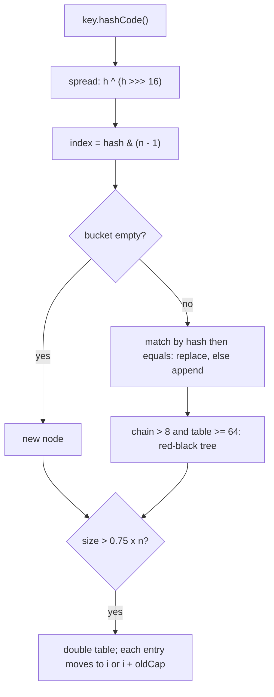

# Java Handbook — Interview Edition


The book you re-read the night before an interview: every chapter of the *Java Handbook* (Java 25 LTS) cut down to the facts, numbers, questions and traps that interviews actually test. Nothing here is new — each line comes from the full book; open the matching chapter there when you need the explanation, the runnable example or its real output.

## How to use this edition
- **One section per chapter (1–19)**, always in the same order: **Must-know** (one-line definitions) → **Key facts & numbers** (tables) → **Code to remember** (snippets you may be asked to write) → **In the interview** (likely questions with short answers) → **Gotchas** (mistake → correct idea) → **TL;DR**.
- **Night before:** read the *Top 25 questions* below, then every chapter's **In the interview** and **Gotchas**, then the *Last-minute checklist* at the end.
- **A week before:** read each chapter's **Must-know** and **Key facts**; say each **In the interview** answer out loud in 30 seconds; for anything shaky, go back to the full chapter.
- **Coding rounds:** Chapter 19's pattern table maps problem wording to one of twenty patterns; its trap table lists the Java-specific bugs that pass sample tests and fail hidden ones.
- Versions are marked where they matter: *(16)* means final in Java 16. "Preview" means not final — don't present it as standard.
- Chapter 20 of the full book (cheat sheets and glossary) is folded into the per-chapter tables here.

## Top 25 questions across the book
| # | Question | One-line answer | Ch |
|---|---|---|---|
| 1 | JDK vs JRE vs JVM? | JVM runs bytecode + manages memory; JRE = JVM + library; JDK = JRE + tools (`javac`) | 1 |
| 2 | Compiled or interpreted? | Both: `javac` → bytecode; JVM interprets, then JIT-compiles hot code (C1 → C2) using profiles | 1, 16 |
| 3 | Pass-by-value or by reference? | Always by value; for objects the value is a copy of the reference (mutate yes, rebind no) | 4 |
| 4 | Why is `String` immutable? | Thread-safe sharing, cached hash for map keys, pooling, security checks stay valid | 7 |
| 5 | `==` vs `equals`; why is `Integer 128 == 128` false? | `==` compares references; `valueOf` caches only −128…127 | 2, 7 |
| 6 | `equals`/`hashCode` contract? | Equal objects must have equal hashes; override both from the same fields, or hash collections lose entries | 6 |
| 7 | How to make a class immutable? | Final class, private final fields, no setters, validate, defensive copies in and out | 5 |
| 8 | Interface vs abstract class? | Interface = contract, many per class, no state; abstract class = shared state/constructors, one parent | 6 |
| 9 | Overloading vs overriding? | Compile-time by argument types vs run-time by object class; statics are hidden | 4, 6 |
| 10 | What are records and sealed types? | Records (16): final immutable data carriers; sealed (17): closed subtype set → exhaustive `switch` | 6 |
| 11 | Checked vs unchecked exceptions? | Checked: catch-or-declare, recoverable external failures; unchecked: programming errors | 8 |
| 12 | How does try-with-resources work? | Closes `AutoCloseable`s in reverse order before catch/finally; close failures become suppressed | 8 |
| 13 | Type erasure and PECS? | Type args removed after checking (no `new T()`, `T[]`, `List<int>`); producer `extends`, consumer `super` | 9 |
| 14 | How does `HashMap` work? | hash → spread → `& (n−1)`; chain → tree (>8, table ≥ 64); resize ×2 at 0.75 load; hash then `equals` | 10 |
| 15 | `ArrayList` vs `LinkedList`; LRU cache? | Array (O(1) get) vs nodes (O(1) ends); LRU = `LinkedHashMap(16, 0.75f, true)` + `removeEldestEntry` | 10 |
| 16 | `Comparable` vs `Comparator`? | Natural order in the class vs external composable orders; never subtract | 10 |
| 17 | `Optional` do's and don'ts? | Return type only; `map`/`flatMap` → `orElse*`/`orElseThrow`; not fields/params/collections | 11 |
| 18 | How do streams execute? | Lazy single-use pipeline; nothing runs until the terminal op; short-circuiting stops early | 12 |
| 19 | `volatile` vs `synchronized` vs atomics? | Visibility only / mutual exclusion + visibility / lock-free single-variable updates | 14 |
| 20 | How is `ConcurrentHashMap` thread-safe? | Lock-free reads, CAS into empty bins, lock a bin's first node; atomic `merge`/`compute`; no nulls | 14 |
| 21 | Why executors; how to configure a pool? | Reuse bounded threads, `Future`s, one shutdown point; bounded queue + rejection policy + named threads | 14 |
| 22 | What is happens-before? | JMM visibility rule: unlock→lock, volatile write→read, start, join, program order, transitive | 15 |
| 23 | Virtual threads — when do they help? | I/O-bound high concurrency (unmount on blocking); not CPU work; don't pool; `Semaphore` for limits | 15 |
| 24 | Deadlock — prevent and detect? | Global lock order, `tryLock` with timeout; thread dump (`jstack`, `jcmd Thread.print`) | 15 |
| 25 | JVM memory areas, GC, leaks? | Heap/stack/metaspace/code cache; reachability-based generational GC, G1 default; leaks = still-referenced objects | 16 |

## 1. Java and the JVM
What Java is, JDK vs JRE vs JVM, compile → bytecode → run, class loading and the JIT, GC overview, releases and LTS.

### Must-know
- **Java** — statically typed, object-oriented language + portable runtime (the JVM). Current LTS: **Java 25** (16 Sept 2025).
- **JVM** — loads, verifies and executes bytecode (interpreting + JIT-compiling) and manages memory. **HotSpot** is the JVM in OpenJDK builds.
- **JRE** — JVM + standard library (enough to *run*). **JDK** — JRE + tools (`javac`, `jshell`, `jar`, `javadoc`, `jlink`). Developers install a JDK.
- **Bytecode** — the portable `.class` format; the *bytecode* is platform-independent, each OS/CPU needs its own JVM.
- **OpenJDK** — the open-source project nearly every JDK (Oracle, Temurin, Corretto, Zulu…) is built from; same code, different support/licensing.
- **Jakarta EE** — enterprise specs (servlets, JPA, CDI) on top of Java SE; formerly Java EE, moved to Eclipse in 2017.
- **Tiered compilation** — interpreter (tier 0) → **C1** (tiers 1–3, fast compile + profiling) → **C2** (tier 4, aggressive optimisation using the profile).
- **Deoptimization** — discard compiled code whose speculative assumption became false; fall back to the interpreter.
- **Stack** — per-thread frames (locals, parameters; only *references* to objects). **Heap** — shared, all objects/arrays, freed by the GC.
- **Metaspace** — class metadata in native memory. **Code cache** — JIT-compiled machine code.
- **Reachability** — GC frees what is unreachable from GC roots (thread stacks, static fields, JNI handles); cycles are collected (no reference counting).
- **Preview feature** — finished but not final; opt in with `--enable-preview` on both `javac` and `java`; may change or be withdrawn (string templates were).
- **`--release N`** — compile against Java N's API safely (libraries: the oldest Java you support).

### Key facts & numbers
| Collector | Flag | Good for |
|---|---|---|
| **G1** (default since Java 9) | `-XX:+UseG1GC` | General servers; region-based, pause goal 200 ms |
| **ZGC** | `-XX:+UseZGC` | Large heaps, latency; generational only since JDK 24; pauses typically < 1 ms |
| **Shenandoah** | `-XX:+UseShenandoahGC` | Low latency (not in Oracle JDK); generational mode product in 25 |
| **Parallel** | `-XX:+UseParallelGC` | Throughput / batch |
| **Serial** | `-XX:+UseSerialGC` | Tiny heaps, small containers |
| **Epsilon** | experimental | Never collects — tests, very short jobs |

| Java | 8 | 11 | 17 | 21 | 25 | 26 |
|---|---|---|---|---|---|---|
| Class-file major version | 52 | 55 | 61 | 65 | **69** | 70 |

| Approach | Start-up | Peak speed |
|---|---|---|
| JIT (HotSpot) | Slower (warm-up) | Very high (live profiles) |
| AOT cache (JDK 24+) `-XX:AOTCache` | Faster | Same as JIT |
| GraalVM native image | Very fast | Good, often a bit lower; one binary per OS/CPU |

- Release cadence: every **March and September** since Java 10 (2018); **LTS every two years**: 8, 11, 17, 21, 25.
- Milestones: 1996 JDK 1.0 · 2004 Java 5 (generics, enums, autoboxing, annotations, varargs) · 2014 Java 8 (lambdas, streams, `java.time`) · 2017 Java 9 (JPMS, `jshell`) · 2021 Java 17 LTS · 2023 Java 21 LTS (virtual threads, pattern `switch`, record patterns) · 2025 Java 25 LTS.
- Feature stages: **incubator** (`jdk.incubator.*`, e.g. Vector API) → **preview** → **final**; or **withdrawn**.

### Code to remember
```bash
javac -d out src/ch01/hello/HelloWorld.java     # source → bytecode
java -cp out ch01.hello.HelloWorld              # fully qualified name, not the file name
java HelloWorld.java                            # source launch (multi-file since 22)
javap -c -cp out ch01.hello.HelloWorld          # disassemble bytecode
```

### In the interview
**Q:** JDK vs JRE vs JVM? **A:** JVM executes bytecode and manages memory; JRE = JVM + standard library; JDK = JRE + development tools. Install a JDK; ship a `jlink`-trimmed runtime.

**Q:** Is Java compiled or interpreted? **A:** Both: `javac` compiles to bytecode ahead of time; the JVM interprets it and JIT-compiles hot methods using profiles — so services get faster after warm-up.

**Q:** How does GC decide what to free? **A:** Reachability from GC roots, not reference counting, so cycles are freed. Most collectors are generational because most objects die young.

**Q:** When would you pick ZGC? **A:** Large heaps or strict latency targets, where sub-millisecond pauses matter more than a little throughput.

**Q:** Why is a timing-loop microbenchmark misleading? **A:** It mixes interpreted/C1/C2 phases and the JIT may eliminate "useless" work; use JMH.

**Q:** What is an LTS? **A:** A release vendors support for years (8, 11, 17, 21, 25); companies standardise on them instead of upgrading every six months.

**Q:** Name Java 21 features. **A:** Virtual threads, pattern matching for `switch`, record patterns, sequenced collections.

### Gotchas
- "Java can't leak memory" → a static, ever-growing `Map` keeps everything reachable = leak.
- `System.gc()` frees memory → it is only a request and usually hurts.
- `finalize()` for cleanup → deprecated for removal (JEP 421, Java 18); use try-with-resources.
- `java Hello.class` → pass the class **name**; packaged classes need the fully qualified name + `-cp`.
- `-Xmx` above the container limit → the JVM reads container limits; let it or size explicitly.
- OpenJDK is "lower quality" than Oracle JDK → same source.
- Compact source file with a `package` line → not allowed; instance `main` was preview until 25.

### TL;DR
`javac` → bytecode → JVM loads lazily, verifies, interprets, then JIT-compiles hot code (C1 → C2). Stack = frames, heap = objects, GC frees the unreachable; default G1, ZGC for low latency.

## 2. Basics: Types, Variables and Operators
The eight primitives, references and `null`, `var`, casting and promotion, operators, overflow, floating point, strings.

### Must-know
- **Primitives** — `byte short int long` (8/16/32/64-bit signed), `float double` (IEEE 754), `char` (16-bit unsigned UTF-16 unit), `boolean`. Everything else is a **reference** (or `null`).
- **Locals** have no default — must be assigned before use; **fields** default to `0`/`0.0`/`false`/`'\u0000'`/`null`.
- **`final`** — assign once; the referenced object can still change.
- **`var`** (Java 10) — local type inference; the type is still static and fixed. Not for fields, parameters, return types, `var x;`, `var x = null;`, `var a = {1,2};`.
- **Widening** is automatic (but `int/long → float` and `long → double` can lose precision); **narrowing** needs a cast and truncates/wraps.
- **Numeric promotion** — `byte/short/char` become `int` in arithmetic; **compound assignment** (`+=`) hides a cast.
- **Short-circuit** — `&&`/`||` skip the right side; `&`/`|` always evaluate both.
- **`==` on references** compares identity; use `equals` for content.
- **Overflow** wraps silently in two's complement (`MAX_VALUE + 1 == MIN_VALUE`).
- **String** — immutable and pooled; **text blocks** `"""…"""` (Java 15) strip incidental indentation.

### Key facts & numbers
| Type | Size | Range | Default |
|---|---|---|---|
| `byte` | 8 bits | −128 … 127 | `0` |
| `short` | 16 | −32 768 … 32 767 | `0` |
| `int` | 32 | ≈ ±2.1 billion (−2³¹ … 2³¹−1) | `0` |
| `long` | 64 | ≈ ±9.2 × 10¹⁸ | `0L` |
| `float` | 32 | ~6–7 significant digits | `0.0f` |
| `double` | 64 | ~15–16 significant digits | `0.0` |
| `char` | 16 | 0 … 65 535 | `'\u0000'` |
| `boolean` | unspecified | `true`/`false` | `false` |

| Rule | Example |
|---|---|
| Integer `/` truncates toward zero | `-17 / 5 == -3` |
| `%` takes the sign of the dividend | `-17 % 5 == -2`; use `Math.floorMod` for non-negative |
| Integer `/ 0` | `ArithmeticException` |
| Floating `/ 0` | `Infinity`, `-Infinity` or `NaN` |
| `(int)` cast | truncates toward zero: `(int) -3.99 == -3` |
| `(byte) 200` | `-56` (low 8 bits) |
| Octal literal | `010 == 8` |
| `'a' + 'b'` | `195` (numeric, not string) |
| `>>` vs `>>>` | arithmetic (copies sign) vs logical (fills 0) |
| `~x` | `-x - 1` |
| `1 + 2 + "3" + 4 + 5` | `"3345"` (adds until the first `String`) |
| `x & 1 == 0` | compile error — write `(x & 1) == 0` |

- **Precedence** (high → low): postfix → unary/cast → `* / %` → `+ -` → shifts → relational/`instanceof` → `== !=` → `&` → `^` → `|` → `&&` → `||` → `?:` → assignment/lambda (right-assoc).
- **Overflow tools**: widen early (`(long) a * b`), `Math.addExact/multiplyExact/toIntExact/absExact` (throw), `low + (high - low) / 2`, `BigInteger`.
- **NaN**: test with `Double.isNaN(x)` — never `x == Double.NaN` (NaN ≠ itself). `-0.0 == 0.0` is true but `Double.equals`/`compare` tell them apart.
- **Input**: `Scanner` (easy, slow), `IO.readln` (Java 25), `BufferedReader` (fast, returns `null` at EOF), `System.console()` (passwords; may be `null`).

### Code to remember
```java
short s = 1;
// s = s + 1;        // compile error: int → short
s += 1;              // OK: implicit cast
int mid = low + (high - low) / 2;          // no overflow
long total = (long) a * b;                 // widen before multiplying
System.out.println(0.1 + 0.2);             // 0.30000000000000004
BigDecimal x = new BigDecimal("0.1");      // not new BigDecimal(0.1)
```

### In the interview
**Q:** Why does `s = s + 1` fail for a `short` but `s += 1` compile? **A:** `s + 1` is promoted to `int` and needs a cast back; compound assignment includes that cast implicitly.

**Q:** What happens on `int` overflow? **A:** It wraps silently; use `long`, `Math.*Exact` (throws `ArithmeticException`) or `BigInteger`.

**Q:** Why is `0.1 + 0.2 != 0.3`? **A:** Neither is exactly representable in binary; compare with a tolerance or use `BigDecimal` for money.

**Q:** Why not `new BigDecimal(0.1)`? **A:** It captures the already-inexact double; use `new BigDecimal("0.1")` or `BigDecimal.valueOf(0.1)`.

**Q:** Is `long → double` safe? **A:** Magnitude yes, precision no — a double has 53 mantissa bits, a long 64.

**Q:** Primitive vs reference? **A:** A primitive holds the value; a reference holds a pointer or `null`; `==` compares values vs identity.

### Gotchas
- `long big = 9000000000;` → needs `L`; `float f = 1.5;` → needs `f`.
- `7 / 2 == 3` → write `7 / 2.0`; `(double)(7 / 2)` is `3.0` (cast too late).
- `input == "yes"` → `"yes".equals(input)` (null-safe).
- `s.trim();` alone does nothing → strings are immutable; assign the result.
- `"Total: " + a + b` → `"Total: 12"`; parenthesise `(a + b)`.
- `var list = new ArrayList<>()` → `ArrayList<Object>`; `var x = 1` is `int`, not `long`.
- Locals cannot shadow locals: `int x; { int x; }` is a compile error.
- `Scanner.nextInt()` then `nextLine()` → returns the rest of the current line (often empty).

### TL;DR
Eight primitives, everything else a reference. Know promotion, truncating `/`, dividend-signed `%`, silent overflow, approximate doubles (`BigDecimal` for money) and `equals` vs `==`.

## 3. Control Flow
`if`, classic and arrow `switch`, switch expressions, pattern matching (`instanceof`, `switch`, records), loops and their pitfalls.

### Must-know
- **Dangling else** — an `else` binds to the nearest unmatched `if`; Java ignores indentation → always use braces.
- **Fall-through** — colon-style `case X:` runs into the next labels until `break`. **Arrow labels** `case X ->` (Java 14) never fall through.
- **Switch expression** — produces a value; inside a block use **`yield`** (not `return`); must be **exhaustive**.
- **`instanceof` pattern** (Java 16) — `if (o instanceof String s)` tests, casts and binds; `s` is in scope only where the match is certain (`&&`, negated early exit), not with `||`.
- **Pattern `switch`** (Java 21) — type patterns, **`when` guards**, **`case null`**, **dominance** (specific before general, else compile error), exhaustiveness.
- **Sealed + records + pattern switch** = algebraic data types: no `default` needed, adding a subtype breaks every incomplete switch at compile time.
- **Record patterns** (Java 21) — `case Point(int x, var y)` deconstructs, can nest; **unnamed `_`** (Java 22) ignores parts.
- **Loops** — `while` (0+ times), `do-while` (1+ times), `for` (counting), enhanced `for` (every element, no index; compiled to an `Iterator` for `Iterable`s).
- **Labels** — `break outer;` / `continue outer;` target an enclosing loop; Java has no `goto` (reserved word).

### Key facts & numbers
| Selector type | Allowed since |
|---|---|
| `char byte short int` + wrappers | 1.0 / 5 |
| `enum` | 5 (qualified `Day.SAT` labels since 21) |
| `String` (compared with `equals` after a `hashCode` jump) | 7 |
| Any reference type with patterns | 21 |
| `long float double boolean` | **not allowed** (primitive patterns still preview, JEP 507) |

| Situation | Best choice |
|---|---|
| One condition, two values | ternary |
| Ranges / unrelated conditions | `if`/`else if` |
| One variable vs many constants | arrow `switch` |
| Compute a value from many cases | switch expression |
| Branch on object type/shape | pattern `switch` |
| Behaviour per subtype that keeps growing | polymorphism |

- A `null` selector throws `NullPointerException` unless there is `case null` (21+).

### Code to remember
```java
sealed interface Shape permits Circle, Rect {}
record Circle(double r) implements Shape {}
record Rect(double w, double h) implements Shape {}

static double area(Shape s) {
    return switch (s) {                      // exhaustive: no default
        case Circle c -> Math.PI * c.r() * c.r();
        case Rect(double w, double h) when w == h -> w * w;
        case Rect(double w, double h) -> w * h;
    };
}
```

### In the interview
**Q:** What is fall-through? **A:** In colon-style `switch`, execution continues into following labels until `break`; arrow labels never fall through.

**Q:** What does pattern `switch` give over `instanceof` chains? **A:** Test + cast + bind in one label, `when` guards, explicit `null`, and compile-time exhaustiveness and dominance checks — powerful with sealed types and records.

**Q:** Why does label order matter? **A:** The first match wins; a label dominated by an earlier one is a compile error.

**Q:** `while` vs `do-while`? **A:** `while` may run zero times; `do-while` always runs once — "prompt until valid".

**Q:** Can you switch on a `String`? **A:** Yes (Java 7), compared with `equals`.

### Gotchas
- `if (flag = true)` → assignment, always true; write `if (flag)`.
- Unbraced `if` + a second indented line → the second line always runs.
- `default` in an enum switch expression "just in case" → hides the exhaustiveness check for new constants.
- Missing `;` after a switch expression used in an assignment (`};`).
- Removing from an `ArrayList` in a for-each → `ConcurrentModificationException` (or silently wrong when removing the second-to-last) → `Iterator.remove()` / `removeIf`.
- Floating loop counter (`d != 1.0`) → loop on an `int`.
- Assigning the for-each variable → changes only a copy.
- `for (int i = 0; i <= Integer.MAX_VALUE; i++)` → never ends (wraps).
- `list.get(i)` in a loop over a `LinkedList` → O(n²).

### TL;DR
Arrow labels and switch expressions (exhaustive, `yield`) replace fall-through; pattern `switch` + sealed records give compiler-checked type dispatch. Watch off-by-one and modifying a collection while iterating.

## 4. Methods and Arrays
Method anatomy, pass-by-value, overloading, varargs, recursion, arrays and `java.util.Arrays`, `main`.

### Must-know
- **Signature** — name + parameter types (not return type, names, modifiers or `throws`).
- **Pass-by-value, always** — primitives copy the value; objects copy the *reference*: mutation through it is shared, reassignment is local. A `swap(a, b)` can't work.
- **Overload resolution** (compile time) — phase 1 exact/widening → phase 2 boxing → phase 3 varargs, then most specific.
- **Varargs** `T... x` — an array parameter; last parameter only, one per method, empty array when no args; `f(int[])` and `f(int...)` are the same signature.
- **Recursion** — base case + smaller call; one stack frame per call; **no tail-call optimisation** → deep recursion throws `StackOverflowError`.
- **Arrays** — fixed size, 0-based, bounds-checked objects with a `length` *field*, default-filled; **covariant** (runtime `ArrayStoreException`).
- **2-D arrays** — arrays of row arrays; can be **jagged**; iterate row-major.
- **`Arrays.asList`** — fixed-size list *backed by* the array: `set` writes through, `add`/`remove` throw.
- **`main`** — classic `public static void main(String[] args)`; `args` is never `null`. **Java 25**: instance/no-arg `main` and compact source files with `IO.println`.

### Key facts & numbers
| Copy technique | Result |
|---|---|
| `b = a` | same array, no copy |
| `a.clone()` | new array, **shallow** |
| `Arrays.copyOf(a, n)` | truncates or pads with defaults |
| `Arrays.copyOfRange(a, from, to)` | `to` exclusive |
| `System.arraycopy(src, sp, dst, dp, len)` | into an existing array; handles overlap |

| `Arrays` method | Note |
|---|---|
| `sort` primitives | Dual-Pivot Quicksort, O(n log n) typical, not stable (irrelevant for primitives) |
| `sort` objects | TimSort — **stable**, O(n log n) worst case |
| `binarySearch` | sorted input only; absent → `-(insertionPoint) - 1` |
| `toString` / `deepToString` | readable; `println(a)` prints `[I@…` |
| `equals` / `deepEquals` | content (array `.equals` is identity) |
| `fill`, `setAll(i -> …)` | fill with one value / from index |
| `compare`, `mismatch` (9) | lexicographic / first differing index |

| Array | `ArrayList` |
|---|---|
| Fixed size, primitives directly, covariant | Grows, boxes primitives, invariant generics, content `equals` |

- Naive Fibonacci O(φⁿ) ≈ O(1.618ⁿ) (quoted as O(2ⁿ)); memoized O(n) time and space.

### Code to remember
```java
static void swap(int[] a, int i, int j) {    // works: mutates the shared array
    int t = a[i]; a[i] = a[j]; a[j] = t;
}
record MinMax(int min, int max) {}           // return two values
static int min(int first, int... rest) { … } // enforce at least one argument
for (int[] row : grid) Arrays.fill(row, 0); // not Arrays.fill(grid, 0)
```

### In the interview
**Q:** Is Java pass-by-reference for objects? **A:** No — strictly pass-by-value; for objects the value is a reference, so a method can mutate the object but reassigning the parameter never affects the caller.

**Q:** Is `String` special? **A:** No; it only looks different because it is immutable.

**Q:** How do you return two values? **A:** A small record, e.g. `record MinMax(int min, int max)`.

**Q:** How is an overloaded call chosen? **A:** At compile time: exact/widening, then boxing, then varargs, then the most specific.

**Q:** Recursion risks? **A:** Stack frame per call, no TCO → `StackOverflowError`; use memoization for overlapping subproblems or an explicit `ArrayDeque` stack for deep inputs; raising `-Xss` is a last resort.

### Gotchas
- Different return type only → not an overload (compile error).
- `list.remove(1)` on `List<Integer>` removes **index** 1 → `list.remove(Integer.valueOf(1))`.
- `f(null)` with `f(String)` and `f(Integer)` → ambiguous; cast.
- `Arrays.asList(intArray)` → `List<int[]>` of one element → `Arrays.stream(a).boxed().toList()`.
- `Arrays.fill(grid, 0)` on `int[][]` → `ArrayStoreException`.
- `grid.length` is the row count; columns are `grid[r].length`.
- Return empty arrays/lists, never `null` (*Effective Java* Item 54).
- `name.toUpperCase();` without assignment does nothing.
- Calling an instance method from `static main` → "non-static method cannot be referenced from a static context".

### TL;DR
Everything is passed by value; overloads are chosen at compile time; arrays are fixed-size, covariant, identity-compared objects — use the `Arrays` toolbox to print, compare, sort and copy.

## 5. OOP: Classes and Objects
Classes and objects, `this`, constructors, packages, `static`, access modifiers, encapsulation, `final`, immutability, initialisation order.

### Must-know
- **Class vs object** — blueprint/type vs instance on the heap; variables hold **references**; `null` = no object (helpful NPE messages since Java 14).
- **`this`** — the current object: reach shadowed fields (`this.size = size`), pass/return yourself (fluent APIs), chain constructors `this(...)`.
- **Constructor** — named like the class, no return type, **not inherited**; the **default no-arg constructor** exists only if you write none; every constructor first calls a `super(...)` (explicit or implicit).
- **Flexible constructor bodies** (Java 25) — validation and computation *before* `this(...)`/`super(...)`, as long as you don't touch `this` (you may assign this class's uninitialised fields).
- **Static** — one per class; no `this`; static methods are **hidden**, not overridden; static init runs **once, lazily**, on first active use (instantiation, static method call, non-constant static field access).
- **Packages** — namespace + folder + access boundary; `java.lang` is auto-imported; wildcard imports do **not** include subpackages; `import module java.base;` (Java 25, JEP 511).
- **Encapsulation** — private state + methods that protect invariants; don't leak mutable internals through getters.
- **`final`** — variable: assign once; method: no override; class: no subclass. **`final` ≠ immutable.**
- **Immutable class** — `final` class, `private final` fields, no setters, validate in the constructor, **defensive copies** of mutable inputs and outputs; "changes" return new objects.
- **Escaping `this`** — registering a listener or starting a thread with `this` in a constructor exposes a half-built object.

### Key facts & numbers
| Modifier | Class | Package | Subclass (other pkg) | World |
|---|:-:|:-:|:-:|:-:|
| `private` | ✓ | | | |
| *(none)* package-private | ✓ | ✓ | | |
| `protected` | ✓ | ✓ | ✓ | |
| `public` | ✓ | ✓ | ✓ | ✓ |

| Way to create objects | Best for |
|---|---|
| Telescoping constructors | 1–3 optional params |
| Static factory (`List.of`, `Integer.valueOf`) | Names, caching, returning subtypes (EJ Item 1) |
| Builder | Many optional params (EJ Item 2) |
| Record | Plain data |

**Initialisation order:** parent statics → child statics (once, source order) → per object: fields get defaults → parent field initialisers/instance blocks → parent constructor body → child field initialisers/blocks → child constructor body.

### Code to remember
```java
public final class Money {                       // immutable
    private final long cents;
    private final List<String> tags;
    public Money(long cents, List<String> tags) {
        if (cents < 0) throw new IllegalArgumentException("negative");
        this.cents = cents;
        this.tags = List.copyOf(tags);           // defensive copy in
    }
    public Money plus(Money o) { return new Money(cents + o.cents, tags); }
    public List<String> tags() { return tags; }  // already unmodifiable
}
```

### In the interview
**Q:** What does a constructor do and what if you declare none? **A:** Puts a new object in a valid state; with none, Java adds a no-arg default; declare any and it disappears. Chain with `this(...)` so validation lives in one place.

**Q:** Can a constructor be private? Inherited? **A:** Private yes (singletons, factory-only and utility classes); never inherited.

**Q:** What is static? **A:** Belongs to the class: one copy, no `this`, hidden not overridden, initialised once on first active use; use for constants, pure utilities, factories — avoid mutable static state.

**Q:** How do you make a class immutable? **A:** Final class, private final fields, no setters, validate in the constructor, copy mutable things in and out. Gives thread safety, safe sharing/caching, safe map keys.

**Q:** Why must an immutable class be final? **A:** A subclass could add mutable state or override methods, breaking the guarantee for code holding the parent type.

**Q:** Is a record deeply immutable? **A:** No — copy mutable components (e.g. `List.copyOf`) in the compact constructor.

### Gotchas
- `name = name` in a constructor → assigns the parameter to itself; field stays `null`.
- `public void Pizza() {}` → a method, not a constructor.
- Adding an argument constructor breaks `new Pizza()`.
- Calling overridable methods from a constructor → the child override runs before the child's fields are initialised (EJ Item 19).
- `Collections.unmodifiableList(list)` → a view the owner can still change; `List.copyOf` copies.
- Returning an array field → return `array.clone()`.
- `import java.util.*` + `java.sql.*` then `Date` → ambiguous.
- Static counter `issued++` → race condition across threads (`AtomicInteger`).
- Failure in a static block → `ExceptionInInitializerError`, then `NoClassDefFoundError` on later use.

### TL;DR
Constructors initialise (not inherited), `static` is per class, fields private, members as narrow as possible. Immutable = final class + private final fields + no setters + defensive copies; `final` alone is not immutability.

## 6. OOP: Inheritance, Interfaces and More
Inheritance, overriding, polymorphism, abstract classes, interfaces, sealed types, records, enums, nested classes, `equals`/`hashCode`.

### Must-know
- **Inheritance** — `extends`, one parent, root `Object`; is-a. **Prefer composition** (has-a) — the **fragile base class** problem (EJ Items 18–19: design for inheritance or make classes `final`).
- **Overriding** — same signature, covariant return, same-or-wider access, no new/broader checked exceptions, not `final`/`static`/`private`; always **`@Override`**.
- **Dynamic dispatch** — declared type decides what you may call; runtime type decides what runs. **Static methods and fields** resolve by declared type (**hiding**).
- **Upcast** free; **downcast** checked at runtime (`ClassCastException`) → use `instanceof` patterns, or better, override.
- **Abstract class** — can't instantiate; state + constructors + abstract "holes" (template method, skeletal implementations).
- **Interface** — contract; abstract + constants (`public static final`) + `default` & `static` (8) + `private` (9); no instance state; many per class. Interface static methods are **not inherited**.
- **Default-method conflict** — class wins → more specific interface wins → otherwise override and call `X.super.m()`.
- **Sealed** (17) — `sealed … permits A, B`; subtypes must be `final`, `sealed` or `non-sealed`; enables exhaustive `switch`.
- **Record** (16) — final, immutable data carrier: private final fields, canonical constructor, accessors `x()` (not `getX()`), component-based `equals`/`hashCode`/`toString`. **Compact constructor** for validation/copies. Can implement interfaces; can't extend or add instance fields.
- **Enum** — fixed singleton instances; fields, private constructors, methods, per-constant bodies; `EnumSet`/`EnumMap`.
- **Nested** — static nested (default choice); **inner** holds a hidden outer reference (`outer.new Inner()`, `Outer.this`) → leak risk (EJ Item 24); local/anonymous classes capture effectively final locals.
- **`equals` contract** — reflexive, symmetric, transitive, consistent, `x.equals(null) == false`. **Equal objects must have equal hash codes.**

### Key facts & numbers
| | Abstract class | Interface |
|---|---|---|
| Instance state / constructors | Yes | No |
| How many per class | One | Many |
| Method access | Any | public (private helpers since 9) |
| Use for | Shared state/code | Capability/contract |

| Need | Reach for |
|---|---|
| Capability for unrelated classes | Interface |
| Contract + shared state | Abstract class |
| Closed set of variants with data | Sealed interface + records |
| Fixed set of instances | Enum |
| Immutable data, equal = interchangeable | Record |
| Mutable object with identity | Class (`final` unless designed for extension) |

| Enum method | Note |
|---|---|
| `values()` | new array each call |
| `valueOf(s)` | exact name or `IllegalArgumentException` |
| `name()` | persist this |
| `ordinal()` | never persist (EJ Item 35) |

| Anonymous class | Lambda |
|---|---|
| Any interface/abstract class, can have fields, `this` = itself | Functional interface only, no state, `this` = enclosing instance |

### Code to remember
```java
@Override public boolean equals(Object o) {
    if (this == o) return true;
    if (!(o instanceof Book b)) return false;      // class is final
    return year == b.year && Objects.equals(isbn, b.isbn);
}
@Override public int hashCode() { return Objects.hash(isbn, year); }

record Range(int start, int end) {
    Range { if (start > end) throw new IllegalArgumentException(); } // compact
}
```

### In the interview
**Q:** Overloading vs overriding? **A:** Overloading: same name, different parameters, chosen at compile time by argument types. Overriding: same signature in a subclass, chosen at runtime by object type.

**Q:** Can you override a private or static method? **A:** Private — not inherited, so a same-named method is unrelated. Static — hidden, resolved by declared type.

**Q:** Abstract class or interface? **A:** Start with an interface for the abstraction clients depend on; add an abstract base only if implementations share real state or code.

**Q:** Why multiple interface inheritance but not class? **A:** Classes carry state and constructors (diamond ambiguity); interfaces have no instance state and default conflicts have explicit rules.

**Q:** Why override `equals` and `hashCode` together? **A:** Hash collections bucket by `hashCode` first; equal objects with different hashes are never found.

**Q:** What if a key's hash changes after insertion? **A:** Lookups probe the wrong bucket; the entry is effectively lost.

**Q:** Why 31 in hash codes? **A:** Odd prime that spreads well; `31 * h == (h << 5) - h`.

**Q:** What is a record, and can it be a JPA entity? **A:** Final immutable data carrier with generated members; not with standard JPA (needs no-arg constructor, mutable proxies) — use records as DTOs/projections.

**Q:** When is sealed a bad fit? **A:** Extension points for other teams/plugins, or variants added often.

### Gotchas
- `equals(Book b)` → an overload; `HashSet` never calls it. Use `@Override`.
- Mutable fields in `equals`/`hashCode` of a map key → unfindable after mutation.
- `double` fields compared with `==` → use `Double.compare` (NaN, −0.0).
- `instanceof` vs `getClass()` in `equals` → `instanceof` + `final` class (records do the equivalent); `getClass()` breaks Liskov.
- Subclass constructor without `super(args)` when the parent has no no-arg constructor → compile error.
- Assigning `this.x = x` in a record's compact constructor → compile error; assign the parameter.
- Arrays in records → identity `equals`, breaks value equality.
- Inner (non-static) listener outliving its outer → memory leak.
- Constant interfaces → use a final class or enum (EJ Item 22).

### TL;DR
Override with `@Override`, dispatch is on runtime type (statics/fields on declared type). Interfaces for contracts, abstract classes for shared state, sealed + records for closed data, enums for fixed instances; always override `equals` and `hashCode` together.

## 7. Core APIs: Strings, Numbers, Dates and Randomness
`String` and the pool, `StringBuilder`, formatting, `Math`, wrappers and autoboxing, `BigDecimal`, `java.time`, random numbers.

### Must-know
- **`String` is immutable and `final`** — thread-safe, caches its `hashCode` (good map key), keeps security checks valid, enables the **string pool** (on the heap since Java 7, GC'd).
- **Pool** — literals and compile-time constants are pooled; runtime strings aren't → `==` may be true by accident; always `equals`.
- **`StringBuilder`** — mutable, amortised O(1) appends, **not** thread-safe, no value `equals`; `StringBuffer` = synchronized legacy. `+=` in a loop is O(n²); a single `+` expression is fine.
- **Autoboxing** calls `valueOf`, which caches **−128…127** → `==` on `Integer`s is true for 127, false for 128. Unboxing `null` → NPE.
- **`BigDecimal`** — build from `String`, immutable (assign results), `divide` needs scale + `RoundingMode`, compare with **`compareTo`** (`equals` checks scale), **`HALF_EVEN`** (banker's rounding) for money.
- **`java.time`** — immutable and thread-safe. `Instant` = moment (UTC), `LocalDate` = date, `ZonedDateTime` = local time in a region (DST rules), `OffsetDateTime` = fixed offset (APIs, DBs). **`Duration`** (exact seconds) ≠ **`Period`** (calendar units) across DST. Inject a **`Clock`** for testability.
- **DST** — gaps shift forward; overlaps pick the earlier offset.
- **Randomness** — seeded `Random` for reproducible tests, `ThreadLocalRandom` in concurrent code, **`SecureRandom`** for tokens/passwords/session IDs; upper bounds exclusive.

### Key facts & numbers
| Job | Method | Note |
|---|---|---|
| Emptiness | `isEmpty()`, `isBlank()` (11) | blank = whitespace-only too |
| Whitespace | `trim()` (≤ U+0020) vs `strip()` (11, Unicode) | prefer `strip` |
| Search | `indexOf` | returns **−1** if absent |
| Replace | `replace` literal vs `replaceAll` **regex** | |
| Split | `split(regex)`, `split(",", -1)` keeps trailing empties | `split(".")` needs escaping |
| New in 11 | `repeat`, `lines`, `strip*`, `isBlank` | |
| `compareTo` | <0, 0, >0 (not necessarily ±1) | case-sensitive |
| `length()` | counts UTF-16 units | not code points |

| `Math` | Behaviour |
|---|---|
| `round` | → `long` (int for float), ties toward +∞ (`-2.5 → -2`) |
| `floor`/`ceil`/`rint` | → `double`; `rint` ties to even |
| `floorDiv`/`floorMod` (8), `ceilDiv` (18) | round toward −∞/+∞ |
| `clamp` (21) | limit to range |
| `*Exact` (`powExact` 25) | throw `ArithmeticException` on overflow |

| | `double` | `long` cents | `BigDecimal` |
|---|---|---|---|
| Exact decimals | No | Yes (2 places) | Yes |
| Speed | Fastest | Fast | Slow, allocates |

- `valueOf` caches −128…127 for `Integer`, `Short`, `Byte`, `Long`; `Character` ≤ 127; both `Boolean`s.
- `int` = 4 bytes; `Integer` ≈ 16 bytes + reference.
- `StringBuilder` default capacity 16 (or 16 + initial length).
- `new String("hi")` creates up to two objects (pooled literal + heap copy).
- Date patterns: `uuuu`/`yyyy` year, **`YYYY` = week-based year** (2025-12-29 → 2026!), `MM` month, `mm` minute, `HH` 0–23, `hh` 1–12, `dd` day, `DD` day-of-year.
- Timing code: `System.nanoTime()` (monotonic), not `Instant.now()`.

### Code to remember
```java
BigDecimal price = new BigDecimal("19.99");
BigDecimal each  = price.divide(new BigDecimal("3"), 2, RoundingMode.HALF_EVEN);
boolean same = new BigDecimal("1.0").compareTo(new BigDecimal("1.00")) == 0; // true
Instant now = Instant.now(clock);                                  // store UTC
ZonedDateTime local = now.atZone(ZoneId.of("Asia/Kolkata"));       // display
int die = ThreadLocalRandom.current().nextInt(1, 7);               // 1..6
```

### In the interview
**Q:** Why is `String` immutable/final? **A:** Thread safety, cached hash code for map keys, security checks that can't be subverted, and pooling; `final` so no subclass can break it.

**Q:** `StringBuilder` vs `StringBuffer` vs `+`? **A:** Builder for loops (amortised O(1)), Buffer is synchronized legacy, single `+` expressions are compiler-optimised.

**Q:** Why is `Integer 127 == 127` true but `128 == 128` false? **A:** `valueOf` caches −128…127; `==` compares references. Use `equals`.

**Q:** How do you represent money? **A:** `BigDecimal` from strings (or long minor units), explicit scale and `HALF_EVEN`, compare with `compareTo`.

**Q:** Why is `new BigDecimal("1.0").equals(new BigDecimal("1.00"))` false? **A:** `equals` includes scale; `compareTo` returns 0.

**Q:** How do you store timestamps? **A:** `Instant` in UTC; convert to `ZonedDateTime` with the user's `ZoneId` only for display; `LocalDate` for dates.

**Q:** `ZonedDateTime` vs `OffsetDateTime`? **A:** Zoned knows the region's DST rules; Offset is a fixed offset — better for serialising a moment.

**Q:** Why was `SimpleDateFormat` a problem? **A:** Mutable, not thread-safe; a shared static instance corrupted results. `DateTimeFormatter` is immutable.

### Gotchas
- `"TITLE".toLowerCase()` in Turkish locale → `toLowerCase(Locale.ROOT)` for identifiers.
- `sb1.equals(sb2)` → identity; `new StringBuilder('x')` → capacity 120, empty.
- `Long.equals(Integer)` always false; `map.get(42)` on `Map<Long,…>` → `null` (use `42L`).
- Mixed `Integer`/`int` ternary with a `null` → NPE on unboxing.
- `synchronized (someInteger)` → shared cached instances.
- `Boolean.parseBoolean("YES")` → `false`.
- `2.0` vs `2.00` `BigDecimal` → different `HashSet` keys, same `TreeSet` key.
- Unbounded `divide` (1/3) → `ArithmeticException`.
- `LocalDateTime` for event timestamps → no zone, not a moment.
- `"EST"`/`"IST"` abbreviations → ambiguous; use region IDs.
- `Math.abs(r.nextInt()) % n` → biased and can be negative (`MIN_VALUE`); use `nextInt(n)`.

### TL;DR
Strings immutable (`equals`, `StringBuilder` in loops), wrappers cache −128…127 (`equals`, beware null unboxing), `BigDecimal` from strings with `compareTo`/`HALF_EVEN`, `Instant` to store and `ZonedDateTime` to display, `SecureRandom` for secrets.

## 8. Exceptions
The `Throwable` hierarchy, checked vs unchecked, `try`/`catch`/`finally`, try-with-resources, custom exceptions, chaining, best practices.

### Must-know
- **Hierarchy** — `Throwable` → `Error` (JVM problems; don't catch) and `Exception`. **Unchecked** = `RuntimeException` + `Error` (and subclasses); every other `Exception` is **checked**.
- **Handle or declare** — checked exceptions must be caught or listed in `throws`; overrides may not throw new/broader checked exceptions.
- **Propagation** — `throw` stops the block; the stack unwinds to the first matching `catch`; uncaught → the thread dies with a stack trace.
- **`finally`** always runs (except `System.exit`, JVM crash, infinite loop); a return value is already evaluated before `finally` runs.
- **Catch rules** — first match wins; subclass before superclass; multi-catch types must be unrelated and the variable is implicitly `final`; unnamed `catch (X _)` (22).
- **try-with-resources** — any `AutoCloseable`; closed in **reverse order**, **before** `catch`/`finally`; if body and `close` both throw, the body's exception wins and close failures become **suppressed** (`getSuppressed()`). `try (existingVar)` since Java 9.
- **Chaining** — always pass the cause: `new ServiceException("msg", e)`; translate to your layer's abstraction; `UncheckedIOException` inside lambdas.
- **Checked vs unchecked** (EJ 70–71) — checked for recoverable external conditions, runtime for programming errors; avoid checked when the caller can't act. `java.util.function` interfaces declare no checked exceptions.
- **`Optional`** for normal absence; exceptions only for exceptional conditions (EJ 69).

### Key facts & numbers
| Exception | Kind | Cause |
|---|---|---|
| `NullPointerException` | unchecked | dereferencing/unboxing `null` |
| `IllegalArgumentException` / `NumberFormatException` | unchecked | bad argument / `parseInt("abc")` |
| `IllegalStateException` | unchecked | call at the wrong time |
| `ArithmeticException` | unchecked | int `/ 0`, `*Exact` overflow, non-terminating `BigDecimal` |
| `UnsupportedOperationException` | unchecked | `List.of(...).add(x)` |
| `ConcurrentModificationException` | unchecked | modify while iterating |
| `NoSuchElementException` | unchecked | `next()` past end, empty `Optional.get()` |
| `IOException`, `SQLException`, `InterruptedException` | checked | I/O, JDBC, interrupted blocking |
| `ExecutionException`, `TimeoutException` | checked | `Future` failure / wait too long |
| `ExceptionInInitializerError`, `StackOverflowError`, `OutOfMemoryError` | error | static init, runaway recursion, heap exhausted |

| Situation | Throw |
|---|---|
| Invalid argument value | `IllegalArgumentException` |
| Null argument | `Objects.requireNonNull(x, "x")` → NPE |
| Bad index | `Objects.checkIndex(i, size)` (9) |
| Wrong object state | `IllegalStateException` |
| Unsupported by this implementation | `UnsupportedOperationException` |

| `finally` situation | Result |
|---|---|
| `return` in `try`, `finally` changes the variable | primitive result unchanged |
| `return` in `finally` | overrides the return **and discards the exception** |
| `finally` throws | original exception lost |

### Code to remember
```java
try (var in = Files.newBufferedReader(src);
     var out = Files.newBufferedWriter(dst)) {       // closed out, then in
    in.transferTo(out);
} catch (IOException e) {
    throw new UncheckedIOException("copy " + src + " failed", e);  // keep the cause
}
catch (InterruptedException e) { Thread.currentThread().interrupt(); }  // restore flag
```

### In the interview
**Q:** Checked vs unchecked? **A:** Checked (compiler-enforced catch-or-declare) for recoverable external failures like `IOException`; unchecked `RuntimeException`s for programming errors. `Error` is unchecked and not meant to be caught.

**Q:** Should you catch `Throwable`? **A:** Only at the very top of a thread/request to log and fail cleanly — it also catches `OutOfMemoryError`.

**Q:** How does try-with-resources handle two failures? **A:** The body's exception propagates; close failures are attached as suppressed — nothing lost.

**Q:** `AutoCloseable` vs `Closeable`? **A:** `Closeable` (java.io) extends `AutoCloseable`, throws `IOException`, and its `close` should be idempotent.

**Q:** `final` vs `finally` vs `finalize`? **A:** Modifier; always-run block; deprecated GC hook (JEP 421, Java 18) — use try-with-resources or `Cleaner`.

**Q:** What's wrong with `catch (Exception e) {}`? **A:** It hides every failure, including bugs, leaving unknown state.

**Q:** Why restore the interrupt flag? **A:** Catching `InterruptedException` clears it; re-setting lets callers see cancellation was requested.

**Q:** Your exception-handling philosophy? **A:** Validate early, standard unchecked exceptions for contract violations, checked only when recovery is realistic, translate with cause at boundaries, never swallow, log once, `Optional` for expected absence.

### Gotchas
- `throw new X("failed: " + e.getMessage())` → loses the type and trace; pass `e`.
- Log-and-rethrow at every layer → duplicate logs; log once where handled.
- Returning a `Files.lines` stream out of a `try` → already closed.
- `catch (RuntimeException) {} catch (ClassCastException)` → compile error (already caught).
- Catching a checked exception the body can't throw → compile error (except `Exception`/`Throwable`).
- Exceptions for control flow → slow (stack capture) and hides bugs.
- Mutate before validating → violates failure atomicity (EJ 76).
- Reading traces: top line → first frame in *your* code → last "Caused by:".

### TL;DR
Unchecked for bugs, checked for recoverable failures; try-with-resources for anything closeable (suppressed, not lost); chain causes; never swallow or `return` from `finally`.

## 9. Generics
Generic classes and methods, inference, bounds, invariance and wildcards (PECS), type erasure and its restrictions.

### Must-know
- **Purpose** — compile-time type safety, no casts. **Raw types** (`List`) are legacy; use `List<?>` if you don't care.
- **Diamond** `new Box<>()` (Java 7; with anonymous classes since 9). **Generic method**: `<T>` goes after modifiers, before the return type — `public static <T> T pick(...)`.
- **Bounds** — `<T extends Number>`; multiple `<T extends A & I1 & I2>` (class first); recursive `<T extends Comparable<? super T>>`.
- **Invariance** — `List<Integer>` is **not** a `List<Number>` (else you could add a `Double`). Arrays are covariant and reified → runtime `ArrayStoreException`.
- **PECS** — Producer `extends`, Consumer `super`; both → exact `T`; don't care → `?`. Wildcards on parameters, **never in return types**.
- **Type erasure** — type arguments are checked, then removed; `T` → its bound or `Object`; casts inserted; **bridge methods** keep overriding working.
- **Heap pollution** — a variable of a parameterized type refers to an object of another type (unchecked ops); `@SafeVarargs` only for non-escaping varargs arrays.
- **Super type tokens** — `new TypeReference<List<User>>() {}` keeps the generic superclass in the class file (Jackson-style).

### Key facts & numbers
| Wildcard | Read as | Can add | Accepts |
|---|---|---|---|
| `List<? extends Number>` | `Number` | nothing (only `null`) | `List<Integer>`, `List<Double>`… |
| `List<? super Integer>` | `Object` only | `Integer` | `List<Integer>`, `List<Number>`, `List<Object>` |
| `List<?>` | `Object` | nothing (only `null`) | any list |
| `List<Number>` | `Number` | any `Number` | only `List<Number>` |

| You can't | Workaround |
|---|---|
| `List<int>` | `List<Integer>`, `IntStream`, `int[]` |
| `new T()` | `Supplier<T>` or `Class<T>` token |
| `new T[n]` | `List<T>`; `Array.newInstance`; internal `(T[]) new Object[n]` |
| `static T field` | static generic methods declare their own `<T>` |
| `o instanceof List<String>` (from `Object`) | `instanceof List<?>` |
| Overload `f(List<String>)` / `f(List<Integer>)` | different names (same erasure) |
| Generic `Throwable` subclass | concrete field for extra data |

| Java (erasure) | C# (reified) |
|---|---|
| Runtime doesn't know `List<String>`; no `new T()`; primitives need boxing | Runtime knows; `new T()` and `List<int>` allowed |

- Type-parameter letters: `T` type, `E` element, `K`/`V` key/value, `R` result.
- EJ Items 26–33: no raw types, eliminate unchecked warnings, lists over arrays, favour generic types/methods, bounded wildcards, careful generics+varargs, typesafe heterogeneous containers (`<T> T get(Class<T>)`).

### Code to remember
```java
static <T extends Comparable<? super T>> T max(List<? extends T> xs) {
    T best = xs.get(0);
    for (T x : xs) if (x.compareTo(best) > 0) best = x;
    return best;
}
static <T> void copy(List<? super T> dest, List<? extends T> src) {
    for (T x : src) dest.add(x);                  // PECS
}
```

### In the interview
**Q:** Why can't `List<Integer>` be passed as `List<Number>`? **A:** Generics are invariant — otherwise you could add a `Double` into a list of integers. Use `List<? extends Number>`.

**Q:** Explain PECS. **A:** A parameter you read from (producer) is `? extends T`; one you write into (consumer) is `? super T`; `Collections.copy(List<? super T> dest, List<? extends T> src)`.

**Q:** Why can't you add to `List<? extends Number>`? **A:** It might be a `List<Double>`; only `null` is safe.

**Q:** What is type erasure and what does it forbid? **A:** Type arguments are removed after compile-time checks, so no `new T()`, generic arrays, primitive type arguments, overloads differing only by type argument.

**Q:** Bridge method? **A:** A synthetic method so overriding still works after erasure changes a signature.

**Q:** `<T extends Comparable<T>>` vs `<T extends Comparable<? super T>>`? **A:** The second accepts types that inherit `compareTo` from a supertype (`Apple extends Fruit implements Comparable<Fruit>`).

**Q:** Arrays vs generics? **A:** Arrays covariant + reified (runtime checks); generics invariant + erased (compile-time checks).

### Gotchas
- `new ArrayList()` (forgot `<>`) → raw type.
- `<T>` on a method of `Box<T>` → shadows the class's `T`.
- `<T> void print(List<T>)` with `T` used once → `List<?>`.
- `List<Object>` parameter → callers with `List<String>` can't pass it.
- `@SuppressWarnings("unchecked")` at class level → suppress narrowly, with a comment.
- Generics give **no runtime checks** → `Collections.checkedList` to find polluting code.

### TL;DR
Invariant generics + PECS wildcards on parameters; erasure explains every restriction (no `new T()`, no `T[]`, no primitives); never raw types.

## 10. Collections
The framework hierarchy, lists, sets, maps, `HashMap` internals, queues, fail-fast iterators, ordering, immutable and sequenced collections, big-O.

### Must-know
- **Hierarchy** — `Iterable` → `Collection` → `List` / `Set` / `Queue` → `Deque`; **`Map` is separate** (views: `keySet`, `values`, `entrySet`). Program to the interface.
- **`ArrayList`** — growable array (capacity 10 on first add, then ×1.5): O(1) `get`, amortised O(1) append, O(n) front/middle edits. **The default list.**
- **`LinkedList`** — doubly linked nodes: O(1) at ends, O(n) `get(i)`, ~24 B per node, poor cache locality. Rarely the best choice.
- **Sets** — `HashSet` (backed by `HashMap`, O(1)), `LinkedHashSet` (insertion order), `TreeSet` (red-black tree, sorted, O(log n), `floor`/`ceiling`), `EnumSet` (bit vector).
- **Maps** — `HashMap` default, `LinkedHashMap` (insertion or access order → **LRU** via `removeEldestEntry`), `TreeMap` (sorted keys, `floorKey`, `ceilingEntry`, `headMap`, `subMap`).
- **`ArrayDeque`** — circular array for both **queue and stack**; rejects `null`. Prefer it to `Stack` (extends synchronized `Vector`) and `LinkedList`.
- **`PriorityQueue`** — binary heap: O(log n) `offer`/`poll`, O(1) `peek`, **iteration is not sorted**.
- **Fail-fast iterators** — structural change during iteration → `ConcurrentModificationException` (best effort; a bug detector, not a lock). Use `removeIf` / `Iterator.remove`.
- **`Comparable`** = one natural order (`compareTo`); **`Comparator`** = any order, composed with `comparing`/`thenComparing`/`reversed`/`nullsLast`. Sorted collections treat `compare == 0` as equal → keep consistent with `equals`. Object sorts are **stable** (TimSort).
- **Immutable factories** — `List/Set/Map.of` (9), `copyOf` (10): reject `null`, shallowly immutable. `Collections.unmodifiableX` is only a **view**. `Stream.toList()` (16) unmodifiable but allows nulls.
- **Sequenced collections** (21) — `getFirst/getLast/addFirst/addLast/removeFirst/removeLast/reversed()` on lists, deques, `LinkedHashSet`, sorted sets; maps get `firstEntry/lastEntry/pollFirstEntry/putFirst`. `reversed()` is a view.

### Key facts & numbers
| Collection | add | front add/remove | get(i) | contains/get(key) | Order | Nulls |
|---|---|---|---|---|---|---|
| `ArrayList` | O(1)* | O(n) | O(1) | O(n) | index | yes |
| `LinkedList` | O(1) | O(1) | O(n) | O(n) | index | yes |
| `ArrayDeque` | O(1)* | O(1)* | — | O(n) | head→tail | **no** |
| `PriorityQueue` | O(log n) | poll O(log n) | — | O(n) | heap | no |
| `HashSet`/`HashMap` | O(1)† | — | — | O(1)† | none | one null key |
| `LinkedHash*` | O(1)† | — | — | O(1)† | insertion/access | one null key |
| `TreeSet`/`TreeMap` | O(log n) | — | — | O(log n) | sorted | no (natural) |
| `CopyOnWriteArrayList` | O(n) | O(n) | O(1) | O(n) | index | yes |

\* amortised · † average

| `HashMap` constant | Value |
|---|---|
| Default capacity (allocated lazily on first `put`) | 16 |
| Load factor → resize (double) when size > cap × 0.75 | 0.75 |
| Treeify bucket at chain length | > 8 (if table ≥ 64, else resize) |
| Untreeify at | 6 |
| Max capacity | 2³⁰ |

| Queue op | Throws | Special value |
|---|---|---|
| insert | `add` | `offer` → `false` |
| remove head | `remove` | `poll` → `null` |
| examine | `element` | `peek` → `null` |

| Factory | Nulls | Duplicates |
|---|---|---|
| `List.of` | NPE | allowed |
| `Set.of` | NPE | **IAE**; iteration order randomised per run |
| `Map.of` (≤ 10 pairs) / `Map.ofEntries` | NPE | duplicate key → IAE |
| `Arrays.asList` | allowed | fixed-size, `set` writes through |



### Code to remember
```java
Map<String, Integer> freq = new HashMap<>();
for (String w : words) freq.merge(w, 1, Integer::sum);          // counting
Map<Integer, List<String>> byLen = new HashMap<>();
for (String w : words) byLen.computeIfAbsent(w.length(), k -> new ArrayList<>()).add(w);
list.removeIf(x -> x < 0);                                      // safe removal
people.sort(Comparator.comparing(Person::city)
        .thenComparing(Person::age, Comparator.reverseOrder()));

class Lru<K, V> extends LinkedHashMap<K, V> {
    private final int cap;
    Lru(int cap) { super(16, 0.75f, true); this.cap = cap; }      // access order
    @Override protected boolean removeEldestEntry(Map.Entry<K, V> e) { return size() > cap; }
}
```

### In the interview
**Q:** `ArrayList` vs `LinkedList`? **A:** ArrayList: O(1) random access, amortised O(1) append, O(n) middle edits. LinkedList: O(1) ends, O(n) indexing, more memory, poor locality. Default to ArrayList; ArrayDeque for queues/stacks.

**Q:** How does `HashMap` work? **A:** hashCode → spread high bits → `& (n−1)` picks a bucket; collisions chain, and a bucket over 8 entries becomes a red-black tree (table ≥ 64), so worst case O(log n). Past 0.75 load the table doubles; entries move to `i` or `i + oldCap`. Lookup compares hash then `equals`.

**Q:** Why is capacity a power of two? **A:** `hash & (n−1)` replaces modulo, and resizing splits each bucket into two predictable positions.

**Q:** Null keys? **A:** `HashMap` allows one (hash 0); `Hashtable` and `ConcurrentHashMap` reject nulls; `TreeMap` rejects with natural ordering.

**Q:** Same hashCode, not equal? **A:** Same bucket, distinguished by `equals` — correct, just slower.

**Q:** HashSet vs TreeSet? **A:** O(1) unordered vs O(log n) sorted with range queries; TreeSet uses compare-to-zero for equality.

**Q:** Why `ArrayDeque` over `Stack`? **A:** `Stack` extends synchronized `Vector` (locking overhead, index methods); `ArrayDeque` is a lean circular array.

**Q:** Build an LRU cache? **A:** `LinkedHashMap` with `accessOrder = true` + `removeEldestEntry`.

**Q:** `List.of` vs `Arrays.asList`? **A:** `List.of` fully unmodifiable, no nulls; `Arrays.asList` fixed-size writable view, nulls allowed.

**Q:** Is `List.of` thread-safe? **A:** Yes for reading (immutable); the elements may not be.

### Gotchas
- `equals` without `hashCode` → duplicates in `HashSet`, lost `HashMap` keys.
- Mutating a key inside a `HashMap`/`TreeSet` → unfindable.
- `map.get(k) != null` as presence test → use `containsKey` when values may be `null`.
- `map.get(k) + 1` for absent `k` → NPE (unboxing); use `merge`/`getOrDefault`.
- Iterating `keySet()` then `get` → two lookups; iterate `entrySet()`.
- `computeIfAbsent` whose function modifies the same `HashMap` → CME (Java 9+).
- Subtraction comparators overflow → `Integer.compare` / `comparingInt`.
- Comparator returning 0 for different elements → `TreeSet` silently drops them.
- Printing a `PriorityQueue` → not sorted; `poll()` in a loop.
- `push` adds at the **front** of a deque.
- Forward index loop with `remove(i)` → skips the shifted element.
- Relying on `HashMap`/`HashSet` iteration order → can change on resize or JDK version.
- `subList` then structurally modifying the parent → CME.

### TL;DR
`ArrayList`, `HashMap`, `HashSet`, `ArrayDeque` by default; `Tree*` for sorted/range, `LinkedHash*` for order/LRU, `PriorityQueue` for "next smallest". Know HashMap's 16 / 0.75 / 8 / 64 and keep `equals`/`hashCode` consistent and keys immutable.

## 11. Lambdas and Functional Programming
Functional interfaces, lambda syntax, `java.util.function`, method references, effectively final capture, composition, `Optional`.

### Must-know
- **Functional interface** — exactly one abstract method (`@FunctionalInterface` documents and checks it); a lambda's type comes from its **target type**.
- **Lambda syntax** — `x -> expr`, `(a, b) -> { …; return r; }`; types all-or-none; `(var a, var b)` (11) for annotations; `_` for unused parameters (22).
- **Lambda vs anonymous class** — lambda: functional interfaces only, no state, **`this` = enclosing instance**, compiled via `invokedynamic` + private method. Anonymous class: any interface/class, fields, `this` = itself, separate class file.
- **Effectively final capture** — captured locals are copied, so they must never be reassigned; fields are unrestricted; the captured *object* can still be mutated.
- **Method references** — `Class::staticMethod`, `obj::method` (bound), `Class::instanceMethod` (unbound: first argument is the receiver), `Class::new`.
- **Composition** — `f.andThen(g)` = g(f(x)); `f.compose(g)` = f(g(x)); `Predicate.and/or/negate`, `Predicate.not` (11).
- **`Optional`** — return type for "maybe a value"; chain `map`/`flatMap`/`filter`, finish with `orElse`/`orElseGet`/`orElseThrow`/`ifPresentOrElse`. Not for fields, parameters or collections; never return `null` from it; not `Serializable`.
- **Pure function** — output depends only on input, no side effects → easy to test, cache, parallelise.

### Key facts & numbers
| Interface | Shape | Method |
|---|---|---|
| `Supplier<T>` | `() → T` | `get` |
| `Consumer<T>` / `BiConsumer<T,U>` | `T → void` | `accept` |
| `Predicate<T>` / `BiPredicate` | `T → boolean` | `test` |
| `Function<T,R>` / `BiFunction<T,U,R>` | `T → R` | `apply` |
| `UnaryOperator<T>` / `BinaryOperator<T>` | `T → T` / `(T,T) → T` | `apply` |
| Primitive: `IntPredicate`, `ToIntFunction<T>`, `IntSupplier.getAsInt`… | avoid boxing | |

| `Optional` | Use |
|---|---|
| `of(v)` | NPE if `v` null (null is a bug) |
| `ofNullable(v)` | empty if null |
| `map` vs `flatMap` | use `flatMap` when the function already returns `Optional` |
| `orElse(x)` vs `orElseGet(s)` | `orElse` evaluates `x` **eagerly**; `orElseGet` lazily |
| `orElseThrow()` (10) | same as `get()` with an honest name |
| `OptionalInt/Long/Double` | for primitives |

### Code to remember
```java
Function<String, Integer> len = String::length;          // unbound
Consumer<Object> print = System.out::println;            // bound
Supplier<List<String>> mk = ArrayList::new;              // constructor
Predicate<String> nonBlank = Predicate.not(String::isBlank);
String city = findUser(id)
        .map(User::address)
        .flatMap(Address::city)          // city() returns Optional<String>
        .orElse("unknown");
```

### In the interview
**Q:** What is a functional interface? **A:** An interface with exactly one abstract method (defaults/statics allowed); lambdas and method references implement it.

**Q:** Why must captured variables be effectively final? **A:** The lambda gets a copy of the value; allowing reassignment would make the copy and the variable diverge (and invite races).

**Q:** `this` in a lambda vs anonymous class? **A:** Lambda: the enclosing instance. Anonymous class: the anonymous object.

**Q:** How should `Optional` be used? **A:** As a return type for normal absence; chain `map`/`flatMap`/`filter` and end with `orElse*`/`orElseThrow`; not for fields, parameters or collections.

**Q:** `orElse` vs `orElseGet`? **A:** `orElse` always evaluates its argument; use `orElseGet` when the default is expensive.

**Q:** Is Java functional? **A:** No — object-oriented with functional features; functions are objects implementing interfaces.

### Gotchas
- `x -> { x * 2 }` → block needs `return x * 2;`.
- Capturing a classic `for` index `i` → reassigned by `i++`; copy it or use `IntStream.range`.
- Accumulating via `int[] c = {0}` or `AtomicInteger` → shared mutable state; compute with `sum`/`count`/`collect`.
- Lambda parameter named like an existing local → "already defined".
- `if (opt.isPresent()) opt.get()` → verbose null check; `Optional<List<T>>` → return an empty list.
- Checked exceptions can't escape `Function`/`Consumer` → wrap deliberately (e.g. `UncheckedIOException`) or use a loop.

### TL;DR
Lambda = implementation of a one-method interface, typed by context; capture only effectively final locals; use method references when clearer; `Optional` is for return values only.

## 12. Streams
Lazy pipelines, intermediate and terminal operations, `reduce`, collectors, primitive streams, parallel streams, gatherers.

### Must-know
- **Stream** — a one-shot, lazy pipeline: **source → intermediate ops → one terminal op**. Doesn't store data, never modifies its source, can be infinite, traversed **once** (reuse → `IllegalStateException`).
- **Laziness** — nothing runs without a terminal op; elements flow **one at a time** through fused stages; **short-circuit** ops (`limit`, `findFirst`, `anyMatch`) stop early; **stateful** ops (`sorted`, `distinct`) buffer. Filter early, sort late.
- **Intermediate** — `filter`, `map` (1→1), `flatMap` (1→many), `mapMulti` (16), `distinct`, `sorted`, `limit`, `skip`, `takeWhile`/`dropWhile` (9), `peek` (debug only).
- **Terminal** — `toList()` (16, unmodifiable, nulls ok), `collect`, `count`, `min`/`max`, `findFirst`/`findAny`, `anyMatch`/`allMatch`/`noneMatch`, `reduce`, `forEach`.
- **`reduce`** — needs a true identity and an **associative, stateless** function; 3-arg form with combiner when the result type differs.
- **Collectors** — `toMap` (**needs a merge function** for duplicate keys), `joining`, `groupingBy` + downstream (SQL `GROUP BY`), `partitioningBy` (always both keys), `teeing` (12), `collectingAndThen`.
- **Primitive streams** — `IntStream`/`LongStream`/`DoubleStream`: `sum`, `average` → `OptionalDouble`, `summaryStatistics`, `range`; convert with `mapToInt`/`boxed`/`mapToObj`.
- **Parallel** — Spliterator splits the source, chunks run on the **common `ForkJoinPool`** (+ caller thread). Only for big, CPU-bound, splittable, stateless work; never block; measure.
- **Gatherers** (Java 24) — `stream.gather(g)`: custom stateful intermediate ops; built-ins `windowFixed`, `windowSliding`, `scan`, `fold`, `mapConcurrent` (virtual threads, order preserved).

### Key facts & numbers
| On an empty stream | Result |
|---|---|
| `anyMatch` / `allMatch` / `noneMatch` | `false` / `true` / `true` |
| `IntStream.sum()` / `count()` | `0` |
| `average()`, `min()`, `max()` | empty `Optional*` |
| `reduce(op)` (no identity) | `Optional.empty()` |

| | `toList()` (16) | `Collectors.toList()` | `toUnmodifiableList()` (10) |
|---|---|---|---|
| Mutable | no | unspecified (`ArrayList` today) | no |
| Nulls | allowed | allowed | NPE |

| Stream | Loop |
|---|---|
| Clear transform/filter/aggregate steps, grouping, possible parallelism | Complex `break`/`continue`, several accumulators, checked exceptions, hottest primitive loops |

### Code to remember
```java
Map<String, Long> freq = words.stream()
        .collect(groupingBy(Function.identity(), counting()));
Map<Dept, Double> avg = emps.stream()
        .collect(groupingBy(Emp::dept, averagingDouble(Emp::salary)));
Map<String, Emp> byId = emps.stream()
        .collect(toMap(Emp::id, e -> e, (a, b) -> a));          // merge fn!
List<String> top3 = emps.stream()
        .sorted(comparingDouble(Emp::salary).reversed())
        .limit(3).map(Emp::name).toList();
try (Stream<String> lines = Files.lines(path)) { … }            // close I/O streams
```

### In the interview
**Q:** What is a stream and how does it execute? **A:** A lazy, single-use pipeline; nothing runs until the terminal op, elements flow one at a time, short-circuiting ops stop early so infinite streams work with `limit`.

**Q:** `map` vs `flatMap`? **A:** 1→1 vs 1→many, flattening nested streams.

**Q:** Intermediate vs terminal? **A:** Intermediate returns a new lazy stream; terminal produces a result/side effect and consumes the stream.

**Q:** Stateful intermediate op? **A:** One that must see other elements — `sorted`, `distinct`, `limit`, `skip` — and may buffer.

**Q:** Duplicate keys in `toMap`? **A:** `IllegalStateException` unless you pass a merge function.

**Q:** When do parallel streams help? **A:** Large, CPU-bound, independent work on splittable sources (arrays, ranges); they hurt for small inputs, `LinkedList`/`iterate` sources, ordered ops, and blocking (which starves the common pool).

**Q:** Why can `parallel().forEach(list::add)` fail? **A:** `ArrayList` isn't thread-safe; use `collect`/`toList`.

**Q:** Streams faster than loops? **A:** Not inherently; choose for clarity; parallel can win on big CPU-bound work.

### Gotchas
- `Stream.of(intArray)` → a stream of one `int[]`; use `Arrays.stream`/`IntStream.of`.
- Side effects in `forEach`/`map` to build results (EJ 46) → `collect`/`toList`.
- `sorted()`/`distinct()` before `limit` on an infinite stream → hangs; `Stream.generate(() -> 1).distinct().limit(2)` hangs.
- Logic in `peek` → `count()` may skip the pipeline (Java 9+).
- `sorted().findFirst()` for a minimum → `min(comparator)`.
- Mutating a `toList()` result → `UnsupportedOperationException`; use `toCollection(ArrayList::new)`.
- `toMap` with `null` values → NPE.
- `groupingBy` order → unspecified unless you pass a map factory (`TreeMap::new`).
- Returning a `Stream` that callers iterate twice → return a `Collection` (EJ 47).
- Not closing `Files.lines`/`Files.walk` → file-handle leak.

### TL;DR
Source → lazy intermediates → one terminal op, single use. `groupingBy` + downstream and `toMap` with a merge function cover most interview tasks; keep lambdas side-effect free; parallel only after measuring.

## 13. I/O and NIO
`java.io` vs NIO.2, `Path` and `Files`, byte vs character streams, buffering, charsets, channels, serialization, properties.

### Must-know
- **Three APIs** — `java.io` streams (1.0, blocking), NIO channels/buffers/selectors (1.4), **NIO.2 `Path`/`Files`** (7) — use NIO.2 for files.
- **`Path`** — just a name: `resolve` appends (absolute argument wins), `relativize` gives the route, `normalize` is purely textual; `toRealPath()` touches the disk.
- **`Files`** — specific exceptions (`NoSuchFileException`, `FileAlreadyExistsException`, `DirectoryNotEmptyException`); `copy`/`move` need `REPLACE_EXISTING`; `walk` is depth-first and includes the start dir.
- **Byte streams** (`InputStream`/`OutputStream`) for raw data vs **character streams** (`Reader`/`Writer`) for text, bridged by `InputStreamReader`/`OutputStreamWriter` **with a charset**. Wrapping = **Decorator** pattern.
- **`read()` returns `int`** — 0–255 or `-1` at end of stream.
- **Buffering** — ~100× fewer system calls; `close()` flushes; `flush()` hands data to the OS, **not** to disk (`FileChannel.force(true)` for durability).
- **Charsets** — UTF-8 default everywhere since **Java 18 (JEP 400)**; still pass `StandardCharsets.UTF_8`. Wrong charset = mojibake.
- **Serialization** — `Serializable`, `transient` fields skipped, `serialVersionUID` for compatibility, constructors not called (records excepted). **Avoid**: deserializing untrusted data can lead to remote code execution; use JSON/protobuf, or records + `ObjectInputFilter` allow-list.
- **`ByteBuffer`** cycle: fill → `flip` → drain → `clear`. Memory-mapped files (`FileChannel.map`) for huge random access; `transferTo` for zero-copy.

### Key facts & numbers
| Task | Method | Note |
|---|---|---|
| Small text file | `Files.readString` / `writeString` (11) | whole file in memory |
| Huge text file | `Files.lines` (lazy, **close it**) / `newBufferedReader` | constant memory |
| Append | `StandardOpenOption.APPEND` | writes **truncate** by default |
| Atomic create | `CREATE_NEW` | fails if exists |
| Crash-safe replace | temp file in same dir → `move(tmp, target, ATOMIC_MOVE, REPLACE_EXISTING)` | |
| Compare contents | `Files.mismatch` (12) → −1 if identical | |
| Delete a tree | `walk` + reverse sort, or `walkFileTree` `postVisitDirectory` | children first |

| Pitfall | Correct idea |
|---|---|
| `Files.exists` false | means "doesn't exist" **or** "can't tell"; `notExists` isn't its negation |
| `Properties.load(InputStream)` | ISO-8859-1 → use `load(Reader)` with UTF-8 |
| `PrintWriter`/`PrintStream` | swallow `IOException` (`checkError()`) |
| `é` in UTF-8 | 2 bytes |
| Static fields | not serialized |

### Code to remember
```java
Path target = uploads.resolve(name).normalize();
if (!target.startsWith(uploads)) throw new SecurityException("path traversal");

long errors;
try (Stream<String> lines = Files.lines(log, StandardCharsets.UTF_8)) {
    errors = lines.filter(l -> l.contains("ERROR")).count();   // 50 GB ok
}
```

### In the interview
**Q:** Byte vs character streams? **A:** Bytes for raw data (PNG, zip), characters for text; bridge with an explicit charset; features stack by wrapping (Decorator); close the outermost wrapper.

**Q:** Count lines in a 50 GB log? **A:** `Files.lines` in try-with-resources or a `BufferedReader` loop — never `readAllLines`.

**Q:** Crash-safe config update? **A:** Write a temp file in the same directory, `force` if durability matters, then `ATOMIC_MOVE` over the old file.

**Q:** NIO vs IO? **A:** `java.io` = blocking streams; NIO = channels/buffers/selectors (non-blocking sockets, mmap); NIO.2 = `Path`/`Files`.

**Q:** Why avoid Java serialization? **A:** Untrusted deserialization → RCE; brittle across versions; bypasses constructors. Use JSON/protobuf.

**Q:** `Files.delete` vs `File.delete`? **A:** `Files.delete` throws a descriptive exception; `File.delete` just returns `false`.

### Gotchas
- `dir + "/" + name` → use `resolve`.
- Not closing `Files.list/walk/find/lines` → "Too many open files".
- Check-then-act (`if (!exists) createFile`) → race; just `createFile` and catch.
- `FileReader` without a charset on ≤ 17 → platform default.
- Ignoring `read(buf)`'s count → garbage at the end of the copy.
- Forgetting `flush()` on a socket writer → peer waits forever.
- Closing a `Scanner(System.in)` → closes `System.in` for good.
- UTF-8 BOM (``) at file start → first CSV header mismatch.
- New `ObjectMapper` per request → expensive; share one.

### TL;DR
`Path` + `Files` for files, streams/readers for data from anywhere, always an explicit charset, always try-with-resources, buffer small I/O, and don't use Java serialization for new code.

## 14. Concurrency I: Threads, Locks and the Toolkit
Threads and their lifecycle, interruption, races, `synchronized`, `volatile`, `wait`/`notify`, locks, atomics, executors, concurrent collections, synchronizers.

### Must-know
- **Threads** share the heap, own their stack. **`start()`** creates a new thread; calling `run()` just runs it on the current thread. `join()` waits. **Daemon** threads don't keep the JVM alive. Prefer `Runnable`/lambda over `extends Thread`.
- **Concurrency vs parallelism** — tasks in progress over the same period vs literally at the same instant on different cores.
- **Race conditions** — **read-modify-write** (`count++`) and **check-then-act** (`if (!map.containsKey) put`); results vary by run; tests can't prove absence.
- **`synchronized`** — mutual exclusion **and** visibility; locks `this` (instance method), the `Class` object (static method) or a chosen object; **reentrant**; released even on exceptions. Every access to the state must use the **same lock**.
- **`volatile`** — visibility and ordering only; perfect for stop flags and publishing immutable snapshots; `volatile++` still races.
- **Interruption** — cooperative: `interrupt()` sets a flag; blocking calls throw `InterruptedException` **and clear the flag** → rethrow or `Thread.currentThread().interrupt()`. (`Thread.stop` was removed: it released locks mid-operation.)
- **`wait`/`notify`** — hold the lock, wait in a **`while`** loop (spurious wake-ups), prefer `notifyAll`; prefer higher-level tools.
- **`ReentrantLock`** — `tryLock` (with timeout), `lockInterruptibly`, fairness, multiple `Condition`s; **unlock in `finally`**. `ReadWriteLock` for read-heavy data; `StampedLock` for optimistic reads.
- **Atomics** — CAS-based, lock-free, single variable; `AtomicReference` + immutable object; **`LongAdder`** for hot counters (`sum()` isn't an atomic snapshot).
- **Executors** — tasks as `Runnable`/`Callable`, results/exceptions via `Future` (`ExecutionException`); always shut down (or try-with-resources `close()`, Java 19).
- **`ConcurrentHashMap`** — atomic `putIfAbsent`/`computeIfAbsent`/`compute`/`merge`; lock-free reads; CAS into empty bins + lock on a bin's first node (Java 8; Java 7 used segments); **no null keys/values**; weakly consistent iterators.
- **Thread-safety strategies** (JCIP) — confinement, immutability, encapsulated synchronisation, delegation to thread-safe components.

### Key facts & numbers
| Thread state | Cause |
|---|---|
| `NEW` | created, not started |
| `RUNNABLE` | running or ready (even blocked in OS I/O) |
| `BLOCKED` | waiting for a **monitor** (`synchronized`) |
| `WAITING` | `wait()`, `join()`, `LockSupport.park()` (locks, latches, queues) |
| `TIMED_WAITING` | `sleep`, `wait(ms)`, `join(ms)`, `tryLock(timeout)` |
| `TERMINATED` | `run()` finished |

| | `volatile` | `synchronized` | `AtomicInteger` |
|---|---|---|---|
| Visibility | ✓ | ✓ | ✓ |
| Atomic `++` | ✗ | ✓ | ✓ |
| Multi-variable invariants | ✗ | ✓ | ✗ |
| Blocks | never | may | never (retries) |

| Factory | Queue | Risk |
|---|---|---|
| `newFixedThreadPool(n)` | **unbounded** `LinkedBlockingQueue` | tasks pile up → OOM |
| `newCachedThreadPool()` | `SynchronousQueue`; idle threads die after 60 s | unbounded threads |
| `newSingleThreadExecutor()` | unbounded | sequential |
| `newScheduledThreadPool(n)` | delay queue | periodic task dies silently on exception |
| `newWorkStealingPool()` (8) | ForkJoinPool | many small CPU tasks |
| `newVirtualThreadPerTaskExecutor()` (21) | none | not a pool |

| Synchronizer | Idea | Reusable |
|---|---|---|
| `CountDownLatch(n)` | await until n `countDown()`s | no |
| `CyclicBarrier(n)` | n threads wait for each other | yes |
| `Semaphore(k)` | k permits — limit concurrency | yes |
| `Phaser` (7) | dynamic parties, numbered phases | yes |

| Concurrent collection | Use |
|---|---|
| `ConcurrentSkipListMap/Set` | sorted concurrent, O(log n) |
| `CopyOnWriteArrayList` | read-mostly (listeners); snapshot iterators, O(n) writes |
| `ArrayBlockingQueue` | bounded producer-consumer (`put`/`take` block) |
| `LinkedBlockingQueue` | unbounded by default |
| `SynchronousQueue` | capacity 0 hand-off |
| `ConcurrentLinkedQueue` | lock-free, `poll` → `null` |

- **Pool sizing** (JCIP): CPU-bound ≈ N<sub>cpu</sub> (+1); waiting tasks ≈ N<sub>cpu</sub> × (1 + wait/compute) — 8 cores, 90 ms wait per 10 ms CPU → ~80 threads. Then measure. Virtual threads usually remove this for I/O-bound work.

### Code to remember
```java
private final Object lock = new Object();
private int count;
void inc() { synchronized (lock) { count++; } }
int get()  { synchronized (lock) { return count; } }          // reader too!

lock.lock();
try { /* critical section */ } finally { lock.unlock(); }

try (var pool = Executors.newFixedThreadPool(4)) {             // Java 19+ close()
    Future<Integer> f = pool.submit(() -> compute());
    int r = f.get(1, TimeUnit.SECONDS);                        // ExecutionException wraps failures
}
counts.merge(word, 1, Integer::sum);                           // atomic on ConcurrentHashMap
```

### In the interview
**Q:** `synchronized` vs `volatile` vs `AtomicInteger`? **A:** Mutual exclusion + visibility / visibility only / lock-free atomic single-variable updates.

**Q:** Do static and instance `synchronized` methods block each other? **A:** No — different locks (`Class` object vs instance).

**Q:** How do you handle `InterruptedException`? **A:** Rethrow it, or restore the flag with `Thread.currentThread().interrupt()`; never swallow it.

**Q:** When `ReentrantLock` over `synchronized`? **A:** When you need `tryLock`/timeouts (deadlock avoidance), interruptible acquisition, fairness or several `Condition`s; otherwise `synchronized`.

**Q:** `shutdown` vs `shutdownNow`? **A:** Graceful (queued tasks run) vs interrupt running tasks and return queued ones.

**Q:** `submit` vs `execute`? **A:** `submit` returns a `Future` and captures exceptions; `execute` sends them to the uncaught handler.

**Q:** Production thread pool config? **A:** Explicit `ThreadPoolExecutor`: bounded queue, sized max, rejection policy such as `CallerRunsPolicy` (back-pressure), named threads.

**Q:** Why does `ConcurrentHashMap` reject nulls? **A:** `get` returning `null` must unambiguously mean absent; a follow-up `containsKey` isn't safe under concurrency.

**Q:** Make seat booking safe? **A:** Atomic check-and-book: `synchronized`/per-seat lock or `putIfAbsent(seatId, userId)`; across servers, a DB constraint or `SELECT … FOR UPDATE`.

### Gotchas
- Calling `run()` instead of `start()` → no new thread.
- Synchronising the writer but not the reader → stale reads.
- Non-volatile `boolean` stop flag → the loop may never see the change.
- `Collections.synchronizedList` iteration → still needs `synchronized (list) { … }`.
- `containsKey` + `put` on `ConcurrentHashMap` → check-then-act race; use atomic methods.
- Slow/blocking work inside `computeIfAbsent` → locks that bin; never modify the same map inside.
- `ConcurrentHashMap.size()` under load → only an estimate.
- Forgetting to shut down a pool → JVM never exits.
- Tasks waiting on tasks in the same bounded pool → thread-starvation deadlock.
- Ignoring `Future`s → exceptions vanish.
- `setPriority` for correctness → only a hint.
- Interrupting classic socket reads → doesn't unblock; close the socket.

### TL;DR
All shared mutable state needs one consistent lock, an atomic, or a thread-safe container. `volatile` is visibility only; restore interrupts; prefer executors with bounded queues; `ConcurrentHashMap` + `merge`/`computeIfAbsent`.

## 15. Concurrency II: Modern Concurrency
`Future` and `CompletableFuture`, Fork/Join, virtual threads and pinning, `ThreadLocal` vs scoped values, structured concurrency, the Java Memory Model, liveness.

### Must-know
- **`Future`** — blocking `get()`, no composition (`state()`/`resultNow()` since 19).
- **`CompletableFuture`** — composable, completable future: `supplyAsync(…, executor)` → `thenApply` (map) / `thenCompose` (flatMap) / `thenCombine` (zip) / `allOf` / `anyOf`; errors via `exceptionally` / `handle` / `whenComplete`; latency via `orTimeout` / `completeOnTimeout` (9). Async variants default to the **common pool** → pass your own executor for I/O.
- **Fork/Join** — recursive split + **work stealing** (`RecursiveTask`): fork one half, compute the other, join; powers parallel streams; CPU-bound only.
- **Virtual threads** (final **21**) — cheap JVM-managed threads, **M:N** on carrier threads (≈ one per core); a blocked virtual thread **unmounts** and frees its carrier → millions of waiting tasks. More throughput for waiting work, not faster per task. **Don't pool them**; limit scarce resources with a `Semaphore`/bounded connection pool. Always daemon.
- **Pinning** — Java 21–23: blocking inside `synchronized` pinned the carrier; **Java 24 (JEP 491) fixed it**; native callbacks and class initialisation still pin; JFR event `jdk.VirtualThreadPinned`.
- **`ThreadLocal`** — per-thread mutable copy; leaks across pooled tasks unless `remove()` in `finally`; a million copies with virtual threads. **`ScopedValue`** (final **25**) — immutable binding for the duration of a call, rebind only for nested calls, inherited by structured subtasks; use for request context.
- **Structured concurrency** — `StructuredTaskScope`: subtasks' lifetime bound to a block, sibling cancellation on failure, no leaked threads. **Still preview**: 25 (JEP 505), 26 (JEP 525), 27 (JEP 533).
- **Java Memory Model / happens-before** — program order; unlock → later lock of the **same** monitor; volatile write → later read of **that** field; `start()`; `join()`; interrupt; `java.util.concurrent` hand-offs; transitive. No edge = **data race** (stale/reordered reads).
- **Safe publication / `final`** — final fields are correctly visible after construction if `this` doesn't escape; immutable objects are always safe to share.
- **Liveness** — **deadlock** (Coffman: mutual exclusion, hold-and-wait, no preemption, circular wait), **livelock** (busy retrying in lock-step), **starvation** (never gets the resource).

### Key facts & numbers
| Error handler | Runs | Changes result? | Use |
|---|---|---|---|
| `exceptionally` | on failure | yes | fallback value |
| `handle` | always | yes | map success + failure |
| `whenComplete` | always | no | logging, metrics |
| `exceptionallyCompose` (12) | on failure | yes, async | retry / backup service |

| | Platform thread | Virtual thread |
|---|---|---|
| Mapping | 1:1 OS thread | M:N on carriers |
| Cost | 1–2 MB stack reserved, OS call | small heap object |
| How many | thousands | millions |
| Blocking | holds the OS thread | unmounts |
| Pool? | yes | **no** |

| Failure | Threads | CPU | Fix |
|---|---|---|---|
| Deadlock | `BLOCKED`/`WAITING` | ~0% | global lock order, `tryLock` + timeout, no foreign calls under locks |
| Livelock | running | high | randomised back-off |
| Starvation | runnable, unlucky | — | fairness, separate pools (bulkheads) |

| Workload | Tool (Java 25) |
|---|---|
| Many blocking calls (HTTP, DB) | virtual threads, thread-per-request |
| Fan-out and combine | `CompletableFuture.allOf` (structured concurrency once final) |
| CPU-heavy in-memory work | parallel streams / Fork/Join / ≈ #cores platform pool |
| Periodic jobs | `ScheduledExecutorService` |
| Shared counters/caches | atomics, `LongAdder`, `ConcurrentHashMap` |

### Code to remember
```java
try (var exec = Executors.newVirtualThreadPerTaskExecutor()) {
    var user  = CompletableFuture.supplyAsync(() -> api.user(id), exec);
    var order = CompletableFuture.supplyAsync(() -> api.orders(id), exec);
    Page p = user.thenCombine(order, Page::new)
                 .orTimeout(2, TimeUnit.SECONDS)
                 .exceptionally(ex -> Page.empty())
                 .join();
}
class Holder { static final Heavy INSTANCE = new Heavy(); }   // lazy, thread-safe
private volatile Heavy h;                                     // DCL needs volatile
Heavy get() { var r = h; if (r == null) synchronized (this) { r = h; if (r == null) h = r = new Heavy(); } return r; }
```

### In the interview
**Q:** `thenApply` vs `thenCompose`? **A:** `map` vs `flatMap` — use `thenCompose` when the function returns a `CompletableFuture`.

**Q:** `join` vs `get`? **A:** Same result; `join` throws unchecked `CompletionException`, `get` throws checked `ExecutionException`/`InterruptedException` and has a timeout overload.

**Q:** Wait for a list of futures? **A:** `allOf(...).thenApply(v -> list.stream().map(CompletableFuture::join).toList())`.

**Q:** Explain virtual threads. **A:** JVM threads multiplexed onto a few carriers; blocking unmounts them, so thread-per-request code scales like async code; for I/O-bound work, not CPU-bound; one per task, no pooling.

**Q:** What replaces a pool-size limit with virtual threads? **A:** A `Semaphore` or bounded resource pool (e.g. HikariCP).

**Q:** `ThreadLocal` vs scoped values? **A:** ThreadLocal is mutable, per-thread, leak-prone with pools and costly with virtual threads; ScopedValue is immutable, bounded to a call, shared with structured subtasks.

**Q:** What is happens-before and why does DCL need `volatile`? **A:** The JMM rule that guarantees visibility; without `volatile` another thread can see a non-null reference to a not-yet-constructed object.

**Q:** Does `volatile` make `i++` atomic? **A:** No — visibility and ordering only.

**Q:** Prevent and find deadlocks? **A:** Global lock ordering or `tryLock` with timeouts; `jstack <pid>` / `jcmd <pid> Thread.print` reports Java-level deadlocks.

### Gotchas
- Blocking I/O in `supplyAsync` without an executor → exhausts the common pool, stalls every parallel stream.
- `join()` right after every `supplyAsync` → synchronous code with extra steps.
- `thenApply` returning a future → `CompletableFuture<CompletableFuture<T>>`.
- `cancel(true)` on a `CompletableFuture` → completes with `CancellationException`; the work keeps running.
- `exceptionally(ex -> null)` → swallowed errors.
- Pooling virtual threads / heavy `ThreadLocal` caches with them.
- Assuming downstream systems scale with virtual threads → the DB still handles ~200 at a time.
- `volatile` reference to a mutable object → only the reference write is covered.
- "It worked in testing" → reordering depends on CPU (ARM reorders more than x86), JIT and load.

### TL;DR
I/O-bound → virtual threads (no pooling, semaphores for limits); CPU-bound → Fork/Join/parallel streams; fan-out → `CompletableFuture` with your own executor. Visibility needs a happens-before edge; prevent deadlock with lock ordering or `tryLock`.

## 16. JVM Internals and Performance
Class loading, memory areas, object layout, GC algorithms and collectors, tuning, JIT and escape analysis, JMH, diagnostics, leaks, modules.

### Must-know
- **Class loading** — lazy: **load** (find bytes) → **link** (verify, prepare statics with defaults, resolve lazily) → **initialise** (static initialisers once, textual order, under a lock) on first active use.
- **Parent delegation** — bootstrap (`getClassLoader()` returns `null`) → platform → application → custom; core classes can't be spoofed, each class loaded once per hierarchy. **CDS** = memory-mapped archive of pre-processed classes (faster start-up).
- **`ClassNotFoundException`** (checked; `Class.forName` can't find a name) vs **`NoClassDefFoundError`** (present at compile time, missing or failed to initialise at run time).
- **GC basics** — mark (cost ∝ live objects), sweep, compact, copy/evacuate; **generational** because most objects die young (needs card tables/remembered sets); concurrent collectors need **barriers**.
- **G1** (default since 9, JEP 248) — equal regions (1–32 MB), young evacuated in STW pauses, old marked concurrently, **mixed** collections take the most-garbage regions first; objects ≥ half a region are **humongous**; pause goal `MaxGCPauseMillis` 200 ms.
- **ZGC** — concurrent relocation via **coloured pointers** + **load barriers**; pauses well under 1 ms regardless of heap (up to 16 TB); generational (21), generational-only (24).
- **Shenandoah** — concurrent compaction with load-reference barriers; not in Oracle builds.
- **JIT (C2)** — inlining (hot methods ≤ 325 bytecode bytes, others ≤ 35), devirtualisation, **escape analysis** → scalar replacement (no allocation) and lock elision, loop optimisations, dead-code elimination, speculation + **deoptimisation**.
- **Benchmarking** — naive loops lie (warm-up, dead-code elimination, constant folding, GC noise, profile pollution); **JMH** gives warm-up/measurement iterations, forked JVMs, `Blackhole.consume`.
- **Memory leak** — objects still reachable but never used; heap **after GC** keeps growing (high usage plateaus).
- **JPMS** — `requires` (module), `exports` (package), `opens` (deep reflection at run time); reliable configuration + strong encapsulation; class path = **unnamed module**; `jdeps` analyses, `jlink` builds a small runtime (44 MB vs 377 MB JDK in the book's example).

### Key facts & numbers
| Area | Holds | Flag | Error |
|---|---|---|---|
| Heap (shared) | objects, arrays | `-Xms`, `-Xmx`, `-XX:MaxRAMPercentage` (default 25) | `OOM: Java heap space` / `GC overhead limit exceeded` |
| Java stack (per thread) | frames | `-Xss` (~1 MB, 2 MB on macOS/AArch64) | `StackOverflowError` |
| Metaspace (native) | class metadata | `-XX:MaxMetaspaceSize` (unlimited) | `OOM: Metaspace` |
| Code cache | JIT output | `-XX:ReservedCodeCacheSize` | "CodeCache is full" — runs slowly |
| Direct/native | direct buffers, thread stacks | `-XX:MaxDirectMemorySize` | `OOM: Direct buffer memory` / `unable to create native thread` |

| Object (64-bit, compressed oops) | Default | Compact headers (25) |
|---|---:|---:|
| `new Object()` | 16 B | 8 B |
| `record Point(int x, int y)` | 24 B | 16 B |
| `new int[10]` | 56 B | 56 B |
| 6-char `String` | 48 B | 48 B |

Header 12 B (mark word 8 + compressed class pointer 4), references 4 B (heap < ~32 GB), 8-byte alignment.

| Collector | Pauses | Choose for |
|---|---|---|
| Serial | grow with heap (~130 ms in the book's test) | tiny heaps, 1 CPU, CLI |
| Parallel | shorter, still grow | batch throughput |
| **G1** | few–tens of ms (~9 ms) | general default |
| ZGC | < 1 ms (~0.01 ms) | latency, huge heaps |
| Shenandoah | sub-ms to few ms | low latency |
| Epsilon | none — exits when full | perf tests |

| Symptom | First tool |
|---|---|
| App hangs | `jcmd <pid> Thread.print` 2–3× (look for `BLOCKED`, "Found one Java-level deadlock") |
| High CPU | JFR hot methods / async-profiler flame graph |
| Latency spikes | GC log pauses; JFR gc-pauses, safepoints |
| Memory growth | `jstat -gcutil`; `GC.class_histogram` twice; JFR `OldObjectSample`; heap dump (MAT) |
| RSS > heap | NMT `VM.native_memory` |

- Useful flags: `-Xlog:gc*`, `-XX:+HeapDumpOnOutOfMemoryError`, `-XX:+AlwaysPreTouch`, `-XX:+UseCompactObjectHeaders` (25), `-XX:+DisableExplicitGC`.

### Code to remember
```bash
java -XX:+UseZGC -Xmx4g -XX:MaxRAMPercentage=75 -Xlog:gc*:file=gc.log -jar app.jar
jcmd <pid> Thread.print              # thread dump (= jstack)
jcmd <pid> GC.class_histogram        # who fills the heap
jcmd <pid> JFR.start duration=60s filename=rec.jfr
jstat -gcutil <pid> 1000             # live GC counters every second
```

### In the interview
**Q:** What happens when the JVM first uses a class? **A:** Loaded via parent delegation, linked (verified, statics prepared, references resolved lazily), then initialised once under a lock.

**Q:** Compare G1 and ZGC. **A:** Both region-based and generational. G1 evacuates in STW pauses aimed at a goal with lower overhead; ZGC relocates concurrently (coloured pointers, load barriers) for sub-ms pauses at some throughput and headroom cost.

**Q:** Why do concurrent collectors need barriers? **A:** The app changes references while the GC traces or moves objects; barriers record or repair those changes.

**Q:** What is escape analysis? Does Java allocate on the stack? **A:** C2 proves an object never escapes and replaces it with its fields (no allocation, no locks). Not literally stack allocation — scalar replacement has the same effect; depends on inlining.

**Q:** Latency spikes every few minutes? **A:** Correlate with GC log (long pauses, full GCs, evacuation failures), record JFR across a spike (GC, safepoints, locks, allocation); fix allocation rate or headroom before touching flags.

**Q:** Can Java leak memory? **A:** Yes — static maps, listeners never removed, `ThreadLocal`s on pooled threads, mutable map keys, classloader leaks. Confirm heap-after-GC growth → histogram → path to GC root.

**Q:** Thread dump vs heap dump? **A:** Thread dump: stacks and locks, small and fast. Heap dump: every object, large, pauses the JVM, may contain secrets.

**Q:** `exports` vs `opens`? **A:** Compile/run-time access to public types vs run-time reflective access to all members.

### Gotchas
- Sizing a container by `-Xmx` alone → budget metaspace, code cache, thread stacks, direct buffers, GC overhead.
- Huge `-Xss` to "fix" `StackOverflowError` → fix the recursion.
- `-Xmn`/`NewRatio` with G1 → disables pause-time adaptation.
- `System.gc()` → triggers a full GC.
- Measuring GC on a laptop, deploying to a 2-CPU container.
- Heavy static initialisers → `ExceptionInInitializerError`, then `NoClassDefFoundError` forever.
- `WeakReference` for caches → use size/time eviction (Caffeine).
- Forgetting `opens` for reflective frameworks → `InaccessibleObjectException`; split packages on the module path → error.
- `System.currentTimeMillis()` for intervals → `System.nanoTime()`.

### Must-know — OS fundamentals (§16.13)
- **Process vs thread** — process = own virtual address space + fd table; threads share the process's memory. Platform thread = 1 OS thread; virtual threads = M:N on carrier threads. `fork()` uses copy-on-write; `ProcessBuilder` = fork + exec.
- **Scheduling** — preemptive time slices, context switches cost µs + cache warm-up; cgroup CPU quotas throttle the whole JVM. 100% CPU → `top -H` thread id → hex → `nid=` in `jcmd <pid> Thread.print`.
- **Virtual memory** — pages (4 KiB x86 Linux, 16 KiB Apple Silicon), page table + TLB; allocation is lazy (page fault on first touch) → VSZ ≫ RSS; major fault = disk (ms). Out of RAM → swap or **OOM killer** (`SIGKILL`, no `OutOfMemoryError`).
- **Syscall** — user → kernel mode trap (~100 ns–µs); batch I/O with buffers.
- **File descriptor** — per-process integer handle for files/sockets/pipes; limit `ulimit -n`; leak → `Too many open files`.
- **I/O models** — blocking, non-blocking, multiplexing (`select`/`poll` O(n), **epoll/kqueue** O(ready) → NIO `Selector`, Netty, Redis), completion (io_uring), or virtual threads over blocking code.
- **Page cache** — file data cached in spare RAM; `write` only dirties pages, durability needs `fsync` (`FileChannel.force`); `transferTo` = zero-copy `sendfile`.

| Level | Latency |
|---|---|
| L1 / DRAM | ~1 ns / ~100 ns |
| NVMe read / disk seek | ~20–100 µs / ~5–10 ms |
| Same-DC / cross-continent RTT | ~0.5 ms / ~50–150 ms |

**Q:** Process vs thread? **A:** A process has its own address space and resources; threads share their process's memory, so they are cheaper but need synchronisation.

**Q:** epoll vs select? **A:** `select` rescans every fd per call; `epoll` registers once and returns only ready fds, so one thread can watch tens of thousands of sockets.

**Q:** Container JVM disappeared with no stack trace? **A:** The OOM killer: total RSS (heap + metaspace + stacks + direct memory) exceeded the cgroup limit; lower `-Xmx`/`MaxRAMPercentage`.

### TL;DR
Heap/stack/metaspace/code cache each fail differently; G1 is the default, ZGC for sub-ms pauses; C2 inlines and scalar-replaces non-escaping objects; measure with JMH and JFR, diagnose with `jcmd`.

## 17. Modern Java: 17 to 25
Reading a feature's status, what each release finalised from 17 to 25, what is still preview, and upgrade breakages.

### Must-know
- **Status words** — **final** = use it; **preview** (`--enable-preview` on `javac` and `java`), **incubator** (`jdk.incubator.*`), **experimental** (`-XX:+UnlockExperimentalVMOptions`) = experiments only; **withdrawn** = gone. Check the JEP title on openjdk.org.
- **Java 17 baseline** — switch expressions (14), helpful NPEs (14), text blocks (15), records (16), `instanceof` patterns (16), `Stream.toList()` (16), sealed classes (17).
- **21 LTS** — the big one: **virtual threads (444)**, pattern matching for `switch` (441), record patterns (440), sequenced collections (431), generational ZGC (439).
- **25 LTS** — compact source files + instance `main` + `IO` (512), `import module` (511), flexible constructor bodies (513), **scoped values** (506), KDF API (510), compact object headers opt-in (519), generational Shenandoah (521), AOT ergonomics (514/515).
- **Still preview/incubating in 25** — structured concurrency (5th preview, 505), primitive types in patterns (3rd preview, 507), stable values (preview 502 → renamed lazy constants), PEM encodings (470), Vector API (10th incubator, 508).
- **String templates** — previewed in 21 and 22, **withdrawn in 23**; no replacement yet.

### Key facts & numbers
| Release | Headline finals |
|---|---|
| **17 LTS** (2021-09) | sealed classes, `RandomGenerator` (356), strong encapsulation of JDK internals (403) |
| 18 | **UTF-8 by default** (400), `jwebserver`, Javadoc `@snippet`; finalization deprecated (421) |
| 19, 20 | previews/incubators only (RISC-V port in 19) |
| **21 LTS** (2023-09) | virtual threads, pattern `switch`, record patterns, sequenced collections, generational ZGC |
| 22 | unnamed `_` variables/patterns (456), **FFM API** (454), multi-file source launch (458) |
| 23 | Markdown doc comments (467); ZGC generational by default; string templates withdrawn |
| 24 | **stream gatherers** (485), Class-File API (484), **no `synchronized` pinning** (491), AOT class loading (483), Security Manager disabled (486), ML-KEM/ML-DSA |
| **25 LTS** (2025-09-16) | compact source/instance `main`, `import module`, flexible constructors, scoped values, KDF, compact headers |

| Upgrade breakage | Fix |
|---|---|
| Strong encapsulation (17) | upgrade the library; `--add-opens` temporarily |
| Security Manager disabled (24) | remove `System.setSecurityManager` |
| `finalize()` deprecated (18) | try-with-resources / `Cleaner` |
| Dynamic agent loading warns (21) | `-javaagent` at start-up (e.g. Mockito) |
| `Unsafe` memory access warns (24) | upgrade Netty/serializers |
| JNI warns (24) | `--enable-native-access=…` |
| `-XX:-ZGenerational` removed (24) | drop the flag |
| String-template code | rewrite |

### Code to remember
```java
// Java 25 compact source file — no class, no package
void main() {
    String name = IO.readln("Name? ");
    IO.println("Hello, " + name);
}
// Java 25 flexible constructor body
Employee(String name, int age) {
    if (age < 18) throw new IllegalArgumentException("age");   // before super(), no `this`
    super(name);
}
```

### In the interview
**Q:** What changed 17 → 21 and 21 → 25? **A:** 17→21: pattern `switch`, record patterns, virtual threads, sequenced collections, generational ZGC. 21→25: `_`, FFM API, gatherers, Class-File API, no `synchronized` pinning, then compact source files, module imports, flexible constructors, scoped values, AOT start-up.

**Q:** Is structured concurrency final? **A:** No — 5th preview in 25, 7th in 27.

**Q:** Why upgrade 21 → 25? **A:** Longer LTS horizon, no pinning with virtual threads, faster start-up (AOT caches), smaller heaps (compact headers), new conveniences.

**Q:** Preview features in production? **A:** No — they may change or disappear, and class files compiled with previews run only on that exact release.

**Q:** Which release finalised virtual threads? **A:** Java 21, JEP 444.

**Q:** What does `import module java.base;` import? **A:** All public top-level types of every package `java.base` exports.

### Gotchas
- Using a 21 preview feature (instance `main`, string templates) as if final.
- Assuming 19/20 finalised language features → previews only.
- Code touching JDK internals by reflection → breaks since 17.
- Upgrading without running tests on the new JDK first.

### TL;DR
17 = sealed + records baseline; 21 = virtual threads + pattern matching; 24 = gatherers + no pinning; 25 = compact sources, module imports, flexible constructors, scoped values. Structured concurrency and primitive patterns are still preview.

## 18. Testing, Build and Tooling
Project layout, Maven and Gradle, JUnit, Mockito, AssertJ, test design, logging, JDBC, packaging.

### Must-know
- **Layout & coordinates** — `src/main/java`, `src/test/java`; libraries are `groupId:artifactId:version` (SNAPSHOT = work in progress) from **Maven Central**, cached in `~/.m2/repository` / `~/.gradle/caches`; transitive dependencies come automatically.
- **Maven** — declarative `pom.xml`; fixed **lifecycle** (validate → compile → test → package → verify → install → deploy); running a phase runs all earlier ones; plugin goals bind to phases; conflicts resolved **nearest-wins** → pin in `dependencyManagement` / import a **BOM**. Use `./mvnw`.
- **Gradle** — scripted, incremental **task graph** with build cache and daemon; `implementation` (not exposed), `api` (exposed), `compileOnly`, `runtimeOnly`, `testImplementation`; **`useJUnitPlatform()`**; use `./gradlew`.
- **JUnit 5/6 (Jupiter)** — Platform (launcher) + Jupiter (API); **new test instance per method**; `@BeforeEach/@AfterEach`, static `@BeforeAll/@AfterAll`; `assertEquals(expected, actual)`, `assertThrows`, `assertAll`; `@Nested`, `@Tag`, `@TempDir`, `@ExtendWith`. JUnit 6 = Java 17 baseline, unified versions, same API.
- **Parameterized tests** — `@ParameterizedTest` + `@ValueSource` / `@CsvSource` / `@MethodSource` / `@EnumSource` / `@NullAndEmptySource`; each input reported separately; put boundaries in the table.
- **Test doubles** — dummy, **stub** (canned answers), **fake** (working simplified impl), **spy** (real object + recording), **mock** (verified interactions). Inject collaborators via the constructor; mock only true boundaries.
- **Mockito** — `@Mock`, `when(...).thenReturn(...)`, `verify`, matchers (all or none), `ArgumentCaptor`, strict stubs (`UnnecessaryStubbingException`); `doReturn` for spies, `doThrow` for void methods; `mockStatic` in try-with-resources; attach with `-javaagent` on JDK 21+.
- **AssertJ** — `assertThat(x).…` fluent, type-aware; `containsExactly`, `extracting`, `isEqualByComparingTo` (BigDecimal), `assertThatThrownBy`, soft assertions, `usingRecursiveComparison`.
- **Test design** — **FIRST** (Fast, Independent, Repeatable, Self-validating, Timely), arrange–act–assert, boundary values, test pyramid, Testcontainers for integration; coverage ≠ quality (mutation testing is a better signal).
- **Logging** — SLF4J facade + Logback/Log4j 2 backend; logger per class; `{}` placeholders (no string built when disabled); exception as last argument; MDC for request ids; no secrets; patch libraries (**Log4Shell**, CVE-2021-44228).
- **JDBC** — `DataSource` (pooled, e.g. HikariCP) → `Connection` → `PreparedStatement` (bind params, index from **1**) → `ResultSet`, all in try-with-resources; `setAutoCommit(false)` + `commit`/`rollback`; `SQLException` is checked (`getSQLState`, `23505` = unique violation).

### Key facts & numbers
| Maven scope | Compile | Test | Runtime/packaged | Example |
|---|---|---|---|---|
| `compile` (default) | ✓ | ✓ | ✓ | Jackson |
| `provided` | ✓ | ✓ | ✗ | Servlet API |
| `runtime` | ✗ | ✓ | ✓ | JDBC driver |
| `test` | ✗ | ✓ | ✗ | JUnit, Mockito |
| `import` | BOM in `dependencyManagement` | | | |

| JUnit 4 | Jupiter |
|---|---|
| `@Before`/`@After` | `@BeforeEach`/`@AfterEach` |
| `@BeforeClass` | `@BeforeAll` |
| `@Ignore` | `@Disabled` |
| `@Test(expected=…)` | `assertThrows` |
| `@RunWith`, `@Rule` | `@ExtendWith` |
| message **first** | message **last** |

| Maven | Gradle |
|---|---|
| XML, fixed lifecycle, uniform | Kotlin/Groovy script, task graph, incremental, faster on big builds; Android |

| Level: JUL | SLF4J |
|---|---|
| SEVERE / WARNING / INFO / FINE / FINER-FINEST | ERROR / WARN / INFO / DEBUG / TRACE |

| Flaky cause | Cure |
|---|---|
| Current time | inject `Clock` (`Clock.fixed`) |
| Randomness | seeded `Random` |
| Order / static state | fresh state per test |
| `Thread.sleep` | wait for a condition (Awaitility, latches) |
| Network | doubles; Testcontainers/WireMock |
| Hash order | `containsExactlyInAnyOrder` |

- Packaging: JAR = ZIP + manifest; `java -jar` needs `Main-Class`; fat JAR (Shade/Shadow), Spring Boot JAR (nested JARs), `jlink` runtime, `jpackage` installers, containers, GraalVM native image.
- Commands: `mvn clean verify` (CI), `mvn -Dtest=CartTest#method test`, `mvn dependency:tree`, `./gradlew build`.

### Code to remember
```java
@ExtendWith(MockitoExtension.class)
class OrderServiceTest {
    @Mock PaymentGateway gateway;                      // constructor-injected into OrderService
    @Test void chargesCustomer() {
        when(gateway.charge(anyString(), any())).thenReturn(new PaymentResult(true, "PAY-9"));
        // ... act: service.checkout("ann", cart, "SAVE25") ...
        verify(gateway).charge(eq("ann"), eq(new BigDecimal("102.50")));  // all matchers or none
    }
}
@ParameterizedTest @CsvSource({"SAVE25, 99.99, 0", "SAVE25, 100.00, 25"})   // boundaries
void percentForCode(String code, BigDecimal subtotal, int expected) {
    assertEquals(expected, Discounts.percentFor(code, subtotal));
}
```

### In the interview
**Q:** How does Maven work? **A:** `pom.xml` gives coordinates, scoped dependencies and plugins; transitive resolution from Central into `~/.m2` (nearest wins); a fixed lifecycle where a phase runs all earlier ones.

**Q:** `dependencies` vs `dependencyManagement`? BOM? **A:** The first adds dependencies; the second only fixes versions/scopes. A BOM is a pom with only `dependencyManagement`, imported to align a library family.

**Q:** Why is `@BeforeAll` static? **A:** There is one instance per test method, so a once-per-class hook can't belong to an instance (unless `PER_CLASS` lifecycle).

**Q:** Mock vs stub vs spy? **A:** Stub answers; mock is also verified; spy wraps a real object and calls real methods unless stubbed.

**Q:** Test code using `LocalDateTime.now()`? **A:** Inject a `Clock`; use `Clock.fixed` in tests.

**Q:** Is 100% coverage worth it? **A:** No — diminishing returns and says nothing about assertion quality.

**Q:** `Statement` vs `PreparedStatement`? **A:** Prepared binds parameters separately: prevents SQL injection, typed, plan reuse.

**Q:** Why a connection pool? **A:** Opening a connection costs a handshake, authentication and a server process; a pool reuses a bounded number.

**Q:** Why a logging facade and `{}`? **A:** Libraries shouldn't force a backend; `{}` avoids building strings when the level is off.

### Gotchas
- Swapped expected/actual → backwards failure messages.
- JUnit 4 `org.junit.Test` with Jupiter → silently not run; Gradle without `useJUnitPlatform()` → "0 tests", green build.
- Test libraries without `<scope>test</scope>` → shipped in the product.
- Omitting plugin versions → build changes with Maven upgrades.
- `when(spy.method())` → calls the real method; use `doReturn`.
- Mixing raw values and matchers in one call.
- `assertThat(x);` alone asserts nothing; `.as()` must come before the assertion.
- `getInt` on SQL NULL → `0`; check `wasNull()`.
- Unclosed connections → pool exhausted, app hangs.
- `double` for money columns → `BigDecimal`.
- Log-and-rethrow at every layer; logging secrets.

### TL;DR
Maven/Gradle with pinned versions and wrappers; JUnit 5/6 + Mockito + AssertJ with injected collaborators and FIRST tests; SLF4J with `{}`; JDBC with pooled `DataSource`, `PreparedStatement`, try-with-resources and explicit transactions.

## 19. Java for Coding Interviews
The Java DSA toolkit and its traps, a complexity table, the twenty patterns at a glance, and how to talk through a solution.

### Must-know
- **Test with a helper, not `assert`** — the keyword is disabled unless you run `java -ea`.
- **Toolkit** — `int[]` + `Arrays` (`sort`, `fill`, `copyOfRange`, `toString`); `c - 'a'` for letter indexes (`int[26]` frequency tables beat `HashMap<Character,Integer>`); `StringBuilder` (`append`, `reverse`, `setLength`, `deleteCharAt`); `HashMap.merge` / `getOrDefault` / `computeIfAbsent`; `if (!seen.add(x))` for duplicates.
- **`ArrayDeque`** for stacks (`push`/`pop`/`peek`) **and** queues (`offer`/`poll`/`peek`) — never `Stack` (synchronized `Vector`, exposes `get(i)`, iterates bottom-to-top). Rejects `null`.
- **`PriorityQueue`** — min-heap by default; max-heap with `Comparator.reverseOrder()`; `int[]` entries with `Comparator.comparingInt(x -> x[0])`; iteration/printing is heap order, not sorted; `contains`/`remove(obj)` O(n).
- **`TreeMap`/`TreeSet`** — `floor` (≤), `ceiling` (≥), `lower` (<), `higher` (>); return `null` when nothing qualifies; O(log n).
- **Sorting** — primitives: `Arrays.sort` (Dual-Pivot Quicksort, ascending only, no comparator); objects: stable TimSort. For `int[][]`: `Comparator.<int[]>comparingInt(x -> x[0]).thenComparingInt(x -> x[1])` (type witness needed when chaining).
- **Map keys** — need value-based `equals`/`hashCode`: `int[]` doesn't; use a `record Cell(int r, int c)`, `List.of(r, c)`, or encode `r * cols + c` (fastest).
- **Budget** — ≈ 10⁸ simple operations/second after warm-up: n = 10⁵ needs O(n log n); n ≤ 20 allows O(2ⁿ).

### Key facts & numbers
| Pattern | Recognise it when | Complexity |
|---|---|---|
| **Two pointers** | sorted input; pair/triple with target sum; in-place O(1) space; palindrome; linked-list middle/cycle/k-th from end | O(n), O(1) space (+ sort) |
| **Sliding window** | longest/shortest contiguous substring/subarray "such that…"; at most k distinct; window of size k; **non-negative** sums | O(n) |
| **Hashing** | pairs in **unsorted** data; duplicates; frequencies; group by signature (anagrams); first unique; longest consecutive run | O(n) avg, O(n) space |
| **Prefix sums** | many range sums; "subarrays summing to k" (works with negatives: prefix + map of counts); 2D sums; difference array for range updates | O(n) build, O(1) query |
| **Stack / monotonic stack** | brackets; next greater/smaller; days until warmer; stock span; histogram; sliding-window max (monotonic deque) | O(n) — each index pushed/popped once |
| **Heap / top-k / two heaps** | k-th largest, k most frequent, k closest, merge k lists, Dijkstra; **two heaps**: running median (max-heap low half + min-heap high half), "best among currently eligible" (maximise capital) | top-k O(n log k) with a **min-heap of size k**; median O(log n) add, O(1) query |
| **Binary search** | sorted input; first/last position; rotated array; "minimum capacity/speed such that…" (search on the answer) | O(log n); on answer O(n log range) |
| **Intervals** | meetings, bookings, overlaps, min rooms, free time | O(n log n) sort + O(n) sweep |
| **BFS / DFS / Dijkstra** | levels, fewest steps (BFS); islands/regions, reachability (DFS); weighted cheapest route | O(V+E); Dijkstra O((V+E) log V) |
| **Topological sort** | prerequisites, dependencies, task order, cycle check, alien dictionary | O(V+E) (Kahn) |
| **Union-find** | connected components with edges arriving over time; "does this edge make a cycle?"; account merging; Kruskal | ≈ O(1) per op (α(n)) with path compression + union by size |
| **Dynamic programming** | number of ways; min/max cost; longest subsequence; can you reach/make; branching brute force | states × work per state (coin change O(amount·coins), LCS O(m·n)) |
| **Backtracking** | all subsets/permutations/combinations; N-Queens; Sudoku; word search; n ≤ ~20 | subsets O(2ⁿ·n), permutations O(n!·n) |
| **Tries** | many prefix queries; autocomplete; word search II; shortest root replacement | O(L) per insert/lookup |
| **Linked lists / fast & slow** | k-th from end (gap of k + dummy node), intersection (walk A then B), palindrome list (reverse 2nd half, restore), cycle start (Floyd), happy number | O(n), O(1) space |
| **Tree recursion** | validate BST (pass `long` range down), LCA (split point bottom-up), max path sum (return one side, record both), serialise (preorder + `#`) | O(n), O(h) stack |
| **Greedy** | jump game (`farthest`), fewest jumps (range BFS), gas station (reset start when tank < 0), candies (two passes + `max`); prove it with an exchange argument, else DP | O(n) (+ sort) |
| **Sort & search** | k-th element without a full sort (quickselect, random pivot), sort 0/1/2 (Dutch flag), sort a linked list (merge sort) | quickselect O(n) avg / O(n²) worst; list merge sort O(n log n) |
| **Bit manipulation** | appears twice except one (`^`), count 1-bits (`bits[i>>1] + (i&1)`), power of two (`n > 0 && (n & (n-1)) == 0`), swap bits (masks + `>>>`), subsets of n ≤ 20 | O(1) per trick; subsets O(2ⁿ·n) |
| **Math & geometry** | spiral matrix (four boundaries), reverse int (check vs `MAX_VALUE / 10` before `* 10`), points on a line (gcd-reduced slope as a `long` key), Josephus (`J(n) = (J(n-1)+k) % n`) | spiral O(rows·cols); points O(n²) |

| Java trap | Fix |
|---|---|
| `arr.length` vs `s.length()` vs `list.size()` | field, method, method |
| `(lo + hi) / 2` overflows | `lo + (hi - lo) / 2` or `(lo + hi) >>> 1` |
| `long x = n * n` (int × int overflows first) | `(long) n * n` |
| `Math.abs(Integer.MIN_VALUE)` is negative | work in `long` / `Math.absExact` |
| `Integer.MAX_VALUE` as ∞, then `+ 1` | guard, or use `MAX_VALUE / 2` |
| `-7 % 3 == -1` | `Math.floorMod` |
| `map.get(a) == map.get(b)` for 1000 | `equals` (cache only −128…127) |
| `int x = map.get(missing)` → NPE | `getOrDefault` |
| `list.remove(1)` removes index | `remove(Integer.valueOf(1))` |
| Comparator `(a, b) -> a - b` / heap `(a, b) -> b - a` | `Integer.compare`, `comparingInt`, `reverseOrder()` |
| `split(".")` | `split("\\.")`; `trim().split("\\s+")` for words |
| `'a' + 1` is `98` | cast: `(char) ('a' + 1)` |
| Deep recursion (≈10⁴–10⁵ frames) | explicit `ArrayDeque` stack (big grids) |
| `s += x` in a loop | `StringBuilder` |

### Code to remember
```java
int[] twoSum(int[] nums, int target) {                  // hashing
    Map<Integer, Integer> seen = new HashMap<>();
    for (int i = 0; i < nums.length; i++) {
        Integer j = seen.get(target - nums[i]);
        if (j != null) return new int[]{j, i};
        seen.put(nums[i], i);
    }
    return new int[0];
}
int kthLargest(int[] a, int k) {                        // min-heap of size k
    PriorityQueue<Integer> pq = new PriorityQueue<>();
    for (int x : a) { pq.offer(x); if (pq.size() > k) pq.poll(); }
    return pq.peek();
}
```

### In the interview
**Q:** How do you talk through a problem? **A:** Clarify (sizes, ranges/overflow, duplicates, empty, sorted?) → work an example → brute force + its complexity → name the pattern → code with clear names → trace the example and edge cases (empty, one element, all equal, negatives, `MAX_VALUE`) → state time and space, including the sort and recursion stack.

**Q:** Why can `new PriorityQueue<Integer>((a, b) -> b - a)` give wrong answers? **A:** Subtraction overflows for values far apart; use `Comparator.reverseOrder()`.

**Q:** "Largest key ≤ x" while inserting? **A:** `TreeMap.floorKey(x)` / `TreeSet.floor(x)`, O(log n).

**Q:** Sliding window fails with negative numbers — what instead? **A:** Prefix sums with a `HashMap` of prefix counts.

**Q:** Why an explicit `ArrayDeque` for islands instead of recursion? **A:** A large grid can recurse ~10⁶ deep → `StackOverflowError`.

**Q:** Streams in DSA code? **A:** Prefer plain loops: easier to trace, no boxing, early exits.

**Q:** When is greedy safe instead of DP? **A:** When an exchange argument holds — swapping the locally best choice into any optimal answer never makes it worse (jump game, gas station, intervals by end time). A small counter-example (coins {1, 3, 4}, amount 6) means DP.

**Q:** Quickselect or a heap for the k-th largest? **A:** Quickselect: O(n) average, O(n²) worst, reorders the array. Size-k min-heap: O(n log k), works on a stream, never quadratic.

**Q:** Why does Floyd's second phase find the cycle start? **A:** At the meeting point slow has walked a + b and fast 2(a + b), so a + b is a multiple of the loop length; walking a more steps from the meeting point lands on the start, as does walking a from the head.

### Gotchas
- Java polish: `import java.util.*`; declare interface types; return `new int[0]`/`List.of()`, not `null`; `var` only where obvious.
- Mutating the caller's input array → clone first.
- Relying on `HashMap` iteration order in an answer → `LinkedHashMap`/`TreeMap`.
- Removing inside for-each → `removeIf` / `Iterator.remove()`.
- Backtracking: add a **copy** of the path (`new ArrayList<>(path)`), un-choose after exploring.

### TL;DR
Know the containers (`ArrayDeque`, `PriorityQueue`, `TreeMap`, `HashMap.merge`), the traps (overflow, `Integer ==`, `remove(int)`, subtraction comparators), and map problem wording to one of twenty patterns.

## Last-minute checklist
- [ ] JDK ⊃ JRE ⊃ JVM; `javac` → bytecode (class version 69 = Java 25); interpreter → C1 → C2; LTS = 8, 11, 17, 21, 25.
- [ ] Eight primitives and `int` ≈ ±2.1 × 10⁹; `/` truncates, `%` follows the dividend, overflow wraps silently (`Math.*Exact`, `long`).
- [ ] `0.1 + 0.2 != 0.3` → `BigDecimal` from strings, `compareTo`, `HALF_EVEN`.
- [ ] `==` is identity; `Integer` cache −128…127; unboxing `null` → NPE; `list.remove(int)` vs `remove(Object)`.
- [ ] Pass-by-value always; overloads chosen at compile time, overrides at run time.
- [ ] Immutable class recipe; `final` ≠ immutable; records are shallowly immutable.
- [ ] `equals` + `hashCode` together, same fields, immutable keys; `@Override` always.
- [ ] Interface vs abstract class; sealed + records + pattern `switch` = exhaustive dispatch.
- [ ] Arrow `switch` never falls through; switch expressions use `yield`; `case null` (21).
- [ ] Checked vs unchecked; try-with-resources (reverse close, suppressed); chain causes; never `return` from `finally`; restore the interrupt flag.
- [ ] Generics are invariant; PECS; erasure forbids `new T()`, `T[]`, `List<int>`.
- [ ] `HashMap`: 16 / 0.75 / treeify > 8 with table ≥ 64 / resize ×2; `ArrayList` grows ×1.5; `ArrayDeque` for stacks and queues; `PriorityQueue` is a min-heap with unsorted iteration.
- [ ] `List.of` (no nulls, unmodifiable) vs `Arrays.asList` (fixed-size view) vs `unmodifiableList` (view); sequenced collections (21).
- [ ] Streams: lazy, single use; `toMap` needs a merge function; `groupingBy` + downstream; `toList()` is unmodifiable; parallel only after measuring.
- [ ] `Optional` for return values only; `orElseGet` for expensive defaults.
- [ ] `synchronized` = exclusion + visibility; `volatile` = visibility only; `ConcurrentHashMap.merge`; bounded pools; `shutdown` vs `shutdownNow`.
- [ ] Happens-before; DCL needs `volatile` (or use the holder idiom); deadlock = lock order / `tryLock`.
- [ ] Virtual threads (21): I/O-bound, one per task, no pooling, `Semaphore` for limits; pinning fixed in 24; scoped values final in 25; structured concurrency still preview.
- [ ] Heap vs stack vs metaspace errors; G1 default, ZGC sub-ms; escape analysis; JMH for benchmarks; `jcmd` + JFR for diagnosis.
- [ ] Java 17 → 21 → 25 headline features, and which are still preview.
- [ ] Maven lifecycle and scopes; JUnit 5/6 lifecycle; mock vs stub vs spy; inject a `Clock`; `PreparedStatement` + pooled `DataSource`.
- [ ] Coding rounds: clarify → example → brute force → pattern → code → trace → complexity; watch overflow, `Integer ==`, subtraction comparators, deep recursion.
