# JavaScript — Capstone Projects

## How to use this book

A **capstone** is a project big enough to pull several chapters together into one working program. Reading about closures, the event loop or `IntersectionObserver` teaches you the words; building something that must survive a slow network, a user who types fast, a tab that goes to sleep and a test suite that runs in CI teaches you the judgement. Each of the 40 briefs below is a **design brief**: it tells you **what** to build and **why** it is shaped that way. It does not give you the code. You write the code — that is the point.

**The baseline stack.** Every project is **vanilla JavaScript** — no React, Vue or Svelte (the [React Handbook](../../react/chapters/01-why-react-and-setup/README.md) has its own capstones). Browser projects use plain HTML, CSS and ES modules loaded with `<script type="module">`; a dev server is optional (Vite, or `npx serve`). Server and tooling projects use **Node 24** (Active LTS since October 2025, V8 13.6, npm 11). Tests use the built-in **`node:test`** runner with **`node:assert/strict`**, or **Vitest** where a browser-like environment or watch mode helps. A few briefs use one well-known library on purpose (Express, `pg`, `ws`, Yjs) and say why.

**Modern JavaScript you will meet.** The book targets **ES2025**, and Node 24 ships all of it: iterator helpers (`.map`, `.filter`, `.take` on iterators) and `Iterator.from`; the new `Set` methods (`union`, `intersection`, `difference`, …); `Promise.try`; `RegExp.escape`; import attributes and JSON modules (`import data from './x.json' with { type: 'json' }`); `Float16Array`. From ES2026 and later, Node 24 already has `Array.fromAsync`, `Error.isError` and the `using` declaration (explicit resource management); `Temporal` is **not** in Node 24, so feature-detect it. Node 24 also exposes `URLPattern` as a global (new in 24.0 and still marked experimental), a stable browser-compatible `WebSocket` *client*, `fetch`, `node:sqlite` (not yet stable — a release candidate as of 24.15), the `--permission` flag and TypeScript type stripping (`node file.ts`, marked stable in 24.12). These facts were checked against the [Node 24.0.0 release notes](https://nodejs.org/en/blog/release/v24.0.0), the [Node globals docs](https://nodejs.org/docs/latest-v24.x/api/globals.html) and the book's own [ES version table](../chapters/18-cheatsheet-and-glossary/README.md).

**How to pick one.**
- New to JavaScript: start at Project 1 and do at least four beginner briefs in order. Each adds one or two ideas on top of the last (DOM events, then storage, then `fetch`, then timers).
- You already write JavaScript at work: skim the beginner list, then choose an intermediate brief that uses something you have *not* done yet — a WebSocket server, a service worker, a stream pipeline, a TypeScript migration.
- Preparing for a senior front-end or Node interview: do two advanced briefs end to end, including the testing strategy and the "In the interview" questions. The Promise library, the reactive framework, the bundler and the event-loop visualiser map directly onto classic "implement it from scratch" questions.

**How to use a brief.**
1. Read *What it is*, *The problem it solves* and *Requirements*. Write down, in your own words, what "done" means.
2. Study *The architecture* and *Data model*. Sketch your own module layout before you open the editor.
3. Build the **milestones in order**. Each one has a *done when* check — do not move on until it passes, ideally as an automated test.
4. Read *Deep dive: the hard parts* before the milestone that needs it, not after you are stuck.
5. Only then attempt the **stretch goals**. They turn a portfolio piece into an interview story.
6. Finish by answering the *In the interview* questions out loud, without notes.

**Colour code.** In the PDF, section headings are coloured by role so you can scan a page: green for **What it is**, coral for **The problem it solves** and **Requirements**, violet for **Real-world examples**, blue for **The architecture** and **Deep dive**, amber for **Trade-offs**, pink for **In the interview**, teal for **Self-check**, and yellow (boxed) for **TL;DR**.

**Level legend.**

| Level | You should already know | Typical size |
|---|---|---|
| Beginner | Ch 1–8 and the basics of Ch 13: values, functions, objects, arrays, the DOM, events | 1–2 weekends, one page |
| Intermediate | Ch 9–16: classes, modules, errors, async, browser APIs, Node, testing, TypeScript | 1–3 weeks, a client and often a server |
| Advanced | All of the above plus Ch 17, and the patience to read a specification | 2–6 weeks, a library, a tool or a distributed system |

**A note on honesty.** The briefs describe what to build and why; the real-world examples link to the documentation, specifications, engineering posts and open-source projects they come from. Numbers in the non-functional requirements are targets for *your* build, not claims about anyone else's system.

## Project map

| # | Project | Level | Time | Prerequisites (chapters) |
|---|---|---|---|---|
| 1 | Calculator | Beginner | 1 weekend | Ch 2, 3, 13 |
| 2 | To-do list with localStorage | Beginner | 1 weekend | Ch 5, 7, 13, 14 |
| 3 | Quiz app | Beginner | 1 weekend | Ch 4, 7, 12, 13 |
| 4 | Weather dashboard with fetch | Beginner | 1–2 weekends | Ch 5, 12, 14 |
| 5 | Stopwatch and Pomodoro timer | Beginner | 1 weekend | Ch 4, 5, 12 |
| 6 | Memory card game | Beginner | 1 weekend | Ch 7, 9, 13 |
| 7 | Form validator | Beginner | 1 weekend | Ch 6, 13 |
| 8 | Typing speed test | Beginner | 1 weekend | Ch 6, 12, 13 |
| 9 | Bookmark manager with import and export | Beginner | 1–2 weekends | Ch 5, 7, 8, 14 |
| 10 | Snake game on canvas | Beginner | 1–2 weekends | Ch 7, 9, 14 |
| 11 | Infinite-scroll image search | Intermediate | 1 week | Ch 12, 13, 14 |
| 12 | Kanban board with drag and drop | Intermediate | 1–2 weeks | Ch 9, 13, 14 |
| 13 | Markdown editor with live preview | Intermediate | 1–2 weeks | Ch 6, 13, 14 |
| 14 | Real-time chat with WebSockets and Node | Intermediate | 2 weeks | Ch 12, 14, 15 |
| 15 | Node CLI log analyser | Intermediate | 1 week | Ch 10, 15 |
| 16 | REST API with Node, Express and PostgreSQL | Intermediate | 2–3 weeks | Ch 11, 12, 15, 16 |
| 17 | Offline-first PWA notes app | Intermediate | 2 weeks | Ch 12, 14 |
| 18 | Test suite for a shopping-cart library | Intermediate | 1 week | Ch 11, 16 |
| 19 | TypeScript migration of a JavaScript codebase | Intermediate | 1–2 weeks | Ch 10, 16 |
| 20 | Static site generator | Intermediate | 1–2 weeks | Ch 6, 10, 15 |
| 21 | Single-page app router | Intermediate | 1 week | Ch 13, 14 |
| 22 | Virtualised data grid for 100,000 rows | Intermediate | 2 weeks | Ch 7, 13, 14 |
| 23 | Caching HTTP proxy with rate limiting | Intermediate | 1–2 weeks | Ch 8, 12, 15 |
| 24 | Resumable chunked file uploader | Intermediate | 2 weeks | Ch 12, 14, 15 |
| 25 | Concurrent link checker | Intermediate | 1 week | Ch 6, 12, 15 |
| 26 | Mini reactive UI framework | Advanced | 3–4 weeks | Ch 4, 8, 9, 13 |
| 27 | JavaScript module bundler | Advanced | 3 weeks | Ch 8, 10, 15 |
| 28 | Promises/A+ library | Advanced | 1–2 weeks | Ch 9, 12, 16 |
| 29 | Event-loop visualiser | Advanced | 3 weeks | Ch 12, 13, 17 |
| 30 | Collaborative editor with CRDTs | Advanced | 3–4 weeks | Ch 12, 14, 15 |
| 31 | Spreadsheet with a formula engine | Advanced | 3–4 weeks | Ch 6, 8, 17 |
| 32 | Browser extension (Manifest V3) | Advanced | 2–3 weeks | Ch 10, 12, 14 |
| 33 | Secure login with OAuth 2 and PKCE | Advanced | 2–3 weeks | Ch 12, 14, 15 |
| 34 | Web Worker image processor | Advanced | 2–3 weeks | Ch 7, 12, 14 |
| 35 | State machine library | Advanced | 2–3 weeks | Ch 8, 9, 16 |
| 36 | Real-time multiplayer game | Advanced | 4–6 weeks | Ch 12, 14, 15 |
| 37 | Interpreter for a tiny language | Advanced | 3–4 weeks | Ch 4, 6, 9, 17 |
| 38 | Error and performance monitoring SDK | Advanced | 3 weeks | Ch 11, 12, 14, 15 |
| 39 | Test runner from scratch | Advanced | 2–3 weeks | Ch 10, 11, 12, 16 |
| 40 | HTTP/1.1 server on raw TCP | Advanced | 3 weeks | Ch 7, 12, 15 |

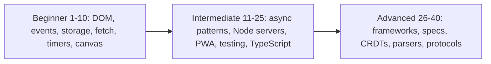

## 1. Calculator

**Level:** Beginner · **Time:** 1 weekend · **Prerequisites:** Ch 2, Ch 3, Ch 13

### What it is
A four-function calculator in the browser: a display, digit and operator buttons, `=`, clear, backspace, percent and sign change, all usable from the keyboard too. Behind the buttons sits a small **state machine** — a model where the app is always in exactly one named state (say *entering first number*, *operator chosen*, *showing result*) and each key press moves it to a well-defined next state.

### The problem it solves
Everyone thinks a calculator is trivial until they press `5 + =` or `0.1 + 0.2`. The project forces you to deal with the two things beginners usually ignore: **state** (what does `=` mean right after `=`?) and **numbers** (JavaScript numbers are IEEE 754 double-precision floats, so `0.1 + 0.2` is `0.30000000000000004`). Getting both right is a lesson in modelling before coding.

### Real-world examples
- Microsoft open-sourced the [Windows Calculator](https://github.com/microsoft/calculator); its README highlights infinite-precision arithmetic for the four basic operations, so results never lose precision the way doubles do.
- [0.30000000000000004.com](https://0.30000000000000004.com/) shows the same float result in dozens of languages — it is not a JavaScript bug, it is binary floating point.

### Requirements
**Functional**
- Digits, decimal point, `+ − × ÷`, `=`, `C` (clear all), `⌫` (backspace), `±`, `%`.
- Chaining: `2 + 3 × 4 =` evaluates left to right like a pocket calculator (shows 20), *or* with precedence (14) — pick one and document it.
- Repeated `=` repeats the last operation (`2 + 3 = =` → 8).
- Keyboard support: digits, `+ - * /`, `Enter`, `Backspace`, `Escape`.
- Division by zero shows "Cannot divide by zero" and the next digit starts fresh.

**Non-functional**
- Display never shows float noise: results rounded to at most 12 significant digits.
- Every button responds in under 16 ms (one frame); no layout shift as the display grows.
- Works with a screen reader: the display is a live region (`aria-live="polite"`).

### The architecture

- **Input mapper** turns a click on `<button data-key="7">` or a `keydown` into one normalised key string. One listener on the keypad container handles every button through **event delegation** (one listener on a parent that inspects `event.target`).
- **Reducer** is a pure function `(state, key) => newState` — no DOM, no globals — so it is trivially testable.
- **Render** writes the display from state. Rendering is the only code that touches the DOM.

### Data model
| Field | Type | Meaning |
|---|---|---|
| `current` | string | digits being typed, kept as a string so "0." and "0.50" survive |
| `previous` | number or null | left operand |
| `operator` | `'+' \| '-' \| '*' \| '/'` or null | pending operation |
| `lastOp` | `{ operator, operand }` or null | what repeated `=` re-applies |
| `mode` | `'input' \| 'operator' \| 'result' \| 'error'` | the state-machine state |

### Tech stack
| Component | Choice | Why |
|---|---|---|
| UI | Plain HTML + CSS grid | a keypad is literally a grid |
| Logic | One ES module, pure functions | testable without a browser |
| Number formatting | `Number.prototype.toPrecision` + `Intl.NumberFormat` | removes noise, adds locale grouping |
| Tests | `node:test` | the reducer has no DOM dependency |

### Milestones
1. **Keypad and display.** Static grid, buttons append digits to the display. *Done when* typing `123.45` shows exactly that, and a second `.` is ignored.
2. **Reducer.** Implement the state machine for one binary operation. *Done when* a table-driven test covers `2+3=`, `9/3=`, `5-8=`.
3. **Chaining and repeated equals.** *Done when* `2+3+4=` gives 9 and `2+3==` gives 8.
4. **Edge cases.** Division by zero, `±`, `%`, backspace in every mode. *Done when* every mode × key combination has a test.
5. **Keyboard and accessibility.** *Done when* the whole app can be used without a mouse and the screen reader announces results.

### Deep dive: the hard parts
**Float display.** Keep the arithmetic in plain numbers but format for display with `Number(result.toPrecision(12))`, which rounds `0.30000000000000004` to `0.3` and then drops trailing zeros. Do not round intermediate results; round only what the user sees. For money-grade precision you would use integers (cents) or `BigInt`, which the book covers in [Ch 2](../chapters/02-variables-types-and-operators/README.md).

**Why not `eval`.** `eval("2+3*4")` is tempting but it executes arbitrary code, breaks under a Content Security Policy that forbids `unsafe-eval`, and gives you no control over chaining semantics. The reducer is both safer and more honest about behaviour.

**Input as a string.** If you store `current` as a number, typing `0`, `.`, `0`, `5` collapses to `0` and then `0.05` — the user sees digits vanish. Store the *text* while typing and convert with `Number()` only when an operator or `=` arrives.

### Testing strategy
Table-driven unit tests over the reducer: an array of `{ keys: '2+3==', display: '8' }` rows run in a loop. Add a tiny DOM test (jsdom or the browser) for event delegation and keyboard mapping only.

### Trade-offs, scaling and failure modes
Left-to-right evaluation matches cheap pocket calculators; precedence matches phones and spreadsheets but needs a parser (Project 31 builds one). Floats are fast and "good enough" for display but cannot represent `0.1` exactly. A failure mode to watch: very large results — format `1e21` and above in exponent form rather than letting the display overflow.

### Stretch goals
- Precedence mode with a shunting-yard parser and parentheses.
- History tape stored in `localStorage`.
- Exact decimal mode using `BigInt` scaled by 10^12.

### Skills practised
- [Ch 2 — Variables, types and operators](../chapters/02-variables-types-and-operators/README.md): number precision, coercion with `Number()`.
- [Ch 3 — Control flow](../chapters/03-control-flow-and-loops/README.md): `switch` on mode and key.
- [Ch 13 — DOM and events](../chapters/13-dom-and-events/README.md): delegation, `keydown`, `data-*` attributes.

### In the interview
**Q:** Why does `0.1 + 0.2 !== 0.3`? **A:** Numbers are binary 64-bit floats; 0.1 has no finite binary representation, so both operands are already slightly off and the sum rounds to a different double than 0.3. Compare with a tolerance or work in integers.

**Q:** Why model the calculator as a reducer? **A:** A pure `(state, key) => state` function makes every behaviour a testable row in a table and keeps the DOM code dumb.

**Q:** One listener or one per button? **A:** One on the container — event delegation — fewer listeners, and buttons added later work automatically.

### TL;DR
A calculator is a state machine plus careful number formatting; keep the logic in a pure reducer, store typed input as text, and round only for display.

## 2. To-do list with localStorage

**Level:** Beginner · **Time:** 1 weekend · **Prerequisites:** Ch 5, Ch 7, Ch 13, Ch 14

### What it is
The classic to-do app: add, edit, complete, delete and filter tasks (All / Active / Completed), with the list surviving a page reload because it is saved in **`localStorage`** — a small key-value store the browser keeps per **origin** (scheme + host + port).

### The problem it solves
It is the smallest app with real **CRUD** (create, read, update, delete), a filtered view of shared data, and persistence. It teaches the habit that separates working apps from tangled ones: keep one source of truth (an array of task objects), derive the screen from it, and save it in one place.

### Real-world examples
- [TodoMVC](https://todomvc.com/) implements the same spec in dozens of frameworks and in vanilla JS; reading the vanilla version after you finish is instructive.
- MDN's [Web Storage API](https://developer.mozilla.org/en-US/docs/Web/API/Web_Storage_API) documents `localStorage`'s string-only values, per-origin scope and synchronous behaviour.

### Requirements
**Functional**
- Add a task with Enter; ignore empty or whitespace-only input.
- Toggle complete, double-click to edit, Escape cancels an edit, delete with a button.
- Filters All / Active / Completed reflected in the URL hash (`#/active`) so reload keeps the filter.
- "Clear completed" and a live "3 items left" counter.
- Data persists across reloads and syncs across two open tabs.

**Non-functional**
- Up to 1,000 tasks render in under 50 ms.
- Storage writes are batched: at most one write per user action.
- Corrupt or missing storage never crashes the app — it starts empty and logs a warning.

### The architecture
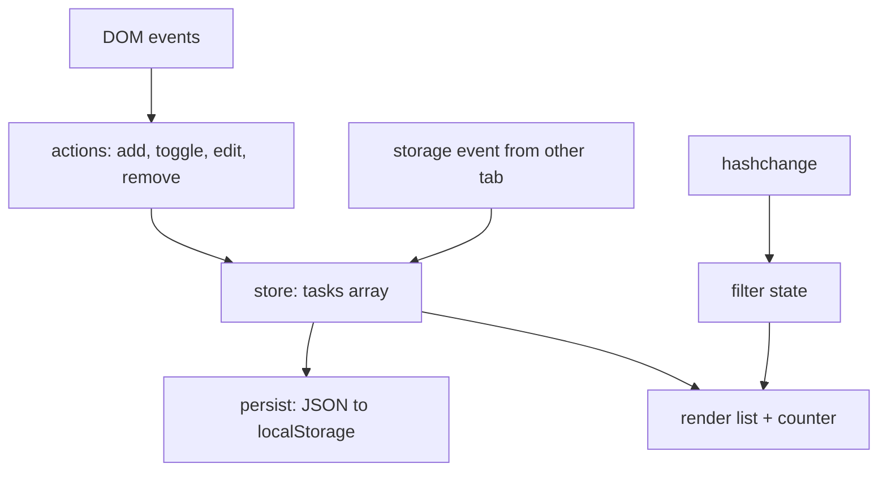
- **Store** holds `tasks` and notifies subscribers after each change.
- **Persist** subscribes and writes `JSON.stringify(tasks)`.
- **Render** rebuilds the list from `tasks` filtered by the current hash.
- The **`storage` event** fires in *other* tabs of the same origin when one tab writes, which is how two tabs stay in sync.

### Data model
| Field | Type | Notes |
|---|---|---|
| `id` | string | `crypto.randomUUID()` — stable across edits |
| `title` | string | trimmed, max 500 chars |
| `done` | boolean | |
| `createdAt` | number | epoch milliseconds |

Stored under one key, `todos:v1`, as a JSON array. The `v1` suffix lets you migrate the shape later.

### Tech stack
| Component | Choice | Why |
|---|---|---|
| Rendering | `document.createElement` + `textContent` | safe against XSS; no `innerHTML` with user text |
| Storage | `localStorage` | synchronous, simple, about 5 MB per origin in most browsers |
| Routing | `location.hash` + `hashchange` | no server config needed |
| Tests | `node:test` + jsdom | the book already runs DOM code under jsdom (Ch 13) |

### Milestones
1. **In-memory list.** Add and render tasks. *Done when* adding three tasks shows three `<li>`s.
2. **Toggle, edit, delete** via delegation on the `<ul>`. *Done when* each works for a task added after page load.
3. **Filters and counter.** *Done when* `#/completed` on reload shows only completed tasks.
4. **Persistence.** Load on start, save on change, survive corrupt JSON. *Done when* setting the key to `"{oops"` in DevTools and reloading shows an empty list, not an error.
5. **Cross-tab sync.** *Done when* completing a task in tab A updates tab B within a second.

### Deep dive: the hard parts
**Safe loading.** `JSON.parse` throws on bad input and `localStorage.getItem` can throw too (storage disabled, some private modes). Wrap both in `try/catch`, validate that the result is an array of objects with the expected fields, and fall back to `[]`. Never trust storage more than you trust user input — another script on the same origin can write it.

**Rendering without XSS.** If you build `<li>${title}</li>` with `innerHTML`, a task titled `` runs code. Use `textContent` for user strings. This is the same rule [Ch 14](../chapters/14-browser-apis-and-security/README.md) states for every XSS sink.

**Immutable updates.** Replace the array rather than mutating it in place (`tasks = tasks.map(t => t.id === id ? { ...t, done: !t.done } : t)`). It makes "did anything change?" a cheap reference check and keeps undo easy.

### Testing strategy
Unit-test the store actions as pure functions. With jsdom, test that rendering escapes HTML, that a corrupt storage value yields an empty list, and that the filter respects the hash. Simulate the `storage` event by dispatching `new StorageEvent('storage', { key: 'todos:v1' })`.

### Trade-offs, scaling and failure modes
`localStorage` is synchronous (it blocks the main thread), string-only and small; for thousands of large records use IndexedDB (Project 17). Full re-render is simple and fast enough for hundreds of items; past that, patch only the changed `<li>`. If the quota is exceeded, `setItem` throws `QuotaExceededError` — catch it and tell the user.

### Stretch goals
- Drag to reorder (preview of Project 12).
- Undo the last delete with a toast.
- Due dates formatted with `Intl.RelativeTimeFormat` ("in 2 days").

### Skills practised
- [Ch 5 — Objects and JSON](../chapters/05-objects-math-date-and-json/README.md): spread copies, `JSON.parse` safety.
- [Ch 7 — Arrays](../chapters/07-arrays/README.md): `map`, `filter`, non-mutating updates.
- [Ch 13 — DOM and events](../chapters/13-dom-and-events/README.md): delegation, forms, keyboard events.
- [Ch 14 — Browser APIs](../chapters/14-browser-apis-and-security/README.md): storage, the `storage` event, XSS.

### In the interview
**Q:** `localStorage` vs `sessionStorage` vs cookies? **A:** `localStorage` persists per origin until cleared; `sessionStorage` lasts for one tab session; cookies are sent to the server on every request and can be `HttpOnly`. Use cookies for auth, storage for UI state.

**Q:** How do two tabs stay in sync? **A:** Writing to `localStorage` fires a `storage` event in every other same-origin tab; listen and reload state from the new value.

**Q:** Why not store objects directly? **A:** Web Storage keeps strings only; `setItem('k', {a:1})` stores `"[object Object]"`. Serialize with JSON.

### TL;DR
One array is the truth, the DOM is derived from it, and `localStorage` is a cautious, versioned mirror of it — parsed defensively and rendered with `textContent`.

## 3. Quiz app

**Level:** Beginner · **Time:** 1 weekend · **Prerequisites:** Ch 4, Ch 7, Ch 12, Ch 13

### What it is
A multiple-choice quiz: pick a category and difficulty, answer ten questions one at a time with a countdown per question, see your score with a review of right and wrong answers, and keep a local high-score table. Questions come from the free **Open Trivia Database** API.

### The problem it solves
It combines three beginner skills into one flow: fetching data, moving through screens (a tiny state machine: *setup → question → feedback → results*), and timing. It also contains a real security lesson: the API returns text with **HTML entities** (like `&quot;`) by default, and the obvious fix — `innerHTML` — is an XSS hole.

### Real-world examples
- The [Open Trivia DB API](https://opentdb.com/api_config.php) returns up to 50 questions per call, needs no key, offers HTML-entity, URL and Base64 encodings, provides session tokens to avoid repeats, and limits each IP to one call every 5 seconds.
- MDN's [Using the Fetch API](https://developer.mozilla.org/en-US/docs/Web/API/Fetch_API/Using_Fetch) explains why `fetch` resolves even on HTTP 404 and how to check `response.ok`.

### Requirements
**Functional**
- Setup screen: category, difficulty, number of questions.
- One question at a time; answers shuffled; 15-second timer; time-out counts as wrong.
- Immediate feedback (correct answer highlighted), then Next.
- Results: score, time taken, per-question review.
- Top 10 scores in `localStorage`.
- Offline fallback: a bundled JSON file of 20 questions.

**Non-functional**
- First question visible under 1 s on a normal connection; a loading state otherwise.
- Never more than one API call per 5 s (respect the limit).
- Fully keyboard-operable: `1`–`4` select answers, Enter goes next.

### The architecture
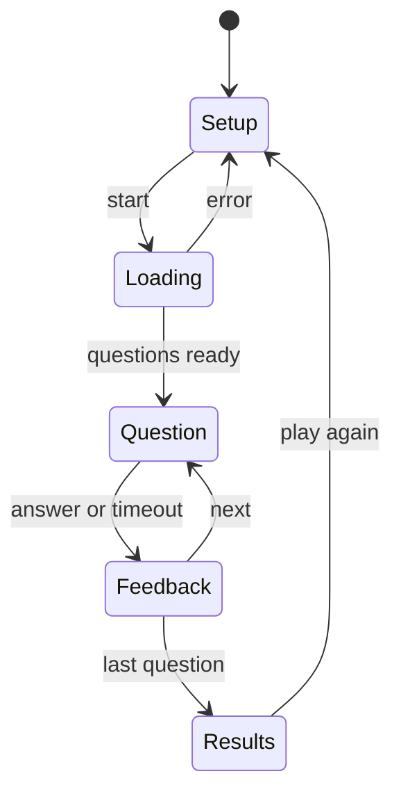
- **Setup** collects options and builds the API URL with `URLSearchParams`.
- **Loading** calls the API service, decodes and shuffles.
- **Question / Feedback** loop is driven by an index into the question array and a timer.
- **Results** computes the score and writes high scores.

### Data model
| Type | Fields |
|---|---|
| `Question` | `text`, `choices: string[]`, `correctIndex`, `category`, `difficulty` |
| `Answer` | `questionIndex`, `chosenIndex` (or `null` on timeout), `ms` |
| `Game` | `questions`, `answers`, `index`, `phase`, `startedAt` |
| `HighScore` | `name`, `score`, `total`, `date` |

### Tech stack
| Component | Choice | Why |
|---|---|---|
| Data | Open Trivia DB with `encode=base64` | avoids HTML-entity decoding entirely |
| Decoding | `atob` + `TextDecoder` | `atob` alone breaks on non-ASCII UTF-8 |
| Timer | `setInterval` for the display, timestamps for truth | intervals drift |
| Shuffle | Fisher–Yates | unbiased, O(n) |

### Milestones
1. **Hard-coded quiz.** Render questions from a local array; score at the end. *Done when* a full run gives the right score.
2. **API integration.** Fetch, decode, map to `Question`. *Done when* a network failure falls back to the local file with a notice.
3. **Timer.** *Done when* an unanswered question auto-advances after 15 s and is marked wrong.
4. **Review and high scores.** *Done when* reload keeps the top 10, sorted by score then time.
5. **Keyboard and a11y.** *Done when* the quiz can be finished using only the keyboard and focus moves to each new question.

### Deep dive: the hard parts
**Decoding safely.** Default responses contain entities like `&#039;`. Rendering them with `innerHTML` decodes them — and also runs any markup. Request `encode=base64` and decode with `new TextDecoder().decode(Uint8Array.from(atob(s), c => c.charCodeAt(0)))`, then render with `textContent`. If you must decode entities, parse with `DOMParser` and read `textContent`, which never executes scripts.

**Fair shuffling.** `arr.sort(() => Math.random() - 0.5)` is biased and depends on the engine's sort algorithm. Use the [Fisher–Yates shuffle](https://en.wikipedia.org/wiki/Fisher%E2%80%93Yates_shuffle): walk from the end, swap each item with a random earlier-or-same index. Track `correctIndex` *after* shuffling.

**Timers that don't lie.** `setInterval(fn, 1000)` can fire late (busy main thread, background tab throttling). Store `deadline = performance.now() + 15000` and compute remaining time on each tick; the interval only refreshes the display. Clear the interval on every phase change, or two timers will race.

### Testing strategy
Unit-test shuffle (every permutation appears roughly equally over many runs, and the correct answer is tracked), the decoder (UTF-8 round trip), and the state transitions. Mock `fetch` with `mock.method(globalThis, 'fetch', …)` from `node:test` to simulate success, HTTP 429 and network errors. Use fake timers (`mock.timers`) to test the timeout without waiting.

### Trade-offs, scaling and failure modes
Base64 costs ~33% more bytes but removes a whole class of decoding bugs. A response code of 5 from the API means you were rate-limited — wait and retry once. The API's session token prevents repeated questions but expires after 6 hours of inactivity; handle "token not found" by requesting a new one.

### Stretch goals
- Session tokens so repeat games avoid repeats.
- Shareable result link encoded in the URL.
- Two-player hot-seat mode.

### Skills practised
- [Ch 4 — Functions and closures](../chapters/04-functions-scope-and-closures/README.md): timer callbacks closing over game state.
- [Ch 7 — Arrays](../chapters/07-arrays/README.md): shuffling, `toSorted` for the score table.
- [Ch 12 — Async](../chapters/12-asynchronous-javascript/README.md): `fetch`, `async`/`await`, timers.
- [Ch 13 — DOM and events](../chapters/13-dom-and-events/README.md): focus management, keyboard shortcuts.

### In the interview
**Q:** Why is `sort(() => Math.random() - 0.5)` a bad shuffle? **A:** A comparator must be consistent; a random one gives a biased distribution that depends on the sort algorithm. Fisher–Yates gives every permutation equal probability in O(n).

**Q:** Does `fetch` reject on a 500? **A:** No — it rejects only on network failure or abort. Check `response.ok` or `status` yourself.

**Q:** How do you decode HTML entities safely? **A:** Avoid them (request another encoding) or parse with `DOMParser` and read `textContent`; never assign untrusted text to `innerHTML`.

### TL;DR
A quiz is a four-state machine around fetched data; decode without `innerHTML`, shuffle with Fisher–Yates, and let timestamps — not intervals — decide when time is up.

## 4. Weather dashboard with fetch

**Level:** Beginner · **Time:** 1–2 weekends · **Prerequisites:** Ch 5, Ch 12, Ch 14

### What it is
A dashboard that shows current conditions, a 24-hour strip and a 7-day forecast for a searched city or the user's location. It uses **Open-Meteo**, a weather API that needs no key for non-commercial use, plus its geocoding service to turn a city name into coordinates.

### The problem it solves
Real apps chain requests (city name → coordinates → forecast), deal with slow and failing networks, convert units and time zones, and avoid hammering the API. This project makes you handle every one of those in a page small enough to finish.

### Real-world examples
- [Open-Meteo's forecast API docs](https://open-meteo.com/en/docs) show requests like `/v1/forecast?latitude=52.52&longitude=13.41&current=temperature_2m&hourly=temperature_2m`; a key is needed only for commercial use, and its [terms](https://open-meteo.com/en/terms) cap free non-commercial use at under 10,000 calls a day (5,000 an hour, 600 a minute).
- MDN's [`AbortController`](https://developer.mozilla.org/en-US/docs/Web/API/AbortController) page documents cancelling an in-flight `fetch`, which you need when the user searches again before the first answer arrives.

### Requirements
**Functional**
- Search box with suggestions from the geocoding API; "Use my location" via `navigator.geolocation`.
- Current temperature, feels-like, wind, humidity, an icon from the weather code.
- Hourly strip (next 24 h) and daily cards (7 days), in the *location's* time zone.
- °C/°F and km/h/mph toggles remembered in `localStorage`.
- Recent searches (last 5).

**Non-functional**
- Cached responses reused for 10 minutes per location.
- A stale response from an older search must never overwrite a newer one.
- Readable error states: offline, location denied, no results, API error.

### The architecture
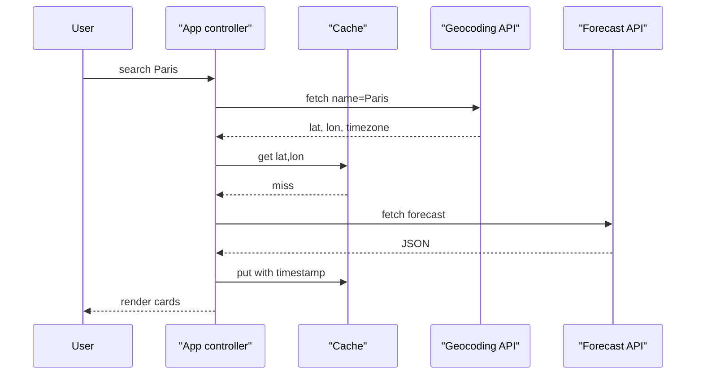
- **App controller** owns the current request's `AbortController` and the view state (`idle`, `loading`, `ready`, `error`).
- **Cache** is a `Map` keyed by rounded coordinates plus units, mirrored to `sessionStorage`.
- **API module** wraps `fetch` and converts HTTP errors into thrown `Error`s with a `cause`.

### Data model
| Type | Key fields |
|---|---|
| `Place` | `name`, `country`, `lat`, `lon`, `timezone` |
| `Forecast` | `current { temp, feelsLike, wind, code, time }`, `hourly[]`, `daily[]` |
| `CacheEntry` | `key`, `fetchedAt`, `data` |
| `Prefs` | `units: 'metric' \| 'imperial'`, `recent: Place[]` |

### Tech stack
| Component | Choice | Why |
|---|---|---|
| HTTP | `fetch` + `AbortSignal.any([controller.signal, AbortSignal.timeout(8000)])` | cancel on new search *and* on timeout |
| Time zones | `Intl.DateTimeFormat` with `timeZone` | no date library needed |
| Icons | inline SVG keyed by WMO weather code | no extra requests |
| Layout | CSS grid, `prefers-color-scheme` | responsive and dark-mode for free |

### Milestones
1. **Hard-coded coordinates.** Fetch and print current temperature. *Done when* the page shows the real temperature for one city.
2. **Search with geocoding.** *Done when* typing a city shows up to 5 matches and choosing one loads its forecast.
3. **Full dashboard.** Hourly and daily views in local time. *Done when* the hours shown for Tokyo start at Tokyo's current hour, not yours.
4. **Robustness.** Abort, timeout, cache, error states. *Done when* switching cities quickly always ends on the last one chosen, and DevTools "Offline" shows the offline message.
5. **Preferences and geolocation.** *Done when* units persist and denying location shows a helpful message.

### Deep dive: the hard parts
**Race conditions.** Search "Par", then "Paris": two requests are in flight and the slower one may finish last. Keep one `AbortController` per search, call `abort()` on the previous one before starting a new one, and ignore `AbortError` in the `catch`. As a second guard, tag each request with an increasing id and drop responses whose id is not the latest.

**Debounce the suggestions.** Calling geocoding on every keystroke wastes requests. A **debounce** waits until the user has stopped typing for, say, 300 ms, then runs once. It is a closure around a timer id — the same helper you will reuse in Project 11.

**Time zones.** The API can return times in the location's zone (`timezone=auto`). Format with `new Intl.DateTimeFormat(undefined, { hour: 'numeric', timeZone: place.timezone })`. Do not parse those strings with `new Date()` and then display them in the user's zone, or a 9 a.m. forecast in Sydney shows as midnight in London.

### Testing strategy
Mock `fetch` to return fixture JSON; test the mapping from API shape to `Forecast`. Test the race: start two fake requests, resolve them out of order, assert the newer wins. Test the cache expiry with injected `now()`.

### Trade-offs, scaling and failure modes
Client-side caching cuts calls but means data can be 10 minutes old — show "updated 4 min ago". Calling the API straight from the browser is fine here because there is no secret; with a keyed API you would proxy through a server so the key is not shipped to every visitor. If geolocation is slow, show the last location immediately and refresh.

### Stretch goals
- Sparkline of hourly temperatures drawn in SVG.
- Installable PWA with offline last-known forecast (see Project 17).
- Compare two cities side by side.

### Skills practised
- [Ch 5 — Dates and JSON](../chapters/05-objects-math-date-and-json/README.md): `Intl.DateTimeFormat`, time zones.
- [Ch 12 — Async](../chapters/12-asynchronous-javascript/README.md): `AbortController`, timeouts, `Promise` error handling.
- [Ch 14 — Browser APIs](../chapters/14-browser-apis-and-security/README.md): `fetch`, `URL`, storage, geolocation.

### In the interview
**Q:** How do you cancel a `fetch`? **A:** Pass `signal` from an `AbortController` and call `abort()`; the promise rejects with an `AbortError`. `AbortSignal.timeout(ms)` gives a signal that aborts itself.

**Q:** Debounce vs throttle? **A:** Debounce runs once after activity stops (search box); throttle runs at most once per interval during activity (scroll handler).

**Q:** Where would you put an API key? **A:** Not in front-end code — anything shipped to the browser is public. Proxy through a server that adds the key.

### TL;DR
Chain geocoding and forecast calls, cancel stale requests, cache briefly, and format every time in the place's own time zone.

## 5. Stopwatch and Pomodoro timer

**Level:** Beginner · **Time:** 1 weekend · **Prerequisites:** Ch 4, Ch 5, Ch 12

### What it is
Two tools on one page. A **stopwatch** with start, pause, lap and reset that shows hundredths of a second. A **Pomodoro timer** — a focus technique of 25-minute work blocks separated by 5-minute breaks, with a longer break after four blocks — that plays a sound and shows a notification when each block ends.

### The problem it solves
"Just use `setInterval`" produces a timer that drifts, freezes in background tabs and loses time when the laptop sleeps. Building an accurate timer teaches the difference between **scheduling** (when your code runs) and **measuring** (how much time really passed).

### Real-world examples
- MDN's [`performance.now()`](https://developer.mozilla.org/en-US/docs/Web/API/Performance/now) page explains the monotonic, high-resolution clock you should measure with (and why its precision is coarsened in browsers).
- MDN's [Page Visibility API](https://developer.mozilla.org/en-US/docs/Web/API/Page_Visibility_API) describes how hidden tabs have timers throttled, which is exactly the bug this project must survive.

### Requirements
**Functional**
- Stopwatch: start/pause/resume, lap (with split and lap time), reset; keyboard Space and L.
- Pomodoro: configurable work/short/long durations; auto-advance; skip; pause.
- Sound and `Notification` at the end of each block (with permission).
- Tab title shows remaining time (`12:03 — Focus`).
- State survives reload: a running Pomodoro keeps counting.

**Non-functional**
- Display error under 50 ms versus wall-clock after one hour.
- Correct remaining time after the tab was hidden or the laptop slept.
- Less than 1% CPU while running (no 1 ms intervals).

### The architecture
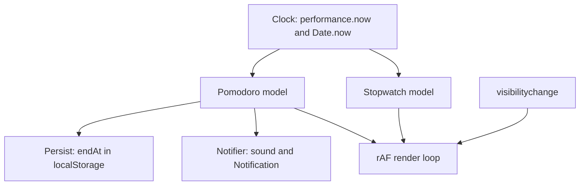
- **Clock** is injected (a function returning ms) so tests can control time.
- **Models** store *start timestamps and accumulated time*, never "ticks counted".
- **Render loop** uses `requestAnimationFrame` while visible and a 1 s `setTimeout` for the title while hidden.
- **Persist** stores the absolute end time (`Date.now()`-based) so a reload can resume.

### Data model
| Model | Fields |
|---|---|
| Stopwatch | `running`, `startedAt`, `accumulatedMs`, `laps: number[]` |
| Pomodoro | `phase: 'work' \| 'short' \| 'long'`, `endAt` (epoch ms) or `remainingMs` when paused, `completedWorkBlocks` |
| Settings | `workMin`, `shortMin`, `longMin`, `longEvery`, `sound` |

### Tech stack
| Component | Choice | Why |
|---|---|---|
| Measuring | `performance.now()` | monotonic: unaffected by clock changes |
| Persisting across reload | `Date.now()` end time | `performance.now()` restarts per page |
| Rendering | `requestAnimationFrame` | paints once per frame, pauses when hidden |
| Sound | Web Audio API oscillator | no audio file, short beep |
| Formatting | `String.prototype.padStart` | `05:07.42` |

### Milestones
1. **Naive stopwatch** with `setInterval(…, 10)` counting ticks. *Done when* you measure its drift against your phone over 5 minutes and write the number down.
2. **Timestamp stopwatch.** Elapsed = `accumulated + (now - startedAt)`. *Done when* drift after 5 minutes is under 50 ms, even with the tab hidden for a minute.
3. **Laps.** *Done when* laps show split and per-lap time and survive pause/resume.
4. **Pomodoro cycle.** *Done when* four work blocks are followed by a long break, verified with a fake clock in tests.
5. **Notify and persist.** *Done when* reloading mid-block resumes with the correct remaining time and the end triggers a notification.

### Deep dive: the hard parts
**Ticks vs timestamps.** An interval scheduled every 10 ms fires *at least* 10 ms later — often more, and browsers clamp nested timers to 4 ms and throttle hidden tabs to about once per second or less. Counting ticks therefore under-counts. Instead, treat the timer as pure arithmetic on timestamps; the interval or `requestAnimationFrame` only decides when to *redraw*.

**Two clocks.** `performance.now()` is monotonic (never jumps backwards when the system clock is corrected) but starts at zero for each page. `Date.now()` is wall-clock and survives reloads but can jump. Measure running intervals with `performance.now()`; persist absolute deadlines with `Date.now()`.

**Background behaviour.** When `document.visibilityState` becomes `hidden`, stop the animation loop; when it returns, recompute from timestamps — no catching-up loop is needed. For the end-of-block alert while hidden, schedule a single `setTimeout` for the remaining time; if it fires late, you are still correct because you compare with `endAt`.

### Testing strategy
Inject `now` into both models and test them as pure state: start at t=0, pause at t=1500, resume at t=4000, read at t=5000 → 2500 ms. Use `mock.timers` from `node:test` to fast-forward a full Pomodoro cycle in milliseconds. Manually test sleep and hidden-tab behaviour once.

### Trade-offs, scaling and failure modes
`requestAnimationFrame` gives smooth hundredths but costs a repaint per frame — fine for one display. Notifications need permission, and a denied permission must not break the timer. If the user changes the system clock during a block, a `Date.now()`-based deadline moves with it; accept this or re-anchor on `visibilitychange`.

### Stretch goals
- Screen Wake Lock so the screen stays on during a block.
- Daily statistics chart from stored completed blocks.
- Run the countdown in a Web Worker and compare its throttling behaviour.

### Skills practised
- [Ch 4 — Closures](../chapters/04-functions-scope-and-closures/README.md): models as closures over private state.
- [Ch 5 — Dates](../chapters/05-objects-math-date-and-json/README.md): epoch milliseconds, formatting.
- [Ch 12 — Async](../chapters/12-asynchronous-javascript/README.md): timers, clamping, why intervals drift.

### In the interview
**Q:** Why does `setInterval` drift? **A:** It schedules a task "no sooner than" the delay; each run can be late due to other work or throttling, and lateness accumulates if you count ticks. Compute elapsed time from timestamps.

**Q:** `performance.now()` or `Date.now()`? **A:** `performance.now()` for measuring durations (monotonic, high resolution); `Date.now()` for wall-clock moments you must store or share.

**Q:** What happens to timers in a background tab? **A:** Browsers throttle them heavily to save power, so never rely on them for elapsed time.

### TL;DR
Timers schedule, clocks measure: store start and end timestamps, redraw with `requestAnimationFrame`, and recompute on return — then hidden tabs and sleep can't make you wrong.

## 6. Memory card game

**Level:** Beginner · **Time:** 1 weekend · **Prerequisites:** Ch 7, Ch 9, Ch 13

### What it is
The "concentration" game: a grid of face-down cards hides pairs of symbols; you flip two at a time, matched pairs stay up, mismatches flip back after a short delay. A move counter, timer, star rating and difficulty levels (4×3, 4×4, 6×6) complete it. Cards flip with a CSS 3D transform.

### The problem it solves
The game looks visual but is mostly about **state and timing**: what may the player click while two unmatched cards are still showing? It is a compact exercise in modelling with a class, guarding against double clicks and races, and separating animation (CSS) from logic (JavaScript).

### Real-world examples
- The shuffle must be fair; the [Fisher–Yates shuffle](https://en.wikipedia.org/wiki/Fisher%E2%80%93Yates_shuffle) article explains why the naive "swap with any index" variant is biased.
- The W3C [ARIA Authoring Practices patterns](https://www.w3.org/WAI/ARIA/apg/patterns/) cover the **grid** pattern, which shows how to make a keyboard-navigable grid of buttons accessible.

### Requirements
**Functional**
- New game shuffles `n` pairs into a grid; three difficulty levels.
- Flip on click or Enter/Space; arrow keys move focus across the grid.
- Two flipped cards: match stays, mismatch flips back after 800 ms; no third flip meanwhile.
- Move counter, timer that starts on first flip, star rating from moves.
- Win screen with time and moves; best result per difficulty saved.

**Non-functional**
- Animations at 60 fps using only `transform` and `opacity`.
- Respects `prefers-reduced-motion`: no 3D flip, instant swap.
- Seeded shuffle option so a game can be replayed (useful for tests).

### The architecture
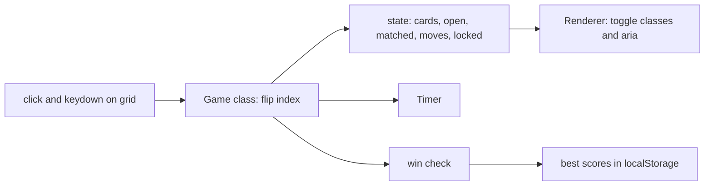
- **Game** is a class exposing `flip(index)` and emitting events (`match`, `mismatch`, `win`) through an `EventTarget`.
- **Renderer** listens and toggles CSS classes; it never decides game rules.
- **Timer** is the timestamp-based one from Project 5.

### Data model
| Field | Type | Meaning |
|---|---|---|
| `cards` | `{ id, symbol, state: 'down' \| 'up' \| 'matched' }[]` | the grid, row-major |
| `open` | number[] (0–2 indices) | currently face-up unmatched cards |
| `locked` | boolean | true during the mismatch delay |
| `moves` | number | pairs attempted |
| `seed` | number | for reproducible shuffles |

### Tech stack
| Component | Choice | Why |
|---|---|---|
| Model | ES class with `#private` fields | encapsulates rules; nothing outside can corrupt state |
| Events | `class Game extends EventTarget` | built-in pub/sub, no library |
| Random | small seeded PRNG (mulberry32) | reproducible tests |
| Flip | CSS `transform: rotateY(180deg)` + `backface-visibility` | GPU-friendly |

### Milestones
1. **Static grid** from a shuffled symbol list. *Done when* reload shows a different, valid layout (each symbol exactly twice).
2. **Game rules** in the class, tested without a DOM. *Done when* tests cover match, mismatch, clicking the same card twice and clicking a matched card.
3. **Wire up the DOM.** *Done when* a full game can be played with the mouse.
4. **Lock and timing.** *Done when* fast triple-clicking never shows three open cards.
5. **Keyboard, a11y and polish.** *Done when* the game is playable with arrows + Enter and a screen reader announces "match" or "no match".

### Deep dive: the hard parts
**The lock.** After a mismatch you schedule `setTimeout(flipBack, 800)`. If the player clicks during those 800 ms, the naive code opens a third card and the flip-back closes the wrong pair. Set `locked = true` before scheduling and clear it in the callback; `flip()` returns early while locked. Also ignore clicks on a card already in `open` — double-clicking one card must not count as a pair.

**Rules vs rendering.** Put every rule in `Game`; let the renderer be a listener. This lets you test 100% of the rules in Node and swap the renderer (canvas, terminal) without touching logic — the same split as a calculator reducer, now with classes and events.

**Seeded randomness.** `Math.random()` cannot be seeded. A tiny PRNG such as mulberry32 (a few lines of 32-bit integer math with `Math.imul`) turns a seed into a repeatable sequence, so a test can say "with seed 42 the first pair is at 0 and 7".

### Testing strategy
Unit tests on `Game` with a fixed seed and fake timers: assert events fired and state after each flip sequence. One jsdom test that clicking a card element calls `flip` with the right index and that `aria-pressed`/labels update.

### Trade-offs, scaling and failure modes
A class with private fields is clear for a single game; a pure reducer would make undo easier. CSS 3D flips are cheap, but `backface-visibility` has quirks on some mobile browsers — test there. On 6×6 grids, emoji symbols render differently per OS; use SVG icons if consistency matters.

### Stretch goals
- Two-player turns with per-player scores.
- Daily challenge: seed derived from the date so everyone gets the same board.
- Sound effects with the Web Audio API.

### Skills practised
- [Ch 7 — Arrays](../chapters/07-arrays/README.md): building and shuffling pairs, `flatMap`.
- [Ch 9 — Classes](../chapters/09-this-prototypes-and-classes/README.md): `#private` fields, `extends EventTarget`.
- [Ch 13 — DOM and events](../chapters/13-dom-and-events/README.md): delegation, keyboard navigation, custom events.

### In the interview
**Q:** How do you stop a user clicking during an animation? **A:** Hold an explicit `locked` flag in the model, set it before the timeout, clear it in the callback, and make every action check it.

**Q:** Why extend `EventTarget`? **A:** It gives `addEventListener`/`dispatchEvent` for free, decoupling the model from whoever listens.

**Q:** Why are `#private` fields better than `_underscore`? **A:** They are enforced by the language — code outside the class cannot read or write them at all.

### TL;DR
Keep the rules in an event-emitting class, lock input during the mismatch delay, and shuffle with a seeded Fisher–Yates so games are fair and tests are repeatable.

## 7. Form validator

**Level:** Beginner · **Time:** 1 weekend · **Prerequisites:** Ch 6, Ch 13

### What it is
A sign-up form (name, email, password, confirm password, date of birth, phone, terms checkbox) with live, accessible validation, plus a small reusable **validation library**: you describe rules per field in an object and the library wires up events, messages and the submit check for any form.

### The problem it solves
Bad validation is everywhere: errors that shout before you have typed, messages a screen reader never announces, regexes that reject real names or `+` in emails, and client checks mistaken for security. This project teaches the browser's built-in **constraint validation** API, when to add JavaScript rules on top, and the rule that the server must validate again.

### Real-world examples
- MDN's [Constraint validation guide](https://developer.mozilla.org/en-US/docs/Web/HTML/Guides/Constraint_validation) covers `required`, `pattern`, `type=email`, `checkValidity()`, `setCustomValidity()` and the `:user-invalid` pseudo-class.
- The W3C WAI [Forms tutorial](https://www.w3.org/WAI/tutorials/forms/) explains labelling, grouping and accessible error notifications.

### Requirements
**Functional**
- Rules: required, min/max length, pattern, email, matches-field, custom async rule (username available).
- Errors appear on blur or on submit, then update live as the user fixes them ("reward early, punish late").
- On submit with errors: focus the first invalid field and show an error summary with links.
- Password strength meter (length, character classes) — advice, not a blocker beyond minimum length.
- Works with JavaScript disabled using native HTML attributes.

**Non-functional**
- Each error is linked with `aria-describedby` and the field gets `aria-invalid="true"`.
- The async check is debounced (300 ms) and cancellable.
- Library under 3 KB minified, no dependencies.

### The architecture
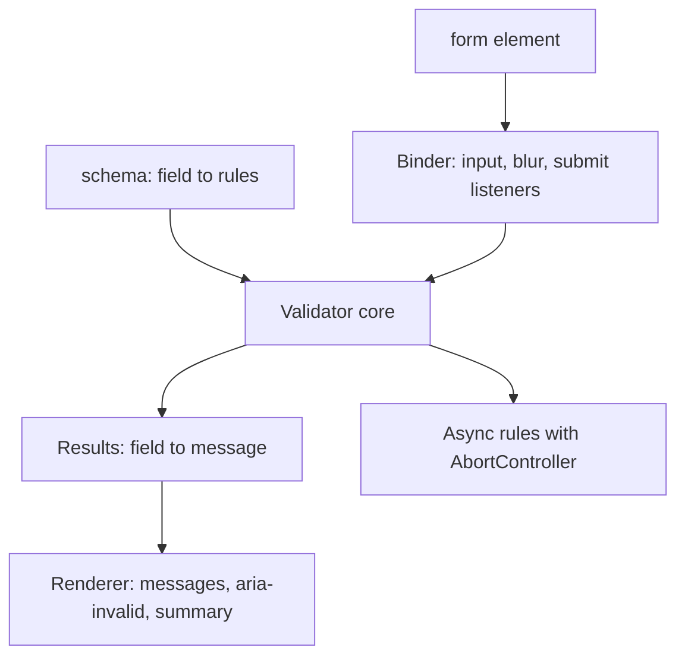
- **Schema** is plain data: `{ email: [required(), email()], confirm: [matches('password')] }`.
- **Validator core** runs rules in order and stops at the first failure per field; rules are functions `(value, values) => message | null`.
- **Binder** maps DOM events to validation calls and tracks which fields were *touched*.
- **Renderer** writes messages and ARIA attributes, and mirrors errors into `setCustomValidity` so CSS `:invalid` styles stay consistent.

### Data model
| Type | Shape |
|---|---|
| `Rule` | `(value: string, all: Record<string,string>) => string \| null \| Promise<string \| null>` |
| `FieldState` | `{ touched: boolean, error: string \| null, pending: boolean }` |
| `FormState` | `Map<fieldName, FieldState>`, `submitting: boolean` |

### Tech stack
| Component | Choice | Why |
|---|---|---|
| Baseline | HTML attributes (`required`, `minlength`, `type=email`) | works without JS, free mobile keyboards |
| Extra rules | JS functions | cross-field and async checks HTML cannot express |
| Values | `new FormData(form)` | reads every field, including checkboxes |
| Styles | `:user-invalid` | only styles fields after the user interacted |

### Milestones
1. **Native only.** Add HTML attributes and submit. *Done when* the browser blocks bad input with no JavaScript.
2. **Core library.** Rules, schema, `validate(values)` returning errors — tested in Node. *Done when* tests cover every built-in rule.
3. **Binding and rendering.** *Done when* errors appear on blur, disappear while fixing, and the form has `novalidate` only when JS is running.
4. **Accessibility.** *Done when* a screen reader announces each error and submitting focuses the first invalid field.
5. **Async rule.** Fake "username taken" endpoint with delay. *Done when* typing quickly sends one request and the stale one is aborted.

### Deep dive: the hard parts
**Email and names.** The HTML `type=email` check follows a deliberately practical grammar; writing a "perfect" email regex is a trap. Accept what the browser accepts, then confirm by sending an email. For names, do not restrict characters — "Zoë O'Brien-Nguyễn" is valid. Use [Ch 6](../chapters/06-strings-and-regular-expressions/README.md)'s Unicode-aware regex (`/^\p{L}/u`) only where you truly need a rule.

**When to show errors.** Validating on every keystroke from the first character shows "invalid email" after typing one letter. Validate on `blur` the first time; once a field has an error, re-validate on `input` so the message disappears as soon as it is fixed.

**Client checks are not security.** Anyone can bypass the page with `curl`. The same schema should run on the server (it is just functions — share the module with Node) and the server's answer is final.

### Testing strategy
Pure unit tests of each rule and of `validate`. jsdom tests for binding: dispatch `blur`/`input`/`submit` and assert `aria-invalid`, `aria-describedby` and focus. Async rule tested with a mocked `fetch` and fake timers to prove debounce and abort.

### Trade-offs, scaling and failure modes
Native validation is free and accessible but its message bubbles are hard to style and inconsistent; custom rendering gives control at the cost of code. Async checks reveal whether a username exists (an enumeration risk); rate-limit the endpoint. If the async check fails (network), do not block the form — let the server decide.

### Stretch goals
- Multi-step wizard that validates per step.
- i18n messages with `Intl.PluralRules` ("1 character" vs "2 characters").
- Share the schema with a Node server and return field errors in the same shape.

### Skills practised
- [Ch 6 — Strings and regex](../chapters/06-strings-and-regular-expressions/README.md): patterns, Unicode property escapes, `RegExp.escape` for user-supplied literals.
- [Ch 13 — DOM and events](../chapters/13-dom-and-events/README.md): forms, `FormData`, `blur` vs `input`, focus.

### In the interview
**Q:** Why validate on the server if the client already does? **A:** The client is under the user's control; anything can be sent directly. Client validation is for UX, server validation is for correctness and security.

**Q:** `input` vs `change` vs `blur`? **A:** `input` fires on every edit, `change` when a committed value changes (on blur for text fields), `blur` when focus leaves. Combine them to avoid premature errors.

**Q:** How do you make errors accessible? **A:** Link the message with `aria-describedby`, set `aria-invalid`, announce via a live region or focus, and keep a summary at the top on submit.

### TL;DR
Start with native HTML validation, layer a tiny rule-function library for cross-field and async checks, show errors late and clear them early, and always validate again on the server.

## 8. Typing speed test

**Level:** Beginner · **Time:** 1 weekend · **Prerequisites:** Ch 6, Ch 12, Ch 13

### What it is
A typing test like the ones speed typists race on: a passage appears, you type it, each character turns green or red as you go, and at the end you see **WPM** (words per minute, by convention one "word" = 5 characters), accuracy, and a chart of speed over time. Modes: 15/30/60-second timed runs and fixed-length quotes.

### The problem it solves
It looks like string comparison, but correct handling of real text is hard: accented letters, emoji and combined characters, IME composition (how Chinese, Japanese and Korean users type), and fast keystrokes that must not lag the UI. It is a great beginner tour of **Unicode** and of measuring time precisely.

### Real-world examples
- [Monkeytype](https://github.com/monkeytypegame/monkeytype) is a popular open-source typing test; its feature set is a good reference for modes and statistics.
- MDN's [`Intl.Segmenter`](https://developer.mozilla.org/en-US/docs/Web/JavaScript/Reference/Global_Objects/Intl/Segmenter) shows how to split text into user-perceived characters (grapheme clusters) and words.

### Requirements
**Functional**
- Random passages from a local word list or quote list; timed and quote modes.
- Live per-character feedback; backspace allowed within the current word.
- Results: gross WPM, net WPM, accuracy, errors per character, WPM-over-time chart.
- Restart with Tab+Enter; personal bests per mode in `localStorage`.

**Non-functional**
- Keystroke-to-paint under 16 ms with a 500-word passage.
- Correct counting for non-ASCII text (é, ñ, emoji with skin tones).
- Works with IME input without double-counting.

### The architecture
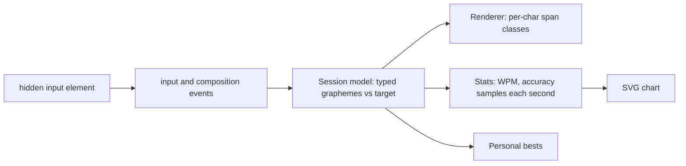
- **Hidden input** captures text (including mobile keyboards and IMEs) while the passage is shown in styled spans.
- **Session model** compares typed graphemes with target graphemes and records errors and timestamps.
- **Stats** samples once per second for the chart and computes final scores.

### Data model
| Field | Type | Notes |
|---|---|---|
| `target` | string[] | graphemes of the passage via `Intl.Segmenter` |
| `typed` | string[] | graphemes typed so far |
| `errors` | `Set<number>` | indices ever typed wrong (for accuracy) |
| `startedAt` | number | `performance.now()` at first keystroke |
| `samples` | `{ t, wpm }[]` | one per second |

### Tech stack
| Component | Choice | Why |
|---|---|---|
| Text splitting | `Intl.Segmenter('en', { granularity: 'grapheme' })` | `"👍🏽".length` is 4, but it is one character to a human |
| Input | `<input>` + `input` + `compositionend` | robust across keyboards |
| Rendering | update only changed spans | avoids re-rendering 2,500 spans per key |
| Chart | inline SVG polyline | no library |

### Milestones
1. **Render and compare** ASCII text. *Done when* each character turns green or red correctly, including after backspace.
2. **Timing and WPM.** *Done when* a scripted test typing 50 correct characters in 10 seconds reports 60 WPM.
3. **Unicode.** *Done when* a passage with "café", "naïve" and an emoji family counts each as the right number of characters.
4. **Performance.** *Done when* the DevTools Performance panel shows no long tasks while typing fast into a 500-word passage.
5. **Results and chart.** *Done when* results show a correct WPM-over-time line and bests persist.

### Deep dive: the hard parts
**What is a "character"?** JavaScript strings are sequences of UTF-16 code units. `"é"` may be one code unit (precomposed) or two (e + combining accent); emoji often take 2–11 code units. Compare by grapheme clusters from `Intl.Segmenter`, and normalise both sides with `String.prototype.normalize('NFC')` so two encodings of "é" compare equal. [Ch 6](../chapters/06-strings-and-regular-expressions/README.md) covers code units, code points and graphemes.

**IME composition.** While a user composes a character with an IME, `input` fires with intermediate text. Ignore input while `event.isComposing` is true and process on `compositionend`, or you will mark half-built characters as errors.

**Fast rendering.** Rebuilding 2,500 `<span>`s on every keystroke causes layout work per key. Keep an array of span references and change only the one or two spans affected (`className` swap). Batch reads and writes to avoid layout thrashing.

**The maths.** Gross WPM = (all typed characters / 5) / minutes. Net WPM subtracts uncorrected errors per minute. Accuracy = correct keystrokes / total keystrokes, so fixed mistakes still lower accuracy. Document your formulas — sites differ.

### Testing strategy
Unit-test the session model with scripted keystroke sequences and an injected clock. Test grapheme handling with tricky strings (combining marks, ZWJ emoji sequences, flags). jsdom test that composition events do not produce errors.

### Trade-offs, scaling and failure modes
A hidden input gives native keyboard behaviour on mobile but complicates focus (clicking the passage must refocus it). `Intl.Segmenter` is in all modern browsers and Node; on very old browsers you would fall back to code points via `[...str]`, which still splits some emoji. Cheating (pasting) is easy — detect `paste` events and void the run.

### Stretch goals
- Per-key heatmap of errors on an on-screen keyboard.
- Multi-language word lists with right-to-left text.
- Race a "ghost" replay of your personal best.

### Skills practised
- [Ch 6 — Strings and regex](../chapters/06-strings-and-regular-expressions/README.md): Unicode, normalisation, `Intl.Segmenter`.
- [Ch 12 — Async](../chapters/12-asynchronous-javascript/README.md): timing with `performance.now()`.
- [Ch 13 — DOM and events](../chapters/13-dom-and-events/README.md): input and composition events, minimal DOM updates.

### In the interview
**Q:** Why can `str.length` be wrong for user-visible length? **A:** It counts UTF-16 code units. Emoji and combined characters use several; count grapheme clusters with `Intl.Segmenter`.

**Q:** What is NFC normalisation? **A:** A canonical form where composed characters use the precomposed code point when one exists, so visually identical strings compare equal.

**Q:** How do you keep a per-keystroke UI fast? **A:** Update only the changed nodes, avoid forced synchronous layout, and keep work per event tiny.

### TL;DR
Compare graphemes, not code units; respect IME composition; touch only the spans that changed; and compute WPM from timestamps with clearly stated formulas.

## 9. Bookmark manager with import and export

**Level:** Beginner · **Time:** 1–2 weekends · **Prerequisites:** Ch 5, Ch 7, Ch 8, Ch 14

### What it is
A single-page bookmark manager: save links with title, tags and notes; search instantly across them; filter by tag; sort by name, date or most visited; and import from or export to a JSON file. Duplicate URLs are detected even when written differently (`HTTP://Example.com/` vs `http://example.com`).

### The problem it solves
Here the data — not the DOM — is the interesting part. You will normalise URLs with the `URL` class, index tags with `Map` and `Set`, search case- and accent-insensitively, sort with locale-aware comparison, and move data in and out of the browser with files. These are everyday data skills that larger apps assume.

### Real-world examples
- MDN's [Web Storage API](https://developer.mozilla.org/en-US/docs/Web/API/Web_Storage_API) and [IndexedDB API](https://developer.mozilla.org/en-US/docs/Web/API/IndexedDB_API) pages compare a small synchronous store with a larger asynchronous database — the choice you make for this app.
- MDN's [`Blob.slice`](https://developer.mozilla.org/en-US/docs/Web/API/Blob/slice) and related File API pages show how the browser reads user-chosen files without a server.

### Requirements
**Functional**
- Add/edit/delete bookmarks with URL validation; auto-fill title from the hostname.
- Tags with autocomplete; tag cloud with counts; click to filter; multiple tags = AND.
- Instant search over title, URL, notes and tags; highlight matches.
- Sort: A–Z (locale-aware), newest, most visited (click counter).
- Export to JSON (download); import JSON with a preview of new/duplicate/invalid entries.

**Non-functional**
- Search over 5,000 bookmarks responds in under 30 ms.
- Import validates every record; a bad file never corrupts existing data.
- All data stays on the device.

### The architecture
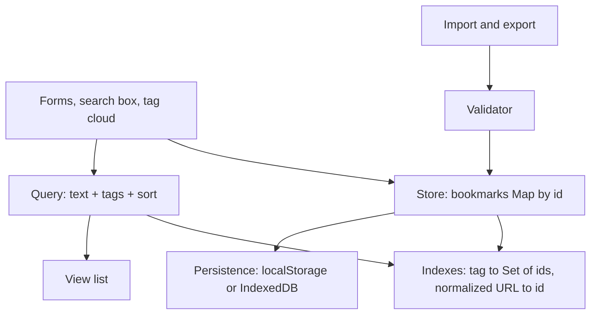
- **Store** keeps bookmarks in a `Map` keyed by id for O(1) updates.
- **Indexes** are derived: `tag → Set<id>` and `normalizedUrl → id` for duplicate checks; rebuilt on load and updated on each change.
- **Query** intersects tag sets (ES2025 `Set.prototype.intersection`), filters by text, then sorts.
- **Import/Export** validates, shows a dry-run summary, then commits.

### Data model
| Field | Type | Notes |
|---|---|---|
| `id` | string | `crypto.randomUUID()` |
| `url` | string | as entered |
| `normalizedUrl` | string | lower-case host, no default port, no trailing slash, sorted query |
| `title`, `notes` | string | |
| `tags` | string[] | lower-case, trimmed, unique |
| `createdAt`, `visits` | number | |

### Tech stack
| Component | Choice | Why |
|---|---|---|
| URL handling | `URL` class, `URL.canParse` | correct parsing instead of regex |
| Indexes | `Map`, `Set`, ES2025 set methods | fast membership and intersections |
| Search | `normalize('NFD')` + strip combining marks | "cafe" finds "Café" |
| Sorting | `Intl.Collator` | correct alphabetical order per language |
| Files | `<input type=file>` + `file.text()`, `Blob` + `URL.createObjectURL` | no server |

### Milestones
1. **CRUD + persistence** with a `Map`. *Done when* bookmarks survive reload.
2. **Normalisation and duplicates.** *Done when* adding `https://EXAMPLE.com:443/a/` after `https://example.com/a` warns of a duplicate.
3. **Tags and search.** *Done when* filtering by two tags shows only bookmarks with both, and searching "resume" finds "Résumé tips".
4. **Sorting.** *Done when* Swedish titles sort correctly with `Intl.Collator('sv')`.
5. **Import/export.** *Done when* exporting, deleting everything and importing restores identical data, and importing a malformed file changes nothing.

### Deep dive: the hard parts
**URL normalisation.** `new URL(input)` already lower-cases the scheme and host and drops default ports. Add your own rules: remove a trailing `/` on non-root paths, sort `searchParams`, drop the fragment and common tracking parameters (`utm_*`). Store both the original and the normalised form — users want to see what they typed.

**Set algebra for filters.** With an index `tag → Set<id>`, filtering by tags A and B is `index.get('a').intersection(index.get('b'))` — ES2025 methods that Node 24 and current browsers ship. Start from the smallest set for speed.

**Accent-insensitive search.** Normalise with `str.normalize('NFD').replace(/\p{M}/gu, '').toLowerCase()` on both the query and the text. Pre-compute a search string per bookmark when it is saved so each keystroke only does `includes`.

**Safe import.** Treat the file as untrusted: parse inside `try/catch`, check it is an array, validate each record (URL parses, tags are strings, sizes are bounded), and re-generate ids on conflict. Commit only after the user confirms the preview — a **two-phase** import.

### Testing strategy
Unit-test `normalizeUrl` with a table of equivalent and non-equivalent URLs, the query engine with fixture data, and the import validator with malformed files (wrong types, huge strings, prototype-pollution keys like `__proto__`). Use `structuredClone` to compare data before and after a round trip.

### Trade-offs, scaling and failure modes
A full in-memory scan is fine up to tens of thousands of entries; beyond that build an inverted index of words. `localStorage` is enough for a few thousand bookmarks; IndexedDB scales further but is asynchronous. Normalisation can merge URLs that a site treats as different (case-sensitive paths) — only lower-case the host.

### Stretch goals
- Import the Netscape HTML bookmark format browsers export, parsed with `DOMParser`.
- Fuzzy search with a small edit-distance scorer.
- Dead-link checker that reuses Project 25's ideas through a small Node script.

### Skills practised
- [Ch 5 — Objects and JSON](../chapters/05-objects-math-date-and-json/README.md): validation, `structuredClone`.
- [Ch 7 — Arrays](../chapters/07-arrays/README.md): sorting with comparators and collators.
- [Ch 8 — Maps and Sets](../chapters/08-maps-sets-iterators-and-generators/README.md): indexes, ES2025 set methods.
- [Ch 14 — Browser APIs](../chapters/14-browser-apis-and-security/README.md): `URL`, files, storage.

### In the interview
**Q:** Why use `Map` instead of an object for the store? **A:** Any key type, guaranteed insertion order, `size`, and no prototype keys like `__proto__` to collide with user data.

**Q:** How do you sort strings correctly for users? **A:** `Intl.Collator` (or `localeCompare`) with the user's locale; the default sort compares UTF-16 code units, so "Z" comes before "a".

**Q:** How do you import untrusted JSON safely? **A:** Parse in `try/catch`, validate shape and sizes, ignore dangerous keys, preview, then commit atomically.

### TL;DR
Normalise URLs with `URL`, index tags with `Map` and ES2025 `Set` methods, search on pre-normalised text, sort with `Intl.Collator`, and import files in two validated phases.

## 10. Snake game on canvas

**Level:** Beginner · **Time:** 1–2 weekends · **Prerequisites:** Ch 7, Ch 9, Ch 14

### What it is
The classic Snake: steer a growing snake around a grid with arrow keys or swipes, eat food to grow and score, and avoid walls and your own tail. It draws on an HTML `<canvas>` with a **game loop** — a function that repeatedly updates the world and redraws it.

### The problem it solves
Games make two ideas concrete that most apps hide: a **fixed timestep** (the game logic advances in equal steps regardless of screen refresh rate) and **input buffering** (two quick key presses within one step must not be lost or allow the snake to reverse into itself). Canvas also shows a different rendering model from the DOM: you draw pixels and redraw everything each frame.

### Real-world examples
- MDN's [2D breakout game in pure JavaScript](https://developer.mozilla.org/en-US/docs/Games/Tutorials/2D_Breakout_game_pure_JavaScript) tutorial walks through a canvas game loop, collision detection and input.
- Glenn Fiedler's ["Fix Your Timestep!"](https://gafferongames.com/post/fix_your_timestep/) explains the accumulator pattern that decouples simulation steps from rendering.

### Requirements
**Functional**
- Grid of 20×20 cells; snake moves one cell per step; speed increases with score.
- Arrow keys / WASD; swipe on touch screens; pause with P or when the tab is hidden.
- Food never spawns on the snake; game over on wall or self collision (or wrap-around mode).
- Score, high score, restart.

**Non-functional**
- Same game speed on 60 Hz and 120 Hz displays.
- Crisp drawing on high-DPI screens (no blur).
- Step logic independent of the canvas, runnable in Node.

### The architecture
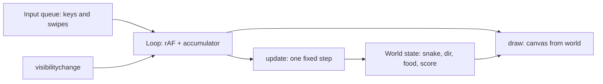
- **Input queue** stores up to two pending direction changes, rejecting reversals relative to the *last queued* direction.
- **Loop** runs on `requestAnimationFrame`, adds elapsed time to an accumulator, and calls `update` once per full step (e.g. every 120 ms).
- **update** is a pure-ish function from world to world; **draw** only reads.

### Data model
| Field | Type | Notes |
|---|---|---|
| `snake` | `{x, y}[]` | head first |
| `occupied` | `Set<string>` | `"x,y"` keys for O(1) collision checks |
| `dir`, `queue` | `{x, y}`, `{x, y}[]` | current direction, pending inputs |
| `food` | `{x, y}` | |
| `stepMs`, `score`, `state` | number, number, `'running' \| 'paused' \| 'over'` | |

### Tech stack
| Component | Choice | Why |
|---|---|---|
| Rendering | Canvas 2D | hundreds of cells redrawn cheaply |
| Loop | `requestAnimationFrame` + accumulator | smooth, refresh-rate independent |
| High DPI | scale backing store by `devicePixelRatio` | sharp edges |
| Model | class `World` with `step()` | testable without a canvas |

### Milestones
1. **Static grid and snake** drawn on canvas, sharp on a retina screen. *Done when* lines are crisp at 2× zoom.
2. **Movement with a fixed step.** *Done when* the snake moves at the same speed with DevTools rendering at 30 fps and at 120 fps.
3. **Food, growth, collisions.** *Done when* tests cover eating, wall death and self-collision.
4. **Input buffering.** *Done when* pressing Up then Left within one step (while moving right) turns up then left, and pressing Left alone does nothing.
5. **Polish.** Pause on hidden tab, swipe controls, high score. *Done when* switching tabs pauses and resuming does not jump.

### Deep dive: the hard parts
**Fixed timestep.** Each frame, add `now - last` to an accumulator; while it is at least `stepMs`, run `update()` and subtract `stepMs`. Rendering happens once per frame. Cap the accumulator (say 5 steps) so returning from a long pause does not fast-forward the game into a wall.

**The reversal bug.** Moving right, the player presses Up then Left very fast. If you only check "new direction is not opposite of *current*", both are accepted, the second overwrites the first before a step runs, and the snake turns left into itself. Queue directions and validate each against the previous queued one, consuming one per step.

**Spawning food.** Picking random cells until one is free gets slow when the snake fills the board. When occupancy is high, build the list of free cells and pick one; it is O(cells) but always finishes.

**High-DPI canvas.** Set `canvas.width = cssWidth * devicePixelRatio`, keep the CSS size unchanged, and `ctx.scale(dpr, dpr)`. Otherwise the browser stretches a low-resolution bitmap.

### Testing strategy
`World` is pure: test `step()` with constructed states (snake about to eat, about to hit a wall, tail moving out of the way the same step the head moves in). Test the input queue separately. Inject a seeded RNG for food placement.

### Trade-offs, scaling and failure modes
Canvas is fast for many moving shapes but is not accessible by default — add an off-screen live region announcing score and game over. A DOM grid of 400 divs would also work and be inspectable, but redrawing classes each step costs more. Moving into the cell the tail is leaving is legal; forgetting that is a common off-by-one.

### Stretch goals
- Smooth interpolated movement between grid cells.
- Obstacles and levels loaded from JSON modules (`import level from './1.json' with { type: 'json' }`).
- An AI player using BFS to reach food (see [Ch 17](../chapters/17-javascript-for-interviews/README.md)).

### Skills practised
- [Ch 7 — Arrays](../chapters/07-arrays/README.md): the snake as a queue (`unshift` head, `pop` tail).
- [Ch 9 — Classes](../chapters/09-this-prototypes-and-classes/README.md): a `World` class with methods.
- [Ch 14 — Browser APIs](../chapters/14-browser-apis-and-security/README.md): `requestAnimationFrame`, visibility.

### In the interview
**Q:** Why not move the snake inside `requestAnimationFrame` directly? **A:** rAF runs at the display's refresh rate, so speed would differ between 60 Hz and 120 Hz screens; a fixed-step accumulator keeps logic rate-independent.

**Q:** How do you check self-collision fast? **A:** Keep a `Set` of occupied cell keys alongside the array; update both on each step for O(1) checks.

**Q:** Why does a canvas look blurry on retina screens? **A:** Its backing bitmap is in CSS pixels; scale it by `devicePixelRatio`.

### TL;DR
A fixed-step loop on `requestAnimationFrame`, a validated input queue, a `Set` for collisions and a DPR-scaled canvas make Snake correct on every screen.

## 11. Infinite-scroll image search

**Level:** Intermediate · **Time:** 1 week · **Prerequisites:** Ch 12, Ch 13, Ch 14

### What it is
An image search page: type a query, see a grid of photos, and keep scrolling — more results load automatically before you reach the bottom. Search-as-you-type is **debounced**, stale requests are **cancelled**, new pages are triggered by an **`IntersectionObserver`** (a browser API that tells you when an element enters or leaves the viewport), and images load lazily with reserved space so the layout does not jump.

### The problem it solves
Naive infinite scroll listens to `scroll`, reads `scrollTop` on every event, fires duplicate requests, shows results for an old query and shifts the page as images arrive. Each of those is a classic interview topic. This project fixes all of them with the right primitive for each: debounce for typing, `AbortController` for stale requests, an observer for "near the bottom", and intrinsic sizes for layout stability.

### Real-world examples
- The [Unsplash API documentation](https://unsplash.com/documentation) describes `GET /search/photos` with `page` and `per_page` (max 30), a demo-mode limit of 50 requests per hour, and a requirement to hotlink the returned image URLs.
- MDN's [Intersection Observer API](https://developer.mozilla.org/en-US/docs/Web/API/Intersection_Observer_API) guide explains `rootMargin` and thresholds — the knobs that make prefetching work.

### Requirements
**Functional**
- Search box with 300 ms debounce; Enter searches immediately.
- Grid of results; next page loads when a sentinel element is within 800 px of the viewport.
- Loading, empty, error and "end of results" states; retry button on error.
- Query and page reflected in the URL (`?q=cats`), so reload and back work.
- Click opens a large view in a `<dialog>` with author credit.

**Non-functional**
- At most one in-flight request per query; zero responses from old queries rendered.
- Cumulative Layout Shift (CLS) under 0.1 while images load.
- Stays under the API's rate limit: cache pages per query for the session.
- Works without the API key during development via a mock server or fixtures.

### The architecture
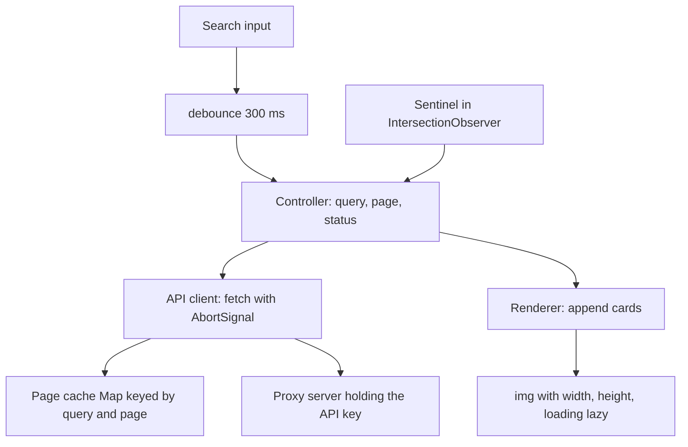
- **Controller** is a small state machine: `idle → loading → ready | error | done`. It refuses to load the next page while `loading`, and it resets page and grid when the query changes.
- **API client** owns the current `AbortController`; a new query aborts the old one.
- **Proxy server** (a 30-line Node script) adds the secret key so it never reaches the browser.
- **Renderer** appends a `DocumentFragment` of cards per page — one DOM insertion per page.

### Data model
| Type | Fields |
|---|---|
| `Photo` | `id`, `thumbUrl`, `fullUrl`, `width`, `height`, `alt`, `author`, `authorUrl` |
| `PageResult` | `photos`, `totalPages` |
| `State` | `query`, `page`, `status`, `requestId`, `hasMore` |
| Cache | `Map<"query:page", PageResult>` |

### Tech stack
| Component | Choice | Why |
|---|---|---|
| Debounce | closure over `setTimeout` id | 10 lines, reusable |
| Cancellation | `AbortController` per query | real cancellation, not just ignoring |
| "Near bottom" | `IntersectionObserver` with `rootMargin: '800px'` | no scroll handler, no layout reads |
| Images | `loading="lazy"`, `decoding="async"`, `width`/`height` attributes | native lazy loading and no layout shift |
| Proxy | `node:http` + `fetch` (Node 24) | hides the key |

### Milestones
1. **Fixture-driven grid.** Render a page from a local JSON file. *Done when* the grid looks right on mobile and desktop.
2. **Search with debounce and abort.** *Done when* typing "kitten" quickly triggers one request and the Network panel shows earlier ones as cancelled.
3. **Infinite scroll.** *Done when* scrolling loads page 2, 3… with no duplicates and stops at the last page.
4. **Layout stability.** *Done when* Lighthouse reports CLS under 0.1.
5. **URL state and dialog.** *Done when* reload restores the query, and Escape closes the large view and returns focus to the thumbnail.

### Deep dive: the hard parts
**Debounce, cancel, and request ids.** Debounce reduces requests; it does not prevent races, because a slow response from request 1 can still arrive after request 2. Abort the previous request when starting a new one, and also stamp each request with `++requestId` and drop any response whose id is not current — the abort may arrive after the body has already been parsed.

**Why an observer beats a scroll listener.** A `scroll` handler runs many times per frame and usually reads `scrollTop`/`offsetHeight`, forcing layout. `IntersectionObserver` is computed by the browser off the critical path and calls you only when the sentinel crosses the margin. Keep one sentinel after the grid; after appending a page, the observer fires again automatically if the sentinel is still visible (very tall screens), so you need no extra check.

**No layout shift.** An `` without size takes zero height until it loads, then pushes everything down. Set `width` and `height` attributes from the API's dimensions (the browser derives the aspect ratio) and use CSS `width: 100%; height: auto`. A blurred placeholder colour (the API's dominant colour) makes it feel faster.

**DOM growth.** After 50 pages you have 1,500 cards and memory grows. Either cap the history (remove cards far above the viewport and keep a spacer) or accept it and document it. Project 22 implements full virtualisation.

### Testing strategy
Unit-test `debounce` with fake timers, the controller's transitions with a mocked client, and the cache. In jsdom, `IntersectionObserver` does not exist — inject an observer factory and trigger it manually in tests. End-to-end, run Playwright against the proxy with fixtures to assert no duplicate ids after scrolling.

### Trade-offs, scaling and failure modes
Infinite scroll is great for browsing but bad for reaching the footer and for sharing a position; consider a "Load more" button or page numbers for search results users compare. Prefetch margin trades bandwidth for smoothness. If the API returns 429 (too many requests), back off and show a message rather than retrying in a loop.

### Stretch goals
- Masonry layout with CSS grid and `grid-row: span n` from aspect ratios.
- Restore scroll position on Back using `history.state`.
- Offline cache of viewed pages with a service worker.

### Skills practised
- [Ch 12 — Async](../chapters/12-asynchronous-javascript/README.md): debounce, `AbortController`, race conditions.
- [Ch 13 — DOM and events](../chapters/13-dom-and-events/README.md): fragments, reflow and layout thrashing.
- [Ch 14 — Browser APIs](../chapters/14-browser-apis-and-security/README.md): `fetch`, `IntersectionObserver`, `URL`, History API.

### In the interview
**Q:** How would you implement infinite scroll? **A:** A sentinel element after the list observed by `IntersectionObserver` with a generous `rootMargin`; a loading flag prevents duplicate fetches; append with a fragment; stop when the API says there are no more pages.

**Q:** Does debounce prevent race conditions? **A:** No. It reduces how many requests start; cancel stale ones with `AbortController` and ignore responses whose request id is outdated.

**Q:** How do you prevent layout shift from images? **A:** Reserve space with `width`/`height` attributes or `aspect-ratio`, and lazy-load below the fold.

### TL;DR
Debounce the input, abort and id-check every request, let an `IntersectionObserver` sentinel ask for the next page, and give every image its size up front.

## 12. Kanban board with drag and drop

**Level:** Intermediate · **Time:** 1–2 weeks · **Prerequisites:** Ch 9, Ch 13, Ch 14

### What it is
A Trello-style board: columns (To do, Doing, Done) holding cards you can drag within and between columns, plus add, edit, delete and reorder columns. It persists locally, supports keyboard reordering, and syncs across tabs. You implement drag and drop yourself using **Pointer Events** — a unified API for mouse, pen and touch input.

### The problem it solves
Drag and drop is where UI code gets messy: hit-testing which slot the pointer is over, auto-scrolling a column, touch support, accessibility for people who cannot drag, and storing order so that moving one card does not rewrite every other card. It is an excellent lesson in separating **interaction state** (what is being dragged, where it would drop) from **data state** (the board).

### Real-world examples
- Atlassian's open-source [Pragmatic drag and drop](https://github.com/atlassian/pragmatic-drag-and-drop) library powers drag and drop in its products and is framework-agnostic — worth reading after you build your own.
- Figma's post [Realtime editing of ordered sequences](https://www.figma.com/blog/realtime-editing-of-ordered-sequences/) explains **fractional indexing**: giving each item a sortable position *between* its neighbours so a move changes one record.
- MDN's [HTML Drag and Drop API](https://developer.mozilla.org/en-US/docs/Web/API/HTML_Drag_and_Drop_API) explains the native API and, implicitly, why many apps avoid it (no touch support, limited styling of the drag image).

### Requirements
**Functional**
- Drag cards within and across columns with a placeholder showing the drop slot; drag columns to reorder.
- Works with mouse, touch and pen; long-press to start on touch.
- Keyboard: focus a card, Space to pick up, arrows to move, Space to drop, Escape to cancel; announcements via a live region.
- Card editing in a `<dialog>`; labels and due dates; filter by label.
- Persistence in `localStorage`, cross-tab sync, undo last move.

**Non-functional**
- Dragging stays at 60 fps on a board with 500 cards.
- A move writes one card record (its new column and position), not the whole column.
- Auto-scroll when dragging near a column's top or bottom edge.

### The architecture
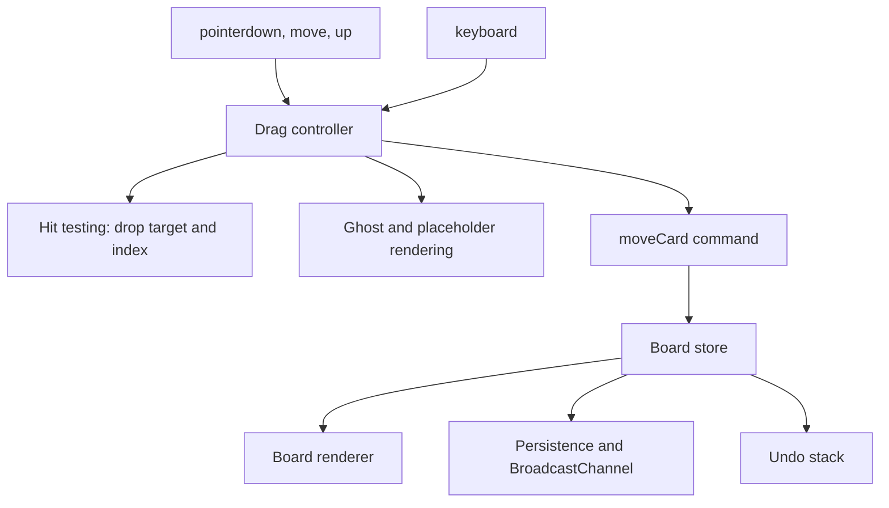
- **Drag controller** is a class with states `idle → pressed → dragging → dropping`; it captures the pointer with `setPointerCapture` so it keeps receiving moves even outside the element.
- **Hit testing** caches column and card rectangles at drag start and finds the slot by comparing the pointer's y to card midpoints.
- **moveCard command** is the only way data changes; it is recorded for undo.
- **BroadcastChannel** (a same-origin messaging API) tells other tabs to reload.

### Data model
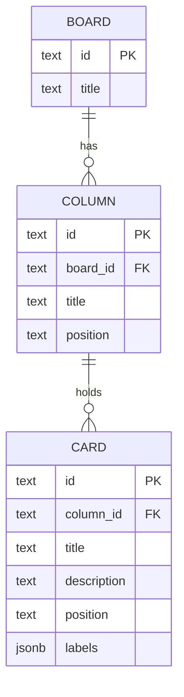
`position` is a fractional-index string such as `"a0"`, `"a0V"`; sorting by it gives the order.

### Tech stack
| Component | Choice | Why |
|---|---|---|
| Input | Pointer Events + `setPointerCapture` | one code path for mouse, touch, pen |
| Ordering | fractional index strings | a move updates one card |
| Movement | CSS `transform: translate()` on the ghost | no layout per frame |
| Sync | `BroadcastChannel('board')` | explicit cross-tab messages |
| Dialog | `<dialog>` + `showModal()` | built-in focus trapping and Escape |

### Milestones
1. **Render a board** from JSON, sorted by position. *Done when* cards appear in stored order.
2. **Mouse drag within a column.** *Done when* the placeholder follows the pointer and drop updates exactly one card's position.
3. **Across columns, touch, auto-scroll.** *Done when* a card can be moved across columns on a phone.
4. **Keyboard dragging and announcements.** *Done when* the whole board can be rearranged without a pointer and a screen reader announces each step.
5. **Persistence, sync, undo.** *Done when* a move in tab A appears in tab B and Ctrl+Z undoes it.

### Deep dive: the hard parts
**Fractional indexing.** Storing integers 0, 1, 2… means a move renumbers every card after it. Instead, generate a key strictly between the neighbours' keys (`between("a0", "a1")` → `"a0V"`). Keys are strings over a base-62 alphabet compared lexicographically, so they can always be extended. Occasionally rebalance if keys grow long.

**Hit testing without thrashing.** Calling `getBoundingClientRect()` on every card during every `pointermove` forces layout repeatedly. Measure once at drag start (and after auto-scroll), store rectangles in an array, and binary-search by y. Move only the ghost with `transform` inside `requestAnimationFrame`.

**Touch and scrolling.** On touch screens a drag competes with page scrolling. Set `touch-action: none` on drag handles, or start dragging only after a 200 ms long-press without movement. Cancel on `pointercancel`, which the browser fires when it takes over the gesture.

**Accessibility.** Drag and drop must have a non-pointer equivalent. Keyboard pick-up/move/drop with live announcements ("Card Fix login, position 2 of 5 in Doing") meets that need; a "Move to…" menu is a simpler alternative.

### Testing strategy
Unit-test `between(a, b)` exhaustively (random pairs, always strictly between, always sortable) and `moveCard`. Test the drag controller's state machine with synthetic pointer events in jsdom, stubbing rectangles. Use Playwright for one real touch and mouse drag each.

### Trade-offs, scaling and failure modes
The native HTML drag-and-drop API gives file drops and cross-window drags but no touch on many devices and limited styling; Pointer Events need more code but you control everything. Fractional keys make concurrent moves by two users merge cleanly, but two users inserting at the same spot can generate the same key — add a client-id suffix. Large boards need virtualised columns (Project 22).

### Stretch goals
- Multi-select drag.
- A Node + WebSocket backend so several people share a board (combine with Project 14).
- Swimlanes (rows by assignee).

### Skills practised
- [Ch 9 — Classes](../chapters/09-this-prototypes-and-classes/README.md): a drag controller with explicit states.
- [Ch 13 — DOM and events](../chapters/13-dom-and-events/README.md): pointer events, layout thrashing, `<dialog>`.
- [Ch 14 — Browser APIs](../chapters/14-browser-apis-and-security/README.md): `requestAnimationFrame`, storage, cross-tab messaging.

### In the interview
**Q:** How do you store order so a move is cheap? **A:** Fractional indexing — each item gets a sortable key between its neighbours, so moving one item updates one record.

**Q:** Pointer Events vs HTML5 drag and drop? **A:** HTML5 DnD handles files and cross-app drags but is weak on touch and styling; Pointer Events unify input and give full control at the cost of writing hit testing yourself.

**Q:** How do you keep dragging smooth? **A:** Measure layout once, move the ghost with `transform` in `requestAnimationFrame`, and avoid reading layout inside move handlers.

### TL;DR
Pointer Events with capture, cached hit-test rectangles, a transform-only ghost, fractional-index positions and a keyboard alternative make drag and drop smooth, cheap to store and accessible.

## 13. Markdown editor with live preview

**Level:** Intermediate · **Time:** 1–2 weeks · **Prerequisites:** Ch 6, Ch 13, Ch 14

### What it is
A split-pane editor: write **Markdown** (a plain-text format where `# Title` becomes a heading and `**bold**` becomes bold) on the left and see rendered HTML on the right, updating as you type. You write your own parser for a useful subset, sanitise its output, sync scrolling between panes, and save documents locally.

### The problem it solves
It teaches two skills at once: **parsing** text into a tree (and turning the tree into HTML), and **rendering untrusted HTML safely**. Markdown allows raw HTML, so a preview that simply sets `innerHTML` is a stored XSS bug waiting for someone to paste `` into a shared note.

### Real-world examples
- The [CommonMark spec](https://spec.commonmark.org/) is a precise, test-backed definition of Markdown; its example cases make a ready-made test suite for your parser.
- [marked](https://github.com/markedjs/marked) is a widely used JavaScript Markdown parser; its README warns that it does not sanitise output.
- [DOMPurify](https://github.com/cure53/DOMPurify) is the standard client-side HTML sanitiser, recommended in OWASP's [XSS prevention cheat sheet](https://cheatsheetseries.owasp.org/cheatsheets/Cross_Site_Scripting_Prevention_Cheat_Sheet.html).

### Requirements
**Functional**
- Block elements: headings, paragraphs, block quotes, ordered/unordered lists (nested), fenced code, horizontal rules, tables.
- Inline: emphasis, strong, code spans, links, images, autolinks, escaping with `\`.
- Toolbar and shortcuts (Ctrl+B, Ctrl+I, Ctrl+K) that wrap the selection.
- Synced scrolling; word count; multiple documents in IndexedDB; export `.md` and `.html`.

**Non-functional**
- Preview updates within 50 ms for a 20-page document.
- Zero script execution from document content, verified by tests with known XSS payloads.
- Parser passes the CommonMark examples for the subset you claim.

### The architecture
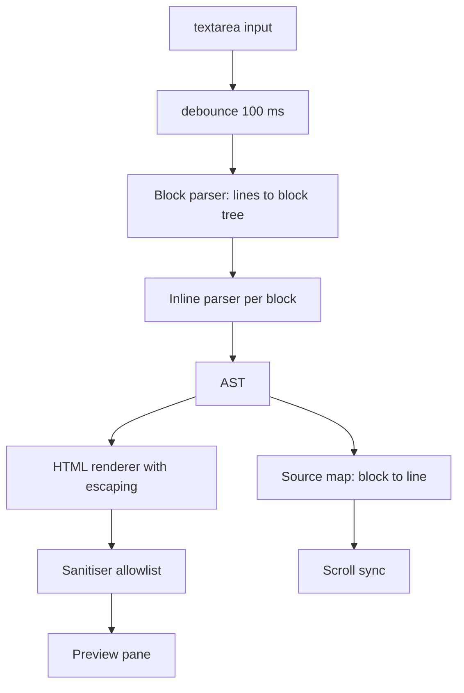
- **Block parser** walks lines and decides block structure (is this line continuing a list? opening a fence?).
- **Inline parser** turns each block's text into text, emphasis, code and link nodes.
- **AST** (abstract syntax tree) is a plain object tree: `{ type: 'heading', level: 2, children: [...] }`.
- **Renderer** escapes all text; **sanitiser** removes anything not on an allowlist, including from raw HTML blocks.
- **Source map** records each block's starting line so scroll positions can be matched.

### Data model
| Type | Fields |
|---|---|
| `Doc` (IndexedDB) | `id`, `title`, `body`, `updatedAt` |
| `Node` | `type`, `children?`, `value?`, plus type-specific fields (`level`, `href`, `lang`) |
| `BlockInfo` | `node`, `startLine`, `endLine` |

### Tech stack
| Component | Choice | Why |
|---|---|---|
| Parser | hand-written two-phase (block, inline) | mirrors how CommonMark is specified |
| Escaping | own `escapeHtml` for `& < > " '` | needed for every text node |
| Sanitising | DOMPurify, or the Sanitizer API where available | battle-tested allowlist |
| Links | allow only `http:`, `https:`, `mailto:` schemes | blocks `javascript:` URLs |
| Storage | IndexedDB | many documents, larger than `localStorage` |

### Milestones
1. **Headings and paragraphs** with escaping. *Done when* `# <b>hi</b>` renders a heading containing literal `<b>`.
2. **Inline parsing.** *Done when* `**a *b* c**` and `` `code with *stars*` `` render correctly.
3. **Lists, quotes, fences, tables.** *Done when* a set of CommonMark examples for these pass.
4. **Sanitisation.** *Done when* a test list of XSS payloads (``, `[x](javascript:alert(1))`, `<svg onload>`) produces no executable output.
5. **Editor features.** *Done when* shortcuts, scroll sync and multi-document save work.

### Deep dive: the hard parts
**Two phases.** Block structure must be known before inline parsing, because `*` at the start of a line means a list item but in the middle means emphasis. Parse blocks line by line with a stack of open containers (quote, list, list item); then inline-parse the text inside each leaf block.

**Emphasis is tricky.** `*a **b** c*` and `**a*` require a **delimiter stack**: record runs of `*`/`_`, then match closers to openers with rules about word boundaries. Start simple (non-nested, same-length matches), and use CommonMark's examples to find the gaps.

**Escaping vs sanitising.** Escaping turns text into safe text (`<` → `&lt;`) and is always required for text nodes. Sanitising removes dangerous elements and attributes from HTML you *intend* to allow (raw HTML blocks). Do both, and check link URLs: `new URL(href, base).protocol` must be on the allowlist.

**Fast preview.** Re-parsing 20 pages on each keystroke is fine if the parser is linear, but replacing the whole preview's HTML resets images and scroll. Render to a string, then compare per block (by source hash) and replace only changed blocks.

### Testing strategy
Load CommonMark spec examples (they are published as JSON) and run your subset as table-driven tests, tracking a pass rate. A separate security suite feeds payloads from the OWASP cheat sheet and asserts no `on*` attributes, no `script`, no `javascript:` URLs. Unit-test the toolbar's selection-wrapping.

### Trade-offs, scaling and failure modes
Writing a parser teaches the most; for production use a spec-compliant library plus a sanitiser. Regex-only parsers break on nesting and can be **ReDoS**-prone (catastrophic backtracking on crafted input) — a linear scanner avoids that. Allowing raw HTML increases power and risk; a safe default is to escape it entirely.

### Stretch goals
- Syntax highlighting of code fences with a lazy-loaded highlighter via dynamic `import()`.
- Footnotes and task lists (GitHub-flavoured extensions).
- Run the parser in a Web Worker for very large documents.

### Skills practised
- [Ch 6 — Strings and regex](../chapters/06-strings-and-regular-expressions/README.md): scanning, regex with sticky `y` flag, escaping.
- [Ch 13 — DOM and events](../chapters/13-dom-and-events/README.md): selection, `input` events, minimal updates.
- [Ch 14 — Browser APIs and security](../chapters/14-browser-apis-and-security/README.md): XSS, sanitising, CSP, IndexedDB.

### In the interview
**Q:** What is the difference between escaping and sanitising? **A:** Escaping converts special characters so text displays literally; sanitising parses HTML and removes disallowed elements and attributes. Use escaping for text, sanitising for HTML you choose to allow.

**Q:** Why not parse Markdown with regexes? **A:** Nested structures and context-dependent markers need state; regexes alone get complex, wrong and sometimes exponentially slow.

**Q:** How else can you limit XSS impact? **A:** A Content Security Policy that disallows inline scripts and limits script sources, so injected markup cannot run code.

### TL;DR
Parse blocks then inlines into an AST, escape every text node, sanitise any allowed HTML with an allowlist (including URL schemes), and patch only changed blocks for a fast, safe preview.

## 14. Real-time chat with WebSockets and Node

**Level:** Intermediate · **Time:** 2 weeks · **Prerequisites:** Ch 12, Ch 14, Ch 15

### What it is
A multi-room chat: a browser client and a Node 24 server connected by **WebSockets** — a protocol that upgrades an HTTP connection into a long-lived, two-way channel so the server can push messages instantly. It has rooms, nicknames, typing indicators, online presence, message history and automatic reconnection.

### The problem it solves
Request-response HTTP cannot push. Polling wastes requests; real chat needs a persistent connection, and with it come new problems: connections drop silently, clients reconnect and miss messages, a slow client must not stall everyone, and every message from the network is untrusted input. This project makes those problems visible at small scale.

### Real-world examples
- [RFC 6455](https://www.rfc-editor.org/rfc/rfc6455) defines the WebSocket protocol, including the HTTP upgrade handshake, framing and ping/pong control frames.
- [ws](https://github.com/websockets/ws) is the widely used WebSocket server and client library for Node. Node 24 ships a stable browser-compatible `WebSocket` **client** as a global (stable since 22.4) but no built-in server, so a server still needs `ws` or similar.
- [Socket.IO's documentation](https://socket.io/docs/v4/) describes rooms, acknowledgements and reconnection — features you will build by hand.

### Requirements
**Functional**
- Join with a nickname; create/join rooms; list who is online per room.
- Send text messages (max 2,000 chars); show sender, time, delivery status.
- Typing indicators (throttled), join/leave notices.
- Last 50 messages per room on join; reconnect with backoff and fetch missed messages.
- Commands: `/nick`, `/me`, `/join`.

**Non-functional**
- Message fan-out latency under 100 ms on a LAN with 200 connected clients.
- Server memory bounded: per-room history capped; slow clients disconnected when their send buffer exceeds 1 MB.
- Rate limit: 5 messages per second per connection.
- Every inbound frame validated; malformed frames close the connection with code 1008 (policy violation).

### The architecture
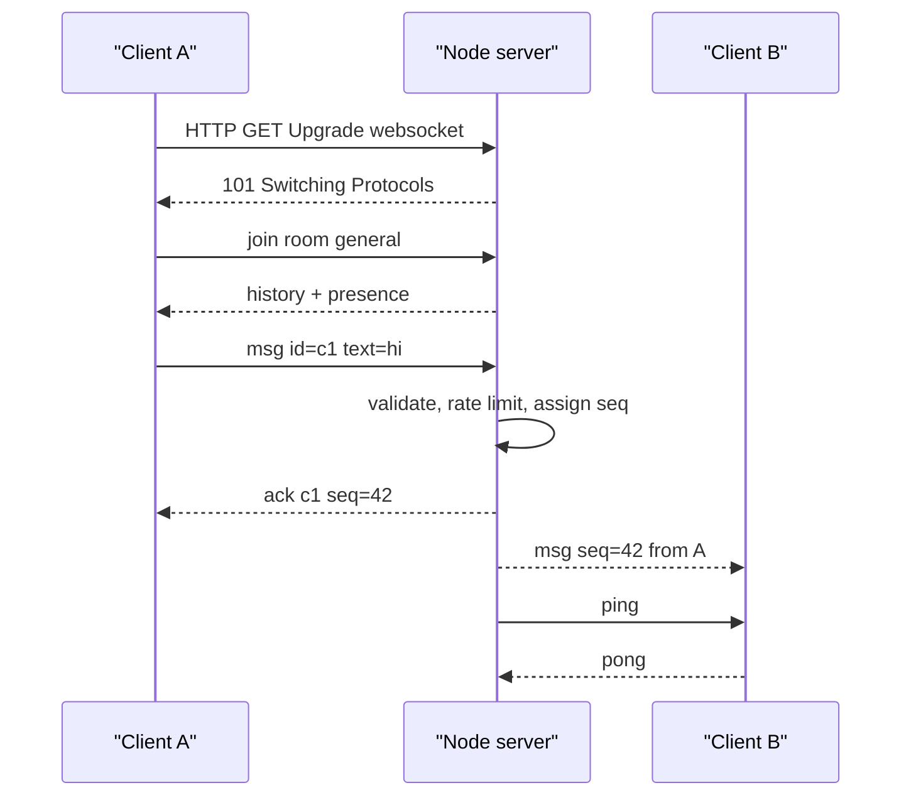
- **HTTP server** (`node:http`) serves the static client and hands upgrade requests to the WebSocket server.
- **Connection handler** parses JSON frames, validates them against a schema, applies the rate limit, and dispatches by `type`.
- **Room registry** is a `Map<roomName, Set<connection>>` plus a ring buffer of recent messages with increasing sequence numbers.
- **Heartbeat** pings every 30 s and terminates connections that did not answer the previous ping.
- **Client** wraps `WebSocket` with a reconnecting connection, an outbox of unacknowledged messages and a renderer.

### Data model
| Message (JSON) | Direction | Fields |
|---|---|---|
| `join` | client → server | `room`, `nick`, `lastSeq?` |
| `msg` | both | `clientId`, `seq` (server), `room`, `from`, `text`, `ts` |
| `ack` | server → client | `clientId`, `seq` |
| `typing` | both | `room`, `from` |
| `presence` | server → client | `room`, `users[]` |
| `error` | server → client | `code`, `message` |

### Tech stack
| Component | Choice | Why |
|---|---|---|
| Server runtime | Node 24 | event loop handles thousands of idle sockets cheaply |
| WebSocket server | `ws` | mature, handles framing, compression, backpressure signals |
| Client | browser `WebSocket` | built in |
| Validation | small hand-written schema checks | no dependency, explicit limits |
| Tests | `node:test` + Node's global `WebSocket` client | real end-to-end tests without a browser |

### Milestones
1. **Echo server.** *Done when* a browser and a Node script can connect and get their messages echoed.
2. **Rooms and broadcast.** *Done when* two browsers in the same room see each other's messages and a third room does not.
3. **Validation, rate limiting, size limits.** *Done when* a script that sends 100 messages a second gets throttled and a malformed frame closes the connection.
4. **Heartbeat and reconnect.** *Done when* killing the server and restarting it makes clients reconnect with jittered backoff and fetch missed messages by `lastSeq`.
5. **Acks, typing, presence.** *Done when* messages show "sent" only after the server ack, and typing indicators appear and expire.

### Deep dive: the hard parts
**Detecting dead connections.** TCP may not notice a vanished client (laptop lid closed) for a long time. Send WebSocket pings on an interval; mark each connection alive on pong; on the next tick, terminate any that are still not alive. The client should also treat silence beyond a timeout as a disconnect.

**Reconnect without losses or duplicates.** Give every message a server-assigned, per-room increasing `seq`. On reconnect, the client sends `lastSeq` and the server replays newer messages from its buffer. The client sends a `clientId` per outgoing message, so if it resends after a reconnect the server can drop duplicates — this makes sends **idempotent** (safe to repeat).

**Backpressure.** If one client reads slowly, the server's send buffer for it grows. Check `socket.bufferedAmount` before sending and drop or disconnect clients beyond a limit, so one slow phone does not consume the server's memory. Use exponential backoff with **jitter** (random spread) on the client so 200 clients do not reconnect in the same millisecond after a restart.

**Untrusted input.** Treat every frame as hostile: `JSON.parse` in `try/catch`, check `type`, lengths and room names, and render text with `textContent` on clients. Check the `Origin` header during the upgrade to block other sites from opening sockets with your users' cookies (cross-site WebSocket hijacking).

### Testing strategy
Start the server on port 0 in a `node:test` `before` hook and connect several clients using Node's global `WebSocket`. Test broadcast, room isolation, replay by `lastSeq`, duplicate `clientId` suppression, rate limiting and malformed frames. Use fake timers for the heartbeat logic. Load-test with a script that opens 200 connections and measures fan-out latency.

### Trade-offs, scaling and failure modes
One Node process keeps rooms in memory — simple, but a restart loses history and you cannot run two instances. To scale out, put messages through a pub/sub broker (Redis, NATS) and store history in a database; then sticky sessions are optional. **Server-Sent Events** (one-way server push over HTTP) are simpler if clients only receive. WebSockets through some corporate proxies fail — a long-polling fallback is what Socket.IO adds.

### Stretch goals
- Persist history in PostgreSQL (Project 16) and paginate older messages.
- End-to-end encryption of message bodies with Web Crypto.
- Read receipts and per-user unread counts.

### Skills practised
- [Ch 12 — Async](../chapters/12-asynchronous-javascript/README.md): event-driven code, backoff, timers.
- [Ch 14 — Browser APIs](../chapters/14-browser-apis-and-security/README.md): WebSocket, origin checks, XSS.
- [Ch 15 — Node.js basics](../chapters/15-nodejs-basics/README.md): `node:http`, upgrades, `EventEmitter`, buffers.

### In the interview
**Q:** WebSockets vs Server-Sent Events vs long polling? **A:** WebSockets are full-duplex over one connection; SSE is server-to-client only over plain HTTP with automatic reconnect; long polling simulates push with held requests. Pick SSE for feeds, WebSockets for interactive two-way traffic.

**Q:** How do you avoid missing messages on reconnect? **A:** Server-assigned sequence numbers, the client remembers the last one it saw, and the server replays from a buffer or database.

**Q:** How do you scale a WebSocket server horizontally? **A:** Share messages between instances through pub/sub, store state outside the process, and use a load balancer that supports upgrades.

### TL;DR
A WebSocket chat needs heartbeats to find dead peers, sequence numbers and client ids for lossless idempotent reconnects, backpressure limits per client, and strict validation of every frame.

## 15. Node CLI log analyser

**Level:** Intermediate · **Time:** 1 week · **Prerequisites:** Ch 10, Ch 15

### What it is
A command-line tool, `logscope`, that reads web-server access logs (files, gzipped files, or standard input), filters them (status, path pattern, time range), and prints summaries: requests per minute, top paths, error rates and latency percentiles, as a table or JSON. It installs with `npm install -g` and behaves like a good Unix citizen.

### The problem it solves
Log files can be gigabytes; reading them with `fs.readFile` crashes or stalls. A good CLI also has conventions: helpful `--help`, sensible exit codes, output to stdout and diagnostics to stderr, pipe-friendliness, and graceful handling of Ctrl+C. This project teaches **streams** — processing data piece by piece in constant memory — and the craft of command-line tools.

### Real-world examples
- The [Command Line Interface Guidelines](https://clig.dev/) collect conventions for human-first CLIs: help text, errors, output for humans vs machines, and signals.
- Node's [`util.parseArgs`](https://nodejs.org/api/util.html) parses flags without a dependency, and the [readline docs](https://nodejs.org/api/readline.html) show reading a stream line by line with `for await`.

### Requirements
**Functional**
- `logscope [files...]`; reads stdin when no file is given or the file is `-`.
- Detects `.gz` and decompresses on the fly.
- Filters: `--status 5xx`, `--path '/api/*'`, `--since 2026-09-01T00:00Z`, `--until`.
- Reports: `--top paths`, `--rate per-minute`, `--latency` (p50, p95, p99), `--format table|json|csv`.
- `--follow` tails a growing file like `tail -f`.

**Non-functional**
- Constant memory: processing a 5 GB file stays under 100 MB of RSS (resident memory).
- Throughput at least 100 MB/s on a laptop for simple filters.
- Exit codes: 0 success, 1 runtime error, 2 usage error. Errors go to stderr.
- Starts in under 100 ms (no heavy imports at start-up).

### The architecture
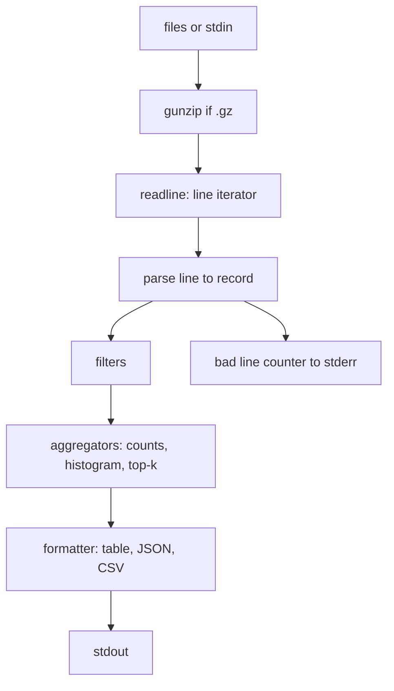
- **Input** opens each file with `fs.createReadStream` and pipes through `zlib.createGunzip()` when needed.
- **Line iterator** uses `readline.createInterface({ input })` and `for await (const line of rl)`.
- **Parser** turns a line (Common or Combined Log Format) into a record with a precompiled regex; unparseable lines are counted, not fatal.
- **Aggregators** keep bounded state: a `Map` of counts, a latency histogram with fixed buckets, a top-k list.
- **Formatter** prints; `--format json` prints one JSON document for piping into other tools.

### Data model
| Type | Fields |
|---|---|
| `Record` | `ip`, `time` (epoch ms), `method`, `path`, `status`, `bytes`, `latencyMs?`, `userAgent?` |
| `Options` | parsed flags with defaults |
| `Histogram` | bucket boundaries (ms), counts array |
| `Report` | `total`, `badLines`, `byStatus`, `topPaths`, `perMinute`, `latency` |

### Tech stack
| Component | Choice | Why |
|---|---|---|
| Arguments | `util.parseArgs` | built in, strict mode rejects unknown flags |
| Reading | `fs.createReadStream` + `readline` | line-by-line in constant memory |
| Gzip | `node:zlib` | streaming decompression |
| Glob filter | `path.matchesGlob` or a compiled regex | path patterns |
| Packaging | `package.json` `bin` field + `#!/usr/bin/env node` | installable command |

### Milestones
1. **Count lines from a file and stdin.** *Done when* `cat access.log | logscope` and `logscope access.log` print the same count.
2. **Parse and filter.** *Done when* `--status 5xx --path '/api/*'` matches a hand-checked fixture.
3. **Aggregations and formats.** *Done when* JSON output validates and the table aligns columns.
4. **Scale.** Generate a 5 GB synthetic log. *Done when* memory stays under 100 MB and you record the throughput.
5. **CLI polish.** *Done when* `--help`, exit codes, `EPIPE` handling (`logscope big.log | head`) and Ctrl+C all behave well.

### Deep dive: the hard parts
**Streams and backpressure.** A readable stream produces chunks; if the consumer is slower, data piles up in memory. `for await` over `readline` naturally pulls one line at a time, which applies **backpressure** (the producer pauses until the consumer is ready). Use `stream.pipeline` for file → gunzip → … so an error in any stage destroys all of them and closes file handles.

**Percentiles in constant memory.** Exact p99 needs every value sorted — impossible for billions of lines. Use a histogram with logarithmic buckets (1, 2, 5, 10, 20… ms): add counts as you go, then walk the cumulative counts to find the bucket where 99% is reached. You trade a little accuracy for O(1) memory.

**Being a good Unix citizen.** When output is piped to `head`, the pipe closes early and writes raise `EPIPE`; catch it on `process.stdout` and exit quietly. Detect whether stdout is a terminal (`process.stdout.isTTY`) to decide colours and table layout. On `SIGINT`, print partial results to stderr and exit with code 130, a common shell convention.

**Fast parsing.** A single precompiled regex with named groups is clear; for raw speed, split on spaces and quotes manually. Measure both with `performance.now()` on a 1 GB sample before choosing.

### Testing strategy
Unit-test the parser with real-world lines (IPv6, quotes inside user agents, missing fields), aggregators and histogram percentiles. Integration tests spawn the CLI with `child_process.spawn`, feed stdin, and assert stdout, stderr and the exit code. Keep a small gzipped fixture to test decompression.

### Trade-offs, scaling and failure modes
A single-threaded stream pipeline is usually I/O-bound; if parsing is the bottleneck, split files across `worker_threads`. Histogram percentiles are approximate — say so in the output. Log formats vary between servers; make the format pluggable rather than guessing per line.

### Stretch goals
- `--follow` that survives log rotation (file renamed and recreated).
- Use `node:sqlite` to store parsed records for ad-hoc SQL queries.
- Ship as a single executable using Node's single-executable application feature.

### Skills practised
- [Ch 10 — Modules and tooling](../chapters/10-modules-and-tooling/README.md): `bin` field, ESM packages, npm scripts.
- [Ch 15 — Node.js basics](../chapters/15-nodejs-basics/README.md): streams, `process`, exit codes, `zlib`, child processes.

### In the interview
**Q:** How do you process a file larger than memory in Node? **A:** Stream it — `createReadStream` with `readline` or a transform stream — so only a chunk is in memory, and use `pipeline` for error handling and backpressure.

**Q:** What is backpressure? **A:** A signal from a slow consumer to a fast producer to pause, so buffers do not grow without bound; Node streams expose it through `write()` returning `false` and the `drain` event.

**Q:** How do you compute p99 latency over a huge stream? **A:** A fixed-bucket or sketch-based histogram, not storing every value.

### TL;DR
Stream lines through `pipeline` and `readline`, aggregate with bounded structures like histograms, and follow CLI conventions: stdout for data, stderr for messages, clear exit codes, and clean exits on `EPIPE` and Ctrl+C.

## 16. REST API with Node, Express and PostgreSQL

**Level:** Intermediate · **Time:** 2–3 weeks · **Prerequisites:** Ch 11, Ch 12, Ch 15, Ch 16

### What it is
A production-shaped **REST API** (an HTTP interface where URLs name resources and methods like GET/POST/PATCH/DELETE act on them) for a reading-list service: users, books, shelves and reviews. You build it twice — first with bare `node:http` to see what a framework hides, then with **Express 5** — on **PostgreSQL** through the `pg` driver, with validation, pagination, error handling, migrations and integration tests.

### The problem it solves
Tutorial APIs work on the happy path. Real ones need consistent error responses, input validation, SQL-injection safety, connection pooling, pagination that stays correct as data changes, graceful shutdown and tests against a real database. This project gathers those habits into one codebase you can reuse as a template.

### Real-world examples
- [node-postgres](https://node-postgres.com/) documents pooling and parameterised queries (`$1`, `$2`), which keep user input out of SQL text.
- [Express](https://expressjs.com/) 5 forwards rejected promises from async route handlers to the error middleware, removing a common source of hung requests in Express 4.
- [RFC 9457](https://www.rfc-editor.org/rfc/rfc9457), "Problem Details for HTTP APIs", defines a standard JSON shape for error responses.

### Requirements
**Functional**
- Resources: `/users`, `/books`, `/shelves/:id/books`, `/books/:id/reviews`.
- CRUD with validation; `PATCH` for partial updates.
- List endpoints: filtering (`?author=`), sorting, **cursor pagination** (`?after=<opaque>`), `limit` capped at 100.
- Auth with a bearer token (simple: hashed API keys) and per-user ownership checks.
- Health (`/healthz`) and readiness (`/readyz`) endpoints.

**Non-functional**
- p95 latency under 50 ms for single-row reads on a laptop with 1M books.
- All errors as `application/problem+json` with no stack traces in production.
- Graceful shutdown: stop accepting, finish in-flight requests within 10 s, close the pool.
- Config from environment variables (`node --env-file=.env` in development).

### The architecture
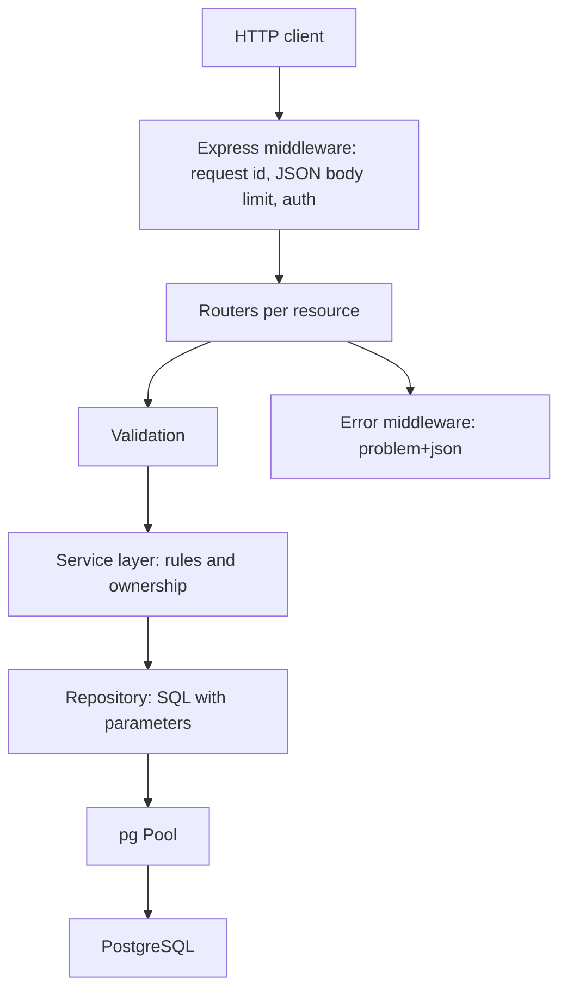
- **Middleware** adds a request id (for log correlation), limits body size, parses JSON and authenticates.
- **Routers** translate HTTP to service calls and back; no SQL here.
- **Service layer** holds business rules (only the owner may edit a shelf).
- **Repository** contains every SQL statement, always parameterised.
- **Error middleware** maps known error classes (`NotFoundError`, `ValidationError`, `ConflictError`) to status codes.

### Data model
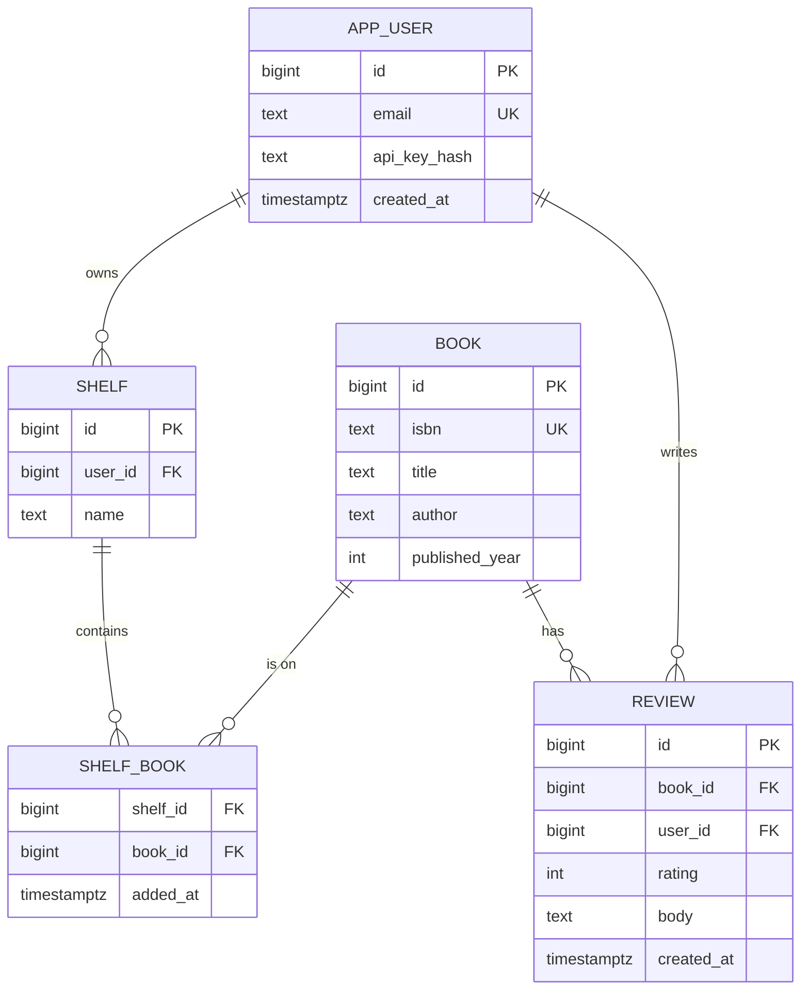

### Tech stack
| Component | Choice | Why |
|---|---|---|
| Runtime | Node 24 | built-in `fetch`, `--env-file`, `node:test` |
| Framework | Express 5 | async error forwarding, huge ecosystem |
| Database | PostgreSQL + `pg` Pool | transactions, constraints, mature driver |
| Migrations | numbered `.sql` files + a tiny runner | explicit, reviewable schema changes |
| Tests | `node:test` + a disposable database | real SQL behaviour in tests |

### Milestones
1. **Bare `node:http` version** of `GET /books/:id` and `POST /books`. *Done when* you can list what you had to do by hand (routing, body parsing, status codes).
2. **Express + schema + migrations.** *Done when* `npm run migrate` builds an empty database from scratch.
3. **CRUD with validation and problem+json.** *Done when* invalid input returns 422 with field details, unknown ids return 404, duplicate ISBN returns 409.
4. **Auth and ownership.** *Done when* user B cannot modify user A's shelf (403) and tests prove it.
5. **Pagination and performance.** *Done when* paging through 1M rows with cursors is stable and fast, verified with `EXPLAIN ANALYZE`.
6. **Operations.** *Done when* `SIGTERM` during a load test drops no requests.

### Deep dive: the hard parts
**SQL injection.** Never build SQL with template strings containing input. Use `pool.query('SELECT … WHERE id = $1', [id])`; the driver sends the value separately from the SQL text. Column names for sorting cannot be parameters — map `?sort=title` through an allowlist object to a fixed SQL fragment.

**Cursor pagination.** `OFFSET 100000` makes PostgreSQL walk and discard 100,000 rows, and rows shift if someone inserts meanwhile. Instead, sort by a unique key (`created_at, id`) and ask for rows *after* the last one seen: `WHERE (created_at, id) > ($1, $2) ORDER BY created_at, id LIMIT $3`. Encode the cursor as base64url JSON so clients treat it as opaque. Add a matching composite index.

**Transactions and the pool.** A pool hands out connections; a transaction must use the *same* client for `BEGIN … COMMIT`. Check out a client, run the statements, and release it in `finally` — or use `await using` with a disposable wrapper (explicit resource management works in Node 24) so release cannot be forgotten.

**Errors.** Throw domain errors in services; let one error middleware convert them. Map PostgreSQL error codes (`23505` unique violation → 409, `23503` foreign-key violation → 409 or 422). Log the full error with the request id; return a safe message.

### Testing strategy
Integration tests run against a real PostgreSQL (a Docker container or a local instance) with a fresh schema per test file, or wrap each test in a transaction that rolls back. Use Node 24's global `fetch` against the app listening on port 0. Unit-test validation and cursor encoding. Add a test that tries SQL injection strings in every parameter.

### Trade-offs, scaling and failure modes
Express is minimal and familiar; Fastify adds schema-based validation and speed. Cursor pagination cannot jump to page 50 — offer it only where users need it. The pool size bounds concurrency: too small queues requests, too large overwhelms PostgreSQL; start near the database's cores × 2 and measure. If the database is down, `/readyz` should fail so the load balancer stops sending traffic, while `/healthz` stays up.

### Stretch goals
- ETags and `If-None-Match` for conditional GETs.
- Full-text search on titles with a PostgreSQL `tsvector` column and GIN index.
- OpenAPI description generated from the validation schemas.

### Skills practised
- [Ch 11 — Errors](../chapters/11-errors-and-debugging/README.md): custom error classes, `cause`, `using`.
- [Ch 12 — Async](../chapters/12-asynchronous-javascript/README.md): async handlers, concurrency limits.
- [Ch 15 — Node.js basics](../chapters/15-nodejs-basics/README.md): `node:http`, `process` signals, environment.
- [Ch 16 — Testing](../chapters/16-testing-and-typescript/README.md): integration tests with `node:test`.
- The [SQL Handbook](../../sql/chapters/01-databases-and-the-relational-model/README.md) for schema design, indexes and `EXPLAIN`.

### In the interview
**Q:** How do you prevent SQL injection? **A:** Parameterised queries for values and allowlists for identifiers like sort columns; never concatenate input into SQL.

**Q:** Offset vs cursor pagination? **A:** Offset is simple and allows page jumps but slows with depth and shifts under inserts; cursor (keyset) pagination is fast and stable but sequential.

**Q:** What does graceful shutdown involve? **A:** On SIGTERM, stop accepting connections, let in-flight requests finish with a deadline, close the database pool, then exit.

### TL;DR
Layer routers, services and repositories; parameterise every query; paginate by keyset; turn domain errors into problem+json; and test against a real PostgreSQL.

## 17. Offline-first PWA notes app

**Level:** Intermediate · **Time:** 2 weeks · **Prerequisites:** Ch 12, Ch 14

### What it is
A notes app that works with no network at all, installs to the home screen as a **Progressive Web App** (PWA — a website with a manifest and a service worker that can behave like an installed app), stores notes in **IndexedDB**, and syncs with a small server when the connection returns. "Offline-first" means the local database is the primary copy and the network is a background detail.

### The problem it solves
Most web apps show a dinosaur when the train goes into a tunnel. Offline support requires three separate pieces: caching the app's own files, storing user data locally, and syncing changes both ways without losing edits. The **service worker** — a script that runs separately from the page and can intercept its network requests — makes the first possible; IndexedDB and a sync protocol handle the rest.

### Real-world examples
- web.dev's [Offline Cookbook](https://web.dev/articles/offline-cookbook) catalogues caching strategies (cache first, network first, stale-while-revalidate) and when to use each.
- Google's [Workbox](https://developer.chrome.com/docs/workbox) packages those strategies; build by hand first, then compare.
- MDN's [Service Worker API](https://developer.mozilla.org/en-US/docs/Web/API/Service_Worker_API) documents the install/activate/fetch lifecycle.

### Requirements
**Functional**
- Create, edit, delete, search notes; all work offline.
- Installable (manifest with icons, `display: standalone`).
- Background sync of changes when online; status indicator (Saved locally / Syncing / Synced).
- Conflict handling when the same note changed on two devices.
- "Update available — reload" prompt when a new version is deployed.

**Non-functional**
- Second load renders in under 1 s with the network disabled.
- No edit is ever lost: local writes are durable before the UI says "Saved".
- App shell cache under 1 MB; old caches deleted on activate.

### The architecture
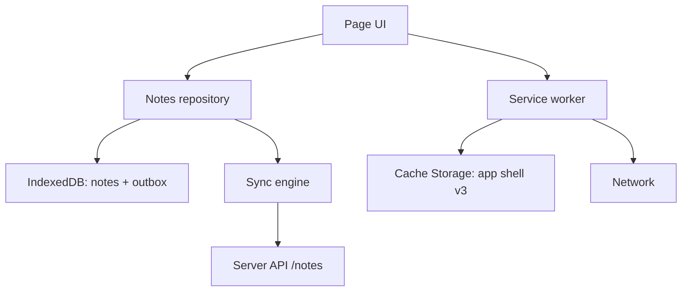
- **Notes repository** writes to IndexedDB first, then queues an operation in an **outbox** store.
- **Sync engine** runs on start, on the `online` event and periodically; it pushes the outbox and pulls changes since the last sync token.
- **Service worker** pre-caches the app shell at install, serves it cache-first, and leaves API calls to the page (network only).
- **Server** is a small Node API storing notes with a `version` counter per note.

### Data model
| Store | Key | Fields |
|---|---|---|
| `notes` | `id` | `title`, `body`, `updatedAt`, `version` (server), `dirty` (bool), `deleted` (bool) |
| `outbox` | auto-increment | `op: 'put' \| 'delete'`, `noteId`, `baseVersion`, `payload` |
| `meta` | key | `lastSyncToken`, `clientId` |

### Tech stack
| Component | Choice | Why |
|---|---|---|
| Local data | IndexedDB (raw API or a thin promise wrapper) | async, large, transactional |
| App shell | Cache Storage via service worker | offline loading |
| Sync trigger | `online` event + timer (+ Background Sync where supported) | Background Sync is not in every browser |
| Server | Node 24 + `node:sqlite` or PostgreSQL | stores versions |
| Testing | Playwright with offline mode | real service worker behaviour |

### Milestones
1. **Local-only app** on IndexedDB. *Done when* notes persist across reloads with no server at all.
2. **Service worker app shell.** *Done when* DevTools "Offline" + reload still loads the app.
3. **Push sync.** *Done when* notes created offline appear on the server after reconnecting, exactly once.
4. **Pull sync and conflicts.** *Done when* editing the same note on two browsers offline produces a visible conflict copy, not silent loss.
5. **Updates and install.** *Done when* deploying a new version shows the update prompt and old caches disappear.

### Deep dive: the hard parts
**Service worker lifecycle.** A new worker installs alongside the old one and *waits* until all tabs using the old one close. Version your cache name (`shell-v3`), pre-cache in `install`, delete other caches in `activate`, and show "reload to update" by messaging the page; call `skipWaiting()` only when the user agrees, otherwise an old page might run against new files.

**Durable before "Saved".** An IndexedDB write is durable when its transaction's `complete` event fires, not when `put()` returns. Write the note and the outbox entry in **one transaction** so you never have a note change without a queued sync (or the reverse).

**Conflicts.** Each note carries the server `version` it was based on. The server accepts a write only if `baseVersion` matches the current version (an **optimistic concurrency** check); otherwise it returns 409 with the current note. Simple policies: last-writer-wins (loses edits), or keep both as "Note (conflict copy)". Project 30 shows how CRDTs merge text automatically.

**Idempotent sync.** Network calls can succeed on the server but fail on the way back. Give each outbox operation an id and let the server ignore repeats, so retries never duplicate notes.

### Testing strategy
Unit-test the sync engine against a fake server (in-memory) covering lost responses, 409 conflicts and retries. Use Playwright to install the service worker, go offline, edit, go online and assert server state. Test the cache upgrade path by serving two builds in sequence.

### Trade-offs, scaling and failure modes
Cache-first is fast but can serve stale code — always pair it with an update flow. Browsers may evict storage under pressure unless you request `navigator.storage.persist()`. Last-writer-wins is easy and wrong for collaborative text; conflict copies are honest but annoying; CRDTs are best but complex.

### Stretch goals
- Attachments stored as `Blob`s in IndexedDB.
- End-to-end encryption so the server stores only ciphertext.
- Share target: receive text shared from other apps on mobile.

### Skills practised
- [Ch 12 — Async](../chapters/12-asynchronous-javascript/README.md): promises over event-based APIs, retries.
- [Ch 14 — Browser APIs](../chapters/14-browser-apis-and-security/README.md): service workers, IndexedDB, storage, `fetch`.

### In the interview
**Q:** What does a service worker do? **A:** It is a background script per origin that can intercept the page's network requests, serve responses from caches, and receive push and sync events; it has no DOM access.

**Q:** Cache-first vs network-first? **A:** Cache-first for versioned static assets (fast, offline); network-first for data that must be fresh, with a cache fallback.

**Q:** How do you avoid losing offline edits? **A:** Write the change and an outbox entry atomically in IndexedDB, sync idempotently, and detect conflicts with version numbers.

### TL;DR
Cache the shell in a versioned service worker, make IndexedDB the source of truth with an atomic outbox, sync idempotently with version checks, and make conflicts visible.

## 18. Test suite for a shopping-cart library

**Level:** Intermediate · **Time:** 1 week · **Prerequisites:** Ch 11, Ch 16

### What it is
You write a small shopping-cart library — line items, quantities, discount codes, tax, currency rounding, expiry of reserved stock — and, more importantly, a thorough test suite for it. The suite runs with the built-in **`node:test`** runner, and then you port part of it to **Vitest** to compare. You measure coverage, add property-based tests, and wire it into CI.

### The problem it solves
Many developers write tests that pass but prove little: they mirror the implementation, depend on the clock, or break on every refactor. This project practises testing **behaviour**, controlling time and randomness with **test doubles** (fakes, stubs and mocks that stand in for real dependencies), and using coverage as a hint, not a goal.

### Real-world examples
- Node's [test runner documentation](https://nodejs.org/api/test.html) covers `describe`/`it`, hooks, `mock.fn`, `mock.method`, mock timers, snapshots and coverage — everything this project needs without a dependency.
- [Vitest](https://vitest.dev/) offers a Jest-compatible API with watch mode and browser-like environments; it is popular in Vite-based projects.

### Requirements
**Functional (library)**
- `addItem`, `removeItem`, `setQuantity`, `applyCode`, `totals()`.
- Discounts: percentage, fixed amount, buy-X-get-Y; at most one code; minimum order rules.
- Money in integer minor units (cents); tax rounding per line using banker's or half-up rounding (choose and document).
- Reservations expire after 15 minutes (time injected).
- Serialisable to JSON and restorable.

**Functional (tests)**
- Unit tests for every public function, table-driven where possible.
- Time-dependent tests with injected clocks and `mock.timers`.
- Property-based tests: invariants hold for thousands of random carts.
- Snapshot of a receipt rendering.

**Non-functional**
- Whole suite runs in under 2 s; zero flaky tests over 100 repeated runs.
- At least 90% line coverage, with every uncovered line justified.
- CI runs tests on Node 24 for every push.

### The architecture
```mermaid
flowchart TD
    T["Test files: unit, property, snapshot"] --> L["Cart library"]
    L --> CL["Clock port"]
    L --> PR["Price catalogue port"]
    T --> F["Fakes: fixed clock, in-memory catalogue"]
    F --> CL
    F --> PR
    CI["CI workflow"] --> T
    T --> COV["Coverage report"]
```
- **Ports** are the functions the library depends on (`now()`, `getPrice(sku)`), passed in at construction — this is **dependency injection**, and it is what makes tests easy.
- **Fakes** are tiny in-memory implementations used by tests.
- **CI** runs `node --test --experimental-test-coverage`.

### Data model
| Type | Fields |
|---|---|
| `LineItem` | `sku`, `name`, `unitPrice` (cents), `qty`, `reservedUntil` |
| `Discount` | `code`, `kind: 'percent' \| 'fixed' \| 'bxgy'`, `value`, `minSubtotal` |
| `Totals` | `subtotal`, `discount`, `tax`, `total` — all integer cents |
| `CartOptions` | `now`, `taxRate`, `rounding`, `catalogue` |

### Tech stack
| Component | Choice | Why |
|---|---|---|
| Runner | `node:test` | zero dependencies, ships with Node 24 |
| Assertions | `node:assert/strict` | strict equality by default |
| Comparison runner | Vitest | watch mode, familiar API |
| Property tests | a 40-line generator using a seeded PRNG, or fast-check | find edge cases you did not think of |
| Coverage | `--experimental-test-coverage` | built in (still flagged experimental in Node 24) |

### Milestones
1. **Library skeleton with injected ports.** *Done when* constructing a cart requires no globals.
2. **Table-driven unit tests.** *Done when* every discount kind has edge rows (exactly minimum, one cent below, zero quantity).
3. **Time and mocks.** *Done when* reservation expiry is tested with `mock.timers` and no real waiting.
4. **Properties.** *Done when* 1,000 random carts confirm `total = subtotal - discount + tax` and `total >= 0`.
5. **Port to Vitest and CI.** *Done when* the same tests pass under both runners and CI shows coverage.

### Deep dive: the hard parts
**Money is integers.** `0.1 + 0.2` problems multiply with tax. Store cents as integers, multiply then round once per line with one documented rule, and test the rounding boundary (x.5 cents). For very large totals, `BigInt` avoids losing precision beyond 2^53.

**Testing behaviour, not implementation.** Assert on `totals()` and serialised output, not on private fields or how many times an internal helper was called. A good test survives a refactor that keeps behaviour the same. Use mocks only at boundaries (clock, catalogue, network).

**Property-based testing.** Instead of hand-picking inputs, generate many random carts and assert **invariants** — statements always true (totals never negative, removing then re-adding an item restores the total, JSON round-trip is lossless). When one fails, shrink the input to the smallest failing cart. This finds edge cases you would never type.

**Flakiness.** Flaky tests usually come from real time, randomness, shared state or test order. Inject clocks and seeds, create fresh carts per test, and run the suite with `--test-shuffle` and repeatedly in CI to catch order dependence.

### Testing strategy
This project *is* the testing strategy; add **mutation testing** as a check on the tests: deliberately change an operator in the library (`>=` to `>`) and confirm some test fails. If none does, a behaviour is untested.

### Trade-offs, scaling and failure modes
`node:test` needs no install and is fast; Vitest adds watch mode, richer mocking and DOM environments. Coverage can be gamed — 100% lines with weak assertions proves little. Snapshot tests are quick to write and easy to rubber-stamp; keep them small and review diffs.

### Stretch goals
- Stryker mutation testing run in CI.
- Benchmark `totals()` with 10,000 lines and add a performance budget test.
- TypeScript types for the library checked with `tsc --noEmit` (preview of Project 19).

### Skills practised
- [Ch 11 — Errors](../chapters/11-errors-and-debugging/README.md): custom error classes for invalid operations, asserting thrown errors.
- [Ch 16 — Testing](../chapters/16-testing-and-typescript/README.md): `node:test`, mocks, fake timers, snapshots, coverage.

### In the interview
**Q:** Mock, stub, fake — what is the difference? **A:** A stub returns canned answers, a fake is a working lightweight implementation, a mock also records calls so you can assert on interactions.

**Q:** How do you test code that depends on the current time? **A:** Inject a clock function or use fake timers so tests control time deterministically.

**Q:** Is 100% coverage a good goal? **A:** It shows what ran, not what was checked; aim for meaningful assertions on behaviour and use coverage to find untested areas.

### TL;DR
Design for injection, keep money in integer cents, test behaviour with tables and properties, control time and randomness, and treat coverage as a map, not a score.

## 19. TypeScript migration of a JavaScript codebase

**Level:** Intermediate · **Time:** 1–2 weeks · **Prerequisites:** Ch 10, Ch 16

### What it is
Take an existing JavaScript project — your Project 16 API or Project 12 board is ideal — and migrate it to **TypeScript** incrementally, without a big-bang rewrite and without breaking the build at any step. You start with JSDoc type checking on plain `.js`, convert file by file, tighten compiler options gradually, and finish under `strict` with types at every network boundary.

### The problem it solves
Real teams cannot stop shipping for a month to add types. A migration must be **incremental** (each commit builds and tests pass), **measurable** (you can track progress) and must avoid a false sense of safety from `any` everywhere. You also learn the practical choices: how to run `.ts` (Node 24's stable type stripping, a bundler, or `tsc`) and how to type data you do not control.

### Real-world examples
- The TypeScript handbook's [Migrating from JavaScript](https://www.typescriptlang.org/docs/handbook/migrating-from-javascript.html) guide describes `allowJs`, `checkJs` and a gradual approach.
- Airbnb open-sourced [ts-migrate](https://github.com/airbnb/ts-migrate), a codemod tool that converts files and inserts `@ts-expect-error` comments so a large codebase compiles quickly, then gets cleaned up over time.
- Node's [TypeScript docs](https://nodejs.org/api/typescript.html) explain type stripping: Node runs `.ts` by removing type annotations, without type-checking.

### Requirements
**Functional**
- Every step keeps `npm test` green and the app runnable.
- Final state: all source in `.ts`, `strict: true`, `noUncheckedIndexedAccess: true`, no unexplained `any`.
- Runtime validation at boundaries (HTTP bodies, `JSON.parse`, `localStorage`) that produces typed values.
- CI runs `tsc --noEmit` and fails on type errors.

**Non-functional**
- No runtime behaviour changes (tests prove it).
- Count of `any` and `@ts-expect-error` tracked per commit and trending to zero.
- Build or start-up time not more than 20% slower than before.

### The architecture
```mermaid
flowchart LR
    S0["Stage 0: JS + checkJs on 1 file"] --> S1["Stage 1: JSDoc types on core modules"]
    S1 --> S2["Stage 2: rename leaves to .ts"]
    S2 --> S3["Stage 3: rename the rest, allowJs off"]
    S3 --> S4["Stage 4: strict flags one by one"]
    S4 --> S5["Stage 5: boundary validation, any count zero"]
```
- **Leaves first.** Convert modules with no internal imports (utilities, models) first; their types then flow into callers.
- **Boundary types.** Data from outside enters through parse functions that return typed values or throw.
- **Tooling** — `tsconfig.json`, `tsc --noEmit` in CI, and the chosen way to run `.ts`.

### Data model
| Concept | Example |
|---|---|
| Domain types | `type Book = { id: number; title: string; year: number \| null }` |
| Discriminated unions | `type Result<T> = { ok: true; value: T } \| { ok: false; error: string }` |
| Boundary parser | `parseBook(u: unknown): Book` |
| Progress metrics | files converted, `any` count, `@ts-expect-error` count |

### Tech stack
| Component | Choice | Why |
|---|---|---|
| Checker | `tsc --noEmit` (current TypeScript) | the source of truth for types |
| Running TS in Node | `node file.ts` (type stripping, stable in Node 24) | no build step for the server |
| Browser builds | esbuild or Vite | strips types and bundles |
| Validation | hand-written guards, or a schema library such as Zod | runtime safety at boundaries |
| Tracking | a script counting `any` with the TypeScript compiler API or grep | visible progress |

### Milestones
1. **Baseline.** Add `tsconfig.json` with `allowJs`, `checkJs: false`, and `// @ts-check` in one file. *Done when* CI runs `tsc` green.
2. **JSDoc types for core modules.** *Done when* hovering in the editor shows real types for the main functions.
3. **Leaf conversion.** *Done when* half the files are `.ts` and tests pass.
4. **All files converted.** *Done when* `allowJs` is off.
5. **Strict mode.** Enable `strictNullChecks`, then `noImplicitAny`, then `strict`. *Done when* each flag lands in its own commit with zero errors.
6. **Boundaries.** *Done when* every `JSON.parse` and request body goes through a parser returning a typed value, and the `any` count is zero.

### Deep dive: the hard parts
**Type stripping rules.** Node 24 runs `.ts` by erasing types, so only **erasable syntax** works: no `enum`, no parameter properties, no namespaces with code. Imports must use `.ts` extensions, and type-only imports should use `import type`. Set `"erasableSyntaxOnly": true` and `"verbatimModuleSyntax": true` so `tsc` enforces the same rules. Type stripping never checks types — `tsc` in CI does.

**`unknown`, not `any`.** `any` turns checking off silently and spreads. Type untrusted values as `unknown`, then **narrow** them with checks (`typeof`, `in`, `Array.isArray`) or a schema. A function `parseBook(u: unknown): Book` that throws on bad input is the bridge between untyped and typed worlds.

**Strict null checks.** Turning on `strictNullChecks` surfaces every place a value may be `undefined` — usually hundreds. Fix them by improving types (return `Book | undefined` from `find`), early returns, or default values, not by sprinkling `!`. `noUncheckedIndexedAccess` makes `arr[i]` possibly `undefined`, catching real off-by-one bugs.

**Escape hatches with a deadline.** `@ts-expect-error` is better than `@ts-ignore` because it errors when the problem is fixed. Track their count in CI and require a reason comment.

### Testing strategy
The existing tests are the safety net: run them after every step. Add **type tests** for important generics (assignments that must compile and `@ts-expect-error` lines that must not). Add runtime tests for boundary parsers with malformed input.

### Trade-offs, scaling and failure modes
JSDoc keeps `.js` files and no build step, which suits small libraries; `.ts` gives richer syntax and better tooling. Type stripping removes the build step for Node but you still need `tsc` for checking. Over-precise types slow teams down; aim for types that catch real bugs. Types say nothing about runtime data — boundaries still need validation.

### Stretch goals
- Generate API types from the Project 16 OpenAPI file and share them with a client.
- Publish a library with `.d.ts` declarations and test them with a consumer project.
- Write a codemod with the TypeScript compiler API that converts one JSDoc pattern automatically.

### Skills practised
- [Ch 10 — Modules and tooling](../chapters/10-modules-and-tooling/README.md): ESM, file extensions, bundlers and transpilers.
- [Ch 16 — Testing and TypeScript](../chapters/16-testing-and-typescript/README.md): narrowing, generics, `satisfies`, type stripping, JSDoc.

### In the interview
**Q:** How would you migrate a large JS codebase to TypeScript? **A:** Incrementally: `allowJs`, convert leaves first, keep tests green, enable strict flags one at a time, validate at boundaries, track `any` counts.

**Q:** `any` vs `unknown`? **A:** `any` disables checking; `unknown` accepts anything but forces you to narrow before use, so it is safe for untrusted data.

**Q:** Does running `node app.ts` check types? **A:** No — Node strips types and runs the JavaScript; run `tsc --noEmit` separately.

### TL;DR
Migrate leaves first with tests green at every step, prefer `unknown` plus narrowing to `any`, turn on strict flags one at a time, and remember that only `tsc` — not type stripping — checks types.

## 20. Static site generator

**Level:** Intermediate · **Time:** 1–2 weeks · **Prerequisites:** Ch 6, Ch 10, Ch 15

### What it is
A Node command, `ssg build`, that turns a folder of Markdown files with **front matter** (a block of metadata like title and date at the top of a file) and HTML templates into a ready-to-host static website: pages, a blog index with pagination, tag pages, an RSS feed and a sitemap. `ssg dev` serves the site locally and rebuilds on change with live reload.

### The problem it solves
Static sites are fast, cheap and secure, and every developer eventually builds one. Writing the generator teaches file-system work at scale, templating without XSS, dependency tracking for incremental rebuilds, and a dev server with file watching — core Node skills wrapped in a useful tool.

### Real-world examples
- [Eleventy](https://www.11ty.dev/) is a JavaScript static site generator built on the same idea: data cascade, templates, collections.
- [Hugo](https://gohugo.io/) and [Astro](https://astro.build/) are other popular generators; compare their approaches to templating and partial rebuilds after you finish.

### Requirements
**Functional**
- Content in `content/**/*.md` with YAML-like front matter (`title`, `date`, `tags`, `draft`).
- Layouts in `layouts/` with a tiny template language: `{{ title }}` (escaped), `{{{ body }}}` (raw), ``, includes.
- Generated: pages, paginated index (10 per page), tag pages, `feed.xml`, `sitemap.xml`.
- Static assets copied; output in `dist/`.
- `ssg dev`: local server, watch, rebuild, live reload via Server-Sent Events.

**Non-functional**
- Full build of 1,000 pages under 3 s; incremental rebuild of one changed post under 200 ms.
- Deterministic output (same input → byte-identical files).
- Clear errors with file and line for broken front matter or templates.

### The architecture
```mermaid
flowchart TD
    FS["content, layouts, assets"] --> LD["Loader: read and parse front matter"]
    LD --> MD["Markdown to HTML (Project 13 parser)"]
    MD --> CO["Collections: posts, tags, pages"]
    CO --> TP["Template engine: compile and render"]
    TP --> WR["Writer: dist files"]
    W["fs.watch"] --> DG["Dependency graph"]
    DG --> LD
    WR --> DS["Dev server + SSE live reload"]
```
- **Loader** reads files concurrently with a limit, splits front matter from body.
- **Collections** group and sort pages (posts by date, tag → posts).
- **Template engine** compiles each template once into a function.
- **Dependency graph** records which outputs used which inputs, so a change rebuilds only what it affects.
- **Dev server** is `node:http` serving `dist/` plus an SSE endpoint that sends "reload".

### Data model
| Type | Fields |
|---|---|
| `Page` | `inputPath`, `outputPath`, `url`, `data` (front matter), `content` (HTML), `hash` |
| `Collection` | `name`, `pages` sorted |
| `Template` | `path`, compiled `render(data)`, `includes[]` |
| `DepGraph` | `Map<input, Set<output>>` |

### Tech stack
| Component | Choice | Why |
|---|---|---|
| Files | `node:fs/promises`, `fs.glob` or a recursive `readdir` | async, no dependency |
| Markdown | your Project 13 parser, or a library | reuse |
| Templates | own compiler to JS functions | learn compiling, control escaping |
| Watching | `fs.watch` with `recursive: true` | built in |
| Live reload | Server-Sent Events | one-way push, trivial client |

### Milestones
1. **One page.** Markdown + layout → `dist/index.html`. *Done when* opening the file shows the page.
2. **Front matter, collections, pagination.** *Done when* the index lists posts newest first across pages.
3. **Template engine.** Escaped and raw output, loops, includes. *Done when* a post titled `<script>` renders as text.
4. **Feeds and sitemap.** *Done when* the feed validates in a feed validator and URLs are absolute.
5. **Dev server and incremental builds.** *Done when* editing one post rebuilds only its page, the index page and its tag pages, and the browser reloads.

### Deep dive: the hard parts
**Compiling templates.** Turn `Hello {{ name }}` into a function once: tokenise into text and tag tokens, generate JavaScript source that builds a string, and create the function. Escape `{{ }}` output with an `escapeHtml` helper. Generating code from templates is how real engines are fast — but never compile templates from untrusted users, because it is code execution.

**Dependency tracking.** While rendering an output, record every input it touched: its source file, its layout, includes, and collections. When a file changes, look up dependents and rebuild just those. Changes to a layout rebuild everything using it; a new post invalidates index, tag and feed pages.

**Watching is noisy.** `fs.watch` can fire several events for one save (editors write temp files and rename). Debounce events (50 ms), collect changed paths into a `Set`, then rebuild once.

**Determinism.** Sort everything you iterate (directory listings are not guaranteed to be ordered), avoid "built at" timestamps in output, and format dates with a fixed time zone. Deterministic output makes diffs reviewable and caching effective.

### Testing strategy
Snapshot-test the build of a small fixture site (compare `dist/` file hashes). Unit-test front matter parsing (missing fence, bad syntax with line numbers), the template compiler (escaping, loops, errors) and the dependency graph. Integration-test the dev server: change a file, assert an SSE message arrives.

### Trade-offs, scaling and failure modes
Your own template language is small and safe-by-default but less powerful than JavaScript-based templates. Full rebuilds are simplest and often fast enough; incremental builds add bugs when dependencies are missed — keep a "clean build" command. Static sites cannot personalise per user without client-side JavaScript or an edge function.

### Stretch goals
- Image pipeline: generate responsive sizes and `srcset` (use `worker_threads`).
- Syntax highlighting at build time so pages ship no highlighter JavaScript.
- Plugin API with hooks (`beforeRender`, `afterWrite`) loaded with dynamic `import()`.

### Skills practised
- [Ch 6 — Strings and regex](../chapters/06-strings-and-regular-expressions/README.md): tokenising templates and front matter.
- [Ch 10 — Modules and tooling](../chapters/10-modules-and-tooling/README.md): CLI packaging, dynamic `import()` for plugins.
- [Ch 15 — Node.js basics](../chapters/15-nodejs-basics/README.md): `fs/promises`, paths, `fs.watch`, `node:http`.

### In the interview
**Q:** How does a template engine avoid XSS? **A:** Escape every interpolation by default and require an explicit raw syntax for trusted HTML.

**Q:** How would you make rebuilds incremental? **A:** Record which inputs each output read; on change, rebuild only dependents, with a clean-build fallback.

**Q:** SSE or WebSocket for live reload? **A:** SSE — the server only pushes, it runs over plain HTTP and the browser reconnects automatically.

### TL;DR
Load and parse content concurrently, compile templates to escaping functions, track dependencies for incremental rebuilds, debounce file events, and keep output deterministic.

## 21. Single-page app router

**Level:** Intermediate · **Time:** 1 week · **Prerequisites:** Ch 13, Ch 14

### What it is
A small client-side **router** library — the piece of a single-page app (SPA) that maps URLs to views without full page reloads — plus a demo app (a product catalogue with list, detail, search and 404 pages). It uses the **History API** (`pushState`, `popstate`) and **`URLPattern`** (a standard for matching URLs like `/products/:id`), supports nested layouts, data loading before render, link interception, scroll restoration and focus management.

### The problem it solves
Frameworks hide routing, so many developers never learn what breaks when a page does not reload: the Back button, scroll position, focus for screen-reader users, cancelled data loads when users click quickly, and links that must still work when opened in a new tab. Building a router makes each of those visible.

### Real-world examples
- MDN's [History API](https://developer.mozilla.org/en-US/docs/Web/API/History_API) explains `pushState`, `replaceState` and `popstate`, the classic SPA routing primitives.
- MDN's [URL Pattern API](https://developer.mozilla.org/en-US/docs/Web/API/URL_Pattern_API) documents `URLPattern`; Node 24 exposes it as a global, so your matcher can be unit-tested in Node.
- MDN's [Navigation API](https://developer.mozilla.org/en-US/docs/Web/API/Navigation_API) is a newer, single-event alternative (`navigate` event) worth comparing.

### Requirements
**Functional**
- Route table with patterns (`/`, `/products`, `/products/:id`, `/search`, `*`), nested layouts, and per-route `load()` and `render()`.
- Intercept same-origin `<a>` clicks; respect modifier keys, `target`, `download` and external links.
- Back/forward work; query strings parsed; programmatic `navigate(url, { replace })`.
- Pending UI while loading; a newer navigation cancels an older load.
- Scroll restored on Back, scroll to top on new pages, hash links scroll to the element.
- Focus moves to the new page's main heading; the document title updates.

**Non-functional**
- Router under 4 KB minified, zero dependencies.
- Route matching in under 1 ms for 100 routes.
- Deep links work on reload with a server fallback to `index.html`.

### The architecture
```mermaid
sequenceDiagram
    participant U as User
    participant L as "Link interceptor"
    participant R as Router
    participant M as Matcher
    participant D as "Route load"
    participant V as View
    U->>L: click a href=/products/42
    L->>R: navigate /products/42
    R->>R: abort previous navigation
    R->>M: match path
    M-->>R: route + params id=42
    R->>D: load params, signal
    D-->>R: data
    R->>V: render into layout outlet
    R->>R: pushState, title, focus, scroll
```
- **Link interceptor** is one delegated `click` listener on `document` that decides whether a click should become a client navigation.
- **Matcher** compiles each route to a `URLPattern` once and tests them in order.
- **Router** owns the current navigation's `AbortController` and the history entries.
- **Views** are functions that receive data and return DOM nodes; layouts render an outlet for children.

### Data model
| Type | Fields |
|---|---|
| `Route` | `path`, `pattern: URLPattern`, `load?(ctx)`, `render(ctx)`, `children?`, `title?` |
| `Match` | `route chain` (layout to leaf), `params`, `query: URLSearchParams` |
| `NavState` (in `history.state`) | `key`, `scrollY` |
| `Ctx` | `params`, `query`, `signal`, `data` |

### Tech stack
| Component | Choice | Why |
|---|---|---|
| Matching | `URLPattern` (with a tiny regex fallback for older browsers) | standard syntax, named groups |
| History | `pushState` / `popstate` | universal support |
| Cancellation | `AbortController` per navigation | stale loads never render |
| Scroll | `history.scrollRestoration = 'manual'` + saved positions | predictable behaviour |
| Server fallback | dev server that serves `index.html` for unknown paths | deep links |

### Milestones
1. **Matcher.** *Done when* Node tests show `/products/42` matches with `{ id: '42' }` and unknown paths hit `*`.
2. **Links and history.** *Done when* clicking links changes the view without reload and Back/Forward work.
3. **Loading and cancellation.** *Done when* clicking two product links quickly always shows the second product.
4. **Nested layouts.** *Done when* the layout persists while child views change.
5. **Scroll and focus.** *Done when* Back restores scroll position and a screen reader announces the new page heading.

### Deep dive: the hard parts
**Which clicks to intercept.** Only plain left clicks (`event.button === 0`) without Ctrl/Cmd/Shift/Alt, on `<a>` elements with an `href` to the same origin, without `target` other than `_self` and without `download`. Everything else must behave natively so "open in new tab" still works. Find the anchor with `event.target.closest('a')` because the click may land on an inner `<span>`.

**`popstate` is after the fact.** When the user presses Back, the URL has already changed when `popstate` fires; you cannot prevent it. Save the current scroll position into `history.replaceState` *before* every navigation, and restore it after rendering the popped entry. The Navigation API improves this with an interceptable `navigate` event.

**Race-free loading.** Each navigation creates an `AbortController`, aborts the previous one and passes the signal to `load()`. After `await load()`, check `signal.aborted` before rendering. This is the same pattern as Project 4's searches, now generalised.

**Accessibility.** Without a page load, screen readers do not announce anything. After rendering, set `document.title`, move focus to the main `<h1>` (with `tabindex="-1"`), or announce via a live region.

### Testing strategy
Unit-test the matcher and the click filter in Node (Node 24 has `URLPattern`). jsdom tests for navigation flows with mocked `load` functions resolving out of order. Playwright for real Back/Forward, scroll restoration and new-tab behaviour.

### Trade-offs, scaling and failure modes
Client routing makes navigation fast after the first load but makes the first load heavier and needs server configuration for deep links. Hash routing (`#/products/42`) needs no server config but produces uglier URLs and conflicts with in-page anchors. Lazy-loading route code with dynamic `import()` keeps the initial bundle small at the cost of a delay on first visit to each route.

### Stretch goals
- Route-level code splitting with `import()` and prefetch on link hover.
- Implement the same router on the Navigation API and compare code size.
- View Transitions between routes.

### Skills practised
- [Ch 13 — DOM and events](../chapters/13-dom-and-events/README.md): delegation, `closest`, default actions, focus.
- [Ch 14 — Browser APIs](../chapters/14-browser-apis-and-security/README.md): History API, `URL`, `URLSearchParams`.

### In the interview
**Q:** How does SPA routing work without reloading? **A:** Intercept link clicks, call `history.pushState` to change the URL, render the matching view, and handle `popstate` for Back/Forward.

**Q:** Why does a deep link 404 on reload? **A:** The server receives the path and has no such file; configure it to serve `index.html` for app routes.

**Q:** How do you avoid showing data for the wrong route? **A:** Cancel the previous navigation's loads with `AbortController` and check before rendering.

### TL;DR
Intercept only the clicks that should be client navigations, match with `URLPattern`, cancel stale loads, and restore scroll and focus yourself because no page load will.

## 22. Virtualised data grid for 100,000 rows

**Level:** Intermediate · **Time:** 2 weeks · **Prerequisites:** Ch 7, Ch 13, Ch 14

### What it is
A spreadsheet-like table that displays 100,000 rows (loaded from a CSV file) smoothly by **virtualisation** — rendering only the rows visible in the viewport plus a small buffer, and reusing those DOM nodes as you scroll. It supports sorting, filtering, column resizing, keyboard navigation and copying a selected range.

### The problem it solves
Rendering 100,000 `<tr>` elements makes a page take seconds to load, megabytes of memory and janky scrolling. Virtualisation turns rendering cost into O(visible rows). The project also exercises fast array work (sorting 100,000 objects, filtering on each keystroke) and parsing a large file without freezing the page.

### Real-world examples
- [TanStack Virtual](https://tanstack.com/virtual/latest) is a headless, framework-agnostic virtualisation library; its docs describe fixed and dynamic row sizes.
- The W3C [ARIA Authoring Practices](https://www.w3.org/WAI/ARIA/apg/patterns/) grid pattern explains `role="grid"`, `aria-rowcount` and `aria-rowindex`, needed when most rows are not in the DOM.

### Requirements
**Functional**
- Load a CSV (drag-and-drop or picker), infer column types (number, date, text).
- Smooth vertical scroll through all rows; horizontal scroll with sticky header and first column.
- Click header to sort (stable, multi-column with Shift); per-column filter inputs.
- Resize columns; arrow keys move the active cell; Shift+arrows select a range; Ctrl+C copies TSV.
- Status bar with row count, filtered count, sum/average of a selected numeric range.

**Non-functional**
- 60 fps scrolling with 100,000 rows × 20 columns; fewer than 100 rows in the DOM at any time.
- Sorting 100,000 rows under 150 ms; filtering under 50 ms per keystroke.
- CSV parsing does not freeze the UI (worker or chunked parsing).

### The architecture
```mermaid
flowchart TD
    F["CSV file"] --> P["Parser in Web Worker"]
    P --> DS["Data store: columns as arrays"]
    DS --> Q["View pipeline: filter then sort to index array"]
    Q --> VW["Viewport calculator: scrollTop to first, last"]
    VW --> RP["Row pool: reuse DOM rows"]
    S["scroll event"] --> VW
    K["keyboard and mouse"] --> SEL["Selection model"]
    SEL --> RP
```
- **Parser** streams the file (`file.stream()`), splits records with quote handling, and posts columns back as transferable arrays.
- **Data store** keeps columns as arrays (and `Float64Array` for numeric columns) — a **columnar** layout that is compact and fast to scan.
- **View pipeline** never copies rows; it produces an `Uint32Array` of row indices after filter and sort.
- **Viewport calculator** computes the visible slice from `scrollTop` and row height.
- **Row pool** keeps about 60 row elements and rewrites their text and `transform` as you scroll.

### Data model
| Structure | Type | Purpose |
|---|---|---|
| `columns` | `{ name, type, values: Array \| Float64Array }[]` | the data, columnar |
| `viewIndex` | `Uint32Array` | row order after filter/sort |
| `rowHeight` | number (px) | fixed height simplifies maths |
| `selection` | `{ anchor: {r, c}, focus: {r, c} }` | active cell and range |
| `sortSpec` | `{ col, dir }[]` | multi-column sort |

### Tech stack
| Component | Choice | Why |
|---|---|---|
| Rendering | DOM rows positioned with `transform: translateY` | text selection and accessibility stay native |
| Spacer | one tall element with height `rows × rowHeight` | real scrollbar |
| Numbers | `Float64Array` | compact, fast comparisons |
| Sorting | `viewIndex.sort` with a comparator reading columns; `Intl.Collator.compare` for text | stable since ES2019 |
| Parsing | Web Worker + streaming | keeps main thread free |

### Milestones
1. **Naive table** with 100,000 rows. *Done when* you record load time and memory as your baseline.
2. **Fixed-height virtualisation.** *Done when* scrolling is smooth and the DOM never holds more than 100 rows.
3. **Worker CSV parsing and type inference.** *Done when* a 50 MB CSV loads without the UI freezing (the spinner keeps animating).
4. **Sort and filter on an index array.** *Done when* sorting meets the 150 ms budget measured with `performance.now()`.
5. **Keyboard, selection, copy, ARIA.** *Done when* the active cell stays visible while arrowing and Ctrl+C pastes correctly into a spreadsheet.

### Deep dive: the hard parts
**The maths.** With fixed row height `h`, the first visible row is `Math.floor(scrollTop / h)`, the count is `Math.ceil(viewportHeight / h) + 1`; add an **overscan** of 5–10 rows on each side to hide blank flashes. Position the visible block with a single `transform` on a container rather than each row.

**Browser height limits.** Browsers cap element heights (in the tens of millions of pixels). 100,000 × 28 px = 2.8 M px is fine, but 10 M rows would not be; beyond the cap you scale scroll positions (each pixel represents several rows).

**Sort an index, not the data.** Sorting an array of 100,000 row objects moves many references and allocates; sorting a `Uint32Array` of indices with a comparator that reads from typed columns is lighter, and lets you keep the original order for "unsort". Pre-compute collation keys for text columns if sorting is still too slow.

**CSV is not split-by-comma.** Fields can contain commas, quotes (`""` escapes a quote) and newlines inside quotes. Write a small state machine (in field, in quotes, after quote) that processes chunks and carries partial records across chunk boundaries.

### Testing strategy
Unit-test the CSV parser against tricky cases (quoted newlines, empty fields, BOM, CRLF), the viewport maths, and filter/sort on index arrays. Performance tests: assert budgets on a generated dataset in Node (sorting and filtering are DOM-free). Playwright: scroll to the end and assert the last row's text.

### Trade-offs, scaling and failure modes
Fixed row heights make virtualisation easy; variable heights need measurement and an estimated-size cache (TanStack Virtual handles this). Canvas-based grids scale further but lose native text selection and accessibility. Browser "find in page" cannot see rows that are not rendered — provide your own search.

### Stretch goals
- Variable row heights with measured-size caching.
- Group-by with collapsible groups (use `Map.groupBy`).
- Server-side mode: fetch rows on demand by range for a billion-row dataset.

### Skills practised
- [Ch 7 — Arrays](../chapters/07-arrays/README.md): sorting with comparators, typed arrays.
- [Ch 13 — DOM and events](../chapters/13-dom-and-events/README.md): reflow and layout thrashing, keyboard handling.
- [Ch 14 — Browser APIs](../chapters/14-browser-apis-and-security/README.md): Web Workers, files, `requestAnimationFrame`.

### In the interview
**Q:** How would you render a list of 100,000 items? **A:** Virtualise: a spacer for full height, render only visible rows plus overscan, recycle DOM nodes, and compute positions from `scrollTop`.

**Q:** Why sort an index array? **A:** It avoids moving the data, works with columnar typed arrays and keeps the original order available.

**Q:** What breaks when you virtualise? **A:** Browser find-in-page, some accessibility semantics (fix with ARIA row counts and indices), and variable row heights need extra measurement.

### TL;DR
Keep data columnar, compute views as index arrays, render only the visible slice with recycled rows, and parse big files off the main thread.

## 23. Caching HTTP proxy with rate limiting

**Level:** Intermediate · **Time:** 1–2 weeks · **Prerequisites:** Ch 8, Ch 12, Ch 15

### What it is
A small **reverse proxy** in Node — a server that sits in front of another HTTP API, forwards requests to it and returns its responses — that adds three features: an in-memory **LRU cache** (least-recently-used: when full, evict the entry unused for longest) honouring HTTP caching headers, **request coalescing** (concurrent identical requests share one upstream call), and a **token-bucket rate limiter** per client.

### The problem it solves
Calling a slow or rate-limited third-party API directly from every request multiplies latency and cost and gets you blocked. Many teams put a thin layer in front: cache what can be cached, merge duplicate calls, and protect the upstream (and yourself) with limits. Building it teaches HTTP semantics, Node streams and concurrency in a few hundred lines.

### Real-world examples
- Stripe's post [Scaling your API with rate limiters](https://stripe.com/blog/rate-limiters) describes the limiters they use, including token-bucket request limiting and load shedding.
- GitHub documents its [REST API rate limits](https://docs.github.com/en/rest/using-the-rest-api/rate-limits-for-the-rest-api) and the `x-ratelimit-*` headers clients should read.
- The IETF draft [RateLimit header fields](https://datatracker.ietf.org/doc/draft-ietf-httpapi-ratelimit-headers/) proposes standard headers for communicating limits.

### Requirements
**Functional**
- Forward any method and path to a configured upstream, streaming bodies both ways.
- Cache GET responses according to `Cache-Control` (`max-age`, `no-store`, `private`) and `Vary`; serve `stale-while-revalidate`.
- Coalesce concurrent identical cacheable GETs.
- Per-client token bucket (identified by API key or IP): 10 requests/s, burst 20; return 429 with `Retry-After`.
- Metrics endpoint: hits, misses, coalesced, limited, upstream latency.

**Non-functional**
- Added latency under 2 ms for cache hits.
- Cache memory bounded (e.g. 100 MB total by byte size, not entry count).
- Upstream timeout 5 s; upstream failure returns 502/504 with a problem+json body.

### The architecture
```mermaid
flowchart TD
    CL["Client"] --> RL["Rate limiter: token bucket per key"]
    RL --> CK["Cache lookup: method, URL, Vary headers"]
    CK -->|hit| RS["Respond from cache"]
    CK -->|miss| CO["Coalescer: Map of in-flight promises"]
    CO --> UP["Upstream fetch with timeout"]
    UP --> ST["Store if cacheable"]
    ST --> RS
```
- **Rate limiter** keeps `{ tokens, lastRefill }` per key in a `Map`, refilling lazily on each request.
- **Cache** is an LRU built on `Map` (insertion order = recency) with byte accounting.
- **Coalescer** maps a cache key to the promise of the in-flight upstream response; followers await it.
- **Upstream client** uses `fetch` with `AbortSignal.timeout(5000)`.

### Data model
| Structure | Shape |
|---|---|
| `CacheEntry` | `status`, `headers`, `body: Buffer`, `storedAt`, `maxAge`, `swr`, `varyKey` |
| `cache` | `Map<key, CacheEntry>` + `bytes` total |
| `inflight` | `Map<key, Promise<CacheEntry>>` |
| `buckets` | `Map<clientKey, { tokens, last }>` |

### Tech stack
| Component | Choice | Why |
|---|---|---|
| Server | `node:http` | full control of headers and streaming |
| Upstream | global `fetch` (undici in Node 24) | timeouts with `AbortSignal` |
| LRU | `Map` delete-and-reinsert on access | O(1), ordered |
| Limiter | token bucket | allows bursts, smooth average rate |
| Load testing | `autocannon` or a small script | measure hit latency |

### Milestones
1. **Pass-through proxy** with streaming. *Done when* a 100 MB download through the proxy uses little memory.
2. **LRU cache with `max-age`.** *Done when* repeated GETs hit the cache and expire on time (fake clock in tests).
3. **Coalescing.** *Done when* 100 concurrent identical requests produce exactly one upstream call.
4. **Rate limiting.** *Done when* a burst of 30 requests yields 20 successes and 10 × 429 with `Retry-After`.
5. **Stale-while-revalidate, `Vary`, metrics.** *Done when* a stale entry is served instantly while one background refresh runs.

### Deep dive: the hard parts
**LRU with a `Map`.** A `Map` iterates in insertion order. On every hit, `delete` the key and `set` it again to move it to the end; to evict, take `map.keys().next().value` (the oldest). Track total bytes and evict until under the limit. This is the classic interview LRU from [Ch 17](../chapters/17-javascript-for-interviews/README.md) with a size budget.

**Coalescing without poisoning.** Store the in-flight promise *before* awaiting it so concurrent requests find it. Delete it from `inflight` in `finally`, whether it succeeded or failed — otherwise one failure is served to everyone forever. Do not coalesce requests that differ in `Vary`-listed headers or carry `Authorization` unless the cache key includes them.

**Token bucket.** Each key has capacity `C` and refill rate `r`. On a request: `tokens = min(C, tokens + (now - last) * r)`; if `tokens >= 1`, decrement and allow; else reject with `Retry-After = ceil((1 - tokens) / r)`. Lazy refill means no timers. Evict idle buckets periodically or the `Map` grows forever.

**What may be cached.** Only safe methods (GET/HEAD), responses with explicit freshness, not `no-store` or `private` (a shared proxy must not cache per-user responses). Respect `Vary: Accept-Encoding` by including those request headers in the key.

### Testing strategy
Run a fake upstream on port 0 that counts calls and can be slowed or made to fail. Test cache semantics with an injected clock, coalescing with `Promise.all` of many requests, eviction by size, and limiter behaviour with fake time. Load test cache hits for the latency target.

### Trade-offs, scaling and failure modes
In-process caches and limiters are per instance: with 4 instances a client gets 4× the limit and hit rates drop. Move them to Redis (shared state) when you scale out, at the cost of a network hop. Serving stale data improves availability but may show outdated values — make the window explicit. Buffering bodies for caching uses memory; only cache responses under a size limit and stream the rest.

### Stretch goals
- Circuit breaker: stop calling an upstream that fails repeatedly, retry after a cool-down.
- Sliding-window limiter and comparison with token bucket.
- Persist the cache to disk with `node:sqlite`.

### Skills practised
- [Ch 8 — Maps and Sets](../chapters/08-maps-sets-iterators-and-generators/README.md): `Map` ordering for LRU, bounded maps.
- [Ch 12 — Async](../chapters/12-asynchronous-javascript/README.md): sharing promises, timeouts, `finally`.
- [Ch 15 — Node.js basics](../chapters/15-nodejs-basics/README.md): `node:http`, streams, buffers.

### In the interview
**Q:** Implement an LRU cache. **A:** A `Map`: on get, delete and re-set to mark recent; on set beyond capacity, delete the first key. Both O(1).

**Q:** What is request coalescing? **A:** Concurrent identical requests share one in-flight upstream call through a map of promises, protecting the upstream from thundering herds.

**Q:** Token bucket vs fixed window? **A:** Token bucket allows bounded bursts and smooth refill; fixed windows are simpler but allow double bursts at window edges.

### TL;DR
A useful proxy is a `Map`-based LRU that obeys HTTP caching rules, a promise map that merges duplicate calls, and a lazily refilled token bucket per client — all bounded in memory.

## 24. Resumable chunked file uploader

**Level:** Intermediate · **Time:** 2 weeks · **Prerequisites:** Ch 12, Ch 14, Ch 15

### What it is
An uploader for large files (videos, datasets of several GB): the browser splits the file into chunks, uploads several in parallel with progress, retries failed chunks, and can **resume** after a network drop or a page reload. A Node server receives chunks, writes them to disk, verifies a checksum and assembles the final file.

### The problem it solves
A single 4 GB `POST` fails at 97% when Wi-Fi drops, and the user starts over. Chunking plus a server that remembers what it already has makes uploads robust. Along the way you learn `Blob.slice`, upload progress, concurrency pools, hashing with Web Crypto, and streaming writes in Node.

### Real-world examples
- The [tus resumable upload protocol](https://tus.io/protocols/resumable-upload) is an open protocol for exactly this problem: create an upload, `PATCH` bytes at an offset, `HEAD` to ask the server how much it has.
- MDN's [`Blob.slice`](https://developer.mozilla.org/en-US/docs/Web/API/Blob/slice) and [`XMLHttpRequest.upload`](https://developer.mozilla.org/en-US/docs/Web/API/XMLHttpRequest/upload) pages cover slicing files and upload progress events (which `fetch` still lacks in most browsers).

### Requirements
**Functional**
- Select or drop files; show per-file and overall progress, speed and ETA.
- Chunk size 8 MB; 3–4 chunks in parallel; retry each chunk up to 5 times with backoff.
- Pause, resume, cancel; resume after reload by re-selecting the same file.
- Server verifies each chunk's SHA-256 and the full file's hash on completion.

**Non-functional**
- Server memory constant regardless of file size (streams, no buffering of whole files).
- Upload throughput within 90% of a single large upload on a good connection.
- Incomplete uploads cleaned up after 24 hours.
- Uploads authorised: a client can only append to its own upload ids.

### The architecture
```mermaid
sequenceDiagram
    participant B as Browser
    participant S as "Node upload server"
    participant D as Disk
    B->>S: POST /uploads size, name, fileHash
    S-->>B: 201 uploadId, chunkSize
    B->>S: GET /uploads/id
    S-->>B: received chunk indexes
    loop each missing chunk, 4 in parallel
        B->>S: PUT /uploads/id/chunks/n with sha256
        S->>D: stream to temp part file
        S-->>B: 204 or 422 checksum mismatch
    end
    B->>S: POST /uploads/id/complete
    S->>D: concatenate parts and verify hash
    S-->>B: 200 file url
```
- **Upload manager** (browser) computes chunk ranges, runs a **concurrency pool** (at most N promises in flight), tracks progress and persists the upload id in `localStorage` keyed by file name, size and last-modified time.
- **Chunk endpoint** (server) streams the request body into `uploads/<id>/<n>.part` while hashing it, and renames it only if the hash matches.
- **Assembler** concatenates parts in order with streams and verifies the whole-file hash.

### Data model
```mermaid
erDiagram
    UPLOAD ||--o{ CHUNK : has
    UPLOAD {
        uuid id PK
        text owner_id
        text file_name
        bigint size
        int chunk_size
        text file_sha256
        text status
        timestamptz created_at
    }
    CHUNK {
        uuid upload_id FK
        int chunk_index
        text sha256
        timestamptz received_at
    }
```

### Tech stack
| Component | Choice | Why |
|---|---|---|
| Slicing | `File.slice(start, end)` | no copy until read |
| Hashing (browser) | `crypto.subtle.digest('SHA-256', buf)` | built in |
| Progress | `XMLHttpRequest.upload.onprogress` | per-chunk byte progress |
| Server | `node:http` + `stream.pipeline` + `crypto.createHash` | constant memory |
| Metadata | `node:sqlite` or a JSON file per upload | simple durable state |

### Milestones
1. **Single-request upload** with progress. *Done when* a 1 GB file uploads and the server's memory stays flat.
2. **Chunking with a pool.** *Done when* chunks upload 4 at a time and the server assembles a byte-identical file (compare hashes).
3. **Retries.** *Done when* a server that randomly fails 20% of chunks still completes uploads.
4. **Resume.** *Done when* reloading the page mid-upload and re-selecting the file uploads only missing chunks.
5. **Integrity and cleanup.** *Done when* a corrupted chunk is rejected and stale uploads are deleted by a timer.

### Deep dive: the hard parts
**Concurrency pool.** `Promise.all(chunks.map(upload))` starts every chunk at once — hundreds of requests. A pool starts N workers, each pulling the next chunk index from a shared iterator until none remain. Combine with `AbortController` for pause/cancel: aborting the signal stops all in-flight requests.

**Hashing big files.** Web Crypto's `digest` needs the whole buffer, so hash each chunk separately; for the whole-file hash either hash on the server while assembling, or use an incremental hash in a worker. Hashing each chunk before sending costs CPU but catches corruption that TCP checksums miss in rare cases and lets the server verify independently.

**Atomic writes.** Write each chunk to a temporary name and `rename` on success; a crash mid-write then leaves a temp file, never a half-written "complete" chunk. Treat re-uploads of an existing chunk as success (idempotent PUT).

**Resume identity.** After reload you cannot reopen the user's file — they must pick it again. Recognise it by name + size + `lastModified` (cheap) and confirm with the first chunk's hash before resuming.

### Testing strategy
Server tests with `node:test`: upload chunks out of order, duplicates, wrong hashes, oversized bodies, someone else's upload id. Client upload manager tested with a fake transport that fails, delays and aborts. An end-to-end test uploads a generated 200 MB file through Playwright and compares hashes.

### Trade-offs, scaling and failure modes
Bigger chunks mean fewer requests but more lost work on failure; 5–10 MB is a common balance. Storing parts on local disk ties uploads to one server; production systems upload straight to object storage using pre-signed multipart URLs. Parallelism helps on high-latency links and hurts on weak ones — adapt N to measured throughput.

### Stretch goals
- Implement the tus protocol so standard tus clients work with your server.
- Upload directly to S3-compatible storage with pre-signed part URLs.
- Run chunk hashing in a Web Worker so the UI stays smooth.

### Skills practised
- [Ch 12 — Async](../chapters/12-asynchronous-javascript/README.md): concurrency pools, retries with backoff, cancellation.
- [Ch 14 — Browser APIs](../chapters/14-browser-apis-and-security/README.md): files, `Blob`, Web Crypto, storage.
- [Ch 15 — Node.js basics](../chapters/15-nodejs-basics/README.md): streams, `pipeline`, `crypto`, `fs`.

### In the interview
**Q:** How do you limit concurrency of promises? **A:** A pool of N async workers pulling from a shared queue or iterator, so at most N tasks run at once.

**Q:** How do you make uploads resumable? **A:** Split into chunks with stable indexes, let the server report which it has, re-send only missing ones, and make chunk PUTs idempotent.

**Q:** How does a Node server accept a 10 GB upload? **A:** Stream the request into a file with `pipeline`, never buffering the body, and enforce size limits as bytes arrive.

### TL;DR
Slice files into idempotent, hashed chunks, upload them through a bounded pool with retries, let the server report what it has, and stream everything to disk in constant memory.

## 25. Concurrent link checker

**Level:** Intermediate · **Time:** 1 week · **Prerequisites:** Ch 6, Ch 12, Ch 15

### What it is
A Node CLI that crawls a website from a start URL, follows internal links breadth-first, checks every link (internal and external) and reports broken ones (4xx/5xx, timeouts, DNS failures), redirect chains and pages that link to them. It respects `robots.txt`, limits concurrency per host, and outputs a human report or JSON for CI.

### The problem it solves
Broken links hurt users and search ranking, and docs sites accumulate them silently. A crawler is a compact lesson in controlled concurrency: thousands of URLs, many hosts, slow servers, redirects and loops — and the need to be polite so you do not hammer someone's site.

### Real-world examples
- [linkinator](https://github.com/JustinBeckwith/linkinator) is an open-source Node link checker used in many docs pipelines; compare its options with yours.
- [RFC 9309](https://www.rfc-editor.org/rfc/rfc9309) standardises the Robots Exclusion Protocol (`robots.txt`), including how to match `Allow` and `Disallow` rules.

### Requirements
**Functional**
- `linkcheck https://example.com --depth 3 --concurrency 10 --per-host 2`.
- Parse HTML for `a[href]`, `img[src]`, `link[href]`, `script[src]`; resolve relative URLs; ignore `mailto:`, `tel:`, `javascript:`.
- Crawl only internal pages; check external links with `HEAD` (fall back to `GET` if `HEAD` is not allowed).
- Follow redirects up to 5, report chains; detect redirect loops.
- Respect `robots.txt` for crawling; `--include`/`--exclude` patterns.
- Output: table grouped by broken URL with referring pages; `--json`; exit code 1 if any broken.

**Non-functional**
- Each URL checked once (normalised), even if linked 1,000 times.
- At most `per-host` concurrent requests per host; global concurrency cap.
- 10 s timeout per request; a total time budget option.
- Memory under 200 MB for a 10,000-page site.

### The architecture
```mermaid
flowchart TD
    ST["Start URL"] --> Q["Frontier queue: BFS with depth"]
    Q --> SC["Scheduler: global and per-host limits"]
    SC --> FE["Fetcher: fetch, timeout, manual redirects"]
    FE --> RB["robots.txt cache per host"]
    FE --> RES["Results store"]
    FE -->|internal HTML| PA["HTML link extractor"]
    PA --> NO["URL normaliser and seen Set"]
    NO --> Q
    RES --> RP["Reporter: table or JSON"]
```
- **Frontier** is a FIFO queue of `{ url, depth, referrer }`; BFS finds shallow pages first.
- **Scheduler** pulls tasks while under the global limit and the host's limit; when a request finishes it schedules more.
- **Fetcher** uses `fetch` with `redirect: 'manual'` to record each hop, and `AbortSignal.timeout`.
- **Link extractor** parses HTML; for robustness use a streaming tokenizer or a library rather than regexes.
- **Seen set** stores normalised URLs (no fragment, sorted query) so each is checked once.

### Data model
| Type | Fields |
|---|---|
| `Task` | `url`, `depth`, `referrer`, `kind: 'page' \| 'link'` |
| `Result` | `url`, `status` (number or error code), `ms`, `redirects: string[]`, `referrers: Set<string>` |
| `HostState` | `active`, `queue`, `robots` rules, `crawlDelay` |
| `Options` | depth, concurrency, perHost, timeout, include, exclude |

### Tech stack
| Component | Choice | Why |
|---|---|---|
| HTTP | global `fetch` in Node 24 | timeouts via `AbortSignal`, manual redirects |
| HTML parsing | a tolerant HTML tokenizer library (or a careful scanner) | regexes miss real-world HTML |
| URLs | `URL`, `URL.canParse` | correct resolution against the page URL |
| Pattern matching | `URLPattern` (global in Node 24) | include/exclude rules |
| CLI | `util.parseArgs` | no dependency |

### Milestones
1. **Check a single page's links** sequentially. *Done when* a fixture site with a known broken link reports it.
2. **BFS crawl with a seen set.** *Done when* a site with cycles terminates and checks each URL once.
3. **Concurrency limits.** *Done when* logs show never more than 2 simultaneous requests to one host and 10 overall.
4. **Redirects, timeouts, robots.** *Done when* a redirect loop, a hanging endpoint and a disallowed path are each reported correctly.
5. **Reports and CI.** *Done when* `--json` output is stable and the exit code fails a CI job on broken links.

### Deep dive: the hard parts
**Two-level concurrency.** A global semaphore alone lets all 10 slots hit one slow host. Keep a per-host queue and active count; the scheduler picks the next task whose host is under its limit. A **semaphore** is just a counter plus a queue of waiters — `acquire()` returns a promise that resolves when a slot frees.

**Manual redirects.** With `redirect: 'follow'`, `fetch` hides intermediate hops. Use `'manual'`, read `Location`, resolve it against the current URL, and loop with a hop limit and a visited set to detect loops. Each hop counts against the host limit of *its* host.

**HEAD is not always honoured.** Some servers return 405 or wrong statuses for `HEAD`. Fall back to `GET`, and abort the body after headers arrive so you do not download large files.

**Politeness.** Fetch `robots.txt` once per host and cache it; follow `Crawl-delay` if present (non-standard but common); send a descriptive `User-Agent`. Treat 429 as "slow down": back off on that host.

### Testing strategy
Spin up a local fixture server with known pages: cycles, broken links, slow endpoints, redirect chains and loops, `robots.txt` rules, a host that rejects `HEAD`. Assert results and maximum concurrency observed by the server. Unit-test URL normalisation and robots rule matching against RFC 9309 examples.

### Trade-offs, scaling and failure modes
Checking external links makes the run slower and flakier (other sites go down); offer `--internal-only` and retries for external failures. BFS memory grows with the frontier; for huge sites store the seen set in `node:sqlite`. Pages that build links with client-side JavaScript are invisible to an HTML parser — rendering them needs a headless browser.

### Stretch goals
- Check `#fragment` targets exist in the linked page's ids.
- Sitemap mode: seed the frontier from `sitemap.xml`.
- Incremental runs: cache results with `ETag` and re-check only changed pages.

### Skills practised
- [Ch 6 — Strings and regex](../chapters/06-strings-and-regular-expressions/README.md): pattern matching, why regex is wrong for HTML.
- [Ch 12 — Async](../chapters/12-asynchronous-javascript/README.md): semaphores, timeouts, `Promise.allSettled`.
- [Ch 15 — Node.js basics](../chapters/15-nodejs-basics/README.md): CLI, exit codes, `process`.

### In the interview
**Q:** How do you crawl politely and fast? **A:** A global concurrency cap plus per-host limits, robots.txt, backoff on 429, timeouts, and a seen set so nothing is fetched twice.

**Q:** Implement a semaphore in JavaScript. **A:** A counter and a queue of resolver functions; `acquire` resolves immediately if a slot is free or enqueues; `release` hands the slot to the next waiter.

**Q:** Why BFS for a crawler? **A:** It reaches shallow, usually important pages first and makes depth limits natural.

### TL;DR
Normalise and de-duplicate URLs, crawl breadth-first, schedule with global and per-host semaphores, follow redirects manually with a hop limit, and be polite to every host.

## 26. Mini reactive UI framework

**Level:** Advanced · **Time:** 3–4 weeks · **Prerequisites:** Ch 4, Ch 8, Ch 9, Ch 13

### What it is
A tiny front-end framework of your own, in two layers. The **reactivity layer** provides **signals** (values that notify dependants when they change), **computed** values (derived signals that recompute lazily) and **effects** (functions that re-run when signals they read change). The **rendering layer** is a **virtual DOM** (a lightweight JavaScript tree describing the UI) with a `h()` function, a **diff** that compares old and new trees, and a **patch** step that applies the minimal DOM changes. You then build a to-do app and a data table with it.

### The problem it solves
Every modern framework answers the same question: when data changes, what is the least work needed to update the screen correctly? Signals answer it with fine-grained dependency tracking; a virtual DOM answers it by comparing trees. Building both demystifies frameworks, sharpens closure and data-structure skills, and gives you a deep answer to "how does React/Vue/Solid work?"

### Real-world examples
- The TC39 [Signals proposal](https://github.com/tc39/proposal-signals) aims to standardise a signal primitive; its README explains the auto-tracking and lazy, glitch-free semantics you will implement.
- [Preact Signals](https://preactjs.com/guide/v10/signals/) and [Solid's signals](https://docs.solidjs.com/concepts/signals) are production signal libraries; Vue documents its dependency tracking in [Reactivity in Depth](https://vuejs.org/guide/extras/reactivity-in-depth.html).

### Requirements
**Functional**
- `signal(v)` with `.value` get/set; `computed(fn)`; `effect(fn)` returning a disposer; `batch(fn)`.
- `h(type, props, ...children)` producing virtual nodes; components as functions.
- `render(vnode, container)` with keyed list diffing, event props (`onClick`), `class`, `style` objects, refs.
- Components re-render when signals they read change; or bind signals directly to text nodes for fine-grained updates.
- Effects clean up (return a cleanup function) before re-running and on unmount.

**Non-functional**
- No **glitches**: a computed value never runs with a mix of old and new inputs.
- Each effect runs at most once per batch, even if several dependencies changed.
- Keyed reorder of 1,000 rows moves DOM nodes rather than recreating them; benchmark within 2× of a hand-written DOM update.
- Library under 5 KB minified.

### The architecture
```mermaid
flowchart TD
    S["Signals"] --> G["Dependency graph: sources and observers"]
    C["Computed: lazy, cached"] --> G
    E["Effects"] --> G
    G --> SCH["Scheduler: batch and microtask flush"]
    SCH --> CR["Component re-render"]
    CR --> VD["Virtual DOM tree"]
    VD --> DF["Diff: old vs new, keyed children"]
    DF --> PT["Patch real DOM"]
```
- **Dependency graph**: while a computed or effect runs, a global "current observer" is set; every signal read registers it. This is **automatic dependency tracking**.
- **Scheduler** collects dirty effects during a batch and flushes them once in a microtask.
- **Component re-render** wraps each component's render in an effect.
- **Diff/patch** walks both trees, reusing DOM nodes when type and key match.

### Data model
| Structure | Fields |
|---|---|
| `Signal` | `value`, `observers: Set<Computation>`, `version` |
| `Computation` (computed or effect) | `fn`, `sources: Set<Signal>`, `state: 'clean' \| 'check' \| 'dirty'`, `cleanup` |
| `VNode` | `type` (string or function), `props`, `children`, `key`, `dom` (after mount) |
| Scheduler | `queue: Set<Effect>`, `batchDepth`, `flushing` |

### Tech stack
| Component | Choice | Why |
|---|---|---|
| Tracking | module-level `currentObserver` + `Set`s | simple, O(1) subscribe/unsubscribe |
| Scheduling | `queueMicrotask` | runs after the current task, before paint |
| Memory | dispose subscriptions on unmount; `WeakMap` for DOM-to-vnode links | avoid leaks |
| JSX (optional) | esbuild with `jsxFactory: 'h'` | nicer syntax, no framework |
| Tests | `node:test` + jsdom | DOM-free reactivity tests, DOM diff tests |

### Milestones
1. **Signals and effects.** *Done when* an effect re-runs exactly once when its signal changes and stops after dispose.
2. **Computed and glitch-freedom.** *Done when* the "diamond" test passes: `a → b, a → c, (b, c) → d`; changing `a` runs `d` once with consistent values.
3. **Batching and dynamic dependencies.** *Done when* an effect that reads `x` only when `flag` is true stops depending on `x` after `flag` turns false.
4. **Virtual DOM mount and patch** (no keys). *Done when* a counter app updates only one text node per click (verify with a `MutationObserver`).
5. **Keyed children.** *Done when* reversing a 1,000-item keyed list performs DOM moves only, no creations.
6. **Apps.** *Done when* a to-do app and a sortable table work, with effects cleaned up on unmount.

### Deep dive: the hard parts
**Push-pull and glitches.** If a signal change *pushes* new values eagerly through the graph, `d` in the diamond may run after `b` updated but before `c` did — a glitch. The usual fix is **push-pull**: on write, push only a "maybe dirty" mark down the graph; when someone reads a computed, *pull*: check whether its sources actually changed (by version), recompute only if so. Effects are scheduled and run after marking finishes, so they see a consistent world.

**Dynamic dependencies.** Each time a computation runs, clear its old sources and collect new ones; otherwise it keeps listening to signals it no longer reads (wasted work and leaks). Unsubscribe from each removed source's `observers` set.

**Keyed diffing.** For children with keys, build a `Map` of old keys to nodes, walk the new list, reuse matching nodes and insert/move them into place with `insertBefore`; remove leftovers. To minimise moves, frameworks compute the **longest increasing subsequence** of old positions — nodes in that subsequence stay put. Without keys, diff by index, which is fine for static lists but breaks input state on reorders.

**Two models, one choice.** VDOM re-renders a component and diffs; signals can update a text node directly with no diff. Let your components choose: `h` for structure, signals bound to text and attributes for fine-grained hot paths. This mirrors the convergence you can see across frameworks today.

### Testing strategy
Reactivity tests in plain Node: run counts with spies (`mock.fn`), the diamond, dynamic dependency switching, batch semantics, disposal. DOM tests in jsdom: snapshot DOM after patches and count mutations with `MutationObserver` to prove minimal updates. Benchmarks with `performance.now()` against a hand-written baseline (create 1,000 rows, swap two, reverse).

### Trade-offs, scaling and failure modes
VDOM is simple to reason about (UI = f(state)) but does work proportional to the component tree on each update; signals do work proportional to what changed but require discipline about reading values inside tracked scopes. Effects that write signals they read cause infinite loops — detect a depth limit and throw. Forgetting to dispose effects leaks listeners and DOM nodes.

### Stretch goals
- Tagged-template syntax (`` html`<p>${count}</p>` ``) compiled once per template to cloned DOM plus binding slots.
- Async resources: a signal that tracks a promise's pending/value/error state.
- A devtools panel that draws the dependency graph.

### Skills practised
- [Ch 4 — Closures](../chapters/04-functions-scope-and-closures/README.md): the tracking context and disposers are closures.
- [Ch 8 — Maps, Sets and iterators](../chapters/08-maps-sets-iterators-and-generators/README.md): dependency sets, keyed maps, `WeakMap`.
- [Ch 9 — Classes](../chapters/09-this-prototypes-and-classes/README.md): `Signal`, `Computed` with getters and private fields.
- [Ch 13 — DOM and events](../chapters/13-dom-and-events/README.md): `insertBefore`, `MutationObserver`, event handling.

### In the interview
**Q:** How does automatic dependency tracking work? **A:** While a computation runs, a global pointer names it; every signal getter records that pointer as an observer. When the signal changes it notifies those observers.

**Q:** Why do lists need keys? **A:** Keys give items a stable identity across renders so the diff can move existing DOM nodes (and their state) instead of mutating them by position.

**Q:** VDOM vs signals? **A:** VDOM re-runs render and diffs trees — simple mental model, extra work; signals update exactly the dependants — less work, but reads must be tracked carefully.

### TL;DR
Signals with auto-tracking, push-pull invalidation and batched effects give glitch-free fine-grained updates; a keyed VDOM diff handles structure — build both to understand every modern framework.

## 27. JavaScript module bundler

**Level:** Advanced · **Time:** 3 weeks · **Prerequisites:** Ch 8, Ch 10, Ch 15

### What it is
A command-line **bundler** — a tool that starts from an entry file, follows every `import` to build a **module graph**, and emits one (or a few) files the browser can load — written in Node. It handles ES modules and CommonJS, resolves `node_modules` packages, supports JSON imports, does basic **tree shaking** (removing unused exports), code-splits on dynamic `import()`, and generates source maps.

### The problem it solves
Bundlers are the most-used, least-understood tool in front-end work. Writing one explains module resolution, why circular imports behave strangely, what "live bindings" mean, how tree shaking works and why it sometimes fails, and what a source map is. You will never be mystified by a build error again.

### Real-world examples
- [minipack](https://github.com/ronami/minipack) is a short, heavily commented educational bundler — the best first read.
- [esbuild](https://esbuild.github.io/) and [Rollup](https://rollupjs.org/introduction/) are production bundlers; Rollup's docs explain tree shaking, and esbuild's architecture notes explain its speed.
- The [Source Map specification](https://tc39.es/source-map/), now maintained at TC39, defines the mappings format you will emit.

### Requirements
**Functional**
- `bundle src/main.js --out dist/` produces `main.js` and chunk files for dynamic imports.
- Parse with a real JavaScript parser (Acorn or similar) — no regex imports.
- Resolve relative paths, extensions, `index.js`, `package.json` `exports`/`module`/`main`.
- Support named/default/namespace imports and re-exports; CommonJS `require` interop; JSON modules (`with { type: 'json' }`).
- Tree shaking of unused top-level exports from side-effect-free modules.
- Source maps; watch mode with incremental rebuild.

**Non-functional**
- Output runs identically to the unbundled program (tests compare outputs).
- Deterministic output (stable module ids and order).
- Bundle a 500-module project in under 2 s; rebuild one changed file in under 200 ms.

### The architecture
```mermaid
flowchart TD
    EN["Entry"] --> RS["Resolver"]
    RS --> LD["Loader: read file, transform JSON or CJS"]
    LD --> PS["Parser to AST"]
    PS --> AN["Analyser: imports, exports, side effects"]
    AN --> GR["Module graph"]
    GR --> TS["Tree shaker: mark used exports"]
    TS --> CH["Chunker: split at dynamic import"]
    CH --> GN["Generator: wrap modules, runtime, source maps"]
    GN --> OUT["dist files"]
```
- **Resolver** maps an import specifier and importer path to an absolute file, following Node's resolution and `exports` conditions (`import`, `browser`, `default`).
- **Analyser** records each module's imports (with names), exports and whether it has top-level side effects.
- **Module graph** is a `Map<path, Module>` with edges; it supports cycles.
- **Chunker** puts the entry's static graph in the main chunk and each dynamic import's graph in its own chunk, sharing common modules.
- **Generator** emits either a small runtime with a module registry (like early webpack) or **scope hoisting** (concatenating modules into one scope with renamed variables, like Rollup).

### Data model
| Type | Fields |
|---|---|
| `Module` | `id`, `path`, `ast`, `imports: { source, names[] }[]`, `exports: Map<name, local>`, `sideEffects`, `deps: Map<specifier, path>` |
| `Graph` | `modules: Map<path, Module>`, `entries` |
| `Chunk` | `name`, `modules: Set<Module>`, `imports: Set<Chunk>` |
| `SourceMap` | `version: 3`, `sources`, `names`, `mappings` (VLQ string) |

### Tech stack
| Component | Choice | Why |
|---|---|---|
| Parser | Acorn | small, spec-compliant ESTree AST |
| Code generation | MagicString-style string edits | keeps positions for source maps |
| Resolution | own implementation of Node's algorithm | the learning goal |
| Watching | `fs.watch` + content hashes | rebuild only changed modules |
| Tests | fixture projects run with Node before and after bundling | behaviour equivalence |

### Milestones
1. **Graph.** Parse the entry, follow relative imports, print the graph. *Done when* a project with a cycle is printed without infinite recursion.
2. **Runtime bundle.** Wrap each module in a function and implement a tiny `require`-like registry. *Done when* fixture outputs match the unbundled run.
3. **Packages and CommonJS.** *Done when* a project importing a real ESM package and a real CJS package bundles and runs.
4. **Scope hoisting and tree shaking.** *Done when* an unused export from a utilities module is absent in output and behaviour is unchanged.
5. **Code splitting and source maps.** *Done when* a dynamic import loads a separate chunk and DevTools shows original files and lines.
6. **Watch mode.** *Done when* an edit rebuilds in under 200 ms.

### Deep dive: the hard parts
**Live bindings and cycles.** ES module imports are *live*: if module A exports `let count` and changes it, importers see the new value. A naive "copy exports into an object at the end" breaks this. With a runtime, define exports as getters (`Object.defineProperty(exports, 'count', { get: () => count })`). Cycles mean a module can run before a dependency finishes; ESM order is a depth-first post-order traversal, so replicate exactly that order or behaviour changes.

**Tree shaking.** Mark used exports starting from the entries, following import edges; then drop top-level declarations no one uses — but only if removing them cannot change behaviour. A module that runs code at import time (registers a polyfill, mutates a global) has **side effects** and must stay even if nothing imports from it. Packages declare `"sideEffects": false` in `package.json` to promise they are safe to drop.

**Scope hoisting.** Concatenating modules into one scope is faster at runtime and smaller, but names collide: two modules may each declare `helper`. Rename conflicting top-level bindings (`helper$1`) everywhere they are referenced, using the AST's scope information, not text search.

**Source maps.** The `mappings` field encodes, for each generated segment, the source file index, original line, column and optional name, as base64 **VLQ** (variable-length quantity) deltas. If you edit code via string operations that track original positions, generating maps becomes bookkeeping rather than guesswork.

### Testing strategy
A fixture directory of small projects (cycles, live bindings, default/namespace imports, side-effectful modules, CJS interop, JSON, dynamic import). For each, run with plain Node, bundle, run the bundle, and assert identical stdout. Unit-test the resolver against a fake file tree, and VLQ encoding against known strings.

### Trade-offs, scaling and failure modes
A runtime registry is simpler and preserves module boundaries; scope hoisting produces smaller, faster output but is much harder with CommonJS (whose exports are dynamic). Tree shaking is only as good as side-effect analysis — conservative is correct. Native ESM in browsers plus import maps can remove the need for bundling in small apps, at the cost of many requests.

### Stretch goals
- Minification of identifiers (with scope analysis).
- Hot module replacement over WebSocket in watch mode.
- Plugin API with `resolveId`, `load` and `transform` hooks like Rollup's.

### Skills practised
- [Ch 8 — Maps, Sets, iterators](../chapters/08-maps-sets-iterators-and-generators/README.md): graph structures, traversal with visited sets.
- [Ch 10 — Modules and tooling](../chapters/10-modules-and-tooling/README.md): how ESM loads, CJS vs ESM, bundlers, dynamic `import()`.
- [Ch 15 — Node.js basics](../chapters/15-nodejs-basics/README.md): files, paths, watching.

### In the interview
**Q:** What does a bundler do? **A:** Builds a module graph from entries by resolving imports, then emits browser-ready files with module scoping preserved, optionally tree-shaken, split and source-mapped.

**Q:** Why can't tree shaking remove some unused code? **A:** Code with possible side effects at import time must run; the bundler only removes what it can prove is unused and pure, helped by `sideEffects` hints.

**Q:** What are live bindings? **A:** ES module imports reference the exporter's variable, not a copy, so updates are visible to importers.

### TL;DR
Resolve and parse into a module graph, preserve ESM semantics (order, cycles, live bindings), shake only side-effect-free code, split at dynamic imports, and emit maps so debugging still points at your sources.

## 28. Promises/A+ library

**Level:** Advanced · **Time:** 1–2 weeks · **Prerequisites:** Ch 9, Ch 12, Ch 16

### What it is
Your own `Promise` class, written from scratch, that passes the official **Promises/A+** compliance test suite — the community specification that defines how `then` must behave — and then extends it with the static helpers JavaScript developers use daily: `resolve`, `reject`, `all`, `allSettled`, `race`, `any`, `withResolvers`, `try`, plus `catch` and `finally`.

### The problem it solves
"Implement `Promise.all`" and "how does `then` chaining work?" are staples of front-end interviews, and async bugs in production often come from misunderstandings of promise semantics: when callbacks run, how errors propagate, what happens when you return a promise from `then`. Passing a rigorous test suite forces you to get every corner right.

### Real-world examples
- The [Promises/A+ specification](https://promisesaplus.com/) defines states, `then` and the **promise resolution procedure** in a page of text; it is what native promises are compatible with.
- The [promises-aplus-tests](https://github.com/promises-aplus/promises-tests) package runs the compliance suite against your implementation through a small adapter.
- Jake Archibald's [Tasks, microtasks, queues and schedules](https://jakearchibald.com/2015/tasks-microtasks-queues-and-schedules/) explains why promise callbacks run as microtasks.

### Requirements
**Functional**
- `new MyPromise(executor)` with `resolve`/`reject`; states pending → fulfilled or rejected, once only.
- `then(onFulfilled, onRejected)` returning a new promise; callbacks run asynchronously in registration order.
- Full resolution procedure: adopting thenables, rejecting on self-resolution with `TypeError`, calling `then` getters only once, ignoring repeated resolve/reject calls from thenables.
- `catch`, `finally` (passes values through, waits for returned promises), statics listed above.
- Interop: `await` works on your promise (it is a thenable); native `Promise.resolve(myPromise)` adopts it.

**Non-functional**
- Passes all Promises/A+ tests.
- Behaviour of statics matches native for a shared test suite run against both.
- No unbounded recursion on long chains (100,000 `then`s).

### The architecture
```mermaid
stateDiagram-v2
    [*] --> Pending
    Pending --> Fulfilled: resolve with non-thenable
    Pending --> Pending: resolve with thenable - adopt its state
    Pending --> Rejected: reject or executor throws
    Fulfilled --> [*]
    Rejected --> [*]
```
- **State** is private: `#state`, `#value`, `#handlers`.
- **Resolve function** implements the resolution procedure; **reject** settles directly.
- **Handlers queue** stores `{ onFulfilled, onRejected, resolveNext, rejectNext }` until settlement, then each runs in a microtask.
- **Statics** are built purely on `then`, so they work with any thenable.

### Data model
| Field | Meaning |
|---|---|
| `#state` | `'pending' \| 'fulfilled' \| 'rejected'` |
| `#value` | fulfilment value or rejection reason |
| `#handlers` | array of pending reactions |
| Reaction | `{ onFulfilled, onRejected, resolve, reject }` of the derived promise |

### Tech stack
| Component | Choice | Why |
|---|---|---|
| Async scheduling | `queueMicrotask` | same queue native promises use |
| Encapsulation | class with `#private` fields | state cannot be tampered with |
| Compliance | `promises-aplus-tests` | the authoritative suite |
| Extra tests | `node:test` run against both native `Promise` and yours | parity |

### Milestones
1. **States and `then` without chaining.** *Done when* callbacks run asynchronously, once, in order.
2. **Chaining.** *Done when* values and thrown errors propagate through `then` chains and missing handlers pass values through.
3. **Resolution procedure.** *Done when* the A+ suite passes completely.
4. **`catch`, `finally`, statics.** *Done when* a shared test file passes identically against native `Promise` and yours.
5. **Edge cases.** *Done when* a 100,000-link chain completes and `await myPromise` works.

### Deep dive: the hard parts
**The resolution procedure.** `resolve(x)`: if `x` is the promise itself, reject with `TypeError` (a promise cannot wait for itself). If `x` is an object or function, read `x.then` *once* (a getter could throw or change), and if it is a function, call it with `x` as `this` and two one-shot functions; whichever is called first wins and later calls are ignored; if calling `then` throws after one of them was called, ignore the throw. Otherwise fulfil with `x`. This is how promises **adopt** other promises and thenables from other libraries.

**Always asynchronous.** Even if a promise is already resolved, `then` callbacks must run later (in a microtask), never synchronously — otherwise code ordering would depend on timing ("Zalgo"). Use `queueMicrotask` so your promises interleave correctly with native ones.

**`finally` semantics.** `finally(fn)` calls `fn` with no arguments and passes the original value or reason through — unless `fn` throws or returns a rejecting promise, which replaces the outcome. If `fn` returns a promise, wait for it first. Implement as `then(v => P.resolve(fn()).then(() => v), r => P.resolve(fn()).then(() => { throw r }))`.

**Combinators.** `all` fulfils with results in input order (track index, not completion order) and rejects on first rejection; `allSettled` never rejects; `race` settles with the first; `any` rejects only when all reject, with an `AggregateError`. All take any **iterable**, not just arrays, and an empty input settles immediately (`all([])` fulfils with `[]`; `any([])` rejects).

### Testing strategy
Run the A+ suite through an adapter exposing `resolved`, `rejected` and `deferred`. Write a parity suite parameterised by constructor (`[Promise, MyPromise]`) for statics and ordering puzzles (log order of `then` callbacks vs `queueMicrotask` vs `setTimeout`). Add stress tests for long chains.

### Trade-offs, scaling and failure modes
A library built on `queueMicrotask` matches native ordering closely but not perfectly — native `await` on native promises skips some ticks. Unhandled rejections: native promises report them through the host (`unhandledrejection`); add a simple tracker that warns if a rejected promise has no handler after a microtask turn. Do not ship your own promise in production; the value is understanding.

### Stretch goals
- Cancellation via `AbortSignal` support in helpers (`delay(ms, { signal })`).
- `Promise.withResolvers` and `Promise.try` (ES2025) on your class, matched against native.
- A `p-limit`-style concurrency helper built on your promises.

### Skills practised
- [Ch 9 — Classes](../chapters/09-this-prototypes-and-classes/README.md): `#private` state, static methods, `this` binding for callbacks.
- [Ch 12 — Async](../chapters/12-asynchronous-javascript/README.md): microtasks, combinators, `async`/`await`.
- [Ch 16 — Testing](../chapters/16-testing-and-typescript/README.md): parity and compliance suites.

### In the interview
**Q:** Implement `Promise.all`. **A:** Return a new promise; iterate inputs, `Promise.resolve` each, store results by index, count fulfilments, resolve when the count equals the length, reject on the first rejection; resolve immediately for empty input.

**Q:** Why are `then` callbacks always asynchronous? **A:** So ordering is predictable regardless of whether the promise is already settled; they run as microtasks after the current synchronous code.

**Q:** What happens if you resolve a promise with another promise? **A:** It adopts that promise's eventual state via its `then` — the resolution procedure.

### TL;DR
A promise is a three-state machine with a queue of reactions run as microtasks; the resolution procedure that adopts thenables is the hard part — pass the A+ suite and the combinators follow.

## 29. Event-loop visualiser

**Level:** Advanced · **Time:** 3 weeks · **Prerequisites:** Ch 12, Ch 13, Ch 17

### What it is
A teaching web app: paste a short JavaScript snippet that uses `setTimeout`, promises, `async`/`await` and `queueMicrotask`, press Run, and watch an animated diagram of the **call stack**, the **microtask queue**, the **task (macrotask) queue**, timers and console output, step by step. It works by **instrumenting** the code — parsing it and inserting tracking calls — and running it against a simulated scheduler.

### The problem it solves
Event-loop ordering puzzles ("what does this print?") are a favourite interview topic and a common source of real bugs. Reading about microtasks is not the same as watching them. Building the visualiser forces you to model the loop precisely enough that your simulation matches real engines — and to learn parsing, AST transforms and sandboxing on the way.

### Real-world examples
- Philip Roberts's [Loupe](http://latentflip.com/loupe/) visualises the call stack, Web APIs and callback queue; it accompanied his JSConf EU talk on the event loop.
- Jake Archibald's [Tasks, microtasks, queues and schedules](https://jakearchibald.com/2015/tasks-microtasks-queues-and-schedules/) walks through ordering examples step by step, and the HTML Standard's [event loop processing model](https://html.spec.whatwg.org/multipage/webappapis.html) is the precise source.

### Requirements
**Functional**
- Editor with examples; Run, Step, Pause, speed control.
- Visualise call stack frames, microtask queue, task queue, timer list (with due times), and console.
- Support `setTimeout`/`setInterval`, `Promise` (`then`/`catch`/`finally`, combinators), `async`/`await`, `queueMicrotask`; optionally Node mode with `process.nextTick` and `setImmediate`.
- Highlight the current source line.
- Verification mode: run the snippet natively in a sandboxed iframe and compare console order with the simulation.

**Non-functional**
- Simulated order matches native order for a corpus of 50 puzzles.
- User code runs sandboxed: no access to the app's DOM, cookies or network; infinite loops are stopped.
- Steps animate at 60 fps; a 200-step trace is navigable backwards and forwards.

### The architecture
```mermaid
flowchart TD
    ED["Code editor"] --> PA["Parser to AST"]
    PA --> IN["Instrumenter: wrap calls, awaits, callbacks"]
    IN --> SB["Sandbox iframe or worker"]
    SB --> RT["Simulated runtime: fake timers, queues, promise hooks"]
    RT --> TR["Trace: list of events"]
    TR --> PL["Player: step through events"]
    PL --> VZ["Visualiser: stack, queues, console"]
    SB --> NV["Native run for verification"]
```
- **Instrumenter** rewrites the AST: function entries/exits push and pop stack frames; `await` expressions become yields to the simulated scheduler; callbacks passed to scheduling APIs are wrapped to emit "enqueued" and "run" events.
- **Simulated runtime** replaces `setTimeout`, `queueMicrotask` and `Promise` with versions that use explicit queues and a virtual clock.
- **Trace** is an append-only array of events (`push`, `pop`, `enqueueMicro`, `runTask`, `log`), which makes stepping backwards trivial (replay to step n).

### Data model
| Event | Fields |
|---|---|
| `frame-push` / `frame-pop` | `name`, `line` |
| `enqueue` | `queue: 'micro' \| 'task' \| 'timer'`, `id`, `label`, `due?` |
| `dequeue` | `queue`, `id` |
| `log` | `text` |
| `tick` | `virtualTime` |

### Tech stack
| Component | Choice | Why |
|---|---|---|
| Parsing | Acorn + a code generator (astring) | standard ESTree tooling |
| Async transform | rewrite `async` functions to generators driven by your scheduler | makes each `await` an observable step |
| Sandbox | `<iframe sandbox="allow-scripts">` with a strict CSP, or a Worker | isolation from the app |
| Loop protection | instrument loop back-edges with a step counter | stops `while(true)` |
| Rendering | DOM + CSS transitions, or SVG | animated queues |

### Milestones
1. **Synchronous stack tracing.** *Done when* nested function calls animate push and pop with line highlights.
2. **Timers and tasks.** *Done when* `setTimeout(…, 0)` callbacks run after synchronous code, in due-time order.
3. **Promises and microtasks.** *Done when* the classic "script start / promise1 / promise2 / setTimeout" puzzle matches native order.
4. **`async`/`await`.** *Done when* puzzles mixing `await` and `then` match native order across the 50-puzzle corpus.
5. **Sandbox, verification, Node mode.** *Done when* every puzzle shows "matches native" and infinite loops are halted with a message.

### Deep dive: the hard parts
**Modelling the loop exactly.** One iteration: run the oldest task; then drain the microtask queue completely (microtasks queued by microtasks run in the same drain); then (in browsers) possibly render. Timers move into the task queue when their due time is reached, ordered by due time and then insertion. Node adds `process.nextTick` (drained before promise microtasks) and phases (timers, poll, check for `setImmediate`); keep Node mode as a separate scheduler implementation.

**`await` has a precise cost.** `await v` on a native promise takes one microtask turn to resume; awaiting a non-promise wraps it first; awaiting a thenable costs extra turns because `then` is called in a microtask job. Your transform must reproduce these counts or puzzles will be off by one. Verify against native runs rather than trusting memory — the spec and V8 made `await` cheaper around 2018–2019, so older blog posts show older orders.

**Instrumenting without changing meaning.** Wrapping every call expression must preserve `this` (`obj.method()` must still call with `obj`), short-circuiting, and evaluation order. Insert hooks around statements and function bodies where possible rather than rewriting expressions.

**Sandboxing.** Untrusted snippets must not touch your page. Run them in a sandboxed iframe without `allow-same-origin` (it gets an opaque origin), communicate by `postMessage`, and kill it on timeout. Count loop iterations to stop infinite loops, since you cannot interrupt a busy iframe from outside except by removing it.

### Testing strategy
A puzzle corpus: each snippet's expected console order is generated by running it natively in Node and in a headless browser. The simulator must produce the same order. Unit-test the scheduler with direct API calls, and the transformer with snapshot tests of generated code plus behaviour tests.

### Trade-offs, scaling and failure modes
A simulation is precise only for what you model: rendering steps, `requestAnimationFrame`, I/O callbacks and `MessageChannel` need explicit support or must be rejected with a clear message. Instrumentation slows code heavily — fine for 50-line snippets, not for libraries. Native verification is the honesty check; show mismatches rather than hiding them.

### Stretch goals
- `requestAnimationFrame` and a rendering step in browser mode.
- Shareable URLs that encode the snippet.
- A quiz mode: predict the output, then watch.

### Skills practised
- [Ch 12 — Async](../chapters/12-asynchronous-javascript/README.md): the event loop, ordering puzzles, Node's phases.
- [Ch 13 — DOM and events](../chapters/13-dom-and-events/README.md): animation, rendering timing.
- [Ch 17 — JavaScript for interviews](../chapters/17-javascript-for-interviews/README.md): event-loop questions, implement-from-scratch practice.

### In the interview
**Q:** In what order do sync code, microtasks and timers run? **A:** All synchronous code, then every queued microtask (including ones added meanwhile), then the next task such as a timer callback, then microtasks again.

**Q:** Where does `process.nextTick` fit? **A:** In Node it runs before promise microtasks, after the current operation; overusing it can starve I/O.

**Q:** How would you safely run user code in the browser? **A:** A sandboxed iframe with an opaque origin and strict CSP, or a Worker, communicating by `postMessage`, with a timeout that destroys it.

### TL;DR
Instrument the code, simulate the loop with explicit task, microtask and timer queues on a virtual clock, record a trace you can replay, and verify every puzzle against a native run.

## 30. Collaborative editor with CRDTs

**Level:** Advanced · **Time:** 3–4 weeks · **Prerequisites:** Ch 12, Ch 14, Ch 15

### What it is
A Google-Docs-style editor where several people edit the same document at once, see each other's cursors, keep working offline and merge cleanly on reconnect. It uses a **CRDT** (conflict-free replicated data type — a data structure whose copies can be edited independently and always merge to the same result, without a central referee). You first build a tiny text CRDT yourself to understand the idea, then use **Yjs**, a production CRDT library, with a Node WebSocket relay and persistence.

### The problem it solves
When two people type at the same position at the same moment, naive "send the whole text" or "apply index-based edits" loses one person's work or scrambles text. CRDTs give every character a unique, ordered identity so concurrent edits commute. The project combines distributed-systems ideas (replicas, eventual consistency, causality) with practical web plumbing (WebSockets, IndexedDB, awareness).

### Real-world examples
- [Yjs](https://github.com/yjs/yjs) is an open-source CRDT framework that implements a modified version of the YATA algorithm; its [documentation](https://docs.yjs.dev/) covers shared types, providers and awareness.
- Shapiro et al.'s [A comprehensive study of Convergent and Commutative Replicated Data Types](https://inria.hal.science/inria-00555588) is the foundational survey of CRDTs.
- Figma explains why it chose a simpler, server-authoritative design inspired by CRDTs in [How Figma's multiplayer technology works](https://www.figma.com/blog/how-figmas-multiplayer-technology-works/).

### Requirements
**Functional**
- Rich-enough text editing (plain text plus bold/italic) in a `contenteditable` or `<textarea>` binding.
- Real-time sync between any number of clients through a relay server; rooms by document id.
- Remote cursors and selections with names and colours (**awareness**: ephemeral presence state).
- Offline editing with local persistence; merge on reconnect without losing edits.
- Version snapshots and undo/redo limited to your own changes.

**Non-functional**
- Local keystroke latency under 16 ms; remote edits visible within 200 ms on a LAN.
- Convergence: after all updates are delivered, every replica's text is identical (tested with random concurrent edits).
- Document of 100,000 characters loads in under 1 s from local storage.
- Server stores and relays updates but needs no understanding of the text.

### The architecture
```mermaid
flowchart TD
    subgraph Client
        ED["Editor view"] --> BD["Binding: DOM edits to CRDT ops"]
        BD --> YD["Y.Doc"]
        YD --> IDB["IndexedDB persistence"]
        YD --> PR["WebSocket provider"]
        AW["Awareness: cursors"] --> PR
    end
    PR --> RS["Node relay: rooms, fan-out"]
    RS --> DB["Update log storage"]
```
- **Binding** translates editor changes into CRDT inserts/deletes and applies remote changes back to the view, preserving the local cursor.
- **Y.Doc** is the replica; it emits binary **updates** (compact encodings of changes) and can merge any updates in any order.
- **Provider** syncs over WebSocket: on connect it exchanges **state vectors** (a summary of which changes each side has) and sends only what the other lacks.
- **Relay** groups connections by room and forwards updates; it appends them to storage and periodically compacts them into a snapshot.

### Data model
```mermaid
erDiagram
    DOCUMENT ||--o{ DOC_UPDATE : has
    DOCUMENT ||--o{ SNAPSHOT : has
    DOCUMENT {
        text id PK
        text title
        timestamptz created_at
    }
    DOC_UPDATE {
        bigint seq PK
        text document_id FK
        bytea payload
        timestamptz received_at
    }
    SNAPSHOT {
        bigint id PK
        text document_id FK
        bytea state
        bigint up_to_seq
    }
```
For your own toy CRDT, each character is `{ id: [clientId, counter], value, originLeft, deleted }`.

### Tech stack
| Component | Choice | Why |
|---|---|---|
| CRDT | Yjs (after a hand-built toy) | mature, compact binary updates, many editor bindings |
| Transport | WebSocket relay (`ws` on Node 24) | low-latency fan-out |
| Local persistence | IndexedDB | offline edits survive reloads |
| Server storage | PostgreSQL `bytea` or files | append-only update log |
| Tests | `node:test` with several in-process docs | simulate networks deterministically |

### Milestones
1. **Toy sequence CRDT.** Unique ids, insert-after-origin, tombstone deletes, deterministic tie-break by client id. *Done when* two replicas applying each other's ops in any order converge.
2. **Fuzz convergence.** *Done when* 1,000 random interleavings of 3 replicas always converge.
3. **Yjs + editor binding** in one browser with two docs wired together. *Done when* typing in one textarea mirrors in the other with cursor preserved.
4. **Relay server and rooms.** *Done when* two browsers on different machines edit together.
5. **Offline and persistence.** *Done when* editing offline in both browsers, then reconnecting, merges both edits.
6. **Awareness, undo, snapshots.** *Done when* remote cursors show, undo affects only your changes, and the server compacts its log.

### Deep dive: the hard parts
**Why identities, not indexes.** "Insert 'x' at index 5" means different things on replicas that have diverged. Sequence CRDTs give each character a globally unique id (client id + counter) and describe an insert as "after character id A". Concurrent inserts after the same character are ordered by a deterministic rule (e.g. by client id), so every replica places them identically. Deletes mark characters as **tombstones** rather than removing them, because later operations may still reference them.

**Interleaving and intent.** If two users type words at the same spot, a naive rule can interleave their letters ("hweolrllod"). YATA-style algorithms record both left and right origins and order runs so each user's sequence stays contiguous. This is why using a proven library matters after you understand the toy.

**State vectors and sync.** A state vector maps each client id to the highest counter seen. Comparing vectors tells you exactly which operations the other side is missing, so reconnects send a small diff rather than the whole document. Updates are idempotent and commutative, so duplicates and reordering are harmless.

**Growth and garbage.** Tombstones and metadata grow with edit history. Yjs merges adjacent items from the same client and can garbage-collect deleted content when no snapshot needs it. On the server, periodically merge the update log into one snapshot update.

### Testing strategy
Deterministic network simulation: several docs in one process with a fake network that delays, reorders, duplicates and drops (then redelivers) messages; assert convergence and that no user's text is lost. Property tests over random edit scripts. Browser tests with Playwright: two contexts editing, one going offline.

### Trade-offs, scaling and failure modes
CRDTs work peer-to-peer and offline but carry metadata overhead and cannot enforce invariants such as "this field must be unique" — those need a server. **Operational transformation** (OT), used by many server-centric editors, transforms concurrent operations against each other through a central server; it has less metadata but needs that server and is notoriously hard to get right. A single relay is a bottleneck and single point of failure; shard rooms by document id across instances. Authorisation must happen at the relay — CRDT updates are not access-controlled by themselves.

### Stretch goals
- Comments anchored to text ranges that survive edits (use relative positions).
- Version history with diffs between snapshots.
- End-to-end encryption: the relay forwards encrypted updates only.

### Skills practised
- [Ch 12 — Async](../chapters/12-asynchronous-javascript/README.md): event-driven sync, reconnection.
- [Ch 14 — Browser APIs](../chapters/14-browser-apis-and-security/README.md): WebSocket, IndexedDB, `contenteditable` selection.
- [Ch 15 — Node.js basics](../chapters/15-nodejs-basics/README.md): WebSocket server, binary `Buffer`s, persistence.

### In the interview
**Q:** What is a CRDT? **A:** A replicated data type whose operations or states merge deterministically regardless of order or duplication, so replicas converge without coordination.

**Q:** CRDT vs OT? **A:** OT transforms concurrent operations through a central server; CRDTs embed enough identity and ordering metadata that any replica can merge independently. CRDTs suit offline and peer-to-peer; OT has less metadata but needs a server.

**Q:** How do two offline replicas sync efficiently? **A:** Exchange state vectors, compute what each is missing, send only those updates; merging is idempotent and commutative.

### TL;DR
Give every character a unique id and a deterministic order, tombstone deletes, sync by state vectors, and let a dumb relay forward and store updates — build a toy CRDT to understand it, then use Yjs.

## 31. Spreadsheet with a formula engine

**Level:** Advanced · **Time:** 3–4 weeks · **Prerequisites:** Ch 6, Ch 8, Ch 17

### What it is
A browser spreadsheet: a grid of cells holding numbers, text or **formulas** like `=SUM(A1:A10) * (1 + B2)`. Behind it sits a formula engine with a **tokenizer** (splits text into tokens), a **parser** (builds an expression tree respecting precedence), an **evaluator**, and a **dependency graph** that knows which cells depend on which, so editing one cell recalculates exactly the affected cells in the right order and detects circular references.

### The problem it solves
Spreadsheets are the world's most-used programming environment, and their core is a beautiful set of computer-science ideas: expression parsing, directed graphs, topological ordering, incremental recomputation and error propagation. The project ties together string processing, recursion, `Map`/`Set` graph structures and DOM performance in one tool people instantly understand.

### Real-world examples
- Microsoft's [Excel Recalculation](https://learn.microsoft.com/en-us/office/client-developer/excel/excel-recalculation) article describes the dependency tree, the calculation chain, *dirty* cells, circular-reference detection and volatile functions such as `NOW`, `TODAY` and `OFFSET` that recalculate every time.
- [HyperFormula](https://github.com/handsontable/hyperformula) is an open-source, headless spreadsheet engine in TypeScript; its design is a good reference after you have built your own.

### Requirements
**Functional**
- Grid of at least 100 columns × 1,000 rows (virtualised, see Project 22); A1-style references.
- Values: numbers, strings, booleans, errors (`#DIV/0!`, `#REF!`, `#NAME?`, `#VALUE!`, `#CYCLE!`).
- Operators `+ - * / ^ &`, comparisons, unary minus, percent, parentheses; precedence like common spreadsheets.
- Functions: `SUM`, `AVERAGE`, `MIN`, `MAX`, `COUNT`, `IF`, `AND`, `OR`, `ROUND`, `CONCAT`, `NOW`; ranges `A1:B10`.
- Absolute/relative references (`$A$1`) adjusted on copy-paste and fill.
- Undo/redo, CSV import/export, save to IndexedDB.

**Non-functional**
- Editing a cell with 10,000 dependants recalculates in under 100 ms.
- Only dirty cells recalculate; each at most once per edit.
- Cycles detected and reported, never infinite loops or stack overflows.

### The architecture
```mermaid
flowchart TD
    IN["Cell input"] --> TK["Tokenizer"]
    TK --> PR["Pratt parser to AST"]
    PR --> DX["Dependency extractor: refs and ranges"]
    DX --> DG["Dependency graph: precedents and dependants"]
    DG --> TO["Dirty set + topological order"]
    TO --> EV["Evaluator"]
    EV --> VS["Value store"]
    VS --> UI["Virtualised grid renderer"]
```
- **Tokenizer** produces numbers, strings, references, ranges, function names, operators.
- **Parser** builds an AST using **Pratt parsing** (binding powers per operator) — compact and easy to extend with new operators.
- **Dependency graph** stores, for each cell, its precedents (cells it reads) and dependants (cells reading it). Ranges are expanded or indexed.
- **Recalc** marks all transitive dependants dirty, orders them topologically and evaluates.

### Data model
| Structure | Shape |
|---|---|
| `Cell` | `id` ("B7"), `raw` (string typed), `ast` or null, `value`, `error` |
| `precedents` | `Map<cellId, Set<cellId>>` |
| `dependants` | `Map<cellId, Set<cellId>>` |
| `AST node` | `{ type: 'num' \| 'str' \| 'ref' \| 'range' \| 'call' \| 'binary' \| 'unary', … }` |
| Undo entry | `{ cellId, before, after }[]` |

### Tech stack
| Component | Choice | Why |
|---|---|---|
| Parsing | hand-written tokenizer + Pratt parser | precedence and associativity in one small loop |
| Graph | `Map` of `Set`s | O(1) edge add/remove |
| Ordering | Kahn's algorithm over the dirty subgraph | iterative, finds cycles |
| Rendering | virtualised DOM grid | thousands of cells, smooth scroll |
| Persistence | IndexedDB | large sheets |

### Milestones
1. **Tokenizer and parser** with tests. *Done when* `=1+2*3^2` evaluates to 19 and `=-2^2` follows your documented rule.
2. **References and evaluation** without a graph (recompute everything). *Done when* a sheet with chained references computes correctly.
3. **Dependency graph and incremental recalc.** *Done when* changing A1 recalculates only its transitive dependants, verified with a counter.
4. **Cycles and errors.** *Done when* `A1=B1, B1=A1` shows `#CYCLE!` in both and errors propagate (`=1/0 + 1` is `#DIV/0!`).
5. **Ranges, functions, copy-paste with reference adjustment.** *Done when* filling `=A1*$B$1` down adjusts only the relative part.
6. **Grid UX and persistence.** *Done when* a 100×1,000 sheet scrolls smoothly and reloads from IndexedDB.

### Deep dive: the hard parts
**Pratt parsing.** Assign each operator a binding power (`+` 10, `*` 20, `^` 30 right-associative). `parseExpression(minBp)` parses a prefix (number, reference, parenthesised expression, unary minus, function call), then loops: while the next operator's power exceeds `minBp`, consume it and parse the right side with that power (minus one for right-associative). Twenty lines handle all precedence and associativity. Spreadsheet quirks, such as unary minus binding tighter than `^` in Excel (`=-2^2` is 4), are just binding-power choices — document yours.

**Incremental recalculation.** On edit: update the cell's precedents (remove old edges, add new), collect all transitive dependants with a BFS, then topologically sort that subset with Kahn's algorithm (repeatedly evaluate cells whose dirty precedents are all done). If cells remain when no more can be processed, they are in or downstream of a cycle — mark them `#CYCLE!`. Iteration avoids the stack overflows a recursive evaluator hits on long chains.

**Ranges.** `SUM(A1:A100000)` creates 100,000 edges if expanded. Store range dependencies separately (an interval index per column) and check whether an edited cell falls inside any watched range. This is where real engines spend effort.

**Errors as values.** Errors are not exceptions; they are values that flow through formulas. Most operators return the first error operand; functions like `IFERROR` catch them. Represent them as a distinct class so `typeof` checks cannot confuse them with strings.

### Testing strategy
Parser tests from a table of formulas and expected ASTs or values. Graph tests: insert/remove edges, cycle detection, recalc counts (each dirty cell evaluated exactly once). Property tests: random acyclic sheets evaluated incrementally must equal a full recompute. Performance tests with a 10,000-cell dependency chain and a wide fan-out.

### Trade-offs, scaling and failure modes
A tree-walking evaluator is simple; compiling formulas to JavaScript functions with `new Function` is faster but needs a strict CSP exception and careful escaping — avoid it unless profiling demands it. Volatile functions (`NOW`) make every recalc dirty their dependants. Very large sheets need the engine in a Web Worker so typing stays responsive.

### Stretch goals
- Multi-sheet references (`Sheet2!A1`) and named ranges.
- Move the engine into a Web Worker and render progressively.
- Collaborative editing using Project 30's CRDT approach.

### Skills practised
- [Ch 6 — Strings and regex](../chapters/06-strings-and-regular-expressions/README.md): tokenising, sticky regexes.
- [Ch 8 — Maps and Sets](../chapters/08-maps-sets-iterators-and-generators/README.md): graph adjacency, dirty sets.
- [Ch 17 — JavaScript for interviews](../chapters/17-javascript-for-interviews/README.md): graphs, BFS, topological sort, recursion vs iteration.

### In the interview
**Q:** How does a spreadsheet know what to recalculate? **A:** It keeps a dependency graph; an edit marks all transitive dependants dirty and evaluates them in topological order.

**Q:** How do you detect a circular reference? **A:** During topological sorting (Kahn's algorithm), cells that never reach zero unresolved precedents are in or behind a cycle; or use DFS with a "visiting" colour.

**Q:** How would you parse `1 + 2 * 3`? **A:** With precedence climbing or a Pratt parser that assigns binding powers, so `*` binds tighter than `+`.

### TL;DR
Tokenize, Pratt-parse into an AST, maintain a precedents/dependants graph, recalc only dirty cells in topological order, and treat errors and cycles as values rather than crashes.

## 32. Browser extension (Manifest V3)

**Level:** Advanced · **Time:** 2–3 weeks · **Prerequisites:** Ch 10, Ch 12, Ch 14

### What it is
A cross-browser extension, "Focus Reader": it adds a reading-time badge to articles, lets you highlight text and save highlights with notes, syncs them across your devices, and can block a user-chosen list of distracting sites during focus sessions. It is built on **Manifest V3** (MV3), the current extension platform in Chromium browsers, with a service-worker background, content scripts, a popup and an options page.

### The problem it solves
Extensions run code inside other people's web pages with elevated powers, which makes them a crash course in isolation, messaging, permissions and security. MV3 also changes old habits: no long-lived background page, no remotely hosted code, declarative network blocking. You learn to design for an environment that can be suspended at any moment.

### Real-world examples
- Chrome's [What is Manifest V3?](https://developer.chrome.com/docs/extensions/develop/migrate/what-is-mv3) explains service workers replacing background pages, the ban on remotely hosted code, and `declarativeNetRequest` replacing blocking `webRequest`.
- Chrome's [content scripts guide](https://developer.chrome.com/docs/extensions/develop/concepts/content-scripts) describes **isolated worlds** — content scripts share the page's DOM but not its JavaScript globals.
- MDN's [WebExtensions documentation](https://developer.mozilla.org/en-US/docs/Mozilla/Add-ons/WebExtensions) covers the largely compatible API in Firefox.

### Requirements
**Functional**
- Content script computes reading time from the main article text and shows a small, dismissible badge.
- Select text → floating "Highlight" button; highlights re-appear when revisiting the page.
- Popup: list highlights for the current page; options page: blocked sites, focus duration.
- Focus mode blocks listed sites with `declarativeNetRequest` dynamic rules and shows a custom page.
- Sync highlights via `chrome.storage.sync` (small) with overflow to `storage.local`.
- Context menu "Save highlight" and a keyboard shortcut.

**Non-functional**
- Minimal permissions: `activeTab`, `storage`, `contextMenus`, `declarativeNetRequest`; host access requested only when needed.
- Content script adds under 5 ms to page load and never breaks the host page's styles (Shadow DOM for UI).
- Survives service worker termination: no state only in memory.
- Works in Chrome and Firefox from one codebase.

### The architecture
```mermaid
flowchart TD
    subgraph Page
        CS["Content script: isolated world"] --> SH["Shadow DOM UI: badge, highlight button"]
    end
    CS -->|"sendMessage"| SW["Service worker background"]
    PO["Popup"] -->|messages| SW
    OP["Options page"] --> ST["chrome.storage sync and local"]
    SW --> ST
    SW --> DNR["declarativeNetRequest rules"]
    SW --> AL["alarms: end of focus session"]
    SW --> CM["contextMenus, commands"]
```
- **Content script** reads the DOM, computes reading time, renders UI inside a Shadow DOM root, and serialises highlight ranges.
- **Service worker** handles messages, context menus, alarms and rule updates; it is event-driven and may be stopped when idle.
- **Storage** is the single source of truth; every component reads from it and listens to `storage.onChanged`.
- **Rules** for blocking are updated with `updateDynamicRules` at session start and removed by an alarm at the end.

### Data model
| Key (storage) | Shape |
|---|---|
| `hl:<urlHash>` | `{ url, title, items: { id, quote, prefix, suffix, note, color, createdAt }[] }` |
| `settings` | `{ blocked: string[], focusMinutes, showBadge }` |
| `focus` | `{ active, endsAt }` |

Highlights are stored as **text quotes with context** (prefix and suffix), not DOM paths, because pages change.

### Tech stack
| Component | Choice | Why |
|---|---|---|
| Platform | Manifest V3 | required for new Chrome Web Store items |
| Build | esbuild bundling ES modules per entry point | no remote code, small output |
| UI isolation | Shadow DOM | page CSS cannot leak in, yours cannot leak out |
| Timers | `chrome.alarms` | `setTimeout` dies with the service worker |
| Cross-browser | `browser.*` namespace polyfill or feature detection | Firefox and Chrome differences |

### Milestones
1. **Hello extension.** Manifest, popup, service worker logging install. *Done when* it loads unpacked in Chrome and Firefox.
2. **Reading-time badge.** *Done when* it appears on articles and not on search pages, with no style breakage on five popular sites.
3. **Highlights.** Save, restore and list. *Done when* highlights reappear after reload even if the page inserted an ad above the text.
4. **Focus mode.** *Done when* listed sites are blocked for the session and unblocked when the alarm fires, even if the browser restarted.
5. **Hardening and store-readiness.** *Done when* permissions are minimal, a CSP is set, and messages are validated.

### Deep dive: the hard parts
**The service worker can die anytime.** Chrome stops idle extension service workers after a short period. Global variables vanish, `setTimeout` callbacks never fire, and open ports close. Keep state in `chrome.storage`, use `chrome.alarms` for anything scheduled, register event listeners synchronously at the top level (so they are attached when the worker wakes for that event), and make handlers idempotent.

**Anchoring highlights.** DOM paths (`div:nth-child(3) > p`) break when the page changes. Store the quoted text plus some characters before and after; on load, search the page's text for the quote, use the context to choose between duplicates, then build a `Range` and wrap it (or use the CSS Custom Highlight API where available). This mirrors the W3C Web Annotation "text quote selector" idea.

**Isolated worlds and messaging.** Content scripts share the DOM with the page but not JavaScript objects, so the page cannot call your functions — but it can read and modify the DOM you insert, and it can send you `postMessage` events. Never trust data from the page; validate every message, and in the service worker check `sender.id` and `sender.tab` before acting.

**Security.** Extensions are powerful targets. No `eval` or remote code (MV3 forbids it anyway), no `innerHTML` with page-derived text, request host permissions at runtime only when the user acts, and keep the extension's CSP strict.

### Testing strategy
Unit-test pure modules (reading-time estimate, quote anchoring, rule generation) in Node. Integration-test the extension with Playwright launching Chromium with the unpacked extension loaded. Simulate service-worker restarts by stopping it in DevTools (`chrome://serviceworker-internals`) and asserting alarms and state survive.

### Trade-offs, scaling and failure modes
`declarativeNetRequest` is fast and private (the browser applies rules without your code seeing traffic) but less flexible than inspecting requests. `storage.sync` has small quotas — store large data locally and sync only summaries. Content scripts on every page cost memory; prefer `activeTab` plus on-demand injection with `scripting.executeScript` where possible.

### Stretch goals
- Export highlights to Markdown, ready for Project 13's editor or Project 20's site generator.
- A side panel UI listing all highlights across sites with search.
- Firefox-specific packaging and publishing.

### Skills practised
- [Ch 10 — Modules and tooling](../chapters/10-modules-and-tooling/README.md): bundling multiple entry points.
- [Ch 12 — Async](../chapters/12-asynchronous-javascript/README.md): promise-based extension APIs, event-driven lifetimes.
- [Ch 14 — Browser APIs and security](../chapters/14-browser-apis-and-security/README.md): messaging, storage, CSP, XSS, Shadow DOM.

### In the interview
**Q:** What changed in Manifest V3? **A:** Background pages became service workers, remotely hosted code was banned, blocking `webRequest` was replaced by declarative rules, and APIs gained promise support.

**Q:** What is an isolated world? **A:** A separate JavaScript environment for content scripts that shares the page's DOM but not its globals, so neither side can call the other's functions directly.

**Q:** How do you schedule work in an MV3 service worker? **A:** With `chrome.alarms` and persisted state, because the worker may be terminated and in-memory timers lost.

### TL;DR
Design for a background that can vanish: persist everything, schedule with alarms, isolate UI in Shadow DOM, anchor highlights by quoted text, validate every message and ask for the fewest permissions.

## 33. Secure login with OAuth 2 and PKCE

**Level:** Advanced · **Time:** 2–3 weeks · **Prerequisites:** Ch 12, Ch 14, Ch 15

### What it is
A "Sign in with GitHub/Google" flow implemented without an auth SDK, in two architectures: first a browser-only app using the **authorization code flow with PKCE** (Proof Key for Code Exchange — a one-time secret that proves the app finishing the login is the one that started it), then a safer **backend-for-frontend** (BFF): a Node server that performs the flow, keeps tokens server-side and gives the browser only an `HttpOnly` session cookie.

### The problem it solves
Authentication is where small mistakes become breaches: tokens in `localStorage` stolen by XSS, missing `state` checks enabling login CSRF, open redirects, tokens in URLs and logs. Doing the flow by hand teaches the purpose of every parameter, and comparing the two architectures shows why current guidance prefers keeping tokens away from browser JavaScript.

### Real-world examples
- [RFC 7636](https://www.rfc-editor.org/rfc/rfc7636) defines PKCE (`code_verifier`, `code_challenge`, method `S256`).
- [RFC 9700](https://www.rfc-editor.org/rfc/rfc9700), the OAuth 2.0 Security Best Current Practice, recommends PKCE for authorization code clients and advises against the implicit grant.
- The IETF draft [OAuth 2.0 for Browser-Based Applications](https://datatracker.ietf.org/doc/html/draft-ietf-oauth-browser-based-apps) compares browser-only and BFF architectures and their threats.

### Requirements
**Functional**
- Login with one real provider (GitHub or Google) and a local test provider.
- Browser-only variant: PKCE, `state`, token exchange from the browser, tokens in memory only.
- BFF variant: `/login`, `/callback`, `/logout`, `/api/*` proxy; session in an `HttpOnly; Secure; SameSite=Lax` cookie; tokens stored server-side.
- Refresh tokens rotated and stored server-side; access tokens attached by the BFF.
- Logout clears the session and, where supported, revokes tokens.

**Non-functional**
- No tokens in `localStorage`, URLs (after the callback), or logs.
- Callback rejects missing or mismatched `state`; PKCE verifier single-use; authorization flow expires after 10 minutes.
- Strict CSP on the front end; CSRF protection on state-changing BFF endpoints.
- Redirect URIs exactly registered (no wildcards).

### The architecture
```mermaid
sequenceDiagram
    participant B as Browser
    participant F as "BFF on Node"
    participant A as "Authorization server"
    participant R as "Resource API"
    B->>F: GET /login
    F->>F: create state, verifier, challenge
    F-->>B: 302 to authorize with challenge and state
    B->>A: user signs in and consents
    A-->>B: 302 to /callback with code and state
    B->>F: GET /callback code, state
    F->>F: check state matches session
    F->>A: POST token with code and verifier
    A-->>F: access token, refresh token
    F-->>B: Set-Cookie session HttpOnly
    B->>F: GET /api/me with cookie
    F->>R: GET with bearer access token
    R-->>F: data
    F-->>B: data
```
- **BFF** owns the OAuth client and the token store; the browser never sees tokens.
- **Pending-auth store** keeps `state → { verifier, returnTo, createdAt }` for 10 minutes.
- **Session store** keeps `sessionId → { userId, tokens, expiresAt }` (server memory, Redis or a database).
- **API proxy** attaches the access token, refreshes it when expired, and forwards responses.

### Data model
```mermaid
erDiagram
    APP_USER ||--o{ SESSION : has
    APP_USER {
        uuid id PK
        text provider
        text provider_user_id UK
        text email
    }
    SESSION {
        text id PK
        uuid user_id FK
        text access_token_enc
        text refresh_token_enc
        timestamptz access_expires_at
        timestamptz expires_at
    }
    PENDING_AUTH {
        text state PK
        text code_verifier
        text return_to
        timestamptz created_at
    }
```

### Tech stack
| Component | Choice | Why |
|---|---|---|
| PKCE | `crypto.getRandomValues` + `crypto.subtle.digest('SHA-256')` | built into browsers and Node 24 |
| Server | Node 24 `node:http` or Express 5 | small surface |
| Cookies | `HttpOnly; Secure; SameSite=Lax; Path=/` | not readable by JS, not sent cross-site on POST |
| Token storage | encrypted at rest (AES-GCM via `node:crypto`) | limits damage of a DB leak |
| Local provider | a mock authorization server in tests | deterministic tests |

### Milestones
1. **Browser-only PKCE flow** against a provider that supports public clients. *Done when* you log in and call an API with the token held only in memory.
2. **Attack the browser-only app.** Inject a script (simulated XSS) and show it can read the in-memory token or act as the user. *Done when* you can explain which risks PKCE does and does not address.
3. **BFF.** *Done when* the browser has only a session cookie and `/api/me` works through the proxy.
4. **Refresh and logout.** *Done when* expired access tokens refresh transparently and logout invalidates the session server-side.
5. **Hardening.** State/CSRF checks, exact redirect matching, CSP, session fixation defence. *Done when* a test suite of attacks (missing state, replayed code, wrong verifier, open redirect via `returnTo`) all fail safely.

### Deep dive: the hard parts
**What PKCE protects.** An attacker who intercepts the authorization `code` (a malicious app registered for the same custom URL scheme, a leaked referrer or log) cannot exchange it without the `code_verifier`, which never left the client. The server compares `SHA256(verifier)` (base64url-encoded) with the `code_challenge` it received earlier. Generate at least 32 random bytes; never use `Math.random`.

**`state` and login CSRF.** Without `state`, an attacker can make your browser complete *their* login, so you act inside their account. Bind a random `state` to the user's pre-login session and reject callbacks that do not match. PKCE also helps here, but checking `state` is still the guidance for most providers.

**Why a BFF.** Any token readable by JavaScript can be stolen or used by XSS on your origin. Keeping tokens on the server and giving the browser an `HttpOnly` cookie means XSS can still *use* the session while the page is open, but cannot exfiltrate long-lived tokens. Pair cookies with `SameSite` and a CSRF token or custom-header check on state-changing requests.

**Open redirects.** `returnTo` after login is a classic vulnerability: `/login?returnTo=https://evil.example` sends users to a phishing page after a genuine login. Accept only relative paths that start with a single `/`, parse with `new URL(returnTo, origin)` and check the origin equals yours.

### Testing strategy
Run a local mock authorization server in `node:test` to drive the whole flow deterministically, including error responses. Write explicit attack tests: missing/mismatched `state`, code replay, wrong verifier, expired pending auth, `returnTo` to another origin, cookie flags present. Static check: grep the built front end for `localStorage` token usage.

### Trade-offs, scaling and failure modes
Browser-only apps are simpler to deploy (static hosting) but must accept token exposure to XSS; BFFs need a server and session storage but reduce the blast radius. Server-side sessions must be shared across instances (Redis or a database). Refresh-token rotation detects theft (reuse of an old refresh token) but requires careful handling of concurrent refreshes — serialise refreshes per session.

### Stretch goals
- Add OpenID Connect: validate the ID token's signature, issuer, audience, nonce and expiry with the provider's JWKS.
- Passkeys (WebAuthn) as a second login method.
- Step-up authentication for a sensitive action.

### Skills practised
- [Ch 12 — Async](../chapters/12-asynchronous-javascript/README.md): redirects and callbacks as async flows, serialising refreshes.
- [Ch 14 — Browser APIs and security](../chapters/14-browser-apis-and-security/README.md): cookies, CSRF, XSS, CSP, Web Crypto.
- [Ch 15 — Node.js basics](../chapters/15-nodejs-basics/README.md): HTTP server, `crypto`, environment secrets.

### In the interview
**Q:** What problem does PKCE solve? **A:** It binds the authorization code to the client that started the flow; a stolen code is useless without the secret verifier.

**Q:** Where should a single-page app keep tokens? **A:** Preferably nowhere — use a BFF with an `HttpOnly` session cookie. If browser-only, keep short-lived tokens in memory, never `localStorage`.

**Q:** What is the `state` parameter for? **A:** It ties the callback to the browser session that started the login, preventing login CSRF.

### TL;DR
Use the authorization code flow with PKCE and `state`, validate redirects exactly, and prefer a backend-for-frontend so tokens live on the server and the browser holds only an `HttpOnly` cookie.

## 34. Web Worker image processor

**Level:** Advanced · **Time:** 2–3 weeks · **Prerequisites:** Ch 7, Ch 12, Ch 14

### What it is
A browser photo tool that applies filters (grayscale, brightness/contrast, blur, sharpen, edge detection), resizes and compresses images to WebP/JPEG/AVIF — entirely on the user's device. Heavy pixel work runs in **Web Workers** (background threads with no DOM access) using **`OffscreenCanvas`**, split into tiles across several workers so the UI never freezes, with a live preview and batch processing of dozens of photos.

### The problem it solves
JavaScript runs your UI on one main thread. A 24-megapixel image is 96 MB of RGBA bytes; looping over it on the main thread freezes the page for seconds. This project teaches when and how to move work off the main thread, how to transfer large buffers without copying, how to parallelise over cores, and how to cancel stale work as the user drags a slider.

### Real-world examples
- [Squoosh](https://github.com/GoogleChromeLabs/squoosh) is Google Chrome Labs' open-source in-browser image compressor that runs codecs in workers.
- [Comlink](https://github.com/GoogleChromeLabs/comlink) wraps `postMessage` in an RPC-style API, which Squoosh uses to talk to workers.
- web.dev's [OffscreenCanvas article](https://web.dev/articles/offscreen-canvas) shows rendering and image work in workers.

### Requirements
**Functional**
- Open images by picker, drag-and-drop or paste; show before/after split view.
- Filters with sliders; convolution kernels (blur, sharpen, edge); resize with quality options; output format and quality.
- Batch mode: apply a preset to 50 images, with progress and a ZIP download.
- Cancel in-flight work when settings change.

**Non-functional**
- Main thread never blocked for more than 50 ms (no long tasks) during processing.
- Preview updates within 100 ms of slider movement for a 2,000 px preview.
- Uses up to `navigator.hardwareConcurrency - 1` workers; near-linear speedup for 4 workers.
- Images never leave the device.

### The architecture
```mermaid
flowchart TD
    UI["Main thread UI"] --> CO["Coordinator: jobs, tiles, cancellation"]
    CO --> W1["Worker 1"]
    CO --> W2["Worker 2"]
    CO --> W3["Worker 3"]
    W1 --> AS["Assembler: stitch tiles"]
    W2 --> AS
    W3 --> AS
    AS --> PV["Preview canvas"]
    AS --> EN["Encoder worker: OffscreenCanvas convertToBlob"]
    EN --> DL["Download or ZIP"]
```
- **Coordinator** decodes the image (`createImageBitmap`), splits pixel data into horizontal tiles with overlap for convolution, posts tiles to a worker pool, and tracks a job id for cancellation.
- **Workers** run pure functions over `Uint8ClampedArray` pixels; results return as **transferable** `ArrayBuffer`s (moved, not copied).
- **Assembler** writes tiles into an `ImageData` and paints.
- **Encoder** uses `OffscreenCanvas.convertToBlob({ type, quality })`.

### Data model
| Type | Fields |
|---|---|
| `Job` | `id`, `imageId`, `ops: Op[]`, `status`, `tilesDone`, `tilesTotal` |
| `Op` | `{ kind: 'brightness', amount }`, `{ kind: 'convolve', kernel: Float32Array, size }`, `{ kind: 'resize', w, h }` |
| `Tile` | `jobId`, `y0`, `y1`, `overlap`, `buffer: ArrayBuffer`, `width` |
| Pool | `workers[]`, `idle` queue, `pending` tasks |

### Tech stack
| Component | Choice | Why |
|---|---|---|
| Threads | Dedicated Web Workers (module type) | parallel CPU work |
| Pixels | `Uint8ClampedArray` | clamps to 0–255 automatically |
| Transfer | `postMessage(msg, [buffer])` | zero-copy hand-off |
| Shared memory (stretch) | `SharedArrayBuffer` + `Atomics` | needs cross-origin isolation headers |
| Encoding | `OffscreenCanvas.convertToBlob` | native codecs, off main thread |

### Milestones
1. **Main-thread grayscale.** *Done when* you measure the long task it causes on a large photo (your baseline).
2. **One worker.** *Done when* the same filter runs in a worker and the page stays responsive (a spinner keeps animating).
3. **Transferables and cancellation.** *Done when* dragging a slider quickly only renders the latest setting and no stale frames appear.
4. **Worker pool and tiling.** *Done when* convolution on 4 workers is at least 3× faster than 1 and tiles have no visible seams.
5. **Encoding and batch.** *Done when* 50 photos process with progress and download as a ZIP.

### Deep dive: the hard parts
**Transfer, don't copy.** `postMessage` normally **structured-clones** data — copying 96 MB takes time and doubles memory. Passing the buffer in the transfer list moves ownership: the sender's buffer becomes zero-length (detached) and the receiver gets it instantly. Design your protocol so each tile buffer bounces between coordinator and worker without copies.

**Tiles and convolution.** A 5×5 blur at a tile's edge needs 2 rows from the neighbouring tile. Send each tile with overlap rows (kernel radius) above and below, compute, then discard the overlap when stitching. Without overlap you get visible seams.

**Cancelling stale work.** You cannot interrupt a worker mid-loop. Give every job an id; workers check a "latest job id" between tiles (or rows) and stop early when a newer job exists — pass it in each message, or use a `SharedArrayBuffer` flag if cross-origin isolated. The coordinator ignores results whose job id is not current. For instant cancellation, terminate and recreate the worker, at the cost of start-up time.

**Colour and precision.** Brightness/contrast in sRGB bytes is quick but not physically accurate; for better blur, convert to linear light with a lookup table, work in `Float32Array` (or ES2025's `Float16Array` to halve memory), then convert back.

### Testing strategy
Filter functions are pure — unit-test them in Node with tiny synthetic images (a 3×3 checkerboard through a known kernel gives known values). Test tiling by comparing tiled output to single-pass output byte-for-byte. Test the pool's scheduling and cancellation with fake workers. Use the Performance panel to verify no long tasks.

### Trade-offs, scaling and failure modes
More workers mean more parallelism but more memory and start-up cost; beyond physical cores you gain nothing. WebAssembly (SIMD) or WebGL/WebGPU shaders can be many times faster for convolution; JavaScript is the learning baseline. `SharedArrayBuffer` requires COOP/COEP headers that can break third-party embeds. Very large images can exceed canvas size limits on mobile — downscale for preview, process full size in tiles.

### Stretch goals
- A WebGPU compute-shader path with automatic fallback.
- Face-aware smart crop using a small on-device model.
- Undoable edit history storing operation lists rather than pixels.

### Skills practised
- [Ch 7 — Arrays](../chapters/07-arrays/README.md): typed arrays, `Uint8ClampedArray`, `Float32Array`.
- [Ch 12 — Async](../chapters/12-asynchronous-javascript/README.md): message-based concurrency, cancellation by job id.
- [Ch 14 — Browser APIs](../chapters/14-browser-apis-and-security/README.md): Web Workers, `OffscreenCanvas`, files, cross-origin isolation.

### In the interview
**Q:** When should you use a Web Worker? **A:** For CPU-heavy work that would block the main thread for more than a frame or two — parsing, image or data processing — not for DOM work, which workers cannot do.

**Q:** What is a transferable object? **A:** An object such as `ArrayBuffer` whose ownership `postMessage` can move to another thread without copying; the sender's copy becomes detached.

**Q:** How do you cancel work in a worker? **A:** Tag jobs with ids and check for newer ones between chunks, ignore stale results, or terminate the worker.

### TL;DR
Decode once, tile with overlap, move buffers between a pool of workers with zero-copy transfers, cancel by job id, and keep the main thread free for the UI.

## 35. State machine library

**Level:** Advanced · **Time:** 2–3 weeks · **Prerequisites:** Ch 8, Ch 9, Ch 16

### What it is
A small library for **finite state machines** and **statecharts** — state machines extended with nested (hierarchical) states, parallel regions, guards, actions, delayed transitions and history. You define a machine as plain data, create an **interpreter** that runs it, and use it to drive a real UI flow: a checkout with payment retries, a media player, or a multi-step form.

### The problem it solves
UI and protocol code often tracks state with a handful of booleans (`isLoading`, `hasError`, `isSubmitting`) that can combine into impossible states ("loading and error at once"). A state machine makes states explicit and transitions the only way to change them, so impossible states cannot be represented. Building the library teaches interpreter design, immutability and testing by model.

### Real-world examples
- [XState](https://stately.ai/docs/xstate) is a widely used JavaScript statechart library; its docs explain hierarchical and parallel states, guards, actions and actors.
- The W3C [SCXML](https://www.w3.org/TR/scxml/) recommendation specifies statechart semantics in detail (based on David Harel's 1987 statecharts), including the algorithm for selecting and executing transitions.

### Requirements
**Functional**
- Machine definition: `id`, `initial`, `states`, `on: { EVENT: target | { target, guard, actions } }`, `entry`/`exit` actions, `context` (extended data).
- Nested states with event bubbling to parents; parallel states; shallow history.
- Guards as named functions; actions as named functions or `assign` updates to context.
- Delayed transitions (`after: { 3000: 'timeout' }`) and invoked async services with done/error events.
- Interpreter: `start`, `send`, `subscribe`, `stop`; snapshot `{ value, context, matches(path) }`.
- Visual debugging: export to a Mermaid `stateDiagram-v2` string.

**Non-functional**
- Pure transition function `transition(machine, state, event)` with no side effects; actions executed by the interpreter.
- Deterministic: same events produce same states (time injected).
- Library under 6 KB minified; fully typed with TypeScript definitions.

### The architecture
```mermaid
flowchart TD
    DEF["Machine definition: plain object"] --> CMP["Compiler: build state node tree"]
    CMP --> TF["transition: state + event to next state + actions"]
    EV["send event"] --> INT["Interpreter"]
    INT --> TF
    TF --> INT
    INT --> AX["Execute actions, schedule delays, start services"]
    INT --> SUB["Subscribers: UI render"]
    CK["Clock and scheduler port"] --> INT
```
- **Compiler** turns the definition into a tree of state nodes with resolved ids, parents and default children.
- **transition** finds enabled transitions (deepest state first, guards checked), computes exit and entry sets, and returns the new configuration plus an ordered list of actions — without running them.
- **Interpreter** owns the current state, an event queue (events sent during actions are queued, not processed re-entrantly), timers and services.

### Data model
| Type | Fields |
|---|---|
| `StateNode` | `id`, `key`, `type: 'atomic' \| 'compound' \| 'parallel' \| 'final' \| 'history'`, `parent`, `children: Map`, `on`, `entry`, `exit`, `after`, `invoke` |
| `State` (snapshot) | `value` (nested object or string), `configuration: Set<StateNode>`, `context`, `historyValue` |
| `Transition` | `source`, `targets[]`, `guard?`, `actions[]` |
| `Event` | `{ type: string, ...payload }` |

### Tech stack
| Component | Choice | Why |
|---|---|---|
| Language | JavaScript with `.d.ts` or TypeScript with type stripping | typed event names and context |
| Data | `Map`, `Set`, frozen snapshots | fast lookups, immutable results |
| Time | injected scheduler | tests control delays |
| Tests | `node:test` + model-based path generation | cover every reachable state |
| Docs | generated Mermaid diagrams | definitions become pictures |

### Milestones
1. **Flat FSM.** *Done when* a traffic light cycles on `TIMER` and ignores unknown events.
2. **Guards, actions, context.** *Done when* a login machine counts failed attempts and locks after three.
3. **Hierarchy.** *Done when* a `CANCEL` handled by a parent state exits the deepest child first, running exit actions in the right order.
4. **Parallel states and history.** *Done when* a media player's `playback` and `volume` regions change independently and `history` restores the last sub-state.
5. **Delays and services.** *Done when* a fetch service produces `done`/`error` events and a 3-second timeout transition is tested with a fake scheduler.
6. **Tooling.** *Done when* Mermaid export renders the checkout machine and generated paths test every reachable state.

### Deep dive: the hard parts
**Exit and entry order.** When transitioning from `a.b.c` to `a.d`, find the **least common compound ancestor** (`a`), exit states from the deepest up to (not including) it (`c`, then `b`), run transition actions, then enter from the top down (`d`, then its initial child). Getting this order wrong breaks cleanup actions. SCXML's algorithm is the authoritative reference.

**Run-to-completion.** If an action sends another event while processing, handling it immediately (re-entrantly) would observe a half-finished transition. Queue it and process after the current macrostep completes — the same idea as the event loop's run-to-completion guarantee.

**Pure transitions.** Separating "decide" (pure `transition` returning actions) from "do" (interpreter running them) makes the core testable without mocks, lets you replay event logs to reproduce bugs, and makes time-travel debugging trivial.

**Model-based testing.** Because the machine is data, you can generate test paths automatically: BFS over (state, event) pairs to reach every state and cover every transition, then for each path drive the real UI and assert it shows what the state says. This finds UI bugs the machine designer never thought to test.

### Testing strategy
Unit tests of `transition` for every feature (bubbling, guards, ordering of actions, parallel regions, history). Interpreter tests with fake schedulers. Property tests: random event sequences never produce a configuration with two active siblings in a compound state. Model-based tests generated from an example UI's machine.

### Trade-offs, scaling and failure modes
Statecharts add vocabulary and up-front design; for a two-state toggle, a boolean is fine. Very large machines become hard to read without visual tools — hence Mermaid export. Context (extended state) can reintroduce boolean soup if overused; keep it for data, not modes.

### Stretch goals
- Actor model: machines spawn child machines and communicate by events.
- Persist and rehydrate snapshots (resume a checkout after reload).
- A small visual inspector that highlights active states live.

### Skills practised
- [Ch 8 — Maps, Sets, iterators](../chapters/08-maps-sets-iterators-and-generators/README.md): configurations as sets, tree traversal.
- [Ch 9 — Classes](../chapters/09-this-prototypes-and-classes/README.md): interpreter and state node classes.
- [Ch 16 — Testing and TypeScript](../chapters/16-testing-and-typescript/README.md): discriminated unions for events, fake timers, generated tests.

### In the interview
**Q:** Why use a state machine for UI? **A:** It makes states explicit and transitions the only way to change them, eliminating impossible combinations of booleans and documenting behaviour.

**Q:** What do statecharts add to FSMs? **A:** Hierarchy (shared transitions in parent states), parallel regions, history, guards and actions, which avoid the state explosion of flat machines.

**Q:** What is run-to-completion? **A:** Each event is fully processed — all exits, actions, entries — before the next one starts; events raised meanwhile are queued.

### TL;DR
Define machines as data, keep the transition function pure and the interpreter in charge of effects, follow SCXML's exit/entry ordering and run-to-completion, and let the definition generate your diagrams and tests.

## 36. Real-time multiplayer game

**Level:** Advanced · **Time:** 4–6 weeks · **Prerequisites:** Ch 12, Ch 14, Ch 15

### What it is
A browser multiplayer arena game (top-down "tank" or "asteroids" style) for up to 16 players per room, with an **authoritative server** in Node — the server runs the true simulation and clients only send inputs — and clients that feel instant thanks to **client-side prediction**, **server reconciliation** and **entity interpolation**. Rooms, matchmaking, a lobby, a scoreboard and spectator mode complete it.

### The problem it solves
Networks have latency (tens to hundreds of milliseconds), jitter and packet loss. If clients wait for the server before moving, controls feel sluggish; if clients are trusted, cheaters teleport. Fast-paced multiplayer games solve this with a well-known set of techniques that are also used in collaborative apps and trading UIs. Implementing them teaches time, determinism and distributed state in a way no CRUD app can.

### Real-world examples
- Gabriel Gambetta's [Client-Server Game Architecture](https://www.gabrielgambetta.com/client-server-game-architecture.html) series explains authoritative servers, client-side prediction, server reconciliation, entity interpolation and lag compensation, with a live demo.
- Valve's [Source Multiplayer Networking](https://developer.valvesoftware.com/wiki/Source_Multiplayer_Networking) documents tick rates, snapshots, interpolation delay and lag compensation in a shipped engine.
- The article ["1500 Archers on a 28.8"](https://www.gamedeveloper.com/programming/1500-archers-on-a-28-8-the-age-of-empires-networking-model) describes the alternative **deterministic lockstep** model used by Age of Empires.

### Requirements
**Functional**
- Lobby with rooms (max 16 players), quick-join matchmaking, spectators.
- Movement, shooting, collisions, health, respawn, scoreboard, round timer.
- Server ticks the simulation at 30 Hz and broadcasts snapshots at 20 Hz.
- Client sends inputs with sequence numbers at 60 Hz; predicts its own movement; interpolates others 100 ms in the past.
- Lag compensation for hits: the server rewinds other players to what the shooter saw.
- Reconnect to a running match within 30 seconds.

**Non-functional**
- Smooth play with 150 ms round-trip time and 2% packet loss (simulated).
- Bandwidth under 10 KB/s per client at 16 players (binary messages, delta compression).
- Server handles 20 rooms on one core at full tick rate (measure tick duration < 10 ms).
- Server rejects impossible inputs (speed hacks, fire-rate hacks).

### The architecture
```mermaid
sequenceDiagram
    participant C as Client
    participant S as "Server tick loop"
    participant O as "Other clients"
    C->>C: read input, apply locally - prediction
    C->>S: input seq=101 dt
    S->>S: validate and queue input
    S->>S: tick: apply inputs, physics, collisions
    S-->>C: snapshot tick=500 lastProcessedSeq=101
    S-->>O: snapshot tick=500
    C->>C: reconcile - reset to server state, replay inputs after 101
    O->>O: interpolate entities between two snapshots
```
- **Server tick loop** uses a fixed timestep (Project 10's accumulator) driven by `setTimeout`/`setImmediate` with drift correction; each tick applies queued inputs, runs physics and stores a history of states for lag compensation.
- **Snapshot builder** encodes entity states (position, velocity, health) per client, with **delta compression** against the last snapshot that client acknowledged.
- **Client** has three paths: its own entity (predicted and reconciled), other entities (interpolated from a buffer of snapshots), and effects (purely cosmetic).
- **Transport** is WebSocket with binary frames (`ArrayBuffer` + `DataView`); WebTransport over HTTP/3 datagrams is a stretch.

### Data model
| Type | Fields |
|---|---|
| `Input` | `seq`, `dtMs`, `up/down/left/right`, `fire`, `aimAngle` |
| `EntityState` | `id`, `x`, `y`, `vx`, `vy`, `angle`, `hp`, `flags` |
| `Snapshot` | `tick`, `serverTime`, `lastSeq` (per recipient), `entities[]` (delta) |
| `Room` | `id`, `players: Map`, `history: ring buffer of 32 ticks`, `phase` |

### Tech stack
| Component | Choice | Why |
|---|---|---|
| Server | Node 24 + `ws` | event-driven sockets, shared code with client |
| Shared simulation | one ES module imported by server and client | prediction must match the server exactly |
| Encoding | `DataView` over `ArrayBuffer` | compact binary, no JSON parsing cost |
| Rendering | Canvas 2D with `requestAnimationFrame` | many sprites |
| Testing | headless bot clients in Node + network emulator | reproducible lag and loss |

### Milestones
1. **Naive online movement.** Client sends positions, server relays. *Done when* you demonstrate the cheating and jitter problems.
2. **Authoritative server.** Clients send inputs only; server simulates. *Done when* movement works but feels laggy at 150 ms RTT.
3. **Prediction and reconciliation.** *Done when* your own movement feels instant at 150 ms and corrections are invisible in normal play.
4. **Interpolation.** *Done when* other players move smoothly despite 20 Hz snapshots and 2% packet loss.
5. **Lag compensation and hits.** *Done when* shots that look like hits on the shooter's screen register on the server within the 200 ms rewind window.
6. **Scale and polish.** Binary deltas, rooms, matchmaking, reconnect. *Done when* bandwidth and tick-time targets are met with 16 bots.

### Deep dive: the hard parts
**Prediction and reconciliation.** The client applies each input to its local copy immediately and stores it in a pending list. When a snapshot arrives with `lastSeq = 101`, the client sets its entity to the server's state for that moment, drops inputs up to 101, and **re-applies** inputs 102 onwards. If the shared simulation is deterministic, the result matches what the player already sees; small corrections can be smoothed over a few frames.

**Interpolation for others.** Rendering other players at the latest snapshot makes them jump. Instead render them at `now - 100 ms`, between the two snapshots that bracket that time, linearly interpolating positions (and angles the short way round). The cost: you see others slightly in the past — which is why lag compensation is needed for fairness.

**Lag compensation.** When the server processes a shot, it knows the shooter's latency and interpolation delay, rewinds the other entities' positions (from its history ring buffer) to what the shooter saw, tests the hit, then restores. Cap the rewind (e.g. 200 ms) so high-latency players cannot shoot into the distant past.

**Determinism in JavaScript.** Floating-point arithmetic is deterministic for the same operations on the same engine, but `Math.sin` and friends may differ slightly across engines, and iteration order must be fixed. Prefer fixed-point integers for positions (e.g. 1/100 pixel units) in the shared simulation, and never use `Math.random()` in it — use a seeded generator shared by server and client.

### Testing strategy
Unit-test the shared simulation (same inputs → same state, byte-identical across Node and browser). Run headless bot clients in Node through a network emulator that adds delay, jitter and loss; assert reconciliation error stays below a threshold and no desyncs occur. Measure tick duration and bandwidth with 16 bots in CI. Play-test manually with Chrome DevTools network throttling.

### Trade-offs, scaling and failure modes
Authoritative servers cost CPU per room but prevent most cheating; deterministic lockstep needs very little bandwidth but stalls everyone on the slowest player and is fragile to any non-determinism. WebSocket runs over TCP, so one lost packet delays all later ones (**head-of-line blocking**); WebRTC data channels or WebTransport datagrams avoid it for state updates. A Node process can host many small rooms; scale out by assigning rooms to processes and routing players through a matchmaker.

### Stretch goals
- WebTransport datagrams for snapshots with WebSocket fallback.
- Server-side replay recording and a replay viewer.
- Area-of-interest filtering so clients receive only nearby entities.

### Skills practised
- [Ch 12 — Async](../chapters/12-asynchronous-javascript/README.md): timers, drift, event loop load.
- [Ch 14 — Browser APIs](../chapters/14-browser-apis-and-security/README.md): WebSocket, canvas, `requestAnimationFrame`.
- [Ch 15 — Node.js basics](../chapters/15-nodejs-basics/README.md): binary `Buffer`s, server loop, process monitoring.

### In the interview
**Q:** What is client-side prediction? **A:** The client applies its own inputs immediately to a local copy, then corrects when the authoritative server state arrives by replaying unacknowledged inputs.

**Q:** Why interpolate remote entities in the past? **A:** Snapshots arrive at a lower rate and with jitter; rendering slightly behind real time lets you blend between two known states smoothly.

**Q:** Why an authoritative server? **A:** Clients cannot be trusted; the server validates inputs and owns the true state, so speed or teleport hacks fail.

### TL;DR
Let the server own the truth, predict and reconcile your own player, interpolate everyone else a little in the past, rewind for hits, and share one deterministic simulation module between client and server.

## 37. Interpreter for a tiny language

**Level:** Advanced · **Time:** 3–4 weeks · **Prerequisites:** Ch 4, Ch 6, Ch 9, Ch 17

### What it is
An interpreter, written in JavaScript, for a small dynamically typed language of your design ("Pebble"): numbers, strings, booleans, `let`, `if`/`else`, `while`, functions with closures, first-class functions, arrays, maps and a few built-ins. It has a **lexer** (characters to tokens), a **parser** (tokens to an abstract syntax tree), a **resolver** (static scope analysis) and a **tree-walking evaluator**, plus a REPL in Node and a browser playground.

### The problem it solves
You use closures, scope, hoisting and `this` every day; implementing them is the fastest way to understand them deeply. Interpreters also exercise every core computer-science skill — recursion, trees, hash maps, error reporting — and the techniques transfer to template engines, query languages, config formats and formula engines (Project 31).

### Real-world examples
- Robert Nystrom's [Crafting Interpreters](https://craftinginterpreters.com/) (free online) builds a tree-walking interpreter and a bytecode VM for a small language step by step; it is the best companion for this brief.
- His post [Pratt Parsers: Expression Parsing Made Easy](https://journal.stuffwithstuff.com/2011/03/19/pratt-parsers-expression-parsing-made-easy/) explains the expression parsing technique used here.
- The [ECMAScript specification](https://tc39.es/ecma262/) defines JavaScript's own semantics (environment records, closures) in a similar operational style.

### Requirements
**Functional**
- Syntax: expressions with precedence, `let`, assignment, blocks, `if`, `while`, `for`, `fn` declarations and lambdas, `return`, arrays `[1, 2]`, maps `{ "a": 1 }`, indexing, method-like calls on built-ins.
- Lexical scope and closures; recursion; first-class functions.
- Built-ins: `print`, `len`, `push`, `keys`, `clock`, `str`, `num`.
- Errors with line and column for lexing, parsing and runtime ("undefined variable 'x' at 3:7").
- REPL with multi-line input and history; browser playground with output panel.

**Non-functional**
- `fib(25)` (naive recursive) runs in under 2 s in Node 24.
- Infinite loops in the playground are stopped (step budget) without freezing the page.
- Interpreter core has no dependency on Node or DOM (runs anywhere).

### The architecture
```mermaid
flowchart TD
    SRC["Source text"] --> LX["Lexer"]
    LX --> TK["Tokens with positions"]
    TK --> PS["Parser: recursive descent + Pratt"]
    PS --> AST["AST"]
    AST --> RV["Resolver: scope depths, static errors"]
    RV --> EV["Evaluator: environments, call stack"]
    EV --> OUT["Output and errors"]
    EV --> BI["Built-in functions"]
```
- **Lexer** scans characters into tokens (numbers, strings with escapes, identifiers, keywords, operators), tracking line and column.
- **Parser** uses recursive descent for statements and Pratt parsing for expressions.
- **Resolver** walks the AST once, recording for each variable use how many scopes up its declaration lives, and reports errors like reading a variable in its own initialiser.
- **Evaluator** walks the AST; **environments** are objects with a `Map` of bindings and a parent pointer.

### Data model
| Type | Fields |
|---|---|
| `Token` | `type`, `lexeme`, `literal`, `line`, `col` |
| AST nodes | `Binary { op, left, right }`, `Call { callee, args }`, `Fn { name, params, body }`, `If`, `While`, `Let`, `Block`, … |
| `Environment` | `values: Map<string, Value>`, `parent: Environment \| null` |
| `PebbleFunction` | `decl`, `closure: Environment`, `arity` |
| `Value` | number, string, boolean, null, array, map, function |

### Tech stack
| Component | Choice | Why |
|---|---|---|
| Language | plain JavaScript classes (or TypeScript for AST types) | discriminated unions make the evaluator safer |
| Control flow | exceptions for `return` (or completion records) | simple unwinding through nested blocks |
| REPL | `node:readline` | history and line editing |
| Playground | Web Worker running the interpreter | page stays responsive |
| Tests | `node:test` with `.pbl` fixture programs and expected output | golden tests |

### Milestones
1. **Calculator language.** Lexer + Pratt parser + evaluator for arithmetic. *Done when* `1 + 2 * 3 - -4` is 11 and errors point to the right column.
2. **Variables, blocks, control flow.** *Done when* a loop summing 1..100 prints 5050.
3. **Functions and closures.** *Done when* a counter-factory closure test passes and `fib(20)` is correct.
4. **Resolver.** *Done when* the classic closure-capture test (a function defined before a shadowing variable keeps the outer binding) behaves lexically.
5. **Data structures and built-ins.** *Done when* fixture programs using arrays and maps (word frequency count) produce expected output.
6. **REPL and playground.** *Done when* an infinite loop in the browser is stopped by the step budget with a clear message.

### Deep dive: the hard parts
**Environments and closures.** Each block or call creates an environment whose parent is the environment where the code was *defined* (lexical scope), not where it was called. A function value stores its defining environment; calling it creates a new environment whose parent is that closure. This is exactly why JavaScript closures keep variables alive after the outer function returns.

**Why a resolver.** With purely dynamic lookups (walk up parents by name at runtime), a function can see a variable declared later in an outer scope, which breaks lexical expectations in edge cases. A static resolver computes each variable's scope distance once, so lookups are both correct and faster (`ancestor(depth).values.get(name)`).

**`return` through nested blocks.** A `return` deep inside loops must unwind to the function call. The simplest approach throws a special `ReturnSignal` object caught in the call implementation; it is cheap enough for a teaching interpreter. Do not let it escape as a real error — catch only that type.

**Error messages.** Good errors make a language usable. Keep positions on tokens and AST nodes; on parse errors, report what was expected and what was found, then **synchronise** (skip to the next statement boundary) so you can report several errors at once.

### Testing strategy
Golden tests: a folder of `.pbl` programs with `.out` expected output (and `.err` expected errors). Unit tests for the lexer (escapes, unterminated strings, numbers), the parser (precedence and associativity tables, error recovery) and the resolver. A fuzz test that feeds random token sequences to the parser and asserts it never throws a JavaScript exception, only Pebble errors.

### Trade-offs, scaling and failure modes
Tree-walking interpreters are simple and slow; a bytecode compiler with a stack VM (Crafting Interpreters part III) is several times faster. Deep recursion in user programs overflows the JavaScript stack — catch `RangeError` and report "stack overflow" in Pebble terms, or make the evaluator iterative. Exceptions for control flow are slow in hot loops; completion records avoid that.

### Stretch goals
- Classes with `this` and single inheritance (mirror [Ch 9](../chapters/09-this-prototypes-and-classes/README.md)).
- Compile Pebble to JavaScript source and `import()` it as a data URL module; compare speed.
- A bytecode VM and a disassembler.

### Skills practised
- [Ch 4 — Functions, scope and closures](../chapters/04-functions-scope-and-closures/README.md): you implement them.
- [Ch 6 — Strings and regex](../chapters/06-strings-and-regular-expressions/README.md): scanning, escapes, Unicode identifiers.
- [Ch 9 — Classes](../chapters/09-this-prototypes-and-classes/README.md): AST node classes, visitor or `switch` dispatch.
- [Ch 17 — JavaScript for interviews](../chapters/17-javascript-for-interviews/README.md): recursion and tree traversal.

### In the interview
**Q:** How does a closure work under the hood? **A:** A function value carries a reference to the environment where it was created; calls create a new environment whose parent is that captured one, so outer variables stay reachable.

**Q:** Lexer vs parser? **A:** The lexer turns characters into tokens; the parser turns tokens into a tree according to the grammar, handling precedence and nesting.

**Q:** Tree-walking interpreter vs bytecode VM? **A:** Tree-walking evaluates AST nodes directly — simple but slow; a VM compiles to compact instructions run by a loop — faster and more cache-friendly.

### TL;DR
Lex, parse with recursive descent plus Pratt, resolve scopes statically, evaluate with environment chains that closures capture, and invest in error positions — then JavaScript's own scoping rules will never surprise you again.

## 38. Error and performance monitoring SDK

**Level:** Advanced · **Time:** 3 weeks · **Prerequisites:** Ch 11, Ch 12, Ch 14, Ch 15

### What it is
A lightweight browser SDK plus a Node ingestion service that together capture real users' JavaScript errors (with stack traces mapped back to original source through **source maps**), unhandled promise rejections, failed network requests and **Core Web Vitals** (Google's user-experience metrics: LCP for loading, INP for responsiveness, CLS for visual stability), batch them, and deliver them reliably even when the page is closing. A small dashboard groups errors into issues.

### The problem it solves
Your tests pass, but users on old phones, slow networks and odd browser extensions hit errors you never see. Production monitoring is how teams find them. Building an SDK teaches the browser's error and performance APIs, the subtlety of capturing without breaking the host page, reliable delivery at unload, and server-side grouping and symbolication.

### Real-world examples
- The open-source [sentry-javascript](https://github.com/getsentry/sentry-javascript) SDK shows how a production SDK hooks global handlers, wraps APIs and adds breadcrumbs.
- Google's [web-vitals](https://github.com/GoogleChrome/web-vitals) library measures LCP, INP and CLS the same way Chrome reports them.
- MDN's [`navigator.sendBeacon`](https://developer.mozilla.org/en-US/docs/Web/API/Navigator/sendBeacon) and [`PerformanceObserver`](https://developer.mozilla.org/en-US/docs/Web/API/PerformanceObserver) pages document the delivery and measurement primitives.

### Requirements
**Functional (SDK)**
- Capture `error` events, `unhandledrejection`, `console.error` (optional), failed `fetch` responses (status ≥ 500) and resource load errors.
- **Breadcrumbs**: the last 30 user clicks, navigations and requests before an error.
- Web Vitals and long tasks via `PerformanceObserver`.
- Context: release version, URL, user agent, anonymous session id; user-provided tags.
- Sampling, rate limiting, `beforeSend` hook for scrubbing; manual `captureException(err)`.

**Functional (server)**
- Ingest endpoint accepting batched JSON; validate, rate-limit per project key.
- Symbolicate stack traces using uploaded source maps per release.
- Group events into issues by a **fingerprint** (normalised top frames + error type).
- Dashboard: issues by count and users affected, vitals percentiles per page.

**Non-functional**
- SDK under 6 KB gzipped; adds no long task; never throws into the host page.
- Delivery survives page unload (beacon or `keepalive`), with an offline retry queue.
- Ingestion handles 1,000 events per second on one Node process (batched inserts).
- No personal data by default; IP addresses not stored.

### The architecture
```mermaid
flowchart TD
    subgraph Browser
        HK["Hooks: error, rejection, fetch wrap, clicks"] --> EVQ["Event builder + breadcrumbs"]
        PO["PerformanceObserver: LCP, INP, CLS"] --> EVQ
        EVQ --> BT["Batcher: sample, rate limit, scrub"]
        BT --> TX["Transport: fetch keepalive or sendBeacon"]
    end
    TX --> IN["Node ingest API"]
    IN --> SY["Symbolicator: source maps by release"]
    SY --> GR["Grouper: fingerprint"]
    GR --> DB["PostgreSQL"]
    DB --> DA["Dashboard"]
```
- **Hooks** attach global listeners and wrap `fetch` and `history.pushState` carefully (preserving behaviour and `this`).
- **Event builder** normalises errors into `{ type, message, frames[] }` by parsing `error.stack` (formats differ per engine).
- **Batcher** flushes every 5 s, at 20 events, or when the page becomes hidden (`visibilitychange` → `hidden` is the last reliable moment on mobile).
- **Symbolicator** loads the release's `.map` files and maps each minified line/column back to source.

### Data model
```mermaid
erDiagram
    PROJECT ||--o{ RELEASE : has
    RELEASE ||--o{ SOURCE_MAP : includes
    PROJECT ||--o{ ISSUE : groups
    ISSUE ||--o{ EVENT : contains
    PROJECT {
        uuid id PK
        text name
        text ingest_key UK
    }
    RELEASE {
        uuid id PK
        uuid project_id FK
        text version
    }
    SOURCE_MAP {
        uuid id PK
        uuid release_id FK
        text file_url
        bytea map_data
    }
    ISSUE {
        uuid id PK
        uuid project_id FK
        text fingerprint UK
        text title
        int event_count
        timestamptz last_seen
    }
    EVENT {
        uuid id PK
        uuid issue_id FK
        jsonb payload
        timestamptz received_at
    }
```

### Tech stack
| Component | Choice | Why |
|---|---|---|
| SDK build | esbuild, ES2020 target, one IIFE + ESM | small and broadly compatible |
| Delivery | `fetch(..., { keepalive: true })`, fallback `sendBeacon` | survive unload |
| Vitals | `PerformanceObserver` (or the web-vitals library) | standard metrics |
| Server | Node 24 + PostgreSQL | batched inserts, JSONB payloads |
| Source maps | a source-map consumer library | VLQ decoding done right |

### Milestones
1. **Capture and send.** *Done when* a thrown error on a test page appears in the server log with message and raw stack.
2. **Breadcrumbs, context, sampling, scrubbing.** *Done when* `beforeSend` can drop an event and email-like strings are redacted by default.
3. **Reliable delivery.** *Done when* closing the tab right after an error still delivers it, and offline errors are sent on reconnect.
4. **Symbolication.** *Done when* a minified production build's error shows original file, line and function name.
5. **Grouping and dashboard.** *Done when* the same bug from 1,000 users shows as one issue with a count; vitals show p75 per page.

### Deep dive: the hard parts
**Never break the host.** Wrap every SDK entry point in `try/catch`; guard against recursion (an error inside your error handler); preserve original functions when patching (`const orig = window.fetch; window.fetch = function (...a) { … return orig.apply(this, a) }`); don't swallow errors (let the original `onerror` run). Load asynchronously so a blocked SDK script never blocks the page.

**Cross-origin "Script error."** Errors from scripts on another origin are reported with no details for privacy. Serve your scripts with `crossorigin="anonymous"` and an `Access-Control-Allow-Origin` header so full messages and stacks are available.

**Delivery at unload.** `unload` and `beforeunload` are unreliable (especially on mobile and with the back/forward cache). Flush on `visibilitychange` when the page becomes hidden and on `pagehide`. `sendBeacon` queues a small POST the browser completes after the page is gone; `fetch` with `keepalive: true` does the same with more control. Both have payload size limits (about 64 KB in total in flight), so keep batches small.

**Grouping.** Error messages often contain variable data (`Cannot read properties of undefined (reading 'id')` is fine, but `User 12345 not found` is not). Fingerprint on error type plus the top few **in-app** frames (file and function, not line numbers, which change every release), with optional message normalisation (replace numbers and ids with placeholders).

### Testing strategy
SDK tests in a real browser (Playwright): throw errors, reject promises, fail requests, close the page, go offline — assert what the ingest server received. Unit-test stack parsing with real stack strings from Chrome, Firefox and Safari. Server tests: symbolication against a known build, grouping stability across releases, rate limiting.

### Trade-offs, scaling and failure modes
More context means better debugging and more privacy risk — default to minimal, opt-in for more. Sampling reduces cost but can hide rare errors; sample performance data heavily and errors lightly. At scale, ingestion should accept and queue quickly (write to a log or queue) and process asynchronously; a slow symbolicator must not cause dropped events.

### Stretch goals
- Session replay "lite": record DOM mutations around an error with `MutationObserver` (mind privacy).
- Release health: crash-free session percentage per release.
- Alerting when a new issue appears after a deploy.

### Skills practised
- [Ch 11 — Errors and debugging](../chapters/11-errors-and-debugging/README.md): error types, stack traces, source maps.
- [Ch 12 — Async](../chapters/12-asynchronous-javascript/README.md): unhandled rejections, batching.
- [Ch 14 — Browser APIs](../chapters/14-browser-apis-and-security/README.md): observers, CORS, page lifecycle.
- [Ch 15 — Node.js basics](../chapters/15-nodejs-basics/README.md): ingestion server, streams.

### In the interview
**Q:** How do you catch all errors in a browser app? **A:** `window` `error` and `unhandledrejection` listeners, plus wrapping async boundaries and `fetch`; cross-origin scripts need CORS for details.

**Q:** How do you send data when the user closes the tab? **A:** Flush on `visibilitychange` to hidden or `pagehide` with `sendBeacon` or `fetch` with `keepalive`.

**Q:** How do you map a minified stack trace to source? **A:** Upload source maps per release and decode each frame's line and column with a source-map consumer on the server.

### TL;DR
Hook errors and vitals without ever breaking the host, batch and flush on page hide with `keepalive` or beacons, symbolicate with per-release source maps, and group by stable fingerprints.

## 39. Test runner from scratch

**Level:** Advanced · **Time:** 2–3 weeks · **Prerequisites:** Ch 10, Ch 11, Ch 12, Ch 16

### What it is
A Node test runner, `tinytest`, in the spirit of Jest or `node:test`: it discovers test files, runs them in isolated worker processes in parallel, supports `describe`/`test`/hooks, async tests with timeouts, a small `expect` assertion library with readable diffs, mocks and fake timers, `only`/`skip`, watch mode, and several reporters (dot, spec, TAP, JSON).

### The problem it solves
Everyone uses test runners; few know how they isolate tests, handle async failures that happen after a test "finished", report diffs or run in parallel safely. Building one is a tour of module loading, the event loop, error handling, processes and output formatting — and makes you far better at diagnosing flaky tests.

### Real-world examples
- Jest's [architecture overview](https://jestjs.io/docs/architecture) explains its pipeline: finding tests, scheduling them across workers, and running each file in an isolated environment.
- Node's built-in [test runner](https://nodejs.org/api/test.html) shows the API and reporters (spec, dot, TAP, JUnit, lcov) of a modern, dependency-free runner.

### Requirements
**Functional**
- `tinytest [patterns]` finds `**/*.test.{js,mjs}` (ignoring `node_modules`).
- API: `describe`, `test`/`it`, `beforeAll`, `afterAll`, `beforeEach`, `afterEach`, `.only`, `.skip`, `.todo`, `test.each(table)`.
- Async tests (promises, async functions), per-test timeout (default 5 s), detection of unawaited work leaking past a test.
- `expect(x).toBe/toEqual/toThrow/toMatchObject/resolves/rejects` with coloured diffs.
- `mock.fn()`, `mock.method(obj, name)`, fake timers.
- Parallel execution across worker processes; `--runInBand` for serial; `--watch`; `--bail`; reporters.

**Non-functional**
- Each test file runs in a fresh process (or worker) so module state cannot leak between files.
- Run 200 small test files in under 5 s on 8 cores.
- Exit code non-zero on any failure; summary includes counts and durations.
- A crashing test file (segfault, `process.exit`) is reported as a failure, not a hang.

### The architecture
```mermaid
flowchart TD
    CLI["CLI: args, config"] --> DS["Discovery: glob test files"]
    DS --> SC["Scheduler: slowest files first"]
    SC --> WP["Worker pool: child processes"]
    WP --> RT["In-worker runtime: collect, then run tree"]
    RT --> EV["Events: suite start, test pass or fail, log"]
    EV --> WP
    WP --> RP["Reporter: dot, spec, TAP, JSON"]
    W["Watch: fs.watch + dependency map"] --> SC
```
- **Discovery** expands patterns with `fs.glob` or a recursive `readdir`.
- **Scheduler** orders files by last known duration (stored in a cache file) so long files start first.
- **Worker pool** forks N child processes with an IPC channel (`child_process.fork`) and sends file paths; each child imports the file, which registers tests, then runs the collected tree.
- **Runtime** executes hooks and tests in order, awaiting each, enforcing timeouts, and emits structured events back to the parent.
- **Reporters** consume the event stream; they never touch test execution.

### Data model
| Type | Fields |
|---|---|
| `Suite` | `name`, `parent`, `children: (Suite \| Test)[]`, `hooks: { beforeAll[], afterAll[], beforeEach[], afterEach[] }`, `mode` |
| `Test` | `name`, `fn`, `timeout`, `mode: 'run' \| 'skip' \| 'only' \| 'todo'` |
| `Event` | `{ type: 'test:pass' \| 'test:fail' \| 'suite:start' \| …, path[], durationMs, error? }` |
| `SerializedError` | `name`, `message`, `stack`, `expected`, `actual` (for diffs) |

### Tech stack
| Component | Choice | Why |
|---|---|---|
| Isolation | `child_process.fork` per worker, fresh module graph per file | full isolation, crash containment |
| Messaging | IPC with JSON-serialisable events | errors serialised explicitly |
| Diffs | Myers diff on pretty-printed values (`util.inspect`) | readable failure output |
| Timers | own fake clock patching `setTimeout` etc. | deterministic time |
| Watch | `fs.watch` + import graph from a loader hook | re-run affected tests only |

### Milestones
1. **Single-process runner.** Register and run tests from one file sequentially. *Done when* passing and failing tests are reported with exit code 1 on failure.
2. **Suites, hooks, modifiers.** *Done when* hook order matches Jest's documented order for a nested fixture and `.only` works across files.
3. **Async, timeouts and leaks.** *Done when* a test that never resolves fails after its timeout, and an error thrown in a `setTimeout` after the test ends is attributed to that test file.
4. **`expect` and diffs.** *Done when* `toEqual` failures on nested objects show a minimal coloured diff.
5. **Parallel workers.** *Done when* 200 files run across 8 workers, a file calling `process.exit(0)` mid-run is reported as failed, and results are deterministic.
6. **Mocks, fake timers, watch, reporters.** *Done when* changing a source file re-runs only tests that import it.

### Deep dive: the hard parts
**Collect, then run.** Importing a test file only *registers* tests (calls to `describe` and `test` build a tree under a current-suite pointer). After the import's promise resolves, the runtime walks the tree. `.only` anywhere means "skip everything not marked only" — you can only know that after collection.

**Async failures after the fact.** A test may start a timer that throws after the test passed. Install `process.on('uncaughtException')` and `unhandledRejection` handlers in the worker and attribute failures to the currently running test, or to the file if none is running. At the end of a file, a still-open handle (timer, socket) means the worker cannot exit naturally — report it (Jest's "did not exit") and kill the worker after a grace period.

**Timeouts.** Race the test's promise against a timer (`Promise.race`), and clear the timer afterwards so it does not keep the process alive. A timed-out test keeps running in the background — the next test may be affected, which is why per-file process isolation matters.

**Serialising errors.** `Error` objects lose properties over IPC (`JSON.stringify(new Error('x'))` is `{}`). Convert to plain objects with `name`, `message`, `stack`, `cause` and assertion `actual`/`expected` before sending, and rebuild for reporting.

### Testing strategy
Test the runner with the runner (once it works) and with `node:test` (to bootstrap). Fixture projects encode expected outcomes: hook order, `.only`, timeouts, leaked timers, crashing files, flaky ordering. Snapshot reporter output with durations normalised. Measure parallel speed-up on a synthetic suite.

### Trade-offs, scaling and failure modes
Process-per-worker isolation is robust but costs start-up time; `worker_threads` start faster but share a process (a native crash takes everything down). Running files in parallel exposes hidden shared state (databases, ports, temp folders) — give each worker an index for unique resources. Watch mode that misses a dependency gives false greens; offer a full re-run key.

### Stretch goals
- Coverage via the V8 coverage API (`NODE_V8_COVERAGE`) mapped through source maps.
- Snapshot testing with an `-u` update flag.
- Shard support (`--shard=2/4`) for CI parallelism across machines.

### Skills practised
- [Ch 10 — Modules and tooling](../chapters/10-modules-and-tooling/README.md): dynamic `import()`, module graphs, loader hooks.
- [Ch 11 — Errors](../chapters/11-errors-and-debugging/README.md): error serialisation, stack traces, `cause`.
- [Ch 12 — Async](../chapters/12-asynchronous-javascript/README.md): races, timeouts, unhandled rejections.
- [Ch 16 — Testing](../chapters/16-testing-and-typescript/README.md): what runners do for you, mocks and fake timers.

### In the interview
**Q:** How does a test runner know a test failed asynchronously? **A:** It awaits the test's promise with a timeout and listens for uncaught exceptions and unhandled rejections, attributing them to the running test.

**Q:** Why run test files in separate processes? **A:** Module caches, globals and leaked handles cannot affect other files, and a crash is contained.

**Q:** How do fake timers work? **A:** They replace `setTimeout`/`setInterval`/`Date` with versions driven by a virtual clock that tests advance explicitly.

### TL;DR
Collect tests by importing files, run the tree with awaited hooks and raced timeouts, isolate files in worker processes that stream serialised events, and attribute late async errors to the right test.

## 40. HTTP/1.1 server on raw TCP

**Level:** Advanced · **Time:** 3 weeks · **Prerequisites:** Ch 7, Ch 12, Ch 15

### What it is
An HTTP/1.1 server built on Node's **`node:net`** module (raw TCP sockets) without using `node:http`: it parses requests byte by byte, supports persistent connections (keep-alive) and pipelining, `Content-Length` and **chunked transfer encoding** in both directions, streams large bodies, serves static files with ranges and conditional requests, and enforces timeouts and limits. A tiny router and middleware layer sits on top.

### The problem it solves
Frameworks make HTTP look like "a request object and a response object". Underneath is a text protocol over a byte stream where messages can arrive split across packets or several in one packet, and where parsing mistakes cause real vulnerabilities (**request smuggling**, slowloris attacks). Building the server teaches stream parsing, `Buffer`s, backpressure and defensive protocol design — and makes you better at debugging any web stack.

### Real-world examples
- [RFC 9112](https://www.rfc-editor.org/rfc/rfc9112) is the current HTTP/1.1 message syntax specification: request line, header fields, message body length rules and chunked encoding.
- [llhttp](https://github.com/nodejs/llhttp) is the HTTP parser inside Node.js, generated from a TypeScript description into C; reading its tests shows the edge cases a parser must handle.
- Node's [`net` documentation](https://nodejs.org/api/net.html) covers sockets, `data`/`end` events, `pause`/`resume` and timeouts.

### Requirements
**Functional**
- Parse request line, headers (case-insensitive, repeated headers), bodies with `Content-Length` or `Transfer-Encoding: chunked`.
- Keep-alive by default in HTTP/1.1; `Connection: close`; pipelined requests answered in order.
- Responses with `Content-Length` or chunked streaming; `HEAD` support; `100-continue`.
- Static files with `ETag`, `If-None-Match` (304), `Range` (206), correct `Content-Type`.
- Router with path parameters and middleware; JSON helpers.

**Non-functional**
- Limits: request line 8 KB, headers 16 KB total and 100 fields, body size configurable; violations get 400/413/431 and close.
- Timeouts: header read 10 s, idle keep-alive 5 s, body inactivity 30 s (defeats slowloris).
- Rejects ambiguous messages: both `Content-Length` and `Transfer-Encoding`, duplicate conflicting `Content-Length`, invalid characters.
- Throughput at least 50% of `node:http` for small keep-alive requests (measure with a load tool).

### The architecture
```mermaid
flowchart TD
    SK["TCP socket"] --> BF["Byte buffer: accumulate chunks"]
    BF --> PS["Incremental parser state machine"]
    PS --> RQ["Request: method, target, headers, body stream"]
    RQ --> Q["Per-connection queue for pipelining"]
    Q --> MW["Middleware and router"]
    MW --> RS["Response writer: status, headers, length or chunked"]
    RS --> SK
    TM["Timers: header, idle, body"] --> SK
```
- **Parser** is a state machine (`REQUEST_LINE → HEADERS → BODY_LENGTH | BODY_CHUNK_SIZE → BODY_CHUNK_DATA → … → DONE`) that consumes whatever bytes are available and resumes on the next `data` event.
- **Request body** is exposed as a `Readable` stream so large uploads are not buffered; the parser pauses the socket when the body consumer applies backpressure.
- **Per-connection queue** ensures responses to pipelined requests go out in request order.
- **Response writer** decides framing: `Content-Length` when known, else chunked; it respects `socket.write()`'s return value and waits for `drain`.

### Data model
| Type | Fields |
|---|---|
| `ParserState` | `phase`, `buffer: Buffer`, `headerBytes`, `remaining` (body bytes or chunk bytes) |
| `Request` | `method`, `target`, `version`, `headers: Map<string, string[]>`, `body: Readable` |
| `Response` | `statusCode`, `headers: Map`, `headersSent`, `chunked`, `write()`, `end()` |
| `Connection` | `socket`, `parser`, `queue`, `timers`, `keepAlive` |

### Tech stack
| Component | Choice | Why |
|---|---|---|
| Transport | `node:net` | raw bytes, the point of the exercise |
| Bytes | `Buffer`, `indexOf('\r\n')`, `subarray` | no copying while scanning |
| Streams | `stream.Readable` for bodies, `pipeline` for files | backpressure |
| Files | `fs.createReadStream` with `start`/`end` | ranges without loading files |
| Load testing | `autocannon` or `wrk` | compare with `node:http` |

### Milestones
1. **Hello over TCP.** Read until `\r\n\r\n`, reply with a fixed response. *Done when* `curl -v` shows a valid response.
2. **Incremental parser.** *Done when* a test that feeds a request one byte at a time, and another that sends three requests in one packet, both parse correctly.
3. **Bodies.** `Content-Length` and chunked request bodies as streams. *Done when* a 2 GB chunked upload streams to disk with flat memory.
4. **Keep-alive, pipelining, timeouts, limits.** *Done when* a slowloris script (sending one header byte every 5 s) is disconnected and oversized headers get 431.
5. **Static files and conditional requests.** *Done when* browsers get 304 on reload and video seeking works via 206 ranges.
6. **Hardening and benchmark.** *Done when* a smuggling test suite (CL+TE, duplicate CL, bare LF, obsolete line folding) is rejected and throughput is measured against `node:http`.

### Deep dive: the hard parts
**TCP is a stream, not messages.** One `data` event may hold half a header, or two whole requests plus part of a third. Keep a buffer per connection, parse as far as possible, keep the unconsumed tail, and continue on the next event. Scan with `buffer.indexOf('\r\n', offset)`; avoid converting the whole buffer to a string repeatedly.

**Message length rules and smuggling.** The body length is determined by `Transfer-Encoding: chunked` if present, else `Content-Length`, else zero for requests. If a request has both, or two different `Content-Length` values, a front proxy and your server may disagree about where the request ends — an attacker hides a second request in the body (**request smuggling**). RFC 9112 makes differing `Content-Length` values an unrecoverable error, and allows a server to reject a message carrying both headers (if it processes one anyway, it must close the connection afterwards). The safe choice for your server is to reject both cases and close.

**Chunked encoding.** Each chunk is `size-in-hex\r\n data \r\n`, ending with a `0\r\n` chunk, optional trailer fields and a final `\r\n`. Parse the size line with a strict hex check and a maximum, then stream exactly that many bytes. When writing responses, you can stream without knowing the total length — ideal for generated content.

**Backpressure both ways.** If the application reads the request body slowly, `socket.pause()` until it asks for more. When writing, `socket.write()` returns `false` when the kernel buffer is full; stop and wait for `drain`. Ignore this and a slow client makes your server buffer an entire file in memory.

### Testing strategy
Parser unit tests drive bytes directly (no sockets): byte-by-byte delivery, many requests per buffer, every limit, every malformed input. Integration tests open real sockets with `net.connect` to send raw bytes and assert raw responses. Cross-check with `curl`, browsers and Node's own `fetch` as a client. Fuzz the parser with random mutations of valid requests; it must never throw, only respond 400 and close.

### Trade-offs, scaling and failure modes
A hand-written JavaScript parser is slower than llhttp (generated C) but readable; the goal is understanding, not replacing `node:http`. Pipelining is rarely used by browsers but must still be handled correctly. HTTP/2 and HTTP/3 replace text framing with binary frames and multiplexing — a different project. Every limit is a trade-off between compatibility and safety; log rejections to tune them.

### Stretch goals
- TLS by swapping `node:net` for `node:tls` with a self-signed certificate.
- WebSocket upgrade handling (ties to Project 14).
- Graceful shutdown that finishes in-flight requests and closes idle keep-alive sockets.

### Skills practised
- [Ch 7 — Arrays](../chapters/07-arrays/README.md): typed arrays and `Buffer` slicing.
- [Ch 12 — Async](../chapters/12-asynchronous-javascript/README.md): event-driven parsing, timeouts.
- [Ch 15 — Node.js basics](../chapters/15-nodejs-basics/README.md): `Buffer`, streams and backpressure, sockets.

### In the interview
**Q:** How does a server know where an HTTP/1.1 request body ends? **A:** From `Transfer-Encoding: chunked` framing if present, otherwise `Content-Length`; a request with neither has no body. Conflicting signals must be rejected.

**Q:** What is HTTP request smuggling? **A:** Exploiting disagreement between two HTTP processors about message boundaries (for example CL vs TE) to hide a request inside another; prevented by strict, consistent parsing.

**Q:** What is a slowloris attack and the defence? **A:** Holding many connections open by sending headers very slowly; defend with header and idle timeouts and connection limits.

### TL;DR
Treat TCP as a byte stream, parse incrementally with a strict state machine, decide body length exactly as RFC 9112 says, stream bodies with backpressure, and enforce limits and timeouts everywhere.
