# JavaScript — Capstone Projects

## How to use this book

A **capstone** is a project big enough to pull several chapters together into one working program. Reading about closures, the event loop or `IntersectionObserver` teaches you the words; building something that must survive a slow network, a user who types fast, a tab that goes to sleep and a test suite that runs in CI teaches you the judgement. Each of the 40 briefs below is a **design brief**: it tells you **what** to build and **why** it is shaped that way. It does not give you the code. You write the code — that is the point.

**The baseline stack.** Every project is **vanilla JavaScript** — no React, Vue or Svelte (the [React Handbook](../../react/chapters/01-why-react-and-setup/README.md) has its own capstones). Browser projects use plain HTML, CSS and ES modules loaded with `<script type="module">`; a dev server is optional (Vite, or `npx serve`). Server and tooling projects use **Node 24** (Active LTS since October 2025, V8 13.6, npm 11). Tests use the built-in **`node:test`** runner with **`node:assert/strict`**, or **Vitest** where a browser-like environment or watch mode helps. A few briefs use one well-known library on purpose (Express, `pg`, `ws`, Yjs) and say why.

**Modern JavaScript you will meet.** The book targets **ES2025**, and Node 24 ships all of it: iterator helpers (`.map`, `.filter`, `.take` on iterators) and `Iterator.from`; the new `Set` methods (`union`, `intersection`, `difference`, …); `Promise.try`; `RegExp.escape`; import attributes and JSON modules (`import data from './x.json' with { type: 'json' }`); `Float16Array`. From ES2026 and later, Node 24 already has `Array.fromAsync`, `Error.isError` and the `using` declaration (explicit resource management); `Temporal` is **not** in Node 24, so feature-detect it. Node 24 also exposes `URLPattern` as a global (new in 24.0 and still marked experimental), a stable browser-compatible `WebSocket` *client*, `fetch`, `node:sqlite` (not yet stable — a release candidate as of 24.15), the `--permission` flag and TypeScript type stripping (`node file.ts`, marked stable in 24.12). These facts were checked against the [Node 24.0.0 release notes](https://nodejs.org/en/blog/release/v24.0.0), the [Node globals docs](https://nodejs.org/docs/latest-v24.x/api/globals.html) and the book's own [ES version table](../chapters/18-cheatsheet-and-glossary/README.md).

**How to pick one.**
- New to JavaScript: start at Project 1 and do at least four beginner briefs in order. Each adds one or two ideas on top of the last (DOM events, then storage, then `fetch`, then timers).
- You already write JavaScript at work: skim the beginner list, then choose an intermediate brief that uses something you have *not* done yet — a WebSocket server, a service worker, a stream pipeline, a TypeScript migration.
- Preparing for a senior front-end or Node interview: do two advanced briefs end to end, including the testing strategy and the "In the interview" questions. The Promise library, the reactive framework, the bundler and the event-loop visualiser map directly onto classic "implement it from scratch" questions.

**How to use a brief.**
1. Read *What it is*, *The problem it solves* and *Requirements*. Write down, in your own words, what "done" means.
2. Study *The architecture* and *Data model*. Sketch your own module layout before you open the editor.
3. Build the **milestones in order**. Each one has a *done when* check — do not move on until it passes, ideally as an automated test.
4. Read *Deep dive: the hard parts* before the milestone that needs it, not after you are stuck.
5. Only then attempt the **stretch goals**. They turn a portfolio piece into an interview story.
6. Finish by answering the *In the interview* questions out loud, without notes.

**Using these projects in interviews.** Each *In the interview* section is built to be rehearsed, not just read. Lead with the **30-second answer**: what you built, the one design decision that shaped it, the hardest problem and how you solved it. Make sure you can explain every entry under **Key terms** in plain words and point to where it appears in your code. Practise the Q&As out loud until the answers come in your own words, and swap the brief's target numbers for your own measured ones — latency, data size, memory, test counts. Finally, be ready for the two follow-ups interviewers almost always ask: "what would you change at 10x the load?" and "what breaks first?"

**Colour code.** In the PDF, section headings are coloured by role so you can scan a page: green for **What it is**, coral for **The problem it solves** and **Requirements**, violet for **Real-world examples**, blue for **The architecture** and **Deep dive**, amber for **Trade-offs**, pink for **In the interview**, teal for **Self-check**, and yellow (boxed) for **TL;DR**.

**Level legend.**

| Level | You should already know | Typical size |
|---|---|---|
| Beginner | Ch 1–8 and the basics of Ch 13: values, functions, objects, arrays, the DOM, events | 1–2 weekends, one page |
| Intermediate | Ch 9–16: classes, modules, errors, async, browser APIs, Node, testing, TypeScript | 1–3 weeks, a client and often a server |
| Advanced | All of the above plus Ch 17, and the patience to read a specification | 2–6 weeks, a library, a tool or a distributed system |

**A note on honesty.** The briefs describe what to build and why; the real-world examples link to the documentation, specifications, engineering posts and open-source projects they come from. Numbers in the non-functional requirements are targets for *your* build, not claims about anyone else's system.

## Project map

| # | Project | Level | Time | Prerequisites (chapters) |
|---|---|---|---|---|
| 1 | Calculator | Beginner | 1 weekend | Ch 2, 3, 13 |
| 2 | To-do list with localStorage | Beginner | 1 weekend | Ch 5, 7, 13, 14 |
| 3 | Quiz app | Beginner | 1 weekend | Ch 4, 7, 12, 13 |
| 4 | Weather dashboard with fetch | Beginner | 1–2 weekends | Ch 5, 12, 14 |
| 5 | Stopwatch and Pomodoro timer | Beginner | 1 weekend | Ch 4, 5, 12 |
| 6 | Memory card game | Beginner | 1 weekend | Ch 7, 9, 13 |
| 7 | Form validator | Beginner | 1 weekend | Ch 6, 13 |
| 8 | Typing speed test | Beginner | 1 weekend | Ch 6, 12, 13 |
| 9 | Bookmark manager with import and export | Beginner | 1–2 weekends | Ch 5, 7, 8, 14 |
| 10 | Snake game on canvas | Beginner | 1–2 weekends | Ch 7, 9, 14 |
| 11 | Infinite-scroll image search | Intermediate | 1 week | Ch 12, 13, 14 |
| 12 | Kanban board with drag and drop | Intermediate | 1–2 weeks | Ch 9, 13, 14 |
| 13 | Markdown editor with live preview | Intermediate | 1–2 weeks | Ch 6, 13, 14 |
| 14 | Real-time chat with WebSockets and Node | Intermediate | 2 weeks | Ch 12, 14, 15 |
| 15 | Node CLI log analyser | Intermediate | 1 week | Ch 10, 15 |
| 16 | REST API with Node, Express and PostgreSQL | Intermediate | 2–3 weeks | Ch 11, 12, 15, 16 |
| 17 | Offline-first PWA notes app | Intermediate | 2 weeks | Ch 12, 14 |
| 18 | Test suite for a shopping-cart library | Intermediate | 1 week | Ch 11, 16 |
| 19 | TypeScript migration of a JavaScript codebase | Intermediate | 1–2 weeks | Ch 10, 16 |
| 20 | Static site generator | Intermediate | 1–2 weeks | Ch 6, 10, 15 |
| 21 | Single-page app router | Intermediate | 1 week | Ch 13, 14 |
| 22 | Virtualised data grid for 100,000 rows | Intermediate | 2 weeks | Ch 7, 13, 14 |
| 23 | Caching HTTP proxy with rate limiting | Intermediate | 1–2 weeks | Ch 8, 12, 15 |
| 24 | Resumable chunked file uploader | Intermediate | 2 weeks | Ch 12, 14, 15 |
| 25 | Concurrent link checker | Intermediate | 1 week | Ch 6, 12, 15 |
| 26 | Mini reactive UI framework | Advanced | 3–4 weeks | Ch 4, 8, 9, 13 |
| 27 | JavaScript module bundler | Advanced | 3 weeks | Ch 8, 10, 15 |
| 28 | Promises/A+ library | Advanced | 1–2 weeks | Ch 9, 12, 16 |
| 29 | Event-loop visualiser | Advanced | 3 weeks | Ch 12, 13, 17 |
| 30 | Collaborative editor with CRDTs | Advanced | 3–4 weeks | Ch 12, 14, 15 |
| 31 | Spreadsheet with a formula engine | Advanced | 3–4 weeks | Ch 6, 8, 17 |
| 32 | Browser extension (Manifest V3) | Advanced | 2–3 weeks | Ch 10, 12, 14 |
| 33 | Secure login with OAuth 2 and PKCE | Advanced | 2–3 weeks | Ch 12, 14, 15 |
| 34 | Web Worker image processor | Advanced | 2–3 weeks | Ch 7, 12, 14 |
| 35 | State machine library | Advanced | 2–3 weeks | Ch 8, 9, 16 |
| 36 | Real-time multiplayer game | Advanced | 4–6 weeks | Ch 12, 14, 15 |
| 37 | Interpreter for a tiny language | Advanced | 3–4 weeks | Ch 4, 6, 9, 17 |
| 38 | Error and performance monitoring SDK | Advanced | 3 weeks | Ch 11, 12, 14, 15 |
| 39 | Test runner from scratch | Advanced | 2–3 weeks | Ch 10, 11, 12, 16 |
| 40 | HTTP/1.1 server on raw TCP | Advanced | 3 weeks | Ch 7, 12, 15 |

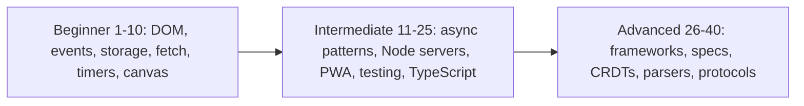

## 1. Calculator

**Level:** Beginner · **Time:** 1 weekend · **Prerequisites:** Ch 2, Ch 3, Ch 13

### What it is
A four-function calculator in the browser: a display, digit and operator buttons, `=`, clear, backspace, percent and sign change, all usable from the keyboard too. Behind the buttons sits a small **state machine** — a model where the app is always in exactly one named state (say *entering first number*, *operator chosen*, *showing result*) and each key press moves it to a well-defined next state.

### The problem it solves
Everyone thinks a calculator is trivial until they press `5 + =` or `0.1 + 0.2`. The project forces you to deal with the two things beginners usually ignore: **state** (what does `=` mean right after `=`?) and **numbers** (JavaScript numbers are IEEE 754 double-precision floats, so `0.1 + 0.2` is `0.30000000000000004`). Getting both right is a lesson in modelling before coding.

### Real-world examples
- Microsoft open-sourced the [Windows Calculator](https://github.com/microsoft/calculator); its README highlights infinite-precision arithmetic for the four basic operations, so results never lose precision the way doubles do.
- [0.30000000000000004.com](https://0.30000000000000004.com/) shows the same float result in dozens of languages — it is not a JavaScript bug, it is binary floating point.

### Requirements
**Functional**
- Digits, decimal point, `+ − × ÷`, `=`, `C` (clear all), `⌫` (backspace), `±`, `%`.
- Chaining: `2 + 3 × 4 =` evaluates left to right like a pocket calculator (shows 20), *or* with precedence (14) — pick one and document it.
- Repeated `=` repeats the last operation (`2 + 3 = =` → 8).
- Keyboard support: digits, `+ - * /`, `Enter`, `Backspace`, `Escape`.
- Division by zero shows "Cannot divide by zero" and the next digit starts fresh.

**Non-functional**
- Display never shows float noise: results rounded to at most 12 significant digits.
- Every button responds in under 16 ms (one frame); no layout shift as the display grows.
- Works with a screen reader: the display is a live region (`aria-live="polite"`).

### The architecture

- **Input mapper** turns a click on `<button data-key="7">` or a `keydown` into one normalised key string. One listener on the keypad container handles every button through **event delegation** (one listener on a parent that inspects `event.target`).
- **Reducer** is a pure function `(state, key) => newState` — no DOM, no globals — so it is trivially testable.
- **Render** writes the display from state. Rendering is the only code that touches the DOM.

### Data model
| Field | Type | Meaning |
|---|---|---|
| `current` | string | digits being typed, kept as a string so "0." and "0.50" survive |
| `previous` | number or null | left operand |
| `operator` | `'+' \| '-' \| '*' \| '/'` or null | pending operation |
| `lastOp` | `{ operator, operand }` or null | what repeated `=` re-applies |
| `mode` | `'input' \| 'operator' \| 'result' \| 'error'` | the state-machine state |

### Tech stack
| Component | Choice | Why |
|---|---|---|
| UI | Plain HTML + CSS grid | a keypad is literally a grid |
| Logic | One ES module, pure functions | testable without a browser |
| Number formatting | `Number.prototype.toPrecision` + `Intl.NumberFormat` | removes noise, adds locale grouping |
| Tests | `node:test` | the reducer has no DOM dependency |

### Milestones
1. **Keypad and display.** Static grid, buttons append digits to the display. *Done when* typing `123.45` shows exactly that, and a second `.` is ignored.
2. **Reducer.** Implement the state machine for one binary operation. *Done when* a table-driven test covers `2+3=`, `9/3=`, `5-8=`.
3. **Chaining and repeated equals.** *Done when* `2+3+4=` gives 9 and `2+3==` gives 8.
4. **Edge cases.** Division by zero, `±`, `%`, backspace in every mode. *Done when* every mode × key combination has a test.
5. **Keyboard and accessibility.** *Done when* the whole app can be used without a mouse and the screen reader announces results.

### Deep dive: the hard parts
**Float display.** Keep the arithmetic in plain numbers but format for display with `Number(result.toPrecision(12))`, which rounds `0.30000000000000004` to `0.3` and then drops trailing zeros. Do not round intermediate results; round only what the user sees. For money-grade precision you would use integers (cents) or `BigInt`, which the book covers in [Ch 2](../chapters/02-variables-types-and-operators/README.md).

**Why not `eval`.** `eval("2+3*4")` is tempting but it executes arbitrary code, breaks under a Content Security Policy that forbids `unsafe-eval`, and gives you no control over chaining semantics. The reducer is both safer and more honest about behaviour.

**Input as a string.** If you store `current` as a number, typing `0`, `.`, `0`, `5` collapses to `0` and then `0.05` — the user sees digits vanish. Store the *text* while typing and convert with `Number()` only when an operator or `=` arrives.

### Testing strategy
Table-driven unit tests over the reducer: an array of `{ keys: '2+3==', display: '8' }` rows run in a loop. Add a tiny DOM test (jsdom or the browser) for event delegation and keyboard mapping only.

### Trade-offs, scaling and failure modes
Left-to-right evaluation matches cheap pocket calculators; precedence matches phones and spreadsheets but needs a parser (Project 31 builds one). Floats are fast and "good enough" for display but cannot represent `0.1` exactly. A failure mode to watch: very large results — format `1e21` and above in exponent form rather than letting the display overflow.

### Stretch goals
- Precedence mode with a shunting-yard parser and parentheses.
- History tape stored in `localStorage`.
- Exact decimal mode using `BigInt` scaled by 10^12.

### Skills practised
- [Ch 2 — Variables, types and operators](../chapters/02-variables-types-and-operators/README.md): number precision, coercion with `Number()`.
- [Ch 3 — Control flow](../chapters/03-control-flow-and-loops/README.md): `switch` on mode and key.
- [Ch 13 — DOM and events](../chapters/13-dom-and-events/README.md): delegation, `keydown`, `data-*` attributes.

### In the interview
**30-second answer:** I built a keyboard-accessible four-function calculator whose logic is a pure reducer, `(state, key) => newState`, with five modes such as *input*, *operator*, *result* and *error*. I chose a reducer over `eval` because it is safe under a strict Content Security Policy and lets me define exactly what `=` after `=` means. The hardest part was floating point: I keep typed input as a string so `0.05` never collapses, and I round only what the display shows to 12 significant digits. Every mode-by-key combination is a row in a table-driven test, including the edge cases.

**Key terms to know:**
- **State machine** — the app is always in exactly one named mode and each key moves it to a defined next mode; the `mode` field drives the reducer's `switch`.
- **Reducer** — a pure function that takes the old state and an action and returns a new state without side effects; all calculator logic lives in one.
- **Pure function** — same inputs always give the same output and nothing outside is changed; it is why the reducer runs in `node:test` with no browser.
- **IEEE 754 double** — the 64-bit binary floating-point format every JavaScript `number` uses; it explains `0.1 + 0.2 = 0.30000000000000004`.
- **`toPrecision`** — formats a number to N significant digits; `Number(x.toPrecision(12))` strips float noise for display.
- **Event delegation** — one listener on the keypad reads `event.target.closest('button')` instead of one listener per button.
- **`data-*` attributes** — custom HTML attributes such as `data-key="7"`, read through `element.dataset.key`, that map buttons to keys.
- **`eval` and CSP** — `eval` runs any string as code, and a Content Security Policy without `'unsafe-eval'` blocks it; the reducer avoids both problems.
- **Live region** — `aria-live="polite"` makes screen readers announce display changes without moving focus.

**Q:** Why does `0.1 + 0.2 !== 0.3`, and how does the calculator handle it?

**A:** Numbers are 64-bit binary floats, and 0.1 and 0.2 have no exact binary representation, so both are already slightly off and the sum rounds to a different double than 0.3. I keep full precision in the arithmetic and round only the displayed value with `toPrecision(12)`. To compare floats in code you use a tolerance such as `Math.abs(a - b) < Number.EPSILON * 4`, or you work in integers.

**Q:** Why model the calculator as a reducer instead of updating the DOM inside click handlers?

**A:** A pure `(state, key) => state` function makes every behaviour a testable row such as `{ keys: '2+3==', display: '8' }`. The DOM code becomes dumb: it maps events to keys and renders state. The trade-off is a little more upfront design, but bugs like "what does `=` do after an error?" become one visible `case` instead of scattered `if`s.

**Q:** Why not just call `eval` on the expression string?

**A:** `eval` executes arbitrary code, so any injected string becomes a script, and it fails under a CSP that omits `'unsafe-eval'`. It also gives JavaScript precedence, not pocket-calculator chaining, and no control over repeated `=`. A reducer, or a small parser for precedence mode, is safer and documents the behaviour.

**Q:** One listener or one per button?

**A:** One on the keypad container — event delegation. Clicks bubble up from the button to the container, where `event.target.closest('[data-key]')` finds the pressed key. It uses fewer listeners, and buttons added later work without extra wiring.

**Q:** What is the difference between `event.target` and `event.currentTarget` in that delegated handler?

**A:** `target` is the innermost element actually clicked, which might be a `<span>` inside the button. `currentTarget` is the element the listener is attached to, the keypad. That is why the handler uses `event.target.closest('button')` rather than trusting `target` directly.

**Q:** Why store `current` as a string rather than a number?

**A:** Typing `0`, `.`, `0`, `5` as numbers gives `0`, `0`, `0`, `0.05`, so the user sees digits vanish, and `0.50` loses its zero. Keeping the text preserves exactly what was typed. I convert with `Number()` only when an operator or `=` arrives.

**Q:** What happens on division by zero or a huge result?

**A:** In JavaScript `5 / 0` is `Infinity`, not an error, so the reducer checks for a zero divisor and moves to the `error` mode, which shows "Cannot divide by zero" and makes the next digit start fresh. Results at or above `1e21` are already printed in exponent form by `toString`, so I format them that way deliberately and cap the display width.

**Q:** How would you add operator precedence and parentheses — what changes at 10x the features?

**A:** The single-pending-operator state no longer fits, so I would tokenise the input and use a shunting-yard parser (two stacks: operators and output) to build reverse Polish notation, then evaluate it. That is O(n) in the number of tokens. The reducer still owns the input mode, and the parser becomes a separate pure module with its own tests.

**Q:** How do you prove the calculator is correct?

**A:** A table-driven test runs every row through the reducer and checks the display string. I cover each mode crossed with each key, plus regressions like `0.1+0.2=` and `2+3==`. A small jsdom test checks only the wiring: delegation and keyboard mapping.

**Common mistakes in answers:**
- Saying `0.1 + 0.2` is a "JavaScript bug" — it is binary floating point and happens in every language using IEEE 754 doubles.
- Rounding intermediate results to hide noise — that compounds error. Round only for display.
- Claiming `eval` is fine "because the input comes from buttons" — keyboard input, future features and CSP all make it a liability.

### TL;DR
A calculator is a state machine plus careful number formatting; keep the logic in a pure reducer, store typed input as text, and round only for display.

## 2. To-do list with localStorage

**Level:** Beginner · **Time:** 1 weekend · **Prerequisites:** Ch 5, Ch 7, Ch 13, Ch 14

### What it is
The classic to-do app: add, edit, complete, delete and filter tasks (All / Active / Completed), with the list surviving a page reload because it is saved in **`localStorage`** — a small key-value store the browser keeps per **origin** (scheme + host + port).

### The problem it solves
It is the smallest app with real **CRUD** (create, read, update, delete), a filtered view of shared data, and persistence. It teaches the habit that separates working apps from tangled ones: keep one source of truth (an array of task objects), derive the screen from it, and save it in one place.

### Real-world examples
- [TodoMVC](https://todomvc.com/) implements the same spec in dozens of frameworks and in vanilla JS; reading the vanilla version after you finish is instructive.
- MDN's [Web Storage API](https://developer.mozilla.org/en-US/docs/Web/API/Web_Storage_API) documents `localStorage`'s string-only values, per-origin scope and synchronous behaviour.

### Requirements
**Functional**
- Add a task with Enter; ignore empty or whitespace-only input.
- Toggle complete, double-click to edit, Escape cancels an edit, delete with a button.
- Filters All / Active / Completed reflected in the URL hash (`#/active`) so reload keeps the filter.
- "Clear completed" and a live "3 items left" counter.
- Data persists across reloads and syncs across two open tabs.

**Non-functional**
- Up to 1,000 tasks render in under 50 ms.
- Storage writes are batched: at most one write per user action.
- Corrupt or missing storage never crashes the app — it starts empty and logs a warning.

### The architecture
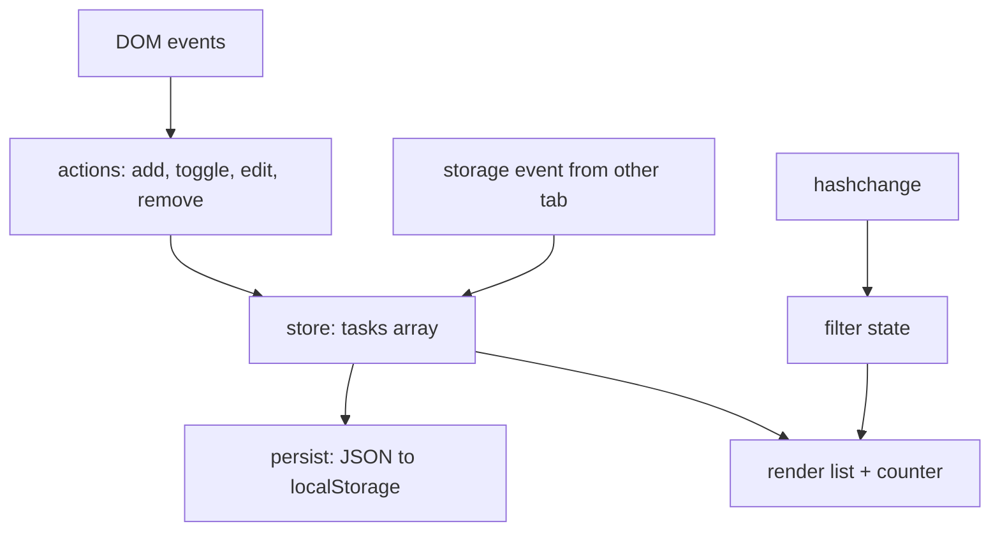
- **Store** holds `tasks` and notifies subscribers after each change.
- **Persist** subscribes and writes `JSON.stringify(tasks)`.
- **Render** rebuilds the list from `tasks` filtered by the current hash.
- The **`storage` event** fires in *other* tabs of the same origin when one tab writes, which is how two tabs stay in sync.

### Data model
| Field | Type | Notes |
|---|---|---|
| `id` | string | `crypto.randomUUID()` — stable across edits |
| `title` | string | trimmed, max 500 chars |
| `done` | boolean | |
| `createdAt` | number | epoch milliseconds |

Stored under one key, `todos:v1`, as a JSON array. The `v1` suffix lets you migrate the shape later.

### Tech stack
| Component | Choice | Why |
|---|---|---|
| Rendering | `document.createElement` + `textContent` | safe against XSS; no `innerHTML` with user text |
| Storage | `localStorage` | synchronous, simple, about 5 MB per origin in most browsers |
| Routing | `location.hash` + `hashchange` | no server config needed |
| Tests | `node:test` + jsdom | the book already runs DOM code under jsdom (Ch 13) |

### Milestones
1. **In-memory list.** Add and render tasks. *Done when* adding three tasks shows three `<li>`s.
2. **Toggle, edit, delete** via delegation on the `<ul>`. *Done when* each works for a task added after page load.
3. **Filters and counter.** *Done when* `#/completed` on reload shows only completed tasks.
4. **Persistence.** Load on start, save on change, survive corrupt JSON. *Done when* setting the key to `"{oops"` in DevTools and reloading shows an empty list, not an error.
5. **Cross-tab sync.** *Done when* completing a task in tab A updates tab B within a second.

### Deep dive: the hard parts
**Safe loading.** `JSON.parse` throws on bad input and `localStorage.getItem` can throw too (storage disabled, some private modes). Wrap both in `try/catch`, validate that the result is an array of objects with the expected fields, and fall back to `[]`. Never trust storage more than you trust user input — another script on the same origin can write it.

**Rendering without XSS.** If you build `<li>${title}</li>` with `innerHTML`, a task titled `` runs code. Use `textContent` for user strings. This is the same rule [Ch 14](../chapters/14-browser-apis-and-security/README.md) states for every XSS sink.

**Immutable updates.** Replace the array rather than mutating it in place (`tasks = tasks.map(t => t.id === id ? { ...t, done: !t.done } : t)`). It makes "did anything change?" a cheap reference check and keeps undo easy.

### Testing strategy
Unit-test the store actions as pure functions. With jsdom, test that rendering escapes HTML, that a corrupt storage value yields an empty list, and that the filter respects the hash. Simulate the `storage` event by dispatching `new StorageEvent('storage', { key: 'todos:v1' })`.

### Trade-offs, scaling and failure modes
`localStorage` is synchronous (it blocks the main thread), string-only and small; for thousands of large records use IndexedDB (Project 17). Full re-render is simple and fast enough for hundreds of items; past that, patch only the changed `<li>`. If the quota is exceeded, `setItem` throws `QuotaExceededError` — catch it and tell the user.

### Stretch goals
- Drag to reorder (preview of Project 12).
- Undo the last delete with a toast.
- Due dates formatted with `Intl.RelativeTimeFormat` ("in 2 days").

### Skills practised
- [Ch 5 — Objects and JSON](../chapters/05-objects-math-date-and-json/README.md): spread copies, `JSON.parse` safety.
- [Ch 7 — Arrays](../chapters/07-arrays/README.md): `map`, `filter`, non-mutating updates.
- [Ch 13 — DOM and events](../chapters/13-dom-and-events/README.md): delegation, forms, keyboard events.
- [Ch 14 — Browser APIs](../chapters/14-browser-apis-and-security/README.md): storage, the `storage` event, XSS.

### In the interview
**30-second answer:** I built a to-do app with full CRUD, hash-based filters and persistence in `localStorage`, structured as one store holding a tasks array, a persist step and a render step. The key decision was a single source of truth: the DOM is always derived from the array, never read back from it. The hardest part was defensive loading — corrupt JSON or blocked storage must start an empty list rather than crash — plus syncing two tabs through the `storage` event. It renders 1,000 tasks in under 50 ms and never uses `innerHTML` with user text.

**Key terms to know:**
- **CRUD** — create, read, update, delete; the four operations the store's actions implement.
- **Single source of truth** — one `tasks` array is authoritative and everything on screen is derived from it.
- **`localStorage`** — a synchronous, string-only key-value store scoped per origin that survives reloads; tasks are saved under `todos:v1`.
- **Origin** — scheme plus host plus port; storage, the `storage` event and the same-origin policy are all scoped to it.
- **`storage` event** — fires in *other* same-origin tabs when one tab writes, which is how cross-tab sync works.
- **Immutable update** — replacing the array (`map`, spread) instead of mutating it, so "did it change?" is a reference check.
- **XSS (cross-site scripting)** — injected markup that runs script in your page; avoided by rendering titles with `textContent`.
- **Event delegation** — one listener on the `<ul>` handles toggle, edit and delete for tasks added later.
- **Hash routing** — filter state lives in `location.hash` (`#/active`), read on `hashchange`, so reload keeps the filter.
- **Schema versioning** — the `v1` in the key lets you migrate stored data when its shape changes.

**Q:** `localStorage` vs `sessionStorage` vs cookies?

**A:** `localStorage` persists per origin until cleared. `sessionStorage` is per tab and is cleared when that tab closes. Cookies are sent to the server with every matching request, are small (about 4 KB each), and can be marked `HttpOnly` so JavaScript cannot read them. Use `HttpOnly` cookies for session tokens and Web Storage for UI state.

**Q:** How do two tabs stay in sync?

**A:** A `setItem` in tab A fires a `storage` event in every *other* same-origin tab, carrying `key`, `oldValue` and `newValue`. Tab B listens, parses `newValue` defensively and re-renders. The writing tab does not receive its own event, so it must render locally as usual.

**Q:** Why not store objects directly?

**A:** Web Storage keeps strings only, so `setItem('k', {a: 1})` stores `"[object Object]"`. Serialise with `JSON.stringify` and parse with `JSON.parse` inside `try/catch`. Dates come back as strings, which is why `createdAt` is stored as epoch milliseconds.

**Q:** How do you stop a task title from running script?

**A:** Never put user text into `innerHTML`. A title like `` would execute. I build nodes with `createElement` and set `textContent`, which treats the string as text only.

**Q:** What happens if storage is full, disabled or corrupt?

**A:** `getItem` and `setItem` can throw (blocked storage, some private modes), `setItem` throws `QuotaExceededError` when the roughly 5 MB quota is full, and `JSON.parse` throws on bad text. I wrap all three in `try/catch`, validate the parsed shape, fall back to `[]`, and show a message when a save fails. Storage is treated as untrusted input.

**Q:** Why immutable updates instead of `task.done = true`?

**A:** Replacing the array and the changed object means the old and new state are different references, so change detection is cheap and undo is just keeping the old array. Mutation makes bugs where the render and the saved copy silently share objects. The cost is a small allocation per action, which is negligible at this size.

**Q:** What breaks first at 10x or 100x the tasks?

**A:** Full re-rendering and `JSON.stringify` of the whole list on each action are O(n), and `localStorage` blocks the main thread. At thousands of items I would patch only changed `<li>`s, and at large data sizes move to IndexedDB, which is asynchronous and stores structured objects. Past a few thousand visible rows, virtualise the list (Project 22).

**Q:** Hands-on: what is wrong with this delegation code?

```js
list.addEventListener('click', e => {
  if (e.target.className === 'delete') remove(e.target.parentNode.id);
});
```

**A:** `className ===` fails as soon as the button has a second class, and `e.target` may be an icon inside the button. Use `e.target.closest('.delete')` and read the id from `closest('li').dataset.id`. Also avoid putting raw UUIDs into `id` attributes when a `data-id` is clearer.

**Q:** How do you test it?

**A:** Store actions are pure functions, so they get plain unit tests. With jsdom I test that a malicious title renders as text, that a corrupt stored value yields an empty list, and that the filter follows the hash. For sync I dispatch `new StorageEvent('storage', { key: 'todos:v1', newValue })` and assert the list updates.

**Common mistakes in answers:**
- Saying the `storage` event fires in the tab that wrote — it fires only in the *other* tabs.
- Recommending `localStorage` for auth tokens — any XSS can read it. `HttpOnly` cookies are safer.
- Treating storage as trusted — it can be corrupt, full or edited in DevTools, so parse and validate it like user input.

### TL;DR
One array is the truth, the DOM is derived from it, and `localStorage` is a cautious, versioned mirror of it — parsed defensively and rendered with `textContent`.

## 3. Quiz app

**Level:** Beginner · **Time:** 1 weekend · **Prerequisites:** Ch 4, Ch 7, Ch 12, Ch 13

### What it is
A multiple-choice quiz: pick a category and difficulty, answer ten questions one at a time with a countdown per question, see your score with a review of right and wrong answers, and keep a local high-score table. Questions come from the free **Open Trivia Database** API.

### The problem it solves
It combines three beginner skills into one flow: fetching data, moving through screens (a tiny state machine: *setup → question → feedback → results*), and timing. It also contains a real security lesson: the API returns text with **HTML entities** (like `&quot;`) by default, and the obvious fix — `innerHTML` — is an XSS hole.

### Real-world examples
- The [Open Trivia DB API](https://opentdb.com/api_config.php) returns up to 50 questions per call, needs no key, offers HTML-entity, URL and Base64 encodings, provides session tokens to avoid repeats, and limits each IP to one call every 5 seconds.
- MDN's [Using the Fetch API](https://developer.mozilla.org/en-US/docs/Web/API/Fetch_API/Using_Fetch) explains why `fetch` resolves even on HTTP 404 and how to check `response.ok`.

### Requirements
**Functional**
- Setup screen: category, difficulty, number of questions.
- One question at a time; answers shuffled; 15-second timer; time-out counts as wrong.
- Immediate feedback (correct answer highlighted), then Next.
- Results: score, time taken, per-question review.
- Top 10 scores in `localStorage`.
- Offline fallback: a bundled JSON file of 20 questions.

**Non-functional**
- First question visible under 1 s on a normal connection; a loading state otherwise.
- Never more than one API call per 5 s (respect the limit).
- Fully keyboard-operable: `1`–`4` select answers, Enter goes next.

### The architecture
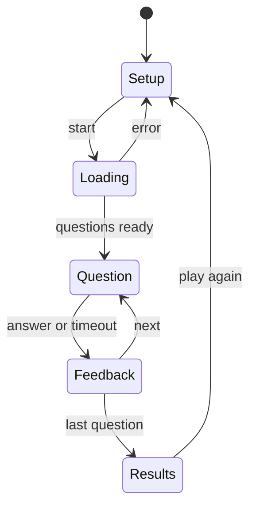
- **Setup** collects options and builds the API URL with `URLSearchParams`.
- **Loading** calls the API service, decodes and shuffles.
- **Question / Feedback** loop is driven by an index into the question array and a timer.
- **Results** computes the score and writes high scores.

### Data model
| Type | Fields |
|---|---|
| `Question` | `text`, `choices: string[]`, `correctIndex`, `category`, `difficulty` |
| `Answer` | `questionIndex`, `chosenIndex` (or `null` on timeout), `ms` |
| `Game` | `questions`, `answers`, `index`, `phase`, `startedAt` |
| `HighScore` | `name`, `score`, `total`, `date` |

### Tech stack
| Component | Choice | Why |
|---|---|---|
| Data | Open Trivia DB with `encode=base64` | avoids HTML-entity decoding entirely |
| Decoding | `atob` + `TextDecoder` | `atob` alone breaks on non-ASCII UTF-8 |
| Timer | `setInterval` for the display, timestamps for truth | intervals drift |
| Shuffle | Fisher–Yates | unbiased, O(n) |

### Milestones
1. **Hard-coded quiz.** Render questions from a local array; score at the end. *Done when* a full run gives the right score.
2. **API integration.** Fetch, decode, map to `Question`. *Done when* a network failure falls back to the local file with a notice.
3. **Timer.** *Done when* an unanswered question auto-advances after 15 s and is marked wrong.
4. **Review and high scores.** *Done when* reload keeps the top 10, sorted by score then time.
5. **Keyboard and a11y.** *Done when* the quiz can be finished using only the keyboard and focus moves to each new question.

### Deep dive: the hard parts
**Decoding safely.** Default responses contain entities like `&#039;`. Rendering them with `innerHTML` decodes them — and also runs any markup. Request `encode=base64` and decode with `new TextDecoder().decode(Uint8Array.from(atob(s), c => c.charCodeAt(0)))`, then render with `textContent`. If you must decode entities, parse with `DOMParser` and read `textContent`, which never executes scripts.

**Fair shuffling.** `arr.sort(() => Math.random() - 0.5)` is biased and depends on the engine's sort algorithm. Use the [Fisher–Yates shuffle](https://en.wikipedia.org/wiki/Fisher%E2%80%93Yates_shuffle): walk from the end, swap each item with a random earlier-or-same index. Track `correctIndex` *after* shuffling.

**Timers that don't lie.** `setInterval(fn, 1000)` can fire late (busy main thread, background tab throttling). Store `deadline = performance.now() + 15000` and compute remaining time on each tick; the interval only refreshes the display. Clear the interval on every phase change, or two timers will race.

### Testing strategy
Unit-test shuffle (every permutation appears roughly equally over many runs, and the correct answer is tracked), the decoder (UTF-8 round trip), and the state transitions. Mock `fetch` with `mock.method(globalThis, 'fetch', …)` from `node:test` to simulate success, HTTP 429 and network errors. Use fake timers (`mock.timers`) to test the timeout without waiting.

### Trade-offs, scaling and failure modes
Base64 costs ~33% more bytes but removes a whole class of decoding bugs. A response code of 5 from the API means you were rate-limited — wait and retry once. The API's session token prevents repeated questions but expires after 6 hours of inactivity; handle "token not found" by requesting a new one.

### Stretch goals
- Session tokens so repeat games avoid repeats.
- Shareable result link encoded in the URL.
- Two-player hot-seat mode.

### Skills practised
- [Ch 4 — Functions and closures](../chapters/04-functions-scope-and-closures/README.md): timer callbacks closing over game state.
- [Ch 7 — Arrays](../chapters/07-arrays/README.md): shuffling, `toSorted` for the score table.
- [Ch 12 — Async](../chapters/12-asynchronous-javascript/README.md): `fetch`, `async`/`await`, timers.
- [Ch 13 — DOM and events](../chapters/13-dom-and-events/README.md): focus management, keyboard shortcuts.

### In the interview
**30-second answer:** I built a timed multiple-choice quiz on the Open Trivia DB API, structured as a four-phase state machine: setup, question, feedback, results. The key decision was requesting Base64-encoded answers and decoding them with `atob` plus `TextDecoder`, so I never need `innerHTML` to turn entities like `&quot;` into text — that removes an XSS hole. The hardest parts were a fair shuffle (Fisher–Yates, not a random comparator) and a countdown that stays correct when the tab is throttled, which I solved by comparing against a deadline timestamp. It respects the API's one-call-per-5-seconds limit and falls back to 20 bundled questions offline.

**Key terms to know:**
- **State machine** — the app is in exactly one phase (setup, loading, question, feedback, results) and transitions are explicit; it prevents double timers and stray clicks.
- **`fetch` and `response.ok`** — `fetch` resolves on any HTTP status, so you must check `ok` (status 200–299) yourself.
- **HTML entities** — encoded characters like `&#039;`; decoding them through `innerHTML` also runs markup.
- **Base64 with `atob` and `TextDecoder`** — `atob` returns one character per byte, so non-ASCII UTF-8 needs `TextDecoder` to rebuild the real string.
- **Fisher–Yates shuffle** — an O(n) algorithm that gives every permutation equal probability; used on the answer choices.
- **Deadline timestamp** — `performance.now() + 15000` decides time-up; the interval only redraws the display.
- **Rate limiting** — the API allows one call per IP every 5 seconds and returns response code 5 when you exceed it.
- **Focus management** — moving keyboard focus to each new question so keyboard and screen-reader users are not lost.
- **Fake timers** — `mock.timers` in `node:test` lets tests advance time instantly.

**Q:** Why is `sort(() => Math.random() - 0.5)` a bad shuffle?

**A:** A comparator must be consistent: if a < b now, it must say so every time. A random one breaks the sort algorithm's assumptions, so some permutations come out far more often and the bias depends on the engine. Fisher–Yates walks from the end and swaps each item with a random index at or before it, giving every permutation equal probability in O(n).

```js
for (let i = a.length - 1; i > 0; i--) {
  const j = Math.floor(Math.random() * (i + 1));
  [a[i], a[j]] = [a[j], a[i]];
}
```

**Q:** Does `fetch` reject on a 500?

**A:** No. It rejects only on a network failure, a CORS failure or an abort. A 404 or 500 resolves with `response.ok === false`, so I throw my own error with the status and handle it like any other failure.

**Q:** How do you decode HTML entities safely?

**A:** Best is to avoid them by requesting `encode=base64`. If you must decode entities, parse with `new DOMParser().parseFromString(s, 'text/html')` and read `body.textContent`, because a parsed document does not run scripts. Then render with `textContent`, never `innerHTML`.

**Q:** How do you keep the 15-second timer honest?

**A:** `setInterval` fires no sooner than its delay and is throttled in background tabs, so counting ticks undercounts. I store a deadline and compute `remaining = deadline - performance.now()` on each tick. I also clear the interval on every phase change; otherwise a stale timer can fire after the user has already answered.

**Q:** Why track `correctIndex` after shuffling?

**A:** The API returns the correct answer separately from the wrong ones. If I record its index before shuffling, the index points at a different answer afterwards. I shuffle the combined array and then find the correct answer's new position, or shuffle objects that carry an `isCorrect` flag.

**Q:** What happens if the API is down, rate-limited or the token expires?

**A:** A network error or non-OK status falls back to the bundled JSON with a visible notice. Response code 5 means rate-limited, so I wait at least 5 seconds and retry once. If the session token is not found (it expires after 6 hours of inactivity), I request a new one and retry.

**Q:** What changes if 10x more people play, or you want a global leaderboard?

**A:** Each browser calls the API directly, so the per-IP limit is per player and scales fine. A global leaderboard needs a server, because `localStorage` is per device and trivially editable. The server must validate scores (or replay answers) since anything computed in the client can be faked.

**Q:** How do you test it?

**A:** I unit-test the shuffle statistically (run 60,000 shuffles of 3 items and check each of the 6 permutations is near 10,000), the UTF-8 decoder round trip, and every phase transition. I mock `fetch` with `mock.method(globalThis, 'fetch', …)` for success, HTTP 429 and network errors, and use `mock.timers` to fast-forward the timeout.

**Common mistakes in answers:**
- Saying `fetch` throws on HTTP errors — it does not, you must check `response.ok`.
- Using `innerHTML` "just to decode entities" — that is the exact XSS sink the project avoids.
- Believing `setInterval(fn, 1000)` runs exactly every second — it is a minimum delay and drifts.

### TL;DR
A quiz is a four-state machine around fetched data; decode without `innerHTML`, shuffle with Fisher–Yates, and let timestamps — not intervals — decide when time is up.

## 4. Weather dashboard with fetch

**Level:** Beginner · **Time:** 1–2 weekends · **Prerequisites:** Ch 5, Ch 12, Ch 14

### What it is
A dashboard that shows current conditions, a 24-hour strip and a 7-day forecast for a searched city or the user's location. It uses **Open-Meteo**, a weather API that needs no key for non-commercial use, plus its geocoding service to turn a city name into coordinates.

### The problem it solves
Real apps chain requests (city name → coordinates → forecast), deal with slow and failing networks, convert units and time zones, and avoid hammering the API. This project makes you handle every one of those in a page small enough to finish.

### Real-world examples
- [Open-Meteo's forecast API docs](https://open-meteo.com/en/docs) show requests like `/v1/forecast?latitude=52.52&longitude=13.41&current=temperature_2m&hourly=temperature_2m`; a key is needed only for commercial use, and its [terms](https://open-meteo.com/en/terms) cap free non-commercial use at under 10,000 calls a day (5,000 an hour, 600 a minute).
- MDN's [`AbortController`](https://developer.mozilla.org/en-US/docs/Web/API/AbortController) page documents cancelling an in-flight `fetch`, which you need when the user searches again before the first answer arrives.

### Requirements
**Functional**
- Search box with suggestions from the geocoding API; "Use my location" via `navigator.geolocation`.
- Current temperature, feels-like, wind, humidity, an icon from the weather code.
- Hourly strip (next 24 h) and daily cards (7 days), in the *location's* time zone.
- °C/°F and km/h/mph toggles remembered in `localStorage`.
- Recent searches (last 5).

**Non-functional**
- Cached responses reused for 10 minutes per location.
- A stale response from an older search must never overwrite a newer one.
- Readable error states: offline, location denied, no results, API error.

### The architecture
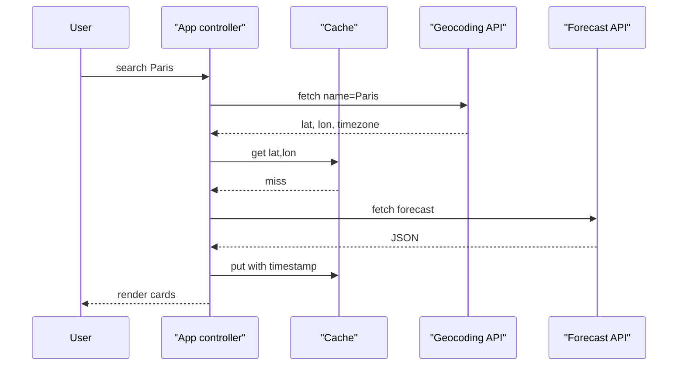
- **App controller** owns the current request's `AbortController` and the view state (`idle`, `loading`, `ready`, `error`).
- **Cache** is a `Map` keyed by rounded coordinates plus units, mirrored to `sessionStorage`.
- **API module** wraps `fetch` and converts HTTP errors into thrown `Error`s with a `cause`.

### Data model
| Type | Key fields |
|---|---|
| `Place` | `name`, `country`, `lat`, `lon`, `timezone` |
| `Forecast` | `current { temp, feelsLike, wind, code, time }`, `hourly[]`, `daily[]` |
| `CacheEntry` | `key`, `fetchedAt`, `data` |
| `Prefs` | `units: 'metric' \| 'imperial'`, `recent: Place[]` |

### Tech stack
| Component | Choice | Why |
|---|---|---|
| HTTP | `fetch` + `AbortSignal.any([controller.signal, AbortSignal.timeout(8000)])` | cancel on new search *and* on timeout |
| Time zones | `Intl.DateTimeFormat` with `timeZone` | no date library needed |
| Icons | inline SVG keyed by WMO weather code | no extra requests |
| Layout | CSS grid, `prefers-color-scheme` | responsive and dark-mode for free |

### Milestones
1. **Hard-coded coordinates.** Fetch and print current temperature. *Done when* the page shows the real temperature for one city.
2. **Search with geocoding.** *Done when* typing a city shows up to 5 matches and choosing one loads its forecast.
3. **Full dashboard.** Hourly and daily views in local time. *Done when* the hours shown for Tokyo start at Tokyo's current hour, not yours.
4. **Robustness.** Abort, timeout, cache, error states. *Done when* switching cities quickly always ends on the last one chosen, and DevTools "Offline" shows the offline message.
5. **Preferences and geolocation.** *Done when* units persist and denying location shows a helpful message.

### Deep dive: the hard parts
**Race conditions.** Search "Par", then "Paris": two requests are in flight and the slower one may finish last. Keep one `AbortController` per search, call `abort()` on the previous one before starting a new one, and ignore `AbortError` in the `catch`. As a second guard, tag each request with an increasing id and drop responses whose id is not the latest.

**Debounce the suggestions.** Calling geocoding on every keystroke wastes requests. A **debounce** waits until the user has stopped typing for, say, 300 ms, then runs once. It is a closure around a timer id — the same helper you will reuse in Project 11.

**Time zones.** The API can return times in the location's zone (`timezone=auto`). Format with `new Intl.DateTimeFormat(undefined, { hour: 'numeric', timeZone: place.timezone })`. Do not parse those strings with `new Date()` and then display them in the user's zone, or a 9 a.m. forecast in Sydney shows as midnight in London.

### Testing strategy
Mock `fetch` to return fixture JSON; test the mapping from API shape to `Forecast`. Test the race: start two fake requests, resolve them out of order, assert the newer wins. Test the cache expiry with injected `now()`.

### Trade-offs, scaling and failure modes
Client-side caching cuts calls but means data can be 10 minutes old — show "updated 4 min ago". Calling the API straight from the browser is fine here because there is no secret; with a keyed API you would proxy through a server so the key is not shipped to every visitor. If geolocation is slow, show the last location immediately and refresh.

### Stretch goals
- Sparkline of hourly temperatures drawn in SVG.
- Installable PWA with offline last-known forecast (see Project 17).
- Compare two cities side by side.

### Skills practised
- [Ch 5 — Dates and JSON](../chapters/05-objects-math-date-and-json/README.md): `Intl.DateTimeFormat`, time zones.
- [Ch 12 — Async](../chapters/12-asynchronous-javascript/README.md): `AbortController`, timeouts, `Promise` error handling.
- [Ch 14 — Browser APIs](../chapters/14-browser-apis-and-security/README.md): `fetch`, `URL`, storage, geolocation.

### In the interview
**30-second answer:** I built a weather dashboard that chains two Open-Meteo calls — geocoding a city name to coordinates, then fetching the forecast — and shows current, hourly and 7-day views in the *location's* time zone. The key design decision was owning one `AbortController` per search and combining it with `AbortSignal.timeout(8000)`, so a slow old request can never overwrite a newer one. The hardest bugs were that race and time zones, which I solved with abort plus a request id, and `Intl.DateTimeFormat` with `timeZone`. Responses are cached for 10 minutes per location, which keeps the app far below the free tier's 600 calls a minute.

**Key terms to know:**
- **Request chaining** — the second call needs the first call's result (city → lat/lon → forecast), so the calls run in sequence with `await`.
- **`AbortController`** — creates a `signal` you pass to `fetch`; calling `abort()` makes that fetch reject with an `AbortError`.
- **`AbortSignal.timeout` and `AbortSignal.any`** — a signal that aborts itself after N ms, and a signal that aborts when any of several do; used for cancel-or-timeout.
- **Race condition** — the result depends on which async operation finishes first; here an older search finishing last.
- **Debounce** — run a function once, only after input has paused (300 ms) — used for search suggestions.
- **Cache with TTL** — a `Map` keyed by rounded coordinates and units, storing `fetchedAt`, valid for 10 minutes (time to live).
- **`Intl.DateTimeFormat` with `timeZone`** — formats a time in a named IANA zone like `Asia/Tokyo` without a date library.
- **Error `cause`** — `new Error('Forecast failed', { cause: err })` keeps the original error attached for debugging.
- **Geolocation permission** — `navigator.geolocation` asks the user, and denial must show a helpful state, not a crash.

**Q:** How do you cancel a `fetch`?

**A:** Pass `{ signal: controller.signal }` and call `controller.abort()`; the promise rejects with a `DOMException` named `AbortError`. `AbortSignal.timeout(ms)` aborts by itself (with a `TimeoutError`), and `AbortSignal.any([a, b])` combines a user cancel and a timeout. In `catch`, ignore `AbortError` because it means a newer search replaced this one.

**Q:** How do you stop a stale response from overwriting a newer one?

**A:** Abort the previous controller before starting a new search. As a second guard, give each search an increasing id and ignore any response whose id is not the latest, because a response can already be parsed when you abort. Both together make "last search wins" deterministic.

**Q:** Debounce vs throttle?

**A:** Debounce waits until events stop for N ms, then runs once — right for a search box. Throttle runs at most once per N ms while events keep coming — right for scroll or resize handlers. Both are closures holding a timer id or a last-run timestamp.

```js
const debounce = (fn, ms) => {
  let t;
  return (...args) => { clearTimeout(t); t = setTimeout(() => fn(...args), ms); };
};
```

**Q:** Where would you put an API key?

**A:** Not in front-end code — anything shipped to the browser is public, including bundled environment variables. Proxy through a small server that adds the key and can also cache and rate-limit. Open-Meteo needs no key for non-commercial use, which is why the browser calls it directly.

**Q:** Why do times go wrong across zones, and how do you fix it?

**A:** With `timezone=auto` the API returns local times like `2026-10-01T09:00` with no offset. `new Date()` parses that as *your* local time, so a 9 a.m. Sydney forecast shows at the wrong hour for anyone else. I format with `Intl.DateTimeFormat(undefined, { hour: 'numeric', timeZone: place.timezone })` or treat the strings as labels and never shift them.

**Q:** What happens when the network is offline, location is denied, or the API errors?

**A:** Each is a distinct view state with its own message: `navigator.onLine` plus a failed fetch shows offline, geolocation error code 1 shows "permission denied" with a search box, an empty geocoding result shows "no matches", and a non-OK status shows an API error with retry. If a cached forecast exists, I show it with "updated 12 min ago".

**Q:** What changes at 10x or 100x the users?

**A:** Each user calls Open-Meteo from their own IP, so the free limits are per visitor. If I moved to a keyed or paid API, I would add a server proxy with a shared cache keyed by rounded coordinates — popular cities would be served from cache — and per-client rate limiting. The first thing to break would be the provider's quota, not my code.

**Q:** How do you test the race condition?

**A:** I mock `fetch` with promises I resolve by hand, start search A then search B, resolve B first and then A, and assert the screen shows B. I also check that A's signal was aborted. Cache expiry is tested by injecting a fake `now()` and advancing it past 10 minutes.

**Common mistakes in answers:**
- Saying debounce and throttle are the same — debounce fires after a pause, throttle fires at a steady maximum rate.
- Thinking `abort()` alone always prevents stale renders — a response already in hand still needs an id check.
- Hiding an API key in a front-end `.env` file — the bundler inlines it into public JavaScript.

### TL;DR
Chain geocoding and forecast calls, cancel stale requests, cache briefly, and format every time in the place's own time zone.

## 5. Stopwatch and Pomodoro timer

**Level:** Beginner · **Time:** 1 weekend · **Prerequisites:** Ch 4, Ch 5, Ch 12

### What it is
Two tools on one page. A **stopwatch** with start, pause, lap and reset that shows hundredths of a second. A **Pomodoro timer** — a focus technique of 25-minute work blocks separated by 5-minute breaks, with a longer break after four blocks — that plays a sound and shows a notification when each block ends.

### The problem it solves
"Just use `setInterval`" produces a timer that drifts, freezes in background tabs and loses time when the laptop sleeps. Building an accurate timer teaches the difference between **scheduling** (when your code runs) and **measuring** (how much time really passed).

### Real-world examples
- MDN's [`performance.now()`](https://developer.mozilla.org/en-US/docs/Web/API/Performance/now) page explains the monotonic, high-resolution clock you should measure with (and why its precision is coarsened in browsers).
- MDN's [Page Visibility API](https://developer.mozilla.org/en-US/docs/Web/API/Page_Visibility_API) describes how hidden tabs have timers throttled, which is exactly the bug this project must survive.

### Requirements
**Functional**
- Stopwatch: start/pause/resume, lap (with split and lap time), reset; keyboard Space and L.
- Pomodoro: configurable work/short/long durations; auto-advance; skip; pause.
- Sound and `Notification` at the end of each block (with permission).
- Tab title shows remaining time (`12:03 — Focus`).
- State survives reload: a running Pomodoro keeps counting.

**Non-functional**
- Display error under 50 ms versus wall-clock after one hour.
- Correct remaining time after the tab was hidden or the laptop slept.
- Less than 1% CPU while running (no 1 ms intervals).

### The architecture
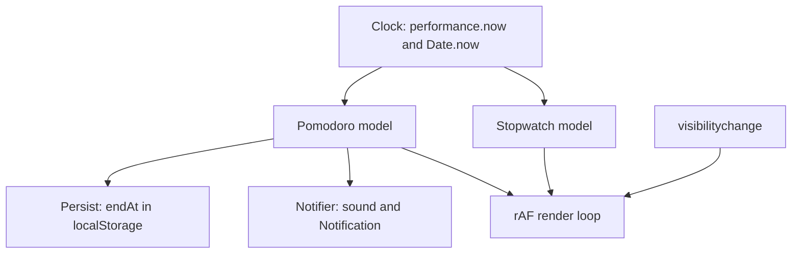
- **Clock** is injected (a function returning ms) so tests can control time.
- **Models** store *start timestamps and accumulated time*, never "ticks counted".
- **Render loop** uses `requestAnimationFrame` while visible and a 1 s `setTimeout` for the title while hidden.
- **Persist** stores the absolute end time (`Date.now()`-based) so a reload can resume.

### Data model
| Model | Fields |
|---|---|
| Stopwatch | `running`, `startedAt`, `accumulatedMs`, `laps: number[]` |
| Pomodoro | `phase: 'work' \| 'short' \| 'long'`, `endAt` (epoch ms) or `remainingMs` when paused, `completedWorkBlocks` |
| Settings | `workMin`, `shortMin`, `longMin`, `longEvery`, `sound` |

### Tech stack
| Component | Choice | Why |
|---|---|---|
| Measuring | `performance.now()` | monotonic: unaffected by clock changes |
| Persisting across reload | `Date.now()` end time | `performance.now()` restarts per page |
| Rendering | `requestAnimationFrame` | paints once per frame, pauses when hidden |
| Sound | Web Audio API oscillator | no audio file, short beep |
| Formatting | `String.prototype.padStart` | `05:07.42` |

### Milestones
1. **Naive stopwatch** with `setInterval(…, 10)` counting ticks. *Done when* you measure its drift against your phone over 5 minutes and write the number down.
2. **Timestamp stopwatch.** Elapsed = `accumulated + (now - startedAt)`. *Done when* drift after 5 minutes is under 50 ms, even with the tab hidden for a minute.
3. **Laps.** *Done when* laps show split and per-lap time and survive pause/resume.
4. **Pomodoro cycle.** *Done when* four work blocks are followed by a long break, verified with a fake clock in tests.
5. **Notify and persist.** *Done when* reloading mid-block resumes with the correct remaining time and the end triggers a notification.

### Deep dive: the hard parts
**Ticks vs timestamps.** An interval scheduled every 10 ms fires *at least* 10 ms later — often more, and browsers clamp nested timers to 4 ms and throttle hidden tabs to about once per second or less. Counting ticks therefore under-counts. Instead, treat the timer as pure arithmetic on timestamps; the interval or `requestAnimationFrame` only decides when to *redraw*.

**Two clocks.** `performance.now()` is monotonic (never jumps backwards when the system clock is corrected) but starts at zero for each page. `Date.now()` is wall-clock and survives reloads but can jump. Measure running intervals with `performance.now()`; persist absolute deadlines with `Date.now()`.

**Background behaviour.** When `document.visibilityState` becomes `hidden`, stop the animation loop; when it returns, recompute from timestamps — no catching-up loop is needed. For the end-of-block alert while hidden, schedule a single `setTimeout` for the remaining time; if it fires late, you are still correct because you compare with `endAt`.

### Testing strategy
Inject `now` into both models and test them as pure state: start at t=0, pause at t=1500, resume at t=4000, read at t=5000 → 2500 ms. Use `mock.timers` from `node:test` to fast-forward a full Pomodoro cycle in milliseconds. Manually test sleep and hidden-tab behaviour once.

### Trade-offs, scaling and failure modes
`requestAnimationFrame` gives smooth hundredths but costs a repaint per frame — fine for one display. Notifications need permission, and a denied permission must not break the timer. If the user changes the system clock during a block, a `Date.now()`-based deadline moves with it; accept this or re-anchor on `visibilitychange`.

### Stretch goals
- Screen Wake Lock so the screen stays on during a block.
- Daily statistics chart from stored completed blocks.
- Run the countdown in a Web Worker and compare its throttling behaviour.

### Skills practised
- [Ch 4 — Closures](../chapters/04-functions-scope-and-closures/README.md): models as closures over private state.
- [Ch 5 — Dates](../chapters/05-objects-math-date-and-json/README.md): epoch milliseconds, formatting.
- [Ch 12 — Async](../chapters/12-asynchronous-javascript/README.md): timers, clamping, why intervals drift.

### In the interview
**30-second answer:** I built a stopwatch and a Pomodoro timer that stay accurate even when the tab is hidden or the laptop sleeps. The key decision was to treat time as arithmetic on timestamps — elapsed equals accumulated plus `now - startedAt` — and use `setInterval` or `requestAnimationFrame` only to decide when to redraw. The hardest part was juggling two clocks: `performance.now()` for measuring because it is monotonic, and a `Date.now()`-based end time in `localStorage` so a reload resumes the block. My target was under 50 ms of drift after an hour, versus several seconds for the naive tick-counting version.

**Key terms to know:**
- **Timer drift** — `setInterval` delays are minimums, so each tick can be late and the lateness adds up if you count ticks.
- **Monotonic clock** — `performance.now()` never jumps backwards when the system clock changes; it starts at zero for each page.
- **Wall-clock time** — `Date.now()` is milliseconds since 1970 UTC; it survives reloads but can jump if the clock is adjusted.
- **`requestAnimationFrame`** — calls your function before the next repaint, about 60 times a second, and pauses in hidden tabs.
- **Timer throttling and clamping** — browsers clamp deeply nested timers to at least 4 ms and throttle hidden tabs to about once a second or less.
- **Page Visibility API** — `document.visibilityState` and `visibilitychange` tell you when to stop or restart the render loop.
- **Closure** — each model keeps private state (`startedAt`, `accumulatedMs`) in variables only its methods can reach.
- **Dependency injection of the clock** — passing a `now()` function into the model so tests can control time.
- **Notifications API** — `Notification.requestPermission()` then `new Notification(...)`; denial must not break the timer.

**Q:** Why does `setInterval` drift?

**A:** It schedules a task to run *no sooner than* the delay. Each run can be late because the main thread was busy, the tab was throttled, or the machine slept, and if you count ticks those delays accumulate. Computing elapsed time from timestamps makes the drift disappear because lateness only affects when you redraw, not the value.

**Q:** `performance.now()` or `Date.now()`?

**A:** `performance.now()` for measuring durations: monotonic and sub-millisecond, though browsers coarsen its precision to resist timing attacks. `Date.now()` for moments you must store or share, such as the Pomodoro end time in `localStorage`, because `performance.now()` restarts at zero on each page load.

**Q:** What happens to timers in a background tab or when the laptop sleeps?

**A:** Browsers throttle hidden-tab timers heavily, and during sleep nothing runs at all. Because the models store start and end timestamps, the value is correct the moment the code runs again. I listen to `visibilitychange` to stop the animation loop when hidden and redraw immediately when visible.

**Q:** Why `requestAnimationFrame` for the display rather than a 10 ms interval?

**A:** rAF runs once per frame, just before paint, so you never compute values the screen cannot show, and it stops in hidden tabs, saving battery. A 10 ms interval wakes the CPU 100 times a second and still is not aligned with frames. While hidden, a 1-second `setTimeout` updates the tab title instead.

**Q:** How do you survive a reload mid-block?

**A:** I persist `phase` and the absolute `endAt` as a `Date.now()` value. On load, `remaining = endAt - Date.now()`; if it is negative, the block already ended while the page was closed, so I advance the phase and notify. A paused timer stores `remainingMs` instead of `endAt`.

**Q:** What if the user changes the system clock or denies notifications?

**A:** A `Date.now()` deadline moves with a clock change, so I either accept that or re-anchor on `visibilitychange` using `performance.now()` while the page stays open. Denied notification permission just skips the notification; the sound and title still work. Code must never assume permission was granted.

**Q:** Hands-on: what does this print, and why?

```js
for (var i = 0; i < 3; i++) setTimeout(() => console.log(i), 0);
```

**A:** It prints `3 3 3`. `var` is function-scoped, so all three callbacks close over one `i`, which is 3 when they finally run after the loop. With `let`, each iteration gets a fresh binding and it prints `0 1 2`.

**Q:** How do you test a 25-minute timer without waiting 25 minutes?

**A:** Inject `now` into the models and test them as pure state: start at t=0, pause at 1500, resume at 4000, read at 5000 gives 2500 ms. For scheduling, `mock.timers.enable()` in `node:test` lets me `tick(25 * 60_000)` instantly and assert the long break comes after four work blocks. Sleep and hidden-tab behaviour I verify manually once.

**Common mistakes in answers:**
- Fixing drift by making the interval shorter — it wastes CPU and still drifts. Use timestamps.
- Using `Date.now()` to measure durations — it can jump backwards. Use `performance.now()`.
- Assuming background timers keep running normally — they are throttled or frozen.

### TL;DR
Timers schedule, clocks measure: store start and end timestamps, redraw with `requestAnimationFrame`, and recompute on return — then hidden tabs and sleep can't make you wrong.

## 6. Memory card game

**Level:** Beginner · **Time:** 1 weekend · **Prerequisites:** Ch 7, Ch 9, Ch 13

### What it is
The "concentration" game: a grid of face-down cards hides pairs of symbols; you flip two at a time, matched pairs stay up, mismatches flip back after a short delay. A move counter, timer, star rating and difficulty levels (4×3, 4×4, 6×6) complete it. Cards flip with a CSS 3D transform.

### The problem it solves
The game looks visual but is mostly about **state and timing**: what may the player click while two unmatched cards are still showing? It is a compact exercise in modelling with a class, guarding against double clicks and races, and separating animation (CSS) from logic (JavaScript).

### Real-world examples
- The shuffle must be fair; the [Fisher–Yates shuffle](https://en.wikipedia.org/wiki/Fisher%E2%80%93Yates_shuffle) article explains why the naive "swap with any index" variant is biased.
- The W3C [ARIA Authoring Practices patterns](https://www.w3.org/WAI/ARIA/apg/patterns/) cover the **grid** pattern, which shows how to make a keyboard-navigable grid of buttons accessible.

### Requirements
**Functional**
- New game shuffles `n` pairs into a grid; three difficulty levels.
- Flip on click or Enter/Space; arrow keys move focus across the grid.
- Two flipped cards: match stays, mismatch flips back after 800 ms; no third flip meanwhile.
- Move counter, timer that starts on first flip, star rating from moves.
- Win screen with time and moves; best result per difficulty saved.

**Non-functional**
- Animations at 60 fps using only `transform` and `opacity`.
- Respects `prefers-reduced-motion`: no 3D flip, instant swap.
- Seeded shuffle option so a game can be replayed (useful for tests).

### The architecture
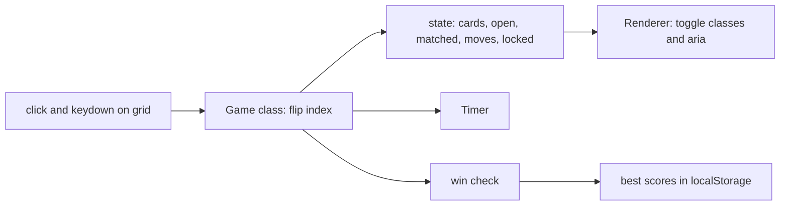
- **Game** is a class exposing `flip(index)` and emitting events (`match`, `mismatch`, `win`) through an `EventTarget`.
- **Renderer** listens and toggles CSS classes; it never decides game rules.
- **Timer** is the timestamp-based one from Project 5.

### Data model
| Field | Type | Meaning |
|---|---|---|
| `cards` | `{ id, symbol, state: 'down' \| 'up' \| 'matched' }[]` | the grid, row-major |
| `open` | number[] (0–2 indices) | currently face-up unmatched cards |
| `locked` | boolean | true during the mismatch delay |
| `moves` | number | pairs attempted |
| `seed` | number | for reproducible shuffles |

### Tech stack
| Component | Choice | Why |
|---|---|---|
| Model | ES class with `#private` fields | encapsulates rules; nothing outside can corrupt state |
| Events | `class Game extends EventTarget` | built-in pub/sub, no library |
| Random | small seeded PRNG (mulberry32) | reproducible tests |
| Flip | CSS `transform: rotateY(180deg)` + `backface-visibility` | GPU-friendly |

### Milestones
1. **Static grid** from a shuffled symbol list. *Done when* reload shows a different, valid layout (each symbol exactly twice).
2. **Game rules** in the class, tested without a DOM. *Done when* tests cover match, mismatch, clicking the same card twice and clicking a matched card.
3. **Wire up the DOM.** *Done when* a full game can be played with the mouse.
4. **Lock and timing.** *Done when* fast triple-clicking never shows three open cards.
5. **Keyboard, a11y and polish.** *Done when* the game is playable with arrows + Enter and a screen reader announces "match" or "no match".

### Deep dive: the hard parts
**The lock.** After a mismatch you schedule `setTimeout(flipBack, 800)`. If the player clicks during those 800 ms, the naive code opens a third card and the flip-back closes the wrong pair. Set `locked = true` before scheduling and clear it in the callback; `flip()` returns early while locked. Also ignore clicks on a card already in `open` — double-clicking one card must not count as a pair.

**Rules vs rendering.** Put every rule in `Game`; let the renderer be a listener. This lets you test 100% of the rules in Node and swap the renderer (canvas, terminal) without touching logic — the same split as a calculator reducer, now with classes and events.

**Seeded randomness.** `Math.random()` cannot be seeded. A tiny PRNG such as mulberry32 (a few lines of 32-bit integer math with `Math.imul`) turns a seed into a repeatable sequence, so a test can say "with seed 42 the first pair is at 0 and 7".

### Testing strategy
Unit tests on `Game` with a fixed seed and fake timers: assert events fired and state after each flip sequence. One jsdom test that clicking a card element calls `flip` with the right index and that `aria-pressed`/labels update.

### Trade-offs, scaling and failure modes
A class with private fields is clear for a single game; a pure reducer would make undo easier. CSS 3D flips are cheap, but `backface-visibility` has quirks on some mobile browsers — test there. On 6×6 grids, emoji symbols render differently per OS; use SVG icons if consistency matters.

### Stretch goals
- Two-player turns with per-player scores.
- Daily challenge: seed derived from the date so everyone gets the same board.
- Sound effects with the Web Audio API.

### Skills practised
- [Ch 7 — Arrays](../chapters/07-arrays/README.md): building and shuffling pairs, `flatMap`.
- [Ch 9 — Classes](../chapters/09-this-prototypes-and-classes/README.md): `#private` fields, `extends EventTarget`.
- [Ch 13 — DOM and events](../chapters/13-dom-and-events/README.md): delegation, keyboard navigation, custom events.

### In the interview
**30-second answer:** I built a memory card game where all the rules live in a `Game` class that extends `EventTarget` and emits `match`, `mismatch` and `win`, while a separate renderer only toggles CSS classes and ARIA attributes. The key decision was that split: I can test 100% of the rules in Node with a seeded shuffle and fake timers. The hardest bug was clicking during the 800 ms mismatch delay, which could open a third card; I fixed it with an explicit `locked` flag set before the timeout and checked by every action. Flips animate only `transform` so they hold 60 fps, and `prefers-reduced-motion` turns them off.

**Key terms to know:**
- **`EventTarget`** — the built-in base class that provides `addEventListener` and `dispatchEvent`; `Game` extends it to publish events without a library.
- **Publish/subscribe (pub/sub)** — the model announces events and any number of listeners react, so the model never knows about the DOM.
- **`#private` fields** — class fields the language itself hides from code outside the class; `cards`, `open` and `locked` use them.
- **Race condition / input lock** — a click arriving during the flip-back delay; the `locked` flag makes `flip()` return early.
- **Fisher–Yates shuffle** — unbiased O(n) shuffle of the card pairs.
- **Seeded PRNG** — a pseudo-random generator like mulberry32 that gives the same sequence for the same seed, so tests and daily challenges are repeatable.
- **Compositor-friendly animation** — animating only `transform` and `opacity` avoids layout and paint, so the GPU can keep 60 fps.
- **`backface-visibility`** — hides the back of a rotated element, which makes the 3D card flip work.
- **ARIA grid pattern** — roles and arrow-key focus movement that make a grid of buttons usable from the keyboard.

**Q:** How do you stop a user clicking during an animation?

**A:** Hold an explicit `locked` flag in the model, set it *before* scheduling `setTimeout(flipBack, 800)`, and clear it in the callback. `flip()` returns early while locked and also ignores a card already open or matched. Disabling buttons in the DOM is not enough on its own because keyboard handlers or tests can still call `flip()`.

**Q:** Why extend `EventTarget`?

**A:** It gives `addEventListener`, `removeEventListener` and `dispatchEvent` for free, in browsers and in Node. The model dispatches `new CustomEvent('match', { detail: { a, b } })` and does not care who listens. The renderer, a sound module and a test can all subscribe independently.

**Q:** Why are `#private` fields better than an `_underscore` convention?

**A:** They are enforced by the language: code outside the class body cannot read or write them, and accessing one is a `SyntaxError` at parse time. An underscore is only a hint. The trade-off is that you cannot inspect them from outside even in a test, so expose a read-only snapshot getter.

**Q:** Hands-on: why might `this` be `undefined` in a handler, and how do you fix it?

```js
grid.addEventListener('click', game.flip);       // this is grid, not game
grid.addEventListener('click', e => game.flip(idx(e))); // fixed
```

**A:** A method passed as a bare reference loses its receiver, so `this` becomes the element the listener is attached to (for a classic function) or `undefined` in strict-mode code called plainly. Wrap it in an arrow function, which captures `this` lexically, or use `game.flip.bind(game)`. Class bodies always run in strict mode.

**Q:** Why animate `transform` instead of `left` or `width`?

**A:** Changing `left` or `width` forces layout and paint on every frame. `transform` and `opacity` can be handled by the compositor on the GPU, so the main thread stays free. I respect `prefers-reduced-motion` by swapping instantly instead of rotating.

**Q:** What happens if the timer fires after the user starts a new game?

**A:** The stale `flipBack` would flip cards on the new board. I store the timeout id and `clearTimeout` it in `reset()`, or tag each game with an id and ignore callbacks from older games. Any async callback must check that the world it closed over still exists.

**Q:** What changes at a 6×6 grid or with two players?

**A:** Rules stay O(1) per flip, so size is not a performance issue; the shuffle is O(n). Emoji render differently per OS, so I switch to SVG icons for consistency. Two players adds a `currentPlayer` field and a per-player score, which only touches the class because the renderer just listens.

**Q:** How do you test it?

**A:** With a fixed seed I know where every pair is, so tests script flips and assert emitted events and state: match, mismatch, same card twice, matched card clicked. `mock.timers` from `node:test` advances the 800 ms instantly to check the lock is released. One jsdom test checks that clicking a card calls `flip` with the right index.

**Common mistakes in answers:**
- Relying on CSS `pointer-events: none` as the lock — keyboard input and programmatic calls bypass it. The model must enforce the rule.
- Saying `#private` and `_private` are equivalent — only `#` is enforced.
- Forgetting to cancel pending timers on restart, which corrupts the next game.

### TL;DR
Keep the rules in an event-emitting class, lock input during the mismatch delay, and shuffle with a seeded Fisher–Yates so games are fair and tests are repeatable.

## 7. Form validator

**Level:** Beginner · **Time:** 1 weekend · **Prerequisites:** Ch 6, Ch 13

### What it is
A sign-up form (name, email, password, confirm password, date of birth, phone, terms checkbox) with live, accessible validation, plus a small reusable **validation library**: you describe rules per field in an object and the library wires up events, messages and the submit check for any form.

### The problem it solves
Bad validation is everywhere: errors that shout before you have typed, messages a screen reader never announces, regexes that reject real names or `+` in emails, and client checks mistaken for security. This project teaches the browser's built-in **constraint validation** API, when to add JavaScript rules on top, and the rule that the server must validate again.

### Real-world examples
- MDN's [Constraint validation guide](https://developer.mozilla.org/en-US/docs/Web/HTML/Guides/Constraint_validation) covers `required`, `pattern`, `type=email`, `checkValidity()`, `setCustomValidity()` and the `:user-invalid` pseudo-class.
- The W3C WAI [Forms tutorial](https://www.w3.org/WAI/tutorials/forms/) explains labelling, grouping and accessible error notifications.

### Requirements
**Functional**
- Rules: required, min/max length, pattern, email, matches-field, custom async rule (username available).
- Errors appear on blur or on submit, then update live as the user fixes them ("reward early, punish late").
- On submit with errors: focus the first invalid field and show an error summary with links.
- Password strength meter (length, character classes) — advice, not a blocker beyond minimum length.
- Works with JavaScript disabled using native HTML attributes.

**Non-functional**
- Each error is linked with `aria-describedby` and the field gets `aria-invalid="true"`.
- The async check is debounced (300 ms) and cancellable.
- Library under 3 KB minified, no dependencies.

### The architecture
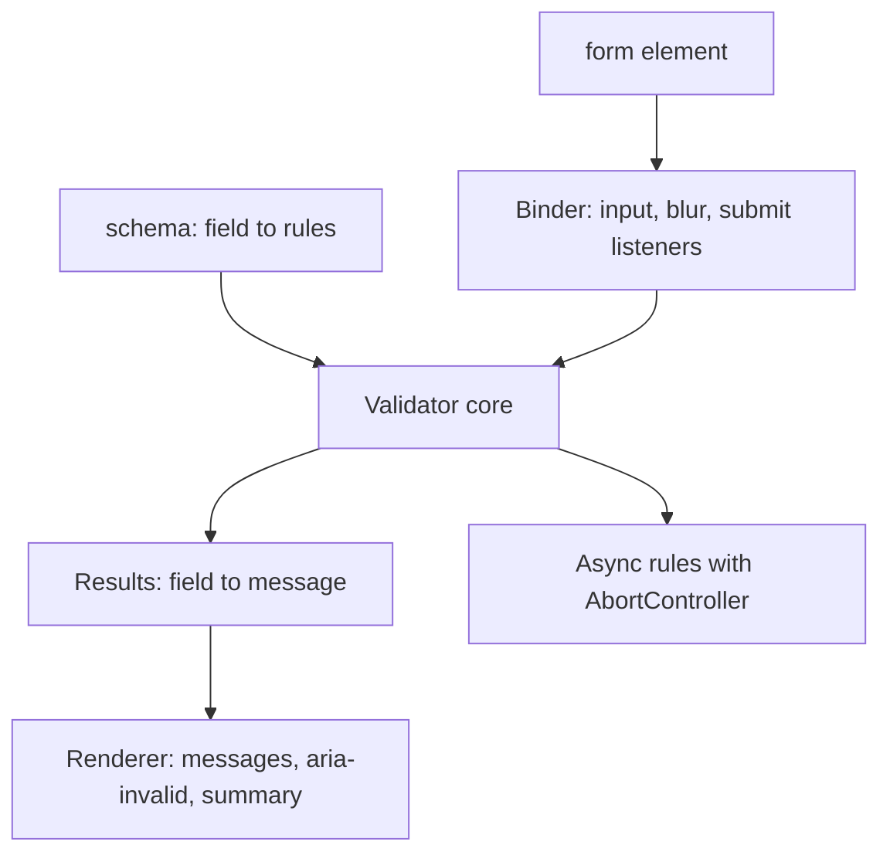
- **Schema** is plain data: `{ email: [required(), email()], confirm: [matches('password')] }`.
- **Validator core** runs rules in order and stops at the first failure per field; rules are functions `(value, values) => message | null`.
- **Binder** maps DOM events to validation calls and tracks which fields were *touched*.
- **Renderer** writes messages and ARIA attributes, and mirrors errors into `setCustomValidity` so CSS `:invalid` styles stay consistent.

### Data model
| Type | Shape |
|---|---|
| `Rule` | `(value: string, all: Record<string,string>) => string \| null \| Promise<string \| null>` |
| `FieldState` | `{ touched: boolean, error: string \| null, pending: boolean }` |
| `FormState` | `Map<fieldName, FieldState>`, `submitting: boolean` |

### Tech stack
| Component | Choice | Why |
|---|---|---|
| Baseline | HTML attributes (`required`, `minlength`, `type=email`) | works without JS, free mobile keyboards |
| Extra rules | JS functions | cross-field and async checks HTML cannot express |
| Values | `new FormData(form)` | reads every field, including checkboxes |
| Styles | `:user-invalid` | only styles fields after the user interacted |

### Milestones
1. **Native only.** Add HTML attributes and submit. *Done when* the browser blocks bad input with no JavaScript.
2. **Core library.** Rules, schema, `validate(values)` returning errors — tested in Node. *Done when* tests cover every built-in rule.
3. **Binding and rendering.** *Done when* errors appear on blur, disappear while fixing, and the form has `novalidate` only when JS is running.
4. **Accessibility.** *Done when* a screen reader announces each error and submitting focuses the first invalid field.
5. **Async rule.** Fake "username taken" endpoint with delay. *Done when* typing quickly sends one request and the stale one is aborted.

### Deep dive: the hard parts
**Email and names.** The HTML `type=email` check follows a deliberately practical grammar; writing a "perfect" email regex is a trap. Accept what the browser accepts, then confirm by sending an email. For names, do not restrict characters — "Zoë O'Brien-Nguyễn" is valid. Use [Ch 6](../chapters/06-strings-and-regular-expressions/README.md)'s Unicode-aware regex (`/^\p{L}/u`) only where you truly need a rule.

**When to show errors.** Validating on every keystroke from the first character shows "invalid email" after typing one letter. Validate on `blur` the first time; once a field has an error, re-validate on `input` so the message disappears as soon as it is fixed.

**Client checks are not security.** Anyone can bypass the page with `curl`. The same schema should run on the server (it is just functions — share the module with Node) and the server's answer is final.

### Testing strategy
Pure unit tests of each rule and of `validate`. jsdom tests for binding: dispatch `blur`/`input`/`submit` and assert `aria-invalid`, `aria-describedby` and focus. Async rule tested with a mocked `fetch` and fake timers to prove debounce and abort.

### Trade-offs, scaling and failure modes
Native validation is free and accessible but its message bubbles are hard to style and inconsistent; custom rendering gives control at the cost of code. Async checks reveal whether a username exists (an enumeration risk); rate-limit the endpoint. If the async check fails (network), do not block the form — let the server decide.

### Stretch goals
- Multi-step wizard that validates per step.
- i18n messages with `Intl.PluralRules` ("1 character" vs "2 characters").
- Share the schema with a Node server and return field errors in the same shape.

### Skills practised
- [Ch 6 — Strings and regex](../chapters/06-strings-and-regular-expressions/README.md): patterns, Unicode property escapes, `RegExp.escape` for user-supplied literals.
- [Ch 13 — DOM and events](../chapters/13-dom-and-events/README.md): forms, `FormData`, `blur` vs `input`, focus.

### In the interview
**30-second answer:** I built a sign-up form with a tiny dependency-free validation library: you describe rules per field as plain functions, and the library binds events, renders accessible messages and runs a debounced, cancellable async check for username availability. The key decision was progressive enhancement — native HTML attributes like `required` and `type=email` work without JavaScript, and my rules layer on top for cross-field and async checks. The hardest part was timing: errors appear on blur, then update live on input, so users are not scolded mid-typing. The library is under 3 KB minified, and the same schema runs on the server because client validation is never security.

**Key terms to know:**
- **Constraint validation API** — the browser's built-in checks (`required`, `pattern`, `minlength`, `type=email`) plus `checkValidity()` and `setCustomValidity()`.
- **Progressive enhancement** — the form works with plain HTML first, and JavaScript adds a better experience on top; `novalidate` is added only when JS runs.
- **Rule function** — `(value, allValues) => message | null`, or a promise of one for async rules; the schema maps fields to rule lists.
- **Touched state** — whether the user has left a field once; errors are shown only after that ("reward early, punish late").
- **`aria-describedby` and `aria-invalid`** — link an error message to its field and mark the field invalid for screen readers.
- **`:user-invalid`** — a CSS pseudo-class that matches invalid fields only after user interaction, unlike `:invalid`.
- **Debounce and `AbortController`** — wait 300 ms after typing stops, and cancel the previous availability request.
- **`FormData`** — reads every named control in a form, including checkboxes and selects.
- **Username enumeration** — an availability endpoint reveals which accounts exist, so it must be rate-limited.

**Q:** Why validate on the server if the client already does?

**A:** The client is under the user's control; anyone can skip the page and send a request with `curl` or edit the JavaScript. Client validation is for user experience, server validation is for correctness and security. Because rules are plain functions, I share the schema module with Node and the server's answer is final.

**Q:** `input` vs `change` vs `blur`?

**A:** `input` fires on every edit, `change` fires when a committed value changes (for text fields, when focus leaves after an edit), and `blur` fires when focus leaves whether or not anything changed. I validate on `blur` the first time and on `input` after a field has an error, so messages appear late and disappear early.

**Q:** How do you make errors accessible?

**A:** Each message has an id referenced by the field's `aria-describedby`, the field gets `aria-invalid="true"`, and on submit I focus the first invalid field and show a summary with links to each field. Screen readers then read the error when the field gets focus. Colour alone never signals an error.

**Q:** Why not write a perfect email regex?

**A:** The full address grammar is enormous and real addresses use `+`, subdomains and international characters that strict regexes reject. I accept what `type=email` accepts and confirm ownership by sending an email, which is the only real proof. The same goes for names: do not restrict characters.

**Q:** How does the async rule avoid races?

**A:** It is debounced 300 ms, and each call aborts the previous request with its `AbortController`. I also compare the value the response was for with the current value before showing it. If the check fails because of the network, I do not block submit — the server decides.

**Q:** Hands-on: how do you collect values and block submit only when invalid?

```js
form.addEventListener('submit', async e => {
  e.preventDefault();
  const values = Object.fromEntries(new FormData(form));
  const errors = await validate(schema, values);
  if (Object.keys(errors).length) return showErrors(errors);
  form.submit(); // does not fire 'submit' again
});
```

**A:** `preventDefault` stops the browser's native submit while async rules run. `Object.fromEntries(new FormData(form))` gives a plain object, though multi-value fields need `getAll`. `form.submit()` bypasses the submit event and native validation, whereas `requestSubmit()` runs both.

**Q:** What changes at 10x the fields or a multi-step form?

**A:** Rule evaluation is cheap, so the cost is in rendering; I re-validate only the field that changed plus fields that depend on it (like `confirm` depending on `password`). For a wizard I validate per step and keep values in one object across steps. Server errors come back in the same `{ field: message }` shape so the renderer reuses one path.

**Q:** How do you test it?

**A:** Each rule and `validate` are pure, so they get table-driven unit tests. jsdom tests dispatch `blur`, `input` and `submit` and assert `aria-invalid`, `aria-describedby` and which element has focus. The async rule uses a mocked `fetch` and fake timers to prove only one request is sent and the stale one is aborted.

**Common mistakes in answers:**
- Treating client validation as security — it is UX only.
- Validating on every keystroke from the first character, which shows errors before the user has had a chance.
- Confusing `form.submit()` with `requestSubmit()` — only the latter fires the submit event and runs constraint validation.

### TL;DR
Start with native HTML validation, layer a tiny rule-function library for cross-field and async checks, show errors late and clear them early, and always validate again on the server.

## 8. Typing speed test

**Level:** Beginner · **Time:** 1 weekend · **Prerequisites:** Ch 6, Ch 12, Ch 13

### What it is
A typing test like the ones speed typists race on: a passage appears, you type it, each character turns green or red as you go, and at the end you see **WPM** (words per minute, by convention one "word" = 5 characters), accuracy, and a chart of speed over time. Modes: 15/30/60-second timed runs and fixed-length quotes.

### The problem it solves
It looks like string comparison, but correct handling of real text is hard: accented letters, emoji and combined characters, IME composition (how Chinese, Japanese and Korean users type), and fast keystrokes that must not lag the UI. It is a great beginner tour of **Unicode** and of measuring time precisely.

### Real-world examples
- [Monkeytype](https://github.com/monkeytypegame/monkeytype) is a popular open-source typing test; its feature set is a good reference for modes and statistics.
- MDN's [`Intl.Segmenter`](https://developer.mozilla.org/en-US/docs/Web/JavaScript/Reference/Global_Objects/Intl/Segmenter) shows how to split text into user-perceived characters (grapheme clusters) and words.

### Requirements
**Functional**
- Random passages from a local word list or quote list; timed and quote modes.
- Live per-character feedback; backspace allowed within the current word.
- Results: gross WPM, net WPM, accuracy, errors per character, WPM-over-time chart.
- Restart with Tab+Enter; personal bests per mode in `localStorage`.

**Non-functional**
- Keystroke-to-paint under 16 ms with a 500-word passage.
- Correct counting for non-ASCII text (é, ñ, emoji with skin tones).
- Works with IME input without double-counting.

### The architecture
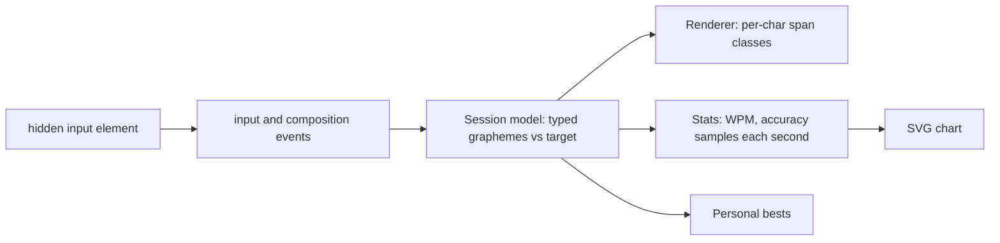
- **Hidden input** captures text (including mobile keyboards and IMEs) while the passage is shown in styled spans.
- **Session model** compares typed graphemes with target graphemes and records errors and timestamps.
- **Stats** samples once per second for the chart and computes final scores.

### Data model
| Field | Type | Notes |
|---|---|---|
| `target` | string[] | graphemes of the passage via `Intl.Segmenter` |
| `typed` | string[] | graphemes typed so far |
| `errors` | `Set<number>` | indices ever typed wrong (for accuracy) |
| `startedAt` | number | `performance.now()` at first keystroke |
| `samples` | `{ t, wpm }[]` | one per second |

### Tech stack
| Component | Choice | Why |
|---|---|---|
| Text splitting | `Intl.Segmenter('en', { granularity: 'grapheme' })` | `"👍🏽".length` is 4, but it is one character to a human |
| Input | `<input>` + `input` + `compositionend` | robust across keyboards |
| Rendering | update only changed spans | avoids re-rendering 2,500 spans per key |
| Chart | inline SVG polyline | no library |

### Milestones
1. **Render and compare** ASCII text. *Done when* each character turns green or red correctly, including after backspace.
2. **Timing and WPM.** *Done when* a scripted test typing 50 correct characters in 10 seconds reports 60 WPM.
3. **Unicode.** *Done when* a passage with "café", "naïve" and an emoji family counts each as the right number of characters.
4. **Performance.** *Done when* the DevTools Performance panel shows no long tasks while typing fast into a 500-word passage.
5. **Results and chart.** *Done when* results show a correct WPM-over-time line and bests persist.

### Deep dive: the hard parts
**What is a "character"?** JavaScript strings are sequences of UTF-16 code units. `"é"` may be one code unit (precomposed) or two (e + combining accent); emoji often take 2–11 code units. Compare by grapheme clusters from `Intl.Segmenter`, and normalise both sides with `String.prototype.normalize('NFC')` so two encodings of "é" compare equal. [Ch 6](../chapters/06-strings-and-regular-expressions/README.md) covers code units, code points and graphemes.

**IME composition.** While a user composes a character with an IME, `input` fires with intermediate text. Ignore input while `event.isComposing` is true and process on `compositionend`, or you will mark half-built characters as errors.

**Fast rendering.** Rebuilding 2,500 `<span>`s on every keystroke causes layout work per key. Keep an array of span references and change only the one or two spans affected (`className` swap). Batch reads and writes to avoid layout thrashing.

**The maths.** Gross WPM = (all typed characters / 5) / minutes. Net WPM subtracts uncorrected errors per minute. Accuracy = correct keystrokes / total keystrokes, so fixed mistakes still lower accuracy. Document your formulas — sites differ.

### Testing strategy
Unit-test the session model with scripted keystroke sequences and an injected clock. Test grapheme handling with tricky strings (combining marks, ZWJ emoji sequences, flags). jsdom test that composition events do not produce errors.

### Trade-offs, scaling and failure modes
A hidden input gives native keyboard behaviour on mobile but complicates focus (clicking the passage must refocus it). `Intl.Segmenter` is in all modern browsers and Node; on very old browsers you would fall back to code points via `[...str]`, which still splits some emoji. Cheating (pasting) is easy — detect `paste` events and void the run.

### Stretch goals
- Per-key heatmap of errors on an on-screen keyboard.
- Multi-language word lists with right-to-left text.
- Race a "ghost" replay of your personal best.

### Skills practised
- [Ch 6 — Strings and regex](../chapters/06-strings-and-regular-expressions/README.md): Unicode, normalisation, `Intl.Segmenter`.
- [Ch 12 — Async](../chapters/12-asynchronous-javascript/README.md): timing with `performance.now()`.
- [Ch 13 — DOM and events](../chapters/13-dom-and-events/README.md): input and composition events, minimal DOM updates.

### In the interview
**30-second answer:** I built a typing speed test that colours each character as you type and reports gross WPM, net WPM, accuracy and a speed-over-time chart. The key decision was to compare *grapheme clusters* from `Intl.Segmenter`, with both sides NFC-normalised, instead of UTF-16 code units, so "café" and skin-tone emoji count as the characters a human sees. The hardest parts were IME composition, where I ignore input until `compositionend`, and keeping keystroke-to-paint under 16 ms on a 500-word passage by updating only the one or two spans that changed. A scripted test typing 50 correct characters in 10 seconds reports exactly 60 WPM.

**Key terms to know:**
- **UTF-16 code unit** — what `str.length` and `str[i]` count; many emoji take two or more.
- **Code point** — a Unicode number such as U+00E9; `[...str]` and `for…of` iterate code points.
- **Grapheme cluster** — what a user sees as one character, possibly several code points; `Intl.Segmenter` with `granularity: 'grapheme'` splits by these.
- **Normalisation (NFC)** — `normalize('NFC')` turns "e + combining accent" into the single precomposed "é" so equal-looking strings compare equal.
- **IME composition** — the input method Chinese, Japanese and Korean users type through; `compositionstart`/`compositionend` and `event.isComposing` mark it.
- **WPM** — words per minute with one word defined as 5 characters; gross counts everything, net subtracts uncorrected errors.
- **Layout thrashing** — alternating DOM reads and writes that force the browser to recalculate layout repeatedly.
- **Long task** — main-thread work over 50 ms, visible in the DevTools Performance panel.
- **Hidden input** — a real `<input>` captures keystrokes (including mobile keyboards) while styled spans show the passage.

**Q:** Why can `str.length` be wrong for user-visible length?

**A:** It counts UTF-16 code units. `"👍🏽".length` is 4 (two surrogate pairs) but the user sees one character, and a family emoji joined with zero-width joiners is longer still. Count grapheme clusters with `[...new Intl.Segmenter('en', { granularity: 'grapheme' }).segment(s)].length`.

**Q:** What is NFC normalisation and why does it matter here?

**A:** Unicode can encode "é" as one precomposed code point or as "e" plus a combining accent. NFC converts to the precomposed form wherever one exists, so two visually identical strings become equal under `===`. Without it, a correctly typed "é" from one keyboard could be marked wrong against a passage stored the other way.

**Q:** How do you handle IME input?

**A:** During composition, `input` fires with intermediate text like a partially built syllable. I skip processing while `event.isComposing` is true and process the final text on `compositionend`. Otherwise half-built characters are scored as errors.

**Q:** How do you keep a per-keystroke UI fast?

**A:** I keep an array of span references and only swap the `className` of the one or two spans affected, instead of rebuilding 2,500 spans. I avoid reading layout (like `offsetTop`) right after writing styles, which would force a synchronous layout. Each input event does O(1) work.

**Q:** How are WPM and accuracy computed?

**A:** Gross WPM is (all typed characters ÷ 5) ÷ minutes, and net WPM subtracts uncorrected errors per minute. Accuracy is correct keystrokes ÷ total keystrokes, so a mistake you fixed still lowers accuracy. Time comes from `performance.now()` at the first keystroke, not from counting intervals.

**Q:** Hands-on: what do these print?

```js
'é'.length;                 // 1 or 2 depending on encoding
'é' === 'é';     // false
'é'.normalize('NFC') === 'é'; // true
[...'👍🏽'].length;          // 2 (two code points)
```

**A:** Spread splits by code points, so the thumbs-up with skin tone becomes two items even though it is one grapheme. Only `Intl.Segmenter` gives 1. This is why the target and typed arrays are built from segmenter output.

**Q:** What edge cases could break or cheat the test?

**A:** Pasting text would give impossible speeds, so I listen for `paste` and void the run. Clicking the passage blurs the hidden input, so I refocus it on click. On very old browsers without `Intl.Segmenter`, I would fall back to code points and accept that some emoji split.

**Q:** How do you test it?

**A:** The session model takes an injected clock and a scripted keystroke list, so "50 correct characters in 10 s" must give 60 WPM. I test tricky strings: combining marks, ZWJ emoji sequences, flags and right-to-left text. A jsdom test fires composition events and asserts no errors were recorded mid-composition.

**Common mistakes in answers:**
- Saying `[...str]` counts "characters" — it counts code points, which still splits many emoji.
- Comparing strings without normalising, so equivalent accents fail.
- Re-rendering the whole passage on every key and blaming the browser for lag.

### TL;DR
Compare graphemes, not code units; respect IME composition; touch only the spans that changed; and compute WPM from timestamps with clearly stated formulas.

## 9. Bookmark manager with import and export

**Level:** Beginner · **Time:** 1–2 weekends · **Prerequisites:** Ch 5, Ch 7, Ch 8, Ch 14

### What it is
A single-page bookmark manager: save links with title, tags and notes; search instantly across them; filter by tag; sort by name, date or most visited; and import from or export to a JSON file. Duplicate URLs are detected even when written differently (`HTTP://Example.com/` vs `http://example.com`).

### The problem it solves
Here the data — not the DOM — is the interesting part. You will normalise URLs with the `URL` class, index tags with `Map` and `Set`, search case- and accent-insensitively, sort with locale-aware comparison, and move data in and out of the browser with files. These are everyday data skills that larger apps assume.

### Real-world examples
- MDN's [Web Storage API](https://developer.mozilla.org/en-US/docs/Web/API/Web_Storage_API) and [IndexedDB API](https://developer.mozilla.org/en-US/docs/Web/API/IndexedDB_API) pages compare a small synchronous store with a larger asynchronous database — the choice you make for this app.
- MDN's [`Blob.slice`](https://developer.mozilla.org/en-US/docs/Web/API/Blob/slice) and related File API pages show how the browser reads user-chosen files without a server.

### Requirements
**Functional**
- Add/edit/delete bookmarks with URL validation; auto-fill title from the hostname.
- Tags with autocomplete; tag cloud with counts; click to filter; multiple tags = AND.
- Instant search over title, URL, notes and tags; highlight matches.
- Sort: A–Z (locale-aware), newest, most visited (click counter).
- Export to JSON (download); import JSON with a preview of new/duplicate/invalid entries.

**Non-functional**
- Search over 5,000 bookmarks responds in under 30 ms.
- Import validates every record; a bad file never corrupts existing data.
- All data stays on the device.

### The architecture
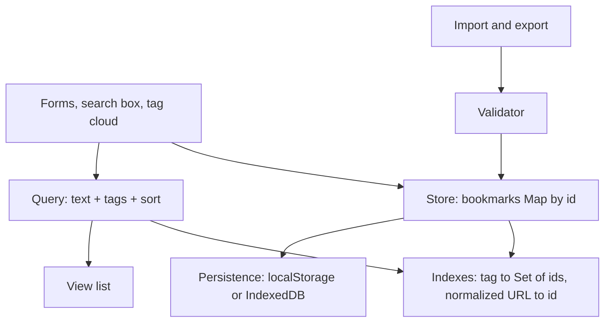
- **Store** keeps bookmarks in a `Map` keyed by id for O(1) updates.
- **Indexes** are derived: `tag → Set<id>` and `normalizedUrl → id` for duplicate checks; rebuilt on load and updated on each change.
- **Query** intersects tag sets (ES2025 `Set.prototype.intersection`), filters by text, then sorts.
- **Import/Export** validates, shows a dry-run summary, then commits.

### Data model
| Field | Type | Notes |
|---|---|---|
| `id` | string | `crypto.randomUUID()` |
| `url` | string | as entered |
| `normalizedUrl` | string | lower-case host, no default port, no trailing slash, sorted query |
| `title`, `notes` | string | |
| `tags` | string[] | lower-case, trimmed, unique |
| `createdAt`, `visits` | number | |

### Tech stack
| Component | Choice | Why |
|---|---|---|
| URL handling | `URL` class, `URL.canParse` | correct parsing instead of regex |
| Indexes | `Map`, `Set`, ES2025 set methods | fast membership and intersections |
| Search | `normalize('NFD')` + strip combining marks | "cafe" finds "Café" |
| Sorting | `Intl.Collator` | correct alphabetical order per language |
| Files | `<input type=file>` + `file.text()`, `Blob` + `URL.createObjectURL` | no server |

### Milestones
1. **CRUD + persistence** with a `Map`. *Done when* bookmarks survive reload.
2. **Normalisation and duplicates.** *Done when* adding `https://EXAMPLE.com:443/a/` after `https://example.com/a` warns of a duplicate.
3. **Tags and search.** *Done when* filtering by two tags shows only bookmarks with both, and searching "resume" finds "Résumé tips".
4. **Sorting.** *Done when* Swedish titles sort correctly with `Intl.Collator('sv')`.
5. **Import/export.** *Done when* exporting, deleting everything and importing restores identical data, and importing a malformed file changes nothing.

### Deep dive: the hard parts
**URL normalisation.** `new URL(input)` already lower-cases the scheme and host and drops default ports. Add your own rules: remove a trailing `/` on non-root paths, sort `searchParams`, drop the fragment and common tracking parameters (`utm_*`). Store both the original and the normalised form — users want to see what they typed.

**Set algebra for filters.** With an index `tag → Set<id>`, filtering by tags A and B is `index.get('a').intersection(index.get('b'))` — ES2025 methods that Node 24 and current browsers ship. Start from the smallest set for speed.

**Accent-insensitive search.** Normalise with `str.normalize('NFD').replace(/\p{M}/gu, '').toLowerCase()` on both the query and the text. Pre-compute a search string per bookmark when it is saved so each keystroke only does `includes`.

**Safe import.** Treat the file as untrusted: parse inside `try/catch`, check it is an array, validate each record (URL parses, tags are strings, sizes are bounded), and re-generate ids on conflict. Commit only after the user confirms the preview — a **two-phase** import.

### Testing strategy
Unit-test `normalizeUrl` with a table of equivalent and non-equivalent URLs, the query engine with fixture data, and the import validator with malformed files (wrong types, huge strings, prototype-pollution keys like `__proto__`). Use `structuredClone` to compare data before and after a round trip.

### Trade-offs, scaling and failure modes
A full in-memory scan is fine up to tens of thousands of entries; beyond that build an inverted index of words. `localStorage` is enough for a few thousand bookmarks; IndexedDB scales further but is asynchronous. Normalisation can merge URLs that a site treats as different (case-sensitive paths) — only lower-case the host.

### Stretch goals
- Import the Netscape HTML bookmark format browsers export, parsed with `DOMParser`.
- Fuzzy search with a small edit-distance scorer.
- Dead-link checker that reuses Project 25's ideas through a small Node script.

### Skills practised
- [Ch 5 — Objects and JSON](../chapters/05-objects-math-date-and-json/README.md): validation, `structuredClone`.
- [Ch 7 — Arrays](../chapters/07-arrays/README.md): sorting with comparators and collators.
- [Ch 8 — Maps and Sets](../chapters/08-maps-sets-iterators-and-generators/README.md): indexes, ES2025 set methods.
- [Ch 14 — Browser APIs](../chapters/14-browser-apis-and-security/README.md): `URL`, files, storage.

### In the interview
**30-second answer:** I built an on-device bookmark manager with tags, instant accent-insensitive search, locale-aware sorting, and JSON import and export. The key decision was to keep bookmarks in a `Map` by id with derived indexes — `tag → Set<id>` and `normalizedUrl → id` — so tag filters are set intersections and duplicate detection is one lookup. The hardest part was safe import: the file is untrusted, so I validate every record, show a dry-run preview of new, duplicate and invalid entries, and commit only after confirmation. Search across 5,000 bookmarks stays under 30 ms because each bookmark's search text is pre-normalised when saved.

**Key terms to know:**
- **`Map`** — a key-value collection with any key type, insertion order and `size`; the main store, keyed by id.
- **`Set` and ES2025 set methods** — `intersection`, `union`, `difference` on sets; multi-tag AND filters intersect tag sets.
- **Derived index** — a lookup structure rebuilt from the data (tag sets, normalised URLs) so queries avoid full scans.
- **URL normalisation** — turning equivalent URLs into one canonical string with the `URL` class plus rules (no trailing slash, sorted query, no `utm_*`).
- **Unicode normalisation (NFD)** — splits "é" into "e" plus a combining mark, which is then stripped with `/\p{M}/gu` for accent-insensitive search.
- **`Intl.Collator`** — compares strings by a language's alphabetical rules instead of raw code units.
- **Two-phase import** — validate and preview first, then commit everything at once or nothing.
- **Prototype pollution** — a crafted `__proto__` key that modifies `Object.prototype` when merged carelessly; the import validator rejects such keys.
- **`Blob` and object URLs** — export builds a `Blob` and downloads it through `URL.createObjectURL`, all without a server.

**Q:** Why use `Map` instead of a plain object for the store?

**A:** A `Map` accepts any key type, keeps insertion order, has `size`, and has no inherited keys, so a user value like `"__proto__"` or `"constructor"` cannot collide with the prototype. It is also optimised for frequent adds and deletes. A plain object is fine for fixed-shape records, which is what each bookmark is.

**Q:** How do you sort strings correctly for users?

**A:** Use `Intl.Collator` (or `localeCompare`) with the user's locale and reuse one collator instance: `list.sort(new Intl.Collator(locale).compare)`. The default `sort()` compares UTF-16 code units, so "Z" comes before "a" and "Ä" lands after "z". In Swedish, "ä" sorts after "z", which only a collator knows.

**Q:** How do you import untrusted JSON safely?

**A:** Parse inside `try/catch`, check it is an array, then validate each record: the URL parses with `URL.canParse`, tags are short strings, sizes are bounded. Build fresh objects with only known fields, which drops `__proto__` and other unexpected keys. Show a preview and commit atomically, so a bad file never touches existing data.

**Q:** Hands-on: how do you filter by tags A and B with ES2025 sets?

```js
const ids = index.get('a').intersection(index.get('b'));
const results = [...ids].map(id => store.get(id));
```

**A:** `intersection` returns a new `Set` of ids present in both. The specification iterates whichever of the two sets is smaller, so the cost is roughly the smaller set's size, and with three or more tags you start from the rarest one. Missing tags must default to an empty set, or `get` returns `undefined` and the call throws.

**Q:** What URL normalisation is safe, and what is risky?

**A:** `new URL()` already lower-cases scheme and host and drops default ports like `:443`. Removing a trailing slash on non-root paths, sorting query parameters and dropping fragments and `utm_*` parameters are usually safe. Lower-casing the *path* is risky because many servers treat paths as case-sensitive, so I only lower-case the host.

**Q:** Why pre-compute a search string per bookmark?

**A:** Normalising title, URL, notes and tags on every keystroke for 5,000 items wastes time. Doing it once when a bookmark is saved means each keystroke only normalises the query and runs `includes` on each stored string. That is O(n) per query with a small constant.

**Q:** What breaks first at 10x or 100x the bookmarks?

**A:** At 50,000 the linear `includes` scan starts to feel slow and `localStorage`'s roughly 5 MB limit and synchronous writes become a problem. I would move storage to IndexedDB, which is asynchronous and much larger, and build an inverted index from words to ids. Rendering would also need virtualisation (Project 22).

**Q:** How do you prove import and export are lossless?

**A:** A round-trip test exports, clears, imports and compares with a `structuredClone` taken before. A table of URL pairs tests `normalizeUrl` for both equivalent and non-equivalent cases. The import validator gets malformed files: wrong types, huge strings and `__proto__` keys.

**Common mistakes in answers:**
- Saying `sort()` sorts alphabetically — by default it compares UTF-16 code units.
- Normalising URLs by lower-casing the whole string — paths can be case-sensitive.
- Merging imported objects with `Object.assign` without filtering keys, which invites prototype pollution.

### TL;DR
Normalise URLs with `URL`, index tags with `Map` and ES2025 `Set` methods, search on pre-normalised text, sort with `Intl.Collator`, and import files in two validated phases.

## 10. Snake game on canvas

**Level:** Beginner · **Time:** 1–2 weekends · **Prerequisites:** Ch 7, Ch 9, Ch 14

### What it is
The classic Snake: steer a growing snake around a grid with arrow keys or swipes, eat food to grow and score, and avoid walls and your own tail. It draws on an HTML `<canvas>` with a **game loop** — a function that repeatedly updates the world and redraws it.

### The problem it solves
Games make two ideas concrete that most apps hide: a **fixed timestep** (the game logic advances in equal steps regardless of screen refresh rate) and **input buffering** (two quick key presses within one step must not be lost or allow the snake to reverse into itself). Canvas also shows a different rendering model from the DOM: you draw pixels and redraw everything each frame.

### Real-world examples
- MDN's [2D breakout game in pure JavaScript](https://developer.mozilla.org/en-US/docs/Games/Tutorials/2D_Breakout_game_pure_JavaScript) tutorial walks through a canvas game loop, collision detection and input.
- Glenn Fiedler's ["Fix Your Timestep!"](https://gafferongames.com/post/fix_your_timestep/) explains the accumulator pattern that decouples simulation steps from rendering.

### Requirements
**Functional**
- Grid of 20×20 cells; snake moves one cell per step; speed increases with score.
- Arrow keys / WASD; swipe on touch screens; pause with P or when the tab is hidden.
- Food never spawns on the snake; game over on wall or self collision (or wrap-around mode).
- Score, high score, restart.

**Non-functional**
- Same game speed on 60 Hz and 120 Hz displays.
- Crisp drawing on high-DPI screens (no blur).
- Step logic independent of the canvas, runnable in Node.

### The architecture
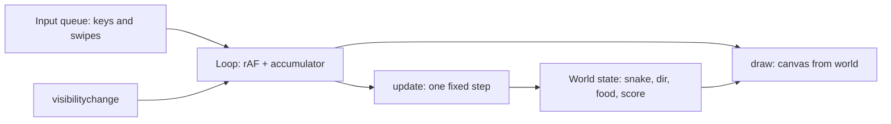
- **Input queue** stores up to two pending direction changes, rejecting reversals relative to the *last queued* direction.
- **Loop** runs on `requestAnimationFrame`, adds elapsed time to an accumulator, and calls `update` once per full step (e.g. every 120 ms).
- **update** is a pure-ish function from world to world; **draw** only reads.

### Data model
| Field | Type | Notes |
|---|---|---|
| `snake` | `{x, y}[]` | head first |
| `occupied` | `Set<string>` | `"x,y"` keys for O(1) collision checks |
| `dir`, `queue` | `{x, y}`, `{x, y}[]` | current direction, pending inputs |
| `food` | `{x, y}` | |
| `stepMs`, `score`, `state` | number, number, `'running' \| 'paused' \| 'over'` | |

### Tech stack
| Component | Choice | Why |
|---|---|---|
| Rendering | Canvas 2D | hundreds of cells redrawn cheaply |
| Loop | `requestAnimationFrame` + accumulator | smooth, refresh-rate independent |
| High DPI | scale backing store by `devicePixelRatio` | sharp edges |
| Model | class `World` with `step()` | testable without a canvas |

### Milestones
1. **Static grid and snake** drawn on canvas, sharp on a retina screen. *Done when* lines are crisp at 2× zoom.
2. **Movement with a fixed step.** *Done when* the snake moves at the same speed with DevTools rendering at 30 fps and at 120 fps.
3. **Food, growth, collisions.** *Done when* tests cover eating, wall death and self-collision.
4. **Input buffering.** *Done when* pressing Up then Left within one step (while moving right) turns up then left, and pressing Left alone does nothing.
5. **Polish.** Pause on hidden tab, swipe controls, high score. *Done when* switching tabs pauses and resuming does not jump.

### Deep dive: the hard parts
**Fixed timestep.** Each frame, add `now - last` to an accumulator; while it is at least `stepMs`, run `update()` and subtract `stepMs`. Rendering happens once per frame. Cap the accumulator (say 5 steps) so returning from a long pause does not fast-forward the game into a wall.

**The reversal bug.** Moving right, the player presses Up then Left very fast. If you only check "new direction is not opposite of *current*", both are accepted, the second overwrites the first before a step runs, and the snake turns left into itself. Queue directions and validate each against the previous queued one, consuming one per step.

**Spawning food.** Picking random cells until one is free gets slow when the snake fills the board. When occupancy is high, build the list of free cells and pick one; it is O(cells) but always finishes.

**High-DPI canvas.** Set `canvas.width = cssWidth * devicePixelRatio`, keep the CSS size unchanged, and `ctx.scale(dpr, dpr)`. Otherwise the browser stretches a low-resolution bitmap.

### Testing strategy
`World` is pure: test `step()` with constructed states (snake about to eat, about to hit a wall, tail moving out of the way the same step the head moves in). Test the input queue separately. Inject a seeded RNG for food placement.

### Trade-offs, scaling and failure modes
Canvas is fast for many moving shapes but is not accessible by default — add an off-screen live region announcing score and game over. A DOM grid of 400 divs would also work and be inspectable, but redrawing classes each step costs more. Moving into the cell the tail is leaving is legal; forgetting that is a common off-by-one.

### Stretch goals
- Smooth interpolated movement between grid cells.
- Obstacles and levels loaded from JSON modules (`import level from './1.json' with { type: 'json' }`).
- An AI player using BFS to reach food (see [Ch 17](../chapters/17-javascript-for-interviews/README.md)).

### Skills practised
- [Ch 7 — Arrays](../chapters/07-arrays/README.md): the snake as a queue (`unshift` head, `pop` tail).
- [Ch 9 — Classes](../chapters/09-this-prototypes-and-classes/README.md): a `World` class with methods.
- [Ch 14 — Browser APIs](../chapters/14-browser-apis-and-security/README.md): `requestAnimationFrame`, visibility.

### In the interview
**30-second answer:** I built Snake on a 20×20 canvas grid with a fixed-timestep game loop: `requestAnimationFrame` adds elapsed time to an accumulator and the world advances one step every 120 ms, so the game runs at the same speed on 60 Hz and 120 Hz screens. The key design choice was a pure `World.step()` with no canvas dependency, so every collision rule is a Node unit test. The hardest bug was a fast Up-then-Left press letting the snake reverse into itself; I fixed it with an input queue that validates each direction against the last *queued* one. Collisions are O(1) through a `Set` of occupied cells, and the canvas is scaled by `devicePixelRatio` so it stays sharp.

**Key terms to know:**
- **Game loop** — a function that repeatedly updates the world and draws it; here driven by `requestAnimationFrame`.
- **Fixed timestep with an accumulator** — logic advances in equal steps however often frames arrive; leftover time carries to the next frame.
- **`requestAnimationFrame`** — runs a callback before the next repaint at the display's refresh rate and pauses in hidden tabs.
- **Input buffering** — a short queue (up to two) of pending direction changes, consumed one per step.
- **Canvas 2D (immediate mode)** — you draw pixels each frame and the browser keeps no objects, unlike the DOM.
- **`devicePixelRatio`** — physical pixels per CSS pixel; the canvas backing store must be scaled by it to avoid blur.
- **`Set` for collisions** — `"x,y"` string keys give O(1) self-collision checks instead of scanning the snake.
- **Spiral of death** — when catching up takes longer than real time; capping the accumulator prevents it.
- **Seeded RNG** — makes food placement repeatable in tests.

**Q:** Why not move the snake directly inside `requestAnimationFrame`?

**A:** rAF fires at the display's refresh rate, so one move per frame would make the snake twice as fast on a 120 Hz screen. An accumulator collects real elapsed time and runs `update()` once per full `stepMs`, keeping speed independent of the display. Drawing still happens once per frame.

```js
acc += now - last; last = now;
let steps = 0;
while (acc >= stepMs && steps++ < 5) { world.step(); acc -= stepMs; }
draw(world);
```

**Q:** Why cap the number of steps per frame?

**A:** After a long pause or a slow frame, the accumulator can hold many seconds. Running all of those steps at once would teleport the snake into a wall, and on a slow device could take longer than the time it simulates. I cap it at a few steps and drop the rest, and I pause on `visibilitychange`.

**Q:** How do you check self-collision fast?

**A:** Keep a `Set` of `"x,y"` keys alongside the snake array and update both each step: add the new head, delete the old tail. A lookup is O(1) instead of scanning every segment. The subtle rule is that the head may move into the cell the tail is leaving in the same step, so remove the tail first unless the snake is growing.

**Q:** What exactly is the reversal bug and how does the queue fix it?

**A:** Moving right, the player presses Up then Left within one step. If each key is checked only against the *current* direction, both pass, Left overwrites Up before the step runs, and the snake reverses into itself. Validating each new key against the last queued direction rejects Left until Up has been applied.

**Q:** Why does a canvas look blurry on retina screens?

**A:** The canvas bitmap defaults to CSS pixels, and the browser stretches it over 2 or 3 times as many physical pixels. Set `canvas.width = cssWidth * devicePixelRatio` (and the same for height), keep the CSS size unchanged, and `ctx.scale(dpr, dpr)` so drawing code still uses CSS units.

**Q:** What happens when the snake nearly fills the board?

**A:** Picking random cells until you hit a free one becomes very slow and in theory may never finish. When occupancy is high I build the list of free cells and pick one at random, which is O(cells) but always terminates. If no cell is free, the player has won.

**Q:** Canvas or a DOM grid, and how do you make canvas accessible?

**A:** 400 divs would work and be inspectable, but toggling classes and styles each step costs more than a few `fillRect` calls. Canvas content is invisible to screen readers, so I add an off-screen live region announcing score and game over, and keep keyboard controls. At much larger grids canvas is clearly the better choice.

**Q:** How do you test it?

**A:** `World` is pure, so I construct states and call `step()`: the snake about to eat, about to hit a wall, and the head entering the cell the tail leaves. The input queue has its own tests for reversals. A seeded RNG makes food placement deterministic.

**Common mistakes in answers:**
- Using `setInterval` for the loop and claiming it is smooth — it is not aligned to frames and drifts.
- Checking reversals against the current direction only, which allows the double-tap death.
- Forgetting that entering the cell the tail is vacating is legal.

### TL;DR
A fixed-step loop on `requestAnimationFrame`, a validated input queue, a `Set` for collisions and a DPR-scaled canvas make Snake correct on every screen.

## 11. Infinite-scroll image search

**Level:** Intermediate · **Time:** 1 week · **Prerequisites:** Ch 12, Ch 13, Ch 14

### What it is
An image search page: type a query, see a grid of photos, and keep scrolling — more results load automatically before you reach the bottom. Search-as-you-type is **debounced**, stale requests are **cancelled**, new pages are triggered by an **`IntersectionObserver`** (a browser API that tells you when an element enters or leaves the viewport), and images load lazily with reserved space so the layout does not jump.

### The problem it solves
Naive infinite scroll listens to `scroll`, reads `scrollTop` on every event, fires duplicate requests, shows results for an old query and shifts the page as images arrive. Each of those is a classic interview topic. This project fixes all of them with the right primitive for each: debounce for typing, `AbortController` for stale requests, an observer for "near the bottom", and intrinsic sizes for layout stability.

### Real-world examples
- The [Unsplash API documentation](https://unsplash.com/documentation) describes `GET /search/photos` with `page` and `per_page` (max 30), a demo-mode limit of 50 requests per hour, and a requirement to hotlink the returned image URLs.
- MDN's [Intersection Observer API](https://developer.mozilla.org/en-US/docs/Web/API/Intersection_Observer_API) guide explains `rootMargin` and thresholds — the knobs that make prefetching work.

### Requirements
**Functional**
- Search box with 300 ms debounce; Enter searches immediately.
- Grid of results; next page loads when a sentinel element is within 800 px of the viewport.
- Loading, empty, error and "end of results" states; retry button on error.
- Query and page reflected in the URL (`?q=cats`), so reload and back work.
- Click opens a large view in a `<dialog>` with author credit.

**Non-functional**
- At most one in-flight request per query; zero responses from old queries rendered.
- Cumulative Layout Shift (CLS) under 0.1 while images load.
- Stays under the API's rate limit: cache pages per query for the session.
- Works without the API key during development via a mock server or fixtures.

### The architecture
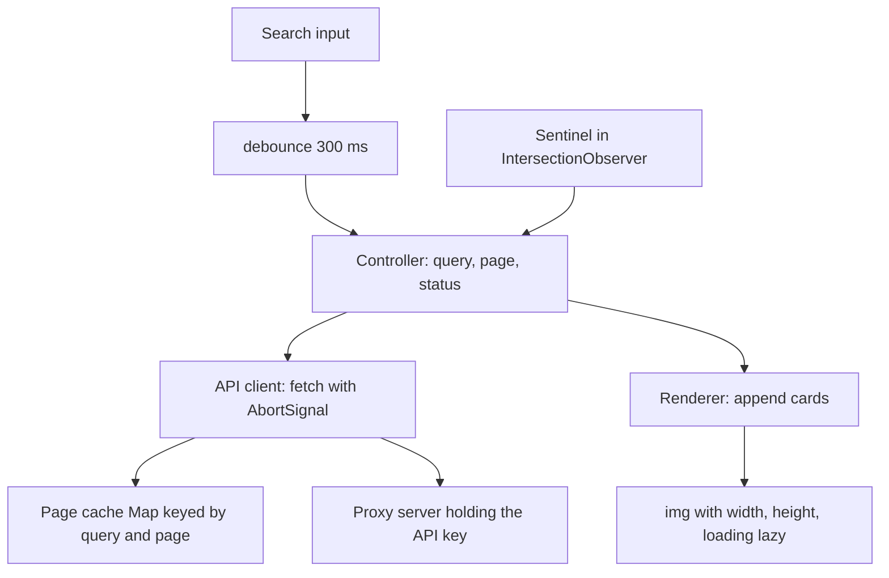
- **Controller** is a small state machine: `idle → loading → ready | error | done`. It refuses to load the next page while `loading`, and it resets page and grid when the query changes.
- **API client** owns the current `AbortController`; a new query aborts the old one.
- **Proxy server** (a 30-line Node script) adds the secret key so it never reaches the browser.
- **Renderer** appends a `DocumentFragment` of cards per page — one DOM insertion per page.

### Data model
| Type | Fields |
|---|---|
| `Photo` | `id`, `thumbUrl`, `fullUrl`, `width`, `height`, `alt`, `author`, `authorUrl` |
| `PageResult` | `photos`, `totalPages` |
| `State` | `query`, `page`, `status`, `requestId`, `hasMore` |
| Cache | `Map<"query:page", PageResult>` |

### Tech stack
| Component | Choice | Why |
|---|---|---|
| Debounce | closure over `setTimeout` id | 10 lines, reusable |
| Cancellation | `AbortController` per query | real cancellation, not just ignoring |
| "Near bottom" | `IntersectionObserver` with `rootMargin: '800px'` | no scroll handler, no layout reads |
| Images | `loading="lazy"`, `decoding="async"`, `width`/`height` attributes | native lazy loading and no layout shift |
| Proxy | `node:http` + `fetch` (Node 24) | hides the key |

### Milestones
1. **Fixture-driven grid.** Render a page from a local JSON file. *Done when* the grid looks right on mobile and desktop.
2. **Search with debounce and abort.** *Done when* typing "kitten" quickly triggers one request and the Network panel shows earlier ones as cancelled.
3. **Infinite scroll.** *Done when* scrolling loads page 2, 3… with no duplicates and stops at the last page.
4. **Layout stability.** *Done when* Lighthouse reports CLS under 0.1.
5. **URL state and dialog.** *Done when* reload restores the query, and Escape closes the large view and returns focus to the thumbnail.

### Deep dive: the hard parts
**Debounce, cancel, and request ids.** Debounce reduces requests; it does not prevent races, because a slow response from request 1 can still arrive after request 2. Abort the previous request when starting a new one, and also stamp each request with `++requestId` and drop any response whose id is not current — the abort may arrive after the body has already been parsed.

**Why an observer beats a scroll listener.** A `scroll` handler runs many times per frame and usually reads `scrollTop`/`offsetHeight`, forcing layout. `IntersectionObserver` is computed by the browser off the critical path and calls you only when the sentinel crosses the margin. Keep one sentinel after the grid; after appending a page, the observer fires again automatically if the sentinel is still visible (very tall screens), so you need no extra check.

**No layout shift.** An `` without size takes zero height until it loads, then pushes everything down. Set `width` and `height` attributes from the API's dimensions (the browser derives the aspect ratio) and use CSS `width: 100%; height: auto`. A blurred placeholder colour (the API's dominant colour) makes it feel faster.

**DOM growth.** After 50 pages you have 1,500 cards and memory grows. Either cap the history (remove cards far above the viewport and keep a spacer) or accept it and document it. Project 22 implements full virtualisation.

### Testing strategy
Unit-test `debounce` with fake timers, the controller's transitions with a mocked client, and the cache. In jsdom, `IntersectionObserver` does not exist — inject an observer factory and trigger it manually in tests. End-to-end, run Playwright against the proxy with fixtures to assert no duplicate ids after scrolling.

### Trade-offs, scaling and failure modes
Infinite scroll is great for browsing but bad for reaching the footer and for sharing a position; consider a "Load more" button or page numbers for search results users compare. Prefetch margin trades bandwidth for smoothness. If the API returns 429 (too many requests), back off and show a message rather than retrying in a loop.

### Stretch goals
- Masonry layout with CSS grid and `grid-row: span n` from aspect ratios.
- Restore scroll position on Back using `history.state`.
- Offline cache of viewed pages with a service worker.

### Skills practised
- [Ch 12 — Async](../chapters/12-asynchronous-javascript/README.md): debounce, `AbortController`, race conditions.
- [Ch 13 — DOM and events](../chapters/13-dom-and-events/README.md): fragments, reflow and layout thrashing.
- [Ch 14 — Browser APIs](../chapters/14-browser-apis-and-security/README.md): `fetch`, `IntersectionObserver`, `URL`, History API.

### In the interview
**30-second answer:** I built an infinite-scroll image search on the Unsplash API, with a 30-line Node proxy so the API key never reaches the browser. The key design choice was using the right primitive for each problem: a 300 ms debounce for typing, an `AbortController` plus a request id for stale responses, and an `IntersectionObserver` sentinel with an 800 px `rootMargin` instead of a scroll listener. The hardest part was layout stability: every `` gets `width` and `height` from the API so the browser reserves space, which kept Cumulative Layout Shift under 0.1. Pages are cached per query, which matters with a demo limit of 50 requests an hour.

**Key terms to know:**
- **`IntersectionObserver`** — a browser API that calls you when an element enters or leaves the viewport (or a margin around it); it watches the sentinel.
- **Sentinel element** — an empty element after the grid; when it comes near the viewport, the next page loads.
- **`rootMargin`** — grows the observed area, so `'800px'` triggers loading before the user reaches the bottom.
- **Debounce** — waits for a pause in typing before searching; reduces requests but does not prevent races.
- **`AbortController` and request id** — cancel the old request, and drop any response whose id is not the latest.
- **Cumulative Layout Shift (CLS)** — a Core Web Vital that measures how much visible content jumps; target under 0.1.
- **Native lazy loading** — `loading="lazy"` defers off-screen images; `decoding="async"` lets decoding happen off the critical path.
- **`DocumentFragment`** — an off-DOM container; appending one inserts a whole page of cards in a single DOM operation.
- **API proxy** — a small server that adds the secret key, caches, and can rate-limit.
- **HTTP 429** — "Too Many Requests"; the client must back off rather than retry in a loop.

**Q:** How would you implement infinite scroll?

**A:** Put a sentinel after the list and observe it with `IntersectionObserver` and a generous `rootMargin`. When it intersects and the controller is not already `loading` and `hasMore` is true, fetch the next page and append it with a fragment. Stop observing when the API reports the last page.

**Q:** Why is `IntersectionObserver` better than a `scroll` listener?

**A:** A scroll handler can fire many times per frame and usually reads `scrollTop` or `offsetHeight`, which forces layout. The observer is computed by the browser asynchronously and only calls you when the threshold is crossed. It also re-fires after you append a page if the sentinel is still visible, so tall screens need no extra check.

**Q:** Does debounce prevent race conditions?

**A:** No. It reduces how many requests start, but a slow response for "kit" can still arrive after the one for "kitten". Abort the previous request and also check a request id, because the abort may come after the body was already parsed.

**Q:** How do you prevent layout shift from images?

**A:** Reserve space before the image loads by setting `width` and `height` attributes (the browser derives an aspect ratio) with CSS `width: 100%; height: auto`, or set `aspect-ratio`. Lazy-load below the fold, and show a placeholder colour so the slot is not blank.

**Q:** Hands-on: what is wrong here?

```js
new IntersectionObserver(([e]) => {
  if (e.isIntersecting) loadNextPage();
}, { rootMargin: '800px' }).observe(sentinel);
```

**A:** Nothing stops two calls while one page is still loading, so the same page can be fetched twice and appear as duplicates. Guard with `if (status === 'loading' || !hasMore) return`, and de-duplicate by photo id as a second safety net. Also keep a reference to the observer so you can `disconnect()` it when the query changes or the view is torn down.

**Q:** What happens on a 429, a network error, or an empty result?

**A:** Each is a separate controller state with its own UI: an error with a Retry button, an "end of results" message, or an empty state. On 429 I back off and tell the user rather than retrying in a tight loop. A failed page does not clear the pages already shown.

**Q:** What breaks after 50 pages, or at 10x the traffic?

**A:** After 50 pages there are 1,500 cards with decoded images, so memory and style recalculation grow. I would cap history by removing cards far above the viewport and keeping a spacer, or fully virtualise (Project 22). At higher traffic, the proxy's shared cache and a per-client rate limit protect the API quota.

**Q:** Why not just call the API from the browser with the key?

**A:** Anything in front-end code is public, so the key could be copied and its quota burned by anyone. The proxy keeps the secret on the server, lets me cache popular queries for everyone, and gives one place to enforce limits.

**Q:** How do you test it, given jsdom has no `IntersectionObserver`?

**A:** I inject an observer factory into the controller and, in tests, call its callback by hand to simulate the sentinel appearing. `debounce` gets fake-timer tests and the controller's transitions use a mocked client. Playwright against the proxy with fixtures scrolls the real page and asserts no duplicate ids.

**Common mistakes in answers:**
- Saying debounce solves races — it only reduces request count.
- Forgetting a loading guard, which produces duplicate pages.
- Leaving the API key in the bundle "because it is a read-only key".

### TL;DR
Debounce the input, abort and id-check every request, let an `IntersectionObserver` sentinel ask for the next page, and give every image its size up front.

## 12. Kanban board with drag and drop

**Level:** Intermediate · **Time:** 1–2 weeks · **Prerequisites:** Ch 9, Ch 13, Ch 14

### What it is
A Trello-style board: columns (To do, Doing, Done) holding cards you can drag within and between columns, plus add, edit, delete and reorder columns. It persists locally, supports keyboard reordering, and syncs across tabs. You implement drag and drop yourself using **Pointer Events** — a unified API for mouse, pen and touch input.

### The problem it solves
Drag and drop is where UI code gets messy: hit-testing which slot the pointer is over, auto-scrolling a column, touch support, accessibility for people who cannot drag, and storing order so that moving one card does not rewrite every other card. It is an excellent lesson in separating **interaction state** (what is being dragged, where it would drop) from **data state** (the board).

### Real-world examples
- Atlassian's open-source [Pragmatic drag and drop](https://github.com/atlassian/pragmatic-drag-and-drop) library powers drag and drop in its products and is framework-agnostic — worth reading after you build your own.
- Figma's post [Realtime editing of ordered sequences](https://www.figma.com/blog/realtime-editing-of-ordered-sequences/) explains **fractional indexing**: giving each item a sortable position *between* its neighbours so a move changes one record.
- MDN's [HTML Drag and Drop API](https://developer.mozilla.org/en-US/docs/Web/API/HTML_Drag_and_Drop_API) explains the native API and, implicitly, why many apps avoid it (no touch support, limited styling of the drag image).

### Requirements
**Functional**
- Drag cards within and across columns with a placeholder showing the drop slot; drag columns to reorder.
- Works with mouse, touch and pen; long-press to start on touch.
- Keyboard: focus a card, Space to pick up, arrows to move, Space to drop, Escape to cancel; announcements via a live region.
- Card editing in a `<dialog>`; labels and due dates; filter by label.
- Persistence in `localStorage`, cross-tab sync, undo last move.

**Non-functional**
- Dragging stays at 60 fps on a board with 500 cards.
- A move writes one card record (its new column and position), not the whole column.
- Auto-scroll when dragging near a column's top or bottom edge.

### The architecture
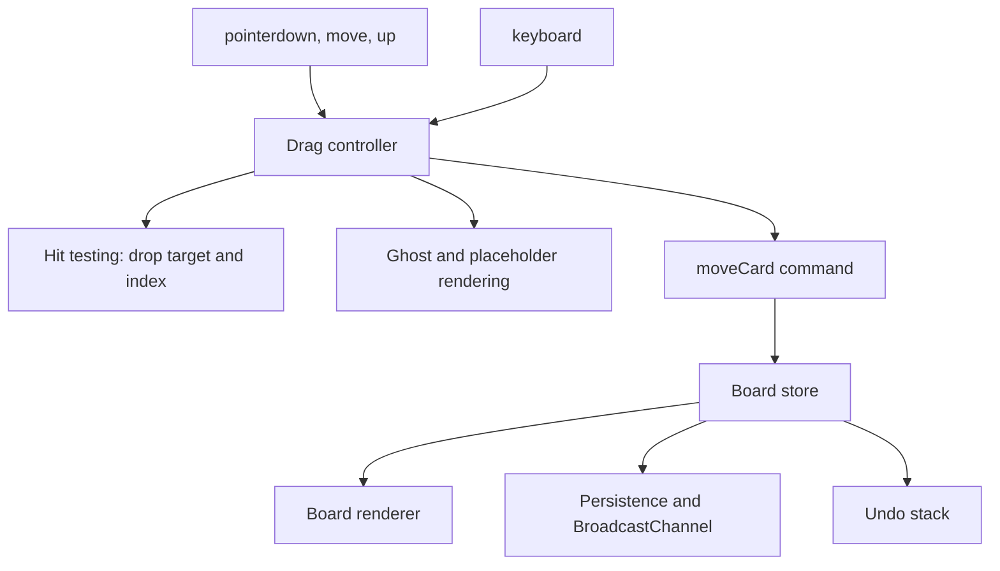
- **Drag controller** is a class with states `idle → pressed → dragging → dropping`; it captures the pointer with `setPointerCapture` so it keeps receiving moves even outside the element.
- **Hit testing** caches column and card rectangles at drag start and finds the slot by comparing the pointer's y to card midpoints.
- **moveCard command** is the only way data changes; it is recorded for undo.
- **BroadcastChannel** (a same-origin messaging API) tells other tabs to reload.

### Data model
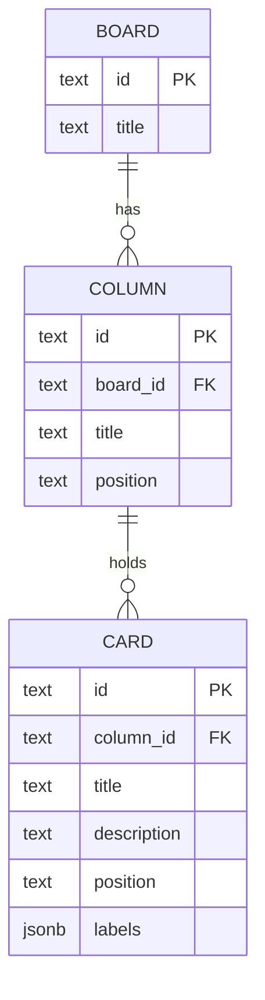
`position` is a fractional-index string such as `"a0"`, `"a0V"`; sorting by it gives the order.

### Tech stack
| Component | Choice | Why |
|---|---|---|
| Input | Pointer Events + `setPointerCapture` | one code path for mouse, touch, pen |
| Ordering | fractional index strings | a move updates one card |
| Movement | CSS `transform: translate()` on the ghost | no layout per frame |
| Sync | `BroadcastChannel('board')` | explicit cross-tab messages |
| Dialog | `<dialog>` + `showModal()` | built-in focus trapping and Escape |

### Milestones
1. **Render a board** from JSON, sorted by position. *Done when* cards appear in stored order.
2. **Mouse drag within a column.** *Done when* the placeholder follows the pointer and drop updates exactly one card's position.
3. **Across columns, touch, auto-scroll.** *Done when* a card can be moved across columns on a phone.
4. **Keyboard dragging and announcements.** *Done when* the whole board can be rearranged without a pointer and a screen reader announces each step.
5. **Persistence, sync, undo.** *Done when* a move in tab A appears in tab B and Ctrl+Z undoes it.

### Deep dive: the hard parts
**Fractional indexing.** Storing integers 0, 1, 2… means a move renumbers every card after it. Instead, generate a key strictly between the neighbours' keys (`between("a0", "a1")` → `"a0V"`). Keys are strings over a base-62 alphabet compared lexicographically, so they can always be extended. Occasionally rebalance if keys grow long.

**Hit testing without thrashing.** Calling `getBoundingClientRect()` on every card during every `pointermove` forces layout repeatedly. Measure once at drag start (and after auto-scroll), store rectangles in an array, and binary-search by y. Move only the ghost with `transform` inside `requestAnimationFrame`.

**Touch and scrolling.** On touch screens a drag competes with page scrolling. Set `touch-action: none` on drag handles, or start dragging only after a 200 ms long-press without movement. Cancel on `pointercancel`, which the browser fires when it takes over the gesture.

**Accessibility.** Drag and drop must have a non-pointer equivalent. Keyboard pick-up/move/drop with live announcements ("Card Fix login, position 2 of 5 in Doing") meets that need; a "Move to…" menu is a simpler alternative.

### Testing strategy
Unit-test `between(a, b)` exhaustively (random pairs, always strictly between, always sortable) and `moveCard`. Test the drag controller's state machine with synthetic pointer events in jsdom, stubbing rectangles. Use Playwright for one real touch and mouse drag each.

### Trade-offs, scaling and failure modes
The native HTML drag-and-drop API gives file drops and cross-window drags but no touch on many devices and limited styling; Pointer Events need more code but you control everything. Fractional keys make concurrent moves by two users merge cleanly, but two users inserting at the same spot can generate the same key — add a client-id suffix. Large boards need virtualised columns (Project 22).

### Stretch goals
- Multi-select drag.
- A Node + WebSocket backend so several people share a board (combine with Project 14).
- Swimlanes (rows by assignee).

### Skills practised
- [Ch 9 — Classes](../chapters/09-this-prototypes-and-classes/README.md): a drag controller with explicit states.
- [Ch 13 — DOM and events](../chapters/13-dom-and-events/README.md): pointer events, layout thrashing, `<dialog>`.
- [Ch 14 — Browser APIs](../chapters/14-browser-apis-and-security/README.md): `requestAnimationFrame`, storage, cross-tab messaging.

### In the interview
**30-second answer:** I built a Trello-style Kanban board with my own drag and drop on Pointer Events, so one code path handles mouse, touch and pen. The key design choice was fractional indexing: each card's `position` is a string sortable between its neighbours, so a move writes exactly one card record instead of renumbering a column. The hardest part was keeping dragging at 60 fps with 500 cards, which I solved by measuring card rectangles once at drag start, binary-searching them on each move, and moving only the ghost with `transform` inside `requestAnimationFrame`. Every move is also possible from the keyboard with live-region announcements, and moves sync across tabs through `BroadcastChannel`.

**Key terms to know:**
- **Pointer Events** — one event family (`pointerdown`, `pointermove`, `pointerup`, `pointercancel`) for mouse, touch and pen.
- **`setPointerCapture`** — keeps sending pointer events to the dragged element even when the pointer leaves it.
- **Fractional indexing** — order keys like `"a0"`, `"a0V"` generated strictly between neighbours so a move updates one record.
- **Hit testing** — working out which column and slot the pointer is over, using cached rectangles and card midpoints.
- **Layout thrashing** — repeatedly reading layout (`getBoundingClientRect`) after writes, forcing the browser to recompute layout each time.
- **`touch-action: none`** — tells the browser not to scroll or zoom on that element, so a touch drag is not stolen by scrolling.
- **Command pattern and undo stack** — every change goes through `moveCard`, which is recorded so Ctrl+Z can invert it.
- **`BroadcastChannel`** — a same-origin messaging API that tells other tabs a move happened.
- **Interaction state vs data state** — what is being dragged and where it would drop, kept apart from the board data itself.

**Q:** How do you store order so a move is cheap?

**A:** With integers 0, 1, 2…, moving a card to the top renumbers every card below it. Fractional indexing gives each card a string key between its neighbours (`between('a0', 'a1')` might return `'a0V'`), compared lexicographically, so a move updates one record. Keys can grow long after many inserts in the same spot, so I occasionally rebalance.

**Q:** Pointer Events vs the HTML5 drag-and-drop API?

**A:** Native drag and drop supports files and dragging between windows or apps, but touch support is limited on many devices and the drag image is hard to style. Pointer Events need you to write hit testing and the ghost yourself, but they give one path for every input and full control. For dropping files from the desktop I would still use the native API.

**Q:** How do you keep dragging smooth?

**A:** I measure layout once at drag start (and after auto-scroll), store rectangles in an array, and binary-search by y on each move, so `pointermove` does no DOM reads. The ghost moves with `transform: translate()` inside `requestAnimationFrame`, which avoids layout and paint. This keeps work per event tiny.

**Q:** What happens when the browser takes over a touch gesture or the user presses Escape?

**A:** The browser fires `pointercancel` when it decides a gesture is a scroll or zoom, so I treat it like Escape: drop the ghost and restore the original position without writing data. On touch I start dragging only after a 200 ms long-press without movement, or set `touch-action: none` on handles. Because data changes only on a successful drop, a cancelled drag leaves nothing to clean up.

**Q:** How do you make drag and drop accessible?

**A:** Provide a non-pointer path: focus a card, Space to pick up, arrows to move, Space to drop, Escape to cancel. A polite live region announces "Fix login, position 2 of 5 in Doing" after each step. A "Move to…" menu is a simpler alternative.

**Q:** Two users move cards to the same spot at the same time — what happens?

**A:** Fractional keys merge cleanly when users move *different* cards, because each move touches one record. Two inserts in the same gap can generate the same key, so I append a client-id suffix to make keys unique and the order deterministic. With a real backend, the server is the tie-breaker.

**Q:** Hands-on: what does `getBoundingClientRect()` inside `pointermove` cost?

**A:** If anything changed the DOM since the last layout, reading a rectangle forces a synchronous layout of the page; doing that for 500 cards on every move is hundreds of forced layouts per second. Caching rectangles turns each move into an O(log n) binary search in plain JavaScript. Re-measure only after auto-scroll or a structural change.

**Q:** What breaks first at 10x the cards?

**A:** At 5,000 cards, rendering and memory for the DOM become the bottleneck, not hit testing. I would virtualise each column (Project 22) and measure only visible cards. Persisting the whole board to `localStorage` on every move would also need to change to per-card writes in IndexedDB.

**Q:** How do you test it?

**A:** `between(a, b)` gets a property-style test: thousands of random pairs, and the result must always sort strictly between them. The drag controller's state machine is tested in jsdom with synthetic pointer events and stubbed rectangles. One Playwright test performs a real mouse drag and one a touch drag.

**Common mistakes in answers:**
- Storing integer positions and renumbering, then calling the board "fast enough" — it fails with sync and large columns.
- Reading layout inside every `pointermove` handler.
- Treating keyboard support as optional — drag and drop needs a non-pointer alternative.

### TL;DR
Pointer Events with capture, cached hit-test rectangles, a transform-only ghost, fractional-index positions and a keyboard alternative make drag and drop smooth, cheap to store and accessible.

## 13. Markdown editor with live preview

**Level:** Intermediate · **Time:** 1–2 weeks · **Prerequisites:** Ch 6, Ch 13, Ch 14

### What it is
A split-pane editor: write **Markdown** (a plain-text format where `# Title` becomes a heading and `**bold**` becomes bold) on the left and see rendered HTML on the right, updating as you type. You write your own parser for a useful subset, sanitise its output, sync scrolling between panes, and save documents locally.

### The problem it solves
It teaches two skills at once: **parsing** text into a tree (and turning the tree into HTML), and **rendering untrusted HTML safely**. Markdown allows raw HTML, so a preview that simply sets `innerHTML` is a stored XSS bug waiting for someone to paste `` into a shared note.

### Real-world examples
- The [CommonMark spec](https://spec.commonmark.org/) is a precise, test-backed definition of Markdown; its example cases make a ready-made test suite for your parser.
- [marked](https://github.com/markedjs/marked) is a widely used JavaScript Markdown parser; its README warns that it does not sanitise output.
- [DOMPurify](https://github.com/cure53/DOMPurify) is the standard client-side HTML sanitiser, recommended in OWASP's [XSS prevention cheat sheet](https://cheatsheetseries.owasp.org/cheatsheets/Cross_Site_Scripting_Prevention_Cheat_Sheet.html).

### Requirements
**Functional**
- Block elements: headings, paragraphs, block quotes, ordered/unordered lists (nested), fenced code, horizontal rules, tables.
- Inline: emphasis, strong, code spans, links, images, autolinks, escaping with `\`.
- Toolbar and shortcuts (Ctrl+B, Ctrl+I, Ctrl+K) that wrap the selection.
- Synced scrolling; word count; multiple documents in IndexedDB; export `.md` and `.html`.

**Non-functional**
- Preview updates within 50 ms for a 20-page document.
- Zero script execution from document content, verified by tests with known XSS payloads.
- Parser passes the CommonMark examples for the subset you claim.

### The architecture
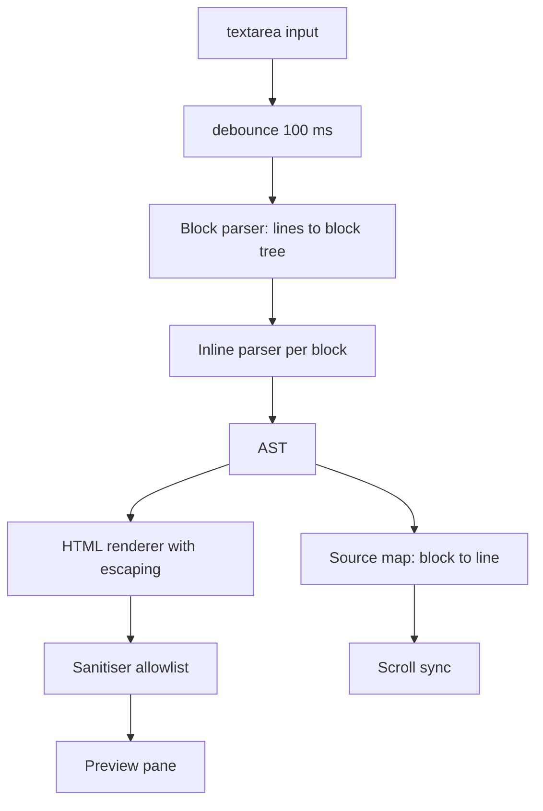
- **Block parser** walks lines and decides block structure (is this line continuing a list? opening a fence?).
- **Inline parser** turns each block's text into text, emphasis, code and link nodes.
- **AST** (abstract syntax tree) is a plain object tree: `{ type: 'heading', level: 2, children: [...] }`.
- **Renderer** escapes all text; **sanitiser** removes anything not on an allowlist, including from raw HTML blocks.
- **Source map** records each block's starting line so scroll positions can be matched.

### Data model
| Type | Fields |
|---|---|
| `Doc` (IndexedDB) | `id`, `title`, `body`, `updatedAt` |
| `Node` | `type`, `children?`, `value?`, plus type-specific fields (`level`, `href`, `lang`) |
| `BlockInfo` | `node`, `startLine`, `endLine` |

### Tech stack
| Component | Choice | Why |
|---|---|---|
| Parser | hand-written two-phase (block, inline) | mirrors how CommonMark is specified |
| Escaping | own `escapeHtml` for `& < > " '` | needed for every text node |
| Sanitising | DOMPurify, or the Sanitizer API where available | battle-tested allowlist |
| Links | allow only `http:`, `https:`, `mailto:` schemes | blocks `javascript:` URLs |
| Storage | IndexedDB | many documents, larger than `localStorage` |

### Milestones
1. **Headings and paragraphs** with escaping. *Done when* `# <b>hi</b>` renders a heading containing literal `<b>`.
2. **Inline parsing.** *Done when* `**a *b* c**` and `` `code with *stars*` `` render correctly.
3. **Lists, quotes, fences, tables.** *Done when* a set of CommonMark examples for these pass.
4. **Sanitisation.** *Done when* a test list of XSS payloads (``, `[x](javascript:alert(1))`, `<svg onload>`) produces no executable output.
5. **Editor features.** *Done when* shortcuts, scroll sync and multi-document save work.

### Deep dive: the hard parts
**Two phases.** Block structure must be known before inline parsing, because `*` at the start of a line means a list item but in the middle means emphasis. Parse blocks line by line with a stack of open containers (quote, list, list item); then inline-parse the text inside each leaf block.

**Emphasis is tricky.** `*a **b** c*` and `**a*` require a **delimiter stack**: record runs of `*`/`_`, then match closers to openers with rules about word boundaries. Start simple (non-nested, same-length matches), and use CommonMark's examples to find the gaps.

**Escaping vs sanitising.** Escaping turns text into safe text (`<` → `&lt;`) and is always required for text nodes. Sanitising removes dangerous elements and attributes from HTML you *intend* to allow (raw HTML blocks). Do both, and check link URLs: `new URL(href, base).protocol` must be on the allowlist.

**Fast preview.** Re-parsing 20 pages on each keystroke is fine if the parser is linear, but replacing the whole preview's HTML resets images and scroll. Render to a string, then compare per block (by source hash) and replace only changed blocks.

### Testing strategy
Load CommonMark spec examples (they are published as JSON) and run your subset as table-driven tests, tracking a pass rate. A separate security suite feeds payloads from the OWASP cheat sheet and asserts no `on*` attributes, no `script`, no `javascript:` URLs. Unit-test the toolbar's selection-wrapping.

### Trade-offs, scaling and failure modes
Writing a parser teaches the most; for production use a spec-compliant library plus a sanitiser. Regex-only parsers break on nesting and can be **ReDoS**-prone (catastrophic backtracking on crafted input) — a linear scanner avoids that. Allowing raw HTML increases power and risk; a safe default is to escape it entirely.

### Stretch goals
- Syntax highlighting of code fences with a lazy-loaded highlighter via dynamic `import()`.
- Footnotes and task lists (GitHub-flavoured extensions).
- Run the parser in a Web Worker for very large documents.

### Skills practised
- [Ch 6 — Strings and regex](../chapters/06-strings-and-regular-expressions/README.md): scanning, regex with sticky `y` flag, escaping.
- [Ch 13 — DOM and events](../chapters/13-dom-and-events/README.md): selection, `input` events, minimal updates.
- [Ch 14 — Browser APIs and security](../chapters/14-browser-apis-and-security/README.md): XSS, sanitising, CSP, IndexedDB.

### In the interview
**30-second answer:** I built a split-pane Markdown editor with my own two-phase parser — blocks first, then inlines — that produces an AST and renders HTML with every text node escaped. The key decision was defence in depth against XSS: escaping all text, sanitising any allowed raw HTML with an allowlist, permitting only `http:`, `https:` and `mailto:` link schemes, and a test suite of known payloads that must produce no executable output. The hardest part was emphasis parsing, which needs a delimiter stack, and I measured my subset against the CommonMark spec examples. The preview updates in under 50 ms for a 20-page document by replacing only the blocks that changed.

**Key terms to know:**
- **Parser and AST** — the parser turns text into an abstract syntax tree, a plain object tree such as `{ type: 'heading', level: 2, children }`.
- **Block vs inline parsing** — block structure (lists, quotes, fences) is decided line by line first, then text inside each block is parsed for emphasis, code and links.
- **Delimiter stack** — the CommonMark algorithm that matches runs of `*` and `_` to decide emphasis and strong emphasis.
- **Escaping** — converting `& < > " '` to entities so text is displayed literally.
- **Sanitising** — parsing HTML and removing elements and attributes not on an allowlist (DOMPurify or the Sanitizer API).
- **Stored XSS** — malicious markup saved in a document that runs when someone else views it.
- **`javascript:` URL** — a link scheme that runs code when clicked; blocked by checking `new URL(href, base).protocol`.
- **Content Security Policy (CSP)** — an HTTP header limiting where scripts can come from, so injected markup cannot run code.
- **ReDoS** — regular-expression denial of service, where crafted input makes a backtracking regex take exponential time.

**Q:** What is the difference between escaping and sanitising?

**A:** Escaping converts special characters so text shows literally: `<b>` becomes `&lt;b&gt;`. Sanitising takes HTML you *intend* to allow and removes dangerous elements, `on*` attributes and bad URLs. Escape every text node, and sanitise only the raw HTML you choose to permit.

**Q:** Why not parse Markdown with regexes?

**A:** Markdown is context-dependent: `*` at the start of a line is a list item, in the middle it is emphasis, inside backticks it is literal. Regexes cannot track nesting and open containers, so they become complex and wrong. Badly written ones also backtrack catastrophically on crafted input (ReDoS), whereas a linear scanner cannot.

**Q:** Why parse blocks before inlines?

**A:** Inline meaning depends on block structure: you must know a line is inside a code fence before deciding its stars are not emphasis. The block pass walks lines with a stack of open containers (quote, list, list item), and only then are leaf blocks' contents inline-parsed. This mirrors how CommonMark itself is specified.

**Q:** How else can you limit XSS impact?

**A:** A Content Security Policy such as `script-src 'self'` with no `'unsafe-inline'` stops inline scripts and event-handler attributes from running even if one slips through. Rendering the preview in a sandboxed `<iframe>` adds another layer. These are backups; escaping and sanitising remain the primary defence.

**Q:** Hands-on: write a minimal `escapeHtml` and say where it must be used.

```js
const map = { '&': '&amp;', '<': '&lt;', '>': '&gt;', '"': '&quot;', "'": '&#39;' };
const escapeHtml = s => s.replace(/[&<>"']/g, c => map[c]);
```

**A:** It must run on every text node and every attribute value the renderer emits, with `&` handled (here it is, since each character is replaced once). Escaping is not enough for URLs: `href="javascript:alert(1)"` contains no special characters, so link schemes need a separate allowlist check.

**Q:** How do you keep the preview fast and stable for large documents?

**A:** The parser is linear, so re-parsing 20 pages is cheap; the cost is replacing the whole preview, which reloads images and loses scroll. I hash each block's source and replace only blocks whose hash changed. Typing is debounced 100 ms, and for huge documents the parser could move into a Web Worker.

**Q:** What happens with malformed or hostile input, like an unclosed fence or deeply nested lists?

**A:** An unclosed fence runs to the end of the document, as CommonMark specifies, rather than erroring. Very deep nesting could blow the stack in a recursive renderer, so I cap nesting depth or render iteratively. Hostile HTML goes through the sanitiser and hostile links fail the scheme allowlist.

**Q:** How do you prove the parser and the security work?

**A:** CommonMark publishes its examples as JSON, so I run my claimed subset as table-driven tests and track the pass rate. A separate security suite feeds payloads like ``, `<svg onload=…>` and `[x](javascript:alert(1))` and asserts no `script`, no `on*` attributes and no `javascript:` URLs survive.

**Common mistakes in answers:**
- Saying a library like marked "handles security" — it does not sanitise output by default.
- Thinking escaping alone protects links — `javascript:` URLs need a scheme check.
- Calling CSP a replacement for sanitising — it is a second line of defence.

### TL;DR
Parse blocks then inlines into an AST, escape every text node, sanitise any allowed HTML with an allowlist (including URL schemes), and patch only changed blocks for a fast, safe preview.

## 14. Real-time chat with WebSockets and Node

**Level:** Intermediate · **Time:** 2 weeks · **Prerequisites:** Ch 12, Ch 14, Ch 15

### What it is
A multi-room chat: a browser client and a Node 24 server connected by **WebSockets** — a protocol that upgrades an HTTP connection into a long-lived, two-way channel so the server can push messages instantly. It has rooms, nicknames, typing indicators, online presence, message history and automatic reconnection.

### The problem it solves
Request-response HTTP cannot push. Polling wastes requests; real chat needs a persistent connection, and with it come new problems: connections drop silently, clients reconnect and miss messages, a slow client must not stall everyone, and every message from the network is untrusted input. This project makes those problems visible at small scale.

### Real-world examples
- [RFC 6455](https://www.rfc-editor.org/rfc/rfc6455) defines the WebSocket protocol, including the HTTP upgrade handshake, framing and ping/pong control frames.
- [ws](https://github.com/websockets/ws) is the widely used WebSocket server and client library for Node. Node 24 ships a stable browser-compatible `WebSocket` **client** as a global (stable since 22.4) but no built-in server, so a server still needs `ws` or similar.
- [Socket.IO's documentation](https://socket.io/docs/v4/) describes rooms, acknowledgements and reconnection — features you will build by hand.

### Requirements
**Functional**
- Join with a nickname; create/join rooms; list who is online per room.
- Send text messages (max 2,000 chars); show sender, time, delivery status.
- Typing indicators (throttled), join/leave notices.
- Last 50 messages per room on join; reconnect with backoff and fetch missed messages.
- Commands: `/nick`, `/me`, `/join`.

**Non-functional**
- Message fan-out latency under 100 ms on a LAN with 200 connected clients.
- Server memory bounded: per-room history capped; slow clients disconnected when their send buffer exceeds 1 MB.
- Rate limit: 5 messages per second per connection.
- Every inbound frame validated; malformed frames close the connection with code 1008 (policy violation).

### The architecture
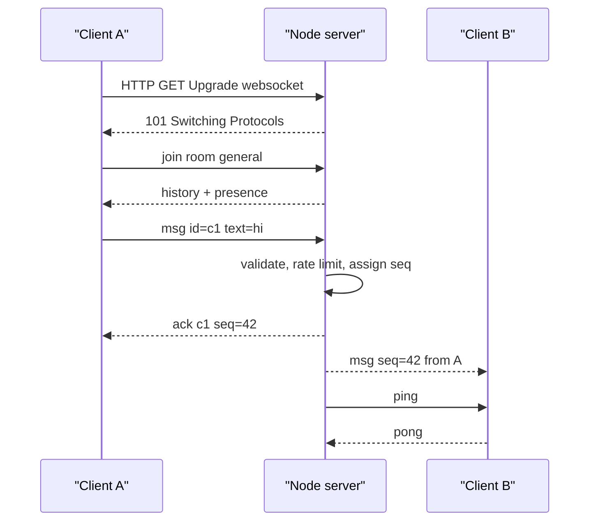
- **HTTP server** (`node:http`) serves the static client and hands upgrade requests to the WebSocket server.
- **Connection handler** parses JSON frames, validates them against a schema, applies the rate limit, and dispatches by `type`.
- **Room registry** is a `Map<roomName, Set<connection>>` plus a ring buffer of recent messages with increasing sequence numbers.
- **Heartbeat** pings every 30 s and terminates connections that did not answer the previous ping.
- **Client** wraps `WebSocket` with a reconnecting connection, an outbox of unacknowledged messages and a renderer.

### Data model
| Message (JSON) | Direction | Fields |
|---|---|---|
| `join` | client → server | `room`, `nick`, `lastSeq?` |
| `msg` | both | `clientId`, `seq` (server), `room`, `from`, `text`, `ts` |
| `ack` | server → client | `clientId`, `seq` |
| `typing` | both | `room`, `from` |
| `presence` | server → client | `room`, `users[]` |
| `error` | server → client | `code`, `message` |

### Tech stack
| Component | Choice | Why |
|---|---|---|
| Server runtime | Node 24 | event loop handles thousands of idle sockets cheaply |
| WebSocket server | `ws` | mature, handles framing, compression, backpressure signals |
| Client | browser `WebSocket` | built in |
| Validation | small hand-written schema checks | no dependency, explicit limits |
| Tests | `node:test` + Node's global `WebSocket` client | real end-to-end tests without a browser |

### Milestones
1. **Echo server.** *Done when* a browser and a Node script can connect and get their messages echoed.
2. **Rooms and broadcast.** *Done when* two browsers in the same room see each other's messages and a third room does not.
3. **Validation, rate limiting, size limits.** *Done when* a script that sends 100 messages a second gets throttled and a malformed frame closes the connection.
4. **Heartbeat and reconnect.** *Done when* killing the server and restarting it makes clients reconnect with jittered backoff and fetch missed messages by `lastSeq`.
5. **Acks, typing, presence.** *Done when* messages show "sent" only after the server ack, and typing indicators appear and expire.

### Deep dive: the hard parts
**Detecting dead connections.** TCP may not notice a vanished client (laptop lid closed) for a long time. Send WebSocket pings on an interval; mark each connection alive on pong; on the next tick, terminate any that are still not alive. The client should also treat silence beyond a timeout as a disconnect.

**Reconnect without losses or duplicates.** Give every message a server-assigned, per-room increasing `seq`. On reconnect, the client sends `lastSeq` and the server replays newer messages from its buffer. The client sends a `clientId` per outgoing message, so if it resends after a reconnect the server can drop duplicates — this makes sends **idempotent** (safe to repeat).

**Backpressure.** If one client reads slowly, the server's send buffer for it grows. Check `socket.bufferedAmount` before sending and drop or disconnect clients beyond a limit, so one slow phone does not consume the server's memory. Use exponential backoff with **jitter** (random spread) on the client so 200 clients do not reconnect in the same millisecond after a restart.

**Untrusted input.** Treat every frame as hostile: `JSON.parse` in `try/catch`, check `type`, lengths and room names, and render text with `textContent` on clients. Check the `Origin` header during the upgrade to block other sites from opening sockets with your users' cookies (cross-site WebSocket hijacking).

### Testing strategy
Start the server on port 0 in a `node:test` `before` hook and connect several clients using Node's global `WebSocket`. Test broadcast, room isolation, replay by `lastSeq`, duplicate `clientId` suppression, rate limiting and malformed frames. Use fake timers for the heartbeat logic. Load-test with a script that opens 200 connections and measures fan-out latency.

### Trade-offs, scaling and failure modes
One Node process keeps rooms in memory — simple, but a restart loses history and you cannot run two instances. To scale out, put messages through a pub/sub broker (Redis, NATS) and store history in a database; then sticky sessions are optional. **Server-Sent Events** (one-way server push over HTTP) are simpler if clients only receive. WebSockets through some corporate proxies fail — a long-polling fallback is what Socket.IO adds.

### Stretch goals
- Persist history in PostgreSQL (Project 16) and paginate older messages.
- End-to-end encryption of message bodies with Web Crypto.
- Read receipts and per-user unread counts.

### Skills practised
- [Ch 12 — Async](../chapters/12-asynchronous-javascript/README.md): event-driven code, backoff, timers.
- [Ch 14 — Browser APIs](../chapters/14-browser-apis-and-security/README.md): WebSocket, origin checks, XSS.
- [Ch 15 — Node.js basics](../chapters/15-nodejs-basics/README.md): `node:http`, upgrades, `EventEmitter`, buffers.

### In the interview
**30-second answer:** I built a multi-room chat with a Node 24 server using `ws` and a browser client on the built-in `WebSocket`, with rooms, presence, typing indicators, history and automatic reconnection. The key design decision was server-assigned per-room sequence numbers plus a client-generated id per message: on reconnect the client sends `lastSeq` and the server replays what it missed, while resends are de-duplicated, so delivery is lossless and idempotent. The hardest problems were dead connections and slow clients, which I handled with 30-second ping/pong heartbeats and by disconnecting any client whose send buffer passes 1 MB. My target was under 100 ms fan-out with 200 clients on a LAN, with every frame validated and a limit of 5 messages per second per connection.

**Key terms to know:**
- **WebSocket** — a protocol that upgrades an HTTP request (`101 Switching Protocols`) into a long-lived, two-way connection.
- **Full-duplex** — both sides can send at any time on the same connection, unlike request-response HTTP.
- **Heartbeat (ping/pong)** — periodic control frames that detect peers that vanished without closing TCP.
- **Sequence number (`seq`)** — a server-assigned, increasing per-room number used to replay missed messages.
- **Idempotent send** — resending with the same `clientId` has no extra effect because the server drops duplicates.
- **Backpressure / `bufferedAmount`** — bytes queued but not yet sent to a client; a growing value means a slow reader.
- **Exponential backoff with jitter** — reconnect delays that double each attempt with randomness, so clients do not stampede after a restart.
- **Cross-site WebSocket hijacking** — another site opening a socket with your user's cookies; blocked by checking the `Origin` header on upgrade.
- **Server-Sent Events (SSE)** — one-way server-to-client streaming over plain HTTP, with built-in reconnect in `EventSource`.
- **Pub/sub broker** — Redis or NATS relaying messages between server instances when you scale out.

**Q:** WebSockets vs Server-Sent Events vs long polling?

**A:** WebSockets are full-duplex over one connection and suit interactive two-way traffic like chat or games. SSE is server-to-client only over ordinary HTTP, with automatic reconnect and `Last-Event-ID` built in, which suits feeds and notifications. Long polling holds an HTTP request open until there is data, then the client immediately asks again — it works everywhere but costs a request per message batch.

**Q:** How do you avoid missing or duplicating messages on reconnect?

**A:** Every stored message gets a per-room increasing `seq`. The client remembers the last one it rendered and sends it in `join`, and the server replays newer messages from its ring buffer or database. Outgoing messages carry a `clientId`, so if the client resends an unacknowledged message after reconnecting, the server recognises it and only acks again.

**Q:** How do you detect a dead connection?

**A:** TCP can take a very long time to notice a client whose laptop lid closed. The server pings every 30 seconds and marks a connection alive when its pong arrives; on the next tick, any connection still not alive is terminated. The client likewise treats prolonged silence as a disconnect and starts reconnecting.

**Q:** What happens when one client reads very slowly?

**A:** Its outgoing buffer on the server grows, and with many such clients the process runs out of memory. Before sending, I check `socket.bufferedAmount` and disconnect clients above 1 MB, or drop non-essential messages like typing indicators for them. One slow phone must never stall or crash the room.

**Q:** How do you scale a WebSocket server horizontally?

**A:** Rooms in one process's memory cannot span two instances, so messages go through a pub/sub broker that every instance subscribes to, and history moves to a database. The load balancer must support the HTTP upgrade and long-lived connections. With shared state outside the process, sticky sessions become optional rather than required.

**Q:** Why must the server validate every frame, and what does it check?

**A:** Any client can send anything, not just your UI. I `JSON.parse` in `try/catch`, check `type`, room name and a 2,000-character text limit, apply the rate limit, and close with code 1008 (policy violation) on malformed frames. Clients render text with `textContent` so a message cannot inject HTML.

**Q:** Hands-on: write the reconnect delay.

```js
const delay = attempt =>
  Math.random() * Math.min(30_000, 500 * 2 ** attempt); // "full jitter"
```

**A:** The cap stops delays growing forever, the doubling backs off a struggling server, and the random factor spreads 200 clients over the window instead of all reconnecting at once. Reset `attempt` to 0 after a successful connection.

**Q:** How do you test it?

**A:** In a `node:test` `before` hook I start the server on port 0 (the OS picks a free port) and connect several clients with Node's global `WebSocket`. Tests cover broadcast, room isolation, replay by `lastSeq`, duplicate `clientId` suppression, the rate limit and malformed frames, and fake timers drive the heartbeat. A separate load script opens 200 connections and measures fan-out latency.

**Common mistakes in answers:**
- Assuming a closed laptop triggers a `close` event promptly — without heartbeats the server may never notice.
- Reconnecting immediately in a loop without backoff and jitter, which turns a restart into a self-inflicted overload.
- Forgetting that the WebSocket handshake carries cookies, so an unchecked `Origin` allows cross-site hijacking.

### TL;DR
A WebSocket chat needs heartbeats to find dead peers, sequence numbers and client ids for lossless idempotent reconnects, backpressure limits per client, and strict validation of every frame.

## 15. Node CLI log analyser

**Level:** Intermediate · **Time:** 1 week · **Prerequisites:** Ch 10, Ch 15

### What it is
A command-line tool, `logscope`, that reads web-server access logs (files, gzipped files, or standard input), filters them (status, path pattern, time range), and prints summaries: requests per minute, top paths, error rates and latency percentiles, as a table or JSON. It installs with `npm install -g` and behaves like a good Unix citizen.

### The problem it solves
Log files can be gigabytes; reading them with `fs.readFile` crashes or stalls. A good CLI also has conventions: helpful `--help`, sensible exit codes, output to stdout and diagnostics to stderr, pipe-friendliness, and graceful handling of Ctrl+C. This project teaches **streams** — processing data piece by piece in constant memory — and the craft of command-line tools.

### Real-world examples
- The [Command Line Interface Guidelines](https://clig.dev/) collect conventions for human-first CLIs: help text, errors, output for humans vs machines, and signals.
- Node's [`util.parseArgs`](https://nodejs.org/api/util.html) parses flags without a dependency, and the [readline docs](https://nodejs.org/api/readline.html) show reading a stream line by line with `for await`.

### Requirements
**Functional**
- `logscope [files...]`; reads stdin when no file is given or the file is `-`.
- Detects `.gz` and decompresses on the fly.
- Filters: `--status 5xx`, `--path '/api/*'`, `--since 2026-09-01T00:00Z`, `--until`.
- Reports: `--top paths`, `--rate per-minute`, `--latency` (p50, p95, p99), `--format table|json|csv`.
- `--follow` tails a growing file like `tail -f`.

**Non-functional**
- Constant memory: processing a 5 GB file stays under 100 MB of RSS (resident memory).
- Throughput at least 100 MB/s on a laptop for simple filters.
- Exit codes: 0 success, 1 runtime error, 2 usage error. Errors go to stderr.
- Starts in under 100 ms (no heavy imports at start-up).

### The architecture
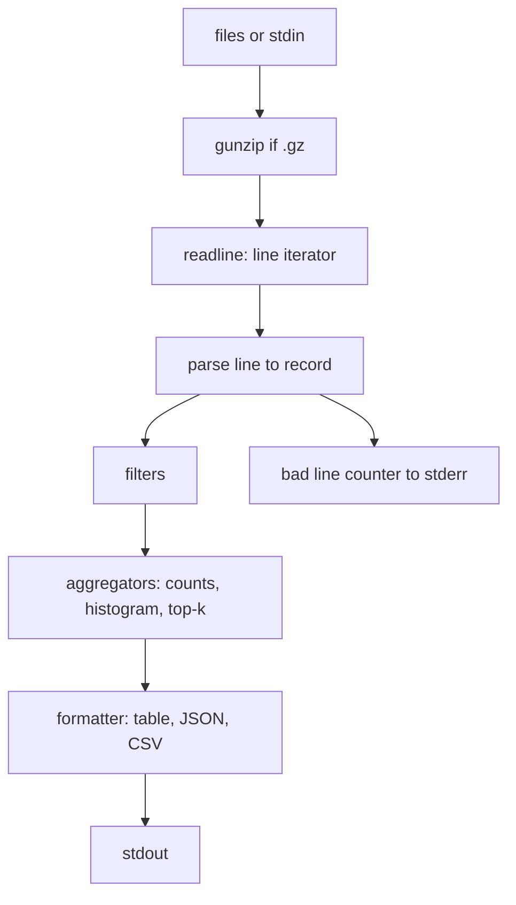
- **Input** opens each file with `fs.createReadStream` and pipes through `zlib.createGunzip()` when needed.
- **Line iterator** uses `readline.createInterface({ input })` and `for await (const line of rl)`.
- **Parser** turns a line (Common or Combined Log Format) into a record with a precompiled regex; unparseable lines are counted, not fatal.
- **Aggregators** keep bounded state: a `Map` of counts, a latency histogram with fixed buckets, a top-k list.
- **Formatter** prints; `--format json` prints one JSON document for piping into other tools.

### Data model
| Type | Fields |
|---|---|
| `Record` | `ip`, `time` (epoch ms), `method`, `path`, `status`, `bytes`, `latencyMs?`, `userAgent?` |
| `Options` | parsed flags with defaults |
| `Histogram` | bucket boundaries (ms), counts array |
| `Report` | `total`, `badLines`, `byStatus`, `topPaths`, `perMinute`, `latency` |

### Tech stack
| Component | Choice | Why |
|---|---|---|
| Arguments | `util.parseArgs` | built in, strict mode rejects unknown flags |
| Reading | `fs.createReadStream` + `readline` | line-by-line in constant memory |
| Gzip | `node:zlib` | streaming decompression |
| Glob filter | `path.matchesGlob` or a compiled regex | path patterns |
| Packaging | `package.json` `bin` field + `#!/usr/bin/env node` | installable command |

### Milestones
1. **Count lines from a file and stdin.** *Done when* `cat access.log | logscope` and `logscope access.log` print the same count.
2. **Parse and filter.** *Done when* `--status 5xx --path '/api/*'` matches a hand-checked fixture.
3. **Aggregations and formats.** *Done when* JSON output validates and the table aligns columns.
4. **Scale.** Generate a 5 GB synthetic log. *Done when* memory stays under 100 MB and you record the throughput.
5. **CLI polish.** *Done when* `--help`, exit codes, `EPIPE` handling (`logscope big.log | head`) and Ctrl+C all behave well.

### Deep dive: the hard parts
**Streams and backpressure.** A readable stream produces chunks; if the consumer is slower, data piles up in memory. `for await` over `readline` naturally pulls one line at a time, which applies **backpressure** (the producer pauses until the consumer is ready). Use `stream.pipeline` for file → gunzip → … so an error in any stage destroys all of them and closes file handles.

**Percentiles in constant memory.** Exact p99 needs every value sorted — impossible for billions of lines. Use a histogram with logarithmic buckets (1, 2, 5, 10, 20… ms): add counts as you go, then walk the cumulative counts to find the bucket where 99% is reached. You trade a little accuracy for O(1) memory.

**Being a good Unix citizen.** When output is piped to `head`, the pipe closes early and writes raise `EPIPE`; catch it on `process.stdout` and exit quietly. Detect whether stdout is a terminal (`process.stdout.isTTY`) to decide colours and table layout. On `SIGINT`, print partial results to stderr and exit with code 130, a common shell convention.

**Fast parsing.** A single precompiled regex with named groups is clear; for raw speed, split on spaces and quotes manually. Measure both with `performance.now()` on a 1 GB sample before choosing.

### Testing strategy
Unit-test the parser with real-world lines (IPv6, quotes inside user agents, missing fields), aggregators and histogram percentiles. Integration tests spawn the CLI with `child_process.spawn`, feed stdin, and assert stdout, stderr and the exit code. Keep a small gzipped fixture to test decompression.

### Trade-offs, scaling and failure modes
A single-threaded stream pipeline is usually I/O-bound; if parsing is the bottleneck, split files across `worker_threads`. Histogram percentiles are approximate — say so in the output. Log formats vary between servers; make the format pluggable rather than guessing per line.

### Stretch goals
- `--follow` that survives log rotation (file renamed and recreated).
- Use `node:sqlite` to store parsed records for ad-hoc SQL queries.
- Ship as a single executable using Node's single-executable application feature.

### Skills practised
- [Ch 10 — Modules and tooling](../chapters/10-modules-and-tooling/README.md): `bin` field, ESM packages, npm scripts.
- [Ch 15 — Node.js basics](../chapters/15-nodejs-basics/README.md): streams, `process`, exit codes, `zlib`, child processes.

### In the interview
**30-second answer:** I built `logscope`, a Node CLI that reads access logs from files, gzipped files or stdin, filters them, and prints top paths, per-minute rates and latency percentiles as a table, JSON or CSV. The key design decision was streaming everything — `createReadStream`, gunzip, `readline` with `for await` — so a 5 GB file is processed in under 100 MB of memory. The hardest part was percentiles in constant memory, which I solved with a logarithmic-bucket histogram that trades a little precision for O(1) memory. It also behaves like a proper Unix tool: data to stdout, messages to stderr, exit codes 0/1/2, and a quiet exit when piped into `head`.

**Key terms to know:**
- **Stream** — data processed in chunks as it arrives, so memory use stays constant regardless of file size.
- **Backpressure** — a slow consumer making a fast producer pause; `write()` returns `false` and the producer waits for `drain`.
- **`stream.pipeline`** — connects streams and, on an error in any stage, destroys all of them and reports one error.
- **`readline` with `for await`** — turns a byte stream into lines you pull one at a time, which applies backpressure automatically.
- **Histogram percentile** — counting values into fixed buckets and walking cumulative counts to estimate p50, p95, p99.
- **stdout vs stderr** — results go to stdout for piping, diagnostics go to stderr so they do not corrupt the data.
- **Exit code** — 0 success, 1 runtime error, 2 usage error; 130 after Ctrl+C by shell convention (128 + signal 2).
- **`EPIPE`** — the error when writing to a pipe whose reader closed early, as with `| head`.
- **`util.parseArgs`** — Node's built-in flag parser; strict mode rejects unknown flags.
- **`bin` field and shebang** — `"bin": { "logscope": "./cli.js" }` plus `#!/usr/bin/env node` make the command installable.

**Q:** How do you process a file larger than memory in Node?

**A:** Stream it instead of `fs.readFile`: open with `createReadStream`, decompress with `zlib.createGunzip()` when needed, and read lines with `readline` and `for await`. Only one chunk and one line are in memory at a time. Use `pipeline` so an error in any stage closes the file handles.

**Q:** What is backpressure?

**A:** It is how a slow consumer tells a fast producer to pause so buffers do not grow without bound. In Node, `writable.write()` returns `false` when its internal buffer passes `highWaterMark`, and the producer should wait for the `drain` event. `pipeline` and async iteration handle this for you.

**Q:** How do you compute p99 latency over a huge stream?

**A:** Exact p99 needs every value sorted, which is impossible for billions of lines. I keep a histogram with logarithmic buckets (1, 2, 5, 10, 20… ms), increment counts as lines arrive, then walk the cumulative counts until 99% of the total is reached. Memory is O(buckets), and the answer is accurate to the bucket width — the output says it is approximate.

**Q:** Hands-on: what is the core loop?

```js
const input = file.endsWith('.gz')
  ? fs.createReadStream(file).pipe(zlib.createGunzip())
  : fs.createReadStream(file);
for await (const line of readline.createInterface({ input, crlfDelay: Infinity })) {
  const r = parse(line);
  if (r && matches(r)) aggregate(r); else if (!r) badLines++;
}
```

**A:** `crlfDelay: Infinity` treats `\r\n` as one line break. `.pipe()` alone does not forward errors from the file stream to the gunzip stream, which is why production code uses `stream.pipeline` (or `compose`) for the input chain. Bad lines are counted, not fatal.

**Q:** What happens when output is piped into `head`, or the user presses Ctrl+C?

**A:** `head` closes the pipe after a few lines, so further writes fail with `EPIPE`; I listen for that error on `process.stdout` and exit quietly with code 0. On `SIGINT` I print partial results to stderr and exit with 130. Without these, users see a stack trace for normal shell usage.

**Q:** What if a line is malformed, or the log format differs?

**A:** Unparseable lines increment a `badLines` counter reported on stderr; one odd line must not abort a 5 GB run. Formats vary between servers (Common, Combined, custom latency fields), so the parser is pluggable by a `--format` option rather than guessing per line.

**Q:** What breaks first at 10x the data, and how do you go faster?

**A:** A single-threaded stream pipeline is usually limited by disk or decompression. If profiling shows parsing is the bottleneck, I can replace the regex with manual splitting, or split files across `worker_threads` and merge aggregator states — histograms and counts merge by addition. Memory stays bounded either way.

**Q:** How do you test a CLI?

**A:** Parser, filters and histogram percentiles get unit tests with real-world lines (IPv6, quotes in user agents, missing fields). Integration tests spawn the CLI with `child_process.spawn`, write to its stdin, and assert stdout, stderr and the exit code. A small gzipped fixture covers decompression.

**Common mistakes in answers:**
- Using `fs.readFile` or `split('\n')` on a multi-gigabyte file and blaming Node for running out of memory.
- Claiming `.pipe()` handles errors — it does not propagate them, `pipeline` does.
- Printing progress or warnings to stdout, which corrupts JSON output for the next tool in the pipe.

### TL;DR
Stream lines through `pipeline` and `readline`, aggregate with bounded structures like histograms, and follow CLI conventions: stdout for data, stderr for messages, clear exit codes, and clean exits on `EPIPE` and Ctrl+C.

## 16. REST API with Node, Express and PostgreSQL

**Level:** Intermediate · **Time:** 2–3 weeks · **Prerequisites:** Ch 11, Ch 12, Ch 15, Ch 16

### What it is
A production-shaped **REST API** (an HTTP interface where URLs name resources and methods like GET/POST/PATCH/DELETE act on them) for a reading-list service: users, books, shelves and reviews. You build it twice — first with bare `node:http` to see what a framework hides, then with **Express 5** — on **PostgreSQL** through the `pg` driver, with validation, pagination, error handling, migrations and integration tests.

### The problem it solves
Tutorial APIs work on the happy path. Real ones need consistent error responses, input validation, SQL-injection safety, connection pooling, pagination that stays correct as data changes, graceful shutdown and tests against a real database. This project gathers those habits into one codebase you can reuse as a template.

### Real-world examples
- [node-postgres](https://node-postgres.com/) documents pooling and parameterised queries (`$1`, `$2`), which keep user input out of SQL text.
- [Express](https://expressjs.com/) 5 forwards rejected promises from async route handlers to the error middleware, removing a common source of hung requests in Express 4.
- [RFC 9457](https://www.rfc-editor.org/rfc/rfc9457), "Problem Details for HTTP APIs", defines a standard JSON shape for error responses.

### Requirements
**Functional**
- Resources: `/users`, `/books`, `/shelves/:id/books`, `/books/:id/reviews`.
- CRUD with validation; `PATCH` for partial updates.
- List endpoints: filtering (`?author=`), sorting, **cursor pagination** (`?after=<opaque>`), `limit` capped at 100.
- Auth with a bearer token (simple: hashed API keys) and per-user ownership checks.
- Health (`/healthz`) and readiness (`/readyz`) endpoints.

**Non-functional**
- p95 latency under 50 ms for single-row reads on a laptop with 1M books.
- All errors as `application/problem+json` with no stack traces in production.
- Graceful shutdown: stop accepting, finish in-flight requests within 10 s, close the pool.
- Config from environment variables (`node --env-file=.env` in development).

### The architecture
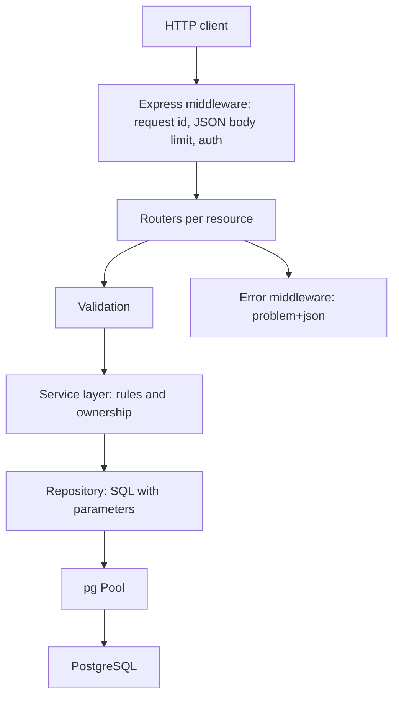
- **Middleware** adds a request id (for log correlation), limits body size, parses JSON and authenticates.
- **Routers** translate HTTP to service calls and back; no SQL here.
- **Service layer** holds business rules (only the owner may edit a shelf).
- **Repository** contains every SQL statement, always parameterised.
- **Error middleware** maps known error classes (`NotFoundError`, `ValidationError`, `ConflictError`) to status codes.

### Data model
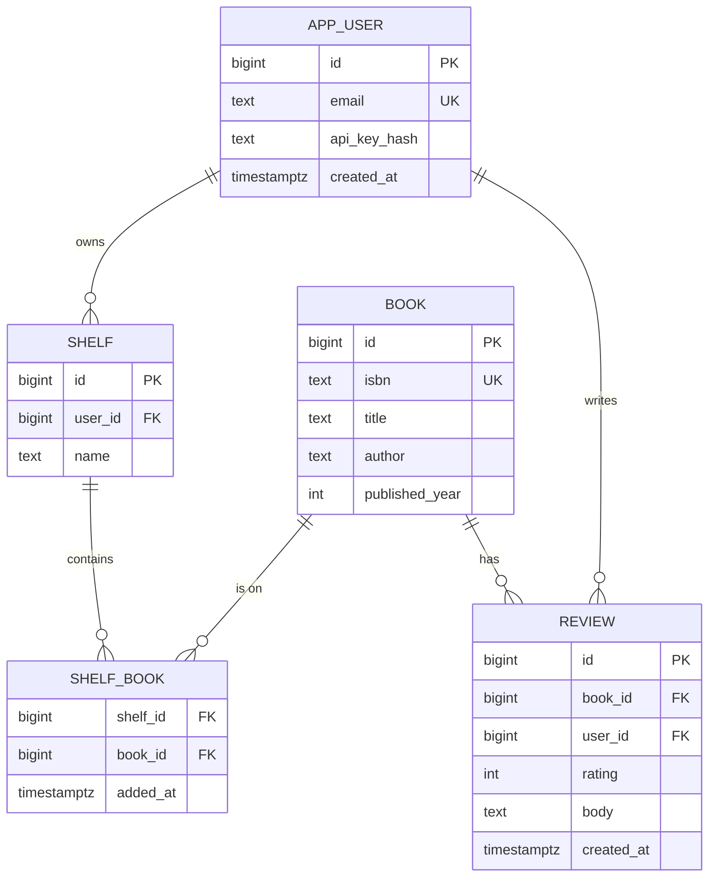

### Tech stack
| Component | Choice | Why |
|---|---|---|
| Runtime | Node 24 | built-in `fetch`, `--env-file`, `node:test` |
| Framework | Express 5 | async error forwarding, huge ecosystem |
| Database | PostgreSQL + `pg` Pool | transactions, constraints, mature driver |
| Migrations | numbered `.sql` files + a tiny runner | explicit, reviewable schema changes |
| Tests | `node:test` + a disposable database | real SQL behaviour in tests |

### Milestones
1. **Bare `node:http` version** of `GET /books/:id` and `POST /books`. *Done when* you can list what you had to do by hand (routing, body parsing, status codes).
2. **Express + schema + migrations.** *Done when* `npm run migrate` builds an empty database from scratch.
3. **CRUD with validation and problem+json.** *Done when* invalid input returns 422 with field details, unknown ids return 404, duplicate ISBN returns 409.
4. **Auth and ownership.** *Done when* user B cannot modify user A's shelf (403) and tests prove it.
5. **Pagination and performance.** *Done when* paging through 1M rows with cursors is stable and fast, verified with `EXPLAIN ANALYZE`.
6. **Operations.** *Done when* `SIGTERM` during a load test drops no requests.

### Deep dive: the hard parts
**SQL injection.** Never build SQL with template strings containing input. Use `pool.query('SELECT … WHERE id = $1', [id])`; the driver sends the value separately from the SQL text. Column names for sorting cannot be parameters — map `?sort=title` through an allowlist object to a fixed SQL fragment.

**Cursor pagination.** `OFFSET 100000` makes PostgreSQL walk and discard 100,000 rows, and rows shift if someone inserts meanwhile. Instead, sort by a unique key (`created_at, id`) and ask for rows *after* the last one seen: `WHERE (created_at, id) > ($1, $2) ORDER BY created_at, id LIMIT $3`. Encode the cursor as base64url JSON so clients treat it as opaque. Add a matching composite index.

**Transactions and the pool.** A pool hands out connections; a transaction must use the *same* client for `BEGIN … COMMIT`. Check out a client, run the statements, and release it in `finally` — or use `await using` with a disposable wrapper (explicit resource management works in Node 24) so release cannot be forgotten.

**Errors.** Throw domain errors in services; let one error middleware convert them. Map PostgreSQL error codes (`23505` unique violation → 409, `23503` foreign-key violation → 409 or 422). Log the full error with the request id; return a safe message.

### Testing strategy
Integration tests run against a real PostgreSQL (a Docker container or a local instance) with a fresh schema per test file, or wrap each test in a transaction that rolls back. Use Node 24's global `fetch` against the app listening on port 0. Unit-test validation and cursor encoding. Add a test that tries SQL injection strings in every parameter.

### Trade-offs, scaling and failure modes
Express is minimal and familiar; Fastify adds schema-based validation and speed. Cursor pagination cannot jump to page 50 — offer it only where users need it. The pool size bounds concurrency: too small queues requests, too large overwhelms PostgreSQL; start near the database's cores × 2 and measure. If the database is down, `/readyz` should fail so the load balancer stops sending traffic, while `/healthz` stays up.

### Stretch goals
- ETags and `If-None-Match` for conditional GETs.
- Full-text search on titles with a PostgreSQL `tsvector` column and GIN index.
- OpenAPI description generated from the validation schemas.

### Skills practised
- [Ch 11 — Errors](../chapters/11-errors-and-debugging/README.md): custom error classes, `cause`, `using`.
- [Ch 12 — Async](../chapters/12-asynchronous-javascript/README.md): async handlers, concurrency limits.
- [Ch 15 — Node.js basics](../chapters/15-nodejs-basics/README.md): `node:http`, `process` signals, environment.
- [Ch 16 — Testing](../chapters/16-testing-and-typescript/README.md): integration tests with `node:test`.
- The [SQL Handbook](../../sql/chapters/01-databases-and-the-relational-model/README.md) for schema design, indexes and `EXPLAIN`.

### In the interview
**30-second answer:** I built a reading-list REST API twice — first on bare `node:http` to see what a framework hides, then on Express 5 with PostgreSQL through `pg` — layered as routers, services and repositories. The key design decisions were parameterised SQL everywhere, keyset (cursor) pagination instead of `OFFSET`, and one error middleware that turns domain errors into RFC 9457 `problem+json`. The hardest parts were transactions on a pooled connection and graceful shutdown, which I handled by checking out one client per transaction and releasing it in `finally`, and by draining in-flight requests on `SIGTERM`. Single-row reads stayed under 50 ms at p95 with 1 million books, verified with `EXPLAIN ANALYZE`.

**Key terms to know:**
- **REST** — URLs name resources and HTTP methods (GET, POST, PATCH, DELETE) act on them, with status codes carrying the outcome.
- **Middleware** — functions run in order on each request (request id, body limit, auth) before the route handler.
- **Layered architecture** — routers handle HTTP, services hold business rules and ownership checks, repositories hold all SQL.
- **Parameterised query** — `$1`, `$2` placeholders whose values the driver sends separately from the SQL text, preventing SQL injection.
- **Connection pool** — a fixed set of open database connections shared by requests; its size bounds concurrency.
- **Transaction** — `BEGIN … COMMIT` statements that succeed or fail together; they must run on one pooled client.
- **Keyset (cursor) pagination** — `WHERE (created_at, id) > ($1, $2)` with a matching index, instead of `OFFSET`.
- **Problem Details (RFC 9457)** — a standard JSON error body served as `application/problem+json`.
- **Graceful shutdown** — on `SIGTERM`, stop accepting, finish in-flight requests within a deadline, close the pool.
- **Health vs readiness** — `/healthz` says the process is alive, `/readyz` says it can serve (database reachable).

**Q:** How do you prevent SQL injection?

**A:** Use parameterised queries for every value: `pool.query('SELECT * FROM book WHERE id = $1', [id])`, so input is never parsed as SQL. Identifiers like sort columns cannot be parameters, so I map `?sort=title` through an allowlist object to a fixed SQL fragment. Never concatenate or template input into SQL.

**Q:** Offset vs cursor pagination?

**A:** `OFFSET 100000` makes PostgreSQL read and discard 100,000 rows, so deep pages get slow, and inserts during browsing shift rows so users see duplicates or gaps. Keyset pagination asks for rows after the last one seen on a unique sort key with a composite index, so every page costs about the same and is stable. The trade-off is you cannot jump straight to page 50.

**Q:** Why do transactions need care with a pool?

**A:** Each `pool.query` may run on a different connection, so `BEGIN` on one and `COMMIT` on another does nothing useful. I `await pool.connect()` to get one client, run all statements on it, `ROLLBACK` on error, and `release()` in `finally`. Forgetting to release leaks a connection, and after a few leaks every request hangs waiting for the pool.

**Q:** What changed for error handling in Express 5?

**A:** In Express 4, a rejected promise from an `async` handler was not passed to error middleware, so the request hung unless you wrapped it. Express 5 forwards rejections to `next(err)` automatically. I throw domain errors such as `NotFoundError` in services and map them, plus PostgreSQL codes like `23505` (unique violation) to 409, in one place.

**Q:** What does graceful shutdown involve?

**A:** On `SIGTERM`, fail `/readyz` so the load balancer stops sending traffic, call `server.close()` to stop accepting connections, let in-flight requests finish within 10 seconds, close the pool, then exit. A timer forces exit if the deadline passes. My test was a load run with a `SIGTERM` mid-way that dropped zero requests.

**Q:** Hands-on: what is wrong with this, and how do you fix it?

```js
app.get('/books', async (req, res) => {
  const { rows } = await pool.query(
    `SELECT * FROM book ORDER BY ${req.query.sort} LIMIT ${req.query.limit}`);
  res.json(rows);
});
```

**A:** Both values are injected into SQL text, so `?sort=1;DROP TABLE book` is an attack. Map `sort` through an allowlist (`{ title: 'title', year: 'published_year' }`), clamp `limit` to 1–100 and pass it as `$1`. Also select explicit columns rather than `*` so schema changes do not leak fields.

**Q:** What breaks first at 10x or 100x the traffic?

**A:** Usually the database: the pool queues requests if too small, and too many connections overwhelm PostgreSQL. I would size the pool by measurement, add read replicas for read-heavy endpoints, cache hot reads with ETags, and run several stateless Node instances behind a load balancer. Missing indexes show up first in `EXPLAIN ANALYZE` as sequential scans.

**Q:** What happens if the database goes down?

**A:** Queries reject, the error middleware returns 503 with a problem+json body and no stack trace, and `/readyz` fails so traffic moves to healthy instances. `/healthz` stays up so the orchestrator does not restart a process that is fine. The `pg` pool reconnects when the database returns.

**Q:** How do you test it?

**A:** Integration tests run against a real PostgreSQL with a fresh schema per file, or each test wrapped in a transaction that rolls back. The app listens on port 0 and tests use Node's global `fetch`. Specific tests assert 422 for invalid input, 404 for unknown ids, 409 for duplicate ISBNs, 403 when user B edits user A's shelf, and that injection strings in every parameter do nothing.

**Common mistakes in answers:**
- Saying an ORM or "escaping quotes" makes SQL injection impossible — parameters plus identifier allowlists do.
- Using `OFFSET` for deep pagination and calling it fine because it worked on 100 rows.
- Running `BEGIN` and `COMMIT` through `pool.query`, which may use different connections.

### TL;DR
Layer routers, services and repositories; parameterise every query; paginate by keyset; turn domain errors into problem+json; and test against a real PostgreSQL.

## 17. Offline-first PWA notes app

**Level:** Intermediate · **Time:** 2 weeks · **Prerequisites:** Ch 12, Ch 14

### What it is
A notes app that works with no network at all, installs to the home screen as a **Progressive Web App** (PWA — a website with a manifest and a service worker that can behave like an installed app), stores notes in **IndexedDB**, and syncs with a small server when the connection returns. "Offline-first" means the local database is the primary copy and the network is a background detail.

### The problem it solves
Most web apps show a dinosaur when the train goes into a tunnel. Offline support requires three separate pieces: caching the app's own files, storing user data locally, and syncing changes both ways without losing edits. The **service worker** — a script that runs separately from the page and can intercept its network requests — makes the first possible; IndexedDB and a sync protocol handle the rest.

### Real-world examples
- web.dev's [Offline Cookbook](https://web.dev/articles/offline-cookbook) catalogues caching strategies (cache first, network first, stale-while-revalidate) and when to use each.
- Google's [Workbox](https://developer.chrome.com/docs/workbox) packages those strategies; build by hand first, then compare.
- MDN's [Service Worker API](https://developer.mozilla.org/en-US/docs/Web/API/Service_Worker_API) documents the install/activate/fetch lifecycle.

### Requirements
**Functional**
- Create, edit, delete, search notes; all work offline.
- Installable (manifest with icons, `display: standalone`).
- Background sync of changes when online; status indicator (Saved locally / Syncing / Synced).
- Conflict handling when the same note changed on two devices.
- "Update available — reload" prompt when a new version is deployed.

**Non-functional**
- Second load renders in under 1 s with the network disabled.
- No edit is ever lost: local writes are durable before the UI says "Saved".
- App shell cache under 1 MB; old caches deleted on activate.

### The architecture
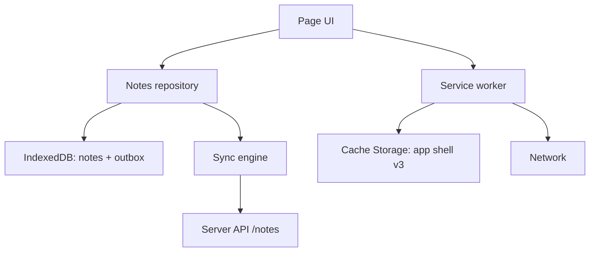
- **Notes repository** writes to IndexedDB first, then queues an operation in an **outbox** store.
- **Sync engine** runs on start, on the `online` event and periodically; it pushes the outbox and pulls changes since the last sync token.
- **Service worker** pre-caches the app shell at install, serves it cache-first, and leaves API calls to the page (network only).
- **Server** is a small Node API storing notes with a `version` counter per note.

### Data model
| Store | Key | Fields |
|---|---|---|
| `notes` | `id` | `title`, `body`, `updatedAt`, `version` (server), `dirty` (bool), `deleted` (bool) |
| `outbox` | auto-increment | `op: 'put' \| 'delete'`, `noteId`, `baseVersion`, `payload` |
| `meta` | key | `lastSyncToken`, `clientId` |

### Tech stack
| Component | Choice | Why |
|---|---|---|
| Local data | IndexedDB (raw API or a thin promise wrapper) | async, large, transactional |
| App shell | Cache Storage via service worker | offline loading |
| Sync trigger | `online` event + timer (+ Background Sync where supported) | Background Sync is not in every browser |
| Server | Node 24 + `node:sqlite` or PostgreSQL | stores versions |
| Testing | Playwright with offline mode | real service worker behaviour |

### Milestones
1. **Local-only app** on IndexedDB. *Done when* notes persist across reloads with no server at all.
2. **Service worker app shell.** *Done when* DevTools "Offline" + reload still loads the app.
3. **Push sync.** *Done when* notes created offline appear on the server after reconnecting, exactly once.
4. **Pull sync and conflicts.** *Done when* editing the same note on two browsers offline produces a visible conflict copy, not silent loss.
5. **Updates and install.** *Done when* deploying a new version shows the update prompt and old caches disappear.

### Deep dive: the hard parts
**Service worker lifecycle.** A new worker installs alongside the old one and *waits* until all tabs using the old one close. Version your cache name (`shell-v3`), pre-cache in `install`, delete other caches in `activate`, and show "reload to update" by messaging the page; call `skipWaiting()` only when the user agrees, otherwise an old page might run against new files.

**Durable before "Saved".** An IndexedDB write is durable when its transaction's `complete` event fires, not when `put()` returns. Write the note and the outbox entry in **one transaction** so you never have a note change without a queued sync (or the reverse).

**Conflicts.** Each note carries the server `version` it was based on. The server accepts a write only if `baseVersion` matches the current version (an **optimistic concurrency** check); otherwise it returns 409 with the current note. Simple policies: last-writer-wins (loses edits), or keep both as "Note (conflict copy)". Project 30 shows how CRDTs merge text automatically.

**Idempotent sync.** Network calls can succeed on the server but fail on the way back. Give each outbox operation an id and let the server ignore repeats, so retries never duplicate notes.

### Testing strategy
Unit-test the sync engine against a fake server (in-memory) covering lost responses, 409 conflicts and retries. Use Playwright to install the service worker, go offline, edit, go online and assert server state. Test the cache upgrade path by serving two builds in sequence.

### Trade-offs, scaling and failure modes
Cache-first is fast but can serve stale code — always pair it with an update flow. Browsers may evict storage under pressure unless you request `navigator.storage.persist()`. Last-writer-wins is easy and wrong for collaborative text; conflict copies are honest but annoying; CRDTs are best but complex.

### Stretch goals
- Attachments stored as `Blob`s in IndexedDB.
- End-to-end encryption so the server stores only ciphertext.
- Share target: receive text shared from other apps on mobile.

### Skills practised
- [Ch 12 — Async](../chapters/12-asynchronous-javascript/README.md): promises over event-based APIs, retries.
- [Ch 14 — Browser APIs](../chapters/14-browser-apis-and-security/README.md): service workers, IndexedDB, storage, `fetch`.

### In the interview
**30-second answer:** I built an installable offline-first notes app where IndexedDB is the source of truth, a service worker serves the app shell cache-first, and a sync engine pushes and pulls changes when the network returns. The key design decision was writing each note change and its outbox entry in one IndexedDB transaction, so the UI says "Saved" only once both are durable. The hardest parts were conflicts and the service-worker update lifecycle: the server accepts a write only if its `baseVersion` matches, otherwise I keep a visible conflict copy, and new versions activate only when the user agrees to reload. Second load renders in under 1 s with the network off, and retries never duplicate notes because every outbox operation has an id.

**Key terms to know:**
- **Progressive Web App (PWA)** — a site with a web app manifest and a service worker that can be installed and work offline.
- **Service worker** — a background script per origin that intercepts the page's network requests; it has no DOM access.
- **Service worker lifecycle** — `install` (pre-cache), `waiting` (until old tabs close), `activate` (delete old caches), then `fetch` handling.
- **Cache Storage** — a store of request/response pairs used by the service worker; versioned as `shell-v3`.
- **Caching strategies** — cache-first, network-first and stale-while-revalidate, chosen per kind of resource.
- **IndexedDB** — an asynchronous, transactional, large browser database for structured data and `Blob`s.
- **Outbox pattern** — local changes queued as operations and sent to the server later.
- **Optimistic concurrency** — the server rejects a write whose `baseVersion` is out of date, returning 409.
- **Idempotency** — an operation id lets the server ignore repeats, so retries are safe.
- **Storage eviction** — browsers may delete site data under pressure unless `navigator.storage.persist()` is granted.

**Q:** What does a service worker do?

**A:** It is a script the browser runs separately from any page, scoped to an origin and path, that can intercept the page's `fetch` requests and answer from caches or the network. It also receives push and sync events. It has no DOM access, runs only over HTTPS (or localhost), and the browser may stop it when idle, so it must not keep state in global variables.

**Q:** Cache-first vs network-first vs stale-while-revalidate?

**A:** Cache-first serves versioned static assets instantly and offline, but can serve stale code unless paired with an update flow. Network-first suits data that must be fresh, falling back to cache when offline. Stale-while-revalidate returns the cached copy immediately and updates the cache in the background, which is good for things like avatars.

**Q:** How do you avoid losing offline edits?

**A:** Write the note and its outbox entry in one IndexedDB transaction and show "Saved" only on the transaction's `complete` event, not when `put()` returns. The sync engine sends outbox operations with ids, and the server ignores repeats. Conflicts are detected with version numbers instead of silently overwriting.

**Q:** How does a new version of the app reach users safely?

**A:** The new worker installs and pre-caches under a new cache name, then *waits* while old tabs still use the old one. I message the page to show "Update available — reload"; on consent the page tells the worker to `skipWaiting()`, it activates, deletes old caches, and the page reloads. Forcing `skipWaiting()` without consent can run an old page against new files.

**Q:** What happens when the same note was edited on two devices offline?

**A:** The second device to sync sends `baseVersion: 4` while the server is at 5, so the server returns 409 with the current note. I keep both: the server version plus a "Note (conflict copy)". Last-writer-wins would be simpler but silently loses an edit, and CRDTs (Project 30) can merge text automatically at the cost of complexity.

**Q:** Hands-on: what does a minimal cache-first fetch handler look like?

```js
self.addEventListener('fetch', e => {
  if (new URL(e.request.url).pathname.startsWith('/api/')) return; // network only
  e.respondWith(caches.match(e.request).then(r => r ?? fetch(e.request)));
});
```

**A:** Returning without calling `respondWith` lets the browser handle API requests normally. For the shell, `caches.match` finds a cached response or falls back to the network. `respondWith` must be called synchronously inside the event handler, with a promise if the work is asynchronous.

**Q:** What fails at scale or over time?

**A:** Storage can be evicted under disk pressure unless persistence is granted, so I request `navigator.storage.persist()` and keep the server as a backup. A large outbox after weeks offline should be batched. On the server, pulling "changes since token" needs an index on update time, and many devices per user multiply conflict chances.

**Q:** How do you test it?

**A:** The sync engine runs against an in-memory fake server that can drop responses, return 409, or fail mid-batch, and I assert exactly-once results. Playwright installs the service worker, switches the context offline, edits, goes online and checks server state. Serving two builds in sequence tests the update prompt and old-cache cleanup.

**Common mistakes in answers:**
- Saying a service worker can touch the DOM — it cannot; it talks to pages with `postMessage`.
- Treating `put()` returning as durable — wait for the transaction's `complete` event.
- Using cache-first for everything with no versioning, which leaves users stuck on old code.

### TL;DR
Cache the shell in a versioned service worker, make IndexedDB the source of truth with an atomic outbox, sync idempotently with version checks, and make conflicts visible.

## 18. Test suite for a shopping-cart library

**Level:** Intermediate · **Time:** 1 week · **Prerequisites:** Ch 11, Ch 16

### What it is
You write a small shopping-cart library — line items, quantities, discount codes, tax, currency rounding, expiry of reserved stock — and, more importantly, a thorough test suite for it. The suite runs with the built-in **`node:test`** runner, and then you port part of it to **Vitest** to compare. You measure coverage, add property-based tests, and wire it into CI.

### The problem it solves
Many developers write tests that pass but prove little: they mirror the implementation, depend on the clock, or break on every refactor. This project practises testing **behaviour**, controlling time and randomness with **test doubles** (fakes, stubs and mocks that stand in for real dependencies), and using coverage as a hint, not a goal.

### Real-world examples
- Node's [test runner documentation](https://nodejs.org/api/test.html) covers `describe`/`it`, hooks, `mock.fn`, `mock.method`, mock timers, snapshots and coverage — everything this project needs without a dependency.
- [Vitest](https://vitest.dev/) offers a Jest-compatible API with watch mode and browser-like environments; it is popular in Vite-based projects.

### Requirements
**Functional (library)**
- `addItem`, `removeItem`, `setQuantity`, `applyCode`, `totals()`.
- Discounts: percentage, fixed amount, buy-X-get-Y; at most one code; minimum order rules.
- Money in integer minor units (cents); tax rounding per line using banker's or half-up rounding (choose and document).
- Reservations expire after 15 minutes (time injected).
- Serialisable to JSON and restorable.

**Functional (tests)**
- Unit tests for every public function, table-driven where possible.
- Time-dependent tests with injected clocks and `mock.timers`.
- Property-based tests: invariants hold for thousands of random carts.
- Snapshot of a receipt rendering.

**Non-functional**
- Whole suite runs in under 2 s; zero flaky tests over 100 repeated runs.
- At least 90% line coverage, with every uncovered line justified.
- CI runs tests on Node 24 for every push.

### The architecture
```mermaid
flowchart TD
    T["Test files: unit, property, snapshot"] --> L["Cart library"]
    L --> CL["Clock port"]
    L --> PR["Price catalogue port"]
    T --> F["Fakes: fixed clock, in-memory catalogue"]
    F --> CL
    F --> PR
    CI["CI workflow"] --> T
    T --> COV["Coverage report"]
```
- **Ports** are the functions the library depends on (`now()`, `getPrice(sku)`), passed in at construction — this is **dependency injection**, and it is what makes tests easy.
- **Fakes** are tiny in-memory implementations used by tests.
- **CI** runs `node --test --experimental-test-coverage`.

### Data model
| Type | Fields |
|---|---|
| `LineItem` | `sku`, `name`, `unitPrice` (cents), `qty`, `reservedUntil` |
| `Discount` | `code`, `kind: 'percent' \| 'fixed' \| 'bxgy'`, `value`, `minSubtotal` |
| `Totals` | `subtotal`, `discount`, `tax`, `total` — all integer cents |
| `CartOptions` | `now`, `taxRate`, `rounding`, `catalogue` |

### Tech stack
| Component | Choice | Why |
|---|---|---|
| Runner | `node:test` | zero dependencies, ships with Node 24 |
| Assertions | `node:assert/strict` | strict equality by default |
| Comparison runner | Vitest | watch mode, familiar API |
| Property tests | a 40-line generator using a seeded PRNG, or fast-check | find edge cases you did not think of |
| Coverage | `--experimental-test-coverage` | built in (still flagged experimental in Node 24) |

### Milestones
1. **Library skeleton with injected ports.** *Done when* constructing a cart requires no globals.
2. **Table-driven unit tests.** *Done when* every discount kind has edge rows (exactly minimum, one cent below, zero quantity).
3. **Time and mocks.** *Done when* reservation expiry is tested with `mock.timers` and no real waiting.
4. **Properties.** *Done when* 1,000 random carts confirm `total = subtotal - discount + tax` and `total >= 0`.
5. **Port to Vitest and CI.** *Done when* the same tests pass under both runners and CI shows coverage.

### Deep dive: the hard parts
**Money is integers.** `0.1 + 0.2` problems multiply with tax. Store cents as integers, multiply then round once per line with one documented rule, and test the rounding boundary (x.5 cents). For very large totals, `BigInt` avoids losing precision beyond 2^53.

**Testing behaviour, not implementation.** Assert on `totals()` and serialised output, not on private fields or how many times an internal helper was called. A good test survives a refactor that keeps behaviour the same. Use mocks only at boundaries (clock, catalogue, network).

**Property-based testing.** Instead of hand-picking inputs, generate many random carts and assert **invariants** — statements always true (totals never negative, removing then re-adding an item restores the total, JSON round-trip is lossless). When one fails, shrink the input to the smallest failing cart. This finds edge cases you would never type.

**Flakiness.** Flaky tests usually come from real time, randomness, shared state or test order. Inject clocks and seeds, create fresh carts per test, and run the suite with `--test-shuffle` and repeatedly in CI to catch order dependence.

### Testing strategy
This project *is* the testing strategy; add **mutation testing** as a check on the tests: deliberately change an operator in the library (`>=` to `>`) and confirm some test fails. If none does, a behaviour is untested.

### Trade-offs, scaling and failure modes
`node:test` needs no install and is fast; Vitest adds watch mode, richer mocking and DOM environments. Coverage can be gamed — 100% lines with weak assertions proves little. Snapshot tests are quick to write and easy to rubber-stamp; keep them small and review diffs.

### Stretch goals
- Stryker mutation testing run in CI.
- Benchmark `totals()` with 10,000 lines and add a performance budget test.
- TypeScript types for the library checked with `tsc --noEmit` (preview of Project 19).

### Skills practised
- [Ch 11 — Errors](../chapters/11-errors-and-debugging/README.md): custom error classes for invalid operations, asserting thrown errors.
- [Ch 16 — Testing](../chapters/16-testing-and-typescript/README.md): `node:test`, mocks, fake timers, snapshots, coverage.

### In the interview
**30-second answer:** I built a small shopping-cart library — line items, discount codes, tax, rounding, reservation expiry — and, more importantly, a test suite for it on the built-in `node:test` runner, later ported to Vitest for comparison. The key design decision was dependency injection: the clock and price catalogue are passed in as ports, so tests swap in fakes and never depend on real time. The hardest part was money: I keep integer cents, round once per line with a documented rule, and use property-based tests over 1,000 random carts to check invariants like `total = subtotal - discount + tax` and `total >= 0`. The suite runs in under 2 seconds with zero flakes over 100 repeated runs and over 90% line coverage.

**Key terms to know:**
- **Test double** — any stand-in for a real dependency; stubs, fakes, spies and mocks are kinds of double.
- **Dependency injection** — passing dependencies like `now()` and `getPrice()` into the library instead of reaching for globals.
- **Table-driven test** — one test loop over rows of inputs and expected outputs, easy to extend with edge cases.
- **Fake timers** — `mock.timers` in `node:test` replaces `setTimeout` and `Date` so time can be advanced instantly.
- **Property-based testing** — generating many random inputs and checking invariants, then shrinking failures to a minimal case.
- **Invariant** — a statement that must always hold, such as "total is never negative".
- **Integer minor units** — storing money as whole cents to avoid float rounding errors.
- **Code coverage** — which lines and branches ran during tests; it does not show whether they were checked.
- **Mutation testing** — deliberately changing the code (`>=` to `>`) to see whether some test fails.
- **Flaky test** — a test that passes and fails without code changes, usually from time, randomness, shared state or order.

**Q:** Mock, stub, fake — what is the difference?

**A:** A stub returns canned answers (`getPrice` always returns 500). A fake is a working lightweight implementation, like an in-memory catalogue. A spy records how it was called, and a mock is a double you set expectations on and assert interactions with. Use them only at boundaries such as the clock, catalogue or network.

**Q:** How do you test code that depends on the current time?

**A:** Inject a clock function so the test decides what "now" is, or use fake timers. In `node:test`, `mock.timers.enable({ apis: ['setTimeout', 'Date'] })` then `mock.timers.tick(15 * 60_000)` checks reservation expiry instantly. No test ever sleeps.

**Q:** Is 100% coverage a good goal?

**A:** Coverage shows what ran, not what was asserted, so 100% with weak assertions proves little and chasing the last few percent produces brittle tests. I use it to find untested areas and require a justification for uncovered lines. Mutation testing is a better check that the tests actually catch bugs.

**Q:** Why integer cents, and how do you round tax?

**A:** Floats cannot represent most decimal fractions, so errors creep in and multiply with tax. With integer cents I multiply, round once per line using one documented rule (half-up or banker's rounding, which sends x.5 to the even neighbour), and test the exact .5 boundary. Totals beyond `Number.MAX_SAFE_INTEGER` (2^53 − 1) would need `BigInt`.

**Q:** Hands-on: write a table-driven test with `node:test`.

```js
import { test } from 'node:test';
import assert from 'node:assert/strict';
for (const [code, subtotal, expected] of [['TEN', 10_000, 1_000], ['TEN', 999, 0]]) {
  test(`${code} on ${subtotal}`, () =>
    assert.equal(cartWith(subtotal, code).totals().discount, expected));
}
```

**A:** Each row becomes its own named test, so a failure tells you exactly which case broke. `node:assert/strict` makes `equal` use strict equality. Adding an edge case is one more row, such as exactly the minimum subtotal or one cent below.

**Q:** What does property-based testing find that examples miss?

**A:** It generates thousands of carts with random quantities, prices and codes and checks invariants: totals never negative, removing then re-adding an item restores the total, JSON round-trip is lossless. When one fails, shrinking reduces it to the smallest failing cart, often an edge you would never type, like zero quantity with a fixed discount. Seeding the generator makes failures reproducible.

**Q:** Where do flaky tests come from, and how do you stop them?

**A:** Real time, unseeded randomness, shared mutable state between tests, and dependence on test order. I inject clocks and seeds, build a fresh cart in every test, and run the suite repeatedly and in random order in CI to expose hidden ordering. A flaky test is treated as a bug, not retried until green.

**Q:** What changes when the suite grows 10x?

**A:** Speed and signal become the issue. `node:test` runs test files in parallel processes by default, so independent files scale well. I keep unit tests pure and fast, put slower integration tests in separate files, and keep snapshots small so reviewers actually read their diffs.

**Common mistakes in answers:**
- Using "mock" for every kind of double — interviewers often probe the distinction.
- Asserting on private fields or internal call counts, which breaks on harmless refactors.
- Treating high coverage as proof of correctness.

### TL;DR
Design for injection, keep money in integer cents, test behaviour with tables and properties, control time and randomness, and treat coverage as a map, not a score.

## 19. TypeScript migration of a JavaScript codebase

**Level:** Intermediate · **Time:** 1–2 weeks · **Prerequisites:** Ch 10, Ch 16

### What it is
Take an existing JavaScript project — your Project 16 API or Project 12 board is ideal — and migrate it to **TypeScript** incrementally, without a big-bang rewrite and without breaking the build at any step. You start with JSDoc type checking on plain `.js`, convert file by file, tighten compiler options gradually, and finish under `strict` with types at every network boundary.

### The problem it solves
Real teams cannot stop shipping for a month to add types. A migration must be **incremental** (each commit builds and tests pass), **measurable** (you can track progress) and must avoid a false sense of safety from `any` everywhere. You also learn the practical choices: how to run `.ts` (Node 24's stable type stripping, a bundler, or `tsc`) and how to type data you do not control.

### Real-world examples
- The TypeScript handbook's [Migrating from JavaScript](https://www.typescriptlang.org/docs/handbook/migrating-from-javascript.html) guide describes `allowJs`, `checkJs` and a gradual approach.
- Airbnb open-sourced [ts-migrate](https://github.com/airbnb/ts-migrate), a codemod tool that converts files and inserts `@ts-expect-error` comments so a large codebase compiles quickly, then gets cleaned up over time.
- Node's [TypeScript docs](https://nodejs.org/api/typescript.html) explain type stripping: Node runs `.ts` by removing type annotations, without type-checking.

### Requirements
**Functional**
- Every step keeps `npm test` green and the app runnable.
- Final state: all source in `.ts`, `strict: true`, `noUncheckedIndexedAccess: true`, no unexplained `any`.
- Runtime validation at boundaries (HTTP bodies, `JSON.parse`, `localStorage`) that produces typed values.
- CI runs `tsc --noEmit` and fails on type errors.

**Non-functional**
- No runtime behaviour changes (tests prove it).
- Count of `any` and `@ts-expect-error` tracked per commit and trending to zero.
- Build or start-up time not more than 20% slower than before.

### The architecture
```mermaid
flowchart LR
    S0["Stage 0: JS + checkJs on 1 file"] --> S1["Stage 1: JSDoc types on core modules"]
    S1 --> S2["Stage 2: rename leaves to .ts"]
    S2 --> S3["Stage 3: rename the rest, allowJs off"]
    S3 --> S4["Stage 4: strict flags one by one"]
    S4 --> S5["Stage 5: boundary validation, any count zero"]
```
- **Leaves first.** Convert modules with no internal imports (utilities, models) first; their types then flow into callers.
- **Boundary types.** Data from outside enters through parse functions that return typed values or throw.
- **Tooling** — `tsconfig.json`, `tsc --noEmit` in CI, and the chosen way to run `.ts`.

### Data model
| Concept | Example |
|---|---|
| Domain types | `type Book = { id: number; title: string; year: number \| null }` |
| Discriminated unions | `type Result<T> = { ok: true; value: T } \| { ok: false; error: string }` |
| Boundary parser | `parseBook(u: unknown): Book` |
| Progress metrics | files converted, `any` count, `@ts-expect-error` count |

### Tech stack
| Component | Choice | Why |
|---|---|---|
| Checker | `tsc --noEmit` (current TypeScript) | the source of truth for types |
| Running TS in Node | `node file.ts` (type stripping, stable in Node 24) | no build step for the server |
| Browser builds | esbuild or Vite | strips types and bundles |
| Validation | hand-written guards, or a schema library such as Zod | runtime safety at boundaries |
| Tracking | a script counting `any` with the TypeScript compiler API or grep | visible progress |

### Milestones
1. **Baseline.** Add `tsconfig.json` with `allowJs`, `checkJs: false`, and `// @ts-check` in one file. *Done when* CI runs `tsc` green.
2. **JSDoc types for core modules.** *Done when* hovering in the editor shows real types for the main functions.
3. **Leaf conversion.** *Done when* half the files are `.ts` and tests pass.
4. **All files converted.** *Done when* `allowJs` is off.
5. **Strict mode.** Enable `strictNullChecks`, then `noImplicitAny`, then `strict`. *Done when* each flag lands in its own commit with zero errors.
6. **Boundaries.** *Done when* every `JSON.parse` and request body goes through a parser returning a typed value, and the `any` count is zero.

### Deep dive: the hard parts
**Type stripping rules.** Node 24 runs `.ts` by erasing types, so only **erasable syntax** works: no `enum`, no parameter properties, no namespaces with code. Imports must use `.ts` extensions, and type-only imports should use `import type`. Set `"erasableSyntaxOnly": true` and `"verbatimModuleSyntax": true` so `tsc` enforces the same rules. Type stripping never checks types — `tsc` in CI does.

**`unknown`, not `any`.** `any` turns checking off silently and spreads. Type untrusted values as `unknown`, then **narrow** them with checks (`typeof`, `in`, `Array.isArray`) or a schema. A function `parseBook(u: unknown): Book` that throws on bad input is the bridge between untyped and typed worlds.

**Strict null checks.** Turning on `strictNullChecks` surfaces every place a value may be `undefined` — usually hundreds. Fix them by improving types (return `Book | undefined` from `find`), early returns, or default values, not by sprinkling `!`. `noUncheckedIndexedAccess` makes `arr[i]` possibly `undefined`, catching real off-by-one bugs.

**Escape hatches with a deadline.** `@ts-expect-error` is better than `@ts-ignore` because it errors when the problem is fixed. Track their count in CI and require a reason comment.

### Testing strategy
The existing tests are the safety net: run them after every step. Add **type tests** for important generics (assignments that must compile and `@ts-expect-error` lines that must not). Add runtime tests for boundary parsers with malformed input.

### Trade-offs, scaling and failure modes
JSDoc keeps `.js` files and no build step, which suits small libraries; `.ts` gives richer syntax and better tooling. Type stripping removes the build step for Node but you still need `tsc` for checking. Over-precise types slow teams down; aim for types that catch real bugs. Types say nothing about runtime data — boundaries still need validation.

### Stretch goals
- Generate API types from the Project 16 OpenAPI file and share them with a client.
- Publish a library with `.d.ts` declarations and test them with a consumer project.
- Write a codemod with the TypeScript compiler API that converts one JSDoc pattern automatically.

### Skills practised
- [Ch 10 — Modules and tooling](../chapters/10-modules-and-tooling/README.md): ESM, file extensions, bundlers and transpilers.
- [Ch 16 — Testing and TypeScript](../chapters/16-testing-and-typescript/README.md): narrowing, generics, `satisfies`, type stripping, JSDoc.

### In the interview
**30-second answer:** I migrated an existing JavaScript codebase — my Express API — to TypeScript incrementally, with `npm test` green after every commit and no big-bang rewrite. The key decisions were converting leaf modules first so their types flow into callers, enabling strict flags one per commit, and typing every external input as `unknown` and narrowing it through parse functions. The hardest part was `strictNullChecks`, which surfaced hundreds of possible `undefined`s that I fixed with better return types and early returns rather than `!`. I tracked the counts of `any` and `@ts-expect-error` per commit down to zero, and the server runs `.ts` directly with Node 24's type stripping while CI runs `tsc --noEmit` for checking.

**Key terms to know:**
- **Incremental migration** — converting a codebase step by step with every commit building and passing tests.
- **`allowJs` and `checkJs`** — let `tsc` compile `.js` files alongside `.ts`, and optionally type-check them using JSDoc.
- **JSDoc types** — type annotations in comments (`/** @param {string} id */`) that the checker reads without renaming files.
- **`strict` mode** — a bundle of flags including `strictNullChecks` and `noImplicitAny`.
- **`any` vs `unknown`** — `any` turns checking off, `unknown` accepts anything but must be narrowed before use.
- **Type narrowing** — refining a type with checks such as `typeof`, `in`, `Array.isArray` or a discriminant field.
- **Discriminated union** — a union whose members share a literal field (`ok: true | false`) the compiler uses to narrow.
- **Type stripping** — Node 24 runs `.ts` by erasing annotations, without checking types; only erasable syntax is allowed.
- **Boundary validation** — parsing external data (HTTP bodies, `JSON.parse`, storage) into typed values at runtime.
- **`@ts-expect-error`** — suppresses one error and itself errors once the problem is fixed, unlike `@ts-ignore`.

**Q:** How would you migrate a large JS codebase to TypeScript?

**A:** Incrementally: add a `tsconfig.json` with `allowJs`, get `tsc` green in CI, add JSDoc types to core modules, then rename leaf modules to `.ts` first and work inward. Keep tests passing at every step. Enable strict flags one at a time, add runtime validation at boundaries, and track `any` and suppression counts so progress is visible.

**Q:** `any` vs `unknown`?

**A:** `any` disables checking for that value and silently spreads to everything it touches. `unknown` accepts any value but you cannot use it until you narrow it, so it is the right type for untrusted data. A `parseBook(u: unknown): Book` function that checks fields and throws on bad input is the bridge from untyped to typed.

**Q:** Does running `node app.ts` check types?

**A:** No. Node 24 strips the type annotations and runs the remaining JavaScript; a type error does not stop it. Type checking happens only with `tsc --noEmit` (or your editor), which is why it runs in CI.

**Q:** What syntax does Node's type stripping not support, and how do you enforce that?

**A:** Only erasable syntax works: no `enum`, no constructor parameter properties, no namespaces containing code, because those generate JavaScript. Relative imports must include the `.ts` extension, and type-only imports should use `import type`. Setting `"erasableSyntaxOnly": true` and `"verbatimModuleSyntax": true` makes `tsc` reject what Node cannot run.

**Q:** Hands-on: narrow an `unknown` safely.

```ts
function parseBook(u: unknown): Book {
  if (typeof u !== 'object' || u === null) throw new TypeError('not an object');
  if (!('title' in u) || typeof u.title !== 'string') throw new TypeError('bad title');
  // ...same for id and year
  return { id: Number(u.id), title: u.title, year: u.year ?? null };
}
```

**A:** The `typeof` and `null` check is needed because `typeof null === 'object'`. After `'title' in u` and the `typeof` check, TypeScript knows `u.title` is a string. A schema library like Zod generates the same logic and the type from one definition.

**Q:** Why do types not protect you from bad API data?

**A:** Types are erased at runtime, so a response declared as `Book` can still be anything the server or user sent. Casting with `as Book` only silences the compiler. Real safety needs runtime validation at every boundary, after which the types inside the program are trustworthy.

**Q:** What changes for a team of 50 engineers or a 500k-line codebase?

**A:** A codemod like Airbnb's ts-migrate can rename files and insert `@ts-expect-error` comments so everything compiles quickly, then teams burn down suppressions over time. Build performance matters, so project references split `tsc` into smaller units. CI blocks new `any` while allowing existing ones, so the number only goes down.

**Q:** How do you prove the migration changed no behaviour?

**A:** The existing test suite runs after every step and must stay green, and start-up time is compared to the baseline. I add type tests for important generics — assignments that must compile and `@ts-expect-error` lines that must fail — and runtime tests for boundary parsers with malformed input.

**Common mistakes in answers:**
- Believing Node's type stripping or a bundler checks types — only `tsc` does.
- Fixing `strictNullChecks` errors with the non-null assertion `!` everywhere, which just hides the bugs.
- Using `as SomeType` on `JSON.parse` output and calling it validated.

### TL;DR
Migrate leaves first with tests green at every step, prefer `unknown` plus narrowing to `any`, turn on strict flags one at a time, and remember that only `tsc` — not type stripping — checks types.

## 20. Static site generator

**Level:** Intermediate · **Time:** 1–2 weeks · **Prerequisites:** Ch 6, Ch 10, Ch 15

### What it is
A Node command, `ssg build`, that turns a folder of Markdown files with **front matter** (a block of metadata like title and date at the top of a file) and HTML templates into a ready-to-host static website: pages, a blog index with pagination, tag pages, an RSS feed and a sitemap. `ssg dev` serves the site locally and rebuilds on change with live reload.

### The problem it solves
Static sites are fast, cheap and secure, and every developer eventually builds one. Writing the generator teaches file-system work at scale, templating without XSS, dependency tracking for incremental rebuilds, and a dev server with file watching — core Node skills wrapped in a useful tool.

### Real-world examples
- [Eleventy](https://www.11ty.dev/) is a JavaScript static site generator built on the same idea: data cascade, templates, collections.
- [Hugo](https://gohugo.io/) and [Astro](https://astro.build/) are other popular generators; compare their approaches to templating and partial rebuilds after you finish.

### Requirements
**Functional**
- Content in `content/**/*.md` with YAML-like front matter (`title`, `date`, `tags`, `draft`).
- Layouts in `layouts/` with a tiny template language: `{{ title }}` (escaped), `{{{ body }}}` (raw), ``, includes.
- Generated: pages, paginated index (10 per page), tag pages, `feed.xml`, `sitemap.xml`.
- Static assets copied; output in `dist/`.
- `ssg dev`: local server, watch, rebuild, live reload via Server-Sent Events.

**Non-functional**
- Full build of 1,000 pages under 3 s; incremental rebuild of one changed post under 200 ms.
- Deterministic output (same input → byte-identical files).
- Clear errors with file and line for broken front matter or templates.

### The architecture
```mermaid
flowchart TD
    FS["content, layouts, assets"] --> LD["Loader: read and parse front matter"]
    LD --> MD["Markdown to HTML (Project 13 parser)"]
    MD --> CO["Collections: posts, tags, pages"]
    CO --> TP["Template engine: compile and render"]
    TP --> WR["Writer: dist files"]
    W["fs.watch"] --> DG["Dependency graph"]
    DG --> LD
    WR --> DS["Dev server + SSE live reload"]
```
- **Loader** reads files concurrently with a limit, splits front matter from body.
- **Collections** group and sort pages (posts by date, tag → posts).
- **Template engine** compiles each template once into a function.
- **Dependency graph** records which outputs used which inputs, so a change rebuilds only what it affects.
- **Dev server** is `node:http` serving `dist/` plus an SSE endpoint that sends "reload".

### Data model
| Type | Fields |
|---|---|
| `Page` | `inputPath`, `outputPath`, `url`, `data` (front matter), `content` (HTML), `hash` |
| `Collection` | `name`, `pages` sorted |
| `Template` | `path`, compiled `render(data)`, `includes[]` |
| `DepGraph` | `Map<input, Set<output>>` |

### Tech stack
| Component | Choice | Why |
|---|---|---|
| Files | `node:fs/promises`, `fs.glob` or a recursive `readdir` | async, no dependency |
| Markdown | your Project 13 parser, or a library | reuse |
| Templates | own compiler to JS functions | learn compiling, control escaping |
| Watching | `fs.watch` with `recursive: true` | built in |
| Live reload | Server-Sent Events | one-way push, trivial client |

### Milestones
1. **One page.** Markdown + layout → `dist/index.html`. *Done when* opening the file shows the page.
2. **Front matter, collections, pagination.** *Done when* the index lists posts newest first across pages.
3. **Template engine.** Escaped and raw output, loops, includes. *Done when* a post titled `<script>` renders as text.
4. **Feeds and sitemap.** *Done when* the feed validates in a feed validator and URLs are absolute.
5. **Dev server and incremental builds.** *Done when* editing one post rebuilds only its page, the index page and its tag pages, and the browser reloads.

### Deep dive: the hard parts
**Compiling templates.** Turn `Hello {{ name }}` into a function once: tokenise into text and tag tokens, generate JavaScript source that builds a string, and create the function. Escape `{{ }}` output with an `escapeHtml` helper. Generating code from templates is how real engines are fast — but never compile templates from untrusted users, because it is code execution.

**Dependency tracking.** While rendering an output, record every input it touched: its source file, its layout, includes, and collections. When a file changes, look up dependents and rebuild just those. Changes to a layout rebuild everything using it; a new post invalidates index, tag and feed pages.

**Watching is noisy.** `fs.watch` can fire several events for one save (editors write temp files and rename). Debounce events (50 ms), collect changed paths into a `Set`, then rebuild once.

**Determinism.** Sort everything you iterate (directory listings are not guaranteed to be ordered), avoid "built at" timestamps in output, and format dates with a fixed time zone. Deterministic output makes diffs reviewable and caching effective.

### Testing strategy
Snapshot-test the build of a small fixture site (compare `dist/` file hashes). Unit-test front matter parsing (missing fence, bad syntax with line numbers), the template compiler (escaping, loops, errors) and the dependency graph. Integration-test the dev server: change a file, assert an SSE message arrives.

### Trade-offs, scaling and failure modes
Your own template language is small and safe-by-default but less powerful than JavaScript-based templates. Full rebuilds are simplest and often fast enough; incremental builds add bugs when dependencies are missed — keep a "clean build" command. Static sites cannot personalise per user without client-side JavaScript or an edge function.

### Stretch goals
- Image pipeline: generate responsive sizes and `srcset` (use `worker_threads`).
- Syntax highlighting at build time so pages ship no highlighter JavaScript.
- Plugin API with hooks (`beforeRender`, `afterWrite`) loaded with dynamic `import()`.

### Skills practised
- [Ch 6 — Strings and regex](../chapters/06-strings-and-regular-expressions/README.md): tokenising templates and front matter.
- [Ch 10 — Modules and tooling](../chapters/10-modules-and-tooling/README.md): CLI packaging, dynamic `import()` for plugins.
- [Ch 15 — Node.js basics](../chapters/15-nodejs-basics/README.md): `fs/promises`, paths, `fs.watch`, `node:http`.

### In the interview
**30-second answer:** I built `ssg`, a Node static site generator that turns Markdown with front matter and templates into pages, paginated indexes, tag pages, an RSS feed and a sitemap, plus a dev server with live reload over Server-Sent Events. The key design decision was compiling each template once into a JavaScript function that escapes every `{{ }}` interpolation by default, so a post titled `<script>` renders as text. The hardest part was incremental rebuilds: while rendering, I record every input each output touched, so editing one post rebuilds only its page, the index and its tag pages. A full build of 1,000 pages runs under 3 seconds, a one-post rebuild under 200 ms, and output is byte-for-byte deterministic.

**Key terms to know:**
- **Static site generator** — a build tool that pre-renders a whole site to plain files that any web server or CDN can host.
- **Front matter** — a metadata block (title, date, tags, draft) at the top of a Markdown file.
- **Template compilation** — tokenising a template and generating a JavaScript function once, then calling it per page.
- **Auto-escaping** — `{{ x }}` escapes HTML by default and only `{{{ x }}}` outputs raw, trusted HTML.
- **Collections** — groups of pages (posts sorted by date, tag to posts) used by index and tag pages.
- **Dependency graph** — a `Map<input, Set<output>>` recording which outputs used which inputs, for incremental builds.
- **`fs.watch` and debouncing** — file-change notifications that fire several times per save, collected for 50 ms then rebuilt once.
- **Server-Sent Events (SSE)** — one-way HTTP streaming from server to browser, used to send "reload".
- **Deterministic build** — same input always gives byte-identical output, so diffs and caches work.
- **Bounded concurrency** — reading many files in parallel but with a limit, to avoid exhausting file descriptors.

**Q:** How does a template engine avoid XSS?

**A:** Escape every interpolation by default and require an explicit raw syntax, such as `{{{ body }}}`, for trusted HTML like rendered Markdown. That makes the safe path the easy path. Attribute values and URLs still need care, because escaping does not stop `href="javascript:…"`.

**Q:** How do you compile a template, and what is the risk?

**A:** Tokenise `Hello {{ name }}` into text and tag tokens, generate JavaScript source that concatenates strings and calls `escapeHtml`, then create the function once with `new Function` and reuse it for every page. That is why real engines are fast. The risk is that it is code generation, so you must never compile templates written by untrusted users.

**Q:** How would you make rebuilds incremental?

**A:** While rendering an output, record every input it read — its source file, layout, includes and any collection. On a change, look up dependents in the graph and rebuild only those. A layout change rebuilds every page using it, a new post invalidates index, tag and feed pages, and a `--clean` full build is the fallback when dependencies are missed.

**Q:** SSE or WebSocket for live reload?

**A:** SSE: the server only pushes "reload", it runs over plain HTTP with a `text/event-stream` response, and `EventSource` reconnects automatically after the dev server restarts. A WebSocket would add a protocol upgrade and two-way messaging nobody needs here.

**Q:** Hands-on: how do you read 1,000 files quickly but safely?

```js
const files = (await fs.readdir('content', { recursive: true })).filter(f => f.endsWith('.md')).sort();
const pages = [];
for (let i = 0; i < files.length; i += 32) {
  pages.push(...await Promise.all(files.slice(i, i + 32).map(loadPage)));
}
```

**A:** `Promise.all` over all 1,000 at once could hit the open-file limit (`EMFILE`), so batches of 32 bound concurrency; a small pool that starts a new read as each finishes is even better. The `sort()` matters because directory listings have no guaranteed order, and determinism needs a stable order.

**Q:** Why is `fs.watch` noisy, and how do you handle it?

**A:** Editors often save by writing a temp file and renaming it, which fires several events per save, and events vary between operating systems. I debounce for 50 ms, collect changed paths into a `Set`, then rebuild once. A rebuild that is already running finishes before the next one starts.

**Q:** What happens with broken front matter, and what breaks at 10x the pages?

**A:** A parse error reports the file and line and fails the build with a non-zero exit code; in dev mode it shows the error in the browser instead of crashing the server. At 10,000 pages, Markdown parsing and image processing dominate, so I would cache parsed output by content hash and move image resizing to `worker_threads`.

**Q:** How do you test it?

**A:** Build a small fixture site and compare `dist/` file hashes against a stored snapshot, which also proves determinism. Unit-test front matter parsing with line-numbered errors, the template compiler for escaping and loops, and the dependency graph. An integration test edits a file under `ssg dev` and asserts an SSE "reload" arrives.

**Common mistakes in answers:**
- Escaping only some outputs, or making raw output the default.
- Assuming `readdir` returns files in sorted order — it does not guarantee that.
- Starting thousands of file reads at once with `Promise.all` and hitting `EMFILE`.

### TL;DR
Load and parse content concurrently, compile templates to escaping functions, track dependencies for incremental rebuilds, debounce file events, and keep output deterministic.

## 21. Single-page app router

**Level:** Intermediate · **Time:** 1 week · **Prerequisites:** Ch 13, Ch 14

### What it is
A small client-side **router** library — the piece of a single-page app (SPA) that maps URLs to views without full page reloads — plus a demo app (a product catalogue with list, detail, search and 404 pages). It uses the **History API** (`pushState`, `popstate`) and **`URLPattern`** (a standard for matching URLs like `/products/:id`), supports nested layouts, data loading before render, link interception, scroll restoration and focus management.

### The problem it solves
Frameworks hide routing, so many developers never learn what breaks when a page does not reload: the Back button, scroll position, focus for screen-reader users, cancelled data loads when users click quickly, and links that must still work when opened in a new tab. Building a router makes each of those visible.

### Real-world examples
- MDN's [History API](https://developer.mozilla.org/en-US/docs/Web/API/History_API) explains `pushState`, `replaceState` and `popstate`, the classic SPA routing primitives.
- MDN's [URL Pattern API](https://developer.mozilla.org/en-US/docs/Web/API/URL_Pattern_API) documents `URLPattern`; Node 24 exposes it as a global, so your matcher can be unit-tested in Node.
- MDN's [Navigation API](https://developer.mozilla.org/en-US/docs/Web/API/Navigation_API) is a newer, single-event alternative (`navigate` event) worth comparing.

### Requirements
**Functional**
- Route table with patterns (`/`, `/products`, `/products/:id`, `/search`, `*`), nested layouts, and per-route `load()` and `render()`.
- Intercept same-origin `<a>` clicks; respect modifier keys, `target`, `download` and external links.
- Back/forward work; query strings parsed; programmatic `navigate(url, { replace })`.
- Pending UI while loading; a newer navigation cancels an older load.
- Scroll restored on Back, scroll to top on new pages, hash links scroll to the element.
- Focus moves to the new page's main heading; the document title updates.

**Non-functional**
- Router under 4 KB minified, zero dependencies.
- Route matching in under 1 ms for 100 routes.
- Deep links work on reload with a server fallback to `index.html`.

### The architecture
```mermaid
sequenceDiagram
    participant U as User
    participant L as "Link interceptor"
    participant R as Router
    participant M as Matcher
    participant D as "Route load"
    participant V as View
    U->>L: click a href=/products/42
    L->>R: navigate /products/42
    R->>R: abort previous navigation
    R->>M: match path
    M-->>R: route + params id=42
    R->>D: load params, signal
    D-->>R: data
    R->>V: render into layout outlet
    R->>R: pushState, title, focus, scroll
```
- **Link interceptor** is one delegated `click` listener on `document` that decides whether a click should become a client navigation.
- **Matcher** compiles each route to a `URLPattern` once and tests them in order.
- **Router** owns the current navigation's `AbortController` and the history entries.
- **Views** are functions that receive data and return DOM nodes; layouts render an outlet for children.

### Data model
| Type | Fields |
|---|---|
| `Route` | `path`, `pattern: URLPattern`, `load?(ctx)`, `render(ctx)`, `children?`, `title?` |
| `Match` | `route chain` (layout to leaf), `params`, `query: URLSearchParams` |
| `NavState` (in `history.state`) | `key`, `scrollY` |
| `Ctx` | `params`, `query`, `signal`, `data` |

### Tech stack
| Component | Choice | Why |
|---|---|---|
| Matching | `URLPattern` (with a tiny regex fallback for older browsers) | standard syntax, named groups |
| History | `pushState` / `popstate` | universal support |
| Cancellation | `AbortController` per navigation | stale loads never render |
| Scroll | `history.scrollRestoration = 'manual'` + saved positions | predictable behaviour |
| Server fallback | dev server that serves `index.html` for unknown paths | deep links |

### Milestones
1. **Matcher.** *Done when* Node tests show `/products/42` matches with `{ id: '42' }` and unknown paths hit `*`.
2. **Links and history.** *Done when* clicking links changes the view without reload and Back/Forward work.
3. **Loading and cancellation.** *Done when* clicking two product links quickly always shows the second product.
4. **Nested layouts.** *Done when* the layout persists while child views change.
5. **Scroll and focus.** *Done when* Back restores scroll position and a screen reader announces the new page heading.

### Deep dive: the hard parts
**Which clicks to intercept.** Only plain left clicks (`event.button === 0`) without Ctrl/Cmd/Shift/Alt, on `<a>` elements with an `href` to the same origin, without `target` other than `_self` and without `download`. Everything else must behave natively so "open in new tab" still works. Find the anchor with `event.target.closest('a')` because the click may land on an inner `<span>`.

**`popstate` is after the fact.** When the user presses Back, the URL has already changed when `popstate` fires; you cannot prevent it. Save the current scroll position into `history.replaceState` *before* every navigation, and restore it after rendering the popped entry. The Navigation API improves this with an interceptable `navigate` event.

**Race-free loading.** Each navigation creates an `AbortController`, aborts the previous one and passes the signal to `load()`. After `await load()`, check `signal.aborted` before rendering. This is the same pattern as Project 4's searches, now generalised.

**Accessibility.** Without a page load, screen readers do not announce anything. After rendering, set `document.title`, move focus to the main `<h1>` (with `tabindex="-1"`), or announce via a live region.

### Testing strategy
Unit-test the matcher and the click filter in Node (Node 24 has `URLPattern`). jsdom tests for navigation flows with mocked `load` functions resolving out of order. Playwright for real Back/Forward, scroll restoration and new-tab behaviour.

### Trade-offs, scaling and failure modes
Client routing makes navigation fast after the first load but makes the first load heavier and needs server configuration for deep links. Hash routing (`#/products/42`) needs no server config but produces uglier URLs and conflicts with in-page anchors. Lazy-loading route code with dynamic `import()` keeps the initial bundle small at the cost of a delay on first visit to each route.

### Stretch goals
- Route-level code splitting with `import()` and prefetch on link hover.
- Implement the same router on the Navigation API and compare code size.
- View Transitions between routes.

### Skills practised
- [Ch 13 — DOM and events](../chapters/13-dom-and-events/README.md): delegation, `closest`, default actions, focus.
- [Ch 14 — Browser APIs](../chapters/14-browser-apis-and-security/README.md): History API, `URL`, `URLSearchParams`.

### In the interview
**30-second answer:** I built a dependency-free client-side router under 4 KB with `URLPattern` matching, nested layouts, data loading before render, scroll restoration and focus management, plus a product-catalogue demo. The key design decision was one delegated click listener that intercepts *only* plain same-origin left clicks, so Ctrl-click, `target="_blank"` and downloads keep their native behaviour. The hardest part was everything a page load normally gives you for free: I abort the previous navigation's `load()` with an `AbortController`, save scroll positions into `history.state` before navigating, and move focus to the new `<h1>` so screen readers announce the page. Matching 100 routes takes under 1 ms, and the matcher is unit-tested in Node 24, which has `URLPattern` as a global.

**Key terms to know:**
- **Single-page app (SPA)** — an app that swaps views in JavaScript instead of loading a new HTML page per URL.
- **History API** — `pushState` and `replaceState` change the URL and history entry without reloading, and `popstate` fires on Back/Forward.
- **`URLPattern`** — a standard matcher for patterns like `/products/:id` that returns named groups.
- **Link interception** — a delegated `click` listener that turns qualifying `<a>` clicks into client navigations.
- **Navigation cancellation** — each navigation owns an `AbortController`, and a newer one aborts the older one's data load.
- **Nested layouts and outlets** — a parent route renders a frame with a slot where child routes render.
- **Scroll restoration** — saving and restoring scroll position per history entry, with `history.scrollRestoration = 'manual'`.
- **Focus management** — moving focus to the new page's main heading so keyboard and screen-reader users know the page changed.
- **Server fallback** — the server serves `index.html` for unknown app paths so deep links work on reload.
- **Navigation API** — a newer browser API with one interceptable `navigate` event for all navigations.

**Q:** How does SPA routing work without reloading?

**A:** Intercept qualifying link clicks and call `preventDefault`, then `history.pushState` to change the URL, match the path to a route, load its data and render it. Back and Forward fire `popstate`, where you match and render the entry the browser already moved to. Programmatic `navigate()` follows the same path.

**Q:** Which clicks should the router intercept?

**A:** Only a plain left click (`event.button === 0`) with no Ctrl, Cmd, Shift or Alt, on an `<a>` found with `event.target.closest('a')`, whose `href` is same-origin, with no `target` other than `_self` and no `download` attribute, and not already `defaultPrevented`. Everything else must behave natively so "open in new tab" and downloads still work.

**Q:** Why does a deep link 404 on reload?

**A:** On reload the browser asks the server for `/products/42`, and a static server has no such file. Configure the server to return `index.html` for app routes (but still 404 for missing assets), and let the client router render the right view. Hash routing avoids server config but gives uglier URLs and clashes with in-page anchors.

**Q:** How do you avoid showing data for the wrong route?

**A:** Each navigation creates an `AbortController`, aborts the previous one, and passes `signal` to `load()`, which passes it to `fetch`. After `await load()`, check `signal.aborted` before rendering. Clicking two products quickly therefore always shows the second.

**Q:** Why is `popstate` tricky for scroll restoration?

**A:** `popstate` fires *after* the URL has already changed, and you cannot cancel it. So before every navigation I save the current `scrollY` into the current entry with `history.replaceState`, and after rendering a popped entry I restore its saved position. The Navigation API improves this by letting you intercept the `navigate` event before it commits.

**Q:** Hands-on: match a route with `URLPattern`.

```js
const p = new URLPattern({ pathname: '/products/:id' });
const m = p.exec({ pathname: '/products/42' });
m?.pathname.groups.id; // '42' — always a string
```

**A:** `exec` returns `null` when there is no match, hence the optional chaining. Parameters are strings, so the route must convert and validate `id`. I compile each pattern once at start-up and test routes in order, with `*` last as the 404.

**Q:** What breaks for accessibility in an SPA, and how do you fix it?

**A:** Without a page load, screen readers announce nothing and focus stays on the clicked link, which may no longer exist. After rendering I set `document.title`, move focus to the main `<h1>` (which has `tabindex="-1"`), or announce the title via a live region.

**Q:** What changes as the app grows to 100 routes and a large bundle?

**A:** Matching is still trivial, but shipping every view up front makes the first load slow. I would lazy-load route modules with dynamic `import()` and prefetch on link hover so the delay is hidden. A route that fails to load its chunk (for example, after a deploy) should fall back to a full page load.

**Q:** How do you test it?

**A:** The matcher and the click filter run in Node: `/products/42` gives `{ id: '42' }`, and modifier clicks are not intercepted. jsdom tests resolve mocked `load` functions out of order to prove the latest navigation wins. Playwright covers real Back/Forward, scroll restoration and new-tab behaviour.

**Common mistakes in answers:**
- Intercepting every `<a>` click, which breaks Ctrl-click, downloads and external links.
- Thinking `pushState` fires `popstate` — it does not; only history traversal does.
- Forgetting the server fallback, so deep links work in dev but 404 in production.

### TL;DR
Intercept only the clicks that should be client navigations, match with `URLPattern`, cancel stale loads, and restore scroll and focus yourself because no page load will.

## 22. Virtualised data grid for 100,000 rows

**Level:** Intermediate · **Time:** 2 weeks · **Prerequisites:** Ch 7, Ch 13, Ch 14

### What it is
A spreadsheet-like table that displays 100,000 rows (loaded from a CSV file) smoothly by **virtualisation** — rendering only the rows visible in the viewport plus a small buffer, and reusing those DOM nodes as you scroll. It supports sorting, filtering, column resizing, keyboard navigation and copying a selected range.

### The problem it solves
Rendering 100,000 `<tr>` elements makes a page take seconds to load, megabytes of memory and janky scrolling. Virtualisation turns rendering cost into O(visible rows). The project also exercises fast array work (sorting 100,000 objects, filtering on each keystroke) and parsing a large file without freezing the page.

### Real-world examples
- [TanStack Virtual](https://tanstack.com/virtual/latest) is a headless, framework-agnostic virtualisation library; its docs describe fixed and dynamic row sizes.
- The W3C [ARIA Authoring Practices](https://www.w3.org/WAI/ARIA/apg/patterns/) grid pattern explains `role="grid"`, `aria-rowcount` and `aria-rowindex`, needed when most rows are not in the DOM.

### Requirements
**Functional**
- Load a CSV (drag-and-drop or picker), infer column types (number, date, text).
- Smooth vertical scroll through all rows; horizontal scroll with sticky header and first column.
- Click header to sort (stable, multi-column with Shift); per-column filter inputs.
- Resize columns; arrow keys move the active cell; Shift+arrows select a range; Ctrl+C copies TSV.
- Status bar with row count, filtered count, sum/average of a selected numeric range.

**Non-functional**
- 60 fps scrolling with 100,000 rows × 20 columns; fewer than 100 rows in the DOM at any time.
- Sorting 100,000 rows under 150 ms; filtering under 50 ms per keystroke.
- CSV parsing does not freeze the UI (worker or chunked parsing).

### The architecture
```mermaid
flowchart TD
    F["CSV file"] --> P["Parser in Web Worker"]
    P --> DS["Data store: columns as arrays"]
    DS --> Q["View pipeline: filter then sort to index array"]
    Q --> VW["Viewport calculator: scrollTop to first, last"]
    VW --> RP["Row pool: reuse DOM rows"]
    S["scroll event"] --> VW
    K["keyboard and mouse"] --> SEL["Selection model"]
    SEL --> RP
```
- **Parser** streams the file (`file.stream()`), splits records with quote handling, and posts columns back as transferable arrays.
- **Data store** keeps columns as arrays (and `Float64Array` for numeric columns) — a **columnar** layout that is compact and fast to scan.
- **View pipeline** never copies rows; it produces an `Uint32Array` of row indices after filter and sort.
- **Viewport calculator** computes the visible slice from `scrollTop` and row height.
- **Row pool** keeps about 60 row elements and rewrites their text and `transform` as you scroll.

### Data model
| Structure | Type | Purpose |
|---|---|---|
| `columns` | `{ name, type, values: Array \| Float64Array }[]` | the data, columnar |
| `viewIndex` | `Uint32Array` | row order after filter/sort |
| `rowHeight` | number (px) | fixed height simplifies maths |
| `selection` | `{ anchor: {r, c}, focus: {r, c} }` | active cell and range |
| `sortSpec` | `{ col, dir }[]` | multi-column sort |

### Tech stack
| Component | Choice | Why |
|---|---|---|
| Rendering | DOM rows positioned with `transform: translateY` | text selection and accessibility stay native |
| Spacer | one tall element with height `rows × rowHeight` | real scrollbar |
| Numbers | `Float64Array` | compact, fast comparisons |
| Sorting | `viewIndex.sort` with a comparator reading columns; `Intl.Collator.compare` for text | stable since ES2019 |
| Parsing | Web Worker + streaming | keeps main thread free |

### Milestones
1. **Naive table** with 100,000 rows. *Done when* you record load time and memory as your baseline.
2. **Fixed-height virtualisation.** *Done when* scrolling is smooth and the DOM never holds more than 100 rows.
3. **Worker CSV parsing and type inference.** *Done when* a 50 MB CSV loads without the UI freezing (the spinner keeps animating).
4. **Sort and filter on an index array.** *Done when* sorting meets the 150 ms budget measured with `performance.now()`.
5. **Keyboard, selection, copy, ARIA.** *Done when* the active cell stays visible while arrowing and Ctrl+C pastes correctly into a spreadsheet.

### Deep dive: the hard parts
**The maths.** With fixed row height `h`, the first visible row is `Math.floor(scrollTop / h)`, the count is `Math.ceil(viewportHeight / h) + 1`; add an **overscan** of 5–10 rows on each side to hide blank flashes. Position the visible block with a single `transform` on a container rather than each row.

**Browser height limits.** Browsers cap element heights (in the tens of millions of pixels). 100,000 × 28 px = 2.8 M px is fine, but 10 M rows would not be; beyond the cap you scale scroll positions (each pixel represents several rows).

**Sort an index, not the data.** Sorting an array of 100,000 row objects moves many references and allocates; sorting a `Uint32Array` of indices with a comparator that reads from typed columns is lighter, and lets you keep the original order for "unsort". Pre-compute collation keys for text columns if sorting is still too slow.

**CSV is not split-by-comma.** Fields can contain commas, quotes (`""` escapes a quote) and newlines inside quotes. Write a small state machine (in field, in quotes, after quote) that processes chunks and carries partial records across chunk boundaries.

### Testing strategy
Unit-test the CSV parser against tricky cases (quoted newlines, empty fields, BOM, CRLF), the viewport maths, and filter/sort on index arrays. Performance tests: assert budgets on a generated dataset in Node (sorting and filtering are DOM-free). Playwright: scroll to the end and assert the last row's text.

### Trade-offs, scaling and failure modes
Fixed row heights make virtualisation easy; variable heights need measurement and an estimated-size cache (TanStack Virtual handles this). Canvas-based grids scale further but lose native text selection and accessibility. Browser "find in page" cannot see rows that are not rendered — provide your own search.

### Stretch goals
- Variable row heights with measured-size caching.
- Group-by with collapsible groups (use `Map.groupBy`).
- Server-side mode: fetch rows on demand by range for a billion-row dataset.

### Skills practised
- [Ch 7 — Arrays](../chapters/07-arrays/README.md): sorting with comparators, typed arrays.
- [Ch 13 — DOM and events](../chapters/13-dom-and-events/README.md): reflow and layout thrashing, keyboard handling.
- [Ch 14 — Browser APIs](../chapters/14-browser-apis-and-security/README.md): Web Workers, files, `requestAnimationFrame`.

### In the interview
**30-second answer:** I built a data grid that scrolls smoothly through 100,000 rows by 20 columns by virtualising: a tall spacer gives a real scrollbar, and a pool of about 60 recycled row elements shows only the visible slice plus overscan, so the DOM never holds more than 100 rows. The key design decision was a columnar data store, with numeric columns as `Float64Array`, and views computed as a `Uint32Array` of row indices, so sorting and filtering never copy rows. The hardest part was keeping the main thread free: CSV parsing runs in a Web Worker with a quote-aware state machine. Sorting 100,000 rows takes under 150 ms and filtering under 50 ms per keystroke.

**Key terms to know:**
- **Virtualisation (windowing)** — rendering only the rows in the viewport plus a buffer, so cost is O(visible rows).
- **Overscan** — extra rows rendered above and below the viewport to hide blank flashes during fast scrolls.
- **Spacer element** — a single element sized `rows × rowHeight` that gives the scrollbar the full height.
- **DOM node recycling** — reusing the same row elements and rewriting their text and `transform` as you scroll.
- **Columnar storage** — one array per column instead of one object per row; compact and fast to scan.
- **Typed arrays** — `Float64Array`, `Uint32Array`: fixed-type, contiguous memory, cheap to sort and transfer.
- **Index array** — the view is an array of row numbers after filter and sort; the data never moves.
- **Stable sort** — equal elements keep their original order; `Array.prototype.sort` is stable since ES2019.
- **Web Worker and transferables** — parsing runs on another thread and posts `ArrayBuffer`s back without copying.
- **ARIA grid** — `role="grid"`, `aria-rowcount` and `aria-rowindex` tell assistive tech about rows not in the DOM.

**Q:** How would you render a list of 100,000 items?

**A:** Virtualise: a spacer gives the full scroll height, and on scroll I compute `first = Math.floor(scrollTop / rowHeight)` and `count = Math.ceil(viewportHeight / rowHeight) + 1`, add 5–10 rows of overscan, and render that slice into recycled row elements. One `transform: translateY` on the container positions the block. Scroll cost no longer depends on the total row count.

**Q:** Why sort an index array instead of the rows?

**A:** Sorting 100,000 row objects shuffles many references and allocates; sorting a `Uint32Array` of indices with a comparator that reads typed columns is lighter and cache-friendly. It also keeps the original order, so "unsort" is free, and filtering simply produces a shorter index array. For text columns I reuse one `Intl.Collator`'s `compare`.

**Q:** What breaks when you virtualise?

**A:** Browser find-in-page cannot see rows that are not rendered, so I provide my own search. Screen readers need `aria-rowcount` and `aria-rowindex` to know where they are. Variable row heights need measurement and an estimated-size cache, because the simple division no longer works.

**Q:** Why not just `split(',')` the CSV?

**A:** Fields can contain commas, newlines and escaped quotes (`""` means one quote) inside quoted fields, and files may start with a BOM or use CRLF line endings. I use a small state machine — in field, in quotes, after quote — that processes stream chunks and carries partial records across chunk boundaries.

**Q:** Hands-on: what does this comparator do wrong?

```js
viewIndex.sort((a, b) => price[a] > price[b]); // returns true/false
```

**A:** A comparator must return a negative, zero or positive number; a boolean coerces to 1 or 0, never negative, so the result is engine-dependent and often unsorted. Use `(a, b) => price[a] - price[b]` for numbers. Typed arrays' `sort` without a comparator sorts numerically, unlike plain arrays which sort as strings.

**Q:** Is there a limit to how many rows this can scroll?

**A:** Yes. Browsers cap element heights at tens of millions of pixels, so 100,000 × 28 px (2.8 million) is fine but 10 million rows is not. Beyond the cap I scale scroll positions so each pixel represents several rows. At a billion rows, data no longer fits in the browser either, so the grid fetches row ranges from a server on demand.

**Q:** What happens if the CSV is malformed or huge?

**A:** Ragged rows get padded or flagged, unclosed quotes are reported with a line number, and type inference falls back to text when a column mixes types. Because parsing streams `file.stream()` in a worker, a 50 MB file never freezes the UI and progress can be shown. Columns are transferred, not copied, back to the main thread.

**Q:** How do you test performance and correctness?

**A:** Sorting and filtering are DOM-free, so Node tests assert budgets on a generated 100,000-row dataset with `performance.now()`. The CSV parser gets tricky fixtures: quoted newlines, empty fields, BOM, CRLF. The viewport maths gets unit tests, and Playwright scrolls to the end and checks the last row's text.

**Common mistakes in answers:**
- Saying "just use pagination" when the requirement is continuous scrolling and range selection.
- Writing comparators that return booleans.
- Forgetting accessibility and find-in-page when rows are not in the DOM.

### TL;DR
Keep data columnar, compute views as index arrays, render only the visible slice with recycled rows, and parse big files off the main thread.

## 23. Caching HTTP proxy with rate limiting

**Level:** Intermediate · **Time:** 1–2 weeks · **Prerequisites:** Ch 8, Ch 12, Ch 15

### What it is
A small **reverse proxy** in Node — a server that sits in front of another HTTP API, forwards requests to it and returns its responses — that adds three features: an in-memory **LRU cache** (least-recently-used: when full, evict the entry unused for longest) honouring HTTP caching headers, **request coalescing** (concurrent identical requests share one upstream call), and a **token-bucket rate limiter** per client.

### The problem it solves
Calling a slow or rate-limited third-party API directly from every request multiplies latency and cost and gets you blocked. Many teams put a thin layer in front: cache what can be cached, merge duplicate calls, and protect the upstream (and yourself) with limits. Building it teaches HTTP semantics, Node streams and concurrency in a few hundred lines.

### Real-world examples
- Stripe's post [Scaling your API with rate limiters](https://stripe.com/blog/rate-limiters) describes the limiters they use, including token-bucket request limiting and load shedding.
- GitHub documents its [REST API rate limits](https://docs.github.com/en/rest/using-the-rest-api/rate-limits-for-the-rest-api) and the `x-ratelimit-*` headers clients should read.
- The IETF draft [RateLimit header fields](https://datatracker.ietf.org/doc/draft-ietf-httpapi-ratelimit-headers/) proposes standard headers for communicating limits.

### Requirements
**Functional**
- Forward any method and path to a configured upstream, streaming bodies both ways.
- Cache GET responses according to `Cache-Control` (`max-age`, `no-store`, `private`) and `Vary`; serve `stale-while-revalidate`.
- Coalesce concurrent identical cacheable GETs.
- Per-client token bucket (identified by API key or IP): 10 requests/s, burst 20; return 429 with `Retry-After`.
- Metrics endpoint: hits, misses, coalesced, limited, upstream latency.

**Non-functional**
- Added latency under 2 ms for cache hits.
- Cache memory bounded (e.g. 100 MB total by byte size, not entry count).
- Upstream timeout 5 s; upstream failure returns 502/504 with a problem+json body.

### The architecture
```mermaid
flowchart TD
    CL["Client"] --> RL["Rate limiter: token bucket per key"]
    RL --> CK["Cache lookup: method, URL, Vary headers"]
    CK -->|hit| RS["Respond from cache"]
    CK -->|miss| CO["Coalescer: Map of in-flight promises"]
    CO --> UP["Upstream fetch with timeout"]
    UP --> ST["Store if cacheable"]
    ST --> RS
```
- **Rate limiter** keeps `{ tokens, lastRefill }` per key in a `Map`, refilling lazily on each request.
- **Cache** is an LRU built on `Map` (insertion order = recency) with byte accounting.
- **Coalescer** maps a cache key to the promise of the in-flight upstream response; followers await it.
- **Upstream client** uses `fetch` with `AbortSignal.timeout(5000)`.

### Data model
| Structure | Shape |
|---|---|
| `CacheEntry` | `status`, `headers`, `body: Buffer`, `storedAt`, `maxAge`, `swr`, `varyKey` |
| `cache` | `Map<key, CacheEntry>` + `bytes` total |
| `inflight` | `Map<key, Promise<CacheEntry>>` |
| `buckets` | `Map<clientKey, { tokens, last }>` |

### Tech stack
| Component | Choice | Why |
|---|---|---|
| Server | `node:http` | full control of headers and streaming |
| Upstream | global `fetch` (undici in Node 24) | timeouts with `AbortSignal` |
| LRU | `Map` delete-and-reinsert on access | O(1), ordered |
| Limiter | token bucket | allows bursts, smooth average rate |
| Load testing | `autocannon` or a small script | measure hit latency |

### Milestones
1. **Pass-through proxy** with streaming. *Done when* a 100 MB download through the proxy uses little memory.
2. **LRU cache with `max-age`.** *Done when* repeated GETs hit the cache and expire on time (fake clock in tests).
3. **Coalescing.** *Done when* 100 concurrent identical requests produce exactly one upstream call.
4. **Rate limiting.** *Done when* a burst of 30 requests yields 20 successes and 10 × 429 with `Retry-After`.
5. **Stale-while-revalidate, `Vary`, metrics.** *Done when* a stale entry is served instantly while one background refresh runs.

### Deep dive: the hard parts
**LRU with a `Map`.** A `Map` iterates in insertion order. On every hit, `delete` the key and `set` it again to move it to the end; to evict, take `map.keys().next().value` (the oldest). Track total bytes and evict until under the limit. This is the classic interview LRU from [Ch 17](../chapters/17-javascript-for-interviews/README.md) with a size budget.

**Coalescing without poisoning.** Store the in-flight promise *before* awaiting it so concurrent requests find it. Delete it from `inflight` in `finally`, whether it succeeded or failed — otherwise one failure is served to everyone forever. Do not coalesce requests that differ in `Vary`-listed headers or carry `Authorization` unless the cache key includes them.

**Token bucket.** Each key has capacity `C` and refill rate `r`. On a request: `tokens = min(C, tokens + (now - last) * r)`; if `tokens >= 1`, decrement and allow; else reject with `Retry-After = ceil((1 - tokens) / r)`. Lazy refill means no timers. Evict idle buckets periodically or the `Map` grows forever.

**What may be cached.** Only safe methods (GET/HEAD), responses with explicit freshness, not `no-store` or `private` (a shared proxy must not cache per-user responses). Respect `Vary: Accept-Encoding` by including those request headers in the key.

### Testing strategy
Run a fake upstream on port 0 that counts calls and can be slowed or made to fail. Test cache semantics with an injected clock, coalescing with `Promise.all` of many requests, eviction by size, and limiter behaviour with fake time. Load test cache hits for the latency target.

### Trade-offs, scaling and failure modes
In-process caches and limiters are per instance: with 4 instances a client gets 4× the limit and hit rates drop. Move them to Redis (shared state) when you scale out, at the cost of a network hop. Serving stale data improves availability but may show outdated values — make the window explicit. Buffering bodies for caching uses memory; only cache responses under a size limit and stream the rest.

### Stretch goals
- Circuit breaker: stop calling an upstream that fails repeatedly, retry after a cool-down.
- Sliding-window limiter and comparison with token bucket.
- Persist the cache to disk with `node:sqlite`.

### Skills practised
- [Ch 8 — Maps and Sets](../chapters/08-maps-sets-iterators-and-generators/README.md): `Map` ordering for LRU, bounded maps.
- [Ch 12 — Async](../chapters/12-asynchronous-javascript/README.md): sharing promises, timeouts, `finally`.
- [Ch 15 — Node.js basics](../chapters/15-nodejs-basics/README.md): `node:http`, streams, buffers.

### In the interview
**30-second answer:** I built a reverse proxy in Node that sits in front of a slow third-party API and adds an LRU cache that obeys HTTP caching headers, request coalescing, and a per-client token-bucket rate limiter. The key design decisions were a `Map`-based LRU bounded by bytes rather than entry count, and a map of in-flight promises so 100 concurrent identical GETs make exactly one upstream call. The hardest part was not poisoning the coalescer: the in-flight entry is removed in `finally`, so one failure is not served to everyone, and requests with different `Vary` headers or an `Authorization` header are never merged. Cache hits add under 2 ms, and the limiter gives 10 requests a second with bursts of 20.

**Key terms to know:**
- **Reverse proxy** — a server in front of another server that forwards requests and returns its responses.
- **LRU cache** — evicts the least recently used entry when full; built on `Map` insertion order.
- **`Cache-Control`** — response directives such as `max-age`, `no-store`, `private` and `stale-while-revalidate` that decide what may be cached and for how long.
- **`Vary`** — names request headers that change the response, so they must be part of the cache key.
- **Request coalescing** — concurrent identical requests share one upstream call through a promise map.
- **Thundering herd** — many requests hitting the upstream at once when a popular entry expires.
- **Token bucket** — a counter refilled at rate `r` up to capacity `C`; each request spends one token, allowing bounded bursts.
- **HTTP 429 and `Retry-After`** — "Too Many Requests" plus how many seconds to wait.
- **502 vs 504** — bad gateway (upstream error) vs gateway timeout (upstream too slow).

**Q:** Implement an LRU cache.

**A:** Use a `Map`, which iterates in insertion order. On `get`, `delete` the key and `set` it again to move it to the "most recent" end. On `set` beyond capacity, delete the first key, `map.keys().next().value`. Both are O(1).

```js
get(k) { if (!this.m.has(k)) return; const v = this.m.get(k); this.m.delete(k); this.m.set(k, v); return v; }
set(k, v) { this.m.delete(k); this.m.set(k, v);
  while (this.m.size > this.max) this.m.delete(this.m.keys().next().value); }
```

**Q:** What is request coalescing, and how do you avoid poisoning it?

**A:** When a GET misses the cache, I store the *promise* of the upstream response in `inflight` before awaiting it, so concurrent identical requests await the same promise. I delete the entry in `finally`, whether it succeeded or failed; otherwise a single failure is returned to every future caller. Requests that differ in `Vary`-listed headers or carry credentials are not merged unless the key includes them.

**Q:** Token bucket vs fixed window?

**A:** A token bucket refills continuously and allows bursts up to its capacity while enforcing a steady average. A fixed window (say 100 per minute) is simpler but lets a client send 100 at 0:59 and 100 more at 1:00 — a double burst at the edge. A sliding window smooths that at some extra cost.

**Q:** How does the token bucket work without timers?

**A:** Each client stores `{ tokens, last }`. On a request I refill lazily: `tokens = min(C, tokens + (now - last) * r)`, then allow and decrement if `tokens >= 1`, otherwise return 429 with `Retry-After = ceil((1 - tokens) / r)`. Idle buckets are evicted periodically, or the `Map` grows forever.

**Q:** What may a shared proxy cache?

**A:** Only safe methods (GET and HEAD) with explicit freshness, never `no-store` or `private` responses, because `private` means per-user content that a shared cache must not serve to others. Headers named in `Vary` (for example `Accept-Encoding`) go into the key. With `stale-while-revalidate` I serve a stale entry instantly and start one background refresh.

**Q:** What changes when you run 4 instances?

**A:** In-process caches and limiters become per instance: a client effectively gets 4 times its limit and hit rates drop because each instance warms separately. I would move buckets and the cache to Redis — shared state at the cost of a network hop — or route each client to one instance consistently. Coalescing then only works per instance unless you add a distributed lock.

**Q:** What happens when the upstream is slow or down?

**A:** Each upstream `fetch` has `AbortSignal.timeout(5000)`; a timeout returns 504 and an upstream error returns 502, both as problem+json. If a stale entry exists, serving it is often better than an error. A circuit breaker would stop calling an upstream that fails repeatedly and retry after a cool-down.

**Q:** How do you test it?

**A:** A fake upstream on port 0 counts calls and can be slowed or made to fail. Tests fire 100 identical requests with `Promise.all` and assert one upstream call, check expiry and eviction by size with an injected clock, and send a burst of 30 to see 20 successes and 10 responses of 429 with `Retry-After`. A load test measures hit latency.

**Common mistakes in answers:**
- Bounding the cache by entry count when entries vary from bytes to megabytes — bound by size.
- Caching `private` or authenticated responses in a shared cache, leaking one user's data to another.
- Forgetting to remove failed in-flight promises, so one error is cached for everyone.

### TL;DR
A useful proxy is a `Map`-based LRU that obeys HTTP caching rules, a promise map that merges duplicate calls, and a lazily refilled token bucket per client — all bounded in memory.

## 24. Resumable chunked file uploader

**Level:** Intermediate · **Time:** 2 weeks · **Prerequisites:** Ch 12, Ch 14, Ch 15

### What it is
An uploader for large files (videos, datasets of several GB): the browser splits the file into chunks, uploads several in parallel with progress, retries failed chunks, and can **resume** after a network drop or a page reload. A Node server receives chunks, writes them to disk, verifies a checksum and assembles the final file.

### The problem it solves
A single 4 GB `POST` fails at 97% when Wi-Fi drops, and the user starts over. Chunking plus a server that remembers what it already has makes uploads robust. Along the way you learn `Blob.slice`, upload progress, concurrency pools, hashing with Web Crypto, and streaming writes in Node.

### Real-world examples
- The [tus resumable upload protocol](https://tus.io/protocols/resumable-upload) is an open protocol for exactly this problem: create an upload, `PATCH` bytes at an offset, `HEAD` to ask the server how much it has.
- MDN's [`Blob.slice`](https://developer.mozilla.org/en-US/docs/Web/API/Blob/slice) and [`XMLHttpRequest.upload`](https://developer.mozilla.org/en-US/docs/Web/API/XMLHttpRequest/upload) pages cover slicing files and upload progress events (which `fetch` still lacks in most browsers).

### Requirements
**Functional**
- Select or drop files; show per-file and overall progress, speed and ETA.
- Chunk size 8 MB; 3–4 chunks in parallel; retry each chunk up to 5 times with backoff.
- Pause, resume, cancel; resume after reload by re-selecting the same file.
- Server verifies each chunk's SHA-256 and the full file's hash on completion.

**Non-functional**
- Server memory constant regardless of file size (streams, no buffering of whole files).
- Upload throughput within 90% of a single large upload on a good connection.
- Incomplete uploads cleaned up after 24 hours.
- Uploads authorised: a client can only append to its own upload ids.

### The architecture
```mermaid
sequenceDiagram
    participant B as Browser
    participant S as "Node upload server"
    participant D as Disk
    B->>S: POST /uploads size, name, fileHash
    S-->>B: 201 uploadId, chunkSize
    B->>S: GET /uploads/id
    S-->>B: received chunk indexes
    loop each missing chunk, 4 in parallel
        B->>S: PUT /uploads/id/chunks/n with sha256
        S->>D: stream to temp part file
        S-->>B: 204 or 422 checksum mismatch
    end
    B->>S: POST /uploads/id/complete
    S->>D: concatenate parts and verify hash
    S-->>B: 200 file url
```
- **Upload manager** (browser) computes chunk ranges, runs a **concurrency pool** (at most N promises in flight), tracks progress and persists the upload id in `localStorage` keyed by file name, size and last-modified time.
- **Chunk endpoint** (server) streams the request body into `uploads/<id>/<n>.part` while hashing it, and renames it only if the hash matches.
- **Assembler** concatenates parts in order with streams and verifies the whole-file hash.

### Data model
```mermaid
erDiagram
    UPLOAD ||--o{ CHUNK : has
    UPLOAD {
        uuid id PK
        text owner_id
        text file_name
        bigint size
        int chunk_size
        text file_sha256
        text status
        timestamptz created_at
    }
    CHUNK {
        uuid upload_id FK
        int chunk_index
        text sha256
        timestamptz received_at
    }
```

### Tech stack
| Component | Choice | Why |
|---|---|---|
| Slicing | `File.slice(start, end)` | no copy until read |
| Hashing (browser) | `crypto.subtle.digest('SHA-256', buf)` | built in |
| Progress | `XMLHttpRequest.upload.onprogress` | per-chunk byte progress |
| Server | `node:http` + `stream.pipeline` + `crypto.createHash` | constant memory |
| Metadata | `node:sqlite` or a JSON file per upload | simple durable state |

### Milestones
1. **Single-request upload** with progress. *Done when* a 1 GB file uploads and the server's memory stays flat.
2. **Chunking with a pool.** *Done when* chunks upload 4 at a time and the server assembles a byte-identical file (compare hashes).
3. **Retries.** *Done when* a server that randomly fails 20% of chunks still completes uploads.
4. **Resume.** *Done when* reloading the page mid-upload and re-selecting the file uploads only missing chunks.
5. **Integrity and cleanup.** *Done when* a corrupted chunk is rejected and stale uploads are deleted by a timer.

### Deep dive: the hard parts
**Concurrency pool.** `Promise.all(chunks.map(upload))` starts every chunk at once — hundreds of requests. A pool starts N workers, each pulling the next chunk index from a shared iterator until none remain. Combine with `AbortController` for pause/cancel: aborting the signal stops all in-flight requests.

**Hashing big files.** Web Crypto's `digest` needs the whole buffer, so hash each chunk separately; for the whole-file hash either hash on the server while assembling, or use an incremental hash in a worker. Hashing each chunk before sending costs CPU but catches corruption that TCP checksums miss in rare cases and lets the server verify independently.

**Atomic writes.** Write each chunk to a temporary name and `rename` on success; a crash mid-write then leaves a temp file, never a half-written "complete" chunk. Treat re-uploads of an existing chunk as success (idempotent PUT).

**Resume identity.** After reload you cannot reopen the user's file — they must pick it again. Recognise it by name + size + `lastModified` (cheap) and confirm with the first chunk's hash before resuming.

### Testing strategy
Server tests with `node:test`: upload chunks out of order, duplicates, wrong hashes, oversized bodies, someone else's upload id. Client upload manager tested with a fake transport that fails, delays and aborts. An end-to-end test uploads a generated 200 MB file through Playwright and compares hashes.

### Trade-offs, scaling and failure modes
Bigger chunks mean fewer requests but more lost work on failure; 5–10 MB is a common balance. Storing parts on local disk ties uploads to one server; production systems upload straight to object storage using pre-signed multipart URLs. Parallelism helps on high-latency links and hurts on weak ones — adapt N to measured throughput.

### Stretch goals
- Implement the tus protocol so standard tus clients work with your server.
- Upload directly to S3-compatible storage with pre-signed part URLs.
- Run chunk hashing in a Web Worker so the UI stays smooth.

### Skills practised
- [Ch 12 — Async](../chapters/12-asynchronous-javascript/README.md): concurrency pools, retries with backoff, cancellation.
- [Ch 14 — Browser APIs](../chapters/14-browser-apis-and-security/README.md): files, `Blob`, Web Crypto, storage.
- [Ch 15 — Node.js basics](../chapters/15-nodejs-basics/README.md): streams, `pipeline`, `crypto`, `fs`.

### In the interview
**30-second answer:** I built a resumable uploader for multi-gigabyte files: the browser slices the file into 8 MB chunks, uploads 4 at a time through a concurrency pool with per-chunk retries, and a Node server streams each chunk to disk while hashing it. The key design decision was making the server the source of truth for progress: on resume the client asks which chunk indexes the server already has and sends only the missing ones, and chunk PUTs are idempotent. The hardest parts were integrity and crashes, which I handled by verifying each chunk's SHA-256, writing to a temporary file and renaming only on a matching hash, and checking the whole-file hash on completion. Server memory stays flat regardless of file size, and uploads complete even when the server randomly fails 20% of chunks.

**Key terms to know:**
- **Chunking** — splitting a file with `File.slice(start, end)` into fixed-size pieces uploaded independently.
- **Concurrency pool** — at most N async tasks in flight, with workers pulling the next chunk from a shared iterator.
- **Resumable upload** — the server records received chunks so an interrupted upload continues instead of restarting.
- **Idempotent PUT** — uploading the same chunk twice has the same effect as once, so retries are safe.
- **SHA-256 checksum** — a hash of the bytes used to detect corruption; computed with `crypto.subtle.digest` in the browser and `crypto.createHash` in Node.
- **Atomic write via rename** — write to a temp name, then `rename`, so a crash never leaves a half-written "complete" chunk.
- **Streaming request body** — `stream.pipeline(req, hash, fileStream)` writes data as it arrives, in constant memory.
- **Upload progress** — `XMLHttpRequest.upload.onprogress` reports bytes sent; `fetch` upload progress is still not broadly available.
- **Exponential backoff** — growing waits between retries of a failed chunk.
- **Pre-signed multipart upload** — object storage (such as S3) issuing per-part URLs so the browser uploads directly to storage.

**Q:** How do you limit concurrency of promises?

**A:** Start N async workers that each loop, pulling the next index from a shared iterator until none remain, then `await Promise.all(workers)`. At most N uploads are in flight, unlike `Promise.all(chunks.map(upload))`, which starts every chunk at once.

```js
async function pool(items, n, task) {
  const it = items.entries();
  const worker = async () => { for (const [i, x] of it) await task(x, i); };
  await Promise.all(Array.from({ length: n }, worker));
}
```

It works because all workers share one iterator, so each item is taken exactly once. Pause and cancel abort a shared `AbortController` signal passed to each request.

**Q:** How do you make uploads resumable?

**A:** Create an upload id with the file's size and hash, split into chunks with stable indexes, and on start or resume `GET /uploads/:id` to learn which indexes the server has. Re-send only the missing ones. Because chunk PUTs are idempotent, a chunk that was received but whose response was lost can safely be sent again.

**Q:** How does a Node server accept a 10 GB upload?

**A:** Never buffer the body. Pipe the request stream through a hash and into a file stream with `stream.pipeline`, enforce a size limit by counting bytes as they arrive, and destroy the request if it is exceeded. `pipeline` closes every stream if any one fails, so a dropped connection does not leak file handles.

**Q:** How do you recognise the same file after a page reload?

**A:** The browser cannot reopen the user's file, so they must select it again. I match it by name, size and `lastModified`, which is cheap, then confirm by hashing the first chunk before resuming. The upload id is stored in `localStorage` under that identity.

**Q:** What happens if the server crashes mid-chunk, or a chunk is corrupted?

**A:** The chunk is written to a temp file and renamed only after its hash matches, so a crash leaves only a temp file that cleanup deletes. A hash mismatch returns 422 and the client retries that chunk. On completion the server concatenates parts in order and verifies the whole-file hash before marking the upload done.

**Q:** How do you choose the chunk size and parallelism?

**A:** Bigger chunks mean fewer requests but more lost work per failure; 5–10 MB is a common balance. Parallelism helps on high-latency links and hurts on weak ones, so I would adapt N to measured throughput. My target was within 90% of a single-request upload's speed on a good connection.

**Q:** What changes at 100x the users?

**A:** Local disk ties every upload to one server and fills up. Production systems have the browser upload parts directly to object storage using pre-signed multipart URLs, while the API only tracks metadata. Incomplete uploads are expired after 24 hours by a scheduled cleanup, and per-user quotas and authorisation stop anyone appending to someone else's upload.

**Q:** How do you test it?

**A:** Server tests send chunks out of order, duplicates, wrong hashes, oversized bodies and someone else's upload id. The client manager runs against a fake transport that fails, delays and aborts. An end-to-end Playwright test uploads a generated 200 MB file, reloads mid-way, resumes and compares hashes.

**Common mistakes in answers:**
- Using `Promise.all` over all chunks and calling it "parallel uploads" — it is unbounded concurrency.
- Letting the client decide what the server has — the server's record is the truth.
- Buffering the request body with `await req.arrayBuffer()` on the server, which breaks on large files.

### TL;DR
Slice files into idempotent, hashed chunks, upload them through a bounded pool with retries, let the server report what it has, and stream everything to disk in constant memory.

## 25. Concurrent link checker

**Level:** Intermediate · **Time:** 1 week · **Prerequisites:** Ch 6, Ch 12, Ch 15

### What it is
A Node CLI that crawls a website from a start URL, follows internal links breadth-first, checks every link (internal and external) and reports broken ones (4xx/5xx, timeouts, DNS failures), redirect chains and pages that link to them. It respects `robots.txt`, limits concurrency per host, and outputs a human report or JSON for CI.

### The problem it solves
Broken links hurt users and search ranking, and docs sites accumulate them silently. A crawler is a compact lesson in controlled concurrency: thousands of URLs, many hosts, slow servers, redirects and loops — and the need to be polite so you do not hammer someone's site.

### Real-world examples
- [linkinator](https://github.com/JustinBeckwith/linkinator) is an open-source Node link checker used in many docs pipelines; compare its options with yours.
- [RFC 9309](https://www.rfc-editor.org/rfc/rfc9309) standardises the Robots Exclusion Protocol (`robots.txt`), including how to match `Allow` and `Disallow` rules.

### Requirements
**Functional**
- `linkcheck https://example.com --depth 3 --concurrency 10 --per-host 2`.
- Parse HTML for `a[href]`, `img[src]`, `link[href]`, `script[src]`; resolve relative URLs; ignore `mailto:`, `tel:`, `javascript:`.
- Crawl only internal pages; check external links with `HEAD` (fall back to `GET` if `HEAD` is not allowed).
- Follow redirects up to 5, report chains; detect redirect loops.
- Respect `robots.txt` for crawling; `--include`/`--exclude` patterns.
- Output: table grouped by broken URL with referring pages; `--json`; exit code 1 if any broken.

**Non-functional**
- Each URL checked once (normalised), even if linked 1,000 times.
- At most `per-host` concurrent requests per host; global concurrency cap.
- 10 s timeout per request; a total time budget option.
- Memory under 200 MB for a 10,000-page site.

### The architecture
```mermaid
flowchart TD
    ST["Start URL"] --> Q["Frontier queue: BFS with depth"]
    Q --> SC["Scheduler: global and per-host limits"]
    SC --> FE["Fetcher: fetch, timeout, manual redirects"]
    FE --> RB["robots.txt cache per host"]
    FE --> RES["Results store"]
    FE -->|internal HTML| PA["HTML link extractor"]
    PA --> NO["URL normaliser and seen Set"]
    NO --> Q
    RES --> RP["Reporter: table or JSON"]
```
- **Frontier** is a FIFO queue of `{ url, depth, referrer }`; BFS finds shallow pages first.
- **Scheduler** pulls tasks while under the global limit and the host's limit; when a request finishes it schedules more.
- **Fetcher** uses `fetch` with `redirect: 'manual'` to record each hop, and `AbortSignal.timeout`.
- **Link extractor** parses HTML; for robustness use a streaming tokenizer or a library rather than regexes.
- **Seen set** stores normalised URLs (no fragment, sorted query) so each is checked once.

### Data model
| Type | Fields |
|---|---|
| `Task` | `url`, `depth`, `referrer`, `kind: 'page' \| 'link'` |
| `Result` | `url`, `status` (number or error code), `ms`, `redirects: string[]`, `referrers: Set<string>` |
| `HostState` | `active`, `queue`, `robots` rules, `crawlDelay` |
| `Options` | depth, concurrency, perHost, timeout, include, exclude |

### Tech stack
| Component | Choice | Why |
|---|---|---|
| HTTP | global `fetch` in Node 24 | timeouts via `AbortSignal`, manual redirects |
| HTML parsing | a tolerant HTML tokenizer library (or a careful scanner) | regexes miss real-world HTML |
| URLs | `URL`, `URL.canParse` | correct resolution against the page URL |
| Pattern matching | `URLPattern` (global in Node 24) | include/exclude rules |
| CLI | `util.parseArgs` | no dependency |

### Milestones
1. **Check a single page's links** sequentially. *Done when* a fixture site with a known broken link reports it.
2. **BFS crawl with a seen set.** *Done when* a site with cycles terminates and checks each URL once.
3. **Concurrency limits.** *Done when* logs show never more than 2 simultaneous requests to one host and 10 overall.
4. **Redirects, timeouts, robots.** *Done when* a redirect loop, a hanging endpoint and a disallowed path are each reported correctly.
5. **Reports and CI.** *Done when* `--json` output is stable and the exit code fails a CI job on broken links.

### Deep dive: the hard parts
**Two-level concurrency.** A global semaphore alone lets all 10 slots hit one slow host. Keep a per-host queue and active count; the scheduler picks the next task whose host is under its limit. A **semaphore** is just a counter plus a queue of waiters — `acquire()` returns a promise that resolves when a slot frees.

**Manual redirects.** With `redirect: 'follow'`, `fetch` hides intermediate hops. Use `'manual'`, read `Location`, resolve it against the current URL, and loop with a hop limit and a visited set to detect loops. Each hop counts against the host limit of *its* host.

**HEAD is not always honoured.** Some servers return 405 or wrong statuses for `HEAD`. Fall back to `GET`, and abort the body after headers arrive so you do not download large files.

**Politeness.** Fetch `robots.txt` once per host and cache it; follow `Crawl-delay` if present (non-standard but common); send a descriptive `User-Agent`. Treat 429 as "slow down": back off on that host.

### Testing strategy
Spin up a local fixture server with known pages: cycles, broken links, slow endpoints, redirect chains and loops, `robots.txt` rules, a host that rejects `HEAD`. Assert results and maximum concurrency observed by the server. Unit-test URL normalisation and robots rule matching against RFC 9309 examples.

### Trade-offs, scaling and failure modes
Checking external links makes the run slower and flakier (other sites go down); offer `--internal-only` and retries for external failures. BFS memory grows with the frontier; for huge sites store the seen set in `node:sqlite`. Pages that build links with client-side JavaScript are invisible to an HTML parser — rendering them needs a headless browser.

### Stretch goals
- Check `#fragment` targets exist in the linked page's ids.
- Sitemap mode: seed the frontier from `sitemap.xml`.
- Incremental runs: cache results with `ETag` and re-check only changed pages.

### Skills practised
- [Ch 6 — Strings and regex](../chapters/06-strings-and-regular-expressions/README.md): pattern matching, why regex is wrong for HTML.
- [Ch 12 — Async](../chapters/12-asynchronous-javascript/README.md): semaphores, timeouts, `Promise.allSettled`.
- [Ch 15 — Node.js basics](../chapters/15-nodejs-basics/README.md): CLI, exit codes, `process`.

### In the interview
**30-second answer:** I built `linkcheck`, a Node CLI that crawls a site breadth-first from a start URL, checks every internal and external link, and reports broken links, redirect chains and the pages that reference them, with JSON output and a failing exit code for CI. The key design decision was two-level concurrency — a global cap of 10 plus at most 2 requests per host — so one slow host cannot consume every slot and no site gets hammered. The hardest parts were redirects and de-duplication: I follow redirects manually with a 5-hop limit and a visited set to catch loops, and normalise every URL into a seen set so each is checked once even if linked 1,000 times. It respects `robots.txt`, backs off on 429, and stays under 200 MB for a 10,000-page site.

**Key terms to know:**
- **Breadth-first search (BFS)** — visiting pages level by level using a FIFO queue, so shallow pages come first and depth limits are natural.
- **Frontier** — the queue of URLs still to visit, each with depth and referrer.
- **Seen set** — normalised URLs already queued, so each is fetched once and cycles terminate.
- **Semaphore** — a counter plus a queue of waiters that limits how many tasks run at once.
- **Per-host limit** — a separate active count and queue per host, so politeness is enforced per site.
- **Manual redirects** — `fetch(url, { redirect: 'manual' })` returns each 3xx so you can record hops and detect loops.
- **`robots.txt` (RFC 9309)** — a site's rules for which paths crawlers may fetch.
- **`HEAD` vs `GET`** — `HEAD` asks for headers only; some servers mishandle it, so fall back to `GET` and abort the body.
- **Timeout with `AbortSignal.timeout`** — every request is cancelled after 10 s.
- **Exit code for CI** — 1 when any link is broken, so a pipeline step fails.

**Q:** How do you crawl politely and fast?

**A:** A global concurrency cap plus per-host limits, `robots.txt` fetched and cached once per host, a descriptive `User-Agent`, and backoff on a host that returns 429. Every request has a timeout, and a seen set ensures nothing is fetched twice. Speed comes from working on many hosts in parallel, not from hitting one host harder.

**Q:** Implement a semaphore in JavaScript.

**A:** Keep a count of free slots and a queue of resolver functions. `acquire()` returns a resolved promise if a slot is free, otherwise a promise whose `resolve` is queued; `release()` hands the slot to the next waiter or increments the count.

```js
class Semaphore {
  #free; #q = [];
  constructor(n) { this.#free = n; }
  acquire() { return this.#free > 0 ? (this.#free--, Promise.resolve()) : new Promise(r => this.#q.push(r)); }
  release() { const next = this.#q.shift(); next ? next() : this.#free++; }
}
```

**Q:** Why BFS for a crawler?

**A:** BFS reaches shallow, usually important pages first, and a `--depth 3` limit is just a field on each task. DFS can dive down an endless chain of generated pages (like a calendar with "next month" links) before checking the home page's links. BFS memory grows with the width of the frontier, which is acceptable for most sites.

**Q:** Why is a global semaphore alone not enough?

**A:** With only a global limit of 10, all 10 slots can end up waiting on one slow host while other hosts sit idle, and that host gets 10 parallel requests. The scheduler keeps a per-host queue and active count and picks the next task whose host is under its limit. Each redirect hop counts against the limit of *its* host.

**Q:** How do you handle redirects and loops?

**A:** With `redirect: 'manual'`, Node's `fetch` returns the 3xx response, so I read `Location`, resolve it against the current URL with `new URL(location, current)`, and loop. A hop limit of 5 and a visited set for the chain detect loops, and the full chain goes into the report.

**Q:** What edge cases trip up a naive link checker?

**A:** Relative URLs must be resolved against the page URL (or a `<base>` tag), fragments stripped before de-duplication, and `mailto:`, `tel:` and `javascript:` skipped. Some servers return 405 for `HEAD`, so fall back to `GET` and abort the body after the headers. Links built by client-side JavaScript are invisible to an HTML parser and would need a headless browser.

**Q:** What changes for a 1-million-page site?

**A:** The seen set and frontier no longer fit comfortably in memory, so I would store them in `node:sqlite` or another on-disk store. Runs would be incremental, re-checking only pages whose `ETag` or `Last-Modified` changed. External link checks, which are slow and flaky, could run separately with retries.

**Q:** How do you test it?

**A:** A local fixture server on port 0 serves known pages: cycles, broken links, slow endpoints, redirect chains and loops, `robots.txt` rules and a host that rejects `HEAD`. It also records the maximum concurrent requests it saw, so the test asserts the per-host limit was never exceeded. URL normalisation and robots matching get unit tests against RFC 9309 examples.

**Common mistakes in answers:**
- Using `Promise.all` on every discovered URL — unbounded concurrency that floods hosts and runs out of sockets.
- Letting `fetch` follow redirects automatically and losing the chain and loop detection.
- Parsing links with a regex over HTML, which misses quoted, unquoted and multi-line attributes.

### TL;DR
Normalise and de-duplicate URLs, crawl breadth-first, schedule with global and per-host semaphores, follow redirects manually with a hop limit, and be polite to every host.

## 26. Mini reactive UI framework

**Level:** Advanced · **Time:** 3–4 weeks · **Prerequisites:** Ch 4, Ch 8, Ch 9, Ch 13

### What it is
A tiny front-end framework of your own, in two layers. The **reactivity layer** provides **signals** (values that notify dependants when they change), **computed** values (derived signals that recompute lazily) and **effects** (functions that re-run when signals they read change). The **rendering layer** is a **virtual DOM** (a lightweight JavaScript tree describing the UI) with a `h()` function, a **diff** that compares old and new trees, and a **patch** step that applies the minimal DOM changes. You then build a to-do app and a data table with it.

### The problem it solves
Every modern framework answers the same question: when data changes, what is the least work needed to update the screen correctly? Signals answer it with fine-grained dependency tracking; a virtual DOM answers it by comparing trees. Building both demystifies frameworks, sharpens closure and data-structure skills, and gives you a deep answer to "how does React/Vue/Solid work?"

### Real-world examples
- The TC39 [Signals proposal](https://github.com/tc39/proposal-signals) aims to standardise a signal primitive; its README explains the auto-tracking and lazy, glitch-free semantics you will implement.
- [Preact Signals](https://preactjs.com/guide/v10/signals/) and [Solid's signals](https://docs.solidjs.com/concepts/signals) are production signal libraries; Vue documents its dependency tracking in [Reactivity in Depth](https://vuejs.org/guide/extras/reactivity-in-depth.html).

### Requirements
**Functional**
- `signal(v)` with `.value` get/set; `computed(fn)`; `effect(fn)` returning a disposer; `batch(fn)`.
- `h(type, props, ...children)` producing virtual nodes; components as functions.
- `render(vnode, container)` with keyed list diffing, event props (`onClick`), `class`, `style` objects, refs.
- Components re-render when signals they read change; or bind signals directly to text nodes for fine-grained updates.
- Effects clean up (return a cleanup function) before re-running and on unmount.

**Non-functional**
- No **glitches**: a computed value never runs with a mix of old and new inputs.
- Each effect runs at most once per batch, even if several dependencies changed.
- Keyed reorder of 1,000 rows moves DOM nodes rather than recreating them; benchmark within 2× of a hand-written DOM update.
- Library under 5 KB minified.

### The architecture
```mermaid
flowchart TD
    S["Signals"] --> G["Dependency graph: sources and observers"]
    C["Computed: lazy, cached"] --> G
    E["Effects"] --> G
    G --> SCH["Scheduler: batch and microtask flush"]
    SCH --> CR["Component re-render"]
    CR --> VD["Virtual DOM tree"]
    VD --> DF["Diff: old vs new, keyed children"]
    DF --> PT["Patch real DOM"]
```
- **Dependency graph**: while a computed or effect runs, a global "current observer" is set; every signal read registers it. This is **automatic dependency tracking**.
- **Scheduler** collects dirty effects during a batch and flushes them once in a microtask.
- **Component re-render** wraps each component's render in an effect.
- **Diff/patch** walks both trees, reusing DOM nodes when type and key match.

### Data model
| Structure | Fields |
|---|---|
| `Signal` | `value`, `observers: Set<Computation>`, `version` |
| `Computation` (computed or effect) | `fn`, `sources: Set<Signal>`, `state: 'clean' \| 'check' \| 'dirty'`, `cleanup` |
| `VNode` | `type` (string or function), `props`, `children`, `key`, `dom` (after mount) |
| Scheduler | `queue: Set<Effect>`, `batchDepth`, `flushing` |

### Tech stack
| Component | Choice | Why |
|---|---|---|
| Tracking | module-level `currentObserver` + `Set`s | simple, O(1) subscribe/unsubscribe |
| Scheduling | `queueMicrotask` | runs after the current task, before paint |
| Memory | dispose subscriptions on unmount; `WeakMap` for DOM-to-vnode links | avoid leaks |
| JSX (optional) | esbuild with `jsxFactory: 'h'` | nicer syntax, no framework |
| Tests | `node:test` + jsdom | DOM-free reactivity tests, DOM diff tests |

### Milestones
1. **Signals and effects.** *Done when* an effect re-runs exactly once when its signal changes and stops after dispose.
2. **Computed and glitch-freedom.** *Done when* the "diamond" test passes: `a → b, a → c, (b, c) → d`; changing `a` runs `d` once with consistent values.
3. **Batching and dynamic dependencies.** *Done when* an effect that reads `x` only when `flag` is true stops depending on `x` after `flag` turns false.
4. **Virtual DOM mount and patch** (no keys). *Done when* a counter app updates only one text node per click (verify with a `MutationObserver`).
5. **Keyed children.** *Done when* reversing a 1,000-item keyed list performs DOM moves only, no creations.
6. **Apps.** *Done when* a to-do app and a sortable table work, with effects cleaned up on unmount.

### Deep dive: the hard parts
**Push-pull and glitches.** If a signal change *pushes* new values eagerly through the graph, `d` in the diamond may run after `b` updated but before `c` did — a glitch. The usual fix is **push-pull**: on write, push only a "maybe dirty" mark down the graph; when someone reads a computed, *pull*: check whether its sources actually changed (by version), recompute only if so. Effects are scheduled and run after marking finishes, so they see a consistent world.

**Dynamic dependencies.** Each time a computation runs, clear its old sources and collect new ones; otherwise it keeps listening to signals it no longer reads (wasted work and leaks). Unsubscribe from each removed source's `observers` set.

**Keyed diffing.** For children with keys, build a `Map` of old keys to nodes, walk the new list, reuse matching nodes and insert/move them into place with `insertBefore`; remove leftovers. To minimise moves, frameworks compute the **longest increasing subsequence** of old positions — nodes in that subsequence stay put. Without keys, diff by index, which is fine for static lists but breaks input state on reorders.

**Two models, one choice.** VDOM re-renders a component and diffs; signals can update a text node directly with no diff. Let your components choose: `h` for structure, signals bound to text and attributes for fine-grained hot paths. This mirrors the convergence you can see across frameworks today.

### Testing strategy
Reactivity tests in plain Node: run counts with spies (`mock.fn`), the diamond, dynamic dependency switching, batch semantics, disposal. DOM tests in jsdom: snapshot DOM after patches and count mutations with `MutationObserver` to prove minimal updates. Benchmarks with `performance.now()` against a hand-written baseline (create 1,000 rows, swap two, reverse).

### Trade-offs, scaling and failure modes
VDOM is simple to reason about (UI = f(state)) but does work proportional to the component tree on each update; signals do work proportional to what changed but require discipline about reading values inside tracked scopes. Effects that write signals they read cause infinite loops — detect a depth limit and throw. Forgetting to dispose effects leaks listeners and DOM nodes.

### Stretch goals
- Tagged-template syntax (`` html`<p>${count}</p>` ``) compiled once per template to cloned DOM plus binding slots.
- Async resources: a signal that tracks a promise's pending/value/error state.
- A devtools panel that draws the dependency graph.

### Skills practised
- [Ch 4 — Closures](../chapters/04-functions-scope-and-closures/README.md): the tracking context and disposers are closures.
- [Ch 8 — Maps, Sets and iterators](../chapters/08-maps-sets-iterators-and-generators/README.md): dependency sets, keyed maps, `WeakMap`.
- [Ch 9 — Classes](../chapters/09-this-prototypes-and-classes/README.md): `Signal`, `Computed` with getters and private fields.
- [Ch 13 — DOM and events](../chapters/13-dom-and-events/README.md): `insertBefore`, `MutationObserver`, event handling.

### In the interview
**30-second answer:** I built a tiny front-end framework in two layers: a reactivity layer of signals, lazy computed values and effects with automatic dependency tracking, and a rendering layer with `h()`, a keyed virtual-DOM diff and a patch step. The key design decision was push-pull invalidation — a write only marks dependants as possibly dirty, and computed values re-check their sources' versions when read — which makes updates glitch-free, so the classic diamond dependency runs once with consistent values. The hardest parts were dynamic dependencies, where each run re-collects its sources and unsubscribes from the rest, and keyed list diffing, where reversing 1,000 rows only moves DOM nodes. The library is under 5 KB, and effects are batched and flushed once in a microtask.

**Key terms to know:**
- **Signal** — a value container that records who reads it and notifies them when it changes.
- **Computed** — a derived signal that caches its value and recomputes lazily only when its inputs changed.
- **Effect** — a function re-run automatically when signals it read change; it returns a disposer and may return a cleanup.
- **Automatic dependency tracking** — a module-level "current observer" is set while a computation runs, and each signal read subscribes it.
- **Glitch** — a computation running with a mix of old and new inputs; avoided with push-pull.
- **Push-pull invalidation** — writes push "maybe dirty" marks; reads pull and recompute only if sources really changed.
- **Batching and microtask flush** — dirty effects are collected in a `Set` and run once via `queueMicrotask`.
- **Virtual DOM** — a plain JavaScript tree describing the UI, diffed against the previous tree to find minimal DOM changes.
- **Keys and keyed diffing** — stable identities for list items so the diff moves existing nodes instead of recreating them.
- **Closure** — signals and effects are closures over private state; disposers must release them to avoid memory leaks.

**Q:** How does automatic dependency tracking work?

**A:** Before a computed or effect runs, the runtime sets a global `currentObserver` to it; every signal getter adds `currentObserver` to its `observers` set and the observer records the signal in its `sources`. After the run the pointer is restored (a stack handles nesting). When the signal is written, it notifies its observers.

```js
let current = null;
function signal(v) { const subs = new Set();
  return { get value() { if (current) subs.add(current); return v; },
           set value(n) { if (n !== v) { v = n; [...subs].forEach(f => f()); } } };
}
function effect(fn) { const run = () => { const prev = current; current = run; try { fn(); } finally { current = prev; } }; run(); }
```

This sketch is eager and does not clean up stale sources, which is exactly what push-pull and per-run source clearing fix in the real library.

**Q:** What is the diamond problem, and how do you avoid glitches?

**A:** With `a → b`, `a → c` and `(b, c) → d`, eagerly pushing a change from `a` can run `d` after `b` updated but before `c` did, so `d` sees inconsistent inputs and runs twice. Push-pull fixes it: the write only marks `b`, `c` and `d` as possibly dirty, effects are scheduled, and when `d` is read it pulls `b` and `c` up to date first. `d` then runs once with consistent values.

**Q:** Why do lists need keys?

**A:** Keys give items a stable identity across renders, so the diff can match old and new items and move existing DOM nodes — with their focus, input values and animations — instead of patching by position. Without keys, reordering rewrites the contents of every row, and a typed-in input may end up next to the wrong item. Frameworks minimise moves with the longest increasing subsequence of old positions.

**Q:** VDOM vs signals?

**A:** A virtual DOM re-runs a component's render and diffs trees, so the mental model is simple (UI = f(state)) but work scales with the component tree. Signals update exactly the dependants, often a single text node, so work scales with what changed, but reads must happen inside tracked scopes. My framework uses `h()` for structure and binds signals directly to text and attributes on hot paths.

**Q:** What happens if an effect writes a signal it reads, or is never disposed?

**A:** Writing a signal you read re-triggers the effect forever, so the scheduler counts re-runs per flush and throws past a depth limit. An effect that is never disposed keeps its closure, its DOM nodes and its subscriptions alive — a memory leak — so unmount disposes every effect a component created and runs its cleanups.

**Q:** Why flush effects in a microtask?

**A:** Writing three signals in one handler should run each affected effect once, not three times. Collecting dirty effects into a `Set` and flushing them with `queueMicrotask` runs them after the current synchronous code but before the browser paints, so the screen never shows a half-updated state. `batch(fn)` does the same synchronously for explicit groups.

**Q:** How does this scale to a big app?

**A:** Signals scale well because updates touch only dependants, but deep graphs need the version checks to avoid recomputing unchanged branches. Large lists still need keyed diffing or virtualisation (Project 22). The main risk at scale is leaks from undisposed effects, so ownership trees — children disposed with their parent — become essential.

**Q:** How do you prove updates are minimal and correct?

**A:** Reactivity tests in plain Node count runs with `mock.fn`: the diamond runs `d` once, dynamic dependencies stop tracking `x` after `flag` turns false, and disposed effects never run. DOM tests attach a `MutationObserver` and assert that a counter click changes one text node and that reversing a keyed list creates no nodes. Benchmarks compare against hand-written DOM code.

**Common mistakes in answers:**
- Saying the virtual DOM is "faster than the DOM" — it adds work; its benefit is a simple model with acceptable cost.
- Using array indexes as keys for lists that reorder.
- Forgetting to clear old sources on each run, which causes stale subscriptions and leaks.

### TL;DR
Signals with auto-tracking, push-pull invalidation and batched effects give glitch-free fine-grained updates; a keyed VDOM diff handles structure — build both to understand every modern framework.

## 27. JavaScript module bundler

**Level:** Advanced · **Time:** 3 weeks · **Prerequisites:** Ch 8, Ch 10, Ch 15

### What it is
A command-line **bundler** — a tool that starts from an entry file, follows every `import` to build a **module graph**, and emits one (or a few) files the browser can load — written in Node. It handles ES modules and CommonJS, resolves `node_modules` packages, supports JSON imports, does basic **tree shaking** (removing unused exports), code-splits on dynamic `import()`, and generates source maps.

### The problem it solves
Bundlers are the most-used, least-understood tool in front-end work. Writing one explains module resolution, why circular imports behave strangely, what "live bindings" mean, how tree shaking works and why it sometimes fails, and what a source map is. You will never be mystified by a build error again.

### Real-world examples
- [minipack](https://github.com/ronami/minipack) is a short, heavily commented educational bundler — the best first read.
- [esbuild](https://esbuild.github.io/) and [Rollup](https://rollupjs.org/introduction/) are production bundlers; Rollup's docs explain tree shaking, and esbuild's architecture notes explain its speed.
- The [Source Map specification](https://tc39.es/source-map/), now maintained at TC39, defines the mappings format you will emit.

### Requirements
**Functional**
- `bundle src/main.js --out dist/` produces `main.js` and chunk files for dynamic imports.
- Parse with a real JavaScript parser (Acorn or similar) — no regex imports.
- Resolve relative paths, extensions, `index.js`, `package.json` `exports`/`module`/`main`.
- Support named/default/namespace imports and re-exports; CommonJS `require` interop; JSON modules (`with { type: 'json' }`).
- Tree shaking of unused top-level exports from side-effect-free modules.
- Source maps; watch mode with incremental rebuild.

**Non-functional**
- Output runs identically to the unbundled program (tests compare outputs).
- Deterministic output (stable module ids and order).
- Bundle a 500-module project in under 2 s; rebuild one changed file in under 200 ms.

### The architecture
```mermaid
flowchart TD
    EN["Entry"] --> RS["Resolver"]
    RS --> LD["Loader: read file, transform JSON or CJS"]
    LD --> PS["Parser to AST"]
    PS --> AN["Analyser: imports, exports, side effects"]
    AN --> GR["Module graph"]
    GR --> TS["Tree shaker: mark used exports"]
    TS --> CH["Chunker: split at dynamic import"]
    CH --> GN["Generator: wrap modules, runtime, source maps"]
    GN --> OUT["dist files"]
```
- **Resolver** maps an import specifier and importer path to an absolute file, following Node's resolution and `exports` conditions (`import`, `browser`, `default`).
- **Analyser** records each module's imports (with names), exports and whether it has top-level side effects.
- **Module graph** is a `Map<path, Module>` with edges; it supports cycles.
- **Chunker** puts the entry's static graph in the main chunk and each dynamic import's graph in its own chunk, sharing common modules.
- **Generator** emits either a small runtime with a module registry (like early webpack) or **scope hoisting** (concatenating modules into one scope with renamed variables, like Rollup).

### Data model
| Type | Fields |
|---|---|
| `Module` | `id`, `path`, `ast`, `imports: { source, names[] }[]`, `exports: Map<name, local>`, `sideEffects`, `deps: Map<specifier, path>` |
| `Graph` | `modules: Map<path, Module>`, `entries` |
| `Chunk` | `name`, `modules: Set<Module>`, `imports: Set<Chunk>` |
| `SourceMap` | `version: 3`, `sources`, `names`, `mappings` (VLQ string) |

### Tech stack
| Component | Choice | Why |
|---|---|---|
| Parser | Acorn | small, spec-compliant ESTree AST |
| Code generation | MagicString-style string edits | keeps positions for source maps |
| Resolution | own implementation of Node's algorithm | the learning goal |
| Watching | `fs.watch` + content hashes | rebuild only changed modules |
| Tests | fixture projects run with Node before and after bundling | behaviour equivalence |

### Milestones
1. **Graph.** Parse the entry, follow relative imports, print the graph. *Done when* a project with a cycle is printed without infinite recursion.
2. **Runtime bundle.** Wrap each module in a function and implement a tiny `require`-like registry. *Done when* fixture outputs match the unbundled run.
3. **Packages and CommonJS.** *Done when* a project importing a real ESM package and a real CJS package bundles and runs.
4. **Scope hoisting and tree shaking.** *Done when* an unused export from a utilities module is absent in output and behaviour is unchanged.
5. **Code splitting and source maps.** *Done when* a dynamic import loads a separate chunk and DevTools shows original files and lines.
6. **Watch mode.** *Done when* an edit rebuilds in under 200 ms.

### Deep dive: the hard parts
**Live bindings and cycles.** ES module imports are *live*: if module A exports `let count` and changes it, importers see the new value. A naive "copy exports into an object at the end" breaks this. With a runtime, define exports as getters (`Object.defineProperty(exports, 'count', { get: () => count })`). Cycles mean a module can run before a dependency finishes; ESM order is a depth-first post-order traversal, so replicate exactly that order or behaviour changes.

**Tree shaking.** Mark used exports starting from the entries, following import edges; then drop top-level declarations no one uses — but only if removing them cannot change behaviour. A module that runs code at import time (registers a polyfill, mutates a global) has **side effects** and must stay even if nothing imports from it. Packages declare `"sideEffects": false` in `package.json` to promise they are safe to drop.

**Scope hoisting.** Concatenating modules into one scope is faster at runtime and smaller, but names collide: two modules may each declare `helper`. Rename conflicting top-level bindings (`helper$1`) everywhere they are referenced, using the AST's scope information, not text search.

**Source maps.** The `mappings` field encodes, for each generated segment, the source file index, original line, column and optional name, as base64 **VLQ** (variable-length quantity) deltas. If you edit code via string operations that track original positions, generating maps becomes bookkeeping rather than guesswork.

### Testing strategy
A fixture directory of small projects (cycles, live bindings, default/namespace imports, side-effectful modules, CJS interop, JSON, dynamic import). For each, run with plain Node, bundle, run the bundle, and assert identical stdout. Unit-test the resolver against a fake file tree, and VLQ encoding against known strings.

### Trade-offs, scaling and failure modes
A runtime registry is simpler and preserves module boundaries; scope hoisting produces smaller, faster output but is much harder with CommonJS (whose exports are dynamic). Tree shaking is only as good as side-effect analysis — conservative is correct. Native ESM in browsers plus import maps can remove the need for bundling in small apps, at the cost of many requests.

### Stretch goals
- Minification of identifiers (with scope analysis).
- Hot module replacement over WebSocket in watch mode.
- Plugin API with `resolveId`, `load` and `transform` hooks like Rollup's.

### Skills practised
- [Ch 8 — Maps, Sets, iterators](../chapters/08-maps-sets-iterators-and-generators/README.md): graph structures, traversal with visited sets.
- [Ch 10 — Modules and tooling](../chapters/10-modules-and-tooling/README.md): how ESM loads, CJS vs ESM, bundlers, dynamic `import()`.
- [Ch 15 — Node.js basics](../chapters/15-nodejs-basics/README.md): files, paths, watching.

### In the interview
**30-second answer:** I built a JavaScript bundler in Node that parses with Acorn, resolves imports with Node's algorithm including `package.json` `exports`, builds a module graph that tolerates cycles, and emits a main chunk plus a chunk per dynamic `import()`, with source maps. The key design decision was to preserve ES module semantics exactly — live bindings through getters and the same depth-first post-order execution — so every fixture prints identical output bundled and unbundled. The hardest part was tree shaking, which only drops exports it can prove unused from side-effect-free modules, and scope hoisting, which needs AST-based renaming when two modules declare the same name. A 500-module project bundles in under 2 seconds and a one-file rebuild takes under 200 ms.

**Key terms to know:**
- **Module graph** — every module as a node and every import as an edge, starting from the entry files.
- **Module resolution** — turning a specifier like `'./a'` or `'lodash'` into a file path, including extensions, `index.js` and `exports` conditions.
- **ES modules vs CommonJS** — ESM uses static `import`/`export` with live bindings, CommonJS uses `require` and a mutable `module.exports` object.
- **Live binding** — an imported name refers to the exporter's variable, so later changes are visible.
- **Tree shaking** — removing unused exports, possible because ESM imports are static.
- **Side effects** — code that runs at import time (polyfills, global changes); such modules cannot be dropped; `"sideEffects": false` promises they can.
- **Scope hoisting** — concatenating modules into one scope with renamed bindings instead of wrapping each in a function.
- **Code splitting** — putting a dynamic `import()`'s subgraph into a separate chunk loaded on demand.
- **Source map** — a JSON file whose `mappings` (base64 VLQ deltas) map generated positions back to original files and lines.
- **AST** — the parsed tree of the code, used to find imports and rename safely.

**Q:** What does a bundler do?

**A:** It starts from entry files, parses each module, resolves its imports to files, and builds a graph. It then emits browser-ready files that preserve module scoping and execution order, optionally removing unused code, splitting at dynamic imports, and writing source maps so DevTools shows the original files.

**Q:** Why can't tree shaking remove some unused code?

**A:** A module may do something when imported — register a polyfill, patch a global, add CSS — and removing it would change behaviour. The bundler drops only what it can prove is unused and free of side effects, and a top-level call like `const x = makeThing()` might have effects too. Packages help by declaring `"sideEffects": false` in `package.json`.

**Q:** What are live bindings, and how do you keep them in a bundle?

**A:** ES module imports reference the exporter's variable, not a copy, so if a module exports `let count` and increments it, importers see the new value. Copying exports into an object at the end breaks this. In a runtime bundle I define each export as a getter, `Object.defineProperty(exports, 'count', { get: () => count, enumerable: true })`; with scope hoisting both modules simply share the variable.

**Q:** Why is tree shaking easier with ESM than CommonJS?

**A:** `import { a } from './x.js'` is static: the bundler knows at build time exactly which names are used. `require(name)` can be computed at runtime, and `module.exports` can be mutated anywhere, so the bundler cannot prove an export is unused. That is also why scope hoisting CommonJS is much harder.

**Q:** Hands-on: what does this print, and why?

```js
// a.js
import { b } from './b.js'; export const a = 'A'; console.log('a sees', b);
// b.js
import { a } from './a.js'; export const b = 'B'; console.log('b sees', typeof a);
// main.js imports './a.js'
```

**A:** `b.js` runs first because ESM evaluates dependencies depth-first before the importer. When it runs, `a` is still in its temporal dead zone, so even `typeof a` throws a `ReferenceError` — a cycle bug a bundler must reproduce, not hide. If `a` were a function declaration, it would be hoisted and usable.

**Q:** How do you handle a name clash with scope hoisting?

**A:** Two modules may each declare a top-level `helper`. I rename one to `helper$1` everywhere it is referenced, using the AST's scope analysis rather than text search, so a string containing "helper" or a shadowing local variable is untouched. Exported names are renamed only internally, never at the public boundary.

**Q:** What changes at 10x the modules, or when a file changes in watch mode?

**A:** Parsing dominates, so I cache each module's parse and analysis by content hash and re-parse only changed files, then re-run linking and generation. Resolution results are cached per importer and specifier. At very large sizes, production tools parallelise parsing across threads, which is part of why esbuild is fast.

**Q:** How do you prove the bundle behaves like the original?

**A:** A fixture directory covers cycles, live bindings, default and namespace imports, side-effectful modules, CommonJS interop, JSON imports and dynamic imports. Each fixture runs with plain Node, then bundled, and stdout must be identical. The resolver is tested against a fake file tree, and VLQ encoding against known strings.

**Common mistakes in answers:**
- Saying tree shaking removes "all unused code" — it removes only what is provably unused and side-effect-free.
- Describing imports as copies of values — they are live bindings.
- Finding imports with regexes, which breaks on comments, strings and template literals.

### TL;DR
Resolve and parse into a module graph, preserve ESM semantics (order, cycles, live bindings), shake only side-effect-free code, split at dynamic imports, and emit maps so debugging still points at your sources.

## 28. Promises/A+ library

**Level:** Advanced · **Time:** 1–2 weeks · **Prerequisites:** Ch 9, Ch 12, Ch 16

### What it is
Your own `Promise` class, written from scratch, that passes the official **Promises/A+** compliance test suite — the community specification that defines how `then` must behave — and then extends it with the static helpers JavaScript developers use daily: `resolve`, `reject`, `all`, `allSettled`, `race`, `any`, `withResolvers`, `try`, plus `catch` and `finally`.

### The problem it solves
"Implement `Promise.all`" and "how does `then` chaining work?" are staples of front-end interviews, and async bugs in production often come from misunderstandings of promise semantics: when callbacks run, how errors propagate, what happens when you return a promise from `then`. Passing a rigorous test suite forces you to get every corner right.

### Real-world examples
- The [Promises/A+ specification](https://promisesaplus.com/) defines states, `then` and the **promise resolution procedure** in a page of text; it is what native promises are compatible with.
- The [promises-aplus-tests](https://github.com/promises-aplus/promises-tests) package runs the compliance suite against your implementation through a small adapter.
- Jake Archibald's [Tasks, microtasks, queues and schedules](https://jakearchibald.com/2015/tasks-microtasks-queues-and-schedules/) explains why promise callbacks run as microtasks.

### Requirements
**Functional**
- `new MyPromise(executor)` with `resolve`/`reject`; states pending → fulfilled or rejected, once only.
- `then(onFulfilled, onRejected)` returning a new promise; callbacks run asynchronously in registration order.
- Full resolution procedure: adopting thenables, rejecting on self-resolution with `TypeError`, calling `then` getters only once, ignoring repeated resolve/reject calls from thenables.
- `catch`, `finally` (passes values through, waits for returned promises), statics listed above.
- Interop: `await` works on your promise (it is a thenable); native `Promise.resolve(myPromise)` adopts it.

**Non-functional**
- Passes all Promises/A+ tests.
- Behaviour of statics matches native for a shared test suite run against both.
- No unbounded recursion on long chains (100,000 `then`s).

### The architecture
```mermaid
stateDiagram-v2
    [*] --> Pending
    Pending --> Fulfilled: resolve with non-thenable
    Pending --> Pending: resolve with thenable - adopt its state
    Pending --> Rejected: reject or executor throws
    Fulfilled --> [*]
    Rejected --> [*]
```
- **State** is private: `#state`, `#value`, `#handlers`.
- **Resolve function** implements the resolution procedure; **reject** settles directly.
- **Handlers queue** stores `{ onFulfilled, onRejected, resolveNext, rejectNext }` until settlement, then each runs in a microtask.
- **Statics** are built purely on `then`, so they work with any thenable.

### Data model
| Field | Meaning |
|---|---|
| `#state` | `'pending' \| 'fulfilled' \| 'rejected'` |
| `#value` | fulfilment value or rejection reason |
| `#handlers` | array of pending reactions |
| Reaction | `{ onFulfilled, onRejected, resolve, reject }` of the derived promise |

### Tech stack
| Component | Choice | Why |
|---|---|---|
| Async scheduling | `queueMicrotask` | same queue native promises use |
| Encapsulation | class with `#private` fields | state cannot be tampered with |
| Compliance | `promises-aplus-tests` | the authoritative suite |
| Extra tests | `node:test` run against both native `Promise` and yours | parity |

### Milestones
1. **States and `then` without chaining.** *Done when* callbacks run asynchronously, once, in order.
2. **Chaining.** *Done when* values and thrown errors propagate through `then` chains and missing handlers pass values through.
3. **Resolution procedure.** *Done when* the A+ suite passes completely.
4. **`catch`, `finally`, statics.** *Done when* a shared test file passes identically against native `Promise` and yours.
5. **Edge cases.** *Done when* a 100,000-link chain completes and `await myPromise` works.

### Deep dive: the hard parts
**The resolution procedure.** `resolve(x)`: if `x` is the promise itself, reject with `TypeError` (a promise cannot wait for itself). If `x` is an object or function, read `x.then` *once* (a getter could throw or change), and if it is a function, call it with `x` as `this` and two one-shot functions; whichever is called first wins and later calls are ignored; if calling `then` throws after one of them was called, ignore the throw. Otherwise fulfil with `x`. This is how promises **adopt** other promises and thenables from other libraries.

**Always asynchronous.** Even if a promise is already resolved, `then` callbacks must run later (in a microtask), never synchronously — otherwise code ordering would depend on timing ("Zalgo"). Use `queueMicrotask` so your promises interleave correctly with native ones.

**`finally` semantics.** `finally(fn)` calls `fn` with no arguments and passes the original value or reason through — unless `fn` throws or returns a rejecting promise, which replaces the outcome. If `fn` returns a promise, wait for it first. Implement as `then(v => P.resolve(fn()).then(() => v), r => P.resolve(fn()).then(() => { throw r }))`.

**Combinators.** `all` fulfils with results in input order (track index, not completion order) and rejects on first rejection; `allSettled` never rejects; `race` settles with the first; `any` rejects only when all reject, with an `AggregateError`. All take any **iterable**, not just arrays, and an empty input settles immediately (`all([])` fulfils with `[]`; `any([])` rejects).

### Testing strategy
Run the A+ suite through an adapter exposing `resolved`, `rejected` and `deferred`. Write a parity suite parameterised by constructor (`[Promise, MyPromise]`) for statics and ordering puzzles (log order of `then` callbacks vs `queueMicrotask` vs `setTimeout`). Add stress tests for long chains.

### Trade-offs, scaling and failure modes
A library built on `queueMicrotask` matches native ordering closely but not perfectly — native `await` on native promises skips some ticks. Unhandled rejections: native promises report them through the host (`unhandledrejection`); add a simple tracker that warns if a rejected promise has no handler after a microtask turn. Do not ship your own promise in production; the value is understanding.

### Stretch goals
- Cancellation via `AbortSignal` support in helpers (`delay(ms, { signal })`).
- `Promise.withResolvers` and `Promise.try` (ES2025) on your class, matched against native.
- A `p-limit`-style concurrency helper built on your promises.

### Skills practised
- [Ch 9 — Classes](../chapters/09-this-prototypes-and-classes/README.md): `#private` state, static methods, `this` binding for callbacks.
- [Ch 12 — Async](../chapters/12-asynchronous-javascript/README.md): microtasks, combinators, `async`/`await`.
- [Ch 16 — Testing](../chapters/16-testing-and-typescript/README.md): parity and compliance suites.

### In the interview
**30-second answer:** I wrote a `Promise` class from scratch that passes the full Promises/A+ compliance suite, then added `catch`, `finally` and the statics `all`, `allSettled`, `race`, `any`, `withResolvers` and `try`. The key design decision was building every static purely on `then`, so they work with any thenable, and scheduling every reaction with `queueMicrotask` so my promises interleave correctly with native ones. The hardest part was the promise resolution procedure: rejecting self-resolution with a `TypeError`, reading `x.then` exactly once, and ignoring repeated calls from badly behaved thenables. A shared test file runs identically against native `Promise` and mine, and a 100,000-link chain completes without stack overflow.

**Key terms to know:**
- **Promise states** — pending, then exactly once fulfilled (with a value) or rejected (with a reason); settled means not pending.
- **Promises/A+** — the community specification of `then` behaviour that native promises are compatible with.
- **Thenable** — any object or function with a `then` method; promises adopt thenables.
- **Resolution procedure** — the rules for resolving with a value `x`: self-check, read `then` once, adopt if it is a function, otherwise fulfil.
- **Microtask** — a job run right after the current synchronous code, before the next task; promise reactions are microtasks.
- **Zalgo** — an API that is sometimes synchronous and sometimes asynchronous; `then` callbacks are always asynchronous to avoid it.
- **Combinators** — `all`, `allSettled`, `race` and `any`, which combine an iterable of promises.
- **`AggregateError`** — the error `Promise.any` rejects with when every input rejects, holding all reasons.
- **Unhandled rejection** — a rejected promise with no handler; Node and browsers report it through `unhandledRejection` and `unhandledrejection`.
- **`async`/`await`** — syntax over promises: `await` suspends the function and resumes in a microtask when the promise settles.

**Q:** Implement `Promise.all`.

**A:** Return a new promise, `Promise.resolve` each input so plain values and thenables work, store results by index, and resolve when the fulfilled count equals the input length. Reject on the first rejection. Empty input resolves immediately with `[]`.

```js
static all(iterable) {
  return new this((resolve, reject) => {
    const items = [...iterable], out = new Array(items.length); let left = items.length;
    if (left === 0) return resolve(out);
    items.forEach((p, i) => this.resolve(p).then(v => { out[i] = v; if (--left === 0) resolve(out); }, reject));
  });
}
```

**Q:** Why are `then` callbacks always asynchronous?

**A:** If callbacks ran synchronously when the promise was already settled but asynchronously otherwise, code order would depend on timing. The spec requires them to run as microtasks after the current synchronous code, so `p.then(f); console.log('x')` always logs `x` first. That is why I schedule every reaction with `queueMicrotask`.

**Q:** What happens if you resolve a promise with another promise?

**A:** It *adopts* that promise's eventual state: the resolution procedure calls `x.then(resolve, reject)` with one-shot functions, so the outer promise settles however the inner one does. Resolving a promise with itself would wait forever, so it rejects with a `TypeError`. This is also why returning a promise from a `then` callback flattens it.

**Q:** Hands-on: what does this log?

```js
console.log(1);
setTimeout(() => console.log(2));
Promise.resolve().then(() => console.log(3));
queueMicrotask(() => console.log(4));
console.log(5);
```

**A:** `1 5 3 4 2`. Synchronous code runs first (1, 5), then the microtask queue drains in order (3 from the promise, then 4), and only then does the timer task run (2), even with a 0 ms delay.

**Q:** How does `finally` differ from `then(fn, fn)`?

**A:** `finally(fn)` calls `fn` with no arguments and passes the original value or reason through unchanged, whereas `then(fn, fn)` replaces the outcome with `fn`'s return value and turns a rejection into a fulfilment. If `fn` returns a promise, `finally` waits for it, and if `fn` throws or returns a rejecting promise, that replaces the outcome.

**Q:** `all` vs `allSettled` vs `race` vs `any`?

**A:** `all` fulfils with every value in input order or rejects on the first rejection. `allSettled` never rejects and reports `{ status, value | reason }` for each. `race` settles like the first input to settle, either way. `any` fulfils with the first fulfilment and rejects with an `AggregateError` only if all reject — so `any([])` rejects immediately.

**Q:** What goes wrong at scale, such as a 100,000-link chain or a forgotten `catch`?

**A:** Because each reaction runs in its own microtask, a long chain never grows the call stack, so it cannot overflow. A rejected promise nobody handles is a silent bug, so I track rejections that have no handler after a microtask turn and warn, like the host's `unhandledrejection`. In Node, an unhandled rejection crashes the process by default since Node 15.

**Q:** How do you prove compliance?

**A:** The `promises-aplus-tests` suite runs through a small adapter exposing `resolved`, `rejected` and `deferred`, and it covers hundreds of edge cases of `then`. A parity suite parameterised by constructor, `[Promise, MyPromise]`, checks statics and ordering puzzles. Native `await` may resume a tick earlier on native promises, so I compare behaviour, not exact tick counts, for mixed code.

**Common mistakes in answers:**
- Writing `Promise.all` that pushes results in completion order instead of storing them by index.
- Saying `setTimeout(fn, 0)` runs before a resolved promise's `then` — microtasks always go first.
- Forgetting that `then` must return a *new* promise, which is what makes chaining work.

### TL;DR
A promise is a three-state machine with a queue of reactions run as microtasks; the resolution procedure that adopts thenables is the hard part — pass the A+ suite and the combinators follow.

## 29. Event-loop visualiser

**Level:** Advanced · **Time:** 3 weeks · **Prerequisites:** Ch 12, Ch 13, Ch 17

### What it is
A teaching web app: paste a short JavaScript snippet that uses `setTimeout`, promises, `async`/`await` and `queueMicrotask`, press Run, and watch an animated diagram of the **call stack**, the **microtask queue**, the **task (macrotask) queue**, timers and console output, step by step. It works by **instrumenting** the code — parsing it and inserting tracking calls — and running it against a simulated scheduler.

### The problem it solves
Event-loop ordering puzzles ("what does this print?") are a favourite interview topic and a common source of real bugs. Reading about microtasks is not the same as watching them. Building the visualiser forces you to model the loop precisely enough that your simulation matches real engines — and to learn parsing, AST transforms and sandboxing on the way.

### Real-world examples
- Philip Roberts's [Loupe](http://latentflip.com/loupe/) visualises the call stack, Web APIs and callback queue; it accompanied his JSConf EU talk on the event loop.
- Jake Archibald's [Tasks, microtasks, queues and schedules](https://jakearchibald.com/2015/tasks-microtasks-queues-and-schedules/) walks through ordering examples step by step, and the HTML Standard's [event loop processing model](https://html.spec.whatwg.org/multipage/webappapis.html) is the precise source.

### Requirements
**Functional**
- Editor with examples; Run, Step, Pause, speed control.
- Visualise call stack frames, microtask queue, task queue, timer list (with due times), and console.
- Support `setTimeout`/`setInterval`, `Promise` (`then`/`catch`/`finally`, combinators), `async`/`await`, `queueMicrotask`; optionally Node mode with `process.nextTick` and `setImmediate`.
- Highlight the current source line.
- Verification mode: run the snippet natively in a sandboxed iframe and compare console order with the simulation.

**Non-functional**
- Simulated order matches native order for a corpus of 50 puzzles.
- User code runs sandboxed: no access to the app's DOM, cookies or network; infinite loops are stopped.
- Steps animate at 60 fps; a 200-step trace is navigable backwards and forwards.

### The architecture
```mermaid
flowchart TD
    ED["Code editor"] --> PA["Parser to AST"]
    PA --> IN["Instrumenter: wrap calls, awaits, callbacks"]
    IN --> SB["Sandbox iframe or worker"]
    SB --> RT["Simulated runtime: fake timers, queues, promise hooks"]
    RT --> TR["Trace: list of events"]
    TR --> PL["Player: step through events"]
    PL --> VZ["Visualiser: stack, queues, console"]
    SB --> NV["Native run for verification"]
```
- **Instrumenter** rewrites the AST: function entries/exits push and pop stack frames; `await` expressions become yields to the simulated scheduler; callbacks passed to scheduling APIs are wrapped to emit "enqueued" and "run" events.
- **Simulated runtime** replaces `setTimeout`, `queueMicrotask` and `Promise` with versions that use explicit queues and a virtual clock.
- **Trace** is an append-only array of events (`push`, `pop`, `enqueueMicro`, `runTask`, `log`), which makes stepping backwards trivial (replay to step n).

### Data model
| Event | Fields |
|---|---|
| `frame-push` / `frame-pop` | `name`, `line` |
| `enqueue` | `queue: 'micro' \| 'task' \| 'timer'`, `id`, `label`, `due?` |
| `dequeue` | `queue`, `id` |
| `log` | `text` |
| `tick` | `virtualTime` |

### Tech stack
| Component | Choice | Why |
|---|---|---|
| Parsing | Acorn + a code generator (astring) | standard ESTree tooling |
| Async transform | rewrite `async` functions to generators driven by your scheduler | makes each `await` an observable step |
| Sandbox | `<iframe sandbox="allow-scripts">` with a strict CSP, or a Worker | isolation from the app |
| Loop protection | instrument loop back-edges with a step counter | stops `while(true)` |
| Rendering | DOM + CSS transitions, or SVG | animated queues |

### Milestones
1. **Synchronous stack tracing.** *Done when* nested function calls animate push and pop with line highlights.
2. **Timers and tasks.** *Done when* `setTimeout(…, 0)` callbacks run after synchronous code, in due-time order.
3. **Promises and microtasks.** *Done when* the classic "script start / promise1 / promise2 / setTimeout" puzzle matches native order.
4. **`async`/`await`.** *Done when* puzzles mixing `await` and `then` match native order across the 50-puzzle corpus.
5. **Sandbox, verification, Node mode.** *Done when* every puzzle shows "matches native" and infinite loops are halted with a message.

### Deep dive: the hard parts
**Modelling the loop exactly.** One iteration: run the oldest task; then drain the microtask queue completely (microtasks queued by microtasks run in the same drain); then (in browsers) possibly render. Timers move into the task queue when their due time is reached, ordered by due time and then insertion. Node adds `process.nextTick` (drained before promise microtasks) and phases (timers, poll, check for `setImmediate`); keep Node mode as a separate scheduler implementation.

**`await` has a precise cost.** `await v` on a native promise takes one microtask turn to resume; awaiting a non-promise wraps it first; awaiting a thenable costs extra turns because `then` is called in a microtask job. Your transform must reproduce these counts or puzzles will be off by one. Verify against native runs rather than trusting memory — the spec and V8 made `await` cheaper around 2018–2019, so older blog posts show older orders.

**Instrumenting without changing meaning.** Wrapping every call expression must preserve `this` (`obj.method()` must still call with `obj`), short-circuiting, and evaluation order. Insert hooks around statements and function bodies where possible rather than rewriting expressions.

**Sandboxing.** Untrusted snippets must not touch your page. Run them in a sandboxed iframe without `allow-same-origin` (it gets an opaque origin), communicate by `postMessage`, and kill it on timeout. Count loop iterations to stop infinite loops, since you cannot interrupt a busy iframe from outside except by removing it.

### Testing strategy
A puzzle corpus: each snippet's expected console order is generated by running it natively in Node and in a headless browser. The simulator must produce the same order. Unit-test the scheduler with direct API calls, and the transformer with snapshot tests of generated code plus behaviour tests.

### Trade-offs, scaling and failure modes
A simulation is precise only for what you model: rendering steps, `requestAnimationFrame`, I/O callbacks and `MessageChannel` need explicit support or must be rejected with a clear message. Instrumentation slows code heavily — fine for 50-line snippets, not for libraries. Native verification is the honesty check; show mismatches rather than hiding them.

### Stretch goals
- `requestAnimationFrame` and a rendering step in browser mode.
- Shareable URLs that encode the snippet.
- A quiz mode: predict the output, then watch.

### Skills practised
- [Ch 12 — Async](../chapters/12-asynchronous-javascript/README.md): the event loop, ordering puzzles, Node's phases.
- [Ch 13 — DOM and events](../chapters/13-dom-and-events/README.md): animation, rendering timing.
- [Ch 17 — JavaScript for interviews](../chapters/17-javascript-for-interviews/README.md): event-loop questions, implement-from-scratch practice.

### In the interview
**30-second answer:** I built a teaching app that animates the call stack, microtask queue, task queue, timers and console for a pasted JavaScript snippet, step by step. It works by parsing the code with Acorn, instrumenting it — function entries and exits, `await` points turned into generator yields, wrapped scheduling callbacks — and running it against a simulated scheduler on a virtual clock that records a replayable trace. The hardest part was matching real engines exactly, especially how many microtask turns `await` costs, so a verification mode runs each snippet natively in a sandboxed iframe and compares the console order. All 50 puzzles in my corpus match native, and user code runs isolated with infinite loops halted by a step counter.

**Key terms to know:**
- **Call stack** — the frames of functions currently running; synchronous code runs until the stack is empty.
- **Task (macrotask) queue** — callbacks such as timers, I/O and events; the loop runs one task per iteration.
- **Microtask queue** — promise reactions, `queueMicrotask` and `await` continuations; drained completely after each task.
- **Event loop** — run one task, drain all microtasks, possibly render, repeat.
- **`process.nextTick`** — a Node-only queue drained before promise microtasks.
- **`setImmediate` and Node phases** — Node's loop has timers, poll and check phases; `setImmediate` runs in check.
- **Instrumentation** — rewriting the AST to insert tracking calls without changing meaning.
- **Virtual clock** — simulated time, so timers fire in due order instantly and deterministically.
- **Sandboxed iframe** — `<iframe sandbox="allow-scripts">` without `allow-same-origin` gets an opaque origin and cannot touch the app.
- **Trace replay** — an append-only event log, so stepping backwards means replaying to step n.

**Q:** In what order do sync code, microtasks and timers run?

**A:** All synchronous code first, until the call stack is empty. Then every queued microtask, including ones added while draining. Then the next task, such as a timer callback, followed by another full microtask drain — and in browsers, possibly a render step between tasks.

**Q:** Hands-on: what does this print?

```js
console.log('start');
setTimeout(() => console.log('timeout'), 0);
(async () => { console.log('async'); await null; console.log('after await'); })();
Promise.resolve().then(() => console.log('then'));
console.log('end');
```

**A:** `start`, `async`, `end`, `after await`, `then`, `timeout`. The async function runs synchronously until its first `await`, which queues its continuation as a microtask before the `then` callback is queued, so it resumes first. The timer is a task and runs after the microtask queue is empty.

**Q:** Where does `process.nextTick` fit?

**A:** In Node, the `nextTick` queue is drained before the promise microtask queue, after the current operation. Recursively scheduling `nextTick` (or microtasks) can starve I/O, because the loop never gets to the next phase. For "run soon but let I/O happen", `setImmediate` is safer.

**Q:** Why can't a long synchronous loop be interrupted by a timer?

**A:** JavaScript runs to completion on one thread: a timer callback is a task, and tasks only start when the call stack is empty. A `while (true)` therefore blocks timers, promise callbacks, rendering and input. That is why the visualiser counts loop iterations through instrumentation and why heavy work belongs in a Worker.

**Q:** Why does the exact cost of `await` matter?

**A:** `await` on a native promise resumes after one microtask turn, but awaiting a non-native thenable costs extra turns because its `then` is called in a separate job. If the simulator gets the count wrong, puzzles mixing `await` and `then` come out in the wrong order. Engines changed this around 2018–2019, so I verify against native runs instead of trusting old blog posts.

**Q:** How do you run untrusted user code safely in the browser?

**A:** In a sandboxed iframe without `allow-same-origin`, so it has an opaque origin with no access to the app's DOM, cookies or storage, plus a strict CSP that blocks network access. The page talks to it only by `postMessage` and removes the iframe on timeout. A Web Worker is an alternative with no DOM at all.

**Q:** What are the limits of the simulation?

**A:** It is only as precise as what it models: rendering steps, `requestAnimationFrame`, I/O callbacks and `MessageChannel` must be added explicitly or rejected with a clear message. Instrumentation slows code heavily, which is fine for 50-line snippets but not libraries. Mismatches with the native run are shown, not hidden.

**Q:** How do you test that the simulation is correct?

**A:** Each puzzle's expected console order is generated by running it natively in Node and in a headless browser, and the simulator must produce the same order. The scheduler gets unit tests through direct API calls, and the transformer gets snapshot tests of generated code plus behaviour tests that `this`, short-circuiting and evaluation order are preserved.

**Common mistakes in answers:**
- Saying `setTimeout(fn, 0)` runs immediately or before promise callbacks.
- Thinking only one microtask runs between tasks — the queue is drained completely.
- Mixing Node and browser models, for example placing `nextTick` in the browser or ignoring Node's phases.

### TL;DR
Instrument the code, simulate the loop with explicit task, microtask and timer queues on a virtual clock, record a trace you can replay, and verify every puzzle against a native run.

## 30. Collaborative editor with CRDTs

**Level:** Advanced · **Time:** 3–4 weeks · **Prerequisites:** Ch 12, Ch 14, Ch 15

### What it is
A Google-Docs-style editor where several people edit the same document at once, see each other's cursors, keep working offline and merge cleanly on reconnect. It uses a **CRDT** (conflict-free replicated data type — a data structure whose copies can be edited independently and always merge to the same result, without a central referee). You first build a tiny text CRDT yourself to understand the idea, then use **Yjs**, a production CRDT library, with a Node WebSocket relay and persistence.

### The problem it solves
When two people type at the same position at the same moment, naive "send the whole text" or "apply index-based edits" loses one person's work or scrambles text. CRDTs give every character a unique, ordered identity so concurrent edits commute. The project combines distributed-systems ideas (replicas, eventual consistency, causality) with practical web plumbing (WebSockets, IndexedDB, awareness).

### Real-world examples
- [Yjs](https://github.com/yjs/yjs) is an open-source CRDT framework that implements a modified version of the YATA algorithm; its [documentation](https://docs.yjs.dev/) covers shared types, providers and awareness.
- Shapiro et al.'s [A comprehensive study of Convergent and Commutative Replicated Data Types](https://inria.hal.science/inria-00555588) is the foundational survey of CRDTs.
- Figma explains why it chose a simpler, server-authoritative design inspired by CRDTs in [How Figma's multiplayer technology works](https://www.figma.com/blog/how-figmas-multiplayer-technology-works/).

### Requirements
**Functional**
- Rich-enough text editing (plain text plus bold/italic) in a `contenteditable` or `<textarea>` binding.
- Real-time sync between any number of clients through a relay server; rooms by document id.
- Remote cursors and selections with names and colours (**awareness**: ephemeral presence state).
- Offline editing with local persistence; merge on reconnect without losing edits.
- Version snapshots and undo/redo limited to your own changes.

**Non-functional**
- Local keystroke latency under 16 ms; remote edits visible within 200 ms on a LAN.
- Convergence: after all updates are delivered, every replica's text is identical (tested with random concurrent edits).
- Document of 100,000 characters loads in under 1 s from local storage.
- Server stores and relays updates but needs no understanding of the text.

### The architecture
```mermaid
flowchart TD
    subgraph Client
        ED["Editor view"] --> BD["Binding: DOM edits to CRDT ops"]
        BD --> YD["Y.Doc"]
        YD --> IDB["IndexedDB persistence"]
        YD --> PR["WebSocket provider"]
        AW["Awareness: cursors"] --> PR
    end
    PR --> RS["Node relay: rooms, fan-out"]
    RS --> DB["Update log storage"]
```
- **Binding** translates editor changes into CRDT inserts/deletes and applies remote changes back to the view, preserving the local cursor.
- **Y.Doc** is the replica; it emits binary **updates** (compact encodings of changes) and can merge any updates in any order.
- **Provider** syncs over WebSocket: on connect it exchanges **state vectors** (a summary of which changes each side has) and sends only what the other lacks.
- **Relay** groups connections by room and forwards updates; it appends them to storage and periodically compacts them into a snapshot.

### Data model
```mermaid
erDiagram
    DOCUMENT ||--o{ DOC_UPDATE : has
    DOCUMENT ||--o{ SNAPSHOT : has
    DOCUMENT {
        text id PK
        text title
        timestamptz created_at
    }
    DOC_UPDATE {
        bigint seq PK
        text document_id FK
        bytea payload
        timestamptz received_at
    }
    SNAPSHOT {
        bigint id PK
        text document_id FK
        bytea state
        bigint up_to_seq
    }
```
For your own toy CRDT, each character is `{ id: [clientId, counter], value, originLeft, deleted }`.

### Tech stack
| Component | Choice | Why |
|---|---|---|
| CRDT | Yjs (after a hand-built toy) | mature, compact binary updates, many editor bindings |
| Transport | WebSocket relay (`ws` on Node 24) | low-latency fan-out |
| Local persistence | IndexedDB | offline edits survive reloads |
| Server storage | PostgreSQL `bytea` or files | append-only update log |
| Tests | `node:test` with several in-process docs | simulate networks deterministically |

### Milestones
1. **Toy sequence CRDT.** Unique ids, insert-after-origin, tombstone deletes, deterministic tie-break by client id. *Done when* two replicas applying each other's ops in any order converge.
2. **Fuzz convergence.** *Done when* 1,000 random interleavings of 3 replicas always converge.
3. **Yjs + editor binding** in one browser with two docs wired together. *Done when* typing in one textarea mirrors in the other with cursor preserved.
4. **Relay server and rooms.** *Done when* two browsers on different machines edit together.
5. **Offline and persistence.** *Done when* editing offline in both browsers, then reconnecting, merges both edits.
6. **Awareness, undo, snapshots.** *Done when* remote cursors show, undo affects only your changes, and the server compacts its log.

### Deep dive: the hard parts
**Why identities, not indexes.** "Insert 'x' at index 5" means different things on replicas that have diverged. Sequence CRDTs give each character a globally unique id (client id + counter) and describe an insert as "after character id A". Concurrent inserts after the same character are ordered by a deterministic rule (e.g. by client id), so every replica places them identically. Deletes mark characters as **tombstones** rather than removing them, because later operations may still reference them.

**Interleaving and intent.** If two users type words at the same spot, a naive rule can interleave their letters ("hweolrllod"). YATA-style algorithms record both left and right origins and order runs so each user's sequence stays contiguous. This is why using a proven library matters after you understand the toy.

**State vectors and sync.** A state vector maps each client id to the highest counter seen. Comparing vectors tells you exactly which operations the other side is missing, so reconnects send a small diff rather than the whole document. Updates are idempotent and commutative, so duplicates and reordering are harmless.

**Growth and garbage.** Tombstones and metadata grow with edit history. Yjs merges adjacent items from the same client and can garbage-collect deleted content when no snapshot needs it. On the server, periodically merge the update log into one snapshot update.

### Testing strategy
Deterministic network simulation: several docs in one process with a fake network that delays, reorders, duplicates and drops (then redelivers) messages; assert convergence and that no user's text is lost. Property tests over random edit scripts. Browser tests with Playwright: two contexts editing, one going offline.

### Trade-offs, scaling and failure modes
CRDTs work peer-to-peer and offline but carry metadata overhead and cannot enforce invariants such as "this field must be unique" — those need a server. **Operational transformation** (OT), used by many server-centric editors, transforms concurrent operations against each other through a central server; it has less metadata but needs that server and is notoriously hard to get right. A single relay is a bottleneck and single point of failure; shard rooms by document id across instances. Authorisation must happen at the relay — CRDT updates are not access-controlled by themselves.

### Stretch goals
- Comments anchored to text ranges that survive edits (use relative positions).
- Version history with diffs between snapshots.
- End-to-end encryption: the relay forwards encrypted updates only.

### Skills practised
- [Ch 12 — Async](../chapters/12-asynchronous-javascript/README.md): event-driven sync, reconnection.
- [Ch 14 — Browser APIs](../chapters/14-browser-apis-and-security/README.md): WebSocket, IndexedDB, `contenteditable` selection.
- [Ch 15 — Node.js basics](../chapters/15-nodejs-basics/README.md): WebSocket server, binary `Buffer`s, persistence.

### In the interview
**30-second answer:** I built a collaborative text editor where several people edit at once, see each other's cursors, work offline and merge cleanly on reconnect. I first wrote a toy sequence CRDT — each character has a unique id of client id plus counter, inserts say "after character X", deletes are tombstones — and fuzz-tested that 1,000 random interleavings of 3 replicas always converge; then I used Yjs with a Node WebSocket relay and IndexedDB persistence. The key design decision was a "dumb" relay that only forwards and stores binary updates, because CRDT merges are commutative and idempotent and need no central referee. Local keystrokes apply in under 16 ms and reconnects send only what the other side is missing, computed from state vectors.

**Key terms to know:**
- **CRDT (conflict-free replicated data type)** — a data structure whose copies can be edited independently and always merge to the same result.
- **Replica and eventual consistency** — each client holds a full copy, and once all updates are delivered every copy is identical.
- **Unique character ids** — `[clientId, counter]` identify each character so edits refer to identities, not indexes.
- **Tombstone** — a deleted character kept as a marker because later operations may refer to it.
- **Commutative and idempotent** — applying updates in any order, or more than once, gives the same result.
- **State vector** — a map from client id to the highest counter seen, used to compute exactly which updates another replica lacks.
- **Awareness** — ephemeral presence state (cursors, names, colours) that is broadcast but not stored in the document.
- **Operational transformation (OT)** — an alternative where a central server transforms concurrent operations against each other.
- **Interleaving anomaly** — concurrent words at one spot mixing letters; YATA-style ordering keeps each user's run together.
- **Compaction** — merging the server's update log into a snapshot so loading stays fast.

**Q:** What is a CRDT?

**A:** A replicated data type whose operations or states merge deterministically regardless of delivery order or duplication, so every replica converges to the same value without coordination. For text, that means every character has a unique, ordered identity. It is what lets two people edit offline and merge later without a server deciding.

**Q:** Why can't you sync edits as "insert at index 5"?

**A:** Indexes mean different things on replicas that have diverged: if Alice inserts at the start, Bob's "index 5" now points somewhere else. CRDTs describe an insert as "after character id A", and concurrent inserts after the same character are ordered by a deterministic tie-break such as client id. Every replica places them identically.

**Q:** CRDT vs OT?

**A:** OT transforms concurrent operations against each other through a central server, carries little metadata, and is notoriously hard to get right. CRDTs embed enough identity and ordering metadata that any replica can merge independently, which suits offline and peer-to-peer editing, at the cost of metadata growth. Figma chose a simpler server-authoritative design inspired by CRDTs, which shows the choice depends on the product.

**Q:** How do two offline replicas sync efficiently?

**A:** Each side sends its state vector; comparing them shows exactly which operations the other is missing, and each sends only those updates. Because merges are idempotent and commutative, a duplicated or reordered update is harmless. A reconnect after a long offline session is therefore a small diff, not the whole document.

**Q:** Why are deletes tombstones rather than real removals?

**A:** Another replica may concurrently insert "after character X" where X has just been deleted locally. If X were gone, that insert would have no anchor. Keeping X as a tombstone preserves the ordering, and tombstones are garbage-collected later when no replica or snapshot can still reference them.

**Q:** What can CRDTs not do, and what does the server still need to do?

**A:** They cannot enforce global invariants like "this username must be unique", because replicas merge without asking anyone; those need a server. Updates are not access-controlled by themselves, so authorisation must happen at the relay before forwarding or storing. The relay also persists updates so a client that was never online with others can still load the document.

**Q:** What breaks first at scale?

**A:** History grows: tombstones and per-character metadata grow with every edit, so Yjs merges adjacent items from the same client and the server compacts its log into snapshots. A single relay is a bottleneck and single point of failure, so rooms are sharded by document id across instances. Awareness messages for hundreds of cursors should be throttled.

**Q:** How do you test convergence?

**A:** Several documents run in one process over a fake network that delays, reorders, duplicates and drops (then redelivers) messages, and after delivery every replica's text must be identical with no user's text lost. Property tests generate random edit scripts. Playwright runs two browser contexts, takes one offline, edits both and checks the merge.

**Common mistakes in answers:**
- Claiming CRDTs "resolve conflicts the way users want" — they guarantee convergence, not intent.
- Saying the relay must understand the text — it only forwards and stores opaque updates.
- Forgetting authorisation because "the data structure handles it".

### TL;DR
Give every character a unique id and a deterministic order, tombstone deletes, sync by state vectors, and let a dumb relay forward and store updates — build a toy CRDT to understand it, then use Yjs.

## 31. Spreadsheet with a formula engine

**Level:** Advanced · **Time:** 3–4 weeks · **Prerequisites:** Ch 6, Ch 8, Ch 17

### What it is
A browser spreadsheet: a grid of cells holding numbers, text or **formulas** like `=SUM(A1:A10) * (1 + B2)`. Behind it sits a formula engine with a **tokenizer** (splits text into tokens), a **parser** (builds an expression tree respecting precedence), an **evaluator**, and a **dependency graph** that knows which cells depend on which, so editing one cell recalculates exactly the affected cells in the right order and detects circular references.

### The problem it solves
Spreadsheets are the world's most-used programming environment, and their core is a beautiful set of computer-science ideas: expression parsing, directed graphs, topological ordering, incremental recomputation and error propagation. The project ties together string processing, recursion, `Map`/`Set` graph structures and DOM performance in one tool people instantly understand.

### Real-world examples
- Microsoft's [Excel Recalculation](https://learn.microsoft.com/en-us/office/client-developer/excel/excel-recalculation) article describes the dependency tree, the calculation chain, *dirty* cells, circular-reference detection and volatile functions such as `NOW`, `TODAY` and `OFFSET` that recalculate every time.
- [HyperFormula](https://github.com/handsontable/hyperformula) is an open-source, headless spreadsheet engine in TypeScript; its design is a good reference after you have built your own.

### Requirements
**Functional**
- Grid of at least 100 columns × 1,000 rows (virtualised, see Project 22); A1-style references.
- Values: numbers, strings, booleans, errors (`#DIV/0!`, `#REF!`, `#NAME?`, `#VALUE!`, `#CYCLE!`).
- Operators `+ - * / ^ &`, comparisons, unary minus, percent, parentheses; precedence like common spreadsheets.
- Functions: `SUM`, `AVERAGE`, `MIN`, `MAX`, `COUNT`, `IF`, `AND`, `OR`, `ROUND`, `CONCAT`, `NOW`; ranges `A1:B10`.
- Absolute/relative references (`$A$1`) adjusted on copy-paste and fill.
- Undo/redo, CSV import/export, save to IndexedDB.

**Non-functional**
- Editing a cell with 10,000 dependants recalculates in under 100 ms.
- Only dirty cells recalculate; each at most once per edit.
- Cycles detected and reported, never infinite loops or stack overflows.

### The architecture
```mermaid
flowchart TD
    IN["Cell input"] --> TK["Tokenizer"]
    TK --> PR["Pratt parser to AST"]
    PR --> DX["Dependency extractor: refs and ranges"]
    DX --> DG["Dependency graph: precedents and dependants"]
    DG --> TO["Dirty set + topological order"]
    TO --> EV["Evaluator"]
    EV --> VS["Value store"]
    VS --> UI["Virtualised grid renderer"]
```
- **Tokenizer** produces numbers, strings, references, ranges, function names, operators.
- **Parser** builds an AST using **Pratt parsing** (binding powers per operator) — compact and easy to extend with new operators.
- **Dependency graph** stores, for each cell, its precedents (cells it reads) and dependants (cells reading it). Ranges are expanded or indexed.
- **Recalc** marks all transitive dependants dirty, orders them topologically and evaluates.

### Data model
| Structure | Shape |
|---|---|
| `Cell` | `id` ("B7"), `raw` (string typed), `ast` or null, `value`, `error` |
| `precedents` | `Map<cellId, Set<cellId>>` |
| `dependants` | `Map<cellId, Set<cellId>>` |
| `AST node` | `{ type: 'num' \| 'str' \| 'ref' \| 'range' \| 'call' \| 'binary' \| 'unary', … }` |
| Undo entry | `{ cellId, before, after }[]` |

### Tech stack
| Component | Choice | Why |
|---|---|---|
| Parsing | hand-written tokenizer + Pratt parser | precedence and associativity in one small loop |
| Graph | `Map` of `Set`s | O(1) edge add/remove |
| Ordering | Kahn's algorithm over the dirty subgraph | iterative, finds cycles |
| Rendering | virtualised DOM grid | thousands of cells, smooth scroll |
| Persistence | IndexedDB | large sheets |

### Milestones
1. **Tokenizer and parser** with tests. *Done when* `=1+2*3^2` evaluates to 19 and `=-2^2` follows your documented rule.
2. **References and evaluation** without a graph (recompute everything). *Done when* a sheet with chained references computes correctly.
3. **Dependency graph and incremental recalc.** *Done when* changing A1 recalculates only its transitive dependants, verified with a counter.
4. **Cycles and errors.** *Done when* `A1=B1, B1=A1` shows `#CYCLE!` in both and errors propagate (`=1/0 + 1` is `#DIV/0!`).
5. **Ranges, functions, copy-paste with reference adjustment.** *Done when* filling `=A1*$B$1` down adjusts only the relative part.
6. **Grid UX and persistence.** *Done when* a 100×1,000 sheet scrolls smoothly and reloads from IndexedDB.

### Deep dive: the hard parts
**Pratt parsing.** Assign each operator a binding power (`+` 10, `*` 20, `^` 30 right-associative). `parseExpression(minBp)` parses a prefix (number, reference, parenthesised expression, unary minus, function call), then loops: while the next operator's power exceeds `minBp`, consume it and parse the right side with that power (minus one for right-associative). Twenty lines handle all precedence and associativity. Spreadsheet quirks, such as unary minus binding tighter than `^` in Excel (`=-2^2` is 4), are just binding-power choices — document yours.

**Incremental recalculation.** On edit: update the cell's precedents (remove old edges, add new), collect all transitive dependants with a BFS, then topologically sort that subset with Kahn's algorithm (repeatedly evaluate cells whose dirty precedents are all done). If cells remain when no more can be processed, they are in or downstream of a cycle — mark them `#CYCLE!`. Iteration avoids the stack overflows a recursive evaluator hits on long chains.

**Ranges.** `SUM(A1:A100000)` creates 100,000 edges if expanded. Store range dependencies separately (an interval index per column) and check whether an edited cell falls inside any watched range. This is where real engines spend effort.

**Errors as values.** Errors are not exceptions; they are values that flow through formulas. Most operators return the first error operand; functions like `IFERROR` catch them. Represent them as a distinct class so `typeof` checks cannot confuse them with strings.

### Testing strategy
Parser tests from a table of formulas and expected ASTs or values. Graph tests: insert/remove edges, cycle detection, recalc counts (each dirty cell evaluated exactly once). Property tests: random acyclic sheets evaluated incrementally must equal a full recompute. Performance tests with a 10,000-cell dependency chain and a wide fan-out.

### Trade-offs, scaling and failure modes
A tree-walking evaluator is simple; compiling formulas to JavaScript functions with `new Function` is faster but needs a strict CSP exception and careful escaping — avoid it unless profiling demands it. Volatile functions (`NOW`) make every recalc dirty their dependants. Very large sheets need the engine in a Web Worker so typing stays responsive.

### Stretch goals
- Multi-sheet references (`Sheet2!A1`) and named ranges.
- Move the engine into a Web Worker and render progressively.
- Collaborative editing using Project 30's CRDT approach.

### Skills practised
- [Ch 6 — Strings and regex](../chapters/06-strings-and-regular-expressions/README.md): tokenising, sticky regexes.
- [Ch 8 — Maps and Sets](../chapters/08-maps-sets-iterators-and-generators/README.md): graph adjacency, dirty sets.
- [Ch 17 — JavaScript for interviews](../chapters/17-javascript-for-interviews/README.md): graphs, BFS, topological sort, recursion vs iteration.

### In the interview
**30-second answer:** I built a browser spreadsheet with a formula engine: a tokenizer, a Pratt parser that builds an AST with correct precedence, a tree-walking evaluator, and a dependency graph of precedents and dependants. The key design decision was incremental recalculation — an edit collects only the cell's transitive dependants, orders them with Kahn's algorithm and evaluates each exactly once — so a cell with 10,000 dependants recalculates in under 100 ms. The hardest parts were cycles and ranges: cells Kahn's algorithm cannot order are marked `#CYCLE!` instead of overflowing the stack, and range dependencies are indexed per column rather than expanded into 100,000 edges. Errors are values that flow through formulas, never exceptions.

**Key terms to know:**
- **Tokenizer** — splits `=SUM(A1:A3)*2` into tokens: function name, parenthesis, range, operator, number.
- **Pratt parser** — a parser where each operator has a binding power, handling precedence and associativity in one small loop.
- **AST** — the expression tree, e.g. `{ type: 'binary', op: '*', left, right }`, that the evaluator walks.
- **Dependency graph** — `precedents` (cells a formula reads) and `dependants` (cells that read it) as a `Map` of `Set`s.
- **Topological order** — an order in which every cell comes after the cells it depends on.
- **Kahn's algorithm** — topological sort by repeatedly taking nodes with no unprocessed inputs; leftovers mean a cycle.
- **Dirty set / incremental recalculation** — only cells affected by an edit are recomputed.
- **Errors as values** — `#DIV/0!`, `#REF!` and friends propagate through formulas like ordinary values.
- **Relative vs absolute references** — `A1` shifts when copied, `$A$1` does not.
- **Volatile functions** — `NOW()` and similar that must recalculate on every recalc.

**Q:** How does a spreadsheet know what to recalculate?

**A:** It keeps a dependency graph. When a cell changes, I update its precedent edges from its new formula, collect all transitive dependants with a BFS over `dependants`, then evaluate that dirty subset in topological order. Each dirty cell is evaluated exactly once, after everything it reads is up to date.

**Q:** How do you detect a circular reference?

**A:** During Kahn's algorithm over the dirty subgraph, a cell is ready when all its dirty precedents are done. If cells remain when nothing more is ready, they are in or downstream of a cycle, and I mark them `#CYCLE!`. A DFS with a "visiting" colour also works, but iteration avoids stack overflows on long chains.

**Q:** How would you parse `1 + 2 * 3`?

**A:** With a Pratt parser: `+` has binding power 10 and `*` 20. After parsing `1`, the loop sees `+` (10 > 0), so it parses the right side with minimum power 10; inside that, `2` is followed by `*` (20 > 10), which binds first. The tree is `1 + (2 * 3)`, giving 7. Right-associative `^` parses its right side with one less power.

**Q:** Hands-on: what is the core Pratt loop?

```js
function expr(minBp = 0) {
  let left = prefix();                      // number, ref, (…), unary minus, call
  for (let op = peek(); bp[op] > minBp; op = peek()) {
    next();
    left = { type: 'binary', op, left, right: expr(rightAssoc[op] ? bp[op] - 1 : bp[op]) };
  }
  return left;
}
```

**A:** Each loop iteration absorbs one operator that binds tighter than the caller's minimum. Spreadsheet quirks are just binding-power choices — in Excel, unary minus binds tighter than `^`, so `=-2^2` is 4, and I document my rule.

**Q:** Why not create one edge per cell in a range?

**A:** `SUM(A1:A100000)` would add 100,000 edges for one formula, and the graph would explode with a few such formulas. I store range dependencies separately in an interval index per column and, on an edit, check which watched ranges contain the cell. This is where real engines spend much of their effort.

**Q:** What happens with errors, deletions and bad input?

**A:** A formula like `=1/0 + 1` yields `#DIV/0!`, because operators return their first error operand; `IFERROR` can catch it. Deleting a referenced row turns references into `#REF!`, an unknown function gives `#NAME?`, and a syntax error shows a parse error in the cell rather than crashing the sheet. Errors are a distinct class so they never look like strings.

**Q:** What breaks first at 10x the sheet size?

**A:** Recalculating long dependency chains and parsing on load start to block typing, so I would move the engine into a Web Worker and render results as they arrive. Volatile functions dirty all their dependants every time, so they must be used sparingly. The grid itself is already virtualised.

**Q:** How do you prove incremental recalculation is correct?

**A:** A property test builds random acyclic sheets, applies random edits, and checks that incremental results equal a full recompute from scratch. Counters assert each dirty cell is evaluated exactly once and clean cells not at all. Performance tests use a 10,000-cell chain and a wide fan-out.

**Common mistakes in answers:**
- Recomputing the whole sheet on every edit and calling it "reactive".
- Detecting cycles with recursion that itself overflows the stack on long chains.
- Using `eval` or `new Function` on formulas — it breaks under a strict CSP and invites injection.

### TL;DR
Tokenize, Pratt-parse into an AST, maintain a precedents/dependants graph, recalc only dirty cells in topological order, and treat errors and cycles as values rather than crashes.

## 32. Browser extension (Manifest V3)

**Level:** Advanced · **Time:** 2–3 weeks · **Prerequisites:** Ch 10, Ch 12, Ch 14

### What it is
A cross-browser extension, "Focus Reader": it adds a reading-time badge to articles, lets you highlight text and save highlights with notes, syncs them across your devices, and can block a user-chosen list of distracting sites during focus sessions. It is built on **Manifest V3** (MV3), the current extension platform in Chromium browsers, with a service-worker background, content scripts, a popup and an options page.

### The problem it solves
Extensions run code inside other people's web pages with elevated powers, which makes them a crash course in isolation, messaging, permissions and security. MV3 also changes old habits: no long-lived background page, no remotely hosted code, declarative network blocking. You learn to design for an environment that can be suspended at any moment.

### Real-world examples
- Chrome's [What is Manifest V3?](https://developer.chrome.com/docs/extensions/develop/migrate/what-is-mv3) explains service workers replacing background pages, the ban on remotely hosted code, and `declarativeNetRequest` replacing blocking `webRequest`.
- Chrome's [content scripts guide](https://developer.chrome.com/docs/extensions/develop/concepts/content-scripts) describes **isolated worlds** — content scripts share the page's DOM but not its JavaScript globals.
- MDN's [WebExtensions documentation](https://developer.mozilla.org/en-US/docs/Mozilla/Add-ons/WebExtensions) covers the largely compatible API in Firefox.

### Requirements
**Functional**
- Content script computes reading time from the main article text and shows a small, dismissible badge.
- Select text → floating "Highlight" button; highlights re-appear when revisiting the page.
- Popup: list highlights for the current page; options page: blocked sites, focus duration.
- Focus mode blocks listed sites with `declarativeNetRequest` dynamic rules and shows a custom page.
- Sync highlights via `chrome.storage.sync` (small) with overflow to `storage.local`.
- Context menu "Save highlight" and a keyboard shortcut.

**Non-functional**
- Minimal permissions: `activeTab`, `storage`, `contextMenus`, `declarativeNetRequest`; host access requested only when needed.
- Content script adds under 5 ms to page load and never breaks the host page's styles (Shadow DOM for UI).
- Survives service worker termination: no state only in memory.
- Works in Chrome and Firefox from one codebase.

### The architecture
```mermaid
flowchart TD
    subgraph Page
        CS["Content script: isolated world"] --> SH["Shadow DOM UI: badge, highlight button"]
    end
    CS -->|"sendMessage"| SW["Service worker background"]
    PO["Popup"] -->|messages| SW
    OP["Options page"] --> ST["chrome.storage sync and local"]
    SW --> ST
    SW --> DNR["declarativeNetRequest rules"]
    SW --> AL["alarms: end of focus session"]
    SW --> CM["contextMenus, commands"]
```
- **Content script** reads the DOM, computes reading time, renders UI inside a Shadow DOM root, and serialises highlight ranges.
- **Service worker** handles messages, context menus, alarms and rule updates; it is event-driven and may be stopped when idle.
- **Storage** is the single source of truth; every component reads from it and listens to `storage.onChanged`.
- **Rules** for blocking are updated with `updateDynamicRules` at session start and removed by an alarm at the end.

### Data model
| Key (storage) | Shape |
|---|---|
| `hl:<urlHash>` | `{ url, title, items: { id, quote, prefix, suffix, note, color, createdAt }[] }` |
| `settings` | `{ blocked: string[], focusMinutes, showBadge }` |
| `focus` | `{ active, endsAt }` |

Highlights are stored as **text quotes with context** (prefix and suffix), not DOM paths, because pages change.

### Tech stack
| Component | Choice | Why |
|---|---|---|
| Platform | Manifest V3 | required for new Chrome Web Store items |
| Build | esbuild bundling ES modules per entry point | no remote code, small output |
| UI isolation | Shadow DOM | page CSS cannot leak in, yours cannot leak out |
| Timers | `chrome.alarms` | `setTimeout` dies with the service worker |
| Cross-browser | `browser.*` namespace polyfill or feature detection | Firefox and Chrome differences |

### Milestones
1. **Hello extension.** Manifest, popup, service worker logging install. *Done when* it loads unpacked in Chrome and Firefox.
2. **Reading-time badge.** *Done when* it appears on articles and not on search pages, with no style breakage on five popular sites.
3. **Highlights.** Save, restore and list. *Done when* highlights reappear after reload even if the page inserted an ad above the text.
4. **Focus mode.** *Done when* listed sites are blocked for the session and unblocked when the alarm fires, even if the browser restarted.
5. **Hardening and store-readiness.** *Done when* permissions are minimal, a CSP is set, and messages are validated.

### Deep dive: the hard parts
**The service worker can die anytime.** Chrome stops idle extension service workers after a short period. Global variables vanish, `setTimeout` callbacks never fire, and open ports close. Keep state in `chrome.storage`, use `chrome.alarms` for anything scheduled, register event listeners synchronously at the top level (so they are attached when the worker wakes for that event), and make handlers idempotent.

**Anchoring highlights.** DOM paths (`div:nth-child(3) > p`) break when the page changes. Store the quoted text plus some characters before and after; on load, search the page's text for the quote, use the context to choose between duplicates, then build a `Range` and wrap it (or use the CSS Custom Highlight API where available). This mirrors the W3C Web Annotation "text quote selector" idea.

**Isolated worlds and messaging.** Content scripts share the DOM with the page but not JavaScript objects, so the page cannot call your functions — but it can read and modify the DOM you insert, and it can send you `postMessage` events. Never trust data from the page; validate every message, and in the service worker check `sender.id` and `sender.tab` before acting.

**Security.** Extensions are powerful targets. No `eval` or remote code (MV3 forbids it anyway), no `innerHTML` with page-derived text, request host permissions at runtime only when the user acts, and keep the extension's CSP strict.

### Testing strategy
Unit-test pure modules (reading-time estimate, quote anchoring, rule generation) in Node. Integration-test the extension with Playwright launching Chromium with the unpacked extension loaded. Simulate service-worker restarts by stopping it in DevTools (`chrome://serviceworker-internals`) and asserting alarms and state survive.

### Trade-offs, scaling and failure modes
`declarativeNetRequest` is fast and private (the browser applies rules without your code seeing traffic) but less flexible than inspecting requests. `storage.sync` has small quotas — store large data locally and sync only summaries. Content scripts on every page cost memory; prefer `activeTab` plus on-demand injection with `scripting.executeScript` where possible.

### Stretch goals
- Export highlights to Markdown, ready for Project 13's editor or Project 20's site generator.
- A side panel UI listing all highlights across sites with search.
- Firefox-specific packaging and publishing.

### Skills practised
- [Ch 10 — Modules and tooling](../chapters/10-modules-and-tooling/README.md): bundling multiple entry points.
- [Ch 12 — Async](../chapters/12-asynchronous-javascript/README.md): promise-based extension APIs, event-driven lifetimes.
- [Ch 14 — Browser APIs and security](../chapters/14-browser-apis-and-security/README.md): messaging, storage, CSP, XSS, Shadow DOM.

### In the interview
**30-second answer:** I built "Focus Reader", a Manifest V3 extension for Chrome and Firefox that shows a reading-time badge, saves highlights that reappear on later visits and sync across devices, and blocks distracting sites during focus sessions. The key design decision was assuming the background service worker can be stopped at any moment: all state lives in `chrome.storage`, scheduling uses `chrome.alarms`, and listeners are registered synchronously at the top level. The hardest part was anchoring highlights on pages that change, which I solved by storing the quoted text with a prefix and suffix instead of DOM paths. The extension asks only for `activeTab`, `storage`, `contextMenus` and `declarativeNetRequest`, renders its UI in Shadow DOM, and adds under 5 ms to page load.

**Key terms to know:**
- **Manifest V3** — Chromium's current extension platform: service-worker background, no remotely hosted code, declarative network rules.
- **Extension service worker** — the event-driven background script that the browser stops when idle.
- **Content script** — extension code injected into web pages that can read and change their DOM.
- **Isolated world** — the content script's separate JavaScript environment, sharing the DOM but not globals with the page.
- **Message passing** — `runtime.sendMessage` and `onMessage` between content scripts, popup and service worker.
- **`declarativeNetRequest`** — rules the browser applies to network requests itself, replacing blocking `webRequest`.
- **`chrome.alarms`** — persistent scheduling that wakes the service worker, unlike `setTimeout`.
- **Shadow DOM** — an encapsulated DOM subtree whose styles do not leak in or out.
- **Least privilege** — requesting the fewest permissions, and host access only when the user acts.
- **Text quote selector** — locating a highlight by its exact text plus surrounding context.

**Q:** What changed in Manifest V3?

**A:** Persistent background pages became event-driven service workers, remotely hosted code was banned so all code ships in the package, blocking `webRequest` was replaced by declarative rules for most extensions, and APIs gained promise support. The result is better performance and privacy, at the cost of designing for a background that can disappear.

**Q:** What is an isolated world?

**A:** A separate JavaScript environment for content scripts: they see the same DOM as the page but not its variables or functions, and the page cannot call theirs. So a page cannot directly invoke extension code, but it can still read or modify DOM nodes the extension inserts and send it `postMessage` events — which must be treated as untrusted.

**Q:** How do you schedule work in an MV3 service worker?

**A:** With `chrome.alarms` plus persisted state. Chrome stops an idle extension service worker after about 30 seconds without events, which kills any `setTimeout` and loses globals. An alarm survives that and wakes the worker; the handler reads `focus.endsAt` from storage and removes the blocking rules.

**Q:** Why must listeners be registered synchronously at the top level?

**A:** When an event wakes a stopped worker, the browser runs the script from the top and then dispatches the event. A listener added later — inside an `await` or a callback — is not attached yet, so the event is missed. Registering all listeners at top level and keeping handlers idempotent makes each wake-up safe.

**Q:** How do you anchor highlights on a page that changes?

**A:** DOM paths like `div:nth-child(3) > p` break as soon as the page inserts an ad. I store the quoted text plus a few characters before and after; on load I search the page's text for the quote, use the context to pick between duplicates, then build a `Range` and wrap it, or use the CSS Custom Highlight API. If nothing matches, the highlight is listed in the popup as "not found" rather than lost.

**Q:** What security rules matter for an extension?

**A:** It runs with more power than a web page, so it is a target. No `eval` or remote code, no `innerHTML` with page-derived text, validate every message and check `sender.id` and `sender.tab` in the service worker, keep a strict extension CSP, and request host permissions at runtime only when needed.

**Q:** What happens if sync storage is full or the browser restarts mid-session?

**A:** `storage.sync` has small quotas (about 100 KB in total and 8 KB per item in Chrome), so large highlight lists overflow to `storage.local` and only summaries sync. After a restart, the stored `focus.endsAt` and the persisted alarm let the worker unblock sites on time. Dynamic `declarativeNetRequest` rules persist across restarts, so the end-of-session cleanup must always run.

**Q:** How do you test it?

**A:** Pure modules — reading-time estimation, quote anchoring, rule generation — get Node unit tests. Playwright launches Chromium with the unpacked extension for integration tests. I stop the service worker from `chrome://serviceworker-internals` mid-session and assert alarms and state survive.

**Common mistakes in answers:**
- Keeping state in global variables in the service worker and being surprised when it resets.
- Believing content scripts are isolated from the page's DOM — only their JavaScript is isolated.
- Requesting `<all_urls>` host permissions up front when `activeTab` would do.

### TL;DR
Design for a background that can vanish: persist everything, schedule with alarms, isolate UI in Shadow DOM, anchor highlights by quoted text, validate every message and ask for the fewest permissions.

## 33. Secure login with OAuth 2 and PKCE

**Level:** Advanced · **Time:** 2–3 weeks · **Prerequisites:** Ch 12, Ch 14, Ch 15

### What it is
A "Sign in with GitHub/Google" flow implemented without an auth SDK, in two architectures: first a browser-only app using the **authorization code flow with PKCE** (Proof Key for Code Exchange — a one-time secret that proves the app finishing the login is the one that started it), then a safer **backend-for-frontend** (BFF): a Node server that performs the flow, keeps tokens server-side and gives the browser only an `HttpOnly` session cookie.

### The problem it solves
Authentication is where small mistakes become breaches: tokens in `localStorage` stolen by XSS, missing `state` checks enabling login CSRF, open redirects, tokens in URLs and logs. Doing the flow by hand teaches the purpose of every parameter, and comparing the two architectures shows why current guidance prefers keeping tokens away from browser JavaScript.

### Real-world examples
- [RFC 7636](https://www.rfc-editor.org/rfc/rfc7636) defines PKCE (`code_verifier`, `code_challenge`, method `S256`).
- [RFC 9700](https://www.rfc-editor.org/rfc/rfc9700), the OAuth 2.0 Security Best Current Practice, recommends PKCE for authorization code clients and advises against the implicit grant.
- The IETF draft [OAuth 2.0 for Browser-Based Applications](https://datatracker.ietf.org/doc/html/draft-ietf-oauth-browser-based-apps) compares browser-only and BFF architectures and their threats.

### Requirements
**Functional**
- Login with one real provider (GitHub or Google) and a local test provider.
- Browser-only variant: PKCE, `state`, token exchange from the browser, tokens in memory only.
- BFF variant: `/login`, `/callback`, `/logout`, `/api/*` proxy; session in an `HttpOnly; Secure; SameSite=Lax` cookie; tokens stored server-side.
- Refresh tokens rotated and stored server-side; access tokens attached by the BFF.
- Logout clears the session and, where supported, revokes tokens.

**Non-functional**
- No tokens in `localStorage`, URLs (after the callback), or logs.
- Callback rejects missing or mismatched `state`; PKCE verifier single-use; authorization flow expires after 10 minutes.
- Strict CSP on the front end; CSRF protection on state-changing BFF endpoints.
- Redirect URIs exactly registered (no wildcards).

### The architecture
```mermaid
sequenceDiagram
    participant B as Browser
    participant F as "BFF on Node"
    participant A as "Authorization server"
    participant R as "Resource API"
    B->>F: GET /login
    F->>F: create state, verifier, challenge
    F-->>B: 302 to authorize with challenge and state
    B->>A: user signs in and consents
    A-->>B: 302 to /callback with code and state
    B->>F: GET /callback code, state
    F->>F: check state matches session
    F->>A: POST token with code and verifier
    A-->>F: access token, refresh token
    F-->>B: Set-Cookie session HttpOnly
    B->>F: GET /api/me with cookie
    F->>R: GET with bearer access token
    R-->>F: data
    F-->>B: data
```
- **BFF** owns the OAuth client and the token store; the browser never sees tokens.
- **Pending-auth store** keeps `state → { verifier, returnTo, createdAt }` for 10 minutes.
- **Session store** keeps `sessionId → { userId, tokens, expiresAt }` (server memory, Redis or a database).
- **API proxy** attaches the access token, refreshes it when expired, and forwards responses.

### Data model
```mermaid
erDiagram
    APP_USER ||--o{ SESSION : has
    APP_USER {
        uuid id PK
        text provider
        text provider_user_id UK
        text email
    }
    SESSION {
        text id PK
        uuid user_id FK
        text access_token_enc
        text refresh_token_enc
        timestamptz access_expires_at
        timestamptz expires_at
    }
    PENDING_AUTH {
        text state PK
        text code_verifier
        text return_to
        timestamptz created_at
    }
```

### Tech stack
| Component | Choice | Why |
|---|---|---|
| PKCE | `crypto.getRandomValues` + `crypto.subtle.digest('SHA-256')` | built into browsers and Node 24 |
| Server | Node 24 `node:http` or Express 5 | small surface |
| Cookies | `HttpOnly; Secure; SameSite=Lax; Path=/` | not readable by JS, not sent cross-site on POST |
| Token storage | encrypted at rest (AES-GCM via `node:crypto`) | limits damage of a DB leak |
| Local provider | a mock authorization server in tests | deterministic tests |

### Milestones
1. **Browser-only PKCE flow** against a provider that supports public clients. *Done when* you log in and call an API with the token held only in memory.
2. **Attack the browser-only app.** Inject a script (simulated XSS) and show it can read the in-memory token or act as the user. *Done when* you can explain which risks PKCE does and does not address.
3. **BFF.** *Done when* the browser has only a session cookie and `/api/me` works through the proxy.
4. **Refresh and logout.** *Done when* expired access tokens refresh transparently and logout invalidates the session server-side.
5. **Hardening.** State/CSRF checks, exact redirect matching, CSP, session fixation defence. *Done when* a test suite of attacks (missing state, replayed code, wrong verifier, open redirect via `returnTo`) all fail safely.

### Deep dive: the hard parts
**What PKCE protects.** An attacker who intercepts the authorization `code` (a malicious app registered for the same custom URL scheme, a leaked referrer or log) cannot exchange it without the `code_verifier`, which never left the client. The server compares `SHA256(verifier)` (base64url-encoded) with the `code_challenge` it received earlier. Generate at least 32 random bytes; never use `Math.random`.

**`state` and login CSRF.** Without `state`, an attacker can make your browser complete *their* login, so you act inside their account. Bind a random `state` to the user's pre-login session and reject callbacks that do not match. PKCE also helps here, but checking `state` is still the guidance for most providers.

**Why a BFF.** Any token readable by JavaScript can be stolen or used by XSS on your origin. Keeping tokens on the server and giving the browser an `HttpOnly` cookie means XSS can still *use* the session while the page is open, but cannot exfiltrate long-lived tokens. Pair cookies with `SameSite` and a CSRF token or custom-header check on state-changing requests.

**Open redirects.** `returnTo` after login is a classic vulnerability: `/login?returnTo=https://evil.example` sends users to a phishing page after a genuine login. Accept only relative paths that start with a single `/`, parse with `new URL(returnTo, origin)` and check the origin equals yours.

### Testing strategy
Run a local mock authorization server in `node:test` to drive the whole flow deterministically, including error responses. Write explicit attack tests: missing/mismatched `state`, code replay, wrong verifier, expired pending auth, `returnTo` to another origin, cookie flags present. Static check: grep the built front end for `localStorage` token usage.

### Trade-offs, scaling and failure modes
Browser-only apps are simpler to deploy (static hosting) but must accept token exposure to XSS; BFFs need a server and session storage but reduce the blast radius. Server-side sessions must be shared across instances (Redis or a database). Refresh-token rotation detects theft (reuse of an old refresh token) but requires careful handling of concurrent refreshes — serialise refreshes per session.

### Stretch goals
- Add OpenID Connect: validate the ID token's signature, issuer, audience, nonce and expiry with the provider's JWKS.
- Passkeys (WebAuthn) as a second login method.
- Step-up authentication for a sensitive action.

### Skills practised
- [Ch 12 — Async](../chapters/12-asynchronous-javascript/README.md): redirects and callbacks as async flows, serialising refreshes.
- [Ch 14 — Browser APIs and security](../chapters/14-browser-apis-and-security/README.md): cookies, CSRF, XSS, CSP, Web Crypto.
- [Ch 15 — Node.js basics](../chapters/15-nodejs-basics/README.md): HTTP server, `crypto`, environment secrets.

### In the interview
**30-second answer:** I implemented "Sign in with GitHub" without an auth SDK, twice: a browser-only app using the authorization code flow with PKCE and tokens held only in memory, and a backend-for-frontend in Node that runs the flow server-side and gives the browser only an `HttpOnly; Secure; SameSite=Lax` session cookie. The key decision, following RFC 9700 and the browser-apps draft, was to prefer the BFF, because any token JavaScript can read can be stolen by XSS. The hardest parts were the checks around the flow — `state` bound to the pre-login session, single-use PKCE verifiers, exact redirect URIs, and a `returnTo` that accepts only same-origin paths. A suite of attack tests — missing state, replayed code, wrong verifier, open redirect — all fail safely.

**Key terms to know:**
- **OAuth 2.0** — a protocol for an app to get limited access to an API on a user's behalf via an authorization server.
- **Authorization code flow** — the user signs in at the provider, which redirects back with a short-lived `code` the app exchanges for tokens.
- **PKCE** — the client sends `code_challenge = BASE64URL(SHA256(code_verifier))` at the start and the verifier at exchange, proving it is the same client.
- **`state` parameter** — a random value tied to the user's session that the callback must match, preventing login CSRF.
- **Access vs refresh token** — a short-lived token to call APIs vs a longer-lived one to get new access tokens.
- **Backend-for-frontend (BFF)** — a server that performs OAuth and keeps tokens, exposing only a session cookie to the browser.
- **`HttpOnly`, `Secure`, `SameSite` cookies** — not readable by JavaScript, HTTPS-only, and not sent on most cross-site requests.
- **CSRF** — a malicious site making the user's browser send an authenticated request; defended with `SameSite` plus a CSRF token or custom header.
- **XSS** — injected script running on your origin, which can read any token JavaScript can see.
- **Open redirect** — a `returnTo` that sends users to an attacker's site after a genuine login.

**Q:** What problem does PKCE solve?

**A:** It binds the authorization code to the client that started the flow. If an attacker intercepts the `code` (through a malicious app registered for the same custom scheme, a leaked referrer or a log), they cannot exchange it without the `code_verifier`, which never left the client. The server checks that the SHA-256 of the verifier matches the challenge it received earlier.

**Q:** Hands-on: generate a PKCE pair in the browser.

```js
const b64url = b => btoa(String.fromCharCode(...new Uint8Array(b)))
  .replace(/\+/g, '-').replace(/\//g, '_').replace(/=+$/, '');
const verifier = b64url(crypto.getRandomValues(new Uint8Array(32)));
const challenge = b64url(await crypto.subtle.digest('SHA-256', new TextEncoder().encode(verifier)));
```

**A:** 32 random bytes become a 43-character verifier, the minimum length RFC 7636 allows. Randomness must come from `crypto.getRandomValues`, never `Math.random`, and the method sent is `code_challenge_method=S256`.

**Q:** What is the `state` parameter for?

**A:** It ties the callback to the browser session that started the login. Without it, an attacker can make your browser complete *their* login, so you end up acting inside their account — login CSRF. I store a random `state` with the pending auth for 10 minutes and reject callbacks where it is missing or different.

**Q:** Where should a single-page app keep tokens?

**A:** Preferably nowhere: use a BFF and give the browser an `HttpOnly` session cookie. If it must be browser-only, keep short-lived access tokens in memory, never in `localStorage`, where any XSS can read them. Even with a BFF, XSS can *use* the session while the page is open, but it cannot steal long-lived tokens.

**Q:** Why prefer the authorization code flow over the old implicit flow?

**A:** The implicit flow returned the access token directly in the URL fragment, where it could leak through history, logs and referrers, and it had no way to bind the token to the client. Current guidance (RFC 9700) advises against it; the code flow with PKCE keeps tokens out of URLs and binds the code to the client.

**Q:** How do you stop an open redirect through `returnTo`?

**A:** Accept only relative paths that start with a single `/` (not `//`, which means another host). Parse with `new URL(returnTo, myOrigin)` and check that the resulting origin equals mine, otherwise fall back to `/`. Redirect URIs registered with the provider must also be exact, never wildcards.

**Q:** What happens with concurrent refreshes or multiple server instances?

**A:** With refresh-token rotation, two parallel requests refreshing at once can make the second use an already-rotated token, which the provider may treat as theft and revoke everything. I serialise refreshes per session with an in-flight promise. Across instances, sessions and that lock must live in shared storage such as Redis or a database.

**Q:** How do you test it?

**A:** A mock authorization server in `node:test` drives the whole flow deterministically, including error responses. Explicit attack tests cover missing or mismatched `state`, code replay, wrong verifier, expired pending auth, `returnTo` to another origin, and the presence of the `HttpOnly`, `Secure` and `SameSite` cookie flags. A static check fails the build if front-end code writes tokens to `localStorage`.

**Common mistakes in answers:**
- Saying PKCE replaces `state` or protects against XSS — it protects the code exchange only.
- Storing tokens in `localStorage` "because it survives reloads".
- Treating OAuth as authentication by itself — identity needs OpenID Connect's ID token, validated properly.

### TL;DR
Use the authorization code flow with PKCE and `state`, validate redirects exactly, and prefer a backend-for-frontend so tokens live on the server and the browser holds only an `HttpOnly` cookie.

## 34. Web Worker image processor

**Level:** Advanced · **Time:** 2–3 weeks · **Prerequisites:** Ch 7, Ch 12, Ch 14

### What it is
A browser photo tool that applies filters (grayscale, brightness/contrast, blur, sharpen, edge detection), resizes and compresses images to WebP/JPEG/AVIF — entirely on the user's device. Heavy pixel work runs in **Web Workers** (background threads with no DOM access) using **`OffscreenCanvas`**, split into tiles across several workers so the UI never freezes, with a live preview and batch processing of dozens of photos.

### The problem it solves
JavaScript runs your UI on one main thread. A 24-megapixel image is 96 MB of RGBA bytes; looping over it on the main thread freezes the page for seconds. This project teaches when and how to move work off the main thread, how to transfer large buffers without copying, how to parallelise over cores, and how to cancel stale work as the user drags a slider.

### Real-world examples
- [Squoosh](https://github.com/GoogleChromeLabs/squoosh) is Google Chrome Labs' open-source in-browser image compressor that runs codecs in workers.
- [Comlink](https://github.com/GoogleChromeLabs/comlink) wraps `postMessage` in an RPC-style API, which Squoosh uses to talk to workers.
- web.dev's [OffscreenCanvas article](https://web.dev/articles/offscreen-canvas) shows rendering and image work in workers.

### Requirements
**Functional**
- Open images by picker, drag-and-drop or paste; show before/after split view.
- Filters with sliders; convolution kernels (blur, sharpen, edge); resize with quality options; output format and quality.
- Batch mode: apply a preset to 50 images, with progress and a ZIP download.
- Cancel in-flight work when settings change.

**Non-functional**
- Main thread never blocked for more than 50 ms (no long tasks) during processing.
- Preview updates within 100 ms of slider movement for a 2,000 px preview.
- Uses up to `navigator.hardwareConcurrency - 1` workers; near-linear speedup for 4 workers.
- Images never leave the device.

### The architecture
```mermaid
flowchart TD
    UI["Main thread UI"] --> CO["Coordinator: jobs, tiles, cancellation"]
    CO --> W1["Worker 1"]
    CO --> W2["Worker 2"]
    CO --> W3["Worker 3"]
    W1 --> AS["Assembler: stitch tiles"]
    W2 --> AS
    W3 --> AS
    AS --> PV["Preview canvas"]
    AS --> EN["Encoder worker: OffscreenCanvas convertToBlob"]
    EN --> DL["Download or ZIP"]
```
- **Coordinator** decodes the image (`createImageBitmap`), splits pixel data into horizontal tiles with overlap for convolution, posts tiles to a worker pool, and tracks a job id for cancellation.
- **Workers** run pure functions over `Uint8ClampedArray` pixels; results return as **transferable** `ArrayBuffer`s (moved, not copied).
- **Assembler** writes tiles into an `ImageData` and paints.
- **Encoder** uses `OffscreenCanvas.convertToBlob({ type, quality })`.

### Data model
| Type | Fields |
|---|---|
| `Job` | `id`, `imageId`, `ops: Op[]`, `status`, `tilesDone`, `tilesTotal` |
| `Op` | `{ kind: 'brightness', amount }`, `{ kind: 'convolve', kernel: Float32Array, size }`, `{ kind: 'resize', w, h }` |
| `Tile` | `jobId`, `y0`, `y1`, `overlap`, `buffer: ArrayBuffer`, `width` |
| Pool | `workers[]`, `idle` queue, `pending` tasks |

### Tech stack
| Component | Choice | Why |
|---|---|---|
| Threads | Dedicated Web Workers (module type) | parallel CPU work |
| Pixels | `Uint8ClampedArray` | clamps to 0–255 automatically |
| Transfer | `postMessage(msg, [buffer])` | zero-copy hand-off |
| Shared memory (stretch) | `SharedArrayBuffer` + `Atomics` | needs cross-origin isolation headers |
| Encoding | `OffscreenCanvas.convertToBlob` | native codecs, off main thread |

### Milestones
1. **Main-thread grayscale.** *Done when* you measure the long task it causes on a large photo (your baseline).
2. **One worker.** *Done when* the same filter runs in a worker and the page stays responsive (a spinner keeps animating).
3. **Transferables and cancellation.** *Done when* dragging a slider quickly only renders the latest setting and no stale frames appear.
4. **Worker pool and tiling.** *Done when* convolution on 4 workers is at least 3× faster than 1 and tiles have no visible seams.
5. **Encoding and batch.** *Done when* 50 photos process with progress and download as a ZIP.

### Deep dive: the hard parts
**Transfer, don't copy.** `postMessage` normally **structured-clones** data — copying 96 MB takes time and doubles memory. Passing the buffer in the transfer list moves ownership: the sender's buffer becomes zero-length (detached) and the receiver gets it instantly. Design your protocol so each tile buffer bounces between coordinator and worker without copies.

**Tiles and convolution.** A 5×5 blur at a tile's edge needs 2 rows from the neighbouring tile. Send each tile with overlap rows (kernel radius) above and below, compute, then discard the overlap when stitching. Without overlap you get visible seams.

**Cancelling stale work.** You cannot interrupt a worker mid-loop. Give every job an id; workers check a "latest job id" between tiles (or rows) and stop early when a newer job exists — pass it in each message, or use a `SharedArrayBuffer` flag if cross-origin isolated. The coordinator ignores results whose job id is not current. For instant cancellation, terminate and recreate the worker, at the cost of start-up time.

**Colour and precision.** Brightness/contrast in sRGB bytes is quick but not physically accurate; for better blur, convert to linear light with a lookup table, work in `Float32Array` (or ES2025's `Float16Array` to halve memory), then convert back.

### Testing strategy
Filter functions are pure — unit-test them in Node with tiny synthetic images (a 3×3 checkerboard through a known kernel gives known values). Test tiling by comparing tiled output to single-pass output byte-for-byte. Test the pool's scheduling and cancellation with fake workers. Use the Performance panel to verify no long tasks.

### Trade-offs, scaling and failure modes
More workers mean more parallelism but more memory and start-up cost; beyond physical cores you gain nothing. WebAssembly (SIMD) or WebGL/WebGPU shaders can be many times faster for convolution; JavaScript is the learning baseline. `SharedArrayBuffer` requires COOP/COEP headers that can break third-party embeds. Very large images can exceed canvas size limits on mobile — downscale for preview, process full size in tiles.

### Stretch goals
- A WebGPU compute-shader path with automatic fallback.
- Face-aware smart crop using a small on-device model.
- Undoable edit history storing operation lists rather than pixels.

### Skills practised
- [Ch 7 — Arrays](../chapters/07-arrays/README.md): typed arrays, `Uint8ClampedArray`, `Float32Array`.
- [Ch 12 — Async](../chapters/12-asynchronous-javascript/README.md): message-based concurrency, cancellation by job id.
- [Ch 14 — Browser APIs](../chapters/14-browser-apis-and-security/README.md): Web Workers, `OffscreenCanvas`, files, cross-origin isolation.

### In the interview
**30-second answer:** I built an in-browser photo tool that applies filters, convolution kernels, resizing and WebP/JPEG/AVIF compression entirely on the device, with pixel work in a pool of Web Workers so the main thread never has a long task. The key design decisions were splitting each image into horizontal tiles with overlap rows for convolution, and moving tile buffers between threads as transferables, so a 96 MB image is never copied. The hardest part was cancelling stale work while the user drags a slider: every job has an id, workers check for a newer one between tiles, and the coordinator drops results that are not current. On 4 workers, convolution ran at least 3x faster than on one, with no visible seams.

**Key terms to know:**
- **Main thread** — the single thread that runs your JavaScript, layout, paint and input; blocking it freezes the page.
- **Web Worker** — a background thread with its own event loop and no DOM access, talking to the page via `postMessage`.
- **Structured clone** — the default `postMessage` behaviour of deep-copying data.
- **Transferable object** — an `ArrayBuffer` (or `ImageBitmap`, `OffscreenCanvas`) whose ownership moves to another thread with no copy; the sender's copy becomes detached.
- **`OffscreenCanvas`** — a canvas usable inside workers, including `convertToBlob` for encoding.
- **`Uint8ClampedArray`** — RGBA pixel bytes that clamp values to 0–255 automatically.
- **Convolution kernel** — a small matrix (such as a 5×5 blur) applied around each pixel; needs neighbouring pixels.
- **Tiling with overlap** — splitting the image into strips with extra rows equal to the kernel radius, discarded when stitching.
- **Worker pool** — a fixed set of workers (`hardwareConcurrency - 1`) reused for many tasks.
- **`SharedArrayBuffer` and cross-origin isolation** — shared memory between threads, available only with COOP/COEP headers.

**Q:** When should you use a Web Worker?

**A:** For CPU-heavy work that would block the main thread for more than a frame or two — image processing, parsing big files, compression, number crunching. Workers cannot touch the DOM, so they suit pure computation, with the main thread doing the rendering. For short tasks, the messaging overhead can outweigh the benefit.

**Q:** What is a transferable object?

**A:** An object like `ArrayBuffer` whose ownership `postMessage` can move to another thread without copying, by listing it in the transfer list. The receiver gets it instantly and the sender's buffer becomes detached, with `byteLength` 0. Copying 96 MB by structured clone instead would take noticeable time and double memory.

```js
worker.postMessage({ jobId, tile: buf }, [buf]); // moved, not copied
buf.byteLength; // 0 — the sender can no longer use it
```

**Q:** How do you cancel work in a worker?

**A:** You cannot interrupt a worker in the middle of a synchronous loop. I tag each job with an id, send the latest id with each message (or keep it in a `SharedArrayBuffer` flag if cross-origin isolated), and workers check between tiles or rows and stop early. The coordinator ignores results whose job id is stale, and for instant cancellation it can `terminate()` and recreate the worker at some start-up cost.

**Q:** Why do tiles need overlap?

**A:** A 5×5 blur at a pixel on a tile's edge needs 2 rows from the neighbouring tile. Without them, each tile computes edge pixels with missing data and the stitched image shows seams. I send each tile with radius-many extra rows above and below, then discard those rows when stitching.

**Q:** What limits the speedup from more workers?

**A:** Beyond the number of physical cores you gain nothing, and each worker costs memory and start-up time. Splitting, transferring and stitching are sequential overhead, so speedup is near-linear only while the per-tile work dominates. I cap the pool at `navigator.hardwareConcurrency - 1` to leave a core for the UI.

**Q:** What fails on big images or constrained devices?

**A:** A 24-megapixel image is 96 MB of RGBA, and mobile browsers cap canvas size and memory, so very large images can fail to decode or draw. I downscale for the preview, process full size in tiles, and process batch photos one or two at a time. Encoding to AVIF may not be supported everywhere, so I feature-detect and fall back to WebP or JPEG.

**Q:** What would you do for 10x the performance?

**A:** Move convolution to WebAssembly with SIMD, or to a WebGL or WebGPU shader, which can be many times faster than plain JavaScript loops. `SharedArrayBuffer` would let workers read one image without per-tile transfers, but it requires COOP/COEP headers that can break third-party embeds. The JavaScript version remains the baseline and fallback.

**Q:** How do you test it?

**A:** Filters are pure functions over byte arrays, so Node unit tests run tiny synthetic images through known kernels and compare exact values. Tiling is tested by comparing tiled output to single-pass output byte for byte. The pool's scheduling and cancellation use fake workers, and the Performance panel confirms there are no long tasks.

**Common mistakes in answers:**
- Saying workers can update the DOM — they cannot; send results back and render on the main thread.
- Forgetting the transfer list, so every message copies megabytes.
- Assuming `terminate()` is free — recreating workers costs start-up time and lost state.

### TL;DR
Decode once, tile with overlap, move buffers between a pool of workers with zero-copy transfers, cancel by job id, and keep the main thread free for the UI.

## 35. State machine library

**Level:** Advanced · **Time:** 2–3 weeks · **Prerequisites:** Ch 8, Ch 9, Ch 16

### What it is
A small library for **finite state machines** and **statecharts** — state machines extended with nested (hierarchical) states, parallel regions, guards, actions, delayed transitions and history. You define a machine as plain data, create an **interpreter** that runs it, and use it to drive a real UI flow: a checkout with payment retries, a media player, or a multi-step form.

### The problem it solves
UI and protocol code often tracks state with a handful of booleans (`isLoading`, `hasError`, `isSubmitting`) that can combine into impossible states ("loading and error at once"). A state machine makes states explicit and transitions the only way to change them, so impossible states cannot be represented. Building the library teaches interpreter design, immutability and testing by model.

### Real-world examples
- [XState](https://stately.ai/docs/xstate) is a widely used JavaScript statechart library; its docs explain hierarchical and parallel states, guards, actions and actors.
- The W3C [SCXML](https://www.w3.org/TR/scxml/) recommendation specifies statechart semantics in detail (based on David Harel's 1987 statecharts), including the algorithm for selecting and executing transitions.

### Requirements
**Functional**
- Machine definition: `id`, `initial`, `states`, `on: { EVENT: target | { target, guard, actions } }`, `entry`/`exit` actions, `context` (extended data).
- Nested states with event bubbling to parents; parallel states; shallow history.
- Guards as named functions; actions as named functions or `assign` updates to context.
- Delayed transitions (`after: { 3000: 'timeout' }`) and invoked async services with done/error events.
- Interpreter: `start`, `send`, `subscribe`, `stop`; snapshot `{ value, context, matches(path) }`.
- Visual debugging: export to a Mermaid `stateDiagram-v2` string.

**Non-functional**
- Pure transition function `transition(machine, state, event)` with no side effects; actions executed by the interpreter.
- Deterministic: same events produce same states (time injected).
- Library under 6 KB minified; fully typed with TypeScript definitions.

### The architecture
```mermaid
flowchart TD
    DEF["Machine definition: plain object"] --> CMP["Compiler: build state node tree"]
    CMP --> TF["transition: state + event to next state + actions"]
    EV["send event"] --> INT["Interpreter"]
    INT --> TF
    TF --> INT
    INT --> AX["Execute actions, schedule delays, start services"]
    INT --> SUB["Subscribers: UI render"]
    CK["Clock and scheduler port"] --> INT
```
- **Compiler** turns the definition into a tree of state nodes with resolved ids, parents and default children.
- **transition** finds enabled transitions (deepest state first, guards checked), computes exit and entry sets, and returns the new configuration plus an ordered list of actions — without running them.
- **Interpreter** owns the current state, an event queue (events sent during actions are queued, not processed re-entrantly), timers and services.

### Data model
| Type | Fields |
|---|---|
| `StateNode` | `id`, `key`, `type: 'atomic' \| 'compound' \| 'parallel' \| 'final' \| 'history'`, `parent`, `children: Map`, `on`, `entry`, `exit`, `after`, `invoke` |
| `State` (snapshot) | `value` (nested object or string), `configuration: Set<StateNode>`, `context`, `historyValue` |
| `Transition` | `source`, `targets[]`, `guard?`, `actions[]` |
| `Event` | `{ type: string, ...payload }` |

### Tech stack
| Component | Choice | Why |
|---|---|---|
| Language | JavaScript with `.d.ts` or TypeScript with type stripping | typed event names and context |
| Data | `Map`, `Set`, frozen snapshots | fast lookups, immutable results |
| Time | injected scheduler | tests control delays |
| Tests | `node:test` + model-based path generation | cover every reachable state |
| Docs | generated Mermaid diagrams | definitions become pictures |

### Milestones
1. **Flat FSM.** *Done when* a traffic light cycles on `TIMER` and ignores unknown events.
2. **Guards, actions, context.** *Done when* a login machine counts failed attempts and locks after three.
3. **Hierarchy.** *Done when* a `CANCEL` handled by a parent state exits the deepest child first, running exit actions in the right order.
4. **Parallel states and history.** *Done when* a media player's `playback` and `volume` regions change independently and `history` restores the last sub-state.
5. **Delays and services.** *Done when* a fetch service produces `done`/`error` events and a 3-second timeout transition is tested with a fake scheduler.
6. **Tooling.** *Done when* Mermaid export renders the checkout machine and generated paths test every reachable state.

### Deep dive: the hard parts
**Exit and entry order.** When transitioning from `a.b.c` to `a.d`, find the **least common compound ancestor** (`a`), exit states from the deepest up to (not including) it (`c`, then `b`), run transition actions, then enter from the top down (`d`, then its initial child). Getting this order wrong breaks cleanup actions. SCXML's algorithm is the authoritative reference.

**Run-to-completion.** If an action sends another event while processing, handling it immediately (re-entrantly) would observe a half-finished transition. Queue it and process after the current macrostep completes — the same idea as the event loop's run-to-completion guarantee.

**Pure transitions.** Separating "decide" (pure `transition` returning actions) from "do" (interpreter running them) makes the core testable without mocks, lets you replay event logs to reproduce bugs, and makes time-travel debugging trivial.

**Model-based testing.** Because the machine is data, you can generate test paths automatically: BFS over (state, event) pairs to reach every state and cover every transition, then for each path drive the real UI and assert it shows what the state says. This finds UI bugs the machine designer never thought to test.

### Testing strategy
Unit tests of `transition` for every feature (bubbling, guards, ordering of actions, parallel regions, history). Interpreter tests with fake schedulers. Property tests: random event sequences never produce a configuration with two active siblings in a compound state. Model-based tests generated from an example UI's machine.

### Trade-offs, scaling and failure modes
Statecharts add vocabulary and up-front design; for a two-state toggle, a boolean is fine. Very large machines become hard to read without visual tools — hence Mermaid export. Context (extended state) can reintroduce boolean soup if overused; keep it for data, not modes.

### Stretch goals
- Actor model: machines spawn child machines and communicate by events.
- Persist and rehydrate snapshots (resume a checkout after reload).
- A small visual inspector that highlights active states live.

### Skills practised
- [Ch 8 — Maps, Sets, iterators](../chapters/08-maps-sets-iterators-and-generators/README.md): configurations as sets, tree traversal.
- [Ch 9 — Classes](../chapters/09-this-prototypes-and-classes/README.md): interpreter and state node classes.
- [Ch 16 — Testing and TypeScript](../chapters/16-testing-and-typescript/README.md): discriminated unions for events, fake timers, generated tests.

### In the interview
**30-second answer:** I built a small statechart library: machines are plain data with nested and parallel states, guards, actions, delayed transitions, history and invoked async services, run by an interpreter with `start`, `send` and `subscribe`. The key design decision was splitting "decide" from "do" — a pure `transition(machine, state, event)` returns the next configuration plus an ordered list of actions, and the interpreter executes them — so the core is testable without mocks and event logs can be replayed. The hardest part was following SCXML's semantics: exiting from the deepest state up to the least common ancestor, entering top-down, and queuing events raised during a transition (run-to-completion). Because machines are data, I generate test paths that reach every state and export Mermaid diagrams, and the library is under 6 KB.

**Key terms to know:**
- **Finite state machine (FSM)** — a model with a finite set of states, one active at a time, and transitions triggered by events.
- **Statechart** — an FSM extended with nested (hierarchical) states, parallel regions, history, guards and actions.
- **Guard** — a condition that must be true for a transition to be taken, such as `attempts < 3`.
- **Action** — a side effect run on entry, exit or a transition; `assign` updates the machine's context.
- **Context (extended state)** — data that is not a mode, such as a retry count or form values.
- **Event bubbling to parents** — if the active child does not handle an event, its parent state may.
- **Least common compound ancestor** — the nearest state containing both source and target; exits stop below it.
- **Run-to-completion** — each event is fully processed before the next; events sent meanwhile are queued.
- **Interpreter** — the runtime that holds current state, runs actions, timers and services, and notifies subscribers.
- **Model-based testing** — generating test paths from the machine definition to cover every state and transition.

**Q:** Why use a state machine for UI?

**A:** Booleans like `isLoading`, `hasError` and `isSubmitting` can combine into impossible states such as loading and error at once. A machine makes states explicit and transitions the only way to change them, so those combinations cannot be represented. The definition also documents behaviour and can be drawn as a diagram.

**Q:** What do statecharts add to FSMs?

**A:** Hierarchy lets a parent state handle shared transitions like `CANCEL` once instead of on every child. Parallel regions model independent concerns (playback and volume) without multiplying states. History, guards, actions and delays round it out, which avoids the state explosion of flat machines.

**Q:** What is run-to-completion?

**A:** Each event is fully processed — all exits, transition actions and entries — before the next starts. If an action sends another event, it is queued and processed after the current macrostep, rather than re-entrantly against a half-finished transition. It is the same guarantee JavaScript's event loop gives each task.

**Q:** In what order do exit and entry actions run?

**A:** Going from `a.b.c` to `a.d`, the least common compound ancestor is `a`. Exit from the deepest up to, but not including, it (`c` then `b`), run the transition's actions, then enter top-down (`d`, then its initial child). Getting this wrong runs cleanup in the wrong order or skips it.

**Q:** Hands-on: define a tiny login machine.

```js
const login = {
  id: 'login', initial: 'idle', context: { attempts: 0 },
  states: {
    idle:       { on: { SUBMIT: 'submitting' } },
    submitting: { invoke: { src: 'auth', onDone: 'success', onError: { target: 'idle', actions: 'countFail' } } },
    success:    { type: 'final' },
  },
};
```

**A:** The machine is plain data, so it can be validated, drawn and used to generate tests. A guard such as `{ target: 'locked', guard: ctx => ctx.attempts >= 3 }` on `SUBMIT` would lock after three failures. Named actions like `countFail` are supplied separately, keeping the definition serialisable.

**Q:** What happens with a delayed transition if the state is left early, or an event is unknown?

**A:** Delayed transitions and invoked services belong to their state: leaving the state cancels the timer and stops the service, so a stale `after: 3000` never fires in the wrong state. Unknown events, or events no active state handles, are ignored by default (optionally logged in development). Time comes from an injected scheduler, so behaviour is deterministic.

**Q:** When is a state machine overkill, and what breaks with very large machines?

**A:** For a two-state toggle a boolean is fine; statecharts add vocabulary and upfront design. Very large machines become hard to read without visual tools, which is why I export Mermaid. Overusing context to hold modes reintroduces boolean soup, so context should hold data and states should hold modes.

**Q:** How do you test a statechart?

**A:** `transition` is pure, so unit tests check bubbling, guards, action order, parallel regions and history directly. The interpreter is tested with a fake scheduler for delays. Model-based tests BFS over state and event pairs to generate paths covering every transition, drive the real UI along each path, and assert it shows what the state says.

**Common mistakes in answers:**
- Running side effects inside the transition function, which makes it impossible to test or replay.
- Processing events raised by actions immediately instead of queuing them.
- Putting modes into context flags, recreating the impossible states the machine was meant to remove.

### TL;DR
Define machines as data, keep the transition function pure and the interpreter in charge of effects, follow SCXML's exit/entry ordering and run-to-completion, and let the definition generate your diagrams and tests.

## 36. Real-time multiplayer game

**Level:** Advanced · **Time:** 4–6 weeks · **Prerequisites:** Ch 12, Ch 14, Ch 15

### What it is
A browser multiplayer arena game (top-down "tank" or "asteroids" style) for up to 16 players per room, with an **authoritative server** in Node — the server runs the true simulation and clients only send inputs — and clients that feel instant thanks to **client-side prediction**, **server reconciliation** and **entity interpolation**. Rooms, matchmaking, a lobby, a scoreboard and spectator mode complete it.

### The problem it solves
Networks have latency (tens to hundreds of milliseconds), jitter and packet loss. If clients wait for the server before moving, controls feel sluggish; if clients are trusted, cheaters teleport. Fast-paced multiplayer games solve this with a well-known set of techniques that are also used in collaborative apps and trading UIs. Implementing them teaches time, determinism and distributed state in a way no CRUD app can.

### Real-world examples
- Gabriel Gambetta's [Client-Server Game Architecture](https://www.gabrielgambetta.com/client-server-game-architecture.html) series explains authoritative servers, client-side prediction, server reconciliation, entity interpolation and lag compensation, with a live demo.
- Valve's [Source Multiplayer Networking](https://developer.valvesoftware.com/wiki/Source_Multiplayer_Networking) documents tick rates, snapshots, interpolation delay and lag compensation in a shipped engine.
- The article ["1500 Archers on a 28.8"](https://www.gamedeveloper.com/programming/1500-archers-on-a-28-8-the-age-of-empires-networking-model) describes the alternative **deterministic lockstep** model used by Age of Empires.

### Requirements
**Functional**
- Lobby with rooms (max 16 players), quick-join matchmaking, spectators.
- Movement, shooting, collisions, health, respawn, scoreboard, round timer.
- Server ticks the simulation at 30 Hz and broadcasts snapshots at 20 Hz.
- Client sends inputs with sequence numbers at 60 Hz; predicts its own movement; interpolates others 100 ms in the past.
- Lag compensation for hits: the server rewinds other players to what the shooter saw.
- Reconnect to a running match within 30 seconds.

**Non-functional**
- Smooth play with 150 ms round-trip time and 2% packet loss (simulated).
- Bandwidth under 10 KB/s per client at 16 players (binary messages, delta compression).
- Server handles 20 rooms on one core at full tick rate (measure tick duration < 10 ms).
- Server rejects impossible inputs (speed hacks, fire-rate hacks).

### The architecture
```mermaid
sequenceDiagram
    participant C as Client
    participant S as "Server tick loop"
    participant O as "Other clients"
    C->>C: read input, apply locally - prediction
    C->>S: input seq=101 dt
    S->>S: validate and queue input
    S->>S: tick: apply inputs, physics, collisions
    S-->>C: snapshot tick=500 lastProcessedSeq=101
    S-->>O: snapshot tick=500
    C->>C: reconcile - reset to server state, replay inputs after 101
    O->>O: interpolate entities between two snapshots
```
- **Server tick loop** uses a fixed timestep (Project 10's accumulator) driven by `setTimeout`/`setImmediate` with drift correction; each tick applies queued inputs, runs physics and stores a history of states for lag compensation.
- **Snapshot builder** encodes entity states (position, velocity, health) per client, with **delta compression** against the last snapshot that client acknowledged.
- **Client** has three paths: its own entity (predicted and reconciled), other entities (interpolated from a buffer of snapshots), and effects (purely cosmetic).
- **Transport** is WebSocket with binary frames (`ArrayBuffer` + `DataView`); WebTransport over HTTP/3 datagrams is a stretch.

### Data model
| Type | Fields |
|---|---|
| `Input` | `seq`, `dtMs`, `up/down/left/right`, `fire`, `aimAngle` |
| `EntityState` | `id`, `x`, `y`, `vx`, `vy`, `angle`, `hp`, `flags` |
| `Snapshot` | `tick`, `serverTime`, `lastSeq` (per recipient), `entities[]` (delta) |
| `Room` | `id`, `players: Map`, `history: ring buffer of 32 ticks`, `phase` |

### Tech stack
| Component | Choice | Why |
|---|---|---|
| Server | Node 24 + `ws` | event-driven sockets, shared code with client |
| Shared simulation | one ES module imported by server and client | prediction must match the server exactly |
| Encoding | `DataView` over `ArrayBuffer` | compact binary, no JSON parsing cost |
| Rendering | Canvas 2D with `requestAnimationFrame` | many sprites |
| Testing | headless bot clients in Node + network emulator | reproducible lag and loss |

### Milestones
1. **Naive online movement.** Client sends positions, server relays. *Done when* you demonstrate the cheating and jitter problems.
2. **Authoritative server.** Clients send inputs only; server simulates. *Done when* movement works but feels laggy at 150 ms RTT.
3. **Prediction and reconciliation.** *Done when* your own movement feels instant at 150 ms and corrections are invisible in normal play.
4. **Interpolation.** *Done when* other players move smoothly despite 20 Hz snapshots and 2% packet loss.
5. **Lag compensation and hits.** *Done when* shots that look like hits on the shooter's screen register on the server within the 200 ms rewind window.
6. **Scale and polish.** Binary deltas, rooms, matchmaking, reconnect. *Done when* bandwidth and tick-time targets are met with 16 bots.

### Deep dive: the hard parts
**Prediction and reconciliation.** The client applies each input to its local copy immediately and stores it in a pending list. When a snapshot arrives with `lastSeq = 101`, the client sets its entity to the server's state for that moment, drops inputs up to 101, and **re-applies** inputs 102 onwards. If the shared simulation is deterministic, the result matches what the player already sees; small corrections can be smoothed over a few frames.

**Interpolation for others.** Rendering other players at the latest snapshot makes them jump. Instead render them at `now - 100 ms`, between the two snapshots that bracket that time, linearly interpolating positions (and angles the short way round). The cost: you see others slightly in the past — which is why lag compensation is needed for fairness.

**Lag compensation.** When the server processes a shot, it knows the shooter's latency and interpolation delay, rewinds the other entities' positions (from its history ring buffer) to what the shooter saw, tests the hit, then restores. Cap the rewind (e.g. 200 ms) so high-latency players cannot shoot into the distant past.

**Determinism in JavaScript.** Floating-point arithmetic is deterministic for the same operations on the same engine, but `Math.sin` and friends may differ slightly across engines, and iteration order must be fixed. Prefer fixed-point integers for positions (e.g. 1/100 pixel units) in the shared simulation, and never use `Math.random()` in it — use a seeded generator shared by server and client.

### Testing strategy
Unit-test the shared simulation (same inputs → same state, byte-identical across Node and browser). Run headless bot clients in Node through a network emulator that adds delay, jitter and loss; assert reconciliation error stays below a threshold and no desyncs occur. Measure tick duration and bandwidth with 16 bots in CI. Play-test manually with Chrome DevTools network throttling.

### Trade-offs, scaling and failure modes
Authoritative servers cost CPU per room but prevent most cheating; deterministic lockstep needs very little bandwidth but stalls everyone on the slowest player and is fragile to any non-determinism. WebSocket runs over TCP, so one lost packet delays all later ones (**head-of-line blocking**); WebRTC data channels or WebTransport datagrams avoid it for state updates. A Node process can host many small rooms; scale out by assigning rooms to processes and routing players through a matchmaker.

### Stretch goals
- WebTransport datagrams for snapshots with WebSocket fallback.
- Server-side replay recording and a replay viewer.
- Area-of-interest filtering so clients receive only nearby entities.

### Skills practised
- [Ch 12 — Async](../chapters/12-asynchronous-javascript/README.md): timers, drift, event loop load.
- [Ch 14 — Browser APIs](../chapters/14-browser-apis-and-security/README.md): WebSocket, canvas, `requestAnimationFrame`.
- [Ch 15 — Node.js basics](../chapters/15-nodejs-basics/README.md): binary `Buffer`s, server loop, process monitoring.

### In the interview
**30-second answer:** I built a browser arena game for up to 16 players per room with an authoritative Node server that ticks the simulation at 30 Hz and sends snapshots at 20 Hz, while clients only send numbered inputs. The key design decision was sharing one deterministic simulation module between server and client, which makes client-side prediction and server reconciliation exact: my own tank moves instantly and, when a snapshot arrives, the client resets to the server state and replays unacknowledged inputs. Other players are interpolated 100 ms in the past, and the server rewinds up to 200 ms for hit detection so shots that looked like hits count. It plays smoothly at 150 ms round trip with 2% packet loss, using binary delta-compressed snapshots under 10 KB/s per client.

**Key terms to know:**
- **Authoritative server** — the server runs the true simulation; clients send inputs, never positions, so they cannot cheat by teleporting.
- **Tick rate and snapshot rate** — how often the server simulates (30 Hz) and how often it sends state (20 Hz).
- **Client-side prediction** — applying your own inputs locally right away instead of waiting a round trip.
- **Server reconciliation** — on each snapshot, reset to the server state and re-apply inputs it has not processed yet (after `lastSeq`).
- **Entity interpolation** — rendering other players slightly in the past, blending between two known snapshots.
- **Lag compensation** — the server rewinds other players to what the shooter saw before testing a hit.
- **Deterministic simulation** — same inputs give the same state on every machine; fixed-point maths and a seeded RNG help.
- **Delta compression** — sending only what changed since the last snapshot the client acknowledged.
- **Head-of-line blocking** — on TCP (and so WebSocket), one lost packet delays every later one.
- **Fixed timestep** — the server advances in equal steps, as in Project 10, with drift correction.

**Q:** What is client-side prediction?

**A:** The client applies its own input to a local copy of the world immediately, so controls feel instant even with 150 ms latency. Each input carries a sequence number and is kept in a pending list. When the server's snapshot says it processed up to `lastSeq`, the client corrects itself through reconciliation.

**Q:** How does reconciliation work, and why must the simulation be deterministic?

**A:** On a snapshot with `lastSeq = 101`, the client sets its entity to the server's state, drops inputs up to 101, and re-applies inputs 102 onward. If the shared simulation is deterministic, the result matches what the player already sees and nothing visibly moves. Small differences are smoothed over a few frames instead of snapping.

**Q:** Why interpolate remote entities in the past?

**A:** Snapshots arrive only 20 times a second and with jitter, so drawing others at the latest snapshot makes them jump. Rendering them 100 ms behind means two snapshots usually bracket the render time, and I blend between them (angles the short way round). The cost is seeing others slightly in the past, which lag compensation corrects for fairness.

**Q:** Hands-on: interpolate a remote position.

```js
const renderT = now - 100;
const [a, b] = bracket(buffer, renderT);           // snapshots with a.t <= renderT <= b.t
const k = (renderT - a.t) / (b.t - a.t);
pos.x = a.x + (b.x - a.x) * k; pos.y = a.y + (b.y - a.y) * k;
```

**A:** `k` runs from 0 to 1 between the two snapshots. If the buffer has no later snapshot (packet loss), I hold the last position or extrapolate briefly and cap it, rather than guessing far ahead.

**Q:** Why an authoritative server rather than trusting clients?

**A:** Anything in the client can be modified, so a trusted client can teleport, move faster or fire faster. The server validates inputs (maximum speed, fire rate, valid aim) and owns the true state, so speed and teleport hacks fail. It costs server CPU per room, which is the price of fairness.

**Q:** Authoritative server vs deterministic lockstep?

**A:** Lockstep sends only inputs and every peer runs the same simulation, which needs very little bandwidth and suits RTS games with thousands of units. But everyone waits for the slowest player each turn, and any non-determinism causes a desync. An authoritative server tolerates slow clients and is harder to cheat in fast action games.

**Q:** What fails under bad networks, and what changes at 100 rooms?

**A:** WebSocket runs over TCP, so a lost packet stalls later snapshots (head-of-line blocking); WebTransport datagrams or WebRTC data channels would avoid that for state updates. A disconnected player has 30 seconds to rejoin a running match. For many rooms, I assign rooms to processes, keep each tick under 10 ms, and route players through a matchmaker.

**Q:** How do you test something this timing-sensitive?

**A:** The shared simulation gets unit tests that the same inputs give byte-identical state in Node and the browser. Headless bot clients play through a network emulator that adds delay, jitter and loss, and I assert reconciliation error stays below a threshold with no desyncs. CI measures tick duration and bandwidth with 16 bots.

**Common mistakes in answers:**
- Having clients send positions "and validating them" — send inputs and let the server simulate.
- Using `Math.random()` or unordered iteration in shared simulation code, which breaks determinism.
- Rendering other players at the newest snapshot, then blaming the network for jitter.

### TL;DR
Let the server own the truth, predict and reconcile your own player, interpolate everyone else a little in the past, rewind for hits, and share one deterministic simulation module between client and server.

## 37. Interpreter for a tiny language

**Level:** Advanced · **Time:** 3–4 weeks · **Prerequisites:** Ch 4, Ch 6, Ch 9, Ch 17

### What it is
An interpreter, written in JavaScript, for a small dynamically typed language of your design ("Pebble"): numbers, strings, booleans, `let`, `if`/`else`, `while`, functions with closures, first-class functions, arrays, maps and a few built-ins. It has a **lexer** (characters to tokens), a **parser** (tokens to an abstract syntax tree), a **resolver** (static scope analysis) and a **tree-walking evaluator**, plus a REPL in Node and a browser playground.

### The problem it solves
You use closures, scope, hoisting and `this` every day; implementing them is the fastest way to understand them deeply. Interpreters also exercise every core computer-science skill — recursion, trees, hash maps, error reporting — and the techniques transfer to template engines, query languages, config formats and formula engines (Project 31).

### Real-world examples
- Robert Nystrom's [Crafting Interpreters](https://craftinginterpreters.com/) (free online) builds a tree-walking interpreter and a bytecode VM for a small language step by step; it is the best companion for this brief.
- His post [Pratt Parsers: Expression Parsing Made Easy](https://journal.stuffwithstuff.com/2011/03/19/pratt-parsers-expression-parsing-made-easy/) explains the expression parsing technique used here.
- The [ECMAScript specification](https://tc39.es/ecma262/) defines JavaScript's own semantics (environment records, closures) in a similar operational style.

### Requirements
**Functional**
- Syntax: expressions with precedence, `let`, assignment, blocks, `if`, `while`, `for`, `fn` declarations and lambdas, `return`, arrays `[1, 2]`, maps `{ "a": 1 }`, indexing, method-like calls on built-ins.
- Lexical scope and closures; recursion; first-class functions.
- Built-ins: `print`, `len`, `push`, `keys`, `clock`, `str`, `num`.
- Errors with line and column for lexing, parsing and runtime ("undefined variable 'x' at 3:7").
- REPL with multi-line input and history; browser playground with output panel.

**Non-functional**
- `fib(25)` (naive recursive) runs in under 2 s in Node 24.
- Infinite loops in the playground are stopped (step budget) without freezing the page.
- Interpreter core has no dependency on Node or DOM (runs anywhere).

### The architecture
```mermaid
flowchart TD
    SRC["Source text"] --> LX["Lexer"]
    LX --> TK["Tokens with positions"]
    TK --> PS["Parser: recursive descent + Pratt"]
    PS --> AST["AST"]
    AST --> RV["Resolver: scope depths, static errors"]
    RV --> EV["Evaluator: environments, call stack"]
    EV --> OUT["Output and errors"]
    EV --> BI["Built-in functions"]
```
- **Lexer** scans characters into tokens (numbers, strings with escapes, identifiers, keywords, operators), tracking line and column.
- **Parser** uses recursive descent for statements and Pratt parsing for expressions.
- **Resolver** walks the AST once, recording for each variable use how many scopes up its declaration lives, and reports errors like reading a variable in its own initialiser.
- **Evaluator** walks the AST; **environments** are objects with a `Map` of bindings and a parent pointer.

### Data model
| Type | Fields |
|---|---|
| `Token` | `type`, `lexeme`, `literal`, `line`, `col` |
| AST nodes | `Binary { op, left, right }`, `Call { callee, args }`, `Fn { name, params, body }`, `If`, `While`, `Let`, `Block`, … |
| `Environment` | `values: Map<string, Value>`, `parent: Environment \| null` |
| `PebbleFunction` | `decl`, `closure: Environment`, `arity` |
| `Value` | number, string, boolean, null, array, map, function |

### Tech stack
| Component | Choice | Why |
|---|---|---|
| Language | plain JavaScript classes (or TypeScript for AST types) | discriminated unions make the evaluator safer |
| Control flow | exceptions for `return` (or completion records) | simple unwinding through nested blocks |
| REPL | `node:readline` | history and line editing |
| Playground | Web Worker running the interpreter | page stays responsive |
| Tests | `node:test` with `.pbl` fixture programs and expected output | golden tests |

### Milestones
1. **Calculator language.** Lexer + Pratt parser + evaluator for arithmetic. *Done when* `1 + 2 * 3 - -4` is 11 and errors point to the right column.
2. **Variables, blocks, control flow.** *Done when* a loop summing 1..100 prints 5050.
3. **Functions and closures.** *Done when* a counter-factory closure test passes and `fib(20)` is correct.
4. **Resolver.** *Done when* the classic closure-capture test (a function defined before a shadowing variable keeps the outer binding) behaves lexically.
5. **Data structures and built-ins.** *Done when* fixture programs using arrays and maps (word frequency count) produce expected output.
6. **REPL and playground.** *Done when* an infinite loop in the browser is stopped by the step budget with a clear message.

### Deep dive: the hard parts
**Environments and closures.** Each block or call creates an environment whose parent is the environment where the code was *defined* (lexical scope), not where it was called. A function value stores its defining environment; calling it creates a new environment whose parent is that closure. This is exactly why JavaScript closures keep variables alive after the outer function returns.

**Why a resolver.** With purely dynamic lookups (walk up parents by name at runtime), a function can see a variable declared later in an outer scope, which breaks lexical expectations in edge cases. A static resolver computes each variable's scope distance once, so lookups are both correct and faster (`ancestor(depth).values.get(name)`).

**`return` through nested blocks.** A `return` deep inside loops must unwind to the function call. The simplest approach throws a special `ReturnSignal` object caught in the call implementation; it is cheap enough for a teaching interpreter. Do not let it escape as a real error — catch only that type.

**Error messages.** Good errors make a language usable. Keep positions on tokens and AST nodes; on parse errors, report what was expected and what was found, then **synchronise** (skip to the next statement boundary) so you can report several errors at once.

### Testing strategy
Golden tests: a folder of `.pbl` programs with `.out` expected output (and `.err` expected errors). Unit tests for the lexer (escapes, unterminated strings, numbers), the parser (precedence and associativity tables, error recovery) and the resolver. A fuzz test that feeds random token sequences to the parser and asserts it never throws a JavaScript exception, only Pebble errors.

### Trade-offs, scaling and failure modes
Tree-walking interpreters are simple and slow; a bytecode compiler with a stack VM (Crafting Interpreters part III) is several times faster. Deep recursion in user programs overflows the JavaScript stack — catch `RangeError` and report "stack overflow" in Pebble terms, or make the evaluator iterative. Exceptions for control flow are slow in hot loops; completion records avoid that.

### Stretch goals
- Classes with `this` and single inheritance (mirror [Ch 9](../chapters/09-this-prototypes-and-classes/README.md)).
- Compile Pebble to JavaScript source and `import()` it as a data URL module; compare speed.
- A bytecode VM and a disassembler.

### Skills practised
- [Ch 4 — Functions, scope and closures](../chapters/04-functions-scope-and-closures/README.md): you implement them.
- [Ch 6 — Strings and regex](../chapters/06-strings-and-regular-expressions/README.md): scanning, escapes, Unicode identifiers.
- [Ch 9 — Classes](../chapters/09-this-prototypes-and-classes/README.md): AST node classes, visitor or `switch` dispatch.
- [Ch 17 — JavaScript for interviews](../chapters/17-javascript-for-interviews/README.md): recursion and tree traversal.

### In the interview
**30-second answer:** I built an interpreter for "Pebble", a small dynamically typed language with `let`, control flow, first-class functions, closures, arrays, maps and built-ins, plus a Node REPL and a browser playground. The pipeline is a lexer, a parser using recursive descent for statements and Pratt parsing for expressions, a resolver that computes each variable's scope depth statically, and a tree-walking evaluator over environment chains. The key design decision was the resolver, which makes closures strictly lexical and lookups faster; the hardest part was error reporting, with line and column on every token and parser recovery so several errors appear at once. Naive `fib(25)` runs in under 2 seconds, and the playground stops infinite loops with a step budget inside a Web Worker.

**Key terms to know:**
- **Lexer** — turns characters into tokens (numbers, strings, identifiers, operators) with positions.
- **Parser** — turns tokens into an AST according to the grammar, handling precedence and nesting.
- **Recursive descent** — one function per grammar rule, calling each other recursively.
- **Pratt parsing** — expression parsing with a binding power per operator for precedence and associativity.
- **AST** — the abstract syntax tree the evaluator walks, e.g. `Call { callee, args }`.
- **Environment** — a `Map` of bindings plus a pointer to its parent environment; a chain of them is the scope.
- **Lexical scope** — a function sees variables where it was *defined*, not where it is *called*.
- **Closure** — a function value bundled with its defining environment, keeping outer variables alive.
- **Resolver** — a static pass recording how many scopes up each variable is declared.
- **Tree-walking interpreter vs bytecode VM** — evaluate AST nodes directly, or compile to compact instructions run by a loop.

**Q:** How does a closure work under the hood?

**A:** A function value stores a reference to the environment where it was created. Calling it creates a new environment for parameters and locals whose parent is that captured environment, not the caller's. So outer variables stay reachable — and alive in memory — for as long as the function exists, which is exactly how JavaScript closures behave.

**Q:** Hands-on: what does this JavaScript print, and how does your interpreter model it?

```js
function counter() { let n = 0; return () => ++n; }
const a = counter(), b = counter();
a(); a();
console.log(a(), b()); // 3 1
```

**A:** Each call to `counter` creates a fresh environment with its own `n`, and each returned arrow function captures its own. In Pebble, calling `counter` makes a new `Environment` whose parent is the global one, and the inner `PebbleFunction` stores that environment as `closure`. `a` and `b` therefore count independently.

**Q:** Lexer vs parser?

**A:** The lexer works on characters and produces a flat list of tokens, handling things like string escapes and number formats. The parser works on tokens and builds a tree according to the grammar, handling precedence, nesting and statements. Separating them keeps each simple and makes errors point to precise positions.

**Q:** Why add a resolver instead of looking variables up by name at runtime?

**A:** Pure dynamic lookup walks parent environments by name each time, so a closure can accidentally see a variable declared *later* in an outer scope, which breaks lexical expectations in edge cases. The resolver computes each use's scope distance once, so lookups are both correct and faster (`ancestor(depth).values.get(name)`). It also reports static errors such as reading a variable in its own initialiser.

**Q:** How does `return` escape nested loops and blocks?

**A:** The simplest approach throws a special `ReturnSignal` object holding the value, and the function-call code catches only that type. It unwinds through any number of blocks cleanly. Exceptions are slow in hot loops, so completion records — each statement returns "normal" or "return with value" — are the faster alternative.

**Q:** What happens on deep recursion or an infinite loop?

**A:** A tree-walking evaluator uses the JavaScript call stack, so deep Pebble recursion throws a JavaScript `RangeError`; I catch it and report "stack overflow" in Pebble terms, or make the evaluator iterative. In the playground, the interpreter runs in a Web Worker and counts steps, stopping the program with a clear message when the budget is spent, so the page never freezes.

**Q:** Tree-walking interpreter vs bytecode VM — what changes for 10x speed?

**A:** Tree-walking evaluates AST nodes directly: simple, but each node visit has overhead and poor cache locality. A compiler to bytecode with a stack-based VM is typically several times faster, because a tight loop over compact instructions is cheaper than recursive calls over objects. Compiling Pebble to JavaScript and letting V8's JIT run it would be faster still.

**Q:** How do you test a language implementation?

**A:** Golden tests: a folder of `.pbl` programs with expected `.out` output or `.err` errors, run on every change. Unit tests cover the lexer (escapes, unterminated strings), the parser (precedence tables, error recovery) and the resolver. A fuzz test feeds random token sequences to the parser and asserts it reports Pebble errors but never throws a raw JavaScript exception.

**Common mistakes in answers:**
- Saying a closure "copies" outer variables — it keeps a reference to the environment, so changes are shared.
- Confusing dynamic scope (caller's variables) with lexical scope (definer's variables).
- Parsing expressions with a regex or naive left-to-right loop that gets precedence wrong.

### TL;DR
Lex, parse with recursive descent plus Pratt, resolve scopes statically, evaluate with environment chains that closures capture, and invest in error positions — then JavaScript's own scoping rules will never surprise you again.

## 38. Error and performance monitoring SDK

**Level:** Advanced · **Time:** 3 weeks · **Prerequisites:** Ch 11, Ch 12, Ch 14, Ch 15

### What it is
A lightweight browser SDK plus a Node ingestion service that together capture real users' JavaScript errors (with stack traces mapped back to original source through **source maps**), unhandled promise rejections, failed network requests and **Core Web Vitals** (Google's user-experience metrics: LCP for loading, INP for responsiveness, CLS for visual stability), batch them, and deliver them reliably even when the page is closing. A small dashboard groups errors into issues.

### The problem it solves
Your tests pass, but users on old phones, slow networks and odd browser extensions hit errors you never see. Production monitoring is how teams find them. Building an SDK teaches the browser's error and performance APIs, the subtlety of capturing without breaking the host page, reliable delivery at unload, and server-side grouping and symbolication.

### Real-world examples
- The open-source [sentry-javascript](https://github.com/getsentry/sentry-javascript) SDK shows how a production SDK hooks global handlers, wraps APIs and adds breadcrumbs.
- Google's [web-vitals](https://github.com/GoogleChrome/web-vitals) library measures LCP, INP and CLS the same way Chrome reports them.
- MDN's [`navigator.sendBeacon`](https://developer.mozilla.org/en-US/docs/Web/API/Navigator/sendBeacon) and [`PerformanceObserver`](https://developer.mozilla.org/en-US/docs/Web/API/PerformanceObserver) pages document the delivery and measurement primitives.

### Requirements
**Functional (SDK)**
- Capture `error` events, `unhandledrejection`, `console.error` (optional), failed `fetch` responses (status ≥ 500) and resource load errors.
- **Breadcrumbs**: the last 30 user clicks, navigations and requests before an error.
- Web Vitals and long tasks via `PerformanceObserver`.
- Context: release version, URL, user agent, anonymous session id; user-provided tags.
- Sampling, rate limiting, `beforeSend` hook for scrubbing; manual `captureException(err)`.

**Functional (server)**
- Ingest endpoint accepting batched JSON; validate, rate-limit per project key.
- Symbolicate stack traces using uploaded source maps per release.
- Group events into issues by a **fingerprint** (normalised top frames + error type).
- Dashboard: issues by count and users affected, vitals percentiles per page.

**Non-functional**
- SDK under 6 KB gzipped; adds no long task; never throws into the host page.
- Delivery survives page unload (beacon or `keepalive`), with an offline retry queue.
- Ingestion handles 1,000 events per second on one Node process (batched inserts).
- No personal data by default; IP addresses not stored.

### The architecture
```mermaid
flowchart TD
    subgraph Browser
        HK["Hooks: error, rejection, fetch wrap, clicks"] --> EVQ["Event builder + breadcrumbs"]
        PO["PerformanceObserver: LCP, INP, CLS"] --> EVQ
        EVQ --> BT["Batcher: sample, rate limit, scrub"]
        BT --> TX["Transport: fetch keepalive or sendBeacon"]
    end
    TX --> IN["Node ingest API"]
    IN --> SY["Symbolicator: source maps by release"]
    SY --> GR["Grouper: fingerprint"]
    GR --> DB["PostgreSQL"]
    DB --> DA["Dashboard"]
```
- **Hooks** attach global listeners and wrap `fetch` and `history.pushState` carefully (preserving behaviour and `this`).
- **Event builder** normalises errors into `{ type, message, frames[] }` by parsing `error.stack` (formats differ per engine).
- **Batcher** flushes every 5 s, at 20 events, or when the page becomes hidden (`visibilitychange` → `hidden` is the last reliable moment on mobile).
- **Symbolicator** loads the release's `.map` files and maps each minified line/column back to source.

### Data model
```mermaid
erDiagram
    PROJECT ||--o{ RELEASE : has
    RELEASE ||--o{ SOURCE_MAP : includes
    PROJECT ||--o{ ISSUE : groups
    ISSUE ||--o{ EVENT : contains
    PROJECT {
        uuid id PK
        text name
        text ingest_key UK
    }
    RELEASE {
        uuid id PK
        uuid project_id FK
        text version
    }
    SOURCE_MAP {
        uuid id PK
        uuid release_id FK
        text file_url
        bytea map_data
    }
    ISSUE {
        uuid id PK
        uuid project_id FK
        text fingerprint UK
        text title
        int event_count
        timestamptz last_seen
    }
    EVENT {
        uuid id PK
        uuid issue_id FK
        jsonb payload
        timestamptz received_at
    }
```

### Tech stack
| Component | Choice | Why |
|---|---|---|
| SDK build | esbuild, ES2020 target, one IIFE + ESM | small and broadly compatible |
| Delivery | `fetch(..., { keepalive: true })`, fallback `sendBeacon` | survive unload |
| Vitals | `PerformanceObserver` (or the web-vitals library) | standard metrics |
| Server | Node 24 + PostgreSQL | batched inserts, JSONB payloads |
| Source maps | a source-map consumer library | VLQ decoding done right |

### Milestones
1. **Capture and send.** *Done when* a thrown error on a test page appears in the server log with message and raw stack.
2. **Breadcrumbs, context, sampling, scrubbing.** *Done when* `beforeSend` can drop an event and email-like strings are redacted by default.
3. **Reliable delivery.** *Done when* closing the tab right after an error still delivers it, and offline errors are sent on reconnect.
4. **Symbolication.** *Done when* a minified production build's error shows original file, line and function name.
5. **Grouping and dashboard.** *Done when* the same bug from 1,000 users shows as one issue with a count; vitals show p75 per page.

### Deep dive: the hard parts
**Never break the host.** Wrap every SDK entry point in `try/catch`; guard against recursion (an error inside your error handler); preserve original functions when patching (`const orig = window.fetch; window.fetch = function (...a) { … return orig.apply(this, a) }`); don't swallow errors (let the original `onerror` run). Load asynchronously so a blocked SDK script never blocks the page.

**Cross-origin "Script error."** Errors from scripts on another origin are reported with no details for privacy. Serve your scripts with `crossorigin="anonymous"` and an `Access-Control-Allow-Origin` header so full messages and stacks are available.

**Delivery at unload.** `unload` and `beforeunload` are unreliable (especially on mobile and with the back/forward cache). Flush on `visibilitychange` when the page becomes hidden and on `pagehide`. `sendBeacon` queues a small POST the browser completes after the page is gone; `fetch` with `keepalive: true` does the same with more control. Both have payload size limits (about 64 KB in total in flight), so keep batches small.

**Grouping.** Error messages often contain variable data (`Cannot read properties of undefined (reading 'id')` is fine, but `User 12345 not found` is not). Fingerprint on error type plus the top few **in-app** frames (file and function, not line numbers, which change every release), with optional message normalisation (replace numbers and ids with placeholders).

### Testing strategy
SDK tests in a real browser (Playwright): throw errors, reject promises, fail requests, close the page, go offline — assert what the ingest server received. Unit-test stack parsing with real stack strings from Chrome, Firefox and Safari. Server tests: symbolication against a known build, grouping stability across releases, rate limiting.

### Trade-offs, scaling and failure modes
More context means better debugging and more privacy risk — default to minimal, opt-in for more. Sampling reduces cost but can hide rare errors; sample performance data heavily and errors lightly. At scale, ingestion should accept and queue quickly (write to a log or queue) and process asynchronously; a slow symbolicator must not cause dropped events.

### Stretch goals
- Session replay "lite": record DOM mutations around an error with `MutationObserver` (mind privacy).
- Release health: crash-free session percentage per release.
- Alerting when a new issue appears after a deploy.

### Skills practised
- [Ch 11 — Errors and debugging](../chapters/11-errors-and-debugging/README.md): error types, stack traces, source maps.
- [Ch 12 — Async](../chapters/12-asynchronous-javascript/README.md): unhandled rejections, batching.
- [Ch 14 — Browser APIs](../chapters/14-browser-apis-and-security/README.md): observers, CORS, page lifecycle.
- [Ch 15 — Node.js basics](../chapters/15-nodejs-basics/README.md): ingestion server, streams.

### In the interview
**30-second answer:** I built a browser monitoring SDK under 6 KB gzipped plus a Node ingestion service: the SDK captures errors, unhandled rejections, failed requests, breadcrumbs and Core Web Vitals, and the server symbolicates stack traces with per-release source maps and groups events into issues. The key design decision was "never break the host page": every SDK entry point is wrapped in `try/catch`, patched APIs like `fetch` preserve their original behaviour, and the SDK loads asynchronously. The hardest part was reliable delivery as the page closes, which I solved by flushing small batches on `visibilitychange` to hidden and `pagehide` with `fetch` `keepalive` or `sendBeacon`, plus an offline retry queue. One process ingests 1,000 events a second with batched inserts, and the same bug from 1,000 users appears as one issue.

**Key terms to know:**
- **Global error handlers** — `window` `error` for uncaught exceptions and resource failures, `unhandledrejection` for rejected promises nobody handled.
- **Breadcrumbs** — the last few user actions, navigations and requests before an error, for context.
- **Core Web Vitals** — LCP (loading), INP (responsiveness) and CLS (visual stability), typically judged at the 75th percentile.
- **`PerformanceObserver`** — a browser API that delivers performance entries such as long tasks and largest contentful paint.
- **`sendBeacon` and `fetch` `keepalive`** — ways to send a small request that completes even after the page unloads.
- **Source map and symbolication** — mapping a minified file's line and column back to the original file, line and function.
- **Fingerprint** — a stable grouping key from error type and top in-app frames.
- **Sampling and rate limiting** — sending only a fraction of events, and capping them, to control cost.
- **"Script error."** — the detail-less message for errors from cross-origin scripts loaded without CORS.
- **Monkey-patching** — replacing a built-in such as `fetch` with a wrapper that calls the original.

**Q:** How do you catch all errors in a browser app?

**A:** Listen to `window` `error` (uncaught exceptions, and with capture, resource load errors) and `unhandledrejection` (promises rejected with no handler). Wrap `fetch` to record failed responses, since a 500 is not an exception. For cross-origin scripts, serve them with `crossorigin="anonymous"` and CORS headers, or you only get "Script error." with no stack.

**Q:** How do you send data when the user closes the tab?

**A:** `unload` and `beforeunload` are unreliable, especially on mobile and with the back/forward cache. I flush when `visibilitychange` reports `hidden` and on `pagehide`, using `fetch(url, { method: 'POST', body, keepalive: true })` or `navigator.sendBeacon`. Both have payload limits (about 64 KB in flight), so batches stay small.

**Q:** How do you map a minified stack trace to source?

**A:** The build uploads source maps per release, and the SDK tags every event with the release version. The server parses each frame's file, line and column, loads that release's map, and decodes it with a source-map consumer to get the original file, line and function name. Maps are not served publicly, so source stays private.

**Q:** Hands-on: how do you wrap `fetch` without breaking the host?

```js
const orig = window.fetch;
window.fetch = function (...args) {
  const started = performance.now();
  return orig.apply(this, args).then(res => {
    try { if (res.status >= 500) record(args[0], res.status, performance.now() - started); } catch {}
    return res;                         // never alter the result
  });
};
```

**A:** `orig.apply(this, args)` preserves the receiver and arguments, the SDK's own bookkeeping is inside `try/catch`, and the original response or rejection passes through unchanged. Rejections are not swallowed, so the app's own error handling still runs.

**Q:** How do you group errors into issues?

**A:** Fingerprint on the error type plus the top few *in-app* frames, using file and function name but not line numbers, which change every release. Messages with variable data like `User 12345 not found` are normalised by replacing numbers and ids with placeholders. Without this, one bug becomes thousands of issues.

**Q:** What are the Core Web Vitals and how do you measure them?

**A:** LCP is when the largest content element renders (good under 2.5 s), INP measures the latency of interactions across the visit (good under 200 ms), and CLS measures unexpected layout shifts (good under 0.1). INP replaced FID as a Core Web Vital in 2024. I observe them with `PerformanceObserver` or the web-vitals library and report p75 per page.

**Q:** What changes at 100x the event volume?

**A:** Ingestion should accept quickly and enqueue (to a log or queue) while symbolication and grouping run asynchronously, so a slow symbolicator never drops events. The SDK samples performance data heavily and errors lightly, and per-project rate limits protect the backend. Storage moves from one PostgreSQL table to partitioned or columnar storage for analytics.

**Q:** How do you test that the SDK works and never breaks pages?

**A:** Playwright drives a real browser: throw errors, reject promises, fail requests, close the page right after an error, go offline — and assert what the ingest server received. Stack parsing gets unit tests with real stack strings from Chrome, Firefox and Safari. Server tests cover symbolication against a known build, grouping stability across releases and rate limiting.

**Common mistakes in answers:**
- Relying on `beforeunload` or `unload` to send data — use `visibilitychange` and `pagehide`.
- Fingerprinting on line numbers or raw messages, which splits one bug into many issues.
- Collecting personal data by default — scrub, sample and make extra context opt-in.

### TL;DR
Hook errors and vitals without ever breaking the host, batch and flush on page hide with `keepalive` or beacons, symbolicate with per-release source maps, and group by stable fingerprints.

## 39. Test runner from scratch

**Level:** Advanced · **Time:** 2–3 weeks · **Prerequisites:** Ch 10, Ch 11, Ch 12, Ch 16

### What it is
A Node test runner, `tinytest`, in the spirit of Jest or `node:test`: it discovers test files, runs them in isolated worker processes in parallel, supports `describe`/`test`/hooks, async tests with timeouts, a small `expect` assertion library with readable diffs, mocks and fake timers, `only`/`skip`, watch mode, and several reporters (dot, spec, TAP, JSON).

### The problem it solves
Everyone uses test runners; few know how they isolate tests, handle async failures that happen after a test "finished", report diffs or run in parallel safely. Building one is a tour of module loading, the event loop, error handling, processes and output formatting — and makes you far better at diagnosing flaky tests.

### Real-world examples
- Jest's [architecture overview](https://jestjs.io/docs/architecture) explains its pipeline: finding tests, scheduling them across workers, and running each file in an isolated environment.
- Node's built-in [test runner](https://nodejs.org/api/test.html) shows the API and reporters (spec, dot, TAP, JUnit, lcov) of a modern, dependency-free runner.

### Requirements
**Functional**
- `tinytest [patterns]` finds `**/*.test.{js,mjs}` (ignoring `node_modules`).
- API: `describe`, `test`/`it`, `beforeAll`, `afterAll`, `beforeEach`, `afterEach`, `.only`, `.skip`, `.todo`, `test.each(table)`.
- Async tests (promises, async functions), per-test timeout (default 5 s), detection of unawaited work leaking past a test.
- `expect(x).toBe/toEqual/toThrow/toMatchObject/resolves/rejects` with coloured diffs.
- `mock.fn()`, `mock.method(obj, name)`, fake timers.
- Parallel execution across worker processes; `--runInBand` for serial; `--watch`; `--bail`; reporters.

**Non-functional**
- Each test file runs in a fresh process (or worker) so module state cannot leak between files.
- Run 200 small test files in under 5 s on 8 cores.
- Exit code non-zero on any failure; summary includes counts and durations.
- A crashing test file (segfault, `process.exit`) is reported as a failure, not a hang.

### The architecture
```mermaid
flowchart TD
    CLI["CLI: args, config"] --> DS["Discovery: glob test files"]
    DS --> SC["Scheduler: slowest files first"]
    SC --> WP["Worker pool: child processes"]
    WP --> RT["In-worker runtime: collect, then run tree"]
    RT --> EV["Events: suite start, test pass or fail, log"]
    EV --> WP
    WP --> RP["Reporter: dot, spec, TAP, JSON"]
    W["Watch: fs.watch + dependency map"] --> SC
```
- **Discovery** expands patterns with `fs.glob` or a recursive `readdir`.
- **Scheduler** orders files by last known duration (stored in a cache file) so long files start first.
- **Worker pool** forks N child processes with an IPC channel (`child_process.fork`) and sends file paths; each child imports the file, which registers tests, then runs the collected tree.
- **Runtime** executes hooks and tests in order, awaiting each, enforcing timeouts, and emits structured events back to the parent.
- **Reporters** consume the event stream; they never touch test execution.

### Data model
| Type | Fields |
|---|---|
| `Suite` | `name`, `parent`, `children: (Suite \| Test)[]`, `hooks: { beforeAll[], afterAll[], beforeEach[], afterEach[] }`, `mode` |
| `Test` | `name`, `fn`, `timeout`, `mode: 'run' \| 'skip' \| 'only' \| 'todo'` |
| `Event` | `{ type: 'test:pass' \| 'test:fail' \| 'suite:start' \| …, path[], durationMs, error? }` |
| `SerializedError` | `name`, `message`, `stack`, `expected`, `actual` (for diffs) |

### Tech stack
| Component | Choice | Why |
|---|---|---|
| Isolation | `child_process.fork` per worker, fresh module graph per file | full isolation, crash containment |
| Messaging | IPC with JSON-serialisable events | errors serialised explicitly |
| Diffs | Myers diff on pretty-printed values (`util.inspect`) | readable failure output |
| Timers | own fake clock patching `setTimeout` etc. | deterministic time |
| Watch | `fs.watch` + import graph from a loader hook | re-run affected tests only |

### Milestones
1. **Single-process runner.** Register and run tests from one file sequentially. *Done when* passing and failing tests are reported with exit code 1 on failure.
2. **Suites, hooks, modifiers.** *Done when* hook order matches Jest's documented order for a nested fixture and `.only` works across files.
3. **Async, timeouts and leaks.** *Done when* a test that never resolves fails after its timeout, and an error thrown in a `setTimeout` after the test ends is attributed to that test file.
4. **`expect` and diffs.** *Done when* `toEqual` failures on nested objects show a minimal coloured diff.
5. **Parallel workers.** *Done when* 200 files run across 8 workers, a file calling `process.exit(0)` mid-run is reported as failed, and results are deterministic.
6. **Mocks, fake timers, watch, reporters.** *Done when* changing a source file re-runs only tests that import it.

### Deep dive: the hard parts
**Collect, then run.** Importing a test file only *registers* tests (calls to `describe` and `test` build a tree under a current-suite pointer). After the import's promise resolves, the runtime walks the tree. `.only` anywhere means "skip everything not marked only" — you can only know that after collection.

**Async failures after the fact.** A test may start a timer that throws after the test passed. Install `process.on('uncaughtException')` and `unhandledRejection` handlers in the worker and attribute failures to the currently running test, or to the file if none is running. At the end of a file, a still-open handle (timer, socket) means the worker cannot exit naturally — report it (Jest's "did not exit") and kill the worker after a grace period.

**Timeouts.** Race the test's promise against a timer (`Promise.race`), and clear the timer afterwards so it does not keep the process alive. A timed-out test keeps running in the background — the next test may be affected, which is why per-file process isolation matters.

**Serialising errors.** `Error` objects lose properties over IPC (`JSON.stringify(new Error('x'))` is `{}`). Convert to plain objects with `name`, `message`, `stack`, `cause` and assertion `actual`/`expected` before sending, and rebuild for reporting.

### Testing strategy
Test the runner with the runner (once it works) and with `node:test` (to bootstrap). Fixture projects encode expected outcomes: hook order, `.only`, timeouts, leaked timers, crashing files, flaky ordering. Snapshot reporter output with durations normalised. Measure parallel speed-up on a synthetic suite.

### Trade-offs, scaling and failure modes
Process-per-worker isolation is robust but costs start-up time; `worker_threads` start faster but share a process (a native crash takes everything down). Running files in parallel exposes hidden shared state (databases, ports, temp folders) — give each worker an index for unique resources. Watch mode that misses a dependency gives false greens; offer a full re-run key.

### Stretch goals
- Coverage via the V8 coverage API (`NODE_V8_COVERAGE`) mapped through source maps.
- Snapshot testing with an `-u` update flag.
- Shard support (`--shard=2/4`) for CI parallelism across machines.

### Skills practised
- [Ch 10 — Modules and tooling](../chapters/10-modules-and-tooling/README.md): dynamic `import()`, module graphs, loader hooks.
- [Ch 11 — Errors](../chapters/11-errors-and-debugging/README.md): error serialisation, stack traces, `cause`.
- [Ch 12 — Async](../chapters/12-asynchronous-javascript/README.md): races, timeouts, unhandled rejections.
- [Ch 16 — Testing](../chapters/16-testing-and-typescript/README.md): what runners do for you, mocks and fake timers.

### In the interview
**30-second answer:** I built `tinytest`, a Node test runner with `describe`/`test`/hooks, `.only` and `.skip`, async tests with timeouts, an `expect` library with readable diffs, mocks, fake timers, watch mode and several reporters. The key design decision was isolation: each test file runs in a fresh module graph inside a pool of child processes that stream serialised events back, so state cannot leak between files and a crash or `process.exit` is contained and reported as a failure. The hardest part was asynchronous failures that happen after a test has "finished", which I attribute to the right test or file through `uncaughtException` and `unhandledRejection` handlers in the worker. 200 small test files run in under 5 seconds on 8 cores.

**Key terms to know:**
- **Collect, then run** — importing a test file only registers tests into a tree; execution starts after collection.
- **Hooks** — `beforeAll`, `afterAll`, `beforeEach`, `afterEach`, run in a defined order around tests.
- **Test isolation** — separate processes (or module graphs) so globals, module caches and handles cannot leak between files.
- **IPC** — inter-process communication; `child_process.fork` gives a message channel between parent and worker.
- **Timeout via `Promise.race`** — racing the test's promise against a timer, then clearing the timer.
- **Leaked handles** — timers or sockets still open after a file finishes, which keep a process alive.
- **Error serialisation** — `Error` objects lose properties in `JSON.stringify`, so they are converted to plain objects for IPC.
- **Diff** — showing expected vs actual with a Myers diff on pretty-printed values.
- **Fake timers** — replacements for `setTimeout`, `setInterval` and `Date` driven by a virtual clock.
- **Reporter** — a consumer of the event stream that formats output (dot, spec, TAP, JSON) without affecting execution.

**Q:** How does a test runner know a test failed asynchronously?

**A:** It awaits the test function's returned promise, racing it against a timeout, so a rejection or a hang is caught. For errors thrown later — a `setTimeout` callback after the test resolved — the worker installs `process.on('uncaughtException')` and `unhandledRejection` handlers and attributes the error to the currently running test, or to the file if none is running.

**Q:** Why run test files in separate processes?

**A:** Module caches, global variables, patched built-ins and leaked handles from one file cannot affect another, and a crash, infinite loop or `process.exit()` is contained to one worker. `worker_threads` start faster but share a process, so a native crash takes everything down. The cost of processes is start-up time, which a reused pool amortises.

**Q:** How do fake timers work?

**A:** They replace `setTimeout`, `setInterval` and `Date` with versions that store callbacks in a queue ordered by due time on a virtual clock. The test calls something like `clock.tick(5000)`, which advances the clock and runs every callback that falls due, in order. Nothing actually waits, so time-based tests are fast and deterministic.

**Q:** Hands-on: implement a per-test timeout correctly.

```js
async function runWithTimeout(fn, ms) {
  let timer;
  const timeout = new Promise((_, rej) => { timer = setTimeout(() => rej(new Error(`Timed out after ${ms} ms`)), ms); });
  try { return await Promise.race([fn(), timeout]); }
  finally { clearTimeout(timer); }
}
```

**A:** The `finally` clears the timer so it does not keep the process alive or fire later. Note that `Promise.race` does not stop the losing test, which keeps running in the background — another reason each file gets its own process.

**Q:** Why can `.only` not be applied while importing?

**A:** `.only` in one test means "skip everything not marked only" across the file (or run), but you cannot know whether any `.only` exists until every `describe` and `test` has been registered. So the runtime imports the file to build the tree first, then walks it with modes resolved.

**Q:** What goes wrong when you run files in parallel?

**A:** Hidden shared state appears: two files using the same database, port or temp folder interfere and tests become flaky. I give each worker an index (like `TINYTEST_WORKER=3`) so tests can create unique resources. Ordering files by last known duration, slowest first, keeps all workers busy until the end.

**Q:** What happens if a test file never exits, or the worker crashes?

**A:** At the end of a file, a still-open handle (timer, socket) means the worker cannot exit naturally; I report it, as Jest's "did not exit" warning does, and kill the worker after a grace period. If a worker dies or calls `process.exit`, the parent sees the `exit` event before a "file done" message and reports the file as failed, then starts a new worker.

**Q:** How do you test a test runner?

**A:** Bootstrap with `node:test`, then use fixture projects that encode expected outcomes: hook order in nested suites, `.only` across files, timeouts, leaked timers, crashing files and order-dependent tests. Reporter output is snapshot-tested with durations normalised, and a synthetic suite measures parallel speed-up.

**Common mistakes in answers:**
- Thinking `Promise.race` cancels the slower promise — it only ignores its result.
- Forgetting to clear the timeout timer, so the runner hangs after all tests pass.
- Sending `Error` objects over IPC with `JSON.stringify` and getting `{}`.

### TL;DR
Collect tests by importing files, run the tree with awaited hooks and raced timeouts, isolate files in worker processes that stream serialised events, and attribute late async errors to the right test.

## 40. HTTP/1.1 server on raw TCP

**Level:** Advanced · **Time:** 3 weeks · **Prerequisites:** Ch 7, Ch 12, Ch 15

### What it is
An HTTP/1.1 server built on Node's **`node:net`** module (raw TCP sockets) without using `node:http`: it parses requests byte by byte, supports persistent connections (keep-alive) and pipelining, `Content-Length` and **chunked transfer encoding** in both directions, streams large bodies, serves static files with ranges and conditional requests, and enforces timeouts and limits. A tiny router and middleware layer sits on top.

### The problem it solves
Frameworks make HTTP look like "a request object and a response object". Underneath is a text protocol over a byte stream where messages can arrive split across packets or several in one packet, and where parsing mistakes cause real vulnerabilities (**request smuggling**, slowloris attacks). Building the server teaches stream parsing, `Buffer`s, backpressure and defensive protocol design — and makes you better at debugging any web stack.

### Real-world examples
- [RFC 9112](https://www.rfc-editor.org/rfc/rfc9112) is the current HTTP/1.1 message syntax specification: request line, header fields, message body length rules and chunked encoding.
- [llhttp](https://github.com/nodejs/llhttp) is the HTTP parser inside Node.js, generated from a TypeScript description into C; reading its tests shows the edge cases a parser must handle.
- Node's [`net` documentation](https://nodejs.org/api/net.html) covers sockets, `data`/`end` events, `pause`/`resume` and timeouts.

### Requirements
**Functional**
- Parse request line, headers (case-insensitive, repeated headers), bodies with `Content-Length` or `Transfer-Encoding: chunked`.
- Keep-alive by default in HTTP/1.1; `Connection: close`; pipelined requests answered in order.
- Responses with `Content-Length` or chunked streaming; `HEAD` support; `100-continue`.
- Static files with `ETag`, `If-None-Match` (304), `Range` (206), correct `Content-Type`.
- Router with path parameters and middleware; JSON helpers.

**Non-functional**
- Limits: request line 8 KB, headers 16 KB total and 100 fields, body size configurable; violations get 400/413/431 and close.
- Timeouts: header read 10 s, idle keep-alive 5 s, body inactivity 30 s (defeats slowloris).
- Rejects ambiguous messages: both `Content-Length` and `Transfer-Encoding`, duplicate conflicting `Content-Length`, invalid characters.
- Throughput at least 50% of `node:http` for small keep-alive requests (measure with a load tool).

### The architecture
```mermaid
flowchart TD
    SK["TCP socket"] --> BF["Byte buffer: accumulate chunks"]
    BF --> PS["Incremental parser state machine"]
    PS --> RQ["Request: method, target, headers, body stream"]
    RQ --> Q["Per-connection queue for pipelining"]
    Q --> MW["Middleware and router"]
    MW --> RS["Response writer: status, headers, length or chunked"]
    RS --> SK
    TM["Timers: header, idle, body"] --> SK
```
- **Parser** is a state machine (`REQUEST_LINE → HEADERS → BODY_LENGTH | BODY_CHUNK_SIZE → BODY_CHUNK_DATA → … → DONE`) that consumes whatever bytes are available and resumes on the next `data` event.
- **Request body** is exposed as a `Readable` stream so large uploads are not buffered; the parser pauses the socket when the body consumer applies backpressure.
- **Per-connection queue** ensures responses to pipelined requests go out in request order.
- **Response writer** decides framing: `Content-Length` when known, else chunked; it respects `socket.write()`'s return value and waits for `drain`.

### Data model
| Type | Fields |
|---|---|
| `ParserState` | `phase`, `buffer: Buffer`, `headerBytes`, `remaining` (body bytes or chunk bytes) |
| `Request` | `method`, `target`, `version`, `headers: Map<string, string[]>`, `body: Readable` |
| `Response` | `statusCode`, `headers: Map`, `headersSent`, `chunked`, `write()`, `end()` |
| `Connection` | `socket`, `parser`, `queue`, `timers`, `keepAlive` |

### Tech stack
| Component | Choice | Why |
|---|---|---|
| Transport | `node:net` | raw bytes, the point of the exercise |
| Bytes | `Buffer`, `indexOf('\r\n')`, `subarray` | no copying while scanning |
| Streams | `stream.Readable` for bodies, `pipeline` for files | backpressure |
| Files | `fs.createReadStream` with `start`/`end` | ranges without loading files |
| Load testing | `autocannon` or `wrk` | compare with `node:http` |

### Milestones
1. **Hello over TCP.** Read until `\r\n\r\n`, reply with a fixed response. *Done when* `curl -v` shows a valid response.
2. **Incremental parser.** *Done when* a test that feeds a request one byte at a time, and another that sends three requests in one packet, both parse correctly.
3. **Bodies.** `Content-Length` and chunked request bodies as streams. *Done when* a 2 GB chunked upload streams to disk with flat memory.
4. **Keep-alive, pipelining, timeouts, limits.** *Done when* a slowloris script (sending one header byte every 5 s) is disconnected and oversized headers get 431.
5. **Static files and conditional requests.** *Done when* browsers get 304 on reload and video seeking works via 206 ranges.
6. **Hardening and benchmark.** *Done when* a smuggling test suite (CL+TE, duplicate CL, bare LF, obsolete line folding) is rejected and throughput is measured against `node:http`.

### Deep dive: the hard parts
**TCP is a stream, not messages.** One `data` event may hold half a header, or two whole requests plus part of a third. Keep a buffer per connection, parse as far as possible, keep the unconsumed tail, and continue on the next event. Scan with `buffer.indexOf('\r\n', offset)`; avoid converting the whole buffer to a string repeatedly.

**Message length rules and smuggling.** The body length is determined by `Transfer-Encoding: chunked` if present, else `Content-Length`, else zero for requests. If a request has both, or two different `Content-Length` values, a front proxy and your server may disagree about where the request ends — an attacker hides a second request in the body (**request smuggling**). RFC 9112 makes differing `Content-Length` values an unrecoverable error, and allows a server to reject a message carrying both headers (if it processes one anyway, it must close the connection afterwards). The safe choice for your server is to reject both cases and close.

**Chunked encoding.** Each chunk is `size-in-hex\r\n data \r\n`, ending with a `0\r\n` chunk, optional trailer fields and a final `\r\n`. Parse the size line with a strict hex check and a maximum, then stream exactly that many bytes. When writing responses, you can stream without knowing the total length — ideal for generated content.

**Backpressure both ways.** If the application reads the request body slowly, `socket.pause()` until it asks for more. When writing, `socket.write()` returns `false` when the kernel buffer is full; stop and wait for `drain`. Ignore this and a slow client makes your server buffer an entire file in memory.

### Testing strategy
Parser unit tests drive bytes directly (no sockets): byte-by-byte delivery, many requests per buffer, every limit, every malformed input. Integration tests open real sockets with `net.connect` to send raw bytes and assert raw responses. Cross-check with `curl`, browsers and Node's own `fetch` as a client. Fuzz the parser with random mutations of valid requests; it must never throw, only respond 400 and close.

### Trade-offs, scaling and failure modes
A hand-written JavaScript parser is slower than llhttp (generated C) but readable; the goal is understanding, not replacing `node:http`. Pipelining is rarely used by browsers but must still be handled correctly. HTTP/2 and HTTP/3 replace text framing with binary frames and multiplexing — a different project. Every limit is a trade-off between compatibility and safety; log rejections to tune them.

### Stretch goals
- TLS by swapping `node:net` for `node:tls` with a self-signed certificate.
- WebSocket upgrade handling (ties to Project 14).
- Graceful shutdown that finishes in-flight requests and closes idle keep-alive sockets.

### Skills practised
- [Ch 7 — Arrays](../chapters/07-arrays/README.md): typed arrays and `Buffer` slicing.
- [Ch 12 — Async](../chapters/12-asynchronous-javascript/README.md): event-driven parsing, timeouts.
- [Ch 15 — Node.js basics](../chapters/15-nodejs-basics/README.md): `Buffer`, streams and backpressure, sockets.

### In the interview
**30-second answer:** I built an HTTP/1.1 server directly on `node:net` raw TCP sockets, without `node:http`, supporting keep-alive, pipelining, `Content-Length` and chunked bodies in both directions, static files with `ETag` and `Range`, and a small router. The key design decision was an incremental parser state machine that consumes whatever bytes have arrived and resumes on the next `data` event, because TCP delivers a byte stream, not messages. The hardest part was defensive parsing: I reject requests with both `Content-Length` and `Transfer-Encoding` or conflicting lengths to prevent request smuggling, and enforce size limits and header, idle and body timeouts to defeat slowloris. A 2 GB chunked upload streams to disk with flat memory thanks to backpressure in both directions.

**Key terms to know:**
- **TCP byte stream** — one `data` event may contain half a request or several requests; messages have no built-in boundaries.
- **Incremental parser** — a state machine (request line, headers, body, chunk size, chunk data) that keeps unconsumed bytes and resumes later.
- **`Content-Length` vs chunked transfer encoding** — a known body size vs a body sent as hex-sized chunks ending with a zero-size chunk.
- **Keep-alive** — reusing one TCP connection for many requests, the default in HTTP/1.1.
- **Pipelining** — sending several requests without waiting; responses must go back in request order.
- **Request smuggling** — two HTTP processors disagreeing about where a request ends, letting an attacker hide a second request.
- **Slowloris** — holding many connections open by sending headers extremely slowly.
- **Backpressure** — `socket.write()` returns `false` when buffers are full, and you wait for `drain`; pause the socket when the body reader is slow.
- **Conditional and range requests** — `If-None-Match` with `ETag` returns 304, `Range` returns 206 with part of a file.
- **`Buffer`** — Node's byte array; scanning with `indexOf('\r\n')` and `subarray` avoids copies.

**Q:** How does a server know where an HTTP/1.1 request body ends?

**A:** If `Transfer-Encoding: chunked` is present, the chunks define it, ending with a zero-size chunk. Otherwise `Content-Length` gives the exact byte count. A request with neither has no body. Conflicting signals — both headers, or different `Content-Length` values — must be rejected.

**Q:** What is HTTP request smuggling?

**A:** It exploits disagreement between two HTTP processors, such as a proxy and your server, about message boundaries. If one uses `Content-Length` and the other `Transfer-Encoding`, an attacker can hide a second request inside the first one's body, which the back end then treats as the next user's request. RFC 9112 treats differing `Content-Length` values as an unrecoverable error and lets a server reject a message with both headers; I reject both cases and close the connection.

**Q:** What is a slowloris attack and the defence?

**A:** The attacker opens many connections and sends header bytes very slowly, so each connection stays open and the server runs out of sockets or memory. Defences are a header-read timeout (10 s here), idle and body-inactivity timeouts, limits on header size and count, and a cap on connections per client.

**Q:** Hands-on: what is wrong with this parser?

```js
socket.on('data', chunk => {
  const [head, body] = chunk.toString().split('\r\n\r\n');
  handle(parseHeaders(head), body);
});
```

**A:** It assumes one `data` event is exactly one request. A request split across packets would be parsed half-finished, and two pipelined requests in one chunk would lose the second. It also converts binary bodies to strings, corrupting them. The fix is a per-connection `Buffer`, scanning with `indexOf('\r\n\r\n')`, keeping the unconsumed tail, and treating the body as bytes framed by its length.

**Q:** How does chunked encoding work?

**A:** Each chunk is a hex size line, `\r\n`, that many bytes, then `\r\n`. A chunk of size `0` ends the body, optionally followed by trailer fields and a final `\r\n`. I parse the size strictly (hex digits only, with a maximum) and stream exactly that many bytes. When responding, chunked encoding lets the server stream content without knowing its total length.

**Q:** How do you handle backpressure in both directions?

**A:** If the application reads the request body slowly, the parser calls `socket.pause()` until the body stream asks for more. When writing, `socket.write()` returns `false` when the buffer is full, so I stop and resume on `drain`, or use `stream.pipeline` for files. Without this, one slow client makes the server buffer a whole file in memory.

**Q:** What changes at 10x the traffic, and why not just use this in production?

**A:** A JavaScript parser is slower than llhttp, the generated C parser inside Node, so my target was only half of `node:http`'s throughput for small keep-alive requests. At scale you also need TLS, HTTP/2 or HTTP/3 multiplexing, graceful shutdown and battle-tested edge-case handling, which is why production uses `node:http` behind a proxy. The value of this project is understanding what that stack does.

**Q:** How do you test a protocol parser?

**A:** Parser unit tests feed bytes directly without sockets: one byte at a time, three requests in one buffer, every limit and every malformed input. Integration tests use `net.connect` to send raw bytes and assert raw responses, and `curl`, browsers and Node's `fetch` cross-check compatibility. A fuzzer mutates valid requests; the parser must never throw, only answer 400 and close.

**Common mistakes in answers:**
- Treating each `data` event as a complete message.
- Accepting both `Content-Length` and `Transfer-Encoding` "and using whichever is first" — that is exactly how smuggling happens.
- Ignoring `socket.write()`'s return value, which lets memory grow without bound for slow clients.

### TL;DR
Treat TCP as a byte stream, parse incrementally with a strict state machine, decide body length exactly as RFC 9112 says, stream bodies with backpressure, and enforce limits and timeouts everywhere.

## Appendix: Concepts you need

Every technical term, acronym, tool and library name used in the 40 briefs, in alphabetical order and in plain English, with the projects that use it. Terms from system design (latency, caching, rate limiting, proxies, replication and eventual consistency, idempotency and so on) are explained in more depth in [System Design Fundamentals](../../system-design-patterns/modules/00-system-design-fundamentals/README.md), and the chapter links point to where this book teaches the idea. The [glossary in Chapter 18](../chapters/18-cheatsheet-and-glossary/README.md#1821-glossary-az) gives the short form of every term in the chapters themselves.

### A

- **A11y (accessibility)** — Making an app usable by everyone, including people using a keyboard only, a screen reader or zoom; "a11y" is shorthand (11 letters between a and y). Used in projects 1, 3, 6, 7, 10, 12, 21, 22.
- **Abort / `AbortController`** — A browser and Node object whose `signal` you pass to `fetch`, listeners or timers; calling `abort()` cancels all of them, rejecting with an `AbortError`. Used in projects 4, 7, 11, 21, 23–25, 28. ([Ch 12](../chapters/12-asynchronous-javascript/README.md))
- **`AbortSignal.timeout` / `AbortSignal.any`** — Ready-made signals: one aborts itself after N milliseconds, the other aborts as soon as any of several signals do (for "cancel or time out"). Used in projects 4, 23, 25. ([Ch 12](../chapters/12-asynchronous-javascript/README.md))
- **Access token / refresh token** — In OAuth, the short-lived access token proves permission on each API call; the long-lived refresh token is used only to get a new access token. Used in project 33.
- **Accumulator (game loop)** — A running total of unprocessed real time; the loop runs fixed-size simulation steps while the accumulator holds at least one step's worth. Used in projects 10, 36.
- **Acorn** — A small, fast JavaScript parser library that turns source code into a standard (ESTree) AST; bundlers and instrumenters build on it. Used in projects 27, 29.
- **Action (state machine)** — A side effect attached to a transition (or to entering or leaving a state), such as starting a timer; the pure transition only says which actions to run. Used in project 35.
- **AES-GCM** — A standard symmetric encryption mode that both encrypts data and detects tampering; used to encrypt tokens stored at rest. Used in project 33.
- **`AggregateError`** — An error holding several errors in its `errors` array; `Promise.any` rejects with one when every input rejects. Used in project 28. ([Ch 11](../chapters/11-errors-and-debugging/README.md))
- **`allowJs` / `checkJs`** — TypeScript compiler options that let `.js` files take part in a project and, with `checkJs`, be type-checked from their JSDoc comments. Used in project 19. ([Ch 16](../chapters/16-testing-and-typescript/README.md))
- **Allow-list** — A list of the only values that are permitted (e.g. `http:`, `https:`, `mailto:` URL schemes); safer than trying to block every bad value. Used in projects 13, 16. ([Ch 14](../chapters/14-browser-apis-and-security/README.md))
- **API** — Application Programming Interface: the functions, objects or HTTP endpoints one piece of software offers for others to call. Used in projects 2–7, 9–14, 16–24, 27–30, 32–34, 36, 38, 39.
- **API key** — A secret string that identifies the caller to a paid or private API; anything shipped to the browser is public, so keys belong on a server. Used in projects 4, 11, 16, 23.
- **API proxy** — A small server your front end calls instead of the third-party API, so it can add the secret key, cache and rate-limit. Used in projects 4, 11, 33.
- **App shell** — The minimal HTML, CSS and JavaScript an offline-capable app needs to start, cached by a service worker so the app opens with no network. Used in project 17.
- **ARIA** — Accessible Rich Internet Applications: HTML attributes (`role`, `aria-live`, `aria-invalid` …) that tell assistive technology what custom widgets are and what state they are in. Used in projects 1, 6, 7, 22. ([Ch 13](../chapters/13-dom-and-events/README.md))
- **ARIA grid pattern** — The W3C-documented way to make a 2D grid of cells keyboard- and screen-reader-friendly: `role="grid"`, arrow-key movement and one focusable cell at a time. Used in projects 6, 22.
- **`aria-describedby` / `aria-invalid`** — Attributes that link a field to its error message and mark it as invalid, so screen readers announce both. Used in project 7.
- **`aria-live` (live region)** — Marks an area whose changes screen readers should announce without moving focus, such as a calculator display or a status message. Used in projects 1, 10, 12, 21.
- **Array buffer / `ArrayBuffer`** — A fixed block of raw bytes that typed arrays and `DataView` read and write; it can be transferred to a worker without copying. Used in projects 22, 34, 36. ([Ch 7](../chapters/07-arrays/README.md))
- **AST (abstract syntax tree)** — A tree of objects describing the structure of code or text (a call, an operator, a heading); parsers build it, and compilers, linters and bundlers walk it. Used in projects 13, 27, 29, 31, 37. ([Ch 1](../chapters/01-introduction-and-setup/README.md))
- **astring** — A small library that turns an ESTree AST back into JavaScript source code. Used in project 29.
- **`async` / `await`** — `async` functions always return a promise; `await` pauses that function until a promise settles and unwraps its value or throws its error. Used in projects 3, 4, 7, 15, 16, 20, 21, 23, 24, 28, 29, 32, 33, 39. ([Ch 12](../chapters/12-asynchronous-javascript/README.md))
- **Atomic write (rename)** — Writing to a temporary file and then renaming it over the real one, so readers see either the old file or the complete new one, never half of it. Used in projects 20, 24.
- **Atomics** — Built-in operations for reading and updating shared memory (`SharedArrayBuffer`) safely from several threads, plus waiting and waking. Used in project 34.
- **Authoritative server** — A game or app server whose state is the only true version; clients send inputs and display what the server decides, which stops cheating. Used in project 36.
- **Authorization code flow** — The OAuth 2.0 login flow where the browser gets a short-lived code from the login server and your app exchanges it for tokens. Used in project 33.
- **autocannon** — A Node.js HTTP load-testing tool that fires many concurrent requests and reports throughput and latency percentiles. Used in projects 23, 40.
- **Auto-escaping** — A template engine that HTML-escapes every inserted value by default, so forgetting to escape can't create an XSS hole. Used in project 20.
- **Automatic dependency tracking** — A reactive system recording which signals a computed value or effect reads while it runs, so it knows exactly what to re-run when one changes. Used in projects 20, 26.
- **Awareness (collaboration)** — Short-lived presence data in a collaborative editor, like other users' cursors and names, kept separate from the document itself. Used in project 30.

### B

- **Backend-for-frontend (BFF)** — A small server owned by the front-end team that sits between the browser and other services; for login it keeps tokens server-side and gives the browser only a cookie. Used in project 33.
- **`backface-visibility`** — A CSS property that hides the back of an element when it is rotated, used to build two-sided flip cards. Used in project 6.
- **Background Sync** — A service-worker API that retries a deferred task when the device is back online; not supported in every browser. Used in project 17.
- **Backoff (exponential, with jitter)** — Retrying a failure after waits that grow (e.g. 1 s, 2 s, 4 s) plus a random extra (jitter), so many clients don't retry in lockstep. Used in projects 11, 14, 24, 25. ([Ch 12](../chapters/12-asynchronous-javascript/README.md))
- **Backpressure** — Slowing a fast producer when the consumer can't keep up (a full write buffer, a slow socket), so memory doesn't grow without limit. Used in projects 14, 15, 40. ([Ch 15](../chapters/15-nodejs-basics/README.md))
- **Base64** — Encoding bytes as text using 64 safe characters; about 33% larger than the raw bytes. Used in projects 3, 16, 27, 33. ([Ch 15](../chapters/15-nodejs-basics/README.md))
- **Batching** — Grouping many small operations (DOM writes, network events, signal updates) and handling them together once, which is much cheaper. Used in projects 2, 8, 14, 17, 20, 26, 34, 38.
- **`bin` field** — The `package.json` entry naming a command and the script it runs, so `npm install -g` (or `npx`) can put your CLI on the PATH. Used in project 15. ([Ch 10](../chapters/10-modules-and-tooling/README.md))
- **Binary search** — Finding a value in sorted data by repeatedly checking the middle and discarding half, in O(log n) steps. Used in project 12. ([Ch 17](../chapters/17-javascript-for-interviews/README.md))
- **`Blob` / object URL** — A `Blob` is an immutable chunk of file-like data in the browser; `URL.createObjectURL(blob)` gives it a temporary URL for downloads or `` sources. Used in projects 9, 17, 24. ([Ch 14](../chapters/14-browser-apis-and-security/README.md))
- **Block vs inline parsing** — Markdown parsing in two passes: first split the text into blocks (headings, lists, code), then parse emphasis and links inside each block. Used in project 13.
- **BOM / CRLF** — A byte-order mark is an invisible marker some editors put at the start of a text file; CRLF is the Windows line ending `\r\n`. Parsers must handle both. Used in project 22.
- **Boundary validation** — Checking untrusted data (JSON from an API, user input, files) where it enters your program, because TypeScript types don't exist at runtime. Used in project 19. ([Ch 16](../chapters/16-testing-and-typescript/README.md))
- **Bounded concurrency / concurrency pool** — Running many async jobs but only N at a time; a new job starts whenever one finishes. Used in projects 16, 20, 24, 25. ([Ch 12](../chapters/12-asynchronous-javascript/README.md))
- **Breadcrumbs** — A short trail of recent events (clicks, navigations, requests, logs) attached to an error report to show what led up to it. Used in project 38.
- **Breadth-first search (BFS)** — Exploring a graph level by level with a queue, so the nearest items are visited first. Used in projects 10, 25, 31, 35. ([Ch 17](../chapters/17-javascript-for-interviews/README.md))
- **`BroadcastChannel`** — A browser API that lets tabs, windows and workers of the same origin send messages to each other. Used in project 12.
- **Browser extension** — A packaged add-on that changes or extends the browser using its own APIs (`chrome.*`), content scripts and a background service worker. Used in projects 32, 38.
- **Bubbling (events)** — An event travelling from the element where it happened up through its ancestors, which is what makes event delegation work. Used in projects 1, 7, 35. ([Ch 13](../chapters/13-dom-and-events/README.md))
- **`Buffer`** — Node's class for raw bytes (a `Uint8Array` subclass), used for network data, files and binary encodings. Used in projects 23, 30, 36, 40. ([Ch 15](../chapters/15-nodejs-basics/README.md))
- **Bundler** — A tool that follows imports from an entry file and combines modules into a few optimized files for the browser (Vite, esbuild, webpack, Rollup). Used in projects 4, 11, 19, 27, 32. ([Ch 10](../chapters/10-modules-and-tooling/README.md))
- **Bytecode VM** — An interpreter design that first compiles code to compact instructions and then runs them in a loop; faster than walking the AST. Used in project 37. ([Ch 1](../chapters/01-introduction-and-setup/README.md))

### C

- **Cache Storage** — The browser's store of request/response pairs, used by service workers to serve pages and assets offline. Used in project 17. ([Ch 14](../chapters/14-browser-apis-and-security/README.md))
- **Cache with TTL** — A cache whose entries expire after a fixed time to live, after which they must be fetched again. Used in project 4.
- **`Cache-Control`** — The HTTP header that says whether and for how long a response may be cached (`max-age=60`, `no-store`, `private`). Used in project 23.
- **Caching strategies** — Rules for when to use the cache versus the network: cache-first, network-first or stale-while-revalidate (serve cached, refresh in the background). Used in projects 17, 23.
- **Call stack** — The engine's stack of functions currently running; each call pushes a frame and each return pops it. Used in projects 28, 29, 37. ([Ch 11](../chapters/11-errors-and-debugging/README.md))
- **Canvas 2D** — An HTML `<canvas>` element plus its 2D drawing API; it draws pixels immediately and keeps no objects, so you redraw each frame. Used in projects 6, 10, 22, 34, 36.
- **CDN** — Content delivery network: servers around the world that cache and serve your static files close to users. Used in project 20.
- **`child_process.fork`** — Starts a new Node.js process running a given module, with a built-in message channel (IPC) to the parent. Used in projects 15, 39. ([Ch 15](../chapters/15-nodejs-basics/README.md))
- **Chunked transfer encoding** — An HTTP/1.1 way to send a body in pieces, each prefixed by its size, when the total length isn't known up front. Used in project 40.
- **Chunking** — Splitting a large file or data set into smaller pieces that can be processed, sent or retried one at a time. Used in projects 15, 21, 22, 24, 27, 40. ([Ch 15](../chapters/15-nodejs-basics/README.md))
- **CI (continuous integration)** — A service that automatically installs, lints, tests and builds every change pushed to a repository and fails the build on errors. Used in projects 18, 19, 25, 36, 39. ([Ch 10](../chapters/10-modules-and-tooling/README.md))
- **Client-side prediction** — A multiplayer technique where your client applies your own inputs immediately instead of waiting for the server, then corrects if the server disagrees. Used in project 36.
- **Closure** — A function together with the variables of the scope it was created in, which it keeps using after that scope has finished. Used in projects 3–5, 11, 26, 37. ([Ch 4](../chapters/04-functions-scope-and-closures/README.md))
- **CLS (Cumulative Layout Shift)** — A Core Web Vital measuring how much visible content jumps around while the page loads; reserve space for images to keep it low. Used in projects 11, 38.
- **Code coverage** — The share of lines, branches or functions your tests actually ran; useful to find untested code but not proof of good tests. Used in projects 18, 39. ([Ch 16](../chapters/16-testing-and-typescript/README.md))
- **Code point** — The number Unicode gives one character (U+1F600 for 😀); may need one or two UTF-16 code units. Used in project 8. ([Ch 6](../chapters/06-strings-and-regular-expressions/README.md))
- **Code splitting** — Splitting a bundle into several files so code loaded with `import()` is downloaded only when needed. Used in projects 21, 27. ([Ch 10](../chapters/10-modules-and-tooling/README.md))
- **Collect, then run** — A test-runner design that first imports every test file to register tests, then runs them, so `only`, filters and counts are known before anything starts. Used in project 39.
- **Collections (site generator)** — Groups of content (all blog posts, all posts with one tag) that templates can list, sort and paginate. Used in project 20.
- **Columnar storage** — Storing a table as one array per column instead of one object per row, which saves memory and makes sorting and filtering a column fast. Used in projects 22, 38.
- **Command pattern / undo stack** — Representing each user action as an object that knows how to do and undo itself, kept on a stack so undo and redo are simple. Used in projects 2, 6, 12, 30, 31.
- **CommonJS** — Node's original module system (`require`, `module.exports`), loaded synchronously; ES modules are the standard replacement. Used in project 27. ([Ch 10](../chapters/10-modules-and-tooling/README.md))
- **Commutative and idempotent** — Commutative: applying updates in any order gives the same result; idempotent: applying one twice changes nothing. CRDT merges need both. Used in project 30.
- **Compaction** — Shrinking stored history by merging or dropping old entries (e.g. deleted characters) that are no longer needed. Used in project 30.
- **Compositor-friendly animation** — Animating only `transform` and `opacity`, which the browser can move on the GPU without recalculating layout or repainting. Used in project 6.
- **Computed (signal)** — A derived reactive value that recalculates from other signals, only when one of them has changed and someone reads it. Used in project 26.
- **Concurrency** — Several tasks in progress at the same time; in JavaScript async operations overlap while one thread runs the code. Used in projects 12, 16, 17, 20, 23–25, 28, 30, 33, 34. ([Ch 12](../chapters/12-asynchronous-javascript/README.md))
- **Conditional request** — An HTTP request that says "only send the body if it changed" (`If-None-Match` with an ETag); an unchanged resource gets a short `304 Not Modified`. Used in projects 16, 25, 40.
- **Connection pool** — A set of open database connections reused across requests, because opening a new connection per request is slow. Used in project 16.
- **Constraint Validation API** — Built-in form validation from HTML attributes (`required`, `minlength`, `type=email`), read through `input.validity` and customised with `setCustomValidity`. Used in project 7. ([Ch 13](../chapters/13-dom-and-events/README.md))
- **Content script** — Extension code injected into web pages; it can read and change the page's DOM but runs in an isolated world with limited extension APIs. Used in project 32.
- **Content Security Policy (CSP)** — A response header listing where scripts, styles and other resources may come from; it blocks inline and injected scripts and is a strong XSS defence. Used in projects 1, 13, 29, 31–33. ([Ch 14](../chapters/14-browser-apis-and-security/README.md))
- **`Content-Length`** — The HTTP header giving the exact size of a body in bytes, so the receiver knows where it ends. Used in project 40.
- **Context (extended state)** — Extra data a state machine carries besides its named state, like a retry counter or form values. Used in project 35.
- **Convolution kernel** — A small grid of weights slid over an image; each output pixel is the weighted sum of its neighbours, which gives blur, sharpen and edge detection. Used in projects 34, 40.
- **Core Web Vitals** — Google's user-experience metrics: LCP (how fast the main content appears), INP (how fast the page responds to input) and CLS (how much the layout jumps). Used in projects 11, 38.
- **CORS** — Cross-Origin Resource Sharing: headers a server sends to allow pages from other origins to read its responses. Used in projects 3, 38. ([Ch 14](../chapters/14-browser-apis-and-security/README.md))
- **CPU** — The processor that runs code; "CPU-bound" work is limited by computation rather than by waiting for the network or disk. Used in projects 5, 24, 34, 36.
- **CRDT** — Conflict-free replicated data type: a data structure that many replicas can edit independently and that always merges to the same result, without a central lock. Used in projects 17, 30, 31.
- **Cross-origin isolation** — A state enabled by two response headers (COOP and COEP) that isolates a page from other origins and unlocks `SharedArrayBuffer`. Used in project 34.
- **Cross-site WebSocket hijacking** — An attack where another site opens a WebSocket to your server using the victim's cookies; prevented by checking the `Origin` header. Used in project 14.
- **CRUD** — Create, read, update, delete: the four basic operations on stored data. Used in projects 2, 9, 16, 36.
- **`crypto.getRandomValues` / `crypto.subtle`** — The Web Crypto API: cryptographically strong random numbers, UUIDs and hashing such as SHA-256; Node has the same plus `node:crypto`. Used in projects 2, 9, 24, 33. ([Ch 5](../chapters/05-objects-math-date-and-json/README.md))
- **CSRF** — Cross-site request forgery: another site makes the user's browser send an authenticated request to your site; blocked with `SameSite` cookies, tokens or Origin checks. Used in project 33. ([Ch 14](../chapters/14-browser-apis-and-security/README.md))
- **CSS** — Cascading Style Sheets: the language that styles HTML (colours, layout, animation). Used in projects 1, 4, 6, 7, 10–12, 27, 29, 32.
- **CSS grid** — A CSS layout system for two-dimensional rows and columns, a natural fit for keypads, boards and dashboards. Used in projects 1, 4, 11.
- **CSV** — Comma-separated values: a plain-text table format; fields can contain quoted commas and newlines, so it needs a real parser, not `split(',')`. Used in projects 15, 22, 31.
- **Cursor (keyset) pagination** — Paging through results with "items after this last-seen key" instead of `OFFSET`, so pages stay fast and stable while data changes. Used in projects 16, 30.

### D

- **`data-*` attributes / `dataset`** — Custom HTML attributes such as `data-id="7"`, read in JavaScript as `element.dataset.id` (always a string). Used in projects 1, 2, 22, 24. ([Ch 13](../chapters/13-dom-and-events/README.md))
- **Data model** — The shapes of the data an app stores and passes around: the entities, their fields and types. Used in all 40 projects.
- **`DataView`** — A view over an `ArrayBuffer` for reading and writing numbers of different sizes at any byte offset, with chosen byte order; good for binary protocols. Used in project 36. ([Ch 7](../chapters/07-arrays/README.md))
- **Deadline timestamp** — Storing the absolute time something ends (`performance.now() + 15000`) and computing what's left from it, instead of counting timer ticks. Used in project 3.
- **Debounce** — Delaying a function until input has stopped for N ms, then running it once (search boxes, file watchers). Used in projects 4, 7, 11, 13, 20. ([Ch 12](../chapters/12-asynchronous-javascript/README.md))
- **`declarativeNetRequest`** — The Manifest V3 extension API for blocking or changing network requests through declared rules instead of running code on every request. Used in project 32.
- **Deep link** — A URL that opens a specific screen or item inside an app, not just its home page. Used in project 21.
- **Delimiter stack** — A stack of open emphasis markers (`*`, `_`) a Markdown parser keeps so it can match each closing marker with the right opener. Used in project 13.
- **Delta compression** — Sending only what changed since the last state the receiver acknowledged, instead of the whole state every time. Used in projects 27, 36.
- **Dependency graph** — A graph of which items depend on which (modules on imports, cells on other cells, pages on templates); used to rebuild only what changed, in the right order. Used in projects 7, 18, 20, 21, 26, 27, 31. ([Ch 17](../chapters/17-javascript-for-interviews/README.md))
- **Dependency injection** — Passing a function or object its dependencies (a clock, `fetch`, a database) instead of letting it reach for globals, so tests can substitute fakes. Used in projects 4, 5, 8, 18, 23, 35. ([Ch 16](../chapters/16-testing-and-typescript/README.md))
- **Derived index** — Extra lookup structures (such as tag to bookmark ids) computed from the main data and rebuilt when it changes, never stored as a second truth. Used in project 9.
- **Deterministic** — Producing exactly the same output for the same input every time; needed for reproducible builds, replayable games and reliable tests. Used in projects 4, 10, 12, 20, 27, 29, 30, 33, 35, 36, 39.
- **Dev server** — A local web server for development that serves your files, often rebuilds on save and reloads the browser. Used in projects 20, 21. ([Ch 10](../chapters/10-modules-and-tooling/README.md))
- **`devicePixelRatio`** — How many physical screen pixels make up one CSS pixel (2 on many phones); canvases must be scaled by it to look sharp. Used in project 10.
- **`<dialog>` / `showModal`** — The HTML dialog element; `showModal()` opens it as a modal with focus trapping and Escape-to-close built in. Used in projects 11, 12.
- **Diff** — A description of the differences between two values or texts; test runners show one for failed comparisons, virtual DOMs compute one to update the page. Used in projects 18, 20, 26, 30, 39.
- **Dirty set** — The set of items marked as changed and waiting to be recomputed, such as spreadsheet cells affected by an edit. Used in projects 17, 26, 31.
- **Discriminated union** — A TypeScript union of object types that share a literal "tag" property (like `kind`), so checking the tag narrows to the right shape. Used in projects 19, 35, 37. ([Ch 16](../chapters/16-testing-and-typescript/README.md))
- **DNS** — Domain Name System: the internet's directory that turns a host name like `example.com` into an IP address. Used in project 25.
- **Docker** — A tool that runs software in lightweight isolated containers, handy for starting a throwaway database for tests. Used in project 16.
- **`DocumentFragment`** — A lightweight container for DOM nodes; build many nodes in it and insert them with one operation. Used in project 11. ([Ch 13](../chapters/13-dom-and-events/README.md))
- **DOM** — Document Object Model: the browser's tree of objects representing the page, which JavaScript reads and changes. Used in projects 1–3, 6–13, 17, 18, 21, 22, 26, 29–32, 34, 37, 38. ([Ch 13](../chapters/13-dom-and-events/README.md))
- **DOM node recycling** — Reusing a small fixed set of DOM elements for whichever rows are visible, instead of creating and destroying elements while scrolling. Used in project 22.
- **DOMPurify** — A widely used library that removes scripts and dangerous attributes from untrusted HTML before you insert it. Used in project 13. ([Ch 14](../chapters/14-browser-apis-and-security/README.md))
- **Drag and drop** — Moving items with a mouse, finger or pen; built on Pointer Events for full control, plus a keyboard alternative for accessibility. Used in projects 2, 12, 22, 34.

### E

- **Effect (signal)** — A function that runs side effects (such as updating the DOM) and re-runs automatically when the signals it read change. Used in project 26.
- **Entity interpolation** — Showing other players smoothly by drawing them slightly in the past, between two known server snapshots. Used in project 36.
- **Environment (interpreter)** — A table mapping variable names to values for one scope, linked to its parent scope; closures keep a reference to the environment they were created in. Used in project 37.
- **Environment variable** — A named string setting passed to a process by the OS (`PORT=3000`), read in Node with `process.env`. Used in projects 4, 16. ([Ch 15](../chapters/15-nodejs-basics/README.md))
- **`EPIPE`** — Node's error when writing to a pipe whose reader has gone away (e.g. `mytool | head`); a well-behaved CLI exits quietly. Used in project 15.
- **Error `cause`** — The `{ cause }` option of `new Error`, which attaches the original error to a new, more descriptive one. Used in projects 4, 16, 39. ([Ch 11](../chapters/11-errors-and-debugging/README.md))
- **Error serialisation** — Turning an error (message, stack, `cause`, custom fields) into plain JSON so it can cross a process or network boundary. Used in project 39.
- **Errors as values** — Representing a failure as an ordinary result value (like a spreadsheet's `#DIV/0!`) that flows through calculations, instead of throwing. Used in project 31.
- **ES modules (ESM)** — JavaScript's standard module system with `import` and `export`; static, strict and loaded asynchronously. Used in projects 1, 15, 19, 27, 32, 36, 38. ([Ch 10](../chapters/10-modules-and-tooling/README.md))
- **ES2025 / ES2026** — Yearly editions of the ECMAScript standard; ES2025 added iterator helpers, new `Set` methods, `Promise.try` and `RegExp.escape`. Used in projects 9, 28, 34, 38. ([Ch 1](../chapters/01-introduction-and-setup/README.md))
- **esbuild** — A very fast bundler and transpiler written in Go. Used in projects 19, 26, 27, 32, 38. ([Ch 10](../chapters/10-modules-and-tooling/README.md))
- **Escaping** — Replacing characters that have special meaning in a context (like `<` and `&` in HTML) with safe codes so data stays data. Used in projects 13, 16, 20, 22, 31. ([Ch 14](../chapters/14-browser-apis-and-security/README.md))
- **`eval`** — Runs a string as JavaScript code; dangerous with untrusted input and blocked by a strict Content Security Policy. Used in projects 1, 31, 32. ([Ch 1](../chapters/01-introduction-and-setup/README.md))
- **Event delegation** — One listener on a parent element that handles events from many children, finding the right child with `event.target.closest(...)`. Used in projects 1, 2, 6, 21. ([Ch 13](../chapters/13-dom-and-events/README.md))
- **Event loop** — The mechanism that runs one task, then all queued microtasks, then possibly renders, then takes the next task. Used in projects 14, 29, 34–36, 39. ([Ch 12](../chapters/12-asynchronous-javascript/README.md))
- **`EventTarget`** — The built-in class that provides `addEventListener` and `dispatchEvent`; your own classes can extend it to emit events. Used in project 6. ([Ch 13](../chapters/13-dom-and-events/README.md))
- **Eventual consistency** — A guarantee that replicas may differ for a while but will agree once they have all received the same updates. Used in project 30.
- **Exit code** — The number a process returns when it ends: 0 for success, non-zero for failure; CI and shell scripts rely on it. Used in projects 15, 20, 25, 39. ([Ch 15](../chapters/15-nodejs-basics/README.md))
- **Express** — The most widely used Node.js web framework: routing, middleware and helpers on top of `node:http`. Used in projects 16, 19, 33. ([Ch 15](../chapters/15-nodejs-basics/README.md))

### F

- **Fake timers** — A test tool that replaces `setTimeout` and the clock so a test can jump time forward instantly. Used in projects 3, 5–7, 11, 14, 18, 23, 29, 35, 39. ([Ch 16](../chapters/16-testing-and-typescript/README.md))
- **fast-check** — A property-based testing library for JavaScript that generates many random inputs and shrinks any failing one to a minimal example. Used in project 18.
- **Feature detection** — Checking whether an API exists before using it, instead of guessing from the browser name. Used in projects 32, 34. ([Ch 1](../chapters/01-introduction-and-setup/README.md))
- **`fetch`** — The standard function for HTTP requests; it resolves even for 404 or 500, so you must check `response.ok`, and rejects only on network failure or abort. Used in projects 3, 4, 7, 11, 14, 16, 17, 21–25, 35, 38, 40. ([Ch 14](../chapters/14-browser-apis-and-security/README.md))
- **`fetch` `keepalive` / `sendBeacon`** — Ways to send a small request that the browser finishes even while the page is closing, used for analytics and error reports. Used in project 38. ([Ch 14](../chapters/14-browser-apis-and-security/README.md))
- **File API (`File.slice`, `file.text()`)** — Browser objects for user-chosen files; `slice` cuts a piece without reading the whole file, `text()` reads it as a string. Used in projects 9, 24.
- **Fingerprint (error grouping)** — A stable key computed from an error's type, message and top stack frames, so repeat occurrences group into one issue. Used in project 38.
- **Finite state machine (FSM)** — A model where something is always in exactly one of a fixed set of states, and events move it between them through defined transitions. Used in project 35.
- **Fisher–Yates shuffle** — The correct way to shuffle fairly: walk from the end, swapping each item with a random item at or before it; O(n). Used in projects 3, 6. ([Ch 7](../chapters/07-arrays/README.md))
- **Fixed timestep** — Advancing a simulation in equal steps (e.g. 1/60 s) regardless of frame rate, so physics and game rules behave the same on every machine. Used in projects 10, 36.
- **Flaky test** — A test that sometimes passes and sometimes fails with no code change, usually because of timing, order or shared state. Used in projects 18, 25, 39. ([Ch 16](../chapters/16-testing-and-typescript/README.md))
- **`Float64Array`** — A typed array of 64-bit floats stored compactly in one buffer; much smaller and faster to scan than an array of objects. Used in project 22. ([Ch 7](../chapters/07-arrays/README.md))
- **Focus management** — Deliberately moving keyboard focus to the right element after a change (a new question, a new page), so keyboard and screen-reader users aren't lost. Used in projects 3, 6, 21.
- **`FormData`** — Reads all fields of a `<form>` as name/value pairs; can be sent directly as a request body. Used in project 7. ([Ch 13](../chapters/13-dom-and-events/README.md))
- **Fractional indexing** — Ordering items by sortable string keys and giving a moved item a new key between its neighbours, so a move updates one record. Used in project 12.
- **Front matter** — A metadata block (usually YAML between `---` lines) at the top of a Markdown file, holding the title, date and tags. Used in project 20.
- **Frontier** — The queue of discovered but not yet visited items in a graph search, such as URLs a crawler still has to fetch. Used in project 25.
- **`fs.watch`** — Node's API for watching files or folders for changes; events can be noisy or repeated, so debounce them. Used in projects 20, 27, 39.
- **Full-duplex** — Both sides can send at the same time over one connection, as with WebSockets. Used in project 14.
- **Fuzz testing** — Feeding huge numbers of random or mutated inputs to code to find crashes and broken assumptions. Used in projects 9, 30, 37, 40.

### G

- **Game loop** — The repeating cycle of reading input, updating the simulation and drawing a frame. Used in project 10.
- **Garbage collection** — The engine automatically freeing memory for objects nothing can reach any more. Used in project 30. ([Ch 17](../chapters/17-javascript-for-interviews/README.md))
- **Geolocation** — The browser API (`navigator.geolocation`) that asks the user's permission and returns their approximate position. Used in project 4. ([Ch 14](../chapters/14-browser-apis-and-security/README.md))
- **GIN index / `tsvector`** — PostgreSQL full-text search: a `tsvector` column holds searchable words and a GIN index makes searching them fast. Used in project 16.
- **Glitch (reactivity)** — A moment where a derived value is computed from a mix of old and new inputs and shows an inconsistent result. Used in project 26.
- **Global error handlers** — Last-resort listeners (`error`, `unhandledrejection` in browsers; `uncaughtException`, `unhandledRejection` in Node) that see errors nothing else caught. Used in projects 28, 38, 39. ([Ch 11](../chapters/11-errors-and-debugging/README.md))
- **GPU** — Graphics processing unit: the chip that draws the screen; compositor animations and WebGL/WebGPU shaders run on it. Used in project 6.
- **Graceful shutdown** — Stopping cleanly on a signal: stop accepting new work, finish in-flight requests, close connections and the database pool, then exit. Used in projects 15, 16, 40. ([Ch 15](../chapters/15-nodejs-basics/README.md))
- **Grapheme cluster** — What a reader sees as one character, which may be several code points (an emoji with skin tone, a letter with accents); count with `Intl.Segmenter`. Used in project 8. ([Ch 6](../chapters/06-strings-and-regular-expressions/README.md))
- **Guard (state machine)** — A condition that must be true for a transition to happen, such as "only submit if the form is valid". Used in project 35.
- **Gzip / `node:zlib`** — Gzip is a common compression format; Node's `node:zlib` module compresses and decompresses it as a stream. Used in projects 15, 38. ([Ch 15](../chapters/15-nodejs-basics/README.md))

### H

- **Hash routing** — Keeping the app's view in the URL fragment (`#/active`), read on `hashchange`, which needs no server setup. Used in projects 2, 21. ([Ch 14](../chapters/14-browser-apis-and-security/README.md))
- **`HEAD` request** — An HTTP request like `GET` that returns only the headers, used to check a link without downloading it (not every server supports it well). Used in projects 23–25, 40. ([Ch 14](../chapters/14-browser-apis-and-security/README.md))
- **Head-of-line blocking** — When one lost or slow item at the front of an ordered stream holds up everything behind it, as in TCP or HTTP/1.1 pipelining. Used in project 36.
- **Health check vs readiness** — A health (liveness) endpoint says the process is alive; readiness says it can serve traffic now (database reachable, warm-up done). Used in projects 16, 32, 36, 38.
- **Heartbeat (ping/pong)** — Small messages sent on a schedule so each side can detect a dead connection that never closed properly. Used in project 14.
- **Hidden input** — An off-screen `<input>` that receives real keyboard and IME typing while the visible display is drawn separately. Used in project 8.
- **Histogram percentile** — Estimating values such as the 95th percentile (95% of samples are at or below it) by counting samples in buckets, using fixed memory. Used in projects 15, 16, 38.
- **History API** — `history.pushState`, `replaceState` and the `popstate` event, which let a single-page app change the URL without a page load. Used in projects 11, 21, 38. ([Ch 14](../chapters/14-browser-apis-and-security/README.md))
- **Hit testing** — Working out which item lies under a pointer position. Used in project 12.
- **Hooks (test runner)** — Setup and cleanup functions (`before`, `beforeEach`, `afterEach`, `after`) that a test runner calls around tests. Used in project 39. ([Ch 16](../chapters/16-testing-and-typescript/README.md))
- **HTML** — HyperText Markup Language: the tag-based language that describes a page's structure and content. Used in projects 1–3, 7, 9, 10, 12–14, 20, 21, 25, 29.
- **HTML entities** — Codes like `&amp;`, `&lt;` or `&#039;` that stand for characters in HTML; decoding them through `innerHTML` also runs any markup. Used in project 3.
- **HTTP** — HyperText Transfer Protocol: the request/response rules browsers and servers use; HTTPS is the encrypted version. Used in projects 3, 4, 9, 11, 13, 14, 16, 19, 20, 23, 25, 33, 36, 40. ([Ch 14](../chapters/14-browser-apis-and-security/README.md))
- **HTTP 429 / `Retry-After`** — The "Too Many Requests" status a rate-limited server returns, often with a `Retry-After` header saying how long to wait. Used in projects 3, 11, 23, 25.
- **HTTP 502 vs 504** — Proxy errors: 502 Bad Gateway means the upstream server sent an invalid reply or failed; 504 Gateway Timeout means it didn't reply in time. Used in project 23.
- **HTTP/2 and HTTP/3** — Newer HTTP versions that multiplex many requests over one connection; HTTP/3 runs over QUIC (UDP) to avoid TCP head-of-line blocking. Used in projects 36, 40.

### I

- **IANA time zone** — Named zones like `Europe/London` or `Asia/Tokyo` from the IANA database, which include each zone's daylight-saving rules. Used in projects 4, 20. ([Ch 5](../chapters/05-objects-math-date-and-json/README.md))
- **Idempotent / idempotency** — An operation that has the same effect whether it runs once or many times, so it can be retried safely (e.g. upload chunk 7, or send message id 42). Used in projects 14, 17, 24, 30, 32. ([Ch 12](../chapters/12-asynchronous-javascript/README.md))
- **IEEE 754 double** — The 64-bit binary floating-point format of every JavaScript `number`; it explains why `0.1 + 0.2` isn't exactly `0.3`. Used in project 1. ([Ch 2](../chapters/02-variables-types-and-operators/README.md))
- **IIFE** — Immediately Invoked Function Expression: a function that runs as soon as it is defined, used for private scope and single-file script bundles. Used in project 38. ([Ch 4](../chapters/04-functions-scope-and-closures/README.md))
- **IME composition** — Typing through an Input Method Editor (common for Chinese, Japanese, Korean), where several keystrokes build one character; listen for `compositionend`. Used in project 8.
- **Immediate-mode rendering** — Drawing everything again each frame with nothing remembered by the graphics API, as `<canvas>` does; contrast with the DOM's retained tree. Used in project 10.
- **Immutable update** — Producing a new array or object with the change instead of modifying the old one, so "did it change?" is a cheap reference comparison. Used in projects 2, 35. ([Ch 7](../chapters/07-arrays/README.md))
- **Incremental build / recalculation** — Redoing only the work affected by a change (rebuild changed pages, recalculate dependent cells) instead of everything. Used in projects 19, 20, 24, 25, 27, 31, 40.
- **Incremental migration** — Converting a codebase (e.g. to TypeScript) a file at a time while it keeps working and shipping. Used in project 19.
- **Incremental parser** — A parser that accepts input in pieces as it arrives and keeps its state between pieces, needed for network streams. Used in project 40.
- **Index array** — An array of row positions that you sort or filter instead of moving the rows themselves. Used in project 22.
- **IndexedDB** — The browser's built-in asynchronous database for large amounts of structured data, with transactions and indexes. Used in projects 2, 9, 12, 13, 17, 30, 31. ([Ch 14](../chapters/14-browser-apis-and-security/README.md))
- **Infinite scroll** — Loading the next page of results automatically as the user nears the bottom of the list. Used in project 11.
- **Input buffering** — Queuing key presses so each one is applied on its own game tick, so quick taps aren't lost. Used in project 10.
- **Instrumentation** — Adding code (often automatically) that records what a program does, such as each step, timer or promise, without changing its result. Used in project 29.
- **Interaction state vs data state** — Temporary UI state (what is being dragged right now) kept separate from the saved data (which column a card is in). Used in project 12.
- **Interleaving anomaly** — When two users type at the same spot at once and a weak merge rule mixes their letters together ("hweolrllod"). Used in project 30.
- **Interpreter** — A program that runs code by reading and executing it directly, instead of first compiling it to machine code. Used in projects 35, 37.
- **`IntersectionObserver`** — Reports when an element enters or leaves the viewport (or another element), without scroll listeners; used for infinite scroll and lazy loading. Used in project 11. ([Ch 14](../chapters/14-browser-apis-and-security/README.md))
- **`Intl.Collator`** — Compares strings by a language's rules, with options such as ignoring accents and natural number order. Used in projects 9, 22. ([Ch 6](../chapters/06-strings-and-regular-expressions/README.md))
- **`Intl.DateTimeFormat`** — Formats dates and times for a locale and a chosen time zone without a date library. Used in project 4. ([Ch 5](../chapters/05-objects-math-date-and-json/README.md))
- **`Intl.NumberFormat` / `Intl.RelativeTimeFormat`** — Locale-aware formatting of numbers (grouping, currency) and of relative times ("in 2 days"). Used in projects 1, 2. ([Ch 5](../chapters/05-objects-math-date-and-json/README.md))
- **`Intl.Segmenter`** — Splits text into graphemes, words or sentences according to Unicode rules. Used in project 8. ([Ch 6](../chapters/06-strings-and-regular-expressions/README.md))
- **Invariant** — A rule that must always hold, such as "the cart total equals the sum of its lines"; property-based tests check invariants. Used in projects 18, 30.
- **IP address** — The numeric address of a machine on a network; rate limits are often counted per IP. Used in projects 3, 4, 23, 38.
- **IPC (inter-process communication)** — Sending messages between separate processes, such as a test runner and its worker processes. Used in project 39. ([Ch 15](../chapters/15-nodejs-basics/README.md))
- **Isolated world** — The separate JavaScript environment an extension's content script runs in: it shares the page's DOM but not its variables. Used in project 32.

### J

- **`javascript:` URL** — A URL that runs code when followed; links built from user input must reject this scheme. Used in projects 13, 20, 25. ([Ch 14](../chapters/14-browser-apis-and-security/README.md))
- **JIT compilation** — Just-in-time compilation: the engine compiles frequently run code to machine code while the program runs, making it much faster. Used in project 37. ([Ch 1](../chapters/01-introduction-and-setup/README.md))
- **JSDoc types** — Type information written in `/** @param {number} x */` comments, which TypeScript can check in plain `.js` files. Used in project 19. ([Ch 16](../chapters/16-testing-and-typescript/README.md))
- **jsdom** — A JavaScript implementation of the DOM that runs in Node, so DOM code can be tested without a browser. Used in projects 1, 2, 6–8, 11, 12, 21, 26. ([Ch 13](../chapters/13-dom-and-events/README.md))
- **JSON** — JavaScript Object Notation: the standard text format for data exchange; `JSON.parse` throws on bad input. Used in projects 2–4, 9–16, 18, 19, 24, 25, 27, 36, 38–40. ([Ch 5](../chapters/05-objects-math-date-and-json/README.md))
- **JSONB** — PostgreSQL's binary JSON column type, which stores JSON documents that can be indexed and queried. Used in project 38.

### K

- **Kahn's algorithm** — A topological sort that repeatedly removes items with no remaining dependencies, and detects cycles when items are left over. Used in project 31. ([Ch 17](../chapters/17-javascript-for-interviews/README.md))
- **Keep-alive** — Reusing one TCP connection for several HTTP requests instead of opening a new one each time. Used in projects 38, 40.
- **Keyed diffing** — Matching old and new list items by a stable key (not by position) so a UI library moves existing DOM nodes rather than recreating them. Used in project 26.

### L

- **Lag compensation** — Server-side rewinding of other players' positions to what the shooter saw, so hits feel fair despite network delay. Used in project 36.
- **LAN** — Local area network: computers connected in one building or home, with very low network delay. Used in projects 14, 30.
- **Latency** — The time one operation takes from start to finish, such as a network round trip. Used in projects 14–16, 23, 24, 30, 36, 38.
- **Layered architecture** — Splitting a server into layers (routes, services, data access) where each only talks to the one below, so each can be tested and changed alone. Used in project 16.
- **Layout thrashing** — Alternating DOM reads and writes so the browser has to recalculate layout again and again; batch all reads, then all writes. Used in projects 8, 11, 12, 22. ([Ch 13](../chapters/13-dom-and-events/README.md))
- **Lazy loading** — Loading images or code only when they are about to be needed; `loading="lazy"` does it natively for images. Used in projects 11, 13, 21, 23, 26. ([Ch 10](../chapters/10-modules-and-tooling/README.md))
- **Leaked handles** — Timers, sockets or files left open after a test or program should be finished, which keep the process alive or interfere with later tests. Used in project 39.
- **Least common compound ancestor** — In statecharts, the nearest parent state containing both the source and target of a transition; states below it are exited and entered. Used in project 35.
- **Least privilege** — Asking for only the permissions a program really needs, so a bug or compromise can do less damage. Used in project 32.
- **Lexer / tokenizer** — The first stage of a parser, which turns raw text into a list of tokens such as numbers, names and symbols. Used in projects 1, 20, 25, 31, 37. ([Ch 6](../chapters/06-strings-and-regular-expressions/README.md))
- **Lexical scope** — Variables are looked up where the code is written, in enclosing blocks and functions, not where it is called from. Used in project 37. ([Ch 4](../chapters/04-functions-scope-and-closures/README.md))
- **Lighthouse** — Google's tool (built into Chrome DevTools) that audits a page's performance, accessibility and best practices. Used in project 11.
- **Link interception** — Catching clicks on same-site links so a single-page app can change the view itself instead of loading a new page. Used in projects 17, 21, 33.
- **Live binding** — An ES module import that always shows the exporter's current value of a variable, not a copy taken at import time. Used in project 27. ([Ch 10](../chapters/10-modules-and-tooling/README.md))
- **llhttp** — The fast HTTP/1.1 parser inside Node.js, generated as C code. Used in project 40.
- **`localStorage`** — A small, synchronous, string-only key-value store per origin that survives reloads; never store secrets in it. Used in projects 1–6, 8, 9, 12, 13, 19, 24, 33. ([Ch 14](../chapters/14-browser-apis-and-security/README.md))
- **Long task** — Main-thread work longer than 50 ms, which delays input and makes the page feel stuck. Used in projects 8, 34, 38.
- **LRU cache** — A fixed-size cache that removes the least recently used entry when full; a `Map` (insertion-ordered) makes it simple. Used in project 23. ([Ch 17](../chapters/17-javascript-for-interviews/README.md))

### M

- **MagicString** — A library for editing source code as text while keeping track of positions, so a correct source map can be produced. Used in project 27.
- **Main thread** — The single thread that runs a page's JavaScript, layout and painting; long work there freezes the UI. Used in projects 2, 3, 5, 6, 22, 34. ([Ch 12](../chapters/12-asynchronous-javascript/README.md))
- **Manifest V3** — The current Chrome extension platform: background service workers instead of persistent pages, declarative request rules and no remote code. Used in project 32.
- **Manual redirects** — Telling `fetch` not to follow redirects automatically, so a crawler can record each hop, cap the chain and detect loops. Used in project 25.
- **`Map`** — A key-value collection with keys of any type, insertion order and fast lookups. Used in projects 4, 7, 9, 11, 14–16, 20, 22, 23, 26, 27, 31, 35–37, 40. ([Ch 8](../chapters/08-maps-sets-iterators-and-generators/README.md))
- **Markdown** — A lightweight text format where `# heading`, `*emphasis*` and `- lists` turn into HTML. Used in projects 13, 20, 32.
- **MDN** — MDN Web Docs: Mozilla's free reference for JavaScript, HTML, CSS and web APIs. Used in projects 2–5, 7–12, 17, 21, 24, 32, 38.
- **Mermaid** — A text-based diagram language (flowcharts, state diagrams) rendered to images by its library. Used in project 35.
- **Message passing** — Communicating between workers, frames, extension parts or processes by sending copies of messages instead of sharing variables. Used in projects 17, 29, 32, 34. ([Ch 14](../chapters/14-browser-apis-and-security/README.md))
- **Microtask** — A high-priority job (promise reactions, code after `await`, `queueMicrotask`) that runs as soon as the current code finishes, before the next task. Used in projects 26, 28, 29. ([Ch 12](../chapters/12-asynchronous-javascript/README.md))
- **Middleware** — A function in a web server's request pipeline that can inspect or change the request and response, or pass control to the next one. Used in projects 16, 40. ([Ch 15](../chapters/15-nodejs-basics/README.md))
- **Migration (database)** — A versioned script that changes the database schema; migrations run in order so every environment ends up the same. Used in projects 16, 19.
- **Mock / test double** — A stand-in for a real dependency in a test: stubs return fixed answers, spies and mocks record calls, fakes are simplified working versions. Used in projects 3–7, 11, 12, 14, 17, 18, 21, 23, 24, 26, 27, 29, 30, 33–35, 39. ([Ch 16](../chapters/16-testing-and-typescript/README.md))
- **Model-based testing** — Generating tests from a model of the system (like a state machine) by walking its paths automatically. Used in project 35.
- **Module graph** — All the modules an app loads, linked by their imports, starting from the entry point. Used in projects 27, 39. ([Ch 10](../chapters/10-modules-and-tooling/README.md))
- **Module resolution** — The rules that turn an import string like `'./a.js'` or `'lodash'` into an actual file path. Used in projects 25, 27, 28, 37. ([Ch 10](../chapters/10-modules-and-tooling/README.md))
- **Monkey-patching** — Replacing a built-in or library function at runtime with a wrapper, e.g. wrapping `fetch` to record breadcrumbs. Used in projects 38, 39.
- **Monotonic clock** — A clock that never jumps backwards (`performance.now()`), ideal for measuring elapsed time; unlike the wall clock. Used in projects 3, 5, 8, 15, 22, 26, 38. ([Ch 12](../chapters/12-asynchronous-javascript/README.md))
- **mulberry32 (seeded PRNG)** — A pseudo-random number generator that produces the same sequence from the same seed, making games and tests reproducible. Used in projects 6, 10, 18, 36.
- **Mutation testing** — Deliberately making small bugs in the code and checking that the tests catch them, which measures test quality better than coverage. Used in project 18.
- **Myers diff** — The standard algorithm for finding the smallest set of line insertions and deletions between two texts, used by `git diff`. Used in project 39.

### N

- **Narrowing (TypeScript)** — TypeScript refining a broad type to a specific one after a check such as `typeof`, `in` or a discriminant. Used in project 19. ([Ch 16](../chapters/16-testing-and-typescript/README.md))
- **Navigation API** — A newer browser API that intercepts every navigation in one place, a cleaner successor to the History API for single-page apps. Used in project 21. ([Ch 14](../chapters/14-browser-apis-and-security/README.md))
- **Navigation cancellation** — Aborting the data loading of a page the user has already navigated away from, so it can't overwrite the newer page. Used in project 21.
- **Nested layouts and outlets** — Routes inside routes, where a parent page keeps its frame and renders the child page into a placeholder (outlet). Used in project 21.
- **`node:http` / `node:net`** — Node's built-in modules for HTTP servers and clients and for raw TCP sockets. Used in projects 11, 14, 16, 20, 23, 24, 33, 40. ([Ch 15](../chapters/15-nodejs-basics/README.md))
- **Node.js** — A JavaScript runtime built on V8 for servers, command-line tools and build tooling. Used in projects 6–30, 32–34, 36–40. ([Ch 15](../chapters/15-nodejs-basics/README.md))
- **`node:sqlite`** — Node's built-in SQLite database module, not yet stable in Node 24. Used in projects 15, 17, 23–25.
- **`node:test` / `node:assert/strict`** — Node's built-in test runner and strict assertion library, needing no extra packages. Used in projects 1–3, 5, 6, 14, 16, 18, 24, 26, 28, 30, 33, 35, 37, 39. ([Ch 16](../chapters/16-testing-and-typescript/README.md))
- **Normalisation (Unicode)** — Converting text to a standard form (NFC composes, NFD splits letters from accents) so identical-looking strings compare equal. Used in projects 8, 9. ([Ch 6](../chapters/06-strings-and-regular-expressions/README.md))
- **Notifications API** — The browser API that shows system notifications after the user grants permission. Used in project 5.
- **npm** — Node's package manager and public registry; `package.json` lists a project's dependencies and scripts. Used in projects 15, 16, 19, 27. ([Ch 10](../chapters/10-modules-and-tooling/README.md))

### O

- **OAuth 2.0** — The standard protocol that lets an app get limited access to a user's account on another service without seeing their password. Used in project 33.
- **Offline-first** — Designing an app to work fully without a network, saving locally first and syncing when a connection returns. Used in projects 3, 4, 11, 17, 30, 38.
- **`OffscreenCanvas`** — A canvas that isn't tied to the page, so a Web Worker can draw or encode images off the main thread. Used in project 34.
- **Open redirect** — A bug where a site redirects to any URL given in a parameter, letting attackers send users to a phishing page from a trusted link. Used in project 33.
- **Open Trivia Database** — A free API of trivia questions that needs no key and limits each IP to one call every 5 seconds. Used in project 3.
- **Open-Meteo** — A free weather API (no key needed for non-commercial use) with forecast and geocoding endpoints. Used in project 4.
- **Operational transformation (OT)** — An older collaborative-editing technique (used by Google Docs) that adjusts concurrent edits against each other through a central server. Used in project 30.
- **Optimistic concurrency** — Letting edits proceed without locks and rejecting a save if the record's version changed since it was read. Used in project 17.
- **Origin** — Scheme + host + port of a URL; storage, cookies, CORS and the same-origin policy are all scoped to it. Used in projects 2, 12, 14, 17, 21, 29, 30, 33, 34, 38. ([Ch 14](../chapters/14-browser-apis-and-security/README.md))
- **ORM** — Object-relational mapper: a library that maps database rows to objects so you write less SQL; it doesn't make string-built SQL safe by itself. Used in project 16.
- **Outbox pattern** — Saving pending changes in a local queue (the outbox) in the same transaction as the data, then sending them to the server when possible. Used in projects 14, 17.
- **Overscan** — Rendering a few extra rows above and below the visible area so fast scrolling doesn't show blank gaps. Used in project 22.
- **OWASP** — The Open Worldwide Application Security Project, which publishes widely used guides and cheat sheets on web security. Used in project 13.

### P

- **Page Visibility API** — `document.visibilityState` and the `visibilitychange` event, which tell you when a tab is hidden so you can pause work. Used in projects 5, 10, 38.
- **Parameterised query** — A database query where values are passed separately from the SQL text (`$1`), so user input can never change the query: the fix for SQL injection. Used in projects 16, 28.
- **`parseArgs` (`util.parseArgs`)** — Node's built-in command-line argument parser for flags like `--port 8080`. Used in projects 15, 25. ([Ch 15](../chapters/15-nodejs-basics/README.md))
- **Parser** — Code that reads text following a grammar and builds a structure, usually an AST, from it. Used in projects 1–4, 6, 9, 13–16, 19, 20, 22, 25, 27, 29, 31, 33, 34, 36–38, 40. ([Ch 6](../chapters/06-strings-and-regular-expressions/README.md))
- **`performance.now()`** — A high-resolution monotonic clock in milliseconds since the page (or process) started. Used in projects 3, 5, 8, 15, 22, 26, 38. ([Ch 12](../chapters/12-asynchronous-javascript/README.md))
- **`PerformanceObserver`** — Delivers browser performance entries (long tasks, paint timings, layout shifts) as they happen. Used in project 38.
- **Per-host limit** — A cap on concurrent requests to any single server, so a crawler is polite and doesn't overload one site. Used in project 25.
- **Pipelining (HTTP)** — Sending several HTTP requests on one connection without waiting for each response; responses must come back in the same order. Used in project 40.
- **Playwright** — A tool for end-to-end tests that drives real Chromium, Firefox and WebKit browsers, including offline mode. Used in projects 11, 12, 17, 21, 22, 24, 30, 32, 38. ([Ch 16](../chapters/16-testing-and-typescript/README.md))
- **Pointer Events** — One event model for mouse, touch and pen (`pointerdown`, `pointermove`, `pointerup`); `setPointerCapture` keeps the moves coming even off the element. Used in project 12.
- **PostgreSQL / `pg`** — A powerful open-source relational database; `pg` is the common Node.js client library for it. Used in projects 14, 16, 17, 30, 38.
- **Pratt parser** — A compact way to parse expressions where each operator has a binding power, which handles precedence and associativity neatly. Used in projects 31, 37.
- **`prefers-color-scheme`** — A CSS media query that matches the user's light or dark mode setting. Used in project 4.
- **Pre-signed multipart upload** — Uploading a large file straight to cloud storage in parts, using time-limited URLs signed by your server. Used in project 24.
- **`#private` fields** — Class fields whose names start with `#`; only code inside the class body can read or write them, and the engine enforces this at runtime. Used in projects 6, 18, 26, 28. ([Ch 9](../chapters/09-this-prototypes-and-classes/README.md))
- **Problem Details (RFC 9457)** — A standard JSON shape for HTTP API errors (`type`, `title`, `status`, `detail`) sent as `application/problem+json`. Used in projects 16, 23.
- **Progressive enhancement** — Building a page that works with plain HTML first and then adding JavaScript improvements on top. Used in project 7.
- **Progressive Web App (PWA)** — A website that can be installed and work offline like an app, using a manifest and a service worker. Used in projects 4, 17. ([Ch 14](../chapters/14-browser-apis-and-security/README.md))
- **Promise** — An object representing a future result; it is pending until it is fulfilled with a value or rejected with an error, and settles only once. Used in projects 4, 7, 16, 17, 20, 23–29, 32, 33, 38, 39. ([Ch 12](../chapters/12-asynchronous-javascript/README.md))
- **Promise combinators** — `Promise.all`, `allSettled`, `race` and `any`, which turn several promises into one. Used in projects 20, 23–25, 28, 29, 39. ([Ch 12](../chapters/12-asynchronous-javascript/README.md))
- **Promises/A+** — The open specification for how `then` must behave, with a public test suite (`promises-aplus-tests`) that native promises pass. Used in project 28.
- **Property-based testing** — Testing with many generated random inputs against a rule that must always hold, instead of a few hand-picked examples. Used in project 18.
- **Prototype pollution** — An attack where untrusted keys like `__proto__` change `Object.prototype`, affecting every object in the app. Used in project 9. ([Ch 9](../chapters/09-this-prototypes-and-classes/README.md))
- **Pub/sub** — Publish/subscribe: senders publish messages to a topic or event, and every subscriber receives them without the sender knowing who they are. Used in projects 2, 6, 14, 26, 35.
- **Push-pull invalidation** — A reactivity scheme: changes push a cheap "dirty" mark through dependents, and values are pulled (recomputed) only when read. Used in project 26.

### Q

- **`queueMicrotask`** — Schedules a function to run as a microtask, right after the current code finishes. Used in projects 26, 28, 29. ([Ch 12](../chapters/12-asynchronous-javascript/README.md))

### R

- **Race condition** — A bug where the result depends on which of several async operations finishes first. Used in projects 3, 4, 6–8, 11, 21, 39. ([Ch 12](../chapters/12-asynchronous-javascript/README.md))
- **Range request** — An HTTP request for only part of a file (`Range: bytes=0-999`), used for resuming downloads and seeking in video. Used in projects 32, 40.
- **Rate limiting** — Restricting how many requests a client may make in a period, to protect a server and share capacity fairly. Used in projects 3, 4, 7, 11, 14, 23, 38.
- **`readline`** — Node's module for reading input one line at a time, from a file stream or the keyboard; works with `for await`. Used in projects 15, 37. ([Ch 15](../chapters/15-nodejs-basics/README.md))
- **Reconnect** — Opening a new connection after one drops, with backoff, and resynchronising so nothing is lost or duplicated. Used in projects 14, 16, 17, 20, 30, 36, 38.
- **Recursive descent** — A hand-written parser with one function per grammar rule, calling each other recursively. Used in project 37.
- **Redis** — A fast in-memory data store often used for caches, rate-limit counters and pub/sub messaging between servers. Used in projects 14, 23, 33.
- **Reducer** — A pure function `(state, action) => newState` that holds all of an app's update logic. Used in projects 1, 6. ([Ch 4](../chapters/04-functions-scope-and-closures/README.md))
- **Reference (cell)** — In a spreadsheet, `A1` is a relative reference that shifts when copied, `$A$1` is absolute and stays fixed. Used in project 31.
- **Reporter** — The part of a test runner that formats results, such as spec, dot, TAP or JSON output. Used in projects 25, 39. ([Ch 16](../chapters/16-testing-and-typescript/README.md))
- **Request coalescing** — Merging identical requests that arrive at the same time into one upstream call whose result is shared. Used in project 23.
- **Request smuggling** — An attack that exploits two servers disagreeing on where an HTTP request ends (e.g. `Content-Length` vs `Transfer-Encoding`) to sneak in a hidden request. Used in project 40.
- **`requestAnimationFrame`** — Asks the browser to call your function just before the next repaint; ideal for animation and paused in hidden tabs. Used in projects 5, 10, 12, 22, 29, 36. ([Ch 14](../chapters/14-browser-apis-and-security/README.md))
- **Resolution procedure (promises)** — The Promises/A+ rules for resolving a promise with a value: adopt the state of a thenable, reject on cycles, otherwise fulfil. Used in project 28.
- **Resolver (interpreter)** — A pass over the AST before running it that works out which scope each variable refers to. Used in projects 25, 27, 28, 37.
- **REST** — A style for HTTP APIs where URLs name resources (`/notes/42`) and HTTP methods say what to do with them. Used in projects 16, 23.
- **Resumable upload** — An upload that can continue from the last confirmed chunk after a network failure or reload, instead of restarting. Used in project 24.
- **Reverse proxy** — A server that receives requests on behalf of other servers and forwards them, often adding caching, rate limiting or TLS. Used in projects 11, 23, 40.
- **RFC** — "Request for Comments": the numbered documents that define internet standards (RFC 9112 for HTTP/1.1, RFC 9457 for problem details). Used in projects 14, 16, 25, 33, 40.
- **`robots.txt`** — A file at a site's root telling crawlers which paths they may fetch (standardised as RFC 9309). Used in project 25.
- **`rootMargin`** — An `IntersectionObserver` option that grows the detection area, so loading starts before the element is actually visible. Used in project 11. ([Ch 14](../chapters/14-browser-apis-and-security/README.md))
- **Router** — Code that maps URLs (and, on a server, methods) to the handler or page that should respond. Used in projects 2, 16, 21, 23, 36, 40. ([Ch 14](../chapters/14-browser-apis-and-security/README.md))
- **RSS** — Two meanings in this book: an RSS feed is an XML list of a site's latest posts; RSS (resident set size) is the memory a process really uses. Used in projects 15, 20.
- **RTT (round-trip time)** — The time for a message to reach the other side and a reply to come back. Used in project 36.
- **Run-to-completion** — A rule that each event is fully processed before the next one starts, so handlers never interleave. Used in project 35. ([Ch 12](../chapters/12-asynchronous-javascript/README.md))

### S

- **S3 / object storage** — Cloud storage for files ("objects") addressed by key; Amazon S3 is the best known and many others copy its API. Used in projects 19, 24.
- **Sampling** — Recording only a fraction of events (say 10% of performance traces) to control cost and volume. Used in project 38.
- **Sandboxed iframe** — An `<iframe sandbox>` that runs untrusted code with restricted powers and, without `allow-same-origin`, in a separate unique origin. Used in projects 13, 29.
- **Sanitising** — Removing dangerous parts (scripts, event attributes, `javascript:` URLs) from untrusted HTML so the rest can be shown. Used in project 13. ([Ch 14](../chapters/14-browser-apis-and-security/README.md))
- **Schema validation** — Checking data against a described shape (fields, types, limits) before using it; libraries such as Zod do it at runtime. Used in projects 2, 7, 14, 16, 19. ([Ch 16](../chapters/16-testing-and-typescript/README.md))
- **Schema versioning** — Storing a version number with saved data so a later release can migrate the old shape to the new one. Used in projects 2, 17.
- **Scope hoisting** — A bundler optimization that puts all modules into one shared scope (renaming clashes) instead of wrapping each in a function. Used in project 27.
- **"Script error."** — The useless message browsers report for errors in scripts from another origin unless the script is loaded with `crossorigin` and served with CORS. Used in project 38.
- **Scroll restoration** — Returning to the right scroll position when the user goes back or forward in a single-page app. Used in projects 11, 13, 21, 22.
- **SCXML** — A W3C standard XML format for statecharts whose algorithm defines exactly how states are entered and exited. Used in project 35.
- **SDK** — Software development kit: a library you add to your app to use a service, such as an error-monitoring or login SDK. Used in projects 33, 38.
- **Seen set** — A `Set` of items already discovered in a graph search, so each is processed once even when found many times. Used in projects 9, 25, 27. ([Ch 17](../chapters/17-javascript-for-interviews/README.md))
- **Semaphore** — A counter that limits how many tasks may run at once; a task waits until a slot is free. Used in project 25.
- **Sentinel element** — An empty element at the end of a list; when it becomes visible, an observer triggers loading the next page. Used in project 11.
- **Sequence number** — An increasing number on each message, used to detect gaps, ignore duplicates and resume from the last one received. Used in projects 14, 30, 36.
- **Server fallback (SPA)** — Configuring the server to return `index.html` for unknown paths so deep links into a single-page app don't give 404s. Used in project 21.
- **Server reconciliation** — When the authoritative state arrives, the client resets to it and replays its own inputs that the server hasn't processed yet. Used in project 36.
- **Server-Sent Events (SSE)** — A one-way stream of text events from server to browser over plain HTTP, read with `EventSource`; it reconnects automatically. Used in projects 14, 20.
- **Service worker** — A background script that sits between a page and the network, serving cached responses offline and handling push and sync. Used in projects 11, 17, 32. ([Ch 14](../chapters/14-browser-apis-and-security/README.md))
- **Service worker lifecycle** — Install, waiting, activate: a new service worker waits until old tabs close (or calls `skipWaiting`) before taking control. Used in projects 17, 38.
- **`Set`** — A collection of unique values with fast membership checks; ES2025 added `union`, `intersection` and `difference`. Used in projects 6, 8–12, 14, 19, 20, 25–27, 31, 33, 35. ([Ch 8](../chapters/08-maps-sets-iterators-and-generators/README.md))
- **`setInterval` / `setTimeout`** — Timers that run a callback after (at least) a delay or repeatedly; they drift and are throttled in hidden tabs. Used in projects 3–6, 10, 11, 18, 28, 29, 32, 36, 39. ([Ch 12](../chapters/12-asynchronous-javascript/README.md))
- **SHA-256** — A cryptographic hash function that turns any data into a 256-bit fingerprint; changing one byte changes the result completely. Used in projects 24, 33.
- **Shadow DOM** — A hidden, encapsulated DOM subtree attached to an element, whose styles and markup don't leak in or out. Used in project 32.
- **`SharedArrayBuffer`** — Memory several threads can read and write at the same time; browsers allow it only on cross-origin-isolated pages. Used in project 34. ([Ch 15](../chapters/15-nodejs-basics/README.md))
- **Shebang** — The `#!/usr/bin/env node` first line that lets a script run as a command on Unix systems. Used in project 15.
- **Side effect** — Anything a function does besides returning a value: changing outside state, writing to the DOM, logging, network requests. Used in projects 1, 27, 35. ([Ch 4](../chapters/04-functions-scope-and-closures/README.md))
- **`SIGINT` / `SIGTERM`** — Operating-system signals asking a process to stop: `SIGINT` from Ctrl+C, `SIGTERM` from process managers such as Docker. Used in projects 15, 16. ([Ch 15](../chapters/15-nodejs-basics/README.md))
- **Signal (reactivity)** — A reactive value container; reading it inside a computed or effect subscribes, and writing it notifies the subscribers. Used in project 26.
- **SIMD / WebAssembly** — WebAssembly is a fast binary instruction format browsers run next to JavaScript; SIMD instructions process several numbers in one step. Used in project 34.
- **Single source of truth** — Keeping one authoritative copy of the data and deriving everything else (like the screen) from it. Used in projects 2, 17, 19, 24, 32.
- **Single-page app (SPA)** — A web app that loads once and then changes views with JavaScript and the History API, without full page loads. Used in projects 9, 21, 33. ([Ch 14](../chapters/14-browser-apis-and-security/README.md))
- **Slowloris** — A denial-of-service attack that opens many connections and sends headers very slowly to tie up the server; stopped with header timeouts. Used in project 40.
- **Snapshot** — A full copy of some state at one moment, such as the game state a server sends to clients; a snapshot test compares output with a saved copy from an earlier run. Used in projects 6, 18, 20, 26, 29, 30, 35, 36, 39.
- **Source map** — A file that maps positions in bundled or minified code back to the original source; symbolication applies it to error stack traces. Used in projects 13, 27, 38, 39. ([Ch 11](../chapters/11-errors-and-debugging/README.md))
- **Spacer element** — A single empty element sized to the full list height so the scrollbar looks right while only visible rows exist in the DOM. Used in projects 11, 22.
- **Spiral of death** — A game loop that falls further behind because each frame must simulate more steps than it has time for; cap the steps per frame. Used in project 10.
- **SQL** — Structured Query Language: the language for querying and changing relational databases such as PostgreSQL. Used in projects 15, 16.
- **SQL injection** — An attack where user input is pasted into SQL text and changes the query; prevented by parameterised queries. Used in project 16.
- **Stable sort** — A sort that keeps items with equal keys in their original order; JavaScript's `sort` is stable. Used in projects 20, 22. ([Ch 7](../chapters/07-arrays/README.md))
- **State machine** — A model where the app is always in exactly one named state and events move it to defined next states; statecharts add nested and parallel states. Used in projects 1, 3, 11, 12, 22, 28, 35, 40.
- **`state` parameter (OAuth)** — A random value the app sends to the login server and checks on return, to stop forged login responses (login CSRF). Used in project 33.
- **State vector** — A compact summary of which updates a replica has seen from each peer, so peers can send each other only what is missing. Used in project 30.
- **stdout / stderr** — A process's two output streams: normal results go to stdout, messages and errors to stderr, so piping results stays clean. Used in projects 15, 27. ([Ch 15](../chapters/15-nodejs-basics/README.md))
- **`storage` event** — Fires in other tabs of the same origin when one tab changes `localStorage`, enabling cross-tab sync. Used in project 2. ([Ch 14](../chapters/14-browser-apis-and-security/README.md))
- **Storage eviction** — The browser deleting a site's stored data when the device is low on space, unless the site was granted persistent storage. Used in projects 17, 23.
- **Stored XSS** — XSS where the attacker's script is saved (a note, a comment) and runs for everyone who views it. Used in project 13. ([Ch 14](../chapters/14-browser-apis-and-security/README.md))
- **Stream** — Data processed piece by piece as it arrives, instead of loading it all into memory; Node has readable, writable and transform streams. Used in projects 14, 15, 20, 22–25, 38–40. ([Ch 15](../chapters/15-nodejs-basics/README.md))
- **`stream.pipeline`** — Connects streams so data flows from source to destination, handles backpressure and destroys every stream on error. Used in projects 15, 24, 40. ([Ch 15](../chapters/15-nodejs-basics/README.md))
- **Strict mode (TypeScript)** — The TypeScript `strict` option set, including strict null checks, which catches far more bugs than the defaults. Used in project 19. ([Ch 16](../chapters/16-testing-and-typescript/README.md))
- **Structured clone** — The algorithm that deep-copies values for `postMessage`, `structuredClone` and IndexedDB; handles Maps, Dates and cycles but not functions. Used in project 34. ([Ch 14](../chapters/14-browser-apis-and-security/README.md))
- **SVG** — Scalable Vector Graphics: an XML image format drawn with shapes, paths and text that stays sharp at any size and can be styled with CSS. Used in projects 4, 6, 8, 29.

### T

- **Tab throttling** — Browsers slowing timers in background tabs (often to once a second or less) to save power; also, throttle as a helper that runs a function at most once per interval. Used in projects 3–5, 14, 30, 36. ([Ch 12](../chapters/12-asynchronous-javascript/README.md))
- **Table-driven test** — One test body run over a table of inputs and expected outputs, so each new case is one row. Used in projects 1, 7, 13, 18. ([Ch 16](../chapters/16-testing-and-typescript/README.md))
- **TAP** — Test Anything Protocol: a simple text format for test results that many tools can read. Used in project 39.
- **Task (macrotask) queue** — The queue of bigger jobs (timer callbacks, I/O, user events) the event loop takes one at a time. Used in projects 28, 29. ([Ch 12](../chapters/12-asynchronous-javascript/README.md))
- **TCP** — Transmission Control Protocol: a reliable, ordered byte stream between two machines; it has no message boundaries, so the receiver must find them. Used in projects 14, 24, 36, 40. ([Ch 15](../chapters/15-nodejs-basics/README.md))
- **Template compilation** — Turning a template once into a JavaScript function that builds the output string, which is much faster than re-reading the template every time. Used in project 20.
- **Test isolation** — Making each test independent of every other (fresh state, separate process or module graph) so order and leftovers don't change results. Used in project 39. ([Ch 16](../chapters/16-testing-and-typescript/README.md))
- **Test runner** — The tool that discovers tests, runs them with hooks and timeouts, and reports results with an exit code. Used in projects 16, 18, 39. ([Ch 16](../chapters/16-testing-and-typescript/README.md))
- **Text quote selector** — Identifying a passage on a web page by its exact text plus some words before and after, so a highlight can be found again after the page changes. Used in project 32.
- **`textContent`** — Sets or reads an element's text; anything assigned is shown as text, never parsed as HTML, which makes it XSS-safe. Used in projects 2, 3, 14. ([Ch 13](../chapters/13-dom-and-events/README.md))
- **`TextDecoder` / `atob`** — `atob` decodes Base64 into a "binary string" of bytes; `TextDecoder` turns those bytes into real text, needed for non-ASCII UTF-8. Used in projects 3, 33. ([Ch 6](../chapters/06-strings-and-regular-expressions/README.md))
- **Thenable** — Any object with a `then` method; promises and `await` adopt its state as if it were a promise. Used in projects 28, 29. ([Ch 12](../chapters/12-asynchronous-javascript/README.md))
- **Thundering herd** — Many clients hitting the same resource at once (e.g. all requesting a just-expired cache entry), overloading the server. Used in project 23.
- **Tick rate / snapshot rate** — How many times per second the server updates the simulation, and how often it sends state snapshots to clients. Used in project 36.
- **Tiling with overlap** — Splitting an image into tiles for parallel workers, each with a margin of extra pixels so filters at tile edges are correct. Used in project 34.
- **Timeout** — A limit on how long to wait for something before giving up and treating it as failed. Used in projects 3–6, 11, 14, 18, 23, 25, 28, 29, 32, 35, 36, 39, 40. ([Ch 12](../chapters/12-asynchronous-javascript/README.md))
- **TLS** — Transport Layer Security: the encryption under HTTPS that keeps traffic private and proves the server's identity. Used in project 40.
- **Token bucket** — A rate-limiting algorithm: a bucket refills with tokens at a steady rate, each request spends one, and an empty bucket means "wait". Used in project 23.
- **Tombstone** — A marker left in place of a deleted item so replicas still agree on positions; removed later during compaction. Used in project 30.
- **Topological order** — An ordering of a dependency graph where every item comes after everything it depends on. Used in project 31. ([Ch 17](../chapters/17-javascript-for-interviews/README.md))
- **Touched state** — Whether the user has already interacted with a form field; errors usually appear only after a field is touched or the form is submitted. Used in project 7.
- **Trace replay** — Recording a sequence of events once and playing it back step by step, for example to animate how the event loop ran. Used in project 29.
- **Transaction (database)** — A group of database changes that succeed or fail together (all or nothing), so data is never left half-updated. Used in projects 16, 17.
- **Transferable object** — An object such as an `ArrayBuffer` that `postMessage` can move to another thread without copying; the sender loses access to it. Used in projects 22, 34. ([Ch 14](../chapters/14-browser-apis-and-security/README.md))
- **Tree shaking** — Removing exports that nothing imports from a bundle, using the static structure of ES modules. Used in project 27. ([Ch 10](../chapters/10-modules-and-tooling/README.md))
- **Tree-walking interpreter** — An interpreter that executes a program by visiting its AST nodes directly. Used in projects 31, 37.
- **`@ts-expect-error`** — A TypeScript comment that silences the error on the next line and itself becomes an error once that line stops failing, so temporary escape hatches get cleaned up. Used in project 19.
- **Type narrowing** — TypeScript refining a type after a runtime check such as `typeof`, `instanceof` or a tag comparison. Used in project 19. ([Ch 16](../chapters/16-testing-and-typescript/README.md))
- **Type stripping** — Running TypeScript by deleting the type syntax without checking it, as `node file.ts` does in Node 24. Used in projects 19, 35. ([Ch 16](../chapters/16-testing-and-typescript/README.md))
- **Typed arrays** — Fixed-length arrays of raw numbers of one type stored in an `ArrayBuffer`, far more compact than ordinary arrays. Used in projects 3, 8, 22, 33, 34, 40. ([Ch 7](../chapters/07-arrays/README.md))
- **TypeScript** — JavaScript with static types, checked by the `tsc` compiler before the code runs; the types are erased at runtime. Used in projects 18, 19, 31, 35, 37, 40. ([Ch 16](../chapters/16-testing-and-typescript/README.md))

### U

- **UI / UX** — User interface (what the user sees and touches) and user experience (how using it feels). Used in projects 1, 2, 7–9, 11, 12, 14, 17, 21, 22, 24, 26, 31, 32, 34, 35.
- **`Uint8ClampedArray`** — A typed array of bytes that clamps values to 0–255 instead of wrapping, the format of canvas pixel data. Used in project 34. ([Ch 7](../chapters/07-arrays/README.md))
- **undici** — The HTTP client library inside Node that powers its global `fetch`. Used in project 23.
- **Unhandled rejection** — A promise that rejects with no handler attached; browsers and Node report it as an error. Used in projects 28, 38, 39. ([Ch 12](../chapters/12-asynchronous-javascript/README.md))
- **Unicode** — The standard that gives every character a number (a code point), with encodings such as UTF-8 and UTF-16. Used in projects 7–9, 37. ([Ch 6](../chapters/06-strings-and-regular-expressions/README.md))
- **Unique character ids** — Giving every inserted character a permanent id (replica id plus counter) so edits can refer to it even as positions shift. Used in project 30.
- **`unknown` vs `any`** — In TypeScript, `unknown` must be checked before use, while `any` turns checking off; prefer `unknown` for untrusted data. Used in projects 19, 28. ([Ch 16](../chapters/16-testing-and-typescript/README.md))
- **Upload progress** — Reporting how many bytes have been sent; `fetch` can't report upload progress, so `XMLHttpRequest.upload` is still used. Used in project 24.
- **`URL` / `URLSearchParams`** — Built-in classes for parsing and building URLs and query strings, with correct encoding; `URL.canParse` checks validity without throwing. Used in projects 2–4, 9, 11, 13, 17, 21, 23, 25, 33, 37, 38. ([Ch 14](../chapters/14-browser-apis-and-security/README.md))
- **URL normalisation** — Rewriting URLs to one standard form (lower-case host, no default port or fragment) so duplicates can be detected. Used in projects 9, 25.
- **`URLPattern`** — A built-in for matching URLs against patterns such as `/notes/:id` and extracting parameters. Used in projects 21, 25.
- **`:user-invalid`** — A CSS pseudo-class that matches an invalid form field only after the user has interacted with it, so fresh empty forms don't start out red. Used in project 7.
- **Username enumeration** — Learning which usernames exist from different error messages or timings; avoided with generic responses. Used in project 7.
- **UTF-16 / UTF-8** — Text encodings: JavaScript strings use UTF-16 code units, while files and the network mostly use UTF-8 bytes. Used in projects 3, 8, 9. ([Ch 6](../chapters/06-strings-and-regular-expressions/README.md))
- **`util.inspect`** — Node's function that turns any value into a readable string, as `console.log` shows it; good for printing diffs. Used in project 39.
- **UUID** — A 128-bit random identifier (`crypto.randomUUID()`) that is practically unique without any coordination. Used in projects 2, 9, 24, 33, 38.

### V

- **V8** — Google's JavaScript engine, used by Chrome, Node.js and Deno. Used in projects 29, 37, 39. ([Ch 1](../chapters/01-introduction-and-setup/README.md))
- **Vanilla JavaScript** — Plain JavaScript with no framework such as React, Vue or Svelte. Used in project 2.
- **`Vary`** — An HTTP header listing request headers that change the response (e.g. `Accept-Encoding`), which a cache must include in its key. Used in project 23.
- **Virtual clock** — A clock controlled by code instead of real time, so timers can be run instantly and deterministically. Used in projects 5, 23, 29, 39.
- **Virtual DOM** — A lightweight JavaScript description of the UI; a library compares the new one with the old one and patches only the differences into the real DOM. Used in project 26.
- **Virtualisation (windowing)** — Rendering only the rows that are visible (plus a little overscan) so a list of 100,000 items stays fast. Used in projects 2, 9, 11, 12, 22, 26, 31. ([Ch 13](../chapters/13-dom-and-events/README.md))
- **Vite** — A modern build tool with a fast dev server and hot module replacement, using esbuild and Rollup. Used in projects 18, 19. ([Ch 10](../chapters/10-modules-and-tooling/README.md))
- **Vitest** — A fast test runner built on Vite with a Jest-compatible `expect` API, watch mode and browser-like environments. Used in project 18. ([Ch 16](../chapters/16-testing-and-typescript/README.md))
- **VLQ** — Variable-length quantity: the compact Base64 number encoding source maps use for their position mappings. Used in projects 27, 38.
- **Volatile functions** — Spreadsheet functions such as `NOW()` and `RAND()` whose results change without their inputs changing, so they recalculate every time. Used in project 31.

### W

- **W3C / IETF** — The standards bodies behind many web specs: the W3C for web platform features, the IETF for internet protocols such as HTTP. Used in projects 6, 7, 22, 23, 32, 33, 35.
- **Wall-clock time** — The real-world time of day (`Date.now()`); it can jump when the system clock is corrected, unlike a monotonic clock. Used in project 5. ([Ch 5](../chapters/05-objects-math-date-and-json/README.md))
- **Web Audio API** — The browser API for generating and processing sound, such as a short beep from an oscillator. Used in projects 5, 6.
- **Web Worker** — A background thread with no DOM access that runs JavaScript off the main thread and talks to the page with `postMessage`. Used in projects 5, 13, 22, 24, 29, 31, 34, 37. ([Ch 14](../chapters/14-browser-apis-and-security/README.md))
- **WebGL / WebGPU** — Browser APIs for running graphics and computation on the GPU. Used in project 34.
- **WebSocket** — A protocol for a long-lived, two-way connection between browser and server, started from an HTTP request. Used in projects 12, 14, 20, 27, 30, 36, 40. ([Ch 14](../chapters/14-browser-apis-and-security/README.md))
- **web-vitals library** — Google's small library that measures Core Web Vitals in real users' browsers. Used in project 38.
- **WMO weather code** — Numeric weather condition codes from the World Meteorological Organization (e.g. 61 for slight rain), which apps map to icons. Used in project 4.
- **Worker pool** — A fixed number of worker threads or processes that take jobs from a queue, so work runs in parallel without creating a worker per job. Used in projects 34, 39.
- **WPM** — Words per minute: typing speed, conventionally counted as (characters typed ÷ 5) per minute. Used in project 8.
- **`wrk`** — A command-line HTTP load-testing tool, like `autocannon`. Used in project 40.
- **`ws`** — A popular, fast WebSocket server and client library for Node.js. Used in projects 14, 30, 36.

### X

- **`XMLHttpRequest`** — The older browser API for HTTP requests; still useful because it reports upload progress, which `fetch` cannot. Used in project 24. ([Ch 14](../chapters/14-browser-apis-and-security/README.md))
- **XSS (cross-site scripting)** — Attacker-controlled script running in your page, usually through unescaped HTML; prevented with `textContent`, escaping, sanitising and CSP. Used in projects 2, 3, 13, 14, 20, 32, 33. ([Ch 14](../chapters/14-browser-apis-and-security/README.md))

### Y

- **YATA** — A sequence-CRDT algorithm (used by Yjs) that records each item's left and right neighbours at insert time to merge concurrent typing without interleaving. Used in project 30.
- **Yjs** — A widely used CRDT library for collaborative apps, with shared types such as `Y.Text` and providers that sync over WebSockets or other transports. Used in project 30.

### Z

- **Zalgo** — A callback API that is sometimes synchronous and sometimes asynchronous; promises avoid it by always calling handlers asynchronously. Used in project 28. ([Ch 12](../chapters/12-asynchronous-javascript/README.md))
- **Zero-width joiner (ZWJ)** — An invisible Unicode character that joins emoji into one picture, such as a family emoji. Used in project 8.
- **Zod** — A TypeScript-first library for describing data shapes and validating untrusted input at runtime. Used in project 19. ([Ch 16](../chapters/16-testing-and-typescript/README.md))
