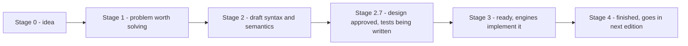
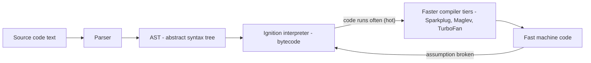

# Chapter 1 — Introduction and Setup

JavaScript is the language that makes web pages *do* things: open a menu when you click it, check a form before it is sent, update a chat without reloading the page. Today the same language also runs web servers, command-line tools, desktop apps and mobile apps. This chapter explains what JavaScript actually is, who defines it, what software runs it, and how to run your own first programs — in a browser and in Node.js. It finishes with two small but important habits: writing good comments and switching on strict mode.

No previous programming experience is assumed. All you need is a computer, a modern browser (Chrome, Firefox, Safari or Edge) and, for the Node.js examples, Node installed (§1.5). The goal of the whole book is that by the end you can read and write real-world JavaScript with confidence and are ready for frameworks such as React.

**What you'll learn**

1. What JavaScript is, where it came from, and why it is worth learning.
2. The difference between *JavaScript* and *ECMAScript*, and how TC39 adds features every year.
3. What a JavaScript *engine* is (V8, SpiderMonkey, JavaScriptCore) and how it turns text into running code.
4. The idea of a *host* (browser vs Node.js) and why `document` exists in one but not the other.
5. Four ways to run code: browser console, `<script>` tag, the `node` command and the Node REPL.
6. Your first program (`console.log`), statements, semicolons and the basic rules of the syntax.
7. Comments: single-line, multi-line, JSDoc, and when (not) to write them.
8. Strict mode: what `"use strict"` changes and why modern code is strict by default.

All runnable code is in [`code/`](code/). Every "Output:" block was produced by running the file with Node 24.

---

## 1.1 What JavaScript is

### What it is
**JavaScript (JS)** is a high-level, general-purpose programming language. *High-level* means you write instructions in terms of ideas (numbers, text, lists, functions) rather than in terms of the computer's memory and processor; the language takes care of those details for you, including freeing memory you no longer use (**garbage collection**).

A few more words you will meet constantly:

| Term | Meaning for JavaScript |
|---|---|
| **Interpreted / JIT-compiled** | You do not run a separate compile step. You hand the source text to an engine, which compiles it on the fly ("just in time") while running it (§1.3). |
| **Dynamically typed** | Variables do not have fixed types. The *value* has a type; the same variable can hold a number now and text later ([Chapter 2](../02-variables-types-and-operators/README.md)). |
| **Multi-paradigm** | You can write in an imperative style (step-by-step), an object-oriented style (objects and classes — [Chapter 9](../09-this-prototypes-and-classes/README.md)) or a functional style (functions passed around as values — [Chapter 4](../04-functions-scope-and-closures/README.md)). |
| **Single-threaded with an event loop** | Your code runs one piece at a time on one thread; slow work (network, timers, files) is handed off and its result comes back later as an event ([Chapter 12](../12-asynchronous-javascript/README.md)). |

Analogy: if a web page were a house, **HTML** is the structure (walls, rooms), **CSS** is the decoration (paint, furniture layout), and **JavaScript** is the electricity and plumbing — the part that makes things *work* when someone flips a switch.

### A short history
| Year | Event |
|---|---|
| 1995 | Brendan Eich writes the first version at Netscape in about ten days. It is called Mocha, then LiveScript, and finally renamed **JavaScript** as a marketing tie-in with Java, which was fashionable then. The two languages are otherwise unrelated. |
| 1996–97 | Netscape hands the language to **Ecma International** for standardisation (November 1996). The first edition of the standard, called **ECMAScript** (document ECMA-262), is published in June 1997. |
| 1999 | ES3 — the version that most of the early web was written in. |
| 2008 | ES4, a very ambitious redesign, is abandoned. Google releases Chrome with the fast **V8** engine. |
| 2009 | ES5 adds strict mode, JSON and array methods like `map`. Ryan Dahl releases **Node.js**, which runs V8 outside the browser. |
| 2015 | **ES2015 (ES6)** — the biggest update ever: `let`/`const`, arrow functions, classes, modules, promises, template literals. |
| 2016 → now | A new edition every June, named by year (ES2016, ES2017, …). This book targets **ES2025**. |

### Why it matters — reasons to learn JavaScript
- **It is everywhere.** It is the only programming language that every web browser runs natively. If you build for the web, you use JavaScript (directly, or through something that compiles to it, like TypeScript).
- **One language, many platforms.** Browser front ends; back ends with **Node.js**; mobile apps with **React Native**; desktop apps with **Electron** (VS Code, Slack and Discord desktop are Electron apps); serverless functions at the "edge" (Cloudflare Workers).
- **Huge ecosystem.** npm, the JavaScript package registry, is the largest software registry in the world, so most problems already have a library ([Chapter 10](../10-modules-and-tooling/README.md)).
- **Jobs.** Front-end, back-end and full-stack roles all ask for it; it has topped the Stack Overflow developer survey's "most used language" list for over a decade.
- **Gentle start.** You can run your first line of code in a browser tab with nothing installed. The language has sharp corners (you will meet them — coercion in Chapter 2, `this` in Chapter 9), but the basics are approachable, which makes it a common first language.

### Common mistakes
- **"JavaScript is Java for the web."** No — different design, different syntax details, different runtime. The name is a historical marketing accident.
- **"JavaScript only runs in browsers."** It runs anywhere there is an engine; Node.js is the most common non-browser host.
- **Treating "JavaScript" and "the browser" as the same thing.** `document.getElementById` is *not* part of the language — it belongs to the browser (§1.4). This distinction explains many "why doesn't this work in Node?" questions.

### TL;DR
JavaScript is a high-level, dynamically typed, garbage-collected, multi-paradigm language, standardised as ECMAScript, that runs in every browser and — through Node.js and friends — almost everywhere else.

---

## 1.2 ECMAScript and TC39

### What it is
**ECMAScript (ES)** is the official specification of the language: a long document (ECMA-262) that says exactly what every piece of syntax means and how every built-in (`Math`, `Array`, `Promise` …) behaves. **JavaScript** is the everyday name for implementations of that spec. ("JavaScript" is technically a trademark owned by Oracle, which is one reason the standard uses a different name.)

Analogy: ECMAScript is the rule book of chess; Chrome, Firefox and Node.js are chess sets made by different companies. The rule book guarantees a knight moves the same way on every set.

**TC39** (Technical Committee 39 of Ecma International) is the group that maintains the spec. Its members are browser makers, companies that use JavaScript heavily, and invited experts. Anyone can follow its work on GitHub (github.com/tc39).

### How it works — how a feature gets into the language
New features go through a public **proposal process** with numbered stages:



1. A **champion** (a TC39 member) presents an idea and a problem statement.
2. The committee agrees the problem is worth solving (Stage 1) and works on a draft (Stage 2).
3. Stage 2.7 (added in 2024) means the design is approved and conformance tests are being written.
4. At Stage 3, browsers and Node ship it, often behind a flag first, and real-world feedback arrives.
5. When there are two compatible shipping implementations and full tests, it reaches Stage 4 and is included in the next yearly edition (published each June).

### Why it matters
- **Version names.** "ES6" and "ES2015" are the same thing. After 2015, people mostly use the year: "ES2020 added `??` and `?.`".
- **Compatibility.** Features can be used in browsers before the yearly edition is published (Stage 3/4). Whether *your users'* browsers support a feature is a separate question; sites like MDN's compatibility tables and caniuse.com answer it, and tools can translate new syntax into older syntax ([Chapter 10](../10-modules-and-tooling/README.md)).
- **The web never breaks.** TC39 follows the rule "don't break the web": old code must keep working. That is why odd old behaviours (like `typeof null === "object"`, Chapter 2) can never be fixed — they are fixed around instead (e.g. strict mode, `===`, `let`).

### Editions you will hear about

| Edition | Headline features (a selection) |
|---|---|
| ES5 (2009) | strict mode, `JSON`, `Array.prototype.forEach/map/filter`, `Object.defineProperty` |
| ES2015 / ES6 | `let`/`const`, arrow functions, classes, modules, promises, template literals, destructuring, `Map`/`Set`, `for…of` |
| ES2017 | `async`/`await` |
| ES2020 | `??`, `?.`, `BigInt`, `globalThis`, `Promise.allSettled` |
| ES2022 | class fields and `#private`, top-level `await`, `.at()`, `Error` `cause` |
| ES2023 | `toSorted`, `toReversed`, `with`, `findLast` |
| ES2024 | `Object.groupBy`, `Map.groupBy`, `Promise.withResolvers` |
| ES2025 | iterator helpers (`.map/.filter` on iterators), new `Set` methods (`union`, `intersection` …), `Promise.try`, `RegExp.escape`, JSON modules/import attributes, `Float16Array` |
| ES2026 | `Array.fromAsync`, `Error.isError`, `Math.sumPrecise`, `Uint8Array` base64/hex, `Map.prototype.getOrInsert` (upsert), `Iterator.concat`, `JSON.parse` source text access — only some are in Node 24 |
| ES2027 (next) | **Temporal** (modern dates), `using` declarations (explicit resource management), `Atomics.pause`, `Iterator.zip` — finished proposals waiting for the June 2027 edition |

Each feature is taught in its own chapter; this table is only a map.

### In the interview
**30-second answer — "What's the difference between JavaScript and ECMAScript?"** ECMAScript is the standard (ECMA-262) maintained by TC39; JavaScript is the language as implemented by engines such as V8 and SpiderMonkey, plus, in practice, the host APIs around it. Since 2015 a new edition ships every year through a staged proposal process; Stage 4 features go into the next edition.

- *Follow-up: Is `document` part of JavaScript?* No. It is a browser (DOM) API provided by the host; ECMAScript does not define it.
- *Follow-up: What does Stage 3 mean?* The design is complete and engines are implementing it; changes after this point are rare and usually driven by implementation feedback.

### TL;DR
ECMAScript is the spec, JavaScript is its implementations. TC39 moves proposals through Stages 0–4, and a new edition (ES2016, ES2017 …) is published every June.

---

## 1.3 JavaScript engines — how your code actually runs

### What it is
A **JavaScript engine** is the program that reads JavaScript source code and executes it. The main ones:

| Engine | Made by | Used in |
|---|---|---|
| **V8** | Google | Chrome, Edge, Opera, Brave, **Node.js**, Deno |
| **SpiderMonkey** | Mozilla | Firefox (the first JS engine ever, descended from Eich's original) |
| **JavaScriptCore** (JSC) | Apple | Safari, most iOS browsers (Apple long required it; EU rules now allow others), **Bun** |

### How it works — from text to execution (V8 as the example)


1. **Parse.** The engine reads the text and checks the grammar. A grammar error (e.g. a missing `)`) is a `SyntaxError`, reported *before any line of that script runs*.
2. **Build an AST.** The code becomes a tree data structure — the **abstract syntax tree** — that represents its meaning.
3. **Interpret bytecode.** V8's **Ignition** turns the tree into compact **bytecode** and starts running it immediately, so start-up is fast.
4. **Profile and optimise.** While running, the engine counts which functions are "hot" (called a lot) and what kinds of values they see. Hot code is recompiled into machine code by faster tiers: **Sparkplug** (a quick, non-optimising baseline compiler), then **Maglev** and **TurboFan** (optimising compilers). The optimising tiers build on assumptions such as "this variable always holds a small integer".
5. **Deoptimise when needed.** If an assumption breaks (suddenly a string arrives), the engine throws away the optimised code and falls back to bytecode. Results stay correct; only speed changes.
6. Meanwhile a **garbage collector** frees memory that nothing references any more.

This whole approach is called **just-in-time (JIT) compilation**. Other engines use the same general idea with different names for their tiers.

### Why it matters
- You never compile JavaScript yourself; you ship source code (usually minified) and the engine does the rest.
- **Syntax errors stop the whole file**; runtime errors stop at the line where they happen ([Chapter 11](../11-errors-and-debugging/README.md)).
- Writing code whose values keep consistent types (a function that always receives numbers) helps the optimiser. You rarely need to think about this as a beginner; clarity comes first.

### Engine vs runtime
An engine alone can only run the core language: variables, functions, `Math`, `Array`, `JSON`, promises. It cannot draw on a screen, read a file or talk to the network. The program that *embeds* an engine and adds those abilities is the **host** or **runtime** — the next section.

One more runtime piece belongs to the host, not the engine: the **event loop**, the mechanism that runs your callbacks when a timer fires or data arrives. It is the reason JavaScript can do many things "at once" on one thread; it gets its own chapter ([Chapter 12](../12-asynchronous-javascript/README.md)).

### Self-check
1. Which engine does Node.js use? → V8.
2. When is a `SyntaxError` reported? → While parsing, before any code in that script runs.
3. What does "deoptimisation" mean? → The engine discards optimised machine code because an assumption it made (e.g. about value types) turned out false, and continues in slower bytecode.

### TL;DR
An engine (V8, SpiderMonkey, JavaScriptCore) parses your code into an AST, runs it as bytecode and JIT-compiles hot parts to machine code. Everything beyond the core language comes from the host.

---

## 1.4 Where JavaScript runs — hosts

### What it is
A **host environment** (or **runtime**) is a program that embeds a JS engine and gives your code extra objects and functions — **host APIs** — for talking to the outside world.

| Host | Engine | Adds (examples) | Typical use |
|---|---|---|---|
| **Web browser** | V8 / SpiderMonkey / JSC | `window`, `document` (the **DOM**), `fetch`, `localStorage`, events, `setTimeout` | Interactive web pages ([Ch. 13](../13-dom-and-events/README.md), [Ch. 14](../14-browser-apis-and-security/README.md)) |
| **Node.js** | V8 | `process`, `fs` (files), `http` (servers), `path`, `Buffer`, plus `fetch` and `setTimeout` | Servers, CLIs, build tools ([Ch. 15](../15-nodejs-basics/README.md)) |
| **Deno** | V8 | Web-style APIs, built-in TypeScript, permission system | Servers and scripts |
| **Bun** | JavaScriptCore | Node-compatible APIs, bundler, test runner | Servers, tooling |
| Others | various | React Native (mobile), Electron (desktop = Chromium + Node), Cloudflare Workers (edge) | Apps and edge functions |

The **language** is the same everywhere. What changes is the set of host objects. The global object also has different names — `window` in browsers, `global` in Node — so ES2020 added **`globalThis`**, which works in all of them.

### Example — asking "where am I?"
```js
// code/04_where_am_i.js
console.log("typeof globalThis :", typeof globalThis);  // standard name for the global object everywhere
console.log("typeof window     :", typeof window);      // only in browsers
console.log("typeof document   :", typeof document);    // only in browsers (the DOM)
console.log("typeof process    :", typeof process);     // only in Node.js
console.log("Node version      :", process.version.split(".")[0] + ".x");
console.log("V8 is the engine  :", typeof process.versions.v8 === "string");
console.log("Math.max(3, 7)    :", Math.max(3, 7));     // ECMAScript built-in
console.log("typeof setTimeout :", typeof setTimeout);  // host API (browser and Node both have it)
console.log("typeof fetch      :", typeof fetch);       // web API, also built into Node 18+
```

Output (Node 24):
```
typeof globalThis : object
typeof window     : undefined
typeof document   : undefined
typeof process    : object
Node version      : v24.x
V8 is the engine  : true
Math.max(3, 7)    : 7
typeof setTimeout : function
typeof fetch      : function
```

`typeof` (explained in Chapter 2) is safe to use on a name that doesn't exist — it returns `"undefined"` instead of throwing — which makes it the classic way to feature-detect.

### Client-side vs server-side
- **Client-side JavaScript** runs in the user's browser. It reacts to clicks and typing and updates the page *without reloading it*, which is what makes modern web apps feel responsive.
- **Server-side JavaScript** runs on a server (usually Node.js). It handles requests, talks to databases and sends responses. Using JS on both sides means a team can build the whole application — front end and back end — in one language and even share code (for example, validation rules).

### Common mistakes
- Calling `document.querySelector` in a Node script → `ReferenceError: document is not defined`. It's a browser API. (For testing, libraries like jsdom emulate the DOM in Node — this book uses it in Chapter 13.)
- Using `require` in browser code or `window` in Node code. Check which host you are in.

### TL;DR
Engine = runs the language; host = engine + APIs. Browsers give you the DOM, Node gives you files, processes and servers; `globalThis` is the portable name for the global object.

---

## 1.5 Setting up and running code

There are four everyday ways to run JavaScript. You will use all of them.

### 1. The browser console (zero install)
1. Open any web page (even a blank tab, `about:blank`).
2. Open **DevTools**: `F12`, or `Ctrl+Shift+J` (Windows/Linux) / `Cmd+Option+J` (Mac) in Chrome and Edge; `Ctrl+Shift+K` / `Cmd+Option+K` in Firefox; in Safari first enable *Settings → Advanced → Show features for web developers*, then `Cmd+Option+C`.
3. Click the **Console** tab, type `2 + 3` and press Enter. The console is a **REPL** (**R**ead a line, **E**valuate it, **P**rint the result, **L**oop), so it prints `5`.

Good for quick experiments and for inspecting a live page. Code you type there is lost when you close the tab.

### 2. A `<script>` tag in an HTML page
A web page loads JavaScript with the `<script>` element — either inline code or a separate file via `src`:

```html
<!-- code/hello.html (key parts) -->
<head>
  <meta charset="utf-8">
  <title>Hello from JavaScript</title>
  <!-- defer: download now, run after the HTML is parsed, so the #out element exists -->
  <script src="hello.js" defer></script>
</head>
<body>
  <h1>My first page with JavaScript</h1>
  <p>The box below is empty in the HTML file. The script fills it in:</p>
  <div id="out"></div>
  <script>
    // An inline script runs as soon as the parser reaches it.
    console.log("inline script ran");   // visible in DevTools > Console
  </script>
</body>
```

```js
// code/hello.js — a browser script (uses the DOM, so it can't run in Node)
const out = document.getElementById("out");
const now = new Date(2026, 0, 15, 9, 30); // fixed date so the screenshot is reproducible
out.innerHTML =
  "<strong>Hello, World!</strong> This text was written by <code>hello.js</code>.<br>" +
  "2 + 3 = " + (2 + 3) + " &middot; page built at " + now.toLocaleTimeString("en-US");
console.log("hello.js ran");
```

Opening `hello.html` in a browser gives:


*Figure — `hello.html` rendered in headless Chrome. The yellow box was empty in the HTML; the script wrote its contents.*

In the Console you would see `inline script ran` first and `hello.js ran` second: the inline script runs as soon as the parser reaches it, while the deferred script waits until the whole document has been parsed.

How a `<script>` is loaded matters, because a plain script **pauses HTML parsing** while it downloads and runs:

| Form | Downloads | Runs | Order kept? | Use for |
|---|---|---|---|---|
| `<script src>` (in `<head>`) | blocks parsing | immediately | yes | rarely — it delays the page |
| `<script src>` at end of `<body>` | when reached | immediately | yes | the classic old fix |
| `<script src defer>` | in parallel | after HTML is parsed | **yes** | most page scripts |
| `<script src async>` | in parallel | as soon as downloaded | **no** | independent scripts (analytics) |
| `<script type="module" src>` | in parallel | after parsing (deferred by default) | yes | modern code using `import` ([Ch. 10](../10-modules-and-tooling/README.md)) |

### 3. Node.js from the terminal
1. Install Node.js from nodejs.org — pick the **LTS** (long-term support) version. Even-numbered Node majors become LTS; this book uses Node 24 (LTS since October 2025).
2. Check it: `node --version` → `v24.x.x`.
3. Save code in a file, e.g. `hello.js`, and run `node hello.js`. Output appears in the terminal.

### 4. The Node REPL
Type `node` with no file name. You get a `>` prompt that evaluates each line, just like the browser console. `.help` lists commands, `.exit` (or `Ctrl+D`) quits. The special variable `_` holds the last result.

```
$ node
> 2 + 3
5
> _ * 10
50
> .exit
```

### An editor
For anything longer than a few lines, use a code editor. **Visual Studio Code** (free) is the most common choice for JavaScript: syntax highlighting, error squiggles, an integrated terminal (so you can run `node file.js` in the same window) and a debugger ([Chapter 11](../11-errors-and-debugging/README.md)). Online playgrounds (CodePen, JSFiddle, StackBlitz) are handy for sharing small experiments.

### Common mistakes
- Putting a plain `<script src>` in `<head>` that touches page elements → `null` errors, because the elements don't exist yet. Use `defer`.
- Opening the HTML file and looking for `console.log` output *on the page*. It goes to the DevTools Console, not the page.
- Mixing up the Node REPL (`>` prompt) and the system shell (`$` prompt): `node hello.js` must be typed in the shell, not inside the REPL.

### TL;DR
Console and REPL for quick experiments; `<script defer>` (or `type="module"`) to run code in a page; `node file.js` to run code outside the browser; VS Code to edit.

---

## 1.6 Hello, World! — your first program and the basic rules

### What it is
The tradition when learning a language is to make the computer print "Hello, World!". In JavaScript that is one line:

```js
// code/01_hello_world.js — run with:  node 01_hello_world.js
console.log("Hello, World!");          // double quotes
console.log('Hello, JavaScript!');     // single quotes work the same way
console.log(`2 + 3 = ${2 + 3}`);       // backticks = template literal, can embed expressions
console.log("Many", "values", 42, true); // console.log accepts several arguments, separated by spaces
```

Output:
```
Hello, World!
Hello, JavaScript!
2 + 3 = 5
Many values 42 true
```

What each part does:
- **`console`** is an object provided by the host (browser or Node) for writing diagnostic messages.
- **`.log(...)`** is a *method* (a function belonging to an object) that prints its arguments. In the browser the message goes to the DevTools Console; in Node it goes to the terminal (standard output).
- **`"Hello, World!"`** is a **string** — a piece of text. Text can be written between double quotes `"…"` or single quotes `'…'` — they behave identically; pick one style and stay consistent. **Backticks** `` `…` `` create *template literals*, which can embed any expression inside `${ }` ([Chapter 6](../06-strings-and-regular-expressions/README.md)).
- The line ends with a **semicolon** `;`, which ends the statement.

`console.log` is how you will look at values throughout this book, and it remains a first-line debugging tool for professionals. Its siblings — `console.error`, `console.warn`, `console.table`, `console.time` — are covered in [Chapter 11](../11-errors-and-debugging/README.md).

**Try it yourself:** change the message to `"Hello, <your name>!"` and run the file again.

### The basic rules of the syntax
| Rule | Detail |
|---|---|
| **Statements** | A program is a list of statements run top to bottom. A statement does something (`console.log(...)`, `let x = 5`). |
| **Expressions** | Anything that produces a value: `2 + 3`, `"hi"`, `x > 1`, `max(a, b)`. Expressions can appear inside statements. |
| **Case-sensitive** | `console`, `Console` and `CONSOLE` are different names; only the first exists. |
| **Identifiers** | Names of variables and functions: letters, digits, `_` and `$`, not starting with a digit. `userName`, `_count`, `$el` are fine; `2fast` is not. Reserved words (`let`, `class`, `return` …) can't be used as names. Convention: **camelCase**. |
| **Blocks** | Curly braces `{ … }` group statements (after `if`, `for`, function bodies). |
| **Whitespace** | Spaces, tabs and newlines between tokens are mostly ignored, so format for readability (a formatter like Prettier does it for you — [Chapter 10](../10-modules-and-tooling/README.md)). |

### Semicolons and ASI
Semicolons end statements, but JavaScript has **Automatic Semicolon Insertion (ASI)**: if a line break appears where the grammar can't continue, the parser pretends a semicolon is there. So code without semicolons usually works. Two situations where it doesn't do what you expect:

```js
function f() {
  return          // ASI inserts ";" right here, because a newline follows "return"
    { ok: true }; // never reached — f() returns undefined
}

const a = 1
const b = a
[1, 2].forEach(n => console.log(n)) // parsed as  a[1, 2].forEach(...)  -> TypeError
```

Rules of thumb: always put the returned value on the same line as `return`; if you skip semicolons, start any line that begins with `(`, `[` or `` ` `` with a `;`. Most teams either always use semicolons or use a formatter that handles this — this book always uses them.

### Self-check
1. Where does `console.log` output appear in a browser? → In the DevTools Console, not on the page.
2. Are `'hi'` and `"hi"` different? → No, both are the same string.
3. Why does `return` followed by a newline and then a value return `undefined`? → ASI inserts a semicolon after `return`.

### TL;DR
`console.log(value)` prints values; strings use `'…'`, `"…"` or `` `…` ``; code is case-sensitive; end statements with `;` and never break a line straight after `return`.

---

## 1.7 Comments

### What it is
A **comment** is text in your source file that the engine ignores completely. It exists only for human readers — your teammates, and you six months from now. Comments have no effect on what the program does or how fast it runs.

Two kinds of comments are part of the language, plus one widely used convention:

| Kind | Syntax | Ends at | Typical use |
|---|---|---|---|
| **Single-line** | `// text` | end of the line | Short notes; switching off one line |
| **Multi-line (block)** | `/* text */` | the closing `*/` (may span many lines) | Longer explanations; switching off several lines |
| **JSDoc** (a convention built on block comments) | `/** … */` with tags like `@param`, `@returns` | `*/` | Documenting functions; editors show it as hover help and can type-check with it ([Chapter 16](../16-testing-and-typescript/README.md)) |

### Example
```js
// code/02_comments.js
// A single-line comment runs from // to the end of the line.
console.log("Line 1 runs");   // a comment can also follow code on the same line
// console.log("Line 2 is switched off, so nothing prints for it");

/*
  A multi-line (block) comment can span many lines.
  Handy for a longer explanation, or to switch off a whole block:
console.log("switched off too");
console.log("and this");
*/
console.log("Line 3 runs");

/**
 * A JSDoc comment: starts with slash-star-star. Editors and tools read the tags.
 * @param {number} celsius - temperature in degrees Celsius
 * @returns {number} the same temperature in Fahrenheit
 */
function toFahrenheit(celsius) {
  // Why, not what: 9/5 and 32 come from the Fahrenheit scale definition.
  return celsius * 9 / 5 + 32;
}
console.log("100 C =", toFahrenheit(100), "F");

const total = 10 /* inline block comments are legal too */ + 5;
console.log("total =", total);
```

Output:
```
Line 1 runs
Line 3 runs
100 C = 212 F
total = 15
```

Notice that the three `console.log` calls inside comments printed nothing. Turning code into a comment ("**commenting out**") is a quick way to disable it temporarily while debugging without deleting it. In VS Code, `Ctrl+/` (`Cmd+/` on Mac) toggles `//` on the selected lines.

### Best practices
1. **Explain *why*, not *what*.** `i++ // add one to i` repeats the code. `// the API counts pages from 1, not 0` tells the reader something the code can't.
2. **Keep comments in sync.** When you change code, update or delete its comment. A wrong comment is worse than none.
3. **Don't over-comment.** Prefer clear names (`isLoggedIn`, `totalPrice`) and small functions so the code explains itself; add comments where intent, a trade-off or a gotcha isn't obvious.
4. **Delete commented-out code before committing.** Version control (git) remembers old code; dead blocks just clutter the file.
5. Use conventional markers sparingly: `// TODO:` for planned work, `// FIXME:` for known problems — many editors list them.

### Common mistakes
- **Nesting block comments.** `/* outer /* inner */ still outer? */` — the first `*/` ends the comment, so `still outer? */` becomes code and causes a `SyntaxError`. Use `//` on each line when commenting out code that already contains block comments.
- **Putting secrets or passwords in comments.** Browser JavaScript is downloaded by every visitor; anyone can read it, comments included (unless a build step strips them).
- **HTML comments inside JS.** `<!-- -->` is HTML syntax. (For historical reasons it is still treated as a single-line comment in classic browser scripts, but never rely on that.)

### TL;DR
`//` for one line, `/* … */` for many, `/** … */` for JSDoc. Comments are ignored by the engine; write them to explain intent, keep them current, and prefer self-explanatory code.

---

## 1.8 Strict mode

### What it is
**Strict mode** is an opt-in, stricter variant of JavaScript introduced in ES5 (2009). It turns several silent mistakes into errors and removes a few confusing features. You switch it on with the **directive** `"use strict";` as the very first statement of a script or of a function. Code without it runs in what is informally called **sloppy mode**.

Crucially, **modern code is usually strict automatically**:
- every **ES module** (files loaded with `import`/`export`, `<script type="module">`, `.mjs` files in Node) is strict;
- every **class** body is strict.

So if you write modern modular code you are already in strict mode, and the directive is only needed in classic scripts.

### The problem it solves
Early JavaScript tried hard never to complain: a misspelt variable silently created a new global, writing to a read-only property silently did nothing. That made bugs hard to find. Because the web can't be broken (§1.2), these behaviours couldn't simply be changed — so strict mode was added as an opt-in "fixed" version.

### Example — sloppy vs strict
```js
// code/03_strict_mode.js — a classic CommonJS script, so it starts in sloppy mode
function sloppyTypo() {
  countr = 1;               // typo: meant "counter". Sloppy mode silently creates a global!
  return typeof globalThis.countr;
}
console.log("sloppy: accidental global created ->", sloppyTypo());

function strictTypo() {
  "use strict";
  try {
    countr2 = 1;            // strict mode refuses to invent a global
  } catch (e) {
    return `${e.name}: ${e.message}`;
  }
}
console.log("strict:", strictTypo());

function sloppyThis() { return this === globalThis; }
function strictThis() { "use strict"; return this; }
console.log("plain call, sloppy this is globalThis ->", sloppyThis());
console.log("plain call, strict this ->", strictThis());
// ... (frozen-object and duplicate-parameter checks, see the file)
```

Output:
```
sloppy: accidental global created -> number
strict: ReferenceError: countr2 is not defined
plain call, sloppy this is globalThis -> true
plain call, strict this -> undefined
write to frozen object: sloppy keeps 1 | strict throws TypeError
duplicate params in strict code -> SyntaxError
```

(`try`/`catch` catches an error so the program can continue and print it — see [Chapter 11](../11-errors-and-debugging/README.md). `this` is explained in [Chapter 9](../09-this-prototypes-and-classes/README.md).)

### What strict mode changes

| Situation | Sloppy mode | Strict mode |
|---|---|---|
| Assigning to an undeclared variable (`x = 1`) | creates a global variable | `ReferenceError` |
| `this` in a plain function call `f()` | the global object | `undefined` |
| Writing to a read-only or frozen property, adding to a non-extensible object | silently ignored | `TypeError` |
| Deleting a non-deletable property (`delete Object.prototype`) | returns `false` | `TypeError` |
| Duplicate parameter names `function f(a, a)` | allowed | `SyntaxError` |
| Legacy octal literal `010` | means 8 | `SyntaxError` (use `0o10`) |
| `with` statement | allowed | `SyntaxError` |
| `eval("var x = 1")` | leaks `x` into the surrounding scope | `x` stays inside the eval |
| `arguments` object | stays linked to the parameters | an independent copy ([Chapter 4](../04-functions-scope-and-closures/README.md)) |
| Future reserved words (`implements`, `interface`, `package`, `private`, `protected`, `public`, `static`, `yield`, `let`) as names | allowed | `SyntaxError` |

### How to use it
1. **Modules** (`.mjs`, `"type": "module"`, `<script type="module">`): nothing to do — already strict.
2. **Classic scripts**: put `"use strict";` as the first statement of the file (only comments may come before it). It applies to the whole script.
3. **One function only**: put it as the first statement of the function body.

### Common mistakes
- **Placing the directive after other code.** It must be the first statement; otherwise it is just an unused string and does nothing.
- **Concatenating files.** If a strict file is glued before a sloppy one in a single classic script, the directive at the top now applies to both (or vice versa). Bundlers handle this; hand-concatenation doesn't.
- **Adding `"use strict"` to a function with default, rest or destructured parameters** — that is itself a `SyntaxError`. Put the directive at the file level instead.
- **Assuming Node `.js` files are strict.** A `.js` file in Node is a CommonJS script (sloppy) unless `package.json` says `"type": "module"` or the file uses `import`/`export` syntax. The code in this book's early chapters uses plain `.js` files for that reason, and turns strictness on where it matters.

### In the interview
**30-second answer — "What is strict mode?"** An opt-in restricted variant of JavaScript enabled with `"use strict"` at the top of a script or function, and automatically on in ES modules and classes. It turns silent errors into thrown ones (undeclared assignments, writes to read-only properties), makes `this` `undefined` in plain function calls, and forbids error-prone syntax like `with`, duplicate parameters and legacy octals.

- *Follow-up: Do you still need to write `"use strict"`?* Not in ES modules or class bodies; only in classic scripts or CommonJS files.
- *Follow-up: Why not make strict mode the default everywhere?* Because it would break existing sites that rely on sloppy behaviour; the web must stay backward compatible.
- *Follow-up: Why does strict mode make `this` undefined?* So that a function accidentally called without an object can't silently read or modify the global object.

### Self-check
1. In a `.mjs` file, does `x = 5` (no declaration) work? → No; modules are strict, so it throws `ReferenceError`.
2. Where must `"use strict"` appear? → As the first statement of the script or function body.
3. What is `this` inside `function f() { "use strict"; return this; }` when called as `f()`? → `undefined`.

### TL;DR
Strict mode turns silent failures into errors and removes risky features. Modules and classes are strict automatically; in classic scripts, start with `"use strict";`.

---

## Chapter 1 TL;DR

- **JavaScript** is a high-level, dynamically typed, garbage-collected, multi-paradigm language; created in 1995, standardised as **ECMAScript**, maintained by **TC39**, updated every June (this book: ES2025).
- An **engine** (V8, SpiderMonkey, JavaScriptCore) parses code into an AST, runs bytecode and JIT-compiles hot code. A **host** (browser, Node.js, Deno, Bun) wraps the engine and adds APIs like the DOM or the file system; `globalThis` is the global object everywhere.
- Run code in the **browser console**, in a page with **`<script defer>`** (or `type="module"`), with **`node file.js`**, or in the **Node REPL**.
- `console.log` prints; strings take `'`, `"` or `` ` ``; code is case-sensitive; use semicolons and never break a line after `return`.
- Comments: `//`, `/* */`, `/** JSDoc */` — explain *why*, keep them current.
- **Strict mode** (`"use strict"`, automatic in modules and classes) turns silent mistakes into errors.

Next: [Chapter 2 — Variables, Types and Operators](../02-variables-types-and-operators/README.md).
