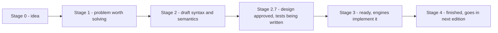
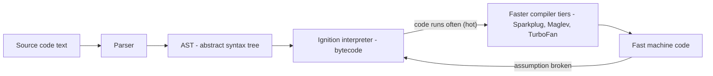
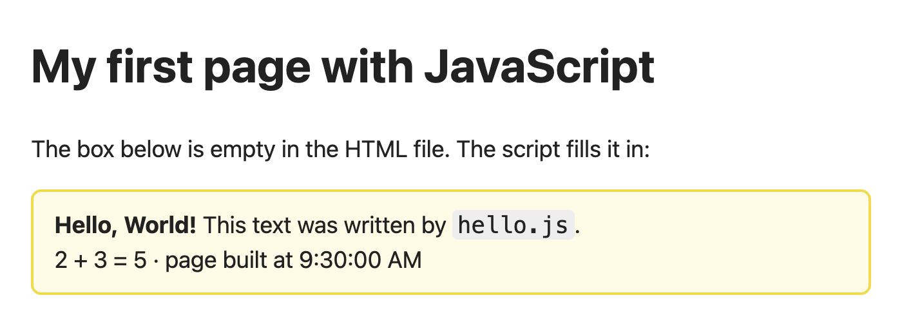

# Chapter 1 — Introduction and Setup

JavaScript makes web pages *do* things (open a menu, validate a form, update a chat without reloading) and today also runs web servers, command-line tools, desktop and mobile apps. This chapter covers what JavaScript is, who defines it, what runs it, how to run your first programs (browser and Node.js), comments and strict mode.

No programming experience is assumed — you need a modern browser and, for Node examples, Node installed (§1.5). The book's goal: read and write real-world JavaScript and be ready for frameworks such as React (a **framework** is a ready-made structure of code your app plugs into).

**What you'll learn:** what JS is and why learn it; JavaScript vs ECMAScript and TC39; engines (V8, SpiderMonkey, JavaScriptCore); hosts (browser vs Node); four ways to run code; `console.log`, statements and semicolons; comments; strict mode.

All runnable code is in [`code/`](code/). Every "Output:" block was produced with Node 24.

---

## 1.1 What JavaScript is

### What it is
**JavaScript (JS)** is a high-level, general-purpose language. *High-level*: you write in terms of numbers, text, lists and functions, not memory and processor; the language even frees unused memory for you (**garbage collection**). (A **variable** is a name holding a value; **compiling** translates source code into a lower-level form the machine runs.)

| Term | Meaning for JavaScript |
|---|---|
| **Interpreted / JIT-compiled** | No separate compile step: the engine compiles the source on the fly ("just in time") while running it (§1.3). |
| **Dynamically typed** | The *value* has a type, not the variable; one variable can hold a number now and text later ([Chapter 2](../02-variables-types-and-operators/README.md)). |
| **Multi-paradigm** | Imperative, object-oriented ([Chapter 9](../09-this-prototypes-and-classes/README.md)) or functional style ([Chapter 4](../04-functions-scope-and-closures/README.md)). |
| **Single-threaded with an event loop** | Code runs one piece at a time on one thread (one sequence of instructions); slow work (network, timers, files) is handed off and its result returns later as an event ([Chapter 12](../12-asynchronous-javascript/README.md)). |

On a web page, **HTML** is the structure, **CSS** the decoration, **JavaScript** the behaviour.

### A short history
| Year | Event |
|---|---|
| 1995 | Brendan Eich writes it at Netscape in about ten days: Mocha → LiveScript → **JavaScript** (a marketing tie-in with Java; the languages are otherwise unrelated). |
| 1996–97 | Handed to **Ecma International** (Nov 1996); first **ECMAScript** standard (ECMA-262) published June 1997. |
| 1999 | ES3 — the version most of the early web used. |
| 2008 | Ambitious ES4 abandoned. Google releases Chrome with the fast **V8** engine. |
| 2009 | ES5: strict mode, JSON (plain-text data format), array methods like `map`. Ryan Dahl releases **Node.js** (V8 outside the browser). |
| 2015 | **ES2015 (ES6)** — biggest update: `let`/`const`, arrow functions, classes, modules, promises, template literals. |
| 2016 → now | A new edition every June, named by year (ES2016, ES2017 …). This book targets **ES2025**. |

### Why it matters — reasons to learn JavaScript
- **Everywhere:** the only language every browser runs natively (directly, or via something that compiles to it, like TypeScript — JS plus type labels checked before running).
- **Many platforms:** front ends (what users see); back ends (server side) with **Node.js**; mobile with **React Native**; desktop with **Electron** (VS Code, Slack, Discord); **serverless** functions (provider runs your uploaded function on demand) at the **edge** (servers near users, e.g. Cloudflare Workers) ([System Design Fundamentals](../../../system-design-patterns/modules/00-system-design-fundamentals/README.md)).
- **Ecosystem:** npm, the largest software registry, hosts reusable **packages**; most problems already have a **library** (someone else's code you call) ([Chapter 10](../10-modules-and-tooling/README.md)).
- **Jobs:** front-end, back-end and full-stack roles; top of Stack Overflow's "most used language" for over a decade.
- **Gentle start:** runs in a browser tab with nothing installed. It has sharp corners — **coercion** (automatic type conversion, Chapter 2), `this` (Chapter 9) — but the basics are approachable.

### Common mistakes
- **"JavaScript is Java for the web."** Different language; the name is a marketing accident.
- **"JavaScript only runs in browsers."** It runs wherever there is an engine; Node.js is the most common non-browser host.
- **Language vs browser:** `document.getElementById` belongs to the browser, not the language (§1.4) — the root of many "why doesn't this work in Node?" questions.

### TL;DR
*(TL;DR = "too long; didn't read".)* JavaScript is a high-level, dynamically typed, garbage-collected, multi-paradigm language, standardised as ECMAScript, running in every browser and — via Node.js and friends — almost everywhere else.

---

## 1.2 ECMAScript and TC39

### What it is
**ECMAScript (ES)** is the official specification (ECMA-262): exactly what every piece of syntax means and how every built-in (`Math`, `Array`, `Promise` …) behaves. **JavaScript** is the everyday name for implementations of it ("JavaScript" is an Oracle trademark — one reason the standard has another name). The spec is the rule book; Chrome, Firefox and Node are different sets that must play by it.

**TC39** (Technical Committee 39 of Ecma International) maintains the spec: browser makers, heavy JS users and invited experts, working in public at github.com/tc39.

### How it works — how a feature gets into the language


- A **champion** (TC39 member) presents a problem; Stage 1 = worth solving, Stage 2 = draft.
- Stage 2.7 (added 2024): design approved, conformance tests (shared tests that check engines follow the spec) being written.
- Stage 3: engines ship it, often behind a flag first; real-world feedback arrives.
- Stage 4: two compatible shipping implementations plus full tests → included in the next June edition.

### Why it matters
- **Version names:** "ES6" = "ES2015"; after that, years ("ES2020 added `??` and `?.`").
- **Compatibility:** features ship before their edition is published; whether *your users'* browsers support one is answered by MDN compatibility tables / caniuse.com, and tools can translate new syntax to old ([Chapter 10](../10-modules-and-tooling/README.md)).
- **"Don't break the web":** old code must keep working, so quirks like `typeof null === "object"` are never fixed, only worked around (strict mode, `===`, `let`).

### Editions you will hear about

| Edition | Headline features (a selection) |
|---|---|
| ES5 (2009) | strict mode, `JSON`, `Array.prototype.forEach/map/filter`, `Object.defineProperty` |
| ES2015 / ES6 | `let`/`const`, arrow functions, classes, modules, promises, template literals, destructuring, `Map`/`Set`, `for…of` |
| ES2017 | `async`/`await` |
| ES2020 | `??`, `?.`, `BigInt`, `globalThis`, `Promise.allSettled` |
| ES2022 | class fields and `#private`, top-level `await`, `.at()`, `Error` `cause` |
| ES2023 | `toSorted`, `toReversed`, `with`, `findLast` |
| ES2024 | `Object.groupBy`, `Map.groupBy`, `Promise.withResolvers` |
| ES2025 | iterator helpers (`.map/.filter` on iterators), new `Set` methods (`union`, `intersection` …), `Promise.try`, `RegExp.escape`, JSON modules/import attributes, `Float16Array` |
| ES2026 | `Array.fromAsync`, `Error.isError`, `Math.sumPrecise`, `Uint8Array` base64/hex, `Map.prototype.getOrInsert` (upsert), `Iterator.concat`, `JSON.parse` source text access — only some are in Node 24 |
| ES2027 (next) | **Temporal** (modern dates), `using` declarations (explicit resource management), `Atomics.pause`, `Iterator.zip` — finished proposals waiting for the June 2027 edition |

Each feature is taught in its own chapter; this table is only a map.

### In the interview
**30-second answer — "What's the difference between JavaScript and ECMAScript?"** ECMAScript is the standard (ECMA-262) maintained by TC39; JavaScript is the language as implemented by engines such as V8 and SpiderMonkey, plus, in practice, the host APIs around it (an **API** is the set of functions and objects one piece of software offers other code). Since 2015 a new edition ships yearly via a staged proposal process; Stage 4 features go into the next edition.

- *Is `document` part of JavaScript?* No — it is the host's **DOM** (Document Object Model: the browser's tree of objects representing the page); ECMAScript doesn't define it.
- *What does Stage 3 mean?* Design complete, engines implementing; later changes are rare and driven by implementation feedback.

### TL;DR
ECMAScript is the spec, JavaScript its implementations; TC39 moves proposals through Stages 0–4; a new edition ships every June.

---

## 1.3 JavaScript engines — how your code actually runs

### What it is
A **JavaScript engine** reads JavaScript source and executes it.

| Engine | Made by | Used in |
|---|---|---|
| **V8** | Google | Chrome, Edge, Opera, Brave, **Node.js**, Deno |
| **SpiderMonkey** | Mozilla | Firefox (the first JS engine ever, descended from Eich's original) |
| **JavaScriptCore** (JSC) | Apple | Safari, most iOS browsers (Apple long required it; EU rules now allow others), **Bun** |

### How it works — from text to execution (V8 as the example)


1. **Parse** — check the grammar. A grammar error (missing `)`) is a `SyntaxError`, reported *before any line of that script runs*.
2. **AST** — the code becomes a tree (**abstract syntax tree**) representing its meaning.
3. **Interpret bytecode** — V8's **Ignition** interpreter turns the tree into compact **bytecode** (low-level instructions for the engine's own virtual machine) and runs it immediately, so start-up is fast.
4. **Profile and optimise** — the engine tracks "hot" functions and the value types they see; hot code is recompiled into machine code by **Sparkplug** (quick, non-optimising baseline), then **Maglev** and **TurboFan** (optimising, built on assumptions like "this variable is always a small integer").
5. **Deoptimise** — if an assumption breaks (a string arrives), optimised code is discarded and execution falls back to bytecode. Results stay correct; only speed changes.
6. A **garbage collector** frees memory nothing references any more.

This is **just-in-time (JIT) compilation**; other engines use the same idea with differently named tiers.

### Why it matters
- You ship source (usually **minified** — whitespace/comments removed, names shortened, behaviour unchanged); the engine does the rest.
- **Syntax errors stop the whole file**; runtime errors (e.g. calling a non-function) stop at the line where they happen ([Chapter 11](../11-errors-and-debugging/README.md)).
- Consistent value types help the optimiser — but clarity comes first.

### Engine vs runtime
An engine alone runs only the core language (variables, functions, `Math`, `Array`, `JSON`, promises) — no screen, files or network. The program that *embeds* an engine and adds those is the **host** or **runtime** (§1.4). The **event loop** — which runs your **callbacks** (functions handed over to be called later) when a timer fires or data arrives — also belongs to the host ([Chapter 12](../12-asynchronous-javascript/README.md)).

### Self-check
1. Engine in Node.js? → V8.
2. When is a `SyntaxError` reported? → While parsing, before any code in that script runs.
3. "Deoptimisation"? → Discarding optimised machine code because a type assumption proved false; execution continues in bytecode.

### TL;DR
An engine (V8, SpiderMonkey, JavaScriptCore) parses code into an AST, runs bytecode and JIT-compiles hot parts. Everything beyond the core language comes from the host.

---

## 1.4 Where JavaScript runs — hosts

### What it is
A **host environment** (**runtime**) embeds a JS engine and adds **host APIs** for the outside world.

| Host | Engine | Adds (examples) | Typical use |
|---|---|---|---|
| **Web browser** | V8 / SpiderMonkey / JSC | `window`, `document` (the **DOM**), `fetch`, `localStorage`, events, `setTimeout` | Interactive web pages ([Ch. 13](../13-dom-and-events/README.md), [Ch. 14](../14-browser-apis-and-security/README.md)) |
| **Node.js** | V8 | `process`, `fs` (files), `http` (servers), `path`, `Buffer`, plus `fetch` and `setTimeout` | Servers, CLIs (command-line programs), build tools ([Ch. 15](../15-nodejs-basics/README.md)) |
| **Deno** | V8 | Web-style APIs, built-in TypeScript, permission system | Servers and scripts |
| **Bun** | JavaScriptCore | Node-compatible APIs, bundler (combines many code files into a few), test runner | Servers, tooling |
| Others | various | React Native (mobile), Electron (desktop = Chromium + Node), Cloudflare Workers (edge) | Apps and edge functions |

The **language** is identical everywhere; only host objects differ. The **global object** (whose properties are global variables) is `window` in browsers and `global` in Node, so ES2020 added **`globalThis`**, which works everywhere.

### Example — asking "where am I?"
```js
// code/04_where_am_i.js
console.log("typeof globalThis :", typeof globalThis);  // standard name for the global object everywhere
console.log("typeof window     :", typeof window);      // only in browsers
console.log("typeof document   :", typeof document);    // only in browsers (the DOM)
console.log("typeof process    :", typeof process);     // only in Node.js
console.log("Node version      :", process.version.split(".")[0] + ".x");
console.log("V8 is the engine  :", typeof process.versions.v8 === "string");
console.log("Math.max(3, 7)    :", Math.max(3, 7));     // ECMAScript built-in
console.log("typeof setTimeout :", typeof setTimeout);  // host API (browser and Node both have it)
console.log("typeof fetch      :", typeof fetch);       // web API, also built into Node 18+
```

Output (Node 24):
```
typeof globalThis : object
typeof window     : undefined
typeof document   : undefined
typeof process    : object
Node version      : v24.x
V8 is the engine  : true
Math.max(3, 7)    : 7
typeof setTimeout : function
typeof fetch      : function
```

`typeof` on an undeclared name returns `"undefined"` instead of throwing — the classic way to **feature-detect** (check a feature exists before using it).

### Client-side vs server-side
- **Client-side** JS runs in the user's browser, reacting to input and updating the page *without reloading*.
- **Server-side** JS (usually Node.js) handles requests (usually HTTP), talks to databases and sends responses ([System Design Fundamentals](../../../system-design-patterns/modules/00-system-design-fundamentals/README.md)). One language on both sides lets a team share code (e.g. validation rules).

### Common mistakes
- `document.querySelector` in a Node script → `ReferenceError: document is not defined`. (jsdom emulates the DOM in Node for tests — used in Chapter 13.)
- `require` (Node's older file loading, [Chapter 10](../10-modules-and-tooling/README.md)) in browser code, or `window` in Node.

### TL;DR
Engine = runs the language; host = engine + APIs (DOM in browsers; files, processes, servers in Node). `globalThis` is the portable global object.

---

## 1.5 Setting up and running code

### 1. The browser console (zero install)
Open any page (even `about:blank`), open **DevTools**: `F12`, or `Ctrl+Shift+J` / `Cmd+Option+J` (Chrome, Edge); `Ctrl+Shift+K` / `Cmd+Option+K` (Firefox); Safari: enable *Settings → Advanced → Show features for web developers*, then `Cmd+Option+C`. In the **Console** tab type `2 + 3` → `5`. The console is a **REPL** (**R**ead, **E**valuate, **P**rint, **L**oop). Good for experiments and inspecting a live page; code is lost when the tab closes.

### 2. A `<script>` tag in an HTML page
A page loads JS with `<script>` — inline, or from a file via `src`:

```html
<!-- code/hello.html (key parts) -->
<head>
  <meta charset="utf-8">
  <title>Hello from JavaScript</title>
  <!-- defer: download now, run after the HTML is parsed, so the #out element exists -->
  <script src="hello.js" defer></script>
</head>
<body>
  <h1>My first page with JavaScript</h1>
  <p>The box below is empty in the HTML file. The script fills it in:</p>
  <div id="out"></div>
  <script>
    // An inline script runs as soon as the parser reaches it.
    console.log("inline script ran");   // visible in DevTools > Console
  </script>
</body>
```

```js
// code/hello.js — a browser script (uses the DOM, so it can't run in Node)
const out = document.getElementById("out");
const now = new Date(2026, 0, 15, 9, 30); // fixed date so the screenshot is reproducible
out.innerHTML =
  "<strong>Hello, World!</strong> This text was written by <code>hello.js</code>.<br>" +
  "2 + 3 = " + (2 + 3) + " &middot; page built at " + now.toLocaleTimeString("en-US");
console.log("hello.js ran");
```


*Figure — `hello.html` in headless Chrome. The box was empty in the HTML; the script wrote its contents.*

The Console shows `inline script ran` first, then `hello.js ran`: inline scripts run when the parser reaches them; deferred scripts wait until the document is parsed. A plain script **pauses HTML parsing** while it downloads and runs:

| Form | Downloads | Runs | Order kept? | Use for |
|---|---|---|---|---|
| `<script src>` (in `<head>`) | blocks parsing | immediately | yes | rarely — it delays the page |
| `<script src>` at end of `<body>` | when reached | immediately | yes | the classic old fix |
| `<script src defer>` | in parallel | after HTML is parsed | **yes** | most page scripts |
| `<script src async>` | in parallel | as soon as downloaded | **no** | independent scripts (analytics) |
| `<script type="module" src>` | in parallel | after parsing (deferred by default) | yes | modern code using `import` ([Ch. 10](../10-modules-and-tooling/README.md)) |

### 3. Node.js from the terminal
Install the **LTS** (long-term support) version from nodejs.org — even-numbered major versions (the first number, e.g. 24 in 24.1.0) become LTS; this book uses Node 24 (LTS since October 2025). `node --version` → `v24.x.x`; run a file with `node hello.js`.

### 4. The Node REPL
`node` with no file gives a `>` prompt. `.help` lists commands, `.exit` (or `Ctrl+D`) quits, `_` holds the last result.

```
$ node
> 2 + 3
5
> _ * 10
50
> .exit
```

### An editor
**Visual Studio Code** (free) is the common choice: highlighting, error squiggles, integrated terminal and a debugger ([Chapter 11](../11-errors-and-debugging/README.md)). CodePen, JSFiddle and StackBlitz are handy for sharing experiments.

### Common mistakes
- Plain `<script src>` in `<head>` touching page elements → `null` errors (elements don't exist yet). Use `defer`.
- Looking for `console.log` output *on the page* — it goes to the DevTools Console.
- Typing `node hello.js` inside the REPL (`>`) instead of the shell (`$`).

### TL;DR
Console/REPL for experiments; `<script defer>` (or `type="module"`) in pages; `node file.js` outside the browser; VS Code to edit.

---

## 1.6 Hello, World! — your first program and the basic rules

### What it is
```js
// code/01_hello_world.js — run with:  node 01_hello_world.js
console.log("Hello, World!");          // double quotes
console.log('Hello, JavaScript!');     // single quotes work the same way
console.log(`2 + 3 = ${2 + 3}`);       // backticks = template literal, can embed expressions
console.log("Many", "values", 42, true); // console.log accepts several arguments, separated by spaces
```

Output:
```
Hello, World!
Hello, JavaScript!
2 + 3 = 5
Many values 42 true
```

- **`console`** — a host-provided object (a bundle of named values and functions, [Chapter 5](../05-objects-math-date-and-json/README.md)) for diagnostic messages.
- **`.log(...)`** — a *method* (function on an object) printing its arguments: to the DevTools Console in browsers, to standard output (the terminal) in Node.
- **`"Hello, World!"`** — a **string** (text). `"…"` and `'…'` are identical; **backticks** create *template literals* that embed expressions in `${ }` ([Chapter 6](../06-strings-and-regular-expressions/README.md)).
- **`;`** ends the statement.

**Try it yourself:** change the message to `"Hello, <your name>!"` and rerun. `console.error`, `console.warn`, `console.table`, `console.time` are in [Chapter 11](../11-errors-and-debugging/README.md).

### The basic rules of the syntax
| Rule | Detail |
|---|---|
| **Statements** | A program is a list of statements run top to bottom (`console.log(...)`, `let x = 5`). |
| **Expressions** | Anything that produces a value: `2 + 3`, `"hi"`, `x > 1`, `max(a, b)`; they appear inside statements. |
| **Case-sensitive** | `console`, `Console`, `CONSOLE` are different names; only the first exists. |
| **Identifiers** | Letters, digits, `_`, `$`, not starting with a digit (`userName`, `_count`, `$el`; not `2fast`). Reserved words (`let`, `class`, `return` …) are not allowed. Convention: **camelCase** (`totalPrice`). |
| **Blocks** | `{ … }` groups statements (after `if`, `for`, function bodies). |
| **Whitespace** | Mostly ignored between **tokens** (smallest meaningful pieces); a formatter like Prettier handles layout ([Chapter 10](../10-modules-and-tooling/README.md)). |

### Semicolons and ASI
**Automatic Semicolon Insertion (ASI)**: where a line break appears and the grammar can't continue, the parser inserts a semicolon — so semicolon-free code usually works. Two traps:

```js
function f() {
  return          // ASI inserts ";" right here, because a newline follows "return"
    { ok: true }; // never reached — f() returns undefined
}

const a = 1
const b = a
[1, 2].forEach(n => console.log(n)) // parsed as  a[1, 2].forEach(...)  -> TypeError
```

Keep the returned value on the `return` line; if you skip semicolons, prefix lines starting with `(`, `[` or `` ` `` with `;`. This book always uses semicolons.

### Self-check
1. Where does `console.log` output appear in a browser? → DevTools Console, not the page.
2. `'hi'` vs `"hi"`? → Same string.
3. Why does `return` + newline + value return `undefined`? → ASI inserts a semicolon after `return`.

### TL;DR
`console.log(value)` prints; strings use `'…'`, `"…"` or `` `…` ``; code is case-sensitive; end statements with `;`, never break a line straight after `return`.

---

## 1.7 Comments

### What it is
A **comment** is source text the engine ignores entirely — it exists only for human readers and has no effect on behaviour or speed.

| Kind | Syntax | Ends at | Typical use |
|---|---|---|---|
| **Single-line** | `// text` | end of the line | Short notes; switching off one line |
| **Multi-line (block)** | `/* text */` | the closing `*/` (may span many lines) | Longer explanations; switching off several lines |
| **JSDoc** (a convention built on block comments) | `/** … */` with tags like `@param`, `@returns` | `*/` | Documenting functions; editors show it as hover help and can type-check with it ([Chapter 16](../16-testing-and-typescript/README.md)) |

### Example
```js
// code/02_comments.js
// A single-line comment runs from // to the end of the line.
console.log("Line 1 runs");   // a comment can also follow code on the same line
// console.log("Line 2 is switched off, so nothing prints for it");

/*
  A multi-line (block) comment can span many lines.
  Handy for a longer explanation, or to switch off a whole block:
console.log("switched off too");
console.log("and this");
*/
console.log("Line 3 runs");

/**
 * A JSDoc comment: starts with slash-star-star. Editors and tools read the tags.
 * @param {number} celsius - temperature in degrees Celsius
 * @returns {number} the same temperature in Fahrenheit
 */
function toFahrenheit(celsius) {
  // Why, not what: 9/5 and 32 come from the Fahrenheit scale definition.
  return celsius * 9 / 5 + 32;
}
console.log("100 C =", toFahrenheit(100), "F");

const total = 10 /* inline block comments are legal too */ + 5;
console.log("total =", total);
```

Output:
```
Line 1 runs
Line 3 runs
100 C = 212 F
total = 15
```

"**Commenting out**" code disables it temporarily without deleting it; in VS Code `Ctrl+/` (`Cmd+/`) toggles `//` on selected lines.

### Best practices
1. **Explain *why*, not *what*.** `i++ // add one` repeats the code; `// the API counts pages from 1` adds information.
2. **Keep comments in sync** — a wrong comment is worse than none.
3. **Don't over-comment** — prefer clear names (`isLoggedIn`) and small functions; comment intent, trade-offs and gotchas.
4. **Delete commented-out code before committing** — version control (git) remembers old code.
5. `// TODO:` / `// FIXME:` markers, sparingly — editors list them.

### Common mistakes
- **Nesting block comments:** in `/* outer /* inner */ still outer? */` the first `*/` ends the comment → `SyntaxError`. Use `//` per line when commenting out code containing block comments.
- **Secrets in comments:** browser JS (comments included) is downloaded by every visitor unless a build step strips them.
- **HTML comments `<!-- -->` in JS:** still treated as single-line comments in classic browser scripts for historical reasons — never rely on it.

### TL;DR
`//` for one line, `/* … */` for many, `/** … */` for JSDoc. Explain intent, keep comments current, prefer self-explanatory code.

---

## 1.8 Strict mode

### What it is
**Strict mode** (ES5, 2009) is an opt-in stricter variant that turns silent mistakes into errors and removes confusing features. Enable it with the **directive** `"use strict";` as the very first statement of a script or function. Code without it is informally **sloppy mode**.

**Modern code is usually strict automatically:** every **ES module** (`import`/`export`, `<script type="module">`, `.mjs` in Node) and every **class** body is strict. The directive is needed only in classic scripts.

### The problem it solves
Early JS never complained: a misspelt variable silently created a global; writing to a read-only **property** (named value on an object) silently did nothing. Since the web can't break (§1.2), strict mode was added as an opt-in fix.

### Example — sloppy vs strict
```js
// code/03_strict_mode.js — a classic CommonJS script, so it starts in sloppy mode
function sloppyTypo() {
  countr = 1;               // typo: meant "counter". Sloppy mode silently creates a global!
  return typeof globalThis.countr;
}
console.log("sloppy: accidental global created ->", sloppyTypo());

function strictTypo() {
  "use strict";
  try {
    countr2 = 1;            // strict mode refuses to invent a global
  } catch (e) {
    return `${e.name}: ${e.message}`;
  }
}
console.log("strict:", strictTypo());

function sloppyThis() { return this === globalThis; }
function strictThis() { "use strict"; return this; }
console.log("plain call, sloppy this is globalThis ->", sloppyThis());
console.log("plain call, strict this ->", strictThis());
// ... (frozen-object and duplicate-parameter checks, see the file)
```

Output:
```
sloppy: accidental global created -> number
strict: ReferenceError: countr2 is not defined
plain call, sloppy this is globalThis -> true
plain call, strict this -> undefined
write to frozen object: sloppy keeps 1 | strict throws TypeError
duplicate params in strict code -> SyntaxError
```

(**CommonJS** is Node's original module format, loading files with `require`. `try`/`catch` is in [Chapter 11](../11-errors-and-debugging/README.md); `this` in [Chapter 9](../09-this-prototypes-and-classes/README.md).)

### What strict mode changes

| Situation | Sloppy mode | Strict mode |
|---|---|---|
| Assigning to an undeclared variable (`x = 1`) | creates a global variable | `ReferenceError` |
| `this` in a plain function call `f()` | the global object | `undefined` |
| Writing to a read-only or frozen (`Object.freeze`) property, adding to a non-extensible object | silently ignored | `TypeError` |
| Deleting a non-deletable property (`delete Object.prototype`) | returns `false` | `TypeError` |
| Duplicate parameter names `function f(a, a)` | allowed | `SyntaxError` |
| Legacy octal (base-8) literal `010` | means 8 | `SyntaxError` (use `0o10`) |
| `with` statement (treats an object's properties as variables) | allowed | `SyntaxError` |
| `eval("var x = 1")` (runs a string as code) | leaks `x` into the surrounding scope | `x` stays inside the eval |
| `arguments` object | stays linked to the parameters | an independent copy ([Chapter 4](../04-functions-scope-and-closures/README.md)) |
| Future reserved words (`implements`, `interface`, `package`, `private`, `protected`, `public`, `static`, `yield`, `let`) as names | allowed | `SyntaxError` |

### How to use it
1. **Modules** (`.mjs`, `"type": "module"` in `package.json` ([Chapter 10](../10-modules-and-tooling/README.md)), `<script type="module">`): already strict.
2. **Classic scripts:** `"use strict";` as the first statement of the file (only comments may precede it).
3. **One function:** first statement of its body.

### Common mistakes
- **Directive after other code** — then it's just an unused string.
- **Concatenating files** — a strict file glued before a sloppy one makes both strict (or vice versa). Bundlers handle this.
- **`"use strict"` inside a function with default, rest or destructured parameters** ([Chapter 4](../04-functions-scope-and-closures/README.md)) is a `SyntaxError`; put it at file level.
- **Assuming Node `.js` files are strict** — they're CommonJS (sloppy) unless `package.json` has `"type": "module"` or the file uses `import`/`export`. This book's early chapters use plain `.js` files for that reason.

### In the interview
**30-second answer — "What is strict mode?"** An opt-in restricted variant enabled with `"use strict"` at the top of a script or function, and automatic in ES modules and classes. It turns silent errors into thrown ones (undeclared assignments, writes to read-only properties), makes `this` `undefined` in plain function calls, and forbids `with`, duplicate parameters and legacy octals.

- *Still need to write it?* Not in ES modules or class bodies; only in classic scripts / CommonJS files.
- *Why not default everywhere?* It would break sites relying on sloppy behaviour; the web must stay backward compatible.
- *Why is `this` undefined?* So a function called without an object can't silently read or modify the global object.

### Self-check
1. In a `.mjs` file, does `x = 5` (undeclared) work? → No; modules are strict → `ReferenceError`.
2. Where must `"use strict"` appear? → First statement of the script or function body.
3. `this` in `function f() { "use strict"; return this; }` called as `f()`? → `undefined`.

### TL;DR
Strict mode turns silent failures into errors and removes risky features; automatic in modules and classes, otherwise start with `"use strict";`.

---

## Chapter 1 TL;DR

- **JavaScript**: high-level, dynamically typed, garbage-collected, multi-paradigm; created 1995, standardised as **ECMAScript**, maintained by **TC39**, new edition every June (this book: ES2025).
- An **engine** (V8, SpiderMonkey, JavaScriptCore) parses to an AST, runs bytecode, JIT-compiles hot code. A **host** (browser, Node.js, Deno, Bun) adds APIs like the DOM or file system; `globalThis` is the global object everywhere.
- Run code in the **browser console**, a page with **`<script defer>`** (or `type="module"`), **`node file.js`**, or the **Node REPL**.
- `console.log` prints; strings take `'`, `"` or `` ` ``; case-sensitive; use semicolons, never break after `return`.
- Comments: `//`, `/* */`, `/** JSDoc */` — explain *why*, keep current.
- **Strict mode** (`"use strict"`, automatic in modules and classes) turns silent mistakes into errors.

Next: [Chapter 2 — Variables, Types and Operators](../02-variables-types-and-operators/README.md).
