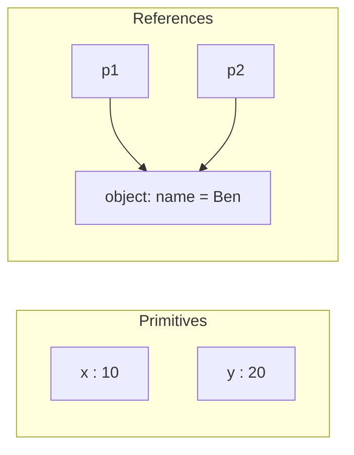

# Chapter 2 — Variables, Types and Operators

Every program stores values and computes new values from them. This chapter covers the three tools for that: **variables** (names for values), **types** (what kind of value something is) and **operators** (the symbols that combine values: `+`, `===`, `&&`, `??` …). It also covers the part of JavaScript that surprises newcomers most — **type coercion**, the automatic conversion of one type into another — so that `"3" + 4`, `0 == ""` and `0.1 + 0.2` stop being mysteries.

**What you'll learn**

1. Declaring variables with `let`, `const` and `var`, and which one to choose.
2. Hoisting and the Temporal Dead Zone (TDZ).
3. The seven primitive types, objects, and the `typeof` operator (with its quirks).
4. Primitives vs objects: copying by value vs by reference.
5. Arithmetic, comparison, logical, nullish (`??`), optional-chaining (`?.`), bitwise and assignment operators, and precedence.
6. `==` vs `===` and the exact coercion rules.
7. Numbers in depth: floating-point precision, `NaN`, `Infinity`, safe integers, `Number` properties and methods, `BigInt`.
8. Booleans, truthy and falsy values, and explicit conversions.

Code: [`code/`](code/) — every "Output:" block is real output from Node 24. Files are plain `.js` (sloppy-mode scripts) unless noted; [Chapter 1 §1.8](../01-introduction-and-setup/README.md#18-strict-mode) explains the difference.

---

## 2.1 Variables: `let`, `const` and `var`

### What it is
A **variable** is a named storage slot for a value. You pick a name, put a value in it, and later use the name to get the value back — or put a different value in.

Analogy: a labelled box. The label (`score`) stays the same; what's inside can be swapped. A `const` is a box whose label is glued to one particular thing: you can't swap the contents for something else, although if the thing is itself a container (an object) you can still rearrange what's inside it.

Three words matter:
- **Declare** — create the name: `let score;`
- **Assign** — store a value: `score = 10;`
- **Initialise** — declare and assign in one step: `let score = 10;`

A declared-but-unassigned variable holds the special value `undefined`.

### How it works — the three keywords
```js
// code/01_declarations.js
let score;                    // declared, no value yet
console.log("score before assignment:", score);
score = 10;                   // assign later
score = score + 5;            // reassign (let allows it)
console.log("score:", score);

const PI_APPROX = 3.14;       // const must be initialised and can't be reassigned
try { eval("PI_APPROX = 3"); } catch (e) { console.log("reassign const ->", e.name + ":", e.message); }

// const protects the BINDING, not the object: the contents can still change.
const cart = { items: 1 };
cart.items = 2;               // allowed: we mutate the object, not the variable
console.log("const object mutated:", cart);

// var: the old way. Function-scoped, can be redeclared, hoisted with value undefined.
var legacy = "first";
var legacy = "second";        // redeclaring with var is silently allowed
console.log("var redeclared:", legacy);
try { eval("let dup = 1; let dup = 2;"); } catch (e) { console.log("let redeclared ->", e.name); }

let a = 1, b = 2, c = a + b;  // several declarations in one statement
console.log("a, b, c =", a, b, c);

const greeting = "Hello";
const who = "World";
console.log(greeting + " " + who);
```

Output:
```
score before assignment: undefined
score: 15
reassign const -> TypeError: Assignment to constant variable.
const object mutated: { items: 2 }
var redeclared: second
let redeclared -> SyntaxError
a, b, c = 1 2 3
Hello World
```

(`eval` runs a string as code; it is used here only so a deliberate error can be caught and printed. Don't use it in real code.)

### Comparison table

| | `let` | `const` | `var` |
|---|---|---|---|
| Introduced | ES2015 | ES2015 | original (1995) |
| Scope (where the name is visible) | **block** `{ }` | **block** `{ }` | **function** (or global) |
| Reassign | yes | **no** (`TypeError`) | yes |
| Redeclare in same scope | no (`SyntaxError`) | no | **yes, silently** |
| Must initialise | no | **yes** | no |
| Use before the declaration line | `ReferenceError` (TDZ, §2.2) | `ReferenceError` (TDZ) | gives `undefined` |
| At top level of a classic script, becomes a property of `globalThis` | no | no | **yes** |

Scope — *where* a variable is visible — is covered properly in [Chapter 4 §4.5](../04-functions-scope-and-closures/README.md#45-scope-global-function-and-block). For now: a `let`/`const` declared inside `{ }` exists only inside those braces; a `var` leaks out to the whole function.

### Which one should I use?
1. **`const` by default.** Most names never need to point at something else, and `const` tells the reader so.
2. **`let` when the value must change** — counters, accumulators, values assigned in branches.
3. **`var` never, in new code.** You need to *recognise* it because older code and tutorials use it everywhere (and some lessons you'll see online use `var` "to keep things simple"), but its function scope, silent redeclaration and hoisting cause bugs that `let`/`const` were designed to prevent.

### Naming rules and conventions
- Allowed characters: letters, digits, `_`, `$`; the first character can't be a digit. Unicode letters work (`café`) — Unicode is the worldwide standard that gives every character in every script a number — but stick to ASCII (the basic 128-character English set: plain letters, digits, punctuation) in shared code.
- Case matters: `total` and `Total` are different variables.
- Reserved words (`let`, `class`, `return`, `if`, `for`, `new`, `typeof` …) can't be names.
- Conventions: **camelCase** for variables and functions (`totalPrice`), **PascalCase** for classes (`ShoppingCart`; a class is a blueprint for making objects — [Chapter 9](../09-this-prototypes-and-classes/README.md)), **UPPER_SNAKE_CASE** for fixed configuration constants (`MAX_RETRIES`). Name booleans as questions: `isOpen`, `hasAccess`.

### Common mistakes
- **Thinking `const` makes an object read-only.** It only prevents reassigning the variable. To freeze the contents, use `Object.freeze` ([Chapter 5](../05-objects-math-date-and-json/README.md)).
- **Forgetting the keyword** — `total = 5` without `let`/`const` creates an accidental global in sloppy mode and throws in strict mode.
- **Declaring with `let` inside a block and using it outside** → `ReferenceError`.

### TL;DR
`const` by default, `let` when you must reassign, `var` only when reading old code. `const` freezes the binding (the link between a name and the value it points to), not the value.

---

## 2.2 Hoisting and the Temporal Dead Zone

### What it is
Before running any code in a scope, the engine first scans it and creates all declared names. This is called **hoisting** (as if the declarations were "hoisted" to the top). What differs is *what value the name has before its declaration line runs*:

| Declaration | Before its line runs |
|---|---|
| `var x` | exists, value `undefined` |
| `let x`, `const x`, `class X` | exists but **uninitialised** — touching it throws `ReferenceError` |
| `function f() {}` | exists and is **fully usable** (covered in [Chapter 4](../04-functions-scope-and-closures/README.md#42-declarations-vs-expressions-and-hoisting)) |

The period between entering the scope and the declaration line for a `let`/`const` is the **Temporal Dead Zone (TDZ)**.

### Example
```js
// code/02_tdz_and_hoisting.js
console.log("var before its line:", typeof hoistedVar, hoistedVar); // declared + set to undefined at start
var hoistedVar = "ready";

try {
  console.log(notYet);        // let exists but is uninitialised until its line runs
} catch (e) {
  console.log("let before its line ->", e.name + ":", e.message);
}
let notYet = "ready";

try { typeof inZone; let inZone = 1; } catch (e) { console.log("typeof in TDZ ->", e.name); }
{
  // The TDZ is about TIME, not position: a function may mention a later let,
  // as long as it is called after the let line has run.
  const show = () => later;
  let later = "defined by the time show() is called";
  console.log(show());
}
```

Output:
```
var before its line: undefined undefined
let before its line -> ReferenceError: Cannot access 'notYet' before initialization
typeof in TDZ -> ReferenceError
defined by the time show() is called
```

### Why it matters
The TDZ is a feature: with `var`, reading a variable too early silently gives `undefined` and the bug surfaces far away; with `let`/`const` you get an immediate, clearly named error. Note that `typeof` — normally safe on unknown names — also throws inside the TDZ.

### In the interview
**"What is the Temporal Dead Zone?"** `let`, `const` and `class` declarations are hoisted — the scope knows about them from the start — but they aren't initialised until their declaration is evaluated. Accessing them in that window throws a `ReferenceError`. `var` is hoisted *and* initialised to `undefined`, so early access silently returns `undefined`.

- *Follow-up: Are `let` and `const` hoisted?* Yes — which is why an inner `let x` shadows an outer `x` (hides it, because the inner name wins inside its block) even on lines above it (you get a TDZ error instead of the outer value).
- *Follow-up: Is the TDZ about lines or time?* Time: a closure (a function that remembers the variables around where it was created — [Chapter 4](../04-functions-scope-and-closures/README.md)) that refers to a later `let` is fine as long as it runs after the declaration executes.

### TL;DR
All declarations are hoisted; `var` starts as `undefined`, `let`/`const` start in the TDZ and throw if touched early.

---

## 2.3 Data types and `typeof`

### What it is
Every value has a **type**. JavaScript has **eight** types: seven **primitive** types and one **object** type.

| Type | Example values | Notes |
|---|---|---|
| `number` | `42`, `3.14`, `-0`, `Infinity`, `NaN` | One type for integers and decimals: 64-bit floating point (§2.10) |
| `bigint` | `10n`, `2n ** 64n` | Whole numbers of any size (ES2020) |
| `string` | `"hi"`, `'hi'`, `` `hi ${x}` `` | Text, immutable (can't be changed in place) ([Chapter 6](../06-strings-and-regular-expressions/README.md)) |
| `boolean` | `true`, `false` | §2.11 |
| `undefined` | `undefined` | "No value assigned yet" — what JS itself gives you |
| `null` | `null` | "Intentionally empty" — what *you* assign to mean "nothing" |
| `symbol` | `Symbol("id")` | Unique identifiers, mostly for object keys (property names) ([Chapter 8](../08-maps-sets-iterators-and-generators/README.md)) |
| **`object`** | `{ a: 1 }`, `[1, 2]`, functions, dates, maps … | Everything that isn't a primitive |

JavaScript is **dynamically typed**: variables don't have types, values do. The same variable can hold a number and later a string.

### `typeof` — asking a value its type
```js
// code/03_types_typeof.js (abridged)
const samples = [
  ["number", 42], ["number (float)", 3.14], ["NaN", NaN], ["bigint", 10n],
  ["string", "hi"], ["boolean", true], ["undefined", undefined], ["null", null],
  ["symbol", Symbol("id")], ["object", { a: 1 }], ["array", [1, 2]],
  ["function", function () {}], ["date", new Date(0)],
];
for (const [label, value] of samples) {
  console.log(label.padEnd(15), "typeof ->", typeof value);
}
console.log("Array.isArray([1,2]) ->", Array.isArray([1, 2]));
let box = 5;      console.log("box:", typeof box);
box = "five";     console.log("box:", typeof box);
```

Output:
```
number          typeof -> number
number (float)  typeof -> number
NaN             typeof -> number
bigint          typeof -> bigint
string          typeof -> string
boolean         typeof -> boolean
undefined       typeof -> undefined
null            typeof -> object
symbol          typeof -> symbol
object          typeof -> object
array           typeof -> object
function        typeof -> function
date            typeof -> object
Array.isArray([1,2]) -> true
value === null      -> true
box: number
box: string
```

Three quirks to memorise:
1. **`typeof null === "object"`** — a bug from the very first implementation that can never be fixed (it would break the web). Test for null with `value === null`.
2. **`typeof NaN === "number"`** — "Not-a-Number" is a special *number* value.
3. **Functions report `"function"`**, even though they are objects; arrays report `"object"` — use `Array.isArray` to detect them.

`typeof` always returns a string, and it is safe on undeclared names (`typeof notDeclared` → `"undefined"`), except inside a TDZ.

### `undefined` vs `null`
| | `undefined` | `null` |
|---|---|---|
| Meaning | value not set | deliberately empty |
| Who produces it | the language: unassigned variables, missing properties, missing arguments, functions without `return` | your code (and some APIs, e.g. `document.getElementById` when nothing matches) |
| `typeof` | `"undefined"` | `"object"` (quirk) |
| `Number(…)` | `NaN` | `0` |
| `== null` | `true` | `true` |

A handy idiom (a common, widely recognised coding pattern): `value == null` is true for *both* `null` and `undefined` and nothing else — the one widely accepted use of `==`.

### TL;DR
Seven primitives (`number`, `bigint`, `string`, `boolean`, `undefined`, `null`, `symbol`) plus objects. `typeof` identifies them, except `null` (→ `"object"`) and arrays (use `Array.isArray`).

---

## 2.4 Primitives vs objects

### What it is
- A **primitive** is a simple, **immutable** value. The variable holds the value itself. Copying copies the value.
- An **object** is a mutable (changeable after creation) collection of properties (named values) living in memory. The variable holds a **reference** — like an address — to the object. Copying copies the address, so both variables point at the *same* object.

### Example
```js
// code/04_primitives_vs_objects.js
let x = 10;
let y = x;        // copies the value 10
y = 20;
console.log("x, y:", x, y);

const p1 = { name: "Ana" };
const p2 = p1;    // copies the REFERENCE — both names point at one object
p2.name = "Ben";
console.log("p1.name:", p1.name);

console.log("{} === {}:", {} === {});           // two different objects
console.log("p1 === p2:", p1 === p2);           // same object
console.log("'a' === 'a':", "a" === "a");       // primitives compare by value

const s = "hello";
const upper = s.toUpperCase();                  // string methods return NEW strings
console.log(s, upper);
console.log("length of 'hello':", s.length, "| (255).toString(16):", (255).toString(16));
console.log("typeof new Number(5):", typeof new Number(5), "| typeof Number('5'):", typeof Number("5"));
```

Output:
```
x, y: 10 20
p1.name: Ben
{} === {}: false
p1 === p2: true
'a' === 'a': true
hello HELLO
length of 'hello': 5 | (255).toString(16): ff
typeof new Number(5): object | typeof Number('5'): number
```



### Autoboxing and wrapper objects
Primitives have no properties, yet `"hello".length` and `(255).toString(16)` work. When you access a property on a primitive, the engine temporarily wraps it in a matching **wrapper object** (`String`, `Number`, `Boolean`, `BigInt`, `Symbol`), reads the property, and throws the wrapper away. This is called **autoboxing**.

You can also create wrappers yourself with `new Number(5)`, `new String("x")` or `new Boolean(false)`, but **don't**: they are objects, so `typeof` says `"object"`, `new Number(5) === 5` is `false`, and `new Boolean(false)` is *truthy* (§2.11). Calling the same functions **without** `new` — `Number("5")`, `String(5)`, `Boolean(0)` — is the correct way to *convert* values and returns primitives.

### Why it matters
- Passing an object to a function lets the function change *your* object ([Chapter 4](../04-functions-scope-and-closures/README.md)).
- `===` on objects asks "same object?", not "same contents?". Comparing contents needs a loop or a library (ready-made code written by someone else).
- Frameworks like React rely on this: they detect a change by checking whether you created a *new* object, which is why "don't mutate state" is a React rule (*mutate* = change in place; *state* = the data that decides what the screen currently shows).

### TL;DR
Primitives: immutable, copied and compared by value. Objects: mutable, copied and compared by reference. Use `Number()/String()/Boolean()` without `new` to convert.

---

## 2.5 Arithmetic operators

### What it is
An **operator** is a symbol that takes one or more values (**operands**) and produces a new value. Unary operators take one operand (`-x`, `!x`), binary take two (`a + b`), and there is one ternary operator (`c ? a : b`, [Chapter 3](../03-control-flow-and-loops/README.md#33-the-conditional-ternary-operator)).

| Operator | Name | Example | Result |
|---|---|---|---|
| `+` | addition (or string concatenation — joining texts end to end) | `10 + 5` | `15` |
| `-` | subtraction | `10 - 5` | `5` |
| `*` | multiplication | `10 * 5` | `50` |
| `/` | division (always floating point) | `7 / 2` | `3.5` |
| `%` | remainder | `10 % 3` | `1` |
| `**` | exponentiation (ES2016) | `2 ** 10` | `1024` |
| `++` | increment by 1 | `n++` / `++n` | see below |
| `--` | decrement by 1 | `n--` / `--n` | see below |
| unary `+` / `-` | convert to number / negate | `+"42"` | `42` |

### Example
```js
// code/05_arithmetic.js
let a = 10, b = 5;
console.log("a + b =", a + b);
console.log("a - b =", a - b);
console.log("a * b =", a * b);
console.log("a / b =", a / b);
console.log("a % b =", a % b);
console.log("2 ** 10 =", 2 ** 10);
console.log("7 / 2 =", 7 / 2, "(no integer division)");
console.log("Math.trunc(7 / 2) =", Math.trunc(7 / 2));
console.log("-7 % 3 =", -7 % 3, "(sign follows the left operand)");
console.log("1 / 0 =", 1 / 0, "| -1 / 0 =", -1 / 0, "| 0 / 0 =", 0 / 0);

let n = 5;
console.log("n++ returns", n++, "then n is", n);   // returns old value
console.log("++n returns", ++n, "then n is", n);   // returns new value
b--; console.log("after b--:", b);

console.log('"3" + 4 =', "3" + 4);
console.log('"3" - 4 =', "3" - 4);
console.log('"3" * "4" =', "3" * "4");
console.log('1 + 2 + "3" =', 1 + 2 + "3");
console.log('"1" + 2 + 3 =', "1" + 2 + 3);
console.log('+"42" =', +"42", '| -"5" =', -"5", '| +"" =', +"", '| +"abc" =', +"abc");
```

Output:
```
a + b = 15
a - b = 5
a * b = 50
a / b = 2
a % b = 0
2 ** 10 = 1024
7 / 2 = 3.5 (no integer division)
Math.trunc(7 / 2) = 3
-7 % 3 = -1 (sign follows the left operand)
1 / 0 = Infinity | -1 / 0 = -Infinity | 0 / 0 = NaN
n++ returns 5 then n is 6
++n returns 7 then n is 7
after b--: 4
"3" + 4 = 34
"3" - 4 = -1
"3" * "4" = 12
1 + 2 + "3" = 33
"1" + 2 + 3 = 123
+"42" = 42 | -"5" = -5 | +"" = 0 | +"abc" = NaN
```

### How it works — the rules behind the surprises
1. **Division never throws.** Dividing by zero gives `Infinity`/`-Infinity`; `0 / 0` gives `NaN`.
2. **`%` is a remainder, not a mathematical modulo:** the result has the sign of the left operand (`-7 % 3` is `-1`). For an always-positive modulo use `((a % n) + n) % n`.
3. **Prefix vs postfix.** Both `n++` and `++n` add one to `n`. The difference is the value of the *expression*: postfix returns the value *before* the change, prefix the value *after*. On a line by itself (`i++;`) there is no difference.
4. **`+` is overloaded** (one symbol, more than one job). If either operand is a string (after converting objects to primitives), `+` joins strings; otherwise it adds numbers. Evaluation goes left to right, so `1 + 2 + "3"` is `3 + "3"` = `"33"`, while `"1" + 2 + 3` is `"12" + 3` = `"123"`.
5. **Other arithmetic operators always convert to numbers**, so `"3" - 4` is `-1` and `"3" * "4"` is `12`.
6. **Unary `+`** is the shortest way to convert to a number (`+"42"` → `42`); the empty string becomes `0`, non-numeric text becomes `NaN`.
7. **`-2 ** 2` is a `SyntaxError`** — the language forces you to write `(-2) ** 2` or `-(2 ** 2)` to avoid ambiguity. `**` is right-associative (grouped from the right, §2.9): `2 ** 3 ** 2` is `2 ** 9` = `512`.

### Common mistakes
- Adding form input values: `input.value` is always a string, so `"2" + "3"` gives `"23"`. Convert first: `Number(input.value)`.
- Expecting `7 / 2` to be `3`. Use `Math.trunc`, `Math.floor` or `Math.round` explicitly ([Chapter 5](../05-objects-math-date-and-json/README.md)).

---

## 2.6 Comparison operators and equality

### What it is
Comparison operators compare two values and always produce a **boolean** (`true` or `false`).

| Operator | Meaning | Converts types? |
|---|---|---|
| `===` | strictly equal: same type **and** same value | no |
| `!==` | strictly not equal | no |
| `==` | loosely equal: equal after converting types | **yes** |
| `!=` | loosely not equal | **yes** |
| `>` `<` `>=` `<=` | greater / less (or equal) | yes (to number, unless both are strings) |

### Example
```js
// code/06_comparison_equality.js (abridged)
const x = 5, y = "5";
console.log("x == y  :", x == y);
console.log("x === y :", x === y);
console.log("x != y  :", x != y);
console.log("x !== y :", x !== y);
console.log("x > 2, x < 10, x >= 5, x <= 5:", x > 2, x < 10, x >= 5, x <= 5);
// ... loops over a table of pairs, printing == and === for each
```

Output:
```
x == y  : true
x === y : false
x != y  : false
x !== y : true
x > 2, x < 10, x >= 5, x <= 5: true true true true
--- loose equality surprises ---
0         == ""        -> true  | === -> false
0         == "0"       -> true  | === -> false
""        == "0"       -> false | === -> false
false     == "0"       -> true  | === -> false
false     == ""        -> true  | === -> false
null      == undefined -> true  | === -> false
null      == 0         -> false | === -> false
undefined == 0         -> false | === -> false
NaN       == NaN       -> false | === -> false
[1]       == 1         -> true  | === -> false
[]        == ""        -> true  | === -> false
[1,2]     == "1,2"     -> true  | === -> false
--- relational comparisons ---
"10" < "9"  : true (both strings: compared character by character)
"10" < 9    : false (one number: string converted to number)
"apple" < "banana": true | "Z" < "a": true
null >= 0   : true | null == 0: false
NaN < 1, NaN >= 1: false false
--- Object.is ---
NaN === NaN: false | Object.is(NaN, NaN): true
0 === -0: true | Object.is(0, -0): false
```

Look at the first three surprise rows: `0 == ""` and `0 == "0"` are both true, yet `"" == "0"` is false. Loose equality isn't even *transitive* (the rule "if a equals b and b equals c, then a equals c" fails). That is the main reason to avoid it.

### How it works — the `==` algorithm (simplified from the spec)
Given `a == b`:
1. **Same type?** Compare like `===`.
2. **`null` and `undefined`** are equal to each other and to **nothing else** (so `null == 0` is false).
3. **Number vs string** → convert the string to a number (`"5"` → `5`, `""` → `0`).
4. **Boolean vs anything** → convert the boolean to a number first (`true` → `1`, `false` → `0`). That's why `false == "0"` is true (`0 == "0"` → `0 == 0`), and why `if (x == true)` is a trap: `"2" == true` is `2 == 1`, false.
5. **Object vs primitive** → convert the object to a primitive (via `valueOf`/`toString`; arrays become comma-joined strings: `[1,2]` → `"1,2"`, `[]` → `""`), then compare again.
6. **BigInt vs number** → compare mathematical values (`1n == 1` is true).
7. **`NaN` is never equal to anything**, including itself.

`===` skips all of that: different types → `false`. Only two oddities remain: `NaN === NaN` is `false`, and `0 === -0` is `true`. `Object.is(a, b)` is identical to `===` except it fixes those two cases.

### Relational comparisons (`<`, `>` …)
1. Convert objects to primitives.
2. If **both are strings**, compare them character by character by UTF-16 code unit (UTF-16 is how JavaScript stores text internally: each character becomes one or two 16-bit numbers called code units) — i.e. dictionary order by character code. So `"10" < "9"` (because `"1"` < `"9"`), and all uppercase letters come before lowercase (`"Z" < "a"`). For human-friendly sorting use `localeCompare` ([Chapter 6](../06-strings-and-regular-expressions/README.md)).
3. Otherwise convert both to numbers. `null` → `0`, so `null >= 0` is true even though `null == 0` is false (`==` uses rule 2 above, relational operators don't). Any comparison involving `NaN` is false.

### Trade-offs — `==` vs `===`

| | `===` | `==` |
|---|---|---|
| Predictable | yes | needs the rules above |
| Catches type bugs | yes (`"5" === 5` false) | hides them |
| Useful idiom | — | `x == null` (null **or** undefined) |
| Linters (tools that scan code for likely bugs; ESLint rule `eqeqeq`) | recommended | flagged, except `== null` if configured |

### In the interview
**30-second answer — "Difference between `==` and `===`?"** `===` compares type and value with no conversion. `==` converts operands first: null and undefined equal only each other; strings and booleans are turned into numbers; objects into primitives. Those rules make `==` non-transitive (`0 == ""`, `0 == "0"`, but `"" != "0"`), so I use `===` everywhere except the `x == null` idiom.

- *Follow-up: How do you check for `NaN`?* `Number.isNaN(x)` (or `Object.is(x, NaN)`); `x === NaN` is always false.
- *Follow-up: What's `[] == ![]`?* `true`: `![]` is `false` (arrays are truthy), then `[] == false` → `"" == 0` → `0 == 0`.
- *Follow-up: Why is `null >= 0` true but `null == 0` false?* Relational operators convert `null` to `0`; `==` has a special rule that null equals only undefined.

### TL;DR
Use `===`/`!==`. `==` coerces with non-obvious, non-transitive rules. String-vs-string comparisons are by character code; everything else is compared numerically; `NaN` compares false with everything.

---

## 2.7 Logical operators, `??` and `?.`

### What it is
Logical operators combine conditions — "is the user logged in **and** an admin?", "is the cart empty **or** the store closed?".

| Operator | Name | Returns |
|---|---|---|
| `a && b` | AND | `a` if `a` is falsy, otherwise `b` |
| `a \|\| b` | OR | `a` if `a` is truthy, otherwise `b` |
| `!a` | NOT | `true` if `a` is falsy, else `false` (always a boolean) |
| `a ?? b` | nullish coalescing (ES2020) | `a` unless it is `null`/`undefined`, then `b` |
| `a?.b`, `a?.[k]`, `a?.()` | optional chaining (ES2020) | `undefined` if `a` is `null`/`undefined`, otherwise the normal access/call |

With booleans they behave like the truth tables you'd expect (`true && false` → `false`). The important detail is the "Returns" column: **`&&` and `||` return one of their operands, not necessarily `true`/`false`.** *Truthy* and *falsy* (§2.11) describe how any value behaves in a boolean context.

### How it works — short-circuit evaluation
1. `&&` works from the left and **returns the first falsy value it meets**, without evaluating the rest. If none is falsy, it returns the last value.
2. `||` works from the left and **returns the first truthy value it meets**, without evaluating the rest. If none is truthy, it returns the last value.
3. Because they stop early, the right side may never run. That's used deliberately: `user && user.logout()` calls `logout` only if `user` exists; `isDebug && console.log(...)` logs only in debug mode.

### Example
```js
// code/07_logical_nullish_optional.js (abridged)
console.log('"cat" && "dog":', "cat" && "dog");    // both truthy -> last
console.log('0 || "default":', 0 || "default");     // first truthy
console.log('"" || null || 0:', "" || null || 0);   // none truthy -> last

let calls = 0;
const touch = () => { calls++; return true; };
false && touch();
true || touch();
console.log("right side evaluated", calls, "times");

const settings = { volume: 0, title: "", theme: null };
console.log("volume || 50:", settings.volume || 50, "| volume ?? 50:", settings.volume ?? 50);
console.log('theme ?? "light":', settings.theme ?? "light");

const user = { name: "Ana", address: null, greet() { return "hi"; } };
console.log("user.address?.city:", user.address?.city);
console.log("user.profile?.photo?.url:", user.profile?.photo?.url);
console.log("user.greet?.():", user.greet?.(), "| user.wave?.():", user.wave?.());
try { user.address.city; } catch (e) { console.log("without ?. ->", e.constructor.name); }

const cfg = { retries: 0, name: "", port: undefined };
cfg.retries ||= 3;    // 0 is falsy -> replaced
cfg.name ??= "app";   // "" is not nullish -> kept
cfg.port ??= 8080;    // undefined -> replaced
let token = "abc"; token &&= token.toUpperCase();
console.log(cfg, token);
```

Output (full run):
```
t && f: false | t || f: true | !f: true
"cat" && "dog": dog
"" && "dog": ""
0 || "default": default
"" || null || 0: 0
!!'text': true | !!0: false
right side evaluated 0 times
volume || 50: 50 | volume ?? 50: 0
title || "Untitled": Untitled | title ?? "Untitled": ""
theme ?? "light": light
user.address?.city: undefined
user.profile?.photo?.url: undefined
user.greet?.(): hi | user.wave?.(): undefined
user.tags?.[0]: undefined
without ?. -> TypeError
{ retries: 3, name: '', port: 8080 } ABC
true || false && false: true
mixing ?? and || without () -> SyntaxError
(null || undefined) ?? 'x': x
```

### `||` vs `??` for defaults
`||` falls back on **any falsy** value, which includes legitimate values like `0`, `""` and `false`. A volume of `0` is a real setting, but `volume || 50` throws it away. `??` falls back **only on `null` or `undefined`** — "no value" — so `volume ?? 50` keeps the `0`. Rule: use `??` for defaults unless you really mean "any falsy value".

### Optional chaining `?.`
Reading a property of `null` or `undefined` throws a `TypeError` ("Cannot read properties of null"). `?.` checks the value on its left: if it's `null`/`undefined`, the **whole chain** stops and evaluates to `undefined`; otherwise it continues normally. Three forms: `obj?.prop`, `obj?.[expr]`, `fn?.(args)` (call only if `fn` exists). You cannot assign through it (`obj?.x = 1` is a `SyntaxError`).

### Logical assignment (ES2021)
| Operator | Equivalent | Assigns when `a` is… |
|---|---|---|
| `a \|\|= b` | `a \|\| (a = b)` | falsy |
| `a &&= b` | `a && (a = b)` | truthy |
| `a ??= b` | `a ?? (a = b)` | `null` / `undefined` |

They short-circuit too: if no assignment is needed, `b` isn't even evaluated.

### Common mistakes
- **`if (x = 5)`** — a single `=` assigns (and the result `5` is truthy); you meant `===`.
- **Overusing `?.`** — if a value *must* exist, let the error surface instead of hiding a bug behind `undefined`.
- **Mixing `??` with `||`/`&&` without parentheses** → `SyntaxError`; the language forces you to be explicit.
- Forgetting precedence: `&&` binds tighter than `||`, so `a || b && c` is `a || (b && c)`.

### TL;DR
`&&`/`||` short-circuit and return an operand. Use `??` for defaults (keeps `0` and `""`), `?.` to read possibly-missing data safely, and `||=`/`&&=`/`??=` to assign conditionally.

---

## 2.8 Bitwise and assignment operators

### Bitwise operators
**Bitwise** operators treat numbers as 32-bit signed integers and work on the individual binary digits (**bits**). Beginners can skim this; they appear in low-level code (graphics, compression, hashing (turning data into a short fixed-size fingerprint number), permission flags) and in interview puzzles.

| Operator | Name | Rule per bit |
|---|---|---|
| `&` | AND | 1 if both bits are 1 |
| `\|` | OR | 1 when either bit (or both) is 1 |
| `^` | XOR | 1 if the bits differ |
| `~` | NOT | flips every bit (`~x` equals `-x - 1`) |
| `<<` | left shift | moves bits left, filling with 0 (×2 per step) |
| `>>` | sign-propagating right shift | moves bits right, copying the sign bit (÷2, rounding down) |
| `>>>` | zero-fill right shift | moves bits right, filling with 0 (result is unsigned) |

```js
// code/08_bitwise_assignment.js (first half)
let c = 5, d = 2;               // 5 = 101, 2 = 010
console.log("c & d  =", c & d, bin(c & d));
console.log("c | d  =", c | d, bin(c | d));
console.log("c ^ d  =", c ^ d, bin(c ^ d));
console.log("~d     =", ~d);
console.log("c << 1 =", c << 1);
console.log("c >> 1 =", c >> 1, "| -5 >> 1 =", -5 >> 1, "(keeps sign)");
console.log("c >>> 1 =", c >>> 1, "| -5 >>> 1 =", -5 >>> 1, "(fills with 0)");
const READ = 1, WRITE = 2, EXEC = 4;
let perms = READ | WRITE;
console.log("can write?", (perms & WRITE) !== 0, "| can exec?", (perms & EXEC) !== 0);
```

Output:
```
c & d  = 0 000
c | d  = 7 111
c ^ d  = 7 111
~d     = -3
c << 1 = 10
c >> 1 = 2 | -5 >> 1 = -3 (keeps sign)
c >>> 1 = 2 | -5 >>> 1 = 2147483645 (fills with 0)
can write? true | can exec? false
```

Walk-through: `101 & 010` has no position where both are 1 → `000` = 0. OR and XOR both give `111` = 7 because 5 and 2 never share a 1-bit. `~2` = `-3` (two's complement — the standard way computers store negative integers in binary: flip all bits and add 1). The **flags** idiom packs several yes/no settings into one number: each flag is a power of two, `|` combines them, `&` tests one. Unix (Linux/macOS) file permissions (`chmod 755`) and many binary file formats use this idea.

Caveat: bitwise operators first truncate their operands (cut off anything that doesn't fit) to 32-bit integers, so they break for numbers beyond ±2³¹ (about 2.1 billion). Old tricks like `x | 0` to truncate decimals share this limit — prefer `Math.trunc`.

### Assignment operators
`=` stores the right-hand value in the variable on the left. **Compound assignment** operators combine an operation with assignment: `x += y` means `x = x + y`.

| Operator | Same as | | Operator | Same as |
|---|---|---|---|---|
| `x = y` | assign | | `x <<= y` | `x = x << y` |
| `x += y` | `x = x + y` | | `x >>= y` | `x = x >> y` |
| `x -= y` | `x = x - y` | | `x >>>= y` | `x = x >>> y` |
| `x *= y` | `x = x * y` | | `x &= y` | `x = x & y` |
| `x /= y` | `x = x / y` | | `x \|= y` | `x = x \| y` |
| `x %= y` | `x = x % y` | | `x ^= y` | `x = x ^ y` |
| `x **= y` | `x = x ** y` | | `\|\|=` `&&=` `??=` | §2.7 |

```js
// code/08_bitwise_assignment.js (second half)
let e = 10;
const log = [];
e += 5;  log.push(e);  // 15
e -= 3;  log.push(e);  // 12
e *= 2;  log.push(e);  // 24
e /= 4;  log.push(e);  // 6
e %= 4;  log.push(e);  // 2
e **= 3; log.push(e);  // 8
e <<= 1; log.push(e);  // 16
e >>= 2; log.push(e);  // 4
e &= 6;  log.push(e);  // 4   (100 & 110 = 100)
e |= 1;  log.push(e);  // 5   (100 | 001 = 101)
e ^= 3;  log.push(e);  // 6   (101 ^ 011 = 110)
console.log("e after each step:", log.join(" -> "));
let p, q;
p = q = 7;                      // right to left: q = 7, then p = (q = 7) which is 7
console.log("p, q:", p, q);
```

Output:
```
e after each step: 15 -> 12 -> 24 -> 6 -> 2 -> 8 -> 16 -> 4 -> 4 -> 5 -> 6
p, q: 7 7
```

An assignment is itself an expression whose value is the assigned value; that is what makes `p = q = 7` work (and what makes `if (x = 5)` a silent bug).

---

## 2.9 Operator precedence

**Precedence** decides which operator is applied first when several appear in one expression (`2 + 3 * 4` is `14`, not `20`). **Associativity** decides the order among operators of equal precedence (most are left-to-right; `**`, assignment and `?:` are right-to-left). From highest to lowest (simplified):

| Level | Operators |
|---|---|
| 1 | `( … )` grouping |
| 2 | `.` `[]` `?.` function call `()` `new` with arguments |
| 3 | postfix `x++` `x--` |
| 4 | `!` `~` unary `+` `-` prefix `++x` `--x` `typeof` `void` `delete` `await` |
| 5 | `**` (right-to-left) |
| 6 | `*` `/` `%` |
| 7 | `+` `-` |
| 8 | `<<` `>>` `>>>` |
| 9 | `<` `<=` `>` `>=` `in` `instanceof` |
| 10 | `==` `!=` `===` `!==` |
| 11–13 | `&`, then `^`, then `\|` |
| 14 | `&&` |
| 15 | `\|\|` and `??` (cannot be mixed without parentheses) |
| 16 | `? :` (right-to-left) |
| 17 | `=` and all compound assignments, `=>` (right-to-left) |
| 18 | `,` comma |

Practical advice: you don't need to memorise this. **When in doubt, add parentheses** — they cost nothing and make intent obvious to the reader.

---

## 2.10 Numbers in depth

### What it is
All ordinary JavaScript numbers — integers and decimals alike — are stored as **64-bit IEEE-754 double-precision floating-point** values ("doubles"), the same format as `double` in Java or C.

> **Key term — floating point:** a way of storing numbers in binary as a fixed number of significant digits plus an exponent (like scientific notation, 1.23 × 10⁵), so the decimal point can "float" to handle both tiny and huge values. **IEEE-754** is the international standard that defines this format; "double precision" means 64 bits per number. The trade-off: range is enormous, but most decimal fractions are stored as close approximations, not exactly. That single choice explains almost everything unusual about numbers in JS:
- about 15–17 significant decimal digits (meaningful digits, ignoring leading zeros) of precision;
- integers are exact only up to **2⁵³ − 1** (9,007,199,254,740,991);
- decimals like `0.1` can't be represented exactly in binary, just as 1/3 can't be written exactly in decimal;
- special values `Infinity`, `-Infinity`, `NaN` and a separate `-0`.

The global **`Number`** is the function/wrapper that holds number-related constants and helper methods. Calling `Number(value)` converts to a number; `new Number(value)` creates a wrapper object you should not use (§2.4).

### Example
```js
// code/09_numbers.js (abridged — see the file for every line)
console.log("0.1 + 0.2 =", 0.1 + 0.2);
console.log("0.1 + 0.2 === 0.3 ?", 0.1 + 0.2 === 0.3);
console.log("close enough?", Math.abs(0.1 + 0.2 - 0.3) < Number.EPSILON);
console.log("money in cents: 10 + 20 =", (10 + 20) / 100);
console.log("MAX_VALUE        ", Number.MAX_VALUE);
// ... MIN_VALUE, MAX/MIN_SAFE_INTEGER, EPSILON, infinities
console.log("2**53 + 1        ", 2 ** 53 + 1, "(not representable!)");
console.log("literals:", 1_000_000, 0xff, 0o17, 0b1010, 1.5e3, 2e-3, .5);
const num = 123.456;
console.log("toFixed(2):", num.toFixed(2), "| toFixed(0):", num.toFixed(0));
console.log("toPrecision(4):", num.toPrecision(4), "| toPrecision(2):", num.toPrecision(2));
console.log("(255).toString(2):", (255).toString(2), "| (255).toString(16):", (255).toString(16));
console.log("(1.005).toFixed(2):", (1.005).toFixed(2), "(binary rounding!)");
console.log("parseInt('123px'):", Number.parseInt("123px"), "| parseInt('px123'):", Number.parseInt("px123"));
console.log("Number('123px'):", Number("123px"), "| Number(''):", Number(""), "| Number(' 42 '):", Number(" 42 "));
console.log("isNaN('abc'):", isNaN("abc"), "| Number.isNaN('abc'):", Number.isNaN("abc"), "| Number.isNaN(NaN):", Number.isNaN(NaN));
const big = 2n ** 64n;
console.log("2n ** 64n =", big, "| typeof:", typeof big);
try { 1n + 1; } catch (e) { console.log("1n + 1 ->", e.name + ":", e.message); }
```

Output:
```
0.1 + 0.2 = 0.30000000000000004
0.1 + 0.2 === 0.3 ? false
close enough? true
money in cents: 10 + 20 = 0.3
MAX_VALUE         1.7976931348623157e+308
MIN_VALUE         5e-324
MAX_SAFE_INTEGER  9007199254740991
MIN_SAFE_INTEGER  -9007199254740991
EPSILON           2.220446049250313e-16
POSITIVE_INFINITY Infinity | NEGATIVE_INFINITY -Infinity
MAX_VALUE * 2     Infinity
2**53 + 1         9007199254740992 (not representable!)
isSafeInteger(2**53): false
literals: 1000000 255 15 10 1500 0.002 0.5
toFixed(2): 123.46 | toFixed(0): 123
toPrecision(4): 123.5 | toPrecision(2): 1.2e+2
(255).toString(2): 11111111 | (255).toString(16): ff
(1.005).toFixed(2): 1.00 (binary rounding!)
toLocaleString: 1,234,567.891 | 1.234.567,891
valueOf of wrapper: 7
parseInt('123px'): 123 | parseInt('px123'): NaN
parseInt('ff', 16): 255 | parseInt('101', 2): 5
parseFloat('3.14abc'): 3.14
Number('123px'): NaN | Number(''): 0 | Number(' 42 '): 42
Number(null): 0 | Number(undefined): NaN | Number(true): 1
isInteger(5.0): true | isInteger(5.5): false
isFinite('5'): true | Number.isFinite('5'): false
isNaN('abc'): true | Number.isNaN('abc'): false | Number.isNaN(NaN): true
2n ** 64n = 18446744073709551616n | typeof: bigint
9007199254740993n + 1n = 9007199254740994n
7n / 2n = 3n (truncates)
1n + 1 -> TypeError: Cannot mix BigInt and other types, use explicit conversions
BigInt(10) + 1n = 11n | Number(5n) + 1 = 6
```

### Number literals
| Form | Example | Value |
|---|---|---|
| decimal | `42`, `3.14`, `.5` | |
| exponent | `1.5e3`, `2e-3` | 1500, 0.002 |
| hex / octal / binary | `0xff`, `0o17`, `0b1010` | 255, 15, 10 |
| numeric separators (ES2021) | `1_000_000` | 1000000 (underscores are ignored, just for readability) |
| BigInt | `123n` | a `bigint` |

### `Number` properties

| Property | Value | Meaning |
|---|---|---|
| `Number.MAX_VALUE` | ≈ 1.797e308 | largest finite number; beyond it you get `Infinity` |
| `Number.MIN_VALUE` | 5e-324 | smallest **positive** number (closest to zero) — *not* the most negative number |
| `Number.MAX_SAFE_INTEGER` | 2⁵³ − 1 | largest integer `n` such that `n` and `n + 1` are both exactly representable |
| `Number.MIN_SAFE_INTEGER` | −(2⁵³ − 1) | the negative counterpart |
| `Number.EPSILON` | ≈ 2.22e-16 | gap between 1 and the next representable double; a tolerance for comparing decimals near 1 |
| `Number.POSITIVE_INFINITY` / `NEGATIVE_INFINITY` | `Infinity` / `-Infinity` | results of overflow (a result too large to store) or division by zero |
| `Number.NaN` | `NaN` | same as the global `NaN` |

### `Number` methods

**Instance methods** (called on one particular number value, the "instance"; they return strings except `valueOf`):

| Method | What it does | Example → result |
|---|---|---|
| `toFixed(d)` | round to `d` digits after the decimal point | `(123.456).toFixed(2)` → `"123.46"` |
| `toPrecision(p)` | round to `p` significant digits (may switch to exponent form) | `(123.456).toPrecision(4)` → `"123.5"` |
| `toString(radix)` | write in base 2–36 (the radix is the number base) | `(255).toString(16)` → `"ff"` |
| `toLocaleString(locale)` | format for humans (thousands separators, currency) using a locale (language + region, e.g. `"en-US"`) | `(1234.5).toLocaleString("en-US")` → `"1,234.5"` |
| `valueOf()` | the primitive inside a `Number` wrapper | `new Number(7).valueOf()` → `7` |

To call a method directly on an integer literal, wrap it: `(255).toString(16)` — `255.toString()` is a syntax error because the dot is read as a decimal point.

**Static methods** (called on `Number` itself):

| Method | What it does | Watch out |
|---|---|---|
| `Number.isFinite(v)` | `true` only for finite *numbers* | the global `isFinite("5")` converts first and says `true` |
| `Number.isInteger(v)` | integer-valued number? | `5.0` is an integer (it's the same value as `5`) |
| `Number.isSafeInteger(v)` | integer within ±(2⁵³ − 1)? | use before trusting large IDs |
| `Number.isNaN(v)` | is it exactly `NaN`? | the global `isNaN("abc")` converts first and says `true` |
| `Number.parseFloat(s)` | read a decimal from the *start* of a string | stops at the first invalid character |
| `Number.parseInt(s, radix)` | read an integer from the *start* of a string in base `radix` | **always pass the radix** (usually 10) |

`parseInt`/`parseFloat` vs `Number()`: the parse functions read as much of a leading number as they can and ignore the rest (`"123px"` → `123`), which suits CSS values and user text; `Number()` requires the *whole* string (after trimming spaces) to be numeric, else `NaN`, and treats `""` as `0`. Choose deliberately.

### `NaN` and `Infinity`
- **`NaN`** ("Not a Number") is the result of a failed numeric operation: `Number("abc")`, `0 / 0`, `Math.sqrt(-1)`. It spreads — any arithmetic with `NaN` gives `NaN` — and it's the only value not equal to itself. Detect it with `Number.isNaN`.
- **`Infinity`** results from overflow (`Number.MAX_VALUE * 2`) or division by zero. `Number.isFinite(x)` rejects `Infinity`, `-Infinity` and `NaN` in one check.

### Floating-point precision — what to do about it
1. **Never compare decimals with `===`.** Compare with a tolerance: `Math.abs(a - b) < 1e-9` (or `Number.EPSILON` for values near 1).
2. **Money: work in integer cents** (store 1999, display 19.99), or use a decimal library. Payment APIs such as Stripe take amounts in the smallest currency unit for this reason.
3. **Round only for display**, with `toFixed` or `Intl.NumberFormat`/`toLocaleString`. Be aware `toFixed` rounds the *binary* value: `(1.005).toFixed(2)` is `"1.00"` because 1.005 is stored as 1.00499999…
4. **Large integers** (database IDs, Twitter/X post IDs, nanosecond timestamps — a timestamp is a number marking a moment in time) beyond 2⁵³ lose precision silently. Keep them as **strings** or use **`BigInt`**.

### `BigInt`
`bigint` (ES2020) represents whole numbers of any size. Write it with an `n` suffix (`10n`) or convert with `BigInt(10)`. Rules: you **can't mix** `bigint` and `number` in arithmetic (`TypeError`) — convert explicitly; division truncates (`7n / 2n` is `3n`); `Math` functions don't accept BigInts; and `JSON.stringify` can't serialise them (turn them into JSON text for saving or sending) without help. Use BigInt for big IDs, cryptography (the maths behind encryption and secure signatures) and exact large-integer maths; use `number` for everything else (it's faster).

### In the interview
**"Why is `0.1 + 0.2 !== 0.3`?"** Numbers are IEEE-754 binary doubles; 0.1 and 0.2 have no exact binary representation, so each is stored as the nearest double, and their sum is the double just above 0.3 (0.30000000000000004). Compare with a tolerance, or use integer units such as cents.

- *Follow-up: What's `Number.MAX_SAFE_INTEGER` and why does it matter?* 2⁵³ − 1; above it not every integer is representable, so `2**53 + 1 === 2**53`. Keep big IDs as strings or BigInt.
- *Follow-up: `isNaN` vs `Number.isNaN`?* The global one converts its argument to a number first, so `isNaN("abc")` is true; `Number.isNaN` is true only for the actual `NaN` value.
- *Follow-up: `parseInt("08")`?* `8` in modern engines, but always pass the radix — `parseInt(x, 10)` — to be explicit. Also note `parseInt(0.0000005)` is `5`, because the number is first turned into the string `"5e-7"`.

### Self-check
1. `Number("")` vs `parseInt("")`? → `0` vs `NaN`.
2. What is `Number.MIN_VALUE`? → The smallest *positive* double, 5e-324.
3. `typeof NaN`? → `"number"`.
4. `10n + 5`? → `TypeError` — convert one side first.

### TL;DR
One `number` type (64-bit float): exact integers up to 2⁵³ − 1, inexact decimals, plus `NaN`, `±Infinity`. Use `Number.isNaN/isFinite/isInteger`, `toFixed` for display, integer cents for money, `BigInt` for huge integers.

---

## 2.11 Booleans, truthy and falsy

### What it is
The **boolean** type has exactly two values, `true` and `false`. Comparisons produce booleans, and conditions (`if`, `while`, `? :`, [Chapter 3](../03-control-flow-and-loops/README.md)) consume them.

But a condition can be *any* value. JavaScript converts it to a boolean using a fixed list: the **falsy** values become `false`; **everything else is truthy**.

| Falsy values (the complete list) |
|---|
| `false` |
| `0`, `-0` and `0n` (BigInt zero) |
| `""` — the empty string, whichever quotes are used |
| `null` |
| `undefined` |
| `NaN` |

(Browsers have one historical oddity, `document.all`, which is also falsy. You'll never need it.)

Surprising **truthy** values: `"0"`, `"false"`, `" "` (a space), `[]` (empty array), `{}` (empty object), `-1`, `Infinity`, every function, and every wrapper object — including `new Boolean(false)`.

### Example
```js
// code/10_boolean_truthiness.js
const falsy = [["false", false], ["0", 0], ["-0", -0], ["0n", 0n], ['""', ""], ["null", null], ["undefined", undefined], ["NaN", NaN]];
console.log("falsy:", falsy.map(([label, v]) => `${label}->${Boolean(v)}`).join("  "));
const truthy = ["0", "false", " ", [], {}, -1, Infinity, function () {}, new Boolean(false)];
console.log("truthy:", truthy.map((v) => Boolean(v)).every(Boolean));

if (false || 0 || "" || null || undefined || NaN) {
  console.log("never printed");
} else {
  console.log("All values are falsy.");
}
console.log('Boolean("hi"):', Boolean("hi"), '| !!"":', !!"", "| !!42:", !!42);
const wrapped = new Boolean(false);
console.log("typeof wrapped:", typeof wrapped, "| valueOf():", wrapped.valueOf());
console.log("if (new Boolean(false)) runs?", wrapped ? "yes (object is truthy)" : "no");
console.log("new Boolean(true).valueOf():", new Boolean(true).valueOf(), "| toString():", new Boolean(true).toString());
const age = 20;
const isAdult = age >= 18;
console.log("isAdult:", isAdult, typeof isAdult);
console.log("true + true =", true + true, "| [true, false, true].filter(Boolean).length =", [true, false, true].filter(Boolean).length);
```

Output:
```
falsy: false->false  0->false  -0->false  0n->false  ""->false  null->false  undefined->false  NaN->false
truthy: true
All values are falsy.
Boolean("hi"): true | !!"": false | !!42: true
typeof wrapped: object | valueOf(): false
if (new Boolean(false)) runs? yes (object is truthy)
new Boolean(true).valueOf(): true | toString(): true
isAdult: true boolean
true + true = 2 | [true, false, true].filter(Boolean).length = 2
```

In the `if` test, `||` walks through six values looking for a truthy one; all six are falsy, so the whole expression returns the last one (`NaN`), which is falsy, and the `else` branch runs.

### Converting to boolean
- **`Boolean(value)`** — explicit and readable.
- **`!!value`** — double NOT: the first `!` converts and inverts, the second inverts back. Common shorthand.
- **`array.filter(Boolean)`** — passes `Boolean` as a function to drop all falsy entries.

### The `Boolean` wrapper object
`new Boolean(x)` creates an **object** that wraps a boolean. Its only notable methods are `valueOf()` (the primitive inside) and `toString()` (`"true"`/`"false"`). Because it's an object, it is *always truthy* — even `new Boolean(false)`. That trap is why nobody uses `new Boolean`; call `Boolean(x)` (no `new`) to convert.

### Common mistakes
- **`if (arr)` to test "is the list non-empty?"** — `[]` is truthy. Use `if (arr.length > 0)`.
- **`if (count)` when `0` is a valid count** — `0` is falsy. Use `if (count !== undefined)` or `count ?? …`.
- **`if (x == true)`** — converts `true` to `1`, so `"yes" == true` is false. Write `if (x)` for truthiness or `x === true` for the exact value.
- **Reading `"false"` from a form or URL** and testing it with `if` — the string `"false"` is truthy. Compare: `value === "true"`.

### In the interview
**"List the falsy values."** `false`, `0`, `-0`, `0n`, `""`, `null`, `undefined`, `NaN` (plus the legacy `document.all`). Everything else — including `"0"`, `[]`, `{}` and `new Boolean(false)` — is truthy.

- *Follow-up: `!!"false"`?* `true` — it's a non-empty string.
- *Follow-up: Why is `new Boolean(false)` truthy?* It's an object, and all objects are truthy.

### TL;DR
Eight falsy values; everything else is truthy. Convert with `Boolean(x)` or `!!x`; never use `new Boolean`.

---

## 2.12 Type conversion summary

**Type conversion** (or **coercion**) is turning a value of one type into another. **Explicit** conversion is when you ask for it (`Number(x)`, `String(x)`, `Boolean(x)`); **implicit** conversion is when an operator does it for you (`"3" * 2`, `if (x)`, `x == y`). Knowing the three target conversions covers almost every case:

```js
// code/11_conversions.js (the table loop)
const values = ["42", "", " ", "4px", "0x1f", null, undefined, true, false, [], [7], [1, 2], {}];
for (const v of values) {
  console.log(show(v).padEnd(10), String(Number(v)).padEnd(10), JSON.stringify(String(v)).padEnd(18), Boolean(v));
}
```

Output:
```
value      Number()   String()           Boolean()
"42"       42         "42"               true
""         0          ""                 false
" "        0          " "                true
"4px"      NaN        "4px"              true
"0x1f"     31         "0x1f"             true
null       0          "null"             false
undefined  NaN        "undefined"        false
true       1          "true"             true
false      0          "false"            false
[]         0          ""                 true
[7]        7          "7"                true
[1,2]      NaN        "1,2"              true
{}         NaN        "[object Object]"  true
parseInt vs Number on '08.5kg': 8 NaN
String(123) + 1 = 1231 | `${123}`: 123
```

Rules behind the table:
1. **To number:** whitespace-only strings → `0`; numeric strings (including `0x…`, `0b…`, `0o…`) → that number; anything else → `NaN`. `null` → `0`, `undefined` → `NaN`, booleans → `1`/`0`. Objects → first to a primitive (arrays → joined string), then to number.
2. **To string:** the obvious text; arrays join with commas (`[]` → `""`); plain objects → `"[object Object]"` (use `JSON.stringify` to see contents).
3. **To boolean:** the falsy list from §2.11; everything else `true`.

Which operators trigger which conversion:

| Context | Converts to |
|---|---|
| `if`, `while`, `? :`, `!`, `&&`, `\|\|` | boolean |
| `-` `*` `/` `%` `**`, unary `+`/`-`, `<` `>` (unless both strings) | number |
| `+` when either side is a string; template literals `` `${x}` `` | string |
| `==` | follows the §2.6 algorithm |

Prefer **explicit** conversions in your own code — `Number(input.value)` says exactly what you mean — and `===` to avoid implicit ones.

---

## Chapter 2 TL;DR

- **Declare** with `const` (default) or `let` (when reassigning); avoid `var` (function-scoped, redeclarable, hoisted as `undefined`). `let`/`const` are block-scoped and throw in the **TDZ**.
- **Types:** seven primitives (`number`, `bigint`, `string`, `boolean`, `undefined`, `null`, `symbol`) + objects. `typeof null` is `"object"`; use `Array.isArray` for arrays.
- **Primitives** are immutable and copied by value; **objects** are copied and compared by reference.
- **Arithmetic:** `/` is always floating point; `%` keeps the left sign; `+` concatenates if either side is a string; postfix `++` returns the old value.
- **Equality:** use `===`; `==` coerces with non-transitive rules (`x == null` is the one common exception). `Object.is` fixes `NaN` and `-0`.
- **Logic:** `&&`/`||` short-circuit and return operands; `??` defaults only on `null`/`undefined`; `?.` safely reads possibly-missing data; `||=`, `&&=`, `??=` assign conditionally.
- **Numbers:** IEEE-754 doubles — `0.1 + 0.2 !== 0.3`, safe integers up to 2⁵³ − 1, `NaN`/`Infinity`; use `Number.isNaN`, `toFixed` for display, cents for money, `BigInt` for huge integers; `parseInt(s, 10)` vs `Number(s)` differ on trailing text.
- **Truthiness:** falsy = `false, 0, -0, 0n, "", null, undefined, NaN`; everything else (including `[]`, `"0"`, `new Boolean(false)`) is truthy.

Next: [Chapter 3 — Control Flow and Loops](../03-control-flow-and-loops/README.md).
