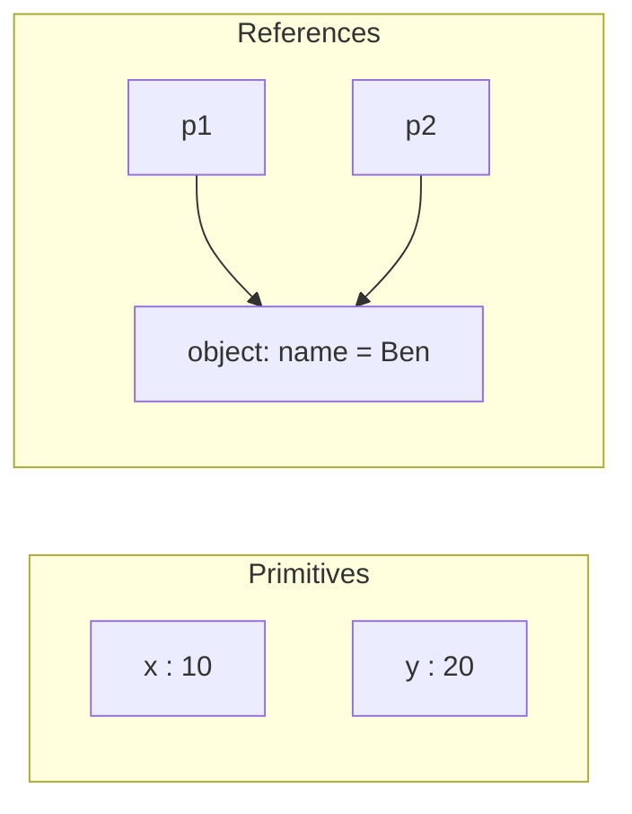

# Chapter 2 — Variables, Types and Operators

Programs store values and compute new ones. This chapter covers **variables** (names for values), **types** (what kind of value something is) and **operators** (`+`, `===`, `&&`, `??` …), plus **type coercion** — the automatic conversion of one type into another — so that `"3" + 4`, `0 == ""` and `0.1 + 0.2` stop being mysteries.

**What you'll learn:** `let`/`const`/`var`; hoisting and the TDZ; the seven primitives, objects and `typeof`; value vs reference; arithmetic, comparison, logical, `??`, `?.`, bitwise and assignment operators and precedence; `==` vs `===`; numbers in depth (precision, `NaN`, `Infinity`, safe integers, `Number` API, `BigInt`); truthy/falsy and explicit conversions.

Code: [`code/`](code/) — every "Output:" block is real Node 24 output. Files are plain `.js` (sloppy-mode scripts) unless noted ([Chapter 1 §1.8](../01-introduction-and-setup/README.md#18-strict-mode)).

---

## 2.1 Variables: `let`, `const` and `var`

### What it is
A **variable** is a named storage slot for a value. **Declare** creates the name (`let score;`), **assign** stores a value (`score = 10;`), **initialise** does both (`let score = 10;`). A declared-but-unassigned variable holds `undefined`. A `const` is a label glued to one value: you can't swap it, but if the value is an object you can still change what's inside.

### How it works — the three keywords
```js
// code/01_declarations.js
let score;                    // declared, no value yet
console.log("score before assignment:", score);
score = 10;                   // assign later
score = score + 5;            // reassign (let allows it)
console.log("score:", score);

const PI_APPROX = 3.14;       // const must be initialised and can't be reassigned
try { eval("PI_APPROX = 3"); } catch (e) { console.log("reassign const ->", e.name + ":", e.message); }

// const protects the BINDING, not the object: the contents can still change.
const cart = { items: 1 };
cart.items = 2;               // allowed: we mutate the object, not the variable
console.log("const object mutated:", cart);

// var: the old way. Function-scoped, can be redeclared, hoisted with value undefined.
var legacy = "first";
var legacy = "second";        // redeclaring with var is silently allowed
console.log("var redeclared:", legacy);
try { eval("let dup = 1; let dup = 2;"); } catch (e) { console.log("let redeclared ->", e.name); }

let a = 1, b = 2, c = a + b;  // several declarations in one statement
console.log("a, b, c =", a, b, c);

const greeting = "Hello";
const who = "World";
console.log(greeting + " " + who);
```

Output:
```
score before assignment: undefined
score: 15
reassign const -> TypeError: Assignment to constant variable.
const object mutated: { items: 2 }
var redeclared: second
let redeclared -> SyntaxError
a, b, c = 1 2 3
Hello World
```

(`eval` runs a string as code — used here only to catch a deliberate error. Don't use it in real code.)

### Comparison table

| | `let` | `const` | `var` |
|---|---|---|---|
| Introduced | ES2015 | ES2015 | original (1995) |
| Scope (where the name is visible) | **block** `{ }` | **block** `{ }` | **function** (or global) |
| Reassign | yes | **no** (`TypeError`) | yes |
| Redeclare in same scope | no (`SyntaxError`) | no | **yes, silently** |
| Must initialise | no | **yes** | no |
| Use before the declaration line | `ReferenceError` (TDZ, §2.2) | `ReferenceError` (TDZ) | gives `undefined` |
| At top level of a classic script, becomes a property of `globalThis` | no | no | **yes** |

Scope is covered in [Chapter 4 §4.5](../04-functions-scope-and-closures/README.md#45-scope-global-function-and-block); in short, `let`/`const` inside `{ }` exist only inside those braces, `var` leaks to the whole function.

### Which one should I use?
1. **`const` by default** — tells the reader the name never re-points.
2. **`let` when the value must change** — counters, accumulators, branch assignments.
3. **`var` never in new code** — recognise it in old code; its function scope, silent redeclaration and hoisting cause the bugs `let`/`const` prevent.

### Naming rules and conventions
- Letters, digits, `_`, `$`; not starting with a digit. Unicode letters work (`café`) but stick to ASCII in shared code. Case-sensitive. Reserved words (`let`, `class`, `return`, `typeof` …) are not allowed.
- **camelCase** for variables/functions (`totalPrice`), **PascalCase** for classes (`ShoppingCart`, [Chapter 9](../09-this-prototypes-and-classes/README.md)), **UPPER_SNAKE_CASE** for fixed config constants (`MAX_RETRIES`). Booleans as questions: `isOpen`, `hasAccess`.

### Common mistakes
- **`const` ≠ read-only object** — it only blocks reassignment; use `Object.freeze` ([Chapter 5](../05-objects-math-date-and-json/README.md)).
- **Forgetting the keyword** — `total = 5` creates an accidental global in sloppy mode, throws in strict mode.
- **Using a block's `let` outside the block** → `ReferenceError`.

### TL;DR
`const` by default, `let` to reassign, `var` only when reading old code. `const` freezes the **binding** (the name→value link), not the value.

---

## 2.2 Hoisting and the Temporal Dead Zone

### What it is
Before running a scope, the engine creates all its declared names — **hoisting**. What differs is the value before the declaration line runs:

| Declaration | Before its line runs |
|---|---|
| `var x` | exists, value `undefined` |
| `let x`, `const x`, `class X` | exists but **uninitialised** — touching it throws `ReferenceError` |
| `function f() {}` | exists and is **fully usable** (covered in [Chapter 4](../04-functions-scope-and-closures/README.md#42-declarations-vs-expressions-and-hoisting)) |

The window between entering the scope and a `let`/`const` declaration line is the **Temporal Dead Zone (TDZ)**.

### Example
```js
// code/02_tdz_and_hoisting.js
console.log("var before its line:", typeof hoistedVar, hoistedVar); // declared + set to undefined at start
var hoistedVar = "ready";

try {
  console.log(notYet);        // let exists but is uninitialised until its line runs
} catch (e) {
  console.log("let before its line ->", e.name + ":", e.message);
}
let notYet = "ready";

try { typeof inZone; let inZone = 1; } catch (e) { console.log("typeof in TDZ ->", e.name); }
{
  // The TDZ is about TIME, not position: a function may mention a later let,
  // as long as it is called after the let line has run.
  const show = () => later;
  let later = "defined by the time show() is called";
  console.log(show());
}
```

Output:
```
var before its line: undefined undefined
let before its line -> ReferenceError: Cannot access 'notYet' before initialization
typeof in TDZ -> ReferenceError
defined by the time show() is called
```

### Why it matters
With `var`, early reads silently give `undefined` and the bug surfaces elsewhere; `let`/`const` fail immediately with a named error. Even `typeof` — normally safe on unknown names — throws in the TDZ.

### In the interview
**"What is the Temporal Dead Zone?"** `let`, `const` and `class` are hoisted — the scope knows them from the start — but not initialised until their declaration is evaluated; access in that window throws `ReferenceError`. `var` is hoisted *and* initialised to `undefined`.

- *Are `let`/`const` hoisted?* Yes — that's why an inner `let x` **shadows** (hides) an outer `x` even on lines above it: you get a TDZ error, not the outer value.
- *Lines or time?* Time: a closure (a function remembering surrounding variables — [Chapter 4](../04-functions-scope-and-closures/README.md)) referring to a later `let` is fine if it runs after the declaration.

### TL;DR
All declarations are hoisted; `var` starts as `undefined`, `let`/`const` start in the TDZ and throw if touched early.

---

## 2.3 Data types and `typeof`

### What it is
JavaScript has **eight** types: seven **primitives** and **object**. It is **dynamically typed**: values have types, variables don't.

| Type | Example values | Notes |
|---|---|---|
| `number` | `42`, `3.14`, `-0`, `Infinity`, `NaN` | One type for integers and decimals: 64-bit floating point (§2.10) |
| `bigint` | `10n`, `2n ** 64n` | Whole numbers of any size (ES2020) |
| `string` | `"hi"`, `'hi'`, `` `hi ${x}` `` | Text, immutable ([Chapter 6](../06-strings-and-regular-expressions/README.md)) |
| `boolean` | `true`, `false` | §2.11 |
| `undefined` | `undefined` | "No value assigned yet" — what JS itself gives you |
| `null` | `null` | "Intentionally empty" — what *you* assign to mean "nothing" |
| `symbol` | `Symbol("id")` | Unique identifiers, mostly for object keys ([Chapter 8](../08-maps-sets-iterators-and-generators/README.md)) |
| **`object`** | `{ a: 1 }`, `[1, 2]`, functions, dates, maps … | Everything that isn't a primitive |

### `typeof` — asking a value its type
```js
// code/03_types_typeof.js (abridged)
for (const [label, value] of samples) {   // samples: [["number", 42], ["null", null], ["array", [1, 2]], ...]
  console.log(label.padEnd(15), "typeof ->", typeof value);
}
```

Output:
```
number          typeof -> number
number (float)  typeof -> number
NaN             typeof -> number
bigint          typeof -> bigint
string          typeof -> string
boolean         typeof -> boolean
undefined       typeof -> undefined
null            typeof -> object
symbol          typeof -> symbol
object          typeof -> object
array           typeof -> object
function        typeof -> function
date            typeof -> object
Array.isArray([1,2]) -> true
value === null      -> true
box: number
box: string
```

Quirks to memorise:
1. **`typeof null === "object"`** — a first-implementation bug that can never be fixed. Test with `value === null`.
2. **`typeof NaN === "number"`** — NaN is a special number value.
3. **Functions give `"function"`** (though they're objects); arrays give `"object"` — use `Array.isArray`.

`typeof` always returns a string and is safe on undeclared names (`"undefined"`), except in a TDZ.

### `undefined` vs `null`
| | `undefined` | `null` |
|---|---|---|
| Meaning | value not set | deliberately empty |
| Who produces it | the language: unassigned variables, missing properties, missing arguments, functions without `return` | your code (and some APIs, e.g. `document.getElementById` when nothing matches) |
| `typeof` | `"undefined"` | `"object"` (quirk) |
| `Number(…)` | `NaN` | `0` |
| `== null` | `true` | `true` |

Idiom: `value == null` is true for both `null` and `undefined` and nothing else — the one widely accepted use of `==`.

### TL;DR
Seven primitives + objects. `typeof` identifies them, except `null` (→ `"object"`) and arrays (use `Array.isArray`).

---

## 2.4 Primitives vs objects

### What it is
- A **primitive** is an **immutable** value; the variable holds the value itself; copying copies the value.
- An **object** is a mutable collection of properties; the variable holds a **reference** (an address). Copying copies the reference, so both variables point at the *same* object.

### Example
```js
// code/04_primitives_vs_objects.js
let x = 10;
let y = x;        // copies the value 10
y = 20;
console.log("x, y:", x, y);

const p1 = { name: "Ana" };
const p2 = p1;    // copies the REFERENCE — both names point at one object
p2.name = "Ben";
console.log("p1.name:", p1.name);

console.log("{} === {}:", {} === {});           // two different objects
console.log("p1 === p2:", p1 === p2);           // same object
console.log("'a' === 'a':", "a" === "a");       // primitives compare by value

const s = "hello";
const upper = s.toUpperCase();                  // string methods return NEW strings
console.log(s, upper);
console.log("length of 'hello':", s.length, "| (255).toString(16):", (255).toString(16));
console.log("typeof new Number(5):", typeof new Number(5), "| typeof Number('5'):", typeof Number("5"));
```

Output:
```
x, y: 10 20
p1.name: Ben
{} === {}: false
p1 === p2: true
'a' === 'a': true
hello HELLO
length of 'hello': 5 | (255).toString(16): ff
typeof new Number(5): object | typeof Number('5'): number
```



### Autoboxing and wrapper objects
Primitives have no properties, yet `"hello".length` works: the engine temporarily wraps the primitive in a **wrapper object** (`String`, `Number`, `Boolean`, `BigInt`, `Symbol`), reads the property and discards it — **autoboxing**.

**Don't** create wrappers with `new Number(5)`/`new String("x")`/`new Boolean(false)`: they're objects (`typeof` → `"object"`, `new Number(5) === 5` is `false`, `new Boolean(false)` is truthy). Call them **without** `new` — `Number("5")`, `String(5)`, `Boolean(0)` — to *convert* to primitives.

### Why it matters
- A function receiving an object can change *your* object ([Chapter 4](../04-functions-scope-and-closures/README.md)).
- `===` on objects means "same object?", not "same contents?".
- React detects changes by checking for a *new* object — hence "don't mutate (change in place) state".

### TL;DR
Primitives: immutable, copied/compared by value. Objects: mutable, copied/compared by reference. Convert with `Number()/String()/Boolean()` without `new`.

---

## 2.5 Arithmetic operators

### What it is
An **operator** takes **operands** and produces a value: unary (`-x`, `!x`), binary (`a + b`), and one ternary (`c ? a : b`, [Chapter 3](../03-control-flow-and-loops/README.md#33-the-conditional-ternary-operator)).

| Operator | Name | Example | Result |
|---|---|---|---|
| `+` | addition (or string concatenation) | `10 + 5` | `15` |
| `-` | subtraction | `10 - 5` | `5` |
| `*` | multiplication | `10 * 5` | `50` |
| `/` | division (always floating point) | `7 / 2` | `3.5` |
| `%` | remainder | `10 % 3` | `1` |
| `**` | exponentiation (ES2016) | `2 ** 10` | `1024` |
| `++` | increment by 1 | `n++` / `++n` | see below |
| `--` | decrement by 1 | `n--` / `--n` | see below |
| unary `+` / `-` | convert to number / negate | `+"42"` | `42` |

### Example
```js
// code/05_arithmetic.js (abridged)
console.log("7 / 2 =", 7 / 2, "(no integer division)");
console.log("Math.trunc(7 / 2) =", Math.trunc(7 / 2));
console.log("-7 % 3 =", -7 % 3, "(sign follows the left operand)");
console.log("1 / 0 =", 1 / 0, "| -1 / 0 =", -1 / 0, "| 0 / 0 =", 0 / 0);

let n = 5;
console.log("n++ returns", n++, "then n is", n);   // returns old value
console.log("++n returns", ++n, "then n is", n);   // returns new value

console.log('"3" + 4 =', "3" + 4);
console.log('"3" - 4 =', "3" - 4);
console.log('"3" * "4" =', "3" * "4");
console.log('1 + 2 + "3" =', 1 + 2 + "3");
console.log('"1" + 2 + 3 =', "1" + 2 + 3);
console.log('+"42" =', +"42", '| -"5" =', -"5", '| +"" =', +"", '| +"abc" =', +"abc");
```

Output:
```
7 / 2 = 3.5 (no integer division)
Math.trunc(7 / 2) = 3
-7 % 3 = -1 (sign follows the left operand)
1 / 0 = Infinity | -1 / 0 = -Infinity | 0 / 0 = NaN
n++ returns 5 then n is 6
++n returns 7 then n is 7
"3" + 4 = 34
"3" - 4 = -1
"3" * "4" = 12
1 + 2 + "3" = 33
"1" + 2 + 3 = 123
+"42" = 42 | -"5" = -5 | +"" = 0 | +"abc" = NaN
```

### How it works — the rules behind the surprises
1. **Division never throws:** `±Infinity` for division by zero; `0 / 0` is `NaN`.
2. **`%` is remainder, not modulo:** sign of the left operand (`-7 % 3` is `-1`). Always-positive modulo: `((a % n) + n) % n`.
3. **Prefix vs postfix:** both change `n`; postfix `n++` *returns* the old value, prefix `++n` the new one. Alone on a line, no difference.
4. **`+` is overloaded:** if either operand (after converting objects to primitives) is a string, it concatenates; otherwise adds. Left to right: `1 + 2 + "3"` → `"33"`, `"1" + 2 + 3` → `"123"`.
5. **Other arithmetic operators always convert to numbers:** `"3" - 4` → `-1`.
6. **Unary `+`** is the shortest number conversion; `""` → `0`, non-numeric text → `NaN`.
7. **`-2 ** 2` is a `SyntaxError`** — write `(-2) ** 2` or `-(2 ** 2)`. `**` is right-associative: `2 ** 3 ** 2` = `2 ** 9` = `512`.

### Common mistakes
- Form values are strings: `"2" + "3"` → `"23"`. Convert first: `Number(input.value)`.
- Expecting `7 / 2` to be `3` — use `Math.trunc`/`floor`/`round` ([Chapter 5](../05-objects-math-date-and-json/README.md)).

---

## 2.6 Comparison operators and equality

### What it is
Comparisons always produce a **boolean**.

| Operator | Meaning | Converts types? |
|---|---|---|
| `===` | strictly equal: same type **and** same value | no |
| `!==` | strictly not equal | no |
| `==` | loosely equal: equal after converting types | **yes** |
| `!=` | loosely not equal | **yes** |
| `>` `<` `>=` `<=` | greater / less (or equal) | yes (to number, unless both are strings) |

### Example
```js
// code/06_comparison_equality.js (abridged)
const x = 5, y = "5";
console.log("x == y  :", x == y);
console.log("x === y :", x === y);
console.log("x != y  :", x != y);
console.log("x !== y :", x !== y);
console.log("x > 2, x < 10, x >= 5, x <= 5:", x > 2, x < 10, x >= 5, x <= 5);
// ... loops over a table of pairs, printing == and === for each
```

Output:
```
x == y  : true
x === y : false
x != y  : false
x !== y : true
x > 2, x < 10, x >= 5, x <= 5: true true true true
--- loose equality surprises ---
0         == ""        -> true  | === -> false
0         == "0"       -> true  | === -> false
""        == "0"       -> false | === -> false
false     == "0"       -> true  | === -> false
false     == ""        -> true  | === -> false
null      == undefined -> true  | === -> false
null      == 0         -> false | === -> false
undefined == 0         -> false | === -> false
NaN       == NaN       -> false | === -> false
[1]       == 1         -> true  | === -> false
[]        == ""        -> true  | === -> false
[1,2]     == "1,2"     -> true  | === -> false
--- relational comparisons ---
"10" < "9"  : true (both strings: compared character by character)
"10" < 9    : false (one number: string converted to number)
"apple" < "banana": true | "Z" < "a": true
null >= 0   : true | null == 0: false
NaN < 1, NaN >= 1: false false
--- Object.is ---
NaN === NaN: false | Object.is(NaN, NaN): true
0 === -0: true | Object.is(0, -0): false
```

`0 == ""` and `0 == "0"` are true, yet `"" == "0"` is false: loose equality isn't even **transitive** — the main reason to avoid it.

### How it works — the `==` algorithm (simplified from the spec)
For `a == b`:
1. **Same type** → compare like `===`.
2. **`null` and `undefined`** equal each other and **nothing else** (`null == 0` is false).
3. **Number vs string** → string to number (`""` → `0`).
4. **Boolean vs anything** → boolean to number first. So `false == "0"` is true, and `if (x == true)` is a trap: `"2" == true` → `2 == 1` → false.
5. **Object vs primitive** → object to primitive (`valueOf`/`toString`; arrays join: `[1,2]` → `"1,2"`, `[]` → `""`), compare again.
6. **BigInt vs number** → compare mathematical values (`1n == 1` is true).
7. **`NaN`** equals nothing, including itself.

`===` skips all that: different types → `false`. Remaining oddities: `NaN === NaN` is `false`, `0 === -0` is `true`; `Object.is(a, b)` is `===` with those two fixed.

### Relational comparisons (`<`, `>` …)
1. Objects → primitives.
2. **Both strings** → compared by UTF-16 code unit (JS stores text as 16-bit **code units**, one or two per character) — dictionary order by character code: `"10" < "9"`, and uppercase before lowercase (`"Z" < "a"`). For human sorting use `localeCompare` ([Chapter 6](../06-strings-and-regular-expressions/README.md)).
3. Otherwise both → numbers. `null` → `0`, so `null >= 0` is true though `null == 0` is false. Anything vs `NaN` is false.

### Trade-offs — `==` vs `===`

| | `===` | `==` |
|---|---|---|
| Predictable | yes | needs the rules above |
| Catches type bugs | yes (`"5" === 5` false) | hides them |
| Useful idiom | — | `x == null` (null **or** undefined) |
| Linters (tools that scan code for likely bugs; ESLint rule `eqeqeq`) | recommended | flagged, except `== null` if configured |

### In the interview
**30-second answer — "Difference between `==` and `===`?"** `===` compares type and value with no conversion. `==` converts first: null/undefined equal only each other; strings and booleans become numbers; objects become primitives. That makes `==` non-transitive (`0 == ""`, `0 == "0"`, but `"" != "0"`), so I use `===` everywhere except `x == null`.

- *Check for `NaN`?* `Number.isNaN(x)` (or `Object.is(x, NaN)`); `x === NaN` is always false.
- *`[] == ![]`?* `true`: `![]` is `false`, then `[] == false` → `"" == 0` → `0 == 0`.
- *`null >= 0` true but `null == 0` false?* Relational operators convert `null` to `0`; `==` has the special null/undefined rule.

### TL;DR
Use `===`/`!==`. String-vs-string compares by character code, everything else numerically; `NaN` compares false with everything.

---

## 2.7 Logical operators, `??` and `?.`

### What it is

| Operator | Name | Returns |
|---|---|---|
| `a && b` | AND | `a` if `a` is falsy, otherwise `b` |
| `a \|\| b` | OR | `a` if `a` is truthy, otherwise `b` |
| `!a` | NOT | `true` if `a` is falsy, else `false` (always a boolean) |
| `a ?? b` | nullish coalescing (ES2020) | `a` unless it is `null`/`undefined`, then `b` |
| `a?.b`, `a?.[k]`, `a?.()` | optional chaining (ES2020) | `undefined` if `a` is `null`/`undefined`, otherwise the normal access/call |

**`&&` and `||` return one of their operands**, not necessarily a boolean (*truthy*/*falsy*: §2.11).

### How it works — short-circuit evaluation
- `&&` returns the **first falsy** operand (or the last), `||` the **first truthy** (or the last) — and stop evaluating there.
- So the right side may never run: `user && user.logout()`, `isDebug && console.log(...)`.

### Example
```js
// code/07_logical_nullish_optional.js (abridged — each output line labels its expression)
const settings = { volume: 0, title: "", theme: null };
console.log("volume || 50:", settings.volume || 50, "| volume ?? 50:", settings.volume ?? 50);

const cfg = { retries: 0, name: "", port: undefined };
cfg.retries ||= 3;    // 0 is falsy -> replaced
cfg.name ??= "app";   // "" is not nullish -> kept
cfg.port ??= 8080;    // undefined -> replaced
let token = "abc"; token &&= token.toUpperCase();
console.log(cfg, token);
```

Output (full run):
```
t && f: false | t || f: true | !f: true
"cat" && "dog": dog
"" && "dog": ""
0 || "default": default
"" || null || 0: 0
!!'text': true | !!0: false
right side evaluated 0 times
volume || 50: 50 | volume ?? 50: 0
title || "Untitled": Untitled | title ?? "Untitled": ""
theme ?? "light": light
user.address?.city: undefined
user.profile?.photo?.url: undefined
user.greet?.(): hi | user.wave?.(): undefined
user.tags?.[0]: undefined
without ?. -> TypeError
{ retries: 3, name: '', port: 8080 } ABC
true || false && false: true
mixing ?? and || without () -> SyntaxError
(null || undefined) ?? 'x': x
```

### `||` vs `??` for defaults
`||` falls back on **any falsy** value, discarding legitimate `0`, `""`, `false` (`volume || 50` loses a real volume of 0). `??` falls back **only on `null`/`undefined`**. Use `??` for defaults unless you really mean "any falsy".

### Optional chaining `?.`
Reading a property of `null`/`undefined` throws `TypeError`. With `?.`, if the left side is `null`/`undefined` the **whole chain** short-circuits to `undefined`. Forms: `obj?.prop`, `obj?.[expr]`, `fn?.(args)`. You can't assign through it (`obj?.x = 1` is a `SyntaxError`).

### Logical assignment (ES2021)
| Operator | Equivalent | Assigns when `a` is… |
|---|---|---|
| `a \|\|= b` | `a \|\| (a = b)` | falsy |
| `a &&= b` | `a && (a = b)` | truthy |
| `a ??= b` | `a ?? (a = b)` | `null` / `undefined` |

They short-circuit: if no assignment is needed, `b` isn't evaluated.

### Common mistakes
- **`if (x = 5)`** assigns (and `5` is truthy); you meant `===`.
- **Overusing `?.`** on values that *must* exist hides bugs behind `undefined`.
- **Mixing `??` with `||`/`&&` without parentheses** → `SyntaxError`.
- `&&` binds tighter than `||`: `a || b && c` is `a || (b && c)`.

### TL;DR
`&&`/`||` short-circuit and return an operand. `??` for defaults (keeps `0`, `""`), `?.` for possibly-missing data, `||=`/`&&=`/`??=` to assign conditionally.

---

## 2.8 Bitwise and assignment operators

### Bitwise operators
**Bitwise** operators treat numbers as 32-bit signed integers and work per binary digit (**bit**). Used in low-level code (graphics, compression, hashing, permission flags) and interview puzzles.

| Operator | Name | Rule per bit |
|---|---|---|
| `&` | AND | 1 if both bits are 1 |
| `\|` | OR | 1 when either bit (or both) is 1 |
| `^` | XOR | 1 if the bits differ |
| `~` | NOT | flips every bit (`~x` equals `-x - 1`) |
| `<<` | left shift | moves bits left, filling with 0 (×2 per step) |
| `>>` | sign-propagating right shift | moves bits right, copying the sign bit (÷2, rounding down) |
| `>>>` | zero-fill right shift | moves bits right, filling with 0 (result is unsigned) |

```js
// code/08_bitwise_assignment.js (first half)
let c = 5, d = 2;               // 5 = 101, 2 = 010
console.log("c & d  =", c & d, bin(c & d));
console.log("c | d  =", c | d, bin(c | d));
console.log("c ^ d  =", c ^ d, bin(c ^ d));
console.log("~d     =", ~d);
console.log("c << 1 =", c << 1);
console.log("c >> 1 =", c >> 1, "| -5 >> 1 =", -5 >> 1, "(keeps sign)");
console.log("c >>> 1 =", c >>> 1, "| -5 >>> 1 =", -5 >>> 1, "(fills with 0)");
const READ = 1, WRITE = 2, EXEC = 4;
let perms = READ | WRITE;
console.log("can write?", (perms & WRITE) !== 0, "| can exec?", (perms & EXEC) !== 0);
```

Output:
```
c & d  = 0 000
c | d  = 7 111
c ^ d  = 7 111
~d     = -3
c << 1 = 10
c >> 1 = 2 | -5 >> 1 = -3 (keeps sign)
c >>> 1 = 2 | -5 >>> 1 = 2147483645 (fills with 0)
can write? true | can exec? false
```

`101 & 010` shares no 1-bit → 0; OR and XOR both give `111` = 7. `~2` = `-3` (**two's complement**: negatives stored as "flip all bits, add 1"). The **flags** idiom packs yes/no settings into one number: each flag a power of two, `|` combines, `&` tests (as in Unix `chmod 755`).

Caveat: operands are truncated to 32-bit integers, so bitwise ops break beyond ±2³¹ (~2.1 billion). Prefer `Math.trunc` over the old `x | 0` trick.

### Assignment operators
**Compound assignment** combines an operation with `=`: `x += y` means `x = x + y`.

| Operator | Same as | | Operator | Same as |
|---|---|---|---|---|
| `x = y` | assign | | `x <<= y` | `x = x << y` |
| `x += y` | `x = x + y` | | `x >>= y` | `x = x >> y` |
| `x -= y` | `x = x - y` | | `x >>>= y` | `x = x >>> y` |
| `x *= y` | `x = x * y` | | `x &= y` | `x = x & y` |
| `x /= y` | `x = x / y` | | `x \|= y` | `x = x \| y` |
| `x %= y` | `x = x % y` | | `x ^= y` | `x = x ^ y` |
| `x **= y` | `x = x ** y` | | `\|\|=` `&&=` `??=` | §2.7 |

```js
// code/08_bitwise_assignment.js (second half, abridged — the file applies every operator in turn)
let p, q;
p = q = 7;                      // right to left: q = 7, then p = (q = 7) which is 7
console.log("p, q:", p, q);     // p, q: 7 7
```

An assignment is an expression whose value is the assigned value — which makes `p = q = 7` work and `if (x = 5)` a silent bug.

---

## 2.9 Operator precedence

**Precedence** decides which operator applies first (`2 + 3 * 4` is `14`); **associativity** orders equal-precedence operators (mostly left-to-right; `**`, assignment and `?:` right-to-left). Highest to lowest (simplified):

| Level | Operators |
|---|---|
| 1 | `( … )` grouping |
| 2 | `.` `[]` `?.` function call `()` `new` with arguments |
| 3 | postfix `x++` `x--` |
| 4 | `!` `~` unary `+` `-` prefix `++x` `--x` `typeof` `void` `delete` `await` |
| 5 | `**` (right-to-left) |
| 6 | `*` `/` `%` |
| 7 | `+` `-` |
| 8 | `<<` `>>` `>>>` |
| 9 | `<` `<=` `>` `>=` `in` `instanceof` |
| 10 | `==` `!=` `===` `!==` |
| 11–13 | `&`, then `^`, then `\|` |
| 14 | `&&` |
| 15 | `\|\|` and `??` (cannot be mixed without parentheses) |
| 16 | `? :` (right-to-left) |
| 17 | `=` and all compound assignments, `=>` (right-to-left) |
| 18 | `,` comma |

Don't memorise it — **when in doubt, add parentheses**.

---

## 2.10 Numbers in depth

### What it is
All ordinary numbers are **64-bit IEEE-754 double-precision floating-point** values ("doubles", like `double` in Java/C). **Floating point** stores significant digits plus an exponent (like 1.23 × 10⁵), giving huge range but approximating most decimal fractions. Consequences:
- about 15–17 significant decimal digits of precision;
- integers exact only up to **2⁵³ − 1** (9,007,199,254,740,991);
- `0.1` can't be stored exactly in binary (like 1/3 in decimal);
- special values `Infinity`, `-Infinity`, `NaN` and a separate `-0`.

The global **`Number`** holds constants and helpers; `Number(value)` converts (never use `new Number`, §2.4).

### Example
`code/09_numbers.js` prints (each line labels the expression it evaluates):
```
0.1 + 0.2 = 0.30000000000000004
0.1 + 0.2 === 0.3 ? false
close enough? true
money in cents: 10 + 20 = 0.3
MAX_VALUE         1.7976931348623157e+308
MIN_VALUE         5e-324
MAX_SAFE_INTEGER  9007199254740991
MIN_SAFE_INTEGER  -9007199254740991
EPSILON           2.220446049250313e-16
POSITIVE_INFINITY Infinity | NEGATIVE_INFINITY -Infinity
MAX_VALUE * 2     Infinity
2**53 + 1         9007199254740992 (not representable!)
isSafeInteger(2**53): false
literals: 1000000 255 15 10 1500 0.002 0.5
toFixed(2): 123.46 | toFixed(0): 123
toPrecision(4): 123.5 | toPrecision(2): 1.2e+2
(255).toString(2): 11111111 | (255).toString(16): ff
(1.005).toFixed(2): 1.00 (binary rounding!)
toLocaleString: 1,234,567.891 | 1.234.567,891
valueOf of wrapper: 7
parseInt('123px'): 123 | parseInt('px123'): NaN
parseInt('ff', 16): 255 | parseInt('101', 2): 5
parseFloat('3.14abc'): 3.14
Number('123px'): NaN | Number(''): 0 | Number(' 42 '): 42
Number(null): 0 | Number(undefined): NaN | Number(true): 1
isInteger(5.0): true | isInteger(5.5): false
isFinite('5'): true | Number.isFinite('5'): false
isNaN('abc'): true | Number.isNaN('abc'): false | Number.isNaN(NaN): true
2n ** 64n = 18446744073709551616n | typeof: bigint
9007199254740993n + 1n = 9007199254740994n
7n / 2n = 3n (truncates)
1n + 1 -> TypeError: Cannot mix BigInt and other types, use explicit conversions
BigInt(10) + 1n = 11n | Number(5n) + 1 = 6
```

### Number literals
| Form | Example | Value |
|---|---|---|
| decimal | `42`, `3.14`, `.5` | |
| exponent | `1.5e3`, `2e-3` | 1500, 0.002 |
| hex / octal / binary | `0xff`, `0o17`, `0b1010` | 255, 15, 10 |
| numeric separators (ES2021) | `1_000_000` | 1000000 (underscores are ignored, just for readability) |
| BigInt | `123n` | a `bigint` |

### `Number` properties

| Property | Value | Meaning |
|---|---|---|
| `Number.MAX_VALUE` | ≈ 1.797e308 | largest finite number; beyond it you get `Infinity` |
| `Number.MIN_VALUE` | 5e-324 | smallest **positive** number (closest to zero) — *not* the most negative number |
| `Number.MAX_SAFE_INTEGER` | 2⁵³ − 1 | largest integer `n` such that `n` and `n + 1` are both exactly representable |
| `Number.MIN_SAFE_INTEGER` | −(2⁵³ − 1) | the negative counterpart |
| `Number.EPSILON` | ≈ 2.22e-16 | gap between 1 and the next representable double; a tolerance for comparing decimals near 1 |
| `Number.POSITIVE_INFINITY` / `NEGATIVE_INFINITY` | `Infinity` / `-Infinity` | results of overflow or division by zero |
| `Number.NaN` | `NaN` | same as the global `NaN` |

### `Number` methods

**Instance methods** (on a number value; return strings except `valueOf`):

| Method | What it does | Example → result |
|---|---|---|
| `toFixed(d)` | round to `d` digits after the decimal point | `(123.456).toFixed(2)` → `"123.46"` |
| `toPrecision(p)` | round to `p` significant digits (may switch to exponent form) | `(123.456).toPrecision(4)` → `"123.5"` |
| `toString(radix)` | write in base 2–36 | `(255).toString(16)` → `"ff"` |
| `toLocaleString(locale)` | format for humans (separators, currency) using a locale (e.g. `"en-US"`) | `(1234.5).toLocaleString("en-US")` → `"1,234.5"` |
| `valueOf()` | the primitive inside a `Number` wrapper | `new Number(7).valueOf()` → `7` |

On an integer literal, wrap it: `(255).toString(16)` — `255.toString()` is a syntax error (the dot reads as a decimal point).

**Static methods** (on `Number`):

| Method | What it does | Watch out |
|---|---|---|
| `Number.isFinite(v)` | `true` only for finite *numbers* | the global `isFinite("5")` converts first and says `true` |
| `Number.isInteger(v)` | integer-valued number? | `5.0` is an integer (it's the same value as `5`) |
| `Number.isSafeInteger(v)` | integer within ±(2⁵³ − 1)? | use before trusting large IDs |
| `Number.isNaN(v)` | is it exactly `NaN`? | the global `isNaN("abc")` converts first and says `true` |
| `Number.parseFloat(s)` | read a decimal from the *start* of a string | stops at the first invalid character |
| `Number.parseInt(s, radix)` | read an integer from the *start* of a string in base `radix` | **always pass the radix** (usually 10) |

`parseInt`/`parseFloat` read a leading number and ignore the rest (`"123px"` → `123`, good for CSS values); `Number()` needs the *whole* trimmed string numeric, else `NaN`, and treats `""` as `0`.

### `NaN` and `Infinity`
- **`NaN`** results from failed numeric operations (`Number("abc")`, `0 / 0`, `Math.sqrt(-1)`), spreads through arithmetic, and is the only value not equal to itself. Use `Number.isNaN`.
- **`Infinity`** results from overflow or division by zero. `Number.isFinite(x)` rejects `±Infinity` and `NaN` at once.

### Floating-point precision — what to do about it
1. **Never compare decimals with `===`**: `Math.abs(a - b) < 1e-9` (or `Number.EPSILON` near 1).
2. **Money in integer cents** (store 1999, show 19.99) or a decimal library — payment APIs like Stripe take the smallest currency unit for this reason.
3. **Round only for display** (`toFixed`, `Intl.NumberFormat`/`toLocaleString`). `toFixed` rounds the *binary* value: `(1.005).toFixed(2)` is `"1.00"` (stored as 1.00499999…).
4. **Integers beyond 2⁵³** (DB IDs, X post IDs, nanosecond timestamps) lose precision silently — keep them as **strings** or **`BigInt`**.

### `BigInt`
`bigint` (ES2020): whole numbers of any size, written `10n` or `BigInt(10)`. **No mixing** with `number` in arithmetic (`TypeError`) — convert explicitly; division truncates (`7n / 2n` → `3n`); `Math` rejects BigInts; `JSON.stringify` can't serialise them without help. Use for big IDs, cryptography, exact large-integer maths; `number` otherwise (faster).

### In the interview
**"Why is `0.1 + 0.2 !== 0.3`?"** Numbers are IEEE-754 binary doubles; 0.1 and 0.2 have no exact binary form, so each is the nearest double and their sum is the double just above 0.3 (0.30000000000000004). Compare with a tolerance or use integer units like cents.

- *`Number.MAX_SAFE_INTEGER`?* 2⁵³ − 1; above it not every integer is representable (`2**53 + 1 === 2**53`). Big IDs → strings or BigInt.
- *`isNaN` vs `Number.isNaN`?* The global converts first (`isNaN("abc")` true); `Number.isNaN` is true only for `NaN`.
- *`parseInt("08")`?* `8` in modern engines — still pass the radix. `parseInt(0.0000005)` is `5` (the number becomes the string `"5e-7"` first).

### Self-check
1. `Number("")` vs `parseInt("")`? → `0` vs `NaN`.
2. `Number.MIN_VALUE`? → Smallest *positive* double, 5e-324.
3. `typeof NaN`? → `"number"`.
4. `10n + 5`? → `TypeError`.

### TL;DR
One `number` type (64-bit float): exact integers to 2⁵³ − 1, inexact decimals, `NaN`, `±Infinity`. `Number.isNaN/isFinite/isInteger`; `toFixed` for display; cents for money; `BigInt` for huge integers.

---

## 2.11 Booleans, truthy and falsy

### What it is
**boolean** has two values, `true` and `false`; conditions (`if`, `while`, `? :`, [Chapter 3](../03-control-flow-and-loops/README.md)) consume them. Any value can be a condition: **falsy** values become `false`, **everything else is truthy**.

| Falsy values (the complete list) |
|---|
| `false` |
| `0`, `-0` and `0n` (BigInt zero) |
| `""` — the empty string, whichever quotes are used |
| `null` |
| `undefined` |
| `NaN` |

(Plus the legacy browser oddity `document.all`.) Surprising **truthy** values: `"0"`, `"false"`, `" "`, `[]`, `{}`, `-1`, `Infinity`, every function, every wrapper object — including `new Boolean(false)`.

### Example
```js
// code/10_boolean_truthiness.js (abridged — each output line labels its expression)
if (false || 0 || "" || null || undefined || NaN) {
  console.log("never printed");
} else {
  console.log("All values are falsy.");
}
const wrapped = new Boolean(false);
console.log("if (new Boolean(false)) runs?", wrapped ? "yes (object is truthy)" : "no");
```

Output:
```
falsy: false->false  0->false  -0->false  0n->false  ""->false  null->false  undefined->false  NaN->false
truthy: true
All values are falsy.
Boolean("hi"): true | !!"": false | !!42: true
typeof wrapped: object | valueOf(): false
if (new Boolean(false)) runs? yes (object is truthy)
new Boolean(true).valueOf(): true | toString(): true
isAdult: true boolean
true + true = 2 | [true, false, true].filter(Boolean).length = 2
```

(All six `||` operands are falsy, so it returns the last, `NaN`, and the `else` runs.)

### Converting to boolean
- **`Boolean(value)`** — explicit; **`!!value`** — double NOT shorthand; **`array.filter(Boolean)`** — drops falsy entries.

### The `Boolean` wrapper object
`new Boolean(x)` is an object (methods: `valueOf()`, `toString()`) and therefore *always truthy*, even `new Boolean(false)`. Use `Boolean(x)` without `new`.

### Common mistakes
- **`if (arr)` for "non-empty"** — `[]` is truthy; use `arr.length > 0`.
- **`if (count)` when `0` is valid** — use `count !== undefined` or `??`.
- **`if (x == true)`** — `true` becomes `1`, so `"yes" == true` is false. Use `if (x)` or `x === true`.
- **`"false"` from a form/URL** is truthy — compare `value === "true"`.

### In the interview
**"List the falsy values."** `false`, `0`, `-0`, `0n`, `""`, `null`, `undefined`, `NaN` (plus legacy `document.all`). Everything else — including `"0"`, `[]`, `{}`, `new Boolean(false)` — is truthy.

- *`!!"false"`?* `true` — non-empty string.
- *Why is `new Boolean(false)` truthy?* All objects are truthy.

### TL;DR
Eight falsy values; everything else truthy. Convert with `Boolean(x)` or `!!x`; never `new Boolean`.

---

## 2.12 Type conversion summary

**Type conversion** (**coercion**) turns a value of one type into another — **explicit** when you ask (`Number(x)`, `String(x)`, `Boolean(x)`), **implicit** when an operator does it (`"3" * 2`, `if (x)`, `x == y`).

```js
// code/11_conversions.js (the table loop)
const values = ["42", "", " ", "4px", "0x1f", null, undefined, true, false, [], [7], [1, 2], {}];
for (const v of values) {
  console.log(show(v).padEnd(10), String(Number(v)).padEnd(10), JSON.stringify(String(v)).padEnd(18), Boolean(v));
}
```

Output:
```
value      Number()   String()           Boolean()
"42"       42         "42"               true
""         0          ""                 false
" "        0          " "                true
"4px"      NaN        "4px"              true
"0x1f"     31         "0x1f"             true
null       0          "null"             false
undefined  NaN        "undefined"        false
true       1          "true"             true
false      0          "false"            false
[]         0          ""                 true
[7]        7          "7"                true
[1,2]      NaN        "1,2"              true
{}         NaN        "[object Object]"  true
parseInt vs Number on '08.5kg': 8 NaN
String(123) + 1 = 1231 | `${123}`: 123
```

1. **To number:** whitespace-only → `0`; numeric strings (incl. `0x…`, `0b…`, `0o…`) → the number; other text → `NaN`; `null` → `0`, `undefined` → `NaN`, booleans → `1`/`0`; objects → primitive first (arrays → joined string).
2. **To string:** arrays join with commas (`[]` → `""`); plain objects → `"[object Object]"` (use `JSON.stringify` to see contents).
3. **To boolean:** the §2.11 falsy list → `false`; else `true`.

| Context | Converts to |
|---|---|
| `if`, `while`, `? :`, `!`, `&&`, `\|\|` | boolean |
| `-` `*` `/` `%` `**`, unary `+`/`-`, `<` `>` (unless both strings) | number |
| `+` when either side is a string; template literals `` `${x}` `` | string |
| `==` | follows the §2.6 algorithm |

Prefer **explicit** conversions (`Number(input.value)`) and `===`.

---

## Chapter 2 TL;DR

- **Declare** with `const` (default) or `let`; avoid `var` (function-scoped, redeclarable, hoisted as `undefined`). `let`/`const` are block-scoped and throw in the **TDZ**.
- **Types:** seven primitives (`number`, `bigint`, `string`, `boolean`, `undefined`, `null`, `symbol`) + objects. `typeof null` is `"object"`; use `Array.isArray`.
- **Primitives** are immutable, copied by value; **objects** copied and compared by reference.
- **Arithmetic:** `/` is floating point; `%` keeps the left sign; `+` concatenates if either side is a string; postfix `++` returns the old value.
- **Equality:** `===`; `==` coerces non-transitively (`x == null` is the exception). `Object.is` fixes `NaN` and `-0`.
- **Logic:** `&&`/`||` short-circuit and return operands; `??` defaults only on `null`/`undefined`; `?.` reads possibly-missing data; `||=`, `&&=`, `??=` assign conditionally.
- **Numbers:** IEEE-754 doubles — `0.1 + 0.2 !== 0.3`, safe integers to 2⁵³ − 1, `NaN`/`Infinity`; `Number.isNaN`, `toFixed` for display, cents for money, `BigInt` for huge integers; `parseInt(s, 10)` vs `Number(s)` differ on trailing text.
- **Truthiness:** falsy = `false, 0, -0, 0n, "", null, undefined, NaN`; everything else (incl. `[]`, `"0"`, `new Boolean(false)`) truthy.

Next: [Chapter 3 — Control Flow and Loops](../03-control-flow-and-loops/README.md).
