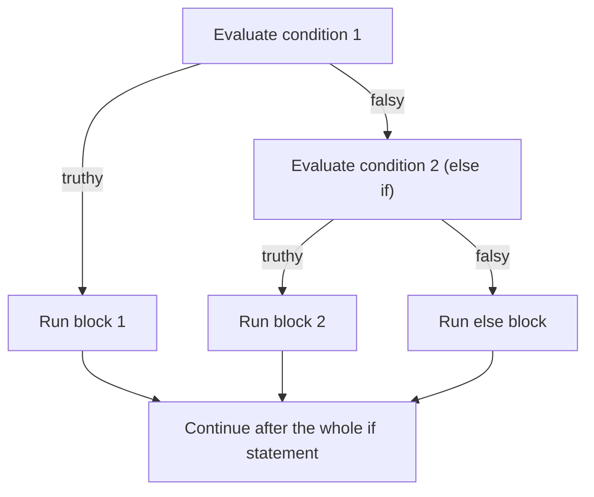
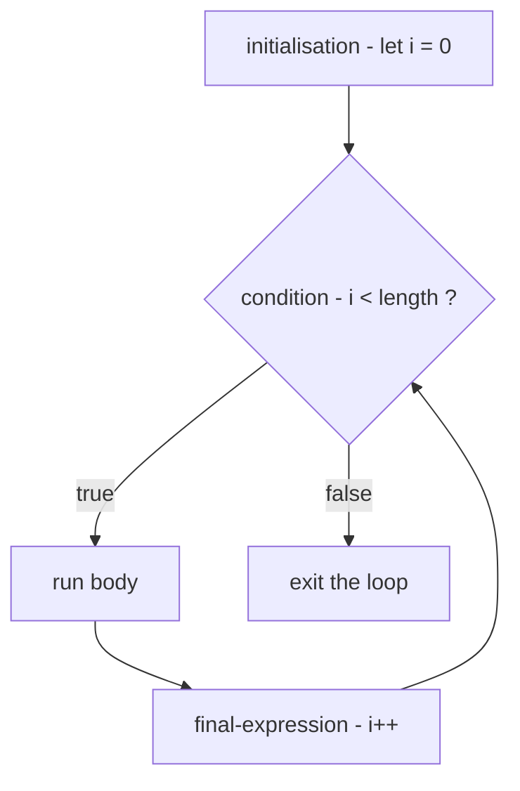
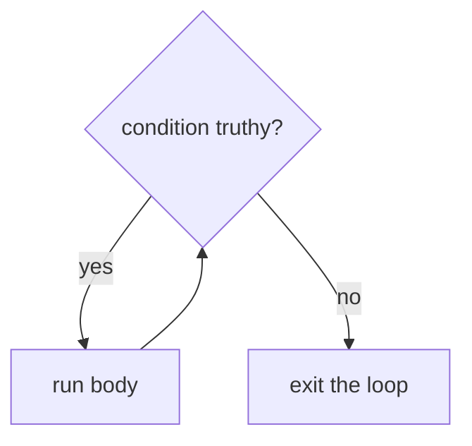
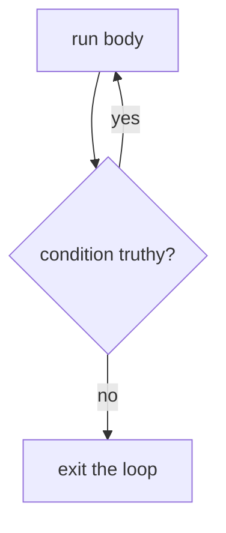

# Chapter 3 — Control Flow and Loops

By default a program runs each statement once, top to bottom. **Control flow** changes that: *choosing* which statements run (conditionals) and *repeating* them (loops). With the values and operators of [Chapter 2](../02-variables-types-and-operators/README.md), these are enough to express any **algorithm** (a precise step-by-step recipe).

**What you'll learn:** `if`/`else if`/`else`, guard clauses and truthiness in conditions; the ternary `? :`; `switch` (cases, `default`, `break`, grouping, strict comparison, fall-through); the five loops `for`, `while`, `do…while`, `for…in`, `for…of`; nested loops; `break`, `continue`, labels; choosing a loop (or an array method).

Code: [`code/`](code/). Every "Output:" block is real Node 24 output.

---

## 3.1 Conditional statements — making decisions

### What it is
A **conditional statement** evaluates a **condition** and, depending on whether it is truthy or falsy, runs one block or another.

| Tool | Best for |
|---|---|
| `if … else if … else` | any conditions, including ranges and combinations (`age >= 18 && hasId`) |
| `switch` | comparing **one** value against many fixed options (`"Mon"`, `"Tue"` …) |
| `condition ? a : b` | choosing between two **values** inside an expression |

### Where you meet them in real applications
- **Form validation** — enable Submit only when the email looks valid.
- **Authentication and permissions** (who the user is, what they may do) — show the admin panel only if logged in *and* admin.
- **UI** (user interface) — toggle a menu; apply dark mode if preferred.
- **Filtering** — show products inside the selected price range.
- **Error handling** — HTTP status 404 → "Not found", 500 → "Try again later" (2xx success, 4xx client error, 5xx server error — [System Design Fundamentals](../../../system-design-patterns/modules/00-system-design-fundamentals/README.md)).

### TL;DR
`if` handles anything, `switch` one-value-many-options, the ternary chooses between two values.

---

## 3.2 `if`, `else` and `else if`

### What it is
- **`if (condition) { … }`** runs the block only when the condition is truthy.
- **`else { … }`** (optional) runs when it is falsy.
- **`else if (condition) { … }`** (any number) adds conditions tested **in order**; the first truthy one wins, the rest are skipped.

### How it works


Conditions are converted with the truthy/falsy rules ([Chapter 2 §2.11](../02-variables-types-and-operators/README.md#211-booleans-truthy-and-falsy)); at most **one** block of the chain runs.

### Example
```js
// code/01_if_else.js (part 1)
function votingMessage(age) {
  if (age >= 18) {
    return "You can vote.";
  } else {
    return "Not old enough to vote yet.";
  }
}
console.log("age 18 ->", votingMessage(18));
console.log("age 16 ->", votingMessage(16));

function letterGrade(score) {
  if (score >= 90) {
    return "A";
  } else if (score >= 80) {
    return "B";
  } else if (score >= 70) {
    return "C";
  } else if (score >= 60) {
    return "D";
  } else {
    return "F";
  }
}
for (const s of [95, 85, 75, 65, 40]) console.log(`score ${s} -> grade ${letterGrade(s)}`);

function badGrade(score) {
  if (score >= 70) return "C";   // checked first, so 95 also lands here
  if (score >= 90) return "A";
  return "F";
}
console.log("wrong order: 95 ->", badGrade(95));
```

Output:
```
age 18 -> You can vote.
age 16 -> Not old enough to vote yet.
score 95 -> grade A
score 85 -> grade B
score 75 -> grade C
score 65 -> grade D
score 40 -> grade F
wrong order: 95 -> C
```

(Functions are covered in [Chapter 4](../04-functions-scope-and-closures/README.md); `for…of` in §3.10.) Order checks **from most specific to least specific**: in `badGrade` the broad `>= 70` catches 95 before `>= 90` is reached.

### Conditions are truthy/falsy, not just `true`/`false`
```js
// code/01_if_else.js (part 2)
const inputs = ["", "Ana", 0, 3, null, []];
for (const v of inputs) {
  console.log(JSON.stringify(v).padEnd(6), v ? "truthy -> if-branch" : "falsy  -> else-branch");
}
```
Output:
```
""     falsy  -> else-branch
"Ana"  truthy -> if-branch
0      falsy  -> else-branch
3      truthy -> if-branch
null   falsy  -> else-branch
[]     truthy -> if-branch
```

`if (name)` reads well for "non-empty string", but `0`/`""` are falsy and `[]` truthy — compare explicitly when it matters (`items.length > 0`).

### Guard clauses — flatter code
A **guard clause** handles a special case at the top of a function and returns immediately, avoiding deep nesting:

```js
// code/01_if_else.js (part 3)
function shippingCost(order) {
  if (!order) return "no order";
  if (order.items === 0) return "empty cart";
  if (order.total >= 50) return "free shipping";
  return "shipping: $4.99";
}
const user = { loggedIn: true, role: "editor" };
if (user.loggedIn && (user.role === "admin" || user.role === "editor")) {
  console.log("can publish");
}
```
Output:
```
no order | empty cart | free shipping | shipping: $4.99
can publish
```

Combine conditions with `&&`, `||`, `!`, using parentheses for explicit grouping.

### Braces
Braces are optional around a single statement, but this classic bug follows:

```js
if (isAdmin)
  showPanel();
  logAccess();   // looks conditional, but ALWAYS runs — only the first line belongs to the if
```

A formatter (e.g. Prettier) re-indents to expose it; many teams always use braces.

### Common mistakes
- **`=` instead of `===`**: `if (role = "admin")` assigns and is always truthy.
- **Wrong ladder order** (see `badGrade`).
- **`if (arr)` for emptiness** — always truthy.
- **Overlapping or gapped conditions** (`< 60` and `> 60` miss 60) — test the boundaries.

### Self-check
1. In `if (a) {…} else if (b) {…}`, can both run? → No, at most one.
2. `if ("0")`? → Runs — non-empty string is truthy.
3. Why check `>= 90` before `>= 80`? → The first truthy branch wins.

### TL;DR
First truthy branch runs. Order specific → general, keep braces, prefer guard clauses to nesting.

---

## 3.3 The conditional (ternary) operator

### What it is
`condition ? valueIfTruthy : valueIfFalsy` is an **expression** picking one of two values — JavaScript's only three-operand (*ternary*) operator.

### Example
```js
// code/02_ternary.js
const age = 20;
const label = age >= 18 ? "adult" : "minor";
console.log("label:", label);

const count = 1;
console.log(`You have ${count} new ${count === 1 ? "message" : "messages"}`);

const temp = 12;
const feel =
  temp < 0 ? "freezing" :
  temp < 15 ? "cold" :
  temp < 25 ? "pleasant" :
  "hot";
console.log("feel:", feel);

const price = 100, isMember = true;
console.log("to pay:", price * (isMember ? 0.9 : 1));
```

Output:
```
label: adult
You have 1 new message
feel: cold
to pay: 90
```

### When to use it (and when not)
| Use the ternary when… | Use `if` when… |
|---|---|
| choosing between two **values** | running **statements** (side effects such as printing or updating variables, several lines) |
| it fits on one line and reads naturally | the logic needs explanation or more than two outcomes |
| you need an expression: inside a template literal, an argument, a `const` initialiser, JSX in React (HTML-like syntax inside JavaScript) | — |

Chained ternaries are fine one condition per line (as above); nesting inside branches gets unreadable.

### TL;DR
`cond ? a : b` returns `a` or `b` — for choosing values, not running code.

---

## 3.4 `switch`

### What it is
**`switch`** evaluates one expression once and compares it with a list of **`case`** values, running code from the first match — a tidy replacement for an `else if` chain testing *the same value*.

```js
switch (expression) {
  case value1:
    // runs when expression === value1
    break;
  case value2:
    // runs when expression === value2
    break;
  default:
    // runs when no case matched (optional)
}
```

| Part | Role |
|---|---|
| `expression` | evaluated **once**; its value is compared with each case |
| `case value:` | a candidate match, compared with **`===`** (strict equality) |
| `break` | leaves the switch; without it, execution **falls through** into the next case's code |
| `default:` | optional catch-all when nothing matched — the switch equivalent of `else` |

### How it works
Evaluate the expression; compare top-down with `===`; at the first match start executing *from there* and continue until `break`/`return` or the end — **through following cases' code**. No match → start at `default` if present.

### Examples
```js
// code/03_switch.js (selected parts)
function describeType(value) {
  switch (typeof value) {
    case "number":  return "a number";
    case "string":  return "a string";
    case "boolean": return "a boolean";
    default:        return "something else";
  }
}

function menu(option) {
  let result;
  switch (option) {
    case 1: result = "Home"; break;
    case 2: result = "Profile"; break;
    case 3: result = "Settings"; break;
    default: result = "Invalid selection";
  }
  return result;
}

function openStatus(day) {          // grouped cases share one block
  switch (day) {
    case "Mon": case "Tue": case "Wed": case "Thu": case "Fri":
      return "open 9-17";
    case "Sat": return "open 10-14";
    case "Sun": return "closed";
    default:    return "unknown day";
  }
}

function ageCase(age) {             // strict comparison: "18" is not 18
  switch (age) {
    case 18:   return "matched the NUMBER 18";
    case "18": return "matched the STRING '18'";
    default:   return "no match";
  }
}
console.log(describeType(42), "|", describeType("hi"), "|", describeType(null));
console.log([1, 2, 3, 4].map(menu).join(", "));
console.log(["Tue", "Sat", "Sun", "Funday"].map(openStatus).join(" | "));
console.log(ageCase("18"), "|", ageCase(18), "|", ageCase(18.0));
```

Output:
```
a number | a string | something else
Home, Profile, Settings, Invalid selection
open 9-17 | open 10-14 | closed | unknown day
matched the STRING '18' | matched the NUMBER 18 | matched the NUMBER 18
```

- `typeof null` is `"object"` → no case → `default`.
- `return` leaves the switch too, so no `break` is needed in functions.
- **Grouped cases**: empty cases fall through to the next non-empty one.
- **Strict comparison**: `"18"` matches only `case "18"`; `18.0` is `18`. Convert string input first: `switch (Number(age))`.

### Fall-through — feature and trap
```js
// code/03_switch.js — no breaks on purpose: each level also gets the lower levels' rights
function withoutBreak(level) {
  const granted = [];
  switch (level) {
    case "admin":  granted.push("delete");   // falls through
    case "editor": granted.push("edit");     // falls through
    case "viewer": granted.push("read");
  }
  return granted;
}
console.log("admin:", withoutBreak("admin"), "viewer:", withoutBreak("viewer"));
```
Output:
```
admin: [ 'delete', 'edit', 'read' ] viewer: [ 'read' ]
```

Intentional fall-through is rare; a forgotten `break` is a classic bug. Mark intentional cases with `// falls through` — ESLint's `no-fallthrough` rule recognises it.

### Two useful patterns
```js
// code/03_switch.js
function bmiCategory(bmi) {          // switch (true): each case is a boolean condition
  switch (true) {
    case bmi < 18.5: return "underweight";
    case bmi < 25:   return "normal";
    case bmi < 30:   return "overweight";
    default:         return "obese";
  }
}
const statusText = { 200: "OK", 404: "Not Found", 500: "Server Error" };  // lookup object
console.log([17, 22, 27, 33].map(bmiCategory).join(", "));
console.log(statusText[404], "|", statusText[418] ?? "Unknown status");
```
Output:
```
underweight, normal, overweight, obese
Not Found | Unknown status
```

- **`switch (true)`** matches the first case evaluating to `true` (ranges) — works, but `if … else if` is often clearer.
- **A lookup object** (or `Map`, [Chapter 8](../08-maps-sets-iterators-and-generators/README.md)) beats a switch that only maps values; add a fallback with `??`.

### Scope inside cases
The switch body is **one block**, so `const r` in two cases collides. Wrap case bodies in braces:

```js
case "circle": {
  const r = shape.r;
  return +(Math.PI * r * r).toFixed(2);
}
```

### Trade-offs

| | `switch` | `if … else if` | lookup object/Map |
|---|---|---|---|
| Compares | one value, `===` only | any condition | exact keys |
| Ranges (`< 18`) | only via `switch (true)` | natural | no |
| Risk | forgotten `break` | long chains | keys are strings (objects) |
| Best when | many discrete values, some sharing code | mixed or range conditions | pure value-to-value mapping |

### In the interview
**"How does `switch` compare values?"** With `===`, the expression evaluated once and checked against cases top-down; execution starts at the first match and continues until `break`/`return` or the end (fall-through). `default` runs when nothing matches and may appear anywhere (conventionally last).

- *`switch("1")` vs `case 1`?* Different types under `===`.
- *`let` in two cases?* One block → redeclaration `SyntaxError`; wrap case bodies in braces.

### TL;DR
One value vs many `===` cases; `break`/`return` each case, group to share code, `default` as catch-all, `{ }` for per-case variables.

---

## 3.5 Loops — why and which

### What it is
A **loop** repeats its **body** while a condition holds or once per item in a collection; one run is an **iteration**. You write the body once instead of copying it — for rendering every cart item, summing an order, retrying a request, reading file lines, walking a game grid, **polling** (checking repeatedly at intervals).

| Loop | Repeats… | Checks condition | Typical use |
|---|---|---|---|
| `for` | a counted number of times | before each iteration | index-based loops (positions from 0) over arrays, counting |
| `while` | while a condition is truthy | before each iteration (may run 0 times) | unknown number of iterations |
| `do…while` | while a condition is truthy | **after** each iteration (runs at least once) | "do it, then decide whether to repeat" |
| `for…in` | once per enumerable **property name** of an object (§3.9) | — | inspecting an object's keys |
| `for…of` | once per **value** of an iterable (§3.10: array, string, Map, Set …) | — | the everyday way to walk a collection |

---

## 3.6 The `for` loop

### What it is
```js
for (initialisation; condition; final-expression) {
  // body
}
```

| Part | When it runs | Typical content |
|---|---|---|
| **initialisation** | once, before the loop starts | declare a counter: `let i = 0` |
| **condition** | before **every** iteration; falsy → stop | `i < items.length` |
| **final-expression** | after every iteration | update the counter: `i++` |

### How it works


### Example
```js
// code/04_for_loop.js (part 1)
const fruits = ["Apple", "Banana", "Cherry"];
for (let i = 0; i < fruits.length; i++) {
  console.log(i, fruits[i]);
}

const prices = [12, 5, 30, 8];
let total = 0;
for (let i = 0; i < prices.length; i++) {
  total += prices[i];
}
console.log("total:", total);

let down = "";
for (let i = 5; i > 0; i--) down += i + " ";
console.log("countdown:", down.trim());
let evens = [];
for (let i = 0; i <= 10; i += 2) evens.push(i);
console.log("evens:", evens.join(","));
for (let lo = 0, hi = 4; lo < hi; lo++, hi--) console.log(`pair lo=${lo} hi=${hi}`);
```

Output:
```
0 Apple
1 Banana
2 Cherry
total: 55
countdown: 5 4 3 2 1
evens: 0,2,4,6,8,10
pair lo=0 hi=4
pair lo=1 hi=3
```

Trace: `i = 0` → `0 < 3` true → print → `i = 1` → … → `i = 3` → `3 < 3` false → exit. Indexes start at 0, so the last is `length - 1` — hence `<`, not `<=`. The header can count down (`i--`), step (`i += 2`) or manage two comma-separated variables (the "two pointers" interview pattern — [Chapter 17](../17-javascript-for-interviews/README.md)).

### Nested loops
For **each outer iteration, the inner loop runs all of its iterations**; *m* outer × *n* inner = *m × n* inner-body runs.

```js
// code/04_for_loop.js (part 2)
const grid = [
  [1, 2, 3],
  [4, 5, 6],
];
for (let row = 0; row < grid.length; row++) {
  let line = "";
  for (let col = 0; col < grid[row].length; col++) {
    line += `[${row},${col}]=${grid[row][col]} `;
  }
  console.log(line.trim());
}
let iterations = 0;
for (let a = 1; a <= 4; a++) {
  let row = "";
  for (let b = 1; b <= 4; b++) { row += String(a * b).padStart(3); iterations++; }
  console.log(row);
}
console.log("inner body ran", iterations, "times");
```

Output:
```
[0,0]=1 [0,1]=2 [0,2]=3
[1,0]=4 [1,1]=5 [1,2]=6
  1  2  3  4
  2  4  6  8
  3  6  9 12
  4  8 12 16
inner body ran 16 times
```

Nested loops walk 2-D data (matrices, spreadsheets, game boards, pixels) and compare every item with every other. Their *m × n* cost is the first suspect when code is slow (10,000 × 10,000 = 100 million iterations); interviews often ask to replace such an **O(n²)** loop (Big-O: how work grows with input size *n*; O(n²) — double the input, ~4× the work) with one loop plus a `Map`/`Set` ([Chapter 8](../08-maps-sets-iterators-and-generators/README.md)).

### Edge cases
```js
// code/04_for_loop.js (part 3)
let n = 0;
for (;;) { if (++n === 3) break; }       // all three parts are optional
console.log("stopped at", n);

const letters = ["a", "b"];
for (let i = 0; i <= letters.length; i++) console.log("i =", i, "->", letters[i]);
```
Output:
```
stopped at 3
i = 0 -> a
i = 1 -> b
i = 2 -> undefined
```

- `for (;;)` is an intentional infinite loop — something inside must `break`.
- **Off-by-one**: `<=` reads a missing index, which quietly gives `undefined` (no error).

### `let` in the loop header
With `let` each iteration gets a **fresh copy** of `i` — important when a closure created inside the loop remembers it; with `var` all iterations share one variable ([Chapter 4 §4.7](../04-functions-scope-and-closures/README.md#47-closures)).

### Common mistakes
- **`i <= arr.length`** (off-by-one).
- **Removing items while looping by index** — later items shift and get skipped. Loop backwards or use `filter`.
- **Not updating the counter** (or `i++` in the inner loop by mistake) → infinite loop.

### TL;DR
`for (init; condition; update)` — init once, check before each iteration, update after. `<` with `length`. Nested loops multiply iteration counts.

---

## 3.7 The `while` loop

### What it is
**`while`** runs its body *as long as* the condition is truthy, checking **before** each iteration (so possibly zero times). Use it when the number of iterations is unknown (read until input ends, retry until success, halve until small). A `for` loop is a `while` with its bookkeeping gathered in the header.

```js
while (condition) {
  // body — must eventually make the condition falsy (or break)
}
```

### How it works


### Example
```js
// code/05_while_do_while.js (part 1)
let count = 1;
let out = [];
while (count <= 5) {
  out.push(count);
  count++;
}
console.log("while 1..5:", out.join(" "));

const readings = [5, 3, 7, -1, 2];
let sum = 0, i = 0;
while (i < readings.length && readings[i] >= 0) {
  sum += readings[i];
  i++;
}
console.log(`sum before first negative: ${sum} (stopped at index ${i})`);

let value = 1000, steps = 0;
while (value >= 1) { value /= 2; steps++; }
console.log("halvings:", steps);
```

Output:
```
while 1..5: 1 2 3 4 5
sum before first negative: 15 (stopped at index 3)
halvings: 10
```

In the compound condition, `i < readings.length` comes first, so short-circuiting ([Chapter 2 §2.7](../02-variables-types-and-operators/README.md#27-logical-operators--and-)) prevents reading past the end.

### Common mistakes
- **Infinite loop** — nothing in the body changes the condition (no `count++`). Browser tab freezes; in Node press `Ctrl+C`.
- **`while` for a simple count** — `for` keeps counter logic visible in one place.
- **Busy-waiting** — `while (!dataArrived) {}` never works: the single thread is stuck in your loop, so the response can't be processed. Wait with callbacks, promises and `await` ([Chapter 12](../12-asynchronous-javascript/README.md)).

### TL;DR
`while (cond) { … }` checks first, may run zero times, for unknown counts. The body must move toward ending the loop.

---

## 3.8 The `do…while` loop

### What it is
**`do…while`** runs the body **first** and checks afterwards — so **at least once**, even if the condition was already false.

```js
do {
  // body — always runs once
} while (condition);   // note the semicolon
```

### How it works


### Example
```js
// code/05_while_do_while.js (part 2)
let x = 10;
while (x < 5) { console.log("while body (never)"); }
do { console.log("do-while body runs once, x =", x); } while (x < 5);

let c = 1; out = [];
do {
  out.push(c);
  c++;
} while (c <= 5);
console.log("do-while 1..5:", out.join(" "));

function makeRandom(seed) {            // tiny deterministic random generator, so the output is repeatable
  return () => (seed = (seed * 1103515245 + 12345) % 2 ** 31) / 2 ** 31;
}
const random = makeRandom(42);
let roll, rolls = [];
do {
  roll = Math.floor(random() * 6) + 1;   // 1..6
  rolls.push(roll);
} while (roll !== 6);
console.log("rolled until a 6:", rolls.join(" "));

let attempt = 0, ok = false;
do {
  attempt++;
  ok = attempt === 3;                    // pretend the 3rd try succeeds
  console.log(`attempt ${attempt}: ${ok ? "success" : "failed"}`);
} while (!ok && attempt < 5);
```

Output:
```
do-while body runs once, x = 10
do-while 1..5: 1 2 3 4 5
rolled until a 6: 4 4 6
attempt 1: failed
attempt 2: failed
attempt 3: success
```

Same false condition: `while` ran zero times, `do…while` once. Dice rolling is the natural shape — you can't test a roll before rolling. (Real code uses `Math.random()`, [Chapter 5](../05-objects-math-date-and-json/README.md); the **seeded** generator repeats the same sequence so output is stable.) The retry loop adds a safety cap on attempts.

### Trade-offs — `while` vs `do…while`

| | `while` | `do…while` |
|---|---|---|
| Condition checked | before each iteration | after each iteration |
| Minimum runs | 0 | 1 |
| Typical use | process while data remains | prompt/generate/try first, then decide |
| How common | very | rare — a `while` with a flag or `break` is often clearer |

### TL;DR
`do { … } while (cond);` runs once before testing — use only when the first run is unconditional.

---

## 3.9 The `for…in` loop

### What it is
**`for…in`** loops over the **property names (keys)** of an object — all **enumerable string-keyed** properties, **including inherited ones** (from an object it is linked to). An **enumerable** property shows up in such loops: ones you create are, built-ins like `toString` aren't (attributes: [Chapter 5](../05-objects-math-date-and-json/README.md)).

```js
for (const key in object) {
  // key is a string: the current property's name
}
```

### Example
```js
// code/06_for_in.js
const person = { firstName: "Grace", lastName: "Hopper", born: 1906 };
for (const key in person) {
  console.log(`${key}: ${person[key]}`);
}

const laptop = { brand: "Acme", ram: 16, ssd: 512, weight: 1.3 };
let propertyCount = 0;
for (const key in laptop) propertyCount++;
console.log("laptop has", propertyCount, "properties | Object.keys:", Object.keys(laptop).length);

const base = { kind: "vehicle" };
const bike = Object.create(base);   // bike's prototype is base (see Chapter 9)
bike.wheels = 2;
const all = [], own = [];
for (const key in bike) {
  all.push(key);
  if (Object.hasOwn(bike, key)) own.push(key);   // filter to own properties (ES2022)
}
console.log("all keys:", all, "| own keys:", own);

const colors = ["red", "green", "blue"];
colors.note = "primary-ish";
for (const index in colors) {
  console.log(typeof index, index, "->", colors[index]);
}

const mixed = { b: 1, 2: "two", a: 2, 1: "one" };
const order = [];
for (const k in mixed) order.push(k);
console.log("order:", order.join(", "));
```

Output:
```
firstName: Grace
lastName: Hopper
born: 1906
laptop has 4 properties | Object.keys: 4
all keys: [ 'wheels', 'kind' ] | own keys: [ 'wheels' ]
string 0 -> red
string 1 -> green
string 2 -> blue
string note -> primary-ish
order: 1, 2, b, a
```

1. **The loop variable is the key** — read values with `person[key]` (`person.key` looks for a property named "key").
2. **Inherited properties appear** — `kind` comes from `bike`'s prototype ([Chapter 9](../09-this-prototypes-and-classes/README.md)). Filter with `Object.hasOwn(obj, key)` (ES2022; older: `obj.hasOwnProperty(key)`) or use `Object.keys`.
3. **Arrays are a trap** — you get index **strings** (`"0"`), plus extra properties (`note`) or anything enumerable added to `Array.prototype`. Use `for…of`, `for` or array methods.
4. **Order:** integer-like keys ascending, then other string keys in creation order.

### Modern alternatives
| Need | Use |
|---|---|
| own keys | `Object.keys(obj)` |
| own values | `Object.values(obj)` |
| own `[key, value]` pairs | `for (const [k, v] of Object.entries(obj))` |
| number of own properties | `Object.keys(obj).length` |

`for…in` is mostly seen in older code or when you want inherited properties.

### TL;DR
`for…in` iterates enumerable property **names** (strings), inherited included. Fine for plain objects (with `Object.hasOwn`); not for arrays.

---

## 3.10 The `for…of` loop

### What it is
**`for…of`** (ES2015) loops over the **values** of an **iterable** — an object that hands out values one at a time: arrays, strings, `Map`, `Set`, typed arrays, `arguments`, DOM collections like `NodeList`, generators. (The `Symbol.iterator` protocol behind it: [Chapter 8](../08-maps-sets-iterators-and-generators/README.md).) No index bookkeeping — the everyday choice for collections.

```js
for (const value of iterable) {
  // value is the current element
}
```

### Example
```js
// code/07_for_of.js
const numbers = [10, 20, 30];
for (const n of numbers) console.log("number", n);

for (const ch of "Hi!") console.log("char", ch);

const word = "a😀b";
console.log("length:", word.length, "| for...of count:", [...word].length);
for (const ch of word) console.log("code point:", ch);

const tasks = ["write", "test", "ship"];
for (const [i, task] of tasks.entries()) console.log(`${i + 1}. ${task}`);

const stock = new Map([["apples", 5], ["pears", 0]]);
for (const [item, qty] of stock) console.log(item, "=", qty);
for (const tag of new Set(["js", "css", "js"])) console.log("tag", tag);

const scores = { ana: 90, ben: 72 };
try { for (const x of scores) {} } catch (e) { console.log("for...of on object ->", e.name + ":", e.message); }
for (const [name, score] of Object.entries(scores)) console.log(name, score);

const arr = ["x", "y"];
const ins = [], ofs = [];
for (const k in arr) ins.push(k);
for (const v of arr) ofs.push(v);
console.log("for...in ->", ins, "| for...of ->", ofs);

const nums = [1, 2, 3];
for (let n of nums) n *= 10;
console.log("unchanged:", nums);
```

Output:
```
number 10
number 20
number 30
char H
char i
char !
length: 4 | for...of count: 3
code point: a
code point: 😀
code point: b
1. write
2. test
3. ship
apples = 5
pears = 0
tag js
tag css
for...of on object -> TypeError: scores is not iterable
ana 90
ben 72
for...in -> [ '0', '1' ] | for...of -> [ 'x', 'y' ]
unchanged: [ 1, 2, 3 ]
```

1. **Strings** iterate by Unicode **code point** (the number Unicode assigns each character): the emoji is one character for `for…of`, but `.length` is 4 because it occupies two UTF-16 units ([Chapter 6](../06-strings-and-regular-expressions/README.md)).
2. **Index too?** Iterate `array.entries()` (`[index, value]` pairs) with destructuring `[i, task]` ([Chapter 5](../05-objects-math-date-and-json/README.md)).
3. **Maps** yield `[key, value]`; **Sets** each unique value once.
4. **Plain objects aren't iterable** → `TypeError`; use `Object.keys/values/entries`.
5. The loop variable is a **copy of each value** — reassigning it doesn't change the array (object values can still be mutated, [Chapter 2 §2.4](../02-variables-types-and-operators/README.md#24-primitives-vs-objects)). Use `const` unless reassigning.

### Trade-offs — `for…in` vs `for…of`

| | `for…in` | `for…of` |
|---|---|---|
| Gives you | keys (always strings) | values |
| Works on | any object | iterables only (arrays, strings, Map, Set …) |
| Includes inherited properties | yes (enumerable ones) | n/a |
| Arrays | avoid | ✓ |
| Plain objects | ✓ | ✗ — use `Object.entries(obj)` |
| Supports `break`/`continue` | yes | yes |

### TL;DR
`for…of` walks values of iterables — the default for collections. `.entries()` for indexes, `Object.entries()` for plain objects.

---

## 3.11 `break`, `continue` and labels

### What it is

| Statement | Effect |
|---|---|
| **`break`** | exits the innermost loop (or `switch`) immediately; execution continues after it |
| **`continue`** | skips the rest of the current iteration and starts the next one (in a `for` loop, the final-expression still runs first) |
| **`label:`** | names a statement (usually an outer loop) so `break label` / `continue label` can target it from inside a nested loop |

A label is an identifier plus colon before a statement: `outer: for (…) { … }`.

### Example
```js
// code/08_loop_control.js
for (let i = 0; i < 5; i++) {
  if (i === 3) break;           // leave the loop entirely
  console.log("break demo i =", i);
}

for (let i = 0; i < 5; i++) {
  if (i === 2) continue;        // skip the rest of this iteration only
  console.log("continue demo i =", i);
}

const orders = [{ id: 1, paid: true }, { id: 2, paid: false }, { id: 3, paid: false }];
let firstUnpaid = null;
for (const order of orders) {
  if (!order.paid) { firstUnpaid = order; break; }
}
console.log("first unpaid order:", firstUnpaid.id);

outer: for (let i = 0; i < 3; i++) {
  for (let j = 0; j < 3; j++) {
    if (i === 1 && j === 1) break outer;
    console.log(`labelled break: i=${i}, j=${j}`);
  }
}

const matrix = [[1, 2], [-3, 4], [5, 6]];
const rowsWithoutNegatives = [];
rows: for (const row of matrix) {
  for (const v of row) {
    if (v < 0) continue rows;
  }
  rowsWithoutNegatives.push(row);
}
console.log("rows without negatives:", JSON.stringify(rowsWithoutNegatives));

let k = 0; const odd = [];
while (k < 6) {
  k++;                          // advance BEFORE continue, or the loop never ends
  if (k % 2 === 0) continue;
  odd.push(k);
}
console.log("odd numbers:", odd.join(","));

console.log("some unpaid?", orders.some((o) => !o.paid), "| find:", orders.find((o) => !o.paid).id);
```

Output:
```
break demo i = 0
break demo i = 1
break demo i = 2
continue demo i = 0
continue demo i = 1
continue demo i = 3
continue demo i = 4
first unpaid order: 2
labelled break: i=0, j=0
labelled break: i=0, j=1
labelled break: i=0, j=2
labelled break: i=1, j=0
rows without negatives: [[1,2],[5,6]]
odd numbers: 1,3,5
some unpaid? true | find: 2
```

- **Search-and-stop**: `break` once the first unpaid order is found.
- **Labelled `break`**: a plain inner `break` would let the outer loop continue with `i = 2`; `break outer` ends both at `i=1, j=1`.
- **Labelled `continue`**: a negative abandons the row and advances the *outer* loop, skipping the push.
- **`continue` in `while`** jumps straight to the condition — an update placed after it would be skipped (infinite loop).

### When not to use them
- Search loops are often clearer as `find`, `findIndex`, `some`, `every` ([Chapter 7](../07-arrays/README.md)), which stop early themselves.
- Labels are rare; alternatively move nested loops into a function and `return`.
- `break`/`continue` don't work inside `forEach` callbacks (separate functions, not a loop statement) — use `for…of`.

### In the interview
**"How do you exit a nested loop from the inner loop?"** Label the outer loop and `break outerLabel`, or put the loops in a function and `return`. Plain `break` exits only the innermost loop.

- *`break` out of `forEach`?* No — `SyntaxError` inside the callback; throwing works but is hacky. Use `for…of`, `some` or `find`.
- *Does `continue` skip a `for` loop's update?* No — `i++` still runs before the next check.

### TL;DR
`break` exits, `continue` skips to the next iteration, labels target an outer loop. Prefer `find`/`some` for search-and-stop.

---

## 3.12 Choosing the right loop

| Situation | Best choice |
|---|---|
| Visit every element of an array/string/Map/Set | `for…of` |
| Need the index too | `for…of` over `arr.entries()`, or a classic `for` |
| Iterate backwards, skip by steps, two pointers | classic `for` |
| Repeat until something happens (unknown count) | `while` |
| Must run once before checking | `do…while` |
| Keys of a plain object | `Object.keys/entries` + `for…of` (or `for…in` + `Object.hasOwn`) |
| Transform every element into a new array | `arr.map(...)` ([Ch. 7](../07-arrays/README.md)) |
| Keep only some elements | `arr.filter(...)` |
| Combine all elements into one value | `arr.reduce(...)` or a `for…of` with an accumulator |
| Find the first match / check any / check all | `find` / `some` / `every` |
| Wait for asynchronous work (work that finishes later, e.g. a network request) | `for await…of`, `await` in a loop ([Ch. 12](../12-asynchronous-javascript/README.md)) — never a busy `while` |

Engines optimise all loops; choose the one that states intent most clearly.

---

## Chapter 3 TL;DR

- **Conditionals:** `if / else if / else` (first truthy branch wins — specific to general), ternary `c ? a : b` for values, `switch` for one value vs many `===` cases (`break` against fall-through, `default` catch-all, braces for per-case variables).
- **Loops:** `for` (init; condition; update) for counting, `while` (check first, maybe 0 runs) for unknown counts, `do…while` (at least once), `for…in` (property **names**, inherited included — not arrays), `for…of` (**values** of iterables — default for collections).
- **Nested loops** run the inner loop fully per outer iteration (m × n).
- **`break`** exits, **`continue`** skips, **labels** target an outer loop; `forEach` can't be broken — use `for…of`, `find`, `some`.
- Watch off-by-one (`<` vs `<=`), infinite loops (update before `continue`), truthiness surprises.

Next: [Chapter 4 — Functions, Scope and Closures](../04-functions-scope-and-closures/README.md).
