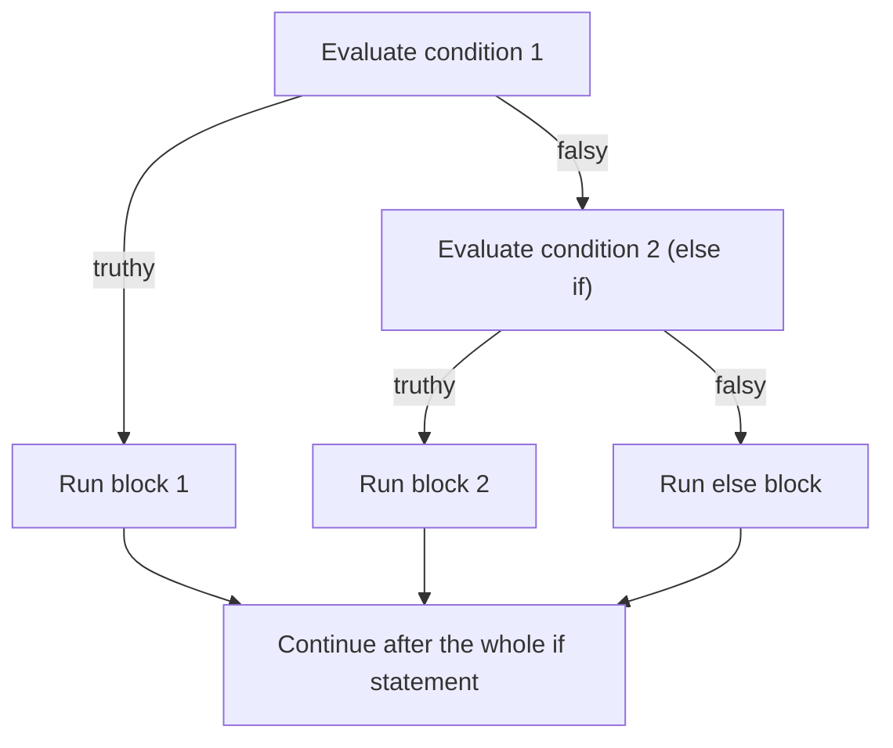
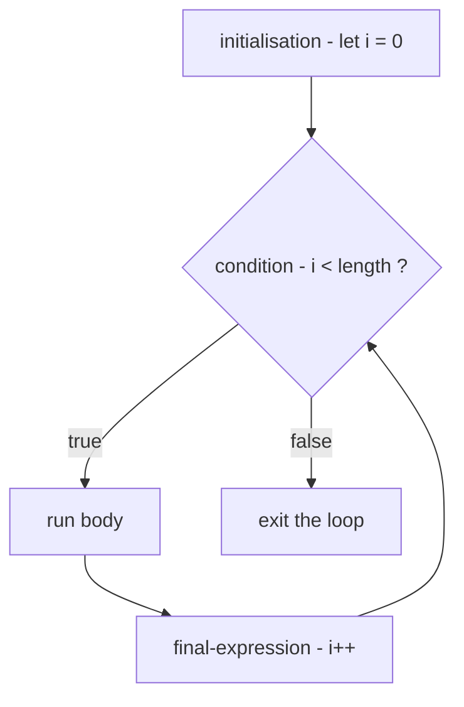
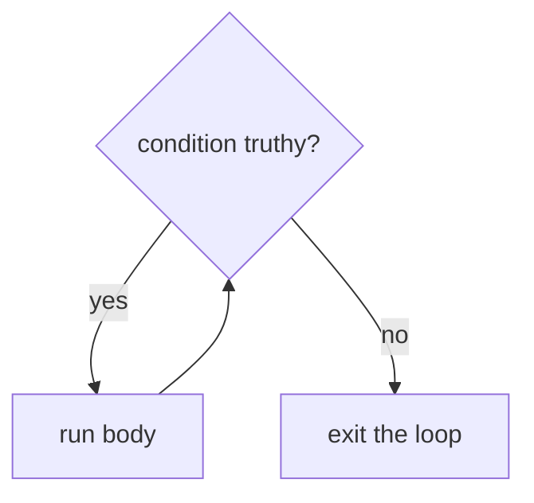
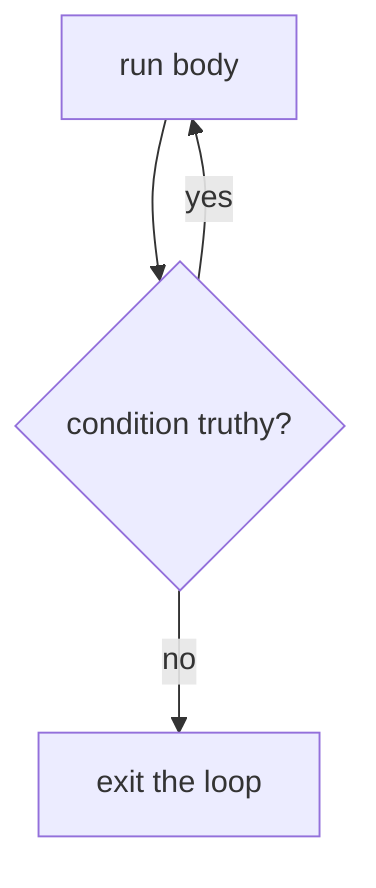

# Chapter 3 — Control Flow and Loops

Left alone, a program runs its statements once each, top to bottom. **Control flow** is everything that changes that: *choosing* which statements run (conditionals) and *repeating* statements (loops). With the values and operators from [Chapter 2](../02-variables-types-and-operators/README.md), these two tools are enough to express any algorithm (a precise, step-by-step recipe for solving a problem).

**What you'll learn**

1. What conditional statements are and where real applications use them.
2. `if`, `else`, `else if`, guard clauses, and how truthiness affects conditions.
3. The conditional (ternary) operator `? :`.
4. `switch`: cases, `default`, `break`, grouped cases, strict comparison, fall-through.
5. Why loops exist, and the five loop statements: `for`, `while`, `do…while`, `for…in`, `for…of`.
6. Nested loops.
7. `break`, `continue` and labels.
8. How to choose the right loop (and when an array method is better than any loop).

Code: [`code/`](code/). Every "Output:" block is real Node 24 output.

---

## 3.1 Conditional statements — making decisions

### What it is
A **conditional statement** evaluates a **condition** — an expression — and, depending on whether it is truthy or falsy (treated as `true` or as `false` when used as a condition), runs one block of code or another. It's the program's way of saying "if this, do that; otherwise do something else".

Analogy: a railway switch. The train (your program) always moves forward, but the switch decides which track it takes.

JavaScript has two conditional **statements** and one conditional **operator**:

| Tool | Best for |
|---|---|
| `if … else if … else` | any conditions, including ranges and combinations (`age >= 18 && hasId`) |
| `switch` | comparing **one** value against many fixed options (`"Mon"`, `"Tue"` …) |
| `condition ? a : b` | choosing between two **values** inside an expression |

### Where you meet them in real applications
- **Form validation** — is the email field filled in and shaped like an email? Only then enable the Submit button.
- **Authentication and permissions** (checking *who* the user is, then *what* they may do) — show the admin panel only if the user is logged in *and* has the admin role.
- **Interactive UI** (user interface — the buttons, menus and screens people interact with) — if the menu is open, close it on click; otherwise open it. If the user prefers dark mode, apply the dark theme.
- **Filtering data** — show a product only if its price is inside the range the shopper selected.
- **Error handling** — if the server answered with status 404, show "Not found"; if 500, show "Try again later". (An HTTP status code is the number a web server sends back to say how a request went: 2xx success, 4xx your mistake, 5xx the server's — see [System Design Fundamentals](../../../system-design-patterns/modules/00-system-design-fundamentals/README.md).)

### TL;DR
Conditionals choose between code paths based on a condition's truthiness. `if` handles anything, `switch` handles one-value-many-options, the ternary chooses between two values.

---

## 3.2 `if`, `else` and `else if`

### What it is
- **`if (condition) { … }`** runs the block only when the condition is truthy.
- **`else { … }`** (optional) is the fallback, run when the `if` condition is falsy.
- **`else if (condition) { … }`** (any number) adds more conditions, tested **in order**; the first truthy one wins and the rest are skipped.

### How it works


1. The condition in parentheses is evaluated and converted to a boolean using the truthy/falsy rules ([Chapter 2 §2.11](../02-variables-types-and-operators/README.md#211-booleans-truthy-and-falsy)).
2. If truthy, its block runs, and execution jumps to after the whole statement.
3. If falsy, the next `else if` condition is evaluated, and so on.
4. If no condition was truthy, the `else` block runs (if there is one). At most **one** block runs.

### Example
```js
// code/01_if_else.js (part 1)
function votingMessage(age) {
  if (age >= 18) {
    return "You can vote.";
  } else {
    return "Not old enough to vote yet.";
  }
}
console.log("age 18 ->", votingMessage(18));
console.log("age 16 ->", votingMessage(16));

function letterGrade(score) {
  if (score >= 90) {
    return "A";
  } else if (score >= 80) {
    return "B";
  } else if (score >= 70) {
    return "C";
  } else if (score >= 60) {
    return "D";
  } else {
    return "F";
  }
}
for (const s of [95, 85, 75, 65, 40]) console.log(`score ${s} -> grade ${letterGrade(s)}`);

function badGrade(score) {
  if (score >= 70) return "C";   // checked first, so 95 also lands here
  if (score >= 90) return "A";
  return "F";
}
console.log("wrong order: 95 ->", badGrade(95));
```

Output:
```
age 18 -> You can vote.
age 16 -> Not old enough to vote yet.
score 95 -> grade A
score 85 -> grade B
score 75 -> grade C
score 65 -> grade D
score 40 -> grade F
wrong order: 95 -> C
```

(Functions and `return` are introduced properly in [Chapter 4](../04-functions-scope-and-closures/README.md); here they just package each example. The `for…of` loop is §3.10.)

The grade ladder works because the checks go from **most specific to least specific**: a score of 85 fails `>= 90`, then passes `>= 80`, and nothing further is tested. `badGrade` shows what happens when the order is wrong — the broad condition `>= 70` catches 95 before the `>= 90` test is ever reached.

### Conditions are truthy/falsy, not just `true`/`false`
```js
// code/01_if_else.js (part 2)
const inputs = ["", "Ana", 0, 3, null, []];
for (const v of inputs) {
  console.log(JSON.stringify(v).padEnd(6), v ? "truthy -> if-branch" : "falsy  -> else-branch");
}
```
Output:
```
""     falsy  -> else-branch
"Ana"  truthy -> if-branch
0      falsy  -> else-branch
3      truthy -> if-branch
null   falsy  -> else-branch
[]     truthy -> if-branch
```

`if (name)` is a common, readable way to say "if `name` is a non-empty string". Just remember `0` and `""` are falsy and `[]` is truthy, and write an explicit comparison when that matters (`if (items.length > 0)`).

### Guard clauses — flatter code
Deeply nested `if`s are hard to read. A **guard clause** handles a special case at the top of a function and returns immediately, so the main logic isn't indented:

```js
// code/01_if_else.js (part 3)
function shippingCost(order) {
  if (!order) return "no order";
  if (order.items === 0) return "empty cart";
  if (order.total >= 50) return "free shipping";
  return "shipping: $4.99";
}
const user = { loggedIn: true, role: "editor" };
if (user.loggedIn && (user.role === "admin" || user.role === "editor")) {
  console.log("can publish");
}
```
Output:
```
no order | empty cart | free shipping | shipping: $4.99
can publish
```

Conditions can be combined with `&&`, `||` and `!`; use parentheses to make grouping explicit.

### Braces
If a block has only one statement, the braces can be omitted (`if (x) doSomething();`). Keep braces for anything multi-line — this classic bug happens without them:

```js
if (isAdmin)
  showPanel();
  logAccess();   // looks conditional, but ALWAYS runs — only the first line belongs to the if
```

A formatter (a tool that automatically rewrites code layout — e.g. Prettier) re-indents code to expose this; many teams simply always use braces.

### Common mistakes
- **`=` instead of `===`**: `if (role = "admin")` assigns and is always truthy.
- **Wrong order in an else-if ladder** (see `badGrade`).
- **Testing an array or object for emptiness with `if (arr)`** — always truthy.
- **Writing `else if` conditions that overlap or leave gaps** (`< 60` and `> 60` forgets exactly 60). Test the boundaries.

### Self-check
1. With `if (a) {…} else if (b) {…}`, can both blocks run? → No; at most one block of an if/else chain runs.
2. What does `if ("0")` do? → Runs the block — `"0"` is a non-empty string, hence truthy.
3. Why check `score >= 90` before `score >= 80`? → Because the first truthy branch wins; broader checks must come later.

### TL;DR
`if` → optional `else if`s → optional `else`; the first truthy branch runs, others are skipped. Order from specific to general, keep braces, prefer guard clauses to deep nesting.

---

## 3.3 The conditional (ternary) operator

### What it is
`condition ? valueIfTruthy : valueIfFalsy` is an **expression** (it produces a value) that picks one of two values. It is JavaScript's only operator with three operands, hence the nickname *ternary operator*.

### Example
```js
// code/02_ternary.js
const age = 20;
const label = age >= 18 ? "adult" : "minor";
console.log("label:", label);

const count = 1;
console.log(`You have ${count} new ${count === 1 ? "message" : "messages"}`);

const temp = 12;
const feel =
  temp < 0 ? "freezing" :
  temp < 15 ? "cold" :
  temp < 25 ? "pleasant" :
  "hot";
console.log("feel:", feel);

const price = 100, isMember = true;
console.log("to pay:", price * (isMember ? 0.9 : 1));
```

Output:
```
label: adult
You have 1 new message
feel: cold
to pay: 90
```

### When to use it (and when not)
| Use the ternary when… | Use `if` when… |
|---|---|
| choosing between two **values** | running **statements** (side effects — changes beyond returning a value, like printing or updating a variable — several lines) |
| it fits on one line and reads naturally | the logic needs explanation or more than two outcomes |
| you need an expression: inside a template literal, an argument, a `const` initialiser, JSX in React (HTML-like syntax inside JavaScript) | — |

Chained ternaries are acceptable when formatted one condition per line as above; nesting them inside each other's branches quickly becomes unreadable.

### TL;DR
`cond ? a : b` returns `a` or `b`. It's for choosing values, not for running code.

---

## 3.4 `switch`

### What it is
A **`switch`** statement evaluates one expression once and compares the result against a list of **`case`** values, running the code of the first match. It's a tidy replacement for a long `if … else if` chain that keeps testing *the same value* for equality.

```js
switch (expression) {
  case value1:
    // runs when expression === value1
    break;
  case value2:
    // runs when expression === value2
    break;
  default:
    // runs when no case matched (optional)
}
```

| Part | Role |
|---|---|
| `expression` | evaluated **once**; its value is compared with each case |
| `case value:` | a candidate match, compared with **`===`** (strict equality) |
| `break` | leaves the switch; without it, execution **falls through** into the next case's code |
| `default:` | optional catch-all when nothing matched — the switch equivalent of `else` |

### How it works
1. Evaluate the `switch` expression.
2. Compare it, top to bottom, with each `case` value using `===`.
3. At the first match, start executing statements *from that point*.
4. Keep going until a `break` (or `return`), or the end of the switch — **including through the following cases' code**.
5. If nothing matched and there is a `default`, start executing there.

### Examples
```js
// code/03_switch.js (selected parts)
function describeType(value) {
  switch (typeof value) {
    case "number":  return "a number";
    case "string":  return "a string";
    case "boolean": return "a boolean";
    default:        return "something else";
  }
}

function menu(option) {
  let result;
  switch (option) {
    case 1: result = "Home"; break;
    case 2: result = "Profile"; break;
    case 3: result = "Settings"; break;
    default: result = "Invalid selection";
  }
  return result;
}

function openStatus(day) {          // grouped cases share one block
  switch (day) {
    case "Mon": case "Tue": case "Wed": case "Thu": case "Fri":
      return "open 9-17";
    case "Sat": return "open 10-14";
    case "Sun": return "closed";
    default:    return "unknown day";
  }
}

function ageCase(age) {             // strict comparison: "18" is not 18
  switch (age) {
    case 18:   return "matched the NUMBER 18";
    case "18": return "matched the STRING '18'";
    default:   return "no match";
  }
}
console.log(describeType(42), "|", describeType("hi"), "|", describeType(null));
console.log([1, 2, 3, 4].map(menu).join(", "));
console.log(["Tue", "Sat", "Sun", "Funday"].map(openStatus).join(" | "));
console.log(ageCase("18"), "|", ageCase(18), "|", ageCase(18.0));
```

Output:
```
a number | a string | something else
Home, Profile, Settings, Invalid selection
open 9-17 | open 10-14 | closed | unknown day
matched the STRING '18' | matched the NUMBER 18 | matched the NUMBER 18
```

Notes:
- In `describeType`, `typeof null` is `"object"`, which matches no case, so `default` runs.
- Inside a function, `return` both produces the result and leaves the switch, so no `break` is needed.
- **Grouped cases**: empty cases fall through to the next non-empty one, so five weekdays share one block without repeating code.
- **Strict comparison**: `"18"` (string) only matches `case "18"`. `18.0` is the same number as `18`. If your value might arrive as a string (form input, URL parameter), convert it first: `switch (Number(age))`.

### Fall-through — feature and trap
```js
// code/03_switch.js — no breaks on purpose: each level also gets the lower levels' rights
function withoutBreak(level) {
  const granted = [];
  switch (level) {
    case "admin":  granted.push("delete");   // falls through
    case "editor": granted.push("edit");     // falls through
    case "viewer": granted.push("read");
  }
  return granted;
}
console.log("admin:", withoutBreak("admin"), "viewer:", withoutBreak("viewer"));
```
Output:
```
admin: [ 'delete', 'edit', 'read' ] viewer: [ 'read' ]
```

Intentional fall-through like this is rare; accidental fall-through (a forgotten `break`) is a classic bug. If you do it on purpose, add a `// falls through` comment — ESLint's `no-fallthrough` rule recognises it (ESLint is a linter: a tool that scans code for likely bugs).

### Two useful patterns
```js
// code/03_switch.js
function bmiCategory(bmi) {          // switch (true): each case is a boolean condition
  switch (true) {
    case bmi < 18.5: return "underweight";
    case bmi < 25:   return "normal";
    case bmi < 30:   return "overweight";
    default:         return "obese";
  }
}
const statusText = { 200: "OK", 404: "Not Found", 500: "Server Error" };  // lookup object
console.log([17, 22, 27, 33].map(bmiCategory).join(", "));
console.log(statusText[404], "|", statusText[418] ?? "Unknown status");
```
Output:
```
underweight, normal, overweight, obese
Not Found | Unknown status
```

- **`switch (true)`** matches the first case whose expression is `true` — a way to use ranges. It works, but many developers find a plain `if … else if` clearer.
- **A lookup object** (or a `Map` — a built-in key-to-value collection, [Chapter 8](../08-maps-sets-iterators-and-generators/README.md)) is often cleaner than a switch whose only job is to translate one value to another; add a fallback with `??`.

### Scope inside cases
The whole switch body is **one block**, so `const r` declared in two different cases collides. Wrap each case body in its own braces when declaring variables:

```js
case "circle": {
  const r = shape.r;
  return +(Math.PI * r * r).toFixed(2);
}
```

### Trade-offs

| | `switch` | `if … else if` | lookup object/Map |
|---|---|---|---|
| Compares | one value, `===` only | any condition | exact keys |
| Ranges (`< 18`) | only via `switch (true)` | natural | no |
| Risk | forgotten `break` | long chains | keys are strings (objects) |
| Best when | many discrete values, some sharing code | mixed or range conditions | pure value-to-value mapping |

### In the interview
**"How does `switch` compare values?"** With strict equality (`===`), evaluated once against each case top-down; execution starts at the first match and continues until `break`/`return` or the end — that's fall-through. `default` runs when nothing matches, and can appear anywhere (it's conventionally last).

- *Follow-up: Why is `switch("1")` not matching `case 1`?* Different types under `===`.
- *Follow-up: What's wrong with `let` in two cases?* The switch body is a single block, so two `let x` declarations are a redeclaration `SyntaxError`; wrap case bodies in braces.

### TL;DR
`switch` = one value vs many `===` cases. End each case with `break` (or `return`), group cases to share code, use `default` as a catch-all, and wrap case bodies in `{ }` to declare variables.

---

## 3.5 Loops — why and which

### What it is
A **loop** repeats a block of code — the **body** — while some condition holds or for each item in a collection. One run of the body is an **iteration**.

Without loops, printing "Hello" ten times means writing ten `console.log` lines, and processing a 10,000-item shopping list is impossible to write out. With a loop you write the body once and describe *how often* it should run.

Real uses: rendering every product in a cart, summing an order, retrying a network request, reading lines of a file, walking a grid in a game, polling (checking again and again at intervals) until a job is done.

| Loop | Repeats… | Checks condition | Typical use |
|---|---|---|---|
| `for` | a counted number of times | before each iteration | index-based loops (using each item's position number, starting at 0) over arrays, counting |
| `while` | while a condition is truthy | before each iteration (may run 0 times) | unknown number of iterations |
| `do…while` | while a condition is truthy | **after** each iteration (runs at least once) | "do it, then decide whether to repeat" |
| `for…in` | once per enumerable (visible to loops, §3.9) **property name** of an object | — | inspecting an object's keys |
| `for…of` | once per **value** of an iterable (anything that can hand out values one by one, §3.10: array, string, Map, Set …) | — | the everyday way to walk a collection |

---

## 3.6 The `for` loop

### What it is
The classic **`for` loop** puts everything that controls the repetition in one header:

```js
for (initialisation; condition; final-expression) {
  // body
}
```

| Part | When it runs | Typical content |
|---|---|---|
| **initialisation** | once, before the loop starts | declare a counter: `let i = 0` |
| **condition** | before **every** iteration; falsy → stop | `i < items.length` |
| **final-expression** | after every iteration | update the counter: `i++` |

### How it works


### Example
```js
// code/04_for_loop.js (part 1)
const fruits = ["Apple", "Banana", "Cherry"];
for (let i = 0; i < fruits.length; i++) {
  console.log(i, fruits[i]);
}

const prices = [12, 5, 30, 8];
let total = 0;
for (let i = 0; i < prices.length; i++) {
  total += prices[i];
}
console.log("total:", total);

let down = "";
for (let i = 5; i > 0; i--) down += i + " ";
console.log("countdown:", down.trim());
let evens = [];
for (let i = 0; i <= 10; i += 2) evens.push(i);
console.log("evens:", evens.join(","));
for (let lo = 0, hi = 4; lo < hi; lo++, hi--) console.log(`pair lo=${lo} hi=${hi}`);
```

Output:
```
0 Apple
1 Banana
2 Cherry
total: 55
countdown: 5 4 3 2 1
evens: 0,2,4,6,8,10
pair lo=0 hi=4
pair lo=1 hi=3
```

Trace of the first loop: `i = 0` → `0 < 3` true → print → `i` becomes 1 → `1 < 3` true → … → `i` becomes 3 → `3 < 3` false → exit. Arrays are indexed from 0, so the last valid index is `length - 1`; that's why the condition is `<`, not `<=`.

The header is flexible: count down with `i--`, step with `i += 2`, or manage two variables separated by commas (the "two pointers" pattern used in many interview problems — [Chapter 17](../17-javascript-for-interviews/README.md)).

### Nested loops
A loop inside another loop is **nested**. For **each single iteration of the outer loop, the inner loop runs through all of its iterations**, then the outer loop moves on and the inner loop starts again from the beginning. With an outer loop of *m* iterations and an inner loop of *n*, the inner body runs *m × n* times.

```js
// code/04_for_loop.js (part 2)
const grid = [
  [1, 2, 3],
  [4, 5, 6],
];
for (let row = 0; row < grid.length; row++) {
  let line = "";
  for (let col = 0; col < grid[row].length; col++) {
    line += `[${row},${col}]=${grid[row][col]} `;
  }
  console.log(line.trim());
}
let iterations = 0;
for (let a = 1; a <= 4; a++) {
  let row = "";
  for (let b = 1; b <= 4; b++) { row += String(a * b).padStart(3); iterations++; }
  console.log(row);
}
console.log("inner body ran", iterations, "times");
```

Output:
```
[0,0]=1 [0,1]=2 [0,2]=3
[1,0]=4 [1,1]=5 [1,2]=6
  1  2  3  4
  2  4  6  8
  3  6  9 12
  4  8 12 16
inner body ran 16 times
```

Nested loops are how you walk two-dimensional data — matrices (grids of numbers arranged in rows and columns), spreadsheet rows and columns, game boards, image pixels — and how you compare every item with every other item. That *m × n* cost is also why nested loops are the first thing to look at when code is slow: two nested loops over 10,000 items each is 100 million iterations. Interview problems often ask you to replace such an O(n²) nested loop (Big-O notation describes how work grows with input size *n*; O(n²) means doubling the input roughly quadruples the work) with a single loop and a `Map` or `Set` ([Chapter 8](../08-maps-sets-iterators-and-generators/README.md)).

### Edge cases
```js
// code/04_for_loop.js (part 3)
let n = 0;
for (;;) { if (++n === 3) break; }       // all three parts are optional
console.log("stopped at", n);

const letters = ["a", "b"];
for (let i = 0; i <= letters.length; i++) console.log("i =", i, "->", letters[i]);
```
Output:
```
stopped at 3
i = 0 -> a
i = 1 -> b
i = 2 -> undefined
```

- `for (;;)` is an intentional infinite loop; something inside must `break`.
- **Off-by-one**: `<=` visits index 2, which doesn't exist — JavaScript doesn't throw, it quietly gives `undefined`.

### `let` in the loop header
Declare the counter with `let`. Each iteration gets a **fresh copy** of `i`, which matters when a function created inside the loop remembers `i` (a closure). With `var` all iterations share one variable — a famous interview puzzle explained in [Chapter 4 §4.7](../04-functions-scope-and-closures/README.md#47-closures).

### Common mistakes
- **`i <= arr.length`** instead of `<` (off-by-one).
- **Modifying the array you are looping over by index** (removing items shifts the rest, so elements get skipped). Loop backwards or build a new array with `filter`.
- **Forgetting to update the counter** (or updating the wrong one in a nested loop, e.g. `i++` in the inner loop) → infinite loop.

### TL;DR
`for (init; condition; update)` — init once, check before each iteration, update after. Use `<` with `length`. Nested loops multiply iteration counts.

---

## 3.7 The `while` loop

### What it is
A **`while` loop** keeps running its body *as long as* its condition is truthy. The condition is checked **before** each iteration, so if it is falsy at the start, the body never runs.

```js
while (condition) {
  // body — must eventually make the condition falsy (or break)
}
```

Use it when you **don't know in advance** how many iterations you need: keep reading until the input ends, keep retrying until it works, keep halving until the value is small enough. (A `for` loop is really a `while` loop with its counter bookkeeping gathered into the header — anything one can do, the other can.)

Analogy: "keep stirring while the sauce is still lumpy". You don't know how many stirs it will take; you check before each one.

### How it works


### Example
```js
// code/05_while_do_while.js (part 1)
let count = 1;
let out = [];
while (count <= 5) {
  out.push(count);
  count++;
}
console.log("while 1..5:", out.join(" "));

const readings = [5, 3, 7, -1, 2];
let sum = 0, i = 0;
while (i < readings.length && readings[i] >= 0) {
  sum += readings[i];
  i++;
}
console.log(`sum before first negative: ${sum} (stopped at index ${i})`);

let value = 1000, steps = 0;
while (value >= 1) { value /= 2; steps++; }
console.log("halvings:", steps);
```

Output:
```
while 1..5: 1 2 3 4 5
sum before first negative: 15 (stopped at index 3)
halvings: 10
```

The second loop has a **compound condition**: stop at the end of the array *or* at the first negative number, whichever comes first. The order inside `&&` matters: `i < readings.length` is checked first, so `readings[i]` is never read past the end — short-circuit evaluation ([Chapter 2 §2.7](../02-variables-types-and-operators/README.md#27-logical-operators--and-)) protects it.

### Common mistakes
- **Infinite loop** — the body never changes anything the condition depends on (`while (count <= 5) { console.log(count); }` with no `count++`). In the browser the tab freezes; in Node, press `Ctrl+C`.
- **Using `while` for a simple count** — a `for` loop keeps the counter logic in one visible place.
- **Busy-waiting** — `while (!dataArrived) {}` to wait for a network response never works in JavaScript: the single thread is stuck in your loop, so the response can never be processed. Waiting is done with callbacks (functions handed over to run later), promises (objects standing for a result that will arrive later) and `await` ([Chapter 12](../12-asynchronous-javascript/README.md)).

### TL;DR
`while (cond) { … }` checks first, may run zero times, and is for an unknown number of iterations. Make sure the body moves toward ending the loop.

---

## 3.8 The `do…while` loop

### What it is
A **`do…while` loop** runs its body **first** and checks the condition **afterwards**. The body therefore always runs **at least once**, even when the condition was already false before the loop began.

```js
do {
  // body — always runs once
} while (condition);   // note the semicolon
```

### How it works


### Example
```js
// code/05_while_do_while.js (part 2)
let x = 10;
while (x < 5) { console.log("while body (never)"); }
do { console.log("do-while body runs once, x =", x); } while (x < 5);

let c = 1; out = [];
do {
  out.push(c);
  c++;
} while (c <= 5);
console.log("do-while 1..5:", out.join(" "));

function makeRandom(seed) {            // tiny deterministic random generator, so the output is repeatable
  return () => (seed = (seed * 1103515245 + 12345) % 2 ** 31) / 2 ** 31;
}
const random = makeRandom(42);
let roll, rolls = [];
do {
  roll = Math.floor(random() * 6) + 1;   // 1..6
  rolls.push(roll);
} while (roll !== 6);
console.log("rolled until a 6:", rolls.join(" "));

let attempt = 0, ok = false;
do {
  attempt++;
  ok = attempt === 3;                    // pretend the 3rd try succeeds
  console.log(`attempt ${attempt}: ${ok ? "success" : "failed"}`);
} while (!ok && attempt < 5);
```

Output:
```
do-while body runs once, x = 10
do-while 1..5: 1 2 3 4 5
rolled until a 6: 4 4 6
attempt 1: failed
attempt 2: failed
attempt 3: success
```

The first two lines show the key difference: with the same false condition, `while` ran zero times and `do…while` ran once. The dice example is the natural shape for "generate something, then decide whether to try again" — you can't test the roll before you've rolled. (In real code you'd use `Math.random()`, [Chapter 5](../05-objects-math-date-and-json/README.md); the seeded generator — one that starts from a fixed starting number, the *seed*, so it produces the same "random" sequence every time — keeps the printed output identical on every run.) The retry loop combines "until success" with a safety cap on attempts so it can't run forever.

### Trade-offs — `while` vs `do…while`

| | `while` | `do…while` |
|---|---|---|
| Condition checked | before each iteration | after each iteration |
| Minimum runs | 0 | 1 |
| Typical use | process while data remains | prompt/generate/try first, then decide |
| How common | very | rare — a `while` with a flag or `break` is often clearer |

### TL;DR
`do { … } while (cond);` runs the body once before testing. Use it only when the first run must happen unconditionally.

---

## 3.9 The `for…in` loop

### What it is
**`for…in`** loops over the **property names (keys)** of an object — all **enumerable string-keyed** properties, **including inherited ones** (properties the object gets from another object it is linked to, rather than its own). It's useful when you need to inspect an object whose shape you don't know in advance.

```js
for (const key in object) {
  // key is a string: the current property's name
}
```

(An **enumerable** property is one that shows up in loops like this — ordinary properties you create are enumerable; built-in methods like `toString` are not. Property attributes are covered in [Chapter 5](../05-objects-math-date-and-json/README.md).)

### Example
```js
// code/06_for_in.js
const person = { firstName: "Grace", lastName: "Hopper", born: 1906 };
for (const key in person) {
  console.log(`${key}: ${person[key]}`);
}

const laptop = { brand: "Acme", ram: 16, ssd: 512, weight: 1.3 };
let propertyCount = 0;
for (const key in laptop) propertyCount++;
console.log("laptop has", propertyCount, "properties | Object.keys:", Object.keys(laptop).length);

const base = { kind: "vehicle" };
const bike = Object.create(base);   // bike's prototype is base (see Chapter 9)
bike.wheels = 2;
const all = [], own = [];
for (const key in bike) {
  all.push(key);
  if (Object.hasOwn(bike, key)) own.push(key);   // filter to own properties (ES2022)
}
console.log("all keys:", all, "| own keys:", own);

const colors = ["red", "green", "blue"];
colors.note = "primary-ish";
for (const index in colors) {
  console.log(typeof index, index, "->", colors[index]);
}

const mixed = { b: 1, 2: "two", a: 2, 1: "one" };
const order = [];
for (const k in mixed) order.push(k);
console.log("order:", order.join(", "));
```

Output:
```
firstName: Grace
lastName: Hopper
born: 1906
laptop has 4 properties | Object.keys: 4
all keys: [ 'wheels', 'kind' ] | own keys: [ 'wheels' ]
string 0 -> red
string 1 -> green
string 2 -> blue
string note -> primary-ish
order: 1, 2, b, a
```

What the output teaches:
1. **The loop variable is the key**; use bracket notation `person[key]` to get the value (`person.key` would look for a property literally named "key").
2. **Inherited properties appear too.** `bike` has only `wheels` of its own, but the loop also visited `kind` from its prototype (the object it falls back to when a property is missing — [Chapter 9](../09-this-prototypes-and-classes/README.md)). Filter with `Object.hasOwn(obj, key)` (ES2022; older code uses `obj.hasOwnProperty(key)`), or avoid the issue with `Object.keys(obj)`, which returns only own enumerable keys.
3. **On arrays it's a trap.** Arrays are objects whose indexes are property names, so `for…in` gives you **strings** (`"0"`, not `0`) and also visits any extra property someone attached (`note`) — or any enumerable property a library added to `Array.prototype`. Use `for…of`, a `for` loop or array methods for arrays.
4. **Order:** integer-like keys come first in ascending numeric order, then other string keys in the order they were created.

### Modern alternatives
| Need | Use |
|---|---|
| own keys | `Object.keys(obj)` |
| own values | `Object.values(obj)` |
| own `[key, value]` pairs | `for (const [k, v] of Object.entries(obj))` |
| number of own properties | `Object.keys(obj).length` |

These are what most modern code uses; `for…in` is mainly seen in older code and when you deliberately want inherited properties.

### TL;DR
`for…in` iterates enumerable property **names** (strings), inherited ones included. Fine for plain objects (with `Object.hasOwn` if needed); don't use it on arrays.

---

## 3.10 The `for…of` loop

### What it is
**`for…of`** (ES2015) loops over the **values** of any **iterable** — an object that knows how to hand out its values one at a time. Built-in iterables: arrays, strings, `Map`, `Set`, typed arrays (fixed-type arrays of raw numbers, used for binary data), the `arguments` object (a function's list of passed values), DOM collections such as `NodeList` (lists of page elements), and generators (functions that produce values one at a time). (How iterables work under the hood — the `Symbol.iterator` protocol, i.e. an agreed set of method names an object must provide — is in [Chapter 8](../08-maps-sets-iterators-and-generators/README.md).)

```js
for (const value of iterable) {
  // value is the current element
}
```

It gives you the values directly, with no index bookkeeping, which makes it the everyday choice for walking a collection.

### Example
```js
// code/07_for_of.js
const numbers = [10, 20, 30];
for (const n of numbers) console.log("number", n);

for (const ch of "Hi!") console.log("char", ch);

const word = "a😀b";
console.log("length:", word.length, "| for...of count:", [...word].length);
for (const ch of word) console.log("code point:", ch);

const tasks = ["write", "test", "ship"];
for (const [i, task] of tasks.entries()) console.log(`${i + 1}. ${task}`);

const stock = new Map([["apples", 5], ["pears", 0]]);
for (const [item, qty] of stock) console.log(item, "=", qty);
for (const tag of new Set(["js", "css", "js"])) console.log("tag", tag);

const scores = { ana: 90, ben: 72 };
try { for (const x of scores) {} } catch (e) { console.log("for...of on object ->", e.name + ":", e.message); }
for (const [name, score] of Object.entries(scores)) console.log(name, score);

const arr = ["x", "y"];
const ins = [], ofs = [];
for (const k in arr) ins.push(k);
for (const v of arr) ofs.push(v);
console.log("for...in ->", ins, "| for...of ->", ofs);

const nums = [1, 2, 3];
for (let n of nums) n *= 10;
console.log("unchanged:", nums);
```

Output:
```
number 10
number 20
number 30
char H
char i
char !
length: 4 | for...of count: 3
code point: a
code point: 😀
code point: b
1. write
2. test
3. ship
apples = 5
pears = 0
tag js
tag css
for...of on object -> TypeError: scores is not iterable
ana 90
ben 72
for...in -> [ '0', '1' ] | for...of -> [ 'x', 'y' ]
unchanged: [ 1, 2, 3 ]
```

What the output teaches:
1. **Strings** are iterated character by character — and correctly by **Unicode code point** (the unique number Unicode assigns to each character): the emoji counts as one character in `for…of`, while `.length` reports 4 because the emoji occupies two UTF-16 units ([Chapter 6](../06-strings-and-regular-expressions/README.md)).
2. **Need the index as well?** Iterate `array.entries()`, which yields `[index, value]` pairs, and unpack them with array destructuring `[i, task]` (syntax that pulls items out of an array into separate variables) ([Chapter 5](../05-objects-math-date-and-json/README.md)).
3. **Maps** yield `[key, value]` pairs; **Sets** yield each unique value once.
4. **Plain objects are not iterable** → `TypeError`. Iterate `Object.keys/values/entries(obj)` instead.
5. `for…in` gives index *strings*; `for…of` gives *values*.
6. The loop variable is a **copy of each value**: reassigning it does not change the array. (If the values are objects, you *can* change their properties — the copy is a reference to the same object, [Chapter 2 §2.4](../02-variables-types-and-operators/README.md#24-primitives-vs-objects).) Use `const` for the loop variable unless you need to reassign it.

### Trade-offs — `for…in` vs `for…of`

| | `for…in` | `for…of` |
|---|---|---|
| Gives you | keys (always strings) | values |
| Works on | any object | iterables only (arrays, strings, Map, Set …) |
| Includes inherited properties | yes (enumerable ones) | n/a |
| Arrays | avoid | ✓ |
| Plain objects | ✓ | ✗ — use `Object.entries(obj)` |
| Supports `break`/`continue` | yes | yes |

### TL;DR
`for…of` walks the values of arrays, strings, Maps, Sets and other iterables — the default loop for collections. Use `.entries()` for indexes and `Object.entries()` for plain objects.

---

## 3.11 `break`, `continue` and labels

### What it is
Three tools change the normal flow of a loop:

| Statement | Effect |
|---|---|
| **`break`** | exits the innermost loop (or `switch`) immediately; execution continues after it |
| **`continue`** | skips the rest of the current iteration and starts the next one (in a `for` loop, the final-expression still runs first) |
| **`label:`** | names a statement (usually an outer loop) so `break label` / `continue label` can target it from inside a nested loop |

The syntax is `break;`, `continue;`, `break labelName;`, `continue labelName;`, and a label is any identifier followed by a colon placed before a statement: `outer: for (…) { … }`.

### Example
```js
// code/08_loop_control.js
for (let i = 0; i < 5; i++) {
  if (i === 3) break;           // leave the loop entirely
  console.log("break demo i =", i);
}

for (let i = 0; i < 5; i++) {
  if (i === 2) continue;        // skip the rest of this iteration only
  console.log("continue demo i =", i);
}

const orders = [{ id: 1, paid: true }, { id: 2, paid: false }, { id: 3, paid: false }];
let firstUnpaid = null;
for (const order of orders) {
  if (!order.paid) { firstUnpaid = order; break; }
}
console.log("first unpaid order:", firstUnpaid.id);

outer: for (let i = 0; i < 3; i++) {
  for (let j = 0; j < 3; j++) {
    if (i === 1 && j === 1) break outer;
    console.log(`labelled break: i=${i}, j=${j}`);
  }
}

const matrix = [[1, 2], [-3, 4], [5, 6]];
const rowsWithoutNegatives = [];
rows: for (const row of matrix) {
  for (const v of row) {
    if (v < 0) continue rows;
  }
  rowsWithoutNegatives.push(row);
}
console.log("rows without negatives:", JSON.stringify(rowsWithoutNegatives));

let k = 0; const odd = [];
while (k < 6) {
  k++;                          // advance BEFORE continue, or the loop never ends
  if (k % 2 === 0) continue;
  odd.push(k);
}
console.log("odd numbers:", odd.join(","));

console.log("some unpaid?", orders.some((o) => !o.paid), "| find:", orders.find((o) => !o.paid).id);
```

Output:
```
break demo i = 0
break demo i = 1
break demo i = 2
continue demo i = 0
continue demo i = 1
continue demo i = 3
continue demo i = 4
first unpaid order: 2
labelled break: i=0, j=0
labelled break: i=0, j=1
labelled break: i=0, j=2
labelled break: i=1, j=0
rows without negatives: [[1,2],[5,6]]
odd numbers: 1,3,5
some unpaid? true | find: 2
```

Walk-through:
- `break` at `i === 3` stops the loop, so only 0, 1, 2 print.
- `continue` at `i === 2` skips that one print; the loop carries on with 3 and 4.
- **Search-and-stop**: once the first unpaid order is found there's no reason to check the rest — `break` saves work.
- **Labelled `break`**: a plain `break` inside the inner loop would exit only the inner loop and the outer loop would continue with `i = 2`. `break outer` ends both loops at `i=1, j=1`.
- **Labelled `continue`**: as soon as a row contains a negative number, `continue rows` abandons that row and moves the *outer* loop to the next row, so the push is skipped.
- **`continue` in a `while` loop** jumps straight back to the condition — if the counter update were below the `continue`, it would be skipped and the loop would never end.

### When not to use them
- Many "loop + `break`" searches are clearer as array methods that stop early by themselves: `find`, `findIndex`, `some`, `every` ([Chapter 7](../07-arrays/README.md)) — as in the last line.
- Labels are legitimate but rare; if you need them often, consider moving the nested loops into a function and using `return`, which exits all loops at once.
- `break` and `continue` do **not** work inside `forEach` callbacks (`forEach` isn't a loop statement — the callback is a separate function). Use `for…of` if you need to stop early.

### In the interview
**"How do you exit a nested loop from the inner loop?"** Label the outer loop and use `break outerLabel`, or put the loops in a function and `return`. A plain `break` only exits the innermost loop.

- *Follow-up: Can you `break` out of `forEach`?* No — it's a `SyntaxError` inside the callback (not a loop); throwing works but is hacky. Use `for…of`, `some` or `find`.
- *Follow-up: Does `continue` in a `for` loop skip the update expression?* No — the final-expression (e.g. `i++`) still runs before the next condition check.

### TL;DR
`break` exits the loop, `continue` skips to the next iteration, labels let either target an outer loop. Prefer `find`/`some` for search-and-stop.

---

## 3.12 Choosing the right loop

| Situation | Best choice |
|---|---|
| Visit every element of an array/string/Map/Set | `for…of` |
| Need the index too | `for…of` over `arr.entries()`, or a classic `for` |
| Iterate backwards, skip by steps, two pointers | classic `for` |
| Repeat until something happens (unknown count) | `while` |
| Must run once before checking | `do…while` |
| Keys of a plain object | `Object.keys/entries` + `for…of` (or `for…in` + `Object.hasOwn`) |
| Transform every element into a new array | `arr.map(...)` ([Ch. 7](../07-arrays/README.md)) |
| Keep only some elements | `arr.filter(...)` |
| Combine all elements into one value | `arr.reduce(...)` or a `for…of` with an accumulator |
| Find the first match / check any / check all | `find` / `some` / `every` |
| Wait for asynchronous work (work that finishes later, e.g. a network request) | `for await…of`, `await` in a loop ([Ch. 12](../12-asynchronous-javascript/README.md)) — never a busy `while` |

Performance is rarely a reason to prefer one loop over another; modern engines optimise all of them. Choose the one that states your intent most clearly.

---

## Chapter 3 TL;DR

- **Conditionals** choose a path: `if / else if / else` (first truthy branch wins — order specific to general), the ternary `c ? a : b` for choosing values, and `switch` for one value against many `===` cases (`break` to stop fall-through, `default` as catch-all, braces for per-case variables).
- **Loops** repeat a body: `for` (init; condition; update) for counting, `while` (check first, may run 0 times) for unknown counts, `do…while` (runs at least once), `for…in` (property **names**, inherited included — not for arrays), `for…of` (**values** of iterables — the default for collections).
- **Nested loops** run the inner loop fully for each outer iteration (m × n work).
- **`break`** exits, **`continue`** skips to the next iteration, **labels** target an outer loop; `forEach` can't be broken — use `for…of`, `find` or `some`.
- Watch for off-by-one (`<` vs `<=`), infinite loops (update the counter before `continue`), and truthiness surprises in conditions.

Next: [Chapter 4 — Functions, Scope and Closures](../04-functions-scope-and-closures/README.md).
