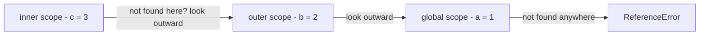
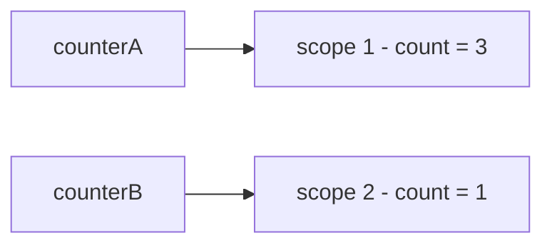
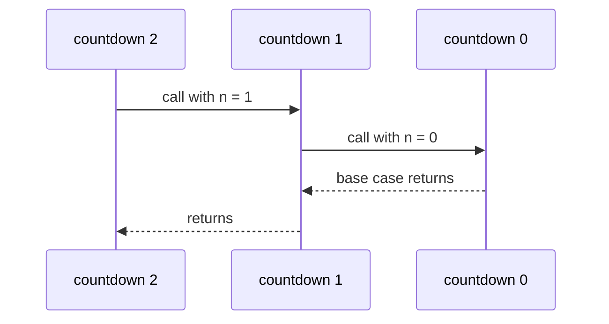

# Chapter 4 — Functions, Scope and Closures

Functions let you name behaviour, reuse it, pass it to other code and return it from other functions. Mastering them means mastering **scope** (which variables code can see) and **closures** (functions that remember the variables around them) — the ideas behind private state, event handlers (functions run when something happens, like a click), React hooks (functions like `useState` that give components memory between screen updates) and many interview questions.

**What you'll learn:** defining/calling functions (parameters vs arguments, `return`, missing/extra arguments, passing values); declarations vs expressions and hoisting; arrow functions (every form and difference); defaults (evaluated at call time), rest, `arguments`, spread, options objects; global/function/block scope, lexical scoping, the scope chain, shadowing; hoisting in full; closures (counters, module pattern, factories, `once`, `memoize`, the loop puzzle); higher-order functions, callbacks, composition, currying; IIFEs, recursion, pure functions.

Code: [`code/`](code/) — every "Output:" is real Node 24 output. `this` has its own chapter: [Chapter 9 — `this`, Prototypes and Classes](../09-this-prototypes-and-classes/README.md).

---

## 4.1 What a function is

### What it is
A **function** is a named, reusable block of code. You **define** it once and **call** (**invoke**) it as often as you like. It takes inputs (**parameters**) and can hand back one output (a **return value**).

### Why it matters
- **Reuse** — write logic once.
- **Readability** — `calculateShipping(order)` explains itself.
- **Modularity** — small functions with clear inputs/outputs are easy to test ([Chapter 16](../16-testing-and-typescript/README.md)) and change safely.
- **Abstraction** — callers need *what*, not *how*.

### How it works — anatomy of a function declaration
```js
function functionName(parameter1, parameter2) {
  // body: statements that run when the function is called
  return someValue;   // optional
}
```

| Part | Meaning |
|---|---|
| `function` | keyword that starts a function **declaration** |
| `functionName` | the name you'll call it by; by convention a verb in camelCase (`getUser`, `isValid`) |
| `(parameter1, parameter2)` | **parameters**: local variables that receive the inputs; zero or more |
| `{ … }` | the **body** |
| `return value` | ends the function and sends `value` back to the caller |

Calling `functionName(a, b)`:
1. **Argument** expressions are evaluated left to right.
2. A new **execution context** (private workspace with its own locals) is pushed onto the **call stack** (the engine's list of running functions).
3. Parameters are bound to the argument values in order.
4. The body runs until `return` or its closing brace.
5. The context is popped; the call evaluates to the returned value, or `undefined`.

**Parameter vs argument:** the *parameter* is the name in the definition (`name`); the *argument* is the value supplied in a call (`"Alice"`).

### Example
```js
// code/01_function_basics.js (abridged — each output line labels what it shows)
function square(number) {              // return sends a value back to the caller
  return number * number;
}
function describe(a, b) { return `a=${a}, b=${b}`; }
console.log(describe(1), "|", describe(1, 2, 3));   // missing -> undefined, extra ignored

function tryToChange(num, obj) {
  num = 100;                 // changes only the local copy
  obj.changed = true;        // changes the shared object
  obj = { replaced: true };  // rebinding the local name doesn't affect the caller
}
let n = 1; const o = {};
tryToChange(n, o);
console.log("after call: n =", n, "| o =", o);
```

Output (full run):
```
Hello, world!
Hello, world!
Hello, Alice!
square(4) = 16 | square(square(2)) = 16
function without return gives: undefined
negative non-negative
a=1, b=undefined | a=1, b=2
isEven(4): true | isEven(5): false
typeof isEven: function | name: isEven | length: 2
square without () is the function itself: function | with (): 9
after call: n = 1 | o = { changed: true }
```

1. Results can feed other calls: `square(square(2))`.
2. **No `return` → `undefined`**; `return` exits immediately.
3. **Argument counts are never checked:** missing → `undefined`, extras ignored (still reachable, §4.4).
4. **Functions are values** (**first-class**): stored, passed, given properties. `typeof` → `"function"`; `.name` is the name; `.length` the number of declared parameters.
5. **`square` vs `square()`**: the function itself vs calling it. Passing `handleClick()` where a function is expected passes its *result*.
6. **Pass by value, where an object's value is a reference** ([Chapter 2 §2.4](../02-variables-types-and-operators/README.md#24-primitives-vs-objects)) — "call by sharing": the function can mutate the caller's object, but reassigning the parameter only changes the local name.

### Common mistakes
- **Forgetting `return`** → caller gets `undefined`.
- **Return value on the next line** → `undefined` (ASI, [Chapter 1 §1.6](../01-introduction-and-setup/README.md#16-hello-world--your-first-program-and-the-basic-rules)).
- **Calling instead of passing**: `addEventListener("click", save())` runs `save` immediately.

### TL;DR
Define once, call many times; missing arguments and missing `return` give `undefined`; functions are values.

---

## 4.2 Declarations vs expressions (and hoisting)

### What it is

| | Function **declaration** | Function **expression** |
|---|---|---|
| Looks like | `function add(a, b) { … }` as a statement on its own | `const add = function (a, b) { … };` — a function used as a value |
| Name | required | optional (anonymous, or named for internal use) |
| Hoisting | **fully hoisted** — callable before its line | follows the variable: `const`/`let` → TDZ (Temporal Dead Zone) error, `var` → `undefined` (so calling it gives `TypeError`) |
| Typical use | top-level helpers, named utilities | callbacks (functions handed to other code to call later), conditional definitions, values stored in objects |

The **arrow function** (`const add = (a, b) => a + b;`, §4.3) is also an expression.

### Example
```js
// code/02_declarations_expressions_hoisting.js
console.log("declared later, called early:", add(2, 3));
function add(a, b) { return a + b; }

try {
  multiply(2, 3);
} catch (e) {
  console.log("const expression called early ->", e.name + ":", e.message);
}
const multiply = function (a, b) { return a * b; };

try {
  divide(6, 3);
} catch (e) {
  console.log("var expression called early ->", e.name + ":", e.message);
}
var divide = function (a, b) { return a / b; };

const factorial = function fact(n) { return n <= 1 ? 1 : n * fact(n - 1); };
console.log("factorial(5):", factorial(5), "| typeof fact outside:", typeof fact);

const anon = function () {};
const arrowFn = () => {};
console.log("inferred names:", anon.name, arrowFn.name);

(function () {
  "use strict";
  if (true) { function insideBlock() { return "hi"; } }
  console.log("strict: block function visible outside block?", typeof insideBlock);
})();
```

Output:
```
declared later, called early: 5
const expression called early -> ReferenceError: Cannot access 'multiply' before initialization
var expression called early -> TypeError: divide is not a function
factorial(5): 120 | typeof fact outside: undefined
inferred names: anon arrowFn
strict: block function visible outside block? undefined
```

1. A **declaration** is created whole on scope entry, so it's callable above its line — letting a file's "story" sit on top with helpers below.
2. A **`const` expression** is in the TDZ until its line ([Chapter 2 §2.2](../02-variables-types-and-operators/README.md#22-hoisting-and-the-temporal-dead-zone)); a **`var` expression** holds `undefined` → "is not a function".
3. A **named function expression** (`function fact`) can call itself by name — for recursion (§4.10) and clearer **stack traces** (the list of nested calls printed with an error) — but the name isn't visible outside.
4. Anonymous functions assigned to variables get an **inferred `name`** (shown in stack traces).
5. In strict code, a function *declared inside a block* is block-scoped (sloppy mode has murky legacy rules — avoid it there).

### Which to use?
Both are fine; be consistent. Common guidance: declarations (or `const` + arrow) for named top-level functions, arrows for callbacks; never rely on calling `const` functions before their definition.

### TL;DR
Declarations are hoisted whole; expressions behave like their variable. Named function expressions can call themselves.

---

## 4.3 Arrow functions

### What it is
**Arrow functions** (ES2015) are compact function expressions, `(params) => body`, that also differ in behaviour — chiefly, no own `this` (the object a function is working on — [Chapter 9](../09-this-prototypes-and-classes/README.md)).

### Syntax forms
| Form | Example | Notes |
|---|---|---|
| one parameter | `n => n * n` | parentheses optional for exactly one simple parameter |
| several parameters | `(a, b) => a + b` | parentheses required |
| no parameters | `() => "hello"` | empty parentheses **required** |
| default / rest / destructured parameter | `(name = "Guest") => …`, `(...xs) => …`, `({ id }) => …` | parentheses required |
| **expression body** | `x => x * 2` | the expression's value is returned automatically (**implicit return**) |
| **block body** | `x => { const y = x * 2; return y; }` | braces → you must write `return` |
| returning an object literal (an object written directly in `{ }`) | `(x, y) => ({ x, y })` | wrap in parentheses, or the braces are read as a block |

### Example
```js
// code/03_arrow_functions.js (abridged — the file first exercises every syntax form in the table)
"use strict"; // strict: a plain function call gets this === undefined
const makePointWrong = (x, y) => { x: x, y };    // parsed as a block with a label -> returns undefined
const makePoint = (x, y) => ({ x, y });

const timer = {
  seconds: 0,
  tickRegular() {
    return [1, 2, 3].map(function () { return this === undefined ? "undefined" : typeof this; });
  },
  tickArrow() {
    return [1, 2, 3].map(() => { this.seconds++; return this.seconds; });
  },
};

const counter = {
  count: 5,
  regular() { return this.count; },
  arrow: () => this?.count,                        // `this` comes from the surrounding (file-level) code
};

function outer() {
  const inner = () => arguments.length;          // uses outer's arguments
  return inner();
}
try { new square(2); } catch (e) { console.log("new on arrow ->", e.name + ":", e.message); }
```

Output (full run):
```
25 5 hello Hello, Guest! Hello, Ana! 2 word(s)
without (): undefined | with (): { x: 1, y: 2 }
with tax: [ 6, 14.4, 36 ] | over 10: [ 12, 30 ]
regular callback this: undefined | arrow callback: [ 1, 2, 3 ]
method regular: 5 | method arrow: undefined
arrow sees outer arguments.length: 3
new on arrow -> TypeError: square is not a constructor
```

### How arrows differ from regular functions

| Feature | Regular `function` | Arrow `=>` |
|---|---|---|
| `this` | set by **how** the function is called ([Ch. 9](../09-this-prototypes-and-classes/README.md)) | **lexical**: taken from the surrounding code, fixed forever (even `call`/`bind` can't change it) |
| `arguments` object | yes | no — uses the enclosing function's, if any |
| Can be called with `new` | yes (declarations/expressions) | no — `TypeError`; no `prototype` property |
| `super` (reaches the parent class), `new.target` (tells whether `new` was used) | own | lexical |
| Can be a generator (a function that pauses and hands out values one at a time with `yield`, [Ch. 8](../08-maps-sets-iterators-and-generators/README.md)) | yes | no |
| Hoisted | declarations yes | no (it's an expression) |
| Good as object method | yes | **no** — `this` won't be the object |
| Good as callback inside a method | needs `bind`/`self = this` | **yes** — sees the method's `this` |

In `tickRegular`, `map` calls the inner `function` plainly, so in strict mode its `this` is `undefined` — the object is lost. In `tickArrow` the arrow borrows `this` from the method (`timer`), so `this.seconds++` works — replacing the pre-ES2015 `var self = this;` / `.bind(this)` workarounds. Conversely `counter.arrow`, an arrow *as* a method, gets the `this` of where the literal was written: at the top of a CommonJS file (Node's original `require`/`module.exports` format) Node sets `this` to `module.exports` (an empty object), so `this.count` is `undefined`; in an ES module top-level `this` is `undefined`, same result.

### Why it matters / benefits
- **Concise** callbacks: `items.filter(i => i.inStock).map(i => i.price)`.
- **Predictable `this`** in callbacks, timers and event handlers inside class methods.
- Ubiquitous in React (a UI library built from reusable *components*) and functional-style code.

### When not to use arrows
- **Object methods** using `this` → method shorthand `name() { … }`.
- **Constructors** (called with `new`) → a `class` ([Ch. 9](../09-this-prototypes-and-classes/README.md)).
- **DOM handlers needing `this` as the element** → regular function or `event.currentTarget` ([Ch. 13](../13-dom-and-events/README.md)).
- **Long multi-step logic** — a named declaration may read better.

### In the interview
**30-second answer — "Arrow vs regular functions?"** Arrows are shorter with implicit return for expression bodies, but the real difference: they don't bind their own `this`, `arguments`, `super` or `new.target` — they take them from the enclosing scope. Great as callbacks inside methods, wrong as object methods or constructors; no `new`, no `prototype`.

- *Change an arrow's `this` with `bind`?* No — `bind`/`call`/`apply` pass arguments but the `this` argument is ignored.
- *Return an object literal?* `() => ({ a: 1 })`.
- *All arguments in an arrow?* Rest parameter: `(...args) => args.length`.

### TL;DR
`=> expression` returns it; `=> { … }` needs `return`. Lexical `this`, no `arguments`/`new` — perfect callbacks, poor methods.

---

## 4.4 Parameters: defaults, rest, `arguments` and spread

### Default parameters — what problem they solve
Pre-ES2015 code patched missing arguments with `name = name || "Guest";` — extra code with a bug: `||` overwrites *every falsy value*, including deliberate `""` or `0`. **Default parameters** put the fallback in the **signature** (name + parameter list) — `function greet(name = "Guest")` — and replace **only `undefined`**.

### How defaults work
1. Parameters initialise **left to right**.
2. If an argument is **`undefined`** (missing or explicit), the default is used; `null`, `0`, `""`, `false` are kept.
3. The default is an **expression evaluated at call time**, each time needed — it can call functions (`new Date()`, `nextId()`) and use **earlier** parameters.
4. Parameters behave like `let`: a default can't reference a *later* parameter (TDZ).

### Example
```js
// code/04_parameters.js (part 1, abridged — each output line labels what it shows)
function oldGreet(name) { name = name || "Guest"; return "Hello, " + name + "!"; }
function greet(name = "Guest") { return "Hello, " + name + "!"; }

function orderPizza(type = "Cheese", size = "Medium") {
  return `Ordering a ${size} ${type} pizza.`;
}
console.log(orderPizza(undefined, "Large"));   // skip the first by passing undefined

let counter = 0;
const nextId = () => ++counter;
function createUser(name, id = nextId(), tag = `${name.toLowerCase()}-${id}`) {
  return { name, id, tag };
}

function addItem(item, list = []) { list.push(item); return list; }

const clock = { now: () => "09:30:00" };
function logMessage(message, timestamp = clock.now()) { return `${timestamp}: ${message}`; }

function required(name) { throw new Error(`Missing parameter: ${name}`); }
function connect(url = required("url")) { return "connecting to " + url; }
```

Output (full run):
```
Hello, Guest! | Hello, Guest! | Hello, Ana!
empty string -> old: Hello, Guest! | new: "Hello, !"
undefined triggers the default: Hello, Guest! | null does not: Hello, null!
Ordering a Medium Cheese pizza.
Ordering a Medium Pepperoni pizza.
Ordering a Large Cheese pizza.
{ name: 'Ana', id: 1, tag: 'ana-1' } { name: 'Ben', id: 2, tag: 'ben-2' } { name: 'Cy', id: 99, tag: 'cy-99' }
[ 'a' ] [ 'b' ]
09:30:00: Server started | 10:00:00: Custom
Missing parameter: url
```

- **Several defaults**: to default an *earlier* parameter while supplying a later one, pass `undefined` — or use an options object.
- **Call-time evaluation**: `nextId()` ran per call; `tag` used earlier parameters. A real `timestamp = new Date().toLocaleTimeString()` gives each call its own time (a fixed clock keeps output reproducible).
- **Fresh default per call**: `list = []` is new each call — no Python-style shared mutable default.
- **Required parameters**: a throwing default turns a forgotten argument into a clear error.

### Rest parameters, `arguments` and spread
```js
// code/04_parameters.js (part 2)
function sum(...numbers) {
  let total = 0;
  for (const n of numbers) total += n;
  return total;
}
console.log("sum():", sum(), "| sum(1,2,3):", sum(1, 2, 3));
function tagAll(tag, ...words) { return words.map(w => `${tag}:${w}`); }
console.log(tagAll("js", "let", "const"));

function legacySum() {
  let total = 0;
  for (let i = 0; i < arguments.length; i++) total += arguments[i];
  return { total, isArray: Array.isArray(arguments), length: arguments.length };
}
console.log(legacySum(4, 5, 6));

const nums = [3, 9, 1];
console.log("Math.max(...nums):", Math.max(...nums), "| sum(...nums, 10):", sum(...nums, 10));
console.log("lengths:", orderPizza.length, sum.length, tagAll.length, createUser.length);

function makeButton({ label = "OK", color = "blue", disabled = false } = {}) {
  return `${label} (${color}${disabled ? ", disabled" : ""})`;
}
console.log(makeButton(), "|", makeButton({ label: "Save", disabled: true }));
```

Output:
```
sum(): 0 | sum(1,2,3): 6
[ 'js:let', 'js:const' ]
{ total: 15, isArray: false, length: 3 }
Math.max(...nums): 9 | sum(...nums, 10): 23
lengths: 0 0 1 1
OK (blue) | Save (blue, disabled)
```

| Tool | Where | What it does |
|---|---|---|
| **Rest parameter** `...args` | last parameter in a definition | collects all remaining arguments into a **real array** (empty if none) |
| **`arguments`** | inside any non-arrow function | legacy **array-like** object of all arguments: has `length` and indexes, but no array methods; absent in arrows |
| **Spread** `...array` | in a call (or array/object literal) | expands an iterable (arrays, strings …) into separate arguments — the mirror image of rest |
| **Options object** with destructuring (pulling properties out into variables) | `function f({ a = 1, b = 2 } = {})` | named, order-independent parameters with defaults; the `= {}` lets you call `f()` with no argument at all |
| `fn.length` | property | number of parameters **before** the first one with a default or rest |

Prefer rest over `arguments`: real arrays, work in arrows, self-describing. Destructuring is in [Chapter 5](../05-objects-math-date-and-json/README.md); options objects are how most library APIs and React props (the settings object passed into a component) take many optional settings.

### Common mistakes
- Expecting `null` to trigger a default — only `undefined` does; use `??` in the body for `null`.
- Required parameters after optional ones (`f(a = 1, b)`) — put defaults last or use an options object.
- In sloppy mode, mutating `arguments` also changes named parameters (and vice versa); in strict mode they're independent.

### In the interview
- *When is a default evaluated?* At call time, each time the argument is `undefined`, left to right, with access to earlier parameters.
- *Rest vs spread?* Same `...`, opposite jobs: rest *collects* values into an array (parameter lists, destructuring); spread *expands* an iterable (calls, literals).

### TL;DR
Defaults replace only `undefined`, per call, may use earlier parameters. `...rest` collects; spread expands; options objects give named parameters.

---

## 4.5 Scope: global, function and block

### What it is
**Scope** is the region where a variable is visible. A name is looked up in the current scope, then each enclosing one outward.

| Scope | Created by | Variables that live there | Visible |
|---|---|---|---|
| **Global** | top level of a script | top-level `var`, `let`, `const`, functions | everywhere |
| **Function** | every function body | `var`, `let`, `const` and parameters declared in the function | inside that function (and functions nested in it) |
| **Block** | any `{ … }`: `if`, `for`, `while`, `switch`, a bare block | `let`, `const`, `class` (and functions in strict mode) | only inside those braces |

**`var` ignores blocks** (scoped to the nearest function or global); **`let`/`const` respect blocks**. ES modules add **module scope**: top-level names visible in that file only ([Chapter 10](../10-modules-and-tooling/README.md)). Inner scopes see outward; outer scopes can't see in.

### Example
```js
// code/05_scope.js (abridged — each output line labels what it shows)
function testScope() {
  if (true) {
    var functionScoped = "var: visible in the whole function";
    let blockLet = "let: only in this block";
  }
  console.log("after block:", functionScoped);
  try { blockLet; } catch (e) { console.log("after block, let ->", e.name + ":", e.message); }
}

const level = "global";
function showLevel() { return level; }
function caller() {
  const level = "caller";
  return showLevel();               // showLevel looks up `level` where it was DEFINED
}
console.log("lexical scope result:", caller());

const a = 1;
function outer() {
  const b = 2;
  function inner() {
    const c = 3;
    return a + b + c;               // c local, b from outer, a from global
  }
  return inner();
}
console.log("scope chain sum:", outer());
```

Output (full run):
```
inside function: global var | global let | global const
inside block: let: only in this block / const: only in this block
after block: var: visible in the whole function
after block, let -> ReferenceError: blockLet is not defined
outside function, var -> ReferenceError
var loop counter after loop: 3 | let counter exists? undefined
shadowed: blue | outer still: red
lexical scope result: global
scope chain sum: 6
classic script globals -> var on global object: true | let: false | const: false
this CommonJS file's top-level var on globalThis? false
```

### How it works — lexical scope and the scope chain
**Lexical (static) scoping**: visible scopes are decided by **where the function is written**, not where it's called. `showLevel` was written at top level, so `caller()` returns `"global"` despite its own `level`.



The **scope chain**: current scope → lexically enclosing scope → … → global → `ReferenceError: x is not defined` (or, when *assigning* in sloppy mode, an accidental global).

**Shadowing**: an inner declaration with the same name hides the outer one inside the inner scope (`paint`'s `color`); the outer is untouched. Legal but confusing — linters (e.g. ESLint) can flag it.

### The global object and scripts vs modules
In a **classic browser script**, top-level `var` and function declarations become properties of the global object (`window`/`globalThis`); top-level `let`/`const` are global variables but not properties (the example shows this via Node's `vm` module). In **ES modules** and **Node CommonJS files**, top-level declarations are file-private — hence `globalVar` is not on `globalThis` in the last line.

### Why it matters
- **Fewer collisions** — many functions can use `i` or `result`.
- **Encapsulation** — globals are shared by *every* script on the page, including third-party ads/analytics; keep the global scope clean.
- **Garbage collection** — once no code can reach a scope's variables, their memory can be freed.

### Common mistakes
- `var` in an `if`/`for` visible after the block (`vi`).
- Expecting a variable from the *calling* function — scope is lexical, not dynamic.
- Forgetting `let`/`const` → accidental global (an error in strict mode, [Chapter 1 §1.8](../01-introduction-and-setup/README.md#18-strict-mode)).

### In the interview
**"Explain scope in JavaScript."** Scope decides where a name is visible: global, function, block (plus module). `var` is function-scoped, `let`/`const` block-scoped. Scoping is lexical: a function sees the variables where it's *defined*, walking outward along the scope chain — which is what makes closures possible.

- *Shadowing?* An inner declaration hiding a same-named outer variable within the inner scope.
- *Does top-level `let` create a `window` property?* No; only top-level `var` and function declarations in classic scripts.

### TL;DR
Global → function → block. `var` function-scoped, `let`/`const` block-scoped. Lookups walk the lexical scope chain; unresolved names throw `ReferenceError`.

---

## 4.6 Hoisting — the complete picture

Extending [Chapter 2 §2.2](../02-variables-types-and-operators/README.md#22-hoisting-and-the-temporal-dead-zone): every declaration kind observed *before* its line runs.

```js
// code/06_hoisting.js (the report part)
function demo() {
  const report = [];
  report.push(["function declaration", typeof hoistedFn === "function" ? hoistedFn() : "missing"]);
  report.push(["var", String(v)]);
  try { l; } catch (e) { report.push(["let", e.name]); }
  try { c; } catch (e) { report.push(["const", e.name]); }
  try { new K(); } catch (e) { report.push(["class", e.name]); }
  try { fe(); } catch (e) { report.push(["var function expression", e.name + " (" + typeof fe + ")"]); }

  function hoistedFn() { return "callable"; }
  var v = 1;
  let l = 2;
  const c = 3;
  class K {}
  var fe = function () {};
  return report;
}
```

Output (full run):
```
function declaration     -> callable
var                      -> undefined
let                      -> ReferenceError
const                    -> ReferenceError
class                    -> ReferenceError
var function expression  -> TypeError (undefined)
ReferenceError: inner x is in its TDZ
var shadow hoisting: [ undefined, 'grumpy' ]
```

| Declaration | Hoisted? | Value before its line |
|---|---|---|
| `function f() {}` | yes, with its body | the function (callable) |
| `var x` | yes | `undefined` |
| `let x`, `const x` | yes | uninitialised → `ReferenceError` (TDZ) |
| `class X {}` | yes | uninitialised → `ReferenceError` (TDZ) |
| `var f = function () {}` / `const f = () => {}` | as the variable | `undefined` (→ `TypeError` if called) / TDZ |

The last two output lines:
- **`let` shadowing with TDZ**: a function with a later `let x` can't read an *outer* `x` above that line — the inner `x` already exists (in its TDZ) for the whole block.
- **`var` shadowing**: in `moodSwing`, `mood` reads `undefined` instead of the global `"happy"` because the function's own `var mood` is hoisted.

Mental model: the engine first registers every declaration in a scope, then runs the code. Nothing physically moves.

---

## 4.7 Closures

### What it is
A **closure** is a function together with the variables of the scope where it was created. Through lexical scoping an inner function uses outer variables — and **keeps using them after the outer function has returned**; they stay alive as long as the inner function exists. Think of a backpack of (references to) surrounding variables the function carries everywhere.

### Example — a counter with private state
```js
// code/07_closures.js (part 1)
function makeCounter() {
  let count = 0;                       // private: only the returned function can reach it
  return function () {
    count++;
    return count;
  };
}
const counterA = makeCounter();
const counterB = makeCounter();         // an independent closure with its own count
console.log("A:", counterA(), counterA(), counterA(), "| B:", counterB());
```

Output:
```
A: 1 2 3 | B: 1
```

1. `makeCounter()` creates a fresh scope with `count = 0`.
2. The inner function captures a reference to that scope and is returned.
3. `makeCounter` ends, but the scope survives because the function references it.
4. Each `counterA()` increments *that* `count`; nothing else can touch it.
5. Another `makeCounter()` call creates a **new** scope — `counterB` is independent.



### The module pattern — several functions sharing private state
```js
// code/07_closures.js (part 2)
function createBankAccount(initial) {
  let balance = initial;
  const history = [];
  function record(type, amount) { history.push(`${type} ${amount}`); }
  return {
    deposit(amount) { balance += amount; record("deposit", amount); return balance; },
    withdraw(amount) {
      if (amount > balance) throw new Error("Insufficient funds");
      balance -= amount; record("withdraw", amount); return balance;
    },
    get balance() { return balance; },
    history: () => [...history],
  };
}
const acct = createBankAccount(100);
acct.deposit(50);
acct.withdraw(30);
console.log("balance:", acct.balance, "| direct access:", acct.balanceVar, "| history:", acct.history());
try { acct.withdraw(1000); } catch (e) { console.log("withdraw 1000 ->", e.message); }
```

Output:
```
balance: 120 | direct access: undefined | history: [ 'deposit 50', 'withdraw 30' ]
withdraw 1000 -> Insufficient funds
```

All methods close over the same `balance`/`history`; the balance changes only through rule-enforcing `deposit`/`withdraw`, and `history()` returns a copy. This is **encapsulation** without classes — the pre-ES2015 **module pattern** (§4.9). Classes now offer `#private` fields ([Chapter 9](../09-this-prototypes-and-classes/README.md)).

### More closure patterns
```js
// code/07_closures.js (part 3)
function makeMultiplier(factor) { return (x) => x * factor; }
const double = makeMultiplier(2), triple = makeMultiplier(3);
console.log("double(5):", double(5), "| triple(5):", triple(5));

function makeReader() {
  let message = "first";
  const read = () => message;
  message = "changed later";
  return read;
}
console.log("closure sees latest value:", makeReader()());

function once(fn) {
  let done = false, result;
  return (...args) => {
    if (!done) { done = true; result = fn(...args); }
    return result;
  };
}
const init = once(() => { console.log("  initialising..."); return 42; });
console.log("init:", init(), init(), init());

function memoize(fn) {
  const cache = new Map();
  return (n) => {
    if (cache.has(n)) return cache.get(n);
    const value = fn(n);
    cache.set(n, value);
    return value;
  };
}
let slowCalls = 0;
const slowSquare = (n) => { slowCalls++; return n * n; };
const fastSquare = memoize(slowSquare);
fastSquare(9); fastSquare(9); fastSquare(9);
console.log("memoized: underlying function ran", slowCalls, "time(s)");
```

Output:
```
double(5): 10 | triple(5): 15
closure sees latest value: changed later
  initialising...
init: 42 42 42
memoized: underlying function ran 1 time(s)
```

- **Function factories** — configure once (`factor`), get a specialised function.
- **Closures capture variables, not values** — `read` sees the value at *call* time.
- **`once`** — `done` flag in the closure; one-time init, "submit only once" buttons.
- **`memoize`** (**memoization** = remembering results of earlier calls) — the **cache** lives in the closure, so repeated inputs skip the work. (Real memoizers must handle cache size and multi-argument keys.)

### The classic loop puzzle
```js
// code/07_closures.js (part 4)
const withVar = [], withLet = [];
for (var i = 0; i < 3; i++) withVar.push(() => i);
for (let j = 0; j < 3; j++) withLet.push(() => j);
console.log("var closures:", withVar.map(f => f()), "| let closures:", withLet.map(f => f()));

for (var t = 0; t < 3; t++) setTimeout(() => process.stdout.write(`var-timer ${t}  `), 0);
for (let u = 0; u < 3; u++) setTimeout(() => process.stdout.write(`let-timer ${u}  `), 0);
setTimeout(() => console.log(), 0);
```

Output:
```
var closures: [ 3, 3, 3 ] | let closures: [ 0, 1, 2 ]
var-timer 3  var-timer 3  var-timer 3  let-timer 0  let-timer 1  let-timer 2  
```

With `var` there is **one** function-scoped `i`; all closures share it, and when they run the loop has finished (`i` is 3). A `let` in a `for` header creates a **new binding** (fresh name-to-value slot) **per iteration**, copying the current value, so each closure has its own `j`. The timers are the same story with async callbacks ([Chapter 12](../12-asynchronous-javascript/README.md)). Pre-ES2015 fix: an IIFE per iteration (§4.9); today, `let`.

### Why closures matter — real-world examples
- **Event handlers** remember their data: `addEventListener("click", () => deleteItem(item.id))` ([Ch. 13](../13-dom-and-events/README.md)).
- **Debounce / throttle** (debounce = run once after calls stop for a moment; throttle = at most once per time window) keep timer IDs in a closure ([Ch. 17](../17-javascript-for-interviews/README.md)).
- **React hooks**: each render's handlers close over that render's props and state — the source of "stale closure" bugs.
- **Callbacks with context**: `setTimeout(() => notify(user), 1000)` keeps `user` alive.
- **Private state** and factories.

### Common mistakes and costs
- **Stale closures** — reading a variable from an old scope (an old React render) when you expected the latest.
- **Memory** — anything a live closure references can't be garbage-collected; a long-lived event listener capturing a huge array keeps it alive. Remove unneeded listeners.
- **The loop puzzle** — use `let`.

### In the interview
**30-second answer — "What is a closure?"** A function bundled with references to the variables of the scope where it was defined. Because scope is lexical, an inner function accesses outer variables — and keeps that access after the outer function returns, so they stay alive. Closures give private state (counters, module pattern), factories, memoization, and underpin event handlers and callbacks.

- *`for (var i…) setTimeout(() => log(i))` prints the final value thrice?* One shared `i`; callbacks run after the loop. `let` gives one binding per iteration.
- *Do closures copy values?* No — live references; later changes show up.
- *Memory leaks (memory never freed because something still points at it)?* Long-lived closures (listeners, timers, caches) holding large objects keep them reachable.

### Self-check
1. `const c = makeCounter(); c(); c();` — next `c()`? → `3`.
2. Do `makeCounter()` calls share a count? → No; new scope each call.
3. Variable only two functions can modify? → Declare it in an outer function, return both (module pattern).

### TL;DR
Closure = function + the variables around its definition, alive as long as the function. Private state, factories, `once`/`memoize`; `let` in loops; beware stale values and retained memory.

---

## 4.8 Higher-order functions and callbacks

### What it is
Because functions are **first-class**:
- A **callback** is a function passed to another function so it can call it ("call back") at the right moment.
- A **higher-order function** takes a function as argument, returns one, or both.

### Example
```js
// code/08_higher_order_callbacks.js (abridged — each output line labels what it shows)
const paidTotals = orders.filter((o) => o.status === "paid").map((o) => o.total);
const revenue = paidTotals.reduce((sum, t) => sum + t, 0);

function greaterThan(limit) { return (n) => n > limit; }      // returns a function

const compose = (...fns) => (x) => fns.reduceRight((acc, fn) => fn(acc), x);
const pipe = (...fns) => (x) => fns.reduce((acc, fn) => fn(acc), x);
const slugify = pipe(trim, lower, dashes);                     // trim, then lower, then dashes

const curriedAdd = (a) => (b) => (c) => a + b + c;
const baseTen = volume.bind(null, 10);                         // partial application

console.log("A: before");
[1].forEach(() => console.log("B: forEach callback runs immediately (synchronous)"));
setTimeout(() => console.log("D: setTimeout callback runs later (asynchronous)"), 0);
console.log("C: after");

function hits() { hits.count = (hits.count ?? 0) + 1; }      // functions can carry properties
```

Output (full run):
```
callback call 0
callback call 1
callback call 2
paid totals: [ 25, 40 ] | revenue: 65
sorted by total desc: [ 2, 3, 1 ]
[5, 15, 25] > 10: [ 15, 25 ]
slug: hello-big-world | compose order: a-b
curried: 6 20
partial: 60
A: before
B: forEach callback runs immediately (synchronous)
C: after
function property count: 2
D: setTimeout callback runs later (asynchronous)
```

### The patterns
| Pattern | Idea | Example above |
|---|---|---|
| **Callback** | pass behaviour in | `repeat(3, action)` |
| **Array HOFs** (higher-order functions) | `map`, `filter`, `reduce`, `sort`, `find`, `some` … take callbacks ([Ch. 7](../07-arrays/README.md)) | revenue of paid orders |
| **Returning a function** | build a predicate (true/false function)/handler from settings | `greaterThan(10)` |
| **Composition** | combine small functions into a pipeline; `pipe` runs left→right, `compose` right→left | `slugify` |
| **Currying** | turn `f(a, b, c)` into `f(a)(b)(c)` so arguments can be supplied one at a time | `curriedAdd` |
| **Partial application** | fix some arguments now, supply the rest later (`bind` can do it) | `baseTen` |

### Synchronous vs asynchronous callbacks
Order **A, B, C … D**: `forEach` calls its callback *immediately* (**synchronous**); `setTimeout` only *registers* it to run after the current code finishes (**asynchronous**). Event listeners, timers and network responses use asynchronous callbacks, scheduled by the event loop ([Chapter 12](../12-asynchronous-javascript/README.md), which also covers "callback hell" and promises). The last line shows functions are objects that can carry properties (hence `.name`, `.length`, `.bind`).

### Why it matters
- Separates **what** from **how/when**: `filter` loops; you supply the rule.
- **Declarative** (describe *what*, not each step), reusable code — the base of functional programming (small functions returning new values instead of mutating) and every event-driven API.

### When not to use
- Long chains of tiny anonymous callbacks hurt readability and debugging — name them.
- In **hot code** (runs very often) a plain loop can be marginally faster than chained `map/filter` — measure first.

### TL;DR
Callbacks are passed-in functions; higher-order functions take or return functions — enabling array methods, composition, currying and every event/async API.

---

## 4.9 IIFE — Immediately Invoked Function Expressions

### What it is
An **IIFE** ("iffy") is a function expression called where it's defined: `(function () { … })();` or `(() => { … })();`. The parentheses make `function` an *expression*; a statement starting with `function` is a declaration and can't be called immediately (`SyntaxError`).

### The problem it solves
Before `let`/`const` and modules, a function was the only way to create private scope. Wrapping a script in an IIFE kept variables out of the global scope; an IIFE returning an object of public functions was *the* **module pattern** of the 2000s (jQuery — then the dominant web-page library — plugins, early libraries).

### Example
```js
// code/09_iife.js
(function () {
  const secret = "only visible in here";
  console.log("IIFE ran:", secret);
})();
console.log("secret outside?", typeof secret);

const config = ((env) => {
  const base = { retries: 3 };
  return env === "prod" ? { ...base, debug: false } : { ...base, debug: true };
})("dev");
console.log("config:", config);

const Cart = (function () {
  const items = [];                          // private
  function total() { return items.reduce((s, i) => s + i.price, 0); }
  return {
    add(name, price) { items.push({ name, price }); return this; },
    total,
    count: () => items.length,
  };
})();
Cart.add("pen", 2).add("book", 12);
console.log("Cart:", Cart.count(), "items, total", Cart.total(), "| items exposed?", "items" in Cart);

(async () => {
  const value = await Promise.resolve("async IIFE done");
  console.log(value);
})();

try {
  eval("function () {}()");
} catch (e) {
  console.log("function statement called directly ->", e.name);
}
```

Output:
```
IIFE ran: only visible in here
secret outside? undefined
config: { retries: 3, debug: true }
Cart: 2 items, total 14 | items exposed? false
function statement called directly -> SyntaxError
async IIFE done
```

(The async IIFE prints last because `await` always resumes asynchronously — [Chapter 12](../12-asynchronous-javascript/README.md).)

### Today
| Old need | Modern replacement |
|---|---|
| private scope for a script | ES modules (each file has its own scope) or a plain `{ }` block with `let`/`const` |
| module pattern | ES modules with `export` ([Ch. 10](../10-modules-and-tooling/README.md)) or classes with `#private` |
| capture loop variable | `let` in the loop header |
| `await` at the top level | top-level `await` in modules |

IIFEs still appear in bundler output, in snippets that must not leak globals (analytics tags), and as async IIFEs in CommonJS scripts. If a line starts with `(` and the previous lacks a semicolon, ASI (Automatic Semicolon Insertion) won't insert one — hence `;(function () { … })()`.

### TL;DR
`(function () { … })()` creates and runs a private scope; modules and block scope have mostly replaced it.

---

## 4.10 Recursion

### What it is
A **recursive** function calls itself on a smaller version of the problem. It needs a **base case** (answered directly, stops recursion) and a **recursive case** (calls itself on a *smaller* input, moving toward the base case).

### Example
```js
// code/10_recursion.js (abridged — the file also has totalSize over a folder tree, flatten, and fibLoop)
function factorial(n) {
  if (n <= 1) return 1;          // base case: stops the recursion
  return n * factorial(n - 1);   // recursive case: smaller input
}

function countdown(n, depth = 0) {
  const pad = "  ".repeat(depth);
  if (n === 0) { console.log(pad + "liftoff (base case)"); return; }
  console.log(pad + "countdown(" + n + ")");
  countdown(n - 1, depth + 1);
  console.log(pad + "back in countdown(" + n + ")");
}

function forever(n) { return forever(n + 1); }               // no base case

let calls = 0;
function fib(n) { calls++; return n < 2 ? n : fib(n - 1) + fib(n - 2); }
```

Output (full run):
```
factorial(5): 120
countdown(2)
  countdown(1)
    liftoff (base case)
  back in countdown(1)
back in countdown(2)
total size: 15
flatten: [ 1, 2, 3, 4, 5 ]
no base case -> RangeError: Maximum call stack size exceeded
naive fib(25) calls: 242785
fibLoop(25): 75025 | fibLoop(50): 12586269025
```

### How it works — the call stack
Each call gets its own execution context on the **call stack**: calls go *down* (each waiting), the base case returns, then waiting calls resume in reverse order.



The stack is limited (roughly ten thousand **frames** — one per active call — depending on engine and frame size). Too deep, or no base case, throws **`RangeError: Maximum call stack size exceeded`** ("stack overflow"). Engines other than Safari's do **not** implement **tail-call optimisation** (reusing the frame when the last action is a self-call), so tail-call form doesn't make deep recursion safe.

### When to use it (and when not)
| Good fit | Better as a loop |
|---|---|
| tree-shaped data: file systems, the DOM, JSON, org charts, comments with replies | simple counting / summing over a flat list |
| divide-and-conquer algorithms (split the problem into halves, solve each, combine): merge sort, quicksort, binary search | inputs that could nest tens of thousands of calls deep |
| backtracking (try a choice, undo it if it leads nowhere): permutations, sudoku | naive recursions that repeat work (Fibonacci) unless memoized |

Naive `fib(25)` made **242,785** calls by recomputing values — exponential time. Memoization (§4.7) or a loop makes it linear. `fibLoop` stops at 50 on purpose: `fib(79)` and up exceed `Number.MAX_SAFE_INTEGER` and silently lose precision ([Chapter 2 §2.10](../02-variables-types-and-operators/README.md#210-numbers-in-depth)) — use `BigInt`.

### TL;DR
Base case + smaller recursive case. Natural for trees and divide-and-conquer; watch stack depth (`RangeError`) and repeated work (memoize).

---

## 4.11 Pure functions

### What it is
A **pure function** (1) returns the **same output for the same inputs** and (2) has **no side effects** — no mutating arguments or globals, no I/O (input/output: files, keyboard, network), no DOM changes, no logging. Otherwise it's **impure**: `Math.max` is pure; `Math.random`, `Date.now`, `console.log`, `array.push` are not.

### Example
```js
// code/11_pure_functions.js (abridged)
const addTax = (price, rate) => +(price * (1 + rate)).toFixed(2);   // pure
console.log("pure:", addTax(100, 0.2), addTax(100, 0.2));

let rate = 0.2;
const addTaxImpure = (price) => +(price * (1 + rate)).toFixed(2);   // reads outside state
console.log("impure before:", addTaxImpure(100));
rate = 0.25;
console.log("impure after someone changed rate:", addTaxImpure(100));

function addItemMutating(cart, item) { cart.push(item); return cart; }  // side effect
function addItemPure(cart, item) { return [...cart, item]; }          // returns a new array
const cart = ["apple"];
const newCart = addItemPure(cart, "pear");
console.log("pure add -> original:", cart, "| new:", newCart);
addItemMutating(cart, "plum");
console.log("mutating add -> original changed:", cart);

const assert = require("node:assert");
assert.strictEqual(addTax(10, 0.1), 11);
assert.deepStrictEqual(addItemPure([], "x"), ["x"]);
console.log("tests passed");
```

Output:
```
pure: 120 120
impure before: 120
impure after someone changed rate: 125
pure add -> original: [ 'apple' ] | new: [ 'apple', 'pear' ]
mutating add -> original changed: [ 'apple', 'plum' ]
Date.now() is impure: number
tests passed
```

### Why it matters
- **Testable** — no setup or **mocks** (fake stand-ins for dependencies): call and compare.
- **Safe to cache** (memoize) and run in any order or in parallel.
- **Frameworks rely on it**: React components must be pure functions of props and state while rendering; Redux **reducers** (compute next state from current state + action) must be pure. Returning a new array (`[...cart, item]`) lets them detect changes by reference ([Chapter 2 §2.4](../02-variables-types-and-operators/README.md#24-primitives-vs-objects)).

### Trade-offs
A program with no side effects does nothing visible. Aim for a **pure core, impure shell**: pure calculations, side effects at the edges (event handlers, API calls). Copying instead of mutating costs some memory/time — negligible for most UI-sized data.

### TL;DR
Same inputs → same output, no side effects. Keep business logic (app-specific rules like prices and discounts) pure; isolate I/O and mutation.

---

## Chapter 4 TL;DR

- **Functions** are first-class values: missing arguments and missing `return` give `undefined`; objects are passed as shared references.
- **Declarations** are hoisted whole; **expressions** (incl. arrows) follow their variable (`const` → TDZ).
- **Arrows**: concise (`x => x * 2`, `() => ({…})`), lexical `this`, no `arguments`, no `new` — ideal callbacks, wrong as methods.
- **Parameters**: defaults replace only `undefined`, per call, may use earlier params; `...rest` collects; spread expands; options objects give named parameters.
- **Scope**: global, function (`var`), block (`let`/`const`); lookups walk the **lexical** scope chain; inner names shadow outer.
- **Closures**: live access to the variables where a function was defined — private state, factories, `once`, `memoize`, handlers. `let` in loops = one binding per iteration.
- **Higher-order functions & callbacks**: `map/filter/reduce`, composition, currying; callbacks sync or async.
- **IIFE**: `(() => { … })()` — legacy private scope/module pattern, replaced by modules.
- **Recursion**: base case + smaller case; beware `RangeError` and repeated work.
- **Pure functions**: same input → same output, no side effects — easy to test, required by React and Redux.

Next: [Chapter 5 — Objects, Math, Date and JSON](../05-objects-math-date-and-json/README.md). For `this`, `call/apply/bind` and classes see [Chapter 9](../09-this-prototypes-and-classes/README.md); for `try/catch`, [Chapter 11](../11-errors-and-debugging/README.md).
