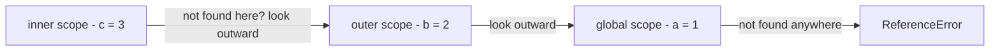
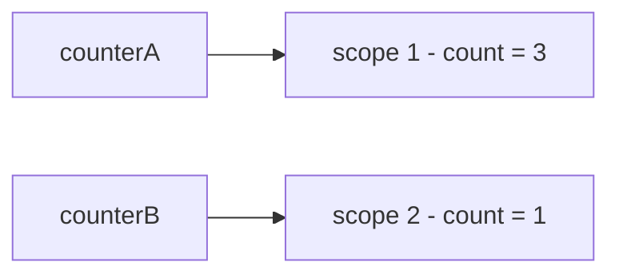
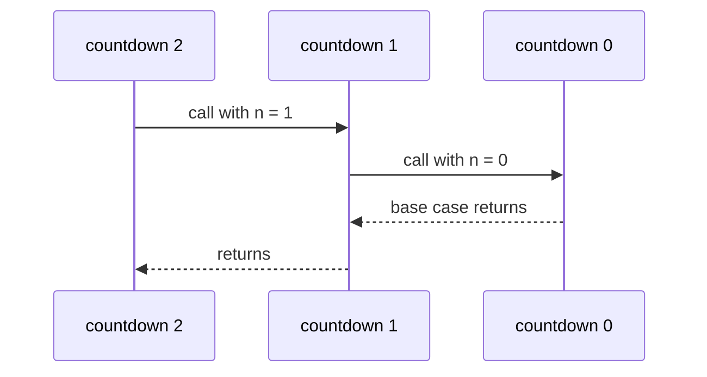

# Chapter 4 — Functions, Scope and Closures

Functions are the heart of JavaScript. They let you name a piece of behaviour, reuse it, pass it to other code, and even return it from other functions. Understanding functions properly also means understanding **scope** (which variables a piece of code can see) and **closures** (functions that remember the variables around them) — the ideas behind private state (data only certain functions can touch), event handlers (functions that run when something happens, like a click), React hooks (functions such as `useState` that give React components memory between screen updates) and a large share of interview questions.

**What you'll learn**

1. Defining and calling functions: parameters vs arguments, `return`, missing and extra arguments, how values are passed.
2. Function declarations vs function expressions, and how hoisting treats each.
3. Arrow functions: every syntax form and every way they differ from regular functions.
4. Parameters in depth: defaults (evaluated at call time), rest parameters, the `arguments` object, spread, options objects.
5. Scope: global, function and block scope; lexical scoping; the scope chain; shadowing.
6. Hoisting — the complete picture.
7. Closures: counters, private state (the module pattern), factories, `once`, `memoize`, and the loop puzzle.
8. Higher-order functions and callbacks; composition and currying.
9. IIFEs, recursion and pure functions.

Code: [`code/`](code/) — every "Output:" is real Node 24 output. The `this` keyword gets its own chapter: [Chapter 9 — `this`, Prototypes and Classes](../09-this-prototypes-and-classes/README.md).

---

## 4.1 What a function is

### What it is
A **function** is a named, reusable block of code. You **define** it once — describing what inputs it takes and what it does — and then **call** (or **invoke**) it as many times as you like, from anywhere it's visible. A function can take inputs (**parameters**) and can hand back one output (a **return value**).

Analogy: a function is a vending machine. Building the machine (defining the function) doesn't produce a snack. Each time someone presses the button with some coins (calls it with arguments), it runs the same mechanism and gives something back (the return value).

### Why it matters
- **Reuse** — write the logic once, call it wherever needed.
- **Readability** — `calculateShipping(order)` explains itself; forty inline lines don't.
- **Modularity and maintenance** — small functions with clear inputs and outputs are easy to test ([Chapter 16](../16-testing-and-typescript/README.md)) and to change without breaking unrelated code.
- **Abstraction** — callers need to know *what* a function does, not *how*.

### How it works — anatomy of a function declaration
```js
function functionName(parameter1, parameter2) {
  // body: statements that run when the function is called
  return someValue;   // optional
}
```

| Part | Meaning |
|---|---|
| `function` | keyword that starts a function **declaration** |
| `functionName` | the name you'll call it by; by convention a verb in camelCase (`getUser`, `isValid`) |
| `(parameter1, parameter2)` | **parameters**: local variables that receive the inputs; there can be zero or more |
| `{ … }` | the **body** |
| `return value` | ends the function and sends `value` back to the caller |

When you call `functionName(a, b)`:
1. Each **argument** expression (`a`, `b`) is evaluated, left to right.
2. A new **execution context** is created — a private workspace with its own local variables — and pushed onto the **call stack** (the engine's list of functions currently running).
3. Parameters are bound to the argument values, in order.
4. The body runs until a `return` statement or its closing brace.
5. The context is popped off the stack; the call expression evaluates to the returned value — or to `undefined` if nothing was returned.

**Parameter vs argument:** a *parameter* is the name in the definition (`name`); an *argument* is the actual value supplied in a call (`"Alice"`).

### Example
```js
// code/01_function_basics.js (abridged)
function greet() {                     // declaration: no parameters, no return
  console.log("Hello, world!");
}
greet();                               // call (invoke) it
greet();                               // ...as often as you like

function greetPerson(name) {           // one parameter
  console.log("Hello, " + name + "!");
}
greetPerson("Alice");                  // "Alice" is the argument

function square(number) {              // return sends a value back to the caller
  return number * number;
}
const result = square(4);
console.log("square(4) =", result, "| square(square(2)) =", square(square(2)));

function noReturn() {}
console.log("function without return gives:", noReturn());

function early(n) {
  if (n < 0) return "negative";        // return also ends the function immediately
  return "non-negative";
}
console.log(early(-1), early(3));

function describe(a, b) { return `a=${a}, b=${b}`; }
console.log(describe(1), "|", describe(1, 2, 3));

const isEven = function (number) {     // function expression
  return number % 2 === 0;
};
console.log("isEven(4):", isEven(4), "| isEven(5):", isEven(5));
console.log("typeof isEven:", typeof isEven, "| name:", isEven.name, "| length:", describe.length);
console.log("square without () is the function itself:", typeof square, "| with ():", square(3));

function tryToChange(num, obj) {
  num = 100;                 // changes only the local copy
  obj.changed = true;        // changes the shared object
  obj = { replaced: true };  // rebinding the local name doesn't affect the caller
}
let n = 1; const o = {};
tryToChange(n, o);
console.log("after call: n =", n, "| o =", o);
```

Output:
```
Hello, world!
Hello, world!
Hello, Alice!
square(4) = 16 | square(square(2)) = 16
function without return gives: undefined
negative non-negative
a=1, b=undefined | a=1, b=2
isEven(4): true | isEven(5): false
typeof isEven: function | name: isEven | length: 2
square without () is the function itself: function | with (): 9
after call: n = 1 | o = { changed: true }
```

What the output teaches:
1. **A function's result can feed another call** — `square(square(2))` is `square(4)`.
2. **No `return` → `undefined`.** And `return` exits immediately, so code after it never runs.
3. **JavaScript never checks argument counts.** Missing arguments become `undefined`; extra ones are ignored (though still reachable, §4.4).
4. **Functions are values** (**first-class** functions): they can be stored in variables, passed around and given properties. `typeof` reports `"function"`; `.name` is the function's name; `.length` is the number of declared parameters.
5. **`square` vs `square()`**: without parentheses you refer to the function itself; with them you call it. Passing `handleClick()` where `handleClick` was expected is a classic bug — you pass its *result*.
6. **Arguments are passed by value**, but for objects the value is a **reference** ([Chapter 2 §2.4](../02-variables-types-and-operators/README.md#24-primitives-vs-objects)). The function can mutate (change in place) the caller's object (`obj.changed = true`), but reassigning the parameter only changes the local name. This is sometimes called "call by sharing".

### Common mistakes
- **Forgetting `return`** in a function meant to compute something → the caller gets `undefined`.
- **Putting the return value on the next line** — `return` followed by a newline returns `undefined` (automatic semicolon insertion, [Chapter 1 §1.6](../01-introduction-and-setup/README.md#16-hello-world--your-first-program-and-the-basic-rules)).
- **Calling instead of passing**: `button.addEventListener("click", save())` runs `save` immediately.

### TL;DR
Define once, call many times. Parameters receive arguments (missing → `undefined`), `return` hands back a value (none → `undefined`), and functions are values you can store and pass.

---

## 4.2 Declarations vs expressions (and hoisting)

### What it is
There are two classic ways to create a function with the `function` keyword:

| | Function **declaration** | Function **expression** |
|---|---|---|
| Looks like | `function add(a, b) { … }` as a statement on its own | `const add = function (a, b) { … };` — a function used as a value |
| Name | required | optional (anonymous, or named for internal use) |
| Hoisting | **fully hoisted** — callable before its line | follows the variable: `const`/`let` → TDZ (Temporal Dead Zone, the stretch before the declaration line) error, `var` → `undefined` (so calling it gives `TypeError`) |
| Typical use | top-level helpers, named utilities | callbacks (functions handed to other code to call later), conditional definitions, values stored in objects |

A third form, the **arrow function** (`const add = (a, b) => a + b;`), is also an expression; §4.3 covers it.

### Example
```js
// code/02_declarations_expressions_hoisting.js
console.log("declared later, called early:", add(2, 3));
function add(a, b) { return a + b; }

try {
  multiply(2, 3);
} catch (e) {
  console.log("const expression called early ->", e.name + ":", e.message);
}
const multiply = function (a, b) { return a * b; };

try {
  divide(6, 3);
} catch (e) {
  console.log("var expression called early ->", e.name + ":", e.message);
}
var divide = function (a, b) { return a / b; };

const factorial = function fact(n) { return n <= 1 ? 1 : n * fact(n - 1); };
console.log("factorial(5):", factorial(5), "| typeof fact outside:", typeof fact);

const anon = function () {};
const arrowFn = () => {};
console.log("inferred names:", anon.name, arrowFn.name);

(function () {
  "use strict";
  if (true) { function insideBlock() { return "hi"; } }
  console.log("strict: block function visible outside block?", typeof insideBlock);
})();
```

Output:
```
declared later, called early: 5
const expression called early -> ReferenceError: Cannot access 'multiply' before initialization
var expression called early -> TypeError: divide is not a function
factorial(5): 120 | typeof fact outside: undefined
inferred names: anon arrowFn
strict: block function visible outside block? undefined
```

What it shows:
1. A **declaration** can be called above the line where it's written — the engine creates the whole function when it enters the scope. This lets you put the "story" of a file at the top and helpers below.
2. A **`const` expression** is in the Temporal Dead Zone until its line ([Chapter 2 §2.2](../02-variables-types-and-operators/README.md#22-hoisting-and-the-temporal-dead-zone)); a **`var` expression** exists but holds `undefined`, so calling it gives "is not a function".
3. A **named function expression** (`function fact(n) {…}`) can refer to itself by that name inside its body — useful for recursion (a function calling itself, §4.10) and clearer stack traces (the list of nested function calls printed with an error) — but the name is not visible outside.
4. Anonymous functions assigned to variables get an **inferred `name`**, which is what shows up in error stack traces.
5. In strict code (modules, classes), a function *declared inside a block* is scoped to that block. (Sloppy mode has murky legacy rules for this; avoid block-level function declarations there.)

### Which to use?
Both are fine; teams usually pick one style. Common guidance: declarations (or `const` + arrow) for named top-level functions, arrow functions for callbacks. What matters more is consistency and not relying on calling `const` functions before their definition.

### TL;DR
Declarations are hoisted whole; expressions behave like the variable that holds them. Named function expressions can call themselves by name.

---

## 4.3 Arrow functions

### What it is
**Arrow functions** (ES2015) are a compact syntax for function expressions: `(params) => body`. Beyond being shorter, they differ from regular functions in a few important ways — most notably, they don't have their own `this` (the keyword that refers to the object a function is currently working on — [Chapter 9](../09-this-prototypes-and-classes/README.md)).

### Syntax forms
| Form | Example | Notes |
|---|---|---|
| one parameter | `n => n * n` | parentheses optional for exactly one simple parameter |
| several parameters | `(a, b) => a + b` | parentheses required |
| no parameters | `() => "hello"` | empty parentheses **required** |
| default / rest / destructured parameter | `(name = "Guest") => …`, `(...xs) => …`, `({ id }) => …` | parentheses required |
| **expression body** | `x => x * 2` | the expression's value is returned automatically (**implicit return**) |
| **block body** | `x => { const y = x * 2; return y; }` | braces → you must write `return` |
| returning an object literal (an object written directly in `{ }`) | `(x, y) => ({ x, y })` | wrap in parentheses, or the braces are read as a block |

### Example
```js
// code/03_arrow_functions.js
"use strict"; // strict: a plain function call gets this === undefined
const square = n => n * n;                       // one parameter: parentheses optional
const add = (a, b) => a + b;                     // several parameters: parentheses required
const hello = () => "hello";                     // no parameters: empty parentheses required
const greet = (name = "Guest") => "Hello, " + name + "!"; // default parameter
const describe = (user) => {                     // block body: needs an explicit return
  const words = user.name.split(" ");
  return `${words.length} word(s)`;
};
console.log(square(5), add(2, 3), hello(), greet(), greet("Ana"), describe({ name: "Ada Lovelace" }));

const makePointWrong = (x, y) => { x: x, y };    // parsed as a block with a label -> returns undefined
const makePoint = (x, y) => ({ x, y });
console.log("without ():", makePointWrong(1, 2), "| with ():", makePoint(1, 2));

const prices = [5, 12, 30];
console.log("with tax:", prices.map(p => +(p * 1.2).toFixed(2)), "| over 10:", prices.filter(p => p > 10));

const timer = {
  seconds: 0,
  tickRegular() {
    return [1, 2, 3].map(function () { return this === undefined ? "undefined" : typeof this; });
  },
  tickArrow() {
    return [1, 2, 3].map(() => { this.seconds++; return this.seconds; });
  },
};
console.log("regular callback this:", timer.tickRegular()[0], "| arrow callback:", timer.tickArrow());

const counter = {
  count: 5,
  regular() { return this.count; },
  arrow: () => this?.count,                        // `this` comes from the surrounding (file-level) code
};
console.log("method regular:", counter.regular(), "| method arrow:", counter.arrow());

function outer() {
  const inner = () => arguments.length;          // uses outer's arguments
  return inner();
}
console.log("arrow sees outer arguments.length:", outer(1, 2, 3));
try { new square(2); } catch (e) { console.log("new on arrow ->", e.name + ":", e.message); }
```

Output:
```
25 5 hello Hello, Guest! Hello, Ana! 2 word(s)
without (): undefined | with (): { x: 1, y: 2 }
with tax: [ 6, 14.4, 36 ] | over 10: [ 12, 30 ]
regular callback this: undefined | arrow callback: [ 1, 2, 3 ]
method regular: 5 | method arrow: undefined
arrow sees outer arguments.length: 3
new on arrow -> TypeError: square is not a constructor
```

### How arrows differ from regular functions

| Feature | Regular `function` | Arrow `=>` |
|---|---|---|
| `this` | set by **how** the function is called ([Ch. 9](../09-this-prototypes-and-classes/README.md)) | **lexical**: taken from the surrounding code, fixed forever (even `call`/`bind`, methods that run a function with a chosen `this`, can't change it) |
| `arguments` object | yes | no — uses the enclosing function's, if any |
| Can be called with `new` | yes (declarations/expressions) | no — `TypeError`; no `prototype` property |
| `super` (reaches the parent class), `new.target` (tells whether `new` was used) | own | lexical |
| Can be a generator (a function that pauses and hands out values one at a time with `yield`, [Ch. 8](../08-maps-sets-iterators-and-generators/README.md)) | yes | no |
| Hoisted | declarations yes | no (it's an expression) |
| Good as object method | yes | **no** — `this` won't be the object |
| Good as callback inside a method | needs `bind`/`self = this` | **yes** — sees the method's `this` |

The `timer` example shows why lexical `this` matters: in `tickRegular`, the inner `function` callback is called plainly by `map`, so in strict mode its `this` is `undefined` — it lost the object. In `tickArrow`, the arrow borrows `this` from `tickArrow`, which *is* `timer`, so `this.seconds++` works. Before ES2015, people wrote `var self = this;` or `.bind(this)` to solve this; arrows made that unnecessary. The flip side is `counter.arrow`: an arrow used *as* a method doesn't get the object as `this` either — its `this` is whatever it was where the object literal was written. Here that is the top level of a CommonJS file (Node's original module format, using `require`/`module.exports`), where Node sets `this` to `module.exports` (an empty object), so `this.count` is `undefined`; in an ES module the top-level `this` is `undefined`, so `this?.count` would give `undefined` there too.

### Why it matters / benefits
- **Concise** callbacks: `items.filter(i => i.inStock).map(i => i.price)`.
- **Predictable `this`** in callbacks, timers and event handlers inside class methods.
- Common in React code (React is a popular library for building user interfaces out of *components*, reusable pieces of UI) and functional-style code.

### When not to use arrows
- **Object methods** that use `this` → use method shorthand `name() { … }`.
- **Constructors** (functions called with `new` to build objects) → use a `class` ([Ch. 9](../09-this-prototypes-and-classes/README.md)).
- **DOM event handlers that need `this` to be the element** → use a regular function or `event.currentTarget` ([Ch. 13](../13-dom-and-events/README.md)).
- **Long, multi-step logic** — a named declaration can read better.

### In the interview
**30-second answer — "Arrow vs regular functions?"** Arrows are shorter and have an implicit return for expression bodies, but the real difference is that they don't bind their own `this`, `arguments`, `super` or `new.target` — they take them from the enclosing scope. So they're great as callbacks inside methods, but wrong as object methods or constructors; they can't be used with `new` and have no `prototype`.

- *Follow-up: Can you change an arrow's `this` with `bind`?* No — `bind`/`call`/`apply` can pass arguments, but the `this` argument is ignored.
- *Follow-up: How do you return an object literal from an arrow?* Wrap it in parentheses: `() => ({ a: 1 })`.
- *Follow-up: How do you get all arguments in an arrow?* Use a rest parameter: `(...args) => args.length`.

### TL;DR
`(params) => expression` returns the expression; `=> { … }` needs `return`. Arrows have lexical `this` and no `arguments`/`new` — perfect callbacks, poor methods.

---

## 4.4 Parameters: defaults, rest, `arguments` and spread

### Default parameters — what problem they solve
Before ES2015, a missing argument had to be patched inside the body, typically with `||`:

```js
function greet(name) {
  name = name || "Guest";      // old pattern
  return "Hello, " + name + "!";
}
```

That's extra code in every function, and it has a hidden bug: `||` replaces **every falsy value**, so a deliberate `""` or `0` gets overwritten. **Default parameters** put the fallback directly in the signature (the function's name plus its parameter list) — `function greet(name = "Guest")` — which is shorter, self-documenting, and replaces **only `undefined`**.

### How defaults work
1. When the function is called, parameters are initialised **left to right**.
2. If the argument for a parameter is **`undefined`** (missing, or passed explicitly as `undefined`), the default expression is used. `null`, `0`, `""` and `false` are real values and are kept.
3. The default is an **expression evaluated at call time**, every time it's needed — not once when the function is defined. It can call functions (`new Date()`, `nextId()`) and refer to **earlier** parameters.
4. Parameters with defaults behave like `let` declarations: a default can't refer to a *later* parameter (TDZ).

### Example
```js
// code/04_parameters.js (part 1)
function oldGreet(name) {
  name = name || "Guest";
  return "Hello, " + name + "!";
}
function greet(name = "Guest") {
  return "Hello, " + name + "!";
}
console.log(oldGreet(), "|", greet(), "|", greet("Ana"));
console.log('empty string -> old:', oldGreet(""), "| new:", JSON.stringify(greet("")));
console.log("undefined triggers the default:", greet(undefined), "| null does not:", greet(null));

function orderPizza(type = "Cheese", size = "Medium") {
  return `Ordering a ${size} ${type} pizza.`;
}
console.log(orderPizza());
console.log(orderPizza("Pepperoni"));
console.log(orderPizza(undefined, "Large"));   // skip the first by passing undefined

let counter = 0;
const nextId = () => ++counter;
function createUser(name, id = nextId(), tag = `${name.toLowerCase()}-${id}`) {
  return { name, id, tag };
}
console.log(createUser("Ana"), createUser("Ben"), createUser("Cy", 99));

function addItem(item, list = []) { list.push(item); return list; }
console.log(addItem("a"), addItem("b"));

const clock = { now: () => "09:30:00" };
function logMessage(message, timestamp = clock.now()) {
  return `${timestamp}: ${message}`;
}
console.log(logMessage("Server started"), "|", logMessage("Custom", "10:00:00"));

function required(name) { throw new Error(`Missing parameter: ${name}`); }
function connect(url = required("url")) { return "connecting to " + url; }
try { connect(); } catch (e) { console.log(e.message); }
```

Output:
```
Hello, Guest! | Hello, Guest! | Hello, Ana!
empty string -> old: Hello, Guest! | new: "Hello, !"
undefined triggers the default: Hello, Guest! | null does not: Hello, null!
Ordering a Medium Cheese pizza.
Ordering a Medium Pepperoni pizza.
Ordering a Large Cheese pizza.
{ name: 'Ana', id: 1, tag: 'ana-1' } { name: 'Ben', id: 2, tag: 'ben-2' } { name: 'Cy', id: 99, tag: 'cy-99' }
[ 'a' ] [ 'b' ]
09:30:00: Server started | 10:00:00: Custom
Missing parameter: url
```

Things to notice:
- **Several defaults**: each parameter has its own; supplying the first argument overrides only the first. To use the default for an *earlier* parameter while supplying a later one, pass `undefined` explicitly — or better, use an options object (below).
- **Call-time evaluation**: `nextId()` ran once per call that needed it, and `tag` was built from the *earlier* parameters `name` and `id`. In real code a timestamp default like `timestamp = new Date().toLocaleTimeString()` gives each call its own current time; the example uses a fixed clock so the output is reproducible.
- **A fresh default every call**: `list = []` creates a new array per call, so `addItem("b")` doesn't see `"a"`. (Python programmers: JavaScript does *not* have Python's shared-mutable-default trap.)
- **Required parameters**: a default that throws turns a forgotten argument into a clear error.

### Rest parameters, `arguments` and spread
```js
// code/04_parameters.js (part 2)
function sum(...numbers) {
  let total = 0;
  for (const n of numbers) total += n;
  return total;
}
console.log("sum():", sum(), "| sum(1,2,3):", sum(1, 2, 3));
function tagAll(tag, ...words) { return words.map(w => `${tag}:${w}`); }
console.log(tagAll("js", "let", "const"));

function legacySum() {
  let total = 0;
  for (let i = 0; i < arguments.length; i++) total += arguments[i];
  return { total, isArray: Array.isArray(arguments), length: arguments.length };
}
console.log(legacySum(4, 5, 6));

const nums = [3, 9, 1];
console.log("Math.max(...nums):", Math.max(...nums), "| sum(...nums, 10):", sum(...nums, 10));
console.log("lengths:", orderPizza.length, sum.length, tagAll.length, createUser.length);

function makeButton({ label = "OK", color = "blue", disabled = false } = {}) {
  return `${label} (${color}${disabled ? ", disabled" : ""})`;
}
console.log(makeButton(), "|", makeButton({ label: "Save", disabled: true }));
```

Output:
```
sum(): 0 | sum(1,2,3): 6
[ 'js:let', 'js:const' ]
{ total: 15, isArray: false, length: 3 }
Math.max(...nums): 9 | sum(...nums, 10): 23
lengths: 0 0 1 1
OK (blue) | Save (blue, disabled)
```

| Tool | Where | What it does |
|---|---|---|
| **Rest parameter** `...args` | last parameter in a definition | collects all remaining arguments into a **real array** (empty if none) |
| **`arguments`** | inside any non-arrow function | legacy **array-like** object of all arguments: has `length` and indexes, but no array methods; absent in arrows |
| **Spread** `...array` | in a call (or array/object literal) | expands an iterable (anything `for…of` can loop over: arrays, strings …) into separate arguments — the mirror image of rest |
| **Options object** with destructuring (pulling properties out into variables) | `function f({ a = 1, b = 2 } = {})` | named, order-independent parameters with defaults; the `= {}` lets you call `f()` with no argument at all |
| `fn.length` | property | number of parameters **before** the first one with a default or rest |

Prefer rest parameters over `arguments` in new code: they're real arrays, work in arrows, and make the signature self-describing. Destructuring syntax is explained fully in [Chapter 5](../05-objects-math-date-and-json/README.md); the options-object pattern is how most JavaScript APIs (the functions a library exposes for you to call) and React props (the settings object passed into a component) take many optional settings.

### Common mistakes
- Expecting `null` to trigger a default — only `undefined` does. Use `??` inside the body if `null` should also fall back.
- Putting required parameters after optional ones (`function f(a = 1, b)`) — callers must pass `undefined` for `a`. Put defaults last or use an options object.
- Mutating `arguments` in sloppy mode also changes the named parameters (and vice versa); in strict mode they're independent. Another reason to prefer rest parameters.

### In the interview
- *"When is a default parameter's expression evaluated?"* At call time, each time the argument is `undefined`, left to right, with access to earlier parameters.
- *"Difference between rest and spread?"* Same `...` syntax, opposite jobs: rest *collects* many values into an array (in a parameter list or destructuring pattern); spread *expands* an iterable into many values (in calls and literals).

### TL;DR
Defaults replace only `undefined`, are evaluated per call and may use earlier parameters. `...rest` collects remaining arguments into an array; spread expands arrays into arguments; options objects give named parameters.

---

## 4.5 Scope: global, function and block

### What it is
**Scope** is the region of code where a variable is visible. When code uses a name, JavaScript looks it up in the current scope, then in the enclosing scope, and so on outward. There are three kinds of scope you create with ordinary code:

| Scope | Created by | Variables that live there | Visible |
|---|---|---|---|
| **Global** | top level of a script | top-level `var`, `let`, `const`, functions | everywhere |
| **Function** | every function body | `var`, `let`, `const` and parameters declared in the function | inside that function (and functions nested in it) |
| **Block** | any `{ … }`: `if`, `for`, `while`, `switch`, a bare block | `let`, `const`, `class` (and functions in strict mode) | only inside those braces |

The key difference between the keywords: **`var` ignores blocks** — it's scoped to the nearest *function* (or global). **`let` and `const` respect blocks.** (ES modules also have a **module scope**: top-level names in a module are visible throughout that file but not globally — [Chapter 10](../10-modules-and-tooling/README.md).)

Analogy: scopes are like one-way mirrored rooms nested inside each other. From an inner room you can see out into every room around it, but people in the outer rooms can't see in.

### Example
```js
// code/05_scope.js (abridged)
var globalVar = "global var";
let globalLet = "global let";
const globalConst = "global const";

function readGlobals() {
  return [globalVar, globalLet, globalConst].join(" | ");
}
console.log("inside function:", readGlobals());

function testScope() {
  if (true) {
    var functionScoped = "var: visible in the whole function";
    let blockLet = "let: only in this block";
    const blockConst = "const: only in this block";
    console.log("inside block:", blockLet, "/", blockConst);
  }
  console.log("after block:", functionScoped);
  try { blockLet; } catch (e) { console.log("after block, let ->", e.name + ":", e.message); }
}
testScope();
try { functionScoped; } catch (e) { console.log("outside function, var ->", e.name); }

for (var vi = 0; vi < 3; vi++) {}
for (let li = 0; li < 3; li++) {}
console.log("var loop counter after loop:", vi, "| let counter exists?", typeof li);

const color = "red";
function paint() {
  const color = "blue";            // shadows the outer color inside paint
  return color;
}
console.log("shadowed:", paint(), "| outer still:", color);

const level = "global";
function showLevel() { return level; }
function caller() {
  const level = "caller";
  return showLevel();               // showLevel looks up `level` where it was DEFINED
}
console.log("lexical scope result:", caller());

const a = 1;
function outer() {
  const b = 2;
  function inner() {
    const c = 3;
    return a + b + c;               // c local, b from outer, a from global
  }
  return inner();
}
console.log("scope chain sum:", outer());
```

Output:
```
inside function: global var | global let | global const
inside block: let: only in this block / const: only in this block
after block: var: visible in the whole function
after block, let -> ReferenceError: blockLet is not defined
outside function, var -> ReferenceError
var loop counter after loop: 3 | let counter exists? undefined
shadowed: blue | outer still: red
lexical scope result: global
scope chain sum: 6
classic script globals -> var on global object: true | let: false | const: false
this CommonJS file's top-level var on globalThis? false
```

### How it works — lexical scope and the scope chain
JavaScript uses **lexical (static) scoping**: the scopes a function can see are decided by **where the function is written** in the source code, not by where it's called from. That's why `caller()` returned `"global"`: `showLevel` was written at the top level, so it sees the global `level`, no matter that it was called from inside `caller`, which has its own `level`.

The nested scopes form the **scope chain**:



1. Look for the name in the current scope.
2. Not there? Look in the scope that lexically encloses it.
3. Repeat up to the global scope.
4. Still not found → `ReferenceError: x is not defined` (or, when *assigning* in sloppy mode, an accidental global is created).

**Shadowing**: an inner declaration with the same name as an outer one hides the outer one within the inner scope (`paint`'s `color`). The outer variable is untouched. Shadowing is legal but can confuse readers; linters (tools such as ESLint that scan code for likely mistakes) can flag it.

### The global object and scripts vs modules
In a **classic browser script**, top-level `var` declarations and function declarations become properties of the global object (`window` / `globalThis`); top-level `let`/`const` are global *variables* but not properties. The example demonstrates this by running a snippet as a classic script with Node's `vm` module. In **ES modules** and **Node CommonJS files**, top-level declarations are private to the file — which is why `globalVar` did *not* appear on `globalThis` in the last line.

### Why it matters
- **Fewer collisions**: two functions can both use a variable named `i` or `result` without interfering.
- **Encapsulation**: variables that are only visible where they're needed can't be changed by accident elsewhere. Global variables are shared by *every* script on a page — including third-party ones (code written by other companies, such as ads or analytics) — so keep the global scope clean.
- **Garbage collection** (the engine automatically reclaiming memory nothing uses any more): once no code can reach a scope's variables, their memory can be freed.

### Common mistakes
- Declaring with `var` inside an `if` or `for` and being surprised it's visible after the block (the `vi` example).
- Relying on a variable from the *calling* function — scopes are lexical, not dynamic.
- Forgetting `let`/`const` and creating an accidental global (sloppy mode) — strict mode turns this into an error ([Chapter 1 §1.8](../01-introduction-and-setup/README.md#18-strict-mode)).

### In the interview
**"Explain scope in JavaScript."** Scope decides where a name is visible. There's global scope, function scope and block scope (plus module scope). `var` is function-scoped; `let`/`const` are block-scoped. Scoping is lexical: a function sees the variables of the places where it's *defined*, walking outward along the scope chain, which is exactly what makes closures possible.

- *Follow-up: What's shadowing?* An inner declaration hiding an outer variable of the same name within the inner scope.
- *Follow-up: Does a top-level `let` create a `window` property?* No; only top-level `var` and function declarations in classic scripts do.

### TL;DR
Global → function → block. `var` is function-scoped, `let`/`const` are block-scoped. Lookups walk outward along the lexical scope chain; unresolved names throw `ReferenceError`.

---

## 4.6 Hoisting — the complete picture

[Chapter 2 §2.2](../02-variables-types-and-operators/README.md#22-hoisting-and-the-temporal-dead-zone) introduced hoisting for variables. Here is every kind of declaration side by side, observed *before* its line runs:

```js
// code/06_hoisting.js (the report part)
function demo() {
  const report = [];
  report.push(["function declaration", typeof hoistedFn === "function" ? hoistedFn() : "missing"]);
  report.push(["var", String(v)]);
  try { l; } catch (e) { report.push(["let", e.name]); }
  try { c; } catch (e) { report.push(["const", e.name]); }
  try { new K(); } catch (e) { report.push(["class", e.name]); }
  try { fe(); } catch (e) { report.push(["var function expression", e.name + " (" + typeof fe + ")"]); }

  function hoistedFn() { return "callable"; }
  var v = 1;
  let l = 2;
  const c = 3;
  class K {}
  var fe = function () {};
  return report;
}
```

Output (full run):
```
function declaration     -> callable
var                      -> undefined
let                      -> ReferenceError
const                    -> ReferenceError
class                    -> ReferenceError
var function expression  -> TypeError (undefined)
ReferenceError: inner x is in its TDZ
var shadow hoisting: [ undefined, 'grumpy' ]
```

| Declaration | Hoisted? | Value before its line |
|---|---|---|
| `function f() {}` | yes, with its body | the function (callable) |
| `var x` | yes | `undefined` |
| `let x`, `const x` | yes | uninitialised → `ReferenceError` (TDZ) |
| `class X {}` | yes | uninitialised → `ReferenceError` (TDZ) |
| `var f = function () {}` / `const f = () => {}` | as the variable | `undefined` (→ `TypeError` if called) / TDZ |

The last two lines of output show the most confusing consequences:
- **`let` shadowing with TDZ**: a function containing `let x` later on can't read an *outer* `x` above that line — the inner `x` already exists (in its TDZ) for the whole block.
- **`var` shadowing**: inside `moodSwing`, `mood` reads as `undefined` rather than the global `"happy"`, because the function's own `var mood` is hoisted to the top of the function.

Mental model: before running a scope, the engine does a first pass that registers every declaration; then it runs the code. Nothing physically moves.

---

## 4.7 Closures

### What it is
A **closure** is a function together with the variables from the scope where it was created. Because of lexical scoping (§4.5), an inner function can use the variables of its outer function. The surprising part: it can **keep using them after the outer function has returned**. Those variables stay alive for as long as the inner function exists.

Analogy: a backpack. When a function is created inside another function, it packs a backpack containing (references to) the surrounding variables and carries it wherever it goes. Whenever it runs — even much later, somewhere else — it can open the backpack.

### Example — a counter with private state
```js
// code/07_closures.js (part 1)
function makeCounter() {
  let count = 0;                       // private: only the returned function can reach it
  return function () {
    count++;
    return count;
  };
}
const counterA = makeCounter();
const counterB = makeCounter();         // an independent closure with its own count
console.log("A:", counterA(), counterA(), counterA(), "| B:", counterB());
```

Output:
```
A: 1 2 3 | B: 1
```

How it works, step by step:
1. `makeCounter()` runs, creating a fresh scope with `count = 0`.
2. It creates the inner function — which captures a reference to that scope — and returns it.
3. `makeCounter` finishes. Normally its local variables would be discarded, but the returned function still references the scope, so it survives.
4. Each `counterA()` call increments *that* `count`. Nothing else in the program can read or change it.
5. `makeCounter()` called again creates a **new** scope, so `counterB` has its own independent `count`.



### The module pattern — several functions sharing private state
```js
// code/07_closures.js (part 2)
function createBankAccount(initial) {
  let balance = initial;
  const history = [];
  function record(type, amount) { history.push(`${type} ${amount}`); }
  return {
    deposit(amount) { balance += amount; record("deposit", amount); return balance; },
    withdraw(amount) {
      if (amount > balance) throw new Error("Insufficient funds");
      balance -= amount; record("withdraw", amount); return balance;
    },
    get balance() { return balance; },
    history: () => [...history],
  };
}
const acct = createBankAccount(100);
acct.deposit(50);
acct.withdraw(30);
console.log("balance:", acct.balance, "| direct access:", acct.balanceVar, "| history:", acct.history());
try { acct.withdraw(1000); } catch (e) { console.log("withdraw 1000 ->", e.message); }
```

Output:
```
balance: 120 | direct access: undefined | history: [ 'deposit 50', 'withdraw 30' ]
withdraw 1000 -> Insufficient funds
```

All the returned methods close over the same `balance` and `history`. The only way to change the balance is through `deposit`/`withdraw`, which enforce the rules. `history()` returns a copy so callers can't tamper with the real array. This is **encapsulation** without classes — the basis of the pre-ES2015 "module pattern" (§4.9). Classes now offer `#private` fields for the same goal ([Chapter 9](../09-this-prototypes-and-classes/README.md)).

### More closure patterns
```js
// code/07_closures.js (part 3)
function makeMultiplier(factor) { return (x) => x * factor; }
const double = makeMultiplier(2), triple = makeMultiplier(3);
console.log("double(5):", double(5), "| triple(5):", triple(5));

function makeReader() {
  let message = "first";
  const read = () => message;
  message = "changed later";
  return read;
}
console.log("closure sees latest value:", makeReader()());

function once(fn) {
  let done = false, result;
  return (...args) => {
    if (!done) { done = true; result = fn(...args); }
    return result;
  };
}
const init = once(() => { console.log("  initialising..."); return 42; });
console.log("init:", init(), init(), init());

function memoize(fn) {
  const cache = new Map();
  return (n) => {
    if (cache.has(n)) return cache.get(n);
    const value = fn(n);
    cache.set(n, value);
    return value;
  };
}
let slowCalls = 0;
const slowSquare = (n) => { slowCalls++; return n * n; };
const fastSquare = memoize(slowSquare);
fastSquare(9); fastSquare(9); fastSquare(9);
console.log("memoized: underlying function ran", slowCalls, "time(s)");
```

Output:
```
double(5): 10 | triple(5): 15
closure sees latest value: changed later
  initialising...
init: 42 42 42
memoized: underlying function ran 1 time(s)
```

- **Function factories** — configure a function once (`factor`), get a specialised function back.
- **Closures capture variables, not values** — `read` returned `"changed later"`, the value at *call* time, because it holds a live reference to the variable.
- **`once`** — the `done` flag lives in the closure; used for one-time initialisation, "submit only once" buttons.
- **`memoize`** (memoization = remembering the results of earlier calls) — the cache (a store of saved results for quick reuse) lives in the closure; repeated calls with the same input skip the work. (Real memoizers must think about cache size and multi-argument keys.)

### The classic loop puzzle
```js
// code/07_closures.js (part 4)
const withVar = [], withLet = [];
for (var i = 0; i < 3; i++) withVar.push(() => i);
for (let j = 0; j < 3; j++) withLet.push(() => j);
console.log("var closures:", withVar.map(f => f()), "| let closures:", withLet.map(f => f()));

for (var t = 0; t < 3; t++) setTimeout(() => process.stdout.write(`var-timer ${t}  `), 0);
for (let u = 0; u < 3; u++) setTimeout(() => process.stdout.write(`let-timer ${u}  `), 0);
setTimeout(() => console.log(), 0);
```

Output:
```
var closures: [ 3, 3, 3 ] | let closures: [ 0, 1, 2 ]
var-timer 3  var-timer 3  var-timer 3  let-timer 0  let-timer 1  let-timer 2  
```

Why: with `var` there is **one** `i` for the whole loop (function scope). All three closures capture that same variable, and by the time they run the loop has finished and `i` is 3. With `let` in a `for` header, JavaScript creates a **new binding** (a fresh name-to-value slot) **for each iteration**, copying the current value into it, so each closure captures its own `j`. The timer version is the same story with asynchronous callbacks ([Chapter 12](../12-asynchronous-javascript/README.md)). Pre-ES2015 fixes used an IIFE per iteration (§4.9); today, just use `let`.

### Why closures matter — real-world examples
- **Event handlers** remember the data they were created with: `button.addEventListener("click", () => deleteItem(item.id))` ([Ch. 13](../13-dom-and-events/README.md)).
- **Debounce / throttle** utilities (debounce = wait until calls stop for a moment, then run once; throttle = run at most once per time window) keep their timer IDs in a closure ([Ch. 17](../17-javascript-for-interviews/README.md)).
- **React hooks**: every render's (each time React redraws a component) event handlers close over that render's props and state (the component's own remembered data) — which is also the source of "stale closure" bugs.
- **Callbacks with context**: `setTimeout(() => notify(user), 1000)` keeps `user` alive until the timer fires.
- **Private state** and factories, as above.

### Common mistakes and costs
- **Stale closures**: a closure keeps reading a variable from an old scope (e.g. an old render in React) when you expected the latest value.
- **Memory**: anything a live closure references can't be garbage-collected. A long-lived event listener (a function registered to run on an event such as a click) that captures a huge array keeps that array in memory — remove listeners you no longer need.
- **The loop puzzle** — use `let`.

### In the interview
**30-second answer — "What is a closure?"** A function bundled with references to the variables of the scope where it was defined. Because scope is lexical, an inner function can access outer variables — and it keeps that access after the outer function returns, so those variables stay alive. Closures give us private state (counters, the module pattern), function factories, memoization, and are what event handlers and callbacks rely on.

- *Follow-up: Why does `for (var i…) setTimeout(() => log(i))` print the final value three times?* One shared function-scoped `i`; the callbacks run after the loop ends. `let` gives one binding per iteration.
- *Follow-up: Do closures copy values?* No, they keep live references to the variables themselves, so later changes show up.
- *Follow-up: Can closures cause memory leaks (memory that is never freed because something still points at it)?* They keep referenced variables reachable; long-lived closures (listeners, timers, caches) holding large objects keep them in memory.

### Self-check
1. After `const c = makeCounter(); c(); c();`, what does `c()` return? → `3`.
2. Do `makeCounter()` calls share a count? → No; each call creates a new scope.
3. How would you make a variable that only two functions can modify? → Declare it in an outer function and return both functions (the module pattern).

### TL;DR
A closure = function + the variables around its definition, kept alive as long as the function is. Use it for private state, factories, `once`/`memoize`; use `let` in loops; beware stale values and retained memory.

---

## 4.8 Higher-order functions and callbacks

### What it is
Because functions are values (**first-class**), they can be passed to and returned from other functions.
- A **callback** is a function you pass to another function so that it can call it ("call back") at the right moment.
- A **higher-order function** is a function that takes a function as an argument, returns a function, or both.

Analogy: leaving your phone number with a restaurant (the callback). You don't wait at the door; they call you when the table is ready.

### Example
```js
// code/08_higher_order_callbacks.js (abridged)
function repeat(times, action) {
  for (let i = 0; i < times; i++) action(i);
}
repeat(3, (i) => console.log("callback call", i));

const orders = [
  { id: 1, total: 25, status: "paid" },
  { id: 2, total: 90, status: "pending" },
  { id: 3, total: 40, status: "paid" },
];
const paidTotals = orders.filter((o) => o.status === "paid").map((o) => o.total);
const revenue = paidTotals.reduce((sum, t) => sum + t, 0);
console.log("paid totals:", paidTotals, "| revenue:", revenue);
console.log("sorted by total desc:", [...orders].sort((a, b) => b.total - a.total).map((o) => o.id));

function greaterThan(limit) { return (n) => n > limit; }
console.log("[5, 15, 25] > 10:", [5, 15, 25].filter(greaterThan(10)));

const compose = (...fns) => (x) => fns.reduceRight((acc, fn) => fn(acc), x);
const pipe = (...fns) => (x) => fns.reduce((acc, fn) => fn(acc), x);
const trim = (s) => s.trim(), lower = (s) => s.toLowerCase(), dashes = (s) => s.replace(/\s+/g, "-");
const slugify = pipe(trim, lower, dashes);
console.log("slug:", slugify("  Hello Big World  "), "| compose order:", compose(dashes, lower, trim)("  A B "));

const curriedAdd = (a) => (b) => (c) => a + b + c;
const add10 = curriedAdd(10);
console.log("curried:", curriedAdd(1)(2)(3), add10(5)(5));
function volume(l, w, h) { return l * w * h; }
const baseTen = volume.bind(null, 10);
console.log("partial:", baseTen(2, 3));

console.log("A: before");
[1].forEach(() => console.log("B: forEach callback runs immediately (synchronous)"));
setTimeout(() => console.log("D: setTimeout callback runs later (asynchronous)"), 0);
console.log("C: after");

function hits() { hits.count = (hits.count ?? 0) + 1; }
hits(); hits();
console.log("function property count:", hits.count);
```

Output:
```
callback call 0
callback call 1
callback call 2
paid totals: [ 25, 40 ] | revenue: 65
sorted by total desc: [ 2, 3, 1 ]
[5, 15, 25] > 10: [ 15, 25 ]
slug: hello-big-world | compose order: a-b
curried: 6 20
partial: 60
A: before
B: forEach callback runs immediately (synchronous)
C: after
function property count: 2
D: setTimeout callback runs later (asynchronous)
```

### The patterns
| Pattern | Idea | Example above |
|---|---|---|
| **Callback** | pass behaviour in | `repeat(3, action)` |
| **Array HOFs** (higher-order functions) | `map`, `filter`, `reduce`, `sort`, `find`, `some` … take callbacks ([Ch. 7](../07-arrays/README.md)) | revenue of paid orders |
| **Returning a function** | build a predicate (a function that answers true/false)/handler from settings | `greaterThan(10)` |
| **Composition** | combine small functions into a pipeline; `pipe` runs left→right, `compose` right→left | `slugify` |
| **Currying** | turn `f(a, b, c)` into `f(a)(b)(c)` so arguments can be supplied one at a time | `curriedAdd` |
| **Partial application** | fix some arguments now, supply the rest later (`bind` can do it) | `baseTen` |

### Synchronous vs asynchronous callbacks
Look at the order **A, B, C … D**. `forEach` calls its callback *immediately*, before moving on — a **synchronous** callback. `setTimeout` only *registers* its callback; it runs later, after the current code (and even after the other logs) has finished — an **asynchronous** callback. Event listeners, timers and network responses all use asynchronous callbacks; how the engine schedules them is the event loop ([Chapter 12](../12-asynchronous-javascript/README.md)), where you'll also meet "callback hell" and its cure, promises.

The last line shows that functions are objects: you can attach properties to them (rarely needed, but it explains why functions have `.name`, `.length`, `.bind` and so on).

### Why it matters
- Separates **what** to do from **how/when**: `filter` knows how to loop; you only supply the rule.
- Declarative (describing *what* you want rather than each step), reusable code; the foundation of functional programming (a style built from small functions that return new values instead of changing existing ones) and of every event-driven API.

### When not to use
- Deep chains of tiny anonymous callbacks can hurt readability and debugging — name them.
- For heavy loops in hot code (code that runs very often), a plain loop can be marginally faster than chained `map/filter`, but measure before optimising.

### TL;DR
Callbacks are functions passed in; higher-order functions take or return functions. They enable array methods, composition, currying and every event/async API.

---

## 4.9 IIFE — Immediately Invoked Function Expressions

### What it is
An **IIFE** (pronounced "iffy") is a function expression that is called right where it's defined: `(function () { … })();` or `(() => { … })();`. The surrounding parentheses turn the `function` keyword into an *expression* (a statement starting with `function` would be a declaration, which can't be called immediately — that's a `SyntaxError`).

### The problem it solves
Before `let`/`const` and modules, the only way to create a private scope was a function. Wrapping a script in an IIFE kept its variables out of the global scope, preventing clashes between scripts on the same page. The IIFE returning an object of public functions was *the* **module pattern** of the 2000s (jQuery plugins, early libraries; jQuery was the dominant library for working with web pages in that era).

### Example
```js
// code/09_iife.js
(function () {
  const secret = "only visible in here";
  console.log("IIFE ran:", secret);
})();
console.log("secret outside?", typeof secret);

const config = ((env) => {
  const base = { retries: 3 };
  return env === "prod" ? { ...base, debug: false } : { ...base, debug: true };
})("dev");
console.log("config:", config);

const Cart = (function () {
  const items = [];                          // private
  function total() { return items.reduce((s, i) => s + i.price, 0); }
  return {
    add(name, price) { items.push({ name, price }); return this; },
    total,
    count: () => items.length,
  };
})();
Cart.add("pen", 2).add("book", 12);
console.log("Cart:", Cart.count(), "items, total", Cart.total(), "| items exposed?", "items" in Cart);

(async () => {
  const value = await Promise.resolve("async IIFE done");
  console.log(value);
})();

try {
  eval("function () {}()");
} catch (e) {
  console.log("function statement called directly ->", e.name);
}
```

Output:
```
IIFE ran: only visible in here
secret outside? undefined
config: { retries: 3, debug: true }
Cart: 2 items, total 14 | items exposed? false
function statement called directly -> SyntaxError
async IIFE done
```

(The async IIFE's message appears last because `await` always resumes asynchronously — [Chapter 12](../12-asynchronous-javascript/README.md).)

### Today
| Old need | Modern replacement |
|---|---|
| private scope for a script | ES modules (each file has its own scope) or a plain `{ }` block with `let`/`const` |
| module pattern | ES modules with `export` ([Ch. 10](../10-modules-and-tooling/README.md)) or classes with `#private` |
| capture loop variable | `let` in the loop header |
| `await` at the top level | top-level `await` in modules |

IIFEs still appear in bundler output (the combined files produced by tools that merge many modules into one), in snippets that must not leak globals (analytics tags — small scripts that track page visits), and as async IIFEs in CommonJS scripts. Recognise them; you'll rarely need to write them. If a line starts with `(` and the previous line has no semicolon, ASI (Automatic Semicolon Insertion) won't insert one — which is why IIFEs are sometimes written `;(function () { … })()`.

### TL;DR
`(function () { … })()` creates and runs a private scope at once. Modules and block scope have mostly replaced it.

---

## 4.10 Recursion

### What it is
A **recursive** function is one that calls itself to solve a smaller version of the same problem. Every recursive function needs:
1. a **base case** — an input simple enough to answer directly, which stops the recursion;
2. a **recursive case** — which calls the function on a *smaller* input, moving toward the base case.

Analogy: Russian nesting dolls. To find the smallest doll you open the current one (recursive case) until you reach one that doesn't open (base case).

### Example
```js
// code/10_recursion.js (abridged)
function factorial(n) {
  if (n <= 1) return 1;          // base case: stops the recursion
  return n * factorial(n - 1);   // recursive case: smaller input
}
console.log("factorial(5):", factorial(5));

function countdown(n, depth = 0) {
  const pad = "  ".repeat(depth);
  if (n === 0) { console.log(pad + "liftoff (base case)"); return; }
  console.log(pad + "countdown(" + n + ")");
  countdown(n - 1, depth + 1);
  console.log(pad + "back in countdown(" + n + ")");
}
countdown(2);

function totalSize(node) {       // folder tree: size of node + sizes of all children
  let sum = node.size;
  for (const child of node.children) sum += totalSize(child);
  return sum;
}
console.log("total size:", totalSize(folder));

function flatten(arr) {
  const out = [];
  for (const item of arr) {
    if (Array.isArray(item)) out.push(...flatten(item));
    else out.push(item);
  }
  return out;
}
console.log("flatten:", flatten([1, [2, [3, [4]], 5]]));

function forever(n) { return forever(n + 1); }
try { forever(0); } catch (e) { console.log("no base case ->", e.name + ":", e.message); }

let calls = 0;
function fib(n) { calls++; return n < 2 ? n : fib(n - 1) + fib(n - 2); }
fib(25);
console.log("naive fib(25) calls:", calls);
function fibLoop(n) { let a = 0, b = 1; for (let i = 0; i < n; i++) [a, b] = [b, a + b]; return a; }
console.log("fibLoop(25):", fibLoop(25), "| fibLoop(50):", fibLoop(50));
```

Output:
```
factorial(5): 120
countdown(2)
  countdown(1)
    liftoff (base case)
  back in countdown(1)
back in countdown(2)
total size: 15
flatten: [ 1, 2, 3, 4, 5 ]
no base case -> RangeError: Maximum call stack size exceeded
naive fib(25) calls: 242785
fibLoop(25): 75025 | fibLoop(50): 12586269025
```

### How it works — the call stack
Each call gets its own execution context on the **call stack**. The countdown trace shows it: calls go *down* (each waiting for the next to finish), the base case returns, and then each waiting call resumes and finishes in reverse order.



The stack has a limited size (roughly ten thousand frames — one *frame* is the stored record of one active call — depending on the engine and frame size). Recursing too deep — or forever, with no base case — throws **`RangeError: Maximum call stack size exceeded`**, the JavaScript "stack overflow". JavaScript engines (except Safari's) do **not** implement tail-call optimisation (reusing the current stack frame when a function's very last action is a call to itself), so deep recursion can't be made safe by writing it in tail-call form.

### When to use it (and when not)
| Good fit | Better as a loop |
|---|---|
| tree-shaped data: file systems, the DOM, JSON, org charts, comments with replies | simple counting / summing over a flat list |
| divide-and-conquer algorithms (split the problem into halves, solve each, combine): merge sort, quicksort, binary search | inputs that could nest tens of thousands of calls deep |
| backtracking (try a choice, undo it if it leads nowhere): permutations, sudoku | naive recursions that repeat work (Fibonacci) unless memoized |

The naive `fib(25)` made **242,785** calls because it recomputes the same values over and over — exponential time (each step up in *n* multiplies the work). Memoization (§4.7) or a simple loop makes it linear (work grows in step with *n*). Also note `fibLoop` stops at 50 on purpose: `fib(79)` and above exceed `Number.MAX_SAFE_INTEGER`, so results would silently lose precision ([Chapter 2 §2.10](../02-variables-types-and-operators/README.md#210-numbers-in-depth)) — use `BigInt` for those.

### TL;DR
Recursion = base case + smaller recursive case. Natural for trees and divide-and-conquer; watch stack depth (`RangeError`) and repeated work (memoize).

---

## 4.11 Pure functions

### What it is
A **pure function**:
1. always returns the **same output for the same inputs** (it depends only on its arguments), and
2. has **no side effects** — it doesn't modify anything outside itself (no mutating arguments or globals, no I/O (input/output, such as reading files or the keyboard), no DOM changes (edits to the web page), no logging, no network).

Anything else is **impure**. `Math.max` is pure; `Math.random`, `Date.now`, `console.log` and `array.push` are not.

### Example
```js
// code/11_pure_functions.js (abridged)
const addTax = (price, rate) => +(price * (1 + rate)).toFixed(2);   // pure
console.log("pure:", addTax(100, 0.2), addTax(100, 0.2));

let rate = 0.2;
const addTaxImpure = (price) => +(price * (1 + rate)).toFixed(2);   // reads outside state
console.log("impure before:", addTaxImpure(100));
rate = 0.25;
console.log("impure after someone changed rate:", addTaxImpure(100));

function addItemMutating(cart, item) { cart.push(item); return cart; }  // side effect
function addItemPure(cart, item) { return [...cart, item]; }          // returns a new array
const cart = ["apple"];
const newCart = addItemPure(cart, "pear");
console.log("pure add -> original:", cart, "| new:", newCart);
addItemMutating(cart, "plum");
console.log("mutating add -> original changed:", cart);

const assert = require("node:assert");
assert.strictEqual(addTax(10, 0.1), 11);
assert.deepStrictEqual(addItemPure([], "x"), ["x"]);
console.log("tests passed");
```

Output:
```
pure: 120 120
impure before: 120
impure after someone changed rate: 125
pure add -> original: [ 'apple' ] | new: [ 'apple', 'pear' ]
mutating add -> original changed: [ 'apple', 'plum' ]
Date.now() is impure: number
tests passed
```

### Why it matters
- **Predictable and testable** — no setup, no mocks (fake stand-ins for real dependencies used in tests): call it and compare the result.
- **Safe to cache** (memoize) and to run in any order or in parallel.
- **Frameworks depend on it**: React requires components to be pure functions of their props and state during rendering; Redux reducers (in the Redux state library, functions that compute the next state from the current state and an action) must be pure. Returning a new array (`[...cart, item]`) instead of mutating is what lets them detect changes by reference ([Chapter 2 §2.4](../02-variables-types-and-operators/README.md#24-primitives-vs-objects)).

### Trade-offs
A program with no side effects does nothing visible — you must eventually write to the screen, disk or network. The practical goal is a **pure core, impure shell**: keep calculations pure and push side effects to the edges (event handlers, API calls). Copying instead of mutating costs some memory and time; for most UI-sized data it's negligible.

### TL;DR
Pure = same inputs → same output, no side effects. Keep business logic (the rules specific to your app, like prices and discounts) pure; isolate I/O and mutation.

---

## Chapter 4 TL;DR

- **Functions** are reusable, first-class values: define once, call many times; missing arguments are `undefined`, no `return` gives `undefined`; objects are passed as shared references.
- **Declarations** are hoisted whole; **expressions** (including arrows) follow their variable's hoisting (`const` → TDZ).
- **Arrow functions**: concise (`x => x * 2`, `() => ({…})`), lexical `this`, no `arguments`, can't be `new`ed — ideal callbacks, wrong as object methods.
- **Parameters**: defaults replace only `undefined` and are evaluated per call (can use earlier params); `...rest` collects into an array; spread expands; options objects give named parameters.
- **Scope**: global, function (`var`), block (`let`/`const`); lookups walk the **lexical** scope chain; inner names shadow outer ones.
- **Closures**: functions keep live access to the variables where they were defined — private state, factories, `once`, `memoize`, event handlers. `let` in loops gives one binding per iteration.
- **Higher-order functions & callbacks**: pass/return functions; `map/filter/reduce`, composition, currying; callbacks can be synchronous or asynchronous.
- **IIFE**: `(() => { … })()` — legacy private scope/module pattern, mostly replaced by modules.
- **Recursion**: base case + smaller case; watch `RangeError` stack overflows and repeated work.
- **Pure functions**: same input → same output, no side effects — easy to test, required by React and Redux.

Next: [Chapter 5 — Objects, Math, Date and JSON](../05-objects-math-date-and-json/README.md). For `this`, `call/apply/bind` and classes, see [Chapter 9](../09-this-prototypes-and-classes/README.md); for error handling with `try/catch`, [Chapter 11](../11-errors-and-debugging/README.md).
