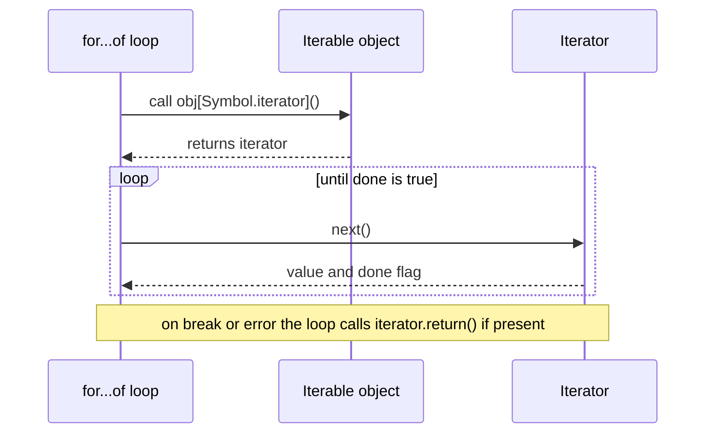

# Chapter 8 — Maps, Sets, Iterators and Generators

Two jobs are so common JavaScript has dedicated collections for them: **looking things up by key** (`Map`) and **keeping values unique** (`Set`). This chapter covers both, their "weak" cousins that avoid memory leaks (memory never freed because something still points at data nobody needs), the **iteration protocols** that make `for…of`, spread and destructuring work, **generators** (the easiest way to make **lazy** sequences — values computed only when asked), **iterator helpers** (ES2025) and **`Object.groupBy` / `Map.groupBy`** (ES2024).

**What you'll learn:** `Map` (methods, iteration, conversion, vs objects); `Set` (methods, ES2025 set algebra); `WeakMap`, `WeakSet`, `WeakRef`, `FinalizationRegistry`; the **iterable**/**iterator** protocols and `Symbol.iterator`; **generators** (`function*`, `yield`, `yield*`, two-way communication, async generators); **iterator helpers** and `Iterator.from`; **grouping**.

**Before you start:** objects ([Chapter 5](../05-objects-math-date-and-json/README.md)), arrays ([Chapter 7](../07-arrays/README.md)), closures ([Chapter 4](../04-functions-scope-and-closures/README.md)). One example uses `#private` class fields ([Chapter 9](../09-this-prototypes-and-classes/README.md)); async generators use promises ([Chapter 12](../12-asynchronous-javascript/README.md)).

Code is in [`code/`](code/); outputs are real Node 24 output.

---

## 8.1 `Map`

### What it is
A **`Map`** (ES2015) is a collection of **key → value** pairs, like an object used as a dictionary (lookup table) but built for it:
- **Keys can be any value** — objects, functions, numbers, `NaN`.
- **Always remembers insertion order.**
- Knows its **`size`**.
- **Directly iterable** with `for…of`.

### How it works — creating a Map
`new Map()` is empty; pass an **iterable of `[key, value]` pairs** to fill it. From [`code/01_map.mjs`](code/01_map.mjs):

```js
const stock = new Map([
  ['apples', 500],
  ['bananas', 300],
  ['oranges', 200],
]);
console.log(stock, stock.size);
```

Output:

```text
Map(3) { 'apples' => 500, 'bananas' => 300, 'oranges' => 200 } 3
```

### Properties and methods

| Member | What it does | Returns |
|---|---|---|
| `size` (property) | Number of entries | number |
| `set(key, value)` | Adds a new entry or **updates** an existing key | the map itself (so calls chain) |
| `get(key)` | Looks up a key | the value, or `undefined` if absent |
| `has(key)` | Checks whether the key exists | boolean |
| `delete(key)` | Removes one entry | `true` if something was removed, else `false` |
| `clear()` | Removes all entries | `undefined` |
| `keys()` / `values()` / `entries()` | Iterators over keys / values / `[key, value]` pairs, in insertion order | iterator |
| `forEach((value, key, map) => …, thisArg?)` | Calls a function per entry, in insertion order | `undefined` |
| `[Symbol.iterator]()` | Same as `entries()` — why `for (const [k, v] of map)` works | iterator |
| `Map.groupBy(items, fn)` (static, ES2024) | Builds a Map of groups (§8.7) | Map |

```js
const books = new Map();
books.set('1984', 'George Orwell').set('Dune', 'Frank Herbert');   // set returns the map -> chainable
console.log(books.get('1984'), books.get('Missing'), books.has('Dune'));
books.set('Dune', 'F. Herbert');                                   // same key -> update
console.log(books.size, books.delete('Dune'), books.delete('Dune'), books.size);
```

Output:

```text
George Orwell undefined true
2 true false 1
```

### Keys of any type
Keys compare by **SameValueZero**: `===` except `NaN` equals `NaN` (and `+0` equals `-0`). Object keys match **by reference**.

```js
const m = new Map();
const objKey = { id: 1 };
const fnKey = () => {};
m.set(objKey, 'object as key').set(fnKey, 'function as key').set(1, 'number 1').set('1', 'string 1').set(NaN, 'NaN works');
console.log(m.get(objKey), m.get(fnKey), m.get(1), m.get('1'), m.get(NaN), m.get({ id: 1 }));

const o = {};
o[objKey] = 'x'; o[1] = 'number'; o['1'] = 'string overwrites';
console.log(Object.keys(o), o);
```

Output:

```text
object as key function as key number 1 string 1 NaN works undefined
[ '1', '[object Object]' ] { '1': 'string overwrites', '[object Object]': 'x' }
```

A plain object stringifies keys: every object key becomes `'[object Object]'` (one shared slot) and `1`/`'1'` collide. The Map keeps them distinct.

### Iterating and converting

```js
for (const [fruit, qty] of stock) console.log(fruit, qty);           // apples 500 / bananas 300 / oranges 200
console.log([...stock.keys()], [...stock.values()], [...stock.entries()][0]);
stock.forEach((value, key) => process.stdout.write(`${key}=${value} `));

const asObject = Object.fromEntries(stock);
const backToMap = new Map(Object.entries(asObject));
console.log(asObject, backToMap.get('apples'), JSON.stringify(stock), JSON.stringify([...stock]));
```

Output (after the three `for…of` lines):

```text
[ 'apples', 'bananas', 'oranges' ] [ 500, 300, 200 ] [ 'apples', 500 ]
apples=500 bananas=300 oranges=200 
{ apples: 500, bananas: 300, oranges: 200 } 500 {} [["apples",500],["bananas",300],["oranges",200]]
```

- `forEach` callback order: **value, then key** (like arrays' `(element, index)`).
- `Object.fromEntries(map)` / `new Map(Object.entries(obj))` convert (sensible for string keys).
- **`JSON.stringify(map)` gives `{}`** — **serialize** (turn into text for saving/sending) `[...map]` or `Object.fromEntries(map)`.

### Map vs Object

| Feature | `Map` | Plain object `{}` |
|---|---|---|
| Key types | **Any value** (objects, functions, numbers, `NaN`) | Strings and symbols only (others are converted to strings) |
| Order | Always insertion order | Defined, but integer-like keys come first in ascending order, then strings by insertion ([Ch 5](../05-objects-math-date-and-json/README.md)) |
| Size | `map.size`, O(1) (instant, whatever the size) | `Object.keys(obj).length`, O(n) (time grows with the number of keys) |
| Iteration | Directly iterable (`for…of`) | Via `Object.keys/values/entries` |
| Accidental keys | None — starts empty | Inherits from `Object.prototype` (`'toString' in {}`); a key named `__proto__` is special. `Object.create(null)` avoids this |
| Frequent add/delete | Optimised for it | `delete` can make objects slower in engines |
| JSON | Not directly | Native |
| Syntax | `map.get(k)` / `map.set(k, v)` | `obj.k` / `obj[k] = v`, literals, destructuring |
| Best for | Dynamic dictionaries, caches (stores of computed results for reuse), counting, non-string keys | Fixed-shape records (`{ id, name }`), config, JSON data |

### Real tasks

```js
const text = 'the cat and the hat and the bat';
const freq = new Map();
for (const w of text.split(' ')) freq.set(w, (freq.get(w) ?? 0) + 1);
console.log(freq, [...freq].toSorted((a, b) => b[1] - a[1])[0]);

const users = [{ id: 'u1', name: 'Ana' }, { id: 'u2', name: 'Ben' }];
const byId = new Map(users.map((u) => [u.id, u]));
console.log(byId.get('u2').name);
```

Output:

```text
Map(5) { 'the' => 3, 'cat' => 1, 'and' => 2, 'hat' => 1, 'bat' => 1 } [ 'the', 3 ]
Ben
```

The **count pattern** `map.set(k, (map.get(k) ?? 0) + 1)` and **index-by-id pattern** `new Map(list.map((x) => [x.id, x]))` turn O(n) searches into O(1) lookups — interview staples ([Chapter 17](../17-javascript-for-interviews/README.md)).

Insertion order plus cheap delete/re-insert make a compact **LRU cache** (least-recently-used: when full, evict the entry unused longest — how browser caches, CDNs (servers worldwide keeping copies near users — [System Design Fundamentals](../../../system-design-patterns/modules/00-system-design-fundamentals/README.md)) and database buffer pools (in-memory copies of recent disk pages) decide what to drop):

```js
class LRU {
  #max; #map = new Map();
  constructor(max) { this.#max = max; }
  get(k) {
    if (!this.#map.has(k)) return undefined;
    const v = this.#map.get(k); this.#map.delete(k); this.#map.set(k, v); return v;
  }
  set(k, v) {
    this.#map.delete(k); this.#map.set(k, v);
    if (this.#map.size > this.#max) this.#map.delete(this.#map.keys().next().value); // oldest
  }
  keys() { return [...this.#map.keys()]; }
}
const cache = new LRU(2);
cache.set('a', 1); cache.set('b', 2); cache.get('a'); cache.set('c', 3);
console.log(cache.keys());   // [ 'a', 'c' ]  — 'b' was least recently used
```

(The LLD (low-level design) handbook builds a full LRU with a doubly linked list — each item points to both neighbours: [`../../../lld/`](../../../lld/).)

**Coming next — upsert (ES2026).** `map.getOrInsert(key, default)` / `map.getOrInsertComputed(key, fn)` return the existing value or insert one in a single call (replacing `has`/`get`/`set`). In the ES2026 spec but **not in Node 24** — the demo feature-detects them and prints `false`.

### Common mistakes
- `map['k'] = 1` sets an ordinary *property*; `get('k')` won't see it, `size` stays 0.
- Expecting `map.get({ id: 1 })` to find an entry stored under a different look-alike object.
- `JSON.stringify(map)` → `{}`.
- A Map for a small fixed record — an object is simpler and JSON/destructuring-friendly.

### In the interview
**30-second answer:** "Map for dynamic key–value data: any key type, insertion order, `size`, direct iteration, optimised for frequent adds/deletes. Objects for fixed-shape records and JSON. Keys compare by SameValueZero, so objects match by reference."

- *LRU cache in JS?* A Map: on `get` delete and re-insert; on overflow delete `map.keys().next().value`.
- *Why not an object as a hash map* (table finding entries by hashing the key)? String-only keys, inherited properties, `__proto__` pitfalls, no `size`, slower churn (frequent add/remove).

### Self-check
1. `new Map([[1, 'a']]).get('1')`? → `undefined`.
2. `map.set` returns? → The map.
3. `map.forEach` callback: key or value first? → Value.
4. Map as JSON? → `JSON.stringify([...map])` or `Object.fromEntries(map)`.

---

## 8.2 `Set`

### What it is
A **`Set`** (ES2015) holds values (primitives or object references), each **at most once**; re-adding does nothing. Like Map: insertion order, `size`, **SameValueZero** equality.

### How it works

```js
const colors = new Set(['red', 'green', 'blue', 'red']);
console.log(colors, colors.size);

const numbers = new Set();
numbers.add(1).add(2).add(2);                      // add is chainable; duplicates ignored
console.log(numbers.has(1), numbers.has(3), numbers.size, numbers.delete(1), numbers.delete(1), numbers);
numbers.clear();
console.log(numbers.size);
```

Output (from [`code/02_set.mjs`](code/02_set.mjs)):

```text
Set(3) { 'red', 'green', 'blue' } 3
true false 2 true false Set(1) { 2 }
0
```

`new Set(iterable)` keeps the first occurrence of each value from any iterable.

| Member | What it does | Returns |
|---|---|---|
| `size` (property) | Number of values | number |
| `add(value)` | Adds a value if not already present | the set (chainable) |
| `has(value)` | Membership test — **O(1)** on average | boolean |
| `delete(value)` | Removes a value | `true` if it was present |
| `clear()` | Removes everything | `undefined` |
| `values()` / `keys()` | Iterator over values (`keys` is an alias kept for symmetry with Map) | iterator |
| `entries()` | Iterator of `[value, value]` pairs (again, for Map symmetry) | iterator |
| `forEach((value, sameValue, set) => …)` | Calls a function per value, insertion order | `undefined` |
| `union`, `intersection`, `difference`, `symmetricDifference`, `isSubsetOf`, `isSupersetOf`, `isDisjointFrom` | Set algebra (**ES2025**) | new Set / boolean |

### Iteration and equality

```js
const s = new Set([1, 2, 3]);
s.forEach((value) => process.stdout.write(value + ' '));   // 1 2 3
console.log([...s.values()], [...s.keys()], [...s.entries()]);

const mixed = new Set([NaN, NaN, 0, -0, '1', 1, { a: 1 }, { a: 1 }]);
console.log(mixed.size, mixed);
```

Output (after the `forEach` line):

```text
[ 1, 2, 3 ] [ 1, 2, 3 ] [ [ 1, 1 ], [ 2, 2 ], [ 3, 3 ] ]
6 Set(6) { NaN, 0, '1', 1, { a: 1 }, { a: 1 } }
```

`NaN` stored once, `0`/`-0` one value, `'1'` ≠ `1`, and two separate `{ a: 1 }` objects are **both** kept (by reference). Dedupe objects by content by keying an id in a Map.

### Classic uses

```js
console.log([...new Set([3, 1, 3, 2, 1])]);            // [ 3, 1, 2 ] — dedupe, keeping first-seen order
const visited = new Set();
for (const url of ['/a', '/b', '/a', '/c', '/b']) {
  if (visited.has(url)) continue;
  visited.add(url);
}
console.log([...visited]);                             // [ '/a', '/b', '/c' ]
```

The "visited" set drives web crawlers (follow links to fetch pages), graph searches (BFS/DFS — breadth-first and depth-first exploration of connected nodes) and "don't process twice" logic.

### Set algebra (ES2025)

```js
const a = new Set([1, 2, 3, 4]);
const b = new Set([3, 4, 5]);
console.log('union              ', a.union(b));
console.log('intersection       ', a.intersection(b));
console.log('difference a-b     ', a.difference(b));
console.log('symmetricDifference', a.symmetricDifference(b));
console.log('isSubsetOf         ', new Set([3, 4]).isSubsetOf(a), a.isSupersetOf(new Set([1, 2])), a.isDisjointFrom(new Set([9])));
```

Output:

```text
union               Set(5) { 1, 2, 3, 4, 5 }
intersection        Set(2) { 3, 4 }
difference a-b      Set(2) { 1, 2 }
symmetricDifference Set(3) { 1, 2, 5 }
isSubsetOf          true true true
```

| Method | Meaning | Returns |
|---|---|---|
| `a.union(b)` | In A **or** B | new Set |
| `a.intersection(b)` | In A **and** B | new Set |
| `a.difference(b)` | In A but **not** B | new Set |
| `a.symmetricDifference(b)` | In exactly one of them | new Set |
| `a.isSubsetOf(b)` | Every element of A is in B | boolean |
| `a.isSupersetOf(b)` | Every element of B is in A | boolean |
| `a.isDisjointFrom(b)` | No shared elements | boolean |

Standardized in **ES2025**; in all current browsers and **Node 22+**. None mutates `a` or `b`. The argument may be any **set-like** (has `size`, `has()`, `keys()`), e.g. a Map (its keys):

```js
const allowed = new Map([['read', true], ['write', false]]);
console.log(new Set(['read', 'delete']).intersection(allowed));   // Set(1) { 'read' }
```

Older runtimes: `new Set([...a].filter((x) => b.has(x)))` (intersection), `new Set([...a, ...b])` (union), `new Set([...a].filter((x) => !b.has(x)))` (difference).

### Performance: `Set.has` vs `Array.includes`
`includes` scans — **O(n)**; `has` uses **hashing** (value → number pointing straight at its slot) — **O(1)** average. The demo (2,000 lookups in 200,000 numbers) confirms `Set.has` is faster (it prints only the comparison; timings vary). Repeated membership tests → build a Set once.

### Common mistakes
- Expecting a Set to dedupe equal-content objects.
- `set[0]` — no indexes; spread or iterate.
- `new Set('hello')` iterates the string: `Set { 'h', 'e', 'l', 'o' }`.
- `JSON.stringify(set)` → `{}`; send `[...set]`.

### In the interview
**30-second answer:** "A Set stores unique values by SameValueZero, keeps insertion order and gives O(1) average `has`. I use it to dedupe (`[...new Set(arr)]`), track visited nodes, and — since ES2025 — for set algebra with `union`, `intersection`, `difference` and friends."

- *Dedupe objects by id?* `[...new Map(arr.map((o) => [o.id, o])).values()]` (keeps the last per id).
- *Intersection of two arrays in O(n + m)?* `const s = new Set(b); a.filter((x) => s.has(x))`.

### Self-check
1. `new Set([1, '1', 1]).size`? → 2.
2. `set.add(x)` returns? → The set.
3. `new Set([1,2]).union(new Set([2,3]))`? → `Set {1, 2, 3}`.
4. `set.has` vs `arr.includes` in a loop? → O(1) vs O(n) per check.

---

## 8.3 `WeakMap`, `WeakSet`, `WeakRef` and `FinalizationRegistry`

### What it is
The **garbage collector** (GC) frees an object once nothing **reachable** refers to it. A Map/Set holds **strong** references, keeping stored objects alive forever — a classic leak. **Weak** collections hold keys **weakly**: the entry doesn't prevent collection, and disappears when the object is collected.

### How they work

| | `WeakMap` | `WeakSet` | `WeakRef` (ES2021) | `FinalizationRegistry` (ES2021) |
|---|---|---|---|---|
| Holds | key (weakly) → value | values (weakly) | one target (weakly) | callbacks for targets |
| Allowed keys/targets | Objects, and non-registered symbols (ES2023) | Same | Same | Same |
| Methods | `set`, `get`, `has`, `delete` | `add`, `has`, `delete` | `deref()` → target or `undefined` | `register`, `unregister` |
| `size`, iteration, `clear` | **No** | **No** | — | — |

No `size`/iteration because contents change whenever the (unpredictable) GC runs — exposing them would make runs differ.

From [`code/03_weak_collections.mjs`](code/03_weak_collections.mjs):

```js
// 03_weak_collections.mjs (abridged — each output line matches one use)
const metadata = new WeakMap();                 // 1) side table keyed by an object
const button = { tag: 'button' };               // imagine a DOM element
metadata.set(button, { clicks: 0, firstSeen: 'now' });
metadata.get(button).clicks++;

const areaCache = new WeakMap();                // 2) per-object memo cache
function area(shape) {
  if (!areaCache.has(shape)) areaCache.set(shape, shape.w * shape.h);
  return areaCache.get(shape);
}

const processed = new WeakSet();                // 3) "seen" tagging
try { new WeakMap().set('str', 1); } catch (e) { console.log('primitive key ->', e.constructor.name); }
const sym = Symbol('local');
console.log(new WeakMap([[sym, 'symbol key ok (ES2023)']]).get(sym));
try { new WeakSet().add(Symbol.for('registered')); } catch (e) { console.log('registered symbol ->', e.constructor.name); }
```

Output (full run):

```text
{ clicks: 1, firstSeen: 'now' } true false
12 12 computed 1 time(s)
processed skipped
primitive key -> TypeError
false undefined undefined
symbol key ok (ES2023)
registered symbol -> TypeError
```

Three standard uses:
1. **Side tables** — attach data to objects you don't own (DOM elements, library objects) without adding properties; it goes away with the object.
2. **Per-object memoization caches** (remembering computed results) — no manual **eviction** (removing old entries).
3. **Tagging/branding** with a WeakSet — "have I already processed/validated/created this object?" (how some libraries did private state before `#private`).

Primitives are rejected because they're never collected; `Symbol.for` (global registry) symbols likewise.

### `WeakRef` and `FinalizationRegistry`

```js
let bigObject = { payload: 'x'.repeat(10) };
const ref = new WeakRef(bigObject);
console.log(ref.deref()?.payload.length);        // still reachable -> 10
bigObject = null;                                // after GC, deref() MAY return undefined

const registry = new FinalizationRegistry((heldValue) => console.log('cleaned up', heldValue));
registry.register({ temp: true }, 'temp-object');
```

A **`WeakRef`** points at an object *without* keeping it alive (`deref()` → object or `undefined`). A **`FinalizationRegistry`** asks for a callback some time after a registered object is collected. Both serve caches of large objects and releasing external resources, but timing is **unspecified** (late or never, e.g. on exit) — never put essential logic (saving data, closing files) there; the TC39 proposal itself advises avoiding them where possible.

### When not to use it
- You need to list, count or iterate → `Map`/`Set` with manual removal.
- String/number keys → weak collections can't hold them.

### In the interview
- *Map vs WeakMap?* WeakMap keys must be objects (or non-registered symbols), held weakly — entries vanish on GC — so no `size`, iteration or `clear`.
- *Real use?* Per-DOM-node or per-request caches; private per-instance data.

### Self-check
1. String key in a WeakMap? → `TypeError`.
2. Why can't you iterate a WeakSet? → Contents depend on GC timing.
3. `weakRef.deref()` after collection? → `undefined`.

---

## 8.4 Iterators and the iterable protocol

### What it is
Two **protocols** (agreed object shapes, ES2015) make `for…of`, spread, destructuring, `Array.from`, `new Map(…)`, `new Set(…)`, `Promise.all` etc. work on *any* collection:
- An **iterator** has `next()` returning `{ value, done }`; `done: true` ends the sequence.
- An **iterable** has a method under **`Symbol.iterator`** returning a fresh iterator.

`Symbol.iterator` is a **well-known symbol** — a built-in unique key the language looks for, which can't clash with ordinary property names. (Iterable = a book; iterator = a forward-only bookmark — open the book many times, each with a new bookmark.)



### How it works — driving it by hand
From [`code/04_iterators.mjs`](code/04_iterators.mjs):

```js
const it = ['a', 'b'][Symbol.iterator]();
console.log(it.next(), it.next(), it.next());

const isIterable = (x) => x != null && typeof x[Symbol.iterator] === 'function';
console.log([['array', [1]], ['string', 'hi'], ['Map', new Map()], ['Set', new Set()], ['object', {}], ['number', 5]]
  .map(([n, v]) => `${n}:${isIterable(v)}`).join(' '));
```

Output:

```text
{ value: 'a', done: false } { value: 'b', done: false } { value: undefined, done: true }
array:true string:true Map:true Set:true object:false number:false
```

Built-in iterables: **arrays, strings, Maps, Sets, typed arrays, `arguments`, DOM `NodeList`s, generator objects**, and the `keys()`/`values()`/`entries()` iterators. Plain objects are **not** — hence `for (const [k, v] of Object.entries(obj))`.

### Making your own iterable

```js
const countdown = {
  from: 3,
  [Symbol.iterator]() {
    let current = this.from;
    return {
      next: () => (current > 0 ? { value: current--, done: false } : { value: undefined, done: true }),
      [Symbol.iterator]() { return this; },           // iterators are usually iterable too
    };
  },
};
console.log([...countdown], Array.from(countdown), Math.max(...countdown));
for (const n of countdown) process.stdout.write(n + ' ');
console.log('liftoff');
const [first, ...others] = countdown;
console.log(first, others, new Set(countdown).size, new Map([[1, 'x']]).size);
```

Output:

```text
[ 3, 2, 1 ] [ 3, 2, 1 ] 3
3 2 1 liftoff
3 [ 2, 1 ] 3 1
```

`[Symbol.iterator]()` is a **computed method name** (Chapter 5); each call creates a new iterator with its own `current` (closure), so the object is re-iterable; every consumer now works. A **generator** does the same in two lines (the demo's `Range` class uses `*[Symbol.iterator]() { … yield v; }` and prints `[ 0, 3, 6, 9 ]` — §8.5).

### Early exit and `return()`
A consumer stopping before `done` (`break`, `return`, exception, partial destructuring) calls the iterator's optional **`return()`** — the place for cleanup (closing a file, releasing a **lock**, i.e. an exclusive-use flag):

```js
function resource() {
  let i = 0;
  return {
    [Symbol.iterator]() { return this; },
    next() { i++; return { value: i, done: i > 5 }; },
    return() { console.log('  cleanup after', i, 'items'); return { done: true }; },
  };
}
for (const x of resource()) { if (x === 2) break; }
const [one] = resource();
console.log('first item was', one);
```

Output:

```text
  cleanup after 2 items
  cleanup after 1 items
first item was 1
```

### Iterators are single-use

```js
const arr = [1, 2];
const once = arr.values();
console.log([...once], [...once], [...arr], [...arr]);   // [ 1, 2 ] [] [ 1, 2 ] [ 1, 2 ]
```

An **iterator** is exhausted after one pass; an **iterable** hands out a fresh one each time. Passing an iterator to code that loops twice is a subtle bug.

### Everything that consumes iterables

| Consumer | Example |
|---|---|
| `for…of` | `for (const x of set)` |
| Spread in arrays and calls | `[...map]`, `Math.max(...set)` |
| Array destructuring | `const [a, b] = iterable` |
| `Array.from(iterable, mapFn?)` | `Array.from(map.values())` |
| Collection constructors | `new Map(pairs)`, `new Set(values)`, `new WeakMap(pairs)` |
| `Object.fromEntries(pairs)` | `Object.fromEntries(map)` |
| Promise combinators (functions that combine many promises into one) | `Promise.all(iterable)`, `allSettled`, `race`, `any` |
| `yield*` | inside generators |
| Grouping | `Object.groupBy(iterable, fn)` |

### In the interview
**30-second answer:** "An iterable has `[Symbol.iterator]()` returning an iterator; an iterator has `next()` returning `{ value, done }`. `for…of`, spread, destructuring, `Array.from` and Map/Set constructors all use this protocol, so implementing it makes any object work with them. Iterators may define `return()` for cleanup on early exit."

- *Why isn't a plain object iterable?* Keys, values and entries are all plausible, so you choose via `Object.keys/values/entries`.
- *`for…in` vs `for…of`?* `for…in` walks enumerable **keys** (incl. inherited); `for…of` walks **values** of an iterable ([Chapter 3](../03-control-flow-and-loops/README.md)).

### Self-check
1. `next()` returns? → `{ value, done }`.
2. Why does `[...{a: 1}]` throw? → Plain objects aren't iterable.
3. When is `return()` called? → On early stop (break, throw, partial destructuring).

---

## 8.5 Generators

### What it is
A **generator function** (`function*`, ES2015) can **pause** and **resume**. Calling it runs nothing; it returns a **generator object** — both iterator and iterable. Each `next()` runs the body to the next **`yield`**, which emits a value and pauses there.

### How it works
From [`code/05_generators.mjs`](code/05_generators.mjs):

```js
function* threeSteps() {
  console.log('  start');
  yield 1;
  console.log('  after first yield');
  yield 2;
  console.log('  after second yield');
  return 3;                                   // return value is NOT included by for...of / spread
}
const gen = threeSteps();                     // nothing runs yet
console.log('created');
console.log(gen.next());
console.log(gen.next());
console.log(gen.next());
console.log(gen.next());
console.log([...threeSteps()]);
```

Output:

```text
created
  start
{ value: 1, done: false }
  after first yield
{ value: 2, done: false }
  after second yield
{ value: 3, done: true }
{ value: undefined, done: true }
  start
  after first yield
  after second yield
[ 1, 2 ]
```

1. `threeSteps()` returns a generator; **no body code runs** (`created` prints first).
2. First `next()` runs to `yield 1` → `{ value: 1, done: false }`; each further `next()` resumes after the last `yield`.
3. `return 3` → `{ value: 3, done: true }`; afterwards always `{ value: undefined, done: true }`.
4. `for…of`/spread stop at `done: true`, **ignoring the return value** — `[1, 2]`.

Forms: `function* name() {}`, `const g = function* () {}`, methods `*name() {}`, `*[Symbol.iterator]() {}`. **No arrow generators.**

### Lazy and infinite sequences
Values are produced on request, so **infinite** sequences are safe if the consumer stops.

```js
function* naturals() { let n = 1; while (true) yield n++; }
function* take(iterable, n) {
  if (n <= 0) return;
  for (const x of iterable) { yield x; if (--n <= 0) return; }
}
console.log([...take(naturals(), 5)]);

function* fibonacci() { let [a, b] = [0, 1]; while (true) { yield a; [a, b] = [b, a + b]; } }
console.log([...take(fibonacci(), 10)]);

function* map(iter, fn) { for (const x of iter) yield fn(x); }
function* filter(iter, pred) { for (const x of iter) if (pred(x)) yield x; }
const firstSquaresOfOdds = take(map(filter(naturals(), (n) => n % 2), (n) => n * n), 4);
console.log([...firstSquaresOfOdds]);
```

Output:

```text
[ 1, 2, 3, 4, 5 ]
[
  0, 1,  1,  2,  3,
  5, 8, 13, 21, 34
]
[ 1, 9, 25, 49 ]
```

The pipeline moves **one value at a time** through `filter → map → take` with no intermediate arrays — "lazy evaluation", like Python generators, Java streams or Unix pipes; how you'd process a huge log file line by line. §8.6 shows the built-in version.

### Delegation with `yield*` and recursion

```js
function* inner() { yield 'b'; yield 'c'; return 'inner-done'; }
function* outer() { yield 'a'; const r = yield* inner(); yield r; yield* [1, 2]; }
console.log([...outer()]);

const tree = { value: 1, children: [{ value: 2, children: [{ value: 4, children: [] }] }, { value: 3, children: [] }] };
function* depthFirst(node) { yield node.value; for (const c of node.children) yield* depthFirst(c); }
console.log([...depthFirst(tree)]);
```

Output:

```text
[ 'a', 'b', 'c', 'inner-done', 1, 2 ]
[ 1, 2, 4, 3 ]
```

`yield* iterable` yields every value of another iterable as if yielded here, and evaluates to that generator's **return value**. With recursion, tree/graph **traversal** (visiting every node) reads like its definition.

### Two-way communication: `next(value)`, `return()`, `throw()`

```js
function* runningAverage() {
  let sum = 0, count = 0, avg;
  while (true) {
    const value = yield avg;
    sum += value; count++; avg = sum / count;
  }
}
const avg = runningAverage();
avg.next();                                   // prime: run to the first yield
console.log(avg.next(10).value, avg.next(20).value, avg.next(60).value);

function* guarded() {
  try { yield 1; yield 2; } finally { console.log('  finally ran'); }
}
const g1 = guarded(); g1.next();
console.log(g1.return('stopped'), g1.next());
const g2 = guarded(); g2.next();
try { g2.throw(new Error('boom')); } catch (e) { console.log('caught outside:', e.message); }
```

Output:

```text
10 15 30
  finally ran
{ value: 'stopped', done: true } { value: undefined, done: true }
  finally ran
caught outside: boom
```

- **`gen.next(x)`** resumes and makes the paused `yield` evaluate to `x`. The first `next()` only runs to the first `yield` (its argument is ignored) — it "primes".
- **`gen.return(v)`** finishes as if `return v` happened at the paused `yield`; `finally` still runs.
- **`gen.throw(err)`** throws at the paused `yield`; uncaught, it propagates to the caller.

This channel drives **redux-saga** (a Redux add-on for side effects like network calls) and emulated `async`/`await` before ES2017 (the `co` library ran generators yielding promises — [Chapter 12](../12-asynchronous-javascript/README.md)).

### More uses: ID makers, state machines, async paging

```js
function* idMaker(prefix) { let i = 0; while (true) yield `${prefix}-${++i}`; }
const ids = idMaker('order');
console.log(ids.next().value, ids.next().value);

function* trafficLight() { while (true) { yield 'green'; yield 'yellow'; yield 'red'; } }
const light = trafficLight();
console.log(Array.from({ length: 5 }, () => light.next().value));

async function* fetchPages(totalPages) {
  for (let page = 1; page <= totalPages; page++) {
    await new Promise((r) => setTimeout(r, 5));          // pretend network call
    yield { page, items: [`item${page * 2 - 1}`, `item${page * 2}`] };
  }
}
for await (const { page, items } of fetchPages(3)) console.log('page', page, items);
console.log(await Array.fromAsync(fetchPages(2), (p) => p.page));
```

Output:

```text
order-1 order-2
[ 'green', 'yellow', 'red', 'green', 'yellow' ]
page 1 [ 'item1', 'item2' ]
page 2 [ 'item3', 'item4' ]
page 3 [ 'item5', 'item6' ]
[ 1, 2 ]
```

The traffic light is a tiny **state machine** (always in one of a fixed set of states, moving by fixed rules). An **async generator** (`async function*`, ES2018) can `await` and is consumed with **`for await…of`** — the natural shape for paginated APIs (results one page at a time), streams read chunk by chunk (Node readable streams are async iterables — [Chapter 15](../15-nodejs-basics/README.md)), or polling. `Array.fromAsync` (ES2026, in Node 24) collects an async iterable.

### Trade-offs

| | Generator | Array |
|---|---|---|
| Memory | One value at a time | All values at once |
| Infinite sequences | Yes | No |
| Random access `[i]`, `length` | No | Yes |
| Reusable | No — create a new generator each time | Yes |
| Speed for small data | Slightly slower (pause/resume overhead) | Faster |

### When not to use it
Small, finite data you'll index, sort or reuse → an array. Generators shine for large, lazy, infinite or step-by-step data and for `[Symbol.iterator]`.

### Common mistakes
- Expecting `gen()` alone to run the body.
- Expecting the `return` value in `for…of`/spread.
- Reusing an exhausted generator.
- Spreading an infinite generator without `take` → never ends (out of memory).
- Not priming before `next(x)`.

### In the interview
**30-second answer:** "A `function*` returns a generator object — iterator and iterable. `yield` pauses and emits; `next()` resumes. That gives lazy/infinite sequences, two-line `Symbol.iterator` implementations, and two-way communication via `next(x)`, `return`, `throw`. Async generators with `for await` handle paged or streamed data."

- *`range(start, end)` generator:* `function* range(s, e) { for (let i = s; i < e; i++) yield i; }`
- *`yield*`?* Delegation: yields all values of another iterable, evaluates to its return value.
- *Generators vs async/await?* Async functions behave like generators yielding promises, resumed when each **settles** (finishes, success or error).

### Self-check
1. `[...(function* () { yield 1; return 2; })()]`? → `[1]`.
2. First `next()`? → Runs to the first `yield` (or end).
3. Arrow generators? → No.
4. Consume an async generator? → `for await (const x of gen())` or `Array.fromAsync`.

---

## 8.6 Iterator helpers (ES2025)

### What it is
**Iterator helpers** add array-like methods — `map`, `filter`, `take`, `drop`, `flatMap`, `reduce`, `toArray`, `forEach`, `some`, `every`, `find` — to **iterators** (via a new global `Iterator` class all built-in iterators inherit from). Those returning iterators are **lazy**. **ES2025**; Node 22+ and all current browsers.

From [`code/06_iterator_helpers.mjs`](code/06_iterator_helpers.mjs):

```js
function* naturals() { let n = 1; while (true) yield n++; }

const result = naturals()
  .filter((n) => n % 3 === 0)
  .map((n) => n * n)
  .take(4)
  .toArray();
console.log(result);

let pulled = 0;
const lazy = naturals().map((n) => { pulled++; return n * 10; }).take(3);
console.log('pulled before use:', pulled);
console.log([...lazy], 'pulled after use:', pulled);

console.log(naturals().drop(5).take(3).toArray());
console.log(['a b', 'c'].values().flatMap((s) => s.split(' ')).toArray());
console.log(naturals().take(5).reduce((sum, n) => sum + n, 0));
console.log(naturals().some((n) => n > 1000), naturals().take(3).every((n) => n < 5), naturals().find((n) => n * n > 50));

const prices = new Map([['tea', 3], ['cake', 5], ['pie', 7]]);
console.log(prices.entries().filter(([, p]) => p > 4).map(([k]) => k).toArray());

const plain = { i: 0, next() { return this.i < 3 ? { value: this.i++, done: false } : { value: undefined, done: true }; } };
console.log(Iterator.from(plain).map((x) => x + 100).toArray());

const arr = [1, 2, 3, 4];
console.log(typeof arr.take, arr.values().take(2).toArray());
```

Output:

```text
[ 9, 36, 81, 144 ]
pulled before use: 0
[ 10, 20, 30 ] pulled after use: 3
[ 6, 7, 8 ]
[ 'a', 'b', 'c' ]
15
true true 8
[ 'cake', 'pie' ]
[ 100, 101, 102 ]
undefined [ 1, 2 ]
```

| Helper | Lazy? | Returns |
|---|---|---|
| `map(fn)`, `filter(fn)`, `flatMap(fn)` | Yes | iterator |
| `take(n)`, `drop(n)` | Yes | iterator |
| `toArray()` | No — consumes | array |
| `reduce(fn, init?)`, `forEach(fn)` | No — consumes | value / `undefined` |
| `some(fn)`, `every(fn)`, `find(fn)` | No — consumes, **short-circuits** | boolean / value |
| `Iterator.from(obj)` (static) | — | wraps any iterator or iterable so helpers are available |

- Works on **infinite** generators because `take(4)` stops pulling; `pulled` shows `map` ran only 3 times.
- Map/Set iterators get the helpers too — no spreading first.
- **Arrays are iterables, not iterators**: `arr.take` is `undefined` — use `arr.values()`. For ordinary arrays, array methods (Chapter 7) are simpler; helpers suit large, lazy or infinite data.
- **`Iterator.concat`** (ES2026) isn't in Node 24 (the demo feature-detects it); **async** iterator helpers are still a separate proposal.

---

## 8.7 Grouping: `Object.groupBy` and `Map.groupBy` (ES2024)

### What it is
Static methods taking an iterable and a **key function**, putting each item in the bucket named by its key. **ES2024**; Node 21+ and all current browsers. (First proposed as `Array.prototype.group`, which broke existing websites, so they became static.)
- **`Object.groupBy(items, fn)`** → a **null-prototype object** with string keys.
- **`Map.groupBy(items, fn)`** → a **Map**, keys keep their type.

From [`code/07_groupby.mjs`](code/07_groupby.mjs):

```js
const inventory = [
  { name: 'laptop', type: 'electronics', quantity: 4 },
  { name: 'desk', type: 'furniture', quantity: 0 },
  { name: 'monitor', type: 'electronics', quantity: 12 },
  { name: 'chair', type: 'furniture', quantity: 30 },
  { name: 'stapler', type: 'office', quantity: 5 },
];

const byType = Object.groupBy(inventory, (item) => item.type);
console.log(Object.keys(byType), byType.furniture.map((i) => i.name));
console.log(Object.getPrototypeOf(byType) === null);

const byStock = Object.groupBy(inventory, ({ quantity }) => (quantity > 5 ? 'ok' : 'restock'));
console.log(Object.fromEntries(Object.entries(byStock).map(([k, v]) => [k, v.map((i) => i.name)])));

const restock = { label: 'restock' }, sufficient = { label: 'sufficient' };
const byObjectKey = Map.groupBy(inventory, ({ quantity }) => (quantity < 6 ? restock : sufficient));
console.log(byObjectKey.get(restock).map((i) => i.name));
const byLength = Map.groupBy(['a', 'bb', 'cc', 'ddd'], (w) => w.length);
console.log(byLength, byLength.get(2));

console.log(Object.groupBy(new Set([1, 2, 3, 4, 5]), (n) => (n % 2 ? 'odd' : 'even')));

const legacy = inventory.reduce((acc, item) => { (acc[item.type] ??= []).push(item.name); return acc; }, {});
console.log(legacy);
```

Output:

```text
[ 'electronics', 'furniture', 'office' ] [ 'desk', 'chair' ]
true
{
  restock: [ 'laptop', 'desk', 'stapler' ],
  ok: [ 'monitor', 'chair' ]
}
[ 'laptop', 'desk', 'stapler' ]
Map(3) { 1 => [ 'a' ], 2 => [ 'bb', 'cc' ], 3 => [ 'ddd' ] } [ 'bb', 'cc' ]
[Object: null prototype] { odd: [ 1, 3, 5 ], even: [ 2, 4 ] }
{
  electronics: [ 'laptop', 'monitor' ],
  furniture: [ 'desk', 'chair' ],
  office: [ 'stapler' ]
}
```

How it works: walk the iterable in order, call `fn(item, index)` for a key, append the item to that key's array (created on first sight). Group order = first appearance of each key; items keep their order. The **null prototype** makes keys like `toString` safe but removes inherited methods — use `Object.keys(result)`, not `result.hasOwnProperty(...)`. Groups hold the **original items**, not copies.

Pre-ES2024: the `reduce` version with `??=` (assign only if `null`/`undefined`), or lodash's `_.groupBy` (a widely used utility library).

### Trade-offs

| | `Object.groupBy` | `Map.groupBy` |
|---|---|---|
| Keys | Strings (and symbols) | Any value |
| Result | Null-prototype object | Map |
| JSON-friendly | Yes | Convert first |
| Destructuring `const { ok, restock } = …` | Yes | No |
| Use when | Grouping by a label/category | Grouping by object, number, or you need Map features |

### Real-world examples
- Dashboards: orders by status or day; chat apps: messages by date ("Today", "Yesterday"); cleanup: records by email to find duplicates.
- Counting per group: `Object.fromEntries(Object.entries(byType).map(([k, v]) => [k, v.length]))` → `{ electronics: 2, furniture: 2, office: 1 }`.

### In the interview
- *Group an array by a property?* `Object.groupBy(arr, (x) => x.prop)`; otherwise `reduce` with `(acc[k] ??= []).push(x)`.
- *`Map.groupBy` over `Object.groupBy`?* Non-string keys or Map semantics (order, `size`, object keys).

### Self-check
1. Is `groupBy` an array method? → No — static `Object.groupBy`/`Map.groupBy`.
2. `Object.groupBy` result's prototype? → `null`.
3. Even/odd with a Map? → `Map.groupBy(nums, (n) => n % 2 === 0)` (keys `true`/`false`).

---

## Version summary (verified September 2026)

| Feature | Standard | Node 24 | Notes |
|---|---|---|---|
| `Map`, `Set`, `WeakMap`, `WeakSet`, iterators, generators | ES2015 | ✓ | |
| Async generators, `for await…of` | ES2018 | ✓ | |
| `WeakRef`, `FinalizationRegistry` | ES2021 | ✓ | Timing unspecified |
| Symbols as WeakMap keys | ES2023 | ✓ | Non-registered symbols only |
| `Object.groupBy`, `Map.groupBy` | ES2024 | ✓ | Node 21+ |
| Set methods (`union`, `intersection`, …) | ES2025 | ✓ | Node 22+ |
| Iterator helpers, `Iterator.from` | ES2025 | ✓ | Node 22+ |
| `Array.fromAsync` | ES2026 | ✓ | |
| `Map/WeakMap.prototype.getOrInsert(Computed)` (upsert) | ES2026 | ✗ | Feature-detect |
| `Iterator.concat` | ES2026 | ✗ | Feature-detect |

---

## Chapter TL;DR

- **Map**: any-type keys (SameValueZero), insertion order, `size`, direct iteration; `set` (chainable), `get`, `has`, `delete`, `clear`, `keys/values/entries`, `forEach(value, key)`. For dynamic dictionaries, counting, LRU caches, non-string keys; objects for fixed records and JSON. `JSON.stringify(map)` is `{}`.
- **Set**: unique values, insertion order, O(1) `has`; `add` (chainable), `delete`, `clear`, `values`, `entries` (`[v, v]`), `forEach`. Dedupe with `[...new Set(arr)]`. ES2025: `union`, `intersection`, `difference`, `symmetricDifference`, `isSubsetOf`, `isSupersetOf`, `isDisjointFrom`.
- **WeakMap/WeakSet**: object (or non-registered symbol) keys held weakly — no leaks, no `size`/iteration; side tables, per-object caches, tagging. **WeakRef/FinalizationRegistry**: advanced; never rely on timing.
- **Iterable** = `[Symbol.iterator]()` returning an **iterator** with `next() → { value, done }` (optional `return()`). Arrays, strings, Maps, Sets, typed arrays, NodeLists, generators are iterable; plain objects aren't. Consumers: `for…of`, spread, destructuring, `Array.from`, Map/Set constructors, `Promise.all`.
- **Generators** (`function*`) pause at `yield`; calling returns an iterator without running. Lazy/infinite sequences, `Symbol.iterator`, traversal (`yield*`), two-way **coroutines** (functions that pause and exchange values with the caller: `next(x)`, `return`, `throw`). **Async generators** + `for await…of` for paged/streamed data.
- **Iterator helpers** (ES2025): lazy `map/filter/take/drop/flatMap`, consuming `toArray/reduce/forEach/some/every/find`; `Iterator.from`; arrays need `.values()`.
- **`Object.groupBy` / `Map.groupBy`** (ES2024): bucket by a key function — null-prototype object (string keys) or Map (any keys).
