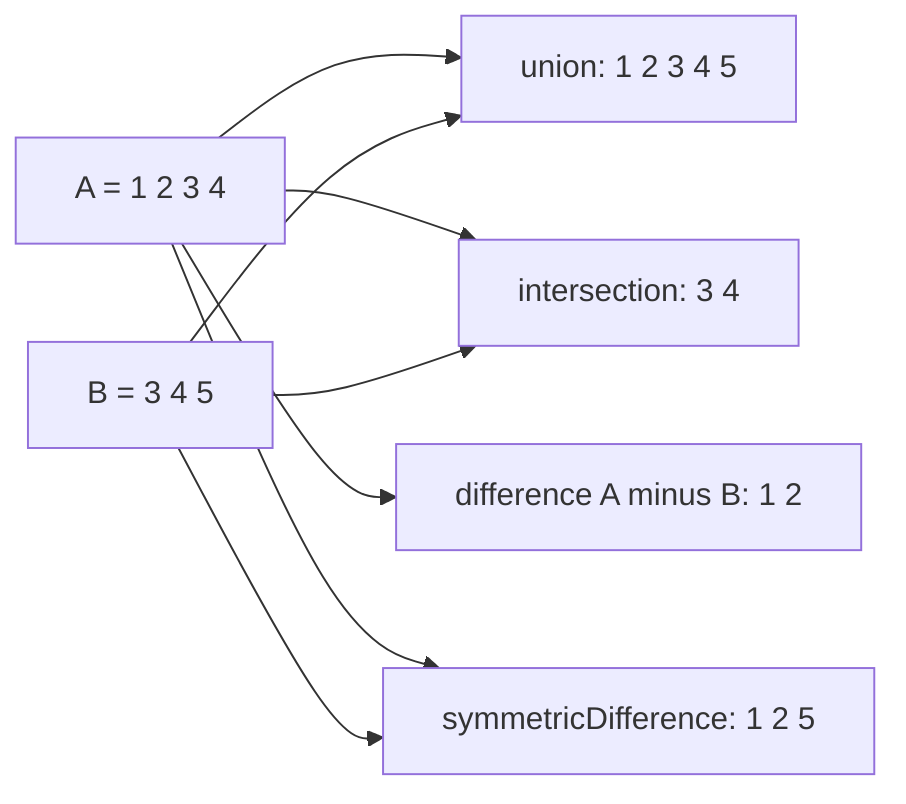
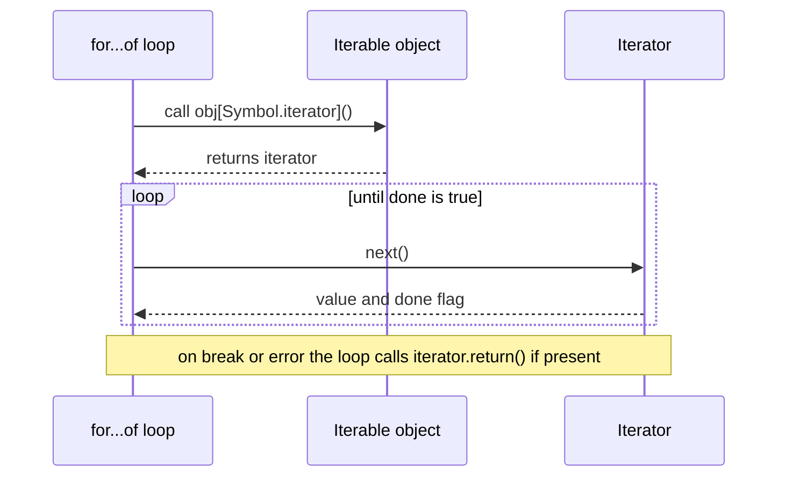

# Chapter 8 — Maps, Sets, Iterators and Generators

Plain objects and arrays can do a lot, but two jobs come up so often that JavaScript has dedicated collections for them: **looking things up by key** (`Map`) and **keeping values unique** (`Set`). This chapter covers both, their "weak" cousins that don't cause memory leaks (memory that is never freed because something still points at data nobody needs), and then the machinery that makes `for…of`, spread and destructuring work on all of them — the **iteration protocols** — and **generators**, the easiest way to produce your own lazy sequences (sequences whose values are computed only when asked for). We finish with the newest additions: **iterator helpers** (ES2025) and **`Object.groupBy` / `Map.groupBy`** (ES2024).

**What you'll learn**

1. `Map`: creating, `set`/`get`/`has`/`delete`/`clear`/`size`, iterating, converting, and when to prefer it over an object.
2. `Set`: uniqueness, methods, iteration, and the ES2025 set-algebra methods (`union`, `intersection`, …).
3. `WeakMap`, `WeakSet`, `WeakRef` and `FinalizationRegistry`: holding objects without keeping them alive.
4. The **iterable** and **iterator** protocols, `Symbol.iterator`, and everything that consumes iterables.
5. **Generators** (`function*`, `yield`, `yield*`), lazy and infinite sequences, two-way communication, async generators.
6. **Iterator helpers** (`map`, `filter`, `take`, `drop`, `flatMap`, `reduce`, `toArray`, …) and `Iterator.from`.
7. **Grouping** with `Object.groupBy` and `Map.groupBy`.

**Before you start.** You should know objects ([Chapter 5](../05-objects-math-date-and-json/README.md)), arrays and their callback methods ([Chapter 7](../07-arrays/README.md)), and closures ([Chapter 4](../04-functions-scope-and-closures/README.md)). One example uses a class with `#private` fields, explained in [Chapter 9](../09-this-prototypes-and-classes/README.md); async generators use promises (objects that stand for a value arriving later), explained in [Chapter 12](../12-asynchronous-javascript/README.md).

All code is in [`code/`](code/); outputs are real, from Node 24.

---

## 8.1 `Map`

### What it is
A **`Map`** (ES2015) is a collection of **key → value** pairs, like an object used as a dictionary (a lookup table from keys to values), but designed for that job:

- **Keys can be any value** — objects, functions, numbers, `NaN` — not only strings and symbols.
- It **remembers insertion order**, always.
- It knows its own **`size`**.
- It is **directly iterable** with `for…of`.

Think of a coat-check counter: you hand over *anything* as a ticket (the key) and get back exactly the coat stored under it.

### How it works — creating a Map
`new Map()` creates an empty map. Optionally pass an **iterable of `[key, value]` pairs** (for example an array of two-element arrays) to fill it.

From [`code/01_map.mjs`](code/01_map.mjs):

```js
const stock = new Map([
  ['apples', 500],
  ['bananas', 300],
  ['oranges', 200],
]);
console.log(stock, stock.size);
```

Output:

```text
Map(3) { 'apples' => 500, 'bananas' => 300, 'oranges' => 200 } 3
```

### Properties and methods

| Member | What it does | Returns |
|---|---|---|
| `size` (property) | Number of entries | number |
| `set(key, value)` | Adds a new entry or **updates** an existing key | the map itself (so calls chain) |
| `get(key)` | Looks up a key | the value, or `undefined` if absent |
| `has(key)` | Checks whether the key exists | boolean |
| `delete(key)` | Removes one entry | `true` if something was removed, else `false` |
| `clear()` | Removes all entries | `undefined` |
| `keys()` / `values()` / `entries()` | Iterators over keys / values / `[key, value]` pairs, in insertion order | iterator |
| `forEach((value, key, map) => …, thisArg?)` | Calls a function per entry, in insertion order | `undefined` |
| `[Symbol.iterator]()` | Same as `entries()` — why `for (const [k, v] of map)` works | iterator |
| `Map.groupBy(items, fn)` (static, ES2024) | Builds a Map of groups (section 8.7) | Map |

```js
const books = new Map();
books.set('1984', 'George Orwell').set('Dune', 'Frank Herbert');   // set returns the map -> chainable
console.log(books.get('1984'), books.get('Missing'), books.has('Dune'));
books.set('Dune', 'F. Herbert');                                   // same key -> update
console.log(books.size, books.delete('Dune'), books.delete('Dune'), books.size);
```

Output:

```text
George Orwell undefined true
2 true false 1
```

### Keys of any type
Map compares keys with **SameValueZero**: like `===`, except `NaN` equals `NaN` (and `+0` equals `-0`). Object keys are matched **by reference** — a different object with the same contents is a different key.

```js
const m = new Map();
const objKey = { id: 1 };
const fnKey = () => {};
m.set(objKey, 'object as key').set(fnKey, 'function as key').set(1, 'number 1').set('1', 'string 1').set(NaN, 'NaN works');
console.log(m.get(objKey), m.get(fnKey), m.get(1), m.get('1'), m.get(NaN), m.get({ id: 1 }));

const o = {};
o[objKey] = 'x'; o[1] = 'number'; o['1'] = 'string overwrites';
console.log(Object.keys(o), o);
```

Output:

```text
object as key function as key number 1 string 1 NaN works undefined
[ '1', '[object Object]' ] { '1': 'string overwrites', '[object Object]': 'x' }
```

With a plain object, every key is converted to a string: the object key becomes the useless `'[object Object]'` (so *all* objects would share one slot), and `1` and `'1'` collide. The Map keeps them distinct.

### Iterating and converting

```js
for (const [fruit, qty] of stock) console.log(fruit, qty);
console.log([...stock.keys()], [...stock.values()], [...stock.entries()][0]);
stock.forEach((value, key) => process.stdout.write(`${key}=${value} `));

const asObject = Object.fromEntries(stock);
const backToMap = new Map(Object.entries(asObject));
console.log(asObject, backToMap.get('apples'), JSON.stringify(stock), JSON.stringify([...stock]));
```

Output:

```text
apples 500
bananas 300
oranges 200
[ 'apples', 'bananas', 'oranges' ] [ 500, 300, 200 ] [ 'apples', 500 ]
apples=500 bananas=300 oranges=200 
{ apples: 500, bananas: 300, oranges: 200 } 500 {} [["apples",500],["bananas",300],["oranges",200]]
```

- Note the callback order in `forEach`: **value first, then key** (matching arrays' `(element, index)`).
- `Object.fromEntries(map)` and `new Map(Object.entries(obj))` convert back and forth (only sensible when keys are strings).
- **`JSON.stringify(map)` gives `{}`** — maps are not JSON. Serialize (turn into text for saving or sending) `[...map]` (an array of pairs) or `Object.fromEntries(map)`.

### Map vs Object

| Feature | `Map` | Plain object `{}` |
|---|---|---|
| Key types | **Any value** (objects, functions, numbers, `NaN`) | Strings and symbols only (others are converted to strings) |
| Order | Always insertion order | Defined, but integer-like keys come first in ascending order, then strings by insertion ([Ch 5](../05-objects-math-date-and-json/README.md)) |
| Size | `map.size`, O(1) (instant, whatever the size) | `Object.keys(obj).length`, O(n) (time grows with the number of keys) |
| Iteration | Directly iterable (`for…of`) | Via `Object.keys/values/entries` |
| Accidental keys | None — starts empty | Inherits from `Object.prototype` (`'toString' in {}`); a key named `__proto__` is special. `Object.create(null)` avoids this |
| Frequent add/delete | Optimised for it | `delete` can make objects slower in engines |
| JSON | Not directly | Native |
| Syntax | `map.get(k)` / `map.set(k, v)` | `obj.k` / `obj[k] = v`, literals, destructuring |
| Best for | Dynamic dictionaries, caches (stores of already-computed results kept for quick reuse), counting, non-string keys | Fixed-shape records (`{ id, name }`), config, JSON data |

### Real tasks

```js
const text = 'the cat and the hat and the bat';
const freq = new Map();
for (const w of text.split(' ')) freq.set(w, (freq.get(w) ?? 0) + 1);
console.log(freq, [...freq].toSorted((a, b) => b[1] - a[1])[0]);

const users = [{ id: 'u1', name: 'Ana' }, { id: 'u2', name: 'Ben' }];
const byId = new Map(users.map((u) => [u.id, u]));
console.log(byId.get('u2').name);
```

Output:

```text
Map(5) { 'the' => 3, 'cat' => 1, 'and' => 2, 'hat' => 1, 'bat' => 1 } [ 'the', 3 ]
Ben
```

The **count pattern** `map.set(k, (map.get(k) ?? 0) + 1)` and the **index-by-id pattern** `new Map(list.map((x) => [x.id, x]))` turn O(n) searches into O(1) lookups. They appear constantly in interview problems ([Chapter 17](../17-javascript-for-interviews/README.md)).

Because a Map remembers insertion order and supports cheap delete/re-insert, it makes a compact **LRU cache** (least-recently-used: when full, evict the entry unused the longest — how browser caches, CDNs (content delivery networks: servers around the world that keep copies of files close to users — see [System Design Fundamentals](../../../system-design-patterns/modules/00-system-design-fundamentals/README.md)) and database buffer pools (the database's in-memory copy of recently used disk pages) decide what to throw away):

```js
class LRU {
  #max; #map = new Map();
  constructor(max) { this.#max = max; }
  get(k) {
    if (!this.#map.has(k)) return undefined;
    const v = this.#map.get(k); this.#map.delete(k); this.#map.set(k, v); return v;
  }
  set(k, v) {
    this.#map.delete(k); this.#map.set(k, v);
    if (this.#map.size > this.#max) this.#map.delete(this.#map.keys().next().value); // oldest
  }
  keys() { return [...this.#map.keys()]; }
}
const cache = new LRU(2);
cache.set('a', 1); cache.set('b', 2); cache.get('a'); cache.set('c', 3);
console.log(cache.keys());   // [ 'a', 'c' ]  — 'b' was least recently used
```

(The LLD (low-level design) handbook designs a full LRU cache with a doubly linked list — a chain of items where each points to both its neighbours: [`../../../lld/`](../../../lld/).)

**Coming next — upsert (ES2026).** `map.getOrInsert(key, default)` and `map.getOrInsertComputed(key, fn)` return the existing value or insert one in a single call (replacing the `has`/`get`/`set` dance). They are in the ES2026 spec but **not in Node 24**, so the demo feature-detects them and prints `false`.

### Common mistakes
- Using bracket syntax on a Map: `map['k'] = 1` sets an ordinary *property* on the Map object; `map.get('k')` won't see it and `size` stays 0.
- Expecting `map.get({ id: 1 })` to find an entry stored with a *different* object that looks the same.
- `JSON.stringify(map)` → `{}`.
- Choosing a Map for a small fixed-shape record — an object is simpler and works with JSON and destructuring.

### In the interview
**30-second answer:** "Use a Map for dynamic key–value data: keys can be any type, it keeps insertion order, has `size`, iterates directly, and is optimised for frequent adds and deletes. Use objects for fixed-shape records and JSON. Map keys compare by SameValueZero, so objects are matched by reference."

- *How would you implement an LRU cache in JS?* A Map: on `get`, delete and re-insert; on overflow, delete `map.keys().next().value`.
- *Why not use an object as a hash map* (a key-value table that finds entries by hashing the key)? String-only keys, inherited properties, `__proto__` pitfalls, no `size`, slower churn (frequent adding and removing).

### Self-check
1. `new Map([[1, 'a']]).get('1')`? → `undefined` — `1` and `'1'` are different keys.
2. What does `map.set` return? → The map (chainable).
3. Which comes first in `map.forEach`'s callback: key or value? → Value.
4. How do you send a Map as JSON? → `JSON.stringify([...map])` or `Object.fromEntries(map)`.

---

## 8.2 `Set`

### What it is
A **`Set`** (ES2015) holds values — primitives or object references — where each value appears **at most once**. Adding a value that is already present does nothing. Like Map, it keeps insertion order, has `size`, and uses **SameValueZero** equality.

Think of a guest list at a door: a name is either on it or not, and writing it twice doesn't add a second guest.

### How it works

```js
const colors = new Set(['red', 'green', 'blue', 'red']);
console.log(colors, colors.size);

const numbers = new Set();
numbers.add(1).add(2).add(2);                      // add is chainable; duplicates ignored
console.log(numbers.has(1), numbers.has(3), numbers.size, numbers.delete(1), numbers.delete(1), numbers);
numbers.clear();
console.log(numbers.size);
```

Output (from [`code/02_set.mjs`](code/02_set.mjs)):

```text
Set(3) { 'red', 'green', 'blue' } 3
true false 2 true false Set(1) { 2 }
0
```

`new Set(iterable)` takes any iterable (array, string, another Set, a Map's keys…) and keeps the first occurrence of each value.

| Member | What it does | Returns |
|---|---|---|
| `size` (property) | Number of values | number |
| `add(value)` | Adds a value if not already present | the set (chainable) |
| `has(value)` | Membership test — **O(1)** on average | boolean |
| `delete(value)` | Removes a value | `true` if it was present |
| `clear()` | Removes everything | `undefined` |
| `values()` / `keys()` | Iterator over values (`keys` is an alias kept for symmetry with Map) | iterator |
| `entries()` | Iterator of `[value, value]` pairs (again, for Map symmetry) | iterator |
| `forEach((value, sameValue, set) => …)` | Calls a function per value, insertion order | `undefined` |
| `union`, `intersection`, `difference`, `symmetricDifference`, `isSubsetOf`, `isSupersetOf`, `isDisjointFrom` | Set algebra (**ES2025**) | new Set / boolean |

### Iteration and equality

```js
const s = new Set([1, 2, 3]);
s.forEach((value) => process.stdout.write(value + ' '));
console.log([...s.values()], [...s.keys()], [...s.entries()]);

const mixed = new Set([NaN, NaN, 0, -0, '1', 1, { a: 1 }, { a: 1 }]);
console.log(mixed.size, mixed);
```

Output:

```text
1 2 3 
[ 1, 2, 3 ] [ 1, 2, 3 ] [ [ 1, 1 ], [ 2, 2 ], [ 3, 3 ] ]
6 Set(6) { NaN, 0, '1', 1, { a: 1 }, { a: 1 } }
```

`NaN` is stored once and `0`/`-0` count as one value, but `'1'` and `1` are different, and two separate `{ a: 1 }` objects are **both** kept — objects are compared by reference. To deduplicate objects by content, key them by an id in a Map.

### Classic uses

```js
console.log([...new Set([3, 1, 3, 2, 1])]);            // dedupe an array, keeping first-seen order
const visited = new Set();
for (const url of ['/a', '/b', '/a', '/c', '/b']) {
  if (visited.has(url)) continue;
  visited.add(url);
}
console.log([...visited]);
```

Output:

```text
[ 3, 1, 2 ]
[ '/a', '/b', '/c' ]
```

The "visited" set is the heart of web crawlers (programs that follow links to download many pages), graph searches (BFS/DFS — breadth-first and depth-first search, two ways to explore a network of connected nodes) and "don't process this twice" logic.

### Set algebra (ES2025)

```js
const a = new Set([1, 2, 3, 4]);
const b = new Set([3, 4, 5]);
console.log('union              ', a.union(b));
console.log('intersection       ', a.intersection(b));
console.log('difference a-b     ', a.difference(b));
console.log('symmetricDifference', a.symmetricDifference(b));
console.log('isSubsetOf         ', new Set([3, 4]).isSubsetOf(a), a.isSupersetOf(new Set([1, 2])), a.isDisjointFrom(new Set([9])));
```

Output:

```text
union               Set(5) { 1, 2, 3, 4, 5 }
intersection        Set(2) { 3, 4 }
difference a-b      Set(2) { 1, 2 }
symmetricDifference Set(3) { 1, 2, 5 }
isSubsetOf          true true true
```



| Method | Meaning | Returns |
|---|---|---|
| `a.union(b)` | In A **or** B | new Set |
| `a.intersection(b)` | In A **and** B | new Set |
| `a.difference(b)` | In A but **not** B | new Set |
| `a.symmetricDifference(b)` | In exactly one of them | new Set |
| `a.isSubsetOf(b)` | Every element of A is in B | boolean |
| `a.isSupersetOf(b)` | Every element of B is in A | boolean |
| `a.isDisjointFrom(b)` | No shared elements | boolean |

These methods were standardized in **ES2025** and are available in all current browsers and in **Node 22+**. None of them mutates `a` or `b`. The argument doesn't have to be a Set — any **set-like** object (one with `size`, `has()` and `keys()`) works, such as a Map (its keys are used):

```js
const allowed = new Map([['read', true], ['write', false]]);
console.log(new Set(['read', 'delete']).intersection(allowed));   // Set(1) { 'read' }
```

On older runtimes, the classic pattern converts to an array and filters:

```js
const setA = new Set([1, 2, 3]);
const setB = new Set([2, 3, 4]);
const intersection = new Set([...setA].filter((x) => setB.has(x)));
console.log(intersection);   // Set(2) { 2, 3 }
```

Similarly, union is `new Set([...a, ...b])` and difference is `new Set([...a].filter((x) => !b.has(x)))`.

### Performance: `Set.has` vs `Array.includes`
`array.includes(x)` scans elements one by one — **O(n)**. `set.has(x)` uses hashing (turning the value into a number that points straight at its storage slot) — **O(1)** on average. The demo checks 2,000 lookups against 200,000 numbers and confirms `Set.has` is faster (the exact timing varies by machine, so the script prints only the comparison). Rule of thumb: if you test membership repeatedly, build a Set once.

### Common mistakes
- Expecting a Set to deduplicate objects with equal contents.
- Using `set[0]` — Sets have no indexes; convert with `[...set]` or iterate.
- Forgetting that `new Set('hello')` iterates the string: `Set { 'h', 'e', 'l', 'o' }`.
- Calling `JSON.stringify(set)` → `{}`; send `[...set]`.

### In the interview
**30-second answer:** "A Set stores unique values by SameValueZero, keeps insertion order and gives O(1) average `has`. I use it to dedupe (`[...new Set(arr)]`), track visited nodes, and — since ES2025 — for set algebra with `union`, `intersection`, `difference` and friends."

- *Remove duplicates from an array of objects by id?* `[...new Map(arr.map((o) => [o.id, o])).values()]` (keeps the last of each id).
- *Intersection of two arrays in O(n + m)?* `const s = new Set(b); a.filter((x) => s.has(x))`.

### Self-check
1. `new Set([1, '1', 1]).size`? → 2.
2. What does `set.add(x)` return? → The set.
3. `new Set([1,2]).union(new Set([2,3]))`? → `Set {1, 2, 3}`.
4. Why is `set.has` better than `arr.includes` in a loop? → O(1) vs O(n) per check.

---

## 8.3 `WeakMap`, `WeakSet`, `WeakRef` and `FinalizationRegistry`

### What it is
JavaScript frees memory automatically with a **garbage collector** (GC): an object is removed once nothing **reachable** refers to it. A normal Map or Set holds a **strong** reference to its keys/values, so storing an object in a Map keeps it alive forever — a classic memory leak. The **weak** collections hold their keys **weakly**: the entry does not stop the object from being collected, and when it is collected, the entry quietly disappears.

### How they work

| | `WeakMap` | `WeakSet` | `WeakRef` (ES2021) | `FinalizationRegistry` (ES2021) |
|---|---|---|---|---|
| Holds | key (weakly) → value | values (weakly) | one target (weakly) | callbacks for targets |
| Allowed keys/targets | Objects, and non-registered symbols (ES2023) | Same | Same | Same |
| Methods | `set`, `get`, `has`, `delete` | `add`, `has`, `delete` | `deref()` → target or `undefined` | `register`, `unregister` |
| `size`, iteration, `clear` | **No** | **No** | — | — |

Why no `size` or iteration? Because the contents change whenever the GC runs, which is unpredictable; exposing them would make programs behave differently from run to run.

From [`code/03_weak_collections.mjs`](code/03_weak_collections.mjs):

```js
const metadata = new WeakMap();
function track(el) { metadata.set(el, { clicks: 0, firstSeen: 'now' }); }
const button = { tag: 'button' };               // imagine a DOM element
track(button);
metadata.get(button).clicks++;
console.log(metadata.get(button), metadata.has(button), metadata.has({ tag: 'button' }));

const areaCache = new WeakMap();
let computed = 0;
function area(shape) {
  if (!areaCache.has(shape)) { computed++; areaCache.set(shape, shape.w * shape.h); }
  return areaCache.get(shape);
}
const box = { w: 3, h: 4 };
console.log(area(box), area(box), 'computed', computed, 'time(s)');

const processed = new WeakSet();
function processOnce(job) {
  if (processed.has(job)) return 'skipped';
  processed.add(job); return 'processed';
}
const job = { id: 7 };
console.log(processOnce(job), processOnce(job));

try { new WeakMap().set('str', 1); } catch (e) { console.log('primitive key ->', e.constructor.name); }
const wm = new WeakMap();
console.log('size' in wm, typeof wm[Symbol.iterator], typeof wm.keys);
const sym = Symbol('local');
console.log(new WeakMap([[sym, 'symbol key ok (ES2023)']]).get(sym));
try { new WeakSet().add(Symbol.for('registered')); } catch (e) { console.log('registered symbol ->', e.constructor.name); }
```

Output:

```text
{ clicks: 1, firstSeen: 'now' } true false
12 12 computed 1 time(s)
processed skipped
primitive key -> TypeError
false undefined undefined
symbol key ok (ES2023)
registered symbol -> TypeError
```

Three standard uses:

1. **Side tables** — attach extra data to objects you don't own (DOM elements, objects from a library) without adding properties to them. When the element is removed from the page and dropped, its data goes too.
2. **Memoization caches keyed by object** (memoization = remembering the result of a computation so it isn't repeated) — cache a computed result per object; no manual eviction (removing old entries) needed.
3. **Tagging/branding** (marking objects as "seen" or "genuine") with a WeakSet — "have I already processed / validated / created this object?" (This is how some libraries implemented private state before class `#private` fields existed.)

Primitive keys are rejected because primitives are never garbage collected; symbols created with `Symbol.for` (the global registry) are rejected for the same reason.

### `WeakRef` and `FinalizationRegistry`

```js
let bigObject = { payload: 'x'.repeat(10) };
const ref = new WeakRef(bigObject);
console.log(ref.deref()?.payload.length);        // still reachable -> 10
bigObject = null;                                // after GC, deref() MAY return undefined

const registry = new FinalizationRegistry((heldValue) => console.log('cleaned up', heldValue));
registry.register({ temp: true }, 'temp-object');
```

A **`WeakRef`** lets you point at an object *without* keeping it alive; `deref()` returns the object or `undefined` once collected. A **`FinalizationRegistry`** asks to be called back some time after a registered object is collected. Both are advanced tools for caches of large objects and for releasing external resources. Their timing is **unspecified** — the callback may run late or never (for example when the program exits first) — so never put essential logic (saving data, closing files) in them. The TC39 (the committee that designs JavaScript) proposal itself advises avoiding them where possible.

### When not to use it
- You need to list, count or iterate the entries → use `Map`/`Set` and remove entries yourself.
- Your keys are strings or numbers → weak collections can't hold them.

### In the interview
- *Difference between Map and WeakMap?* WeakMap keys must be objects (or non-registered symbols) and are held weakly, so entries vanish when the key is garbage-collected; as a result it has no `size`, no iteration and no `clear`.
- *Give a real use.* Caching computed data per DOM node or per request object; private per-instance data.

### Self-check
1. Can a WeakMap have a string key? → No — `TypeError`.
2. Why can't you iterate a WeakSet? → Its contents depend on unpredictable GC timing.
3. What does `weakRef.deref()` return after the target is collected? → `undefined`.

---

## 8.4 Iterators and the iterable protocol

### What it is
Two small **protocols** (agreed-upon shapes of objects, ES2015) make `for…of`, spread, destructuring, `Array.from`, `new Map(…)`, `new Set(…)`, `Promise.all` and more work on *any* collection:

- An **iterator** is an object with a `next()` method that hands back a `{ value, done }` result on every call; a result with `done: true` signals the end of the sequence.
- An **iterable** is an object with a method under the key **`Symbol.iterator`** that returns a fresh iterator.

`Symbol.iterator` is a **well-known symbol**: a built-in unique key the language itself looks for. Using a symbol (instead of a string like `"iterator"`) guarantees it can't clash with ordinary property names.

Think of an iterable as a book and an iterator as a bookmark: you can open the same book many times, each time with a new bookmark that only moves forward.



### How it works — driving it by hand
From [`code/04_iterators.mjs`](code/04_iterators.mjs):

```js
const it = ['a', 'b'][Symbol.iterator]();
console.log(it.next(), it.next(), it.next());

const isIterable = (x) => x != null && typeof x[Symbol.iterator] === 'function';
console.log([['array', [1]], ['string', 'hi'], ['Map', new Map()], ['Set', new Set()], ['object', {}], ['number', 5]]
  .map(([n, v]) => `${n}:${isIterable(v)}`).join(' '));
```

Output:

```text
{ value: 'a', done: false } { value: 'b', done: false } { value: undefined, done: true }
array:true string:true Map:true Set:true object:false number:false
```

Built-in iterables: **arrays, strings, Maps, Sets, typed arrays, `arguments`, DOM `NodeList`s, generator objects**, and the iterators returned by `keys()`/`values()`/`entries()`. Plain objects are **not** iterable — that's why you write `for (const [k, v] of Object.entries(obj))`.

### Making your own iterable

```js
const countdown = {
  from: 3,
  [Symbol.iterator]() {
    let current = this.from;
    return {
      next: () => (current > 0 ? { value: current--, done: false } : { value: undefined, done: true }),
      [Symbol.iterator]() { return this; },           // iterators are usually iterable too
    };
  },
};
console.log([...countdown], Array.from(countdown), Math.max(...countdown));
for (const n of countdown) process.stdout.write(n + ' ');
console.log('liftoff');
const [first, ...others] = countdown;
console.log(first, others, new Set(countdown).size, new Map([[1, 'x']]).size);
```

Output:

```text
[ 3, 2, 1 ] [ 3, 2, 1 ] 3
3 2 1 liftoff
3 [ 2, 1 ] 3 1
```

1. `[Symbol.iterator]()` is a **computed method name** (Chapter 5): the key is the symbol.
2. Each call creates a new iterator with its own `current` (a closure), so the object can be iterated many times.
3. Every consumer — spread, `Array.from`, `Math.max(...)`, `for…of`, destructuring, `new Set` — now works automatically.

Writing `next()` by hand is verbose; a **generator** does the same in two lines (the `Range` class in the demo uses `*[Symbol.iterator]() { … yield v; }` and prints `[ 0, 3, 6, 9 ]` — section 8.5).

### Early exit and `return()`
If a consumer stops before `done` (a `break`, a `return`, an exception, or destructuring that takes only the first few values), it calls the iterator's optional **`return()`** method, which is where cleanup (closing a file, releasing a lock — a flag that gives one piece of code exclusive use of a resource) belongs:

```js
function resource() {
  let i = 0;
  return {
    [Symbol.iterator]() { return this; },
    next() { i++; return { value: i, done: i > 5 }; },
    return() { console.log('  cleanup after', i, 'items'); return { done: true }; },
  };
}
for (const x of resource()) { if (x === 2) break; }
const [one] = resource();
console.log('first item was', one);
```

Output:

```text
  cleanup after 2 items
  cleanup after 1 items
first item was 1
```

### Iterators are single-use

```js
const arr = [1, 2];
const once = arr.values();
console.log([...once], [...once], [...arr], [...arr]);
```

Output:

```text
[ 1, 2 ] [] [ 1, 2 ] [ 1, 2 ]
```

An **iterator** is exhausted after one pass; an **iterable** (the array) hands out a fresh iterator each time. Passing an iterator where code expects to loop twice is a subtle bug.

### Everything that consumes iterables

| Consumer | Example |
|---|---|
| `for…of` | `for (const x of set)` |
| Spread in arrays and calls | `[...map]`, `Math.max(...set)` |
| Array destructuring | `const [a, b] = iterable` |
| `Array.from(iterable, mapFn?)` | `Array.from(map.values())` |
| Collection constructors | `new Map(pairs)`, `new Set(values)`, `new WeakMap(pairs)` |
| `Object.fromEntries(pairs)` | `Object.fromEntries(map)` |
| Promise combinators (functions that combine many promises into one) | `Promise.all(iterable)`, `allSettled`, `race`, `any` |
| `yield*` | inside generators |
| Grouping | `Object.groupBy(iterable, fn)` |

### In the interview
**30-second answer:** "An iterable has a `[Symbol.iterator]()` method returning an iterator; an iterator has `next()` returning `{ value, done }`. `for…of`, spread, destructuring, `Array.from` and the Map/Set constructors all speak this protocol, so implementing it makes any object work with them. Iterators can also define `return()` for cleanup on early exit."

- *Why isn't a plain object iterable?* Its keys, values and entries are all reasonable things to iterate, so the language makes you choose with `Object.keys/values/entries`.
- *`for…in` vs `for…of`?* `for…in` walks enumerable property **keys** (including inherited ones); `for…of` walks the **values** an iterable produces ([Chapter 3](../03-control-flow-and-loops/README.md)).

### Self-check
1. What must `next()` return? → An object `{ value, done }`.
2. Why does `[...{a: 1}]` throw? → Plain objects are not iterable.
3. When is `return()` called? → When a consumer stops early (break, throw, partial destructuring).

---

## 8.5 Generators

### What it is
A **generator function** (`function*`, ES2015) is a function that can **pause** in the middle and **resume** later. Calling it doesn't run its body; it returns a **generator object**, which is both an iterator and an iterable. Each `next()` call runs the body until the next **`yield`**, which hands out a value and pauses right there.

Think of a generator as a TV series rather than a film: calling it gives you the box set, and each `next()` plays one more episode, remembering where you stopped.

### How it works
From [`code/05_generators.mjs`](code/05_generators.mjs):

```js
function* threeSteps() {
  console.log('  start');
  yield 1;
  console.log('  after first yield');
  yield 2;
  console.log('  after second yield');
  return 3;                                   // return value is NOT included by for...of / spread
}
const gen = threeSteps();                     // nothing runs yet
console.log('created');
console.log(gen.next());
console.log(gen.next());
console.log(gen.next());
console.log(gen.next());
console.log([...threeSteps()]);
```

Output:

```text
created
  start
{ value: 1, done: false }
  after first yield
{ value: 2, done: false }
  after second yield
{ value: 3, done: true }
{ value: undefined, done: true }
  start
  after first yield
  after second yield
[ 1, 2 ]
```

Step by step:

1. `threeSteps()` returns a generator object; **no code in the body runs** (`created` prints first).
2. The first `next()` runs until `yield 1` and pauses → `{ value: 1, done: false }`.
3. Each further `next()` resumes right after the last `yield`.
4. `return 3` finishes the generator → `{ value: 3, done: true }`. After that, `next()` always gives `{ value: undefined, done: true }`.
5. `for…of` and spread stop as soon as `done` is `true`, so they **ignore the return value** — `[1, 2]`, not `[1, 2, 3]`.

Syntax variants: `function* name() {}`, `const g = function* () {}`, methods `*name() {}` in objects/classes, and `*[Symbol.iterator]() {}`. There are **no arrow generators**.

### Lazy and infinite sequences
Because values are produced only when requested, a generator can describe an **infinite** sequence safely — as long as the consumer stops.

```js
function* naturals() { let n = 1; while (true) yield n++; }
function* take(iterable, n) {
  if (n <= 0) return;
  for (const x of iterable) { yield x; if (--n <= 0) return; }
}
console.log([...take(naturals(), 5)]);

function* fibonacci() { let [a, b] = [0, 1]; while (true) { yield a; [a, b] = [b, a + b]; } }
console.log([...take(fibonacci(), 10)]);

function* map(iter, fn) { for (const x of iter) yield fn(x); }
function* filter(iter, pred) { for (const x of iter) if (pred(x)) yield x; }
const firstSquaresOfOdds = take(map(filter(naturals(), (n) => n % 2), (n) => n * n), 4);
console.log([...firstSquaresOfOdds]);
```

Output:

```text
[ 1, 2, 3, 4, 5 ]
[
  0, 1,  1,  2,  3,
  5, 8, 13, 21, 34
]
[ 1, 9, 25, 49 ]
```

The pipeline processes **one value at a time** through `filter → map → take` and never builds an intermediate array — the same "lazy evaluation" idea as Python generators, Java streams or Unix pipes. It's how you'd process a huge log file line by line without loading it all into memory. Section 8.6 shows the built-in version.

### Delegation with `yield*` and recursion

```js
function* inner() { yield 'b'; yield 'c'; return 'inner-done'; }
function* outer() { yield 'a'; const r = yield* inner(); yield r; yield* [1, 2]; }
console.log([...outer()]);

const tree = { value: 1, children: [{ value: 2, children: [{ value: 4, children: [] }] }, { value: 3, children: [] }] };
function* depthFirst(node) { yield node.value; for (const c of node.children) yield* depthFirst(c); }
console.log([...depthFirst(tree)]);
```

Output:

```text
[ 'a', 'b', 'c', 'inner-done', 1, 2 ]
[ 1, 2, 4, 3 ]
```

`yield* iterable` yields every value of another iterable (a generator, an array, a string…) as if they were yielded here, and evaluates to that generator's **return value**. Combined with recursion, it makes tree and graph (a network of nodes joined by links) traversal (visiting every node) read almost like the definition: "yield this node, then everything from each child".

### Two-way communication: `next(value)`, `return()`, `throw()`

```js
function* runningAverage() {
  let sum = 0, count = 0, avg;
  while (true) {
    const value = yield avg;
    sum += value; count++; avg = sum / count;
  }
}
const avg = runningAverage();
avg.next();                                   // prime: run to the first yield
console.log(avg.next(10).value, avg.next(20).value, avg.next(60).value);

function* guarded() {
  try { yield 1; yield 2; } finally { console.log('  finally ran'); }
}
const g1 = guarded(); g1.next();
console.log(g1.return('stopped'), g1.next());
const g2 = guarded(); g2.next();
try { g2.throw(new Error('boom')); } catch (e) { console.log('caught outside:', e.message); }
```

Output:

```text
10 15 30
  finally ran
{ value: 'stopped', done: true } { value: undefined, done: true }
  finally ran
caught outside: boom
```

- **`gen.next(x)`** resumes the generator and makes the paused `yield` expression evaluate to `x`. The first `next()` only runs up to the first `yield` (any argument to it is ignored), so it "primes" the generator.
- **`gen.return(v)`** finishes the generator as if a `return v` happened at the paused `yield` — `finally` blocks still run.
- **`gen.throw(err)`** throws `err` at the paused `yield`; if the generator doesn't catch it, it propagates to the caller.

This two-way channel is how libraries like **redux-saga** (a Redux add-on for managing side effects such as network calls) drive effects, and how `async`/`await` was emulated before ES2017 (the `co` library ran generators that yielded promises — see [Chapter 12](../12-asynchronous-javascript/README.md)).

### More uses: ID makers, state machines, async paging

```js
function* idMaker(prefix) { let i = 0; while (true) yield `${prefix}-${++i}`; }
const ids = idMaker('order');
console.log(ids.next().value, ids.next().value);

function* trafficLight() { while (true) { yield 'green'; yield 'yellow'; yield 'red'; } }
const light = trafficLight();
console.log(Array.from({ length: 5 }, () => light.next().value));

async function* fetchPages(totalPages) {
  for (let page = 1; page <= totalPages; page++) {
    await new Promise((r) => setTimeout(r, 5));          // pretend network call
    yield { page, items: [`item${page * 2 - 1}`, `item${page * 2}`] };
  }
}
for await (const { page, items } of fetchPages(3)) console.log('page', page, items);
console.log(await Array.fromAsync(fetchPages(2), (p) => p.page));
```

Output:

```text
order-1 order-2
[ 'green', 'yellow', 'red', 'green', 'yellow' ]
page 1 [ 'item1', 'item2' ]
page 2 [ 'item3', 'item4' ]
page 3 [ 'item5', 'item6' ]
[ 1, 2 ]
```

The traffic light is a tiny **state machine** (something that is always in one of a fixed set of states and moves between them by fixed rules). An **async generator** (`async function*`, ES2018) can `await` inside and is consumed with **`for await…of`**. It's the natural shape for paginated APIs (APIs that return results one page at a time), reading streams (data that arrives in pieces over time) chunk by chunk (Node's readable streams are async iterables — [Chapter 15](../15-nodejs-basics/README.md)), or polling. `Array.fromAsync` (ES2026, already in Node 24) collects an async iterable into an array.

### Trade-offs

| | Generator | Array |
|---|---|---|
| Memory | One value at a time | All values at once |
| Infinite sequences | Yes | No |
| Random access `[i]`, `length` | No | Yes |
| Reusable | No — create a new generator each time | Yes |
| Speed for small data | Slightly slower (pause/resume overhead) | Faster |

### When not to use it
For small, finite data that you'll index, sort or iterate several times, just build an array. Generators shine for large, lazy, infinite or step-by-step data, and for implementing `[Symbol.iterator]`.

### Common mistakes
- Calling a generator and expecting its body to run (`gen()` alone does nothing).
- Expecting the `return` value to appear in `for…of` or spread results.
- Reusing an exhausted generator object.
- Spreading an infinite generator without `take` → the program never ends (and runs out of memory).
- Forgetting to prime a generator before sending values with `next(x)`.

### In the interview
**30-second answer:** "A `function*` returns a generator object that's both an iterator and an iterable. `yield` pauses and emits a value; `next()` resumes. That makes lazy and infinite sequences easy, lets you implement `Symbol.iterator` in two lines, and supports two-way communication via `next(x)`, `return` and `throw`. Async generators with `for await` handle paginated or streamed data."

- *Write a `range(start, end)` generator.* `function* range(s, e) { for (let i = s; i < e; i++) yield i; }`
- *What's `yield*`?* Delegation: yields all values from another iterable and evaluates to its return value.
- *How do generators relate to async/await?* Async functions behave like generators that yield promises and are resumed when each settles (finishes, either successfully or with an error).

### Self-check
1. What does `[...(function* () { yield 1; return 2; })()]` produce? → `[1]`.
2. What does the first `next()` call do? → Runs to the first `yield` (or the end).
3. Can arrow functions be generators? → No.
4. How do you consume an async generator? → `for await (const x of gen())` or `Array.fromAsync`.

---

## 8.6 Iterator helpers (ES2025)

### What it is
**Iterator helpers** add array-like methods — `map`, `filter`, `take`, `drop`, `flatMap`, `reduce`, `toArray`, `forEach`, `some`, `every`, `find` — directly to **iterators** (via a new global `Iterator` class whose prototype every built-in iterator inherits from). Unlike the array methods, the ones that return iterators are **lazy**: nothing is computed until you pull values. Standardized in **ES2025**; available in Node 22+ and all current browsers.

From [`code/06_iterator_helpers.mjs`](code/06_iterator_helpers.mjs):

```js
function* naturals() { let n = 1; while (true) yield n++; }

const result = naturals()
  .filter((n) => n % 3 === 0)
  .map((n) => n * n)
  .take(4)
  .toArray();
console.log(result);

let pulled = 0;
const lazy = naturals().map((n) => { pulled++; return n * 10; }).take(3);
console.log('pulled before use:', pulled);
console.log([...lazy], 'pulled after use:', pulled);

console.log(naturals().drop(5).take(3).toArray());
console.log(['a b', 'c'].values().flatMap((s) => s.split(' ')).toArray());
console.log(naturals().take(5).reduce((sum, n) => sum + n, 0));
console.log(naturals().some((n) => n > 1000), naturals().take(3).every((n) => n < 5), naturals().find((n) => n * n > 50));

const prices = new Map([['tea', 3], ['cake', 5], ['pie', 7]]);
console.log(prices.entries().filter(([, p]) => p > 4).map(([k]) => k).toArray());

const plain = { i: 0, next() { return this.i < 3 ? { value: this.i++, done: false } : { value: undefined, done: true }; } };
console.log(Iterator.from(plain).map((x) => x + 100).toArray());

const arr = [1, 2, 3, 4];
console.log(typeof arr.take, arr.values().take(2).toArray());
```

Output:

```text
[ 9, 36, 81, 144 ]
pulled before use: 0
[ 10, 20, 30 ] pulled after use: 3
[ 6, 7, 8 ]
[ 'a', 'b', 'c' ]
15
true true 8
[ 'cake', 'pie' ]
[ 100, 101, 102 ]
undefined [ 1, 2 ]
```

| Helper | Lazy? | Returns |
|---|---|---|
| `map(fn)`, `filter(fn)`, `flatMap(fn)` | Yes | iterator |
| `take(n)`, `drop(n)` | Yes | iterator |
| `toArray()` | No — consumes | array |
| `reduce(fn, init?)`, `forEach(fn)` | No — consumes | value / `undefined` |
| `some(fn)`, `every(fn)`, `find(fn)` | No — consumes, **short-circuits** | boolean / value |
| `Iterator.from(obj)` (static) | — | wraps any iterator or iterable so helpers are available |

Key points:

- It works on an **infinite** generator because `take(4)` stops pulling once it has four results; `pulled` proves `map` ran only 3 times.
- Map and Set iterators (`entries()`, `values()`) get the helpers too — no need to spread into an array first.
- **Arrays are iterables, not iterators**: `arr.take` is `undefined`. Call `arr.values()` to get the lazy helpers. For ordinary array work, the array methods (Chapter 7) are simpler; use iterator helpers for large, lazy or infinite data.
- **Iterator.concat** (joining several iterators, ES2026) is not in Node 24 — the demo feature-detects it. **Async** iterator helpers are still a separate proposal.

---

## 8.7 Grouping: `Object.groupBy` and `Map.groupBy` (ES2024)

### What it is
Two static methods that take an iterable and a **key function**, and put each item into the bucket named by the key it returns. Standardized in **ES2024**; in Node 21+ and all current browsers. (They were first proposed as `Array.prototype.group`, but that name broke existing websites, so they became static methods.)

- **`Object.groupBy(items, fn)`** → a **null-prototype object** whose keys are strings (the key function's results converted to strings).
- **`Map.groupBy(items, fn)`** → a **Map**, so keys keep their type — objects, numbers, anything.

From [`code/07_groupby.mjs`](code/07_groupby.mjs):

```js
const inventory = [
  { name: 'laptop', type: 'electronics', quantity: 4 },
  { name: 'desk', type: 'furniture', quantity: 0 },
  { name: 'monitor', type: 'electronics', quantity: 12 },
  { name: 'chair', type: 'furniture', quantity: 30 },
  { name: 'stapler', type: 'office', quantity: 5 },
];

const byType = Object.groupBy(inventory, (item) => item.type);
console.log(Object.keys(byType), byType.furniture.map((i) => i.name));
console.log(Object.getPrototypeOf(byType) === null);

const byStock = Object.groupBy(inventory, ({ quantity }) => (quantity > 5 ? 'ok' : 'restock'));
console.log(Object.fromEntries(Object.entries(byStock).map(([k, v]) => [k, v.map((i) => i.name)])));

const restock = { label: 'restock' }, sufficient = { label: 'sufficient' };
const byObjectKey = Map.groupBy(inventory, ({ quantity }) => (quantity < 6 ? restock : sufficient));
console.log(byObjectKey.get(restock).map((i) => i.name));
const byLength = Map.groupBy(['a', 'bb', 'cc', 'ddd'], (w) => w.length);
console.log(byLength, byLength.get(2));

console.log(Object.groupBy(new Set([1, 2, 3, 4, 5]), (n) => (n % 2 ? 'odd' : 'even')));

const legacy = inventory.reduce((acc, item) => { (acc[item.type] ??= []).push(item.name); return acc; }, {});
console.log(legacy);
```

Output:

```text
[ 'electronics', 'furniture', 'office' ] [ 'desk', 'chair' ]
true
{
  restock: [ 'laptop', 'desk', 'stapler' ],
  ok: [ 'monitor', 'chair' ]
}
[ 'laptop', 'desk', 'stapler' ]
Map(3) { 1 => [ 'a' ], 2 => [ 'bb', 'cc' ], 3 => [ 'ddd' ] } [ 'bb', 'cc' ]
[Object: null prototype] { odd: [ 1, 3, 5 ], even: [ 2, 4 ] }
{
  electronics: [ 'laptop', 'monitor' ],
  furniture: [ 'desk', 'chair' ],
  office: [ 'stapler' ]
}
```

How it works:

1. Walk the iterable in order.
2. Call `fn(item, index)` to get a key.
3. Append the item to that key's array (creating it the first time).
4. Group order follows the first time each key appears; items inside a group keep their original order.

The result's **null prototype** means there are no inherited keys (a group named `toString` or `constructor` is safe), but also no inherited methods — use `Object.keys(result)`, not `result.hasOwnProperty(...)`. The grouped arrays contain the **original items** (not copies).

Before ES2024 everyone wrote the `reduce` version with `??=` (logical nullish assignment: assign only if the left side is `null`/`undefined`); lodash's `_.groupBy` is the library equivalent (lodash is a widely used utility library).

### Trade-offs

| | `Object.groupBy` | `Map.groupBy` |
|---|---|---|
| Keys | Strings (and symbols) | Any value |
| Result | Null-prototype object | Map |
| JSON-friendly | Yes | Convert first |
| Destructuring `const { ok, restock } = …` | Yes | No |
| Use when | Grouping by a label/category | Grouping by object, number, or you need Map features |

### Real-world examples
- Dashboards: group orders by status or by day before rendering sections.
- Chat apps: group messages by date ("Today", "Yesterday").
- Data cleanup: group records by email to find duplicates.
- Counting per group: `Object.fromEntries(Object.entries(byType).map(([k, v]) => [k, v.length]))` → `{ electronics: 2, furniture: 2, office: 1 }`.

### In the interview
- *How do you group an array by a property?* `Object.groupBy(arr, (x) => x.prop)` in modern runtimes; `reduce` with `(acc[k] ??= []).push(x)` otherwise.
- *When `Map.groupBy` over `Object.groupBy`?* Non-string keys, or when you need Map semantics (order, `size`, object keys).

### Self-check
1. Is `groupBy` a method on arrays? → No — static: `Object.groupBy(items, fn)` / `Map.groupBy(items, fn)`.
2. What prototype does `Object.groupBy`'s result have? → `null`.
3. Group numbers into even/odd with a Map. → `Map.groupBy(nums, (n) => n % 2 === 0)` (keys `true`/`false`).

---

## Version summary (verified September 2026)

| Feature | Standard | Node 24 | Notes |
|---|---|---|---|
| `Map`, `Set`, `WeakMap`, `WeakSet`, iterators, generators | ES2015 | ✓ | |
| Async generators, `for await…of` | ES2018 | ✓ | |
| `WeakRef`, `FinalizationRegistry` | ES2021 | ✓ | Timing unspecified |
| Symbols as WeakMap keys | ES2023 | ✓ | Non-registered symbols only |
| `Object.groupBy`, `Map.groupBy` | ES2024 | ✓ | Node 21+ |
| Set methods (`union`, `intersection`, …) | ES2025 | ✓ | Node 22+ |
| Iterator helpers, `Iterator.from` | ES2025 | ✓ | Node 22+ |
| `Array.fromAsync` | ES2026 | ✓ | |
| `Map/WeakMap.prototype.getOrInsert(Computed)` (upsert) | ES2026 | ✗ | Feature-detect |
| `Iterator.concat` | ES2026 | ✗ | Feature-detect |

---

## Chapter TL;DR

- **Map**: key → value with keys of any type (SameValueZero), insertion order, `size`, direct iteration; `set` (chainable, updates), `get`, `has`, `delete`, `clear`, `keys/values/entries`, `forEach(value, key)`. Prefer it for dynamic dictionaries, counting, caches (LRU), non-string keys; prefer objects for fixed records and JSON. `JSON.stringify(map)` is `{}`.
- **Set**: unique values, insertion order, O(1) `has`; `add` (chainable), `delete`, `clear`, `values`, `entries` (`[v, v]`), `forEach`. Dedupe with `[...new Set(arr)]`. ES2025 adds `union`, `intersection`, `difference`, `symmetricDifference`, `isSubsetOf`, `isSupersetOf`, `isDisjointFrom`.
- **WeakMap/WeakSet** hold object (or non-registered symbol) keys weakly: no leaks, but no `size`/iteration. Use for side tables, per-object caches, tagging. **WeakRef/FinalizationRegistry** are advanced; never rely on their timing.
- **Iterable** = has `[Symbol.iterator]()` returning an **iterator** with `next() → { value, done }` (optional `return()` for cleanup). Arrays, strings, Maps, Sets, typed arrays, NodeLists and generators are iterable; plain objects aren't. Consumers: `for…of`, spread, destructuring, `Array.from`, Map/Set constructors, `Promise.all`.
- **Generators** (`function*`) pause at `yield`; calling one returns an iterator without running the body. Great for lazy/infinite sequences, `Symbol.iterator`, tree traversal (`yield*`), two-way coroutines (functions that can pause and exchange values with their caller: `next(x)`, `return`, `throw`). **Async generators** + `for await…of` for paged or streamed data.
- **Iterator helpers** (ES2025): lazy `map/filter/take/drop/flatMap` and consuming `toArray/reduce/forEach/some/every/find` on any iterator; `Iterator.from` wraps custom ones; arrays need `.values()` first.
- **`Object.groupBy` / `Map.groupBy`** (ES2024) bucket items by a key function — null-prototype object with string keys, or a Map with any keys.
