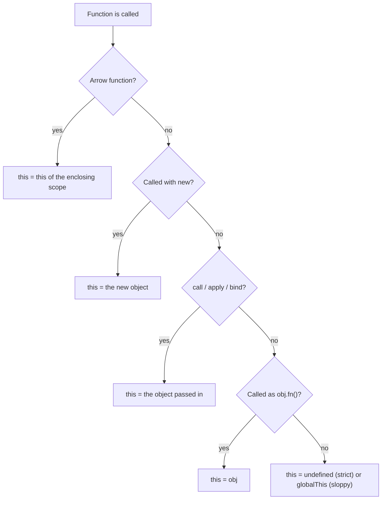
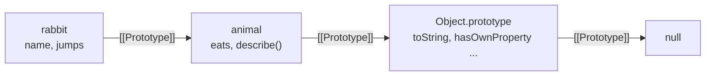
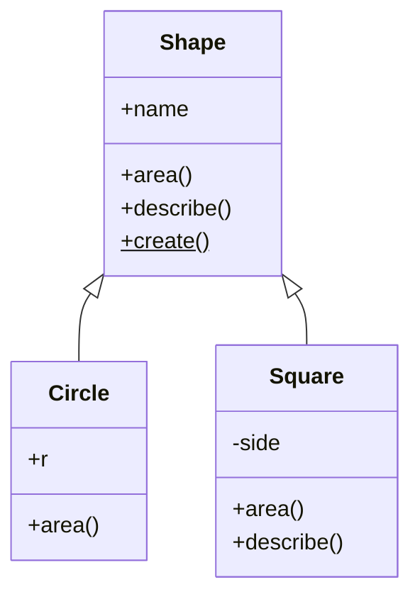

# Chapter 9 — `this`, Prototypes and Classes

JavaScript's object model surprises people from Java, C# or Python. There are no "real" classes underneath: objects link to other objects through a hidden **prototype** link, and a method finds its object at call time through **`this`**. `class` (ES2015) is cleaner syntax over that machinery plus a few genuinely new features (private `#fields`, static blocks). This chapter explains the machinery first, then the syntax.

**What you'll learn:** the four `this` rules (plus arrows) and their precedence; `call`/`apply`/`bind` (choosing `this`, borrowing, partial application); the prototype chain (lookup, shadowing, `Object.create`, `Object.create(null)`); constructor functions and what `new` does (re-implemented); classes (fields, `#private`, static members, getters/setters, static blocks, brand checks); `extends`/`super`, subclassing built-ins, initialization order; `instanceof`/`isPrototypeOf` and how they're fooled; mixins and composition vs inheritance.

**Before you start:** functions, arrows, closures ([Chapter 4](../04-functions-scope-and-closures/README.md)); object literals, descriptors, getters/setters ([Chapter 5](../05-objects-math-date-and-json/README.md)); symbols like `Symbol.iterator` ([Chapter 8](../08-maps-sets-iterators-and-generators/README.md)).

Code is in [`code/`](code/); outputs are real Node 24 output. Every file is an ES module (`.mjs`, [Chapter 10](../10-modules-and-tooling/README.md)), and **modules always run in strict mode** — which matters for `this`.

---

## 9.1 `this` — the call-time context

### What it is
`this` is an automatically defined identifier in every non-arrow function whose value is decided **each time the function is called**, by *how* it's called — like the word "me", whose meaning depends on who's speaking. The **call site** is where the function is invoked (`user.greet()`); look there, never at the definition.

### Why it matters
One function can serve many objects: `Array.prototype.push` is shared by every array, working because `this` is the array it's called on. The cost: the most common JS bug, the **lost `this`** — a method passed around as a plain function suddenly has `this === undefined`.

### How it works — the four rules
For a normal (non-arrow) function, the highest matching rule wins:

| # | Rule | Call-site shape | `this` is… |
|---|---|---|---|
| 4 | **`new` binding** | `new Fn(...)` | the brand-new object being constructed |
| 3 | **Explicit binding** | `fn.call(obj)`, `fn.apply(obj)`, `fn.bind(obj)()` | `obj` |
| 2 | **Implicit binding** | `obj.fn()` or `obj['fn']()` | `obj` — the object just before the dot |
| 1 | **Default binding** | plain `fn()` | `undefined` in strict mode; the global object (`globalThis`) in sloppy mode |
| — | **Arrow function** | any | no own `this`; it uses the `this` of the enclosing scope, *where it was written* (lexical `this` — "lexical" means decided by where code sits in the source) |

Precedence: **`new` > explicit > implicit > default**. Arrows are outside the list — nothing (not `call`, not `new`) changes their `this`, and they can't be used with `new`.



(**Strict mode** — `'use strict'`, automatic in modules and class bodies — stops plain calls from getting the global object; [Chapter 1](../01-introduction-and-setup/README.md). **`globalThis`** — the global object everywhere: `window` in browsers, `global` in Node.)

[`code/01_this_rules.mjs`](code/01_this_rules.mjs):

```js
function whoAmI() {
  return this === undefined ? 'undefined' : this.name;
}

// Rule 1 — default binding: a plain call. Strict mode -> this is undefined.
console.log('1 default :', whoAmI());

// Rule 2 — implicit binding: called as obj.method() -> this is obj.
const alice = { name: 'Alice', whoAmI };
console.log('2 implicit:', alice.whoAmI());

// Lost binding: take the method off the object, then call it plainly.
const detached = alice.whoAmI;
console.log('  lost    :', detached());

// Rule 3 — explicit binding: call / apply / bind choose this for you.
const bob = { name: 'Bob' };
console.log('3 call    :', whoAmI.call(bob));
console.log('  apply   :', whoAmI.apply(bob, []));
const boundToBob = whoAmI.bind(bob);
console.log('  bind    :', boundToBob(), '| still Bob as a method of alice?', { name: 'x', f: boundToBob }.f());

// Rule 4 — new binding: new creates a fresh object and uses it as this.
function Person(name) { this.name = name; }
const carol = new Person('Carol');
console.log('4 new     :', carol.name);

// Arrow functions have NO own this: they use this from the surrounding scope.
const timer = {
  name: 'Timer',
  regular() { return [1].map(function () { return this?.name; })[0]; },
  arrow()   { return [1].map(() => this.name)[0]; },
};
console.log('arrow     : regular callback ->', timer.regular(), '| arrow callback ->', timer.arrow());

// Arrow functions ignore call/apply/bind for this.
const arrowWho = () => (this === undefined ? 'undefined (module top level)' : this);
console.log('arrow+call:', arrowWho.call(bob));

// Precedence: new > explicit (bind) > implicit > default.
const Bound = Person.bind({ name: 'ignored' });
const dave = new Bound('Dave');
console.log('precedence: new beats bind ->', dave.name);
console.log('precedence: call beats implicit ->', alice.whoAmI.call(bob));

// Many array methods accept a thisArg.
const counter = { hits: 0 };
[1, 2, 3].forEach(function () { this.hits++; }, counter);
console.log('thisArg   :', counter.hits);

// Sloppy-mode default binding uses globalThis (Function-created code is never strict here).
const sloppy = new Function('return this === globalThis');
console.log('sloppy default this is globalThis:', sloppy());
```

Output:
```
1 default : undefined
2 implicit: Alice
  lost    : undefined
3 call    : Bob
  apply   : Bob
  bind    : Bob | still Bob as a method of alice? Bob
4 new     : Carol
arrow     : regular callback -> undefined | arrow callback -> Timer
arrow+call: undefined (module top level)
precedence: new beats bind -> Dave
precedence: call beats implicit -> Bob
thisArg   : 3
sloppy default this is globalThis: true
```

- `detached()` gives `undefined`: functions don't belong to objects; `alice.whoAmI` is just a property referencing a function.
- In `timer.regular`, `map` calls the inner `function` plainly (rule 1 → `undefined`); the arrow in `timer.arrow` sees `arrow()`'s `this` (`timer`) — *the* reason arrows were added.
- Top-level `this`: `undefined` in an ES module, `window` in a classic browser `<script>`, `module.exports` in a Node CommonJS file (older `require` format — [Chapter 10](../10-modules-and-tooling/README.md)).

### `this` in event listeners
A regular function registered with `addEventListener` is called with `this` = the element the listener is attached to (`event.currentTarget`); an arrow keeps the outer `this`. So a class method passed directly gets the *element*, not the class **instance** (object created with `new`). [`code/08_this_in_dom.mjs`](code/08_this_in_dom.mjs) runs this in jsdom (a browser-like DOM for Node):

```js
class Form {
  constructor(el) {
    this.name = 'SignupForm';
    el.addEventListener('click', this.handle);                 // loses this
    el.addEventListener('click', (e) => this.handle2(e));      // arrow keeps this
    el.addEventListener('click', this.handle3.bind(this));     // bind keeps this
  }
  handle() { console.log('method passed directly:', `this is the <${this.tagName.toLowerCase()}> element, this.name =`, JSON.stringify(this.name)); }
  handle2() { console.log('wrapped in arrow      :', this.name); }
  handle3() { console.log('bound                 :', this.name); }
}
```

Output (including two simpler listeners defined earlier in the file):
```
function listener this: save | same as currentTarget? true
arrow listener this   : undefined
method passed directly: this is the <button> element, this.name = ""
wrapped in arrow      : SignupForm
bound                 : SignupForm
```

The third line is a silent bug: `this.name` read the button's empty `name` attribute instead of throwing. Events: [Chapter 13](../13-dom-and-events/README.md).

### Common mistakes
- **Passing a method as a callback** — `setTimeout(user.greet, 100)`, `promise.then(obj.handle)`, `arr.map(obj.transform)` call it plainly. Fix: arrow wrapper (`() => user.greet()`), `bind`, or an arrow-function class field (§9.5).
- **Arrow functions as object methods** — `{ name: 'x', hi: () => this.name }` uses the surrounding scope's `this` (module: `undefined`). Use `hi() { … }`.
- **Assuming `this` is the function itself** — never; name the function if you need it.
- **Nested regular functions in methods** lose `this` (`timer.regular`). Old fix `const self = this;`; today, an arrow.

### In the interview
**30-second answer:** "`this` is decided at call time by the call site. By precedence: `new` makes it the new object; `call`/`apply`/`bind` set it explicitly; `obj.method()` makes it `obj`; a plain call gives `undefined` in strict mode or the global object in sloppy mode. Arrows have no own `this` — they capture it lexically and nothing can rebind it."

- *Q: `const f = obj.m; f()` — `this`?* A: `undefined` in strict code (global object in sloppy) — implicit binding lost.
- *Q: `new` an arrow?* A: `TypeError: … is not a constructor`; arrows have no `prototype` and no own `this`.
- *Q: Does `bind` beat `new`?* A: No — `new BoundFn()` creates a fresh object; the bound `this` is ignored (bound arguments kept).

### Self-check
1. `const o = { v: 1, f() { return () => this.v; } }; o.f()()`? → `1`.
2. `this` at the top level of an ES module? → `undefined`.
3. `[1,2].forEach(function(){ console.log(this) }, {a:1})`? → `{ a: 1 }` twice (`thisArg`).
4. Why does `setTimeout(obj.m, 0)` lose `this`? → It receives only the function and calls it plainly.

### TL;DR
Call site decides: `new` > `call/apply/bind` > `obj.fn()` > plain call (`undefined` in strict). Arrows borrow `this` from where they're written.

---

## 9.2 `call`, `apply` and `bind`

### What it is
Every function inherits from `Function.prototype` three methods to set `this` explicitly:

| Method | Signature | Runs now? | Returns |
|---|---|---|---|
| `call` | `fn.call(thisArg, a, b, …)` | yes | the function's result |
| `apply` | `fn.apply(thisArg, [a, b, …])` | yes | the function's result |
| `bind` | `fn.bind(thisArg, a, …)` | no | a new **bound function** with `this` (and optionally leading arguments) fixed |

Memory trick: **a**pply takes an **a**rray, **c**all takes **c**ommas.

### Why it matters
- **Method borrowing** — use a method on an object lacking it, e.g. array methods on **array-likes** (numbered keys + `length`, no array methods: `arguments`, DOM `NodeList`).
- **Fixing lost `this`** — `bind` makes a function safe to hand to callback APIs.
- **Partial application** — `bind` pre-fills leading arguments (related to currying — turning a many-argument function into a chain of one-argument functions; [Chapter 4](../04-functions-scope-and-closures/README.md)).

[`code/02_call_apply_bind.mjs`](code/02_call_apply_bind.mjs):

```js
function greet(greeting, punctuation) {
  return `${greeting}, ${this.name}${punctuation}`;
}
const ann = { name: 'Ann' };

console.log(greet.call(ann, 'Hi', '!'));        // args one by one
console.log(greet.apply(ann, ['Hello', '?']));  // args as an array
const hiAnn = greet.bind(ann, 'Hey');           // this AND first argument fixed
console.log(hiAnn('.'));

// Borrowing a method: array methods work on any "array-like" (has length + indexes).
const arrayLike = { 0: 'a', 1: 'b', 2: 'c', length: 3 };
console.log(Array.prototype.join.call(arrayLike, '-'));
console.log(Array.prototype.map.call('abc', (ch) => ch.toUpperCase()));

// apply was the old way to spread an array into arguments; spread syntax replaced it.
const nums = [4, 9, 2];
console.log(Math.max.apply(null, nums), Math.max(...nums));

// A bound function cannot be re-bound.
const boundOnce = greet.bind({ name: 'First' });
const boundTwice = boundOnce.bind({ name: 'Second' });
console.log(boundTwice('Yo', '!'));
console.log('bound name:', boundOnce.name, '| length:', greet.length, '->', hiAnn.length);

// Classic fix for a lost this: bind in advance.
class Button {
  constructor(label) { this.label = label; this.onClick = this.onClick.bind(this); }
  onClick() { return `clicked ${this.label}`; }
}
const { onClick } = new Button('Save');   // detached, but still works
console.log(onClick());
```

Output:
```
Hi, Ann!
Hello, Ann?
Hey, Ann.
a-b-c
[ 'A', 'B', 'C' ]
9 9
Yo, First!
bound name: bound greet | length: 2 -> 1
clicked Save
```

### How it works
1. `call`/`apply` invoke immediately with the given `this`.
2. `bind` returns an **exotic bound function object** (spec term for built-in special behaviour) remembering the target, `this` and pre-filled arguments.
3. Re-binding can't change `this` (`Yo, First!`), though extra arguments are appended.
4. A bound function's `name` is `"bound " + name`; `length` drops by the pre-filled count.
5. `null`/`undefined` as `thisArg`: kept as-is in strict code; `globalThis` in sloppy code.

### Trade-offs
| Need | Best tool today |
|---|---|
| Spread an array into arguments | spread syntax `f(...arr)` (clearer than `apply`) |
| Stable callback that uses `this` | arrow wrapper `() => obj.m()`, class arrow field, or `bind` |
| Pre-fill arguments without caring about `this` | arrow `(x) => f(1, x)` — easier to read than `f.bind(null, 1)` |
| Borrow a method for an array-like | `Array.from(arrayLike)` then use normal methods, or `Array.prototype.x.call` |

### Common mistakes
- `bind` in a render loop (code redrawing the screen repeatedly) or per event creates a new function each time — breaks identity: `removeEventListener('click', fn.bind(this))` removes nothing (a *different* function).
- Expecting `bind` to change an arrow's `this`.

### Self-check
1. `f.call(o, 1, 2)` vs `f.apply(o, [1, 2])`? → Same effect; argument passing differs.
2. `f.bind(o)` returns? → A new function; doesn't call `f`.
3. `f.bind(a).bind(b)()` — `this`? → `a`.

### TL;DR
`call`/`apply` run now with a chosen `this` (commas vs array); `bind` returns a function with `this` locked forever. Prefer spread and arrows where clearer.

---

## 9.3 Prototypes and the prototype chain

### What it is
Every object has an internal **`[[Prototype]]`** slot pointing to another object or `null`. Reading a missing property follows that link, then the next, until found or `null` — the **prototype chain**, JavaScript's inheritance mechanism: **delegation**, not copying. (A help desk: the clerk asks the supervisor, who asks the manager; if nobody knows, `undefined`.)

| Term | Meaning |
|---|---|
| **`[[Prototype]]`** | The hidden link every object has. Read with `Object.getPrototypeOf(obj)`, set with `Object.setPrototypeOf` or at creation with `Object.create(proto)`. |
| **`__proto__`** | A legacy getter/setter on `Object.prototype` exposing `[[Prototype]]`. Avoid it in code; the **`__proto__:` key in an object literal** is a separate, standard way to set the prototype at creation. |
| **`Fn.prototype`** | An ordinary property that every normal function (and class) has. It is *not* the function's own prototype — it is the object that becomes the `[[Prototype]]` of instances created with `new Fn()`. |
| **Own property** | A property stored directly on the object. Check with `Object.hasOwn(obj, key)` (ES2022). |
| **Shadowing** | An own property hides a property of the same name further up the chain. |

### How it works
1. **Read** `obj.x`: own property, else repeat on the prototype; at `null` return `undefined`.
2. **Write** `obj.x = v`: creates/updates an **own** property — assignment never modifies the prototype. (Exceptions: a *setter* for `x` up the chain runs; a *non-writable* inherited `x` makes the write fail — silently in sloppy, `TypeError` in strict.)
3. **Delete** removes only own properties, so an inherited value can "reappear".
4. **Methods run with `this` = the starting object**, not the prototype where found — so shared methods work on per-object data.



[`code/03_prototype_chain.mjs`](code/03_prototype_chain.mjs) (key parts):

```js
const animal = {
  eats: true,
  describe() { return `${this.name} eats: ${this.eats}`; },
};
const rabbit = Object.create(animal);   // rabbit.[[Prototype]] = animal
rabbit.name = 'Rabbit';
rabbit.jumps = true;

console.log(Object.getPrototypeOf(rabbit) === animal);         // true
console.log(rabbit.eats, rabbit.describe());                   // found on animal
console.log('own keys:', Object.keys(rabbit));
console.log('hasOwn eats?', Object.hasOwn(rabbit, 'eats'), '| "eats" in rabbit?', 'eats' in rabbit);

const seen = [];
for (const k in rabbit) seen.push(k);                           // for...in walks the chain
console.log('for...in:', seen);

rabbit.eats = false;                                            // creates an OWN property
console.log('rabbit.eats', rabbit.eats, '| animal.eats', animal.eats);
delete rabbit.eats;
console.log('after delete, rabbit.eats', rabbit.eats);

console.log('rabbit :', chain(rabbit));   // chain() walks getPrototypeOf until null
console.log('[]     :', chain([]));
console.log('fn     :', chain(function f() {}));
console.log('Map    :', chain(new Map()));

const a = [1], b = [2];
console.log('shared push?', a.push === b.push, a.push === Array.prototype.push);

const dict = Object.create(null);         // no prototype at all
dict.toString = 'just data';
console.log('proto of dict:', Object.getPrototypeOf(dict), '| "hasOwnProperty" in dict:', 'hasOwnProperty' in dict);

const base = { hello() { return 'hi from base'; } };
const late = {};
Object.setPrototypeOf(late, base);        // works, but slow — prefer Object.create
console.log(late.hello());

const lit = { __proto__: base, own: 1 };  // literal __proto__ key sets the prototype
console.log(lit.hello(), Object.keys(lit));
console.log('missing ->', rabbit.nope);
```

Output:
```
true
true Rabbit eats: true
own keys: [ 'name', 'jumps' ]
hasOwn eats? false | "eats" in rabbit? true
for...in: [ 'name', 'jumps', 'eats', 'describe' ]
rabbit.eats false | animal.eats true
after delete, rabbit.eats true
rabbit : animal -> Object.prototype -> null
[]     : Array.prototype -> Object.prototype -> null
fn     : Function.prototype -> Object.prototype -> null
Map    : Map.prototype -> Object.prototype -> null
shared push? true true
proto of dict: null | "hasOwnProperty" in dict: false
hi from base
hi from base [ 'own' ]
missing -> undefined
```

### Checking properties — which tool?
| Check | Looks at own props | Looks up the chain | Notes |
|---|---|---|---|
| `Object.hasOwn(o, k)` | ✓ | ✗ | Preferred (ES2022); works on `Object.create(null)` objects |
| `o.hasOwnProperty(k)` | ✓ | ✗ | Fails on null-prototype objects, can be shadowed |
| `k in o` | ✓ | ✓ | Includes non-enumerable and inherited |
| `Object.keys(o)` | ✓ (enumerable, string keys) | ✗ | |
| `for (k in o)` | ✓ | ✓ (enumerable only) | Why `for…in` is risky for objects with prototypes — see [Chapter 3](../03-control-flow-and-loops/README.md) |

### Why it matters
- **Memory**: a thousand arrays share one `push`.
- **Built-ins live on prototypes** (`Array.prototype`) — extendable, though you shouldn't.
- **`Object.create(null)`** gives a pure dictionary whose keys can't collide with `toString`, `constructor`, `__proto__` — useful for user-supplied keys (a `Map` is often better — [Chapter 8](../08-maps-sets-iterators-and-generators/README.md)).

### Common mistakes
- **Modifying built-in prototypes** ("monkey-patching", `Array.prototype.last = …`) can clash with future standards — it really happened: planned `Array.prototype.contains` became `includes` and `flatten` became `flat` because the MooTools library (popular in the late 2000s) had patched incompatible versions onto millions of sites.
- **`Object.setPrototypeOf` on hot objects** (used very frequently) — engines optimise by object **shape** (internal record of an object's properties); changing the prototype later de-optimises access (MDN warns about this).
- **Confusing `Fn.prototype` with `Object.getPrototypeOf(Fn)`** — the former is for instances; the latter is `Function.prototype`.
- **Prototype pollution** — naively deep-merging (recursively copying) untrusted JSON like `{"__proto__": {"isAdmin": true}}` can modify `Object.prototype` program-wide. Use null-prototype objects, `Map`, or libraries skipping `__proto__`/`constructor` keys ([Chapter 14](../14-browser-apis-and-security/README.md)).

### In the interview
**30-second answer:** "Every object has a hidden `[[Prototype]]` link; a missing property is looked up along that chain until found or `null`. Writing creates an own property, shadowing the inherited one. `Object.create(proto)` sets the prototype; constructors and classes do it via `Fn.prototype`. Methods are shared through the chain and run with `this` bound to the original **receiver** (the object the method was called on)."

- *Q: `__proto__` vs `prototype`?* A: `__proto__` (legacy accessor) is an object's own prototype link; `prototype` is a function property naming what `new` links instances to.
- *Q: End of every chain?* A: `null` (usually after `Object.prototype`).
- *Q: Object with no prototype?* A: `Object.create(null)` or `{ __proto__: null }`.

### Self-check
1. `const p = { x: 1 }; const c = Object.create(p); c.x = 2; p.x` → `1`.
2. Does `Object.keys` include inherited properties? → No.
3. Where does `[].map` live? → `Array.prototype.map`.
4. `Object.getPrototypeOf(Object.prototype)`? → `null`.

### TL;DR
Missing reads delegate up `[[Prototype]]` links to `null`; writes stay on the object. Use `Object.create`, `Object.getPrototypeOf`, `Object.hasOwn`; don't patch built-ins.

---

## 9.4 Constructor functions and `new`

### What it is
Before ES2015, many similar objects came from a **constructor function**: an ordinary, conventionally Capitalized function called with `new`, assigning per-instance data to `this`, with shared methods on `Constructor.prototype`. Classes (§9.5) are built on exactly this.

### How `new` works
`new Fn(args)`:
1. Creates an empty object.
2. Sets its `[[Prototype]]` to `Fn.prototype`.
3. Calls `Fn` with `this` = that object.
4. If `Fn` returns an **object**, that's the result; otherwise (no return or a primitive) the new object is.

Every `Fn.prototype` starts with `constructor` pointing back to `Fn` — how `instance.constructor` finds its maker.

[`code/04_constructor_functions.mjs`](code/04_constructor_functions.mjs):

```js
function Account(owner, balance = 0) {
  this.owner = owner;       // own, per-instance data
  this.balance = balance;
}
Account.prototype.deposit = function (amount) {  // one shared copy for all instances
  this.balance += amount;
  return this;
};
Account.prototype.toString = function () { return `${this.owner}: $${this.balance}`; };

const acc = new Account('Ravi', 100);
acc.deposit(50).deposit(25);
console.log(String(acc));
console.log('proto link  :', Object.getPrototypeOf(acc) === Account.prototype);
console.log('constructor :', acc.constructor === Account, Account.prototype.constructor === Account);
console.log('own keys    :', Object.keys(acc));

// What `new` does — written out by hand
function myNew(Ctor, ...args) {
  const obj = Object.create(Ctor.prototype);        // 1+2. new object linked to Ctor.prototype
  const result = Ctor.apply(obj, args);              // 3. run constructor with this = obj
  return result !== null && (typeof result === 'object' || typeof result === 'function')
    ? result                                         // 4a. if it returned an object, use that
    : obj;                                           // 4b. otherwise the new object
}
const acc2 = myNew(Account, 'Mei', 10);
console.log('myNew       :', String(acc2), acc2 instanceof Account);

// Forgetting `new` — in strict code this is undefined, so assigning throws
try {
  Account('Oops');
} catch (e) {
  console.log('no new      :', e.constructor.name, '-', e.message);
}

// Guard with new.target
function Safe(name) {
  if (!new.target) return new Safe(name);
  this.name = name;
}
console.log('new.target  :', Safe('guarded').name);

// Inheritance the old way
function Savings(owner, balance, rate) {
  Account.call(this, owner, balance);                 // "super" call
  this.rate = rate;
}
Savings.prototype = Object.create(Account.prototype);  // link the prototypes
Savings.prototype.constructor = Savings;               // repair constructor
Savings.prototype.addInterest = function () { return this.deposit(this.balance * this.rate); };
const s = new Savings('Lena', 1000, 0.05);
console.log('old-style   :', String(s.addInterest()), s instanceof Savings, s instanceof Account);
```

Output:
```
Ravi: $175
proto link  : true
constructor : true true
own keys    : [ 'owner', 'balance' ]
myNew       : Mei: $10 true
no new      : TypeError - Cannot set properties of undefined (setting 'owner')
new.target  : guarded
old-style   : Lena: $1050 true true
```

**`new.target`** is a meta-property: the constructor `new` was applied to, or `undefined` in a plain call.

### Common mistakes
- **Methods defined inside the constructor** (`this.deposit = function …`) — a copy per instance, wasting memory. Use the prototype (classes do automatically).
- **Forgetting `new`** — sloppy code silently creates globals; strict code throws `TypeError`. Classes refuse plain calls.
- **Replacing `Fn.prototype` without restoring `constructor`** — `s.constructor` would report `Account`.

### Self-check
1. `[[Prototype]]` of `new Fn()`? → `Fn.prototype`.
2. Constructor ends `return 42;`? → The new object (primitives ignored).
3. Ends `return { a: 1 };`? → `{ a: 1 }`, **not** linked to `Fn.prototype`.

### TL;DR
`new` = create → link to `Fn.prototype` → run `Fn` with that `this` → return it (unless `Fn` returns another object). Shared methods on `Fn.prototype`.

---

## 9.5 Classes

### What it is
A **class** is a template for objects. `class` declares a special constructor function and fills its `prototype` with methods — §9.4's arrangement — with shorter syntax, safer defaults, and features impossible with plain functions: truly private members, static blocks, `super`. "Syntactic sugar" (nicer syntax for something already possible) is mostly right for methods and inheritance, not for private fields.

### Class features at a glance

| Feature | Syntax | Lives on | Added in |
|---|---|---|---|
| Constructor | `constructor(a) { … }` | the class function itself | ES2015 |
| Method | `m() { … }` | `Class.prototype` (non-enumerable) | ES2015 |
| Getter / setter | `get x() {}` / `set x(v) {}` | `Class.prototype` (accessor property) | ES2015 |
| Static method | `static m() {}` | the class function | ES2015 |
| Computed name | `[expr]() {}` | prototype or class | ES2015 |
| Public instance field | `x = 0;` | each instance (own, enumerable) | ES2022 |
| Static field | `static x = 0;` | the class function | ES2022 |
| Private field / method | `#x = 0;` `#m() {}` | hidden per-instance slot | ES2022 |
| Private static | `static #x`, `static #m()` | hidden slot on the class | ES2022 |
| Static initialization block | `static { … }` | runs once at definition time | ES2022 |
| Private "brand check" | `#x in obj` | — | ES2022 |

- **Field** — declared in the body, created on every instance (or the class, if `static`); its initializer runs per instance with `this` = the instance.
- **Private member** — `#name`, usable only by code *lexically inside* the class body. Not a property: absent from `Object.keys`, `JSON.stringify`, `for…in`, proxies (`Proxy` objects intercepting property access); outside access is a **syntax error** at parse time (before the code runs).
- **Accessor** — getter/setter pair that looks like a property but runs code ([Chapter 5](../05-objects-math-date-and-json/README.md)).
- **Static member** — belongs to the class: factory methods (build and return instances, e.g. `Temperature.fromFahrenheit`), counters, constants, caches.

[`code/05_classes.mjs`](code/05_classes.mjs):

```js
class Temperature {
  unit = 'C';                         // public instance field
  #celsius;                           // private instance field
  static instances = 0;               // static field
  static #absoluteZero = -273.15;     // private static field

  static {                            // static initialization block — runs once
    Temperature.freezing = new Temperature(0);
    Temperature.instances = 0;        // don't count the helper instance
  }

  constructor(celsius) {
    Temperature.#check(celsius);
    this.#celsius = celsius;
    Temperature.instances++;
  }

  get fahrenheit() { return this.#celsius * 9 / 5 + 32; }
  set fahrenheit(f) {
    const c = (f - 32) * 5 / 9;
    Temperature.#check(c);
    this.#celsius = c;
  }
  get celsius() { return this.#celsius; }   // read-only from outside: no setter

  #format(v) { return v.toFixed(1); }       // private method
  toString() { return `${this.#format(this.#celsius)}°C`; }

  static #check(c) {
    if (c < Temperature.#absoluteZero) throw new RangeError(`below absolute zero: ${c}`);
  }
  static fromFahrenheit(f) { const t = new Temperature(0); t.fahrenheit = f; return t; }
  static isTemperature(obj) { return #celsius in obj; }   // brand check
}

const t = new Temperature(25);
console.log(String(t), '=', t.fahrenheit, '°F');
t.fahrenheit = 212;
console.log('after set  :', String(t), '| unit field:', t.unit);
console.log('static     :', Temperature.instances, String(Temperature.freezing), String(Temperature.fromFahrenheit(-40)));
console.log('brand check:', Temperature.isTemperature(t), Temperature.isTemperature({ celsius: 1 }));
console.log('own keys   :', Object.keys(t), '(private fields are invisible)');
try { new Temperature(-300); } catch (e) { console.log('validation :', e.name, e.message); }
// t.#celsius  -> SyntaxError at parse time if written outside the class
```

Output (first part):
```
25.0°C = 77 °F
after set  : 100.0°C | unit field: C
static     : 1 0.0°C -40.0°C
brand check: true false
own keys   : [ 'unit' ] (private fields are invisible)
validation : RangeError below absolute zero: -300
```

Why `static` prints `1`: the static block created `freezing` then reset the counter; `new Temperature(25)` made it 1; arguments evaluate left to right, so `instances` was read (1) *before* `fromFahrenheit(-40)` bumped it to 2 — evaluation order matters with **side effects** (changes beyond producing a value).

### Facts about classes that trip people up
The same file continues:

```js
// 05_classes.mjs, second part (abridged — each output line labels its check)
class Clicker {
  count = 0;
  method() { return ++this.count; }
  arrow = () => ++this.count;   // one function per instance, this captured forever
}
const { method, arrow } = new Clicker();
try { method(); } catch (e) { console.log('detached method     :', e.message); }
console.log('detached arrow      :', arrow(), arrow());
// ... also: typeof, prototype method names, calling without new, use before the class line (TDZ),
//     a computed method name + static [Symbol.hasInstance], and the getter's descriptor
```

Output (full run):
```
typeof class        : function
methods on prototype: [ 'constructor', 'fahrenheit', 'celsius', 'toString' ]
methods enumerable? : false
call without new    : Class constructor Temperature cannot be invoked without 'new'
TDZ                 : ReferenceError - Cannot access 'Later' before initialization
detached method     : Cannot read properties of undefined (reading 'count')
detached arrow      : 1 2
arrow on prototype? : false | own? true
computed name       : HEY | 42 instanceof Loud: true
accessor descriptor : function function enumerable: false
```

| Fact | Consequence |
|---|---|
| A class is a function (`typeof` → `'function'`) | It has `prototype`, `name`, `length` like any function |
| Class bodies are always strict mode | Detached methods get `this === undefined`, not the global object |
| Methods are non-enumerable | `for…in` over an instance shows only data fields — nicer than §9.4 |
| Must be called with `new` | Calling it plainly throws `TypeError` |
| Declarations are hoisted into the **TDZ** (temporal dead zone, [Chapter 2](../02-variables-types-and-operators/README.md)) | You can't use a class before its `class` line runs — unlike function declarations |
| Private methods (`#format`) and the `#check` static are not on the prototype | `getOwnPropertyNames` doesn't list them |
| Arrow-function **fields** are own properties created per instance | Great for callbacks (`this` is fixed), but each instance gets a new function and subclasses can't call them via `super` |
| `static [Symbol.hasInstance]` customizes `instanceof` | Rarely needed; shown only so you recognize it |

### Getters, setters and private fields together
`Temperature` shows **encapsulation** (hide internal state, expose a controlled interface): real value in a private field, a getter to expose it, validation in setter/constructor. `celsius` has no setter, so it's read-only — `t.celsius = 5` is silently ignored in sloppy code, `TypeError` in strict. Pre-ES2022 "private" meant `this._celsius` (convention, fully public) or closure/`WeakMap` tricks.

### Static initialization blocks
`static { … }` runs once when the class is evaluated, with `this` = the class — for setup needing statements (loops, `try/catch`, several related statics) or private statics. Several blocks run in order with static field initializers.

### When not to use a class
- A single object (config, a namespace of functions) → object literal or module ([Chapter 10](../10-modules-and-tooling/README.md)).
- A data-transforming function → a plain function.
- React function components replaced class components for new code (see the React handbook).

### Common mistakes
- A field initializer using a *later* field — fields initialize top to bottom.
- Expecting `#private` fields to survive `structuredClone`, `JSON.stringify` or `{...spread}` — none copy them.
- `Object.keys(instance)` to inspect private data — use the DevTools/Node inspector (debuggers that pause code and show values), which displays private fields.
- `class A { method = function () {} }` is a per-instance field, not a method.

### In the interview
**30-second answer:** "A class is a constructor function plus a prototype with its methods, with nicer syntax. It's strict, `new`-only, has non-enumerable methods, and is in the TDZ until defined. ES2022 added public and private fields, `#` private methods, static blocks and `#x in obj` checks. Private fields are enforced by the language, unlike the `_underscore` convention."

- *Q: Are classes hoisted?* A: Hoisted but uninitialized (TDZ) → `ReferenceError` if used early.
- *Q: Method vs arrow field for event handlers?* A: Arrow field keeps `this` without `bind` but costs one function per instance and no `super`; a method is shared on the prototype.
- *Q: How private is `#x`?* A: Inaccessible outside the class body, invisible to every object API; class-body code (incl. static methods handling other instances) can read it.

### Self-check
1. Where does a class method live? → `Class.prototype`.
2. A public field? → Each instance, own enumerable property.
3. `class A { #x = 1; static has(o) { return #x in o; } } A.has({})` → `false`.
4. `typeof class {}`? → `'function'`.

### TL;DR
`class` = constructor + prototype methods with safer defaults (strict, `new`-only, non-enumerable methods). ES2022: fields, `#private`, `static {}`, brand checks. Getters/setters over private fields for encapsulation.

---

## 9.6 Inheritance with `extends` and `super`

### What it is
`class Child extends Parent` makes a specialized `Parent`: instances inherit `Parent`'s methods via the prototype chain, and `Child` can add or **override** (replace) them. `super(...)` calls the parent constructor; `super.method()` the parent's version of a method.

### How it works
`extends` links **two** chains:
1. `Child.prototype.[[Prototype]] = Parent.prototype` — instance methods.
2. `Child.[[Prototype]] = Parent` — static methods.



Derived-constructor rules:
- **Call `super(...)` before using `this`** — in a derived class the *parent* constructor creates the object; using `this` first throws `ReferenceError`.
- No constructor written → default `constructor(...args) { super(...args); }`.
- **Initialization order**: `super()` runs parent field initializers and constructor; then child fields; then the rest of the child constructor.

[`code/06_inheritance.mjs`](code/06_inheritance.mjs):

```js
class Shape {
  constructor(name) {
    if (new.target === Shape) throw new TypeError('Shape is abstract');
    this.name = name;
  }
  area() { throw new Error(`${this.constructor.name} must implement area()`); }
  describe() { return `${this.name} with area ${this.area().toFixed(2)}`; }
  static create(...args) { return new this(...args); } // `this` = the class it's called on
}

class Circle extends Shape {
  constructor(r) {
    super('circle');          // must run before touching `this`
    this.r = r;
  }
  area() { return Math.PI * this.r ** 2; }
}

class Square extends Shape {
  #side;
  constructor(side) { super('square'); this.#side = side; }
  area() { return this.#side ** 2; }
  describe() { return super.describe() + ' (all sides equal)'; } // extend parent behaviour
}

const shapes = [new Circle(1), Square.create(3)];
for (const s of shapes) console.log(s.describe());

try { new Shape('x'); } catch (e) { console.log('abstract   :', e.message); }
class Broken extends Shape { constructor() { super('broken'); } }
try { new Broken().describe(); } catch (e) { console.log('no area   :', e.message); }
class NoSuper extends Shape { constructor() { this.x = 1; super('x'); } }
try { new NoSuper(); } catch (e) { console.log('this first :', e.name, '-', e.message); }

console.log('instance chain:', Object.getPrototypeOf(Circle.prototype) === Shape.prototype);
console.log('static chain  :', Object.getPrototypeOf(Circle) === Shape, '-> Circle.create exists:', typeof Circle.create);
```

Output:
```
circle with area 3.14
square with area 9.00 (all sides equal)
abstract   : Shape is abstract
no area   : Broken must implement area()
this first : ReferenceError - Must call super constructor in derived class before accessing 'this' or returning from derived constructor
instance chain: true
static chain  : true -> Circle.create exists: function
```

- **Polymorphism** — `Shape.describe()` calls `this.area()`, which runs the *subclass's* `area`: **dynamic dispatch** (method chosen at call time by the actual object) via the prototype chain.
- **Abstract classes** — no `abstract` keyword; `new.target === Shape` plus a throwing `area()` imitate one (TypeScript adds real compile-time `abstract` — [Chapter 16](../16-testing-and-typescript/README.md)).
- `static create` uses `new this(...)`, so `Square.create(3)` builds a `Square` — statics are inherited with `this` = the calling class.
- **Private fields aren't accessible to subclasses** — not `Circle`, not even a `Square` subclass; private = "this class body only". Use a normal or "protected"-by-convention property (protected, in other languages, means subclass-visible only) if subclasses need it.

### Subclassing built-ins and initialization order
```js
class Stack extends Array {
  peek() { return this.at(-1); }
}
const st = Stack.from([1, 2, 3]);
st.push(4);
console.log('Stack         :', st.peek(), st.length, Array.isArray(st), st.map((x) => x * 2) instanceof Stack);

class HttpError extends Error {
  constructor(status, message) { super(message); this.name = 'HttpError'; this.status = status; }
}
const he = new HttpError(404, 'Not Found');
console.log('Error subclass:', he instanceof Error, he.name, he.status, he.message);

class Queue { get [Symbol.toStringTag]() { return 'Queue'; } }
console.log('toStringTag   :', Object.prototype.toString.call(new Queue()));

class A { a = console.log('  A field') ?? 1; constructor() { console.log('  A constructor'); } }
class B extends A { b = console.log('  B field') ?? 2; constructor() { console.log('  B before super'); super(); console.log('  B after super'); } }
console.log('init order:'); new B();
```

Output (the file prints the three §9.7 `instanceof` lines first):
```
Stack         : 4 4 true true
Error subclass: true HttpError 404 Not Found
toStringTag   : [object Queue]
init order:
  B before super
  A field
  A constructor
  B field
  B after super
```

- `extends Array` gives real arrays: auto-updating `length`, `Array.isArray` true, `map` returning a `Stack` (via `Symbol.species`) — impossible with old constructor functions.
- Subclassing `Error` is the standard way to make custom errors ([Chapter 11](../11-errors-and-debugging/README.md)).
- The init order shows why a parent constructor mustn't call an overridable method relying on child fields — they don't exist yet.

### `super` in object literals
`super` works in **concise methods** of object literals, referring to the object's prototype: `const child = { __proto__: parent, hi() { return super.hi() + '!'; } }`. It's bound to the **home object** (where the method was *defined*), not `this` — copying the method elsewhere doesn't change `super`.

### Common mistakes
- Forgetting `super()` or calling it after `this`.
- Deep hierarchies (`Animal → Mammal → Dog → ServiceDog → …`) couple you to (make you depend on) every level above (§9.9).
- Overriding without calling `super.method()` when the parent's behaviour (cleanup, validation) is still needed.
- Calling overridable methods from a parent constructor.

### In the interview
**30-second answer:** "`extends` links `Child.prototype` to `Parent.prototype` for instance methods and `Child` to `Parent` for statics. A derived constructor must call `super()` before `this`, because the parent constructs the object. `super.method()` calls the parent's implementation. `Array`, `Error`, `Map` subclass properly with class syntax."

- *Q: Derived class without a constructor?* A: A default one forwards all arguments to `super(...)`.
- *Q: Extend `null` or an expression?* A: `extends` accepts any expression evaluating to a constructor (or `null`) — enabling mixin factories (§9.8).
- *Q: Initialization order?* A: Parent fields → parent constructor → child fields → rest of child constructor.

### Self-check
1. Why `super()` before `this`? → The parent constructor creates the object.
2. How are statics inherited? → `Child.[[Prototype]]` is `Parent`.
3. Can a subclass read the parent's `#secret`? → No.

### TL;DR
`extends` links instance and static chains; `super()` first, then `this`; `super.m()` reaches the parent. Built-ins subclass cleanly. Keep hierarchies shallow.

---

## 9.7 `instanceof` and type checks

### What it is
`obj instanceof C` asks **"is `C.prototype` anywhere in `obj`'s prototype chain?"** — nothing about how the object was created. `C.prototype.isPrototypeOf(obj)` asks the same the other way round.

```js
const c = shapes[0];
console.log('instanceof    :', c instanceof Circle, c instanceof Shape, c instanceof Object, c instanceof Square);
console.log('isPrototypeOf :', Shape.prototype.isPrototypeOf(c));
const fake = Object.create(Circle.prototype);
console.log('fooled?       :', fake instanceof Circle, '(instanceof only checks the chain)');
```

Output:
```
instanceof    : true true true false
isPrototypeOf : true
fooled?       : true (instanceof only checks the chain)
```

`fake` never ran `Circle`'s constructor (no `r`), yet is "a `Circle`".

### Choosing a type check
| Question | Use | Pitfall |
|---|---|---|
| Is it a primitive of type T? | `typeof x === 'string'` etc. | `typeof null === 'object'` ([Chapter 2](../02-variables-types-and-operators/README.md)) |
| Is it an array? | `Array.isArray(x)` | `instanceof Array` fails for arrays from another realm (iframe, `vm` context) |
| Is it an error? | `Error.isError(x)` (ES2026; Node 24 has it) or `x instanceof Error` | Same cross-realm issue for `instanceof` |
| Was it made by my class, really? | `#brand in x` (private brand check) | Only works inside the class body |
| Is it "like" a type (has the methods I need)? | **duck typing**: `typeof x?.then === 'function'` | Can't distinguish unrelated objects with the same method names |
| Built-in tag | `Object.prototype.toString.call(x)` → `"[object Date]"` | Can be customized via `Symbol.toStringTag` |

A **realm** is one global environment — each tab, iframe or Node `vm` context has its own `Array`, `Object`, `Error`. An iframe's array has the *iframe's* `Array.prototype`, so `instanceof Array` in the parent is `false` — why `Array.isArray` exists.

**Duck typing** ("walks like a duck…") checks capabilities, not ancestry — how promises interoperate: anything with `then` (a *thenable*) is treated as a promise by `await` ([Chapter 12](../12-asynchronous-javascript/README.md)).

### Self-check
1. `instanceof` true without the constructor running? → Yes (`Object.create(C.prototype)`, `Object.setPrototypeOf`).
2. Most robust array check? → `Array.isArray`.
3. `Object.create(null) instanceof Object`? → `false`.

### TL;DR
`instanceof` = "is `C.prototype` in the chain?". Prefer `Array.isArray`, `Error.isError`, `#brand in obj` or duck typing when correctness matters.

---

## 9.8 Mixins

### What it is
Classes have **single inheritance** (one `extends`). A **mixin** is a reusable bundle of methods mixed into a class that already has a parent, so unrelated classes share a capability (serializable — convertible to text like JSON; observable — others can subscribe to its changes; timestamped) without a common ancestor.

1. **Object mixins** — `Object.assign(Target.prototype, mixinA, mixinB)`.
2. **Subclass-factory mixins** — a function taking a base class and returning `class extends Base { … }`; stackable since `extends` takes any expression: `class Duck extends CanSwim(CanFly(Animal)) {}`.

[`code/07_mixins_composition.mjs`](code/07_mixins_composition.mjs) (first part):

```js
// 1) Object.assign mixin — copy methods onto a prototype
const Serializable = { toJSONString() { return JSON.stringify(this); } };
const Timestamped = { touch() { this.updatedAt = '2026-01-01T00:00:00Z'; return this; } };

class Note { constructor(text) { this.text = text; } }
Object.assign(Note.prototype, Serializable, Timestamped);
console.log('assign mixin :', new Note('hi').touch().toJSONString());

// 2) Subclass-factory mixins — functions that take a class and return a subclass
const CanFly = (Base) => class extends Base { fly() { return `${this.name} flies`; } };
const CanSwim = (Base) => class extends Base { swim() { return `${this.name} swims`; } };
class Animal { constructor(name) { this.name = name; } }
class Duck extends CanSwim(CanFly(Animal)) {}
const d = new Duck('Donald');
console.log('factory mixin:', d.fly(), '|', d.swim(), '| instanceof Animal:', d instanceof Animal);
```

Output:
```
assign mixin : {"text":"hi","updatedAt":"2026-01-01T00:00:00Z"}
factory mixin: Donald flies | Donald swims | instanceof Animal: true
```

### Trade-offs
| | `Object.assign` mixin | Subclass-factory mixin |
|---|---|---|
| Can use `super` | ✗ (copied methods keep their original home object) | ✓ |
| Can use private `#` fields | ✗ | ✓ (inside the factory class) |
| Shows up in `instanceof` | ✗ | only for the base class (each call creates a new anonymous class) |
| Name clashes | later mixin silently overwrites earlier | nearer subclass overrides farther |
| Copies getters correctly | ✗ — `Object.assign` *invokes* getters and copies the value | ✓ |

### Common mistakes
- Two mixins with the same method name — last wins silently.
- State-heavy mixins assuming target fields (`this.items`) create hidden coupling — document the "requires" contract (what each side must provide).

### Real-world examples
Lit (web components — custom HTML tags you define) uses subclass-factory mixins; Node's `EventEmitter` (lets objects emit named events to registered listeners) is often inherited or mixed in for "observable" objects ([Chapter 15](../15-nodejs-basics/README.md)).

### TL;DR
Mixins add capabilities across unrelated classes; prefer subclass factories (support `super` and private fields); watch name clashes.

---

## 9.9 Composition vs inheritance

### What it is
- **Inheritance** = **is-a** (`Circle` *is a* `Shape`): behaviour received from a parent.
- **Composition** = **has-a** (`Car` *has an* `Engine`): behaviour from held objects/functions, with calls **delegated** to them.

"Favour composition over inheritance" (*Design Patterns*, 1994) applies strongly in JavaScript, where functions and literals make composition cheap. General principle: the LLD (low-level design — designing classes and their relationships) handbook's [design principles chapter](../../../lld/chapters/05-design-principles/README.md).

### The problem it solves
Hierarchies break when categories overlap. If `Duck extends Bird` gives every duck `fly()`, a `RoboDuck` (flies, quacks, can't swim) and a `RubberDuck` (only floats) force overrides that throw "not supported", violating the parent's promise (Liskov substitution, [LLD chapter 4](../../../lld/chapters/04-solid-principles/README.md)). With composition each object gets just its capabilities — the **gorilla/banana problem**: you wanted a banana but got the gorilla holding it and the whole jungle.

[`code/07_mixins_composition.mjs`](code/07_mixins_composition.mjs) (second part):

```js
// 3) Composition — objects HAVE capabilities instead of BEING a subtype
const flyer = (state) => ({ fly: () => `${state.name} flies at ${state.speed} km/h` });
const quacker = (state) => ({ quack: () => `${state.name}: quack` });
function makeRobotDuck(name) {
  const state = { name, speed: 40 };
  return Object.freeze({ ...flyer(state), ...quacker(state) }); // no swim — robots sink
}
const robo = makeRobotDuck('RoboDuck');
console.log('composition  :', robo.fly(), '|', robo.quack(), '| can swim?', 'swim' in robo);

// 4) Composition with classes — delegate to a collaborator
class Engine { start() { return 'engine started'; } }
class Car {
  #engine;
  constructor(engine = new Engine()) { this.#engine = engine; }
  start() { return `car: ${this.#engine.start()}`; }   // delegation
}
class ElectricMotor { start() { return 'motor humming'; } }
console.log('delegation   :', new Car().start(), '|', new Car(new ElectricMotor()).start());

// 5) OLOO (objects linked to other objects) — pure prototype delegation, no classes
const Widget = { init(w) { this.width = w; return this; }, render() { return `widget ${this.width}px`; } };
const ButtonW = Object.create(Widget);
ButtonW.setup = function (w, label) { this.init(w); this.label = label; return this; };
ButtonW.render = function () { return `${Widget.render.call(this)} [${this.label}]`; };
console.log('OLOO         :', Object.create(ButtonW).setup(120, 'OK').render());
```

Output:
```
composition  : RoboDuck flies at 40 km/h | RoboDuck: quack | can swim? false
delegation   : car: engine started | car: motor humming
OLOO         : widget 120px [OK]
```

- **Factory functions** (`makeRobotDuck`) build objects from capability functions closing over shared `state` — private by closure, no `this`, nothing to lose.
- `Car` receives its collaborator via the constructor (**dependency injection**) — swap in `ElectricMotor` without subclassing; tests pass a fake.
- **OLOO** ("objects linked to other objects", from *You Don't Know JS*) uses `Object.create` directly — showing JS "inheritance" is really delegation along the chain.

### Trade-offs
| | Inheritance (`extends`) | Composition |
|---|---|---|
| Relationship | is-a | has-a / can-do |
| Reuse | automatic, all-or-nothing | pick exactly the parts you need |
| Coupling (how much one piece depends on another's details) | tight — child depends on parent internals and init order | loose — depends on a small interface (the set of methods it promises) |
| Changing behaviour at runtime | hard | easy (swap the collaborator) |
| Testing | need the whole hierarchy | inject fakes |
| Best when | a true, stable taxonomy (a classification tree of kinds and sub-kinds: `HttpError extends Error`, UI base classes a framework requires) | most application code |

### When not to use composition
When the platform expects a subclass (custom `Error`s, web components `extends HTMLElement`, `extends EventEmitter`) — one shallow level of inheritance.

### In the interview
**30-second answer:** "Inheritance is is-a and couples you to the parent's implementation; composition is has-a and assembles behaviour from small parts, adapting better when requirements cut across a hierarchy. I use `extends` for shallow, framework-mandated or truly taxonomic cases like custom errors, and composition — factories, injected collaborators, mixins — for most app code."

- *Q: Fragile base class problem?* A: A parent change (new method, changed call order) silently breaks subclasses depending on its internals.
- *Q: Share "logging" across unrelated classes?* A: Inject a logger (composition) or a mixin — not a `Loggable` base class.

### Self-check
1. "A `Car` has an `Engine`"? → Composition.
2. Why are factory functions immune to lost-`this`? → Methods use closed-over variables, not `this`.
3. When is inheritance right in JS? → Shallow, stable is-a, or platform-required (errors, custom elements).

### TL;DR
Default to composition (factories, delegation, injection); one shallow `extends` where the platform or a real taxonomy demands it.

---

## Chapter 9 TL;DR

- **`this`** is set by the call site: `new` > `call/apply/bind` > `obj.m()` > plain call (`undefined` in strict). **Arrows** take `this` from where they're written; can't be rebound.
- **`call`/`apply`** invoke now with a chosen `this`; **`bind`** returns a permanently bound function (also partial application).
- Every object has **`[[Prototype]]`**; missing reads walk the **chain** to `null`; writes create own properties (shadowing). `Object.create`, `Object.getPrototypeOf`, `Object.hasOwn`.
- **`new Fn()`** creates an object linked to `Fn.prototype`, runs `Fn` with it as `this`, returns it.
- **Classes** wrap that: strict, `new`-only, non-enumerable methods, TDZ. ES2022: **fields**, **`#private`**, **static blocks**, **`#x in obj`**.
- **`extends`/`super`**: `super()` before `this`; instance and static methods inherited; `Array`, `Error` subclass properly.
- **`instanceof`** only checks the chain — prefer `Array.isArray`, `Error.isError`, brand checks or duck typing when it matters.
- **Mixins** share capabilities across unrelated classes; **composition** (has-a) usually beats deep inheritance (is-a).

Next: organize code into files and packages — [Chapter 10: Modules and Tooling](../10-modules-and-tooling/README.md).
