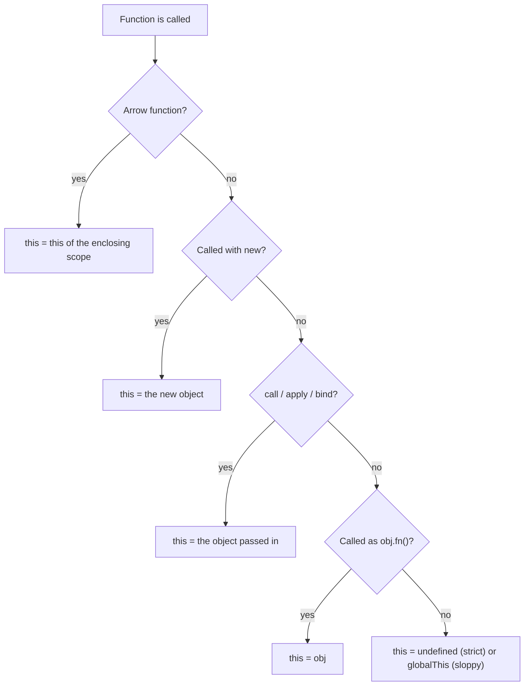
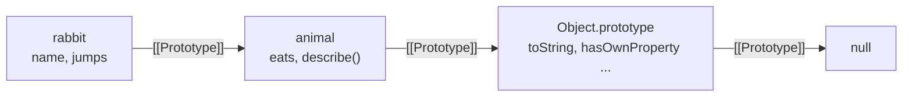
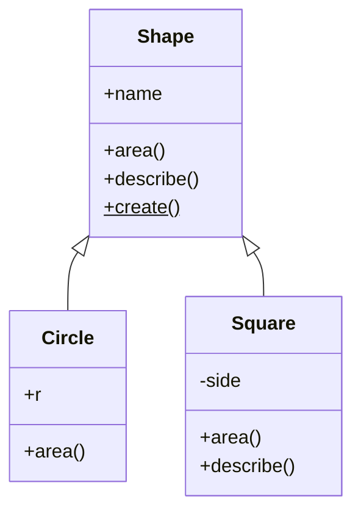

# Chapter 9 — `this`, Prototypes and Classes

JavaScript's object model surprises people who arrive from Java, C# or Python. There are no "real" classes underneath: objects are linked to other objects through a hidden **prototype** link, and a method finds its object at call time through the keyword **`this`**. The `class` keyword (ES2015) is a cleaner syntax over that same machinery, plus a few genuinely new features (private `#fields`, static blocks). This chapter explains the machinery first, then the syntax, so that nothing about classes feels like magic.

**What you'll learn**

1. What `this` is and the four rules (plus arrow functions) that decide its value — and their order of precedence.
2. `call`, `apply` and `bind`: choosing `this` yourself, borrowing methods, partial application.
3. The prototype chain: how property lookup, shadowing, `Object.create` and `Object.create(null)` work.
4. Constructor functions and exactly what `new` does (we re-implement it).
5. Classes: fields, private `#` members, static members, getters/setters, static initialization blocks, brand checks.
6. Inheritance with `extends` and `super`, subclassing built-ins like `Array` and `Error`, initialization order.
7. `instanceof`, `isPrototypeOf` and why they can be fooled.
8. Mixins, and when to prefer composition over inheritance.

**Before you start.** This chapter assumes you know functions, arrow functions and closures ([Chapter 4](../04-functions-scope-and-closures/README.md)) and object literals, property descriptors and getters/setters ([Chapter 5](../05-objects-math-date-and-json/README.md)). Symbols such as `Symbol.iterator` are covered in [Chapter 8](../08-maps-sets-iterators-and-generators/README.md).

All runnable code is in [`code/`](code/). Outputs below are real, produced with Node 24. Every file is an ES module (`.mjs`), and **modules always run in strict mode** — this matters for `this`, as you will see.

---

## 9.1 `this` — the call-time context

### What it is
`this` is a special, automatically defined identifier inside every non-arrow function. Its value is **not** fixed when you write the function; it is decided **each time the function is called**, by *how* it is called. Think of `this` as the word "me" in a sentence: its meaning depends on who is speaking right now, not on who wrote the sentence.

A **call site** is the place in the code where a function is invoked (for example `user.greet()`). To find `this`, you look at the call site — never at where the function was defined.

### Why it matters
One function can serve many objects. `Array.prototype.push` is a single function shared by every array in your program; it works because, on each call, `this` is the particular array you called it on. The cost of that flexibility is the most common JavaScript bug of all: the **lost `this`**, where a method is passed somewhere as a plain function and suddenly `this` is `undefined`.

### How it works — the four rules
For a normal (non-arrow) function, check the call site against these rules. If several apply, the one higher in this list wins:

| # | Rule | Call-site shape | `this` is… |
|---|---|---|---|
| 4 | **`new` binding** | `new Fn(...)` | the brand-new object being constructed |
| 3 | **Explicit binding** | `fn.call(obj)`, `fn.apply(obj)`, `fn.bind(obj)()` | `obj` |
| 2 | **Implicit binding** | `obj.fn()` or `obj['fn']()` | `obj` — the object just before the dot |
| 1 | **Default binding** | plain `fn()` | `undefined` in strict mode; the global object (`globalThis`) in sloppy mode |
| — | **Arrow function** | any | no own `this`; it uses the `this` of the enclosing scope, *where it was written* (lexical `this`) |

Precedence, from strongest to weakest: **`new` > explicit > implicit > default**. Arrow functions sit outside the list — nothing (not even `call` or `new`) can change their `this`, and they cannot be used with `new` at all.



Two terms used above:

- **Strict mode** — an opt-in stricter variant of JavaScript (`'use strict'`, or automatically inside modules and class bodies). Among other things it stops a plain call from silently getting the global object as `this`. See [Chapter 1](../01-introduction-and-setup/README.md).
- **`globalThis`** — the standard name for the global object in every environment (`window` in browsers, `global` in Node).

[`code/01_this_rules.mjs`](code/01_this_rules.mjs):

```js
function whoAmI() {
  return this === undefined ? 'undefined' : this.name;
}

// Rule 1 — default binding: a plain call. Strict mode -> this is undefined.
console.log('1 default :', whoAmI());

// Rule 2 — implicit binding: called as obj.method() -> this is obj.
const alice = { name: 'Alice', whoAmI };
console.log('2 implicit:', alice.whoAmI());

// Lost binding: take the method off the object, then call it plainly.
const detached = alice.whoAmI;
console.log('  lost    :', detached());

// Rule 3 — explicit binding: call / apply / bind choose this for you.
const bob = { name: 'Bob' };
console.log('3 call    :', whoAmI.call(bob));
console.log('  apply   :', whoAmI.apply(bob, []));
const boundToBob = whoAmI.bind(bob);
console.log('  bind    :', boundToBob(), '| still Bob as a method of alice?', { name: 'x', f: boundToBob }.f());

// Rule 4 — new binding: new creates a fresh object and uses it as this.
function Person(name) { this.name = name; }
const carol = new Person('Carol');
console.log('4 new     :', carol.name);

// Arrow functions have NO own this: they use this from the surrounding scope.
const timer = {
  name: 'Timer',
  regular() { return [1].map(function () { return this?.name; })[0]; },
  arrow()   { return [1].map(() => this.name)[0]; },
};
console.log('arrow     : regular callback ->', timer.regular(), '| arrow callback ->', timer.arrow());

// Arrow functions ignore call/apply/bind for this.
const arrowWho = () => (this === undefined ? 'undefined (module top level)' : this);
console.log('arrow+call:', arrowWho.call(bob));

// Precedence: new > explicit (bind) > implicit > default.
const Bound = Person.bind({ name: 'ignored' });
const dave = new Bound('Dave');
console.log('precedence: new beats bind ->', dave.name);
console.log('precedence: call beats implicit ->', alice.whoAmI.call(bob));

// Many array methods accept a thisArg.
const counter = { hits: 0 };
[1, 2, 3].forEach(function () { this.hits++; }, counter);
console.log('thisArg   :', counter.hits);

// Sloppy-mode default binding uses globalThis (Function-created code is never strict here).
const sloppy = new Function('return this === globalThis');
console.log('sloppy default this is globalThis:', sloppy());
```

Output:
```
1 default : undefined
2 implicit: Alice
  lost    : undefined
3 call    : Bob
  apply   : Bob
  bind    : Bob | still Bob as a method of alice? Bob
4 new     : Carol
arrow     : regular callback -> undefined | arrow callback -> Timer
arrow+call: undefined (module top level)
precedence: new beats bind -> Dave
precedence: call beats implicit -> Bob
thisArg   : 3
sloppy default this is globalThis: true
```

What to notice:

- `detached()` prints `undefined` even though the function "came from" `alice`. Functions do not belong to objects; `alice.whoAmI` is just a property holding a reference to a function.
- Inside `timer.regular`, the inner `function` callback is called plainly by `map`, so rule 1 applies and `this` is `undefined`. The arrow callback in `timer.arrow` has no own `this` and sees `arrow()`'s `this`, which is `timer`. This is *the* reason arrow functions were added.
- At the top level of an ES module, `this` is `undefined`. At the top level of a classic browser `<script>` it is `window`, and at the top level of a CommonJS file in Node it is `module.exports` (see [Chapter 10](../10-modules-and-tooling/README.md)).

### `this` in event listeners
In the browser, when a regular function is registered with `addEventListener`, the DOM calls it with `this` set to the element the listener is attached to (`event.currentTarget`). An arrow listener keeps the outer `this` instead. A class method passed directly as a listener therefore gets the *element* as `this`, not the class instance. [`code/08_this_in_dom.mjs`](code/08_this_in_dom.mjs) runs this in jsdom (a browser-like DOM for Node):

```js
class Form {
  constructor(el) {
    this.name = 'SignupForm';
    el.addEventListener('click', this.handle);                 // loses this
    el.addEventListener('click', (e) => this.handle2(e));      // arrow keeps this
    el.addEventListener('click', this.handle3.bind(this));     // bind keeps this
  }
  handle() { console.log('method passed directly:', `this is the <${this.tagName.toLowerCase()}> element, this.name =`, JSON.stringify(this.name)); }
  handle2() { console.log('wrapped in arrow      :', this.name); }
  handle3() { console.log('bound                 :', this.name); }
}
```

Output (including two simpler listeners defined earlier in the file):
```
function listener this: save | same as currentTarget? true
arrow listener this   : undefined
method passed directly: this is the <button> element, this.name = ""
wrapped in arrow      : SignupForm
bound                 : SignupForm
```

The third line is a nasty silent bug: `this.name` did not throw, it read the button's own (empty) `name` attribute. Events are covered fully in [Chapter 13](../13-dom-and-events/README.md).

### Common mistakes
- **Passing a method as a callback**: `setTimeout(user.greet, 100)`, `promise.then(obj.handle)`, `arr.map(obj.transform)`. Each of these calls the function plainly. Fix with an arrow wrapper (`() => user.greet()`), `bind`, or an arrow-function class field (§9.5).
- **Arrow functions as object methods**: `const o = { name: 'x', hi: () => this.name }` — the arrow's `this` is the *surrounding* scope's (module: `undefined`), not `o`. Use method shorthand `hi() { … }`.
- **Assuming `this` is the function itself.** It never is; if you need the function, give it a name.
- **Nested regular functions inside methods** lose `this` (the `timer.regular` case). Old code wrote `const self = this;` to work around it; today, use an arrow.

### In the interview
**30-second answer:** "`this` is decided at call time by the call site. In order of precedence: `new` makes it the new object; `call`/`apply`/`bind` set it explicitly; calling as `obj.method()` makes it `obj`; a plain call gives `undefined` in strict mode or the global object in sloppy mode. Arrow functions don't have their own `this` — they capture it lexically from where they're written, and nothing can rebind it."

- *Q: What does `const f = obj.m; f()` log for `this`?* A: `undefined` in strict code (global object in sloppy code) — the implicit binding is lost because the call site is plain.
- *Q: Can you `new` an arrow function?* A: No — it throws `TypeError: … is not a constructor`. Arrows have no `prototype` and no own `this`.
- *Q: Does `bind` beat `new`?* A: No. `new BoundFn()` still creates a fresh object; the bound `this` is ignored (bound arguments are kept).

### Self-check
1. `const o = { v: 1, f() { return () => this.v; } }; o.f()()` returns? → `1` — the arrow captures `f`'s `this`, which is `o`.
2. What is `this` at the top level of an ES module? → `undefined`.
3. `[1,2].forEach(function(){ console.log(this) }, {a:1})` logs? → `{ a: 1 }` twice — `forEach` accepts a `thisArg`.
4. Why does `setTimeout(obj.m, 0)` lose `this`? → `setTimeout` receives only the function and calls it plainly.

### TL;DR
Look at the call site: `new` > `call/apply/bind` > `obj.fn()` > plain call (`undefined` in strict code). Arrows borrow `this` from where they were written.

---

## 9.2 `call`, `apply` and `bind`

### What it is
Every function inherits three methods from `Function.prototype` that let you set `this` explicitly:

| Method | Signature | Runs now? | Returns |
|---|---|---|---|
| `call` | `fn.call(thisArg, a, b, …)` | yes | the function's result |
| `apply` | `fn.apply(thisArg, [a, b, …])` | yes | the function's result |
| `bind` | `fn.bind(thisArg, a, …)` | no | a new **bound function** with `this` (and optionally leading arguments) fixed |

Memory trick: **a**pply takes an **a**rray, **c**all takes **c**ommas.

### Why it matters
- **Method borrowing** — reuse a method on an object that doesn't have it (array methods on array-like objects, for example `arguments` or a DOM `NodeList`).
- **Fixing lost `this`** — `bind` produces a function you can safely hand to a callback API.
- **Partial application** — `bind` can pre-fill leading arguments, producing a more specific function (a form of currying; see [Chapter 4](../04-functions-scope-and-closures/README.md)).

[`code/02_call_apply_bind.mjs`](code/02_call_apply_bind.mjs):

```js
function greet(greeting, punctuation) {
  return `${greeting}, ${this.name}${punctuation}`;
}
const ann = { name: 'Ann' };

console.log(greet.call(ann, 'Hi', '!'));        // args one by one
console.log(greet.apply(ann, ['Hello', '?']));  // args as an array
const hiAnn = greet.bind(ann, 'Hey');           // this AND first argument fixed
console.log(hiAnn('.'));

// Borrowing a method: array methods work on any "array-like" (has length + indexes).
const arrayLike = { 0: 'a', 1: 'b', 2: 'c', length: 3 };
console.log(Array.prototype.join.call(arrayLike, '-'));
console.log(Array.prototype.map.call('abc', (ch) => ch.toUpperCase()));

// apply was the old way to spread an array into arguments; spread syntax replaced it.
const nums = [4, 9, 2];
console.log(Math.max.apply(null, nums), Math.max(...nums));

// A bound function cannot be re-bound.
const boundOnce = greet.bind({ name: 'First' });
const boundTwice = boundOnce.bind({ name: 'Second' });
console.log(boundTwice('Yo', '!'));
console.log('bound name:', boundOnce.name, '| length:', greet.length, '->', hiAnn.length);

// Classic fix for a lost this: bind in advance.
class Button {
  constructor(label) { this.label = label; this.onClick = this.onClick.bind(this); }
  onClick() { return `clicked ${this.label}`; }
}
const { onClick } = new Button('Save');   // detached, but still works
console.log(onClick());
```

Output:
```
Hi, Ann!
Hello, Ann?
Hey, Ann.
a-b-c
[ 'A', 'B', 'C' ]
9 9
Yo, First!
bound name: bound greet | length: 2 -> 1
clicked Save
```

### How it works
1. `call`/`apply` invoke the function immediately with the given `this`.
2. `bind` returns an **exotic bound function object** that remembers the target function, the `this` value and any pre-filled arguments. Calling it calls the target with those values.
3. Binding again has no effect on `this` — the inner binding already won (`Yo, First!`). Extra arguments from later binds are appended, though.
4. A bound function's `name` is `"bound " + original name`; its `length` drops by the number of pre-filled arguments.
5. Passing `null` or `undefined` as `thisArg` in strict code gives `this === null/undefined`; in sloppy code it becomes `globalThis`.

### Trade-offs
| Need | Best tool today |
|---|---|
| Spread an array into arguments | spread syntax `f(...arr)` (clearer than `apply`) |
| Stable callback that uses `this` | arrow wrapper `() => obj.m()`, class arrow field, or `bind` |
| Pre-fill arguments without caring about `this` | arrow `(x) => f(1, x)` — easier to read than `f.bind(null, 1)` |
| Borrow a method for an array-like | `Array.from(arrayLike)` then use normal methods, or `Array.prototype.x.call` |

### Common mistakes
- Calling `bind` inside a render loop or on every event creates a new function each time — a problem when identity matters (for example removing a listener: `removeEventListener('click', fn.bind(this))` removes nothing, because it's a *different* function).
- Expecting `bind` to change an arrow function's `this` — it can't.

### Self-check
1. Difference between `f.call(o, 1, 2)` and `f.apply(o, [1, 2])`? → None in effect; only how arguments are passed.
2. What does `f.bind(o)` return? → A new function; it doesn't call `f`.
3. `f.bind(a).bind(b)()` — what is `this`? → `a`.

### TL;DR
`call` and `apply` run now with a chosen `this` (commas vs array). `bind` returns a new function with `this` locked forever. Prefer spread and arrows where they read better.

---

## 9.3 Prototypes and the prototype chain

### What it is
Every JavaScript object has an internal slot called **`[[Prototype]]`** that points either to another object or to `null`. When you read a property that the object doesn't have itself, the engine follows that link and looks in the prototype, then the prototype's prototype, and so on until it finds the property or reaches `null`. This linked list of objects is the **prototype chain**, and it is JavaScript's inheritance mechanism: **delegation**, not copying.

Analogy: asking a question at a help desk. If the clerk doesn't know, they ask their supervisor; the supervisor asks the manager; if nobody up the line knows, the answer is "undefined".

Key vocabulary:

| Term | Meaning |
|---|---|
| **`[[Prototype]]`** | The hidden link every object has. Read with `Object.getPrototypeOf(obj)`, set with `Object.setPrototypeOf` or at creation with `Object.create(proto)`. |
| **`__proto__`** | A legacy getter/setter on `Object.prototype` exposing `[[Prototype]]`. Avoid it in code; the **`__proto__:` key in an object literal** is a separate, standard way to set the prototype at creation. |
| **`Fn.prototype`** | An ordinary property that every normal function (and class) has. It is *not* the function's own prototype — it is the object that becomes the `[[Prototype]]` of instances created with `new Fn()`. |
| **Own property** | A property stored directly on the object. Check with `Object.hasOwn(obj, key)` (ES2022). |
| **Shadowing** | An own property hides a property of the same name further up the chain. |

### How it works
1. **Reading** `obj.x`: look for own property `x`; if absent, repeat on `Object.getPrototypeOf(obj)`; stop at `null` and return `undefined`.
2. **Writing** `obj.x = v`: normally creates or updates an **own** property on `obj` — the prototype is never modified by assignment. (Two exceptions: if the chain has a *setter* for `x`, the setter runs; if the chain has a *non-writable* `x`, the assignment fails — silently in sloppy mode, `TypeError` in strict mode.)
3. **Deleting** `delete obj.x` removes only an own property, so an inherited value can "reappear".
4. **Methods run with `this` = the object you started from**, not the prototype where the method was found. That's why shared methods can work on per-object data.



[`code/03_prototype_chain.mjs`](code/03_prototype_chain.mjs) (key parts):

```js
const animal = {
  eats: true,
  describe() { return `${this.name} eats: ${this.eats}`; },
};
const rabbit = Object.create(animal);   // rabbit.[[Prototype]] = animal
rabbit.name = 'Rabbit';
rabbit.jumps = true;

console.log(Object.getPrototypeOf(rabbit) === animal);         // true
console.log(rabbit.eats, rabbit.describe());                   // found on animal
console.log('own keys:', Object.keys(rabbit));
console.log('hasOwn eats?', Object.hasOwn(rabbit, 'eats'), '| "eats" in rabbit?', 'eats' in rabbit);

const seen = [];
for (const k in rabbit) seen.push(k);                           // for...in walks the chain
console.log('for...in:', seen);

rabbit.eats = false;                                            // creates an OWN property
console.log('rabbit.eats', rabbit.eats, '| animal.eats', animal.eats);
delete rabbit.eats;
console.log('after delete, rabbit.eats', rabbit.eats);

console.log('rabbit :', chain(rabbit));   // chain() walks getPrototypeOf until null
console.log('[]     :', chain([]));
console.log('fn     :', chain(function f() {}));
console.log('Map    :', chain(new Map()));

const a = [1], b = [2];
console.log('shared push?', a.push === b.push, a.push === Array.prototype.push);

const dict = Object.create(null);         // no prototype at all
dict.toString = 'just data';
console.log('proto of dict:', Object.getPrototypeOf(dict), '| "hasOwnProperty" in dict:', 'hasOwnProperty' in dict);

const base = { hello() { return 'hi from base'; } };
const late = {};
Object.setPrototypeOf(late, base);        // works, but slow — prefer Object.create
console.log(late.hello());

const lit = { __proto__: base, own: 1 };  // literal __proto__ key sets the prototype
console.log(lit.hello(), Object.keys(lit));
console.log('missing ->', rabbit.nope);
```

Output:
```
true
true Rabbit eats: true
own keys: [ 'name', 'jumps' ]
hasOwn eats? false | "eats" in rabbit? true
for...in: [ 'name', 'jumps', 'eats', 'describe' ]
rabbit.eats false | animal.eats true
after delete, rabbit.eats true
rabbit : animal -> Object.prototype -> null
[]     : Array.prototype -> Object.prototype -> null
fn     : Function.prototype -> Object.prototype -> null
Map    : Map.prototype -> Object.prototype -> null
shared push? true true
proto of dict: null | "hasOwnProperty" in dict: false
hi from base
hi from base [ 'own' ]
missing -> undefined
```

### Checking properties — which tool?
| Check | Looks at own props | Looks up the chain | Notes |
|---|---|---|---|
| `Object.hasOwn(o, k)` | ✓ | ✗ | Preferred (ES2022); works on `Object.create(null)` objects |
| `o.hasOwnProperty(k)` | ✓ | ✗ | Fails on null-prototype objects, can be shadowed |
| `k in o` | ✓ | ✓ | Includes non-enumerable and inherited |
| `Object.keys(o)` | ✓ (enumerable, string keys) | ✗ | |
| `for (k in o)` | ✓ | ✓ (enumerable only) | Why `for…in` is risky for objects with prototypes — see [Chapter 3](../03-control-flow-and-loops/README.md) |

### Why it matters
- **Memory**: a thousand arrays share one `push` function.
- **Built-ins are extendable** (though you shouldn't — see mistakes): every array method lives on `Array.prototype`.
- **`Object.create(null)`** gives a "pure dictionary" whose keys can't collide with `toString`, `constructor` or `__proto__` — useful when keys come from user input. (Often a `Map` is better still; see [Chapter 8](../08-maps-sets-iterators-and-generators/README.md).)

### Common mistakes
- **Modifying built-in prototypes** (`Array.prototype.last = …`) — "monkey-patching". It can clash with future standard methods; this really happened: the planned `Array.prototype.contains` became `includes`, and `flatten` became `flat`, because the old MooTools library had already patched incompatible versions onto millions of websites.
- **Calling `Object.setPrototypeOf` on hot objects** — engines optimize objects by their shape; changing the prototype after creation de-optimizes property access. MDN explicitly warns about this.
- **Confusing `Fn.prototype` with `Object.getPrototypeOf(Fn)`** — the first is the prototype *for instances*; the second is `Function.prototype`.
- **Prototype pollution** — merging untrusted JSON like `{"__proto__": {"isAdmin": true}}` into objects with a naive deep-merge can modify `Object.prototype` for the whole program. Use null-prototype objects, `Map`, or libraries that skip `__proto__`/`constructor` keys. (Security is covered in [Chapter 14](../14-browser-apis-and-security/README.md).)

### In the interview
**30-second answer:** "Every object has a hidden `[[Prototype]]` link. When a property isn't found on the object, the engine walks that chain until it finds it or hits `null`. Writing a property creates an own property, shadowing the inherited one. `Object.create(proto)` makes an object with a given prototype, and constructors and classes set it up via `Fn.prototype`. Methods are shared through the chain and run with `this` bound to the original receiver."

- *Q: What's the difference between `__proto__` and `prototype`?* A: `__proto__` (legacy accessor) is an object's own prototype link; `prototype` is a property of functions naming the object that `new` will link instances to.
- *Q: What's at the end of every chain?* A: `null` (usually right after `Object.prototype`).
- *Q: How do you make an object with no prototype?* A: `Object.create(null)` or `{ __proto__: null }`.

### Self-check
1. `const p = { x: 1 }; const c = Object.create(p); c.x = 2; p.x` → `1` — assignment made an own property on `c`.
2. Does `Object.keys` include inherited properties? → No.
3. Where does `[].map` live? → `Array.prototype.map`.
4. What does `Object.getPrototypeOf(Object.prototype)` return? → `null`.

### TL;DR
Objects delegate missing property reads up a chain of `[[Prototype]]` links ending in `null`. Writes stay on the object. Use `Object.create`, `Object.getPrototypeOf`, `Object.hasOwn`; don't patch built-ins.

---

## 9.4 Constructor functions and `new`

### What it is
Before ES2015, the way to make many similar objects was a **constructor function**: an ordinary function, by convention Capitalized, called with `new`. Per-instance data is assigned to `this`; shared methods are put on `Constructor.prototype`. Classes (§9.5) are built on exactly this pattern, so understanding it explains classes.

### How `new` works
When you write `new Fn(args)`, the engine:

1. Creates a new empty object.
2. Sets its `[[Prototype]]` to `Fn.prototype`.
3. Calls `Fn` with `this` bound to that object and the given arguments.
4. If `Fn` explicitly returns an **object**, that object is the result; otherwise (no return, or a primitive return) the new object from step 1 is the result.

Every `Fn.prototype` starts with one property, `constructor`, pointing back to `Fn` — which is how `instance.constructor` finds its maker.

[`code/04_constructor_functions.mjs`](code/04_constructor_functions.mjs):

```js
function Account(owner, balance = 0) {
  this.owner = owner;       // own, per-instance data
  this.balance = balance;
}
Account.prototype.deposit = function (amount) {  // one shared copy for all instances
  this.balance += amount;
  return this;
};
Account.prototype.toString = function () { return `${this.owner}: $${this.balance}`; };

const acc = new Account('Ravi', 100);
acc.deposit(50).deposit(25);
console.log(String(acc));
console.log('proto link  :', Object.getPrototypeOf(acc) === Account.prototype);
console.log('constructor :', acc.constructor === Account, Account.prototype.constructor === Account);
console.log('own keys    :', Object.keys(acc));

// What `new` does — written out by hand
function myNew(Ctor, ...args) {
  const obj = Object.create(Ctor.prototype);        // 1+2. new object linked to Ctor.prototype
  const result = Ctor.apply(obj, args);              // 3. run constructor with this = obj
  return result !== null && (typeof result === 'object' || typeof result === 'function')
    ? result                                         // 4a. if it returned an object, use that
    : obj;                                           // 4b. otherwise the new object
}
const acc2 = myNew(Account, 'Mei', 10);
console.log('myNew       :', String(acc2), acc2 instanceof Account);

// Forgetting `new` — in strict code this is undefined, so assigning throws
try {
  Account('Oops');
} catch (e) {
  console.log('no new      :', e.constructor.name, '-', e.message);
}

// Guard with new.target
function Safe(name) {
  if (!new.target) return new Safe(name);
  this.name = name;
}
console.log('new.target  :', Safe('guarded').name);

// Inheritance the old way
function Savings(owner, balance, rate) {
  Account.call(this, owner, balance);                 // "super" call
  this.rate = rate;
}
Savings.prototype = Object.create(Account.prototype);  // link the prototypes
Savings.prototype.constructor = Savings;               // repair constructor
Savings.prototype.addInterest = function () { return this.deposit(this.balance * this.rate); };
const s = new Savings('Lena', 1000, 0.05);
console.log('old-style   :', String(s.addInterest()), s instanceof Savings, s instanceof Account);
```

Output:
```
Ravi: $175
proto link  : true
constructor : true true
own keys    : [ 'owner', 'balance' ]
myNew       : Mei: $10 true
no new      : TypeError - Cannot set properties of undefined (setting 'owner')
new.target  : guarded
old-style   : Lena: $1050 true true
```

**`new.target`** is a meta-property: inside a function called with `new`, it refers to the constructor that `new` was applied to; in a plain call it is `undefined`.

### Common mistakes
- **Defining methods inside the constructor** (`this.deposit = function …`) — every instance gets its own copy. Works, but wastes memory and defeats sharing. Put methods on the prototype (classes do this automatically).
- **Forgetting `new`** — in sloppy code, `this` becomes the global object and you silently create global variables. In strict code you get a `TypeError`. Classes refuse to be called without `new`.
- **Replacing `Fn.prototype` and forgetting `constructor`** — after `Savings.prototype = Object.create(...)`, `s.constructor` would report `Account` until repaired.

### Self-check
1. Which object becomes `[[Prototype]]` of `new Fn()`? → `Fn.prototype`.
2. A constructor ends with `return 42;` — what does `new` give you? → The new object (primitives are ignored).
3. A constructor ends with `return { a: 1 };` → `{ a: 1 }`, and it is **not** linked to `Fn.prototype`.

### TL;DR
`new` = create object → link to `Fn.prototype` → run `Fn` with that `this` → return it (unless `Fn` returns another object). Shared methods go on `Fn.prototype`.

---

## 9.5 Classes

### What it is
A **class** is a template for creating objects. In JavaScript, `class` declares a special kind of function (the constructor) and fills its `prototype` with methods — the same arrangement as §9.4 — but with shorter syntax, safer defaults, and features that are impossible with plain functions: truly private members, static blocks and `super`. People often call classes "syntactic sugar", and for methods and inheritance that is mostly right; for private fields it isn't.

### Class features at a glance

| Feature | Syntax | Lives on | Added in |
|---|---|---|---|
| Constructor | `constructor(a) { … }` | the class function itself | ES2015 |
| Method | `m() { … }` | `Class.prototype` (non-enumerable) | ES2015 |
| Getter / setter | `get x() {}` / `set x(v) {}` | `Class.prototype` (accessor property) | ES2015 |
| Static method | `static m() {}` | the class function | ES2015 |
| Computed name | `[expr]() {}` | prototype or class | ES2015 |
| Public instance field | `x = 0;` | each instance (own, enumerable) | ES2022 |
| Static field | `static x = 0;` | the class function | ES2022 |
| Private field / method | `#x = 0;` `#m() {}` | hidden per-instance slot | ES2022 |
| Private static | `static #x`, `static #m()` | hidden slot on the class | ES2022 |
| Static initialization block | `static { … }` | runs once at definition time | ES2022 |
| Private "brand check" | `#x in obj` | — | ES2022 |

Terms:
- **Field** — a property declared in the class body and created automatically on every instance (or on the class, if `static`). Its initializer runs once per instance, with `this` = the instance.
- **Private member** — a name starting with `#`. It can be used only by code *lexically inside* the class body. It's not a property: it doesn't appear in `Object.keys`, `JSON.stringify`, `for…in`, or proxies, and accessing it from outside is a **syntax error** at parse time.
- **Accessor** — a getter/setter pair that looks like a property from the outside but runs code (defined in [Chapter 5](../05-objects-math-date-and-json/README.md)).
- **Static member** — belongs to the class itself, not instances: factory methods (`Temperature.fromFahrenheit`), counters, constants, caches.

[`code/05_classes.mjs`](code/05_classes.mjs):

```js
class Temperature {
  unit = 'C';                         // public instance field
  #celsius;                           // private instance field
  static instances = 0;               // static field
  static #absoluteZero = -273.15;     // private static field

  static {                            // static initialization block — runs once
    Temperature.freezing = new Temperature(0);
    Temperature.instances = 0;        // don't count the helper instance
  }

  constructor(celsius) {
    Temperature.#check(celsius);
    this.#celsius = celsius;
    Temperature.instances++;
  }

  get fahrenheit() { return this.#celsius * 9 / 5 + 32; }
  set fahrenheit(f) {
    const c = (f - 32) * 5 / 9;
    Temperature.#check(c);
    this.#celsius = c;
  }
  get celsius() { return this.#celsius; }   // read-only from outside: no setter

  #format(v) { return v.toFixed(1); }       // private method
  toString() { return `${this.#format(this.#celsius)}°C`; }

  static #check(c) {
    if (c < Temperature.#absoluteZero) throw new RangeError(`below absolute zero: ${c}`);
  }
  static fromFahrenheit(f) { const t = new Temperature(0); t.fahrenheit = f; return t; }
  static isTemperature(obj) { return #celsius in obj; }   // brand check
}

const t = new Temperature(25);
console.log(String(t), '=', t.fahrenheit, '°F');
t.fahrenheit = 212;
console.log('after set  :', String(t), '| unit field:', t.unit);
console.log('static     :', Temperature.instances, String(Temperature.freezing), String(Temperature.fromFahrenheit(-40)));
console.log('brand check:', Temperature.isTemperature(t), Temperature.isTemperature({ celsius: 1 }));
console.log('own keys   :', Object.keys(t), '(private fields are invisible)');
try { new Temperature(-300); } catch (e) { console.log('validation :', e.name, e.message); }
// t.#celsius  -> SyntaxError at parse time if written outside the class
```

Output (first part):
```
25.0°C = 77 °F
after set  : 100.0°C | unit field: C
static     : 1 0.0°C -40.0°C
brand check: true false
own keys   : [ 'unit' ] (private fields are invisible)
validation : RangeError below absolute zero: -300
```

Why does `static` print `1`? The static block created `freezing` (counter 1) and then reset the counter to 0; `new Temperature(25)` made it 1. JavaScript evaluates arguments left to right, so `Temperature.instances` was read (1) *before* `fromFahrenheit(-40)` ran and bumped it to 2. Order of evaluation matters whenever expressions have side effects.

### Facts about classes that trip people up
The same file continues:

```js
console.log('typeof class        :', typeof Temperature);
console.log('methods on prototype:', Object.getOwnPropertyNames(Temperature.prototype));
console.log('methods enumerable? :', Object.keys(Temperature.prototype).length > 0);
try { Temperature(1); } catch (e) { console.log('call without new    :', e.message); }

try { new Later(); } catch (e) { console.log('TDZ                 :', e.name, '-', e.message); }
class Later {}

class Clicker {
  count = 0;
  method() { return ++this.count; }
  arrow = () => ++this.count;   // one function per instance, this captured forever
}
const c = new Clicker();
const { method, arrow } = c;
try { method(); } catch (e) { console.log('detached method     :', e.message); }
console.log('detached arrow      :', arrow(), arrow());
console.log('arrow on prototype? :', 'arrow' in Clicker.prototype, '| own?', Object.hasOwn(c, 'arrow'));

const key = 'shout';
const Loud = class { [key]() { return 'HEY'; } static [Symbol.hasInstance](x) { return x === 42; } };
console.log('computed name       :', new Loud().shout(), '| 42 instanceof Loud:', 42 instanceof Loud);

const desc = Object.getOwnPropertyDescriptor(Temperature.prototype, 'fahrenheit');
console.log('accessor descriptor :', typeof desc.get, typeof desc.set, 'enumerable:', desc.enumerable);
```

Output:
```
typeof class        : function
methods on prototype: [ 'constructor', 'fahrenheit', 'celsius', 'toString' ]
methods enumerable? : false
call without new    : Class constructor Temperature cannot be invoked without 'new'
TDZ                 : ReferenceError - Cannot access 'Later' before initialization
detached method     : Cannot read properties of undefined (reading 'count')
detached arrow      : 1 2
arrow on prototype? : false | own? true
computed name       : HEY | 42 instanceof Loud: true
accessor descriptor : function function enumerable: false
```

| Fact | Consequence |
|---|---|
| A class is a function (`typeof` → `'function'`) | It has `prototype`, `name`, `length` like any function |
| Class bodies are always strict mode | Detached methods get `this === undefined`, not the global object |
| Methods are non-enumerable | `for…in` over an instance shows only data fields — nicer than §9.4 |
| Must be called with `new` | Calling it plainly throws `TypeError` |
| Declarations are hoisted into the **TDZ** (temporal dead zone, [Chapter 2](../02-variables-types-and-operators/README.md)) | You can't use a class before its `class` line runs — unlike function declarations |
| Private methods (`#format`) and the `#check` static are not on the prototype | `getOwnPropertyNames` doesn't list them |
| Arrow-function **fields** are own properties created per instance | Great for callbacks (`this` is fixed), but each instance gets a new function and subclasses can't call them via `super` |
| `static [Symbol.hasInstance]` customizes `instanceof` | Rarely needed; shown only so you recognize it |

### Getters, setters and private fields together
The `Temperature` class shows the standard pattern for **encapsulation** (hiding internal state and exposing a controlled interface): store the real value in a private field, expose a getter, and validate in the setter or the constructor. `celsius` has a getter but no setter, so it's read-only from outside — assigning `t.celsius = 5` is silently ignored in sloppy code and throws `TypeError` in strict code.

Before ES2022, "private" meant a naming convention (`this._celsius`) or a closure/`WeakMap` trick. The convention is still common in older code — but `_x` is fully public.

### Static initialization blocks
`static { … }` runs once, when the class definition is evaluated, with `this` = the class. Use it for setup that needs statements (loops, `try/catch`, several related statics) or access to private statics — things a single `static x = expr` can't express. A class may have several; they run in order with static field initializers.

### When not to use a class
- For a single object (configuration, a namespace of functions), an object literal or a module ([Chapter 10](../10-modules-and-tooling/README.md)) is simpler.
- For a function that just transforms data, a plain function is simpler and easier to test.
- React function components replaced class components for new code (see the React handbook).

### Common mistakes
- Using `this.x` in a field initializer that depends on a *later* field — fields initialize top to bottom.
- Expecting `#private` fields to survive `structuredClone`, `JSON.stringify`, or `{...spread}` — none of them copy private fields.
- Using `Object.keys(instance)` to "see" private data in debugging — use the DevTools/Node inspector, which can display private fields.
- Writing `class A { method = function () {} }` thinking it's a method — it's a per-instance field.

### In the interview
**30-second answer:** "A JavaScript class is a constructor function plus a prototype with its methods, created with nicer syntax. It's strict, must be called with `new`, its methods are non-enumerable, and it's in the TDZ until defined. ES2022 added public and private fields, private methods with `#`, static blocks and `#x in obj` checks. Private fields are enforced by the language, unlike the old `_underscore` convention."

- *Q: Are classes hoisted?* A: The binding is hoisted but uninitialized (TDZ), so using it early throws `ReferenceError`.
- *Q: Method vs arrow field — which for event handlers?* A: An arrow field keeps `this` bound without `bind`, at the cost of one function per instance and no `super` access; a method is shared on the prototype.
- *Q: How private is `#x` really?* A: Truly inaccessible from outside the class body; not reflected by any object API. Only code in the class body (including static methods handling other instances) can read it.

### Self-check
1. Where does a class method live? → On `Class.prototype`.
2. Where does a public field live? → On each instance, as an own enumerable property.
3. `class A { #x = 1; static has(o) { return #x in o; } } A.has({})` → `false`.
4. What does `typeof class {}` return? → `'function'`.

### TL;DR
`class` = constructor + prototype methods with safer defaults (strict, `new`-only, non-enumerable methods). ES2022 adds fields, `#private`, `static {}` and brand checks. Use getters/setters with private fields for encapsulation.

---

## 9.6 Inheritance with `extends` and `super`

### What it is
`class Child extends Parent` makes `Child` a specialized version of `Parent`: instances of `Child` get `Parent`'s methods through the prototype chain, and `Child` can add or **override** (replace) methods. `super` is how the child reaches the parent: `super(...)` calls the parent's constructor, and `super.method()` calls the parent's version of a method.

### How it works
`extends` links **two** prototype chains:

1. `Child.prototype.[[Prototype]] = Parent.prototype` — instances inherit instance methods.
2. `Child.[[Prototype]] = Parent` — the class itself inherits static methods.



Rules for a derived constructor:
- It **must call `super(...)` before using `this`** — until then, the object doesn't exist (in a derived class, the *parent* constructor creates the object). Using `this` first throws `ReferenceError`.
- If you don't write a constructor, the default one is `constructor(...args) { super(...args); }`.
- **Initialization order**: `super()` runs the parent's field initializers and constructor; only then are the child's fields initialized; then the rest of the child's constructor body runs.

[`code/06_inheritance.mjs`](code/06_inheritance.mjs):

```js
class Shape {
  constructor(name) {
    if (new.target === Shape) throw new TypeError('Shape is abstract');
    this.name = name;
  }
  area() { throw new Error(`${this.constructor.name} must implement area()`); }
  describe() { return `${this.name} with area ${this.area().toFixed(2)}`; }
  static create(...args) { return new this(...args); } // `this` = the class it's called on
}

class Circle extends Shape {
  constructor(r) {
    super('circle');          // must run before touching `this`
    this.r = r;
  }
  area() { return Math.PI * this.r ** 2; }
}

class Square extends Shape {
  #side;
  constructor(side) { super('square'); this.#side = side; }
  area() { return this.#side ** 2; }
  describe() { return super.describe() + ' (all sides equal)'; } // extend parent behaviour
}

const shapes = [new Circle(1), Square.create(3)];
for (const s of shapes) console.log(s.describe());

try { new Shape('x'); } catch (e) { console.log('abstract   :', e.message); }
class Broken extends Shape { constructor() { super('broken'); } }
try { new Broken().describe(); } catch (e) { console.log('no area   :', e.message); }
class NoSuper extends Shape { constructor() { this.x = 1; super('x'); } }
try { new NoSuper(); } catch (e) { console.log('this first :', e.name, '-', e.message); }

console.log('instance chain:', Object.getPrototypeOf(Circle.prototype) === Shape.prototype);
console.log('static chain  :', Object.getPrototypeOf(Circle) === Shape, '-> Circle.create exists:', typeof Circle.create);
```

Output:
```
circle with area 3.14
square with area 9.00 (all sides equal)
abstract   : Shape is abstract
no area   : Broken must implement area()
this first : ReferenceError - Must call super constructor in derived class before accessing 'this' or returning from derived constructor
instance chain: true
static chain  : true -> Circle.create exists: function
```

What to notice:
- **Polymorphism** — `describe()` is written once in `Shape` but calls `this.area()`, which runs the *subclass's* `area`. That's dynamic dispatch through the prototype chain.
- **Abstract classes** — JavaScript has no `abstract` keyword. The `new.target === Shape` check and a throwing `area()` imitate one. (TypeScript adds real `abstract` checks at compile time — [Chapter 16](../16-testing-and-typescript/README.md).)
- `static create` uses `new this(...)`, so `Square.create(3)` builds a `Square` — static methods are inherited and `this` is the class they're called on.
- A private field (`#side`) is **not** inherited in the sense of being accessible: `Circle` code could not read `Square`'s `#side`, and even a subclass of `Square` couldn't. Private means "this class body only". Use a normal property or a protected-by-convention name if subclasses need it.

### Subclassing built-ins and initialization order
```js
class Stack extends Array {
  peek() { return this.at(-1); }
}
const st = Stack.from([1, 2, 3]);
st.push(4);
console.log('Stack         :', st.peek(), st.length, Array.isArray(st), st.map((x) => x * 2) instanceof Stack);

class HttpError extends Error {
  constructor(status, message) { super(message); this.name = 'HttpError'; this.status = status; }
}
const he = new HttpError(404, 'Not Found');
console.log('Error subclass:', he instanceof Error, he.name, he.status, he.message);

class Queue { get [Symbol.toStringTag]() { return 'Queue'; } }
console.log('toStringTag   :', Object.prototype.toString.call(new Queue()));

class A { a = console.log('  A field') ?? 1; constructor() { console.log('  A constructor'); } }
class B extends A { b = console.log('  B field') ?? 2; constructor() { console.log('  B before super'); super(); console.log('  B after super'); } }
console.log('init order:'); new B();
```

Output:
```
instanceof    : true true true false
isPrototypeOf : true
fooled?       : true (instanceof only checks the chain)
Stack         : 4 4 true true
Error subclass: true HttpError 404 Not Found
toStringTag   : [object Queue]
init order:
  B before super
  A field
  A constructor
  B field
  B after super
```

(The first three lines come from the `instanceof` section, explained in §9.7.)

- `class … extends Array` gives real arrays: `length` updates automatically, `Array.isArray` is `true`, and methods like `map` return a `Stack` (through the `Symbol.species` mechanism). With old constructor functions, subclassing `Array` properly was impossible.
- Subclassing `Error` is the standard way to make custom error types — [Chapter 11](../11-errors-and-debugging/README.md) builds a full hierarchy.
- The init-order output shows why a parent constructor must not call an overridable method that relies on child fields: when `A`'s constructor runs, `B`'s fields don't exist yet.

### `super` in object literals
`super` also works inside **concise methods** of object literals, referring to the object's prototype: `const child = { __proto__: parent, hi() { return super.hi() + '!'; } }`. It is bound to the object the method was *defined* in (its "home object"), not to `this` — so copying such a method to another object doesn't change what `super` means.

### Common mistakes
- Forgetting `super()` in a derived constructor, or calling it after using `this`.
- Deep hierarchies (`Animal → Mammal → Dog → ServiceDog → …`) — each level couples you to every level above. See §9.9.
- Overriding a method and forgetting to call `super.method()` when the parent's behaviour is still needed (cleanup, validation).
- Calling overridable methods from a parent constructor (child fields aren't initialized yet).

### In the interview
**30-second answer:** "`extends` links `Child.prototype` to `Parent.prototype` for instance methods and `Child` to `Parent` for statics. A derived constructor must call `super()` before using `this`, because the parent constructs the object. `super.method()` calls the parent's implementation. Built-ins like `Array`, `Error` and `Map` can be subclassed properly with class syntax."

- *Q: What happens if a derived class has no constructor?* A: A default one forwards all arguments to `super(...)`.
- *Q: Can you extend `null` or an expression?* A: `extends` accepts any expression that evaluates to a constructor (or `null`) — that's what makes mixin factories possible (§9.8).
- *Q: Order of initialization?* A: Parent fields → parent constructor body → child fields → rest of the child constructor.

### Self-check
1. Why must `super()` come before `this` in a derived class? → The parent constructor creates and initializes the object.
2. How does a static method get inherited? → `Child.[[Prototype]]` is `Parent`.
3. Can a subclass read the parent's `#secret`? → No.

### TL;DR
`extends` links both instance and static chains; `super()` first, then `this`; `super.m()` reaches the parent. Built-ins subclass cleanly. Keep hierarchies shallow.

---

## 9.7 `instanceof` and type checks

### What it is
`obj instanceof C` asks: **"does `C.prototype` appear anywhere in `obj`'s prototype chain?"** It says nothing about how the object was actually created. `C.prototype.isPrototypeOf(obj)` asks the same question the other way around.

```js
const c = shapes[0];
console.log('instanceof    :', c instanceof Circle, c instanceof Shape, c instanceof Object, c instanceof Square);
console.log('isPrototypeOf :', Shape.prototype.isPrototypeOf(c));
const fake = Object.create(Circle.prototype);
console.log('fooled?       :', fake instanceof Circle, '(instanceof only checks the chain)');
```

Output (shown above): `true true true false`, `true`, `true`.

`fake` never ran the `Circle` constructor (it has no `r`), yet `instanceof` says it is a `Circle`.

### Choosing a type check
| Question | Use | Pitfall |
|---|---|---|
| Is it a primitive of type T? | `typeof x === 'string'` etc. | `typeof null === 'object'` ([Chapter 2](../02-variables-types-and-operators/README.md)) |
| Is it an array? | `Array.isArray(x)` | `instanceof Array` fails for arrays from another realm (iframe, `vm` context) |
| Is it an error? | `Error.isError(x)` (ES2026; Node 24 has it) or `x instanceof Error` | Same cross-realm issue for `instanceof` |
| Was it made by my class, really? | `#brand in x` (private brand check) | Only works inside the class body |
| Is it "like" a type (has the methods I need)? | **duck typing**: `typeof x?.then === 'function'` | Can't distinguish unrelated objects with the same method names |
| Built-in tag | `Object.prototype.toString.call(x)` → `"[object Date]"` | Can be customized via `Symbol.toStringTag` |

A **realm** is one global environment — each browser tab, iframe or Node `vm` context has its own `Array`, `Object`, `Error` constructors. An array from an iframe has the *iframe's* `Array.prototype` in its chain, so `instanceof Array` in the parent page returns `false`. That's why `Array.isArray` exists.

**Duck typing** ("if it walks like a duck and quacks like a duck…") means checking for capabilities rather than ancestry. It's how promises interoperate: anything with a `then` method (a *thenable*) is treated like a promise by `await` ([Chapter 12](../12-asynchronous-javascript/README.md)).

### Self-check
1. Can `instanceof` be `true` for an object the constructor never ran on? → Yes (`Object.create(C.prototype)`, or `Object.setPrototypeOf`).
2. Most robust array check? → `Array.isArray`.
3. `Object.create(null) instanceof Object`? → `false` — `Object.prototype` isn't in its chain.

### TL;DR
`instanceof` = "is `C.prototype` in the chain?". Prefer `Array.isArray`, `Error.isError`, `#brand in obj` or duck typing when correctness matters.

---

## 9.8 Mixins

### What it is
JavaScript classes have **single inheritance**: one `extends`. A **mixin** is a reusable bundle of methods that you "mix into" a class that already has a parent, so unrelated classes can share a capability (serializable, observable, timestamped) without a common ancestor.

There are two common styles:

1. **Object mixins** — copy methods onto a prototype with `Object.assign(Target.prototype, mixinA, mixinB)`.
2. **Subclass-factory mixins** — a function that takes a base class and returns `class extends Base { … }`. Because `extends` accepts any expression, you can stack them: `class Duck extends CanSwim(CanFly(Animal)) {}`.

[`code/07_mixins_composition.mjs`](code/07_mixins_composition.mjs) (first part):

```js
// 1) Object.assign mixin — copy methods onto a prototype
const Serializable = { toJSONString() { return JSON.stringify(this); } };
const Timestamped = { touch() { this.updatedAt = '2026-01-01T00:00:00Z'; return this; } };

class Note { constructor(text) { this.text = text; } }
Object.assign(Note.prototype, Serializable, Timestamped);
console.log('assign mixin :', new Note('hi').touch().toJSONString());

// 2) Subclass-factory mixins — functions that take a class and return a subclass
const CanFly = (Base) => class extends Base { fly() { return `${this.name} flies`; } };
const CanSwim = (Base) => class extends Base { swim() { return `${this.name} swims`; } };
class Animal { constructor(name) { this.name = name; } }
class Duck extends CanSwim(CanFly(Animal)) {}
const d = new Duck('Donald');
console.log('factory mixin:', d.fly(), '|', d.swim(), '| instanceof Animal:', d instanceof Animal);
```

Output:
```
assign mixin : {"text":"hi","updatedAt":"2026-01-01T00:00:00Z"}
factory mixin: Donald flies | Donald swims | instanceof Animal: true
```

### Trade-offs
| | `Object.assign` mixin | Subclass-factory mixin |
|---|---|---|
| Can use `super` | ✗ (copied methods keep their original home object) | ✓ |
| Can use private `#` fields | ✗ | ✓ (inside the factory class) |
| Shows up in `instanceof` | ✗ | only for the base class (each call creates a new anonymous class) |
| Name clashes | later mixin silently overwrites earlier | nearer subclass overrides farther |
| Copies getters correctly | ✗ — `Object.assign` *invokes* getters and copies the value | ✓ |

### Common mistakes
- Two mixins defining the same method name — the last one wins silently.
- Mixing state-heavy behaviour: mixins that assume fields exist on the target (`this.items`) create hidden coupling. Document the "requires" contract.

### Real-world examples
Libraries such as Lit (web components) use subclass-factory mixins; Node's `EventEmitter` is often inherited or mixed in for "observable" objects ([Chapter 15](../15-nodejs-basics/README.md)).

### TL;DR
Mixins add capabilities across unrelated classes. Prefer subclass factories (support `super` and private fields); watch for name clashes.

---

## 9.9 Composition vs inheritance

### What it is
- **Inheritance** models an **is-a** relationship: a `Circle` *is a* `Shape`. Behaviour is received from a parent.
- **Composition** models a **has-a** relationship: a `Car` *has an* `Engine`. Behaviour is obtained by holding other objects (or functions) and **delegating** calls to them.

The classic design advice "favour composition over inheritance" (from the *Design Patterns* book, 1994) applies strongly in JavaScript, where functions and object literals make composition cheap. For the general design principle, see the LLD handbook's [design principles chapter](../../../lld/chapters/05-design-principles/README.md).

### The problem it solves
Hierarchies break when real categories overlap. Say `Duck extends Bird` gives every duck `fly()`. Now add a `RoboDuck` that flies and quacks but can't swim, and a `RubberDuck` that only floats. With inheritance you override methods to throw "not supported", which violates the promise the parent made (the Liskov substitution principle, [LLD chapter 4](../../../lld/chapters/04-solid-principles/README.md)). With composition, each object simply gets the capabilities it has. This is often called the **gorilla/banana problem**: you wanted a banana, but inheritance gave you the gorilla holding it and the whole jungle.

[`code/07_mixins_composition.mjs`](code/07_mixins_composition.mjs) (second part):

```js
// 3) Composition — objects HAVE capabilities instead of BEING a subtype
const flyer = (state) => ({ fly: () => `${state.name} flies at ${state.speed} km/h` });
const quacker = (state) => ({ quack: () => `${state.name}: quack` });
function makeRobotDuck(name) {
  const state = { name, speed: 40 };
  return Object.freeze({ ...flyer(state), ...quacker(state) }); // no swim — robots sink
}
const robo = makeRobotDuck('RoboDuck');
console.log('composition  :', robo.fly(), '|', robo.quack(), '| can swim?', 'swim' in robo);

// 4) Composition with classes — delegate to a collaborator
class Engine { start() { return 'engine started'; } }
class Car {
  #engine;
  constructor(engine = new Engine()) { this.#engine = engine; }
  start() { return `car: ${this.#engine.start()}`; }   // delegation
}
class ElectricMotor { start() { return 'motor humming'; } }
console.log('delegation   :', new Car().start(), '|', new Car(new ElectricMotor()).start());

// 5) OLOO (objects linked to other objects) — pure prototype delegation, no classes
const Widget = { init(w) { this.width = w; return this; }, render() { return `widget ${this.width}px`; } };
const ButtonW = Object.create(Widget);
ButtonW.setup = function (w, label) { this.init(w); this.label = label; return this; };
ButtonW.render = function () { return `${Widget.render.call(this)} [${this.label}]`; };
console.log('OLOO         :', Object.create(ButtonW).setup(120, 'OK').render());
```

Output:
```
composition  : RoboDuck flies at 40 km/h | RoboDuck: quack | can swim? false
delegation   : car: engine started | car: motor humming
OLOO         : widget 120px [OK]
```

- The **factory function** style (`makeRobotDuck`) builds objects from small capability functions that close over shared `state` — private by closure, no `this` at all, so nothing can be "lost".
- The `Car` style injects a collaborator through the constructor (**dependency injection**) — swapping `Engine` for `ElectricMotor` needed no subclass, and tests can pass a fake engine.
- **OLOO** ("objects linked to other objects", a term from *You Don't Know JS*) uses `Object.create` directly: objects delegate to other objects with no constructors or classes at all. It shows that "inheritance" in JavaScript is really delegation along the prototype chain.

### Trade-offs
| | Inheritance (`extends`) | Composition |
|---|---|---|
| Relationship | is-a | has-a / can-do |
| Reuse | automatic, all-or-nothing | pick exactly the parts you need |
| Coupling | tight — child depends on parent internals and init order | loose — depends on a small interface |
| Changing behaviour at runtime | hard | easy (swap the collaborator) |
| Testing | need the whole hierarchy | inject fakes |
| Best when | a true, stable taxonomy (`HttpError extends Error`, UI base classes a framework requires) | most application code |

### When not to use composition
When a framework or platform expects a subclass (custom `Error`s, web components `extends HTMLElement`, `extends EventEmitter`), use inheritance — one shallow level.

### In the interview
**30-second answer:** "Inheritance is is-a and couples you to the parent's implementation; composition is has-a and assembles behaviour from small parts, so it adapts better when requirements cut across a hierarchy. In JavaScript I use `extends` for shallow, framework-mandated or genuinely taxonomic cases like custom errors, and composition — factory functions, injected collaborators, or mixins — for most app code."

- *Q: What's the fragile base class problem?* A: A change in a parent class (a new method, a changed call order) silently breaks subclasses that depended on its internals.
- *Q: How would you share "logging" across unrelated classes?* A: Inject a logger object (composition) or use a mixin; don't create a `Loggable` base class they all must extend.

### Self-check
1. "A `Car` has an `Engine`" — which approach? → Composition.
2. Why is a factory function immune to lost-`this` bugs? → Its methods use closed-over variables, not `this`.
3. When is inheritance the right call in JS? → Shallow, stable is-a relationships or when a platform requires it (errors, custom elements).

### TL;DR
Default to composition (factories, delegation, injection); use one shallow level of `extends` where the platform or a real taxonomy demands it.

---

## Chapter 9 TL;DR

- **`this`** is set by the call site: `new` > `call/apply/bind` > `obj.m()` > plain call (`undefined` in strict mode). **Arrows** take `this` from where they're written and can't be rebound.
- **`call`/`apply`** invoke now with a chosen `this`; **`bind`** returns a permanently bound function (also good for partial application).
- Every object has a **`[[Prototype]]`**; missing reads walk the **prototype chain** to `null`. Writes create own properties (shadowing). Use `Object.create`, `Object.getPrototypeOf`, `Object.hasOwn`.
- **`new Fn()`** creates an object linked to `Fn.prototype`, runs `Fn` with it as `this`, returns it.
- **Classes** wrap that pattern: strict, `new`-only, non-enumerable methods, TDZ. ES2022 adds **fields**, **`#private`** members, **static blocks** and **`#x in obj`**.
- **`extends`/`super`**: `super()` before `this`; both instance and static methods are inherited; built-ins (`Array`, `Error`) subclass properly.
- **`instanceof`** only checks the chain — prefer `Array.isArray`, `Error.isError`, brand checks or duck typing when it matters.
- **Mixins** share capabilities across unrelated classes; **composition** (has-a) usually beats deep inheritance (is-a).

Next: organize all this code into files and packages — [Chapter 10: Modules and Tooling](../10-modules-and-tooling/README.md).
