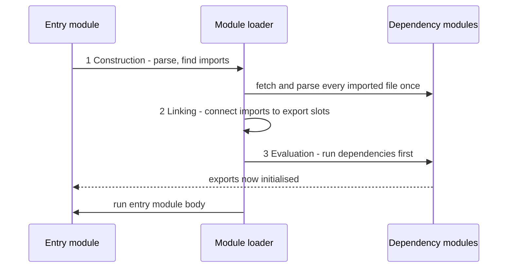

# Chapter 10 — Modules and Tooling

A real program is hundreds of files plus thousands of third-party **packages** (bundles of reusable code downloaded into your project). **Modules** give each file a private scope that shares only what it exports. **Tooling** — npm, bundlers, transpilers, linters, formatters — turns files and packages into something a browser or server can run, and keeps code consistent. This chapter covers ES modules, how Node runs both module systems, then the tool chain.

**What you'll learn:** why modules exist and how module systems evolved; every `import`/`export` form, default vs named, barrels, side-effect imports; how ESM loads (three phases, hoisting, live bindings, singletons, cycles); `import()`, top-level `await`, `import.meta`, JSON modules; browser modules and import maps; CommonJS vs ESM in Node (`require(esm)`, `createRequire`, `"exports"`); npm and `package.json` (`npx`, `node --run`, `node_modules` resolution); semver, ranges, lockfiles; bundlers (Vite, esbuild, webpack, Rollup/Rolldown); transpilers, polyfills, ESLint, Prettier.

**Before you start:** functions and closures ([Chapter 4](../04-functions-scope-and-closures/README.md)) — the pre-module "module pattern" is a closure. Here we only need that `await` pauses until a promise (a result arriving later) settles; full details in [Chapter 12](../12-asynchronous-javascript/README.md).

Code in [`code/`](code/) is a small multi-file ES module project; files starting `// tools_run: skip` are helpers imported by the numbered programs. Outputs are real (Node 24). **npm, bundler and linter commands are not-run snippets** (they need the network or a full project); their output is described.

---

## 10.1 Why modules?

### What it is
A **module** is a file whose top-level variables are private; it **exports** what it shares and **imports** what it needs. Modules connected by imports form the **module graph**; the first one run is the **entry point**.

### The problem it solves
Early pages loaded `<script>` files sharing **one global scope**, so every top-level `var`/function was global:
- **Name collisions** — two libraries defining `$` or `init` overwrote each other.
- **Hidden dependencies** — script order in HTML *was* the dependency system.
- **No encapsulation** (internals hidden behind a small public surface) — anything could change anything.

### How the solutions evolved
| Era | Approach | How it works | Still seen? |
|---|---|---|---|
| ~2000s | Global scripts + namespaces (one global object holding everything, to reduce name clashes) | `var MyApp = MyApp \|\| {}; MyApp.utils = …` | Legacy pages |
| ~2008+ | **IIFE / module pattern** | A function called immediately; a closure hides private state and returns a public object ([Chapter 4](../04-functions-scope-and-closures/README.md)) | Output of old bundlers |
| 2009 | **CommonJS** (Node) | `require()` / `module.exports`, synchronous (each file is fully loaded before the next line runs), one file = one module | Very common in Node packages |
| 2011 | AMD (RequireJS), later UMD | Asynchronous (loads in the background and calls back when ready) `define()` for browsers; UMD wraps a file to work as AMD, CommonJS or a global | Old libraries |
| **ES2015** | **ES modules (ESM)** | `import` / `export` built into the language; static; async-friendly | **The standard** — browsers and Node |

**ESM** alone is part of the language, native in browsers and Node, and **statically analyzable** (understood without running). Use it for new code.

### TL;DR
Modules give each file a private scope with explicit imports/exports. ESM (ES2015) is the standard; CommonJS remains common in Node.

---

## 10.2 `export` and `import` syntax

### Export forms
Any number of **named exports**, at most one **default export**.

[`code/math.mjs`](code/math.mjs) — named exports:

```js
// tools_run: skip — helper module imported by other examples
export const TAU = 2 * Math.PI;                 // named export (declaration form)
export function add(a, b) { return a + b; }
function square(x) { return x * x; }
function cube(x) { return x ** 3; }
export { square, cube as toThePowerOfThree };   // export list, with renaming
console.log('[math.mjs] evaluated');            // runs once, however many importers
```

[`code/logger.mjs`](code/logger.mjs) — default plus named:

```js
export default function log(level, msg) {       // the default export
  return `[${level.toUpperCase()}] ${msg}`;
}
export const LEVELS = ['debug', 'info', 'warn', 'error'];
```

[`code/barrel.mjs`](code/barrel.mjs) — re-exports (a **barrel** gathers several modules' exports into one import point):

```js
export * from './math.mjs';                            // re-export all named exports
export { default as log, LEVELS } from './logger.mjs'; // re-export a default under a name
export * as counterNS from './counter.mjs';            // re-export a namespace (ES2020)
```

| Export form | Example |
|---|---|
| Declaration | `export const x = 1;` `export function f() {}` `export class C {}` |
| List (after declaring) | `export { a, b };` |
| Rename | `export { a as alpha };` |
| Default (expression) | `export default 42;` `export default { … };` |
| Default (declaration, may be anonymous) | `export default function () {}` `export default class {}` |
| Name something the default | `export { x as default };` |
| Re-export | `export { a } from './m.mjs';` `export * from './m.mjs';` `export * as ns from './m.mjs';` |

`export *` does **not** re-export the default — re-export it by name (as `barrel.mjs` does).

### Import forms
[`code/01_import_export.mjs`](code/01_import_export.mjs):

```js
// Every static import form. Imports are hoisted: they load before any code here runs.
import './side_effect.mjs';                       // side-effect only
import log, { LEVELS } from './logger.mjs';       // default + named in one statement
import { add, square as sq, TAU } from './math.mjs'; // named, with renaming
import * as MathNS from './math.mjs';             // namespace object
import { toThePowerOfThree, counterNS, log as log2 } from './barrel.mjs';

console.log('named   :', add(2, 3), sq(4), TAU.toFixed(4));
console.log('default :', log('info', 'server started'), '| levels:', LEVELS.join(','));
console.log('ns keys :', Object.keys(MathNS));
console.log('barrel  :', toThePowerOfThree(2), typeof counterNS.increment, log2 === log);
console.log('polyfill:', globalThis.polyfilled);
```

Output:
```
[side_effect.mjs] patched globalThis
[math.mjs] evaluated
named   : 5 16 6.2832
default : [INFO] server started | levels: debug,info,warn,error
ns keys : [ 'TAU', 'add', 'square', 'toThePowerOfThree' ]
barrel  : 8 function true
polyfill: true
```

| Import form | What you get |
|---|---|
| `import x from './m.mjs'` | the default export, under any name you choose |
| `import { a, b } from './m.mjs'` | named exports (names must match) |
| `import { a as z } from './m.mjs'` | named export, renamed locally |
| `import * as ns from './m.mjs'` | a **namespace object** with every named export as a property (the default is `ns.default`) |
| `import x, { a } from './m.mjs'` | default + named together |
| `import './m.mjs'` | runs the module for its side effects (things it does on load besides exporting — e.g. polyfills, which add missing built-in features; CSS in bundlers; registering elements) |

`side_effect.mjs` and `math.mjs` printed **before** the importer's body, and `math.mjs` ran once despite three importing statements: imports are processed first and each module is evaluated exactly once.

A **module specifier** is the string after `from`:
- **Relative** — `'./math.mjs'`, `'../lib/x.js'`. Browsers and Node ESM need the extension (no `.js` guessing; CommonJS and bundlers do guess).
- **Absolute URL** — `'https://cdn.example.com/lib.js'` (browsers; a CDN serves files from servers near the user — [System Design Fundamentals](../../../system-design-patterns/modules/00-system-design-fundamentals/README.md)).
- **Bare** — `'react'`: a package name, resolved by Node in `node_modules` (where installed packages live); browsers need an import map or bundler (§10.7).
- **Built-in** — `'node:fs'`, `'node:path'`; `node:` marks a core module unambiguously.

### Default vs named exports
| | Named exports | Default export |
|---|---|---|
| Importer's name | Must match (rename with `as`) | Anything — and different files may call it different things |
| Refactoring (restructuring code without changing behaviour) / IDE (code editor such as VS Code) auto-import | Rename-safe, auto-import finds it | Weaker: the name isn't tied to the export |
| Tree shaking (removing unused code from the final build, §10.11) | Fine-grained | Works, but a default *object* of many functions is all-or-nothing |
| Typical use | Utility modules, libraries | One main thing per file: a React component, a class, a config |

Many teams prefer named exports (`eslint-plugin-import`'s `import/no-default-export` enforces it); Next.js (a React framework for full websites) requires default exports for page files. Be consistent.

### Common mistakes
- `import { default } from …` — reserved word; use `import x from …` or `import { default as x } from …`.
- Missing extension (`'./math'`) in native ESM → `ERR_MODULE_NOT_FOUND`.
- Big barrels in apps: importing one function from `index.js` can make tools and test runners load every re-exported module — import the specific file in hot paths (startup or very frequent code).
- `export default const x = 1` is a syntax error (`export default` takes an expression or function/class declaration).

### Self-check
1. Default exports per module? → At most one.
2. Does `export * from './m.mjs'` include the default? → No.
3. `import * as ns` contents? → All named exports as read-only properties, plus `default` if any.

### TL;DR
Named: many, name must match. Default: one, importer names it. `import * as ns` → namespace; `import './x'` → side effects. Always write extensions in native ESM.

---

## 10.3 How ES modules load

### What it is
ES modules are **static**: `import`/`export` only at a module's top level (not in `if`s or functions) with string-literal specifiers, so the engine knows the whole graph *before running any code*.

### How it works — three phases
1. **Construction (parse)** — from the entry point, fetch and parse each file, follow its imports until the graph is complete. Nothing runs. A **module map** records each URL, so each module is fetched once.
2. **Linking (instantiation)** — create module environments and wire each import to the exporter's variable slot — *references, not copies*. Missing named exports fail here, before any code runs (`SyntaxError: The requested module … does not provide an export named …`).
3. **Evaluation** — run each module's top level exactly once, **dependencies first** (depth-first post-order: children before parents, siblings in import order).



| Property | Meaning |
|---|---|
| **Hoisting** | Imports are resolved before the body runs, wherever the `import` line appears in the file. |
| **Singletons** | Each module is evaluated once per program (per realm — one separate global environment, such as a browser tab or iframe); every importer shares the same instance and state. |
| **Live bindings** | An import is a live, **read-only** view of the exporter's variable. If the exporter changes it, importers see the change. |
| **Strict mode** | Module code is always strict (no `'use strict'` needed). |
| **Own scope** | Top-level `const`/`let`/`function` are module-scoped, not globals. `this` at top level is `undefined`. |
| **Deferred** | In browsers, module scripts don't block HTML parsing (§10.7). |

[`code/counter.mjs`](code/counter.mjs) and [`code/02_live_bindings.mjs`](code/02_live_bindings.mjs):

```js
// counter.mjs
export let count = 0;
export function increment() { count++; }
```

```js
// 02_live_bindings.mjs (abridged — each output line labels its check)
import { count, increment } from './counter.mjs';
import * as ns from './math.mjs';
import * as again from './math.mjs';     // same module -> evaluated once, same namespace object

console.log('before     :', count);
increment(); increment();
console.log('after x2   :', count, '(the import sees the new value)');
try { count = 100; } catch (e) { console.log('assign     :', e.name, '-', e.message); }   // imports are read-only
// ... then checks ns === again, the namespace's tag/sealing, top-level `this`, globals and strict mode
```

Output (full run):
```
[math.mjs] evaluated
before     : 0
after x2   : 2 (the import sees the new value)
assign     : TypeError - Assignment to constant variable.
same ns?   : true
ns tag     : [object Module]
ns sealed  : true | frozen: false
ns write   : TypeError - Cannot assign to read only property 'add' of object '[object Module]'
this       : undefined
global?    : false
strict     : ReferenceError - undeclared is not defined
```

- `count` went 0 → 2 in the importer; CommonJS `const { count } = require(...)` would have copied `0`.
- Assigning an import throws like a `const` even though the exporter used `let`; only the exporter can change it.
- The namespace is sealed with non-writable properties; "not frozen" only because its values stay live.

### Circular imports
A **circular dependency**: A imports B and B (directly or indirectly) imports A. ESM allows it — one module runs before the other finishes. Rule: **top-level code must not use an imported `let`/`const`/`class` not yet initialized** (it's in its **TDZ**, temporal dead zone). Use inside later-running functions is fine, and function declarations are initialized at link time, so they're usable early.

[`code/07_circular_imports.mjs`](code/07_circular_imports.mjs) loads two tiny cycles:

```js
// cyc_a.mjs                                  // cyc_b.mjs
import { b } from './cyc_b.mjs';              import { a } from './cyc_a.mjs';
export const a = 'A';                         export const b = `B knows ${a}`; // a in TDZ
console.log('[cyc_a] sees', b);
```

```js
// cyc_safe_a.mjs                             // cyc_safe_b.mjs
import { describeB } from './cyc_safe_b.mjs'; import { nameA } from './cyc_safe_a.mjs';
export function nameA() { return 'A'; }       export function describeB() { return `B calls ${nameA()}`; }
export const result = describeB();
```

```js
try {
  await import('./cyc_a.mjs');
} catch (e) {
  console.log('unsafe cycle:', e.name, '-', e.message);
}
const { result } = await import('./cyc_safe_a.mjs');
console.log('safe cycle  :', result);
```

Output:
```
unsafe cycle: ReferenceError - Cannot access 'a' before initialization
safe cycle  : B calls A
```

`cyc_b` evaluates first and reads `a` before `cyc_a` has run; in the safe version `nameA` is a hoisted function declaration. Best real fix: **break the cycle** by moving the shared piece into a third module.

### In the interview
**30-second answer:** "ES modules are static: the loader parses the whole graph, links imports to exports, then evaluates each module once, dependencies first. Imports are hoisted, read-only live bindings, and modules are strict singletons with their own scope. That static structure enables tree shaking. Cycles work as long as top-level code doesn't touch a binding still in its TDZ."

- *Q: ESM live bindings vs CommonJS exports?* A: `require` returns `module.exports`; destructuring copies values at that moment. ESM imports stay connected to the exporter's variable.
- *Q: Why no `import` inside `if`?* A: Static imports must be known before execution; use `import()`.

### Self-check
1. Two files import `config.mjs` — top level runs how often? → Once.
2. Can an importer reassign an import? → No — `TypeError`.
3. Phase that reports a missing named export? → Linking.

### TL;DR
Parse → link → evaluate once, dependencies first. Imports: hoisted, live, read-only; modules: strict singletons. Avoid top-level use of bindings in cycles.

---

## 10.4 Dynamic `import()`

### What it is
`import(specifier)` (ES2020) is special syntax that works anywhere (`if`, functions, handlers), accepts computed strings, and returns a **promise** of the module's namespace object.

### Why it matters
- **Lazy loading / code splitting** — load a heavy chart library only when its tab opens; bundlers emit each `import()` as a separate on-demand file (**chunk**, §10.11).
- **Conditional loading** — by platform, feature flag (on/off switch for a feature) or locale (`import(\`./locales/${lang}.mjs\`)`).
- **From CommonJS** — the only way for CJS to load an ES module that uses top-level `await`.

[`code/03_dynamic_import.mjs`](code/03_dynamic_import.mjs):

```js
// 03_dynamic_import.mjs (abridged)
const verbose = process.env.VERBOSE !== '0';   // decide at runtime whether to load the logger
if (verbose) {
  const { default: log } = await import('./logger.mjs');  // default export is the "default" key
  console.log(log('debug', 'logger loaded lazily'));
}
const dyn = await import(`./${name}.mjs`);                 // computed specifier
const [m, l] = await Promise.all([import('./math.mjs'), import('./logger.mjs')]);  // in parallel
try { await import('./does-not-exist.mjs'); } catch (e) { console.log('missing  :', e.code); }  // rejected promise
```

Output (full run — the file also compares `dyn` with a static import and loads `node:path`):
```
[math.mjs] evaluated
[DEBUG] logger loaded lazily
same instance as static import? true
parallel : 2 4
missing  : ERR_MODULE_NOT_FOUND
node:path: report.pdf
```

### Trade-offs
| | Static `import` | Dynamic `import()` |
|---|---|---|
| Where | top level only | anywhere |
| Specifier | string literal | any expression |
| Timing | before the module body runs | when that line runs (async) |
| Tree shaking / analysis | full | limited — tools can't know a fully computed path |
| Errors | whole graph fails to load | a catchable rejected promise |

### Common mistakes
- Forgetting the default export is `.default`: `(await import('./x.mjs')).default(...)`.
- Fully dynamic paths (`import(userInput)`) — un-prebuildable, and a security risk with untrusted input.

### TL;DR
`import()` loads on demand and returns a promise of the namespace — for code splitting and conditional loading.

---

## 10.5 Top-level `await`

### What it is
Since ES2022, `await` works at the **top level of an ES module** (not classic scripts or CommonJS). Such an **async module** makes its importers wait until it finishes evaluating.

[`code/slow_config.mjs`](code/slow_config.mjs) and [`code/04_top_level_await.mjs`](code/04_top_level_await.mjs):

```js
// slow_config.mjs
console.log('[slow_config] start loading');
const loadSettings = () => new Promise((resolve) => setTimeout(() => resolve({ theme: 'dark', retries: 3 }), 50));
export const settings = await loadSettings();    // importers wait until this resolves
console.log('[slow_config] done');
```

```js
// 04_top_level_await.mjs
console.log('main body starts (after all static imports finished)');
import { settings } from './slow_config.mjs';
console.log('settings:', settings);

const results = await Promise.all([1, 2, 3].map(async (n) => n * 10));
console.log('awaited at top level:', results);
```

Output:
```
[slow_config] start loading
[slow_config] done
main body starts (after all static imports finished)
settings: { theme: 'dark', retries: 3 }
awaited at top level: [ 10, 20, 30 ]
```

The `import` written after the first `console.log` still ran first (hoisting), and the importer waited for `slow_config`'s `await`.

### Why it matters / real-world examples
- Loading config, a WebAssembly module (fast compiled code, often from C/Rust), or a database connection before exporting it.
- Scripts and CLIs (command-line programs) without `(async () => { … })()` wrappers.
- Fallbacks: `let lib; try { lib = await import('fast-lib'); } catch { lib = await import('./slow-fallback.mjs'); }`.

### When not to use it
- **Widely imported library modules** — every importer waits; a slow `await` blocks startup. Export an async function (`export async function connect()`) and let the app decide.
- **Modules loaded via `require()`** — `ERR_REQUIRE_ASYNC_MODULE` (§10.8).

### TL;DR
ES modules only; importers wait. Great for entry points and scripts, risky in shared libraries.

---

## 10.6 `import.meta` and JSON modules

### What it is
- **`import.meta`** — host-provided **metadata** (data about the module, not its contents) for the current module. Standard: `import.meta.url` (full URL) and `import.meta.resolve(specifier)` (specifier → URL relative to this module).
- **Import attributes** (ES2025) — a `with { … }` clause telling the host how to interpret a file. First use: **JSON modules**, `import data from './data.json' with { type: 'json' }`. Required so a server can't trick a page into *executing* a file it expected to be data.

[`code/05_import_meta_and_json.mjs`](code/05_import_meta_and_json.mjs) (with [`code/data.json`](code/data.json)):

```js
import config from './data.json' with { type: 'json' };
import path from 'node:path';

console.log('json     :', config.app, config.version, config.features);
console.log('url      :', import.meta.url.startsWith('file://'), path.basename(import.meta.url));
console.log('filename :', path.basename(import.meta.filename));   // Node 20.11+
console.log('dirname  :', path.basename(import.meta.dirname));
console.log('resolve  :', path.basename(import.meta.resolve('./math.mjs')));
console.log('is main? :', import.meta.main);                      // Node 24.2+, early-stage feature
```

Output:
```
json     : notes 2.1.0 [ 'search', 'tags' ]
url      : true 05_import_meta_and_json.mjs
filename : 05_import_meta_and_json.mjs
dirname  : code
resolve  : math.mjs
is main? : true
```

(Base names only, so output doesn't depend on the book's location.)

| Property | Where | Replaces |
|---|---|---|
| `import.meta.url` | browsers + Node | — |
| `import.meta.resolve()` | browsers + Node (20.6+ unflagged — usable without a special command-line switch) | `require.resolve` |
| `import.meta.filename` / `.dirname` | Node 20.11+ | CommonJS `__filename` / `__dirname` |
| `import.meta.main` | Node 24.2+ (early development) | `require.main === module` |

A JSON module's default export is the parsed value (no named exports), evaluated once and shared — treat it as read-only. For runtime data (uploads etc.) use `fs` or `fetch` + `JSON.parse` ([Chapter 5](../05-objects-math-date-and-json/README.md), [Chapter 15](../15-nodejs-basics/README.md)). The earlier `assert { type: 'json' }` syntax was replaced by `with` and removed from V8/Node — update old code.

### TL;DR
`import.meta.url` identifies the module (Node adds `filename`/`dirname`); import JSON with `with { type: 'json' }` (ES2025).

---

## 10.7 Modules in the browser

### How it works
```html
<script type="module" src="/js/main.js"></script>
<script type="module">
  import { add } from './js/math.js';
  document.title = `2 + 3 = ${add(2, 3)}`;
</script>
```

(HTML — not run.) Versus a classic `<script>`:

| | Classic `<script>` | `<script type="module">` |
|---|---|---|
| Scope | top-level `var`/functions become globals | module scope |
| Strict mode | opt-in | always |
| Top-level `this` | `window` | `undefined` |
| Loading | blocks HTML parsing unless `defer`/`async` | **deferred by default** (runs after parsing, in order); `async` also allowed |
| Executes | every time it's included | once per URL |
| Cross-origin (from a different domain) | loads without CORS | must be served with CORS (Cross-Origin Resource Sharing: headers in which a server says which other sites may use its files) headers |
| `file://` pages | work | blocked by browsers — use a local dev server (a small web server on your own machine for development) |
| `import` / `export` / top-level `await` | ✗ | ✓ |

`<script nomodule>` runs only in browsers *without* module support — once used for fallback bundles, rarely needed now: all evergreen (self-updating) browsers have supported modules since about 2018.

### Bare specifiers and import maps
Browsers can't resolve `import { h } from 'preact'` — there's no `node_modules` on the web. An **import map** (all major browsers since 2023) maps bare names:

```html
<script type="importmap">
{
  "imports": {
    "preact": "https://cdn.jsdelivr.net/npm/preact@10/dist/preact.module.js",
    "utils/": "/js/utils/"
  }
}
</script>
<script type="module">
  import { h } from 'preact';
  import { slugify } from 'utils/strings.js';
</script>
```

(HTML — not run.) Good for small apps and prototypes without a **build step** (automated processing before release); larger apps still bundle (§10.11) for tree shaking, **minification** (removing spaces, shortening names) and fewer requests. Browser loading and CORS: [Chapter 14](../14-browser-apis-and-security/README.md).

### TL;DR
`<script type="module">`: module scope, strict, deferred, once per URL, CORS, no `file://`. Import maps resolve bare names.

---

## 10.8 CommonJS vs ES modules in Node

### What it is
**CommonJS (CJS)**, Node's original system: `require(path)` synchronously loads and runs a file and returns its `module.exports`. Node wraps each CJS file in `(function (exports, require, module, __filename, __dirname) { … })` — the source of those five "globals". Still everywhere on npm, so you must read, write and mix both.

### How Node decides which system a file uses
1. **`.mjs`** → ESM; **`.cjs`** → CommonJS.
2. **`.js`** → nearest `package.json`: `"type": "module"` → ESM; `"type": "commonjs"` → CJS.
3. `.js` with **no** `"type"` → CJS, *unless* it contains ESM-only syntax (`import`/`export`, top-level `await`); since Node 22.7 it's then re-run as ESM (**syntax detection**). Set `"type"` explicitly in real projects.

This book uses `.mjs`/`.cjs` so there's never doubt.

### Side-by-side comparison
| | CommonJS | ES modules |
|---|---|---|
| Syntax | `const x = require('./x')` / `module.exports = …` / `exports.a = …` | `import` / `export` |
| Loading | synchronous, at runtime, can be inside `if` | static graph, async-capable; `import()` for dynamic |
| Exports | a single object (copied values when destructured) | live, read-only bindings |
| Top-level `await` | ✗ | ✓ |
| Strict mode | opt-in | always |
| Top-level `this` | `module.exports` | `undefined` |
| `__dirname` / `__filename` | ✓ | `import.meta.dirname` / `.filename` |
| File extensions | optional (`require('./x')` finds `x.js`, `x.json`, `x/index.js`) | required for relative paths |
| JSON | `require('./data.json')` | `import d from './data.json' with { type: 'json' }` |
| Cache | `require.cache` (can be deleted to reload) | internal module map (no official reload) |
| Tree shaking | poor (dynamic) | good (static) |
| Browsers | ✗ (needs a bundler) | ✓ native |

### Interop
- **ESM importing CJS** — the **default import** is `module.exports`; **named imports** work when Node can detect them by statically scanning the CJS source (patterns like `exports.name = …`, `module.exports = { name, … }`).
- **CJS requiring ESM** — `require(esm)` is on by default since Node 22.12 / 20.19 (no warning since 23.5 / 22.13; officially stable in 25.4), returning the namespace object. It **fails with `ERR_REQUIRE_ASYNC_MODULE`** if the ESM graph has top-level `await` — use `await import()`.
- **`createRequire(import.meta.url)`** gives ESM a real `require` — for CJS-only files or `require.resolve`.

[`code/legacy.cjs`](code/legacy.cjs), [`code/uses_esm.cjs`](code/uses_esm.cjs) and [`code/06_commonjs_interop.mjs`](code/06_commonjs_interop.mjs):

```js
// legacy.cjs — CommonJS
const path = require('node:path');
console.log('[legacy.cjs] this === module.exports:', this === module.exports, '| __filename:', path.basename(__filename));
let calls = 0;
function greet(name) { calls++; return `hello ${name} (call ${calls})`; }
module.exports = { greet, get calls() { return calls; } };
module.exports.version = '1.0.0';
```

```js
// uses_esm.cjs — CommonJS requiring an ES module
const math = require('./math.mjs');
module.exports = { sum: math.add(20, 22), keys: Object.keys(math) };
```

```js
// 06_commonjs_interop.mjs
import legacy from './legacy.cjs';                   // default import = module.exports
import { greet } from './legacy.cjs';                // named import (detected by static analysis)
import { createRequire } from 'node:module';

console.log('default  :', legacy.greet('ESM'), '| version', legacy.version);
console.log('named    :', greet('named'));

const require = createRequire(import.meta.url);     // a require() usable inside ESM
const again = require('./legacy.cjs');
console.log('cached   :', again === legacy, '| calls so far', again.calls);

const fromCjs = require('./uses_esm.cjs');          // CJS that itself require()s an ESM file
console.log('require(esm):', fromCjs);

console.log('cache key:', Object.keys(require.cache).some((k) => k.endsWith('legacy.cjs')));
```

Output:
```
[legacy.cjs] this === module.exports: true | __filename: legacy.cjs
default  : hello ESM (call 1) | version 1.0.0
named    : hello named (call 2)
cached   : true | calls so far 2
[math.mjs] evaluated
require(esm): { sum: 42, keys: [ 'TAU', 'add', 'square', 'toThePowerOfThree' ] }
cache key: true
```

- `legacy.cjs` ran once; ESM import and later `require` share the cached instance (counter 1 → 2).
- `version`, added *after* `module.exports = {…}`, isn't detected as a named export but is on the default import — when in doubt with CJS, use the default import.

### Common mistakes
- `exports = { a }` exports nothing — only `module.exports = …` or `exports.a = …`.
- `ReferenceError: require is not defined in ES module scope` — use `import` or `createRequire`.
- `SyntaxError: Cannot use import statement outside a module` — Node treated the file as CJS (`"type": "commonjs"` up the tree, or `.cjs`); rename to `.mjs` or set `"type": "module"`.
- `__dirname is not defined` in ESM — `import.meta.dirname`.
- **Dual package hazard**: a package shipping CJS and ESM builds may load *twice* — two copies of state, and `instanceof` failing across them.

### Package entry points: `"exports"`
`package.json` can declare which files outsiders may import and which file each system gets:

```json
{
  "name": "tiny-date",
  "type": "module",
  "exports": {
    ".": { "import": "./dist/index.js", "require": "./dist/index.cjs" },
    "./format": "./dist/format.js",
    "./package.json": "./package.json"
  }
}
```

(Not run.) With `"exports"`, `import 'tiny-date/dist/secret.js'` fails with `ERR_PACKAGE_PATH_NOT_EXPORTED` — internals are encapsulated. The older `"main"` named one entry and exposed everything. `"imports"` (keys starting `#`) defines private in-package aliases, e.g. `import db from '#db'`.

### In the interview
**30-second answer:** "CommonJS is Node's original synchronous `require`/`module.exports`; ES modules are the standard with static `import`/`export`, live bindings, top-level `await` and browser support. Node chooses by extension (`.mjs`/`.cjs`) or `package.json` `type`. ESM can import CJS (default = `module.exports`), and modern Node can `require()` ESM unless it uses top-level `await`. New code should be ESM."

- *Q: Why can't `require()` load ESM with top-level await?* A: `require` is synchronous and must return immediately; an async module can't finish synchronously.
- *Q: What does `"exports"` do?* A: Defines public entry points and conditional builds (`import` vs `require`), blocking deep imports.

### Self-check
1. `.js` under `"type": "module"`? → ESM.
2. `__dirname` in ESM? → `import.meta.dirname` (Node 20.11+), or `path.dirname(fileURLToPath(import.meta.url))` earlier.
3. `import x from './legacy.cjs'` gives? → `module.exports`.

### TL;DR
`.mjs`/`.cjs` or `"type"` decides. CJS: sync `require`, copied values, `__dirname`. ESM: static, live, strict, TLA. They interoperate; prefer ESM, declare entry points with `"exports"`.

---

## 10.9 npm and `package.json`

### What it is
- **npm** = the **registry** (npmjs.com, millions of public packages) + the **CLI** (command-line interface, `npm`, installed with Node) + the company running them.
- A **package** is a folder with a `package.json`. What you depend on is a **dependency**; their dependencies are **transitive dependencies**.
- **`package.json`** is the project manifest: name, version, module type, scripts, dependencies.

Alternatives on the same registry: **pnpm** (content-addressed store — each file stored once, named by its contents — strict `node_modules`, saves disk), **Yarn**, **Bun** (runtime with built-in package manager). Pick one per project and commit its lockfile (exact installed versions, §10.10).

### A typical `package.json`
```json
{
  "name": "notes-app",
  "version": "2.1.0",
  "private": true,
  "type": "module",
  "engines": { "node": ">=22" },
  "scripts": {
    "dev": "vite",
    "build": "vite build",
    "test": "node --test",
    "lint": "eslint .",
    "format": "prettier --write .",
    "check": "npm run lint && npm test"
  },
  "dependencies": {
    "date-fns": "^4.1.0"
  },
  "devDependencies": {
    "eslint": "^10.0.0",
    "prettier": "^3.3.0",
    "vite": "^8.0.0"
  }
}
```

(Not run; versions are examples.)

| Field | Meaning |
|---|---|
| `name`, `version` | Identity. Required if you publish. `version` follows semver (§10.10). |
| `private: true` | Prevents accidental `npm publish`. |
| `type` | `"module"` → `.js` files are ESM. |
| `main` / `exports` | Entry points for people importing your package (§10.8). |
| `scripts` | Named commands: `npm run <name>`; `npm test` and `npm start` are shortcuts. |
| `dependencies` | Needed at runtime (installed for anyone who installs your package). |
| `devDependencies` | Needed only to develop/build/test (linters, bundlers, test runners). |
| `peerDependencies` | "I work with *your* copy of X" — plugins (add-ons that extend another tool) declare the host they plug into (e.g., a React component library declares `react`). npm 7+ installs them automatically. |
| `optionalDependencies` | Install failures are tolerated. |
| `engines` | Supported Node versions (advisory unless enforced). |
| `bin` | Command-line executables the package provides. |
| `files` | What to include when publishing. |

### Everyday commands (not run)
```bash
npm init -y                     # create package.json with defaults
npm install                     # install everything in package.json (and update the lockfile if needed)
npm install date-fns            # add a runtime dependency (saved as "^<latest>")
npm install -D eslint prettier  # add dev dependencies (--save-dev)
npm uninstall date-fns          # remove
npm ci                          # clean, exact install from package-lock.json (CI servers)
npm run build                   # run a script; npm test / npm start need no "run"
npm run test -- --watch         # pass extra args to the script after --
npx eslint .                    # run a package's binary (local first, else download temporarily)
npm outdated                    # which dependencies have newer versions
npm update                      # upgrade within the allowed ranges
npm audit                       # check for known vulnerabilities (npm audit fix to patch)
npm ls react                    # why / where is a package in the tree
npm version patch               # bump version 2.1.0 -> 2.1.1, commit and tag
node --run test                 # Node 22+: run a script without npm's startup cost
node --watch server.mjs         # restart on file change (stable since Node 22)
```

`npm run` and `node --run` put `./node_modules/.bin` on the `PATH` (folders the shell searches for commands), so scripts say `eslint .` without global installs. `npm run build` also runs `prebuild`/`postbuild` if present; `node --run` skips those hooks and package-manager environment variables for speed.

### How `node_modules` resolution works
For `import 'date-fns'` in `/app/src/utils/x.mjs`, Node checks `node_modules/date-fns` in `/app/src/utils`, `/app/src`, `/app`, `/` — first match wins — then reads its `package.json` (`exports`, else `main`). npm **hoists** (flattens) most transitive dependencies to the top level to share them; incompatible versions get nested copies.

Consequence: **phantom dependencies** — importing an undeclared package that a dependency happened to hoist; it breaks when that dependency changes. pnpm's strict layout prevents this.

### Common mistakes
- Global installs (`npm install -g`) make the project depend on your machine — use devDependencies + scripts/`npx`.
- Build tools in `dependencies` (bloat) or runtime libs in `devDependencies` (breaks production).
- Committing `node_modules` (never); *not* committing the lockfile (always commit it).
- `npx` with a typo may download and run a look-alike package.

### TL;DR
`package.json` = identity + type + scripts + dependencies. `dependencies` runtime, `devDependencies` tooling; tools via scripts/`npx`; `node_modules` searched upward.

---

## 10.10 Semantic versioning, ranges and lockfiles

### What it is
**Semantic versioning (semver)**: `MAJOR.MINOR.PATCH`.

| Bump | When | Example | Should upgrading break you? |
|---|---|---|---|
| MAJOR | incompatible API (the functions and options a package exposes) change | 3.4.1 → 4.0.0 | May — read the changelog (the list of changes in each release) |
| MINOR | new feature, backward compatible | 3.4.1 → 3.5.0 | No |
| PATCH | backward-compatible bug fix | 3.4.1 → 3.4.2 | No |
| Pre-release | unstable preview | 4.0.0-beta.2 | Anything goes |

**`0.x` = initial development** — anything may change, so tools treat a `0.x` minor like a major.

### Version ranges in `package.json`
| Range | Means | Allows |
|---|---|---|
| `1.2.3` | exactly | 1.2.3 only |
| `^1.2.3` (caret — npm's default) | same **major** | ≥1.2.3 <2.0.0 |
| `^0.2.3` | same **minor** when major is 0 | ≥0.2.3 <0.3.0 |
| `^0.0.3` | exact patch when major and minor are 0 | ≥0.0.3 <0.0.4 |
| `~1.2.3` (tilde) | same **minor** | ≥1.2.3 <1.3.0 |
| `1.x` / `1` / `1.*` | any 1.y.z | ≥1.0.0 <2.0.0 |
| `>=1.2 <1.5` | explicit comparators | as written |
| `1.2 - 1.4` | hyphen range | ≥1.2.0 ≤1.4.x |
| `^1 \|\| ^2` | either range | |
| `*` / `latest` | anything | avoid |

Caret in one sentence: **don't change the left-most non-zero number.**

[`code/08_semver.mjs`](code/08_semver.mjs) models these rules (ignoring pre-release tags and `||`/hyphen ranges; real projects use the `semver` package npm itself uses):

```js
// code/08_semver.mjs (core idea): turn a range into [low, high) bounds, then test low <= version < high
// '^' -> bump the left-most non-zero part; '~' -> bump minor (or major if only major given); exact/x-range -> bump the last given part
```

Output:
```
^1.2.3  >=1.2.3 <2.0.0         matches: 1.2.3, 1.2.9, 1.3.0, 1.9.9
~1.2.3  >=1.2.3 <1.3.0         matches: 1.2.3, 1.2.9
1.2.3   >=1.2.3 <1.2.4         matches: 1.2.3
1.x     >=1.0.0 <2.0.0         matches: 1.2.3, 1.2.9, 1.3.0, 1.9.9
^0.2.3  >=0.2.3 <0.3.0         matches: 0.2.5
^0.0.3  >=0.0.3 <0.0.4         matches: 0.0.3
~1      >=1.0.0 <2.0.0         matches: 1.2.3, 1.2.9, 1.3.0, 1.9.9
```

### Lockfiles
With `^4.1.0`, installs a month apart may get 4.1.0 vs 4.3.2 — and every transitive dependency may differ. A **lockfile** (`package-lock.json`, `pnpm-lock.yaml`, `yarn.lock`, `bun.lock`) records the **exact** version, download URL and **integrity hash** (content fingerprint detecting tampering) of *every* package in the tree.

| | `npm install` | `npm ci` |
|---|---|---|
| Reads | `package.json` + lockfile | lockfile (must match `package.json`, else error) |
| May change the lockfile | yes | never |
| Existing `node_modules` | reused/updated | deleted first |
| Use for | development, adding packages | CI servers (continuous integration — machines that automatically build and test every change), deploy builds, reproducible installs |

**Commit the lockfile**, use `npm ci` in automated builds, upgrade deliberately (`npm outdated` → `npm update` or `npm install pkg@latest` → test). Dependabot and Renovate open **pull requests** (proposed changes for review, e.g. on GitHub) for updates.

### Real-world examples — why this matters
- **left-pad (2016)**: an 11-line package was unpublished and thousands of builds broke; npm then restricted unpublishing.
- **Supply-chain attacks** (malicious code smuggled into your dependencies): compromised maintainers published malicious patch versions (e.g. `event-stream` in 2018, several hijacked packages in 2025). Caret ranges without a lockfile install the bad version automatically; lockfiles, `npm ci`, `npm audit` and reviewing new dependencies reduce the risk.

### In the interview
**30-second answer:** "Semver is MAJOR.MINOR.PATCH — breaking, feature, fix. `^` allows anything not changing the left-most non-zero number, `~` allows patch updates. Ranges stay flexible, but the lockfile pins the exact tree so everyone and CI install the same thing — `npm ci` installs exactly from it."

- *Q: Does `^0.3.1` allow 0.4.0?* A: No — for `0.x` caret locks the minor: ≥0.3.1 <0.4.0.
- *Q: Should a library commit its lockfile?* A: Yes, for its own dev/CI reproducibility — consumers ignore it and resolve the library's ranges themselves.

### Self-check
1. Largest version `~2.4.1` allows? → Anything <2.5.0.
2. Command that never modifies the lockfile? → `npm ci`.
3. Bug fix without API change bumps? → PATCH.

### TL;DR
MAJOR.MINOR.PATCH; `^` = same left-most non-zero, `~` = same minor. Commit the lockfile, `npm ci` in CI, upgrade on purpose.

---

## 10.11 Bundlers

### What it is
A **bundler** follows every `import` from your entry file (including CSS, images, `node_modules` packages) to build the module graph and writes a few optimized **bundles** for the browser, transpiling, minifying and splitting along the way.

### The problem it solves
Shipping a large app as hundreds of raw native-ESM files means many requests, no dead-code removal, unminified code, and no bare-name imports from `node_modules` or CSS/image/TypeScript/JSX imports. Bundlers fix all of these.

### What a bundler does
| Feature | Meaning |
|---|---|
| **Resolution** | Turns `'react'` into a real file in `node_modules`; handles extensions, `exports`, aliases. |
| **Tree shaking** | Removes exports nobody imports (dead-code elimination). Depends on ESM's static structure; packages mark safe-to-drop files with `"sideEffects": false`. |
| **Code splitting** | Each dynamic `import()` becomes a separate **chunk** loaded on demand; shared code goes into common chunks. |
| **Minification** | Removes whitespace/comments, shortens local names — smaller downloads. |
| **Transforms** | TypeScript, JSX, modern syntax → target syntax (via a transpiler, §10.12); CSS modules; asset hashing (`app.3f9a1c.js`) for long-term caching (letting browsers keep files for a long time, because a changed file gets a new name — see [System Design Fundamentals](../../../system-design-patterns/modules/00-system-design-fundamentals/README.md)). |
| **Source maps** | `.map` files that map minified output back to your original source, so DevTools and error stacks show real file names and line numbers ([Chapter 11](../11-errors-and-debugging/README.md)). |
| **Dev server + HMR** | Serves the app locally and, with **Hot Module Replacement**, swaps changed modules in the running page without a full reload. |


### The main tools (2026)
| Tool | What it is | Typical use |
|---|---|---|
| **Vite** | Dev server that serves native ESM on demand (very fast start) + production build. Vite 8 (March 2026) uses **Rolldown**, a Rust bundler, for builds; earlier versions used esbuild + Rollup. | Default choice for new front-end apps (React, Vue, Svelte templates) |
| **esbuild** | Extremely fast bundler/transpiler written in Go; minimal plugin API. | Libraries, scripts, tools built on top of it (this book's runner uses it) |
| **webpack** (v5) | The long-time standard; hugely configurable, loaders and plugins for everything. | Existing large apps, custom pipelines, Module Federation (loading parts of an app from separately deployed builds at runtime) |
| **Rollup / Rolldown** | Rollup pioneered ESM tree shaking; Rolldown is its Rust-based successor with a largely compatible plugin API. | Building libraries with clean ESM output |
| **Turbopack** | Rust bundler from Vercel; the default in Next.js since version 16. | Next.js apps |
| **Parcel** | Zero-configuration bundler. | Quick projects |

A Vite workflow and an esbuild one-liner (not run):

```bash
npm create vite@latest my-app -- --template vanilla   # scaffold a project
cd my-app && npm install
npm run dev        # dev server with HMR, e.g. http://localhost:5173
npm run build      # production bundle in dist/
npm run preview    # serve dist/ locally to check the build
npx esbuild src/main.js --bundle --minify --sourcemap --format=esm --outdir=dist
```

### Trade-offs
| Option | Pros | Cons |
|---|---|---|
| No build (native ESM + import maps) | Zero tooling, instant | No tree shaking/minify, many requests, no JSX/TS |
| Vite | Fast, sensible defaults, big plugin ecosystem | Dev (unbundled) and prod (bundled) differ slightly |
| webpack | Maximum control | Slower, configuration-heavy |
| esbuild directly | Blazing fast, simple | Fewer features (no HMR dev server of its own, limited code-splitting options) |

### When not to use a bundler
Node servers and CLIs usually run source directly (Node runs ESM, and strips TypeScript types natively since 23.6/22.18). Bundle server code only for special cases: serverless **cold starts** (delay when the platform starts a fresh copy of your function), single-file distribution.

### Common mistakes
- `import _ from 'lodash'` for one function — use ESM packages and named imports (`import { debounce } from 'lodash-es'`) so tree shaking works.
- Deploying without source maps (unreadable production errors) — or publishing them when source is secret (upload to an error tracker like Sentry, which collects users' crashes, instead).
- Assuming dev equals production — run `build` + `preview` before shipping.

### TL;DR
Bundlers resolve, transform, tree shake, split, minify, source-map. Vite for apps, esbuild/Rollup-style tools for libraries, webpack where a project already has it.

---

## 10.12 Transpilers and polyfills

### What it is
- A **transpiler** (source-to-source compiler) rewrites JavaScript: newer → older syntax, TypeScript → JavaScript (types removed), JSX → function calls. **Babel** (plugin-based), **`tsc`**, **SWC** (Rust), **esbuild** (Go).
- A **polyfill** *adds a missing API at runtime* (e.g. defines `Array.prototype.at` if absent). Library: **core-js**.

**Syntax** (`?.`, `class`, `#private`) can't be polyfilled — old parsers reject the file — so it must be transpiled; **APIs** (`findLast`, `Object.groupBy`, `structuredClone`) can be polyfilled.

```js
// Input (modern)                       // Transpiled for an old target (roughly)
const city = user?.address?.city ?? 'n/a';
                                        var _user$address;
                                        var city = (_user$address = user == null ? void 0 : user.address) == null
                                          ? void 0 : _user$address.city;
                                        city = city != null ? city : 'n/a';
```

(Illustrative, not run — exact output varies by tool.)

### How targets are chosen
Tools read a **browserslist** query (`package.json` or `.browserslistrc`), e.g. `"> 0.5%, last 2 versions, not dead"` or `"baseline widely available"` (working in all major browsers for at least ~2.5 years), and transform only what those browsers lack. Vite's default target is modern "baseline widely available" browsers, so little is transpiled; evergreen-only targets keep bundles small.

### TypeScript note
TypeScript: [Chapter 16](../16-testing-and-typescript/README.md). Most bundlers (esbuild, Vite, SWC) **strip types without checking them**; run `tsc --noEmit` separately (CI or editor) to type-check.

### TL;DR
Transpile syntax, polyfill APIs; set targets with browserslist; bundlers strip TS types — type-check separately.

---

## 10.13 Linters and formatters

### What it is
- A **linter** statically analyzes code to find likely **bugs**: unused variables, use-before-define, `==` for `===`, unreachable code, missing `await`, React hook rules. **ESLint** is the standard (Biome, Oxlint are faster Rust alternatives).
- A **formatter** rewrites **layout** (indentation, quotes, semicolons, wrapping) to one style so reviews focus on logic. **Prettier** is the standard.

Formatter owns style, linter owns correctness: ESLint deprecated its formatting core rules (v8.53, 2023), and `eslint-config-prettier` turns off remaining rules that would fight Prettier.

### ESLint's flat config
Since ESLint 9 the config is **`eslint.config.js`** (a module exporting an array of config objects — "flat config"); ESLint 10 (February 2026) removed the old `.eslintrc.*` format.

```js
// eslint.config.js  (not run)
import js from '@eslint/js';
import globals from 'globals';
import prettier from 'eslint-config-prettier';

export default [
  js.configs.recommended,                     // ESLint's recommended rule set
  {
    files: ['**/*.{js,mjs}'],
    languageOptions: {
      ecmaVersion: 'latest',
      sourceType: 'module',
      globals: { ...globals.browser, ...globals.node },
    },
    rules: {
      'no-unused-vars': ['error', { argsIgnorePattern: '^_' }],
      eqeqeq: ['error', 'always'],            // forbid == / !=
      'prefer-const': 'warn',
    },
  },
  { ignores: ['dist/**', 'coverage/**'] },
  prettier,                                   // last: disable style rules that conflict with Prettier
];
```

Objects target files via `files` and set language options, plugins, rules; severity `"off"`/`"warn"`/`"error"` (0/1/2); later objects override earlier ones for matching files.

Commands (not run):

```bash
npm init @eslint/config@latest     # interactive setup that writes eslint.config.js
npx eslint .                       # lint the project; exits non-zero on errors (fails CI)
npx eslint . --fix                 # auto-fix what can be fixed safely
npx prettier . --check             # report unformatted files (CI)
npx prettier . --write             # format files in place
```

Typical ESLint output (illustrative):

```
src/cart.js
   3:7   error    'total' is assigned a value but never used  no-unused-vars
  12:15  error    Expected '===' and instead saw '=='          eqeqeq

✖ 2 problems (2 errors, 0 warnings)
```

Minimal Prettier config `.prettierrc.json`: `{ "singleQuote": true, "semi": true, "printWidth": 100 }`. Prettier is deliberately "opinionated" (few options) to end style debates.

### Wiring it into the workflow
1. **Editor** — extensions show problems as you type and format on save.
2. **Pre-commit hook** — husky + lint-staged run lint/format on **staged files** (changes marked with `git add`) before each commit.
3. **CI** — `npm run lint` and `prettier --check` fail the build on misses.

### Common mistakes
- ESLint and Prettier fighting over formatting — use `eslint-config-prettier`.
- Disabling warnings to "get green" — fix the cause, or disable one line with a reason (`// eslint-disable-next-line no-console -- CLI output`).
- Old `.eslintrc.json` tutorials — that format no longer works in ESLint 10.

### TL;DR
ESLint finds bugs (flat config `eslint.config.js`); Prettier formats; run both in editor, pre-commit and CI.

---

## 10.14 Putting it together — a modern project

```
notes-app/
├─ package.json          # "type": "module", scripts, deps
├─ package-lock.json     # committed
├─ eslint.config.js
├─ .prettierrc.json
├─ index.html            # <script type="module" src="/src/main.js">
├─ src/
│  ├─ main.js            # entry: imports app, starts it
│  ├─ app.js
│  ├─ features/notes/    # feature folders, named exports
│  └─ lib/               # shared helpers
├─ test/                 # node --test (Chapter 16)
└─ dist/                 # build output (git-ignored)
```

Daily loop: `npm run dev` (Vite + HMR) → edit → editor lints/formats on save → `npm test` → commit (pre-commit hook lints staged files) → CI runs `npm ci`, `npm run lint`, `npm test`, `npm run build` → deploy `dist/`.

---

## Chapter 10 TL;DR

- **Modules** give files their own scope; **ES modules** are the standard in browsers and Node.
- **Named exports** (many, names match) vs **default** (one, importer names it); `import * as ns`; `export … from` for barrels.
- ESM loads **parse → link → evaluate**: imports **hoisted**, **live, read-only**; modules **strict singletons**; cycles work if top-level code avoids TDZ bindings.
- **`import()`** loads on demand; **top-level `await`** makes importers wait — fine in apps, risky in libraries.
- **`import.meta.url`/`dirname`/`filename`**; JSON via `with { type: 'json' }` (ES2025).
- Browsers: `<script type="module">` is deferred, strict, CORS-bound; **import maps** resolve bare names.
- Node: **`.mjs`/`.cjs`/`"type"`** choose the system; ESM imports CJS (default = `module.exports`); `require(esm)` unless top-level `await`; `"exports"` defines public entry points.
- **npm**: `dependencies` vs `devDependencies`, scripts, `npx`, `node --run`; **semver** `^`/`~`; **commit the lockfile**, **`npm ci`** in CI.
- **Bundlers** (Vite, esbuild, webpack, Rolldown): tree shaking, code splitting, minification, source maps, HMR. **Transpile syntax, polyfill APIs.**
- **ESLint** (flat config) finds bugs; **Prettier** formats; run both in editor, hooks and CI.

Next: when things go wrong — [Chapter 11: Errors and Debugging](../11-errors-and-debugging/README.md).
