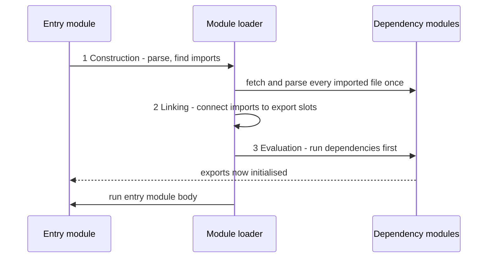

# Chapter 10 — Modules and Tooling

A real JavaScript program is hundreds of files and thousands of third-party packages (bundles of reusable code written by other people and downloaded into your project). **Modules** let each file keep its own private scope and share only what it chooses to export. **Tooling** — npm, bundlers, transpilers, linters and formatters, each explained in its own section below — turns those files and packages into something a browser or server can run, and keeps the code consistent. This chapter covers the language feature first (ES modules), then how Node runs both module systems, then the everyday tool chain.

**What you'll learn**

1. Why modules exist and how the module systems evolved (scripts → IIFE → CommonJS → ES modules).
2. Every `import` / `export` form; default vs named exports; barrels; side-effect imports.
3. How ES modules load: the three phases, hoisting, live bindings, singletons, circular imports.
4. Dynamic `import()`, top-level `await`, `import.meta`, JSON modules with import attributes.
5. Modules in the browser: `<script type="module">`, bare specifiers, import maps.
6. CommonJS vs ESM in Node: how Node decides, interop, `require(esm)`, `createRequire`, package `"exports"`.
7. npm and `package.json`: dependencies, scripts, `npx`, `node --run`, how `node_modules` resolution works.
8. Semantic versioning, version ranges and lockfiles (with a runnable range checker).
9. Bundlers (Vite, esbuild, webpack, Rollup/Rolldown): tree shaking, code splitting, source maps, dev servers.
10. Transpilers and polyfills; linters and formatters (ESLint, Prettier).

**Before you start.** You should know functions and closures ([Chapter 4](../04-functions-scope-and-closures/README.md)) — the pre-module "module pattern" is a closure (a function that keeps access to the variables around where it was created). Promises and `await` are covered properly in [Chapter 12](../12-asynchronous-javascript/README.md); here we only need that `await` pauses until a promise (an object standing for a result that arrives later) settles (finishes with a value or an error).

All runnable code is in [`code/`](code/) — a small multi-file ES module project. Files whose first line is `// tools_run: skip` are helper modules imported by the numbered programs. Outputs are real (Node 24). **Commands for npm, bundlers and linters are shown as not-run snippets** (they need the network or a full project); their output is described, not pasted.

---

## 10.1 Why modules?

### What it is
A **module** is a file whose top-level variables are private to that file. It explicitly **exports** the values it wants to share and explicitly **imports** what it needs from other modules. The set of modules connected by imports is the **module graph**; the first module you run is the **entry point**.

Analogy: departments in a company. Each department (module) has its own internal files; it publishes a few official forms (exports); other departments must request those forms by name (imports). Nobody rummages through anybody else's drawers.

### The problem it solves
Early web pages loaded several `<script>` files that all shared **one global scope**. Any `var` or function at the top of any file became a global, so:

- **Name collisions** — two libraries both defining `$` or `init` silently overwrote each other.
- **Hidden dependencies** — `app.js` only worked if `utils.js` had been loaded first; script order in HTML was the dependency system.
- **No encapsulation** (keeping a piece of code's internals hidden behind a small public surface) — anything could change anything.

### How the solutions evolved
| Era | Approach | How it works | Still seen? |
|---|---|---|---|
| ~2000s | Global scripts + namespaces (one global object holding everything, to reduce name clashes) | `var MyApp = MyApp \|\| {}; MyApp.utils = …` | Legacy pages |
| ~2008+ | **IIFE / module pattern** | A function called immediately; a closure hides private state and returns a public object ([Chapter 4](../04-functions-scope-and-closures/README.md)) | Output of old bundlers |
| 2009 | **CommonJS** (Node) | `require()` / `module.exports`, synchronous (each file is fully loaded before the next line runs), one file = one module | Very common in Node packages |
| 2011 | AMD (RequireJS), later UMD | Asynchronous (loads in the background and calls back when ready) `define()` for browsers; UMD wraps a file to work as AMD, CommonJS or a global | Old libraries |
| **ES2015** | **ES modules (ESM)** | `import` / `export` built into the language; static; async-friendly | **The standard** — browsers and Node |

**ESM** is the only one that is part of the language itself, works natively in browsers and Node, and can be statically analyzed (understood by reading the code, without running it) by tools. Use it for new code.

### TL;DR
Modules give each file a private scope and explicit imports/exports. ES modules (ES2015) are the standard; CommonJS remains common in Node.

---

## 10.2 `export` and `import` syntax

### Export forms
A module can have any number of **named exports** and at most one **default export**.

[`code/math.mjs`](code/math.mjs) — named exports:

```js
// tools_run: skip — helper module imported by other examples
export const TAU = 2 * Math.PI;                 // named export (declaration form)
export function add(a, b) { return a + b; }
function square(x) { return x * x; }
function cube(x) { return x ** 3; }
export { square, cube as toThePowerOfThree };   // export list, with renaming
console.log('[math.mjs] evaluated');            // runs once, however many importers
```

[`code/logger.mjs`](code/logger.mjs) — a default export plus a named one:

```js
export default function log(level, msg) {       // the default export
  return `[${level.toUpperCase()}] ${msg}`;
}
export const LEVELS = ['debug', 'info', 'warn', 'error'];
```

[`code/barrel.mjs`](code/barrel.mjs) — re-exports (a **barrel** is a file that gathers several modules' exports into one import point):

```js
export * from './math.mjs';                            // re-export all named exports
export { default as log, LEVELS } from './logger.mjs'; // re-export a default under a name
export * as counterNS from './counter.mjs';            // re-export a namespace (ES2020)
```

| Export form | Example |
|---|---|
| Declaration | `export const x = 1;` `export function f() {}` `export class C {}` |
| List (after declaring) | `export { a, b };` |
| Rename | `export { a as alpha };` |
| Default (expression) | `export default 42;` `export default { … };` |
| Default (declaration, may be anonymous) | `export default function () {}` `export default class {}` |
| Name something the default | `export { x as default };` |
| Re-export | `export { a } from './m.mjs';` `export * from './m.mjs';` `export * as ns from './m.mjs';` |

`export *` does **not** re-export the default export — re-export it by name, as `barrel.mjs` does.

### Import forms
[`code/01_import_export.mjs`](code/01_import_export.mjs):

```js
// Every static import form. Imports are hoisted: they load before any code here runs.
import './side_effect.mjs';                       // side-effect only
import log, { LEVELS } from './logger.mjs';       // default + named in one statement
import { add, square as sq, TAU } from './math.mjs'; // named, with renaming
import * as MathNS from './math.mjs';             // namespace object
import { toThePowerOfThree, counterNS, log as log2 } from './barrel.mjs';

console.log('named   :', add(2, 3), sq(4), TAU.toFixed(4));
console.log('default :', log('info', 'server started'), '| levels:', LEVELS.join(','));
console.log('ns keys :', Object.keys(MathNS));
console.log('barrel  :', toThePowerOfThree(2), typeof counterNS.increment, log2 === log);
console.log('polyfill:', globalThis.polyfilled);
```

Output:
```
[side_effect.mjs] patched globalThis
[math.mjs] evaluated
named   : 5 16 6.2832
default : [INFO] server started | levels: debug,info,warn,error
ns keys : [ 'TAU', 'add', 'square', 'toThePowerOfThree' ]
barrel  : 8 function true
polyfill: true
```

| Import form | What you get |
|---|---|
| `import x from './m.mjs'` | the default export, under any name you choose |
| `import { a, b } from './m.mjs'` | named exports (names must match) |
| `import { a as z } from './m.mjs'` | named export, renamed locally |
| `import * as ns from './m.mjs'` | a **namespace object** with every named export as a property (the default is `ns.default`) |
| `import x, { a } from './m.mjs'` | default + named together |
| `import './m.mjs'` | runs the module for its side effects (things it does on load besides exporting — e.g. polyfills, which add missing built-in features; CSS in bundlers; registering elements) |

Notice the output order: `side_effect.mjs` and `math.mjs` printed **before** any line of the importing file ran, even though `math.mjs` is imported by three statements. Imports are processed before the module body, and every module is evaluated exactly once.

A **module specifier** is the string after `from`:
- **Relative** — `'./math.mjs'`, `'../lib/x.js'`. In browsers and Node ESM you must include the file extension; there's no automatic `.js` guessing (CommonJS and bundlers do guess).
- **Absolute URL** — `'https://cdn.example.com/lib.js'` (browsers; a CDN is a network of servers that delivers files from close to the user — see [System Design Fundamentals](../../../system-design-patterns/modules/00-system-design-fundamentals/README.md)).
- **Bare** — `'react'`, `'lodash-es'`: a package name. Node resolves it in `node_modules` (the folder where installed packages live); browsers need an import map or a bundler (§10.7).
- **Built-in** — `'node:fs'`, `'node:path'` in Node. The `node:` prefix makes it unambiguous that this is a core module.

### Default vs named exports
| | Named exports | Default export |
|---|---|---|
| Importer's name | Must match (rename with `as`) | Anything — and different files may call it different things |
| Refactoring (restructuring code without changing behaviour) / IDE (code editor such as VS Code) auto-import | Rename-safe, auto-import finds it | Weaker: the name isn't tied to the export |
| Tree shaking (removing unused code from the final build, §10.11) | Fine-grained | Works, but a default *object* of many functions is all-or-nothing |
| Typical use | Utility modules, libraries | One main thing per file: a React component, a class, a config |

Many teams prefer named exports for consistency (the `eslint-plugin-import` package even has an `import/no-default-export` rule to enforce it); frameworks such as Next.js (a popular React framework for full websites) require default exports for page files. Either is fine — be consistent within a project.

### Common mistakes
- `import { default } from …` — `default` is a reserved word; write `import x from …` or `import { default as x } from …`.
- Forgetting the extension (`'./math'`) in native ESM → `ERR_MODULE_NOT_FOUND` in Node.
- Big barrels in application code: importing one function from `index.js` can make tools and test runners (programs that find and run your automated tests) load every re-exported module. Import from the specific file in hot paths (code that runs very often or on startup).
- Mixing up `export default const x = 1` (syntax error — `export default` takes an expression, or a function/class declaration) with `export const x = 1`.

### Self-check
1. How many default exports can a module have? → At most one.
2. Does `export * from './m.mjs'` include `m`'s default? → No.
3. What's in `ns` after `import * as ns`? → All named exports as read-only properties, plus `default` if there is one.

### TL;DR
Named exports: many per module, name must match. Default: one, importer picks the name. `import * as ns` gives a namespace object; `import './x'` runs side effects only. Always write file extensions in native ESM.

---

## 10.3 How ES modules load

### What it is
ES modules are **static**: `import` and `export` may only appear at the top level of a module (not inside `if` or functions), and specifiers must be string literals. That lets the engine read the whole dependency graph *before running any code*.

### How it works — three phases
1. **Construction (parse)** — starting at the entry point, fetch each file, parse it, find its `import` statements, fetch those, and so on until the whole graph is known. Nothing executes yet. Each module URL is recorded in a **module map**, so a module is fetched once no matter how many times it's imported.
2. **Linking (instantiation)** — create each module's environment and wire every import to the matching export's variable slot. Imports are *references to the exporter's bindings*, not copies. Missing named exports fail here, before any code runs (`SyntaxError: The requested module … does not provide an export named …`).
3. **Evaluation** — run each module's top-level code exactly once, **dependencies first** (a depth-first, post-order walk: children before parents, siblings in the order they were imported).



Consequences you can observe:

| Property | Meaning |
|---|---|
| **Hoisting** | Imports are resolved before the body runs, wherever the `import` line appears in the file. |
| **Singletons** | Each module is evaluated once per program (per realm — one separate global environment, such as a browser tab or iframe); every importer shares the same instance and state. |
| **Live bindings** | An import is a live, **read-only** view of the exporter's variable. If the exporter changes it, importers see the change. |
| **Strict mode** | Module code is always strict (no `'use strict'` needed). |
| **Own scope** | Top-level `const`/`let`/`function` are module-scoped, not globals. `this` at top level is `undefined`. |
| **Deferred** | In browsers, module scripts don't block HTML parsing (§10.7). |

[`code/counter.mjs`](code/counter.mjs) and [`code/02_live_bindings.mjs`](code/02_live_bindings.mjs):

```js
// counter.mjs
export let count = 0;
export function increment() { count++; }
```

```js
import { count, increment } from './counter.mjs';
import * as ns from './math.mjs';
import * as again from './math.mjs';     // same module -> evaluated once, same namespace object

console.log('before     :', count);
increment(); increment();
console.log('after x2   :', count, '(the import sees the new value)');

try {
  count = 100;                           // imports are read-only
} catch (e) {
  console.log('assign     :', e.name, '-', e.message);
}

console.log('same ns?   :', ns === again);
console.log('ns tag     :', Object.prototype.toString.call(ns));
console.log('ns sealed  :', Object.isSealed(ns), '| frozen:', Object.isFrozen(ns));
try { ns.add = null; } catch (e) { console.log('ns write   :', e.name, '-', e.message); }

// Module scope: strict mode, `this` is undefined, top-level bindings are not globals
console.log('this       :', this);
const topLevel = 1;
console.log('global?    :', 'topLevel' in globalThis);
try { undeclared = 5; } catch (e) { console.log('strict     :', e.name, '-', e.message); }
```

Output:
```
[math.mjs] evaluated
before     : 0
after x2   : 2 (the import sees the new value)
assign     : TypeError - Assignment to constant variable.
same ns?   : true
ns tag     : [object Module]
ns sealed  : true | frozen: false
ns write   : TypeError - Cannot assign to read only property 'add' of object '[object Module]'
this       : undefined
global?    : false
strict     : ReferenceError - undeclared is not defined
```

- `count` changed from 0 to 2 in the importer — a CommonJS `const { count } = require(...)` would have copied `0` and stayed `0`.
- Assigning to an import throws as if it were a `const`, even though the exporter declared it with `let`. Only the exporting module can change it (here via `increment`).
- The namespace object is sealed and its properties are non-writable; it reports "not frozen" only because its properties stay live (their values can still change from inside the module).

### Circular imports
A **circular dependency** is when A imports B and B (directly or indirectly) imports A. ESM allows it: while evaluating, the loader notices the cycle and runs one module before the other has finished. The rule: **top-level code must not use an imported `let`/`const`/`class` binding that hasn't been initialized yet** — it's in its temporal dead zone (TDZ). Using imports inside functions that run later is fine, and function declarations are initialized during linking, so they're usable early.

[`code/07_circular_imports.mjs`](code/07_circular_imports.mjs) loads two tiny cycles:

```js
// cyc_a.mjs                                  // cyc_b.mjs
import { b } from './cyc_b.mjs';              import { a } from './cyc_a.mjs';
export const a = 'A';                         export const b = `B knows ${a}`; // a in TDZ
console.log('[cyc_a] sees', b);
```

```js
// cyc_safe_a.mjs                             // cyc_safe_b.mjs
import { describeB } from './cyc_safe_b.mjs'; import { nameA } from './cyc_safe_a.mjs';
export function nameA() { return 'A'; }       export function describeB() { return `B calls ${nameA()}`; }
export const result = describeB();
```

```js
try {
  await import('./cyc_a.mjs');
} catch (e) {
  console.log('unsafe cycle:', e.name, '-', e.message);
}
const { result } = await import('./cyc_safe_a.mjs');
console.log('safe cycle  :', result);
```

Output:
```
unsafe cycle: ReferenceError - Cannot access 'a' before initialization
safe cycle  : B calls A
```

Starting from `cyc_a`, the loader evaluates its dependency `cyc_b` first; `cyc_b`'s top level reads `a`, but `cyc_a` hasn't run yet. In the safe version, `nameA` is a hoisted function declaration, so `describeB()` can call it. Best fix in real code: **break the cycle** — move the shared piece into a third module that both import.

### In the interview
**30-second answer:** "ES modules are static: the loader parses the whole graph, links imports to exports, then evaluates each module once, dependencies first. Imports are hoisted, read-only live bindings — not copies — and modules are singletons in strict mode with their own scope. That static structure is what enables tree shaking. Circular imports work as long as top-level code doesn't touch a binding that's still in its TDZ."

- *Q: Difference between ESM live bindings and CommonJS exports?* A: CommonJS `require` returns the `module.exports` object; destructuring copies values at that moment. ESM imports stay connected to the exporter's variable.
- *Q: Why can't you put `import` inside an `if`?* A: Static imports must be known before execution; use `import()` for conditional loading.

### Self-check
1. Two files import `config.mjs`. How many times does its top-level code run? → Once.
2. Can an importer reassign an imported binding? → No — `TypeError`.
3. In which phase is a missing named export reported? → Linking, before any code runs.

### TL;DR
Parse the graph → link bindings → evaluate once, dependencies first. Imports are hoisted, live and read-only; modules are strict singletons. Avoid top-level use of bindings in cycles.

---

## 10.4 Dynamic `import()`

### What it is
`import(specifier)` (ES2020) looks like a function call but is special syntax. It can appear anywhere — inside `if`, functions, event handlers — accepts a computed string, and returns a **promise** that resolves to the module's namespace object.

### Why it matters
- **Lazy loading / code splitting** — load a heavy chart library only when the user opens the chart tab. Bundlers turn each `import()` into a separate file (**chunk**) downloaded on demand (§10.11).
- **Conditional loading** — pick a module by platform, feature flag (a switch that turns a feature on or off) or locale (language + region setting) (`import(\`./locales/${lang}.mjs\`)`).
- **From CommonJS** — the only way for a CommonJS file to load an ES module that uses top-level `await`.

[`code/03_dynamic_import.mjs`](code/03_dynamic_import.mjs):

```js
import * as staticMath from './math.mjs';

const verbose = process.env.VERBOSE !== '0';   // decide at runtime whether to load the logger
if (verbose) {
  const { default: log } = await import('./logger.mjs');  // default export is the "default" key
  console.log(log('debug', 'logger loaded lazily'));
}

const name = 'math';
const dyn = await import(`./${name}.mjs`);                 // computed specifier
console.log('same instance as static import?', dyn === staticMath);

const [m, l] = await Promise.all([import('./math.mjs'), import('./logger.mjs')]);  // in parallel
console.log('parallel :', m.add(1, 1), l.LEVELS.length);

try {
  await import('./does-not-exist.mjs');                    // failure = rejected promise
} catch (e) {
  console.log('missing  :', e.code);
}

const { basename } = await import('node:path');
console.log('node:path:', basename('/a/b/report.pdf'));
```

Output:
```
[math.mjs] evaluated
[DEBUG] logger loaded lazily
same instance as static import? true
parallel : 2 4
missing  : ERR_MODULE_NOT_FOUND
node:path: report.pdf
```

### Trade-offs
| | Static `import` | Dynamic `import()` |
|---|---|---|
| Where | top level only | anywhere |
| Specifier | string literal | any expression |
| Timing | before the module body runs | when that line runs (async) |
| Tree shaking / analysis | full | limited — tools can't know a fully computed path |
| Errors | whole graph fails to load | a catchable rejected promise |

### Common mistakes
- Forgetting that the default export is under `.default`: `const mod = await import('./x.mjs'); mod.default(...)`.
- Fully dynamic paths (`import(userInput)`) — bundlers can't pre-build them, and it's a security risk if the input isn't trusted.

### TL;DR
`import()` loads modules on demand and returns a promise of the namespace. Use it for code splitting and conditional loading; keep static imports for everything else.

---

## 10.5 Top-level `await`

### What it is
Since ES2022, `await` may be used at the **top level of an ES module** (not in classic scripts, and not in CommonJS). A module that awaits is an **async module**: modules that import it wait until it finishes evaluating before they run.

[`code/slow_config.mjs`](code/slow_config.mjs) and [`code/04_top_level_await.mjs`](code/04_top_level_await.mjs):

```js
// slow_config.mjs
console.log('[slow_config] start loading');
const loadSettings = () => new Promise((resolve) => setTimeout(() => resolve({ theme: 'dark', retries: 3 }), 50));
export const settings = await loadSettings();    // importers wait until this resolves
console.log('[slow_config] done');
```

```js
// 04_top_level_await.mjs
console.log('main body starts (after all static imports finished)');
import { settings } from './slow_config.mjs';
console.log('settings:', settings);

const results = await Promise.all([1, 2, 3].map(async (n) => n * 10));
console.log('awaited at top level:', results);
```

Output:
```
[slow_config] start loading
[slow_config] done
main body starts (after all static imports finished)
settings: { theme: 'dark', retries: 3 }
awaited at top level: [ 10, 20, 30 ]
```

The `import` line is written *after* the first `console.log`, yet the dependency ran completely first — imports are hoisted, and the importer waited for `slow_config`'s `await`.

### Why it matters / real-world examples
- Loading configuration, a WebAssembly module (fast compiled code, often from C or Rust, that browsers and Node can run), or opening a database connection before exporting it.
- Scripts and CLIs (command-line programs): no more wrapping everything in `(async () => { … })()`.
- Fallbacks: `let lib; try { lib = await import('fast-lib'); } catch { lib = await import('./slow-fallback.mjs'); }`.

### When not to use it
- **In widely imported library modules** — every importer (and their importers) is delayed, and a slow `await` blocks the app's startup. Prefer exporting an async function (`export async function connect()`), and let the application decide when to wait.
- **Modules loaded via `require()`** — Node throws `ERR_REQUIRE_ASYNC_MODULE` if the ESM graph contains top-level `await` (§10.8).

### TL;DR
Top-level `await` works in ES modules only; importers wait for it. Great for entry points and scripts, risky in shared libraries.

---

## 10.6 `import.meta` and JSON modules

### What it is
- **`import.meta`** is an object holding metadata (data about the module itself, rather than its contents) about the *current* module, filled in by the host (browser or Node). The standard part is `import.meta.url` (the module's full URL) and `import.meta.resolve(specifier)` (turn a specifier into a URL relative to this module).
- **Import attributes** (ES2025) add a `with { … }` clause to an import that tells the host how to interpret the file. The first standardized use is **JSON modules**: `import data from './data.json' with { type: 'json' }`. The attribute is required so a server can't trick a page into *executing* a file it expected to be data.

[`code/05_import_meta_and_json.mjs`](code/05_import_meta_and_json.mjs) (with [`code/data.json`](code/data.json)):

```js
import config from './data.json' with { type: 'json' };
import path from 'node:path';

console.log('json     :', config.app, config.version, config.features);
console.log('url      :', import.meta.url.startsWith('file://'), path.basename(import.meta.url));
console.log('filename :', path.basename(import.meta.filename));   // Node 20.11+
console.log('dirname  :', path.basename(import.meta.dirname));
console.log('resolve  :', path.basename(import.meta.resolve('./math.mjs')));
console.log('is main? :', import.meta.main);                      // Node 24.2+, early-stage feature
```

Output:
```
json     : notes 2.1.0 [ 'search', 'tags' ]
url      : true 05_import_meta_and_json.mjs
filename : 05_import_meta_and_json.mjs
dirname  : code
resolve  : math.mjs
is main? : true
```

(Only base names are printed so the output doesn't depend on where the book lives on disk.)

| Property | Where | Replaces |
|---|---|---|
| `import.meta.url` | browsers + Node | — |
| `import.meta.resolve()` | browsers + Node (20.6+ unflagged — usable without a special command-line switch) | `require.resolve` |
| `import.meta.filename` / `.dirname` | Node 20.11+ | CommonJS `__filename` / `__dirname` |
| `import.meta.main` | Node 24.2+ (early development) | `require.main === module` |

A JSON module's default export is the parsed value; it has no named exports. It is evaluated once, so all importers share (and could mutate) the same object — treat it as read-only. For files outside the module graph (user uploads, data read at runtime), use `fs` or `fetch` + `JSON.parse` instead ([Chapter 5](../05-objects-math-date-and-json/README.md), [Chapter 15](../15-nodejs-basics/README.md)).

Before import attributes existed, there was an earlier `assert { type: 'json' }` syntax; it was replaced by `with` and removed from V8/Node, so update old code that uses `assert`.

### TL;DR
`import.meta.url` identifies the current module (Node adds `filename`/`dirname`). Import JSON with `with { type: 'json' }` (ES2025).

---

## 10.7 Modules in the browser

### How it works
```html
<script type="module" src="/js/main.js"></script>
<script type="module">
  import { add } from './js/math.js';
  document.title = `2 + 3 = ${add(2, 3)}`;
</script>
```

(HTML — not run.) Differences from a classic `<script>`:

| | Classic `<script>` | `<script type="module">` |
|---|---|---|
| Scope | top-level `var`/functions become globals | module scope |
| Strict mode | opt-in | always |
| Top-level `this` | `window` | `undefined` |
| Loading | blocks HTML parsing unless `defer`/`async` | **deferred by default** (runs after parsing, in order); `async` also allowed |
| Executes | every time it's included | once per URL |
| Cross-origin (from a different domain) | loads without CORS | must be served with CORS (Cross-Origin Resource Sharing: headers in which a server says which other sites may use its files) headers |
| `file://` pages | work | blocked by browsers — use a local dev server (a small web server on your own machine for development) |
| `import` / `export` / top-level `await` | ✗ | ✓ |

`<script nomodule>` runs only in browsers that *don't* understand modules; it was used to ship a fallback bundle to old browsers and is rarely needed today — all evergreen browsers (browsers that update themselves automatically) have supported modules since about 2018.

### Bare specifiers and import maps
Browsers can't resolve `import { h } from 'preact'` on their own — there is no `node_modules` on the web. An **import map** (supported in all major browsers since 2023) tells the browser what bare names mean:

```html
<script type="importmap">
{
  "imports": {
    "preact": "https://cdn.jsdelivr.net/npm/preact@10/dist/preact.module.js",
    "utils/": "/js/utils/"
  }
}
</script>
<script type="module">
  import { h } from 'preact';
  import { slugify } from 'utils/strings.js';
</script>
```

(HTML — not run.) Import maps are useful for small apps and prototypes without a build step (an automated pass that processes source files before release). Larger apps still use a bundler (§10.11) for tree shaking, minification (shrinking code by removing spaces and shortening names) and fewer network requests. The browser side of the platform (fetching, `<script>` loading, CORS) is covered in [Chapter 14](../14-browser-apis-and-security/README.md).

### TL;DR
`<script type="module">` = module scope, strict, deferred, once per URL, CORS required, no `file://`. Import maps let browsers resolve bare package names.

---

## 10.8 CommonJS vs ES modules in Node

### What it is
**CommonJS (CJS)** is Node's original module system: `require(path)` synchronously loads and runs a file and returns its `module.exports` object. Node wraps every CJS file in a function — `(function (exports, require, module, __filename, __dirname) { … })` — which is where those five "globals" come from. It's still everywhere on npm, so you must be able to read, write and mix both systems.

### How Node decides which system a file uses
1. **`.mjs`** → always ESM. **`.cjs`** → always CommonJS.
2. **`.js`** → look at the nearest `package.json`: `"type": "module"` → ESM; `"type": "commonjs"` → CJS.
3. `.js` with **no** `"type"` field → CommonJS, *unless* the file contains ESM-only syntax (`import`/`export`, top-level `await`); since Node 22.7 Node then re-runs it as ESM (**syntax detection**). This is a convenience — set `"type"` explicitly in real projects so nothing is guessed.

This book's examples use `.mjs`/`.cjs` so there's never any doubt.

### Side-by-side comparison
| | CommonJS | ES modules |
|---|---|---|
| Syntax | `const x = require('./x')` / `module.exports = …` / `exports.a = …` | `import` / `export` |
| Loading | synchronous, at runtime, can be inside `if` | static graph, async-capable; `import()` for dynamic |
| Exports | a single object (copied values when destructured) | live, read-only bindings |
| Top-level `await` | ✗ | ✓ |
| Strict mode | opt-in | always |
| Top-level `this` | `module.exports` | `undefined` |
| `__dirname` / `__filename` | ✓ | `import.meta.dirname` / `.filename` |
| File extensions | optional (`require('./x')` finds `x.js`, `x.json`, `x/index.js`) | required for relative paths |
| JSON | `require('./data.json')` | `import d from './data.json' with { type: 'json' }` |
| Cache | `require.cache` (can be deleted to reload) | internal module map (no official reload) |
| Tree shaking | poor (dynamic) | good (static) |
| Browsers | ✗ (needs a bundler) | ✓ native |

### Interop
- **ESM importing CJS** — works. The **default import** is `module.exports`. **Named imports** also work when Node can detect them by statically scanning the CJS source (it recognizes patterns like `exports.name = …` and `module.exports = { name, … }`).
- **CJS requiring ESM** — `require(esm)` is enabled by default since Node 22.12 / 20.19 (no warning since 23.5 / 22.13; officially stable in 25.4). It returns the module namespace object. It **fails with `ERR_REQUIRE_ASYNC_MODULE`** if the ESM graph uses top-level `await` — use `await import()` then.
- **`createRequire(import.meta.url)`** gives an ES module a real `require` function — handy for loading CJS-only files or using `require.resolve`.

[`code/legacy.cjs`](code/legacy.cjs), [`code/uses_esm.cjs`](code/uses_esm.cjs) and [`code/06_commonjs_interop.mjs`](code/06_commonjs_interop.mjs):

```js
// legacy.cjs — CommonJS
const path = require('node:path');
console.log('[legacy.cjs] this === module.exports:', this === module.exports, '| __filename:', path.basename(__filename));
let calls = 0;
function greet(name) { calls++; return `hello ${name} (call ${calls})`; }
module.exports = { greet, get calls() { return calls; } };
module.exports.version = '1.0.0';
```

```js
// uses_esm.cjs — CommonJS requiring an ES module
const math = require('./math.mjs');
module.exports = { sum: math.add(20, 22), keys: Object.keys(math) };
```

```js
// 06_commonjs_interop.mjs
import legacy from './legacy.cjs';                   // default import = module.exports
import { greet } from './legacy.cjs';                // named import (detected by static analysis)
import { createRequire } from 'node:module';

console.log('default  :', legacy.greet('ESM'), '| version', legacy.version);
console.log('named    :', greet('named'));

const require = createRequire(import.meta.url);     // a require() usable inside ESM
const again = require('./legacy.cjs');
console.log('cached   :', again === legacy, '| calls so far', again.calls);

const fromCjs = require('./uses_esm.cjs');          // CJS that itself require()s an ESM file
console.log('require(esm):', fromCjs);

console.log('cache key:', Object.keys(require.cache).some((k) => k.endsWith('legacy.cjs')));
```

Output:
```
[legacy.cjs] this === module.exports: true | __filename: legacy.cjs
default  : hello ESM (call 1) | version 1.0.0
named    : hello named (call 2)
cached   : true | calls so far 2
[math.mjs] evaluated
require(esm): { sum: 42, keys: [ 'TAU', 'add', 'square', 'toThePowerOfThree' ] }
cache key: true
```

- `legacy.cjs` ran once; the ESM import and the later `require` share one cached instance (the call counter continued from 1 to 2).
- `version` was added *after* the `module.exports = {…}` assignment, so static analysis didn't list it as a named export — but it's on the default import. When in doubt with CJS packages, use the default import.

### Common mistakes
- `exports = { a }` (reassigning the `exports` shortcut) exports nothing — only `module.exports = …` or `exports.a = …` work.
- `ReferenceError: require is not defined in ES module scope` — you're in ESM; use `import` or `createRequire`.
- `SyntaxError: Cannot use import statement outside a module` — Node treated the file as CJS (a `"type": "commonjs"` somewhere up the tree, or a `.cjs` file); rename to `.mjs` or set `"type": "module"`.
- `__dirname is not defined` in ESM — use `import.meta.dirname`.
- The **dual package hazard**: a package that ships both CJS and ESM builds may get loaded *twice* (once per system) — two copies of its state, and `instanceof` checks that fail across them.

### Package entry points: `"exports"`
A package's `package.json` can declare exactly which files outsiders may import and which file each module system gets:

```json
{
  "name": "tiny-date",
  "type": "module",
  "exports": {
    ".": { "import": "./dist/index.js", "require": "./dist/index.cjs" },
    "./format": "./dist/format.js",
    "./package.json": "./package.json"
  }
}
```

(Not run.) With `"exports"` present, `import 'tiny-date/dist/secret.js'` fails with `ERR_PACKAGE_PATH_NOT_EXPORTED` — the package's internals are encapsulated. The older `"main"` field only named a single entry file and exposed everything. (`"imports"`, with keys starting `#`, defines private aliases *inside* a package, e.g. `import db from '#db'`.)

### In the interview
**30-second answer:** "CommonJS is Node's original synchronous `require`/`module.exports` system; ES modules are the language standard with static `import`/`export`, live bindings, top-level `await` and browser support. Node picks the system by extension (`.mjs`/`.cjs`) or the `type` field in `package.json`. ESM can import CJS (default = `module.exports`), and modern Node can `require()` ESM unless it uses top-level `await`. New code should be ESM."

- *Q: Why can't `require()` load an ESM file with top-level await?* A: `require` is synchronous and must return immediately; an async module can't finish synchronously.
- *Q: What does `"exports"` do?* A: Defines the public entry points and conditional builds (`import` vs `require`), blocking deep imports of internal files.

### Self-check
1. A `.js` file in a folder whose `package.json` has `"type": "module"` — which system? → ESM.
2. How do you get `__dirname` in ESM? → `import.meta.dirname` (Node 20.11+), or `path.dirname(fileURLToPath(import.meta.url))` on older versions.
3. What does `import x from './legacy.cjs'` give you? → The CJS `module.exports` value.

### TL;DR
`.mjs`/`.cjs` or `"type"` decides. CJS: sync `require`, copied values, `__dirname`. ESM: static, live, strict, TLA. They interoperate; prefer ESM for new code and declare entry points with `"exports"`.

---

## 10.9 npm and `package.json`

### What it is
- **npm** is three things: the **registry** (npmjs.com, millions of public packages), the **CLI** (command-line interface — the `npm` command, installed with Node) and the company that runs them.
- A **package** is a folder with a `package.json` file. A package you depend on is a **dependency**; the dependencies of your dependencies are **transitive dependencies**.
- **`package.json`** is the manifest of your project: its name, version, module type, scripts and dependencies.

Alternatives with the same registry and a compatible `package.json`: **pnpm** (content-addressed store (each file stored once, named by its contents), strict `node_modules`, saves disk space), **Yarn**, and **Bun** (a runtime with a built-in package manager). Pick one per project and commit its lockfile (the file recording exact installed versions, §10.10).

### A typical `package.json`
```json
{
  "name": "notes-app",
  "version": "2.1.0",
  "private": true,
  "type": "module",
  "engines": { "node": ">=22" },
  "scripts": {
    "dev": "vite",
    "build": "vite build",
    "test": "node --test",
    "lint": "eslint .",
    "format": "prettier --write .",
    "check": "npm run lint && npm test"
  },
  "dependencies": {
    "date-fns": "^4.1.0"
  },
  "devDependencies": {
    "eslint": "^10.0.0",
    "prettier": "^3.3.0",
    "vite": "^8.0.0"
  }
}
```

(Not run; version numbers are examples.)

| Field | Meaning |
|---|---|
| `name`, `version` | Identity. Required if you publish. `version` follows semver (§10.10). |
| `private: true` | Prevents accidental `npm publish`. |
| `type` | `"module"` → `.js` files are ESM. |
| `main` / `exports` | Entry points for people importing your package (§10.8). |
| `scripts` | Named commands: `npm run <name>`; `npm test` and `npm start` are shortcuts. |
| `dependencies` | Needed at runtime (installed for anyone who installs your package). |
| `devDependencies` | Needed only to develop/build/test (linters, bundlers, test runners). |
| `peerDependencies` | "I work with *your* copy of X" — plugins (add-ons that extend another tool) declare the host they plug into (e.g., a React component library declares `react`). npm 7+ installs them automatically. |
| `optionalDependencies` | Install failures are tolerated. |
| `engines` | Supported Node versions (advisory unless enforced). |
| `bin` | Command-line executables the package provides. |
| `files` | What to include when publishing. |

### Everyday commands (not run)
```bash
npm init -y                     # create package.json with defaults
npm install                     # install everything in package.json (and update the lockfile if needed)
npm install date-fns            # add a runtime dependency (saved as "^<latest>")
npm install -D eslint prettier  # add dev dependencies (--save-dev)
npm uninstall date-fns          # remove
npm ci                          # clean, exact install from package-lock.json (CI servers)
npm run build                   # run a script; npm test / npm start need no "run"
npm run test -- --watch         # pass extra args to the script after --
npx eslint .                    # run a package's binary (local first, else download temporarily)
npm outdated                    # which dependencies have newer versions
npm update                      # upgrade within the allowed ranges
npm audit                       # check for known vulnerabilities (npm audit fix to patch)
npm ls react                    # why / where is a package in the tree
npm version patch               # bump version 2.1.0 -> 2.1.1, commit and tag
node --run test                 # Node 22+: run a script without npm's startup cost
node --watch server.mjs         # restart on file change (stable since Node 22)
```

How scripts find tools: `npm run` (and `node --run`) put `./node_modules/.bin` on the `PATH` (the list of folders your shell searches for commands), so a script can say `eslint .` without a global install. `npm run build` also runs `prebuild` and `postbuild` scripts if they exist; `node --run` deliberately skips those pre/post hooks and package-manager-specific environment variables in exchange for speed.

### How `node_modules` resolution works
For a bare specifier like `import 'date-fns'` in `/app/src/utils/x.mjs`, Node looks for `node_modules/date-fns` in `/app/src/utils`, then `/app/src`, then `/app`, then `/`, stopping at the first match, then reads that package's `package.json` (`exports`, else `main`). npm **hoists** (flattens) most transitive dependencies to the top-level `node_modules` to share them; if two packages need incompatible versions, one gets a nested copy.

A consequence called **phantom dependencies**: your code can import a package you never declared, because a dependency happened to hoist it. It works until that dependency changes. pnpm's stricter layout prevents this.

### Common mistakes
- Installing tools globally (`npm install -g`) so the project silently depends on your machine. Use devDependencies + scripts/`npx`.
- Putting build tools in `dependencies` (bloats production installs) or runtime libs in `devDependencies` (breaks production).
- Committing `node_modules` (never) or *not* committing the lockfile (always commit it).
- Running `npx some-package-name` with a typo — it may download and run a look-alike package. Check names.

### TL;DR
`package.json` = identity + type + scripts + dependencies. `dependencies` for runtime, `devDependencies` for tooling. Run tools through scripts or `npx`. `node_modules` is searched upward from the importing file.

---

## 10.10 Semantic versioning, ranges and lockfiles

### What it is
**Semantic versioning (semver)** gives version numbers a meaning: `MAJOR.MINOR.PATCH`.

| Bump | When | Example | Should upgrading break you? |
|---|---|---|---|
| MAJOR | incompatible API (the functions and options a package exposes) change | 3.4.1 → 4.0.0 | May — read the changelog (the list of changes in each release) |
| MINOR | new feature, backward compatible | 3.4.1 → 3.5.0 | No |
| PATCH | backward-compatible bug fix | 3.4.1 → 3.4.2 | No |
| Pre-release | unstable preview | 4.0.0-beta.2 | Anything goes |

Special rule: **`0.x` versions are "initial development"** — anything may change at any time, so tools treat the *minor* number of a `0.x` version like a major.

### Version ranges in `package.json`
| Range | Means | Allows |
|---|---|---|
| `1.2.3` | exactly | 1.2.3 only |
| `^1.2.3` (caret — npm's default) | same **major** | ≥1.2.3 <2.0.0 |
| `^0.2.3` | same **minor** when major is 0 | ≥0.2.3 <0.3.0 |
| `^0.0.3` | exact patch when major and minor are 0 | ≥0.0.3 <0.0.4 |
| `~1.2.3` (tilde) | same **minor** | ≥1.2.3 <1.3.0 |
| `1.x` / `1` / `1.*` | any 1.y.z | ≥1.0.0 <2.0.0 |
| `>=1.2 <1.5` | explicit comparators | as written |
| `1.2 - 1.4` | hyphen range | ≥1.2.0 ≤1.4.x |
| `^1 \|\| ^2` | either range | |
| `*` / `latest` | anything | avoid |

Caret's rule in one sentence: **don't change the left-most non-zero number.**

[`code/08_semver.mjs`](code/08_semver.mjs) is a tiny model of these rules (it ignores pre-release tags and `||`/hyphen ranges; real projects use the `semver` package that npm itself uses):

```js
function toBounds(range) {
  const op = range.match(/^[\^~]/)?.[0] ?? '';
  const parts = range.slice(op.length).split('.');
  const given = parts.filter((p) => p !== 'x' && p !== '*').length;       // how many numbers were given
  const [M = 0, m = 0, p = 0] = parts.map((x) => (x === 'x' || x === '*' ? 0 : Number(x)));
  const low = [M, m, p];
  let high;
  if (op === '^') {                    // don't change the left-most non-zero part
    if (M > 0 || given === 1) high = [M + 1, 0, 0];
    else if (m > 0 || given === 2) high = [0, m + 1, 0];
    else high = [0, 0, p + 1];
  } else if (op === '~') {             // allow patch changes (or minor, if only major given)
    high = given === 1 ? [M + 1, 0, 0] : [M, m + 1, 0];
  } else {                             // exact or x-range
    high = given === 3 ? [M, m, p + 1] : given === 2 ? [M, m + 1, 0] : given === 1 ? [M + 1, 0, 0] : [Infinity, 0, 0];
  }
  return { low, high };
}
// ... satisfies(version, range) checks low <= version < high
```

Output:
```
^1.2.3  >=1.2.3 <2.0.0         matches: 1.2.3, 1.2.9, 1.3.0, 1.9.9
~1.2.3  >=1.2.3 <1.3.0         matches: 1.2.3, 1.2.9
1.2.3   >=1.2.3 <1.2.4         matches: 1.2.3
1.x     >=1.0.0 <2.0.0         matches: 1.2.3, 1.2.9, 1.3.0, 1.9.9
^0.2.3  >=0.2.3 <0.3.0         matches: 0.2.5
^0.0.3  >=0.0.3 <0.0.4         matches: 0.0.3
~1      >=1.0.0 <2.0.0         matches: 1.2.3, 1.2.9, 1.3.0, 1.9.9
```

### Lockfiles
A range like `^4.1.0` means two developers installing a month apart could get 4.1.0 and 4.3.2 — and every transitive dependency could differ too. A **lockfile** (`package-lock.json` for npm, `pnpm-lock.yaml`, `yarn.lock`, `bun.lock`) records the **exact** version, download URL and integrity hash (a fingerprint of the file's contents, used to detect tampering) of *every* package in the tree.

| | `npm install` | `npm ci` |
|---|---|---|
| Reads | `package.json` + lockfile | lockfile (must match `package.json`, else error) |
| May change the lockfile | yes | never |
| Existing `node_modules` | reused/updated | deleted first |
| Use for | development, adding packages | CI servers (continuous integration — machines that automatically build and test every change), deploy builds, reproducible installs |

Rules: **commit the lockfile**, use `npm ci` in automated builds, and upgrade deliberately (`npm outdated` → `npm update` or `npm install pkg@latest` → run tests). Tools like Dependabot and Renovate open pull requests (proposed code changes for review, on sites like GitHub) for updates.

### Real-world examples — why this matters
- **left-pad (2016)**: an 11-line package was unpublished and thousands of builds broke; npm then restricted unpublishing.
- **Supply-chain attacks** (attacks that sneak malicious code into something you depend on, rather than attacking you directly): compromised maintainers have published malicious patch versions of popular packages (for example `event-stream` in 2018, and several hijacked packages in 2025). Caret ranges + no lockfile = you install the bad version automatically. Lockfiles, `npm ci`, `npm audit`, and reviewing new dependencies reduce the risk.

### In the interview
**30-second answer:** "Semver is MAJOR.MINOR.PATCH — breaking, feature, fix. `^` allows everything that doesn't change the left-most non-zero number, `~` allows patch updates. Ranges keep you flexible, but the lockfile pins the exact tree so everyone and CI install the same thing — and `npm ci` installs exactly from it."

- *Q: `^0.3.1` allows 0.4.0?* A: No — for `0.x`, caret locks the minor: ≥0.3.1 <0.4.0.
- *Q: Should a library commit its lockfile?* A: Yes for its own development/CI reproducibility, but consumers ignore it — they resolve the library's ranges themselves.

### Self-check
1. Largest version `~2.4.1` allows? → Anything <2.5.0.
2. Which command never modifies the lockfile? → `npm ci`.
3. A library fixes a bug without changing its API — which number bumps? → PATCH.

### TL;DR
MAJOR.MINOR.PATCH; `^` = same left-most non-zero, `~` = same minor. Commit the lockfile, use `npm ci` in CI, upgrade on purpose.

---

## 10.11 Bundlers

### What it is
A **bundler** reads your entry file, follows every `import` (including CSS, images and packages in `node_modules`) to build the module graph, and writes a few optimized output files (**bundles**) for the browser. Along the way it can transpile, minify and split code.

### The problem it solves
Native ESM works in browsers, but shipping a large app as hundreds of unoptimized files means many requests, no dead-code removal, un-minified code, and no way to import from `node_modules` with bare names or to import CSS/images/TypeScript/JSX. Bundlers solve all of these.

### What a bundler does
| Feature | Meaning |
|---|---|
| **Resolution** | Turns `'react'` into a real file in `node_modules`; handles extensions, `exports`, aliases. |
| **Tree shaking** | Removes exports nobody imports (dead-code elimination). Depends on ESM's static structure; packages mark safe-to-drop files with `"sideEffects": false`. |
| **Code splitting** | Each dynamic `import()` becomes a separate **chunk** loaded on demand; shared code goes into common chunks. |
| **Minification** | Removes whitespace/comments, shortens local names — smaller downloads. |
| **Transforms** | TypeScript, JSX, modern syntax → target syntax (via a transpiler, §10.12); CSS modules; asset hashing (`app.3f9a1c.js`) for long-term caching (letting browsers keep files for a long time, because a changed file gets a new name — see [System Design Fundamentals](../../../system-design-patterns/modules/00-system-design-fundamentals/README.md)). |
| **Source maps** | `.map` files that map minified output back to your original source, so DevTools and error stacks show real file names and line numbers ([Chapter 11](../11-errors-and-debugging/README.md)). |
| **Dev server + HMR** | Serves the app locally and, with **Hot Module Replacement**, swaps changed modules in the running page without a full reload. |


### The main tools (2026)
| Tool | What it is | Typical use |
|---|---|---|
| **Vite** | Dev server that serves native ESM on demand (very fast start) + production build. Vite 8 (March 2026) uses **Rolldown**, a Rust bundler, for builds; earlier versions used esbuild + Rollup. | Default choice for new front-end apps (React, Vue, Svelte templates) |
| **esbuild** | Extremely fast bundler/transpiler written in Go; minimal plugin API. | Libraries, scripts, tools built on top of it (this book's runner uses it) |
| **webpack** (v5) | The long-time standard; hugely configurable, loaders and plugins for everything. | Existing large apps, custom pipelines, Module Federation (loading parts of an app from separately deployed builds at runtime) |
| **Rollup / Rolldown** | Rollup pioneered ESM tree shaking; Rolldown is its Rust-based successor with a largely compatible plugin API. | Building libraries with clean ESM output |
| **Turbopack** | Rust bundler from Vercel; the default in Next.js since version 16. | Next.js apps |
| **Parcel** | Zero-configuration bundler. | Quick projects |

A Vite workflow (not run):

```bash
npm create vite@latest my-app -- --template vanilla   # scaffold a project
cd my-app && npm install
npm run dev        # dev server with HMR, e.g. http://localhost:5173
npm run build      # production bundle in dist/
npm run preview    # serve dist/ locally to check the build
```

An esbuild one-liner (not run):

```bash
npx esbuild src/main.js --bundle --minify --sourcemap --format=esm --outdir=dist
```

### Trade-offs
| Option | Pros | Cons |
|---|---|---|
| No build (native ESM + import maps) | Zero tooling, instant | No tree shaking/minify, many requests, no JSX/TS |
| Vite | Fast, sensible defaults, big plugin ecosystem | Dev (unbundled) and prod (bundled) differ slightly |
| webpack | Maximum control | Slower, configuration-heavy |
| esbuild directly | Blazing fast, simple | Fewer features (no HMR dev server of its own, limited code-splitting options) |

### When not to use a bundler
Node servers and CLIs usually run source files directly (Node understands ESM, and strips TypeScript types natively since 23.6/22.18). Bundle server code only for special cases (serverless cold starts (the delay when a serverless platform starts a fresh copy of your function), single-file distribution).

### Common mistakes
- Importing a whole library (`import _ from 'lodash'`) when you use one function — prefer ESM packages and named imports (`import { debounce } from 'lodash-es'`) so tree shaking works.
- Deploying without source maps (unreadable production errors) — or publishing them publicly when the source is secret (upload them to your error tracker, a service such as Sentry that collects crashes from users, instead).
- Assuming dev behaviour equals production — always run `build` + `preview` before shipping.

### TL;DR
Bundlers build the module graph and emit optimized bundles: resolve, transform, tree shake, split, minify, source-map. Use Vite for apps, esbuild/Rollup-style tools for libraries, webpack where a project already has it.

---

## 10.12 Transpilers and polyfills

### What it is
- A **transpiler** (source-to-source compiler) rewrites code into different JavaScript: newer syntax → older syntax for old browsers, TypeScript → JavaScript (removing types), JSX → function calls. Examples: **Babel** (JS, plugin-based), **TypeScript's `tsc`**, **SWC** (Rust), **esbuild** (Go).
- A **polyfill** is code that *adds a missing API at runtime* (e.g., defining `Array.prototype.at` if the browser lacks it). Libraries: **core-js**.

The key distinction: **syntax** (`?.`, `class`, `#private`) can't be polyfilled — it must be transpiled, because an old parser would reject the file. **APIs** (`Array.prototype.findLast`, `Object.groupBy`, `structuredClone`) can be polyfilled.

```js
// Input (modern)                       // Transpiled for an old target (roughly)
const city = user?.address?.city ?? 'n/a';
                                        var _user$address;
                                        var city = (_user$address = user == null ? void 0 : user.address) == null
                                          ? void 0 : _user$address.city;
                                        city = city != null ? city : 'n/a';
```

(Illustrative, not run — exact output varies by tool.)

### How targets are chosen
Tools read a **browserslist** query (in `package.json` or `.browserslistrc`), for example `"> 0.5%, last 2 versions, not dead"` or `"baseline widely available"` (features that have worked in all major browsers for at least about two and a half years), and only transform what those browsers don't support. Vite's default build target is a set of modern "baseline widely available" browsers, so very little is transpiled. Targeting only evergreen browsers keeps bundles smaller and faster.

### TypeScript note
TypeScript is covered in [Chapter 16](../16-testing-and-typescript/README.md). Most bundlers (esbuild, Vite, SWC) **strip types without checking them** for speed; run `tsc --noEmit` separately (in CI or your editor) to actually type-check.

### TL;DR
Transpile syntax, polyfill APIs. Configure targets with browserslist; modern targets mean less transformation. Bundlers usually strip TS types; type-check separately.

---

## 10.13 Linters and formatters

### What it is
- A **linter** statically analyzes code (without running it) to find likely **bugs** and bad patterns: unused variables, use-before-define, `==` where `===` was meant, unreachable code, missing `await`, rules of React hooks. **ESLint** is the standard for JavaScript (Biome and Oxlint are faster Rust-based alternatives).
- A **formatter** rewrites code **layout** — indentation, quotes, semicolons, line wrapping — to one consistent style so reviews focus on logic. **Prettier** is the standard.

They're complementary: let the formatter own style and the linter own correctness. ESLint deprecated its formatting-related core rules (v8.53, 2023) for exactly this reason; `eslint-config-prettier` turns off any remaining rules that would fight Prettier.

### ESLint's flat config
Since ESLint 9, the configuration file is **`eslint.config.js`** (a JavaScript module exporting an array of config objects — the "flat config"). ESLint 10 (February 2026) removed the old `.eslintrc.*` format entirely.

```js
// eslint.config.js  (not run)
import js from '@eslint/js';
import globals from 'globals';
import prettier from 'eslint-config-prettier';

export default [
  js.configs.recommended,                     // ESLint's recommended rule set
  {
    files: ['**/*.{js,mjs}'],
    languageOptions: {
      ecmaVersion: 'latest',
      sourceType: 'module',
      globals: { ...globals.browser, ...globals.node },
    },
    rules: {
      'no-unused-vars': ['error', { argsIgnorePattern: '^_' }],
      eqeqeq: ['error', 'always'],            // forbid == / !=
      'prefer-const': 'warn',
    },
  },
  { ignores: ['dist/**', 'coverage/**'] },
  prettier,                                   // last: disable style rules that conflict with Prettier
];
```

Each object can target files with `files` and set language options, plugins and rules. Rule severity is `"off"`, `"warn"` or `"error"` (or 0/1/2). Later objects override earlier ones for matching files.

Commands (not run):

```bash
npm init @eslint/config@latest     # interactive setup that writes eslint.config.js
npx eslint .                       # lint the project; exits non-zero on errors (fails CI)
npx eslint . --fix                 # auto-fix what can be fixed safely
npx prettier . --check             # report unformatted files (CI)
npx prettier . --write             # format files in place
```

Typical ESLint output for a file with problems looks like (illustrative):

```
src/cart.js
   3:7   error    'total' is assigned a value but never used  no-unused-vars
  12:15  error    Expected '===' and instead saw '=='          eqeqeq

✖ 2 problems (2 errors, 0 warnings)
```

A minimal Prettier config, `.prettierrc.json`: `{ "singleQuote": true, "semi": true, "printWidth": 100 }`. Prettier is deliberately "opinionated": it has few options, to end style debates.

### Wiring it into the workflow
1. **Editor** — ESLint and Prettier extensions show problems as you type and format on save.
2. **Pre-commit hook** — tools like husky + lint-staged run the linter/formatter on staged files (the changes you've marked with `git add` for the next commit) before each commit.
3. **CI** — `npm run lint` and `prettier --check` fail the build if anything slipped through.

### Common mistakes
- Letting ESLint and Prettier fight over formatting (two tools rewriting the same lines) — use `eslint-config-prettier`.
- Turning every warning off to "get green" — fix the root cause or disable a rule for one line with a comment explaining why (`// eslint-disable-next-line no-console -- CLI output`).
- Following old tutorials with `.eslintrc.json` — that format no longer works in ESLint 10.

### TL;DR
ESLint finds bugs (flat config `eslint.config.js`); Prettier formats. Run both in the editor, pre-commit and CI; let Prettier own style.

---

## 10.14 Putting it together — a modern project

```
notes-app/
├─ package.json          # "type": "module", scripts, deps
├─ package-lock.json     # committed
├─ eslint.config.js
├─ .prettierrc.json
├─ index.html            # <script type="module" src="/src/main.js">
├─ src/
│  ├─ main.js            # entry: imports app, starts it
│  ├─ app.js
│  ├─ features/notes/    # feature folders, named exports
│  └─ lib/               # shared helpers
├─ test/                 # node --test (Chapter 16)
└─ dist/                 # build output (git-ignored)
```

Daily loop: `npm run dev` (Vite + HMR) → edit → the editor lints/formats on save → `npm test` → commit (pre-commit hook lints staged files) → CI runs `npm ci`, `npm run lint`, `npm test`, `npm run build` → deploy `dist/`.

---

## Chapter 10 TL;DR

- **Modules** give each file its own scope; **ES modules** (`import`/`export`) are the standard in browsers and Node.
- **Named exports** (many, names must match) vs **default** (one, importer names it); `import * as ns`; `export … from` for barrels.
- ESM loads in three phases (**parse → link → evaluate**): imports are **hoisted**, **live, read-only bindings**; modules are **strict singletons**; cycles work if top-level code avoids TDZ bindings.
- **`import()`** loads on demand (code splitting); **top-level `await`** makes importers wait — fine in apps, risky in libraries.
- **`import.meta.url`/`dirname`/`filename`**; JSON via `with { type: 'json' }` (ES2025).
- Browsers: `<script type="module">` is deferred, strict, CORS-bound; **import maps** resolve bare names.
- Node: **`.mjs`/`.cjs`/`"type"`** choose ESM vs CommonJS; ESM imports CJS (default = `module.exports`); `require(esm)` works unless top-level `await`; `"exports"` defines a package's public entry points.
- **npm**: `dependencies` vs `devDependencies`, scripts, `npx`, `node --run`; **semver** `^`/`~`; **commit the lockfile** and use **`npm ci`** in CI.
- **Bundlers** (Vite, esbuild, webpack, Rolldown): tree shaking, code splitting, minification, source maps, HMR. **Transpile syntax, polyfill APIs.**
- **ESLint** (flat config) finds bugs; **Prettier** formats; run both in editor, hooks and CI.

Next: when things go wrong — [Chapter 11: Errors and Debugging](../11-errors-and-debugging/README.md).
