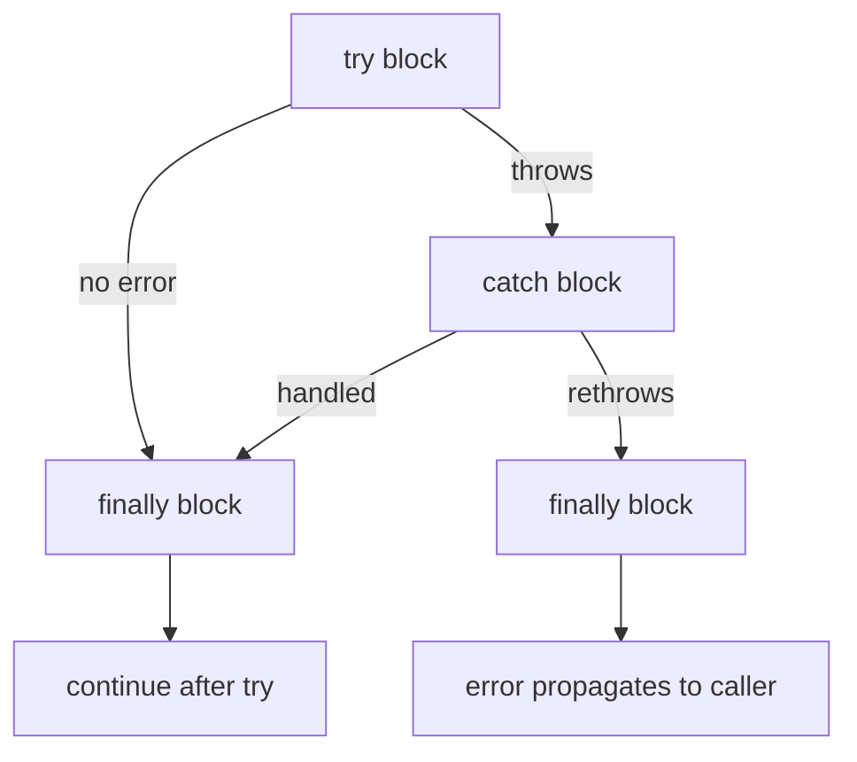
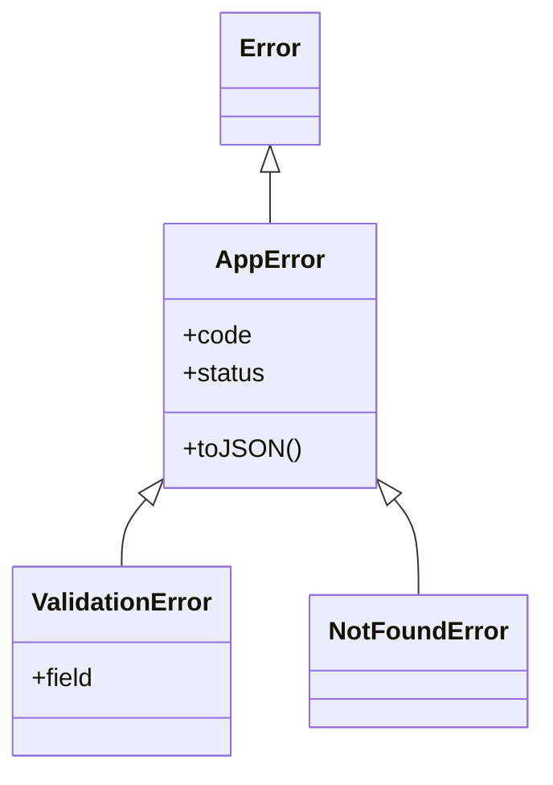
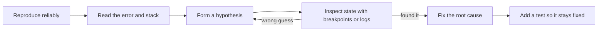

# Chapter 11 — Errors and Debugging

Every program fails sometimes: users type letters into number fields, networks drop, files go missing, and programmers make mistakes. JavaScript reports problems with **error objects** that are **thrown** and can be **caught**. This chapter shows how errors work, how to design your own, and how to find bugs quickly with the console, stack traces and real debuggers — in the browser and in Node.

**What you'll learn**

1. The built-in error types, what each one means, and what every error object contains.
2. `throw`, `try` / `catch` / `finally` — exact control flow, rethrowing, and the traps.
3. Custom error classes and a clean error-handling layer.
4. Error chaining with `cause` (ES2022) and `AggregateError`.
5. Errors in asynchronous code (the preview; the full story is in Chapter 12).
6. Guaranteed cleanup with `finally` and the new `using` declaration.
7. The console toolbox beyond `console.log`.
8. Reading stack traces; source maps.
9. Debugging with browser DevTools and the Node inspector; a systematic debugging method.
10. A gallery of the most common runtime errors, with their exact messages and causes.

**Before you start.** Custom errors use classes and `extends` ([Chapter 9](../09-this-prototypes-and-classes/README.md)). Type coercion, which causes many silent bugs, is in [Chapter 2](../02-variables-types-and-operators/README.md).

All runnable code is in [`code/`](code/). Outputs are real (Node 24, V8 engine). Error **messages** are not standardized — Firefox and Safari word them differently — but error **types** are.

---

## 11.1 Errors and the built-in error types

### What it is
An **error** (also called an **exception**) is an object that describes something that went wrong. When code **throws** an error, normal execution stops immediately, and the engine unwinds the call stack looking for a `catch` that will handle it. If none is found, the error is **uncaught**: the browser logs it to the console (and the rest of that script task stops), and Node prints it and exits the process with a non-zero exit code.

Analogy: a fire alarm. Someone pulls it (`throw`); everyone stops what they're doing; the alarm travels up floor by floor until someone responsible (`catch`) deals with it. If nobody does, the building is evacuated (the program crashes).

Terms:
- **Runtime error** — thrown while code runs (`TypeError`, `RangeError`, …).
- **Parse-time (syntax) error** — the engine can't even read the code; *nothing* in that script/module runs.
- **Call stack** — the list of functions currently running, newest on top ([Chapter 12](../12-asynchronous-javascript/README.md) shows it in the event loop).

### The built-in types
| Type | Thrown when… | Typical example |
|---|---|---|
| `Error` | Generic base type — use for your own errors or subclass it | `throw new Error('config missing')` |
| `TypeError` | A value is the wrong type for an operation | `null.length`, calling a non-function, assigning to a `const` |
| `ReferenceError` | A name doesn't exist, or is used in its TDZ | typo in a variable name; `let` used before its line |
| `SyntaxError` | Code (or JSON) can't be parsed | `JSON.parse('{bad}')`, `new Function('1 +')` |
| `RangeError` | A number is outside the allowed range | `new Array(-1)`, `toFixed(101)`, stack overflow |
| `URIError` | Malformed URI component | `decodeURIComponent('%')` |
| `EvalError` | Not thrown by modern engines; exists for backward compatibility | — |
| `AggregateError` (ES2021) | Several errors need reporting together | `Promise.any` when every promise rejects |
| `SuppressedError` (ES2027) | An error happened while disposing after another error | `using` declarations (§11.6) |

All of them inherit from `Error` (`TypeError.prototype.[[Prototype]] === Error.prototype`), so `err instanceof Error` is `true` for every built-in error. Environments add their own: browsers have `DOMException` (e.g., `AbortError`, `NotAllowedError`), Node adds `code` properties like `'ENOENT'` to system errors.

[`code/01_error_types.mjs`](code/01_error_types.mjs) triggers each one for real:

```js
const cases = {
  TypeError:      () => null.length,
  ReferenceError: () => notDeclaredAnywhere + 1,
  SyntaxError:    () => JSON.parse('{ bad json }'),
  RangeError:     () => new Array(-1),
  URIError:       () => decodeURIComponent('%'),
  EvalError:      () => { throw new EvalError('never thrown by modern engines — only kept for compatibility'); },
  AggregateError: () => { throw new AggregateError([new Error('a'), new TypeError('b')], 'several things failed'); },
};

for (const fn of Object.values(cases)) {
  try {
    fn();
  } catch (err) {
    console.log(`${err.name.padEnd(15)} | instanceof Error: ${err instanceof Error} | ${err.message}`);
  }
}

const e = new TypeError('price must be a number', { cause: { got: 'ten' } });
console.log('\nname   :', e.name);
console.log('message:', e.message);
console.log('cause  :', e.cause);
console.log('stack  :', e.stack.split('\n')[0], '... (+', e.stack.split('\n').length - 1, 'frame lines)');
console.log('String :', String(e));

console.log('\nproto chain:', Object.getPrototypeOf(TypeError) === Error, Object.getPrototypeOf(RangeError.prototype) === Error.prototype);

try {
  await Promise.any([Promise.reject(new Error('mirror 1 down')), Promise.reject(new Error('mirror 2 down'))]);
} catch (agg) {
  console.log('\nPromise.any ->', agg.name, '|', agg.message, '|', agg.errors.map((x) => x.message));
}

console.log('\nError.isError:', Error.isError(e), Error.isError({ name: 'Error', message: 'fake' }));

try {
  new Function('return 1 +');   // parsing happens here
} catch (err) {
  console.log('parse-time  :', err.name, '-', err.message);
}
```

Output:
```
TypeError       | instanceof Error: true | Cannot read properties of null (reading 'length')
ReferenceError  | instanceof Error: true | notDeclaredAnywhere is not defined
SyntaxError     | instanceof Error: true | Expected property name or '}' in JSON at position 2 (line 1 column 3)
RangeError      | instanceof Error: true | Invalid array length
URIError        | instanceof Error: true | URI malformed
EvalError       | instanceof Error: true | never thrown by modern engines — only kept for compatibility
AggregateError  | instanceof Error: true | several things failed

name   : TypeError
message: price must be a number
cause  : { got: 'ten' }
stack  : TypeError: price must be a number ... (+ 4 frame lines)
String : TypeError: price must be a number

proto chain: true true

Promise.any -> AggregateError | All promises were rejected | [ 'mirror 1 down', 'mirror 2 down' ]

Error.isError: true false
parse-time  : SyntaxError - Unexpected token '}'
```

### Anatomy of an error object
| Property | Standard? | Meaning |
|---|---|---|
| `name` | ✓ (inherited from the prototype) | The type, e.g. `'TypeError'` |
| `message` | ✓ | Human-readable description |
| `cause` | ✓ ES2022 | The underlying reason, passed as `new Error(msg, { cause })` (§11.4) |
| `errors` | ✓ on `AggregateError` | Array of the individual errors |
| `stack` | de-facto (every engine; a standard is proposed) | Text of the call stack at creation time |
| `code` | Node / libraries | Machine-readable code, e.g. `'ENOENT'`, `'ERR_MODULE_NOT_FOUND'` |

`String(err)` (and `err.toString()`) gives `"Name: message"`. The stack is captured when the error object is **created** (with `new`), not when it's thrown.

`Error.isError(value)` (ES2026; available in Node 24 and recent browser versions — check support if you target older ones) is the reliable check for "is this a genuine error object?" — unlike `instanceof Error` it works for errors from other realms (iframes, `vm` contexts) and can't be fooled by an object with a hand-made prototype.

### Self-check
1. `undefinedFn()` where `undefinedFn` was never declared — which error? → `ReferenceError` (name not found). If it's declared but holds `undefined`, it's a `TypeError` (not a function).
2. Which property holds the underlying error in a wrapped error? → `cause`.
3. When is a `SyntaxError` in your source file reported? → When the file is parsed, before any of it runs.

### TL;DR
Errors are objects with `name`, `message`, `stack` (and optional `cause`). Know the core types: `TypeError` (wrong type), `ReferenceError` (unknown name/TDZ), `SyntaxError` (unparseable), `RangeError` (out of range), `AggregateError` (many).

---

## 11.2 `throw`, `try`, `catch`, `finally`

### What it is
- `throw expression` — raises an error; execution jumps to the nearest enclosing `catch`.
- `try { … }` — code that might throw.
- `catch (err) { … }` — runs only if something in `try` threw; `err` is the thrown value.
- `finally { … }` — always runs after `try`/`catch`, whether the block succeeded, threw, or `return`ed. Used for cleanup.

A `try` must have a `catch`, a `finally`, or both.

### How it works
1. Run the `try` block.
2. If it throws, abandon the rest of `try`, and run `catch` with the error.
3. Then run `finally` (always).
4. If `catch` itself throws (or rethrows), `finally` still runs, then the new error propagates outward.
5. If nothing catches it anywhere up the stack, it's an uncaught error.



[`code/02_try_catch_finally.mjs`](code/02_try_catch_finally.mjs):

```js
function parseAge(text) {
  const log = [];
  try {
    log.push('try start');
    const age = Number.parseInt(text, 10);
    if (Number.isNaN(age)) throw new TypeError(`not a number: "${text}"`);
    if (age < 0) throw new RangeError(`negative age: ${age}`);
    log.push('try end');
    return { age, log };
  } catch (err) {
    log.push(`catch ${err.name}`);
    return { age: null, log };
  } finally {
    log.push('finally');       // runs on success, on error, and even after return
  }
}
for (const input of ['42', 'abc', '-3']) {
  const { age, log } = parseAge(input);
  console.log(input.padEnd(4), '->', String(age).padEnd(5), log.join(' > '));
}

// finally's return OVERRIDES the try's return (and swallows errors) — avoid!
function sneaky() {
  try { throw new Error('lost forever'); }
  finally { return 'finally wins'; }  // eslint: no-unsafe-finally
}
console.log('\nsneaky():', sneaky());

// Optional catch binding (ES2019): omit (err) when you don't need it
function isValidJson(s) {
  try { JSON.parse(s); return true; } catch { return false; }
}
console.log('isValidJson:', isValidJson('{"a":1}'), isValidJson('{a:1}'));

// Catch only what you understand; rethrow the rest
function loadUser(raw) {
  try {
    return JSON.parse(raw).user.name;
  } catch (err) {
    if (err instanceof SyntaxError) return '(invalid JSON — using guest)';
    throw err;                     // a TypeError here means a real bug: don't hide it
  }
}
console.log('rethrow 1  :', loadUser('{oops'));
try { loadUser('{"nouser":true}'); } catch (err) { console.log('rethrow 2  :', err.name, '-', err.message); }

// You can throw anything — but only Error objects carry a stack
for (const thrown of ['a string', 42, { code: 'E_BAD' }, new Error('real error')]) {
  try { throw thrown; } catch (err) {
    console.log('threw', typeof err === 'object' ? err.constructor.name : typeof err, '| has stack:', typeof err?.stack === 'string');
  }
}

// try/catch is synchronous: it cannot catch an error thrown later by a callback
try {
  setTimeout(() => {
    try { throw new Error('from timer'); } catch (err) { console.log('\ntimer error caught INSIDE the callback:', err.message); }
  }, 0);
} catch {
  console.log('never printed');
}
console.log('\n(outer try block already finished)');
```

Output:
```
42   -> 42    try start > try end > finally
abc  -> null  try start > catch TypeError > finally
-3   -> null  try start > catch RangeError > finally

sneaky(): finally wins
isValidJson: true false
rethrow 1  : (invalid JSON — using guest)
rethrow 2  : TypeError - Cannot read properties of undefined (reading 'name')
threw string | has stack: false
threw number | has stack: false
threw Object | has stack: false
threw Error | has stack: true

(outer try block already finished)

timer error caught INSIDE the callback: from timer
```

What to notice:
- `finally` ran in all three cases — even though `try` and `catch` both `return`. The return value is computed first, then `finally` runs, then the function actually returns.
- A `return` (or `throw`) *inside* `finally` replaces whatever `try`/`catch` was doing — the error `'lost forever'` vanished. ESLint's `no-unsafe-finally` rule flags this.
- **Catch narrowly, rethrow the rest.** `loadUser` expects bad JSON (a `SyntaxError`) and recovers; a `TypeError` means the data shape is wrong — a real bug that should surface.
- `catch` receives *whatever* was thrown. Throwing strings or plain objects loses the stack trace and breaks `instanceof Error` checks. **Always throw `Error` objects** (or subclasses).
- The `catch` variable is block-scoped to the `catch` block.
- `try/catch` only covers code that runs *synchronously inside it*. The timer callback ran later, on a fresh call stack, after the outer `try` was long gone.

### When to use try/catch — and when not
| Use it | Don't use it |
|---|---|
| At boundaries where failure is expected: parsing input, `JSON.parse`, network/file I/O, third-party code | To replace simple checks — `if (user?.name)` is cheaper and clearer than catching a `TypeError` |
| In a top-level handler that turns errors into a response/UI message and logs them | Wrapping every function "just in case" — it hides bugs |
| To add context and rethrow (§11.4) | To silently swallow errors: `catch {}` with no comment or handling |

Performance note: in modern engines a `try` block that doesn't throw costs essentially nothing; *throwing* is relatively expensive (capturing the stack), so don't use exceptions for normal control flow like "item not found in a loop".

### In the interview
**30-second answer:** "`throw` raises an error and unwinds the stack to the nearest `catch`. `finally` always runs — after success, error, or even `return` — so it's for cleanup; but a `return` inside `finally` overrides everything and swallows errors. `try/catch` is synchronous, so it can't catch errors from callbacks that run later — for promises you `await` inside `try`, or use `.catch()`. Always throw `Error` objects so you get a stack trace."

- *Q: What does `(() => { try { return 1 } finally { return 2 } })()` return?* A: `2`.
- *Q: Does `finally` run if `catch` rethrows?* A: Yes, then the error continues outward.
- *Q: Why is `catch (e) {}` dangerous?* A: It hides every error, including programming bugs, making failures silent and hard to trace.

### Self-check
1. Can you have `try { } finally { }` without `catch`? → Yes; errors still propagate, but cleanup runs.
2. What is `err` in `catch (err)` after `throw 42`? → The number `42` (no stack).
3. Why didn't the outer `catch` see the timer's error? → The callback ran later, after the `try` finished.

### TL;DR
`try` → `catch` on error → `finally` always. Throw `Error` objects, catch narrowly, rethrow what you can't handle, never `return` from `finally`, and remember try/catch is synchronous.

---

## 11.3 Custom errors

### What it is
A **custom error** is a subclass of `Error` for a specific failure in *your* domain: `ValidationError`, `NotFoundError`, `PaymentDeclinedError`. It lets callers react to *kinds* of failure with `instanceof` (or a `code`), and carry extra data (which field was invalid, what HTTP status to return).

### How it works
1. `class MyError extends Error`.
2. Call `super(message, options)` so `message`, `stack` and `cause` are set up.
3. Set `this.name` (otherwise it prints as plain `Error`). Using `new.target.name` sets it automatically for every subclass.
4. Add fields (`code`, `status`, `field`…).
5. Handle errors in **one place** (a top-level handler, an Express error middleware, a React error boundary) that maps error types to responses, and treats *unknown* errors as 500s without leaking their details to users.

[`code/03_custom_errors.mjs`](code/03_custom_errors.mjs):

```js
class AppError extends Error {
  constructor(message, options = {}) {
    super(message, { cause: options.cause });   // pass cause up to Error
    this.name = new.target.name;                  // 'ValidationError', 'NotFoundError', ...
    this.code = options.code ?? 'APP_ERROR';
    this.status = options.status ?? 500;
  }
  toJSON() { return { name: this.name, code: this.code, message: this.message }; }
}

class ValidationError extends AppError {
  constructor(field, message) {
    super(message, { code: 'VALIDATION', status: 400 });
    this.field = field;
  }
}
class NotFoundError extends AppError {
  constructor(what, id) { super(`${what} ${id} not found`, { code: 'NOT_FOUND', status: 404 }); }
}

function placeOrder(order) {
  if (!Number.isInteger(order.qty) || order.qty < 1) throw new ValidationError('qty', 'qty must be a positive integer');
  if (order.productId !== 'p1') throw new NotFoundError('Product', order.productId);
  return { ok: true };
}

// A single place that turns errors into responses
function handle(order) {
  try {
    return { status: 200, body: placeOrder(order) };
  } catch (err) {
    if (err instanceof AppError) return { status: err.status, body: err.toJSON() };
    return { status: 500, body: { message: 'internal error' } };   // unknown -> don't leak details
  }
}
console.log(handle({ productId: 'p1', qty: 2 }));
console.log(handle({ productId: 'p1', qty: 0 }));
console.log(handle({ productId: 'p9', qty: 1 }));

const v = new ValidationError('email', 'bad email');
console.log('\ninstanceof  :', v instanceof ValidationError, v instanceof AppError, v instanceof Error);
console.log('name/field  :', v.name, v.field);
console.log('String(v)   :', String(v));
console.log('stack line 1:', v.stack.split('\n')[0]);
console.log('JSON        :', JSON.stringify(v));
console.log('plain Error JSON:', JSON.stringify(new Error('x')), '(message/stack are non-enumerable own props)');
```

Output:
```
{ status: 200, body: { ok: true } }
{
  status: 400,
  body: {
    name: 'ValidationError',
    code: 'VALIDATION',
    message: 'qty must be a positive integer'
  }
}
{
  status: 404,
  body: {
    name: 'NotFoundError',
    code: 'NOT_FOUND',
    message: 'Product p9 not found'
  }
}

instanceof  : true true true
name/field  : ValidationError email
String(v)   : ValidationError: bad email
stack line 1: ValidationError: bad email
JSON        : {"name":"ValidationError","code":"VALIDATION","message":"bad email"}
plain Error JSON: {} (message/stack are non-enumerable own props)
```



Why the stack's first line already says `ValidationError`: V8 builds the `stack` string lazily from the error's `name` the first time it's read — here after `this.name` was set. Don't rely on that everywhere: set `name` in the constructor so all engines agree.

`JSON.stringify(new Error('x'))` gives `{}` because `message` and `stack` are **non-enumerable** own properties, and `name` lives on the prototype. That's why `AppError` defines `toJSON()` — useful for logs and API responses (but never send `stack` to end users).

### Error codes vs classes
| Approach | Pros | Cons |
|---|---|---|
| Subclasses + `instanceof` | Rich, typed, hierarchical (`catch` a whole family) | Breaks across realms/duplicated packages (two copies of the class) |
| `code` string (`err.code === 'ENOENT'`) | Survives serialization, logs, process boundaries; Node's own convention | No hierarchy; typos go unnoticed |
| Both (as above) | `instanceof` inside the app, `code` in logs and API bodies | A little more code |

### Common mistakes
- Forgetting `super(message)` → `ReferenceError` when you touch `this` ([Chapter 9](../09-this-prototypes-and-classes/README.md)).
- Not setting `name` → logs say `Error: …` for everything.
- Leaking internals: sending `err.message` / `err.stack` of *unexpected* errors to clients can reveal SQL, paths or secrets. Log them server-side; send a generic message.
- Over-engineering: dozens of error classes nobody catches differently. Create a class only when some caller will handle it differently.

### Real-world examples
Node's system errors carry `code` (`ENOENT`, `EADDRINUSE`, `ECONNREFUSED`); `fetch` rejects with a `TypeError` on network failure and an `AbortError` `DOMException` when aborted; HTTP libraries throw errors with a `status`/`response`; ORMs throw `UniqueConstraintError`-style subclasses.

### Self-check
1. Why set `this.name` in a custom error? → So `String(err)`, stacks and logs show the right type.
2. Why does `JSON.stringify(err)` often print `{}`? → `message`/`stack` are non-enumerable; `name` is inherited.
3. What should a top-level handler do with an unknown error? → Log full details internally; return a generic message (e.g., 500).

### TL;DR
`class X extends Error`, call `super(message, { cause })`, set `name`, add `code`/data, handle all errors in one place, and never leak internals of unexpected errors.

---

## 11.4 Error chaining with `cause`

### What it is
When you catch a low-level error and throw a higher-level one ("could not load config"), you want to **add context without losing the original**. Since ES2022, every error constructor accepts an options object: `new Error(message, { cause })`. The original is stored in `err.cause`.

Before `cause`, people either lost the original (bad for debugging) or concatenated messages into unreadable strings.

[`code/04_error_cause.mjs`](code/04_error_cause.mjs):

```js
function readConfigText(name) {
  const err = new Error(`ENOENT: no such file or directory, open '${name}'`);   // pretend fs failed
  err.code = 'ENOENT';
  throw err;
}

function loadConfig(name) {
  try {
    return JSON.parse(readConfigText(name));
  } catch (err) {
    throw new Error(`Could not load config "${name}"`, { cause: err }); // add context, keep original
  }
}

function startServer() {
  try {
    loadConfig('server.json');
  } catch (err) {
    throw new Error('Server failed to start', { cause: err });
  }
}

try {
  startServer();
} catch (err) {
  let depth = 0;
  for (let e = err; e; e = e.cause) {                                     // walk the cause chain
    console.log(`${'  '.repeat(depth++)}${depth > 1 ? 'caused by: ' : ''}${e.message}${e.code ? ` [${e.code}]` : ''}`);
  }
  console.log('\nroot cause code:', rootCause(err).code);
}

function rootCause(e) { while (e.cause instanceof Error) e = e.cause; return e; }

import { inspect } from 'node:util';
const shown = inspect(new Error('outer', { cause: new Error('inner') }));
console.log('\nutil.inspect shows cause?', shown.includes('[cause]: Error: inner'));
```

Output:
```
Server failed to start
  caused by: Could not load config "server.json"
    caused by: ENOENT: no such file or directory, open 'server.json' [ENOENT]

root cause code: ENOENT

util.inspect shows cause? true
```

Each layer adds *what it was trying to do*; the root cause keeps *what actually failed*. Node's `console.log`/`console.error` and browser DevTools print the `cause` chain automatically.

**`AggregateError`** is the sibling for "several independent failures": its `errors` array holds each one (e.g., `Promise.any` where every mirror failed, or validation that reports all bad fields at once).

### TL;DR
Wrap with `new Error('what I was doing', { cause: err })`; walk `.cause` to the root. Use `AggregateError` for many errors at once.

---

## 11.5 Errors in asynchronous code (preview)

### The problem it solves
Asynchronous code (timers, network, files) finishes *later*, after the `try` block around the call has already exited. Promises carry errors as **rejections** instead. The event loop and promises are explained in [Chapter 12](../12-asynchronous-javascript/README.md); here are the error-handling rules you need now.

[`code/05_async_errors.mjs`](code/05_async_errors.mjs):

```js
const fetchUser = async (id) => {
  await null;                                     // simulate async work
  if (id !== 1) throw new Error(`user ${id} not found`);
  return { id, name: 'Ada' };
};

// 1) await inside try/catch — the normal way
try {
  await fetchUser(2);
} catch (err) {
  console.log('await + try/catch :', err.message);
}

// 2) .catch() on the promise
await fetchUser(3).catch((err) => console.log('.catch()          :', err.message));

// 3) Promise.allSettled — collect successes and failures together
const results = await Promise.allSettled([fetchUser(1), fetchUser(4)]);
console.log('allSettled        :', results.map((r) => (r.status === 'fulfilled' ? r.value.name : r.reason.message)));

// 4) Forgetting to await: the try/catch finishes before the promise rejects
process.on('unhandledRejection', (reason) => {
  console.log('unhandledRejection:', reason.message, '(Node would crash here without this handler)');
});
try {
  fetchUser(5);                                   // no await!
} catch {
  console.log('never printed');
}
console.log('after the try     : the rejection has not happened yet');
await new Promise((r) => setTimeout(r, 10));      // let the event loop report it
```

Output:
```
await + try/catch : user 2 not found
.catch()          : user 3 not found
allSettled        : [ 'Ada', 'user 4 not found' ]
after the try     : the rejection has not happened yet
unhandledRejection: user 5 not found (Node would crash here without this handler)
```

Rules:
1. Inside an `async` function, `throw` becomes a rejected promise, and `await` of a rejected promise throws — so `try { await … } catch` works naturally.
2. **Always `await` (or `return`, or `.catch()`) every promise.** A forgotten promise's rejection escapes every `try`. ESLint (with type info, `@typescript-eslint/no-floating-promises`) can flag this.
3. An **unhandled rejection** — a rejected promise nobody handles — crashes Node by default (since Node 15) and logs "Uncaught (in promise)" in browsers.

### Last-resort global handlers
| Environment | Synchronous uncaught error | Unhandled promise rejection |
|---|---|---|
| Browser | `window.addEventListener('error', e => …)` | `window.addEventListener('unhandledrejection', e => …)` |
| Node | `process.on('uncaughtException', err => …)` | `process.on('unhandledRejection', reason => …)` |

Use them to **log and report** (e.g., to an error-tracking service such as Sentry), not to keep going as if nothing happened. After an `uncaughtException`, a Node process is in an unknown state — log, then exit and let a process manager restart it.

### TL;DR
`await` inside `try`, or `.catch()` every promise; never leave a promise floating. Global handlers are for logging, not recovery.

---

## 11.6 Guaranteed cleanup: `finally` and `using`

### What it is
Resources — open files, database connections, locks, timers, subscriptions — must be released even if something fails. `finally` has always done this. **Explicit Resource Management** (the `using` declaration) is a newer feature that makes cleanup automatic: an object with a `[Symbol.dispose]()` method, declared with `using`, is disposed when the enclosing block exits, however it exits. It reached TC39 stage 4 in 2025 and is slated for ES2027; Node 24 and Chromium-based browsers (Chrome 134+) already support it — check your targets before relying on it in browsers. It mirrors C#'s `using`, Python's `with` and Java's try-with-resources.

[`code/09_using_and_cleanup.mjs`](code/09_using_and_cleanup.mjs):

```js
function openFile(name) {
  console.log(`open  ${name}`);
  return {
    name,
    read() { if (name === 'bad.txt') throw new Error(`cannot read ${name}`); return `contents of ${name}`; },
    [Symbol.dispose]() { console.log(`close ${name}`); },   // called automatically by `using`
  };
}

// Classic pattern: try/finally
function classic(name) {
  const f = openFile(name);
  try { return f.read(); }
  finally { f[Symbol.dispose](); }
}
console.log('classic ->', classic('a.txt'));

// Same thing with `using`: disposed when the block exits, in reverse order, even on error
function modern(...names) {
  using first = openFile(names[0]);
  using second = openFile(names[1]);
  return [first.read(), second.read()];
}
console.log('modern  ->', modern('a.txt', 'b.txt'));
try {
  modern('c.txt', 'bad.txt');
} catch (err) {
  console.log('modern error ->', err.message, '(both files were still closed)');
}

// If disposal ALSO throws, you get a SuppressedError holding both errors
function doubleFailure() {
  using r = { [Symbol.dispose]() { throw new Error('dispose failed'); } };
  throw new Error('body failed');
}
try { doubleFailure(); } catch (err) {
  console.log(`${err.name}: error="${err.error.message}" suppressed="${err.suppressed.message}"`);
}
```

Output:
```
open  a.txt
close a.txt
classic -> contents of a.txt
open  a.txt
open  b.txt
close b.txt
close a.txt
modern  -> [ 'contents of a.txt', 'contents of b.txt' ]
open  c.txt
open  bad.txt
close bad.txt
close c.txt
modern error -> cannot read bad.txt (both files were still closed)
SuppressedError: error="dispose failed" suppressed="body failed"
```

- Resources are disposed in **reverse** order of declaration (last opened, first closed) — like a stack.
- `await using` does the same with `[Symbol.asyncDispose]()` for async cleanup (closing a DB connection).
- If both the body and the disposal throw, the result is a **`SuppressedError`**: `.error` is the disposal error, `.suppressed` the one it replaced — nothing is silently lost.

### TL;DR
Release resources in `finally`, or with `using` + `[Symbol.dispose]` where supported. Disposal runs in reverse order, even on errors.

---

## 11.7 The console toolbox

### What it is
`console` is the built-in logging object in browsers and Node. `console.log` is only the start; the other methods save a lot of time when debugging. In the browser they print to the DevTools **Console** panel (with filtering by level); in Node, `log/info/debug/table/dir/group/count/time` write to **stdout** and `warn/error/trace/assert` to **stderr**.

[`code/06_console_methods.mjs`](code/06_console_methods.mjs):

```js
console.log('log   : plain message', { id: 7 }, [1, 2]);
console.info('info  : alias of log in Node');
console.debug('debug : alias of log in Node (hidden by default in browser DevTools "Verbose" level)');
console.log('format: %s is %d years, %o', 'Ada', 36, { lang: 'js' });

const users = [
  { id: 1, name: 'Ada', role: 'admin' },
  { id: 2, name: 'Linus', role: 'dev' },
];
console.table(users);
console.table(users, ['name']);            // choose columns

const deep = { a: { b: { c: { d: { e: 'deep' } } } } };
console.log('default depth:', deep);
console.dir(deep, { depth: null });          // print everything

console.group('group: checkout');
console.log('validate cart');
console.group('payment');
console.log('charge card');
console.groupEnd();
console.groupEnd();

for (const k of ['a', 'b', 'a', 'a']) console.count(k);
console.countReset('a');
console.count('a');

console.assert(1 + 1 === 2, 'not printed: assertion holds');
console.assert(0.1 + 0.2 === 0.3, 'assertion failed: floating point strikes again'); // prints, does NOT throw

const label = 'sum loop';
console.time(label);
let s = 0; for (let i = 0; i < 1e6; i++) s += i;
console.timeEnd(label);                      // prints elapsed time (varies per run)

function inner() { console.trace('trace: how did we get here?'); }
inner();
```

Output (the timing varies per run; the trace's long file paths are shortened here):
```
log   : plain message { id: 7 } [ 1, 2 ]
info  : alias of log in Node
debug : alias of log in Node (hidden by default in browser DevTools "Verbose" level)
format: Ada is 36 years, { lang: 'js' }
┌─────────┬────┬─────────┬─────────┐
│ (index) │ id │ name    │ role    │
├─────────┼────┼─────────┼─────────┤
│ 0       │ 1  │ 'Ada'   │ 'admin' │
│ 1       │ 2  │ 'Linus' │ 'dev'   │
└─────────┴────┴─────────┴─────────┘
┌─────────┬─────────┐
│ (index) │ name    │
├─────────┼─────────┤
│ 0       │ 'Ada'   │
│ 1       │ 'Linus' │
└─────────┴─────────┘
default depth: { a: { b: { c: [Object] } } }
{
  a: {
    b: { c: { d: { e: 'deep' } } }
  }
}
group: checkout
  validate cart
  payment
    charge card
a: 1
b: 1
a: 2
a: 3
a: 1
Assertion failed: assertion failed: floating point strikes again
sum loop: 1.871ms
Trace: trace: how did we get here?
    at inner (file:///…/11-errors-and-debugging/code/06_console_methods.mjs:38:28)
    at file:///…/11-errors-and-debugging/code/06_console_methods.mjs:39:1
    at ModuleJob.run (node:internal/modules/esm/module_job:377:25)
    …
```

| Method | Use it for |
|---|---|
| `log` / `info` / `debug` | General output; in browsers they're separate filter levels |
| `warn` / `error` | Problems — shown in yellow/red in DevTools, go to stderr in Node, include a stack in browsers |
| `%s %d %i %f %o %O %c` | Format specifiers (string, integer, float, object; `%c` applies CSS in browsers) |
| `table(data, cols?)` | Arrays of objects → readable grid |
| `dir(obj, { depth })` | Full object inspection (Node's `console.log` stops at depth 2 and shows `[Object]`) |
| `group` / `groupCollapsed` / `groupEnd` | Indent related messages |
| `count(label)` / `countReset` | "How many times did this run?" |
| `assert(cond, msg)` | Log only when `cond` is false — **does not throw** |
| `time` / `timeLog` / `timeEnd` | Quick timing (use `performance.now()` or a profiler for serious measurement) |
| `trace(msg)` | Print the current stack without throwing |

### Common mistakes
- **Logging objects in the browser and reading them later**: DevTools shows a *live* reference; when you expand it, you see the object's *current* state, not the state at log time. Log a snapshot: `console.log(structuredClone(obj))` or `JSON.stringify(obj)`.
- Leaving debug logs in production code — use a lint rule (`no-console`) or a logger with levels.
- `console.log('user: ' + user)` → `user: [object Object]`. Pass objects as separate arguments: `console.log('user:', user)`.

### TL;DR
Use `table`, `dir`, `group`, `count`, `assert`, `time`, `trace` — and remember browser logs of objects are live references.

---

## 11.8 Reading stack traces and source maps

### What it is
A **stack trace** lists the chain of function calls active when the error was created — **newest first**. Each line ("frame") shows the function name and the location `file:line:column`. Reading it top-down tells you *where* it failed; reading bottom-up tells you *how you got there*.

[`code/07_stack_traces.mjs`](code/07_stack_traces.mjs) (key parts):

```js
function validate(cart) { if (cart.items.length === 0) throw new Error('empty cart'); }
function checkout(cart) { validate(cart); }
function handleClick() { checkout({ items: [] }); }

try {
  handleClick();
} catch (err) {
  // shorten absolute file paths so the output is the same on every machine
  const pretty = err.stack.replace(/file:\/\/\S+\//g, '').replace(/\(.*[\\/](\S+?:\d+:\d+)\)/g, '($1)');
  console.log(pretty.split('\n').slice(0, 5).join('\n'));
}
console.log('\nError.stackTraceLimit default:', Error.stackTraceLimit);
// ... Error.captureStackTrace(obj) attaches a .stack to any object
```

Output:
```
Error: empty cart
    at validate (07_stack_traces.mjs:4:62)
    at checkout (07_stack_traces.mjs:5:27)
    at handleClick (07_stack_traces.mjs:6:26)
    at 07_stack_traces.mjs:9:3

Error.stackTraceLimit default: 10
frames mention makeTimeout? true
captureStackTrace on plain object: string 07_stack_traces.mjs
```

How to read it:
1. **Line 1** = `name: message` — *what* happened.
2. **First frame** = where it was thrown (`validate`, line 4, column 62).
3. **Following frames** = callers. The first frame that's in *your* code (not a library or `node:internal`) is usually where to start looking.
4. **Anonymous frames** (`at 07_stack_traces.mjs:9:3`) are top-level code or unnamed functions — naming your functions makes traces easier to read.

V8-specific helpers (Node, Chrome, Edge — not standard): `Error.stackTraceLimit` (frames kept, default 10; raise it when debugging deep stacks, or run Node with `--stack-trace-limit=50`), and `Error.captureStackTrace(obj, fn?)`, which attaches a stack to any object (optionally hiding frames above `fn`). Async stack traces: V8 stitches together frames across `await` points (you'll see `at async functionName`), so `async/await` code has far more useful traces than old callback code.

### Source maps
Production JavaScript is usually bundled and minified ([Chapter 10](../10-modules-and-tooling/README.md)), so a raw trace says something like `at e (app.3f9a1c.js:1:48213)` — useless. A **source map** (`app.js.map`) maps each position in the generated file back to the original file, line and column. DevTools applies source maps automatically when it finds a `//# sourceMappingURL=` comment; Node applies them to stack traces with `node --enable-source-maps`. Error-tracking services let you upload maps privately so production traces are readable without publishing your source.

### TL;DR
Read the first line for *what*, the first frame in your code for *where*, the rest for *how*. Use source maps for bundled code; name functions for clearer traces.

---

## 11.9 Debugging with DevTools and the Node inspector

### What it is
A **debugger** lets you **pause** a running program at a chosen line, **inspect** every variable in scope, and **step** through the code one line at a time. It's far faster than adding `console.log`s and re-running when the problem is "why is this value wrong here?". Browsers ship one in **DevTools** (F12, or Cmd+Option+I on macOS); Node exposes the same Chrome DevTools protocol through its **inspector**.

### Core concepts
| Concept | What it does |
|---|---|
| **Breakpoint** | Pauses execution when a line is about to run. Set by clicking a line number (Sources panel in Chrome, Debugger in Firefox) or with a `debugger;` statement (ignored when no debugger is attached). |
| **Conditional breakpoint** | Pauses only when an expression is true (`item.qty > 100`) — essential inside loops. |
| **Logpoint** | Logs a message without pausing and without editing the code. |
| **Pause on exceptions** | Stops at the line that throws (optionally including caught exceptions) — shows the state at the moment of failure. |
| **Step over** (F10) | Run the current line, including any functions it calls, and stop at the next line. |
| **Step into** (F11) | Enter the function called on this line. |
| **Step out** (Shift+F11) | Finish the current function and stop in its caller. |
| **Resume** (F8) | Continue until the next breakpoint. |
| **Call Stack pane** | The frames (as in a stack trace) — click one to inspect that caller's variables. |
| **Scope pane** | Local, closure and global variables for the selected frame (including closures from [Chapter 4](../04-functions-scope-and-closures/README.md) and private `#fields`). |
| **Watch expressions** | Expressions re-evaluated at every pause. |
| **Console while paused** | Evaluate any expression in the paused scope, even change variables. |

(Keyboard shortcuts are Chrome DevTools' defaults; VS Code uses F10/F11/Shift+F11 too, with F5 to continue.)

Browser-only extras: **DOM breakpoints** (pause when an element's subtree/attributes change), **event listener breakpoints** (pause on any `click`), **XHR/fetch breakpoints** (pause when a URL is requested), the **Network** panel (see every request, status and response — the first stop for "the API call failed" bugs), **Performance** and **Memory** panels (profiling and heap snapshots for leaks), and an **ignore list** that hides framework/library frames when stepping.

### Debugging Node (not run — interactive)
```bash
node --inspect app.mjs          # start with the inspector on 127.0.0.1:9229
node --inspect-brk app.mjs      # same, but pause on the first line (so you can set breakpoints)
# then open chrome://inspect in Chrome -> "Open dedicated DevTools for Node"
node inspect app.mjs            # built-in terminal debugger: c(ont), n(ext), s(tep), o(ut), repl, bt
node --enable-source-maps dist/app.js   # readable traces for transpiled code
node --watch app.mjs            # restart automatically on save while you fix things
```

In **VS Code**, open a "JavaScript Debug Terminal" and run the program normally — breakpoints set in the editor just work, for Node scripts, test runners and dev servers alike. Never expose `--inspect` on a public network interface: anyone who can connect can run code in your process.

### A systematic method


1. **Reproduce** the bug reliably, with the smallest input that triggers it.
2. **Read** the actual error message and stack (really read it).
3. **Hypothesize** what's wrong, then **inspect** the values that would confirm or refute it — breakpoint/`debugger` or targeted, labelled logs.
4. **Narrow down** by halving: is the value already wrong at the midpoint? (`git bisect` does the same across commits.)
5. **Fix the root cause**, not the symptom.
6. **Add a test** that fails without the fix ([Chapter 16](../16-testing-and-typescript/README.md)).

Explaining the code line by line to someone — or to a rubber duck — works surprisingly often, because it forces you to state your assumptions.

### Worked example
[`code/10_debugging_walkthrough.mjs`](code/10_debugging_walkthrough.mjs): a cart total that comes out wrong.

```js
import assert from 'node:assert/strict';

// Data as it arrives from an HTML form or query string: everything is a string.
const cart = [
  { name: 'Book', price: '12.50', qty: '2' },
  { name: 'Pen', price: '1.25', qty: '4' },
];

// BUGGY version
function totalBuggy(items) {
  return items.reduce((sum, item) => sum + item.price * item.qty, '');
}
console.log('symptom       :', totalBuggy(cart), '(expected 30)');

// Inspect the intermediate values — labelled and structured
function totalTraced(items) {
  return items.reduce((sum, item, i) => {
    const next = sum + item.price * item.qty;
    console.log(`  step ${i}:`, { sum, typeofSum: typeof sum, line: item.price * item.qty, next });
    // debugger;   // <- with DevTools / `node inspect` attached, execution would pause here
    return next;
  }, '');
}
console.log('inspect       :');
totalTraced(cart);

// Fix: numeric initial value + explicit conversion at the boundary.
function total(items) {
  return items.reduce((sum, item) => sum + Number(item.price) * Number(item.qty), 0);
}
console.log('fixed         :', total(cart));

assert.equal(total(cart), 30);
assert.equal(total([]), 0);
assert.throws(() => assert.equal(totalBuggy(cart), 30), assert.AssertionError);
console.log('tests         : passed');
```

Output:
```
symptom       : 255 (expected 30)
inspect       :
  step 0: { sum: '', typeofSum: 'string', line: 25, next: '25' }
  step 1: { sum: '25', typeofSum: 'string', line: 5, next: '255' }
fixed         : 30
tests         : passed
```

The inspection shows `typeofSum: 'string'` from the very first step: the initial value `''` made `+` concatenate (`'25' + 5` → `'255'`), while `*` had quietly converted the strings to numbers — a coercion rule from [Chapter 2](../02-variables-types-and-operators/README.md). No error was thrown at all, which is why these bugs are hard: **the most dangerous bugs are wrong values, not exceptions.** Converting input at the boundary (`Number(...)`) and adding tests prevents the whole class of bug. TypeScript would also have flagged `string * string` ([Chapter 16](../16-testing-and-typescript/README.md)).

### In the interview
**30-second answer:** "I reproduce the bug first, read the stack trace, then use breakpoints — often conditional ones or 'pause on exceptions' — to inspect the actual state instead of guessing. I step over/into to follow the flow and check the Network panel for API issues. For Node I use `--inspect` with Chrome DevTools or VS Code's debug terminal. Once fixed, I add a test that reproduces the bug."

- *Q: What's a logpoint?* A: A breakpoint that logs an expression instead of pausing — logging without editing code.
- *Q: How do you debug minified production errors?* A: Source maps, uploaded to the error tracker or loaded in DevTools.
- *Q: What does the `debugger` statement do without DevTools open?* A: Nothing.

### TL;DR
Pause, inspect, step: breakpoints (conditional, logpoints, pause-on-exceptions), Scope/Watch/Call Stack panes, Network panel. Node: `--inspect`/`--inspect-brk` + `chrome://inspect` or VS Code. Reproduce → hypothesize → inspect → fix root cause → add a test.

---

## 11.10 Common runtime errors — a field guide

[`code/08_common_runtime_errors.mjs`](code/08_common_runtime_errors.mjs) triggers twenty everyday mistakes and prints V8's exact messages (what you'll see in Node, Chrome and Edge):

```js
const gallery = [
  ['call a non-function', () => { const user = {}; user.getName(); }],
  ['property of undefined', () => { const res = {}; return res.data.items; }],
  ['property of null', () => { const el = null; return el.textContent; }],
  ['set property on undefined', () => { let cfg; cfg.debug = true; }],
  ['undeclared variable', () => totl * 2],
  ['TDZ (use before let)', () => { const f = () => x; f(); let x = 1; }],
  ['reassign const', () => { const n = 1; n = 2; }],
  ['not iterable', () => { const [a] = {}; }],
  ['spread non-iterable', () => [...123]],
  ['JSON.parse(undefined)', () => JSON.parse(undefined)],
  ['JSON.parse(HTML)', () => JSON.parse('<!DOCTYPE html>')],
  ['class without new', () => { class Cart {} Cart(); }],
  ['reduce empty array', () => [].reduce((a, b) => a + b)],
  ['BigInt + Number', () => 1n + 1],
  ['bad array length', () => new Array(2 ** 32)],
  ['toFixed digits', () => (1.5).toFixed(101)],
  ['infinite recursion', () => { const f = () => f(); f(); }],
  ['circular JSON', () => { const a = {}; a.self = a; JSON.stringify(a); }],
  ['frozen object (strict)', () => { const o = Object.freeze({ a: 1 }); o.a = 2; }],
  ['in on a primitive', () => 'x' in 'hello'],
];
for (const [what, fn] of gallery) {
  try { fn(); console.log(`${what.padEnd(26)} (no error)`); }
  catch (e) { console.log(`${what.padEnd(26)} ${e.name}: ${e.message.split('\n')[0]}`); }
}
```

Output:
```
call a non-function        TypeError: user.getName is not a function
property of undefined      TypeError: Cannot read properties of undefined (reading 'items')
property of null           TypeError: Cannot read properties of null (reading 'textContent')
set property on undefined  TypeError: Cannot set properties of undefined (setting 'debug')
undeclared variable        ReferenceError: totl is not defined
TDZ (use before let)       ReferenceError: Cannot access 'x' before initialization
reassign const             TypeError: Assignment to constant variable.
not iterable               TypeError: {} is not iterable
spread non-iterable        TypeError: 123 is not iterable
JSON.parse(undefined)      SyntaxError: "undefined" is not valid JSON
JSON.parse(HTML)           SyntaxError: Unexpected token '<', "<!DOCTYPE html>" is not valid JSON
class without new          TypeError: Class constructor Cart cannot be invoked without 'new'
reduce empty array         TypeError: Reduce of empty array with no initial value
BigInt + Number            TypeError: Cannot mix BigInt and other types, use explicit conversions
bad array length           RangeError: Invalid array length
toFixed digits             RangeError: toFixed() digits argument must be between 0 and 100
infinite recursion         RangeError: Maximum call stack size exceeded
circular JSON              TypeError: Converting circular structure to JSON
frozen object (strict)     TypeError: Cannot assign to read only property 'a' of object '#<Object>'
in on a primitive          TypeError: Cannot use 'in' operator to search for 'x' in hello
```

### What each usually means in real code
| Message (V8) | Usual real-world cause | Fix |
|---|---|---|
| `x is not a function` | Typo in a method name; wrong import (default vs named, [Chapter 10](../10-modules-and-tooling/README.md)); calling a property that holds data; a library version without that method | Check the name and the import; `console.log(typeof x)` |
| `Cannot read properties of undefined (reading 'y')` | Data not loaded yet (async), wrong shape of an API response, array index out of range, missing `return` | Find *which* value is `undefined` (the part before `.y`); use `?.` and defaults only if absence is legitimate |
| `Cannot set properties of undefined` | Writing into a nested object that doesn't exist | Create it first, or `obj.cfg ??= {}` |
| `x is not defined` | Typo, missing import, variable in another scope, browser-only global used in Node (`window`, `document`) | Declare/import it; check the environment |
| `Cannot access 'x' before initialization` | `let`/`const`/`class` used before its line (TDZ), often via circular imports | Reorder code; break import cycles |
| `Assignment to constant variable.` | Reassigning a `const` or an imported binding | Use `let`, or mutate instead of reassign |
| `… is not iterable` | `for…of` / spread / destructuring on a plain object, `undefined`, or a number | Use `Object.entries(obj)`, check for `undefined` |
| `"undefined" is not valid JSON` / `Unexpected token '<' … is not valid JSON` | Parsing a missing value; the server returned an HTML error page instead of JSON | Check `response.ok` and the content type before `response.json()` ([Chapter 14](../14-browser-apis-and-security/README.md)) |
| `Class constructor X cannot be invoked without 'new'` | Calling a class like a function | Add `new` |
| `Reduce of empty array with no initial value` | `reduce` on a possibly empty array | Always pass an initial value |
| `Cannot mix BigInt and other types` | `bigint + number` | Convert explicitly: `BigInt(n)` or `Number(b)` |
| `Maximum call stack size exceeded` | Infinite or too-deep recursion; a setter that assigns to itself; two functions calling each other | Fix the base case; iterate instead |
| `Converting circular structure to JSON` | Serializing objects with back-references (DOM nodes, parent links, some library objects) | Pick the fields you need, or use a replacer |
| `Cannot assign to read only property` | Writing to a frozen object or a getter-only accessor in strict code | Copy instead of mutating: `{ ...obj, a: 2 }` |
| `Cannot use 'in' operator to search for …` | `in` on a string/number (often an un-parsed JSON string) | Parse first; `in` works on objects only |

Other messages worth recognizing: `Unexpected token` / `Unexpected end of input` (syntax: a missing bracket or comma), `await is only valid in async functions and the top level bodies of modules`, `Cannot use import statement outside a module` ([Chapter 10](../10-modules-and-tooling/README.md)), and `Failed to fetch` (network/CORS failure in browsers, a `TypeError` — [Chapter 14](../14-browser-apis-and-security/README.md)).

### Self-check
1. `Cannot read properties of undefined (reading 'map')` — what is `undefined`? → The value *before* `.map`, not `map` itself.
2. `JSON.parse` fails with `Unexpected token '<'` after a `fetch` — likely cause? → The server returned HTML (an error page or `index.html`), not JSON.
3. Why does `[].reduce((a, b) => a + b)` throw but `[].reduce((a, b) => a + b, 0)` doesn't? → With no initial value, reduce needs at least one element to start from.

### TL;DR
Most runtime errors are `TypeError`s from `undefined`/`null` or wrong types. Read the message literally: it names the value and the property. Find where the bad value came from, not just where it exploded.

---

## Chapter 11 TL;DR

- Errors are objects (`name`, `message`, `stack`, optional `cause`); core types: `TypeError`, `ReferenceError`, `SyntaxError`, `RangeError`, `URIError`, `AggregateError`, plus `SuppressedError` for `using`. `Error.isError` (ES2026) is the robust check.
- **`try` → `catch` → `finally`**: finally always runs; never `return` from it. Catch narrowly, rethrow the rest, always throw `Error` objects. try/catch is synchronous.
- **Custom errors**: `extends Error`, `super(msg, { cause })`, set `name`, add `code`/data, handle centrally, don't leak internals.
- **`cause`** chains context onto the original error; walk `.cause` to the root.
- **Async**: `await` inside `try` or `.catch()` every promise; global `error`/`unhandledrejection` (browser) and `uncaughtException`/`unhandledRejection` (Node) handlers are for logging.
- **Cleanup**: `finally`, or `using` + `Symbol.dispose` (ES2027, Node 24).
- **Console**: `table`, `dir`, `group`, `count`, `assert`, `time`, `trace`; browser object logs are live.
- **Stack traces**: newest frame first; source maps for bundled code.
- **Debuggers**: breakpoints (conditional, logpoints, pause on exceptions), step over/into/out, Scope/Watch/Call Stack, Network panel; Node `--inspect` + `chrome://inspect` or VS Code.
- **Method**: reproduce → read → hypothesize → inspect → fix root cause → add a test.

Next: the event loop, promises and `async`/`await` — [Chapter 12: Asynchronous JavaScript](../12-asynchronous-javascript/README.md).
