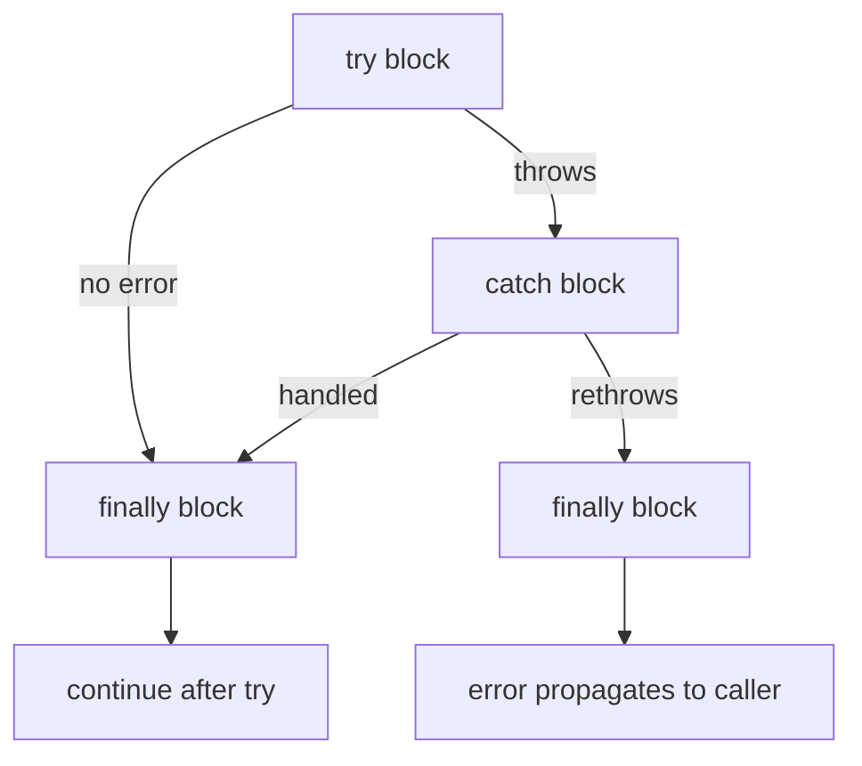
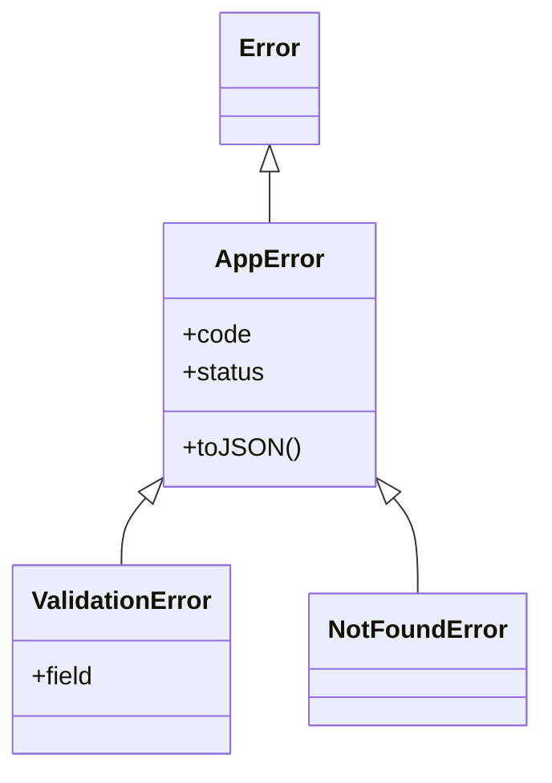
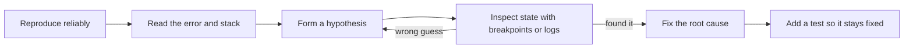

# Chapter 11 — Errors and Debugging

JavaScript reports problems with **error objects** that are **thrown** and can be **caught**. This chapter covers how errors work, how to design your own, and how to find bugs fast with the console, stack traces and debuggers — in the browser and in Node.

**What you'll learn**

1. The built-in error types and what every error object contains.
2. `throw`, `try` / `catch` / `finally` — exact control flow, rethrowing, traps.
3. Custom error classes and a central error-handling layer.
4. Error chaining with `cause` (ES2022) and `AggregateError`.
5. Errors in asynchronous code (preview; full story in Chapter 12).
6. Guaranteed cleanup with `finally` and `using`.
7. The console toolbox beyond `console.log`.
8. Stack traces and source maps.
9. DevTools and the Node inspector; a systematic debugging method.
10. A gallery of common runtime errors with their exact messages.

**Before you start.** Custom errors use classes and `extends` ([Chapter 9](../09-this-prototypes-and-classes/README.md)); type coercion, the source of many silent bugs, is in [Chapter 2](../02-variables-types-and-operators/README.md).

All runnable code is in [`code/`](code/). Outputs are real (Node 24, V8). Error **messages** are not standardized — Firefox and Safari word them differently — but error **types** are.

---

## 11.1 Errors and the built-in error types

### What it is
An **error** (or **exception**) is an object describing something that went wrong. When code **throws**, normal execution stops and the engine unwinds the **call stack** (the functions currently running, newest on top — see [Chapter 12](../12-asynchronous-javascript/README.md)) looking for a `catch`. If none is found the error is **uncaught**: the browser logs it and stops that script task; Node prints it and exits with a non-zero **exit code** (`0` = success, anything else = failure).

- **Runtime error** — thrown while code runs (`TypeError`, `RangeError`, …).
- **Parse-time (syntax) error** — the engine can't read the code; *nothing* in that script/module runs.

### The built-in types
| Type | Thrown when… | Typical example |
|---|---|---|
| `Error` | Generic base type — use for your own errors or subclass it | `throw new Error('config missing')` |
| `TypeError` | A value is the wrong type for an operation | `null.length`, calling a non-function, assigning to a `const` |
| `ReferenceError` | A name doesn't exist, or is used in its TDZ (before its `let`/`const` line) | typo in a variable name |
| `SyntaxError` | Code (or JSON) can't be parsed | `JSON.parse('{bad}')`, `new Function('1 +')` |
| `RangeError` | A number is outside the allowed range | `new Array(-1)`, `toFixed(101)`, stack overflow |
| `URIError` | Malformed URI component | `decodeURIComponent('%')` |
| `EvalError` | Not thrown by modern engines; kept for compatibility | — |
| `AggregateError` (ES2021) | Several errors reported together | `Promise.any` when every promise rejects |
| `SuppressedError` (ES2027) | An error happened while disposing after another error | `using` declarations (§11.6) |

All inherit from `Error`, so `err instanceof Error` is `true` for every built-in. Environments add their own: browsers throw `DOMException` (e.g., `AbortError`, `NotAllowedError`); Node adds `code` properties like `'ENOENT'` ("Error NO ENTry" — file not found) to system errors.

[`code/01_error_types.mjs`](code/01_error_types.mjs) triggers each one for real:

```js
const cases = {
  TypeError:      () => null.length,
  ReferenceError: () => notDeclaredAnywhere + 1,
  SyntaxError:    () => JSON.parse('{ bad json }'),
  RangeError:     () => new Array(-1),
  URIError:       () => decodeURIComponent('%'),
  EvalError:      () => { throw new EvalError('never thrown by modern engines — only kept for compatibility'); },
  AggregateError: () => { throw new AggregateError([new Error('a'), new TypeError('b')], 'several things failed'); },
};

for (const fn of Object.values(cases)) {
  try {
    fn();
  } catch (err) {
    console.log(`${err.name.padEnd(15)} | instanceof Error: ${err instanceof Error} | ${err.message}`);
  }
}
// ...the file also prints name/message/cause/stack, Promise.any's AggregateError,
// Error.isError and a parse-time SyntaxError from new Function('return 1 +')
```

Output (first part):
```
TypeError       | instanceof Error: true | Cannot read properties of null (reading 'length')
ReferenceError  | instanceof Error: true | notDeclaredAnywhere is not defined
SyntaxError     | instanceof Error: true | Expected property name or '}' in JSON at position 2 (line 1 column 3)
RangeError      | instanceof Error: true | Invalid array length
URIError        | instanceof Error: true | URI malformed
EvalError       | instanceof Error: true | never thrown by modern engines — only kept for compatibility
AggregateError  | instanceof Error: true | several things failed
```

### Anatomy of an error object
| Property | Standard? | Meaning |
|---|---|---|
| `name` | ✓ (inherited from the prototype) | The type, e.g. `'TypeError'` |
| `message` | ✓ | Human-readable description |
| `cause` | ✓ ES2022 | The underlying reason: `new Error(msg, { cause })` (§11.4) |
| `errors` | ✓ on `AggregateError` | Array of the individual errors |
| `stack` | de-facto (every engine; standard proposed) | Call stack text, captured when the error is **created** (`new`), not when thrown |
| `code` | Node / libraries | Machine-readable code, e.g. `'ENOENT'`, `'ERR_MODULE_NOT_FOUND'` |

`String(err)` / `err.toString()` gives `"Name: message"`; `Promise.any` rejecting everywhere gives `AggregateError: All promises were rejected` with `.errors`. **`Error.isError(value)`** (ES2026; Node 24 and recent browsers) is the reliable "genuine error?" check — unlike `instanceof Error` it works across **realms** (separate global environments with their own built-ins, e.g. an iframe or a Node `vm` sandbox) and can't be fooled by a hand-made prototype.

### Self-check
1. `undefinedFn()` where `undefinedFn` was never declared — which error? → `ReferenceError`. If declared but `undefined`, it's a `TypeError` (not a function).
2. Which property holds the underlying error in a wrapped error? → `cause`.
3. When is a `SyntaxError` in your source file reported? → At parse time, before any of it runs.

### TL;DR
Errors are objects with `name`, `message`, `stack` (and optional `cause`). Core types: `TypeError` (wrong type), `ReferenceError` (unknown name/TDZ), `SyntaxError` (unparseable), `RangeError` (out of range), `AggregateError` (many).

---

## 11.2 `throw`, `try`, `catch`, `finally`

### What it is
- `throw expression` — raises an error; execution jumps to the nearest enclosing `catch`.
- `try { … }` — code that might throw. Must be followed by `catch`, `finally`, or both.
- `catch (err) { … }` — runs only if `try` threw; `err` is the thrown value (block-scoped).
- `finally { … }` — always runs after `try`/`catch` — on success, error, or `return`. For cleanup.

### How it works


If `catch` itself throws, `finally` still runs, then the new error propagates; if nothing up the stack catches it, it's uncaught.

[`code/02_try_catch_finally.mjs`](code/02_try_catch_finally.mjs):

```js
function parseAge(text) {
  const log = [];
  try {
    log.push('try start');
    const age = Number.parseInt(text, 10);
    if (Number.isNaN(age)) throw new TypeError(`not a number: "${text}"`);
    if (age < 0) throw new RangeError(`negative age: ${age}`);
    log.push('try end');
    return { age, log };
  } catch (err) {
    log.push(`catch ${err.name}`);
    return { age: null, log };
  } finally {
    log.push('finally');       // runs on success, on error, and even after return
  }
}
for (const input of ['42', 'abc', '-3']) {
  const { age, log } = parseAge(input);
  console.log(input.padEnd(4), '->', String(age).padEnd(5), log.join(' > '));
}

// finally's return OVERRIDES the try's return (and swallows errors) — avoid!
function sneaky() {
  try { throw new Error('lost forever'); }
  finally { return 'finally wins'; }  // eslint: no-unsafe-finally
}
console.log('\nsneaky():', sneaky());

// Optional catch binding (ES2019): omit (err) when you don't need it
function isValidJson(s) {
  try { JSON.parse(s); return true; } catch { return false; }
}
console.log('isValidJson:', isValidJson('{"a":1}'), isValidJson('{a:1}'));

// Catch only what you understand; rethrow the rest
function loadUser(raw) {
  try {
    return JSON.parse(raw).user.name;
  } catch (err) {
    if (err instanceof SyntaxError) return '(invalid JSON — using guest)';
    throw err;                     // a TypeError here means a real bug: don't hide it
  }
}
console.log('rethrow 1  :', loadUser('{oops'));
try { loadUser('{"nouser":true}'); } catch (err) { console.log('rethrow 2  :', err.name, '-', err.message); }

// (the file also throws a string, 42 and a plain object: only the Error has a .stack)

// try/catch is synchronous: it cannot catch an error thrown later by a callback
try {
  setTimeout(() => {
    try { throw new Error('from timer'); } catch (err) { console.log('\ntimer error caught INSIDE the callback:', err.message); }
  }, 0);
} catch {
  console.log('never printed');
}
console.log('\n(outer try block already finished)');
```

Output:
```
42   -> 42    try start > try end > finally
abc  -> null  try start > catch TypeError > finally
-3   -> null  try start > catch RangeError > finally

sneaky(): finally wins
isValidJson: true false
rethrow 1  : (invalid JSON — using guest)
rethrow 2  : TypeError - Cannot read properties of undefined (reading 'name')

(outer try block already finished)

timer error caught INSIDE the callback: from timer
```

What to notice:
- `finally` ran in all three cases even though `try` and `catch` `return`: the return value is computed, `finally` runs, then the function returns.
- A `return` (or `throw`) *inside* `finally` replaces whatever `try`/`catch` was doing — `'lost forever'` vanished. ESLint's `no-unsafe-finally` flags it.
- **Catch narrowly, rethrow the rest.** `loadUser` recovers from bad JSON (`SyntaxError`); a `TypeError` means wrong data shape — a real bug that should surface.
- `catch` receives *whatever* was thrown. Strings/plain objects have no stack and fail `instanceof Error`. **Always throw `Error` objects.**
- `try/catch` only covers code that runs *synchronously inside it*. The timer callback ran later on a fresh call stack, after the outer `try` was gone.

### When to use try/catch — and when not
| Use it | Don't use it |
|---|---|
| At boundaries where failure is expected: parsing input, `JSON.parse`, network/file I/O, third-party code | To replace simple checks — `if (user?.name)` beats catching a `TypeError` |
| In a top-level handler that turns errors into a response/UI message and logs them | Wrapping every function "just in case" — hides bugs |
| To add context and rethrow (§11.4) | To silently swallow errors: `catch {}` with no handling |

Performance: a `try` that doesn't throw costs essentially nothing; *throwing* is relatively expensive (stack capture), so don't use exceptions for normal control flow.

### In the interview
**30-second answer:** "`throw` raises an error and unwinds the stack to the nearest `catch`. `finally` always runs — after success, error, or even `return` — so it's for cleanup; but a `return` inside `finally` overrides everything and swallows errors. `try/catch` is synchronous, so it can't catch errors from callbacks that run later — for promises you `await` inside `try`, or use `.catch()`. Always throw `Error` objects so you get a stack trace."

- *Q: What does `(() => { try { return 1 } finally { return 2 } })()` return?* A: `2`.
- *Q: Does `finally` run if `catch` rethrows?* A: Yes, then the error continues outward.
- *Q: Why is `catch (e) {}` dangerous?* A: It hides every error, including bugs, making failures silent.
- *Q: `try { } finally { }` without `catch`?* A: Legal; errors still propagate, cleanup runs.
- *Q: `err` after `throw 42`?* A: The number `42` (no stack).

### TL;DR
`try` → `catch` on error → `finally` always. Throw `Error` objects, catch narrowly, rethrow what you can't handle, never `return` from `finally`; try/catch is synchronous.

---

## 11.3 Custom errors

### What it is
A **custom error** is an `Error` subclass for a failure in *your* domain (`ValidationError`, `NotFoundError`). Callers react to *kinds* of failure with `instanceof` (or a `code`), and it carries extra data (invalid field, HTTP status to return — see [System Design Fundamentals](../../../system-design-patterns/modules/00-system-design-fundamentals/README.md)).

### How it works
1. `class MyError extends Error`; call `super(message, options)` so `message`, `stack` and `cause` are set.
2. Set `this.name` (otherwise it prints as `Error`); `new.target.name` does it for every subclass.
3. Add fields (`code`, `status`, `field`…).
4. Handle errors in **one place** (top-level handler, Express error **middleware** — a function every request passes through — or a React error boundary) that maps types to responses and treats *unknown* errors as 500s without leaking details.

[`code/03_custom_errors.mjs`](code/03_custom_errors.mjs):

```js
class AppError extends Error {
  constructor(message, options = {}) {
    super(message, { cause: options.cause });   // pass cause up to Error
    this.name = new.target.name;                  // 'ValidationError', 'NotFoundError', ...
    this.code = options.code ?? 'APP_ERROR';
    this.status = options.status ?? 500;
  }
  toJSON() { return { name: this.name, code: this.code, message: this.message }; }
}

class ValidationError extends AppError {
  constructor(field, message) {
    super(message, { code: 'VALIDATION', status: 400 });
    this.field = field;
  }
}
class NotFoundError extends AppError {
  constructor(what, id) { super(`${what} ${id} not found`, { code: 'NOT_FOUND', status: 404 }); }
}

function placeOrder(order) {
  if (!Number.isInteger(order.qty) || order.qty < 1) throw new ValidationError('qty', 'qty must be a positive integer');
  if (order.productId !== 'p1') throw new NotFoundError('Product', order.productId);
  return { ok: true };
}

// A single place that turns errors into responses
function handle(order) {
  try {
    return { status: 200, body: placeOrder(order) };
  } catch (err) {
    if (err instanceof AppError) return { status: err.status, body: err.toJSON() };
    return { status: 500, body: { message: 'internal error' } };   // unknown -> don't leak details
  }
}
console.log(handle({ productId: 'p1', qty: 2 }));
console.log(handle({ productId: 'p1', qty: 0 }));
console.log(handle({ productId: 'p9', qty: 1 }));

const v = new ValidationError('email', 'bad email');
console.log('\ninstanceof  :', v instanceof ValidationError, v instanceof AppError, v instanceof Error);
console.log('name/field  :', v.name, v.field);
console.log('String(v)   :', String(v));
console.log('stack line 1:', v.stack.split('\n')[0]);
console.log('JSON        :', JSON.stringify(v));
console.log('plain Error JSON:', JSON.stringify(new Error('x')), '(message/stack are non-enumerable own props)');
```

Output:
```
{ status: 200, body: { ok: true } }
{
  status: 400,
  body: {
    name: 'ValidationError',
    code: 'VALIDATION',
    message: 'qty must be a positive integer'
  }
}
{
  status: 404,
  body: {
    name: 'NotFoundError',
    code: 'NOT_FOUND',
    message: 'Product p9 not found'
  }
}

instanceof  : true true true
name/field  : ValidationError email
String(v)   : ValidationError: bad email
stack line 1: ValidationError: bad email
JSON        : {"name":"ValidationError","code":"VALIDATION","message":"bad email"}
plain Error JSON: {} (message/stack are non-enumerable own props)
```



- The stack's first line says `ValidationError` because V8 builds `stack` lazily from `name` when first read. Other engines may not — always set `name` in the constructor.
- `JSON.stringify(new Error('x'))` is `{}`: `message`/`stack` are **non-enumerable** own properties (hidden from `for…in`, `Object.keys` and `JSON.stringify`) and `name` is inherited. Hence `toJSON()` (called automatically by `JSON.stringify`) — handy for logs and API bodies, but never send `stack` to end users.

### Error codes vs classes
| Approach | Pros | Cons |
|---|---|---|
| Subclasses + `instanceof` | Rich, hierarchical (`catch` a whole family) | Breaks across realms/duplicated packages (two copies of the class) |
| `code` string (`err.code === 'ENOENT'`) | Survives serialization, logs, process boundaries; Node's convention | No hierarchy; typos go unnoticed |
| Both (as above) | `instanceof` inside the app, `code` in logs and API bodies | A little more code |

### Common mistakes
- Forgetting `super(message)` → `ReferenceError` when you touch `this` ([Chapter 9](../09-this-prototypes-and-classes/README.md)).
- Not setting `name` → logs say `Error: …` for everything.
- Leaking internals: sending `message`/`stack` of *unexpected* errors to clients can reveal SQL, file paths or secrets. Log server-side; send a generic message.
- Over-engineering: create a class only when some caller will handle it differently.

### Real-world examples
Node system errors carry `code` (`ENOENT`, `EADDRINUSE` — port already taken, `ECONNREFUSED` — connection refused); `fetch` rejects with a `TypeError` on network failure and an `AbortError` `DOMException` when aborted; HTTP libraries throw errors with `status`/`response`; ORMs (libraries mapping database rows to objects) throw `UniqueConstraintError`-style subclasses.

### Self-check
1. Why set `this.name`? → So `String(err)`, stacks and logs show the right type.
2. Why does `JSON.stringify(err)` print `{}`? → `message`/`stack` are non-enumerable; `name` is inherited.
3. Unknown error in a top-level handler? → Log full details internally; return a generic 500.

### TL;DR
`class X extends Error`, `super(message, { cause })`, set `name`, add `code`/data, handle all errors in one place, never leak internals of unexpected errors.

---

## 11.4 Error chaining with `cause`

### What it is
When you catch a low-level error and throw a higher-level one ("could not load config"), you **add context without losing the original**: since ES2022 every error constructor accepts `new Error(message, { cause })`, stored in `err.cause`. Before that, people lost the original or concatenated messages.

[`code/04_error_cause.mjs`](code/04_error_cause.mjs):

```js
function readConfigText(name) {
  const err = new Error(`ENOENT: no such file or directory, open '${name}'`);   // pretend fs failed
  err.code = 'ENOENT';
  throw err;
}

function loadConfig(name) {
  try {
    return JSON.parse(readConfigText(name));
  } catch (err) {
    throw new Error(`Could not load config "${name}"`, { cause: err }); // add context, keep original
  }
}

function startServer() {
  try {
    loadConfig('server.json');
  } catch (err) {
    throw new Error('Server failed to start', { cause: err });
  }
}

try {
  startServer();
} catch (err) {
  let depth = 0;
  for (let e = err; e; e = e.cause) {                                     // walk the cause chain
    console.log(`${'  '.repeat(depth++)}${depth > 1 ? 'caused by: ' : ''}${e.message}${e.code ? ` [${e.code}]` : ''}`);
  }
  console.log('\nroot cause code:', rootCause(err).code);
}

function rootCause(e) { while (e.cause instanceof Error) e = e.cause; return e; }

import { inspect } from 'node:util';
const shown = inspect(new Error('outer', { cause: new Error('inner') }));
console.log('\nutil.inspect shows cause?', shown.includes('[cause]: Error: inner'));
```

Output:
```
Server failed to start
  caused by: Could not load config "server.json"
    caused by: ENOENT: no such file or directory, open 'server.json' [ENOENT]

root cause code: ENOENT

util.inspect shows cause? true
```

Each layer adds *what it was trying to do*; the root keeps *what actually failed*. Node's `console.log`/`console.error` and DevTools print the chain automatically.

**`AggregateError`** is the sibling for several independent failures: its `errors` array holds each one (`Promise.any` where every mirror failed; validation reporting all bad fields).

### TL;DR
Wrap with `new Error('what I was doing', { cause: err })`; walk `.cause` to the root. `AggregateError` for many errors at once.

---

## 11.5 Errors in asynchronous code (preview)

### The problem it solves
Async work finishes *after* the surrounding `try` has exited. Promises carry errors as **rejections** instead. The event loop and promises are explained in [Chapter 12](../12-asynchronous-javascript/README.md); here are the rules you need now.

[`code/05_async_errors.mjs`](code/05_async_errors.mjs):

```js
const fetchUser = async (id) => {
  await null;                                     // simulate async work
  if (id !== 1) throw new Error(`user ${id} not found`);
  return { id, name: 'Ada' };
};

// 1) await inside try/catch — the normal way
try {
  await fetchUser(2);
} catch (err) {
  console.log('await + try/catch :', err.message);
}

// 2) .catch() on the promise
await fetchUser(3).catch((err) => console.log('.catch()          :', err.message));

// 3) Promise.allSettled — collect successes and failures together
const results = await Promise.allSettled([fetchUser(1), fetchUser(4)]);
console.log('allSettled        :', results.map((r) => (r.status === 'fulfilled' ? r.value.name : r.reason.message)));

// 4) Forgetting to await: the try/catch finishes before the promise rejects
process.on('unhandledRejection', (reason) => {
  console.log('unhandledRejection:', reason.message, '(Node would crash here without this handler)');
});
try {
  fetchUser(5);                                   // no await!
} catch {
  console.log('never printed');
}
console.log('after the try     : the rejection has not happened yet');
await new Promise((r) => setTimeout(r, 10));      // let the event loop report it
```

Output:
```
await + try/catch : user 2 not found
.catch()          : user 3 not found
allSettled        : [ 'Ada', 'user 4 not found' ]
after the try     : the rejection has not happened yet
unhandledRejection: user 5 not found (Node would crash here without this handler)
```

Rules:
1. In an `async` function, `throw` becomes a rejected promise, and `await` of a rejected promise throws — so `try { await … } catch` works naturally.
2. **Always `await` (or `return`, or `.catch()`) every promise.** A **floating** promise's rejection escapes every `try`; `@typescript-eslint/no-floating-promises` flags them.
3. An **unhandled rejection** crashes Node by default (since Node 15) and logs "Uncaught (in promise)" in browsers.

### Last-resort global handlers
| Environment | Synchronous uncaught error | Unhandled promise rejection |
|---|---|---|
| Browser | `window.addEventListener('error', e => …)` | `window.addEventListener('unhandledrejection', e => …)` |
| Node | `process.on('uncaughtException', err => …)` | `process.on('unhandledRejection', reason => …)` |

Use them to **log and report** (e.g., to an error tracker such as Sentry), not to carry on. After `uncaughtException` a Node process is in an unknown state — log, exit, and let a process manager (PM2, systemd, Kubernetes) restart it.

### TL;DR
`await` inside `try`, or `.catch()` every promise; never leave a promise floating. Global handlers are for logging, not recovery.

---

## 11.6 Guaranteed cleanup: `finally` and `using`

### What it is
Resources — files, DB connections, locks, timers, subscriptions — must be released even on failure. `finally` has always done this. **Explicit Resource Management** automates it: an object with a `[Symbol.dispose]()` method, declared with `using`, is disposed when the enclosing block exits, however it exits. It reached TC39 (the committee that designs JavaScript) stage 4 — finished — in 2025 and is slated for ES2027; supported in Node 24 and Chromium-based browsers (Chrome 134+) — check your targets for browsers. It mirrors C#'s `using`, Python's `with` and Java's try-with-resources.

[`code/09_using_and_cleanup.mjs`](code/09_using_and_cleanup.mjs):

```js
function openFile(name) {
  console.log(`open  ${name}`);
  return {
    name,
    read() { if (name === 'bad.txt') throw new Error(`cannot read ${name}`); return `contents of ${name}`; },
    [Symbol.dispose]() { console.log(`close ${name}`); },   // called automatically by `using`
  };
}

// Classic pattern: try/finally
function classic(name) {
  const f = openFile(name);
  try { return f.read(); }
  finally { f[Symbol.dispose](); }
}
console.log('classic ->', classic('a.txt'));

// Same thing with `using`: disposed when the block exits, in reverse order, even on error
function modern(...names) {
  using first = openFile(names[0]);
  using second = openFile(names[1]);
  return [first.read(), second.read()];
}
console.log('modern  ->', modern('a.txt', 'b.txt'));
try {
  modern('c.txt', 'bad.txt');
} catch (err) {
  console.log('modern error ->', err.message, '(both files were still closed)');
}

// If disposal ALSO throws, you get a SuppressedError holding both errors
function doubleFailure() {
  using r = { [Symbol.dispose]() { throw new Error('dispose failed'); } };
  throw new Error('body failed');
}
try { doubleFailure(); } catch (err) {
  console.log(`${err.name}: error="${err.error.message}" suppressed="${err.suppressed.message}"`);
}
```

Output:
```
open  a.txt
close a.txt
classic -> contents of a.txt
open  a.txt
open  b.txt
close b.txt
close a.txt
modern  -> [ 'contents of a.txt', 'contents of b.txt' ]
open  c.txt
open  bad.txt
close bad.txt
close c.txt
modern error -> cannot read bad.txt (both files were still closed)
SuppressedError: error="dispose failed" suppressed="body failed"
```

- Disposal runs in **reverse** declaration order (last opened, first closed).
- `await using` does the same with `[Symbol.asyncDispose]()` for async cleanup.
- If body and disposal both throw you get a **`SuppressedError`**: `.error` = disposal error, `.suppressed` = the one it replaced — nothing is lost.

### TL;DR
Release resources in `finally`, or with `using` + `[Symbol.dispose]` where supported. Disposal runs in reverse order, even on errors.

---

## 11.7 The console toolbox

### What it is
`console` is the built-in logging object. In browsers it prints to the DevTools **Console** (filterable by level); in Node, `log/info/debug/table/dir/group/count/time` write to **stdout** and `warn/error/trace/assert` to **stderr** (a separate stream for problems, redirectable on its own).

[`code/06_console_methods.mjs`](code/06_console_methods.mjs) runs every method below; the highlights:

```js
const users = [
  { id: 1, name: 'Ada', role: 'admin' },
  { id: 2, name: 'Linus', role: 'dev' },
];
console.table(users);

const deep = { a: { b: { c: { d: { e: 'deep' } } } } };
console.log('default depth:', deep);

for (const k of ['a', 'b', 'a', 'a']) console.count(k);
console.countReset('a');
console.count('a');

console.assert(0.1 + 0.2 === 0.3, 'assertion failed: floating point strikes again'); // prints, does NOT throw
```

Output:
```
┌─────────┬────┬─────────┬─────────┐
│ (index) │ id │ name    │ role    │
├─────────┼────┼─────────┼─────────┤
│ 0       │ 1  │ 'Ada'   │ 'admin' │
│ 1       │ 2  │ 'Linus' │ 'dev'   │
└─────────┴────┴─────────┴─────────┘
default depth: { a: { b: { c: [Object] } } }
a: 1
b: 1
a: 2
a: 3
a: 1
Assertion failed: assertion failed: floating point strikes again
```

| Method | Use it for |
|---|---|
| `log` / `info` / `debug` | General output; separate filter levels in browsers |
| `warn` / `error` | Problems — yellow/red in DevTools, stderr in Node, include a stack in browsers |
| `%s %d %i %f %o %O %c` | Format specifiers (string, integer, float, object; `%c` = CSS styling in browsers) |
| `table(data, cols?)` | Arrays of objects → grid |
| `dir(obj, { depth })` | Full inspection (Node's `console.log` stops at depth 2 → `[Object]`) |
| `group` / `groupCollapsed` / `groupEnd` | Indent related messages |
| `count(label)` / `countReset` | "How many times did this run?" |
| `assert(cond, msg)` | Logs only when `cond` is false — **does not throw** |
| `time` / `timeLog` / `timeEnd` | Quick timing (use `performance.now()` or a profiler for real measurement) |
| `trace(msg)` | Print the current stack without throwing |

### Common mistakes
- **Browser object logs are live references**: expanding shows the *current* state, not the state at log time. Log a snapshot: `structuredClone(obj)` or `JSON.stringify(obj)`.
- Leaving debug logs in production — use `no-console` or a leveled logger (debug/info/warn/error, filter by level).
- `console.log('user: ' + user)` → `user: [object Object]`. Pass objects as separate arguments.

### TL;DR
Use `table`, `dir`, `group`, `count`, `assert`, `time`, `trace` — and remember browser object logs are live.

---

## 11.8 Reading stack traces and source maps

### What it is
A **stack trace** lists the function calls active when the error was created — **newest first**. Each **frame** shows the function name and `file:line:column`. Top-down tells you *where* it failed; bottom-up tells you *how you got there*.

[`code/07_stack_traces.mjs`](code/07_stack_traces.mjs) (key parts):

```js
function validate(cart) { if (cart.items.length === 0) throw new Error('empty cart'); }
function checkout(cart) { validate(cart); }
function handleClick() { checkout({ items: [] }); }

try {
  handleClick();
} catch (err) {
  // shorten absolute file paths so the output is the same on every machine
  const pretty = err.stack.replace(/file:\/\/\S+\//g, '').replace(/\(.*[\\/](\S+?:\d+:\d+)\)/g, '($1)');
  console.log(pretty.split('\n').slice(0, 5).join('\n'));
}
```

Output:
```
Error: empty cart
    at validate (07_stack_traces.mjs:4:62)
    at checkout (07_stack_traces.mjs:5:27)
    at handleClick (07_stack_traces.mjs:6:26)
    at 07_stack_traces.mjs:9:3
```

How to read it:
1. **Line 1** = `name: message` — *what* happened.
2. **First frame** = where it was thrown (`validate`, line 4, column 62).
3. **Following frames** = callers. Start at the first frame in *your* code (not a library or `node:internal`).
4. **Anonymous frames** (`at 07_stack_traces.mjs:9:3`) are top-level code or unnamed functions — name your functions.

V8-only helpers (Node, Chrome, Edge): `Error.stackTraceLimit` (default 10; raise it, or run `node --stack-trace-limit=50`), and `Error.captureStackTrace(obj, fn?)`, which attaches a stack to any object (optionally hiding frames above `fn`). V8 stitches **async stack traces** across `await` points (`at async functionName`), so `async/await` traces are far more useful than callback ones.

### Source maps
Production code is bundled and minified ([Chapter 10](../10-modules-and-tooling/README.md)), so a raw trace reads `at e (app.3f9a1c.js:1:48213)`. A **source map** (`app.js.map`) maps each generated position back to the original file/line/column. DevTools applies it when it finds `//# sourceMappingURL=`; Node with `node --enable-source-maps`. Error trackers let you upload maps privately so traces are readable without publishing source.

### TL;DR
First line = *what*, first frame in your code = *where*, the rest = *how*. Source maps for bundled code; name functions for clearer traces.

---

## 11.9 Debugging with DevTools and the Node inspector

### What it is
A **debugger** lets you **pause** at a chosen line, **inspect** every variable in scope, and **step** line by line — far faster than add-a-log-and-rerun for "why is this value wrong here?". Browsers ship one in **DevTools** (F12 / Cmd+Option+I); Node exposes the same Chrome DevTools protocol through its **inspector**.

### Core concepts
| Concept | What it does |
|---|---|
| **Breakpoint** | Pauses before a line runs. Click a line number (Sources panel in Chrome, Debugger in Firefox) or write `debugger;` (ignored when no debugger is attached). |
| **Conditional breakpoint** | Pauses only when an expression is true (`item.qty > 100`) — essential in loops. |
| **Logpoint** | Logs a message without pausing or editing code. |
| **Pause on exceptions** | Stops at the throwing line (optionally caught ones too) — state at the moment of failure. |
| **Step over** (F10) | Run the current line, including calls, stop at the next. |
| **Step into** (F11) | Enter the function called on this line. |
| **Step out** (Shift+F11) | Finish the current function, stop in its caller. |
| **Resume** (F8) | Continue to the next breakpoint. |
| **Call Stack pane** | The frames — click one to inspect that caller's variables. |
| **Scope pane** | Local, closure and global variables for the frame (incl. closures from [Chapter 4](../04-functions-scope-and-closures/README.md) and `#private` fields). |
| **Watch expressions** | Re-evaluated at every pause. |
| **Console while paused** | Evaluate expressions in the paused scope, even change variables. |

(Shortcuts are Chrome's; VS Code uses F10/F11/Shift+F11, F5 to continue.)

Browser-only extras: **DOM breakpoints** (pause when an element's subtree/attributes change), **event listener breakpoints** (pause on any `click`), **XHR/fetch breakpoints** (pause when a URL is requested; XHR = the older `XMLHttpRequest` API), the **Network** panel (every request, status and response — first stop for "the API call failed"), **Performance** and **Memory** panels (profiling and **heap snapshots** for finding **memory leaks** — memory never freed because something still references it), and an **ignore list** that hides library frames when stepping.

### Debugging Node (not run — interactive)
```bash
node --inspect app.mjs          # start with the inspector on 127.0.0.1:9229
node --inspect-brk app.mjs      # same, but pause on the first line (so you can set breakpoints)
# then open chrome://inspect in Chrome -> "Open dedicated DevTools for Node"
node inspect app.mjs            # built-in terminal debugger: c(ont), n(ext), s(tep), o(ut), repl, bt
node --enable-source-maps dist/app.js   # readable traces for transpiled code
node --watch app.mjs            # restart automatically on save while you fix things
```

In **VS Code**, a "JavaScript Debug Terminal" makes editor breakpoints work for any Node script, test runner or dev server. Never expose `--inspect` on a public interface (anything but `127.0.0.1`): whoever connects can run code in your process.

### A systematic method


1. **Reproduce** reliably with the smallest triggering input.
2. **Read** the actual message and stack.
3. **Hypothesize**, then **inspect** the values that confirm or refute it (breakpoints or labelled logs).
4. **Narrow down** by halving — is the value already wrong at the midpoint? (`git bisect` binary-searches commits for the change that introduced the bug.)
5. **Fix the root cause**, not the symptom.
6. **Add a test** that fails without the fix ([Chapter 16](../16-testing-and-typescript/README.md)).

Explaining the code line by line (even to a rubber duck) works because it forces you to state assumptions.

### Worked example
[`code/10_debugging_walkthrough.mjs`](code/10_debugging_walkthrough.mjs): a cart total that comes out wrong.

```js
import assert from 'node:assert/strict';

// Data as it arrives from an HTML form or query string: everything is a string.
const cart = [
  { name: 'Book', price: '12.50', qty: '2' },
  { name: 'Pen', price: '1.25', qty: '4' },
];

// BUGGY version
function totalBuggy(items) {
  return items.reduce((sum, item) => sum + item.price * item.qty, '');
}
console.log('symptom       :', totalBuggy(cart), '(expected 30)');

// Inspect the intermediate values — labelled and structured
function totalTraced(items) {
  return items.reduce((sum, item, i) => {
    const next = sum + item.price * item.qty;
    console.log(`  step ${i}:`, { sum, typeofSum: typeof sum, line: item.price * item.qty, next });
    // debugger;   // <- with DevTools / `node inspect` attached, execution would pause here
    return next;
  }, '');
}
console.log('inspect       :');
totalTraced(cart);

// Fix: numeric initial value + explicit conversion at the boundary.
function total(items) {
  return items.reduce((sum, item) => sum + Number(item.price) * Number(item.qty), 0);
}
console.log('fixed         :', total(cart));

assert.equal(total(cart), 30);
assert.equal(total([]), 0);
assert.throws(() => assert.equal(totalBuggy(cart), 30), assert.AssertionError);
console.log('tests         : passed');
```

Output:
```
symptom       : 255 (expected 30)
inspect       :
  step 0: { sum: '', typeofSum: 'string', line: 25, next: '25' }
  step 1: { sum: '25', typeofSum: 'string', line: 5, next: '255' }
fixed         : 30
tests         : passed
```

`typeofSum: 'string'` from the first step: the initial `''` made `+` concatenate (`'25' + 5` → `'255'`), while `*` silently converted strings to numbers ([Chapter 2](../02-variables-types-and-operators/README.md)). Nothing threw — **the most dangerous bugs are wrong values, not exceptions.** Converting at the boundary (`Number(...)`) plus tests prevents the whole class; TypeScript would also have flagged `string * string` ([Chapter 16](../16-testing-and-typescript/README.md)).

### In the interview
**30-second answer:** "I reproduce the bug first, read the stack trace, then use breakpoints — often conditional ones or 'pause on exceptions' — to inspect the actual state instead of guessing. I step over/into to follow the flow and check the Network panel for API issues. For Node I use `--inspect` with Chrome DevTools or VS Code's debug terminal. Once fixed, I add a test that reproduces the bug."

- *Q: What's a logpoint?* A: A breakpoint that logs an expression instead of pausing.
- *Q: How do you debug minified production errors?* A: Source maps, uploaded to the error tracker or loaded in DevTools.
- *Q: What does `debugger` do without DevTools open?* A: Nothing.

### TL;DR
Pause, inspect, step: breakpoints (conditional, logpoints, pause-on-exceptions), Scope/Watch/Call Stack, Network panel. Node: `--inspect`/`--inspect-brk` + `chrome://inspect` or VS Code. Reproduce → hypothesize → inspect → fix root cause → add a test.

---

## 11.10 Common runtime errors — a field guide

[`code/08_common_runtime_errors.mjs`](code/08_common_runtime_errors.mjs) triggers twenty everyday mistakes (e.g. `res.data.items` on `{}`, `const [a] = {}`, `[...123]`, `new Array(2 ** 32)`, `1n + 1`) and prints V8's exact messages (Node, Chrome, Edge):
```
call a non-function        TypeError: user.getName is not a function
property of undefined      TypeError: Cannot read properties of undefined (reading 'items')
property of null           TypeError: Cannot read properties of null (reading 'textContent')
set property on undefined  TypeError: Cannot set properties of undefined (setting 'debug')
undeclared variable        ReferenceError: totl is not defined
TDZ (use before let)       ReferenceError: Cannot access 'x' before initialization
reassign const             TypeError: Assignment to constant variable.
not iterable               TypeError: {} is not iterable
spread non-iterable        TypeError: 123 is not iterable
JSON.parse(undefined)      SyntaxError: "undefined" is not valid JSON
JSON.parse(HTML)           SyntaxError: Unexpected token '<', "<!DOCTYPE html>" is not valid JSON
class without new          TypeError: Class constructor Cart cannot be invoked without 'new'
reduce empty array         TypeError: Reduce of empty array with no initial value
BigInt + Number            TypeError: Cannot mix BigInt and other types, use explicit conversions
bad array length           RangeError: Invalid array length
toFixed digits             RangeError: toFixed() digits argument must be between 0 and 100
infinite recursion         RangeError: Maximum call stack size exceeded
circular JSON              TypeError: Converting circular structure to JSON
frozen object (strict)     TypeError: Cannot assign to read only property 'a' of object '#<Object>'
in on a primitive          TypeError: Cannot use 'in' operator to search for 'x' in hello
```

### What each usually means in real code
| Message (V8) | Usual real-world cause | Fix |
|---|---|---|
| `x is not a function` | Typo in a method name; wrong import (default vs named, [Chapter 10](../10-modules-and-tooling/README.md)); calling a data property; library version lacks the method | Check name and import; `console.log(typeof x)` |
| `Cannot read properties of undefined (reading 'y')` | Data not loaded yet (async), wrong API response shape, index out of range, missing `return` | Find *which* value is `undefined` (the part before `.y`); `?.`/defaults only if absence is legitimate |
| `Cannot set properties of undefined` | Writing into a nested object that doesn't exist | Create it first, or `obj.cfg ??= {}` |
| `x is not defined` | Typo, missing import, other scope, browser-only global in Node (`window`, `document`) | Declare/import it; check the environment |
| `Cannot access 'x' before initialization` | `let`/`const`/`class` used in its TDZ, often via circular imports | Reorder code; break import cycles |
| `Assignment to constant variable.` | Reassigning a `const` or an imported binding | Use `let`, or mutate instead |
| `… is not iterable` | `for…of` / spread / destructuring on a plain object, `undefined`, or a number | `Object.entries(obj)`; check for `undefined` |
| `"undefined" is not valid JSON` / `Unexpected token '<' … is not valid JSON` | Parsing a missing value; server returned an HTML error page | Check `response.ok` and `Content-Type` before `response.json()` ([Chapter 14](../14-browser-apis-and-security/README.md)) |
| `Class constructor X cannot be invoked without 'new'` | Calling a class like a function | Add `new` |
| `Reduce of empty array with no initial value` | `reduce` on a possibly empty array | Always pass an initial value |
| `Cannot mix BigInt and other types` | `bigint + number` | `BigInt(n)` or `Number(b)` |
| `Maximum call stack size exceeded` | Infinite/too-deep recursion; a setter assigning to itself; mutual recursion | Fix the base case; iterate instead |
| `Converting circular structure to JSON` | Back-references (DOM nodes, parent links) | Pick fields, or use a replacer function |
| `Cannot assign to read only property` | Writing to a frozen object or getter-only accessor in strict code (always on in modules/classes) | Copy instead: `{ ...obj, a: 2 }` |
| `Cannot use 'in' operator to search for …` | `in` on a string/number (often un-parsed JSON) | Parse first; `in` works on objects only |

Also worth recognizing: `Unexpected token` / `Unexpected end of input` (missing bracket or comma), `await is only valid in async functions and the top level bodies of modules`, `Cannot use import statement outside a module` ([Chapter 10](../10-modules-and-tooling/README.md)), and `Failed to fetch` (a `TypeError` for network/CORS failure — [Chapter 14](../14-browser-apis-and-security/README.md)).

### Self-check
1. `Cannot read properties of undefined (reading 'map')` — what is `undefined`? → The value *before* `.map`.
2. `JSON.parse` fails with `Unexpected token '<'` after a `fetch`? → The server returned HTML (an error page or `index.html`), not JSON.
3. Why does `[].reduce((a, b) => a + b)` throw but `[].reduce((a, b) => a + b, 0)` doesn't? → With no initial value, reduce needs an element to start from.

### TL;DR
Most runtime errors are `TypeError`s from `undefined`/`null` or wrong types. Read the message literally — it names the value and property. Find where the bad value came from, not just where it exploded.

---

## Chapter 11 TL;DR

- Errors are objects (`name`, `message`, `stack`, optional `cause`); core types `TypeError`, `ReferenceError`, `SyntaxError`, `RangeError`, `URIError`, `AggregateError`, plus `SuppressedError` for `using`. `Error.isError` (ES2026) is the robust check.
- **`try` → `catch` → `finally`**: finally always runs; never `return` from it. Catch narrowly, rethrow the rest, throw `Error` objects. try/catch is synchronous.
- **Custom errors**: `extends Error`, `super(msg, { cause })`, set `name`, add `code`/data, handle centrally, don't leak internals.
- **`cause`** chains context onto the original; walk `.cause` to the root.
- **Async**: `await` in `try` or `.catch()` every promise; global `error`/`unhandledrejection` (browser) and `uncaughtException`/`unhandledRejection` (Node) are for logging.
- **Cleanup**: `finally`, or `using` + `Symbol.dispose` (ES2027, Node 24).
- **Console**: `table`, `dir`, `group`, `count`, `assert`, `time`, `trace`; browser object logs are live.
- **Stack traces**: newest frame first; source maps for bundled code.
- **Debuggers**: breakpoints (conditional, logpoints, pause on exceptions), step over/into/out, Scope/Watch/Call Stack, Network; Node `--inspect` + `chrome://inspect` or VS Code.
- **Method**: reproduce → read → hypothesize → inspect → fix root cause → add a test.

Next: the event loop, promises and `async`/`await` — [Chapter 12: Asynchronous JavaScript](../12-asynchronous-javascript/README.md).
