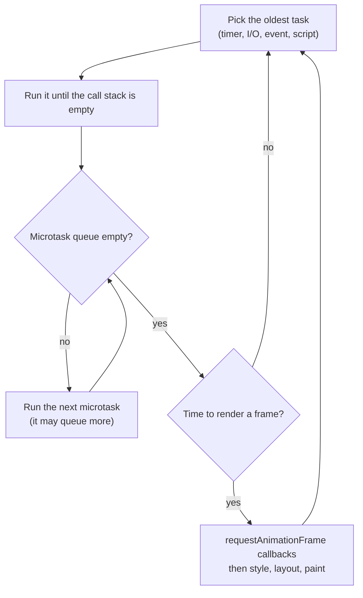
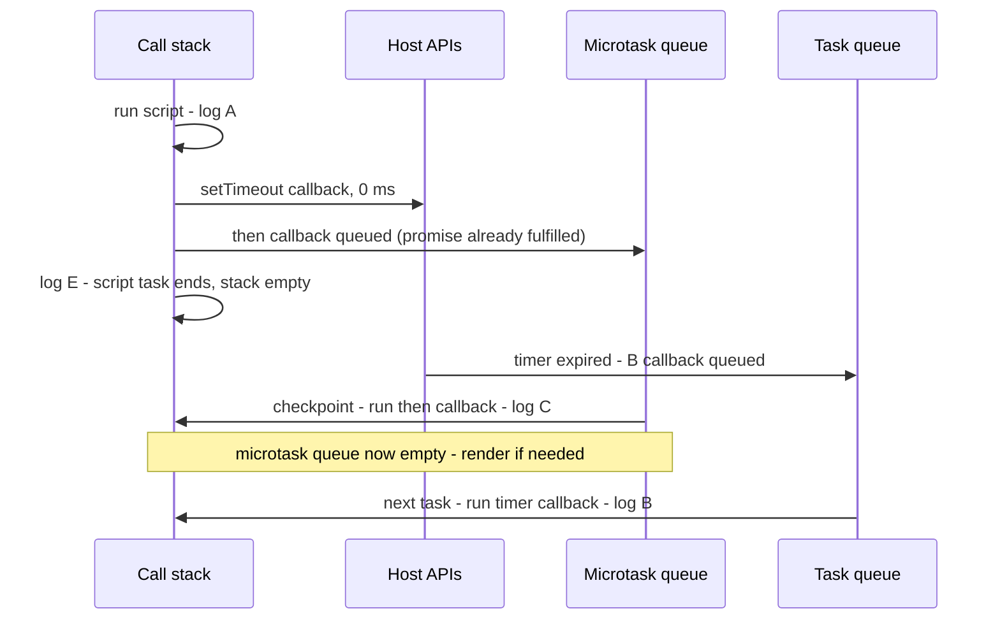
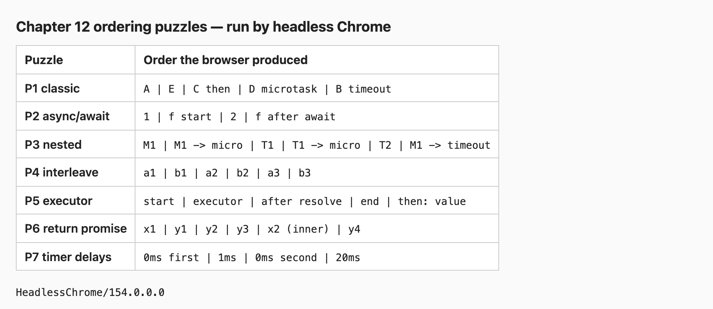
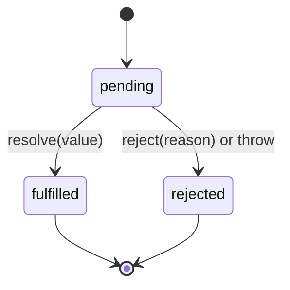

# Chapter 12 — Asynchronous JavaScript

JavaScript runs your code on **one thread**, yet a web page can download data, animate, and respond to clicks at the same time, and a Node server can handle thousands of connections. The trick is **asynchrony**: slow work is handed to the host (browser or Node), and your code is called back later, when the result is ready. The piece that decides *when* each callback runs is the **event loop**. This chapter explains the event loop precisely — precisely enough to predict the output of tricky ordering puzzles — and then the three generations of async code built on top of it: callbacks, promises, and `async`/`await`.

**What you'll learn**

1. Why JavaScript is single-threaded and what "blocking" means.
2. The event loop: call stack, task queue, microtask queue, and rendering — with diagrams.
3. Seven ordering puzzles, each run for real in Node **and** Chrome.
4. Node's own additions: `process.nextTick`, `setImmediate`, and the loop phases.
5. Timers: `setTimeout`, `setInterval`, and their guarantees (and non-guarantees).
6. Callbacks, error-first callbacks, and why "callback hell" led to promises.
7. Promises: states, chaining, error flow, `withResolvers`, `Promise.try`.
8. The combinators `all`, `allSettled`, `race`, `any`.
9. `async`/`await`: sequential vs parallel, loops, error handling.
10. Cancellation with `AbortController` and `AbortSignal`.
11. Async iteration: `for await…of`, async generators, `Array.fromAsync`.
12. Production patterns: retry with backoff, concurrency limits, stale responses.

**Before you start.** You need functions and closures ([Chapter 4](../04-functions-scope-and-closures/README.md)), and generators/iterators ([Chapter 8](../08-maps-sets-iterators-and-generators/README.md)) for §12.12. Errors and `try`/`catch` are covered in [Chapter 11](../11-errors-and-debugging/README.md) — §11.5 previewed async errors; this chapter completes the story. Top-level `await` in modules is explained in [Chapter 10](../10-modules-and-tooling/README.md#105-top-level-await).

All runnable code is in [`code/`](code/). Outputs are real (Node 24). Where timing matters, programs print rounded or yes/no values so the output is stable between runs.

---

## 12.1 One thread, and why blocking hurts

### What it is
A **thread** is one sequence of instructions being executed. JavaScript gives your code exactly one: at any moment, at most one line of *your* JavaScript is running. **Synchronous** code runs start to finish without pausing. **Asynchronous** code starts an operation now and handles its result later, through a callback.

Analogy: a restaurant with one chef. A good chef doesn't stand watching the oven for 20 minutes — they put the dish in, set a timer (asynchronous), and cook other orders. When the timer rings, they come back to that dish. A bad chef who stares at the oven (blocking) makes every other customer wait.

Terms:
- **Blocking** — code that keeps the thread busy, so nothing else (other callbacks, clicks, rendering) can run.
- **Non-blocking I/O** — input/output (network, disk) performed by the host in the background; JavaScript only runs when the result arrives.
- **Host** / **runtime** — the environment around the engine: the browser (Web APIs) or Node (libuv, its C library for async I/O). The engine (V8) runs JavaScript; the host does the waiting.

### Why it matters
In a browser, the same thread that runs your JavaScript also handles user input and (usually) page rendering. A 200 ms synchronous loop freezes scrolling, typing and animation for 200 ms. In Node, a blocking handler stalls *every* request the server is handling.

[`code/01_single_thread.mjs`](code/01_single_thread.mjs):

```js
const start = Date.now();
setTimeout(() => {
  const waited = Date.now() - start;
  console.log(`timer asked for 0 ms, ran after >= 200 ms: ${waited >= 200}`);
}, 0);

console.log('busy loop starts');
while (Date.now() - start < 200) { /* burn CPU: nothing else can run */ }
console.log('busy loop ends (the timer is still waiting)');

// Asynchronous work does NOT block: the callback is queued and we carry on.
import { readFile } from 'node:fs/promises';
readFile(new URL(import.meta.url)).then((buf) => console.log('file read finished,', buf.length > 0 ? 'got bytes' : 'empty'));
console.log('readFile started - main script keeps going');
```

Output:
```
busy loop starts
busy loop ends (the timer is still waiting)
readFile started - main script keeps going
timer asked for 0 ms, ran after >= 200 ms: true
file read finished, got bytes
```

The 0 ms timer could not interrupt the loop. JavaScript callbacks are never pre-empted: a callback runs to completion before anything else starts (**run-to-completion**). That rule is a gift — you never need locks around your variables — and a responsibility: keep each piece of work short.

### When you really need parallel CPU work
Heavy computation (image processing, big parsing) belongs off the main thread: **Web Workers** in the browser ([Chapter 14](../14-browser-apis-and-security/README.md#148-web-workers)) or `worker_threads` in Node ([Chapter 15](../15-nodejs-basics/README.md)). Workers are separate threads with separate memory that talk by messages.

### TL;DR
One thread runs your JavaScript; the host waits for I/O and timers in the background. Long synchronous work blocks everything, including 0 ms timers and rendering.

---

## 12.2 The event loop

### What it is
The **event loop** is the host's scheduler. It repeatedly picks a piece of waiting work and runs it on the single JavaScript thread. The parts:

| Part | What it holds | Examples |
|---|---|---|
| **Call stack** | Functions currently executing, newest on top | Your main script, a callback in progress |
| **Host APIs** (Web APIs / libuv) | Operations in progress *outside* JavaScript | A timer counting down, an HTTP request, a file read |
| **Task queue** (a.k.a. macrotask / callback queue) | Callbacks ready to run, one per loop turn | Timer callbacks, I/O callbacks, `message` events, user events like `click` |
| **Microtask queue** | Short follow-up jobs that must run "as soon as the current code finishes" | Promise `then`/`catch`/`finally` callbacks, code after `await`, `queueMicrotask`, `MutationObserver` callbacks |
| **Rendering** (browsers) | Style, layout, paint — typically up to ~60 times a second | `requestAnimationFrame` callbacks run just before paint |

The HTML specification (section "Event loops") defines the browser algorithm; ECMAScript itself only defines **jobs** (promise reactions) and leaves scheduling to the host. The spec actually allows several task queues (for example, user-input tasks may be prioritised over timers), but for predicting order you can treat tasks as one FIFO queue per source.

### How it works
One turn of the browser event loop, simplified from the HTML spec:

1. **Run one task** — take the oldest runnable task and run its callback until the call stack is empty.
2. **Perform a microtask checkpoint** — run microtasks until the microtask queue is **empty**, including any microtasks queued *by* microtasks.
3. **Maybe render** — if it's time for a new frame (and something changed): run `requestAnimationFrame` callbacks, recalculate style and layout, paint.
4. Go to step 1 (or sleep until a task arrives).

The initial script is itself a task, so step 2 happens right after your top-level code finishes. Microtasks also run whenever the call stack becomes empty during a task — for example between two event listeners when the user physically clicks (but not when you call `el.click()` from code, because your code is still on the stack).



The same flow as a sequence over time, for this code:

```js
console.log('A');
setTimeout(() => console.log('B timeout'), 0);
Promise.resolve().then(() => console.log('C then'));
console.log('E');
```



Output: `A`, `E`, `C then`, `B timeout`.

### Why microtasks exist
A promise callback should run **after** the current synchronous code (so behaviour is consistent — callbacks are always asynchronous) but **before** anything else gets a chance to observe inconsistent state (no other task, no render in between). Microtasks give exactly that "at the end of the current job" timing.

### Common mistakes
- **Thinking `setTimeout(fn, 0)` runs "immediately".** It runs in a *later task*, after every pending microtask and possibly after a render.
- **Microtask starvation.** A microtask that always queues another microtask (e.g. a recursive `.then` loop) never lets the loop reach step 3 or step 1 — the page freezes exactly like a `while(true)`. Use `setTimeout` (a task) to yield when chunking long work.
- **Expecting `await` to yield to rendering.** `await` only schedules a microtask; the browser can't paint in between. To let the page update during a long job, split it across tasks (`setTimeout`, `scheduler.yield()` where supported, or `requestAnimationFrame`).

### TL;DR
Loop: one task → **all** microtasks → maybe render → repeat. Promises and `await` continuations are microtasks; timers, I/O and events are tasks.

---

## 12.3 Ordering puzzles

Interviews love "what does this print?" questions. With the rules from §12.2 you can answer any of them:

1. Run all synchronous code first (including promise **executors** and code before the first `await`).
2. Then drain the microtask queue in FIFO order, adding new microtasks to the end as they're created.
3. Then take the next task (timers in order of due time; equal times in creation order), run it, drain microtasks again, and so on.

[`code/02_ordering_puzzles.mjs`](code/02_ordering_puzzles.mjs) runs seven puzzles. Each one logs into an array, the program waits for all queues to drain, then prints the order. (Try predicting each before reading the answer.)

```js
// P1 - the classic: sync code, then ALL microtasks, then the next task
puzzle('P1 classic', (log) => {
  log('A');
  setTimeout(() => log('B timeout'), 0);
  Promise.resolve().then(() => log('C then'));
  queueMicrotask(() => log('D microtask'));
  log('E');
});

// P2 - async/await: code before the first await runs synchronously
puzzle('P2 async/await', (log) => {
  async function f() {
    log('f start');
    await null;             // everything after this line is a microtask
    log('f after await');
  }
  log('1');
  f();
  log('2');
});

// P3 - microtasks queued BY microtasks still run before the next task
puzzle('P3 nested', (log) => {
  setTimeout(() => {
    log('T1');
    Promise.resolve().then(() => log('T1 -> micro'));
  }, 0);
  setTimeout(() => log('T2'), 0);
  Promise.resolve().then(() => {
    log('M1');
    setTimeout(() => log('M1 -> timeout'), 0);
    Promise.resolve().then(() => log('M1 -> micro'));
  });
});

// P4 - two promise chains interleave one step at a time
puzzle('P4 interleave', (log) => {
  Promise.resolve().then(() => log('a1')).then(() => log('a2')).then(() => log('a3'));
  Promise.resolve().then(() => log('b1')).then(() => log('b2')).then(() => log('b3'));
});

// P5 - the executor of new Promise runs synchronously; then() callbacks do not
puzzle('P5 executor', (log) => {
  log('start');
  const p = new Promise((resolve) => {
    log('executor');
    resolve('value');
    log('after resolve');   // resolve() does not stop the function
  });
  p.then((v) => log(`then: ${v}`));
  log('end');
});

// P6 - returning a promise from then() costs extra microtask ticks
puzzle('P6 return promise', (log) => {
  Promise.resolve()
    .then(() => { log('x1'); return Promise.resolve('inner'); }) // adopts: +2 ticks
    .then((v) => log(`x2 (${v})`));
  Promise.resolve()
    .then(() => log('y1'))
    .then(() => log('y2'))
    .then(() => log('y3'))
    .then(() => log('y4'));
});

// P7 - timers with different delays: order is by due time, then by creation
puzzle('P7 timer delays', (log) => {
  setTimeout(() => log('20ms'), 20);
  setTimeout(() => log('0ms first'), 0);
  setTimeout(() => log('1ms'), 1);
  setTimeout(() => log('0ms second'), 0);
});
// ... the harness runs each puzzle, waits 50 ms, prints the collected order
```

Output (Node 24):
```
P1 classic         -> A | E | C then | D microtask | B timeout
P2 async/await     -> 1 | f start | 2 | f after await
P3 nested          -> M1 | M1 -> micro | T1 | T1 -> micro | T2 | M1 -> timeout
P4 interleave      -> a1 | b1 | a2 | b2 | a3 | b3
P5 executor        -> start | executor | after resolve | end | then: value
P6 return promise  -> x1 | y1 | y2 | y3 | x2 (inner) | y4
P7 timer delays    -> 0ms first | 1ms | 0ms second | 20ms
```

The same puzzles, pasted into a web page ([`code/puzzles_browser.html`](code/puzzles_browser.html)) and run by headless Chrome, give the identical order — promise and timer ordering is standardized, not a Node quirk:



*Figure — the ordering puzzles run in Chrome 154 (screenshot of the page after the script finished).*

### The explanations
| Puzzle | Why |
|---|---|
| **P1** | `A`, `E` are synchronous. `C` and `D` are microtasks, run in the order queued. `B` is a task, so it waits for the microtask queue to empty. |
| **P2** | Calling an async function runs its body synchronously **up to the first `await`**. The rest is a microtask, so `2` prints before `f after await`. |
| **P3** | First the script's microtask `M1` runs; it queues a timer (behind T1 and T2) and a microtask, which runs immediately in the same checkpoint. Then task T1 runs; its microtask runs **before** task T2. Finally the timer queued by M1. |
| **P4** | Each `.then` in a chain is only queued when the previous one settles, so two chains alternate: a1, b1, a2, b2… |
| **P5** | The executor passed to `new Promise` runs synchronously. `resolve()` doesn't return or throw — later lines still run. `then` callbacks are always async, even on an already-resolved promise. |
| **P6** | When a `then` callback returns a promise (a **thenable**), the outer promise must *adopt* it: one microtask to call `inner.then(...)`, another for that reaction to fire, then the next `then`. So `x2` lands after `y3`. Returning a plain value would have printed `x2` right after `y1`. |
| **P7** | Timers fire in order of due time; equal due times in creation order. Node (and current Chrome) treat `0` like `1` ms here, so `1ms` sits between the two `0ms` timers — don't write code that depends on such fine differences. |

P6 is why `return await somePromise` inside an `async` function used to be discouraged "for performance"; the difference is a couple of microtasks and doesn't matter in practice — and `return await` inside `try` is actually *required* to catch the rejection (§12.9).

### In the interview
**30-second answer:** "Synchronous code runs first. Then the engine drains the whole microtask queue — promise callbacks, code after `await`, `queueMicrotask` — including microtasks added along the way. Only then does the event loop take the next task, like a `setTimeout` callback or an event, and after each task it drains microtasks again. So promises always beat `setTimeout(0)`."

- *Q: Does `await` of a non-promise pause?* A: Yes — `await 5` still defers the rest of the function to a microtask.
- *Q: Why does P6's `x2` come late?* A: Adopting a returned thenable takes two extra microtask ticks.
- *Q: Can a microtask starve rendering?* A: Yes; the loop can't render or run tasks until the microtask queue is empty.

### Self-check
1. `setTimeout(a, 0); queueMicrotask(b); Promise.resolve().then(c);` → order? → `b`, `c`, `a`.
2. What prints first: code inside `new Promise(executor)` or code after the `new Promise(...)` line? → The executor (it's synchronous).
3. A microtask queues a timer and another microtask. Which runs first? → The microtask.

### TL;DR
Sync → all microtasks (FIFO, including new ones) → one task → all microtasks → … Executors and code before the first `await` are synchronous.

---

## 12.4 Node's event loop: `nextTick`, `setImmediate` and phases

### What it is
Node's loop is implemented by **libuv** and cycles through **phases**, each with its own queue:

| Phase | Runs |
|---|---|
| **timers** | Expired `setTimeout` / `setInterval` callbacks |
| **pending callbacks** | Some deferred system-level callbacks (e.g. certain TCP errors) |
| **poll** | Waits for and runs I/O callbacks (files, sockets) |
| **check** | `setImmediate` callbacks |
| **close callbacks** | `'close'` events, e.g. `socket.on('close')` |

Between every callback, Node drains two queues: first the **`process.nextTick` queue**, then the **promise microtask queue** (that's the order in CommonJS; see the ES-module twist below).

[`code/03_node_queues.mjs`](code/03_node_queues.mjs):

```js
import { readFile } from 'node:fs';

const log = [];
setTimeout(() => log.push('timeout'), 0);
setImmediate(() => log.push('immediate'));
Promise.resolve().then(() => log.push('promise'));
process.nextTick(() => log.push('nextTick'));
log.push('sync');
setTimeout(() => {
  console.log('main module :', log.join(' | '));
  console.log('  (timeout vs immediate at top level can swap between runs - see text)');

  // Inside an I/O callback the order of immediate vs timeout IS guaranteed.
  readFile(new URL(import.meta.url), () => {
    const io = [];
    setTimeout(() => io.push('timeout'), 0);
    setImmediate(() => io.push('immediate'));
    process.nextTick(() => io.push('nextTick'));
    Promise.resolve().then(() => io.push('promise'));
    setTimeout(() => console.log('in I/O cb  :', io.join(' | ')), 20);
  });
}, 30);
```

Output:
```
main module : sync | promise | nextTick | immediate | timeout
  (timeout vs immediate at top level can swap between runs - see text)
in I/O cb  : nextTick | promise | immediate | timeout
```

And the CommonJS version, [`code/03b_node_queues_cjs.js`](code/03b_node_queues_cjs.js):

```js
const log = [];
Promise.resolve().then(() => log.push('promise'));
process.nextTick(() => log.push('nextTick'));
log.push('sync');
setTimeout(() => console.log('CommonJS main:', log.join(' | ')), 10);
```

Output:
```
CommonJS main: sync | nextTick | promise
```

### Reading the results
1. **`nextTick` vs promises.** Normally `nextTick` callbacks run before promise callbacks (the I/O callback and the CommonJS script show this). But an ES module's top level is itself evaluated inside promise machinery, so its promise microtasks drain before Node gets to the `nextTick` queue — hence `promise | nextTick` in the `.mjs` main module. Don't build logic on this difference.
2. **`setImmediate` vs `setTimeout(0)` at top level** is **not deterministic**: it depends on whether 1 ms has already passed when the loop first checks timers. This run printed `immediate` first; another run may not.
3. **Inside an I/O callback** it *is* deterministic: after the poll phase comes the check phase, so `setImmediate` always wins over a new `setTimeout(0)`.

### When to use which
| Want | Use |
|---|---|
| Run after current code, before anything else (portable) | `queueMicrotask(fn)` or `Promise.resolve().then(fn)` |
| Node-only "right after this operation", e.g. emit an event after the constructor returns | `process.nextTick(fn)` (Node docs recommend `queueMicrotask` for most new code) |
| Yield to I/O, then continue | `setImmediate(fn)` |
| Run after a delay | `setTimeout(fn, ms)` |

**Common mistake:** recursive `process.nextTick` starves I/O exactly like recursive microtasks do. The architecture of Node (libuv, thread pool) is covered in [Chapter 15](../15-nodejs-basics/README.md).

### TL;DR
Node phases: timers → pending → poll (I/O) → check (`setImmediate`) → close. Between callbacks: `nextTick` queue, then promises (ESM top level flips these). `setImmediate` vs `setTimeout(0)` is only guaranteed inside I/O callbacks.

---

## 12.5 Timers

### What it is
| Function | Does | Cancel with |
|---|---|---|
| `setTimeout(fn, ms, ...args)` | Run `fn(...args)` once, **at least** `ms` later | `clearTimeout(id)` |
| `setInterval(fn, ms, ...args)` | Run repeatedly, roughly every `ms` | `clearInterval(id)` |
| `queueMicrotask(fn)` | Run as a microtask | — |
| `requestAnimationFrame(fn)` (browser) | Run before the next paint ([Ch. 14](../14-browser-apis-and-security/README.md#145-timers-and-requestanimationframe)) | `cancelAnimationFrame(id)` |
| `setImmediate(fn)` (Node) | Run in the check phase | `clearImmediate(id)` |

The returned **handle** is a number in browsers and a `Timeout` object in Node (which also has `.unref()` to let the process exit while the timer is pending, and `.refresh()`).

### How it works
1. The timer is registered with the host; your code continues.
2. When the delay has elapsed, the callback is put in the task queue.
3. It runs when the loop reaches it — possibly much later if the thread is busy.

The delay is therefore a **minimum**, never a guarantee. Other rules (HTML spec + practice):
- Negative delays become `0`.
- After 5 levels of nested timers (a timer scheduling a timer scheduling…), browsers clamp delays below 4 ms up to **4 ms**.
- Browsers throttle timers in background tabs (often to once per second or less) to save battery.
- Delays above 2³¹−1 ms (about 24.8 days) overflow; Node prints a warning and uses 1 ms.

[`code/04_timers.mjs`](code/04_timers.mjs):

```js
import { setTimeout as sleep } from 'node:timers/promises';

// 1) Extra arguments are passed to the callback; the return value is a handle
const t = setTimeout((a, b) => console.log('never runs', a, b), 50, 'x', 'y');
clearTimeout(t);
console.log('cleared a timer before it fired');

// 2) setInterval until a condition, then clearInterval
let ticks = 0;
const id = setInterval(() => {
  ticks += 1;
  console.log('tick', ticks);
  if (ticks === 3) clearInterval(id);
}, 10);
await sleep(60);

// 3) The delay is a MINIMUM: a busy main thread delays the callback
const t0 = performance.now();
setTimeout(() => console.log(`asked 10 ms, got >= 40 ms: ${performance.now() - t0 >= 40}`), 10);
while (performance.now() - t0 < 40) {}
await sleep(20);

// 4) Recursive setTimeout: the gap is measured from the END of each run
let n = 0;
function poll() {
  n += 1;
  if (n < 3) setTimeout(poll, 5);
  else console.log('recursive setTimeout ran', n, 'times');
}
poll();
await sleep(40);

// 5) Too-large delays overflow: > 2^31-1 ms (~24.8 days) becomes 1 ms
const big = setTimeout(() => console.log('huge delay fired immediately!'), 2 ** 31);
await sleep(20);
clearTimeout(big);

// 6) Promise-based sleep
const s = performance.now();
await sleep(15);
console.log(`awaited sleep(15): >= 15 ms: ${performance.now() - s >= 14.5}`);
```

Output (the three `(node:…)` lines are the warning Node writes to stderr):
```
cleared a timer before it fired
tick 1
tick 2
tick 3
asked 10 ms, got >= 40 ms: true
recursive setTimeout ran 3 times
(node:51319) TimeoutOverflowWarning: 2147483648 does not fit into a 32-bit signed integer.
Timeout duration was set to 1.
(Use `node --trace-warnings ...` to show where the warning was created)
huge delay fired immediately!
awaited sleep(15): >= 15 ms: true
```

### `setInterval` vs recursive `setTimeout`
| | `setInterval(fn, 100)` | recursive `setTimeout(fn, 100)` |
|---|---|---|
| Spacing | Start-to-start; if `fn` takes 80 ms only ~20 ms idle | End-to-start; always ≥ 100 ms of idle between runs |
| Slow or async work | Runs can bunch up or overlap (an async `fn` isn't awaited) | Next run scheduled only after this one finishes |
| Change the delay each time (backoff) | Awkward | Easy |

For polling a server, prefer recursive `setTimeout` (after the previous request completes).

### Common mistakes
- Passing the *result* of a call: `setTimeout(save(), 1000)` runs `save` now. Pass a function: `setTimeout(save, 1000)` or `() => save()`.
- Forgetting to clear intervals (e.g. when a component unmounts) → leaks and duplicate work.
- Using timers to "wait until something is ready" — listen for the actual event or await the actual promise instead.
- A method passed as callback loses `this`: `setTimeout(obj.method, 10)` — use an arrow or `bind` ([Chapter 9](../09-this-prototypes-and-classes/README.md)).

### TL;DR
Timer delays are minimums; the callback runs as a task when the thread is free. Clear what you schedule. Prefer recursive `setTimeout` for polling; `node:timers/promises` gives an awaitable `setTimeout`.

---

## 12.6 Callbacks and callback hell

### What it is
A **callback** is a function you pass to another function, to be called later with the result. It's the oldest async style in JavaScript (event handlers, `setTimeout`, Node's original APIs). Node standardized **error-first callbacks**: `callback(err, result)` — `err` is `null` on success.

[`code/05_callbacks.mjs`](code/05_callbacks.mjs) — key parts:

```js
// 1) Error-first callbacks (the Node convention): cb(err, result)
readFile(new URL('./missing.txt', import.meta.url), 'utf8', (err, text) => {
  if (err) { console.log('error-first:', err.code); return; }
  console.log(text);
});

// 2) Callback hell: each step needs the previous result
db.getUser(1, (err, user) => {
  if (err) return console.log(err.message);
  db.getOrders(user, (err, orders) => {
    if (err) return console.log(err.message);
    db.getItems(orders[0], (err, items) => {
      if (err) return console.log(err.message);
      console.log('pyramid result:', user.name, orders[0].id, items);
    });
  });
});

// 3) Inversion of control: a buggy library calls your callback twice
function buggyCharge(amount, cb) { cb(null, 'ok'); cb(null, 'ok'); }
let charges = 0;
buggyCharge(10, () => { charges += 1; });
console.log('callback-style charges:', charges);

// A promise can settle only once, so the second call is ignored
const charged = new Promise((resolve) => buggyCharge(10, (_e, r) => resolve(r)));
let promiseCharges = 0;
await charged.then(() => { promiseCharges += 1; });
console.log('promise-style charges :', promiseCharges);

// 4) Zalgo: a callback that is sometimes sync, sometimes async
function getValue(key, cb) {
  if (cache.has(key)) cb(cache.get(key));          // sync!
  else setTimeout(() => cb(42), 0);                // async
}
// ...
```

Output:
```
callback-style charges: 2
promise-style charges : 1
error-first: ENOENT
pyramid result: Ada 7 [ 'book', 'pen' ]
zalgo order: cached cb | after call (a) | after call (b) | fetched cb
```

### The problems callbacks have
| Problem | What goes wrong | How promises fix it |
|---|---|---|
| **Callback hell** ("pyramid of doom") | Each dependent step nests deeper; error checks repeat at every level | Flat `.then` chains or linear `await` code |
| **Error handling** | `try/catch` can't catch errors thrown in a later callback; every level must check `err` | One `.catch` / one `try` catches errors from any step |
| **Inversion of control** | You trust someone else's code to call you once, not zero or twice | A promise settles exactly once |
| **"Releasing Zalgo"** | A callback that's sometimes sync and sometimes async makes ordering unpredictable (see the output: the cached callback ran *before* "after call") | `then` callbacks are always async |
| **Composition** | Running things in parallel and waiting for all is hand-written counting code | `Promise.all` and friends |

Callbacks remain perfect for **repeated events** (clicks, stream data) — a promise can only deliver one value. Named functions and early `return`s flatten a pyramid a bit, but the real fix is promises.

### TL;DR
Callbacks: pass a function to be called later; Node uses `cb(err, result)`. They nest badly, can't use `try/catch`, and depend on trusting the caller — promises solve all of these. Keep callbacks for multi-fire events.

---

## 12.7 Promises

### What it is
A **promise** is an object representing a value that will be available later — or an error explaining why not. Analogy: a pager a restaurant hands you. You can go sit down (your code continues); when the pager buzzes you either get your food (fulfilled) or an apology (rejected). It buzzes exactly once.

States:



- **pending** — not finished yet.
- **fulfilled** — finished with a value.
- **rejected** — failed with a reason (normally an `Error`).
- **settled** — fulfilled or rejected; a settled promise never changes again.
- **resolved** — "locked in": either settled, or following another promise. (A promise resolved with a pending promise is still pending.)

### How it works
1. `new Promise((resolve, reject) => { … })` — the **executor** runs immediately and synchronously; it starts the work and later calls `resolve` or `reject`. If it throws, the promise is rejected.
2. `promise.then(onFulfilled, onRejected)` registers reactions and returns a **new** promise.
3. When the promise settles, reactions are queued as microtasks.
4. The new promise from `then` settles with whatever the reaction **returns** (a value → fulfilled; a promise → adopt its outcome) or **throws** (→ rejected).
5. A rejection skips `then(onFulfilled)` reactions until it meets a `catch` (or a `then` with `onRejected`). After `catch` returns normally, the chain is fulfilled again.
6. `finally(fn)` runs `fn` with no argument either way and passes the original outcome through (unless `fn` throws or returns a rejected promise).

[`code/06_promises.mjs`](code/06_promises.mjs):

```js
const later = (value, ms, fail = false) =>
  new Promise((resolve, reject) => setTimeout(() => (fail ? reject(new Error(value)) : resolve(value)), ms));

const p = later('done', 10);
console.log('right away :', p);      // Node shows the state
await p;
console.log('after await:', p);

// Chaining: each then() returns a NEW promise
const result = await Promise.resolve(2)
  .then((x) => x * 10)               // return a value -> next then gets it
  .then((x) => later(x + 1, 5))      // return a promise -> chain waits for it
  .then((x) => { throw new Error(`boom at ${x}`); })
  .then(() => console.log('skipped because the chain is rejected'))
  .catch((err) => { console.log('caught:', err.message); return 'recovered'; })
  .finally(() => console.log('finally: runs either way, sees no value'));
console.log('chain result:', result);

// Mistake: forgetting to return inside then() breaks the chain
await Promise.resolve(1)
  .then((x) => { later(x + 1, 5); })  // no return!
  .then((v) => console.log('forgot return ->', v));

// resolve/reject only count once
const once = new Promise((resolve, reject) => { resolve('first'); resolve('second'); reject(new Error('ignored')); });
console.log('settles once:', await once);

// Promise.resolve adopts thenables; a promise is passed through unchanged
const thenable = { then(onOk) { onOk('from a thenable'); } };
console.log('thenable   :', await Promise.resolve(thenable));
console.log('same obj   :', Promise.resolve(p) === p);

// Promisify a callback API
const readFileP = promisify(readFile);
const text = await readFileP(new URL(import.meta.url), 'utf8');
console.log('promisify  :', text.split('\n')[0]);

// Promise.withResolvers (ES2024): resolve from outside the executor
const { promise, resolve } = Promise.withResolvers();
setTimeout(() => resolve('resolved from outside'), 5);
console.log('withResolvers:', await promise);

// Promise.try (ES2025): run a function that may throw synchronously OR return a promise
const risky = (x) => { if (x < 0) throw new RangeError('negative'); return later(x * 2, 1); };
for (const x of [3, -1]) {
  await Promise.try(risky, x).then((v) => console.log('Promise.try ok  :', v), (e) => console.log('Promise.try fail:', e.message));
}
```

Output:
```
right away : Promise { <pending> }
after await: Promise { 'done' }
caught: boom at 21
finally: runs either way, sees no value
chain result: recovered
forgot return -> undefined
settles once: first
thenable   : from a thenable
same obj   : true
promisify  : import { promisify } from 'node:util';
withResolvers: resolved from outside
Promise.try ok  : 6
Promise.try fail: negative
```

### Key API
| API | Meaning |
|---|---|
| `new Promise(executor)` | Wrap a callback API. Rarely needed otherwise (**explicit-construction anti-pattern**: wrapping something that already returns a promise). |
| `Promise.resolve(v)` / `Promise.reject(e)` | Already-settled promise (`resolve` adopts thenables, returns `v` itself if it's a native promise) |
| `.then(ok, fail)` / `.catch(fail)` / `.finally(fn)` | Reactions; each returns a new promise |
| `Promise.withResolvers()` (ES2024) | `{ promise, resolve, reject }` — handy when resolve is triggered by an event elsewhere |
| `Promise.try(fn, ...args)` (ES2025) | Call `fn`; a sync throw becomes a rejection, a returned value/promise is adopted |
| `util.promisify(fn)` (Node) | Turn an error-first callback function into a promise-returning one. Most Node APIs also have promise versions: `node:fs/promises`, `node:timers/promises`. |

A **thenable** is any object with a `then` method; promises from different libraries interoperate through this duck-typed protocol ([Chapter 9 — duck typing](../09-this-prototypes-and-classes/README.md#97-instanceof-and-type-checks)).

### Common mistakes
- **Forgetting `return`** in a `then` callback (see output: `undefined`, and the inner promise's errors become unhandled).
- **Nesting** `then` inside `then` instead of returning — recreates callback hell.
- **`.then(ok, fail)` vs `.then(ok).catch(fail)`:** the first form does **not** catch errors thrown inside `ok`; the second does.
- **No `catch` at the end** → an unhandled rejection (crashes Node, logs in browsers) — [§11.5](../11-errors-and-debugging/README.md#115-errors-in-asynchronous-code-preview).
- **Thinking promises are cancellable or lazy.** A promise represents work that has *already started*; use `AbortController` (§12.11) to cancel the work.

### Self-check
1. What does `.then(() => 5)` return? → A new promise fulfilled with 5.
2. `Promise.resolve().then(() => { throw new Error('x') }).then(() => 1).catch(e => 2)` → fulfils with? → `2`.
3. What does `finally`'s callback receive? → Nothing; it can't see the value or reason.
4. Is the executor synchronous? → Yes.

### TL;DR
A promise is a one-time, eventually-settled value: pending → fulfilled/rejected. `then` returns a new promise whose outcome is the callback's return value or thrown error. Always return inside `then`, end chains with `catch`.

---

## 12.8 Promise combinators: `all`, `allSettled`, `race`, `any`

### What it is
Static methods that take an iterable of promises (or plain values) and return one promise.

| Method | Fulfils when | Rejects when | Result | Added |
|---|---|---|---|---|
| `Promise.all` | **all** fulfil | **first** rejection (fail-fast) | array of values in **input order** | ES2015 |
| `Promise.allSettled` | all settle (never rejects) | never | array of `{status, value}` / `{status, reason}` | ES2020 |
| `Promise.race` | first to **settle** is fulfilled | first to settle is rejected | that value/reason | ES2015 |
| `Promise.any` | first to **fulfil** | **all** reject | value, or `AggregateError` with `.errors` | ES2021 |

[`code/07_combinators.mjs`](code/07_combinators.mjs):

```js
console.log('all       :', await Promise.all([later('slow', 30), later('fast', 10), 42]), at());
t0 = performance.now();
await Promise.all([later('ok', 30), later('db down', 10, true)])
  .catch((e) => console.log('all fails :', e.message, 'after', at()));

const settled = await Promise.allSettled([later('ok', 5), later('bad', 5, true)]);
console.log('allSettled:', settled.map((r) => (r.status === 'fulfilled' ? `ok:${r.value}` : `err:${r.reason.message}`)));

console.log('race      :', await Promise.race([later('A', 20), later('B', 10)]));
await Promise.race([later('A', 20), later('B failed', 10, true)]).catch((e) => console.log('race err  :', e.message));

console.log('any       :', await Promise.any([later('mirror1 down', 5, true), later('mirror2', 15)]));
await Promise.any([later('x', 5, true), later('y', 5, true)])
  .catch((e) => console.log('any fails :', e.name, e.errors.map((x) => x.message)));

console.log('empty     :', await Promise.all([]), (await Promise.allSettled([])).length);
await Promise.any([]).catch((e) => console.log('any([])   :', e.name));
console.log('race([]) stays pending forever - never await it');

const withTimeout = (promise, ms) =>
  Promise.race([promise, new Promise((_, rej) => setTimeout(() => rej(new Error(`timed out after ${ms} ms`)), ms))]);
await withTimeout(later('slow api', 100), 20).catch((e) => console.log('timeout   :', e.message));
```

Output:
```
all       : [ 'slow', 'fast', 42 ] 30 ms
all fails : db down after 10 ms
allSettled: [ 'ok:ok', 'err:bad' ]
race      : B
race err  : B failed
any       : mirror2
any fails : AggregateError [ 'x', 'y' ]
empty     : [] 0
any([])   : AggregateError
race([]) stays pending forever - never await it
timeout   : timed out after 20 ms
```

Notes:
- `all` took 30 ms (the slowest), not 40 — the promises ran concurrently. The results are in input order even though `fast` finished first. Plain values like `42` are allowed.
- On failure, `all` rejects after 10 ms, but the other operation **keeps running** — combinators don't cancel anything. Pair them with an `AbortSignal` (§12.11) if you need that.
- `withTimeout` via `race` is a classic interview answer; in real code prefer `AbortSignal.timeout(ms)`, which also stops the underlying work (e.g. the HTTP request).

### Choosing
| Situation | Use |
|---|---|
| Load user, settings and feed; the page needs all three | `all` |
| Send 20 notifications; report which failed | `allSettled` |
| Fastest of several mirrors / CDNs | `any` |
| A result or a timeout, whichever comes first | `race` (or `AbortSignal.timeout`) |

### In the interview
**30-second answer:** "`all` waits for everything and fails fast on the first rejection; `allSettled` waits for everything and never rejects; `race` settles with the first promise to settle, success or failure; `any` takes the first success and only rejects — with an `AggregateError` — if all fail. None of them cancel the losers."

- *Q: Implement `Promise.all`.* A: Return a new promise; keep a results array and a counter; for each input, `Promise.resolve(item).then(v => { results[i] = v; if (++done === n) resolve(results) }, reject)`; resolve immediately if the input is empty. ([Chapter 17](../17-javascript-for-interviews/README.md) has runnable polyfills.)
- *Q: `Promise.all` with one rejection — do the others stop?* A: No; their results are simply ignored.

### TL;DR
`all` (all or first failure), `allSettled` (everything, never rejects), `race` (first settled), `any` (first success, else `AggregateError`). They don't cancel.

---

## 12.9 `async` / `await`

### What it is
Syntax (ES2017) that lets you write promise-based code as if it were synchronous.
- An **`async` function** always returns a promise: a `return v` fulfils it with `v`; a `throw` rejects it.
- **`await expr`** pauses the async function until the promise settles, then gives back its value — or **throws** its rejection reason. Pausing doesn't block the thread: the function's remaining code is resumed later as a microtask, and meanwhile the caller continues.
- `await` is allowed only inside async functions and at the **top level of modules** ([Chapter 10](../10-modules-and-tooling/README.md#105-top-level-await)).

Under the hood an async function is like a generator that yields promises, driven by a runner that resumes it when each promise settles.

[`code/08_async_await.mjs`](code/08_async_await.mjs):

```js
// 1) An async function ALWAYS returns a promise
async function answer() { return 42; }
console.log('returns   :', answer() instanceof Promise, await answer());
async function fails() { throw new Error('nope'); }
console.log('throw ->  :', await fails().catch((e) => `rejected (${e.message})`));

// 2) Sequential vs parallel
let t = performance.now();
const a = await later('a', 30);
const b = await later('b', 30);
console.log('sequential:', a + b, round(performance.now() - t), 'ms');

t = performance.now();
const [c, d] = await Promise.all([later('c', 30), later('d', 30)]);
console.log('parallel  :', c + d, round(performance.now() - t), 'ms');

// 3) try/catch/finally with await
async function load(id) {
  try {
    return await later(`user ${id}`, 5, id < 0);   // "return await" keeps the error inside this try
  } catch (err) {
    return `fallback for ${err.message}`;
  } finally {
    console.log('  cleanup for', id);
  }
}
console.log('load(1)   :', await load(1));
console.log('load(-1)  :', await load(-1));

// 4) await in loops: for...of is sequential; forEach does NOT wait
const ids = [1, 2, 3];
const seen = [];
ids.forEach(async (id) => { await later(id, 12 - id * 3); seen.push(id); });
console.log('forEach done? seen =', seen, '(nothing yet!)');
await later(null, 20);
console.log('...later   seen =', seen, '(finish order, not input order)');
const inOrder = [];
for (const id of ids) inOrder.push(await later(id * 10, 2));
console.log('for...of  :', inOrder);
console.log('map+all   :', await Promise.all(ids.map((id) => later(id * 100, 5))));

// 5) Async arrow, async method, await of a non-promise
const double = async (x) => x * 2;
const obj = { async get() { return 'method'; } };
console.log('misc      :', await double(21), await obj.get(), await 'plain value');
```

Output:
```
returns   : true 42
throw ->  : rejected (nope)
sequential: ab 60 ms
parallel  : cd 30 ms
  cleanup for 1
load(1)   : user 1
  cleanup for -1
load(-1)  : fallback for user -1
forEach done? seen = [] (nothing yet!)
...later   seen = [ 3, 2, 1 ] (finish order, not input order)
for...of  : [ 10, 20, 30 ]
map+all   : [ 100, 200, 300 ]
misc      : 42 method plain value
```

### Sequential vs parallel — the most common performance bug
Two independent `await`s in a row take the **sum** of their times (60 ms); starting both first and awaiting `Promise.all` takes the **max** (30 ms). Rule: `await` one after another only when step 2 needs step 1's result.

```js
// Also parallel: start first, await later
const userP = getUser(id), postsP = getPosts(id);   // both requests in flight
const user = await userP, posts = await postsP;    // careful: if postsP rejects before
                                                    // userP settles, it's briefly "unhandled"
```
`Promise.all` is safer than the start-then-await form because it attaches handlers to every promise immediately.

### Loops
| Loop | Behaviour |
|---|---|
| `for…of` / `for` / `while` with `await` inside | One at a time, in order |
| `array.forEach(async …)` | Fires all, **doesn't wait**, ignores results and errors — avoid |
| `await Promise.all(array.map(async …))` | All at once, results in order |
| A concurrency-limited pool (§12.13) | At most N at a time |

### Error handling
- Wrap `await` in `try`/`catch`; the rejection reason arrives as the caught value.
- `return await p` inside `try` — without `await`, the function hands the promise back *before* it rejects, so your `catch` never sees the rejection and `finally` runs while the work is still in progress. Outside `try`, `return p` and `return await p` behave the same.
- Handle errors at the level that can do something about them (show a message, retry, fall back); let others propagate. Custom error classes and `cause` chaining are in [Chapter 11](../11-errors-and-debugging/README.md#113-custom-errors).
- A promise you create but never await can reject with nobody listening → `unhandledrejection`.

### Trade-offs: `async/await` vs `.then` chains
| | `async`/`await` | `.then` chains |
|---|---|---|
| Readability | Reads like sync code; normal `if`, loops, `try` | Fine for short linear pipelines |
| Errors | `try`/`catch` | `.catch` |
| Parallelism | Must remember `Promise.all` | Same |
| Where it works | Async functions and module top level | Anywhere |

They're the same machinery; mix freely (e.g. `await fetch(url).then(r => r.json())`).

### In the interview
**30-second answer:** "`async` functions always return promises; `await` suspends just that function until the promise settles, resuming it as a microtask, so the thread stays free. Rejections become exceptions, so `try/catch` works. The classic mistake is awaiting independent calls one by one — use `Promise.all` — and using `forEach` with an async callback, which doesn't wait."

- *Q: What does `async function f() {}; f()` return?* A: A promise fulfilled with `undefined`.
- *Q: Does code after an `await` run synchronously if the promise is already resolved?* A: No, it's always deferred to a microtask.
- *Q: Why `return await` inside `try`?* A: So the rejection is caught by that `try`'s `catch`.

### Self-check
1. Three independent 100 ms requests awaited one after another take…? → ~300 ms; with `Promise.all` ~100 ms.
2. Can you use `await` in a regular function? → No (SyntaxError); only in async functions or module top level.
3. Why did `seen` end up `[3, 2, 1]`? → `forEach` started all three at once; they finished in order of their delays.

### TL;DR
`async` → returns a promise; `await` → unwraps it or throws. Independent work → `Promise.all`. Sequential loop → `for…of`; never `forEach(async)`. `try { return await … } catch`.

---

## 12.10 Error handling across async code — a checklist

Chapter 11 introduced the rules ([§11.5](../11-errors-and-debugging/README.md#115-errors-in-asynchronous-code-preview)); now that you know the event loop, here is why they hold and how to apply them.

| Situation | Where the error goes | Handle with |
|---|---|---|
| `throw` inside an `async` function | Rejects its returned promise | `try/catch` around `await f()`, or `f().catch()` |
| `throw` inside a `then` callback | Rejects the promise `then` returned | A later `.catch` |
| `throw` inside a `setTimeout` / event callback | Uncaught error in *that task* — no enclosing `try` exists any more | `try/catch` **inside** the callback; global `error` handler for logging |
| Rejection nobody handles | `unhandledrejection` event (browser) / crash (Node ≥ 15) | Always `await` / `return` / `.catch` |
| One of many parallel operations fails | `Promise.all` rejects with the first; others ignored | `allSettled` if you need every outcome |
| Error in an error-first callback | Passed as the first argument | `if (err) …` first thing |

Rules of thumb:
1. Every promise has an owner who awaits it, returns it, or attaches `.catch`.
2. Catch where you can **act** (retry, fallback UI, HTTP 500 response); otherwise let it propagate, adding context with `new Error(msg, { cause })`.
3. Don't mix styles in one function: a callback API inside an async function should be promisified first, or its errors escape your `try`.
4. Global handlers (`window.onunhandledrejection`, `process.on('unhandledRejection')`) are for logging and reporting, not recovery.

### TL;DR
try/catch works across `await` because rejections are re-thrown on resumption. Errors in plain callbacks belong to their own task. Leave no promise floating.

---

## 12.11 Cancellation: `AbortController` and `AbortSignal`

### What it is
Promises can't be cancelled, but the *work* behind them can. The standard mechanism (from the DOM spec, also in Node) is:
- **`AbortController`** — the object held by whoever decides to cancel; `controller.abort(reason?)`.
- **`AbortSignal`** — `controller.signal`, handed to the operation; it has `.aborted`, `.reason`, an `abort` event and `throwIfAborted()`.

Analogy: the controller is the "cancel order" button at the till; the signal is the ticket the kitchen watches.

| API | Purpose | Support |
|---|---|---|
| `new AbortController()` / `.abort(reason)` | Manual cancel | All modern browsers, Node ≥ 15 |
| `AbortSignal.timeout(ms)` | Signal that aborts with a `TimeoutError` `DOMException` after `ms` | Baseline since 2022 (Node ≥ 17.3) |
| `AbortSignal.any([s1, s2])` | Aborts when any input aborts | Baseline since 2024 (Node ≥ 20.3) |
| `AbortSignal.abort(reason)` | Already-aborted signal | Modern browsers, Node |
| `{ signal }` option | Accepted by `fetch`, `addEventListener`, Node `timers/promises`, `fs.readFile`, streams, `events.on`… | — |

[`code/09_abort.mjs`](code/09_abort.mjs):

```js
// 1) Making your own function cancellable with an AbortSignal
function delay(ms, { signal } = {}) {
  return new Promise((resolve, reject) => {
    signal?.throwIfAborted();                       // already aborted? fail fast
    const id = setTimeout(() => { signal?.removeEventListener('abort', onAbort); resolve(`waited ${ms} ms`); }, ms);
    function onAbort() { clearTimeout(id); reject(signal.reason); }
    signal?.addEventListener('abort', onAbort, { once: true });
  });
}

const controller = new AbortController();
setTimeout(() => controller.abort(), 20);
try {
  await delay(1000, { signal: controller.signal });
} catch (err) {
  console.log('manual abort  :', err.name, '-', err.message);
}
console.log('signal state  :', controller.signal.aborted);

// 2) Custom reason
const c2 = new AbortController();
c2.abort(new Error('user left the page'));
await delay(10, { signal: c2.signal }).catch((e) => console.log('custom reason :', e.message));

// 3) AbortSignal.timeout(ms) - aborts with a TimeoutError
await delay(1000, { signal: AbortSignal.timeout(15) }).catch((e) => console.log('timeout       :', e.name));

// 4) AbortSignal.any - abort if ANY of several signals aborts
const userCancel = new AbortController();
const combined = AbortSignal.any([userCancel.signal, AbortSignal.timeout(5000)]);
setTimeout(() => userCancel.abort(), 10);
await delay(1000, { signal: combined }).catch((e) => console.log('any()         :', e.name));

// 5) Built-in APIs accept signals too
await sleep(1000, null, { signal: AbortSignal.timeout(10) }).catch((e) => console.log('node sleep    :', e.name));

const target = new EventTarget();
const listeners = new AbortController();
target.addEventListener('ping', () => console.log('ping heard'), { signal: listeners.signal });
target.dispatchEvent(new Event('ping'));
listeners.abort();                                  // removes the listener
target.dispatchEvent(new Event('ping'));
console.log('listener removed by abort()');
```

Output:
```
manual abort  : AbortError - This operation was aborted
signal state  : true
custom reason : user left the page
timeout       : TimeoutError
any()         : AbortError
node sleep    : AbortError
ping heard
listener removed by abort()
```

### How to write abortable functions
1. Accept `{ signal }` in an options object.
2. Check `signal?.throwIfAborted()` at the start (and between steps of long work).
3. Listen for `abort` once; on abort, undo/stop the work and reject with `signal.reason`.
4. Remove the listener when the work finishes normally (avoid leaks on long-lived signals).
5. Pass the signal down to every API you call (`fetch(url, { signal })`).

Callers distinguish a deliberate cancel from a real failure by `err.name === 'AbortError'` (or `'TimeoutError'`) and usually ignore it silently. Fetch with abort and timeouts against a real server is in [Chapter 14](../14-browser-apis-and-security/README.md#141-fetch-and-http).

### Real-world examples
- Search-as-you-type: abort the previous request when a new keystroke arrives.
- React effects: abort the fetch in the effect's cleanup function when the component unmounts.
- Removing a group of event listeners at once: one controller, `{ signal }` on each `addEventListener`, one `abort()`.

### TL;DR
`AbortController` cancels, `AbortSignal` carries the cancel to the work. `AbortSignal.timeout` and `AbortSignal.any` cover timeouts and combined cancel. Rejections have `name` `AbortError`/`TimeoutError`.

---

## 12.12 Async iteration: `for await…of` and async generators

### What it is
Chapter 8 showed the (sync) **iterable protocol**: `[Symbol.iterator]()` returns an iterator whose `next()` returns `{ value, done }`. The **async iterable protocol** (ES2018) is the same, except the method is `[Symbol.asyncIterator]()` and `next()` returns a **promise** of `{ value, done }`. You consume it with **`for await (const x of source)`**, and you produce one easily with an **async generator** (`async function*`), which can both `await` and `yield`.

Use it for data that arrives in pieces over time: paginated APIs, file and network streams (Node streams and web `ReadableStream`s are async iterable), event streams.

[`code/10_async_iteration.mjs`](code/10_async_iteration.mjs):

```js
// 1) An async generator: yields values that arrive over time
async function* countdown(from, ms) {
  for (let i = from; i > 0; i--) {
    await new Promise((r) => setTimeout(r, ms));
    yield i;
  }
}
for await (const n of countdown(3, 5)) console.log('countdown', n);

// 2) Paginated API -> one flat async stream
const pages = { 1: { items: ['a', 'b'], next: 2 }, 2: { items: ['c'], next: 3 }, 3: { items: ['d', 'e'], next: null } };
const fetchPage = async (n) => { await null; return pages[n]; };
async function* allItems() {
  let page = 1;
  while (page) {
    const { items, next } = await fetchPage(page);
    yield* items;                   // delegate to the array's iterator
    page = next;
  }
}
const collected = [];
for await (const item of allItems()) {
  collected.push(item);
  if (collected.length === 4) break;   // break calls return() -> generator stops fetching
}
console.log('first 4 items :', collected);

// 3) Array.fromAsync (ES2026) collects an async iterable into an array
console.log('fromAsync     :', await Array.fromAsync(allItems()));

// 4) for await also works on an array of promises (awaits each in order)
const ps = [Promise.resolve('p1'), new Promise((r) => setTimeout(() => r('p2'), 5))];
for await (const v of ps) console.log('for await over promises:', v);

// 5) The protocol by hand
const ticker = {
  [Symbol.asyncIterator]() {
    let i = 0;
    return { next: async () => (i < 2 ? { value: `tick${i++}`, done: false } : { value: undefined, done: true }) };
  },
};
for await (const tk of ticker) console.log('manual iterator:', tk);

// 6) Events as an async stream (Node events.on)
const bus = new EventEmitter();
const ac = new AbortController();
setTimeout(() => { bus.emit('msg', 'hello'); bus.emit('msg', 'world'); ac.abort(); }, 5);
try {
  for await (const [text] of on(bus, 'msg', { signal: ac.signal })) console.log('event:', text);
} catch (e) {
  console.log('stream ended  :', e.name);
}
```

Output:
```
countdown 3
countdown 2
countdown 1
first 4 items : [ 'a', 'b', 'c', 'd' ]
fromAsync     : [ 'a', 'b', 'c', 'd', 'e' ]
for await over promises: p1
for await over promises: p2
manual iterator: tick0
manual iterator: tick1
event: hello
event: world
stream ended  : AbortError
```

### Notes
- `for await` is allowed wherever `await` is (async functions, module top level).
- `break`, `return` or a thrown error inside the loop calls the iterator's `return()`, so an async generator's `finally` blocks run — useful for closing connections.
- Items are processed **one at a time**. For an array of independent promises, `Promise.all` is usually better; `for await` over such an array also can't report a rejection until the loop reaches it.
- `Array.fromAsync` is part of ES2026 and supported in Node 22+ and current browsers.

### TL;DR
Async iterables deliver `{value, done}` promises; `for await…of` consumes them; `async function*` produces them. Great for pagination and streams; `break` cleans up.

---

## 12.13 Real-world async patterns

[`code/11_patterns.mjs`](code/11_patterns.mjs) implements three helpers that appear in almost every production codebase.

```js
// 1) Retry with exponential backoff
async function retry(fn, { tries = 4, base = 5 } = {}) {
  for (let attempt = 1; ; attempt++) {
    try {
      return await fn(attempt);
    } catch (err) {
      if (attempt >= tries) throw new Error(`gave up after ${attempt} tries`, { cause: err });
      const wait = base * 2 ** (attempt - 1);   // 5, 10, 20 ... (add random jitter in production)
      console.log(`  attempt ${attempt} failed (${err.message}); retrying in ${wait} ms`);
      await sleep(wait);
    }
  }
}

// 2) Run many tasks but at most `limit` at once
async function mapLimit(items, limit, fn) {
  const results = new Array(items.length);
  let next = 0, running = 0, peak = 0;
  async function worker() {
    while (next < items.length) {
      const i = next++;                         // safe: no other code runs between read and write
      running++; peak = Math.max(peak, running);
      results[i] = await fn(items[i]);
      running--;
    }
  }
  await Promise.all(Array.from({ length: limit }, worker));
  return { results, peak };
}

// 3) Race condition: an older, slower response arrives last and overwrites newer data
let latest = 0;
await Promise.all(['ja', 'jav'].map(async (q) => {
  const ticket = ++latest;
  const r = await search(q);
  if (ticket === latest) shown = r;                 // ignore answers to old requests
}));
```

Output:
```
  attempt 1 failed (503); retrying in 5 ms
  attempt 2 failed (503); retrying in 10 ms
retry result: payload
mapLimit    : [
   1,  4,  9, 16,
  25, 36, 49
] peak concurrency = 3
naive shows : results for "ja" <- stale!
guarded     : results for "jav"
```

| Pattern | Problem it solves | Production notes |
|---|---|---|
| **Retry + exponential backoff** | Transient failures (HTTP 503, network blips) | Add random **jitter** so many clients don't retry in sync; retry only idempotent operations; cap attempts and total time; respect `Retry-After` headers |
| **Concurrency limit** | 10,000 requests at once would overload the server or hit rate limits / file-descriptor limits | Libraries: `p-limit`, `p-map`; the worker-pool shape above is enough for scripts |
| **Last-request-wins** | Responses arrive out of order (search-as-you-type), stale data overwrites fresh | Better still: abort the old request (§12.11); React Query and similar libraries do this for you |
| **Timeout** | A request that never answers | `AbortSignal.timeout(ms)` |
| **Debounce / throttle** | Too many events (keystrokes, scroll) | Implemented in [Chapter 17](../17-javascript-for-interviews/README.md) |

Note `mapLimit`'s `next++`: because of run-to-completion, no other worker can run between reading and incrementing `next`, so no lock is needed — a direct benefit of the single thread.

### TL;DR
Retry with backoff + jitter for transient errors; cap concurrency with a worker pool; guard against stale responses with request IDs or abort; time out everything that talks to the network.

---

## Chapter 12 TL;DR

- **One thread**, run-to-completion; the host does the waiting. Long sync work blocks timers, input and rendering.
- **Event loop:** one task → drain **all** microtasks → maybe render (rAF → style → layout → paint) → repeat. Promise reactions, code after `await`, `queueMicrotask` = microtasks; timers, I/O, events = tasks.
- **Puzzles:** sync first (including executors and code before the first `await`), then microtasks FIFO, then tasks. Returning a promise from `then` costs 2 extra ticks.
- **Node:** phases timers → poll → check (`setImmediate`) → close; `nextTick` before promises (except at ESM top level); `setImmediate` vs `setTimeout(0)` only ordered inside I/O callbacks.
- **Timers** are minimum delays; nested clamp 4 ms; overflow above 2³¹−1 ms; prefer recursive `setTimeout` for polling.
- **Callbacks** → callback hell, no `try/catch`, inversion of control, Zalgo. Keep them for repeated events.
- **Promises:** pending → fulfilled/rejected, settle once; `then` returns a new promise; always `return` and end with `catch`. `withResolvers` (ES2024), `Promise.try` (ES2025).
- **Combinators:** `all`, `allSettled`, `race`, `any` — none cancel.
- **async/await:** returns a promise; `await` throws rejections; use `Promise.all` for independent work; no `forEach(async)`; `return await` inside `try`.
- **Cancel** with `AbortController` / `AbortSignal.timeout` / `AbortSignal.any`.
- **Async iteration:** `for await…of`, `async function*`, `Array.fromAsync` (ES2026).
- **Patterns:** retry with backoff + jitter, concurrency limits, last-request-wins.

Next: the page itself — [Chapter 13: DOM and Events](../13-dom-and-events/README.md).
