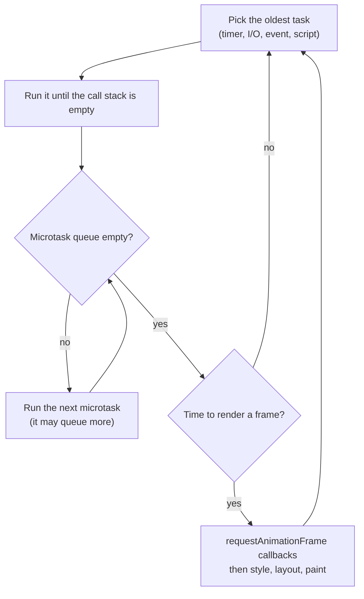
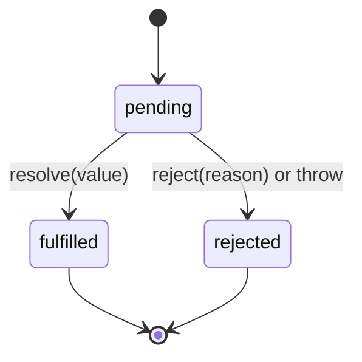

# Chapter 12 — Asynchronous JavaScript

JavaScript runs your code on **one thread**, yet a page can download data, animate and respond to clicks at once, and a Node server can handle thousands of connections. The trick is **asynchrony**: slow work is handed to the host (browser or Node) and your callback runs later, when the result is ready. The **event loop** decides *when* each callback runs. This chapter explains it precisely enough to predict any ordering puzzle, then the three generations of async code built on it: callbacks, promises and `async`/`await`.

**What you'll learn**

1. Why JavaScript is single-threaded and what "blocking" means.
2. The event loop: call stack, task queue, microtask queue, rendering.
3. Seven ordering puzzles, run in Node **and** Chrome.
4. Node's additions: `process.nextTick`, `setImmediate`, loop phases.
5. Timers and their (non-)guarantees.
6. Callbacks, error-first callbacks, and callback hell.
7. Promises: states, chaining, error flow, `withResolvers`, `Promise.try`.
8. The combinators `all`, `allSettled`, `race`, `any`.
9. `async`/`await`: sequential vs parallel, loops, errors.
10. Cancellation with `AbortController` / `AbortSignal`.
11. Async iteration: `for await…of`, async generators, `Array.fromAsync`.
12. Production patterns: retry with backoff, concurrency limits, stale responses.

**Before you start.** Functions and closures ([Chapter 4](../04-functions-scope-and-closures/README.md)); generators/iterators ([Chapter 8](../08-maps-sets-iterators-and-generators/README.md)) for §12.12. [§11.5](../11-errors-and-debugging/README.md) previewed async errors; this chapter completes the story. Top-level `await`: [Chapter 10](../10-modules-and-tooling/README.md#105-top-level-await).

All runnable code is in [`code/`](code/). Outputs are real (Node 24); timing-dependent programs print rounded or yes/no values so output is stable.

---

## 12.1 One thread, and why blocking hurts

### What it is
A **thread** is one sequence of instructions being executed; JavaScript gives your code exactly one. **Synchronous** code runs start to finish without pausing; **asynchronous** code starts an operation now and handles the result later via a callback.

- **Blocking** — code that keeps the thread busy, so nothing else (callbacks, clicks, rendering) can run.
- **Non-blocking I/O** — network/disk work done by the host in the background; JavaScript runs only when the result arrives.
- **Host / runtime** — the environment around the engine: the browser (Web APIs: timers, `fetch`, the page) or Node (libuv, its C library for async I/O). The engine (V8) runs JavaScript; the host does the waiting.

### Why it matters
In a browser the same thread runs your JavaScript, handles input and (usually) renders. A 200 ms synchronous loop freezes scrolling, typing and animation for 200 ms. In Node, a blocking handler stalls *every* request.

[`code/01_single_thread.mjs`](code/01_single_thread.mjs):

```js
const start = Date.now();
setTimeout(() => {
  const waited = Date.now() - start;
  console.log(`timer asked for 0 ms, ran after >= 200 ms: ${waited >= 200}`);
}, 0);

console.log('busy loop starts');
while (Date.now() - start < 200) { /* burn CPU: nothing else can run */ }
console.log('busy loop ends (the timer is still waiting)');

// Asynchronous work does NOT block: the callback is queued and we carry on.
import { readFile } from 'node:fs/promises';
readFile(new URL(import.meta.url)).then((buf) => console.log('file read finished,', buf.length > 0 ? 'got bytes' : 'empty'));
console.log('readFile started - main script keeps going');
```

Output:
```
busy loop starts
busy loop ends (the timer is still waiting)
readFile started - main script keeps going
timer asked for 0 ms, ran after >= 200 ms: true
file read finished, got bytes
```

The 0 ms timer could not interrupt the loop. Callbacks are never pre-empted: each runs to completion before anything else starts (**run-to-completion**). Benefit: no locks around your variables. Cost: keep each piece of work short.

### When you really need parallel CPU work
Heavy computation belongs off the main thread: **Web Workers** in the browser ([Chapter 14](../14-browser-apis-and-security/README.md#148-web-workers)) or `worker_threads` in Node ([Chapter 15](../15-nodejs-basics/README.md)) — separate threads with separate memory that talk by messages.

### TL;DR
One thread runs your JavaScript; the host waits for I/O and timers. Long synchronous work blocks everything, including 0 ms timers and rendering.

---

## 12.2 The event loop

### What it is
The **event loop** is the host's scheduler: it repeatedly picks waiting work and runs it on the single thread.

| Part | What it holds | Examples |
|---|---|---|
| **Call stack** | Functions currently executing, newest on top | Main script, a callback in progress |
| **Host APIs** (Web APIs / libuv) | Operations in progress *outside* JavaScript | A timer counting down, an HTTP request, a file read |
| **Task queue** (macrotask / callback queue) | Callbacks ready to run, one per loop turn | Timers, I/O callbacks, `message` events, `click` |
| **Microtask queue** | Follow-ups that run "as soon as the current code finishes" | Promise `then`/`catch`/`finally`, code after `await`, `queueMicrotask`, `MutationObserver` |
| **Rendering** (browsers) | Style (which CSS applies), layout (sizes/positions), paint (pixels) — typically up to ~60×/s | `requestAnimationFrame` callbacks run just before paint |

The HTML spec ("Event loops") defines the browser algorithm; ECMAScript only defines **jobs** (promise reactions) and leaves scheduling to the host. The spec allows several task queues (input may be prioritised over timers), but for predicting order treat tasks as one FIFO queue per source.

### How it works
One turn, simplified from the HTML spec:

1. **Run one task** — the oldest runnable task, until the call stack is empty.
2. **Microtask checkpoint** — run microtasks until the queue is **empty**, including ones queued *by* microtasks.
3. **Maybe render** — if a new frame is due: `requestAnimationFrame` callbacks, style, layout, paint.
4. Repeat (or sleep until a task arrives).

The initial script is itself a task, so step 2 happens right after top-level code. Microtasks also run whenever the stack empties during a task — e.g. between two listeners on a real user click (but not on `el.click()` from code, since your code is still on the stack).



### Why microtasks exist
A promise callback should run **after** the current synchronous code (callbacks are always async — consistent behaviour) but **before** anything else can observe inconsistent state (no other task or render in between). Microtasks give exactly that "end of the current job" timing.

### Common mistakes
- **`setTimeout(fn, 0)` is not "immediately"** — it's a *later task*, after all pending microtasks and possibly a render.
- **Microtask starvation.** A microtask that always queues another (recursive `.then`) never lets the loop render or run tasks — the page freezes like `while(true)`. Yield with `setTimeout` (a task) when chunking long work.
- **`await` doesn't yield to rendering** — it only schedules a microtask. To let the page paint during a long job, split it across tasks (`setTimeout`, `scheduler.yield()` where supported, `requestAnimationFrame`).

### TL;DR
Loop: one task → **all** microtasks → maybe render → repeat. Promises and `await` continuations are microtasks; timers, I/O and events are tasks.

---

## 12.3 Ordering puzzles

With §12.2's rules you can answer any "what does this print?":

1. Run all synchronous code (including promise **executors** — the function passed to `new Promise` — and code before the first `await`).
2. Drain the microtask queue FIFO, appending new microtasks as they're created.
3. Take the next task (timers by due time; ties in creation order), run it, drain microtasks, repeat.

[`code/02_ordering_puzzles.mjs`](code/02_ordering_puzzles.mjs) runs seven puzzles; each logs into an array and the order is printed after all queues drain. Predict before reading.

```js
// P1 - the classic: sync code, then ALL microtasks, then the next task
puzzle('P1 classic', (log) => {
  log('A');
  setTimeout(() => log('B timeout'), 0);
  Promise.resolve().then(() => log('C then'));
  queueMicrotask(() => log('D microtask'));
  log('E');
});

// P2 - async/await: code before the first await runs synchronously
puzzle('P2 async/await', (log) => {
  async function f() {
    log('f start');
    await null;             // everything after this line is a microtask
    log('f after await');
  }
  log('1');
  f();
  log('2');
});

// P3 - microtasks queued BY microtasks still run before the next task
puzzle('P3 nested', (log) => {
  setTimeout(() => {
    log('T1');
    Promise.resolve().then(() => log('T1 -> micro'));
  }, 0);
  setTimeout(() => log('T2'), 0);
  Promise.resolve().then(() => {
    log('M1');
    setTimeout(() => log('M1 -> timeout'), 0);
    Promise.resolve().then(() => log('M1 -> micro'));
  });
});

// P4 - two promise chains interleave one step at a time
puzzle('P4 interleave', (log) => {
  Promise.resolve().then(() => log('a1')).then(() => log('a2')).then(() => log('a3'));
  Promise.resolve().then(() => log('b1')).then(() => log('b2')).then(() => log('b3'));
});

// P5 - the executor of new Promise runs synchronously; then() callbacks do not
puzzle('P5 executor', (log) => {
  log('start');
  const p = new Promise((resolve) => {
    log('executor');
    resolve('value');
    log('after resolve');   // resolve() does not stop the function
  });
  p.then((v) => log(`then: ${v}`));
  log('end');
});

// P6 - returning a promise from then() costs extra microtask ticks
puzzle('P6 return promise', (log) => {
  Promise.resolve()
    .then(() => { log('x1'); return Promise.resolve('inner'); }) // adopts: +2 ticks
    .then((v) => log(`x2 (${v})`));
  Promise.resolve()
    .then(() => log('y1'))
    .then(() => log('y2'))
    .then(() => log('y3'))
    .then(() => log('y4'));
});

// P7 - timers with different delays: order is by due time, then by creation
puzzle('P7 timer delays', (log) => {
  setTimeout(() => log('20ms'), 20);
  setTimeout(() => log('0ms first'), 0);
  setTimeout(() => log('1ms'), 1);
  setTimeout(() => log('0ms second'), 0);
});
// ... the harness runs each puzzle, waits 50 ms, prints the collected order
```

Output (Node 24):
```
P1 classic         -> A | E | C then | D microtask | B timeout
P2 async/await     -> 1 | f start | 2 | f after await
P3 nested          -> M1 | M1 -> micro | T1 | T1 -> micro | T2 | M1 -> timeout
P4 interleave      -> a1 | b1 | a2 | b2 | a3 | b3
P5 executor        -> start | executor | after resolve | end | then: value
P6 return promise  -> x1 | y1 | y2 | y3 | x2 (inner) | y4
P7 timer delays    -> 0ms first | 1ms | 0ms second | 20ms
```

The same puzzles in a page ([`code/puzzles_browser.html`](code/puzzles_browser.html)) run by headless Chrome give the identical order — promise and timer ordering is standardized, not a Node quirk:


*Figure — the ordering puzzles run in Chrome 154.*

### The explanations
| Puzzle | Why |
|---|---|
| **P1** | `A`, `E` synchronous. `C`, `D` microtasks in queue order. `B` is a task, so it waits for the microtask queue to empty. |
| **P2** | An async function runs synchronously **up to the first `await`**; the rest is a microtask, so `2` prints first. |
| **P3** | Microtask `M1` runs first; it queues a timer (behind T1, T2) and a microtask that runs in the same checkpoint. Task T1's microtask runs **before** task T2. Finally the timer from M1. |
| **P4** | Each `.then` is queued only when the previous one settles, so two chains alternate. |
| **P5** | The executor is synchronous; `resolve()` doesn't return or throw. `then` callbacks are always async, even on a resolved promise. |
| **P6** | A `then` callback returning a promise (a **thenable**) makes the outer promise *adopt* it: one microtask to call `inner.then(...)`, another for that reaction, then the next `then` — so `x2` lands after `y3`. A plain value would print `x2` right after `y1`. |
| **P7** | Order by due time, ties by creation. Node (and current Chrome) treat `0` like `1` ms here — never depend on such fine differences. |

P6 is why `return await p` was once discouraged "for performance"; the cost is a couple of microtasks, and inside `try` it is *required* to catch the rejection (§12.9).

### In the interview
**30-second answer:** "Synchronous code runs first. Then the engine drains the whole microtask queue — promise callbacks, code after `await`, `queueMicrotask` — including microtasks added along the way. Only then does the event loop take the next task, like a `setTimeout` callback or an event, and after each task it drains microtasks again. So promises always beat `setTimeout(0)`."

- *Q: Does `await` of a non-promise pause?* A: Yes — `await 5` still defers the rest to a microtask.
- *Q: Why does P6's `x2` come late?* A: Adopting a returned thenable takes two extra ticks.
- *Q: Can a microtask starve rendering?* A: Yes; nothing renders until the queue is empty.
- *Q: `setTimeout(a, 0); queueMicrotask(b); Promise.resolve().then(c);`?* A: `b`, `c`, `a`.
- *Q: A microtask queues a timer and another microtask — which runs first?* A: The microtask.

### TL;DR
Sync → all microtasks (FIFO, incl. new ones) → one task → all microtasks → … Executors and code before the first `await` are synchronous.

---

## 12.4 Node's event loop: `nextTick`, `setImmediate` and phases

### What it is
Node's loop (implemented by **libuv**) cycles through **phases**, each with its own queue:

| Phase | Runs |
|---|---|
| **timers** | Expired `setTimeout` / `setInterval` callbacks |
| **pending callbacks** | Some deferred system callbacks (e.g. certain TCP errors) |
| **poll** | Waits for and runs I/O callbacks (files, sockets) |
| **check** | `setImmediate` callbacks |
| **close callbacks** | `'close'` events, e.g. `socket.on('close')` |

Between every callback Node drains the **`process.nextTick` queue**, then the **promise microtask queue** — in CommonJS (Node's original `require`/`module.exports` system); ES modules (`import`/`export`, ESM) twist this (below).

[`code/03_node_queues.mjs`](code/03_node_queues.mjs):

```js
import { readFile } from 'node:fs';

const log = [];
setTimeout(() => log.push('timeout'), 0);
setImmediate(() => log.push('immediate'));
Promise.resolve().then(() => log.push('promise'));
process.nextTick(() => log.push('nextTick'));
log.push('sync');
setTimeout(() => {
  console.log('main module :', log.join(' | '));
  console.log('  (timeout vs immediate at top level can swap between runs - see text)');

  // Inside an I/O callback the order of immediate vs timeout IS guaranteed.
  readFile(new URL(import.meta.url), () => {
    const io = [];
    setTimeout(() => io.push('timeout'), 0);
    setImmediate(() => io.push('immediate'));
    process.nextTick(() => io.push('nextTick'));
    Promise.resolve().then(() => io.push('promise'));
    setTimeout(() => console.log('in I/O cb  :', io.join(' | ')), 20);
  });
}, 30);
```

Output:
```
main module : sync | promise | nextTick | immediate | timeout
  (timeout vs immediate at top level can swap between runs - see text)
in I/O cb  : nextTick | promise | immediate | timeout
```

The CommonJS version ([`code/03b_node_queues_cjs.js`](code/03b_node_queues_cjs.js)) of the same top-level sync/promise/nextTick lines prints `CommonJS main: sync | nextTick | promise`.

### Reading the results
1. **`nextTick` vs promises.** Normally `nextTick` runs first (I/O callback, CommonJS). But an ES module's top level is evaluated inside promise machinery, so its promise microtasks drain before the `nextTick` queue — hence `promise | nextTick` in the `.mjs`. Don't build logic on this.
2. **`setImmediate` vs `setTimeout(0)` at top level** is **non-deterministic**: it depends on whether 1 ms has passed when the loop first checks timers.
3. **Inside an I/O callback** it *is* deterministic: poll is followed by check, so `setImmediate` always wins.

### When to use which
| Want | Use |
|---|---|
| Run after current code, before anything else (portable) | `queueMicrotask(fn)` or `Promise.resolve().then(fn)` |
| Node-only "right after this operation", e.g. emit after the constructor returns | `process.nextTick(fn)` (Node docs recommend `queueMicrotask` for most new code) |
| Yield to I/O, then continue | `setImmediate(fn)` |
| Run after a delay | `setTimeout(fn, ms)` |

**Common mistake:** recursive `process.nextTick` starves I/O just like recursive microtasks. Node's architecture (libuv, thread pool) is in [Chapter 15](../15-nodejs-basics/README.md).

### TL;DR
Phases: timers → pending → poll (I/O) → check (`setImmediate`) → close. Between callbacks: `nextTick`, then promises (ESM top level flips these). `setImmediate` vs `setTimeout(0)` is ordered only inside I/O callbacks.

---

## 12.5 Timers

### What it is
| Function | Does | Cancel with |
|---|---|---|
| `setTimeout(fn, ms, ...args)` | Run `fn(...args)` once, **at least** `ms` later | `clearTimeout(id)` |
| `setInterval(fn, ms, ...args)` | Run repeatedly, roughly every `ms` | `clearInterval(id)` |
| `queueMicrotask(fn)` | Run as a microtask | — |
| `requestAnimationFrame(fn)` (browser) | Run before the next paint ([Ch. 14](../14-browser-apis-and-security/README.md#145-timers-and-requestanimationframe)) | `cancelAnimationFrame(id)` |
| `setImmediate(fn)` (Node) | Run in the check phase | `clearImmediate(id)` |

The **handle** is a number in browsers and a `Timeout` object in Node (with `.unref()` — let the process exit while pending — and `.refresh()`).

### How it works
The timer registers with the host; when the delay elapses the callback joins the task queue and runs when the loop reaches it — possibly much later. The delay is a **minimum**. Also:
- Negative delays become `0`.
- After 5 levels of nested timers, browsers clamp delays below 4 ms to **4 ms**.
- Background tabs throttle timers (often ≤ 1/s) to save battery.
- Delays above 2³¹−1 ms (~24.8 days) overflow; Node warns and uses 1 ms.

[`code/04_timers.mjs`](code/04_timers.mjs) (excerpt):

```js
import { setTimeout as sleep } from 'node:timers/promises';

// The delay is a MINIMUM: a busy main thread delays the callback
const t0 = performance.now();
setTimeout(() => console.log(`asked 10 ms, got >= 40 ms: ${performance.now() - t0 >= 40}`), 10);
while (performance.now() - t0 < 40) {}
await sleep(20);

// Too-large delays overflow: > 2^31-1 ms (~24.8 days) becomes 1 ms
const big = setTimeout(() => console.log('huge delay fired immediately!'), 2 ** 31);
await sleep(20);
clearTimeout(big);
```

Output (the `(node:…)` lines are Node's stderr warning):
```
asked 10 ms, got >= 40 ms: true
(node:51319) TimeoutOverflowWarning: 2147483648 does not fit into a 32-bit signed integer.
Timeout duration was set to 1.
(Use `node --trace-warnings ...` to show where the warning was created)
huge delay fired immediately!
```

The full file also shows extra args + `clearTimeout`, `setInterval`/`clearInterval` after 3 ticks, recursive `setTimeout`, and the promise-based `sleep` from `node:timers/promises`.

### `setInterval` vs recursive `setTimeout`
| | `setInterval(fn, 100)` | recursive `setTimeout(fn, 100)` |
|---|---|---|
| Spacing | Start-to-start; if `fn` takes 80 ms only ~20 ms idle | End-to-start; always ≥ 100 ms idle |
| Slow or async work | Runs can bunch up or overlap (an async `fn` isn't awaited) | Next run scheduled only after this one finishes |
| Varying delay (backoff) | Awkward | Easy |

For polling a server, prefer recursive `setTimeout` scheduled after the previous request completes.

### Common mistakes
- `setTimeout(save(), 1000)` runs `save` now. Pass a function: `setTimeout(save, 1000)` or `() => save()`.
- Forgetting to clear intervals (e.g. when a UI component unmounts) → memory leaks and duplicate work.
- Using timers to "wait until ready" — await the actual event or promise.
- `setTimeout(obj.method, 10)` loses `this` — use an arrow or `bind` ([Chapter 9](../09-this-prototypes-and-classes/README.md)).

### TL;DR
Delays are minimums; the callback runs as a task when the thread is free. Clear what you schedule. Recursive `setTimeout` for polling; `node:timers/promises` gives an awaitable `setTimeout`.

---

## 12.6 Callbacks and callback hell

### What it is
A **callback** is a function passed to another function to be called later with the result — the oldest async style (event handlers, `setTimeout`, Node's original APIs). Node standardized **error-first callbacks**: `callback(err, result)`, `err` is `null` on success.

[`code/05_callbacks.mjs`](code/05_callbacks.mjs) — key parts:

```js
// 1) Error-first callbacks (the Node convention): cb(err, result)
readFile(new URL('./missing.txt', import.meta.url), 'utf8', (err, text) => {
  if (err) { console.log('error-first:', err.code); return; }
  console.log(text);
});

// 2) Callback hell: each step needs the previous result
db.getUser(1, (err, user) => {
  if (err) return console.log(err.message);
  db.getOrders(user, (err, orders) => {
    if (err) return console.log(err.message);
    db.getItems(orders[0], (err, items) => {
      if (err) return console.log(err.message);
      console.log('pyramid result:', user.name, orders[0].id, items);
    });
  });
});

// 3) Inversion of control: a buggy library calls your callback twice
function buggyCharge(amount, cb) { cb(null, 'ok'); cb(null, 'ok'); }
let charges = 0;
buggyCharge(10, () => { charges += 1; });
console.log('callback-style charges:', charges);

// A promise can settle only once, so the second call is ignored
const charged = new Promise((resolve) => buggyCharge(10, (_e, r) => resolve(r)));
let promiseCharges = 0;
await charged.then(() => { promiseCharges += 1; });
console.log('promise-style charges :', promiseCharges);

// 4) Zalgo: a callback that is sometimes sync, sometimes async
function getValue(key, cb) {
  if (cache.has(key)) cb(cache.get(key));          // sync!
  else setTimeout(() => cb(42), 0);                // async
}
// ...
```

Output:
```
callback-style charges: 2
promise-style charges : 1
error-first: ENOENT
pyramid result: Ada 7 [ 'book', 'pen' ]
zalgo order: cached cb | after call (a) | after call (b) | fetched cb
```

### The problems callbacks have
| Problem | What goes wrong | How promises fix it |
|---|---|---|
| **Callback hell** ("pyramid of doom") | Each dependent step nests deeper; error checks repeat | Flat `.then` chains or linear `await` |
| **Error handling** | `try/catch` can't catch errors in a later callback; every level checks `err` | One `.catch` / `try` for any step |
| **Inversion of control** | You trust other code to call you once — not zero times or twice | A promise settles exactly once |
| **"Releasing Zalgo"** | Sometimes-sync, sometimes-async callbacks make ordering unpredictable (the cached callback ran *before* "after call") | `then` callbacks are always async |
| **Composition** | "Run in parallel, wait for all" is hand-written counting | `Promise.all` and friends |

Callbacks remain right for **repeated events** (clicks, stream data) — a promise delivers one value. Named functions and early `return`s flatten a pyramid a little; promises are the real fix.

### TL;DR
Callbacks: Node uses `cb(err, result)`. They nest badly, can't use `try/catch`, and require trusting the caller — promises solve all of these. Keep callbacks for multi-fire events.

---

## 12.7 Promises

### What it is
A **promise** is an object representing a value available later — or an error explaining why not. It settles exactly once.



- **pending** — not finished. **fulfilled** — finished with a value. **rejected** — failed with a reason (normally an `Error`).
- **settled** — fulfilled or rejected; never changes again.
- **resolved** — "locked in": settled, or following another promise (a promise resolved with a pending promise is still pending).

### How it works
1. `new Promise((resolve, reject) => { … })` — the **executor** runs immediately and synchronously; if it throws, the promise rejects.
2. `promise.then(onFulfilled, onRejected)` registers reactions and returns a **new** promise.
3. On settlement, reactions are queued as microtasks.
4. The new promise settles with what the reaction **returns** (value → fulfilled; promise → adopt its outcome) or **throws** (→ rejected).
5. A rejection skips `then(onFulfilled)` reactions until a `catch` (or `onRejected`); after `catch` returns normally the chain is fulfilled again.
6. `finally(fn)` calls `fn` with no argument and passes the original outcome through (unless `fn` throws or returns a rejected promise).

[`code/06_promises.mjs`](code/06_promises.mjs):

```js
const later = (value, ms, fail = false) =>
  new Promise((resolve, reject) => setTimeout(() => (fail ? reject(new Error(value)) : resolve(value)), ms));

const p = later('done', 10);
console.log('right away :', p);      // Node shows the state
await p;
console.log('after await:', p);

// Chaining: each then() returns a NEW promise
const result = await Promise.resolve(2)
  .then((x) => x * 10)               // return a value -> next then gets it
  .then((x) => later(x + 1, 5))      // return a promise -> chain waits for it
  .then((x) => { throw new Error(`boom at ${x}`); })
  .then(() => console.log('skipped because the chain is rejected'))
  .catch((err) => { console.log('caught:', err.message); return 'recovered'; })
  .finally(() => console.log('finally: runs either way, sees no value'));
console.log('chain result:', result);

// Mistake: forgetting to return inside then() breaks the chain
await Promise.resolve(1)
  .then((x) => { later(x + 1, 5); })  // no return!
  .then((v) => console.log('forgot return ->', v));

// resolve/reject only count once
const once = new Promise((resolve, reject) => { resolve('first'); resolve('second'); reject(new Error('ignored')); });
console.log('settles once:', await once);

// Promise.resolve adopts thenables; a promise is passed through unchanged
const thenable = { then(onOk) { onOk('from a thenable'); } };
console.log('thenable   :', await Promise.resolve(thenable));
console.log('same obj   :', Promise.resolve(p) === p);

// ...promisify(readFile) — see the file

// Promise.withResolvers (ES2024): resolve from outside the executor
const { promise, resolve } = Promise.withResolvers();
setTimeout(() => resolve('resolved from outside'), 5);
console.log('withResolvers:', await promise);

// Promise.try (ES2025): run a function that may throw synchronously OR return a promise
const risky = (x) => { if (x < 0) throw new RangeError('negative'); return later(x * 2, 1); };
for (const x of [3, -1]) {
  await Promise.try(risky, x).then((v) => console.log('Promise.try ok  :', v), (e) => console.log('Promise.try fail:', e.message));
}
```

Output:
```
right away : Promise { <pending> }
after await: Promise { 'done' }
caught: boom at 21
finally: runs either way, sees no value
chain result: recovered
forgot return -> undefined
settles once: first
thenable   : from a thenable
same obj   : true
withResolvers: resolved from outside
Promise.try ok  : 6
Promise.try fail: negative
```

### Key API
| API | Meaning |
|---|---|
| `new Promise(executor)` | Wrap a callback API. Wrapping something that already returns a promise is the **explicit-construction anti-pattern**. |
| `Promise.resolve(v)` / `Promise.reject(e)` | Already-settled promise (`resolve` adopts thenables; returns `v` itself if it's a native promise) |
| `.then(ok, fail)` / `.catch(fail)` / `.finally(fn)` | Reactions; each returns a new promise |
| `Promise.withResolvers()` (ES2024) | `{ promise, resolve, reject }` — when resolve is triggered elsewhere |
| `Promise.try(fn, ...args)` (ES2025) | Call `fn`; a sync throw becomes a rejection, a value/promise is adopted |
| `util.promisify(fn)` (Node) | Error-first callback function → promise-returning. Most Node APIs also have promise versions: `node:fs/promises`, `node:timers/promises`. |

A **thenable** is any object with a `then` method; promise libraries interoperate through this duck-typed protocol ([Chapter 9 — duck typing](../09-this-prototypes-and-classes/README.md#97-instanceof-and-type-checks)).

### Common mistakes
- **Forgetting `return`** in a `then` callback → `undefined`, and the inner promise's errors become unhandled.
- **Nesting** `then` inside `then` instead of returning — callback hell again.
- **`.then(ok, fail)` vs `.then(ok).catch(fail)`:** the first does **not** catch errors thrown inside `ok`.
- **No final `catch`** → unhandled rejection ([§11.5](../11-errors-and-debugging/README.md#115-errors-in-asynchronous-code-preview)).
- **Thinking promises are cancellable or lazy.** A promise represents work *already started*; cancel the work with `AbortController` (§12.11).

### Self-check
1. `.then(() => 5)` returns? → A new promise fulfilled with 5.
2. `Promise.resolve().then(() => { throw new Error('x') }).then(() => 1).catch(e => 2)` fulfils with? → `2`.
3. What does `finally`'s callback receive? → Nothing.

### TL;DR
A one-time, eventually-settled value: pending → fulfilled/rejected. `then` returns a new promise settled by the callback's return value or thrown error. Always return inside `then`; end chains with `catch`.

---

## 12.8 Promise combinators: `all`, `allSettled`, `race`, `any`

### What it is
Static methods that take an iterable of promises (or plain values) and return one promise.

| Method | Fulfils when | Rejects when | Result | Added |
|---|---|---|---|---|
| `Promise.all` | **all** fulfil | **first** rejection (fail-fast) | values in **input order** | ES2015 |
| `Promise.allSettled` | all settle | never | `{status, value}` / `{status, reason}` | ES2020 |
| `Promise.race` | first to **settle** is fulfilled | first to settle is rejected | that value/reason | ES2015 |
| `Promise.any` | first to **fulfil** | **all** reject | value, or `AggregateError` with `.errors` | ES2021 |

[`code/07_combinators.mjs`](code/07_combinators.mjs):

```js
console.log('all       :', await Promise.all([later('slow', 30), later('fast', 10), 42]), at());
t0 = performance.now();
await Promise.all([later('ok', 30), later('db down', 10, true)])
  .catch((e) => console.log('all fails :', e.message, 'after', at()));

const settled = await Promise.allSettled([later('ok', 5), later('bad', 5, true)]);
console.log('allSettled:', settled.map((r) => (r.status === 'fulfilled' ? `ok:${r.value}` : `err:${r.reason.message}`)));

console.log('race      :', await Promise.race([later('A', 20), later('B', 10)]));
await Promise.race([later('A', 20), later('B failed', 10, true)]).catch((e) => console.log('race err  :', e.message));

console.log('any       :', await Promise.any([later('mirror1 down', 5, true), later('mirror2', 15)]));
await Promise.any([later('x', 5, true), later('y', 5, true)])
  .catch((e) => console.log('any fails :', e.name, e.errors.map((x) => x.message)));

console.log('empty     :', await Promise.all([]), (await Promise.allSettled([])).length);
await Promise.any([]).catch((e) => console.log('any([])   :', e.name));
console.log('race([]) stays pending forever - never await it');

const withTimeout = (promise, ms) =>
  Promise.race([promise, new Promise((_, rej) => setTimeout(() => rej(new Error(`timed out after ${ms} ms`)), ms))]);
await withTimeout(later('slow api', 100), 20).catch((e) => console.log('timeout   :', e.message));
```

Output:
```
all       : [ 'slow', 'fast', 42 ] 30 ms
all fails : db down after 10 ms
allSettled: [ 'ok:ok', 'err:bad' ]
race      : B
race err  : B failed
any       : mirror2
any fails : AggregateError [ 'x', 'y' ]
empty     : [] 0
any([])   : AggregateError
race([]) stays pending forever - never await it
timeout   : timed out after 20 ms
```

- `all` took 30 ms (the slowest), not 40 — the waits overlapped. Results are in input order though `fast` finished first; plain values are allowed.
- On failure `all` rejects at 10 ms but the other operation **keeps running** — combinators cancel nothing; pair with an `AbortSignal` (§12.11).
- `withTimeout` via `race` is a classic interview answer; in real code `AbortSignal.timeout(ms)` also stops the underlying work.

### Choosing
| Situation | Use |
|---|---|
| Page needs user, settings and feed | `all` |
| Send 20 notifications; report which failed | `allSettled` |
| Fastest of several mirrors / CDNs (content delivery networks) | `any` |
| Result or timeout, whichever first | `race` (or `AbortSignal.timeout`) |

### In the interview
**30-second answer:** "`all` waits for everything and fails fast on the first rejection; `allSettled` waits for everything and never rejects; `race` settles with the first promise to settle, success or failure; `any` takes the first success and only rejects — with an `AggregateError` — if all fail. None of them cancel the losers."

- *Q: Implement `Promise.all`.* A: New promise; results array + counter; for each input `Promise.resolve(item).then(v => { results[i] = v; if (++done === n) resolve(results) }, reject)`; resolve immediately for empty input. Runnable polyfills: [Chapter 17](../17-javascript-for-interviews/README.md#promiseall-allsettled-race-any-polyfills).
- *Q: One rejection in `Promise.all` — do the others stop?* A: No; their results are ignored.

### TL;DR
`all` (all or first failure), `allSettled` (everything, never rejects), `race` (first settled), `any` (first success, else `AggregateError`). None cancel.

---

## 12.9 `async` / `await`

### What it is
Syntax (ES2017) for writing promise code as if it were synchronous.
- An **`async` function** always returns a promise: `return v` fulfils it; `throw` rejects it.
- **`await expr`** suspends the function until the promise settles, then yields its value — or **throws** its reason. The thread isn't blocked: the rest resumes later as a microtask while the caller continues.
- `await` is allowed only in async functions and at the **top level of modules**.

Under the hood an async function is a generator yielding promises, driven by a runner that resumes it as each settles.

[`code/08_async_await.mjs`](code/08_async_await.mjs):

```js
// (1: answer() instanceof Promise -> true; a throwing async fn -> rejected promise)
// 2) Sequential vs parallel
let t = performance.now();
const a = await later('a', 30);
const b = await later('b', 30);
console.log('sequential:', a + b, round(performance.now() - t), 'ms');

t = performance.now();
const [c, d] = await Promise.all([later('c', 30), later('d', 30)]);
console.log('parallel  :', c + d, round(performance.now() - t), 'ms');

// 3) try/catch/finally with await
async function load(id) {
  try {
    return await later(`user ${id}`, 5, id < 0);   // "return await" keeps the error inside this try
  } catch (err) {
    return `fallback for ${err.message}`;
  } finally {
    console.log('  cleanup for', id);
  }
}
console.log('load(1)   :', await load(1));
console.log('load(-1)  :', await load(-1));

// 4) await in loops: for...of is sequential; forEach does NOT wait
const ids = [1, 2, 3];
const seen = [];
ids.forEach(async (id) => { await later(id, 12 - id * 3); seen.push(id); });
console.log('forEach done? seen =', seen, '(nothing yet!)');
await later(null, 20);
console.log('...later   seen =', seen, '(finish order, not input order)');
const inOrder = [];
for (const id of ids) inOrder.push(await later(id * 10, 2));
console.log('for...of  :', inOrder);
console.log('map+all   :', await Promise.all(ids.map((id) => later(id * 100, 5))));
// (5: async arrows and async methods work too; `await 'plain value'` just gives the value)
```

Output:
```
sequential: ab 60 ms
parallel  : cd 30 ms
  cleanup for 1
load(1)   : user 1
  cleanup for -1
load(-1)  : fallback for user -1
forEach done? seen = [] (nothing yet!)
...later   seen = [ 3, 2, 1 ] (finish order, not input order)
for...of  : [ 10, 20, 30 ]
map+all   : [ 100, 200, 300 ]
```

### Sequential vs parallel — the most common performance bug
Two independent `await`s in a row take the **sum** (60 ms); `Promise.all` takes the **max** (30 ms). `await` one after another only when step 2 needs step 1's result.

```js
// Also parallel: start first, await later
const userP = getUser(id), postsP = getPosts(id);   // both requests in flight
const user = await userP, posts = await postsP;    // careful: if postsP rejects before
                                                    // userP settles, it's briefly "unhandled"
```
`Promise.all` is safer: it attaches handlers to every promise immediately.

### Loops
| Loop | Behaviour |
|---|---|
| `for…of` / `for` / `while` with `await` inside | One at a time, in order |
| `array.forEach(async …)` | Fires all, **doesn't wait**, ignores results and errors — avoid |
| `await Promise.all(array.map(async …))` | All at once, results in order |
| Concurrency-limited pool (§12.13) | At most N at a time |

### Error handling
- Wrap `await` in `try`/`catch`; the rejection reason is the caught value.
- `return await p` inside `try`: without `await` the promise is handed back *before* it rejects, so `catch` never sees it and `finally` runs while work is in progress. Outside `try`, `return p` ≡ `return await p`.
- Catch where you can act (message, retry, fallback); let the rest propagate ([custom errors and `cause`](../11-errors-and-debugging/README.md#113-custom-errors)).

### Trade-offs: `async/await` vs `.then` chains
| | `async`/`await` | `.then` chains |
|---|---|---|
| Readability | Reads like sync code; normal `if`, loops, `try` | Fine for short linear pipelines |
| Errors | `try`/`catch` | `.catch` |
| Where it works | Async functions and module top level | Anywhere |

Same machinery (both still need `Promise.all` for parallelism); mix freely: `await fetch(url).then(r => r.json())`.

### In the interview
**30-second answer:** "`async` functions always return promises; `await` suspends just that function until the promise settles, resuming it as a microtask, so the thread stays free. Rejections become exceptions, so `try/catch` works. The classic mistake is awaiting independent calls one by one — use `Promise.all` — and using `forEach` with an async callback, which doesn't wait."

- *Q: `async function f() {}; f()` returns?* A: A promise fulfilled with `undefined`.
- *Q: Code after `await` of an already-resolved promise — synchronous?* A: No, always a microtask.
- *Q: Why `return await` inside `try`?* A: So that `try`'s `catch` sees the rejection.
- *Q: `await` in a regular function?* A: SyntaxError.
- *Q: Three independent 100 ms requests awaited in sequence?* A: ~300 ms; with `Promise.all` ~100 ms.

### TL;DR
`async` → returns a promise; `await` → unwraps or throws. Independent work → `Promise.all`. Sequential loop → `for…of`; never `forEach(async)`. `try { return await … } catch`.

---

## 12.10 Error handling across async code — a checklist

[§11.5](../11-errors-and-debugging/README.md#115-errors-in-asynchronous-code-preview) gave the rules; with the event loop in hand, here's where each error goes.

| Situation | Where the error goes | Handle with |
|---|---|---|
| `throw` inside an `async` function | Rejects its returned promise | `try/catch` around `await f()`, or `f().catch()` |
| `throw` inside a `then` callback | Rejects the promise `then` returned | A later `.catch` |
| `throw` inside a `setTimeout` / event callback | Uncaught in *that task* — no enclosing `try` exists any more | `try/catch` **inside** the callback; global `error` handler for logging |
| Rejection nobody handles | `unhandledrejection` (browser) / crash (Node ≥ 15) | Always `await` / `return` / `.catch` |
| One of many parallel operations fails | `Promise.all` rejects with the first; others ignored | `allSettled` for every outcome |
| Error in an error-first callback | First argument | `if (err) …` first |

Rules of thumb:
1. Every promise has an owner who awaits it, returns it, or attaches `.catch`.
2. Catch where you can **act**; otherwise propagate, adding context with `new Error(msg, { cause })`.
3. Promisify callback APIs inside async functions, or their errors escape your `try`.
4. Global handlers (`window.onunhandledrejection`, `process.on('unhandledRejection')`) are for logging and reporting, not recovery.

### TL;DR
try/catch works across `await` because rejections are re-thrown on resumption. Errors in plain callbacks belong to their own task. Leave no promise floating.

---

## 12.11 Cancellation: `AbortController` and `AbortSignal`

### What it is
Promises can't be cancelled, but the *work* behind them can. The standard mechanism (DOM spec; also in Node):
- **`AbortController`** — held by whoever decides to cancel; `controller.abort(reason?)`.
- **`AbortSignal`** — `controller.signal`, handed to the operation; has `.aborted`, `.reason`, an `abort` event and `throwIfAborted()`.

| API | Purpose | Support |
|---|---|---|
| `new AbortController()` / `.abort(reason)` | Manual cancel | All modern browsers, Node ≥ 15 |
| `AbortSignal.timeout(ms)` | Aborts with a `TimeoutError` `DOMException` after `ms` | Baseline since 2022 (Node ≥ 17.3) |
| `AbortSignal.any([s1, s2])` | Aborts when any input aborts | Baseline since 2024 (Node ≥ 20.3) |
| `AbortSignal.abort(reason)` | Already-aborted signal | Modern browsers, Node |
| `{ signal }` option | Accepted by `fetch`, `addEventListener`, Node `timers/promises`, `fs.readFile`, streams, `events.on`… | — |

[`code/09_abort.mjs`](code/09_abort.mjs) (excerpt):

```js
// 1) Making your own function cancellable with an AbortSignal
function delay(ms, { signal } = {}) {
  return new Promise((resolve, reject) => {
    signal?.throwIfAborted();                       // already aborted? fail fast
    const id = setTimeout(() => { signal?.removeEventListener('abort', onAbort); resolve(`waited ${ms} ms`); }, ms);
    function onAbort() { clearTimeout(id); reject(signal.reason); }
    signal?.addEventListener('abort', onAbort, { once: true });
  });
}

const controller = new AbortController();
setTimeout(() => controller.abort(), 20);
try {
  await delay(1000, { signal: controller.signal });
} catch (err) {
  console.log('manual abort  :', err.name, '-', err.message);
}
console.log('signal state  :', controller.signal.aborted);

// 2) Custom reason
const c2 = new AbortController();
c2.abort(new Error('user left the page'));
await delay(10, { signal: c2.signal }).catch((e) => console.log('custom reason :', e.message));

// 3) AbortSignal.timeout(ms) - aborts with a TimeoutError
await delay(1000, { signal: AbortSignal.timeout(15) }).catch((e) => console.log('timeout       :', e.name));

// 4) AbortSignal.any - abort if ANY of several signals aborts
const userCancel = new AbortController();
const combined = AbortSignal.any([userCancel.signal, AbortSignal.timeout(5000)]);
setTimeout(() => userCancel.abort(), 10);
await delay(1000, { signal: combined }).catch((e) => console.log('any()         :', e.name));

// 5) One abort() removes a listener added with { signal }
const target = new EventTarget();
const listeners = new AbortController();
target.addEventListener('ping', () => console.log('ping heard'), { signal: listeners.signal });
target.dispatchEvent(new Event('ping'));
listeners.abort();                                  // removes the listener
target.dispatchEvent(new Event('ping'));
console.log('listener removed by abort()');
```

Output:
```
manual abort  : AbortError - This operation was aborted
signal state  : true
custom reason : user left the page
timeout       : TimeoutError
any()         : AbortError
ping heard
listener removed by abort()
```

(The file also aborts Node's promise `sleep` from `timers/promises`, which rejects with `AbortError`.)

### How to write abortable functions
1. Accept `{ signal }` in an options object.
2. `signal?.throwIfAborted()` at the start (and between steps of long work).
3. Listen for `abort` once; on abort, stop the work and reject with `signal.reason`.
4. Remove the listener on normal completion (avoid leaks on long-lived signals).
5. Pass the signal to every API you call (`fetch(url, { signal })`).

Callers tell a deliberate cancel from a failure by `err.name === 'AbortError'` (or `'TimeoutError'`) and usually ignore it. Fetch with abort/timeouts: [Chapter 14](../14-browser-apis-and-security/README.md#141-fetch-and-http).

### Real-world examples
- Search-as-you-type: abort the previous request on each keystroke.
- React effects: abort the fetch in the effect's cleanup when the component unmounts.
- Removing a group of listeners: one controller, `{ signal }` on each `addEventListener`, one `abort()`.

### TL;DR
`AbortController` cancels; `AbortSignal` carries the cancel to the work. `AbortSignal.timeout` / `AbortSignal.any` cover timeouts and combined cancel. Rejections are named `AbortError`/`TimeoutError`.

---

## 12.12 Async iteration: `for await…of` and async generators

### What it is
The **async iterable protocol** (ES2018) is Chapter 8's iterable protocol (`[Symbol.iterator]()` → iterator whose `next()` returns `{ value, done }`) with `[Symbol.asyncIterator]()` and a `next()` that returns a **promise** of `{ value, done }`. Consume with **`for await (const x of source)`**; produce with an **async generator** (`async function*`), which can both `await` and `yield`. Use it for data arriving in pieces: paginated APIs, file/network streams (Node streams and web `ReadableStream`s are async iterable), event streams.

[`code/10_async_iteration.mjs`](code/10_async_iteration.mjs) (excerpt):

```js
// Paginated API -> one flat async stream
const pages = { 1: { items: ['a', 'b'], next: 2 }, 2: { items: ['c'], next: 3 }, 3: { items: ['d', 'e'], next: null } };
const fetchPage = async (n) => { await null; return pages[n]; };
async function* allItems() {
  let page = 1;
  while (page) {
    const { items, next } = await fetchPage(page);
    yield* items;                   // delegate to the array's iterator
    page = next;
  }
}
const collected = [];
for await (const item of allItems()) {
  collected.push(item);
  if (collected.length === 4) break;   // break calls return() -> generator stops fetching
}
console.log('first 4 items :', collected);

// Array.fromAsync (ES2026) collects an async iterable into an array
console.log('fromAsync     :', await Array.fromAsync(allItems()));

// Events as an async stream (Node events.on)
const bus = new EventEmitter();
const ac = new AbortController();
setTimeout(() => { bus.emit('msg', 'hello'); bus.emit('msg', 'world'); ac.abort(); }, 5);
try {
  for await (const [text] of on(bus, 'msg', { signal: ac.signal })) console.log('event:', text);
} catch (e) {
  console.log('stream ended  :', e.name);
}
```

Output:
```
first 4 items : [ 'a', 'b', 'c', 'd' ]
fromAsync     : [ 'a', 'b', 'c', 'd', 'e' ]
event: hello
event: world
stream ended  : AbortError
```

The file also has a timed `countdown` generator, `for await` over an array of promises, and a hand-written `[Symbol.asyncIterator]` object.

### Notes
- `for await` is allowed wherever `await` is.
- `break`, `return` or a throw inside the loop calls the iterator's `return()`, so an async generator's `finally` blocks run — closes connections.
- Items are processed **one at a time**. For independent promises `Promise.all` is better; `for await` over such an array can't report a rejection until the loop reaches it.
- `Array.fromAsync` is ES2026, in Node 22+ and current browsers.

### TL;DR
Async iterables deliver `{value, done}` promises; `for await…of` consumes; `async function*` produces. Great for pagination and streams; `break` cleans up.

---

## 12.13 Real-world async patterns

[`code/11_patterns.mjs`](code/11_patterns.mjs) implements three helpers found in almost every production codebase.

```js
// 1) Retry with exponential backoff
async function retry(fn, { tries = 4, base = 5 } = {}) {
  for (let attempt = 1; ; attempt++) {
    try {
      return await fn(attempt);
    } catch (err) {
      if (attempt >= tries) throw new Error(`gave up after ${attempt} tries`, { cause: err });
      const wait = base * 2 ** (attempt - 1);   // 5, 10, 20 ... (add random jitter in production)
      console.log(`  attempt ${attempt} failed (${err.message}); retrying in ${wait} ms`);
      await sleep(wait);
    }
  }
}

// 2) Run many tasks but at most `limit` at once
async function mapLimit(items, limit, fn) {
  const results = new Array(items.length);
  let next = 0, running = 0, peak = 0;
  async function worker() {
    while (next < items.length) {
      const i = next++;                         // safe: no other code runs between read and write
      running++; peak = Math.max(peak, running);
      results[i] = await fn(items[i]);
      running--;
    }
  }
  await Promise.all(Array.from({ length: limit }, worker));
  return { results, peak };
}

// 3) Race condition: an older, slower response arrives last and overwrites newer data
let latest = 0;
await Promise.all(['ja', 'jav'].map(async (q) => {
  const ticket = ++latest;
  const r = await search(q);
  if (ticket === latest) shown = r;                 // ignore answers to old requests
}));
```

Output:
```
  attempt 1 failed (503); retrying in 5 ms
  attempt 2 failed (503); retrying in 10 ms
retry result: payload
mapLimit    : [
   1,  4,  9, 16,
  25, 36, 49
] peak concurrency = 3
naive shows : results for "ja" <- stale!
guarded     : results for "jav"
```

| Pattern | Problem it solves | Production notes |
|---|---|---|
| **Retry + exponential backoff** (double the wait each failure) | Transient failures (HTTP 503, network blips) | Random **jitter** so clients don't retry in sync; retry only **idempotent** operations (safe to repeat — [System Design Fundamentals](../../../system-design-patterns/modules/00-system-design-fundamentals/README.md)); cap attempts and total time; respect `Retry-After` |
| **Concurrency limit** | 10,000 requests at once overload the server or hit rate limits / file-descriptor limits | `p-limit`, `p-map`; the worker pool above suffices for scripts |
| **Last-request-wins** | Out-of-order responses (search-as-you-type) — a **race condition** where stale data overwrites fresh | Better: abort the old request (§12.11); React Query and similar do this |
| **Timeout** | A request that never answers | `AbortSignal.timeout(ms)` |
| **Debounce / throttle** (wait until events stop / at most once per interval) | Too many events (keystrokes, scroll) | Implemented in [Chapter 17](../17-javascript-for-interviews/README.md#debounce) |

`mapLimit`'s `next++` needs no lock: run-to-completion guarantees no other worker runs between the read and the increment.

### TL;DR
Retry with backoff + jitter for transient errors; cap concurrency with a worker pool; guard stale responses with request IDs or abort; time out everything that talks to the network.

---

## Chapter 12 TL;DR

- **One thread**, run-to-completion; the host does the waiting. Long sync work blocks timers, input and rendering.
- **Event loop:** one task → drain **all** microtasks → maybe render (rAF → style → layout → paint) → repeat. Promise reactions, code after `await`, `queueMicrotask` = microtasks; timers, I/O, events = tasks.
- **Puzzles:** sync first (incl. executors and code before the first `await`), then microtasks FIFO, then tasks. Returning a promise from `then` costs 2 extra ticks.
- **Node:** timers → poll → check (`setImmediate`) → close; `nextTick` before promises (except at ESM top level); `setImmediate` vs `setTimeout(0)` ordered only inside I/O callbacks.
- **Timers** are minimums; nested clamp 4 ms; overflow above 2³¹−1 ms; recursive `setTimeout` for polling.
- **Callbacks** → callback hell, no `try/catch`, inversion of control, Zalgo. Keep for repeated events.
- **Promises:** settle once; `then` returns a new promise; always `return`, end with `catch`. `withResolvers` (ES2024), `Promise.try` (ES2025).
- **Combinators:** `all`, `allSettled`, `race`, `any` — none cancel.
- **async/await:** returns a promise; `await` throws rejections; `Promise.all` for independent work; no `forEach(async)`; `return await` inside `try`.
- **Cancel** with `AbortController` / `AbortSignal.timeout` / `AbortSignal.any`.
- **Async iteration:** `for await…of`, `async function*`, `Array.fromAsync` (ES2026).
- **Patterns:** retry with backoff + jitter, concurrency limits, last-request-wins.

Next: the page itself — [Chapter 13: DOM and Events](../13-dom-and-events/README.md).
