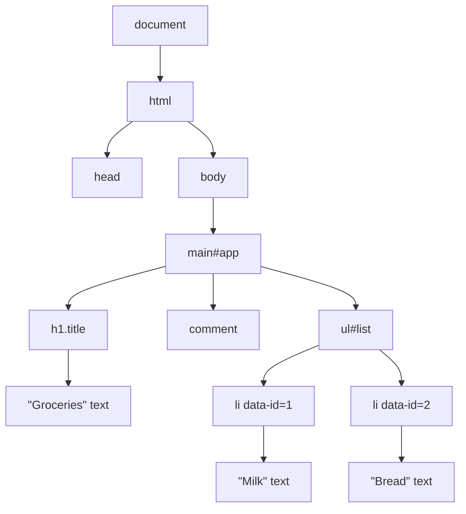
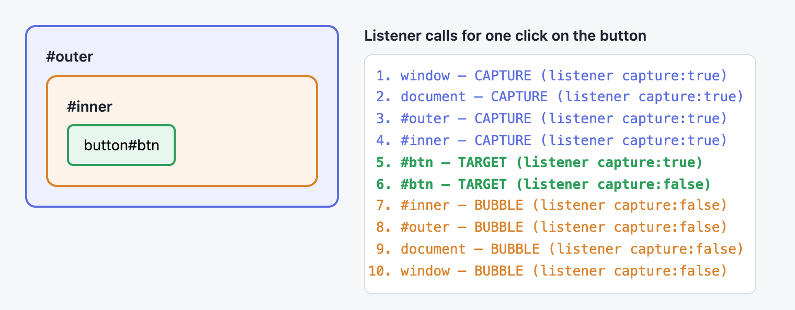
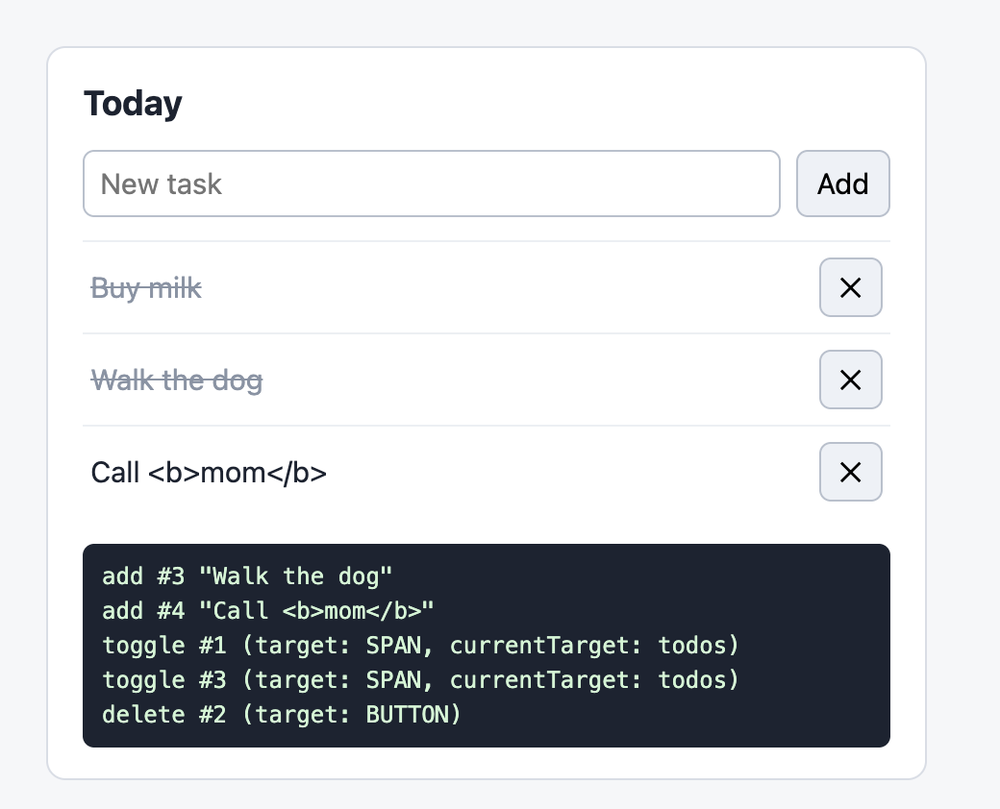
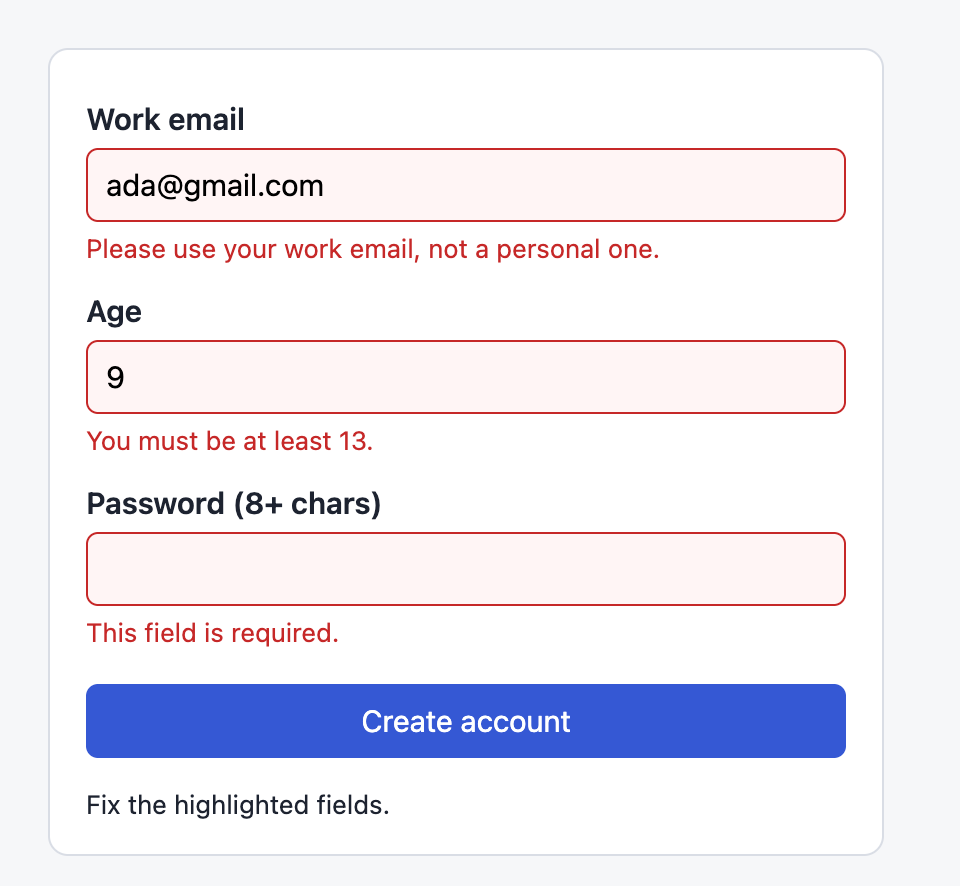
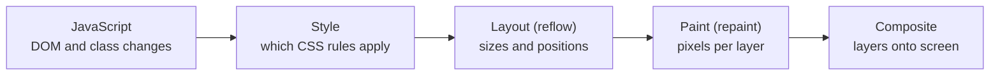
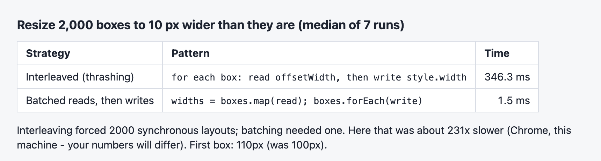

# Chapter 13 — The DOM and Events

A web page, as JavaScript sees it, is a tree of objects called the **DOM**. Every interactive feature on the web — a dropdown opening, a todo item ticked off, a form refusing an invalid email — is JavaScript finding nodes in that tree, changing them, and reacting to **events** such as clicks and key presses. This chapter teaches the DOM API from the ground up, the event system in full (including the capture/bubble path that trips up many developers), forms, and the performance rules that keep pages smooth.

**What you'll learn**

1. What the DOM is: nodes, elements, the tree, and how HTML becomes a DOM.
2. Selecting elements and walking the tree.
3. Creating, inserting, moving and removing nodes; `textContent` vs `innerHTML`; templates and fragments.
4. Attributes vs properties; `classList`, `dataset` and styles.
5. Events: listeners, the event object, listener options, custom events.
6. Propagation: capture, target and bubble phases; stopping propagation.
7. Event delegation — one listener for many elements.
8. Default actions, `preventDefault`, passive listeners.
9. Forms: `submit`, `FormData`, the Constraint Validation API, `input` vs `change`.
10. Watching the DOM with `MutationObserver`.
11. Rendering performance: reflow, repaint and layout thrashing (measured in Chrome).
12. When scripts run: `DOMContentLoaded`, `load`, `defer`.

**Before you start.** You'll use closures ([Chapter 4](../04-functions-scope-and-closures/README.md)) and `this` in handlers ([Chapter 9 §9.1](../09-this-prototypes-and-classes/README.md#91-this--the-call-time-context)). Event listeners run as tasks on the event loop ([Chapter 12](../12-asynchronous-javascript/README.md#122-the-event-loop)). The HTML and CSS side — semantic elements, forms markup, selectors — is in the HTML & CSS Handbook ([`../../../html-css/`](../../../html-css/)).

**How the code runs.** Node has no DOM, so the `.mjs` programs in [`code/`](code/) start with `import '../../../../tools_dom.mjs';`, which creates a **jsdom** document (a JavaScript implementation of the DOM standard used by test tools) and exposes `document`, `window` etc. as globals. jsdom implements the DOM and events faithfully but has **no layout engine** (no sizes, no painting). For those parts, small `.html` pages were run in real headless Chrome and screenshotted after a scripted interaction. All outputs are real.

---

## 13.1 The DOM tree

### What it is
The **Document Object Model (DOM)** is the browser's live, in-memory representation of a page: a **tree** of **nodes**, with an API (defined by the WHATWG DOM and HTML standards) for reading and changing it. Change the tree and the browser updates the screen.

Analogy: the HTML file is the architect's blueprint; the DOM is the actual building. JavaScript renovates the building, not the blueprint — "View Source" still shows the original HTML, while DevTools' Elements panel shows the current DOM.

Terms:
- **Node** — any item in the tree. Main types: **element** (`<li>`, nodeType 1), **text** (3), **comment** (8), **document** (9), **document fragment** (11).
- **Element** — a node created from a tag; has attributes and can have children.
- **Parent / child / sibling / ancestor / descendant** — family relations in the tree.
- `document` — the root object; `document.documentElement` is `<html>`, plus `document.head` and `document.body`.

### How it works
1. The browser's HTML **parser** reads the HTML text and builds the tree, fixing errors in standard ways (unclosed tags, missing `<tbody>`).
2. Whitespace between tags becomes **text nodes** — they exist even though they show nothing.
3. Scripts query and change the tree through the DOM API; the changes are live everywhere.

[`code/01_dom_tree.mjs`](code/01_dom_tree.mjs) — key parts:

```js
document.body.innerHTML = `
<main id="app">
  <h1 class="title">Groceries</h1>
  <!-- a comment node -->
  <ul id="list">
    <li data-id="1">Milk</li>
    <li data-id="2" class="done">Bread</li>
  </ul>
</main>`;

function show(node, depth = 0) {           // recursive walk over childNodes
  // prints #text / #comment / <tag> ELEMENT with indentation
  for (const child of node.childNodes) show(child, depth + 1);
}
show(document.querySelector('#app'));

const main = document.getElementById('app');
console.log('\nchildNodes (all nodes):', main.childNodes.length, '| children (elements only):', main.children.length);
// ...
const items = document.getElementById('list').children;   // live HTMLCollection
console.log('items before:', items.length);
document.getElementById('list').insertAdjacentHTML('beforeend', '<li data-id="3">Eggs</li>');
console.log('items after :', items.length);

const parsed = new DOMParser().parseFromString('<table><tr><td>cell</table><p>unclosed', 'text/html');
console.log('\nparser auto-inserted <tbody>:', parsed.querySelector('table > tbody > tr') !== null);
console.log('parsed body:', parsed.body.innerHTML);
```

Output:
```
<main> ELEMENT
  #text (whitespace)
  <h1> ELEMENT
    #text "Groceries"
  #text (whitespace)
  #comment "a comment node"
  #text (whitespace)
  <ul> ELEMENT
    #text (whitespace)
    <li> ELEMENT
      #text "Milk"
    #text (whitespace)
    <li> ELEMENT
      #text "Bread"
    #text (whitespace)
  #text (whitespace)

childNodes (all nodes): 7 | children (elements only): 2
document.documentElement: HTML | head: HEAD | body: BODY
nodeType of document: 9 === Node.DOCUMENT_NODE: true
items before: 2
items after : 3

parser auto-inserted <tbody>: true
parsed body: <table><tbody><tr><td>cell</td></tr></tbody></table><p>unclosed</p>
```



*The tree for the snippet above (whitespace text nodes omitted).*

### Common mistakes
- Using `childNodes`/`firstChild`/`nextSibling` and getting whitespace text nodes. Prefer the **element-only** versions: `children`, `firstElementChild`, `nextElementSibling`.
- Assuming the DOM equals the HTML source — the parser inserts, moves and closes elements.
- Running a script in `<head>` that queries `document.body` elements before they're parsed (§13.12).

### TL;DR
The DOM is a live tree of nodes (elements, text, comments) built by the parser from HTML. Use element-only navigation properties to skip whitespace text nodes.

---

## 13.2 Selecting and traversing

### What it is
| Method | Returns | Notes |
|---|---|---|
| `document.getElementById(id)` | Element or `null` | Fastest; id without `#` |
| `el.querySelector(css)` | First match or `null` | Any CSS selector; searches descendants of `el` |
| `el.querySelectorAll(css)` | **Static** `NodeList` (snapshot) | Has `forEach`; spread to an array for `map`/`filter` |
| `el.getElementsByClassName(c)` / `getElementsByTagName(t)` | **Live** `HTMLCollection` | Updates automatically; no `forEach` |
| `document.forms.name.elements.field` | Form controls by `name` | See §13.9 |
| `el.closest(css)` | Nearest ancestor **or itself** matching, or `null` | Key to event delegation |
| `el.matches(css)` | `true`/`false` | "Does this element match?" |
| `parent.contains(node)` | `true`/`false` | Includes `parent` itself |

Traversal properties: `parentElement`, `children`, `firstElementChild`, `lastElementChild`, `previousElementSibling`, `nextElementSibling` (and the node-level `parentNode`, `childNodes`, `firstChild`, `nextSibling`…).

[`code/02_select_traverse.mjs`](code/02_select_traverse.mjs) — key parts:

```js
console.log('querySelector       :', document.querySelector('.links a').textContent);        // first match
console.log('querySelectorAll    :', [...document.querySelectorAll('.links a')].map((a) => a.textContent));
console.log('attribute selector  :', document.querySelector('[data-track]').textContent);
console.log(':not + :nth-child   :', [...document.querySelectorAll('li:not(:first-child) a')].map((a) => a.textContent));
console.log('no match            :', document.querySelector('.nope'), document.querySelectorAll('.nope').length);

const staticList = document.querySelectorAll('li');          // snapshot
const liveList = document.getElementsByTagName('li');         // live
document.querySelector('ul').append(document.createElement('li'));
console.log('\nafter adding an <li>: static', staticList.length, '| live', liveList.length);

const blog = document.querySelector('a[href="/blog"]');
console.log('closest("nav")      :', blog.closest('nav').id);
console.log('matches(":not(.x)") :', blog.matches('a:not(.active)'));
const li = blog.parentElement;
console.log('nextSibling (a node):', JSON.stringify(li.nextSibling.textContent), '<- whitespace text node');

try { document.querySelector('a[href=/]'); } catch (e) { console.log('\nbad selector        :', e.name); }
try { document.querySelector('#123'); } catch (e) { console.log('id starting w/ digit:', e.name, '-> use getElementById("123") or CSS.escape'); }
```

Output:
```
getElementById      : menu
querySelector       : Home
querySelectorAll    : [ 'Home', 'Blog', 'About' ]
attribute selector  : About
:not + :nth-child   : [ 'Blog', 'About' ]
scoped query        : 3
forms collection    : email
no match            : null 0

after adding an <li>: static 3 | live 4
NodeList has forEach: function | HTMLCollection has forEach: undefined

parentElement       : LI
closest("nav")      : menu
closest(".missing") : null
matches(":not(.x)") : true
previousElementSibling: Home
nextElementSibling  : About
nextSibling (a node): "\n    " <- whitespace text node
firstElementChild   : Home
contains            : true

bad selector        : SyntaxError
id starting w/ digit: SyntaxError -> use getElementById("123") or CSS.escape
```

### Common mistakes
- `document.querySelector('.item').classList.add(…)` when nothing matches → `TypeError: Cannot read properties of null`. Check for `null`, or use optional chaining when absence is fine.
- Calling `.map` on a `NodeList` — it has `forEach` but not `map`; use `[...list]` or `Array.from(list)`.
- Looping over a **live** collection while removing items from it — indexes shift and items are skipped. Loop over a static copy.
- Unquoted attribute values containing `/` or starting with digits in selectors → `SyntaxError`. Quote them: `a[href="/"]`.

### Self-check
1. Which selection method returns a live collection? → `getElementsBy…`. `querySelectorAll` is static.
2. `el.closest('li')` when `el` itself is an `<li>`? → Returns `el`.
3. How do you get the next *element*, skipping text? → `nextElementSibling`.

### TL;DR
`querySelector(All)` with CSS selectors for almost everything; `getElementById` for ids; `closest`/`matches`/`contains` for relationships. `querySelectorAll` is a static snapshot; `getElementsBy*` collections are live.

---

## 13.3 Creating, inserting and removing nodes

### What it is
| Task | API |
|---|---|
| Create | `document.createElement('li')`, `document.createTextNode('hi')`, `document.createDocumentFragment()` |
| Insert inside | `parent.append(...nodesOrStrings)`, `parent.prepend(...)`, `parent.replaceChildren(...)` (also empties) |
| Insert beside | `el.before(...)`, `el.after(...)` |
| Remove / replace | `el.remove()`, `el.replaceWith(...)` |
| Insert HTML string | `el.insertAdjacentHTML('beforebegin' / 'afterbegin' / 'beforeend' / 'afterend', html)` |
| Copy | `el.cloneNode(true)` (deep) |
| Text | `el.textContent = '...'` (safe, never parsed) |
| Markup | `el.innerHTML = '...'` / `el.outerHTML` (parsed as HTML) |

Older equivalents you'll see in legacy code: `appendChild`, `insertBefore`, `removeChild`, `replaceChild` (they accept only nodes, not strings).

[`code/03_create_modify.mjs`](code/03_create_modify.mjs) — key parts:

```js
const li = document.createElement('li');
li.textContent = 'appended';
list.append(li, 'a text node too');          // append accepts nodes AND strings
// ... prepend, after
list.lastChild.remove();                       // the text node
list.querySelector('li:nth-child(3)').replaceWith(/* new li "replaced" */);
document.getElementById('out').append(list.firstElementChild);   // appending an existing node MOVES it

const userInput = '';
box.textContent = userInput;                    // shown as text, safe
console.log('3) textContent ->', box.innerHTML);
box.innerHTML = '<b>bold</b> and <i>italic</i>'; // parsed as HTML (only for trusted strings!)

p.insertAdjacentHTML('beforebegin', '<span>bb</span>');  // + afterbegin, beforeend, afterend

const frag = document.createDocumentFragment();
for (const name of ['Ada', 'Grace', 'Linus']) {
  const item = document.createElement('li');
  item.textContent = name;
  frag.append(item);
}
list.replaceChildren(frag);                     // one insertion

const tpl = document.getElementById('card');    // <template id="card"><article>...</article></template>
for (const pr of products) {
  const node = tpl.content.cloneNode(true);     // deep copy of the template's content
  node.querySelector('h2').textContent = pr.name;
  node.querySelector('.price').textContent = `$${pr.price}`;
  grid.append(node);
}
```

Output:
```
1) <li>prepended</li><li>after first</li><li>first</li><li>appended</li>a text node too
2) <li>after first</li><li>replaced</li><li>appended</li> | out: <li>prepended</li>
3) textContent -> &lt;img src=x onerror="alert(1)"&gt;
   innerHTML   -> 2 elements; textContent = "bold and italic"
   outerHTML   -> <div id="out"><b>bold</b> and <i>italic</i></div>
4) <span>bb</span><p><span>ab</span>P<span>be</span></p><span>ae</span>
5) <li>Ada</li><li>Grace</li><li>Linus</li> | fragment is now empty: 0
6) <article class="card"><h2>Lamp</h2><p class="price">$25</p></article><article class="card"><h2>Desk</h2><p class="price">$180</p></article>
7) innerText in jsdom: not implemented (use textContent)
```

### `textContent` vs `innerText` vs `innerHTML`
| Property | Reads | Writes | Cost / safety |
|---|---|---|---|
| `textContent` | All text of all descendants, including hidden elements and `<script>` text | Replaces children with one text node | Fast; **safe** for user data |
| `innerText` | Only *rendered* text (respects CSS `display:none`, line breaks) | Like textContent but `\n` → `<br>` | Needs layout → slower; not in jsdom |
| `innerHTML` | Serialized HTML of the children | **Parses** the string as HTML and replaces children | **XSS risk** with untrusted strings; destroys existing child nodes and their listeners |

Line 3 of the output shows why `textContent` is safe: the "image" became harmless text (`&lt;img …`). Assigning the same string to `innerHTML` would create a real `` whose `onerror` runs attacker code — the **XSS** attack covered in [Chapter 14 §14.10](../14-browser-apis-and-security/README.md#1410-cross-site-scripting-xss-and-sanitizing).

### Why fragments and templates
- A **`DocumentFragment`** is a lightweight, parentless container. Appending it moves its children in one operation (the fragment ends up empty — see line 5), so the page does one update instead of N.
- A **`<template>`** holds inert markup (not rendered, scripts don't run, images don't load). `template.content.cloneNode(true)` stamps out copies — this is how frameworks-free apps and Web Components render lists. Fill clones with `textContent`, not string concatenation.

### Common mistakes
- `el.innerHTML += '<li>…</li>'` in a loop: re-parses the whole content each time and wipes listeners and input state on existing children. Use `append` or `insertAdjacentHTML('beforeend', …)`.
- Forgetting that appending an existing node **moves** it (line 2). Clone it if you want a copy.
- `cloneNode` doesn't copy listeners added with `addEventListener`.

### TL;DR
`createElement` + `textContent` + `append`/`before`/`after`/`remove`/`replaceWith`. Use `textContent` for data, `innerHTML` only for trusted markup. Batch many inserts with a fragment; stamp repeated markup from a `<template>`.

---

## 13.4 Attributes, properties, classes, data and styles

### What it is
- An **attribute** is what's written in the HTML (`<input value="1">`); read/write with `getAttribute`, `setAttribute`, `hasAttribute`, `removeAttribute`, `toggleAttribute`. Always strings.
- A **property** is a field on the JavaScript element object (`input.value`). Most standard attributes are **reflected** as properties with the same name, but properties can be typed (booleans, numbers), normalized (absolute URLs) and can hold **live state** that the attribute doesn't.

[`code/04_attributes_properties.mjs`](code/04_attributes_properties.mjs) — key parts:

```js
const qty = document.getElementById('qty');      // <input id="qty" type="number" value="1">
qty.value = '5';                                 // what the user "typed"
console.log('value property       :', qty.value, '| value attribute:', qty.getAttribute('value'), '| defaultValue:', qty.defaultValue);
console.log('valueAsNumber        :', qty.valueAsNumber, typeof qty.valueAsNumber);
console.log('href property        :', link.href, '(resolved, absolute)');
console.log('href attribute       :', link.getAttribute('href'));

agree.checked = false;                           // <input type="checkbox" checked>
console.log('checked prop / attr :', agree.checked, '/', agree.hasAttribute('checked'));
buy.setAttribute('disabled', 'false');           // still disabled!
console.log('disabled="false"    :', buy.disabled);

buy.classList.add('loading');
buy.classList.remove('primary');
buy.classList.toggle('active');                  // add if missing
buy.classList.toggle('active', false);           // force off
buy.classList.replace('btn', 'button');

console.log('dataset             :', { ...buy.dataset });     // data-product-id="42" data-in-stock="true"
buy.dataset.variantColor = 'blue';               // -> data-variant-color="blue"

buy.style.backgroundColor = 'yellow';            // camelCase property
buy.style.setProperty('--accent', 'teal');       // custom properties need setProperty
console.log('computed color      :', getComputedStyle(buy).color);
```

Output:
```
value property       : 5 | value attribute: 1 | defaultValue: 1
valueAsNumber        : 5 number
href property        : http://localhost/docs?page=2 (resolved, absolute)
href attribute       : /docs?page=2
checked prop / attr : false / true
disabled="false"    : true
after remove        : false
className           : btn primary
classList           : [ 'button', 'loading' ] | contains loading: true
dataset             : { productId: '42', inStock: 'true' }
inStock is a string : string true
new attribute       : blue
style attribute     : color: red; background-color: yellow; --accent: teal;
computed color      : rgb(255, 0, 0)
attributes          : [
  'id',
  'class',
  'data-product-id',
  'data-in-stock',
  'style',
  'data-variant-color'
]
```

### Key rules
| Rule | Example |
|---|---|
| For form controls, the **attribute is the initial/default value**; the **property is the current value** | `value`/`defaultValue`, `checked`/`defaultChecked` |
| **Boolean attributes**: present = true, whatever the value | `disabled="false"` is still disabled; use `el.disabled = false` or `removeAttribute` |
| Some names differ | `class` → `className` / `classList`; `for` → `htmlFor` |
| URL properties are absolute | `a.href`, `img.src` |
| `data-*` → `el.dataset.camelCase`, always strings | `data-in-stock` → `dataset.inStock === 'true'` |
| `el.style` = **inline** style only; `getComputedStyle(el)` = final values from all CSS | Computed values are resolved (`rgb(255, 0, 0)`) |

Prefer toggling **classes** over setting many inline styles: the look stays in CSS, and one class change is one style recalculation. Inline `style` is best for truly dynamic values (positions, a progress width), ideally through CSS custom properties: `el.style.setProperty('--progress', '40%')`.

### Self-check
1. User types "7" into `<input value="1">`. `getAttribute('value')`? → `"1"`; `input.value` is `"7"`.
2. How do you un-disable a button? → `btn.disabled = false` (or `removeAttribute('disabled')`), not `setAttribute('disabled', 'false')`.
3. `data-user-id="9"` → how to read it as a number? → `Number(el.dataset.userId)`.

### TL;DR
Attributes = HTML text (strings, initial values); properties = live typed state. Use `classList` for classes, `dataset` for `data-*`, `style` for inline styles and `getComputedStyle` to read final styles.

---

## 13.5 Events and listeners

### What it is
An **event** is a notification that something happened — a click, a key press, a form submission, a resource finishing loading. An **event listener** (handler) is a function registered to run when a given event type reaches a given **target** (element, `document`, `window`, or any `EventTarget`).

Analogy: a doorbell. `addEventListener('click', fn)` wires a chime to the button; when someone presses it, every wired chime rings in the order it was installed.

### How it works
1. `target.addEventListener(type, listener, options?)` registers.
2. The event occurs (user action, network, or `target.dispatchEvent(event)` from code).
3. The browser builds an **event object** and sends it along a path through the tree (§13.6), calling matching listeners with it.
4. User-generated events arrive as **tasks** on the event loop; `dispatchEvent` calls listeners **synchronously**, before it returns.

The event object's most-used members:

| Member | Meaning |
|---|---|
| `type` | `'click'`, `'keydown'`, … |
| `target` | The element where the event originated (the deepest one clicked) |
| `currentTarget` | The element whose listener is running now (= `this` in a non-arrow listener) |
| `eventPhase` | 1 capture, 2 at target, 3 bubble |
| `preventDefault()` / `defaultPrevented` | Cancel the browser's default action (§13.8) |
| `stopPropagation()` / `stopImmediatePropagation()` | Stop the journey (§13.6) |
| `isTrusted` | `true` only for real user/browser-generated events |
| `key`, `code`, `ctrlKey`, `shiftKey`, `altKey`, `metaKey` | Keyboard info (`key` = character/meaning, `code` = physical key) |
| `clientX/Y`, `button` | Mouse/pointer position and button |
| `detail` | Data on a `CustomEvent` |

[`code/05_events_basics.mjs`](code/05_events_basics.mjs) — key parts:

```js
function onClick(event) {
  console.log('1) type:', event.type, '| target:', event.target.id, '| currentTarget:', event.currentTarget.id,
    '| this === currentTarget:', this === event.currentTarget, '| isTrusted:', event.isTrusted);
}
btn.addEventListener('click', onClick);
btn.click();                                     // synthetic click (isTrusted false)

btn.addEventListener('click', () => console.log('2) second listener'));
btn.addEventListener('click', onClick);          // duplicate, ignored
btn.click();

btn.removeEventListener('click', () => {});     // different function: does nothing
btn.removeEventListener('click', onClick);
console.log('3) after remove:'); btn.click();

b2.addEventListener('click', () => console.log('4) once fired'), { once: true });
b2.click(); b2.click();
const ac = new AbortController();
b2.addEventListener('click', () => console.log('   A'), { signal: ac.signal });
b2.addEventListener('click', () => console.log('   B'), { signal: ac.signal });
b2.click(); ac.abort(); b2.click();

b2.onclick = () => console.log('5) handler 1');
b2.onclick = () => console.log('5) handler 2 replaced 1');
b2.click();

input.addEventListener('keydown', (e) => console.log('6) key:', e.key, '| code:', e.code, '| ctrl:', e.ctrlKey));
input.dispatchEvent(new KeyboardEvent('keydown', { key: 's', code: 'KeyS', ctrlKey: true, bubbles: true }));

document.addEventListener('cart:add', (e) => console.log('7) custom event detail:', e.detail));
btn.dispatchEvent(new CustomEvent('cart:add', { detail: { sku: 'A-1', qty: 2 }, bubbles: true }));

console.log('8) before dispatch');
btn.addEventListener('ping', () => console.log('   listener'));
btn.dispatchEvent(new Event('ping'));
console.log('   after dispatch');
```

Output:
```
1) type: click | target: save | currentTarget: save | this === currentTarget: true | isTrusted: false
1) type: click | target: save | currentTarget: save | this === currentTarget: true | isTrusted: false
2) second listener
3) after remove:
2) second listener
4) once fired
   A
   B
   (both removed by one abort)
5) handler 2 replaced 1
6) key: s | code: KeyS | ctrl: true
   input event, value = Ada
7) custom event detail: { sku: 'A-1', qty: 2 }
8) before dispatch
   listener
   after dispatch
```

### Listener options
| Option | Effect |
|---|---|
| `capture: true` | Run during the capture phase (§13.6). Must match when removing. |
| `once: true` | Auto-remove after the first call |
| `passive: true` | Promise not to call `preventDefault()` — lets the browser scroll without waiting (§13.8) |
| `signal: abortSignal` | Remove the listener when the signal aborts — great for removing many at once ([Ch. 12 §12.11](../12-asynchronous-javascript/README.md#1211-cancellation-abortcontroller-and-abortsignal)) |

### `addEventListener` vs `on…` properties vs inline attributes
| Style | Multiple handlers? | Notes |
|---|---|---|
| `el.addEventListener('click', fn)` | Yes | Options, removable — the standard choice |
| `el.onclick = fn` | No — assigning replaces (line 5) | Fine for quick scripts |
| `<button onclick="doIt()">` | — | Mixes JS into HTML, runs code from a string, blocked by a strict CSP ([Ch. 14](../14-browser-apis-and-security/README.md#1412-content-security-policy-csp)) — avoid |

### Common mistakes
- `addEventListener('click', handle())` — calls `handle` immediately and registers its return value. Pass the function.
- Removing with a *new* arrow function (line 3's no-op): keep a reference, or use `{ signal }`.
- Arrow function listeners don't get `this = element`; use `event.currentTarget` — it works for both styles.
- Listening for `'onclick'` — the event type has no `on` prefix.

### TL;DR
`addEventListener(type, fn, { once, passive, signal, capture })`. The event object tells you `target` (origin), `currentTarget` (listener owner), and lets you cancel defaults or stop propagation. `dispatchEvent` + `CustomEvent` for your own events.

---

## 13.6 Propagation: capture, target, bubble

### What it is
When you click a button inside nested boxes, you've also clicked each box, the body, the document and the window. The DOM delivers the event along that **propagation path** in three phases:

1. **Capture phase** — from `window` down through each ancestor toward the target; only listeners registered with `{ capture: true }` run.
2. **Target phase** — at the target itself; listeners run in registration order (capture ones first in modern browsers).
3. **Bubble phase** — back up from the target's parent to `window`; normal listeners run. Most events bubble; some don't.

Analogy: a letter delivered down the chain of command (capture), read by the addressee (target), then the reply copied back up to every manager (bubble).

The page [`code/propagation.html`](code/propagation.html) registers a capture and a bubble listener on `window`, `document`, `#outer`, `#inner` and the button, then clicks the button once:



*Figure — one click, ten listener calls: capture (blue) goes down, target (green), bubble (orange) goes up. Screenshot from headless Chrome.*

[`code/06_propagation.mjs`](code/06_propagation.mjs) shows the same path in jsdom plus the ways to stop it:

```js
for (const el of [window, document, ...els]) {
  const name = el === window ? 'window' : el === document ? 'document' : el.id;
  el.addEventListener('click', (e) => log.push(`${name}:${PHASE[e.eventPhase]}`), { capture: true });
  el.addEventListener('click', (e) => log.push(`${name}:${PHASE[e.eventPhase]}`));
}
document.getElementById('btn').click();

const stop = (e) => e.stopPropagation();
els[1].addEventListener('click', stop);           // on #inner, bubble phase
els[2].click();

btn.addEventListener('click', (e) => { log.push('btn:first-extra'); e.stopImmediatePropagation(); });
btn.addEventListener('click', () => log.push('btn:NEVER'));
btn.click();

document.body.addEventListener('focus', () => seen.push('focus (bubble listener)'));
document.body.addEventListener('focusin', () => seen.push('focusin'));
input.focus();
```

Output:
```
1) full path:
   window:CAPTURE > document:CAPTURE > outer:CAPTURE > inner:CAPTURE > btn:TARGET > btn:TARGET > inner:BUBBLE > outer:BUBBLE > document:BUBBLE > window:BUBBLE
2) stopPropagation at inner:
   window:CAPTURE > document:CAPTURE > outer:CAPTURE > inner:CAPTURE > btn:TARGET > btn:TARGET > inner:BUBBLE
3) stopImmediatePropagation:
   window:CAPTURE > document:CAPTURE > outer:CAPTURE > inner:CAPTURE > btn:TARGET > btn:TARGET > btn:first-extra
4) new Event() defaults to x: bubbles=false
   body heard: [ 'focusin' ] <- focus does not bubble, focusin does
```

### Stopping
| Call | Effect |
|---|---|
| `stopPropagation()` | Finish the listeners on the current element, then stop travelling |
| `stopImmediatePropagation()` | Also skip the remaining listeners on the current element |
| `preventDefault()` | Unrelated to propagation: cancels the default action only |

### Events that don't bubble
`focus`/`blur` (use `focusin`/`focusout` to delegate), `mouseenter`/`mouseleave` (use `mouseover`/`mouseout`), `load`/`error` on elements like ``, `scroll` on elements. Events you create with `new Event(type)` **don't bubble unless you pass `{ bubbles: true }`** (line 4) — a common reason a custom event "isn't heard" by a parent.

### When not to stop propagation
`stopPropagation` is a blunt tool: it also blocks analytics listeners, "click outside to close" handlers on `document`, and framework root listeners (React attaches its listeners at the root container). Prefer checking `event.target` in the outer handler, or `defaultPrevented` as a signal.

### In the interview
**30-second answer:** "Events travel in three phases: capture from window down to the target, the target phase, then bubbling back up. `addEventListener` listens in the bubble phase by default; `{capture: true}` switches to capture. `stopPropagation` halts the journey, `stopImmediatePropagation` also skips other listeners on the same element, and `preventDefault` is separate — it only cancels the browser's default action."

- *Q: `target` vs `currentTarget`?* A: `target` is where the event started; `currentTarget` is the element whose listener is running.
- *Q: When would you use capture?* A: To see an event before children can stop it — e.g. a global "close menus on any click" or focus tracking.

### TL;DR
Capture (down, `{capture:true}`) → target → bubble (up, default). Most events bubble; `focus`, `mouseenter`, element `load` don't. Stop sparingly.

---

## 13.7 Event delegation

### What it is
**Event delegation** means putting **one** listener on a common ancestor instead of one per child, and using `event.target` (usually with `closest`) to find which child was acted on. It works because events bubble.

### The problem it solves
- A list of 1,000 rows with 1,000 listeners costs memory and setup time.
- Items added later (from `fetch`, from the user) would need listeners attached each time — and removed ones should be cleaned up.
- With delegation, new items are handled automatically.

### How it works
1. Attach a listener to a stable container (`ul`, `table`, a component root, or `document`).
2. In the handler, `const item = event.target.closest('selector')`.
3. If `item` is `null` (click was elsewhere) — or outside the container (`container.contains(item)`) — ignore it.
4. Read what you need from the item (`item.dataset.id`) and act.

[`code/07_delegation.mjs`](code/07_delegation.mjs):

```js
list.addEventListener('click', (event) => {
  const del = event.target.closest('button.del');
  if (del && list.contains(del)) {
    const li = del.closest('li');
    console.log('delete item', li.dataset.id);
    li.remove();
    return;
  }
  const li = event.target.closest('li');
  if (li) {
    li.classList.toggle('done');
    console.log('toggle item', li.dataset.id, '-> done =', li.classList.contains('done'));
  }
});

let nextId = 3;
document.getElementById('add').addEventListener('click', () => {
  list.insertAdjacentHTML('beforeend', `<li data-id="${nextId}"><span>New task ${nextId}</span> <button class="del">x</button></li>`);
  nextId += 1;
});

list.querySelector('li[data-id="1"] span').click();      // click on the text (a child of li)
document.getElementById('add').click();                   // adds item 3 AFTER the listener was attached
list.querySelector('li[data-id="3"] span').click();      // still handled - no new listener needed
list.querySelector('li[data-id="2"] .del').click();
```

Output:
```
toggle item 1 -> done = true
toggle item 3 -> done = true
delete item 2
remaining: [ '1(done)', '3(done)' ]
listeners attached to items: 0, to the list: 1
```

The same idea as a real page, [`code/todo_delegation.html`](code/todo_delegation.html): one `click` listener on the `<ul>`, one `submit` listener on the form (with `preventDefault`), and new items built with `textContent` — note the task typed as `Call <b>mom</b>` is shown literally, not as bold HTML. The script adds two tasks, ticks two and deletes one, then the page was screenshotted:



*Figure — event delegation in Chrome: `target` is the inner `SPAN`/`BUTTON`, `currentTarget` is always the list.*

### Why `closest` and not `event.target` directly
`event.target` is the **deepest** element clicked — the `<span>` inside the `<li>`, or an `<svg>` icon inside a button. `closest('li')` climbs to the element you actually care about.

### Trade-offs
| | Delegation | Listener per element |
|---|---|---|
| Listeners | One | N |
| Dynamic items | Handled automatically | Must attach/detach |
| Non-bubbling events | Needs the bubbling twin (`focusin`) or capture | Works directly |
| Handler complexity | Must route by selector | Simple |

### TL;DR
One listener on the container + `event.target.closest(selector)` handles all current and future children. Use it for lists, tables and menus.

---

## 13.8 Default actions and `preventDefault`

### What it is
Many events have a **default action** the browser performs after listeners run: a link navigates, a form submits (and reloads the page), a checkbox toggles, a key types a character, a wheel scrolls, a right-click opens the context menu. `event.preventDefault()` cancels it, if the event is **cancelable**. `dispatchEvent` returns `false` when a listener cancelled it.

| Event | Default action | Typical reason to prevent |
|---|---|---|
| `submit` on a form | Send the form and navigate | Validate and send with `fetch` instead |
| `click` on `<a href>` | Navigate | Client-side routing ([History API, Ch. 14](../14-browser-apis-and-security/README.md#147-the-history-api)) |
| `keydown` | Insert the character / browser shortcut | Custom shortcut like Ctrl+S |
| `contextmenu` | Show the browser menu | Custom context menu |
| `dragover` | Refuse drops | Allow dropping files |

(Output lines for `preventDefault` are in the forms program, §13.9.)

### Passive listeners
For `touchstart`, `touchmove` and `wheel`, the browser must wait for your listener to finish before scrolling, in case you call `preventDefault()`. That can make scrolling janky. `{ passive: true }` promises you won't, so scrolling starts immediately. Browsers other than Safari already default `passive` to `true` for these events when the listener is on `window`, `document` or `body`; calling `preventDefault()` inside a passive listener is ignored (with a console warning).

### Common mistakes
- Using `return false` in an `addEventListener` handler — it does nothing there (it only works in `on…` properties).
- Preventing the default of a link or button and forgetting keyboard and screen-reader users — use real `<button>`s for actions and `<a>` for navigation.
- `preventDefault()` does **not** stop propagation, and `stopPropagation()` does **not** prevent the default.

### TL;DR
`preventDefault()` cancels the browser's built-in response (navigation, submit, typing, scrolling). Use passive listeners for scroll/touch.

---

## 13.9 Forms

### What it is
Forms are where most user data enters a web app. The DOM gives you:
- `form.elements` — controls by `name` or index; `form.elements.email`.
- **`submit` event** on the form (fires for Enter in a field and for submit buttons) — listen here, not to the button's `click`.
- **`FormData`** — reads every successful control (named, enabled, checked where relevant) into key/value entries; sends directly as a `fetch` body.
- The **Constraint Validation API** — HTML attributes (`required`, `type="email"`, `min`, `max`, `minlength`, `pattern`) produce a `validity` object; `checkValidity()`, `reportValidity()`, `setCustomValidity(msg)`.
- **`input`** fires on every change of value; **`change`** fires when the change is committed (blur for text, immediately for checkboxes/selects).

[`code/08_forms.mjs`](code/08_forms.mjs) — key parts:

```js
age.value = '7';
console.log('1) form valid?', form.checkValidity());
for (const el of [email, age]) {
  const v = el.validity;
  console.log(`   ${el.name}: valid=${v.valid} valueMissing=${v.valueMissing} rangeUnderflow=${v.rangeUnderflow} msg="${el.validationMessage}"`);
}
email.value = 'not-an-email';
console.log('   typeMismatch for "not-an-email":', email.validity.typeMismatch);

email.value = 'ada@example.com';
email.setCustomValidity(email.value.endsWith('@example.com') ? 'Please use your work email' : '');
console.log('2) customError:', email.validity.customError, '|', email.validationMessage);
email.setCustomValidity('');                  // '' clears the custom error

form.addEventListener('submit', (event) => {
  event.preventDefault();                      // stay on the page, send with fetch instead
  const data = new FormData(form);
  console.log('3) submit prevented:', event.defaultPrevented);
  console.log('   entries   :', JSON.stringify([...data.entries()]));
  console.log('   getAll    :', data.getAll('topics'));
  console.log('   as object :', JSON.stringify(Object.fromEntries(data)), '<- keeps only the LAST topic');
  console.log('   submitter :', event.submitter?.textContent);
});
form.elements.topics[1].checked = true;
form.requestSubmit(form.querySelector('button'));  // like clicking the button: validates, fires submit

age.addEventListener('input', () => log.push(`input(${age.value})`));
age.addEventListener('change', () => log.push(`change(${age.value})`));
// ... two input events, then one change event

const a = document.createElement('a'); a.href = '/leave';
a.addEventListener('click', (e) => e.preventDefault());
console.log('5) link click not cancelled?', a.dispatchEvent(new MouseEvent('click', { cancelable: true })));
cb.addEventListener('click', (e) => e.preventDefault());
cb.click();
console.log('   checkbox still checked after prevented click:', cb.checked);
```

Output:
```
1) form valid? false
   email: valid=false valueMissing=true rangeUnderflow=false msg="Constraints not satisfied"
   age: valid=false valueMissing=false rangeUnderflow=true msg="Constraints not satisfied"
   typeMismatch for "not-an-email": true
2) customError: true | Please use your work email
   now valid? true
3) submit prevented: true
   entries   : [["email","ada@example.com"],["age","36"],["topics","js"],["topics","css"],["plan","pro"],["bio","Hello"]]
   getAll    : [ 'js', 'css' ]
   as object : {"email":"ada@example.com","age":"36","topics":"css","plan":"pro","bio":"Hello"} <- keeps only the LAST topic
   submitter : Sign up
4) input(4) input(42) change(42)
5) link click not cancelled? false
   checkbox still checked after prevented click: true
```

(jsdom's `validationMessage` is a generic "Constraints not satisfied"; browsers give localized messages like "Please fill out this field.")

### The `validity` flags
| Flag | Set when | Caused by |
|---|---|---|
| `valueMissing` | Empty required field | `required` |
| `typeMismatch` | Not a valid email/URL | `type="email"`, `type="url"` |
| `patternMismatch` | Regex doesn't match whole value | `pattern` |
| `tooShort` / `tooLong` | Length out of range (after user edits) | `minlength` / `maxlength` |
| `rangeUnderflow` / `rangeOverflow` / `stepMismatch` | Number/date out of range | `min` / `max` / `step` |
| `badInput` | Browser can't convert the input (letters in a number field) | input type |
| `customError` | `setCustomValidity('msg')` was called with a non-empty message | your code |
| `valid` | None of the above | — |

The page [`code/form_validation.html`](code/form_validation.html) uses `novalidate` (turning off the browser's own bubbles) and renders its own accessible messages from these flags — `aria-invalid` on the field and `aria-describedby` pointing to the message. One delegated `input` listener on the form gives live feedback; the `submit` handler checks everything. After a scripted submit with a personal email, age 9 and no password:



*Figure — custom validation messages driven by the Constraint Validation API (headless Chrome).*

### Common mistakes
- Listening to the submit button's `click` → misses Enter-key submits. Listen to `submit` on the form.
- `Object.fromEntries(new FormData(form))` for multi-value fields (checkbox groups, `<select multiple>`) — keeps only the last value; use `getAll`.
- Client-side validation as security. It's UX only; **the server must validate everything again**.
- Forgetting `name` attributes — unnamed controls are left out of `FormData`.
- Calling `form.submit()` — it skips validation *and* the `submit` event. `requestSubmit()` behaves like a real submit.

### TL;DR
Listen to `submit`, `preventDefault`, read with `FormData`, validate with `validity`/`setCustomValidity` for UX, and validate again on the server. `input` = every keystroke, `change` = committed value.

---

## 13.10 Watching the DOM: `MutationObserver`

### What it is
`MutationObserver` calls you back when the DOM changes — children added/removed, attributes changed, text edited. Records are **batched** and delivered as a **microtask**, after the current script finishes ([Ch. 12 §12.2](../12-asynchronous-javascript/README.md#122-the-event-loop)). It replaced the old, slow "mutation events".

[`code/09_mutation_observer.mjs`](code/09_mutation_observer.mjs):

```js
const observer = new MutationObserver((records) => {
  console.log(`observer got ${records.length} records:`,
    records.map((r) => r.type === 'childList' ? `childList +${r.addedNodes.length} -${r.removedNodes.length}` : `${r.type}:${r.attributeName}`));
});
observer.observe(feed, { childList: true, attributes: true, subtree: true });

for (let i = 1; i <= 3; i++) feed.insertAdjacentHTML('beforeend', `<li>post ${i}</li>`);
feed.firstElementChild.remove();
feed.setAttribute('data-count', '2');
console.log('sync code done - no callback yet (it is a microtask)');
await null;
observer.disconnect();
```

Output:
```
sync code done - no callback yet (it is a microtask)
observer got 5 records: [
  'childList +1 -0',
  'childList +1 -0',
  'childList +1 -0',
  'childList +0 -1',
  'attributes:data-count'
]
done
```

Uses: reacting to DOM changes made by third-party code, auto-initialising widgets when they appear, test utilities that wait for elements (Testing Library's `waitFor`/`findBy*` use it). Don't use it to watch your own changes — you already know when you make them. Observers for size and visibility (`ResizeObserver`, `IntersectionObserver`) are in [Chapter 14 §14.9](../14-browser-apis-and-security/README.md#149-intersectionobserver-and-resizeobserver).

### TL;DR
`new MutationObserver(cb).observe(node, { childList, attributes, subtree, characterData })`; batched microtask callbacks; `disconnect()` when done.

---

## 13.11 Rendering performance: reflow, repaint and layout thrashing

### What it is
After DOM or style changes, the browser's **rendering pipeline** works out what to draw:



- **Reflow / layout** — computing geometry. Changing width, height, font size, adding elements, etc. dirties layout — often for the whole subtree or document.
- **Repaint** — redrawing pixels without geometry changes (color, background, shadow).
- **Composite** — assembling layers; changing only `transform` and `opacity` can often skip layout and paint entirely, which is why they're the go-to properties for animation.

Normally the browser **batches** all your changes and runs the pipeline once, just before the next frame (§12.2 step 3). But if you **read** a geometry property (`offsetWidth`, `offsetTop`, `clientHeight`, `scrollTop`, `getBoundingClientRect()`, `getComputedStyle(...)` values) after a write, the browser must run layout **synchronously** to give you a correct answer — a **forced synchronous layout**. Doing write → read → write → read in a loop forces a layout on every iteration: **layout thrashing**.

### Measured
The page [`code/reflow.html`](code/reflow.html) widens 2,000 boxes by 10 px two ways, timing the median of 7 runs in headless Chrome:

```js
// Interleaved (thrashing): each read forces a layout because of the previous write
for (const b of boxes) { const w = b.offsetWidth; b.style.width = (w + 10) + 'px'; }

// Batched: all reads (one layout), then all writes (one layout before the next frame)
const ws = boxes.map((b) => b.offsetWidth);
boxes.forEach((b, i) => { b.style.width = (ws[i] + 10) + 'px'; });
```



*Figure — the same result, two orders of magnitude apart (one run in headless Chrome on the author's machine; exact numbers vary, the gap doesn't).*

### How to keep rendering fast
1. **Batch reads, then writes.** Never interleave them in loops. Libraries like fastdom formalize this.
2. **Change classes, not many individual styles**; let CSS do the rest.
3. **Build off-DOM** (fragment/template) and insert once (§13.3).
4. **Animate `transform` and `opacity`** instead of `top`/`left`/`width`, and use `requestAnimationFrame` for JS-driven animation ([Ch. 14 §14.5](../14-browser-apis-and-security/README.md#145-timers-and-requestanimationframe)).
5. **Debounce/throttle** high-frequency handlers (`scroll`, `resize`, `input`) and use passive listeners.
6. **Virtualize** very long lists (render only visible rows) and consider CSS `content-visibility: auto` for long off-screen sections.
7. **Measure** with the DevTools Performance panel — purple "Layout" blocks with a "Forced reflow" warning point straight at the culprit.

### In the interview
**30-second answer:** "The browser recalculates style, layout, paint and composite. It batches DOM writes until the next frame, but reading geometry like `offsetWidth` right after a write forces a synchronous layout. Doing that in a loop is layout thrashing. The fix is to batch all reads, then all writes, animate with `transform`/`opacity`, and use `requestAnimationFrame`."

- *Q: Reflow vs repaint?* A: Reflow recomputes geometry (expensive, cascades); repaint redraws pixels without geometry changes.
- *Q: Which properties avoid layout?* A: `transform` and `opacity` typically only need compositing.

### TL;DR
Writes are cheap until you read layout. Batch reads then writes; animate `transform`/`opacity`; measure in DevTools.

---

## 13.12 When scripts run: `DOMContentLoaded`, `load` and `defer`

A script can only find elements that have already been parsed. The page lifecycle:

| Moment | Event | Meaning |
|---|---|---|
| HTML fully parsed, DOM ready, deferred scripts run | `DOMContentLoaded` on `document` | Safe to query any element |
| Everything loaded (images, styles, iframes) | `load` on `window` | Needed only for image sizes etc. |
| User leaves / tab hidden | `pagehide`, `visibilitychange` | Save state; `beforeunload` only to warn about unsaved changes |

How `<script>` loading affects this:

| Tag | Blocks parsing? | Runs when | Order |
|---|---|---|---|
| `<script src>` in `<head>` | Yes (download + run) | Immediately | Document order |
| `<script defer src>` | No | After parsing, before `DOMContentLoaded` | Document order |
| `<script async src>` | No (pauses only to run) | As soon as downloaded | Unpredictable |
| `<script type="module">` | No | Deferred by default | Document order |

**Recommended:** put scripts in `<head>` with `defer` (or use `type="module"`, which is deferred automatically — [Chapter 10 §10.7](../10-modules-and-tooling/README.md#107-modules-in-the-browser)). Then the DOM is ready when your code runs, with no `DOMContentLoaded` wrapper needed. Use `async` for independent scripts like analytics.

```html
<!-- (HTML — not run) -->
<head>
  <script src="app.js" defer></script>
</head>
```

### TL;DR
Use `defer` or modules so scripts run after parsing. `DOMContentLoaded` = DOM ready; `load` = all resources loaded.

---

## Chapter 13 TL;DR

- **DOM** = live tree of nodes (element, text, comment) built by the parser; use element-only navigation (`children`, `nextElementSibling`).
- **Select** with `querySelector(All)` / `getElementById`; relate with `closest`, `matches`, `contains`. `querySelectorAll` is static; `getElementsBy*` are live.
- **Modify** with `createElement`, `append`/`prepend`/`before`/`after`/`replaceWith`/`remove`, `replaceChildren`. `textContent` for data; `innerHTML` only for trusted markup. Fragments and `<template>` for bulk rendering.
- **Attributes vs properties**: attributes are initial HTML strings; properties are live typed state. `classList`, `dataset`, `style`, `getComputedStyle`.
- **Events**: `addEventListener(type, fn, { once, passive, signal, capture })`; `target` vs `currentTarget`; `CustomEvent` + `dispatchEvent` (synchronous).
- **Propagation**: capture ↓, target, bubble ↑; `stopPropagation` sparingly; `focus`/`mouseenter` don't bubble; `new Event` needs `{ bubbles: true }`.
- **Delegation**: one listener on the container + `event.target.closest()`.
- **`preventDefault`** cancels default actions; passive listeners for scroll/touch.
- **Forms**: listen to `submit`, use `FormData` (`getAll` for multi-values), the `validity` API and `setCustomValidity`; `requestSubmit()` not `submit()`; re-validate on the server.
- **MutationObserver**: batched microtask callbacks for DOM changes.
- **Performance**: batch reads then writes (thrashing measured ~230× slower), animate `transform`/`opacity`, `requestAnimationFrame`.
- **Loading**: `defer`/modules; `DOMContentLoaded` vs `load`.

Next: talking to servers, storing data, and keeping pages safe — [Chapter 14: Browser APIs and Security](../14-browser-apis-and-security/README.md).
