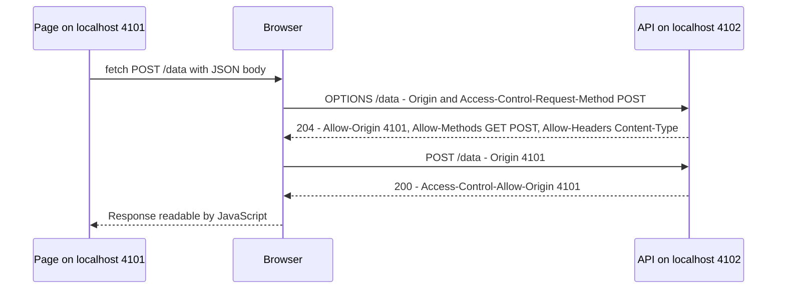
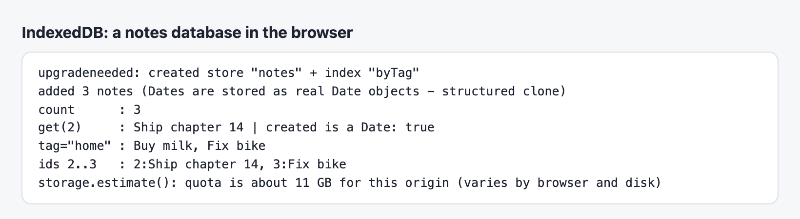
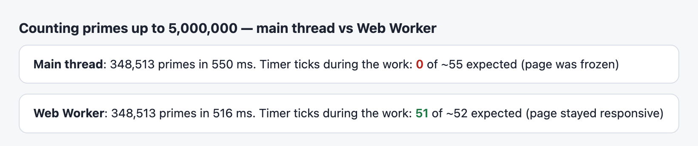
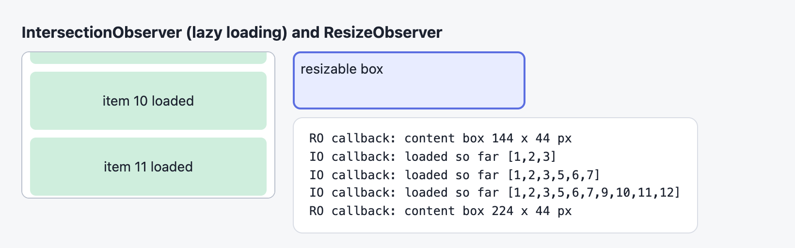
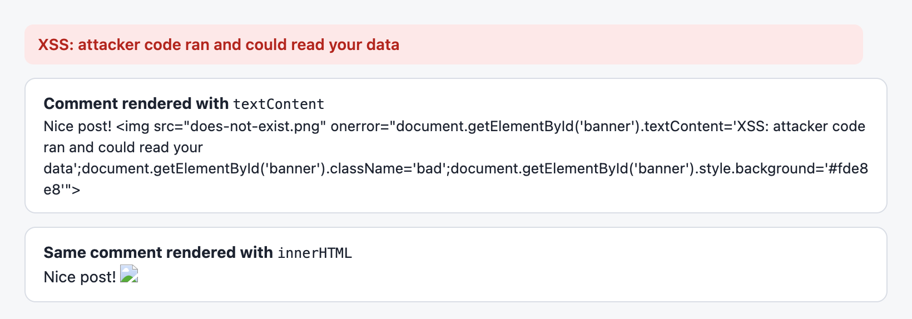
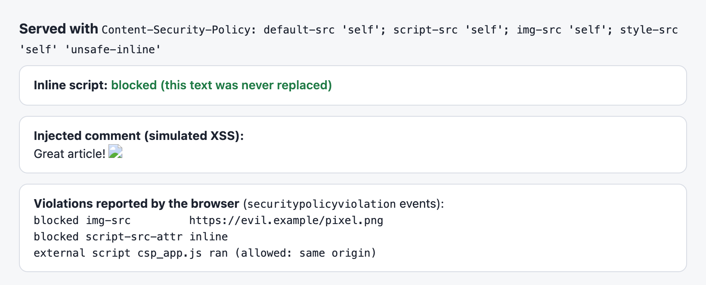

# Chapter 14 — Browser APIs and Security

Beyond the DOM, browsers give JavaScript a large toolbox: talking to servers (`fetch`), remembering things (Web Storage, cookies, IndexedDB), scheduling visual updates (`requestAnimationFrame`), managing URLs and history, running code on other threads (Web Workers), and watching elements (observers). That power makes pages a target, so the second half covers the security model — the same-origin policy and CORS — and the attacks every web developer must prevent: XSS (cross-site scripting) and CSRF (cross-site request forgery), plus the defence-in-depth (an extra layer in case another fails) header CSP (Content Security Policy).

**What you'll learn**

1. `fetch`: requests, responses, JSON, headers, HTTP vs network errors, timeouts.
2. The same-origin policy and CORS, including preflights (demonstrated in Chrome).
3. `localStorage` and `sessionStorage`.
4. Cookies and IndexedDB; choosing a storage mechanism.
5. Timers vs `requestAnimationFrame`.
6. `URL` and `URLSearchParams`.
7. The History API and client-side routing.
8. Web Workers for CPU-heavy work.
9. `IntersectionObserver` and `ResizeObserver`.
10. XSS and sanitizing; CSRF; Content Security Policy.

**Before you start.** Promises and `async`/`await` ([Chapter 12](../12-asynchronous-javascript/README.md)), DOM/events ([Chapter 13](../13-dom-and-events/README.md)), JSON ([Chapter 5](../05-objects-math-date-and-json/README.md)), error classes ([Chapter 11](../11-errors-and-debugging/README.md)).

**How the code runs.** Programs in [`code/`](code/) run in Node 24. `fetch` demos start a real **`node:http` server inside the same script** on a free local port, so nothing touches the internet. Storage, URL and History demos use jsdom (`tools_dom.mjs`), which implements `localStorage`, `document.cookie` and `history`. Real-browser features — CORS enforcement, CSP, Web Workers, observers, IndexedDB — are pages served by [`code/10_browser_demo_server.mjs`](code/10_browser_demo_server.mjs) on `localhost:4101` (the "site") and `localhost:4102` (a second origin, the "API"), run in headless Chrome and screenshotted.

---

## 14.1 `fetch` and HTTP

### What it is
`fetch(url, options?)` sends an HTTP request and returns a promise for a **`Response`**. Built into browsers and, since Node 18, Node (same API). It replaced the callback-based `XMLHttpRequest` (XHR). HTTP background: [System Design Fundamentals](../../../system-design-patterns/modules/00-system-design-fundamentals/README.md).

HTTP in brief: a **request** has a **method** (`GET` read, `POST` create, `PUT`/`PATCH` update, `DELETE` remove), a URL, **headers** (metadata such as `Content-Type` — the body's format — and `Authorization` — credentials) and optionally a **body**. The **response** has a **status code** (2xx success, 3xx redirect, 4xx client error such as 404 Not Found or 401 Unauthorized, 5xx server error), headers and a body.

### How it works
1. `fetch` resolves as soon as the **headers** arrive — with a `Response`, whatever the status.
2. Read the body with `res.json()`, `res.text()`, `res.blob()` (raw binary such as an image), `res.arrayBuffer()` or `res.formData()` — each a promise; a body can be read **once**.
3. `fetch` **rejects only on network failure** (DNS failure, refused connection, CORS block, abort). A 404 or 500 is a successful exchange: check `res.ok` (status 200–299).

[`code/01_fetch.mjs`](code/01_fetch.mjs) — the server part:

```js
const server = http.createServer(async (req, res) => {
  const url = new URL(req.url, 'http://localhost');
  const send = (status, body, headers = {}) => {
    res.writeHead(status, { 'Content-Type': 'application/json', ...headers });
    res.end(JSON.stringify(body));
  };
  if (req.method === 'GET' && url.pathname === '/api/users') return send(200, users, { 'X-Total-Count': String(users.length) });
  if (req.method === 'POST' && url.pathname === '/api/users') { /* read body, push, send(201, user, { Location }) */ }
  if (url.pathname === '/api/slow') return setTimeout(() => send(200, { ok: true }), 2000);
  if (url.pathname === '/api/crash') return send(500, { error: 'database unavailable' });
  if (url.pathname === '/page') { res.writeHead(200, { 'Content-Type': 'text/html' }); return res.end('<!doctype html><h1>Not JSON</h1>'); }
  send(404, { error: `no route ${req.method} ${url.pathname}` });
});
await new Promise((r) => server.listen(0, '127.0.0.1', r));   // port 0 = any free port
const BASE = `http://127.0.0.1:${server.address().port}`;
```

The client part:

```js
// 1) GET + JSON
const res = await fetch(`${BASE}/api/users`);
console.log('1) status:', res.status, res.statusText, '| ok:', res.ok, '| type:', res.headers.get('content-type'), '| total:', res.headers.get('x-total-count'));
console.log('   body  :', await res.json());

// 2) POST JSON
const created = await fetch(`${BASE}/api/users`, {
  method: 'POST',
  headers: { 'Content-Type': 'application/json' },
  body: JSON.stringify({ name: 'Grace' }),
});
console.log('2) POST ->', created.status, created.headers.get('location'), await created.json());

// 3) HTTP errors do NOT reject: check res.ok yourself
const notFound = await fetch(`${BASE}/api/nope`);
console.log('3) 404 resolved, ok =', notFound.ok, '| body:', (await notFound.json()).error);

// 4) A reusable helper that turns HTTP errors into exceptions
class HttpError extends Error {
  constructor(res, body) { super(`HTTP ${res.status} for ${res.url}`); this.name = 'HttpError'; this.status = res.status; this.body = body; }
}
async function getJSON(path, init) {
  const r = await fetch(`${BASE}${path}`, init);
  const isJson = r.headers.get('content-type')?.includes('application/json');
  const body = isJson ? await r.json() : await r.text();
  if (!r.ok) throw new HttpError(r, body);
  if (!isJson) throw new TypeError(`expected JSON, got ${r.headers.get('content-type')}`);
  return body;
}

// 5) Network failure DOES reject (TypeError) - a port where nothing listens
await fetch(`http://127.0.0.1:${deadPort}/`).catch((e) => console.log('5) network error:', e.name, '-', e.message, '| cause:', e.cause?.code));

// 6) Timeout / cancel with AbortSignal
await fetch(`${BASE}/api/slow`, { signal: AbortSignal.timeout(100) })
  .catch((e) => console.log('6) aborted:', e.name, /* ... */));

// 7) A body can be read only once; clone() first if you need it twice
const r7 = await fetch(`${BASE}/api/users`);
const copy = r7.clone();
await r7.json();
await r7.text().catch((e) => console.log('7) second read:', e.name, '-', e.message));
// 8) (file) query string via URL.searchParams; a Request object with Headers
```

Output:
```
1) status: 200 OK | ok: true | type: application/json | total: 1
   body  : [ { id: 1, name: 'Ada' } ]
2) POST -> 201 /api/users/2 { id: 2, name: 'Grace' }
3) 404 resolved, ok = false | body: no route GET /api/nope
4) /api/users -> 2 users
4) /api/crash -> HttpError | 500 database unavailable
4) /page -> TypeError |  expected JSON, got text/html
5) network error: TypeError - fetch failed | cause: ECONNREFUSED
6) aborted: TimeoutError after ~100 ms
7) second read: TypeError - Body is unusable: Body has already been read
   clone still readable: 2 users
8) url: /api/nope?search=Ada+Lovelace+%26+co
   Request: DELETE Bearer demo-token -> 404
```

Network errors are worded `TypeError: Failed to fetch` (Chrome) or `NetworkError when attempting to fetch resource` (Firefox); Node says `fetch failed` with the system error in `cause`.

### Useful `fetch` options
| Option | Values | Purpose |
|---|---|---|
| `method` | `'GET'` (default), `'POST'`, … | HTTP method |
| `headers` | object or `Headers` | `Content-Type`, `Authorization`, `Accept` |
| `body` | string, `FormData`, `URLSearchParams`, `Blob`, `ArrayBuffer`, stream | Not with GET/HEAD. `FormData` sets a multipart (fields plus files) `Content-Type` for you — don't set it yourself |
| `signal` | `AbortSignal` | Cancel / timeout ([§12.11](../12-asynchronous-javascript/README.md#1211-cancellation-abortcontroller-and-abortsignal)) |
| `credentials` | `'same-origin'` (default), `'include'`, `'omit'` | Whether cookies are sent (§14.2) |
| `mode` | `'cors'` (default), `'same-origin'`, `'no-cors'` | CORS behaviour |
| `cache` | `'default'`, `'no-store'`, `'reload'`, … | HTTP cache use |
| `keepalive` | `true` | Let a small request outlive the page (analytics sent on close) |

### Common mistakes
- Not checking `res.ok` → parsing an error page or treating a 500 as data.
- `res.json()` on non-JSON → `SyntaxError: Unexpected token '<'` ([§11.10](../11-errors-and-debugging/README.md#1110-common-runtime-errors--a-field-guide)).
- Forgetting `Content-Type: application/json` when sending JSON — many servers won't parse it.
- Concatenating query strings (`'?q=' + text`) — `&` or `#` breaks the URL. Use `URLSearchParams` (§14.6).
- No timeout: a hung server spins your UI forever. Always pass a `signal`.
- Secrets (API keys) in front-end code — anything shipped to the browser is public. Call your own backend, which holds the key.

### In the interview
**30-second answer:** "`fetch` returns a promise for a `Response` that resolves when headers arrive, even for 404 or 500 — it only rejects on network errors or aborts, so you check `res.ok`. You read the body once with `json()` or `text()`. For sending JSON you set `Content-Type` and `JSON.stringify` the body. I always wrap it in a helper that throws on non-2xx and use `AbortSignal.timeout` so requests can't hang."

- *Q: Does `fetch` send cookies?* A: Same-origin yes (default `credentials: 'same-origin'`); cross-origin only with `credentials: 'include'` and the right CORS headers.
- *Q: `fetch` vs axios?* A: axios adds auto JSON, throw on non-2xx, interceptors (hooks on every request/response); `fetch` is built in and a small wrapper covers most needs.

### TL;DR
`fetch` → `Response`; check `res.ok`; read the body once; HTTP errors resolve, network errors reject; JSON = header + `JSON.stringify`; always time out.

---

## 14.2 The same-origin policy and CORS

### What it is
An **origin** is **scheme + host + port** (`https://shop.example.com:443`; 443 is HTTPS's default port). `http://localhost:4101` and `:4102` are different origins, as are `http://` vs `https://` and `a.example.com` vs `b.example.com`.

The **same-origin policy (SOP)**: a page may **send** requests anywhere, but its JavaScript may **read responses** only from its own origin. Without it, any site could `fetch('https://your-bank.example/account')` — with your bank cookies attached — and read your balance.

**CORS (Cross-Origin Resource Sharing)** is the controlled exception: a server declares, with response headers, which other origins may read its responses.

### How it works
1. A page on `http://localhost:4101` calls `fetch('http://localhost:4102/public')`.
2. The browser adds `Origin: http://localhost:4101`.
3. **Simple requests** (GET/HEAD/POST with only "safelisted" headers and `Content-Type` limited to `text/plain`, `multipart/form-data` or `application/x-www-form-urlencoded`) are sent directly.
4. Anything else — `PUT`/`DELETE`, JSON `Content-Type`, an `Authorization` header — first triggers a **preflight**: an automatic `OPTIONS` request with `Access-Control-Request-Method`/`-Headers`. The real request is sent only if allowed.
5. On the response the browser checks `Access-Control-Allow-Origin`. Match (or `*`) → JavaScript gets it; otherwise `fetch` rejects with a `TypeError` and details go only to the DevTools console.



The CORS part of the API server in [`code/10_browser_demo_server.mjs`](code/10_browser_demo_server.mjs):

```js
const allow = { 'Access-Control-Allow-Origin': SITE, Vary: 'Origin' };   // SITE = 'http://localhost:4101'
if (req.method === 'OPTIONS') {                          // preflight: allow POST with a JSON body, but not PUT
  return res.writeHead(204, { ...allow, 'Access-Control-Allow-Methods': 'GET, POST',
    'Access-Control-Allow-Headers': 'Content-Type', 'Access-Control-Max-Age': '600' }).end();
}
if (path === '/public') return json(200, { msg: 'hello from another origin' }, allow);
if (path === '/private') return json(200, { secret: 'no CORS header on this one' });   // browser will hide it
if (path === '/data') return json(200, { saved: true, method: req.method }, allow);
```

Run without arguments, the script inspects the headers with Node's `fetch` — which does **not** enforce CORS (only browsers do):

```
preflight -> 204 {
  'access-control-allow-headers': 'Content-Type',
  'access-control-allow-methods': 'GET, POST',
  'access-control-allow-origin': 'http://localhost:4101',
  'access-control-max-age': '600'
}
/public  ACAO: http://localhost:4101
/private ACAO: null | Node still reads it: no CORS header on this one
csp.html CSP : default-src 'self'; script-src 'self'; img-src 'self'; style-src 'self' 'unsafe-inline'
```

In Chrome, [`code/cors.html`](code/cors.html) (served from `:4101`) makes five requests to `:4102`, then asks the API what it received:


*Figure — CORS as enforced by Chrome, and what actually reached the server.*

What it proves:
- `/private` **reached the server** (log line 2) — CORS stops the page **reading** the response, not the request. Hence CORS is no CSRF defence (§14.11).
- The JSON `POST` triggered an `OPTIONS` preflight first (lines 3–4).
- For `PUT` the preflight said no, so the `PUT` was **never sent** (line 5).
- `mode: 'no-cors'` gives an **opaque** response: status 0, unreadable body — only for fire-and-forget.

### CORS headers
| Header (response) | Meaning |
|---|---|
| `Access-Control-Allow-Origin` | `*` or one exact origin (not a list — echo an allow-listed `Origin` and add `Vary: Origin` so caches key by origin) |
| `Access-Control-Allow-Methods` / `-Headers` | Preflight answer: allowed methods and request headers |
| `Access-Control-Allow-Credentials: true` | Allow cookies with `credentials: 'include'`; then `Allow-Origin` **can't** be `*` |
| `Access-Control-Max-Age` | Seconds the browser may cache the preflight answer |
| `Access-Control-Expose-Headers` | Non-safelisted response headers JS may read (e.g. `X-Total-Count`) |

### Common mistakes
- "Fixing" CORS in the front end — impossible; the **server** must send the headers (or proxy the API through your own origin, e.g. Vite's dev-server proxy).
- `Access-Control-Allow-Origin: *` with credentials — browsers reject it.
- Reflecting any `Origin` with credentials allowed — effectively disables the SOP. Use an allow-list.
- Reading a CORS error as "server down" — usually it answered without the right headers.

### In the interview
**30-second answer:** "The same-origin policy lets a page send requests anywhere but only read responses from its own scheme-host-port. CORS lets a server opt in with `Access-Control-Allow-Origin`. Non-simple requests — JSON bodies, custom headers, PUT/DELETE — first get an OPTIONS preflight. CORS is enforced by the browser, not the server, and it protects reading, not sending."

- *Q: Why does Postman/curl work but the browser fails?* A: Only browsers enforce CORS.
- *Q: Is CORS a security feature for the server?* A: No — it relaxes the browser's SOP; servers still need authentication and CSRF protection.

### TL;DR
Origin = scheme + host + port. SOP blocks reading cross-origin responses; CORS headers relax it per origin. Non-simple requests get an OPTIONS preflight. Browsers enforce; servers configure.

---

## 14.3 Web Storage: `localStorage` and `sessionStorage`

### What it is
Two **key–value stores of strings** per origin, with a synchronous API:
- **`localStorage`** — persists until cleared; shared by all tabs of the origin.
- **`sessionStorage`** — per **tab** (and origin); survives reloads, cleared when the tab closes.

API: `setItem`, `getItem` (→ `null` if missing), `removeItem`, `clear()`, `key(i)`, `length`. A change in one tab fires a **`storage` event** in the **other** tabs of the origin (not the writer) — handy for syncing logout or theme.

[`code/03_storage.mjs`](code/03_storage.mjs) — key parts:

```js
localStorage.setItem('theme', 'dark');
localStorage.count = 5;                              // property style works but is discouraged
console.log('   numbers become strings:', typeof localStorage.getItem('count'), JSON.stringify(localStorage.getItem('count')));
localStorage.setItem('user', { name: 'Ada' });       // WRONG: stores "[object Object]"

const store = {
  get(key, fallback = null) {
    try { const raw = localStorage.getItem(key); return raw === null ? fallback : JSON.parse(raw); }
    catch { return fallback; }                          // corrupt value or storage disabled
  },
  set(key, value) {
    try { localStorage.setItem(key, JSON.stringify(value)); return true; }
    catch (e) { console.log('   set failed:', e.name); return false; }  // QuotaExceededError, private mode...
  },
};
store.set('cart', { items: [{ sku: 'A-1', qty: 2 }], updated: '2026-09-28' });
// ... enumerate, removeItem
store.set('huge', 'x'.repeat(6_000_000));            // over the ~5 MB quota
sessionStorage.setItem('wizardStep', '2');
```

Output (lines 1–6):
```
1) getItem      : dark | missing -> null
   numbers become strings: string "5"
   object stored raw     : [object Object]
2) JSON round trip: { sku: 'A-1', qty: 2 } | corrupt -> fallback
3) length: 5 | keys: [ 'theme', 'count', 'user', 'cart', 'bad' ]
   after removeItem: 4
   set failed: QuotaExceededError
5) sessionStorage: 2 | separate from localStorage: null
6) after clear(): 0
```

### Trade-offs
| ✓ Good for | ✗ Not for |
|---|---|
| UI preferences, drafts, small caches | **Secrets and auth tokens** — any script on the page (an XSS payload, a compromised npm package) can read them |
| Data that must survive reloads, a few KB–MB | Large data (quota ~5 MB per origin; use IndexedDB) |
| | Hot paths — it's **synchronous** and blocks the main thread on disk access |
| | Data for the server — never sent automatically (unlike cookies) |

### Common mistakes
- Storing objects without `JSON.stringify` → `"[object Object]"`.
- No `try`/`catch`: quota errors, and storage may be disabled (privacy modes, sandboxed iframes) so even *reading* can throw.
- Expecting `sessionStorage` to be shared across tabs (a duplicated tab gets a copy).

### TL;DR
String key–value storage per origin; `localStorage` persists, `sessionStorage` is per tab. JSON + try/catch; never secrets.

---

## 14.4 Cookies and IndexedDB — choosing storage

### Cookies
A **cookie** is a small (≈4 KB) name=value pair stored per site and **sent automatically with every matching HTTP request** in the `Cookie` header. Servers set them with `Set-Cookie`; JavaScript reads/writes non-`HttpOnly` cookies through the awkward `document.cookie` string.

```js
document.cookie = 'lang=en; Path=/; Max-Age=86400; SameSite=Lax';
document.cookie = 'consent=yes; Path=/';
document.cookie = 'session=secret; HttpOnly';        // IGNORED: HttpOnly cookies can only be set by the server
console.log('7) document.cookie:', JSON.stringify(document.cookie));
const cookies = Object.fromEntries(document.cookie.split('; ').map((c) => c.split('=').map(decodeURIComponent)));
document.cookie = 'lang=; Path=/; Max-Age=0';         // delete = expire it
```

Output (end of `03_storage.mjs`):
```
7) document.cookie: "lang=en; consent=yes"
   parsed: { lang: 'en', consent: 'yes' }
   after delete: "consent=yes"
```

Assigning `document.cookie` adds/updates **one** cookie; reading returns all visible ones as one string, without attributes.

| Attribute | Meaning |
|---|---|
| `Expires=<date>` / `Max-Age=<seconds>` | Lifetime; without either it's a **session cookie** (deleted when the browser session ends) |
| `Domain` / `Path` | Which hosts/paths receive it (omit `Domain` = this host only, safest) |
| `Secure` | Only sent over HTTPS (`localhost` counts as secure for development) |
| `HttpOnly` | Invisible to JavaScript — protects session cookies from XSS theft |
| `SameSite=Strict` / `Lax` / `None` | Whether it's sent on **cross-site** requests (§14.11). `None` requires `Secure`. Chrome and Edge treat a missing attribute as `Lax`; set it explicitly |
| `__Host-` name prefix | Browser enforces `Secure`, `Path=/`, no `Domain` — hardest to tamper with |

Session-ID recipe: `Set-Cookie: __Host-sid=…; HttpOnly; Secure; SameSite=Lax; Path=/`. (An async `cookieStore` API exists; check support.)

### IndexedDB
**IndexedDB** is the browser's real database: asynchronous, **transactional** (a group of changes all happen or none), storing **structured-cloneable** values (objects, arrays, `Date`, `Map`, `Blob`, typed arrays) in **object stores** (≈ tables) with **keys** and **indexes** (lookup structures for fast search by a field); quotas typically hundreds of MB to GB. The raw API is event-based and verbose, so apps use a thin promise wrapper (`req2p` below, the `idb` library) or a higher-level one (Dexie).

[`code/idb.html`](code/idb.html) — key parts:

```js
const req2p = (req) => new Promise((resolve, reject) => { req.onsuccess = () => resolve(req.result); req.onerror = () => reject(req.error); });

const open = indexedDB.open('notes-demo', 1);
open.onupgradeneeded = () => {                              // runs when the version number increases
  const store = open.result.createObjectStore('notes', { keyPath: 'id', autoIncrement: true });
  store.createIndex('byTag', 'tag');
};
const db = await req2p(open);

const tx = db.transaction('notes', 'readwrite');           // all writes commit together, or none
for (const n of notesToAdd) tx.objectStore('notes').add(n);
await new Promise((r) => (tx.oncomplete = r));

const ro = db.transaction('notes').objectStore('notes');   // read-only transaction
await req2p(ro.get(2));
await req2p(ro.index('byTag').getAll('home'));             // query by index
await req2p(ro.getAll(IDBKeyRange.bound(2, 3)));           // key range
```



*Figure — IndexedDB in headless Chrome. The quota is from `navigator.storage.estimate()` and depends on browser and free disk.*

### Choosing
| | Cookies | `localStorage` | `sessionStorage` | IndexedDB |
|---|---|---|---|---|
| Capacity | ~4 KB each | ~5 MB/origin | ~5 MB/origin | Large (share of disk) |
| API | String; sync | Sync | Sync | Async, transactions |
| Data types | Strings | Strings | Strings | Structured clone (objects, Dates, Blobs…) |
| Sent to server | **Automatically** | No | No | No |
| Lifetime | Expiry / session | Until cleared | Tab | Until cleared (may be evicted under storage pressure unless `navigator.storage.persist()` is granted) |
| Readable by JS | Unless `HttpOnly` | Yes | Yes | Yes |
| Typical use | Session ID, CSRF, consent | Preferences | Wizard progress | Offline data, caches, large datasets |

A fifth option, the **Cache API**, stores whole HTTP responses; service workers use it for offline apps (§14.8).

### TL;DR
Cookies = tiny, auto-sent, the place for `HttpOnly` session IDs. Web Storage = small, sync, strings. IndexedDB = async database for big or structured data.

---

## 14.5 Timers and `requestAnimationFrame`

### What it is
`requestAnimationFrame(callback)` (**rAF**) runs `callback(timestamp)` **just before the next repaint** — once per frame at the display's refresh rate (60 Hz → ~16.7 ms, 120 Hz → ~8.3 ms). It's the scheduler for anything visual; timers ([§12.5](../12-asynchronous-javascript/README.md#125-timers)) are for everything else.

| | `setTimeout`/`setInterval` | `requestAnimationFrame` |
|---|---|---|
| When | After a delay, as a task | Right before paint, in the event loop's render step |
| Synced to display | No (can run twice per frame or miss frames → jank) | Yes |
| Background tabs | Throttled (≥1 s typically) | **Paused** — saves battery |
| Callback argument | Your args | High-resolution frame timestamp |
| Cancel | `clearTimeout` | `cancelAnimationFrame(id)` |

[`code/06_raf.mjs`](code/06_raf.mjs) (jsdom simulates 60 fps):

```js
function animate(el, to, duration) {
  return new Promise((resolve) => {
    let start;
    const frames = [];
    function step(now) {                       // now = frame timestamp (ms), same clock as performance.now()
      start ??= now;
      const t = Math.min((now - start) / duration, 1);
      const eased = 1 - (1 - t) ** 3;          // ease-out cubic
      el.style.width = `${Math.round(eased * to)}px`;
      frames.push(el.style.width);
      if (t < 1) requestAnimationFrame(step);
      else resolve(frames);
    }
    requestAnimationFrame(step);
  });
}
const frames = await animate(bar, 300, 200);

// Coalesce many events into one update per frame (e.g. scroll or pointermove)
let scheduled = false;
function onPointerMove() {
  events++;
  if (scheduled) return;
  scheduled = true;
  requestAnimationFrame(() => { scheduled = false; updates++; /* read layout, then write styles */ });
}
```

Output (intermediate widths vary with real frame timing; 0px and 300px don't):
```
1) about 12 frames in 200 ms at 60 fps: true
   first widths: 0px, 69px, 130px, 178px ... last: 300px
2) cancelled a frame callback
3) 50 events -> 1 DOM update(s)
```

### Rules
1. **Base progress on time, not frame count** — rates vary (60/120/144 Hz, dropped frames).
2. rAF runs **once**; re-request inside the callback to continue.
3. **Coalesce** bursts (`scroll`, `pointermove`, `resize`) into one DOM update per frame.
4. Prefer **CSS transitions/animations** or the Web Animations API (`el.animate()`) for simple effects — they can run on the compositor thread. Use rAF when JS must compute each frame (games, canvas, physics, drag).
5. Animate `transform`/`opacity` ([§13.11](../13-dom-and-events/README.md#1311-rendering-performance-reflow-repaint-and-layout-thrashing)).

### TL;DR
rAF = "run before the next paint", once per frame, paused in background tabs. Time-based progress, re-request each frame, coalesce events through it.

---

## 14.6 `URL` and `URLSearchParams`

### What it is
`new URL(input, base?)` parses a URL into parts; `url.searchParams` is a `URLSearchParams` for the query string. Both handle **percent-encoding** (unsafe characters as `%` + hex, e.g. space → `%20`), so never glue URLs with `+`.

[`code/04_url.mjs`](code/04_url.mjs) — key parts:

```js
const u = new URL('https://shop.example.com:8443/search/results?q=red+shoes&size=9&size=10#reviews');
console.log('1) parts:', { protocol: u.protocol, host: u.host, hostname: u.hostname, port: u.port, pathname: u.pathname, search: u.search, hash: u.hash, origin: u.origin });
const p = u.searchParams;
p.set('page', '2'); p.append('size', '11'); p.delete('q'); p.sort();
console.log('3)', new URL('../img/logo.png', 'https://example.com/docs/guide/').href);
const search = new URLSearchParams({ q: 'Tom & Jerry', tag: 'c++', emoji: '✓' });

function safeHttpUrl(input) {
  try {
    const url = new URL(input);
    return ['http:', 'https:'].includes(url.protocol) ? url.href : null;
  } catch { return null; }
}
```

Output:
```
1) parts: {
  protocol: 'https:',
  host: 'shop.example.com:8443',
  hostname: 'shop.example.com',
  port: '8443',
  pathname: '/search/results',
  search: '?q=red+shoes&size=9&size=10',
  hash: '#reviews',
  origin: 'https://shop.example.com:8443'
}
2) q = red shoes | size = 9 | getAll = [ '9', '10' ] | has page: false
   now: ?page=2&size=9&size=10&size=11 | entries: [
  [ 'page', '2' ],
  [ 'size', '9' ],
  [ 'size', '10' ],
  [ 'size', '11' ]
]
3) https://example.com/docs/img/logo.png
   https://example.com/api?x=1
4) q=Tom+%26+Jerry&tag=c%2B%2B&emoji=%E2%9C%93
   manual concat would break: q=Tom & Jerry <- the & starts a new parameter
   encodeURIComponent: Tom%20%26%20Jerry%2F%3F | encodeURI keeps / and ?: /a%20b/?x=1&y=2
5) https://ada.dev          -> https://ada.dev/
5) javascript:alert(1)      -> null
5) not a url                -> null
5) data:text/html,<b>x</b>  -> null
   URL.canParse: true false
6) { a: '1', b: 'two' } | k=v1&k=v2
```

### Notes
- `new URL('relative')` **without a base throws** `TypeError: Invalid URL`; `URL.canParse()` checks without throwing.
- `URLSearchParams` encodes spaces as `+` (form encoding); `encodeURIComponent` uses `%20`. Servers decode both.
- `get` returns the first value, `getAll` all — repeated keys are normal (`?size=9&size=10`).
- In the browser `location` is URL-like; `new URL(location.href)` gives a mutable copy.
- **Validate user-supplied URLs** by parsing and allow-listing the protocol (item 5); blocking `javascript:` prevents a classic XSS (§14.10).

### TL;DR
Parse with `new URL`, build queries with `URLSearchParams`, resolve relative URLs with a base, allow-list protocols for user links.

---

## 14.7 The History API

### What it is
The **History API** changes the address-bar URL and adds back/forward entries **without loading a new page** — the basis of **single-page application (SPA)** routing (one HTML page; JavaScript swaps views; a router maps each URL to a view, e.g. React Router, Vue Router).

| API | Does |
|---|---|
| `history.pushState(state, '', url)` | Add an entry and change the URL (same origin only). No request, no `popstate` |
| `history.replaceState(state, '', url)` | Change the current entry — e.g. update filter query params |
| `history.state` | Current entry's state object (structured-cloned) |
| `history.back()` / `forward()` / `go(n)` | Navigate; async |
| `popstate` event on `window` | Fires on back/forward to an entry — **re-render from `location`** |

[`code/05_history.mjs`](code/05_history.mjs) — a 30-line router:

```js
const routes = [
  [/^\/$/, () => 'Home page'],
  [/^\/products$/, () => 'All products'],
  [/^\/products\/(\d+)$/, (id) => `Product #${id}`],
];
function render() { /* match location.pathname against routes, write the view with textContent */ }

// Intercept same-origin link clicks (delegation) and navigate without reloading
document.addEventListener('click', (e) => {
  const a = e.target.closest('a');
  if (!a || a.origin !== location.origin || e.ctrlKey || e.metaKey) return;   // let the browser handle it
  e.preventDefault();
  history.pushState({ from: location.pathname }, '', a.href);                  // new history entry, no request
  render();
});
// Back/forward buttons fire popstate: re-render from the URL
window.addEventListener('popstate', () => { render(); show('popstate (back/fwd)'); });

render(); show('initial');
document.querySelector('a[href="/products"]').click(); show('click Products');
document.querySelector('a[href="/products/42"]').click(); show('click Lamp');
history.replaceState({ tab: 'reviews' }, '', '/products/42?tab=reviews'); show('replaceState (no new entry)');
history.back();
```

Output:
```
initial                      /              | Home page | state: null | length: 1
click Products               /products      | All products | state: {"from":"/"} | length: 2
click Lamp                   /products/42   | Product #42 | state: {"from":"/products"} | length: 3
replaceState (no new entry)  /products/42   | Product #42 | state: {"tab":"reviews"} | length: 3
popstate (back/fwd)          /products      | All products | state: {"from":"/"} | length: 3
external link: same origin? false -> not intercepted
```

### Must-knows for SPA routing
1. **The server must serve the app for every route** (fallback to `index.html`) — else reloading `/products/42` is a 404.
2. Respect modifier keys (Ctrl/Cmd/Shift-click), `target="_blank"` and external links.
3. Manage **focus and scroll** after navigation (focus the new heading; restore scroll on back) — screen-reader users otherwise miss the change.
4. Put shareable UI state (filters, tabs, search) in the URL (`replaceState` + `URLSearchParams`).
5. Hash routing (`#/products` + `hashchange`) is the older approach needing no server config.

The newer **Navigation API** (`navigation.navigate()`, one `navigate` event for all navigations) simplifies routers; check support.

### TL;DR
`pushState`/`replaceState` change the URL without loading; `popstate` on back/forward — re-render from `location`. Configure the server fallback; handle focus.

---

## 14.8 Web Workers

### What it is
A **Web Worker** runs a script on a **separate background thread** with its own event loop and global (`self`). No DOM, `window` or `document`, but it has `fetch`, timers, IndexedDB, `crypto` and more. Page and worker communicate only by **messages**:

```js
// main page                                         // prime_worker.js
const w = new Worker('prime_worker.js');             self.onmessage = (e) => {
w.onmessage = (e) => show(e.data.count);               const count = countPrimes(e.data);
w.postMessage(5_000_000);                              self.postMessage({ upTo: e.data, count });
                                                     };
```

Messages are copied with the **structured clone algorithm** (plain objects, arrays, `Date`, `Map`, `Set`, `Blob`, typed arrays… **not** functions, DOM nodes or class prototypes). Big `ArrayBuffer`s can be **transferred** instead (`postMessage(buf, [buf])`): ownership moves, zero-copy, the sender loses access.

### Why it matters — measured
[`code/worker.html`](code/worker.html) counts primes up to 5 million on the main thread and in [`code/prime_worker.js`](code/prime_worker.js); a 10 ms `setInterval` tick counter shows whether the page could do anything else meanwhile:



*Figure — same work, same time; only the worker leaves the main thread free (headless Chrome).*

A worker doesn't make computation faster — it moves it off the thread that handles clicks, scrolling and painting. Node has the same model in `worker_threads`; [`code/07_workers_node.mjs`](code/07_workers_node.mjs) shows message passing and clone rules (Date and Map survive; posting `{ fn: () => 1 }` throws):

```
worker result : { upTo: 3000000, count: 216816, sampleIsCopy: true, mapSize: 1 }
main thread kept running while the worker computed: true
clone error   : DataCloneError
structuredClone keeps Date/Map: true
```

### Kinds of workers
| Kind | Purpose |
|---|---|
| Dedicated `Worker` | Background computation for one page. `new Worker(url, { type: 'module' })` allows `import` |
| `SharedWorker` | One worker shared by several tabs of the origin |
| **Service worker** | Network proxy between page and server — offline support, caching, push notifications (PWAs — installable, offline-capable websites). Event-driven, not for computation |
| Worklets | Tiny specialized scripts (audio, CSS paint) |

### When not to use it
For I/O (`fetch` is already async) or small tasks — message copying and start-up cost more than they save. Use it for parsing big files, image/audio processing, compression, cryptography, syntax highlighting, search indexes. Comlink makes messaging feel like function calls.

### TL;DR
Workers = real parallel threads without DOM, talking via `postMessage` (structured clone or transfer). Keep CPU-heavy work off the main thread.

---

## 14.9 `IntersectionObserver` and `ResizeObserver`

### What it is
Observers are browser callbacks **when something changes** — instead of polling in `scroll`/`resize` handlers that fire constantly and force layout reads.

| Observer | Tells you when… | Typical uses |
|---|---|---|
| `IntersectionObserver` | An element enters/leaves the viewport (or a scroll container) by a given fraction | Lazy loading, infinite scroll, "seen" analytics, starting animations |
| `ResizeObserver` | An element's size changes (any reason, not just window resize) | Components that adapt to available space, charts that fit their container |
| `MutationObserver` | The DOM changes | [Chapter 13 §13.10](../13-dom-and-events/README.md#1310-watching-the-dom-mutationobserver) |

[`code/observers.html`](code/observers.html) — key parts:

```js
const io = new IntersectionObserver((entries, obs) => {
  for (const e of entries) {
    if (!e.isIntersecting) continue;
    e.target.classList.add('loaded');
    e.target.textContent = 'item ' + e.target.dataset.i + ' loaded';
    obs.unobserve(e.target);                    // load once
  }
}, { root: scroller, rootMargin: '20px' });     // root: null would mean the viewport
scroller.querySelectorAll('.item').forEach((el) => io.observe(el));

const ro = new ResizeObserver((entries) => {
  for (const e of entries) {
    const { inlineSize, blockSize } = e.contentBoxSize[0];
    log('RO callback: content box ' + Math.round(inlineSize) + ' x ' + Math.round(blockSize) + ' px');
  }
});
ro.observe(box);
// scripted: scrollTop = 300, then 600; then box.style.width = '240px'
```



*Figure — observers in headless Chrome. Items 4 and 8 never loaded: the scroll jumps skipped them, as a fast user scroll would.*

- Both call back **once initially** per observed element, then on changes.
- Options: `root` (container or `null` = viewport), `rootMargin` (grow/shrink the root box, e.g. `'200px'` to load early), `threshold` (`0` = any pixel, `1` = fully visible, or an array).
- For images and iframes prefer native **`loading="lazy"`**; IO for custom cases.
- Always `unobserve`/`disconnect` when done.
- A `ResizeObserver` callback that resizes its target can loop; the browser stops after one pass and reports "ResizeObserver loop completed with undelivered notifications".

### TL;DR
`IntersectionObserver` for visibility, `ResizeObserver` for element size — no polling, no forced layouts. Disconnect when done.

---

## 14.10 Cross-site scripting (XSS) and sanitizing

### What it is
**Cross-site scripting (XSS)**: an attacker gets **their JavaScript to run in your page** with your page's privileges — reading displayed data, calling your APIs as the user, reading non-HttpOnly cookies and `localStorage`, faking login forms. It has appeared in every edition of the OWASP Top 10 (the OWASP non-profit's ranking of critical web-app risks) — its own category until 2017, folded into "Injection" since 2021.

| Type | How the payload arrives |
|---|---|
| **Stored** | Saved on the server (a comment, a profile name) and shown to others |
| **Reflected** | Echoed from the request (a search term in the URL) into the response |
| **DOM-based** | Client code moves untrusted data (URL, `postMessage`, API data) into a dangerous **sink** like `innerHTML` |

### How it works — seen in a real browser
[`code/xss.html`](code/xss.html) renders the same comment twice. It contains ``: the image fails, so the browser runs `onerror` as code.

```js
document.getElementById('safe').textContent = comment;   // shown as text
document.getElementById('unsafe').innerHTML = comment;   // parsed: the onerror handler runs
```



*Figure — one line of `innerHTML` let the attacker's code take over the page (headless Chrome).*

[`code/08_xss.mjs`](code/08_xss.mjs) takes the payload apart in jsdom:

```js
box.innerHTML = comment;
console.log('1) innerHTML created  with onerror handler:', img?.getAttribute('onerror'));
box.textContent = comment;
const escapeHtml = (s) => String(s).replace(/[&<>"']/g, (ch) => ({ '&': '&amp;', '<': '&lt;', '>': '&gt;', '"': '&quot;', "'": '&#39;' })[ch]);
box.innerHTML = `<p class="comment">${escapeHtml(comment)}</p>`;
const website = 'javascript:alert(document.cookie)';
a.href = escapeHtml(website);                        // escaping does nothing useful here
```

Output:
```
1) innerHTML created  with onerror handler: stealCookies()
   <script> inserted via innerHTML exists but never runs: true (the  is what attackers use instead)
2) textContent -> elements created: 0 | shown literally: Nice post! : 0
4) href after escaping : javascript:alert(document.cookie) <- still runs script when clicked
   href after allow-list: #
5) sinks to avoid with untrusted data:
   - el.innerHTML = s
   - el.outerHTML = s
   - el.insertAdjacentHTML(pos, s)
   - document.write(s)
   - eval(s) / new Function(s)
   - setTimeout('code string')
   - el.setAttribute("on...", s)
   - a.href = s (javascript:)
```

### How to prevent it (in priority order)
1. **Treat external data as text**: `textContent`, `setAttribute` for non-event attributes, `createElement` ([§13.3](../13-dom-and-events/README.md#133-creating-inserting-and-removing-nodes)). Frameworks do this by default (React escapes `{value}` in JSX); the danger is escape hatches (`dangerouslySetInnerHTML`, Vue's `v-html`).
2. **Escape for the context** (`<` → `&lt;` etc.) when building HTML strings on the server: HTML body, attribute, URL and JavaScript contexts each need different encoding (item 4: HTML-escaping doesn't make a `javascript:` URL safe). Use an auto-escaping template engine.
3. **Validate URLs** by parsing and allow-listing `http:`/`https:` (§14.6).
4. **Sanitize** (strip every dangerous part) **when you must render user HTML** (rich text, Markdown output) with a maintained sanitizer such as **DOMPurify** (`el.innerHTML = DOMPurify.sanitize(html)`), which removes scripts, event-handler attributes and dangerous URLs. The standard **HTML Sanitizer API** (`el.setHTML()`) still has limited browser availability (per MDN), so use it only with a fallback. Never write a regex sanitizer.
5. **Defence in depth**: a strict **CSP** (§14.12) so injected code doesn't run; `HttpOnly` cookies so sessions can't be stolen; **Trusted Types** (a CSP feature making dangerous sinks reject plain strings; check support).

### In the interview
**30-second answer:** "XSS is attacker-controlled script running in my origin — stored, reflected or DOM-based. The root cause is untrusted data reaching a sink that parses HTML or code, like `innerHTML`, `eval` or a `javascript:` URL. I prevent it by rendering data as text (`textContent`, framework escaping), context-aware escaping on the server, URL protocol allow-lists, DOMPurify when HTML is truly needed, and a strict CSP plus HttpOnly cookies as backup."

- *Q: Does a `<script>` injected with `innerHTML` run?* A: No — but ``, `<svg onload>` and similar attributes do, so that's no protection.
- *Q: Is React immune?* A: Mostly for text; not for `dangerouslySetInnerHTML`, `href={userUrl}` with `javascript:` (React warns; newer versions block it), or injected server-rendered HTML.

### TL;DR
XSS = untrusted data parsed as code. Render as text, escape by context, allow-list URL protocols, DOMPurify, plus CSP and HttpOnly.

---

## 14.11 Cross-site request forgery (CSRF)

### What it is
**CSRF** tricks a logged-in user's browser into sending an unintended request — e.g. a hidden form on `evil.example` auto-submitting `POST https://bank.example/transfer`. Unless `SameSite` protects the cookie, the browser attaches the bank's cookies, so the bank sees a valid session. The attacker can't **read** the response (SOP), but a state-changing request doesn't need that.

### How it's prevented
| Defence | How it helps |
|---|---|
| **`SameSite` cookies** (`Lax` or `Strict`) | Cookie not sent on cross-site sub-requests and form POSTs. `Lax` still sends on top-level GET navigations (clicking a link), so **GET must never change state** |
| **CSRF token** (synchronizer token) | Server gives the page a random secret; state-changing requests must echo it in a header or field. `evil.example` can't read your page, so can't know it |
| **Check `Origin` / `Sec-Fetch-Site` headers** | Reject unexpected origins on state-changing requests |
| **Require a custom header or JSON `Content-Type`** | Forces a CORS preflight for cross-origin requests, which your server won't approve |
| Re-authentication | For critical actions (password change, large transfer) |

Use at least two: `SameSite` + token (or origin check). [`code/09_csrf_cookies_headers.mjs`](code/09_csrf_cookies_headers.mjs) implements session cookie + token on a local server; Node's `fetch` has no cookie jar, so the script sends the `Cookie` header by hand:

```js
if (req.method === 'POST' && req.url === '/login') {
  const sid = randomBytes(16).toString('hex');
  const csrf = randomBytes(16).toString('hex');
  sessions.set(sid, { user: 'ada', csrf });
  return reply(200, { csrf }, {                          // token goes to the page, cookie to the browser
    'Set-Cookie': `sid=${sid}; HttpOnly; Secure; SameSite=Lax; Path=/; Max-Age=3600`,
  });
}
if (req.method === 'POST' && req.url === '/transfer') {
  if (!session) return reply(401, { error: 'not logged in' });
  if (!same(req.headers['x-csrf-token'], session.csrf)) return reply(403, { error: 'CSRF token missing or wrong' });
  return reply(200, { ok: true, by: session.user });
}
// ...
const forged = await fetch(`${BASE}/transfer`, { method: 'POST', headers: { Cookie: cookie } });
const legit = await fetch(`${BASE}/transfer`, { method: 'POST', headers: { Cookie: cookie, 'X-CSRF-Token': csrf } });
const noCookie = await fetch(`${BASE}/transfer`, { method: 'POST', headers: { 'X-CSRF-Token': csrf } });
```

Output:
```
1) Set-Cookie: sid=<random>; HttpOnly; Secure; SameSite=Lax; Path=/; Max-Age=3600
   CSP       : default-src 'self'; script-src 'self'; object-src 'none'; base-uri 'self'; frame-ancestors 'none'
2) forged request  -> 403 CSRF token missing or wrong
3) legit request   -> 200 { ok: true, by: 'ada' }
4) without cookie  -> 401 not logged in
```

Line 2: a forged request still carrying the cookie (as with `SameSite=None` or an old browser) is stopped by the missing token. Line 4 is what `SameSite=Lax` does to a cross-site POST in a modern browser: no cookie, no session. The token is compared with `crypto.timingSafeEqual` so timing doesn't leak how many characters matched.

### Common mistakes
- State changes on `GET` (`/logout`, `/delete?id=5`) — an `` can trigger them.
- Believing CORS prevents CSRF — the forged request is still sent (§14.2's `/private`).
- Session token in `localStorage` + `Authorization` header avoids CSRF but exposes the token to any XSS — a trade-off. `HttpOnly` cookie + `SameSite` + CSRF token is the common recommendation (OWASP CSRF Prevention Cheat Sheet).

### TL;DR
CSRF abuses auto-sent cookies. Defend with `SameSite` cookies, CSRF tokens (or origin checks), and never change state on GET.

---

## 14.12 Content Security Policy (CSP)

### What it is
**CSP** is an HTTP response header (`Content-Security-Policy`) telling the browser **which sources of scripts, styles, images, frames etc. are allowed**; anything else is blocked and reported. It's **defence in depth**: if an XSS bug injects markup, CSP stops the code running.

| Directive | Controls | Example |
|---|---|---|
| `default-src` | Fallback for all fetch directives | `'self'` |
| `script-src` | Scripts (`'unsafe-inline'` re-allows inline code — avoid; a *nonce* is a random one-time token) | `'self'` or `'nonce-r4nd0m'` |
| `script-src-attr` | Inline event-handler attributes (`onclick=…`) | falls back to `script-src` |
| `style-src`, `img-src`, `connect-src` (fetch/WebSocket — a persistent two-way connection), `font-src`, `frame-src` | Each resource type | `connect-src 'self' https://api.example.com` |
| `object-src 'none'` | Plugins (`<object>`, `<embed>`) | Always `'none'` |
| `base-uri 'self'` | Stops `<base>` hijacking relative URLs | |
| `frame-ancestors 'none'` | Who may embed you — **clickjacking** protection (hiding your page in an invisible frame to trick clicks); supersedes `X-Frame-Options` | |
| `report-to` / `report-uri` | Where to send violation reports | |

### Seen in a real browser
[`code/csp.html`](code/csp.html) is served with `Content-Security-Policy: default-src 'self'; script-src 'self'; img-src 'self'; style-src 'self' 'unsafe-inline'`. It has an inline `<script>` that would replace a message, and loads [`code/csp_app.js`](code/csp_app.js), which injects an attacker comment via `innerHTML` and logs `securitypolicyviolation` events:

```js
// csp_app.js (allowed: same origin)
document.addEventListener('securitypolicyviolation', (e) => {
  log.textContent += `blocked ${e.effectiveDirective.padEnd(15)} ${e.blockedURI || '(inline)'}\n`;
});
document.getElementById('comment').innerHTML =
  'Great article! ';
```



*Figure — the injection that took over §14.10's page is neutralized: the external image and the inline `onerror` were both blocked. (The inline-script violation happened before the listener was registered; it's in the DevTools console.)*

### How to adopt CSP
1. Move inline scripts and `on…=` attributes into files and `addEventListener` ([§13.5](../13-dom-and-events/README.md#135-events-and-listeners)).
2. Start with `Content-Security-Policy-Report-Only` to collect violations without breaking the site.
3. For needed inline scripts, use a per-response random **nonce** (`script-src 'nonce-…'`); with `'strict-dynamic'`, scripts loaded by trusted scripts are allowed too. Google recommends this "strict CSP" over long domain allow-lists, which are often bypassable.
4. Enforce, keep reporting, review violations.

### Other security headers worth sending
| Header | Purpose |
|---|---|
| `Strict-Transport-Security: max-age=31536000; includeSubDomains` | HTTPS only (HSTS: HTTP Strict Transport Security) |
| `X-Content-Type-Options: nosniff` | Don't guess MIME types (format labels like `text/html`); stops some script injection via uploads |
| `Referrer-Policy: strict-origin-when-cross-origin` | Don't leak full URLs (the referrer) to other sites (also today's browser default) |
| `Permissions-Policy: camera=(), geolocation=()` | Turn off powerful features you don't use |
| `Cross-Origin-Opener-Policy: same-origin` | Isolate your window from cross-origin popups |

### Security checklist for front-end code
| Risk | Rule |
|---|---|
| XSS | Data as text; escape by context; DOMPurify for HTML; allow-list URL protocols; strict CSP |
| Session theft | `HttpOnly; Secure; SameSite` cookies; never tokens in URLs |
| CSRF | SameSite + CSRF token or origin check; no state change on GET |
| Secrets | No API keys in front-end bundles |
| Dependencies | `npm audit` (known-vulnerability scan), lockfiles, few well-maintained packages ([Chapter 10](../10-modules-and-tooling/README.md#1010-semantic-versioning-ranges-and-lockfiles)); Subresource Integrity (`integrity=` hash the browser checks) for third-party CDN scripts |
| Clickjacking | `frame-ancestors 'none'` or `'self'` |
| Validation | Client-side is UX; the server validates everything |
| Prototype pollution (attacker data adding properties to `Object.prototype`, affecting every object) | Don't deep-merge untrusted JSON into objects ([Chapter 9](../09-this-prototypes-and-classes/README.md#93-prototypes-and-the-prototype-chain)) |

### TL;DR
CSP limits where scripts/styles/images may come from and blocks inline code, so injected markup can't run. Roll out report-only, prefer nonces + `'strict-dynamic'`, add HSTS, `nosniff`, `frame-ancestors`.

---

## Chapter 14 TL;DR

- **fetch**: resolves on any HTTP status (check `res.ok`), rejects on network failure/abort; body read once; JSON needs `Content-Type` + `JSON.stringify`; time out with `AbortSignal.timeout`.
- **SOP & CORS**: origin = scheme + host + port; send anywhere, read only same-origin unless `Access-Control-Allow-Origin`; non-simple requests get an `OPTIONS` preflight; browsers enforce.
- **Storage**: cookies (tiny, auto-sent; `HttpOnly; Secure; SameSite` for sessions), `localStorage` (persistent strings, ~5 MB, sync, never secrets), `sessionStorage` (per tab), IndexedDB (async database, structured data, large quota).
- **rAF** for visual updates: once per frame, time-based, paused in background tabs.
- **URL/URLSearchParams** for parsing, building, encoding, validating URLs.
- **History API**: `pushState`/`replaceState` + `popstate` = SPA routing; server fallback to `index.html`.
- **Web Workers**: parallel threads without DOM; `postMessage` with structured clone.
- **Observers**: `IntersectionObserver` (visibility, lazy loading), `ResizeObserver` (element size).
- **XSS**: data as text, context-aware escaping, URL allow-lists, DOMPurify, CSP, HttpOnly.
- **CSRF**: SameSite cookies + tokens/origin checks; no state changes on GET; CORS isn't a CSRF defence.
- **CSP** and security headers are defence in depth.

Next: JavaScript on the server — [Chapter 15: Node.js Basics](../15-nodejs-basics/README.md).
