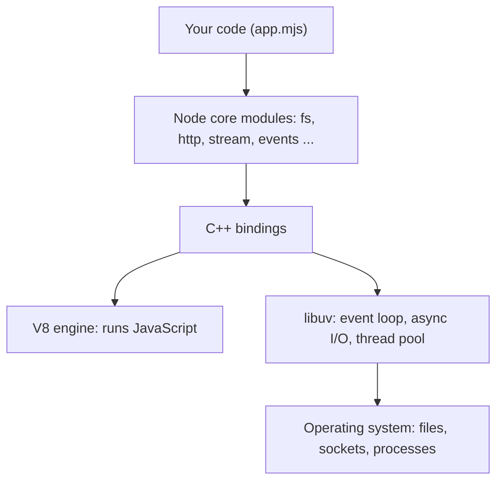
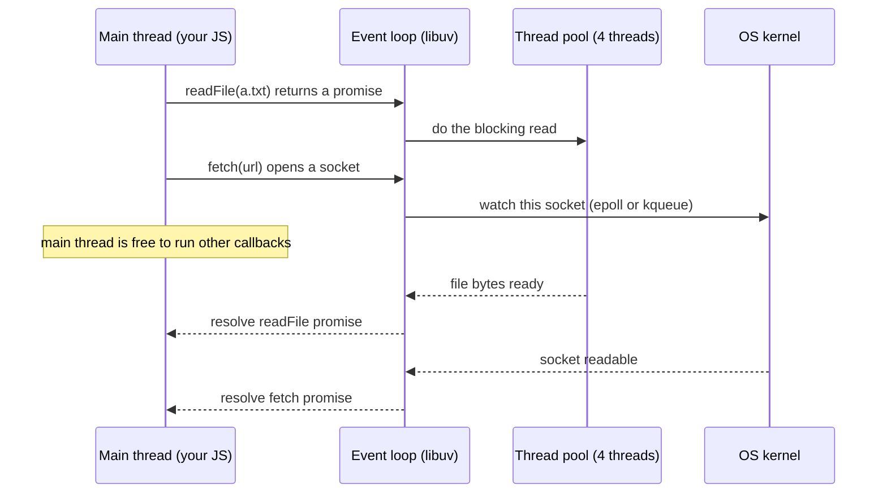
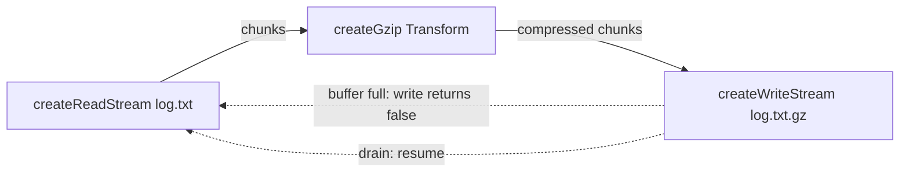
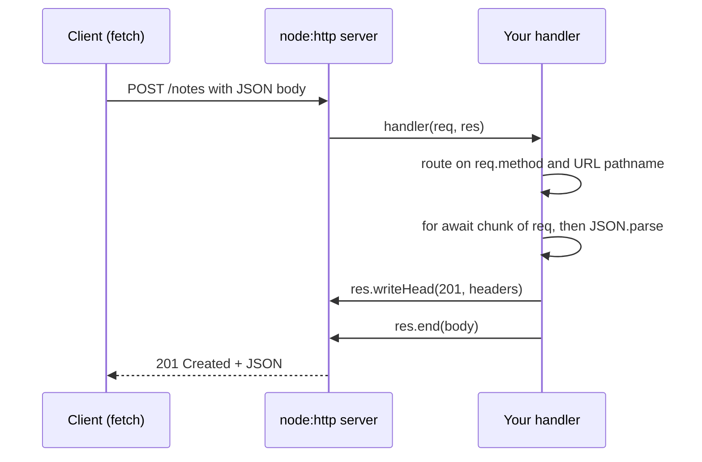

# Chapter 15 — Node.js Basics

**Node.js** takes JavaScript out of the browser and onto servers, laptops and build machines — every `npm install` (npm = Node's package manager), bundler run and `node --test` in this book already used it. This chapter covers what Node adds to the language and how to use its core modules (built into Node) for real work: files, paths, configuration, events, streams, HTTP and child processes.

**What you'll learn**

1. What Node.js is: V8 + libuv + core modules; how it differs from a browser.
2. The event loop, the libuv thread pool, blocking, and worker threads.
3. Modules in Node in one page (details in Chapter 10).
4. Files with `node:fs/promises`; paths and file URLs with `node:path` / `node:url`.
5. `process`: arguments, environment variables, `.env` files, exit codes, signals.
6. `Buffer` — raw bytes.
7. `EventEmitter` — the event pattern behind most Node APIs.
8. Streams: readable, writable, transform, `pipeline`, backpressure.
9. An HTTP server with `node:http`, called from the same script.
10. Child processes and npm scripts (`node --run`).
11. Node vs Deno vs Bun; everyday command-line flags.

**Before you start.** Promises and `async`/`await` ([Chapter 12](../12-asynchronous-javascript/README.md)) — almost every API here is awaited. Event-loop phases, `process.nextTick` and `setImmediate`: [§12.4](../12-asynchronous-javascript/README.md#124-nodes-event-loop-nexttick-setimmediate-and-phases); module systems, `package.json`, npm: [Chapter 10](../10-modules-and-tooling/README.md); the Node inspector: [§11.9](../11-errors-and-debugging/README.md#119-debugging-with-devtools-and-the-node-inspector).

All runnable code is in [`code/`](code/), run with **Node 24.11.1**; outputs are real. Disk programs use a fresh `os.tmpdir()` folder and delete it; the HTTP example listens only on `127.0.0.1` on an OS-chosen free port.

---

## 15.1 What Node.js is

### What it is
**Node.js** is a **JavaScript runtime** — a program that runs JavaScript outside a browser — created by Ryan Dahl in 2009. Three parts:

| Part | What it does | Written in |
|---|---|---|
| **V8** | Google's JavaScript engine (same as Chrome) — parses, compiles, runs your JS ([§1.3](../01-introduction-and-setup/README.md#13-javascript-engines--how-your-code-actually-runs)) | C++ |
| **libuv** | Gives Node its **event loop**, async file and network I/O, timers, a **thread pool** (fixed helper threads for work that would otherwise block) and child processes — on Linux, macOS and Windows alike | C |
| **Core modules + bindings** | The APIs you import (`node:fs`, `node:http`, `node:stream` …) and the C++ glue ("bindings") connecting them to V8 and libuv | JS + C++ |



### Why it matters
- **One language on both sides** — front-end and back-end share code, types and validation.
- **Great at I/O-heavy work** — one process juggles thousands of connections because it never waits idly on a disk or socket; it registers a callback and moves on ([Chapter 12](../12-asynchronous-javascript/README.md)).
- **It runs the JS tool chain** — npm, Vite, ESLint, Prettier and the JavaScript-based TypeScript 5.x compiler all run on Node, even for front-end projects.

### Node vs the browser
Same language (ECMAScript), different **host APIs**:

| | Browser | Node.js |
|---|---|---|
| Global object | `window` (also `globalThis`) | `global` (also `globalThis`) |
| DOM (`document`, elements) | Yes | No (jsdom for tests, [Chapter 13](../13-dom-and-events/README.md)) |
| File system, processes, raw sockets | No (sandboxed) | Yes (`node:fs`, `node:child_process`, `node:net`) |
| Security model | Sandbox + same-origin policy | Full access of the user who started it (optional permission model, §15.12) |
| Modules | ES modules (`import`/`export`) | ES modules **and** CommonJS (Node's original `require` system) |
| Shared web APIs | `fetch`, `URL`, `AbortController`, `TextEncoder`, `structuredClone`, `crypto.subtle`, `Blob`, `WebSocket`, timers | The same — Node implements them too |
| You control the version? | No — the user's browser decides | Yes — so you can use every feature your version supports without transpiling |

[`code/01_node_runtime.mjs`](code/01_node_runtime.mjs) checks these differences:

```js
import { builtinModules } from 'node:module';

console.log('typeof window   :', typeof window);        // no DOM in Node
console.log('typeof process  :', typeof process);       // Node-only global
console.log('globalThis === global:', globalThis === global);
console.log('has V8 & libuv  :', 'v8' in process.versions, 'uv' in process.versions);
const webGlobals = ['fetch', 'URL', 'AbortController', 'TextEncoder', 'structuredClone',
  'setTimeout', 'queueMicrotask', 'crypto', 'Blob', 'WebSocket'];
console.log('web APIs present:', webGlobals.filter((n) => n in globalThis).length, 'of', webGlobals.length);
console.log('this file       :', import.meta.filename.split('/').pop());
console.log('typeof __dirname:', typeof __dirname);
// ...
```

Output:
```
typeof window   : undefined
typeof document : undefined
typeof process  : object
globalThis === global: true
node major      : 24
has V8 & libuv  : true true
web APIs present: 10 of 10
this file       : 01_node_runtime.mjs
dirname ends    : 15-nodejs-basics/code
typeof __dirname: undefined
built-ins exist : true
built-in count >50: true
```

`__dirname` exists only in CommonJS; ES modules use **`import.meta.dirname`** / **`import.meta.filename`** (Node 20.11+; [§10.6](../10-modules-and-tooling/README.md#106-importmeta-and-json-modules)).

### Versions and releases
- Up to Node 26, a new **major version** (first number of `24.11.1`; may break code) ships every six months (April and October). **Even-numbered** majors become **LTS** (Long-Term Support) that October with ~30 months of fixes; odd majors are short-lived "Current" releases.
- **From Node 27 (2027)**: **one major per year** (April), and **every** major becomes LTS each October.
- **Node 24**: released May 2025, LTS October 2025, supported until April 2028 (V8 13.6, npm 11). Production should run an **Active or Maintenance LTS**.

`node --version` (`node -v`) shows yours; **nvm**, **fnm** or **Volta** install several versions and switch per project (`.nvmrc` pins one).

### Real-world examples
Netflix, PayPal, LinkedIn and Walmart have written about moving web servers or API layers to Node. Typical uses: REST/GraphQL APIs (REST = URLs + HTTP methods; GraphQL = one endpoint with a query language), backend-for-frontend servers (shaped around one UI), server-side rendering for React (Next.js, [React Handbook ch13](../../../react/chapters/13-server-rendering-and-frameworks/README.md)), real-time apps (chat, WebSockets), CLIs and build tooling.

### When not to use it
Long CPU-bound work (video encoding, heavy numerics, ML training) is a poor fit for the main thread — Node shines when work *waits* on I/O. Use worker threads (§15.2), a native module (compiled C/C++ or Rust add-on), or a language built for it (Go, Rust, Java, Python with NumPy).

### TL;DR
Node = V8 + libuv (event loop, async I/O, thread pool) + core modules. No DOM, but files, processes, sockets. Run LTS in production (Node 24 today; Node 26 becomes LTS in October 2026).

---

## 15.2 The event loop, the thread pool and blocking

### What it is
Your JavaScript runs on **one main thread**; libuv's **event loop** repeatedly picks the next ready callback (expired timer, socket with data, finished file read) and runs it there. Phases and the `nextTick`/microtask queues: [§12.4](../12-asynchronous-javascript/README.md#124-nodes-event-loop-nexttick-setimmediate-and-phases). This section adds **how the I/O gets done** while the thread is free:

1. **Network I/O** (TCP, HTTP, pipes) uses the OS's async notification mechanism — **epoll** (Linux), **kqueue** (macOS/BSD), **IOCP** (Windows). No extra threads: the OS says "socket has data" and libuv queues your callback.
2. **Work the OS can't do asynchronously** goes to the **libuv thread pool**: most `fs` operations, `dns.lookup()`, CPU-heavy `crypto` (`pbkdf2`, `scrypt` — deliberately slow password hashing — and `randomBytes`), and `zlib`. **4 threads by default**; set the environment variable `UV_THREADPOOL_SIZE` (up to 1024) *before* Node starts.
3. A finished pool job is queued on the loop; your callback/promise continuation runs on the **main thread**.



### Why it matters — blocking the loop
Every callback shares one thread, so **one slow synchronous piece delays everything**: other requests, timers, health checks (a monitor's "are you alive?" requests). A 200 ms `JSON.parse` makes every other user wait 200 ms. Culprits:
- `*Sync` APIs (`readFileSync`, `execSync`) in request handlers;
- huge `JSON.parse` / `JSON.stringify`;
- regexes with catastrophic backtracking (exponential time on some inputs — "ReDoS", regular-expression denial of service);
- tight loops over large arrays; synchronous crypto (`pbkdf2Sync`).

### Worker threads
**`node:worker_threads`** runs JavaScript on extra threads, each with its own V8 instance and event loop, communicating by **message passing** (`postMessage`, structured clone) or a shared `SharedArrayBuffer`. For **CPU-bound** work only; I/O is already async.

[`code/02_blocking_and_workers.mjs`](code/02_blocking_and_workers.mjs):

```js
function busyFor(ms) {                 // simulate CPU-bound work
  const end = Date.now() + ms;
  while (Date.now() < end) {}
}

// 1) A 10 ms timer cannot fire while the main thread is busy for 200 ms.
const start = Date.now();
await new Promise((resolve) => {
  setTimeout(() => {
    console.log('timer asked for 10 ms, fired after >= 200 ms:', Date.now() - start >= 200);
    resolve();
  }, 10);
  busyFor(200);
});

// 2) Move the CPU work to a worker thread; the main thread stays responsive.
const workerCode = `
  const { parentPort, workerData } = require('node:worker_threads');
  const fib = (n) => (n < 2 ? n : fib(n - 1) + fib(n - 2));
  parentPort.postMessage(fib(workerData));
`;
let ticks = 0;
const ticker = setInterval(() => ticks++, 5);          // proves the loop is free
const result = await new Promise((resolve, reject) => {
  const w = new Worker(workerCode, { eval: true, workerData: 32 });
  w.once('message', resolve);
  w.once('error', reject);
});
clearInterval(ticker);
console.log('fib(32) from worker:', result);
console.log('main thread kept ticking meanwhile:', ticks > 0);
```

Output:
```
timer asked for 10 ms, fired after >= 200 ms: true
fib(32) from worker: 2178309
main thread kept ticking meanwhile: true
```

(`eval: true` keeps the demo's worker code in a string; real projects use `new Worker(new URL('./worker.mjs', import.meta.url))`. Workers cost milliseconds and memory to start, so apps keep a **pool** — e.g. Piscina.)

### Scaling options compared
| Tool | What it gives you | Shares memory? | Use for |
|---|---|---|---|
| Async I/O (default) | Thousands of concurrent I/O operations on one thread | — | Almost all server work |
| `worker_threads` | Extra JS threads in the same process | Only `SharedArrayBuffer` | CPU-heavy tasks (image resize, parsing, hashing) |
| `child_process` (§15.11) | Separate OS processes, any program | No | Running other programs, isolation |
| `cluster` / multiple processes | Several Node processes sharing one port | No | Using all CPU cores for an HTTP server (often via a process manager, Kubernetes, or a load balancer instead — [System Design Fundamentals](../../../system-design-patterns/modules/00-system-design-fundamentals/README.md)) |

### Common mistakes
- "Single-threaded" ≠ "one thing at a time": JS is one thread, but I/O proceeds in parallel in the OS and the pool.
- `*Sync` functions in request handlers (fine in CLIs and startup code).
- Expecting workers to speed up I/O (`fetch`, DB queries) — only overhead.
- Saturating the 4-thread pool with slow `fs`/`pbkdf2` calls, so unrelated `fs` calls queue behind them.

### In the interview
**Q: Is Node single-threaded?** "Your JavaScript runs on a single main thread with an event loop. Network I/O is handled asynchronously by the OS (epoll/kqueue/IOCP), and file system, DNS lookup, some crypto and zlib work runs on libuv's thread pool (4 threads by default). CPU-heavy JS can be moved to worker threads."

- *Find what blocks the loop?* Measure event-loop delay (`perf_hooks.monitorEventLoopDelay()`), then profile with `node --cpu-prof` or the inspector ([§11.9](../11-errors-and-debugging/README.md#119-debugging-with-devtools-and-the-node-inspector)).
- *`readFile` slow under load with idle CPU?* Pool saturated; raise `UV_THREADPOOL_SIZE` or reduce concurrent blocking work.
- *Worker thread vs child process?* Worker: same process, cheaper, can share memory, JS only. Child: separate process, any executable, full isolation, more overhead.
- *Which use the pool: `fs.readFile`, an HTTP request, `crypto.pbkdf2`, `setTimeout`?* `fs.readFile` and `crypto.pbkdf2`; HTTP uses OS async I/O; timers are managed by the loop.
- *A handler runs a 300 ms sync loop — a second request meanwhile?* Waits; its latency grows by up to 300 ms.

### TL;DR
One JS thread + event loop; OS does network I/O; libuv's pool (default 4) does files, DNS lookup, crypto, zlib. Never block the main thread in a server — move CPU work to worker threads (input via `workerData` or `postMessage`).

---

## 15.3 Modules in Node — the short version

Module syntax and loading: [Chapter 10](../10-modules-and-tooling/README.md). What you need while writing Node code:

| Question | Answer |
|---|---|
| Is my `.js` file ESM or CommonJS? | `.mjs` → ESM, `.cjs` → CommonJS; `.js` follows the nearest `package.json` `"type"` (`"module"` → ESM). Without `"type"`, Node detects ESM syntax automatically (Node 22.7+). [§10.8](../10-modules-and-tooling/README.md#108-commonjs-vs-es-modules-in-node) |
| Importing a built-in? | Prefer the **`node:` prefix** (`import { readFile } from 'node:fs/promises'`): unambiguous (no npm package can shadow it) and required for newer modules like `node:test`, `node:sqlite`. |
| Where is `__dirname`? | CommonJS only. ESM: `import.meta.dirname` / `import.meta.filename`. |
| Can ESM use a CommonJS package? | Yes: `import pkg from 'cjs-pkg'` (default import = `module.exports`). |
| Can CommonJS `require()` an ES module? | Yes in Node 22.12+ / 20.19+, unless it uses top-level `await`. |
| Loading JSON? | `import data from './x.json' with { type: 'json' }`, or read + `JSON.parse`. |

Most core modules offer several API styles; use the promise one in new code:

| Module | Promise API | Callback API | Sync API |
|---|---|---|---|
| File system | `node:fs/promises` | `node:fs` (`fs.readFile(p, cb)`) | `node:fs` (`fs.readFileSync`) |
| Streams helpers | `node:stream/promises` | `node:stream` | — |
| Timers | `node:timers/promises` (`await setTimeout(100)`) | global `setTimeout` | — |
| DNS | `node:dns/promises` | `node:dns` | — |
| Child processes | `util.promisify(execFile)` | `node:child_process` | `execFileSync` |

`util.promisify(fn)` turns any Node-style callback function (`(err, value) => …` last) into a promise-returning one.

---

## 15.4 Files with `node:fs/promises`

### What it is
`node:fs` reads, writes, lists, copies, moves and deletes files/folders and inspects metadata; **`node:fs/promises`** is the same returning promises.

### How it works — the core operations
| Task | Function | Notes |
|---|---|---|
| Read a whole file | `readFile(path, 'utf8')` | Without an encoding you get a `Buffer` (§15.7) |
| Write (create/replace) | `writeFile(path, data)` | `{ flag: 'wx' }` = fail if it exists |
| Append | `appendFile(path, data)` | Creates the file if missing |
| Create folders | `mkdir(path, { recursive: true })` | Like `mkdir -p`; no error if it exists |
| List a folder | `readdir(path, { withFileTypes: true })` | `Dirent`s with `isFile()`/`isDirectory()`; `{ recursive: true }` walks subfolders (Node 20.1+) |
| Match patterns | `glob('**/*.txt', { cwd })` (wildcard pattern; `cwd` = folder to search from) | Async iterator (Node 22+) |
| Metadata | `stat(path)` | size, `mtime` (last modified), `isFile()`, `isDirectory()` |
| Copy / move | `copyFile(a, b)`, `rename(a, b)`, `cp(a, b, { recursive: true })` | `rename` across disks may fail — copy then delete |
| Delete | `rm(path, { recursive: true, force: true })` | Like `rm -rf`; `unlink` for one file |
| Temp folder | `mkdtemp(join(tmpdir(), 'prefix-'))` | Unique name each call |
| Low-level | `open(path, flags)` → `FileHandle` | `read`, `write`, `close`; close in `finally` |

[`code/03_fs_promises.mjs`](code/03_fs_promises.mjs) (key parts):

```js
import { mkdtemp, writeFile, appendFile, readFile, readdir, stat, rename,
  copyFile, rm, open, mkdir, access, constants, glob } from 'node:fs/promises';
import { tmpdir } from 'node:os';
import { join } from 'node:path';

const dir = await mkdtemp(join(tmpdir(), 'notes-'));   // unique temp folder
try {
  const file = join(dir, 'todo.txt');
  await writeFile(file, 'buy milk\n');
  await appendFile(file, 'write chapter 15\n');
  const text = await readFile(file, 'utf8');
  console.log('read:', JSON.stringify(text));

  const buf = await readFile(file);
  console.log('as Buffer:', buf.constructor.name, buf.length, 'bytes, first byte', buf[0]);
  // ... write config.json, JSON.parse it back

  await mkdir(join(dir, 'archive/2026'), { recursive: true });
  await copyFile(file, join(dir, 'archive/2026/todo-copy.txt'));
  await rename(join(dir, 'config.json'), join(dir, 'settings.json'));

  const entries = await readdir(dir, { withFileTypes: true });
  console.log('entries:', entries.map((e) => `${e.name}${e.isDirectory() ? '/' : ''}`).sort().join(', '));
  const all = await readdir(dir, { recursive: true });
  console.log('recursive:', all.sort().join(', '));
  const txt = [];
  for await (const p of glob('**/*.txt', { cwd: dir })) txt.push(p);
  console.log('glob *.txt:', txt.sort().join(', '));

  // ... stat(file); open(file, 'r') -> FileHandle, read 8 bytes, close() in finally

  try { await readFile(join(dir, 'nope.txt'), 'utf8'); }
  catch (err) { console.log('error code:', err.code, '| syscall:', err.syscall); }
  // ... access() and the 'wx' flag
} finally {
  await rm(dir, { recursive: true, force: true });
  console.log('cleaned up');
}
```

Output:
```
read: "buy milk\nwrite chapter 15\n"
as Buffer: Buffer 26 bytes, first byte 98
config.port: 8080
entries: archive/, settings.json, todo.txt
recursive: archive, archive/2026, archive/2026/todo-copy.txt, settings.json, todo.txt
glob *.txt: archive/2026/todo-copy.txt, todo.txt
stat: isFile true | size 26 | mtime is Date true
first 8 bytes: "buy milk"
error code: ENOENT | syscall: open
exists & readable: true
wx on existing file -> EEXIST
cleaned up
```

- Without `'utf8'`, `readFile` returns a `Buffer`; byte 98 is `b`.
- FS errors are `Error`s with a string **`code`**: `ENOENT` (no such file), `EEXIST` (exists), `EACCES`/`EPERM` (permission), `EISDIR`, `ENOTDIR`, `EMFILE` (too many open files). Branch on `err.code`, never the message.
- `try … finally` removes the temp folder even on errors.

### Common mistakes
- **Check-then-act races** (TOCTOU — time of check vs time of use): `if (await exists(f)) await readFile(f)` can still fail. Just try and handle `ENOENT`; use `'wx'` for "create only if new".
- **Relative paths resolve against `process.cwd()`** (where Node was launched), *not* the source file's folder. Use `import.meta.dirname` for "next to this file".
- **Reading huge files whole** — a 5 GB log will crash or stall. Use streams (§15.9).
- **`*Sync` calls in servers** (§15.2).
- **Writes are not atomic** (all-or-nothing): a crash mid-`writeFile` leaves a half-written file. Write a temp file in the same folder, then `rename` over the original (atomic on the same file system).
- **Unclosed `FileHandle`s** leak file descriptors (OS handles for open files/sockets) until `EMFILE`.

### Real-world examples
Static-site generators read Markdown and write HTML; bundlers write `dist/`; loggers append; scaffolding CLIs copy template folders with `cp(..., { recursive: true })`.

### TL;DR
`node:fs/promises` with `await`; `'utf8'` for strings; handle errors by `err.code`; paths from `import.meta.dirname`; no check-then-act; no `readFile` on huge files; clean up in `finally`.

---

## 15.5 Paths and file URLs: `node:path`, `node:url`

### What it is
**`node:path`** builds and splits paths correctly for the OS (`/` on Linux/macOS, `\` on Windows). Concatenation (`dir + '/' + name`) breaks on Windows, doubles slashes and ignores `..`.

### How it works
| Function | Does | Example result |
|---|---|---|
| `join(...parts)` | Glue segments, normalize `..` and `.` | `join('/srv','app','..','data')` → `/srv/data` |
| `resolve(...parts)` | **Absolute** path, processed right to left until absolute; falls back to `process.cwd()` | `resolve('/srv/app','logs')` → `/srv/app/logs` |
| `basename(p, ext?)` | Last segment | `price.test.mjs` |
| `extname(p)` | Last extension only | `.mjs` |
| `dirname(p)` | Everything before the last segment | `/home/ana/.../utils` |
| `parse(p)` / `format(obj)` | Split into / build from `{ root, dir, base, name, ext }` | |
| `relative(from, to)` | Path from one location to another | `../public/logo.png` |
| `normalize(p)` | Clean up `//`, `.`, `..` | `/a/c/d` |
| `isAbsolute(p)` | Starts from the root? | |
| `sep`, `delimiter` | `/` or `\`; `:` or `;` (for `PATH`) | |
| `path.posix`, `path.win32` | Force one platform's rules | |

ES modules identify files by **URL** (`file:///home/ana/a.txt`); **`node:url`**'s `fileURLToPath(url)` and `pathToFileURL(path)` handle percent-encoding (space → `%20`) and Windows drive letters. `new URL('./data.json', import.meta.url)` points at a sibling file; most `fs` functions accept URL objects.

[`code/04_path_and_urls.mjs`](code/04_path_and_urls.mjs) (excerpt):

```js
import path from 'node:path';
import { fileURLToPath, pathToFileURL } from 'node:url';

const p = '/home/ana/projects/shop/src/utils/price.test.mjs';
console.log('basename :', path.basename(p));
console.log('  no ext :', path.basename(p, '.mjs'));
console.log('extname  :', path.extname(p));
console.log('parse    :', path.parse(p));
console.log('join     :', path.join('/srv', 'app', '..', 'data', './users.json'));
console.log('resolve abs wins:', path.resolve('/srv/app', '/etc', 'hosts'));
console.log('relative :', path.relative('/srv/app/src', '/srv/app/public/logo.png'));
console.log('win32 join:', path.win32.join('C:\\Users', 'ana', 'file.txt'));
console.log('fileURLToPath:', fileURLToPath(new URL('file:///home/ana/my%20notes/a.txt')));

// Security: stop "../" escaping a base folder (path traversal)
function safeJoin(base, userPath) {
  const full = path.resolve(base, userPath);
  if (full !== base && !full.startsWith(base + path.sep)) throw new Error(`blocked: ${userPath}`);
  return full;
}
console.log('safe  :', safeJoin('/srv/uploads', 'cat.png'));
try { safeJoin('/srv/uploads', '../../etc/passwd'); } catch (e) { console.log('unsafe:', e.message); }
```

Output:
```
basename : price.test.mjs
  no ext : price.test
extname  : .mjs
dirname  : /home/ana/projects/shop/src/utils
parse    : {
  root: '/',
  dir: '/home/ana/projects/shop/src/utils',
  base: 'price.test.mjs',
  ext: '.mjs',
  name: 'price.test'
}
join     : /srv/data/users.json
...
resolve abs wins: /etc/hosts
relative : ../public/logo.png
...
win32 join: C:\Users\ana\file.txt
...
fileURLToPath: /home/ana/my notes/a.txt
...
safe  : /srv/uploads/cat.png
unsafe: blocked: ../../etc/passwd
```

### Common mistakes
- `join` vs `resolve`: `join` just glues (may be relative); `resolve` is always absolute and **restarts at any absolute segment** — user input passed to `resolve` can jump anywhere.
- **Path traversal**: serving `join(publicDir, req.url)` lets `GET /../../etc/passwd` read system files. Resolve, then check the result is inside the base (the `+ path.sep` stops `/srv/uploads-evil` passing `startsWith('/srv/uploads')`).
- `extname('archive.tar.gz')` is `.gz`.
- `new URL(import.meta.url).pathname` as a path stays percent-encoded (`my%20notes`) and is wrong on Windows — use `fileURLToPath` or `import.meta.dirname`.

### TL;DR
Never concatenate paths: `join` to combine, `resolve` for absolute, `basename/extname/dirname/parse` to split; `fileURLToPath` for module URLs; guard user paths against traversal.

---

## 15.6 `process`: arguments, environment and exit codes

### What it is
**`process`** is the global describing the running program: `argv`, `env`, `cwd()`, standard streams (`stdin`, `stdout`, `stderr`), process id, exit code and lifecycle events.

### Command-line arguments
`process.argv` = `[pathToNode, pathToScript, ...yourArgs]` — user args start at index 2. Beyond one or two positional values, use the built-in **`util.parseArgs`** (stable since Node 20):

```js
import { parseArgs } from 'node:util';
const { values, positionals } = parseArgs({
  args: ['--port', '8080', '-v', 'build', 'src/'],   // omit args to read process.argv
  options: {
    port: { type: 'string', default: '3000' },
    verbose: { type: 'boolean', short: 'v' },
    env: { type: 'string', default: 'development' },
  },
  allowPositionals: true,
});
```

Unknown flags throw by default (`strict: true`). For sub-commands and help text, Commander or yargs.

### Environment variables
**Environment variables** are key–value strings the OS passes to every process (`PATH`, `HOME`, your own `DATABASE_URL`) — the standard way to configure one codebase per environment (development, test, production) and inject secrets without committing them to Git (the Twelve-Factor App's "config in the environment" rule).

1. `process.env.X` is **always a string or `undefined`**; assigned numbers become strings. `"false"` and `"0"` are *truthy* — compare explicitly.
2. **`.env` files**: Node 20.6+ loads them — `node --env-file=.env app.mjs` (stable in 24.10+; `--env-file-if-exists` for optional files) or `process.loadEnvFile(path)`. Real environment variables win over the file. The older `dotenv` package does the same.
3. **Never commit `.env` with secrets**; commit `.env.example` and list `.env` in `.gitignore`.
4. **`NODE_ENV=production`** is a library convention for disabling dev-only checks, not special to Node.
5. Read and **validate** config once at startup; fail fast with a clear message.

[`code/05_process_and_env.mjs`](code/05_process_and_env.mjs) (excerpt):

```js
process.env.MAX_ITEMS = 25;                         // assigned a number...
console.log('typeof MAX_ITEMS:', typeof process.env.MAX_ITEMS);  // ...stored as a string
const maxItems = Number.parseInt(process.env.MAX_ITEMS ?? '10', 10);
const debug = process.env.DEBUG === 'true';         // "false" is a truthy string!

writeFileSync(envFile, 'DB_HOST=localhost\nDB_PORT=5432\n# comment\nGREETING="hello world"\n');
process.loadEnvFile(envFile);

function loadConfig(env) {
  const port = Number(env.PORT ?? 3000);
  if (!Number.isInteger(port) || port <= 0) throw new Error(`Invalid PORT: ${env.PORT}`);
  return Object.freeze({ port, dbHost: env.DB_HOST ?? 'localhost', isProd: env.NODE_ENV === 'production' });
}

process.on('exit', (code) => console.log(`exit event, code ${code}`));
process.exitCode = 0;
```

Output:
```
argv[0] is node: true
user args      : []
parsed values  : [Object: null prototype] {
  port: '8080',
  verbose: true,
  env: 'development'
}
positionals    : [ 'build', 'src/' ]
typeof MAX_ITEMS: string
parsed number  : 26
DEBUG flag     : false | truthy "false"? true
from .env      : localhost 5432 hello world
config         : { port: 8080, dbHost: 'localhost', isProd: true }
config error   : Invalid PORT: abc
...
exit event, code 0
```

(`[Object: null prototype]`: `parseArgs` returns an `Object.create(null)` object, so a `--constructor` flag can't collide with inherited properties.)

### Exit codes, signals and graceful shutdown
- A process ends when the loop has nothing left. **Exit code 0** = success; anything else = failure — shells, CI systems (servers that build and test every change) and `npm test` rely on it.
- Prefer **`process.exitCode = 1`** and let Node finish; **`process.exit(1)`** stops immediately and can cut off pending async work (e.g. pipe writes).
- An uncaught exception or unhandled rejection exits with code 1 (Node 15+ for rejections).
- **Signals** (OS notifications to a process): **Ctrl+C** sends `SIGINT`; orchestrators and process managers send **`SIGTERM`** before killing. Handle them:

```js
// Not run - pattern for a long-running server (see server in §15.10)
process.once('SIGTERM', async () => {
  console.log('SIGTERM: stop accepting requests, finish in-flight ones');
  server.close();                    // stop new connections
  await db.end();                    // close pools, flush logs
  process.exitCode = 0;              // let the loop drain
  setTimeout(() => process.exit(1), 10_000).unref();   // hard deadline
});
```

`.unref()` = "don't keep the process alive just for this timer".

### Other `process` members worth knowing
| Member | Use |
|---|---|
| `process.cwd()` / `process.chdir()` | Current working directory |
| `process.platform`, `process.arch` | `'linux'`, `'darwin'`, `'win32'`; `'x64'`, `'arm64'` |
| `process.versions` | Versions of Node, V8, libuv, OpenSSL … |
| `process.stdin/stdout/stderr` | Standard streams (§15.9); `console.log` → `stdout`, `console.error` → `stderr` |
| `process.hrtime.bigint()` | Nanosecond timer (`performance.now()` also works) |
| `process.memoryUsage()` | Heap (JS objects) and RSS (all process memory) for diagnosing leaks |
| `process.on('uncaughtException' / 'unhandledRejection')` | Last-resort logging — log and exit ([Chapter 11](../11-errors-and-debugging/README.md)) |

### Common mistakes
- `if (process.env.FEATURE)` with `"false"` — true!
- Using `process.env.PORT` as a number without converting.
- `process.exit()` right after `console.log` to a pipe or file — output may be lost.
- Logging all of `process.env` (secrets).

### TL;DR
`argv` (args from index 2; `util.parseArgs`), `env` (strings only; `--env-file`; validate at startup), `process.exitCode` for failure, handle `SIGTERM`/`SIGINT` for graceful shutdown.

---

## 15.7 `Buffer`: raw bytes

### What it is
A **`Buffer`** is a fixed-size chunk of raw bytes — Node's subclass of `Uint8Array` (a typed array of bytes 0–255) with encoding helpers. You meet it whenever data isn't (yet) text: files read without an encoding, network packets, stream chunks, images, hashes.

An **encoding** turns text into bytes and back: `utf8` (default; 1–4 bytes per character), `base64` (bytes as 64 safe text characters), `hex` (two characters per byte), `latin1`, `utf16le`.

[`code/10_buffers.mjs`](code/10_buffers.mjs):

```js
const text = 'héllo 👋';
const buf = Buffer.from(text, 'utf8');
console.log('string length (UTF-16 units):', text.length);
console.log('byte length (UTF-8)          :', buf.length, '=', Buffer.byteLength(text));
console.log('bytes (hex)                  :', buf.toString('hex'));
console.log('base64                       :', buf.toString('base64'));
// ... decode base64 back to text; buf instanceof Uint8Array

const whole = Buffer.from('abcdef');
const part = whole.subarray(0, 3);
part[0] = 0x7a;                                   // 'z'
console.log('subarray shares memory       :', whole.toString());
console.log('cut mid-character            :', JSON.stringify(buf.subarray(0, 2).toString('utf8')));
const joined = Buffer.concat([Buffer.from('Node '), Buffer.from('24')]);
console.log('concat                       :', joined.toString(), '| equals:', joined.equals(Buffer.from('Node 24')));
console.log('alloc(4) is zero-filled      :', Buffer.alloc(4));
```

Output:
```
string length (UTF-16 units): 8
byte length (UTF-8)          : 11 = 11
bytes (hex)                  : 68c3a96c6c6f20f09f918b
base64                       : aMOpbGxvIPCfkYs=
back to text                 : héllo 👋
is a Uint8Array              : true
subarray shares memory       : zbcdef
cut mid-character            : "h�"
concat                       : Node 24 | equals: true
alloc(4) is zero-filled      : <Buffer 00 00 00 00>
```

`é` is 2 bytes and the emoji 4, so 8 string units become 11 bytes ([§6.3](../06-strings-and-regular-expressions/README.md)). Cutting mid-`é` gave `�` — why stream code must not decode chunks separately (use `setEncoding('utf8')`, `TextDecoder` with `{ stream: true }`, or `Buffer.concat` first).

### Common mistakes
- `str.length` as the `Content-Length` (body size in bytes) — use `Buffer.byteLength(str)`.
- `Buffer.allocUnsafe(n)` may contain old data; use `Buffer.alloc` unless you overwrite every byte immediately.
- Forgetting `subarray` (and older `slice`) share memory.
- Treating base64 as encryption — it's only an encoding.

### TL;DR
Buffer = bytes (`Uint8Array`). `Buffer.from(str, enc)` / `buf.toString(enc)`. Byte length ≠ string length. Don't decode UTF-8 chunk by chunk.

---

## 15.8 Events: `EventEmitter`

### What it is
**`EventEmitter`** (`node:events`) is Node's **observer / publish-subscribe** pattern: a list of **listeners** per **event name**; `emit(name, ...args)` calls each. Servers, sockets, streams, child processes and `process` are all EventEmitters — learn it once, understand most of Node. The browser equivalent is `EventTarget` + `addEventListener` ([Chapter 13](../13-dom-and-events/README.md)); Node supports `EventTarget` too, but core modules use `EventEmitter`.

### How it works
| Method | Meaning |
|---|---|
| `on(name, fn)` / `addListener` | Add a listener (appended) |
| `once(name, fn)` | Removed after its first call |
| `prependListener(name, fn)` | Add to the **front** |
| `off(name, fn)` / `removeListener` | Remove — needs the **same function reference** |
| `emit(name, ...args)` | Call listeners **synchronously, in order**; returns `true` if any existed |
| `listenerCount(name)`, `removeAllListeners(name)` | Inspect / clear |
| `events.once(emitter, name)` | Promise of the event's arguments array (rejects on `'error'`) |
| `events.on(emitter, name, { signal })` | Async iterator over repeated events |

[`code/06_event_emitter.mjs`](code/06_event_emitter.mjs) (excerpt):

```js
import { EventEmitter, once, on } from 'node:events';

const bus = new EventEmitter();
function onOrder(order) { console.log('  handler A got order', order.id); }
bus.on('order', onOrder);
bus.once('order', (o) => console.log('  once-handler fires only the first time', o.id));
bus.prependListener('order', () => console.log('  prepended handler runs first'));
console.log('emit #1 ->', bus.emit('order', { id: 1 }));
console.log('emit #2');
bus.emit('order', { id: 2 });
bus.off('order', onOrder);
console.log('listeners left:', bus.listenerCount('order'));

const e3 = new EventEmitter();
try { e3.emit('error', new Error('disk full')); }         // no 'error' listener -> throws
catch (err) { console.log('unhandled error event threw:', err.message); }
// ... a Kettle class extends EventEmitter; once(e4, 'ready'); for await ... on(e4, 'tick', { signal })
```

Output (first lines and the error case):
```
  prepended handler runs first
  handler A got order 1
  once-handler fires only the first time 1
emit #1 -> true
emit #2
  prepended handler runs first
  handler A got order 2
listeners left: 1
...
unhandled error event threw: disk full
```

1. Listeners printed **before** `emit #1 -> true` — `emit` is synchronous; asynchrony only happens if a listener does something async.
2. **Emitting `'error'` with no listener throws** (and crashes the process if uncaught). Always attach `'error'` listeners to emitters you create or receive (streams, sockets, child processes).
3. More than 10 listeners on one event prints `MaxListenersExceededWarning` — usually a per-request listener never removed (a leak). `setMaxListeners(n)` only if intentional.

### Trade-offs
| Pattern | Good for | Weak at |
|---|---|---|
| EventEmitter | Many events over time, many listeners, decoupling | Manual error handling; harder-to-follow control flow |
| Promise | One result, once | Repeated events |
| Async iterator (`events.on`, streams) | A sequence processed in order with `for await` | Fan-out (same data to many consumers) |
| Callback | Legacy APIs | Composition |

### When not to use it
For one "done or failed" result, return a promise. An app-wide emitter is a hidden global dependency; across processes/machines use a message broker (Kafka, RabbitMQ, Redis streams).

### Common mistakes
- `off('x', () => …)` with a new arrow — different reference, nothing removed.
- Throwing in a listener propagates out of `emit()` to its caller.
- `async` listener rejections aren't caught by the emitter (`new EventEmitter({ captureRejections: true })` routes them to `'error'`).
- Missing `'error'` listeners.

### In the interview
**Q: What is EventEmitter and is `emit` async?** "It's Node's observer pattern: `on` registers listeners per event name, `emit` calls them synchronously in registration order and returns whether any existed. Streams, HTTP servers and sockets extend it. An `'error'` event without a listener throws."

- *Wait for one event?* `const [arg] = await events.once(emitter, 'name')`.
- *Avoid listener leaks?* Remove when done (`off`, `once`, or `{ signal }` in `events.on`/`once`); watch for `MaxListenersExceededWarning`.
- *`console.log('A'); em.emit('x'); console.log('C')` with a listener printing `B`?* A, B, C.

### TL;DR
`on`/`once`/`off`/`emit`; emit is synchronous and ordered; always handle `'error'`; `events.once` / `events.on` bridge to promises and `for await`.

---

## 15.9 Streams

### What it is
A **stream** is data arriving (or leaving) **piece by piece over time**. Each piece is a **chunk** (a `Buffer` or string, or any value in **object mode**). Four types, all EventEmitters:

| Type | Direction | Examples |
|---|---|---|
| **Readable** | Source | `fs.createReadStream`, HTTP request (server side), `process.stdin`, `Readable.from(iterable)` |
| **Writable** | Destination | `fs.createWriteStream`, HTTP response, `process.stdout` |
| **Duplex** | Both, independent sides | TCP socket |
| **Transform** | Duplex whose output is computed from input | `zlib.createGzip()`, `crypto` hashes/ciphers, your parsers |

### Why it matters
**Memory** (a 10 GB file needs only KBs of buffer), **time to first byte** (respond before all data exists), and **composition** of small stages (read → decompress → parse → write), like Unix pipes (`cmd1 | cmd2`).

### How it works
1. A Readable fills an internal buffer; consumers take chunks (`for await`, `'data'` events, piping).
2. A Writable accepts `write(chunk)`. Buffers are limited by **`highWaterMark`**: 64 KiB (1 KiB = 1024 bytes) for byte streams since Node 22 (16 KiB before), 16 objects in object mode.
3. **Backpressure**: when a Writable's buffer passes `highWaterMark`, `write()` returns **`false`** — "slow down"; the producer should wait for **`'drain'`**. Ignoring it grows memory without limit when the source outpaces the destination (fast disk → slow client).
4. **`pipeline(src, ...transforms, dest)`** (`node:stream/promises`) connects stages, **handles backpressure**, **forwards errors from any stage**, **destroys all streams** on failure, and returns a promise. Prefer it over `src.pipe(dest)`, which neither propagates errors nor cleans up.
5. Readables are **async iterables**: `for await (const chunk of readable)` respects backpressure.



[`code/07_streams.mjs`](code/07_streams.mjs) (key parts):

```js
// imports: Readable, Writable, Transform (node:stream), pipeline (node:stream/promises),
// createReadStream/createWriteStream (node:fs), createGzip/createGunzip (node:zlib), createInterface (node:readline)
// 2) A Transform (uppercase) and a Writable (collector)
const upper = () => new Transform({
  transform(chunk, _enc, done) { done(null, chunk.toString().toUpperCase()); },
});
function collector(out) {
  return new Writable({ write(chunk, _enc, done) { out.push(chunk.toString()); done(); } });
}
const out = [];
await pipeline(Readable.from(['hello ', 'streams']), upper(), collector(out));

// 3) Chunks do NOT align with lines: keep the incomplete tail between chunks
function splitLines() {
  let rest = '';
  return new Transform({
    readableObjectMode: true,
    transform(chunk, _enc, done) {
      const parts = (rest + chunk).split('\n');
      rest = parts.pop();
      for (const line of parts) this.push(line);
      done();
    },
    flush(done) { if (rest) this.push(rest); done(); },
  });
}

// 4) 50,000-line file -> gzip -> gunzip, constant memory
function* logLines() { for (let i = 1; i <= 50_000; i++) yield `line ${i} status=ok\n`; }
await pipeline(Readable.from(logLines()), createWriteStream(src));
await pipeline(createReadStream(src), createGzip(), createWriteStream(src + '.gz'));
await pipeline(createReadStream(src + '.gz'), createGunzip(), createWriteStream(src + '.copy'));

// 5) Line by line: for await (const line of createInterface({ input: createReadStream(src) })) ...
// 6) pipeline(createReadStream('missing.txt'), createGzip(), ...) -> the promise rejects

// 7) Backpressure by hand: write() -> false -> wait for 'drain'
const slow = new Writable({ highWaterMark: 16, write(_c, _e, done) { setTimeout(done, 1); } });
for (let i = 0; i < 5; i++) {
  const ok = slow.write('0123456789');
  if (!ok) { falses++; await new Promise((r) => slow.once('drain', r)); }
}
```

Output:
```
1) read chunks: [ 'a', 'b', 'c' ]
2) pipeline result: HELLO STREAMS
3) lines: [ 'id,name', '1,Ana', '2,Bob', '3,Cy' ]
4) original bytes: 1038894 | gzip smaller: true
   round trip identical: true
5) readline counted 50000 lines; last = "line 50000 status=ok"
6) pipeline rejected: ENOENT
7) write() returned false 2 times; waited for drain each time: true
```

- Part 3's chunks were `'…2,Bo'` and `'b\n3,Cy'` — `Bob` was split and stitched back. Chunk boundaries are arbitrary; never assume a chunk is a line or JSON object.
- The 1 MB file compressed to under a fifth, round-tripped byte-identically, never fully in memory.
- `ENOENT` surfaced as a rejected `pipeline` promise, catchable with `try/catch`.
- Part 7: 10 bytes fit under the 16-byte mark; the second write reached 20, so `write()` returned `false`.

### Web Streams
Node implements the standard **Web Streams API** (`ReadableStream`, `WritableStream`, `TransformStream`) used by `fetch` (`response.body` is a web `ReadableStream`). Convert with `Readable.fromWeb()` / `Readable.toWeb()`. Node streams for Node APIs; web streams for `fetch` and cross-runtime code.

### Trade-offs
| Approach | Memory | Simplicity | Use when |
|---|---|---|---|
| `readFile` / `res.text()` | Whole payload | Simplest | Small data (config, JSON under a few MB) |
| `for await` over a stream | One chunk | Simple | Sequential processing |
| `pipeline` of stages | One chunk per stage | Moderate | Copy/transform/compress; server responses |
| Hand-written `write`/`drain` | One chunk | Error-prone | Rarely — let `pipeline` do it |

### Common mistakes
- `src.pipe(dest)` without error handlers — an error leaves `dest` open and leaks descriptors. Use `pipeline`.
- Ignoring `write()`'s return value in a loop (unbounded memory).
- Decoding each chunk as UTF-8 separately (§15.7).
- Mixing `'data'` events and `for await` on one stream.
- Forgetting `flush` in a stateful Transform (the last partial line is lost).

### In the interview
**Q: What is backpressure?** "When a consumer is slower than the producer, data piles up in memory. Node streams signal it: `write()` returns false once the buffer passes `highWaterMark`, and the producer should pause until `'drain'`. `pipeline()` and `pipe()` do this automatically; `pipeline` also propagates errors and cleans up every stream."

- *Why stream a download instead of `readFile` + `res.end`?* Constant memory per request; first bytes arrive sooner.
- *Read a big file line by line?* `readline.createInterface({ input: createReadStream(f) })` + `for await`.
- *`zlib.createGzip()` is which type?* Transform.

### TL;DR
Readable, Writable, Duplex, Transform. Backpressure = `write()` false → wait for `'drain'`. `stream/promises` `pipeline` to connect stages safely, `for await` to consume, `readline` for lines.

---

## 15.10 Building an HTTP server with `node:http`

### What it is
**`node:http`** implements HTTP/1.1 clients and servers. `http.createServer(handler)` calls `handler(req, res)` per request:
- **`req`** (`IncomingMessage`) — a **Readable stream** of the body, plus `req.method`, `req.url` (path + query), `req.headers` (lower-cased).
- **`res`** (`ServerResponse`) — a **Writable stream**: status and headers (`res.writeHead(status, headers)` or `res.statusCode` + `res.setHeader`), body (`res.write`), finish with **`res.end()`**.

**Express**, **Fastify**, **Koa** and **Hono** wrap this API, adding routing, middleware, body parsing and validation; knowing the raw layer explains their performance and error behaviour. HTTP from the browser side (methods, statuses, headers, CORS): [Chapter 14](../14-browser-apis-and-security/README.md).

### How a request flows


### Example — a JSON API and its client in one script
[`code/08_http_server.mjs`](code/08_http_server.mjs) starts a server on **port 0** (OS picks a free port), calls it with `fetch`, then shuts it down:

```js
import { createServer } from 'node:http';
import { once } from 'node:events';
const notes = [{ id: 1, text: 'learn streams' }];

async function readJson(req, limit = 1_000_000) {
  let body = '';
  for await (const chunk of req) {                  // req is a Readable stream
    body += chunk;
    if (body.length > limit) throw Object.assign(new Error('Payload too large'), { status: 413 });
  }
  try { return JSON.parse(body); }
  catch { throw Object.assign(new Error('Invalid JSON'), { status: 400 }); }
}

function send(res, status, data) {
  const body = JSON.stringify(data);
  res.writeHead(status, { 'Content-Type': 'application/json', 'Content-Length': Buffer.byteLength(body) });
  res.end(body);
}

const server = createServer(async (req, res) => {
  const url = new URL(req.url, `http://${req.headers.host}`);
  try {
    if (req.method === 'GET' && url.pathname === '/health') return send(res, 200, { ok: true });
    if (req.method === 'GET' && url.pathname === '/notes') {
      const q = url.searchParams.get('q') ?? '';
      return send(res, 200, notes.filter((n) => n.text.includes(q)));
    }
    if (req.method === 'POST' && url.pathname === '/notes') {
      const { text } = await readJson(req);
      if (typeof text !== 'string' || !text.trim()) return send(res, 422, { error: 'text is required' });
      const note = { id: notes.length + 1, text: text.trim() };
      notes.push(note);
      res.setHeader('Location', `/notes/${note.id}`);
      return send(res, 201, note);
    }
    if (url.pathname === '/stream') {               // stream a response in chunks
      res.writeHead(200, { 'Content-Type': 'text/plain' });
      for (let i = 1; i <= 3; i++) res.write(`chunk ${i}\n`);
      return res.end();
    }
    send(res, 404, { error: `No route for ${req.method} ${url.pathname}` });
  } catch (err) {
    send(res, err.status ?? 500, { error: err.status ? err.message : 'Internal Server Error' });
  }
});

server.listen(0, '127.0.0.1');                      // port 0 = let the OS pick a free port
await once(server, 'listening');
const { port } = server.address();
// ... call() wraps fetch(`http://127.0.0.1:${port}${path}`) and logs status + body
await call('GET', '/health');
await call('GET', '/notes');
const created = await call('POST', '/notes', { text: '  write chapter 15 ' });
console.log('  Location header:', created.headers.get('location'));
await call('POST', '/notes', { text: '' });
await call('POST', '/notes', '{not json');
await call('GET', '/notes?q=chapter');
await call('GET', '/stream');
await call('DELETE', '/notes/1');

server.close();                                     // stop accepting new connections
server.closeAllConnections();                       // drop idle keep-alive sockets (Node 18.2+)
await once(server, 'close');
console.log('server closed');
```

Output:
```
listening on a free port: true
GET /health -> 200 { ok: true }
GET /notes -> 200 [ { id: 1, text: 'learn streams' } ]
POST /notes -> 201 { id: 2, text: 'write chapter 15' }
  Location header: /notes/2
POST /notes -> 422 { error: 'text is required' }
POST /notes -> 400 { error: 'Invalid JSON' }
GET /notes?q=chapter -> 200 [ { id: 2, text: 'write chapter 15' } ]
GET /stream -> 200 "chunk 1\nchunk 2\nchunk 3\n"
DELETE /notes/1 -> 404 { error: 'No route for DELETE /notes/1' }
server closed
```

1. **Routing** = `if`s on `req.method` and `url.pathname`; `new URL(req.url, base)` parses path and query safely.
2. **Body**: `for await` over `req`; the size limit protects memory (a real server also checks `Content-Type`).
3. **Statuses**: 200, 201 Created (+ `Location`), 400 bad JSON, 404 unknown route, 413 too large, 422 failed validation, 500 unexpected — internals hidden.
4. **`closeAllConnections()`**: `server.close()` stops *new* connections but waits for existing ones; `fetch` uses keep-alive (one connection reused for several requests), so without it `'close'` waits for idle sockets to time out.
5. **Port 0 + `127.0.0.1`**: no conflicts, unreachable from other machines — standard in test suites.

### Production concerns (what frameworks and platforms add)
| Concern | Raw `node:http` | Typical solution |
|---|---|---|
| Routing with params (`/notes/:id`) | Manual | Framework router (Express, Fastify, Hono) |
| Body parsing, size limits, validation | Manual | Framework + schema (Zod, JSON Schema) |
| Error handling | `try/catch` per handler | Central error middleware |
| HTTPS/TLS (the encryption under HTTPS) | `node:https` with certificates | Usually terminated at a reverse proxy or load balancer (nginx, cloud LB) |
| HTTP/2 | `node:http2` | Proxy or `http2` module |
| Timeouts | `server.requestTimeout` (default 300 s), `headersTimeout`, `keepAliveTimeout` | Tune per workload |
| Graceful shutdown | `close()` + `SIGTERM` handler (§15.6) | Same, plus health checks |
| Using all cores | One process = one core for JS | Several processes behind a load balancer / container replicas |

### Common mistakes
- Forgetting `res.end()` — the client hangs until a timeout.
- Setting headers after the body started (`ERR_HTTP_HEADERS_SENT`).
- Unhandled rejections in async handlers — Node doesn't catch them; the request hangs and the process crashes. Wrap in `try/catch`.
- Unlimited body size (memory-exhaustion attack).
- `str.length` for `Content-Length` with non-ASCII text.
- Returning stack traces to clients.

### In the interview
**Q: How does a Node HTTP server handle many concurrent requests on one thread?** "Each request is an event; the handler runs briefly, and whenever it awaits I/O (database, another API) the thread serves other requests. As long as handlers don't do long synchronous work, thousands of connections share one thread."

- *Graceful shutdown?* On `SIGTERM`: `server.close()`, finish in-flight requests, close idle keep-alive sockets, close DB pools, exit with a deadline.
- *Express vs Fastify?* Express: minimal, huge ecosystem, v5 (2024) handles rejected promises from async handlers. Fastify: schema-based validation/serialization, faster JSON, plugin system.
- *Query param `q` from `req.url`?* `new URL(req.url, 'http://x').searchParams.get('q')`.
- *Status for "JSON parsed but `text` missing"?* 422 (or 400).

### TL;DR
`createServer((req, res) => …)`: `req` = readable stream + method/url/headers; `res` = writable; always `res.end()`. Parse with `new URL`, limit bodies, map errors to statuses, close gracefully.

---

## 15.11 Child processes and npm scripts

### What it is
**`node:child_process`** starts other programs (git, ffmpeg, Python, another Node) as separate OS processes.

| Function | Shell? | Output | Use for |
|---|---|---|---|
| `execFile(file, args)` | No | Buffered (collected, returned at the end) | Run a program with arguments — **safe default** |
| `spawn(cmd, args)` | No (unless `shell: true`) | Streams (`child.stdout`) | Long-running or large output |
| `exec(commandString)` | **Yes** | Buffered | Shell one-liners with **trusted** input only |
| `fork(modulePath)` | No | Streams + IPC (inter-process communication) channel (`send`/`'message'`) | Another Node script that talks to the parent |
| `*Sync` versions | — | Blocks | Build scripts and CLIs, never servers |

**Security**: `exec(\`convert ${userFile}\`)` passes a string to a shell, so `x; rm -rf ~` becomes two commands — **command injection**. `execFile`/`spawn` pass an argument array with no shell interpretation.

[`code/09_child_process_and_scripts.mjs`](code/09_child_process_and_scripts.mjs) also builds a throw-away project and runs its scripts with **`node --run`** (Node 22+), a faster, simpler `npm run` ([§10.9](../10-modules-and-tooling/README.md#109-npm-and-packagejson) covers npm, scripts, `npx` and pre/post hook differences):

```js
const execFileP = promisify(execFile);
const { stdout } = await execFileP(process.execPath, ['-e', 'console.log(6 * 7)']);
console.log('child said:', stdout.trim());

const child = spawn(process.execPath, ['-e', 'console.log("working"); process.exit(3)']);
child.stdout.on('data', (d) => console.log('spawn stdout:', d.toString().trim()));
const [code] = await new Promise((r) => child.on('close', (...a) => r(a)));
console.log('spawn exit code:', code);

await writeFile(join(dir, 'package.json'), JSON.stringify({
  name: 'demo', private: true, type: 'module',
  scripts: { hello: 'node hello.js', greet: 'node hello.js' },
}, null, 2));
await writeFile(join(dir, 'hello.js'), 'console.log(`hello from ${process.argv[2] ?? "script"}`)');
const r1 = await execFileP(process.execPath, ['--run', 'hello'], { cwd: dir });
const r2 = await execFileP(process.execPath, ['--run', 'greet', '--', 'Ana'], { cwd: dir });
```

Output:
```
child said: 42
spawn stdout: working
spawn exit code: 3
node --run hello -> hello from script
node --run greet -- Ana -> hello from Ana
```

`process.execPath` is the absolute path of the running `node` binary — safer than assuming `node` is on the `PATH`. Arguments after `--` go to the script.

### npm scripts in a Node project
```json
{
  "scripts": {
    "start": "node src/server.mjs",
    "dev": "node --watch --env-file=.env src/server.mjs",
    "test": "node --test",
    "typecheck": "tsc --noEmit",
    "lint": "eslint ."
  }
}
```

(Not run.) `npm start`, `npm test`, `npm run dev` or `node --run dev`. Tests and type-checking: [Chapter 16](../16-testing-and-typescript/README.md).

### TL;DR
`execFile`/`spawn` with argument arrays (no shell); `exec` only with trusted strings. `node --run <script>` runs `package.json` scripts quickly; `npm run` adds pre/post hooks.

---

## 15.12 Everyday Node flags, and Node vs Deno vs Bun

### Command-line flags worth knowing (Node 24)
| Flag | What it does | Status |
|---|---|---|
| `node --watch app.mjs` | Restart on file changes | Stable |
| `node --env-file=.env app.mjs` | Load environment variables from a file | Stable (24.10+) |
| `node --run <script>` | Run a `package.json` script | Added 22 |
| `node --test` | Run tests ([Chapter 16](../16-testing-and-typescript/README.md)) | Stable (20+) |
| `node app.ts` | Run TypeScript by **stripping types** (deleting annotations without checking) ([§16.9](../16-testing-and-typescript/README.md)) | On by default since 23.6; stable in 24.12 |
| `node --inspect` / `--inspect-brk` | Attach Chrome DevTools / VS Code ([§11.9](../11-errors-and-debugging/README.md#119-debugging-with-devtools-and-the-node-inspector)) | Stable |
| `node --cpu-prof`, `--heap-prof` | Write CPU / heap profiles | Stable |
| `node --permission --allow-fs-read=./data app.mjs` | **Permission model**: deny file-system reads/writes, child processes, workers, native addons … unless allowed | Stable since 23.5 / 22.13 |
| `node -e "code"` / `node -p "expr"` | Evaluate / evaluate-and-print | Stable |

The permission model limits what a compromised dependency can do, but the docs state it is not a sandbox against deliberately malicious code.

### Node vs Deno vs Bun
All three run JavaScript and TypeScript on servers, and most npm packages.

| | **Node.js** | **Deno** | **Bun** |
|---|---|---|---|
| First release | 2009 | 2020 (1.0); **Deno 2** (Oct 2024) added full npm / `package.json` compatibility | 2023 (1.0, September) |
| Creator / owner | Ryan Dahl; now OpenJS Foundation | Ryan Dahl; Deno Land Inc. | Jarred Sumner / Oven; **acquired by Anthropic in December 2025**, still MIT-licensed |
| Engine | V8 | V8 (runtime in Rust) | **JavaScriptCore** (Safari's engine; runtime in Zig) |
| TypeScript | Type stripping built in (erasable syntax only); check with `tsc` | Built in; `deno check` type-checks | Built in (transpiles, no type check) |
| Security default | Full access (opt-in `--permission`) | **Deny by default** — `--allow-net`, `--allow-read` … | Full access |
| Built-in tools | test runner, watch mode, `--run` | formatter, linter, test runner, `compile`, package manager | package manager (fast `bun install`), bundler, Jest-like test runner |
| Strength | Maturity, ecosystem, LTS policy, hosting everywhere | Secure defaults, web-standard APIs, all-in-one tooling | Install/startup speed, all-in-one tooling |

**Which?** Node for production by default — largest ecosystem, predictable LTS, supported by every host and observability tool. Deno for secure-by-default permissions and integrated tooling. Bun when install/startup speed matters (many teams use `bun install` or its test runner with a Node production runtime). Check native add-ons and less common Node APIs before switching.

### TL;DR
Learn `--watch`, `--env-file`, `--run`, `--test`, `--inspect`, running `.ts` directly. Node is the default; Deno (secure-by-default, V8) and Bun (fast, JavaScriptCore) are credible alternatives.

---

## Chapter 15 TL;DR

- **Node.js** = V8 + libuv + core modules. No DOM; files, processes, sockets. Run an **LTS** (Node 24 today).
- **One JS thread**: network I/O is OS-async; fs, DNS lookup, crypto, zlib use the **libuv thread pool** (4). Never block the loop; **worker threads** for CPU work.
- Built-ins via **`node:`**; ESM uses **`import.meta.dirname`**.
- **`node:fs/promises`**: `readFile(p,'utf8')`, `writeFile`, `mkdir({recursive})`, `readdir`, `stat`, `rm({recursive,force})`; errors by **`err.code`**; no check-then-act.
- **`node:path`**: `join`, `resolve`, `basename/extname/dirname/parse`; `fileURLToPath`; guard **path traversal**.
- **`process`**: `argv` (+ `util.parseArgs`), **`env` is strings only**, `--env-file`, validate config, `process.exitCode`, handle `SIGTERM`.
- **Buffer** = bytes; byte length ≠ string length.
- **EventEmitter**: `on/once/off/emit`; emit is synchronous; always handle `'error'`.
- **Streams**: **backpressure** (`write()` false → `'drain'`); use **`pipeline`** from `stream/promises`.
- **`node:http`**: `req` readable + `res` writable; always `res.end()`; limit bodies; map errors; port 0 in tests; graceful shutdown.
- **child_process**: `execFile`/`spawn` with arrays (no shell injection); `node --run` for scripts.
- **Deno** (secure by default) and **Bun** (fast, JavaScriptCore, owned by Anthropic) are alternatives; Node remains the default.

Next: prove your code works and catch type errors before running it — [Chapter 16: Testing and TypeScript](../16-testing-and-typescript/README.md).
