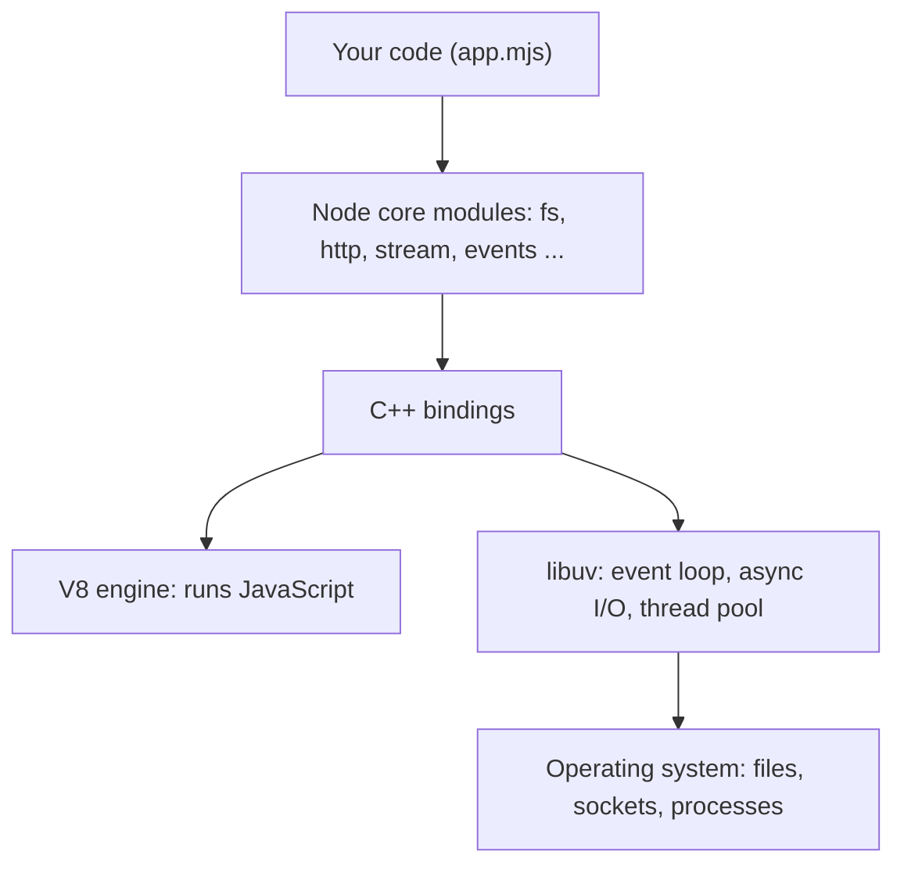
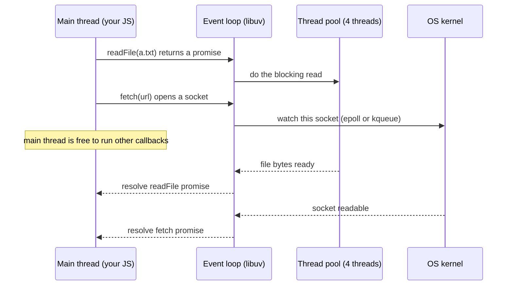
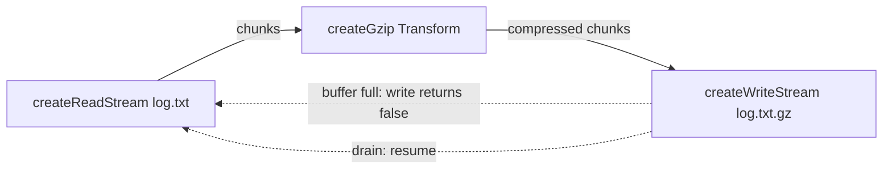
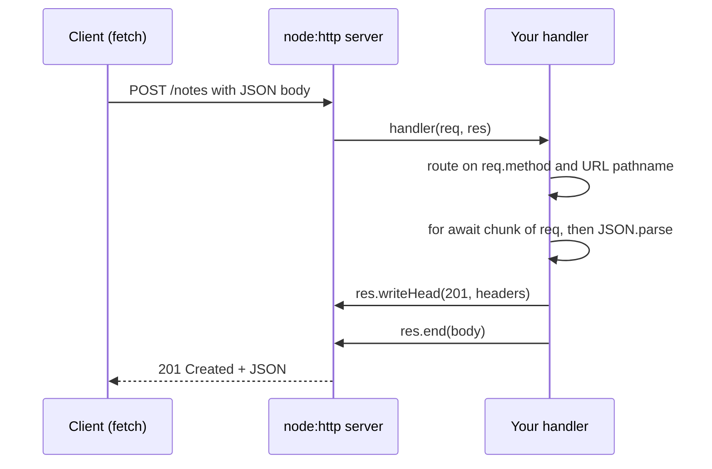

# Chapter 15 — Node.js Basics

Until now most of this book has treated JavaScript as a language, with the browser as its natural home. **Node.js** takes the same language out of the browser and puts it on servers, laptops and build machines — every `npm install`, every bundler run, every `node --test` in this book already used it. This chapter explains what Node adds on top of the language and how to use its core modules to do real work: files, paths, configuration, events, streams, HTTP, and child processes.

**What you'll learn**

1. What Node.js is: V8 + libuv + core modules, and how it differs from a browser.
2. Where the event loop and the libuv thread pool fit, why blocking hurts, and how worker threads help.
3. Modules in Node in one page (the details are in Chapter 10).
4. Files with `node:fs/promises`, paths and file URLs with `node:path` / `node:url`.
5. `process`: arguments, environment variables, `.env` files, exit codes, signals.
6. `Buffer` — raw bytes.
7. `EventEmitter` — the event pattern behind most Node APIs.
8. Streams: readable, writable, transform, `pipeline`, backpressure.
9. Building an HTTP server with `node:http` and calling it from the same script.
10. Child processes and npm scripts (`node --run`).
11. Node vs Deno vs Bun, and the everyday command-line flags.

**Before you start.** You should know promises and `async`/`await` ([Chapter 12](../12-asynchronous-javascript/README.md)) — almost every Node API in this chapter is used with `await`. Node's event-loop phases, `process.nextTick` and `setImmediate` are already explained in [§12.4](../12-asynchronous-javascript/README.md#124-nodes-event-loop-nexttick-setimmediate-and-phases); module systems (ESM vs CommonJS, `package.json`, npm) in [Chapter 10](../10-modules-and-tooling/README.md); the Node inspector in [§11.9](../11-errors-and-debugging/README.md#119-debugging-with-devtools-and-the-node-inspector). This chapter links to them rather than repeating them.

All runnable code is in [`code/`](code/). Every program was run with **Node 24.11.1** and the output shown is real. Programs that touch the disk use a fresh temporary folder (`os.tmpdir()`) and delete it at the end; the HTTP example listens only on `127.0.0.1` on a free port chosen by the operating system, so nothing leaves your machine.

---

## 15.1 What Node.js is

### What it is
**Node.js** is a **JavaScript runtime**: a program that runs JavaScript outside a browser. It was created by Ryan Dahl in 2009. It combines three things:

| Part | What it does | Written in |
|---|---|---|
| **V8** | Google's JavaScript engine (the same one in Chrome) — parses, compiles and runs your JS ([§1.3](../01-introduction-and-setup/README.md#13-javascript-engines--how-your-code-actually-runs)). | C++ |
| **libuv** | A C library that gives Node its **event loop**, asynchronous file and network I/O, timers, a **thread pool**, and child processes — on Linux, macOS and Windows alike. | C |
| **Core modules + bindings** | The JavaScript APIs you import (`node:fs`, `node:http`, `node:stream` …) and the C++ glue ("bindings") that connects them to V8 and libuv. | JS + C++ |

Analogy: V8 is the engine of a car; libuv is the gearbox and wheels that connect the engine to the road (the operating system); core modules are the dashboard controls you actually touch.



### Why it matters
- **One language on both sides** — front-end and back-end share code, types and validation.
- **Great at I/O-heavy work** — one process juggles thousands of connections because it never waits idly for a disk or socket; it registers a callback and moves on ([Chapter 12](../12-asynchronous-javascript/README.md)).
- **It runs the JavaScript tool chain** — npm, Vite, ESLint, Prettier and the JavaScript-based TypeScript 5.x compiler all run on Node, even for front-end projects.

### Node vs the browser
Both run the same language (ECMAScript), but the **host APIs** differ:

| | Browser | Node.js |
|---|---|---|
| Global object | `window` (also `globalThis`) | `global` (also `globalThis`) |
| DOM (`document`, elements) | Yes | No (use jsdom for tests, [Chapter 13](../13-dom-and-events/README.md)) |
| File system, processes, raw sockets | No (sandboxed) | Yes (`node:fs`, `node:child_process`, `node:net`) |
| Security model | Sandbox + same-origin policy | Full access of the user who started it (optional permission model, §15.12) |
| Modules | ES modules | ES modules **and** CommonJS |
| Shared web APIs | `fetch`, `URL`, `AbortController`, `TextEncoder`, `structuredClone`, `crypto.subtle`, `Blob`, `WebSocket`, timers | The same — Node implements them too |
| You control the version? | No — the user's browser decides | Yes — you choose the Node version |

The last row matters: in Node you can use every feature your version supports without transpiling.

[`code/01_node_runtime.mjs`](code/01_node_runtime.mjs) checks these differences:

```js
import { builtinModules } from 'node:module';

console.log('typeof window   :', typeof window);        // no DOM in Node
console.log('typeof process  :', typeof process);       // Node-only global
console.log('globalThis === global:', globalThis === global);
console.log('has V8 & libuv  :', 'v8' in process.versions, 'uv' in process.versions);
const webGlobals = ['fetch', 'URL', 'AbortController', 'TextEncoder', 'structuredClone',
  'setTimeout', 'queueMicrotask', 'crypto', 'Blob', 'WebSocket'];
console.log('web APIs present:', webGlobals.filter((n) => n in globalThis).length, 'of', webGlobals.length);
console.log('this file       :', import.meta.filename.split('/').pop());
console.log('typeof __dirname:', typeof __dirname);
// ...
```

Output:
```
typeof window   : undefined
typeof document : undefined
typeof process  : object
globalThis === global: true
node major      : 24
has V8 & libuv  : true true
web APIs present: 10 of 10
this file       : 01_node_runtime.mjs
dirname ends    : 15-nodejs-basics/code
typeof __dirname: undefined
built-ins exist : true
built-in count >50: true
```

Note `typeof __dirname` is `undefined`: that variable exists only in CommonJS files. ES modules use **`import.meta.dirname`** and **`import.meta.filename`** (Node 20.11+) instead ([§10.6](../10-modules-and-tooling/README.md#106-importmeta-and-json-modules)).

### Versions and releases
- Up to Node 26, a new **major version** ships every six months (April and October). **Even-numbered** majors become **LTS** (Long-Term Support) in October of their release year, with about 30 months of fixes; odd-numbered majors are short-lived "Current" releases.
- **From Node 27 (2027)** the project moves to **one major per year** (April), and **every** major becomes LTS each October — no more odd/even split.
- **Node 24** was released in May 2025, became LTS in October 2025 and is supported until April 2028 (V8 13.6, npm 11). Production apps should run an **Active or Maintenance LTS** version.

Check yours with `node --version` (`node -v`). Tools such as **nvm**, **fnm** or **Volta** let you install several versions and switch per project (an `.nvmrc` file pins one).

### Real-world examples
Netflix, PayPal, LinkedIn and Walmart have written publicly about moving web servers or API layers to Node. Typical uses: REST/GraphQL APIs, backend-for-frontend servers, server-side rendering for React (Next.js, [React Handbook ch13](../../../react/chapters/13-server-rendering-and-frameworks/README.md)), real-time apps (chat, WebSockets), CLIs, and build tooling.

### When not to use it
Long CPU-bound computations (video encoding, heavy numeric work, ML training) are a poor fit for the main thread — Node shines when the work is *waiting* on I/O, not *computing*. Use worker threads (§15.2), a native module, or a language built for it (Go, Rust, Java, Python with NumPy).

### TL;DR
Node = V8 (runs JS) + libuv (event loop, async I/O, thread pool) + core modules. Same language as the browser, different host APIs: no DOM, but files, processes and sockets. Run an LTS version in production (Node 24 today; Node 26 becomes LTS in October 2026).

---

## 15.2 The event loop, the thread pool and blocking

### What it is
Your JavaScript runs on **one main thread**. Node's **event loop** (from libuv) is the loop that, over and over, picks the next ready callback — a timer that expired, a socket with data, a finished file read — and runs it on that thread. The loop's phases (timers → pending → poll → check → close) and the `process.nextTick` / promise microtask queues are covered with runnable ordering puzzles in [§12.4](../12-asynchronous-javascript/README.md#124-nodes-event-loop-nexttick-setimmediate-and-phases).

What this chapter adds is **how the I/O actually gets done** while your thread is free:

1. **Network I/O** (TCP, HTTP, pipes) uses the operating system's own asynchronous notification mechanism — **epoll** on Linux, **kqueue** on macOS/BSD, **IOCP** on Windows. No extra threads are needed: the OS tells libuv "this socket has data", and libuv queues your callback.
2. **Work the OS cannot do asynchronously** goes to the **libuv thread pool**: most `fs` operations, `dns.lookup()`, CPU-heavy `crypto` functions (`pbkdf2`, `scrypt`, `randomBytes`), and `zlib` compression. The pool has **4 threads by default**; set the environment variable `UV_THREADPOOL_SIZE` (up to 1024) *before* Node starts to change it.
3. When a pool thread finishes, it puts the result on the event loop's queue; your callback (or the promise continuation) then runs on the **main thread**.



### Why it matters — blocking the loop
Because every callback shares one thread, **one slow synchronous piece of code delays everything**: other HTTP requests, timers, health checks. A 200 ms `JSON.parse` of a huge payload means every other user waits 200 ms. Typical culprits:

- `*Sync` APIs (`readFileSync`, `execSync`) inside request handlers;
- huge `JSON.parse` / `JSON.stringify`;
- regular expressions with catastrophic backtracking ("ReDoS");
- tight loops over large arrays; synchronous crypto (`pbkdf2Sync`).

### Worker threads
**`node:worker_threads`** runs JavaScript on additional threads, each with its own V8 instance and event loop. They communicate by **message passing** (`postMessage`, copied with the structured-clone algorithm) or by sharing a `SharedArrayBuffer`. Use them for **CPU-bound** work; they do not help with I/O, which is already asynchronous.

[`code/02_blocking_and_workers.mjs`](code/02_blocking_and_workers.mjs):

```js
function busyFor(ms) {                 // simulate CPU-bound work
  const end = Date.now() + ms;
  while (Date.now() < end) {}
}

// 1) A 10 ms timer cannot fire while the main thread is busy for 200 ms.
const start = Date.now();
await new Promise((resolve) => {
  setTimeout(() => {
    console.log('timer asked for 10 ms, fired after >= 200 ms:', Date.now() - start >= 200);
    resolve();
  }, 10);
  busyFor(200);
});

// 2) Move the CPU work to a worker thread; the main thread stays responsive.
const workerCode = `
  const { parentPort, workerData } = require('node:worker_threads');
  const fib = (n) => (n < 2 ? n : fib(n - 1) + fib(n - 2));
  parentPort.postMessage(fib(workerData));
`;
let ticks = 0;
const ticker = setInterval(() => ticks++, 5);          // proves the loop is free
const result = await new Promise((resolve, reject) => {
  const w = new Worker(workerCode, { eval: true, workerData: 32 });
  w.once('message', resolve);
  w.once('error', reject);
});
clearInterval(ticker);
console.log('fib(32) from worker:', result);
console.log('main thread kept ticking meanwhile:', ticks > 0);
```

Output:
```
timer asked for 10 ms, fired after >= 200 ms: true
fib(32) from worker: 2178309
main thread kept ticking meanwhile: true
```

(`eval: true` lets the demo keep the worker's code in a string; real projects pass a file path such as `new Worker(new URL('./worker.mjs', import.meta.url))`. Creating a worker costs milliseconds and memory, so real apps keep a **pool** of workers — libraries like Piscina do this.)

### Scaling options compared
| Tool | What it gives you | Shares memory? | Use for |
|---|---|---|---|
| Async I/O (default) | Thousands of concurrent I/O operations on one thread | — | Almost all server work |
| `worker_threads` | Extra JS threads in the same process | Only `SharedArrayBuffer` | CPU-heavy tasks (image resize, parsing, hashing) |
| `child_process` (§15.11) | Separate OS processes, any program | No | Running other programs, isolation |
| `cluster` / multiple processes | Several Node processes sharing one port | No | Using all CPU cores for an HTTP server (often done by a process manager, container orchestrator or load balancer instead) |

### Common mistakes
- Reading "single-threaded" as "one thing at a time": JS runs on one thread, but I/O proceeds in parallel in the OS and the thread pool.
- `*Sync` functions in request handlers (fine in CLIs and one-off startup code).
- Expecting workers to speed up I/O (`fetch`, database queries) — they only add overhead.
- Saturating the 4-thread pool with slow `fs` or `pbkdf2` calls, so unrelated `fs` calls queue behind them.

### In the interview
**Q: Is Node single-threaded?** "Your JavaScript runs on a single main thread with an event loop. Network I/O is handled asynchronously by the OS (epoll/kqueue/IOCP), and file system, DNS lookup, some crypto and zlib work runs on libuv's thread pool (4 threads by default). CPU-heavy JS can be moved to worker threads."

- *How would you find what blocks the event loop?* Measure event-loop delay (`perf_hooks.monitorEventLoopDelay()`), then profile with `node --cpu-prof` or the inspector ([§11.9](../11-errors-and-debugging/README.md#119-debugging-with-devtools-and-the-node-inspector)) to see which function holds the thread.
- *Why can `readFile` be slow under load when CPU is idle?* The thread pool may be saturated; raise `UV_THREADPOOL_SIZE` or reduce concurrent blocking work.
- *Worker thread vs child process?* Worker: same process, cheaper, can share memory, JS only. Child: separate process, any executable, full isolation, more overhead.

### Self-check
1. Which of these use the thread pool: `fs.readFile`, an HTTP request, `crypto.pbkdf2`, `setTimeout`? → `fs.readFile` and `crypto.pbkdf2`. HTTP uses OS async I/O; timers are managed by the loop itself.
2. A handler runs a 300 ms synchronous loop. What happens to a second request that arrives meanwhile? → It waits until the loop finishes; its latency grows by up to 300 ms.
3. How do you give a worker its input? → `workerData` at creation or `postMessage` later.

### TL;DR
One JS thread + event loop; the OS does network I/O asynchronously; libuv's thread pool (default 4) does files, DNS lookup, crypto and zlib. Never block the main thread in a server — move CPU work to worker threads.

---

## 15.3 Modules in Node — the short version

Everything about module syntax and loading is in [Chapter 10](../10-modules-and-tooling/README.md). The rules you need while writing Node code:

| Question | Answer |
|---|---|
| Is my `.js` file ESM or CommonJS? | `.mjs` → ESM, `.cjs` → CommonJS; `.js` follows the nearest `package.json` `"type"` (`"module"` → ESM). Without a `"type"`, Node detects ESM syntax automatically (Node 22.7+). [§10.8](../10-modules-and-tooling/README.md#108-commonjs-vs-es-modules-in-node) |
| How do I import a built-in? | Prefer the **`node:` prefix**: `import { readFile } from 'node:fs/promises'`. It is unambiguous (no npm package can shadow it) and required for some newer modules such as `node:test` and `node:sqlite`. |
| Where is `__dirname`? | CommonJS only. In ESM use `import.meta.dirname` / `import.meta.filename`. |
| Can ESM use a CommonJS package? | Yes: `import pkg from 'cjs-pkg'` (default import = `module.exports`). |
| Can CommonJS `require()` an ES module? | Yes in Node 22.12+ / 20.19+, unless the module uses top-level `await`. |
| Loading JSON? | `import data from './x.json' with { type: 'json' }`, or read and `JSON.parse` it. |

Most core modules offer several API styles. Pick the promise one in new code:

| Module | Promise API | Callback API | Sync API |
|---|---|---|---|
| File system | `node:fs/promises` | `node:fs` (`fs.readFile(p, cb)`) | `node:fs` (`fs.readFileSync`) |
| Streams helpers | `node:stream/promises` | `node:stream` | — |
| Timers | `node:timers/promises` (`await setTimeout(100)`) | global `setTimeout` | — |
| DNS | `node:dns/promises` | `node:dns` | — |
| Child processes | `util.promisify(execFile)` | `node:child_process` | `execFileSync` |

`util.promisify(fn)` turns any Node-style callback function (`(err, value) => …` as the last argument) into a promise-returning one.

---

## 15.4 Files with `node:fs/promises`

### What it is
`node:fs` is Node's file-system module: read, write, list, copy, move, delete files and folders, and inspect their metadata. **`node:fs/promises`** is the same functionality returning promises, so it reads naturally with `await`.

### How it works — the core operations
| Task | Function | Notes |
|---|---|---|
| Read a whole file | `readFile(path, 'utf8')` | Without an encoding you get a `Buffer` (raw bytes, §15.7) |
| Write (create/replace) | `writeFile(path, data)` | `{ flag: 'wx' }` = fail if the file exists |
| Append | `appendFile(path, data)` | Creates the file if missing |
| Create folders | `mkdir(path, { recursive: true })` | Like `mkdir -p`; no error if it exists |
| List a folder | `readdir(path, { withFileTypes: true })` | `Dirent` objects with `isFile()`/`isDirectory()`; `{ recursive: true }` walks subfolders (Node 20.1+) |
| Match patterns | `glob('**/*.txt', { cwd })` | Async iterator (Node 22+) |
| Metadata | `stat(path)` | size, `mtime`, `isFile()`, `isDirectory()` |
| Copy / move | `copyFile(a, b)`, `rename(a, b)`, `cp(a, b, { recursive: true })` | `rename` across disks may fail — copy then delete |
| Delete | `rm(path, { recursive: true, force: true })` | Like `rm -rf`; `unlink` for a single file |
| Temp folder | `mkdtemp(join(tmpdir(), 'prefix-'))` | Unique name each call |
| Low-level | `open(path, flags)` → `FileHandle` | `read`, `write`, `close`; always close in `finally` |

[`code/03_fs_promises.mjs`](code/03_fs_promises.mjs) (key parts):

```js
import { mkdtemp, writeFile, appendFile, readFile, readdir, stat, rename,
  copyFile, rm, open, mkdir, access, constants, glob } from 'node:fs/promises';
import { tmpdir } from 'node:os';
import { join } from 'node:path';

const dir = await mkdtemp(join(tmpdir(), 'notes-'));   // unique temp folder
try {
  const file = join(dir, 'todo.txt');
  await writeFile(file, 'buy milk\n');
  await appendFile(file, 'write chapter 15\n');
  const text = await readFile(file, 'utf8');
  console.log('read:', JSON.stringify(text));

  const buf = await readFile(file);
  console.log('as Buffer:', buf.constructor.name, buf.length, 'bytes, first byte', buf[0]);
  // ... write config.json, JSON.parse it back

  await mkdir(join(dir, 'archive/2026'), { recursive: true });
  await copyFile(file, join(dir, 'archive/2026/todo-copy.txt'));
  await rename(join(dir, 'config.json'), join(dir, 'settings.json'));

  const entries = await readdir(dir, { withFileTypes: true });
  console.log('entries:', entries.map((e) => `${e.name}${e.isDirectory() ? '/' : ''}`).sort().join(', '));
  const all = await readdir(dir, { recursive: true });
  console.log('recursive:', all.sort().join(', '));
  const txt = [];
  for await (const p of glob('**/*.txt', { cwd: dir })) txt.push(p);
  console.log('glob *.txt:', txt.sort().join(', '));

  // ... stat(file); open(file, 'r') -> FileHandle, read 8 bytes, close() in finally

  try { await readFile(join(dir, 'nope.txt'), 'utf8'); }
  catch (err) { console.log('error code:', err.code, '| syscall:', err.syscall); }
  // ... access() and the 'wx' flag
} finally {
  await rm(dir, { recursive: true, force: true });
  console.log('cleaned up');
}
```

Output:
```
read: "buy milk\nwrite chapter 15\n"
as Buffer: Buffer 26 bytes, first byte 98
config.port: 8080
entries: archive/, settings.json, todo.txt
recursive: archive, archive/2026, archive/2026/todo-copy.txt, settings.json, todo.txt
glob *.txt: archive/2026/todo-copy.txt, todo.txt
stat: isFile true | size 26 | mtime is Date true
first 8 bytes: "buy milk"
error code: ENOENT | syscall: open
exists & readable: true
wx on existing file -> EEXIST
cleaned up
```

What to notice:
- `readFile` without `'utf8'` returned a `Buffer`; byte 98 is the letter `b`.
- File-system errors are ordinary `Error`s with a string **`code`**: `ENOENT` (no such file), `EEXIST` (already exists), `EACCES`/`EPERM` (permission), `EISDIR`, `ENOTDIR`, `EMFILE` (too many open files). Branch on `err.code`, never on the message.
- `try … finally` removes the temp folder even if something throws.

### Common mistakes
- **Check-then-act races.** `if (await exists(f)) await readFile(f)` can fail anyway — the file may vanish between the two calls (a "TOCTOU" bug: time of check vs time of use). Just try the operation and handle `ENOENT`; use flag `'wx'` for "create only if new".
- **Relative paths resolve against `process.cwd()`**, the folder you launched Node from, *not* the folder of the source file. Build paths from `import.meta.dirname` when you mean "next to this file".
- **Reading huge files whole.** `readFile` loads everything into memory; a 5 GB log will crash or stall. Use streams (§15.9).
- **`*Sync` calls in servers** (§15.2).
- **Forgetting that writes are not atomic.** A crash in the middle of `writeFile` can leave a half-written file. For important files, write to a temp file in the same folder and then `rename` it over the original (rename is atomic on the same file system).
- **Not closing `FileHandle`s** — leaks file descriptors until `EMFILE`.

### Real-world examples
Static-site generators read Markdown and write HTML; bundlers write `dist/`; loggers append to files; scaffolding CLIs copy template folders with `cp(..., { recursive: true })`.

### TL;DR
Use `node:fs/promises` with `await`. Pass `'utf8'` to get strings. Handle errors by `err.code`. Build paths from `import.meta.dirname`, not the cwd. Don't check-then-act; don't `readFile` huge files; clean up in `finally`.

---

## 15.5 Paths and file URLs: `node:path`, `node:url`

### What it is
**`node:path`** builds and splits file-system paths correctly for the current operating system (`/` on Linux/macOS, `\` on Windows). String concatenation (`dir + '/' + name`) breaks on Windows, doubles slashes and ignores `..`.

### How it works
| Function | Does | Example result |
|---|---|---|
| `join(...parts)` | Glue segments, normalize `..` and `.` | `join('/srv','app','..','data')` → `/srv/data` |
| `resolve(...parts)` | Make an **absolute** path, processing right to left until absolute; falls back to `process.cwd()` | `resolve('/srv/app','logs')` → `/srv/app/logs` |
| `basename(p, ext?)` | Last segment | `price.test.mjs` |
| `extname(p)` | Last extension only | `.mjs` |
| `dirname(p)` | Everything before the last segment | `/home/ana/.../utils` |
| `parse(p)` / `format(obj)` | Split into / build from `{ root, dir, base, name, ext }` | |
| `relative(from, to)` | Path from one location to another | `../public/logo.png` |
| `normalize(p)` | Clean up `//`, `.` and `..` | `/a/c/d` |
| `isAbsolute(p)` | Starts from the root? | |
| `sep`, `delimiter` | `/` or `\`; `:` or `;` (for `PATH`) | |
| `path.posix`, `path.win32` | Force one platform's rules | |

ES modules identify files by **URL** (`file:///home/ana/a.txt`), so **`node:url`** gives `fileURLToPath(url)` and `pathToFileURL(path)` — they handle percent-encoding (a space becomes `%20`) and Windows drive letters correctly. `new URL('./data.json', import.meta.url)` is another common way to point at a sibling file; most `fs` functions accept URL objects directly.

[`code/04_path_and_urls.mjs`](code/04_path_and_urls.mjs) (excerpt):

```js
import path from 'node:path';
import { fileURLToPath, pathToFileURL } from 'node:url';

const p = '/home/ana/projects/shop/src/utils/price.test.mjs';
console.log('basename :', path.basename(p));
console.log('  no ext :', path.basename(p, '.mjs'));
console.log('extname  :', path.extname(p));
console.log('parse    :', path.parse(p));
console.log('join     :', path.join('/srv', 'app', '..', 'data', './users.json'));
console.log('resolve abs wins:', path.resolve('/srv/app', '/etc', 'hosts'));
console.log('relative :', path.relative('/srv/app/src', '/srv/app/public/logo.png'));
console.log('win32 join:', path.win32.join('C:\\Users', 'ana', 'file.txt'));
console.log('fileURLToPath:', fileURLToPath(new URL('file:///home/ana/my%20notes/a.txt')));

// Security: stop "../" escaping a base folder (path traversal)
function safeJoin(base, userPath) {
  const full = path.resolve(base, userPath);
  if (full !== base && !full.startsWith(base + path.sep)) throw new Error(`blocked: ${userPath}`);
  return full;
}
console.log('safe  :', safeJoin('/srv/uploads', 'cat.png'));
try { safeJoin('/srv/uploads', '../../etc/passwd'); } catch (e) { console.log('unsafe:', e.message); }
```

Output:
```
basename : price.test.mjs
  no ext : price.test
extname  : .mjs
dirname  : /home/ana/projects/shop/src/utils
parse    : {
  root: '/',
  dir: '/home/ana/projects/shop/src/utils',
  base: 'price.test.mjs',
  ext: '.mjs',
  name: 'price.test'
}
join     : /srv/data/users.json
...
resolve abs wins: /etc/hosts
relative : ../public/logo.png
...
win32 join: C:\Users\ana\file.txt
...
fileURLToPath: /home/ana/my notes/a.txt
...
safe  : /srv/uploads/cat.png
unsafe: blocked: ../../etc/passwd
```

### Common mistakes
- `join` vs `resolve`: `join` just glues (result may be relative); `resolve` always returns an absolute path and **restarts at any absolute segment** (`resolve('/srv/app', '/etc', 'hosts')` → `/etc/hosts`). Passing user input to `resolve` can therefore jump anywhere — hence `safeJoin`.
- **Path traversal**: serving `join(publicDir, req.url)` lets `GET /../../etc/passwd` read system files. Resolve, then check the result is still inside the base folder (the `+ path.sep` stops `/srv/uploads-evil` from passing a plain `startsWith('/srv/uploads')`).
- `extname('archive.tar.gz')` is `.gz`, not `.tar.gz`.
- Using `new URL(import.meta.url).pathname` as a path — it stays percent-encoded (`my%20notes`) and is wrong on Windows. Use `fileURLToPath` or `import.meta.dirname`.

### TL;DR
Never concatenate paths by hand: `path.join` to combine, `path.resolve` for absolute paths, `basename/extname/dirname/parse` to split. Convert module URLs with `fileURLToPath`. Validate user-supplied paths against traversal.

---

## 15.6 `process`: arguments, environment and exit codes

### What it is
**`process`** is a global object describing the running Node program: its command-line arguments (`argv`), environment variables (`env`), working directory (`cwd()`), standard streams (`stdin`, `stdout`, `stderr`), process id, exit code, and lifecycle events.

### Command-line arguments
`process.argv` is an array: `[pathToNode, pathToScript, ...yourArgs]`, so user arguments start at index 2. For anything beyond one or two positional values use the built-in **`util.parseArgs`** (stable since Node 20) instead of hand-parsing:

```js
import { parseArgs } from 'node:util';
const { values, positionals } = parseArgs({
  args: ['--port', '8080', '-v', 'build', 'src/'],   // omit args to read process.argv
  options: {
    port: { type: 'string', default: '3000' },
    verbose: { type: 'boolean', short: 'v' },
    env: { type: 'string', default: 'development' },
  },
  allowPositionals: true,
});
```

Unknown flags throw an error by default (`strict: true`), which is what a CLI usually wants. For big CLIs with sub-commands and help text, libraries such as Commander or yargs add more.

### Environment variables
**Environment variables** are key–value strings the operating system passes to every process (`PATH`, `HOME`, and your own like `DATABASE_URL`). They are the standard way to configure one codebase differently per environment (development, test, production) and to inject secrets without committing them — the "config in the environment" rule of the Twelve-Factor App methodology.

Key facts:
1. `process.env.X` is **always a string or `undefined`**. Assigning a number stores its string form. `"false"` and `"0"` are *truthy* strings — compare explicitly.
2. **`.env` files**: Node 20.6+ can load them itself — `node --env-file=.env app.mjs` (stable in Node 24.10+; `--env-file-if-exists` for optional files), or `process.loadEnvFile(path)` at runtime. Variables already set in the real environment win over the file. The older `dotenv` npm package does the same job.
3. **Never commit `.env` files with secrets**; commit a `.env.example` with dummy values and add `.env` to `.gitignore`.
4. **`NODE_ENV=production`** is a convention many libraries read to switch off dev-only checks. It is not special to Node itself.
5. Read and **validate** configuration once at startup and fail fast with a clear message; don't sprinkle `process.env` reads all over the code.

[`code/05_process_and_env.mjs`](code/05_process_and_env.mjs) (excerpt):

```js
process.env.MAX_ITEMS = 25;                         // assigned a number...
console.log('typeof MAX_ITEMS:', typeof process.env.MAX_ITEMS);  // ...stored as a string
const maxItems = Number.parseInt(process.env.MAX_ITEMS ?? '10', 10);
const debug = process.env.DEBUG === 'true';         // "false" is a truthy string!

writeFileSync(envFile, 'DB_HOST=localhost\nDB_PORT=5432\n# comment\nGREETING="hello world"\n');
process.loadEnvFile(envFile);

function loadConfig(env) {
  const port = Number(env.PORT ?? 3000);
  if (!Number.isInteger(port) || port <= 0) throw new Error(`Invalid PORT: ${env.PORT}`);
  return Object.freeze({ port, dbHost: env.DB_HOST ?? 'localhost', isProd: env.NODE_ENV === 'production' });
}

process.on('exit', (code) => console.log(`exit event, code ${code}`));
process.exitCode = 0;
```

Output:
```
argv[0] is node: true
user args      : []
parsed values  : [Object: null prototype] {
  port: '8080',
  verbose: true,
  env: 'development'
}
positionals    : [ 'build', 'src/' ]
typeof MAX_ITEMS: string
parsed number  : 26
DEBUG flag     : false | truthy "false"? true
from .env      : localhost 5432 hello world
config         : { port: 8080, dbHost: 'localhost', isProd: true }
config error   : Invalid PORT: abc
...
exit event, code 0
```

(`[Object: null prototype]` means `parseArgs` returns an object created with `Object.create(null)`, so a flag named `--constructor` can't collide with inherited properties.)

### Exit codes, signals and graceful shutdown
- A process ends when the event loop has nothing left to do. **Exit code 0** means success; anything else means failure — shells, CI systems and `npm test` rely on it.
- Prefer **`process.exitCode = 1`** and let Node finish naturally. **`process.exit(1)`** stops immediately and can cut off pending asynchronous work such as writes to a pipe.
- An uncaught exception or unhandled promise rejection ends the process with code 1 (Node 15+ for rejections).
- Signals: **Ctrl+C** sends `SIGINT`; container orchestrators and process managers send **`SIGTERM`** before killing a process. Handle them to shut down cleanly:

```js
// Not run - pattern for a long-running server (see server in §15.10)
process.once('SIGTERM', async () => {
  console.log('SIGTERM: stop accepting requests, finish in-flight ones');
  server.close();                    // stop new connections
  await db.end();                    // close pools, flush logs
  process.exitCode = 0;              // let the loop drain
  setTimeout(() => process.exit(1), 10_000).unref();   // hard deadline
});
```

`.unref()` tells Node "don't keep the process alive just for this timer".

### Other `process` members worth knowing
| Member | Use |
|---|---|
| `process.cwd()` / `process.chdir()` | Current working directory |
| `process.platform`, `process.arch` | `'linux'`, `'darwin'`, `'win32'`; `'x64'`, `'arm64'` |
| `process.versions` | Versions of Node, V8, libuv, OpenSSL … |
| `process.stdin/stdout/stderr` | Standard streams (streams, §15.9); `console.log` writes to `stdout`, `console.error` to `stderr` |
| `process.hrtime.bigint()` | Nanosecond timer for measuring durations (`performance.now()` also works) |
| `process.memoryUsage()` | Heap and RSS numbers for diagnosing leaks |
| `process.on('uncaughtException' / 'unhandledRejection')` | Last-resort logging — log and exit; don't try to continue ([Chapter 11](../11-errors-and-debugging/README.md)) |

### Common mistakes
- `if (process.env.FEATURE)` when the value is `"false"` — true!
- Reading `process.env.PORT` as a number without converting it.
- Calling `process.exit()` right after `console.log` to a pipe or file — output may be lost.
- Logging the whole `process.env` (it contains secrets).

### TL;DR
`process.argv` (args from index 2; parse with `util.parseArgs`), `process.env` (strings only; load `.env` with `--env-file`; validate at startup), `process.exitCode` for failure, handle `SIGTERM`/`SIGINT` for graceful shutdown.

---

## 15.7 `Buffer`: raw bytes

### What it is
A **`Buffer`** is a fixed-size chunk of raw bytes. It is Node's subclass of the standard `Uint8Array`, with extra helpers for encodings. You meet Buffers whenever data is not (yet) text: file contents read without an encoding, network packets, stream chunks, images, hashes.

An **encoding** is the rule for turning text into bytes and back: `utf8` (default, variable length: 1–4 bytes per character), `base64`, `hex`, `latin1`, `utf16le`.

[`code/10_buffers.mjs`](code/10_buffers.mjs):

```js
const text = 'héllo 👋';
const buf = Buffer.from(text, 'utf8');
console.log('string length (UTF-16 units):', text.length);
console.log('byte length (UTF-8)          :', buf.length, '=', Buffer.byteLength(text));
console.log('bytes (hex)                  :', buf.toString('hex'));
console.log('base64                       :', buf.toString('base64'));
// ... decode base64 back to text; buf instanceof Uint8Array

const whole = Buffer.from('abcdef');
const part = whole.subarray(0, 3);
part[0] = 0x7a;                                   // 'z'
console.log('subarray shares memory       :', whole.toString());
console.log('cut mid-character            :', JSON.stringify(buf.subarray(0, 2).toString('utf8')));
const joined = Buffer.concat([Buffer.from('Node '), Buffer.from('24')]);
console.log('concat                       :', joined.toString(), '| equals:', joined.equals(Buffer.from('Node 24')));
console.log('alloc(4) is zero-filled      :', Buffer.alloc(4));
```

Output:
```
string length (UTF-16 units): 8
byte length (UTF-8)          : 11 = 11
bytes (hex)                  : 68c3a96c6c6f20f09f918b
base64                       : aMOpbGxvIPCfkYs=
back to text                 : héllo 👋
is a Uint8Array              : true
subarray shares memory       : zbcdef
cut mid-character            : "h�"
concat                       : Node 24 | equals: true
alloc(4) is zero-filled      : <Buffer 00 00 00 00>
```

What to notice: `é` takes 2 bytes and the emoji 4, so 8 string units become 11 bytes (string length vs code points is explained in [§6.3](../06-strings-and-regular-expressions/README.md)). Cutting in the middle of `é` produced `�` — which is exactly why stream code must not decode each chunk separately (use `setEncoding('utf8')`, `TextDecoder` with `{ stream: true }`, or collect bytes and `Buffer.concat` first).

### Common mistakes
- Using `str.length` as the byte size for `Content-Length` — use `Buffer.byteLength(str)`.
- `Buffer.allocUnsafe(n)` returns memory that may contain old data; use `Buffer.alloc` unless you will overwrite every byte immediately.
- Forgetting `subarray` (and the older `slice`) share memory with the original.
- Treating base64 as encryption — it is only an encoding, anyone can decode it.

### TL;DR
Buffer = bytes (a `Uint8Array`). Convert with `Buffer.from(str, enc)` and `buf.toString(enc)`. Byte length ≠ string length. Don't decode UTF-8 chunk by chunk.

---

## 15.8 Events: `EventEmitter`

### What it is
**`EventEmitter`** (from `node:events`) is Node's implementation of the **observer / publish-subscribe** pattern: an object keeps a list of **listeners** per **event name**; calling `emit(name, ...args)` calls each listener with those arguments. Servers, sockets, streams, child processes and `process` itself are all EventEmitters — so learning it once explains most of Node's APIs.

Analogy: a radio station. Listeners tune in to a channel (`on('news', fn)`); the station broadcasts (`emit('news', story)`); it doesn't know or care who is listening.

The browser has the same idea as `EventTarget` + `addEventListener` ([Chapter 13](../13-dom-and-events/README.md)); Node also supports `EventTarget`, but core modules use `EventEmitter`.

### How it works
| Method | Meaning |
|---|---|
| `on(name, fn)` / `addListener` | Add a listener (appended) |
| `once(name, fn)` | Listener removed after its first call |
| `prependListener(name, fn)` | Add to the **front** of the list |
| `off(name, fn)` / `removeListener` | Remove — needs the **same function reference** |
| `emit(name, ...args)` | Call listeners **synchronously, in order**; returns `true` if there were any |
| `listenerCount(name)`, `removeAllListeners(name)` | Inspect / clear |
| `events.once(emitter, name)` | Promise that resolves with the event's arguments array (rejects on `'error'`) |
| `events.on(emitter, name, { signal })` | Async iterator over repeated events |

[`code/06_event_emitter.mjs`](code/06_event_emitter.mjs) (excerpt):

```js
import { EventEmitter, once, on } from 'node:events';

const bus = new EventEmitter();
function onOrder(order) { console.log('  handler A got order', order.id); }
bus.on('order', onOrder);
bus.once('order', (o) => console.log('  once-handler fires only the first time', o.id));
bus.prependListener('order', () => console.log('  prepended handler runs first'));
console.log('emit #1 ->', bus.emit('order', { id: 1 }));
console.log('emit #2');
bus.emit('order', { id: 2 });
bus.off('order', onOrder);
console.log('listeners left:', bus.listenerCount('order'));

class Kettle extends EventEmitter {           // subclassing: a class that "is" an emitter
  #temp = 20;
  heat(step) {
    this.#temp += step;
    this.emit('temp', this.#temp);
    if (this.#temp >= 100) this.emit('boiled');
  }
}

const e3 = new EventEmitter();
try { e3.emit('error', new Error('disk full')); }         // no 'error' listener -> throws
catch (err) { console.log('unhandled error event threw:', err.message); }

const [name, port] = await once(e4, 'ready');            // promise helper
for await (const [n] of on(e4, 'tick', { signal: ac.signal })) { /* ... */ }
```

Output:
```
  prepended handler runs first
  handler A got order 1
  once-handler fires only the first time 1
emit #1 -> true
emit #2
  prepended handler runs first
  handler A got order 2
listeners left: 1
emit with no listeners -> false
before emit
  (listener runs)
after emit
  kettle at 40
  kettle at 80
  kettle: boiled!
unhandled error event threw: disk full
handled error event: disk full
once() resolved with: db 42
  tick 1
  ...
on() loop ended by AbortError
default max listeners: 10
```

What to notice:
1. The listeners printed **before** `emit #1 -> true` — `emit` is synchronous. It does not schedule anything; asynchrony only happens if a listener itself does something async.
2. The `'error'` event is special: **emitting `'error'` with no listener throws** the error (and would crash the process if uncaught). Always attach an `'error'` listener to emitters you create or receive (streams, sockets, child processes).
3. More than 10 listeners for one event prints a `MaxListenersExceededWarning` — usually a sign you add a listener per request and never remove it (a leak). Raise the limit with `setMaxListeners(n)` only if the number is intentional.

### Trade-offs
| Pattern | Good for | Weak at |
|---|---|---|
| EventEmitter | Many events over time, many listeners, decoupling | Error handling is manual; control flow is harder to follow |
| Promise | One result, once | Repeated events |
| Async iterator (`events.on`, streams) | A sequence you process in order with `for await` | Fan-out to many consumers |
| Callback | Legacy APIs | Composition |

### When not to use it
For a single "done or failed" result, return a promise. An app-wide emitter becomes a hidden global dependency; across processes or machines use a message broker (Kafka, RabbitMQ, Redis streams).

### Common mistakes
- `off('x', () => …)` with a new arrow function — it's a different reference, nothing is removed.
- Throwing inside a listener: the exception propagates out of `emit()` to the emitter's caller.
- Using an `async` listener and forgetting its rejections are not caught by the emitter (option: `new EventEmitter({ captureRejections: true })` routes them to `'error'`).
- Missing `'error'` listeners.

### In the interview
**Q: What is EventEmitter and is `emit` async?** "It's Node's observer pattern: `on` registers listeners per event name, `emit` calls them synchronously in registration order and returns whether any existed. Streams, HTTP servers and sockets extend it. An `'error'` event without a listener throws."

- *How to wait for one event with await?* `const [arg] = await events.once(emitter, 'name')`.
- *How to avoid listener leaks?* Remove listeners when done (`off`, `once`, or an `AbortSignal` passed via `{ signal }` in `events.on`/`once`), and watch for `MaxListenersExceededWarning`.

### Self-check
1. Output order of `console.log('A'); em.emit('x'); console.log('C')` with a listener printing `B`? → A, B, C.
2. Why must `off` receive the original function? → Listeners are matched by reference.
3. What happens on `emit('error', err)` with no listener? → `err` is thrown.

### TL;DR
`on`/`once`/`off`/`emit`; emit is synchronous and ordered; always handle `'error'`; use `events.once` / `events.on` to bridge to promises and `for await`.

---

## 15.9 Streams

### What it is
A **stream** is data that arrives (or leaves) **piece by piece over time** instead of all at once. Each piece is a **chunk** (a `Buffer` or string, or any value in **object mode**). Analogy: drinking through a straw from a jug instead of pouring the whole jug into your mouth — memory use stays small no matter how big the jug.

Node has four stream types (all EventEmitters):

| Type | Direction | Examples |
|---|---|---|
| **Readable** | Source you read from | `fs.createReadStream`, HTTP request (server side), `process.stdin`, `Readable.from(iterable)` |
| **Writable** | Destination you write to | `fs.createWriteStream`, HTTP response, `process.stdout` |
| **Duplex** | Both, independent sides | TCP socket |
| **Transform** | Duplex whose output is computed from input | `zlib.createGzip()`, `crypto` hashes/ciphers, your own parsers |

### Why it matters
**Memory** (a 10 GB file needs only a few KB of buffer, not 10 GB), **time to first byte** (send a response before all of it exists), and **composition** of small stages (read → decompress → parse → write), like Unix pipes.

### How it works
1. A Readable produces chunks into an internal buffer; a consumer takes them (`for await`, `'data'` events, or piping).
2. A Writable accepts chunks with `write(chunk)`. Each has an internal buffer limited by **`highWaterMark`** (64 KiB for byte streams since Node 22 — it was 16 KiB before — and 16 objects in object mode).
3. **Backpressure**: when the Writable's buffer passes `highWaterMark`, `write()` returns **`false`** — "slow down". The producer should stop and wait for the **`'drain'`** event. Ignoring this makes memory grow without limit when the source is faster than the destination (e.g. reading a fast disk, writing to a slow network client).
4. **`pipeline(src, ...transforms, dest)`** from `node:stream/promises` connects the stages, **handles backpressure automatically**, **forwards errors from any stage**, **destroys all streams** on failure, and returns a promise. Prefer it over the older `src.pipe(dest)`, which does not propagate errors or clean up.
5. Readables are **async iterables**, so `for await (const chunk of readable)` works (and respects backpressure).



[`code/07_streams.mjs`](code/07_streams.mjs) (key parts):

```js
// imports: Readable, Writable, Transform (node:stream), pipeline (node:stream/promises),
// createReadStream/createWriteStream (node:fs), createGzip/createGunzip (node:zlib), createInterface (node:readline)
// 2) A Transform (uppercase) and a Writable (collector)
const upper = () => new Transform({
  transform(chunk, _enc, done) { done(null, chunk.toString().toUpperCase()); },
});
function collector(out) {
  return new Writable({ write(chunk, _enc, done) { out.push(chunk.toString()); done(); } });
}
const out = [];
await pipeline(Readable.from(['hello ', 'streams']), upper(), collector(out));

// 3) Chunks do NOT align with lines: keep the incomplete tail between chunks
function splitLines() {
  let rest = '';
  return new Transform({
    readableObjectMode: true,
    transform(chunk, _enc, done) {
      const parts = (rest + chunk).split('\n');
      rest = parts.pop();
      for (const line of parts) this.push(line);
      done();
    },
    flush(done) { if (rest) this.push(rest); done(); },
  });
}

// 4) 50,000-line file -> gzip -> gunzip, constant memory
function* logLines() { for (let i = 1; i <= 50_000; i++) yield `line ${i} status=ok\n`; }
await pipeline(Readable.from(logLines()), createWriteStream(src));
await pipeline(createReadStream(src), createGzip(), createWriteStream(src + '.gz'));
await pipeline(createReadStream(src + '.gz'), createGunzip(), createWriteStream(src + '.copy'));

// 5) Line by line: for await (const line of createInterface({ input: createReadStream(src) })) ...
// 6) pipeline(createReadStream('missing.txt'), createGzip(), ...) -> the promise rejects

// 7) Backpressure by hand: write() -> false -> wait for 'drain'
const slow = new Writable({ highWaterMark: 16, write(_c, _e, done) { setTimeout(done, 1); } });
for (let i = 0; i < 5; i++) {
  const ok = slow.write('0123456789');
  if (!ok) { falses++; await new Promise((r) => slow.once('drain', r)); }
}
```

Output:
```
1) read chunks: [ 'a', 'b', 'c' ]
2) pipeline result: HELLO STREAMS
3) lines: [ 'id,name', '1,Ana', '2,Bob', '3,Cy' ]
4) original bytes: 1038894 | gzip smaller: true
   round trip identical: true
5) readline counted 50000 lines; last = "line 50000 status=ok"
6) pipeline rejected: ENOENT
7) write() returned false 2 times; waited for drain each time: true
```

What to notice:
- In part 3 the input chunks were `'…2,Bo'` and `'b\n3,Cy'` — the name `Bob` was split across chunks, and the line splitter stitched it back. Chunk boundaries are arbitrary; never assume a chunk is a line or a JSON object.
- The 1 MB file compressed to under a fifth of its size, and the round trip was byte-identical — without ever holding the file in memory.
- The missing file error (`ENOENT`) surfaced as a rejected `pipeline` promise, catchable with `try/catch`.
- In part 7, the first write (10 bytes) fit under the 16-byte mark; the second pushed the buffer to 20 bytes, so `write()` said `false`, and we waited for `'drain'`.

### Web Streams
Node also implements the standard **Web Streams API** (`ReadableStream`, `WritableStream`, `TransformStream`) used by `fetch` — `response.body` is a web `ReadableStream`. Convert with `Readable.fromWeb(webStream)` and `Readable.toWeb(nodeStream)`. Use Node streams with Node APIs, web streams with `fetch` and cross-runtime code.

### Trade-offs
| Approach | Memory | Simplicity | Use when |
|---|---|---|---|
| `readFile` / `res.text()` | Whole payload | Simplest | Small data (config, JSON under a few MB) |
| `for await` over a stream | One chunk | Simple | Processing sequentially |
| `pipeline` of stages | One chunk per stage | Moderate | Copy/transform/compress; server responses |
| Hand-written `write`/`drain` | One chunk | Error-prone | Rarely — let `pipeline` do it |

### Common mistakes
- `src.pipe(dest)` without error handlers — an error in `src` leaves `dest` open and leaks file descriptors. Use `pipeline`.
- Ignoring the return value of `write()` in a loop (unbounded memory).
- Decoding each chunk as UTF-8 separately (§15.7).
- Mixing `'data'` events and `for await` on the same stream.
- Forgetting `flush` in a Transform that keeps state (the last partial line is lost).

### In the interview
**Q: What is backpressure?** "When a consumer is slower than the producer, data piles up in memory. Node streams signal it: `write()` returns false once the buffer passes `highWaterMark`, and the producer should pause until `'drain'`. `pipeline()` and `pipe()` do this automatically; `pipeline` also propagates errors and cleans up every stream."

- *Why stream a file download instead of `readFile` + `res.end`?* Constant memory per request and the first bytes reach the client sooner.
- *How do you read a big file line by line?* `readline.createInterface({ input: createReadStream(f) })` with `for await`.

### Self-check
1. Which stream type is `zlib.createGzip()`? → Transform.
2. What does `write()` returning `false` mean? → The internal buffer is above `highWaterMark`; wait for `'drain'`.
3. Name two advantages of `pipeline` over `pipe`. → Error propagation and cleanup (destroying all streams); returns a promise.

### TL;DR
Streams move data in chunks: Readable, Writable, Duplex, Transform. Backpressure = `write()` false → wait for `'drain'`. Use `stream/promises` `pipeline` to connect stages safely, `for await` to consume, `readline` for lines.

---

## 15.10 Building an HTTP server with `node:http`

### What it is
**`node:http`** implements HTTP/1.1 clients and servers. `http.createServer(handler)` returns a server; `handler(req, res)` runs for every request:

- **`req`** (`IncomingMessage`) — a **Readable stream** of the request body, plus `req.method`, `req.url` (path + query string), `req.headers` (lower-cased names).
- **`res`** (`ServerResponse`) — a **Writable stream**: set status and headers (`res.writeHead(status, headers)` or `res.statusCode` + `res.setHeader`), write the body (`res.write`), and finish with **`res.end()`**.

Frameworks such as **Express**, **Fastify**, **Koa** and **Hono** wrap exactly this API, adding routing, middleware, body parsing and validation. Knowing the raw layer makes those frameworks — and their performance and error behaviour — understandable. (HTTP concepts: methods, status codes, headers, CORS are covered from the browser side in [Chapter 14](../14-browser-apis-and-security/README.md).)

### How a request flows


### Example — a JSON API and its client in one script
[`code/08_http_server.mjs`](code/08_http_server.mjs) starts a server on **port 0** (the OS picks a free port), calls it with the global `fetch`, then shuts it down:

```js
import { createServer } from 'node:http';
import { once } from 'node:events';
const notes = [{ id: 1, text: 'learn streams' }];

async function readJson(req, limit = 1_000_000) {
  let body = '';
  for await (const chunk of req) {                  // req is a Readable stream
    body += chunk;
    if (body.length > limit) throw Object.assign(new Error('Payload too large'), { status: 413 });
  }
  try { return JSON.parse(body); }
  catch { throw Object.assign(new Error('Invalid JSON'), { status: 400 }); }
}

function send(res, status, data) {
  const body = JSON.stringify(data);
  res.writeHead(status, { 'Content-Type': 'application/json', 'Content-Length': Buffer.byteLength(body) });
  res.end(body);
}

const server = createServer(async (req, res) => {
  const url = new URL(req.url, `http://${req.headers.host}`);
  try {
    if (req.method === 'GET' && url.pathname === '/health') return send(res, 200, { ok: true });
    if (req.method === 'GET' && url.pathname === '/notes') {
      const q = url.searchParams.get('q') ?? '';
      return send(res, 200, notes.filter((n) => n.text.includes(q)));
    }
    if (req.method === 'POST' && url.pathname === '/notes') {
      const { text } = await readJson(req);
      if (typeof text !== 'string' || !text.trim()) return send(res, 422, { error: 'text is required' });
      const note = { id: notes.length + 1, text: text.trim() };
      notes.push(note);
      res.setHeader('Location', `/notes/${note.id}`);
      return send(res, 201, note);
    }
    if (url.pathname === '/stream') {               // stream a response in chunks
      res.writeHead(200, { 'Content-Type': 'text/plain' });
      for (let i = 1; i <= 3; i++) res.write(`chunk ${i}\n`);
      return res.end();
    }
    send(res, 404, { error: `No route for ${req.method} ${url.pathname}` });
  } catch (err) {
    send(res, err.status ?? 500, { error: err.status ? err.message : 'Internal Server Error' });
  }
});

server.listen(0, '127.0.0.1');                      // port 0 = let the OS pick a free port
await once(server, 'listening');
const { port } = server.address();
// ... call() wraps fetch(`http://127.0.0.1:${port}${path}`) and logs status + body
await call('GET', '/health');
await call('GET', '/notes');
const created = await call('POST', '/notes', { text: '  write chapter 15 ' });
console.log('  Location header:', created.headers.get('location'));
await call('POST', '/notes', { text: '' });
await call('POST', '/notes', '{not json');
await call('GET', '/notes?q=chapter');
await call('GET', '/stream');
await call('DELETE', '/notes/1');

server.close();                                     // stop accepting new connections
server.closeAllConnections();                       // drop idle keep-alive sockets (Node 18.2+)
await once(server, 'close');
console.log('server closed');
```

Output:
```
listening on a free port: true
GET /health -> 200 { ok: true }
GET /notes -> 200 [ { id: 1, text: 'learn streams' } ]
POST /notes -> 201 { id: 2, text: 'write chapter 15' }
  Location header: /notes/2
POST /notes -> 422 { error: 'text is required' }
POST /notes -> 400 { error: 'Invalid JSON' }
GET /notes?q=chapter -> 200 [ { id: 2, text: 'write chapter 15' } ]
GET /stream -> 200 "chunk 1\nchunk 2\nchunk 3\n"
DELETE /notes/1 -> 404 { error: 'No route for DELETE /notes/1' }
server closed
```

How each part works:
1. **Routing** is `if` statements on `req.method` and `url.pathname`; `new URL(req.url, base)` parses path and query safely.
2. **Reading the body**: `req` is a stream, so `for await` collects chunks; the size limit protects memory (a real server would also check `Content-Type`).
3. **Status codes**: 200, 201 Created (+ `Location`), 400 bad JSON, 404 unknown route, 413 too large, 422 failed validation, 500 unexpected — with internal details hidden.
4. **`closeAllConnections()`**: `server.close()` stops *new* connections but waits for existing ones; `fetch` keeps connections alive, so without it `'close'` would wait for idle sockets to time out.
5. **Port 0 + `127.0.0.1`**: no port conflicts, nothing reachable from other machines — the standard pattern in test suites.

### Production concerns (what frameworks and platforms add)
| Concern | Raw `node:http` | Typical solution |
|---|---|---|
| Routing with params (`/notes/:id`) | Manual | Framework router (Express, Fastify, Hono) |
| Body parsing, size limits, validation | Manual | Framework + schema (Zod, JSON Schema) |
| Error handling | `try/catch` per handler | Central error middleware |
| HTTPS/TLS | `node:https` with certs | Usually terminated at a reverse proxy/load balancer (nginx, cloud LB) |
| HTTP/2 | `node:http2` | Proxy or `http2` module |
| Timeouts | `server.requestTimeout` (default 300 s), `headersTimeout`, `keepAliveTimeout` | Tune per workload |
| Graceful shutdown | `close()` + `SIGTERM` handler (§15.6) | Same, plus health checks |
| Using all cores | One process = one core for JS | Several processes behind a load balancer / container replicas |

### Common mistakes
- Forgetting `res.end()` — the client hangs until a timeout.
- Setting headers after the body started (`ERR_HTTP_HEADERS_SENT`).
- Not handling a rejected promise inside an async handler — Node doesn't catch it for you; the request hangs and an unhandled rejection crashes the process. Wrap handlers in `try/catch` (as above).
- Unlimited body size (memory exhaustion attack).
- Using `str.length` for `Content-Length` with non-ASCII text.
- Returning stack traces to clients.

### In the interview
**Q: How does a Node HTTP server handle many concurrent requests on one thread?** "Each request is an event; the handler runs briefly, and whenever it awaits I/O (database, another API) the thread serves other requests. As long as handlers don't do long synchronous work, thousands of connections share one thread."

- *How do you shut down gracefully?* On `SIGTERM`: stop accepting (`server.close()`), finish in-flight requests, close idle keep-alive sockets, close DB pools, exit with a deadline.
- *Express vs Fastify?* Express: minimal, huge ecosystem, v5 (2024) handles rejected promises from async handlers. Fastify: schema-based validation/serialization, faster JSON handling, plugin system.

### Self-check
1. How do you get the query parameter `q` from `req.url`? → `new URL(req.url, 'http://x').searchParams.get('q')`.
2. What status fits "JSON parsed but `text` missing"? → 422 (or 400).

### TL;DR
`createServer((req, res) => …)`: `req` = readable stream + method/url/headers; `res` = writable stream; always `res.end()`. Parse URLs with `new URL`, limit bodies, map errors to status codes, close gracefully. Frameworks add routing and validation on top of this.

---

## 15.11 Child processes and npm scripts

### What it is
**`node:child_process`** starts other programs (git, ffmpeg, a Python script, another Node process) as separate operating-system processes.

| Function | Shell? | Output | Use for |
|---|---|---|---|
| `execFile(file, args)` | No | Buffered (callback/promise) | Run a program with arguments — **safe default** |
| `spawn(cmd, args)` | No (unless `shell: true`) | Streams (`child.stdout`) | Long-running or large output |
| `exec(commandString)` | **Yes** | Buffered | Quick shell one-liners with **trusted** input only |
| `fork(modulePath)` | No | Streams + IPC channel (`send`/`'message'`) | Another Node script that talks to the parent |
| `*Sync` versions | — | Blocks | Build scripts and CLIs, never servers |

**Security**: `exec(\`convert ${userFile}\`)` passes a string to a shell, so a file name like `x; rm -rf ~` becomes two commands — **command injection**. `execFile`/`spawn` pass arguments as an array with no shell interpretation.

[`code/09_child_process_and_scripts.mjs`](code/09_child_process_and_scripts.mjs) also builds a throw-away project and runs its `package.json` scripts with **`node --run`** (Node 22+), which is a faster, simpler alternative to `npm run` ([§10.9](../10-modules-and-tooling/README.md#109-npm-and-packagejson) covers npm, scripts, `npx` and the pre/post hook differences):

```js
const execFileP = promisify(execFile);
const { stdout } = await execFileP(process.execPath, ['-e', 'console.log(6 * 7)']);
console.log('child said:', stdout.trim());

const child = spawn(process.execPath, ['-e', 'console.log("working"); process.exit(3)']);
child.stdout.on('data', (d) => console.log('spawn stdout:', d.toString().trim()));
const [code] = await new Promise((r) => child.on('close', (...a) => r(a)));
console.log('spawn exit code:', code);

await writeFile(join(dir, 'package.json'), JSON.stringify({
  name: 'demo', private: true, type: 'module',
  scripts: { hello: 'node hello.js', greet: 'node hello.js' },
}, null, 2));
await writeFile(join(dir, 'hello.js'), 'console.log(`hello from ${process.argv[2] ?? "script"}`)');
const r1 = await execFileP(process.execPath, ['--run', 'hello'], { cwd: dir });
const r2 = await execFileP(process.execPath, ['--run', 'greet', '--', 'Ana'], { cwd: dir });
```

Output:
```
child said: 42
spawn stdout: working
spawn exit code: 3
node --run hello -> hello from script
node --run greet -- Ana -> hello from Ana
```

`process.execPath` is the absolute path of the running `node` binary — safer than assuming `node` is on the `PATH`. Arguments after `--` are passed to the script.

### npm scripts in a Node project
A typical back-end `package.json` `scripts` block:

```json
{
  "scripts": {
    "start": "node src/server.mjs",
    "dev": "node --watch --env-file=.env src/server.mjs",
    "test": "node --test",
    "typecheck": "tsc --noEmit",
    "lint": "eslint ."
  }
}
```

(Not run.) `npm start`, `npm test`, `npm run dev` or `node --run dev`. Tests and type-checking are the subject of [Chapter 16](../16-testing-and-typescript/README.md).

### TL;DR
Use `execFile`/`spawn` with argument arrays (no shell); `exec` only with trusted strings. `node --run <script>` runs `package.json` scripts quickly; `npm run` adds pre/post hooks.

---

## 15.12 Everyday Node flags, and Node vs Deno vs Bun

### Command-line flags worth knowing (Node 24)
| Flag | What it does | Status |
|---|---|---|
| `node --watch app.mjs` | Restart on file changes | Stable |
| `node --env-file=.env app.mjs` | Load environment variables from a file | Stable (24.10+) |
| `node --run <script>` | Run a `package.json` script | Added 22 |
| `node --test` | Run tests ([Chapter 16](../16-testing-and-typescript/README.md)) | Stable (20+) |
| `node app.ts` | Run TypeScript by **stripping types** ([§16.9](../16-testing-and-typescript/README.md)) | On by default since 23.6; stable in 24.12 |
| `node --inspect` / `--inspect-brk` | Attach Chrome DevTools / VS Code debugger ([§11.9](../11-errors-and-debugging/README.md#119-debugging-with-devtools-and-the-node-inspector)) | Stable |
| `node --cpu-prof`, `--heap-prof` | Write CPU / heap profiles | Stable |
| `node --permission --allow-fs-read=./data app.mjs` | **Permission model**: deny file-system reads and writes, child processes, workers, native addons … unless explicitly allowed | Stable since 23.5 / 22.13 |
| `node -e "code"` / `node -p "expr"` | Evaluate / evaluate-and-print | Stable |

The permission model is defence in depth — it limits what a compromised dependency can do — but the docs are explicit that it is not a sandbox against deliberately malicious code.

### Node vs Deno vs Bun
Two newer runtimes also run JavaScript and TypeScript on servers. All three run most npm packages today.

| | **Node.js** | **Deno** | **Bun** |
|---|---|---|---|
| First release | 2009 | 2020 (1.0); **Deno 2** in Oct 2024 added full npm / `package.json` compatibility | 2023 (1.0, September) |
| Creator / owner | Ryan Dahl; now OpenJS Foundation | Ryan Dahl; Deno Land Inc. | Jarred Sumner / Oven; **acquired by Anthropic in December 2025**, still MIT-licensed |
| Engine | V8 | V8 (runtime written in Rust) | **JavaScriptCore** (Safari's engine; runtime written in Zig) |
| TypeScript | Type stripping built in (erasable syntax only); type-check with `tsc` | Built in; `deno check` type-checks | Built in (transpiles, no type check) |
| Security default | Full access (opt-in `--permission`) | **Deny by default** — `--allow-net`, `--allow-read` … | Full access |
| Built-in tools | test runner, watch mode, `--run` | formatter, linter, test runner, bundler-ish `compile`, package manager | package manager (fast `bun install`), bundler, test runner (Jest-like) |
| Strength | Maturity, ecosystem, LTS policy, hosting support everywhere | Secure defaults, web-standard APIs, all-in-one tooling | Speed of install and startup, all-in-one tooling |

**Which to choose?** Node for production by default — largest ecosystem, predictable LTS, supported by every host and observability tool. Deno for secure-by-default permissions and integrated tooling. Bun when install/startup speed matters; many teams use `bun install` or Bun's test runner alongside a Node production runtime. Check native add-ons and less common Node APIs before switching.

### TL;DR
Learn `--watch`, `--env-file`, `--run`, `--test`, `--inspect`, and running `.ts` directly. Node is the safe default runtime; Deno (secure-by-default, V8) and Bun (fast, JavaScriptCore) are credible alternatives that run most npm code.

---

## Chapter 15 TL;DR

- **Node.js** = V8 + libuv + core modules. No DOM; files, processes, sockets instead. Run an **LTS** release (Node 24 today).
- **One JS thread**: network I/O is OS-async; fs, DNS lookup, crypto and zlib use the **libuv thread pool** (4 threads). Never block the loop; use **worker threads** for CPU work.
- Import built-ins with **`node:`**; ESM uses **`import.meta.dirname`**; details in Chapter 10.
- **`node:fs/promises`**: `readFile(p,'utf8')`, `writeFile`, `mkdir({recursive})`, `readdir`, `stat`, `rm({recursive,force})`; errors by **`err.code`**; don't check-then-act.
- **`node:path`**: `join`, `resolve`, `basename/extname/dirname/parse`; `fileURLToPath`; guard against **path traversal**.
- **`process`**: `argv` (+ `util.parseArgs`), **`env` is strings only**, `--env-file`, validate config at startup, `process.exitCode`, handle `SIGTERM`.
- **Buffer** = bytes; byte length ≠ string length.
- **EventEmitter**: `on/once/off/emit`; emit is synchronous; always handle `'error'`; `events.once`/`events.on` for promises.
- **Streams**: Readable/Writable/Duplex/Transform; **backpressure** (`write()` false → `'drain'`); use **`pipeline`** from `stream/promises`.
- **`node:http`**: `req` readable + `res` writable; always `res.end()`; limit bodies; map errors to statuses; port 0 in tests; graceful shutdown.
- **child_process**: `execFile`/`spawn` with arrays (no shell injection); `node --run` for scripts.
- **Deno** (secure by default) and **Bun** (fast, JavaScriptCore, owned by Anthropic) are alternatives; Node remains the default.

Next: prove your code works and catch type errors before running it — [Chapter 16: Testing and TypeScript](../16-testing-and-typescript/README.md).
