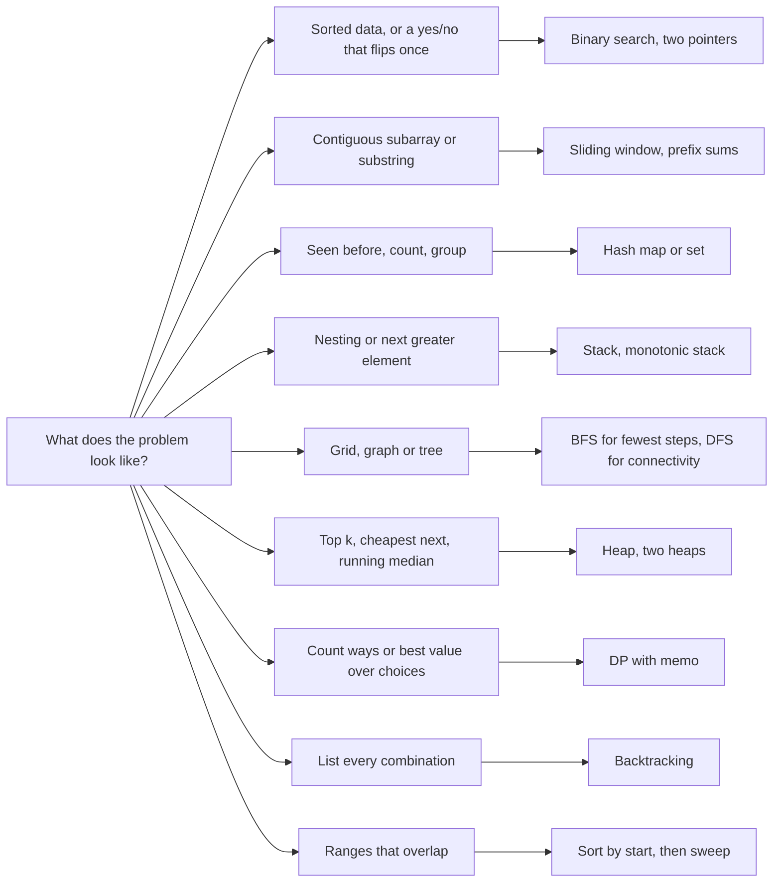
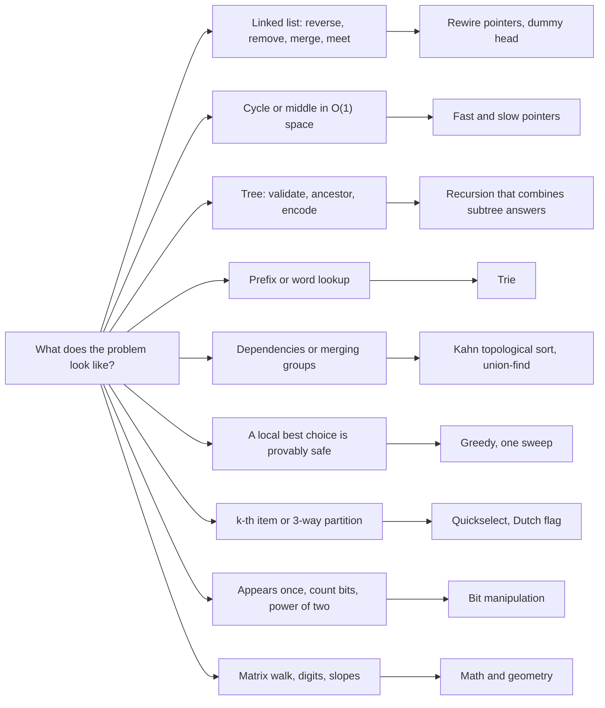

# Chapter 17 — JavaScript for Interviews

A JavaScript interview usually has three parts: a **coding round** (an algorithm problem, in JavaScript — so know which built-ins are fast and which are traps), a **"build it yourself" round** (a utility libraries normally give you — `debounce`, `Promise.all`, a deep clone), and a **language round** ("what does this print, and why?"). This chapter prepares all three without re-teaching the language: answers link to the sections that teach it, and to the [Chapter 19 question bank](../19-interview-question-bank/README.md) for say-it-out-loud answers.

**What you'll learn**

1. The JavaScript **DSA toolkit** (data structures and algorithms, §17.1): arrays as stacks/queues, `Map`/`Set`, sort comparators and stability, number pitfalls, building strings, `BigInt` — with a complexity table.
2. **Twenty-one coding patterns** (§17.2), each with two or three classic problems in runnable, asserted code — including a hand-written `MinHeap`, since JavaScript has none.
3. **Implement-from-scratch classics** with tests (§17.3): `debounce`, `throttle`, `curry`, `compose`/`pipe`, `memoize`, `flatten`, a `bind` polyfill, deep clone, deep equal, an LRU cache, an `EventEmitter`, `Promise` combinator polyfills.
4. **Fifty-three tricky questions** with real outputs (§17.4): coercion (automatic type conversion), equality, hoisting and the TDZ, closures, `this`, prototypes, event-loop order, copies, garbage collection (automatic freeing of unreachable memory) and leaks.

**Before you start.** This chapter assumes the whole book up to [Chapter 16](../16-testing-and-typescript/README.md). The tests use `node:assert/strict` and fake timers from `node:test`, explained in [§16.2](../16-testing-and-typescript/README.md#162-assertions-with-nodeassertstrict) and [§16.5](../16-testing-and-typescript/README.md#165-test-doubles-and-mocking). The same patterns are solved in Python in the Python Handbook's [Chapter 19: Python for Coding Interviews](../../../python/chapters/19-python-for-coding-interviews/README.md) — handy for comparing; here we focus on what is specific to JavaScript.

All code is in [`code/`](code/). Every program checks itself with `assert` and exits with an error if any answer is wrong; outputs below are real, from Node 24.

| File | Contents |
|---|---|
| [`01_toolkit.mjs`](code/01_toolkit.mjs) | Arrays, queue, grids, Map/Set, sorting, numbers, strings, BigInt |
| [`02_patterns_arrays.mjs`](code/02_patterns_arrays.mjs) | Two pointers, sliding window, hashing, stack, prefix sums, intervals |
| [`03_patterns_search_graphs_dp.mjs`](code/03_patterns_search_graphs_dp.mjs) | MinHeap, two heaps, k-way merge, binary search, BFS, DFS, DP, backtracking |
| [`04_classics_functions.mjs`](code/04_classics_functions.mjs) | debounce, throttle, curry, compose/pipe, memoize, flatten, bind/call |
| [`05_classics_data.mjs`](code/05_classics_data.mjs) | structuredClone, deepClone, deepEqual, LRU cache, EventEmitter |
| [`06_promise_polyfills.mjs`](code/06_promise_polyfills.mjs) | all/allSettled/race/any, timeout, promisify, pool, retry |
| [`07_qa_language.js`](code/07_qa_language.js) | Outputs for the language questions (CommonJS, sloppy — non-strict — mode on purpose) |
| [`08_qa_async_and_memory.mjs`](code/08_qa_async_and_memory.mjs) | Outputs for event-loop, strict-mode and memory questions |
| [`09_patterns_lists_trees_tries.mjs`](code/09_patterns_lists_trees_tries.mjs) | Linked lists, fast & slow pointers, trees, tries (Patterns 13–16) |
| [`10_patterns_graphs_greedy_bits_math.mjs`](code/10_patterns_graphs_greedy_bits_math.mjs) | Topological sort, union-find, greedy, quickselect/Dutch flag/merge sort, bits, math & geometry (Patterns 17–21) |

---

## 17.1 The JavaScript DSA toolkit

### What it is
You must turn an idea ("use a queue", "count with a hash map") into working code fast. JavaScript has fewer ready-made structures than Java or Python — no priority queue (always returns the smallest/most urgent item), no deque (add/remove at both ends), no sorted map — so know what the built-ins cost and how to fill the gaps.

- **Hash map (hash table):** key → value storage where a *hash function* turns the key into a slot index, so lookups don't scan. `Map`, `Set` and objects are built on them; O(1) *on average* (colliding keys need a little extra work).
- **Big-O notation:** how work (or memory) grows with input size `n`, ignoring constants: O(1) constant, O(log n) halving each step, O(n) linear, O(n log n) good sorting, O(n²) quadratic (10× input ≈ 100× work). State both *time* and extra *space*.

### Why it matters
Two JavaScript traps sink otherwise-correct solutions: **hidden O(n) operations** (`shift`, `unshift`, `includes` inside a loop) and **wrong defaults** (`sort()` comparing numbers as text, floating point). The table is the difference between O(n) and O(n²).

### Complexity of the built-ins

| Operation | Cost | Note |
|---|---|---|
| `arr[i]`, `arr[i] = x`, `arr.length`, `arr.at(-1)` | O(1) | |
| `push`, `pop` | O(1) amortized (averaged over calls) | Use the end of an array as a **stack** |
| `shift`, `unshift`, `splice(i, …)` | O(n) | Every later element moves — avoid in loops |
| `indexOf`, `includes`, `find`, `some` | O(n) | Put values in a `Set` if you look them up repeatedly |
| `slice`, spread `[...a]`, `concat`, `Array.from` | O(k) | k = number of elements copied |
| `map`, `filter`, `reduce`, `forEach` | O(n) | Plus the callback's cost |
| `sort`, `toSorted` | O(n log n) | Stable (guaranteed since ES2019); V8 uses TimSort (merge + insertion sort hybrid) |
| `Map`/`Set` `get`, `set`, `has`, `add`, `delete` | O(1) average | The spec only requires *sublinear* on average; engines use hash tables |
| Object property read/write, `in`, `Object.hasOwn` | O(1) average | |
| `Object.keys` / `entries`, `[...map]` | O(n) | |
| `str[i]`, `str.length`, `charCodeAt` | O(1) | Strings are immutable |
| `str.slice`, `split`, `join`, `[...str]` | O(n) | |
| `JSON.stringify`, `structuredClone` | O(size) | |
| Heap push/pop (you write it, §17.2) | O(log n) | |

### Arrays as stack, queue and grid
From [`code/01_toolkit.mjs`](code/01_toolkit.mjs):

```js
const stack = [];
stack.push(1); stack.push(2);
console.log('stack pop:', stack.pop(), 'peek:', stack.at(-1));   // O(1) at the end

const q = [1, 2, 3];
console.log('queue shift:', q.shift(), 'left:', q);             // shift is O(n)!

// A real O(1) queue: keep a head index instead of shifting
class Queue {
  #items = []; #head = 0;
  push(x) { this.#items.push(x); }
  shift() {
    if (this.#head === this.#items.length) return undefined;
    const x = this.#items[this.#head++];
    if (this.#head > 1024 && this.#head * 2 > this.#items.length) {   // compact occasionally
      this.#items = this.#items.slice(this.#head); this.#head = 0;
    }
    return x;
  }
  get size() { return this.#items.length - this.#head; }
}

// 2D grid: Array.from, NOT fill with an array (shared rows!)
const bad = new Array(2).fill(new Array(2).fill(0));
bad[0][0] = 9;
const grid = Array.from({ length: 2 }, () => new Array(2).fill(0));
grid[0][0] = 9;
```

Output:

```text
stack pop: 2 peek: 1
queue shift: 1 left: [ 2, 3 ]
Queue: a 1
fill(array) shares rows: [[9,0],[9,0]]
Array.from rows are separate: [[9,0],[0,0]]
```

1. **Stack** (LIFO) = `push`/`pop`; peek with `at(-1)`.
2. **Queue** (FIFO) with `shift()` is fine when small, but each `shift` moves every element. Measured in Node 24: emptying 10,000 elements took 0.3 ms, 100,000 took 0.6 s, 400,000 took 10 s — quadratic (V8 shortcuts small arrays only). For BFS on large graphs (nodes joined by edges) keep a **head index** — the `Queue` above, or `for (let head = 0; head < queue.length; head++)` (§17.2).
3. `fill(x)` puts the *same* value in every slot — with an array, every row is one object. `Array.from({ length }, () => …)` calls the function per row ([Chapter 7](../07-arrays/README.md)).

### `Map` and `Set`

```js
const freq = new Map();
for (const ch of 'banana') freq.set(ch, (freq.get(ch) ?? 0) + 1);
const visited = new Set();
visited.add(`${1},${2}`);                           // compound key as a string
new Set([[1, 2]]).has([1, 2]);                      // false: arrays compare by reference
const a = new Set([1, 2, 3]), b = new Set([2, 3, 4]);
a.union(b); a.intersection(b); a.difference(b);     // ES2025
```

Output:

```text
freq: [ [ 'b', 1 ], [ 'a', 3 ], [ 'n', 2 ] ]
set: [ 3, 1, 2 ] has 2? true
visited has "1,2"? true | Set of arrays: false
union [ 1, 2, 3, 4 ] intersection [ 2, 3 ] difference [ 1 ]
```

- Prefer **`Map`** over a plain object for counting and lookups: any key type, no inherited keys like `constructor`, a real `size`, and insertion-order iteration ([§8.1](../08-maps-sets-iterators-and-generators/README.md#81-map)).
- `Map` and `Set` compare keys with **SameValueZero** (like `===`, except `NaN` equals `NaN`). Two arrays with equal contents are *different* keys, so encode coordinates as a string (`` `${r},${c}` ``) or a number (`r * cols + c`).
- The ES2025 set methods (`union`, `intersection`, `difference`, `symmetricDifference`, `isSubsetOf`, …) are in Node 22+ and all current browsers ([§8.2](../08-maps-sets-iterators-and-generators/README.md#82-set)).

### Sorting: comparators and stability

```js
[10, 9, 1, 100].sort();                             // compared as STRINGS
[10, 9, 1, 100].sort((x, y) => x - y);              // numeric
people.toSorted((p, r) => p.age - r.age);           // stable: ties keep input order
people.toSorted((p, r) => r.age - p.age || p.name.localeCompare(r.name));  // two keys
```

Output:

```text
default sort: [ 1, 10, 100, 9 ]
numeric sort: [ 1, 9, 10, 100 ]
by age (stable): Bob Dee Ann Cid
age desc, name asc: Ann Cid Bob Dee
original untouched: Ann Bob Cid Dee
```

1. A **comparator** `(a, b) => number`: negative = `a` first, positive = `b` first, `0` = tie. `a - b` ascending, `b - a` descending.
2. **Multi-key**: chain with `||` — a `0` from the first key lets the second decide.
3. **Stability**: equal elements keep their input order (Bob before Dee); guaranteed since ES2019, so you can sort by the secondary key first, then the primary.
4. `sort` **mutates**; `toSorted` (ES2023) returns a new array — say which you use.
5. Mistake: a boolean comparator (`(a, b) => a > b`) never returns negative — engine-dependent, wrong ([§7.6](../07-arrays/README.md#76-sorting-correctly)).

### Number pitfalls

```js
0.1 + 0.2;                          // 0.30000000000000004
Number.MAX_SAFE_INTEGER;            // 9007199254740991 = 2**53 - 1
2 ** 53 + 1;                        // 9007199254740992 (can't be represented)
Math.trunc(-7 / 2); Math.floor(-7 / 2);   // -3 and -4
-7 % 3;                             // -1 (sign follows the dividend)
(2 ** 31 + 2) >> 1;                 // -1073741823: bit operators use 32-bit ints
Math.max(...[]);                    // -Infinity
```

Output:

```text
0.1 + 0.2 = 0.30000000000000004 | === 0.3? false
close(0.1+0.2, 0.3): true
MAX_SAFE_INTEGER: 9007199254740991 | 2**53 + 1 = 9007199254740992
isSafeInteger(2**53): false
7 / 2 = 3.5 | Math.trunc: 3 | -7/2 trunc: -3 floor: -4
-7 % 3 = -1 | true modulo: 2
mid without overflow worry: 5 | but >> breaks above 2**31: -1073741823
Infinity sentinels: Infinity -Infinity
Math.max(...[]) = -Infinity | parseInt("08") = 8 | Number("") = 0
NaN === NaN: false | Number.isNaN(NaN): true | isNaN("x"): true Number.isNaN("x"): false
```

| Pitfall | What to do |
|---|---|
| All numbers are 64-bit floats (IEEE 754 doubles, which can't store most fractions exactly), so `0.1 + 0.2 !== 0.3` | Compare with a tolerance (`Math.abs(a - b) < Number.EPSILON * scale`), or work in integers (cents, not dollars) |
| No integer division | `Math.trunc(a / b)` (towards zero) or `Math.floor(a / b)` (towards −∞) — they differ for negatives |
| `%` is a *remainder*, sign follows the left side | For array wrap-around use `((i % n) + n) % n` |
| Integers are exact only up to `2**53 − 1` | Check with `Number.isSafeInteger`; use `BigInt` beyond (e.g. factorials, large Fibonacci, 64-bit IDs) |
| Bitwise operators (`|`, `>>`, `~~`) convert to 32-bit signed ints | `(lo + hi) >> 1` is fine for array indexes (< 2³¹); otherwise `Math.floor((lo + hi) / 2)`. Unlike Java, `lo + hi` can't overflow below 2⁵³ |
| `Infinity` / `-Infinity` | Handy initial values for min/max; but `Math.max(...[])` is `-Infinity` and spreading a very large array (about 125,000+ elements in Node 24 on this machine — the limit depends on stack size) throws `RangeError` — use a loop or `reduce` |
| `isNaN('x')` coerces first | Use `Number.isNaN` |

Background: [§2.10 Numbers in depth](../02-variables-types-and-operators/README.md#210-numbers-in-depth).

### Strings: immutable, so build with arrays

```js
const parts = [];
for (let i = 0; i < 5; i++) parts.push(i);
parts.join('-');                                  // '0-1-2-3-4'
'd'.charCodeAt(0) - 97;                           // 3: letter -> index 0..25
[...'hello'].reverse().join('');                  // 'olleh'
```

- `s[0] = 'x'` silently does nothing (throws in strict mode). Edit via `[...s]`, change, `join('')`.
- `+=` in a loop is fine in modern engines (V8 uses *ropes* — trees of pieces), but `push` + `join` is the portable idiom and makes the O(n) cost obvious.
- A 26-slot counting array (`charCodeAt(0) - 97`) beats a `Map` for lowercase-letter problems.
- `[...s]` splits by **code point** (emoji stay whole); `s.split('')` by UTF-16 code unit ([§6.5](../06-strings-and-regular-expressions/README.md#65-unicode-code-units-code-points-and-graphemes)).

### `BigInt`

```js
const big = 2n ** 64n;                           // 18446744073709551616n, typeof 'bigint'
const factorial = (n) => (n <= 1n ? 1n : n * factorial(n - 1n));
factorial(25n);                                  // 15511210043330985984000000n
7n / 2n;                                         // 3n (division truncates)
1n == 1; 1n === 1;                               // true, false
1n + 1;                                          // TypeError: can't mix BigInt and Number
JSON.stringify(1n);                              // TypeError
```

`BigInt` (ES2020): integers of any size (`n` suffix or `BigInt(x)`); no fractions, no `Math.*`, no mixing with numbers (convert explicitly), slower — use only when values may pass `2**53`.

### In the interview
**30-second answer — "What should I watch for when doing algorithms in JavaScript?"** Arrays are stacks (`push`/`pop`); queues need a head index, not `shift`. `Map`/`Set` give O(1) lookups (string keys for coordinates). Always pass `sort` a comparator; it mutates. Numbers are doubles: `Math.trunc` for integer division, `%` can be negative, exact only to 2⁵³ − 1 (then `BigInt`). No heap — write one.
- *Is `Array.prototype.sort` stable?* Yes, required since ES2019.
- *What does `sort()` do with no comparator?* Converts to strings and compares UTF-16 code units, with `undefined` last — so `[10, 9]` stays `[10, 9]`.
- *Why a `Map` rather than `{}` for counting?* Any key type, no prototype keys (`'constructor' in {}` is `true`), `size`, insertion order, optimised for frequent adds/removes.

### Self-check
1. Locale-aware alphabetical sort? → `arr.sort((a, b) => a.localeCompare(b))`.
2. `Number.isSafeInteger(2 ** 53)`? → `false` — the largest safe integer is `2 ** 53 − 1`.

### TL;DR
Stack = `push`/`pop`; queue = head index; grid = `Array.from`. `Map`/`Set` for O(1) lookups (string keys for pairs). Always give `sort` a comparator; it's stable; `toSorted` doesn't mutate. Floats: tolerance for equality, `Math.trunc` for division, safe up to 2⁵³ − 1, `BigInt` beyond.

---

## 17.2 Coding patterns

### What it is
A **pattern** is a reusable problem-solving shape; most interview problems are one of about twenty in disguise, and recognising it gives you the algorithm and complexity almost for free. The chart is a starting point, not a law.



Patterns 13–21 — specific data structures and algorithm families:



Each pattern: idea, signal, asserted code, cost. Full programs: [`code/02_patterns_arrays.mjs`](code/02_patterns_arrays.mjs), [`code/03_patterns_search_graphs_dp.mjs`](code/03_patterns_search_graphs_dp.mjs), [`code/09_patterns_lists_trees_tries.mjs`](code/09_patterns_lists_trees_tries.mjs) and [`code/10_patterns_graphs_greedy_bits_math.mjs`](code/10_patterns_graphs_greedy_bits_math.mjs). Each asserts every result shown below and ends by printing `all … asserts passed`.

### Pattern 1 — Two pointers
**Idea:** two indexes move towards each other (or in the same direction) so each element is looked at once. **Signal:** sorted array, pairs, palindromes, in-place partitioning. **Cost:** O(n) time, O(1) space.

```js
function pairSum(sorted, target) {
  let lo = 0, hi = sorted.length - 1;
  while (lo < hi) {
    const s = sorted[lo] + sorted[hi];
    if (s === target) return [lo, hi];
    if (s < target) lo++; else hi--;      // too small: need a bigger left value
  }
  return null;
}
assert.deepEqual(pairSum([1, 3, 4, 6, 9], 12), [1, 4]);

function isPalindrome(s) {
  const t = s.toLowerCase().replace(/[^a-z0-9]/g, '');
  for (let i = 0, j = t.length - 1; i < j; i++, j--) if (t[i] !== t[j]) return false;
  return true;
}
assert.equal(isPalindrome('A man, a plan, a canal: Panama'), true);
```

Why it's correct: if the sum is too small, the smallest element can't be part of any answer with a *smaller* partner, so discarding it (`lo++`) loses nothing.

### Pattern 2 — Sliding window
**Idea:** keep a window `[start, end]` over a sequence; grow the end, shrink the start when a rule breaks. **Signal:** "longest/shortest/max-sum **contiguous** subarray or substring". **Cost:** O(n) — each index enters and leaves the window once.

```js
function longestUnique(s) {
  const last = new Map();                  // char -> last index seen
  let start = 0, best = 0;
  for (let end = 0; end < s.length; end++) {
    const ch = s[end];
    if (last.has(ch) && last.get(ch) >= start) start = last.get(ch) + 1;   // shrink
    last.set(ch, end);
    best = Math.max(best, end - start + 1);
  }
  return best;
}
assert.equal(longestUnique('abcabcbb'), 3);

function maxSumK(nums, k) {                // fixed-size window: add the new, drop the old
  let sum = 0;
  for (let i = 0; i < k; i++) sum += nums[i];
  let best = sum;
  for (let i = k; i < nums.length; i++) { sum += nums[i] - nums[i - k]; best = Math.max(best, sum); }
  return best;
}
assert.equal(maxSumK([2, 1, 5, 1, 3, 2], 3), 9);
```

### Pattern 3 — Hashing
**Idea:** trade memory for time — remember what you've seen in a `Map`/`Set` so a later lookup is O(1). **Signal:** "find a pair/duplicate", "group by", "count". **Cost:** O(n) time, O(n) space.

```js
function twoSum(nums, target) {
  const indexOf = new Map();
  for (let i = 0; i < nums.length; i++) {
    const need = target - nums[i];
    if (indexOf.has(need)) return [indexOf.get(need), i];   // check BEFORE inserting
    indexOf.set(nums[i], i);
  }
  return null;
}
assert.deepEqual(twoSum([2, 7, 11, 15], 9), [0, 1]);
assert.deepEqual(twoSum([3, 3], 6), [0, 1]);

function groupAnagrams(words) {
  const groups = new Map();
  for (const w of words) {
    const key = [...w].sort().join('');      // canonical form = the hash key
    if (!groups.has(key)) groups.set(key, []);
    groups.get(key).push(w);
  }
  return [...groups.values()];
}
```

Checking before inserting makes `[3, 3]` work (the first `3` isn't paired with itself). Sorting an anagram's letters gives every anagram the same *canonical* key; `Map.groupBy` ( [§8.7](../08-maps-sets-iterators-and-generators/README.md#87-grouping-objectgroupby-and-mapgroupby-es2024) does the grouping in one call.

### Pattern 4 — Stack (and monotonic stack)
**Idea:** a stack remembers "things still open" — brackets, unfinished elements. A **monotonic stack** keeps its contents increasing or decreasing and answers "next greater/smaller element" questions. **Cost:** O(n) — every index is pushed and popped at most once.

```js
function isBalanced(s) {
  const pairs = { ')': '(', ']': '[', '}': '{' };
  const st = [];
  for (const ch of s) {
    if ('([{'.includes(ch)) st.push(ch);
    else if (ch in pairs) { if (st.pop() !== pairs[ch]) return false; }
  }
  return st.length === 0;                  // leftovers = unclosed brackets
}

function dailyTemperatures(t) {            // days until a warmer day
  const ans = new Array(t.length).fill(0);
  const st = [];                           // indices whose temperatures are decreasing
  for (let i = 0; i < t.length; i++) {
    while (st.length && t[i] > t[st.at(-1)]) { const j = st.pop(); ans[j] = i - j; }
    st.push(i);
  }
  return ans;
}
assert.deepEqual(dailyTemperatures([73, 74, 75, 71, 69, 72, 76, 73]), [1, 1, 4, 2, 1, 1, 0, 0]);
```

### Pattern 5 — Prefix sums
**Idea:** precompute running totals `p[i] = nums[0] + … + nums[i-1]`; then any range sum is one subtraction. Combined with a hash map it counts subarrays with a given sum, even with negative numbers (where a sliding window fails). **Cost:** O(n) setup, O(1) per query.

```js
function prefix(nums) {
  const p = [0];
  for (const x of nums) p.push(p.at(-1) + x);
  return (i, j) => p[j + 1] - p[i];        // sum of nums[i..j] inclusive
}
assert.equal(prefix([3, 1, 4, 1, 5, 9])(2, 5), 19);

function subarraySum(nums, k) {            // how many subarrays sum to k?
  const count = new Map([[0, 1]]);         // the empty prefix
  let sum = 0, total = 0;
  for (const x of nums) {
    sum += x;
    total += count.get(sum - k) ?? 0;      // earlier prefixes that leave exactly k
    count.set(sum, (count.get(sum) ?? 0) + 1);
  }
  return total;
}
assert.equal(subarraySum([1, -1, 0], 0), 3);
```

### Pattern 6 — Intervals
**Idea:** sort by start, then sweep once, merging or counting overlaps. **Signal:** meetings, bookings, ranges. **Cost:** O(n log n) for the sort.

```js
function mergeIntervals(intervals) {
  const sorted = intervals.toSorted((a, b) => a[0] - b[0]);   // don't mutate the input
  const out = [];
  for (const [s, e] of sorted) {
    const last = out.at(-1);
    if (last && s <= last[1]) last[1] = Math.max(last[1], e);   // overlap: extend
    else out.push([s, e]);
  }
  return out;
}
assert.deepEqual(mergeIntervals([[8, 10], [1, 3], [2, 6], [15, 18]]), [[1, 6], [8, 10], [15, 18]]);

function minRooms(meetings) {              // sweep line: sorted starts vs sorted ends
  const starts = meetings.map(m => m[0]).sort((a, b) => a - b);
  const ends = meetings.map(m => m[1]).sort((a, b) => a - b);
  let rooms = 0, best = 0, j = 0;
  for (const s of starts) {
    while (ends[j] <= s) { j++; rooms--; }  // a meeting ending at s frees its room
    rooms++; best = Math.max(best, rooms);
  }
  return best;
}
assert.equal(minRooms([[0, 30], [5, 10], [15, 20]]), 2);
```


### Pattern 7 — Heap (write your own `MinHeap`)
**What it is:** a **binary heap** is a complete binary tree (every level full except the last, filled from the left) stored in an array, every parent ≤ its children (*min*-heap); the smallest is at index 0. Children of `i`: `2i+1`, `2i+2`; parent `(i−1)>>1` (so node 6's parent is 2). **Signal:** "k largest/smallest", "merge k sorted lists", "median of a stream", "always process the cheapest next" (Dijkstra, scheduling). **Cost:** `push`/`pop` O(log n), `peek` O(1).

JavaScript has **no built-in priority queue**, so write one (or describe it) — 25 lines:

```js
export class MinHeap {
  #a = [];
  #less;
  constructor(less = (x, y) => x < y) { this.#less = less; }   // custom ordering
  get size() { return this.#a.length; }
  peek() { return this.#a[0]; }
  push(x) {                                    // add at the end, sift UP
    const a = this.#a; a.push(x);
    let i = a.length - 1;
    while (i > 0) {
      const p = (i - 1) >> 1;
      if (!this.#less(a[i], a[p])) break;
      [a[i], a[p]] = [a[p], a[i]]; i = p;
    }
  }
  pop() {                                      // move the last to the root, sift DOWN
    const a = this.#a;
    if (a.length === 0) return undefined;
    const top = a[0], last = a.pop();
    if (a.length) {
      a[0] = last;
      let i = 0;
      for (;;) {
        const l = 2 * i + 1, r = l + 1;
        let m = i;
        if (l < a.length && this.#less(a[l], a[m])) m = l;
        if (r < a.length && this.#less(a[r], a[m])) m = r;
        if (m === i) break;
        [a[i], a[m]] = [a[m], a[i]]; i = m;
      }
    }
    return top;
  }
}

function kLargest(nums, k) {                   // min-heap of size k: O(n log k)
  const heap = new MinHeap();
  for (const x of nums) { heap.push(x); if (heap.size > k) heap.pop(); }
  const out = []; while (heap.size) out.push(heap.pop());
  return out.reverse();
}
assert.deepEqual(kLargest([3, 2, 1, 5, 6, 4], 2), [6, 5]);
```

The `less` parameter makes it a general **priority queue**: pass `(x, y) => x > y` for a max-heap, or compare a field. Dijkstra's shortest paths uses `[distance, node]` pairs:

```js
function dijkstra(graph, src) {
  const dist = new Map([[src, 0]]);
  const pq = new MinHeap((x, y) => x[0] < y[0]);   // [distance, node]
  pq.push([0, src]);
  while (pq.size) {
    const [d, u] = pq.pop();
    if (d > dist.get(u)) continue;                  // stale entry: a shorter path was found
    for (const [v, w] of graph[u] ?? []) {
      const nd = d + w;
      if (nd < (dist.get(v) ?? Infinity)) { dist.set(v, nd); pq.push([nd, v]); }
    }
  }
  return Object.fromEntries(dist);
}
const roads = { A: [['B', 4], ['C', 1]], C: [['B', 2], ['D', 7]], B: [['D', 1]] };
assert.deepEqual(dijkstra(roads, 'A'), { A: 0, C: 1, B: 3, D: 4 });
```

**Two heaps: the running median.** To report the median of a stream after every new number, keep the smaller half in a **max-heap** (`low`) and the larger half in a **min-heap** (`high`), with `low` holding the same number of items or one more. The median is then `low`'s top, or the average of both tops. Each `add` is O(log n); `median` is O(1).

```js
class MedianFinder {
  #low = new MinHeap((x, y) => x > y);        // max-heap: the smaller half
  #high = new MinHeap();                      // min-heap: the larger half
  add(x) {
    if (this.#low.size === 0 || x <= this.#low.peek()) this.#low.push(x); else this.#high.push(x);
    if (this.#low.size > this.#high.size + 1) this.#high.push(this.#low.pop());   // rebalance
    else if (this.#high.size > this.#low.size) this.#low.push(this.#high.pop());
  }
  median() {
    return this.#low.size > this.#high.size ? this.#low.peek() : (this.#low.peek() + this.#high.peek()) / 2;
  }
}
const mf = new MedianFinder();
assert.deepEqual([5, 15, 1, 3].map(x => { mf.add(x); return mf.median(); }), [5, 10, 5, 4]);
```

**k-way merge.** To merge k sorted lists, keep one "front" item per list in a min-heap; pop the smallest, then push the next item from the same list. With N items in total the cost is O(N log k) — better than concatenating and sorting (O(N log N)) when k is small.

```js
function mergeKSorted(lists) {
  const pq = new MinHeap((x, y) => x[0] < y[0]);    // [value, list index, position]
  lists.forEach((l, i) => { if (l.length) pq.push([l[0], i, 0]); });
  const out = [];
  while (pq.size) {
    const [v, i, j] = pq.pop();
    out.push(v);
    if (j + 1 < lists[i].length) pq.push([lists[i][j + 1], i, j + 1]);   // refill from the same list
  }
  return out;
}
assert.deepEqual(mergeKSorted([[1, 4, 7], [2, 5, 8], [0, 3, 6, 9], []]), [0, 1, 2, 3, 4, 5, 6, 7, 8, 9]);
```

Shortcut worth knowing: if you only need to sort once, `toSorted` is simpler and also O(n log n). A heap wins when items arrive over time or you need only the top k.

### Pattern 8 — Binary search
**Idea:** halve the search space each step. **Signal:** sorted data, or a yes/no condition that flips once as a number grows ("the smallest speed that works"). **Cost:** O(log n) steps.

```js
function lowerBound(a, target) {             // first index with a[i] >= target
  let lo = 0, hi = a.length;                 // half-open range [lo, hi)
  while (lo < hi) {
    const mid = lo + Math.floor((hi - lo) / 2);
    if (a[mid] < target) lo = mid + 1; else hi = mid;
  }
  return lo;                                  // a.length if every value is smaller
}
assert.equal(lowerBound([1, 3, 3, 5, 8], 3), 1);
assert.equal(lowerBound([1, 3, 3, 5, 8], 4), 3);

function minEatingSpeed(piles, hours) {     // binary search on the ANSWER
  let lo = 1, hi = Math.max(...piles);
  const ok = (k) => piles.reduce((t, p) => t + Math.ceil(p / k), 0) <= hours;
  while (lo < hi) { const mid = (lo + hi) >> 1; if (ok(mid)) hi = mid; else lo = mid + 1; }
  return lo;
}
assert.equal(minEatingSpeed([3, 6, 7, 11], 8), 4);
```

One template (half-open `[lo, hi)`, `lo < hi`, `hi = mid`) avoids binary search's famous off-by-one bugs. JavaScript has no `bisect` built-in; `indexOf`/`findIndex` are linear.

### Pattern 9 — Breadth-first search (BFS)
**Idea:** explore in rings — all nodes 1 step away, then 2 steps, … using a queue. The first time you reach a node is by a **shortest path** (in steps). **Signal:** "minimum number of moves", unweighted shortest path, level-order traversal. **Cost:** O(V + E) (V vertices, E edges; a grid is O(rows × cols)).

```js
function shortestPath(grid, [sr, sc], [tr, tc]) {
  const R = grid.length, C = grid[0].length;
  const dist = Array.from({ length: R }, () => new Array(C).fill(-1));   // -1 = unvisited
  const queue = [[sr, sc]]; dist[sr][sc] = 0;
  for (let head = 0; head < queue.length; head++) {       // index instead of shift()
    const [r, c] = queue[head];
    if (r === tr && c === tc) return dist[r][c];
    for (const [dr, dc] of [[1, 0], [-1, 0], [0, 1], [0, -1]]) {
      const nr = r + dr, nc = c + dc;
      if (nr >= 0 && nr < R && nc >= 0 && nc < C && grid[nr][nc] !== '#' && dist[nr][nc] === -1) {
        dist[nr][nc] = dist[r][c] + 1; queue.push([nr, nc]);   // mark when ENQUEUED
      }
    }
  }
  return -1;
}
assert.equal(shortestPath(['..#.', '..#.', '....'], [0, 0], [0, 3]), 7);
```

Mark a cell visited when you **enqueue** it, not when you dequeue it — otherwise duplicates enter the queue (still correct, but time and memory can blow up).

### Pattern 10 — Depth-first search (DFS)
**Idea:** go as deep as possible, then back up. **Signal:** connectivity ("number of islands"), cycle detection, topological order (dependencies first — Pattern 17), exploring every path. **Cost:** O(V + E).

```js
function numIslands(rows) {
  const g = rows.map(r => [...r]);           // copy: don't destroy the caller's grid
  let count = 0;
  for (let r = 0; r < g.length; r++) for (let c = 0; c < g[0].length; c++) {
    if (g[r][c] !== '1') continue;
    count++;
    const st = [[r, c]]; g[r][c] = '0';      // explicit stack = iterative DFS
    while (st.length) {
      const [x, y] = st.pop();
      for (const [nx, ny] of [[x + 1, y], [x - 1, y], [x, y + 1], [x, y - 1]]) {
        if (g[nx]?.[ny] === '1') { g[nx][ny] = '0'; st.push([nx, ny]); }   // ?. handles edges
      }
    }
  }
  return count;
}
assert.equal(numIslands(['11000', '11000', '00100', '00011']), 3);

function topoSort(n, edges) {               // recursive DFS with three colours
  const adj = Array.from({ length: n }, () => []);
  for (const [u, v] of edges) adj[u].push(v);
  const state = new Array(n).fill(0);       // 0 new, 1 on the current path, 2 done
  const order = [];
  const visit = (u) => {
    if (state[u] === 1) throw new Error('cycle');
    if (state[u] === 2) return;
    state[u] = 1;
    for (const v of adj[u]) visit(v);
    state[u] = 2; order.push(u);            // post-order
  };
  for (let u = 0; u < n; u++) visit(u);
  return order.reverse();
}
assert.deepEqual(topoSort(4, [[0, 1], [0, 2], [1, 3], [2, 3]]), [0, 2, 1, 3]);
```

JavaScript-specific: recursion depth is limited (roughly ten thousand frames in V8, depending on frame size) and V8 has no tail-call optimisation (reusing the frame when the last action is a call). For inputs that can be deep — a 1000×1000 grid of land — use the iterative version with an explicit stack.

### Pattern 11 — Dynamic programming with memoization
**What it is:** **dynamic programming (DP)** solves a problem by combining answers to smaller versions of the same problem, storing each answer so it is computed once. **Top-down** = recursion + a cache (**memoization**); **bottom-up** = fill a table in order. **Signal:** "count the ways", "minimum cost", "longest …", when the plain recursion repeats the same calls. **Cost:** (number of states) × (work per state).

```js
function climb(n, memo = new Map()) {       // ways to climb n stairs taking 1 or 2 steps
  if (n <= 1) return 1;
  if (memo.has(n)) return memo.get(n);
  const v = climb(n - 1, memo) + climb(n - 2, memo);
  memo.set(n, v);
  return v;
}
assert.equal(climb(70), 308061521170129);   // exact: below 2**53
assert.equal(Number.isSafeInteger(climb(80)), false);   // too big: use BigInt

function coinChange(coins, amount) {        // bottom-up: fewest coins for each amount
  const dp = new Array(amount + 1).fill(Infinity); dp[0] = 0;
  for (let a = 1; a <= amount; a++)
    for (const c of coins) if (c <= a) dp[a] = Math.min(dp[a], dp[a - c] + 1);
  return dp[amount] === Infinity ? -1 : dp[amount];
}
assert.equal(coinChange([1, 2, 5], 11), 3);

function lcs(a, b) {                        // longest common subsequence: 2D table
  const dp = Array.from({ length: a.length + 1 }, () => new Array(b.length + 1).fill(0));
  for (let i = 1; i <= a.length; i++) for (let j = 1; j <= b.length; j++)
    dp[i][j] = a[i - 1] === b[j - 1] ? dp[i - 1][j - 1] + 1 : Math.max(dp[i - 1][j], dp[i][j - 1]);
  return dp[a.length][b.length];
}
assert.equal(lcs('abcde', 'ace'), 3);
```

Without the memo, `climb(70)` would make about 6 × 10¹⁴ calls; with it, about 140. Note the JavaScript twist: the answer for 80 stairs is larger than `2**53`, so a real solution would switch to `BigInt` (§17.1). For multi-argument states, use a string key (`` `${i},${j}` ``) or a 2D array.

### Pattern 12 — Backtracking
**Idea:** build a solution one choice at a time; after exploring a choice, **undo** it and try the next (choose → explore → un-choose). Prune branches that can't succeed. **Signal:** "list all subsets/permutations/combinations", puzzles (N-Queens, Sudoku). **Cost:** exponential — 2ⁿ subsets, n! permutations — so inputs are small.

```js
function subsets(nums) {
  const out = [], cur = [];
  const go = (i) => {
    if (i === nums.length) { out.push([...cur]); return; }   // COPY the current path
    cur.push(nums[i]); go(i + 1); cur.pop();                 // choose, explore, un-choose
    go(i + 1);                                               // skip nums[i]
  };
  go(0);
  return out;
}
assert.deepEqual(subsets([1, 2]), [[1, 2], [1], [2], []]);

function nQueens(n) {                        // pruning with Sets of attacked lines
  const cols = new Set(), d1 = new Set(), d2 = new Set();
  let count = 0;
  const place = (r) => {
    if (r === n) { count++; return; }
    for (let c = 0; c < n; c++) {
      if (cols.has(c) || d1.has(r - c) || d2.has(r + c)) continue;
      cols.add(c); d1.add(r - c); d2.add(r + c);
      place(r + 1);
      cols.delete(c); d1.delete(r - c); d2.delete(r + c);
    }
  };
  place(0);
  return count;
}
assert.equal(nQueens(8), 92);
```

The most common JavaScript bug here is `out.push(cur)` without copying: every entry would be the *same* array, which ends up empty. (`permutations` with a `used` array is in the code file.)


### Pattern 13 — Linked lists
**What it is:** a **linked list** is a chain of nodes; each node holds a value and a `next` reference to the following node (`null` at the end). Unlike an array there is no index: reaching the k-th node means walking k steps, but inserting or removing a node you already hold is O(1) — you only rewire references. JavaScript has no built-in linked list, so problems hand you a `{ val, next }` shape. **Signal:** "reverse", "remove the k-th from the end", "merge", "where do two lists meet". **Cost:** usually O(n) time, O(1) extra space.

```js
class ListNode { constructor(val, next = null) { this.val = val; this.next = next; } }

function reverseList(head) {                 // flip every arrow while walking
  let prev = null, cur = head;
  while (cur) {
    const next = cur.next;                   // save before overwriting
    cur.next = prev;
    prev = cur; cur = next;
  }
  return prev;                               // the old tail is the new head
}
assert.deepEqual(toArray(reverseList(fromArray([1, 2, 3, 4]))), [4, 3, 2, 1]);

function removeKthFromEnd(head, k) {         // one pass: `lead` runs k nodes ahead
  const dummy = new ListNode(0, head);       // dummy head: removing the head needs no special case
  let lead = dummy, trail = dummy;
  for (let i = 0; i < k; i++) lead = lead.next;
  while (lead.next) { lead = lead.next; trail = trail.next; }
  trail.next = trail.next.next;              // trail sits just before the node to remove
  return dummy.next;
}
assert.deepEqual(toArray(removeKthFromEnd(fromArray([1, 2, 3, 4, 5]), 2)), [1, 2, 3, 5]);

function intersection(a, b) {                // first node shared by two lists, or null
  let p = a, q = b;
  while (p !== q) { p = p ? p.next : b; q = q ? q.next : a; }
  return p;
}
```

`intersection`: `p` walks A then B, `q` walks B then A; both travel `lenA + lenB` steps, so they reach the shared node together (or `null` together). It compares **nodes**, not values. The **dummy head** (a fake node before the real head) gives every node a predecessor, so changing the head needs no special case — e.g. `removeKthFromEnd` can stop *before* the head when k equals the length. `fromArray`/`toArray` are in the code file.

### Pattern 14 — Fast & slow pointers
**Idea:** two pointers move through a sequence at different speeds — slow one step, fast two steps. If the sequence loops, fast eventually laps slow and they meet; if it ends, fast reaches the end when slow is halfway. **Signal:** "is there a cycle / where does it start", "middle of a list", any "does repeating this step loop forever?" question. **Cost:** O(n) time, **O(1) space** — the point, since a `Set` of visited nodes would also work but costs O(n).

```js
function cycleStart(head) {                  // Floyd's algorithm
  let slow = head, fast = head;
  while (fast && fast.next) {
    slow = slow.next; fast = fast.next.next;
    if (slow === fast) {                     // met inside the loop
      let p = head;
      while (p !== slow) { p = p.next; slow = slow.next; }
      return p;                              // they meet again at the loop's first node
    }
  }
  return null;                               // fast fell off the end: no cycle
}

function middle(head) {                      // second middle for even lengths
  let slow = head, fast = head;
  while (fast && fast.next) { slow = slow.next; fast = fast.next.next; }
  return slow;
}
assert.equal(middle(fromArray([1, 2, 3, 4, 5])).val, 3);

function isHappy(n) {                        // n -> sum of squared digits; reaches 1 or loops
  const next = (x) => { let s = 0; while (x > 0) { const d = x % 10; s += d * d; x = Math.floor(x / 10); } return s; };
  let slow = n, fast = next(n);
  while (fast !== 1 && slow !== fast) { slow = next(slow); fast = next(next(fast)); }
  return fast === 1;
}
assert.equal(isHappy(19), true);             // 19 -> 82 -> 68 -> 100 -> 1
assert.equal(isHappy(2), false);
```

Why the second phase finds the loop's start: say the start is `a` steps from the head and the pointers meet `b` steps into a loop of length `c`. Fast walked twice as far, so `2(a + b) = a + b + k·c` for some whole number `k`, which gives `a = k·c − b`. Walking `a` more steps from the meeting point therefore lands exactly on the loop's start — the same place a pointer starting at the head reaches after `a` steps. `isHappy` shows the pattern without any list: the "next" function defines an implicit chain.

### Pattern 15 — Trees
**What it is:** a **binary tree** is a set of nodes where each node has at most two children (`left`, `right`); the top node is the **root**, nodes without children are **leaves**. A **binary search tree (BST)** adds a rule: every value in the left subtree is smaller than the node, every value in the right subtree larger. Most tree answers are a short recursive function that asks each subtree a question and combines the two answers. **Signal:** "validate", "lowest common ancestor", "path sum", "rebuild / encode a tree". **Cost:** O(n) time, O(h) stack for a tree of height `h` (h = log n when balanced — both sides of every node about equally deep — n when it degenerates into a line).

```js
class TreeNode { constructor(val, left = null, right = null) { this.val = val; this.left = left; this.right = right; } }

function isValidBST(node, lo = -Infinity, hi = Infinity) {   // pass the allowed range DOWN
  if (!node) return true;
  if (node.val <= lo || node.val >= hi) return false;
  return isValidBST(node.left, lo, node.val) && isValidBST(node.right, node.val, hi);
}
assert.equal(isValidBST(fromLevels([5, 1, 7, null, null, 4, 8])), false);   // 4 is right of 5

function lca(root, p, q) {                   // lowest common ancestor of values p and q
  if (!root || root.val === p || root.val === q) return root;
  const left = lca(root.left, p, q), right = lca(root.right, p, q);
  return left && right ? root : left ?? right;   // found on both sides: this node splits them
}
const family = fromLevels([3, 5, 1, 6, 2, 0, 8, null, null, 7, 4]);
assert.equal(lca(family, 7, 4).val, 2);

function serialize(root) {                   // preorder, '#' marks an empty child
  const out = [];
  const go = (n) => { if (!n) { out.push('#'); return; } out.push(n.val); go(n.left); go(n.right); };
  go(root);
  return out.join(',');
}
function deserialize(text) {
  const tokens = text.split(',');
  let i = 0;
  const go = () => {
    const t = tokens[i++];
    if (t === '#') return null;
    const node = new TreeNode(Number(t));
    node.left = go(); node.right = go();      // same order as serialize
    return node;
  };
  return go();
}
assert.equal(serialize(fromLevels([1, 2, 3, null, null, 4, 5])), '1,2,#,#,3,4,#,#,5,#,#');
```

Classic BST bug: comparing a node only with its parent — in `[5, 1, 7, null, null, 4, 8]`, 4 is a valid left child of 7 but sits in 5's *right* subtree. Passing `(lo, hi)` down catches it. Serialization works because preorder (node, left, right) plus `#` markers fixes the shape: the reader always knows what the next token fills. (`fromLevels`, which builds a tree from a level-order array with `null` gaps, is in the code file; deep, unbalanced trees hit the recursion-depth limit from Pattern 10 — switch to an explicit stack.)

### Pattern 16 — Tries
**What it is:** a **trie** (prefix tree, pronounced "try") stores strings one character per level; words that share a prefix share the same path from the root, and a flag marks "a word ends here". Looking up a word or prefix of length `L` costs O(L), no matter how many words are stored. **Signal:** "autocomplete", "starts with", "search with a wildcard", "find many words in a grid". **Cost:** O(L) per insert/search; memory O(total characters).

```js
class Trie {
  #root = { next: new Map(), end: false };
  insert(word) {
    let n = this.#root;
    for (const ch of word) {
      if (!n.next.has(ch)) n.next.set(ch, { next: new Map(), end: false });
      n = n.next.get(ch);
    }
    n.end = true;                            // "a word finishes here"
  }
  #walk(prefix) {
    let n = this.#root;
    for (const ch of prefix) { n = n.next.get(ch); if (!n) return null; }
    return n;
  }
  search(word) { return this.#walk(word)?.end === true; }
  startsWith(prefix) { return this.#walk(prefix) !== null; }
  match(pattern) {                           // '.' matches any one letter
    const go = (n, i) => {
      if (i === pattern.length) return n.end;
      if (pattern[i] !== '.') { const nx = n.next.get(pattern[i]); return nx ? go(nx, i + 1) : false; }
      for (const nx of n.next.values()) if (go(nx, i + 1)) return true;   // try every branch
      return false;
    };
    return go(this.#root, 0);
  }
}
// words: car, card, care, cat, dog
assert.equal(trie.search('ca'), false);      // a prefix, not a stored word
assert.equal(trie.match('c.r.'), true);      // card, care
```

**Word search on a board** (find every listed word traceable through neighbouring cells, each cell once per word) combines a trie with backtracking: one DFS per cell walks board and trie together and stops as soon as the letters aren't a prefix of any word — the prune that beats searching word by word.

```js
function findWords(board, words) {
  const root = {};
  for (const w of words) { let n = root; for (const ch of w) n = n[ch] ??= {}; n.$word = w; }
  const grid = board.map(row => [...row]);   // copy: cells are marked while exploring
  const R = grid.length, C = grid[0].length, found = [];
  const dfs = (r, c, node) => {
    const ch = grid[r][c], next = node[ch];
    if (!next) return;                       // no word continues this way: prune
    if (next.$word) { found.push(next.$word); delete next.$word; }   // report once
    grid[r][c] = '#';                        // choose
    for (const [dr, dc] of [[1, 0], [-1, 0], [0, 1], [0, -1]]) {
      const nr = r + dr, nc = c + dc;
      if (nr >= 0 && nr < R && nc >= 0 && nc < C && grid[nr][nc] !== '#') dfs(nr, nc, next);
    }
    grid[r][c] = ch;                         // un-choose
  };
  for (let r = 0; r < R; r++) for (let c = 0; c < C; c++) dfs(r, c, root);
  return found.sort();
}
assert.deepEqual(findWords(['cats', 'ored', 'waxy'], ['cat', 'cats', 'car', 'core', 'cow', 'dog', 'red', 'wax', 'tax']),
  ['car', 'cat', 'cats', 'core', 'cow', 'red', 'wax']);
```

JavaScript notes: a `Map` per node is the clean choice; a plain object (`n[ch] ??= {}`) is shorter, but then a stored key such as `$word` must never collide with a letter. For lowercase-only input, a 26-slot array per node is the fastest variant (§17.1).


### Pattern 17 — Topological sort and union-find
**What it is:** two graph tools that plain BFS/DFS (Patterns 9–10) don't cover directly. A **topological order** lists the nodes of a directed graph (one whose edges point one way, like "A before B") so every edge goes from earlier to later ("take prerequisites first"); it exists only if the graph has no cycle. **Kahn's algorithm** builds it with BFS: repeatedly take a node whose **in-degree** (number of incoming edges still unprocessed) is 0. A **union-find** (disjoint-set union) keeps a collection of groups and answers "are x and y in the same group?" and "merge their groups" in almost constant time. **Signal:** "order of tasks with dependencies", "can all courses be finished" → topological sort; "number of connected groups", "does this edge create a cycle", merging accounts or friend circles → union-find. **Cost:** Kahn O(V + E); union-find O(α(n)) per operation, where α (the inverse Ackermann function) is below 5 for any real input.

```js
function courseOrder(n, prereqs) {           // prereqs: [course, mustTakeFirst]
  const adj = Array.from({ length: n }, () => []);
  const indeg = new Array(n).fill(0);
  for (const [c, p] of prereqs) { adj[p].push(c); indeg[c]++; }
  const order = [];
  for (let i = 0; i < n; i++) if (indeg[i] === 0) order.push(i);
  for (let h = 0; h < order.length; h++)     // `order` doubles as the queue
    for (const v of adj[order[h]]) if (--indeg[v] === 0) order.push(v);
  return order.length === n ? order : null;  // null = cycle: impossible schedule
}
assert.deepEqual(courseOrder(4, [[1, 0], [2, 0], [3, 1], [3, 2]]), [0, 1, 2, 3]);
assert.equal(courseOrder(2, [[0, 1], [1, 0]]), null);

class UnionFind {
  constructor(n) {
    this.parent = Array.from({ length: n }, (_, i) => i);   // everyone starts alone
    this.size = new Array(n).fill(1);
    this.sets = n;
  }
  find(x) {                                  // follow parents to the group's root
    while (this.parent[x] !== x) {
      this.parent[x] = this.parent[this.parent[x]];        // path halving: flatten as we go
      x = this.parent[x];
    }
    return x;
  }
  union(a, b) {
    let ra = this.find(a), rb = this.find(b);
    if (ra === rb) return false;             // already in the same group
    if (this.size[ra] < this.size[rb]) [ra, rb] = [rb, ra];
    this.parent[rb] = ra;                    // hang the smaller tree under the bigger one
    this.size[ra] += this.size[rb];
    this.sets--;
    return true;
  }
}
const countComponents = (n, edges) => { const uf = new UnionFind(n); for (const [a, b] of edges) uf.union(a, b); return uf.sets; };
assert.equal(countComponents(5, [[0, 1], [1, 2], [3, 4]]), 2);

function redundantEdge(edges) {              // first edge that closes a cycle (nodes 1..n)
  const uf = new UnionFind(edges.length + 1);
  for (const e of edges) if (!uf.union(e[0], e[1])) return e;
  return null;
}
assert.deepEqual(redundantEdge([[1, 2], [2, 3], [3, 4], [1, 4], [1, 5]]), [1, 4]);
```

Kahn vs Pattern 10's DFS sort: both O(V + E); Kahn detects cycles by counting ("fewer than n came out"), needs no recursion, and works in "waves" (minimum number of semesters). Union-find handles edges arriving one at a time (rerunning BFS each time would cost O(V + E) per edge); `union` returning `false` means the ends already shared a root — the edge closes a cycle. Path halving and union by size make it fast; without them `find` can degrade to O(n).

### Pattern 18 — Greedy
**What it is:** a **greedy** algorithm makes the choice that looks best right now and never revisits it. It is fast (usually one pass, often after a sort) but only correct when you can argue that a locally best choice never blocks a globally best answer — so in the interview, always say *why* the greedy choice is safe, or give a counterexample (one input where it gives the wrong answer) and switch to DP (Pattern 11). **Signal:** "minimum number of …", "can you reach …", scheduling, and problems where a sort plus one sweep feels natural. **Cost:** O(n) or O(n log n) with a sort.

```js
function canJump(nums) {                     // nums[i] = max jump length from i
  let reach = 0;                             // farthest index reachable so far
  for (let i = 0; i < nums.length; i++) {
    if (i > reach) return false;             // stuck before i
    reach = Math.max(reach, i + nums[i]);
  }
  return true;
}
assert.equal(canJump([3, 2, 1, 0, 4]), false);

function gasStation(gas, cost) {             // start index for a full circle, or -1
  let total = 0, tank = 0, start = 0;
  for (let i = 0; i < gas.length; i++) {
    const d = gas[i] - cost[i];
    total += d; tank += d;
    if (tank < 0) { start = i + 1; tank = 0; }   // nobody in start..i can be the answer
  }
  return total >= 0 ? start : -1;
}
assert.equal(gasStation([1, 2, 3, 4, 5], [3, 4, 5, 1, 2]), 3);

function candies(ratings) {                  // everyone >= 1; higher rating than a neighbour => more
  const n = ratings.length, c = new Array(n).fill(1);
  for (let i = 1; i < n; i++) if (ratings[i] > ratings[i - 1]) c[i] = c[i - 1] + 1;
  for (let i = n - 2; i >= 0; i--) if (ratings[i] > ratings[i + 1]) c[i] = Math.max(c[i], c[i + 1] + 1);
  return c.reduce((a, b) => a + b, 0);
}
assert.equal(candies([1, 3, 4, 5, 2]), 11);  // 1, 2, 3, 4, 1
```

Safety arguments: **Jump game:** every index up to `reach` is reachable, so extending `reach` from each of them loses nothing. **Gas station:** if the tank goes negative at `i` after starting at `s`, every station between `s` and `i` arrived with at least 0 fuel from `s`, so starting there is no better — skip to `i + 1`; and if total gas covers total cost, the last surviving start completes the loop. **Candies:** the left-to-right pass satisfies every "better than my left neighbour" rule with the fewest candies, the right-to-left pass does the same for right neighbours, and `Math.max` keeps both. When greedy fails — coin change with coins `[1, 3, 4]` and amount 6 (greedy picks 4+1+1, the best is 3+3) — use DP. (Pattern 6's meeting-rooms and merge-intervals are greedy too: sort, then sweep.)

### Pattern 19 — Sort & search: quickselect, Dutch flag, merge sort
**Idea:** some questions are really about the sorting algorithms themselves: find the k-th item *without* fully sorting, partition in place, or sort stably. **Quickselect** partitions like quicksort (a **pivot** value; smaller items to its left, the rest to its right) but then continues into only the side that contains the answer. **Signal:** "k-th largest/smallest", "median", "sort 0/1/2 in one pass", "sort a linked list", "count inversions" (pairs that are in the wrong order). **Cost:** quickselect O(n) average (O(n²) worst, made unlikely by a random pivot); Dutch flag O(n) one pass, O(1) space; merge sort O(n log n) always, O(n) extra space, **stable**.

```js
function kthLargest(nums, k) {               // quickselect
  const a = [...nums], target = a.length - k;   // k-th largest = index n-k ascending
  let lo = 0, hi = a.length - 1;
  for (;;) {
    const r = lo + Math.floor(Math.random() * (hi - lo + 1));
    [a[r], a[hi]] = [a[hi], a[r]];           // random pivot, moved to the end
    const pivot = a[hi];
    let store = lo;                          // Lomuto partition
    for (let i = lo; i < hi; i++) if (a[i] < pivot) { [a[i], a[store]] = [a[store], a[i]]; store++; }
    [a[store], a[hi]] = [a[hi], a[store]];   // the pivot is now in its final sorted place
    if (store === target) return a[store];
    if (store < target) lo = store + 1; else hi = store - 1;   // keep ONE side
  }
}
assert.equal(kthLargest([3, 2, 1, 5, 6, 4], 2), 5);

function sortColors(a) {                     // Dutch national flag: 0s, 1s, 2s in one pass
  let lo = 0, mid = 0, hi = a.length - 1;    // [0,lo)=0s  [lo,mid)=1s  [mid,hi]=unknown  (hi,end]=2s
  while (mid <= hi) {
    if (a[mid] === 0) { [a[lo], a[mid]] = [a[mid], a[lo]]; lo++; mid++; }
    else if (a[mid] === 1) mid++;
    else { [a[mid], a[hi]] = [a[hi], a[mid]]; hi--; }   // don't move mid: new a[mid] is unchecked
  }
  return a;
}
assert.deepEqual(sortColors([2, 0, 2, 1, 1, 0]), [0, 0, 1, 1, 2, 2]);

function mergeSort(a, cmp = (x, y) => x - y) {
  if (a.length <= 1) return a;
  const mid = a.length >> 1;
  const L = mergeSort(a.slice(0, mid), cmp), R = mergeSort(a.slice(mid), cmp);
  const out = [];
  let i = 0, j = 0;
  while (i < L.length && j < R.length) out.push(cmp(L[i], R[j]) <= 0 ? L[i++] : R[j++]);   // <= : stable
  return out.concat(L.slice(i), R.slice(j));
}
const people = [['ann', 30], ['bob', 25], ['cy', 30], ['di', 25]];
assert.deepEqual(mergeSort(people, (x, y) => x[1] - y[1]).map(p => p[0]), ['bob', 'di', 'ann', 'cy']);
```

Quickselect (O(n) average, whole array, rearranges a copy) vs a size-k heap (O(n log k), works on a stream, no bad worst case). The code file checks `kthLargest` against `toSorted` on 200 random arrays — a cheap test for randomised algorithms. On a linked list merge sort needs no extra array (middle via Pattern 14, sort halves, merge). Everyday code: `toSorted` is already stable O(n log n); write these only when the algorithm is the question.

### Pattern 20 — Bit manipulation
**What it is:** treating a number as its binary digits (**bits**) and using the bitwise operators: `&` (and), `|` (or), `^` (xor: 1 when the bits differ), `~` (not), `<<` (shift left = ×2), `>>` (shift right keeping the sign), `>>>` (shift right filling with 0). **Signal:** "without extra space, find the one that appears once", "count 1-bits", "power of two", subsets as bitmasks (an integer whose bits mark which items are chosen). **Cost:** O(1) per operation. **The JavaScript twist:** numbers are 64-bit floats, but every bitwise operator first converts to a **32-bit signed integer**, so results can come out negative and values above 2³² lose their high bits; `x >>> 0` reinterprets the 32 bits as unsigned (no sign bit, so never negative).

```js
const singleNumber = (nums) => nums.reduce((acc, x) => acc ^ x, 0);   // x ^ x = 0, x ^ 0 = x
assert.equal(singleNumber([4, 1, 2, 1, 2]), 4);

function countBits(n) {                      // number of 1-bits for every i in 0..n
  const bits = new Array(n + 1).fill(0);
  for (let i = 1; i <= n; i++) bits[i] = bits[i >> 1] + (i & 1);   // DP: drop the last bit
  return bits;
}
assert.deepEqual(countBits(5), [0, 1, 1, 2, 1, 2]);

// swap every pair of neighbouring bits: 0xAAAAAAAA = odd positions, 0x55555555 = even
const swapOddEvenBits = (x) => (((x & 0xAAAAAAAA) >>> 1) | ((x & 0x55555555) << 1)) >>> 0;
assert.equal(swapOddEvenBits(0b10110), 0b101001);
assert.equal(swapOddEvenBits(0x40000000), 0x80000000);   // 2147483648, thanks to >>> 0
assert.equal(0x40000000 << 1, -2147483648);              // the trap without it

const isPowerOfTwo = (n) => n > 0 && (n & (n - 1)) === 0;   // n & (n-1) clears the lowest 1-bit
```

`singleNumber`: xor is commutative and associative, so pairs cancel in any order — O(1) space instead of a `Set`. `countBits` is a tiny DP (`i >> 1` = `i` minus its last bit, `i & 1` = that bit). The swap's final `>>> 0` matters: a 1 in bit 31 makes the signed result negative (the file asserts against a slow bit-by-bit version on `0`, `0x80000000`, `0xFFFFFFFF`). Beyond 32 bits, `BigInt` supports the same operators (`5n & 3n`) except `>>>`.

### Pattern 21 — Math & geometry
**Idea:** simulation and number facts: walk a matrix in order, handle integer limits, compare slopes exactly — spot the invariant (true at every step) and the edge cases. **Signal:** "spiral / rotate a matrix", "reverse digits … 0 on overflow", "points on a line", gcd (greatest common divisor), modular arithmetic. **Cost:** problem-specific — here O(rows × cols), O(digits) and O(n²).

```js
function spiral(m) {                         // peel layers with four shrinking walls
  const out = [];
  let top = 0, bottom = m.length - 1, left = 0, right = m[0].length - 1;
  while (top <= bottom && left <= right) {
    for (let c = left; c <= right; c++) out.push(m[top][c]);
    top++;
    for (let r = top; r <= bottom; r++) out.push(m[r][right]);
    right--;
    if (top <= bottom) { for (let c = right; c >= left; c--) out.push(m[bottom][c]); bottom--; }
    if (left <= right) { for (let r = bottom; r >= top; r--) out.push(m[r][left]); left++; }
  }
  return out;
}
assert.deepEqual(spiral([[1, 2, 3, 4], [5, 6, 7, 8], [9, 10, 11, 12]]), [1, 2, 3, 4, 8, 12, 11, 10, 9, 5, 6, 7]);

function reverseInt(x) {                     // 0 if the result leaves the 32-bit signed range
  const sign = x < 0 ? -1 : 1;
  let n = Math.abs(x), r = 0;
  while (n > 0) { r = r * 10 + (n % 10); n = Math.floor(n / 10); }
  r *= sign;
  return r < -(2 ** 31) || r > 2 ** 31 - 1 ? 0 : r;
}
assert.equal(reverseInt(-120), -21);
assert.equal(reverseInt(1534236469), 0);     // 9646324351 > 2^31 - 1

function maxPointsOnLine(points) {           // most points on one straight line
  if (points.length <= 2) return points.length;
  const gcd = (a, b) => (b === 0 ? Math.abs(a) : gcd(b, a % b));
  let best = 0;
  for (let i = 0; i < points.length; i++) {
    const byDir = new Map();
    let same = 1, most = 0;                  // `same` = the anchor plus exact duplicates
    for (let j = i + 1; j < points.length; j++) {
      let dx = points[j][0] - points[i][0], dy = points[j][1] - points[i][1];
      if (dx === 0 && dy === 0) { same++; continue; }
      const g = gcd(dx, dy);
      dx /= g; dy /= g;
      if (dx < 0 || (dx === 0 && dy < 0)) { dx = -dx; dy = -dy; }   // one sign per direction
      const key = `${dx}/${dy}`;
      const c = (byDir.get(key) ?? 0) + 1;
      byDir.set(key, c);
      most = Math.max(most, c);
    }
    best = Math.max(best, most + same);
  }
  return best;
}
assert.equal(maxPointsOnLine([[1, 1], [3, 2], [5, 3], [4, 1], [2, 3], [1, 4]]), 4);
```

`spiral`'s two `if`s stop a lone remaining row/column being walked twice (try 3×1). `reverseInt` is *easier* than in Java/C++: exact to 2⁵³, so no intermediate overflow — one range check at the end. In `maxPointsOnLine` a float slope `dy / dx` is imprecise (`94911150 / 94911151 === 94911151 / 94911152` is `true` though the directions differ, so non-collinear points would count as one line) and infinite for verticals; the gcd-reduced integer pair as a `Map` key avoids both (Pattern 3's canonical-key idea).


### Summary table

| # | Pattern | Signal words | Time | Extra space |
|---|---|---|---|---|
| 1 | Two pointers | sorted, pair, palindrome, in place | O(n) | O(1) |
| 2 | Sliding window | longest/shortest contiguous | O(n) | O(k) |
| 3 | Hashing | seen before, count, group | O(n) | O(n) |
| 4 | Stack / monotonic stack | brackets, next greater | O(n) | O(n) |
| 5 | Prefix sums | range sum, subarray sum = k | O(n) + O(1)/query | O(n) |
| 6 | Intervals | overlap, merge, rooms | O(n log n) | O(n) |
| 7 | Heap (two heaps, k-way merge) | top k, cheapest next, running median | O(n log k) | O(k) |
| 8 | Binary search | sorted, minimum value that works | O(log n) × check | O(1) |
| 9 | BFS | fewest steps, levels | O(V + E) | O(V) |
| 10 | DFS | connected, cycle, order | O(V + E) | O(V) |
| 11 | DP + memo | count ways, min cost, overlapping calls | states × transitions | states |
| 12 | Backtracking | all combinations, puzzles | exponential | O(depth) |
| 13 | Linked lists | reverse, k-th from end, merge, intersection | O(n) | O(1) |
| 14 | Fast & slow pointers | cycle, cycle start, middle, "does it loop?" | O(n) | O(1) |
| 15 | Trees | validate BST, ancestor, path, serialize | O(n) | O(h) |
| 16 | Tries | prefix, autocomplete, wildcard, words in a grid | O(L) per word | O(total chars) |
| 17 | Topological sort / union-find | dependencies, order; groups, redundant edge | O(V + E); ≈ O(1) per op | O(V) |
| 18 | Greedy | reach, minimum count, schedule (prove the choice) | O(n) or O(n log n) | O(1)–O(n) |
| 19 | Sort & search | k-th largest, 3-way partition, stable sort | O(n) avg; O(n log n) | O(1); O(n) |
| 20 | Bit manipulation | appears once, count bits, power of two, masks | O(n) or O(1) | O(1) |
| 21 | Math & geometry | spiral, overflow, collinear points, gcd | problem-specific | O(1)–O(n) |

### In the interview
**30-second answer — "How do you approach a coding problem?"** Restate it; agree on input/output and edge cases (empty, duplicates, negatives). State the brute force and its cost. Find the pattern — sorted → binary search/two pointers; contiguous → window; lookups → hash map; fewest steps → BFS — and state the better complexity before coding. Then test by hand with a normal and an edge case.
- *Why BFS rather than DFS for shortest path?* BFS reaches nodes in order of distance, so the first visit is the shortest; DFS may find a long path first.
- *Top-down or bottom-up DP?* Top-down is easier to derive and computes only needed states; bottom-up avoids recursion-depth limits (important in JavaScript) and allows rolling arrays (keep only the last row or two).
- *How do you implement a priority queue in JavaScript?* A binary heap over an array: push = append + sift up, pop = move last to root + sift down, both O(log n).
- *Why a dummy head in linked-list problems?* It gives every real node a predecessor, so removing or inserting at the head needs no special case.
- *How do you prove a greedy solution?* Show that the greedy choice can be swapped into any optimal answer without making it worse (an **exchange argument**), or that it keeps an invariant (jump game: everything up to `reach` is reachable). If you can't, try a small counterexample and fall back to DP.
- *Quickselect or heap for the k-th largest?* Quickselect: O(n) average, needs the whole array. Heap of size k: O(n log k), works on a stream and has no bad worst case.
- *Kahn's algorithm or DFS for topological order?* Both O(V + E). Kahn counts nodes to detect a cycle and needs no recursion; DFS uses three colours and post-order.

### Self-check
1. Longest substring with at most two distinct letters? → Sliding window with a `Map` of counts.
2. Why does `subarraySum` start the map with `[0, 1]`? → So subarrays starting at index 0 (prefix sum exactly `k`) count.

### TL;DR
Recognise the pattern (summary table above), state the complexity, then code. JavaScript specifics: hand-write the heap; head-index queues for BFS; iterative DFS for deep inputs; copy backtracking results; bitwise ops are 32-bit signed (`>>> 0` for unsigned); exact integer keys, not float slopes; greedy only with a safety argument.

---

## 17.3 Implement-from-scratch classics

### What it is
"Implement `X` without the built-in" tests whether you know *how* everyday tools work: closures and timers (`debounce`, `throttle`), `this` and `apply` (`bind`), recursion and object types (deep clone, deep equal), `Map` ordering (LRU cache), promises (`Promise.all`). The versions below are the fuller, **tested** implementations; the [Chapter 19 bank](../19-interview-question-bank/README.md#14-coding-tasks-implement-from-scratch-classics) (Q245–Q269) has compact whiteboard versions and more tasks (`once`, `sleep`, retry, `get`, `instanceof`, a `Promise` class…).

### How the tests control time
[`code/04_classics_functions.mjs`](code/04_classics_functions.mjs) uses `node:test` **fake timers** ([§16.5](../16-testing-and-typescript/README.md#165-test-doubles-and-mocking)): `setTimeout` and `Date.now()` move only when the test calls `tick(ms)`.

```js
import { mock } from 'node:test';
mock.timers.enable({ apis: ['setTimeout', 'Date'] });
const tick = (ms) => mock.timers.tick(ms);
```

### Debounce
A **debounced** function waits until calls *stop* for `wait` ms, then runs once with the latest arguments. **Use for:** search-as-you-type, auto-save, resize handling. (B [Q245](../19-interview-question-bank/README.md#14-coding-tasks-implement-from-scratch-classics))

```js
function debounce(fn, wait) {
  let timer = null;
  function debounced(...args) {
    clearTimeout(timer);                              // every call restarts the countdown
    timer = setTimeout(() => { timer = null; fn.apply(this, args); }, wait);
  }
  debounced.cancel = () => { clearTimeout(timer); timer = null; };
  return debounced;
}

const calls = [];
const search = debounce((q) => calls.push(q), 300);
search('j'); tick(100); search('ja'); tick(100); search('jav'); // user still typing
tick(299); assert.deepEqual(calls, []);             // 299 ms after the last key: nothing yet
tick(1);   assert.deepEqual(calls, ['jav']);        // fires once, with the LAST args
search('x'); search.cancel(); tick(1000);
assert.deepEqual(calls, ['jav']);                   // cancelled
```

Output: `debounce calls: [ 'jav' ]`

Interviewers check: the timer lives in a **closure** shared by all calls; `debounced` is a regular `function` forwarding `this` and arguments with `apply` (works as a method); a `cancel` method (Lodash also offers `flush` and `leading`). Superseded calls' arguments are simply dropped.

### Throttle
A **throttled** function runs **at most once per `wait` ms**. **Use for:** scroll/mousemove handlers, rate-limited API calls. This version runs on the **leading** edge and once more on the **trailing** edge with the latest arguments, so the final position is never lost. (B [Q246](../19-interview-question-bank/README.md#14-coding-tasks-implement-from-scratch-classics))

```js
function throttle(fn, wait) {
  let last = -Infinity, timer = null, pendingArgs = null, pendingThis = null;
  function throttled(...args) {
    const now = Date.now(), remaining = wait - (now - last);
    if (remaining <= 0) {                             // window open: run now (leading edge)
      clearTimeout(timer); timer = null;
      last = now; fn.apply(this, args);
    } else {                                          // inside window: remember the latest call
      pendingArgs = args; pendingThis = this;
      timer ??= setTimeout(() => {                    // trailing edge
        last = Date.now(); timer = null;
        fn.apply(pendingThis, pendingArgs);
      }, remaining);
    }
  }
  return throttled;
}

const calls = [], t0 = Date.now();
const onScroll = throttle((y) => calls.push(`${y}@${Date.now() - t0}`), 100);
for (let t = 0; t <= 250; t += 10) { onScroll(t); tick(10); }  // an event every 10 ms
for (let i = 0; i < 20; i++) tick(10);                          // then 200 quiet ms
assert.deepEqual(calls, ['0@0', '90@100', '190@200', '250@300']);
```

Output: `throttle calls: [ '0@0', '90@100', '190@200', '250@300' ]` — 26 events became 4 calls, 100 ms apart, the last carrying the final `250`.

| | Debounce | Throttle |
|---|---|---|
| Runs | Once, after the calls stop | Regularly, at most once per interval |
| During a long burst | Never (until it ends) | Every `wait` ms |
| Typical use | Search box, auto-save, validation | Scroll, drag, resize-driven layout, analytics |

For scroll-tied visual updates, `requestAnimationFrame` (once per frame) is often better — [§14.5](../14-browser-apis-and-security/README.md#145-timers-and-requestanimationframe).

### Curry
**Currying** turns `f(a, b, c)` into `f(a)(b)(c)`; the usual version also accepts several arguments at once. It relies on `fn.length` — declared parameters, counting stops at the first default or rest parameter (`(a, b = 2, ...rest) => {}` has length 1). (B [Q255, Q256](../19-interview-question-bank/README.md#14-coding-tasks-implement-from-scratch-classics))

```js
function curry(fn) {
  return function curried(...args) {
    if (args.length >= fn.length) return fn.apply(this, args);     // enough: call it
    return (...more) => curried.apply(this, [...args, ...more]);   // else collect more
  };
}
const add3 = curry((a, b, c) => a + b + c);
assert.equal(add3(1)(2)(3), 6);
assert.equal(add3(1, 2)(3), 6);
const add1 = add3(1);                                  // partials are reusable
assert.equal(add1(10)(20), 31); assert.equal(add1(0)(0), 1);

// Variant: unknown number of arguments, ended by an empty call
const sum = (a) => (b) => (b === undefined ? a : sum(a + b));
assert.equal(sum(1)(2)(3)(), 6);
```

Partials are reusable because each call builds a **new** argument array instead of pushing into a shared one — a common bug.

### Compose and pipe
`compose(f, g)(x)` = `f(g(x))` (right to left, as in maths); `pipe(f, g)(x)` = `g(f(x))` (left to right). (B [Q42, Q278](../19-interview-question-bank/README.md#3-functions-and-functional-patterns))

```js
const compose = (...fns) => (x) => fns.reduceRight((acc, f) => f(acc), x);
const pipe = (...fns) => (x) => fns.reduce((acc, f) => f(acc), x);
const inc = (x) => x + 1, dbl = (x) => x * 2;
assert.equal(compose(inc, dbl)(5), 11);                // inc(dbl(5))
assert.equal(pipe(inc, dbl)(5), 12);                   // dbl(inc(5))
assert.equal(pipe()(7), 7);                            // no functions = identity
```

### Memoize
**Memoization** caches a pure function's results by its arguments. Design questions: the key (here `JSON.stringify(args)`, overridable) and where the cache lives (a `Map` grows forever — production bounds it, e.g. with the LRU below). (B [Q257](../19-interview-question-bank/README.md#14-coding-tasks-implement-from-scratch-classics))

```js
function memoize(fn, keyOf = (...args) => JSON.stringify(args)) {
  const cache = new Map();
  return function (...args) {
    const key = keyOf(...args);
    if (cache.has(key)) return cache.get(key);         // has(): a cached undefined still counts
    const value = fn.apply(this, args);
    cache.set(key, value);
    return value;
  };
}
let runs = 0;
const slowSquare = memoize((n) => { runs++; return n * n; });
slowSquare(4); slowSquare(4); slowSquare(5);
assert.equal(runs, 2);
// Recursive functions must call the MEMOIZED version, or only the top call is cached
const fib = memoize((n) => (n < 2 ? n : fib(n - 1) + fib(n - 2)));
```

Output: `memoize runs: 2 | fib(50): 12586269025`. `JSON.stringify` keys can't tell some values apart (`undefined` and `null` in arrays both become `null`; objects with different key orders differ) — offer a custom `keyOf`, or a `WeakMap` for single-object arguments.

### Flatten
Flatten to a given depth, like `arr.flat(depth)` ([§7.5](../07-arrays/README.md#75-iteration-methods-map-filter-reduce-and-friends)). (B [Q254, Q296](../19-interview-question-bank/README.md#14-coding-tasks-implement-from-scratch-classics))

```js
function flatten(arr, depth = Infinity) {
  const out = [];
  for (const x of arr) {
    if (Array.isArray(x) && depth > 0) out.push(...flatten(x, depth - 1));
    else out.push(x);
  }
  return out;
}
function flattenDeep(arr) {                    // iterative: no recursion limit
  const stack = [...arr], out = [];
  while (stack.length) {
    const x = stack.pop();
    if (Array.isArray(x)) stack.push(...x); else out.push(x);
  }
  return out.reverse();                        // we took items from the end
}
const nested = [1, [2, [3, [4]], 5]];
assert.deepEqual(flatten(nested, 1), nested.flat(1));   // [1, 2, [3, [4]], 5]
assert.deepEqual(flattenDeep(nested), nested.flat(Infinity));

function flattenObject(obj, prefix = '', out = {}) {     // frequent variant: dotted keys
  for (const [k, v] of Object.entries(obj)) {
    const key = prefix ? `${prefix}.${k}` : k;
    if (v && typeof v === 'object' && !Array.isArray(v)) flattenObject(v, key, out);
    else out[key] = v;
  }
  return out;
}
assert.deepEqual(flattenObject({ a: 1, b: { c: 2, d: { e: 3 } } }), { a: 1, 'b.c': 2, 'b.d.e': 3 });
```

### A `bind` polyfill (and `call`)
A **polyfill** implements a standard feature for environments that lack it ([§10.12](../10-modules-and-tooling/README.md#1012-transpilers-and-polyfills)). `bind` must (1) fix `this`, (2) pre-fill arguments (partial application), (3) under `new`, ignore the bound `this` and construct normally ([§9.1–9.2](../09-this-prototypes-and-classes/README.md#92-call-apply-and-bind)). (B [Q250, Q251](../19-interview-question-bank/README.md#14-coding-tasks-implement-from-scratch-classics))

```js
Function.prototype.myBind = function (thisArg, ...preset) {
  const target = this;                                 // the function myBind was called on
  if (typeof target !== 'function') throw new TypeError('myBind must be called on a function');
  function bound(...later) {
    if (new.target) return new target(...preset, ...later);   // called with `new`
    return target.apply(thisArg, [...preset, ...later]);
  }
  return bound;
};
const user = { name: 'Ada' };
function greet(greeting, punct) { return `${greeting}, ${this.name}${punct}`; }
const hi = greet.myBind(user, 'Hi');
assert.equal(hi('!'), 'Hi, Ada!');
assert.equal(hi.call({ name: 'Bob' }, '?'), 'Hi, Ada?');   // bound this can't be overridden
function Point(x, y) { this.x = x; this.y = y; }
const p = new (Point.myBind(null, 1))(2);
assert.ok(p instanceof Point);                            // { x: 1, y: 2 }

Function.prototype.myCall = function (thisArg, ...args) {
  const ctx = thisArg == null ? globalThis : Object(thisArg);   // sloppy-mode rule
  const key = Symbol('fn');                                   // unique: can't clash
  ctx[key] = this;                                            // call it AS A METHOD of ctx
  try { return ctx[key](...args); } finally { delete ctx[key]; }
};
```

Output: `myBind: Hi, Ada! | new bound -> {"x":1,"y":2}`

`myCall`'s trick: calling a function as a method of `ctx` makes `this === ctx`. (The real `call` neither boxes primitives — `Object(5)` — nor defaults to `globalThis` for strict functions; that's sloppy-mode behaviour.) Extending built-in prototypes is fine in an interview, **not** in real code — it can clash with future standard methods.

### Deep clone: `structuredClone` vs manual
A **shallow copy** (`{ ...obj }`, `[...arr]`, `Object.assign`) shares nested objects; a **deep copy** copies every level. The built-in is **`structuredClone`** (browsers since 2022, Node 17+), using the *structured clone algorithm* (as `postMessage` does). (B [Q74, Q252](../19-interview-question-bank/README.md#14-coding-tasks-implement-from-scratch-classics))

From [`code/05_classics_data.mjs`](code/05_classics_data.mjs):

```js
const original = {
  when: new Date(0), tags: new Set(['a']), meta: new Map([['k', { n: 1 }]]),
  nested: { list: [1, { deep: true }] },
};
original.self = original;                                 // a cycle
const copy = structuredClone(original);                   // Date, Set, Map, cycles: all fine
structuredClone({ f() {} });                              // throws DataCloneError
structuredClone(new Point(-3));                           // becomes a plain { x: -3 }
JSON.parse(JSON.stringify({ d: new Date(0), u: undefined, m: new Map([[1, 2]]), n: NaN }));
```

Output:

```text
structuredClone keeps Date/Set/Map/cycles: 1970-01-01T00:00:00.000Z [ 'a' ] true
function -> DataCloneError
class instance -> plain object: false {"x":-3}
JSON clone: { d: '1970-01-01T00:00:00.000Z', m: {}, n: null }
```

| | Spread / `Object.assign` | `JSON.parse(JSON.stringify(x))` | `structuredClone(x)` | Manual `deepClone` |
|---|---|---|---|---|
| Depth | Top level only | Deep | Deep | Deep |
| `Date` | Shared | Becomes a string | ✓ | ✓ |
| `Map` / `Set` | Shared | Become `{}` | ✓ | ✓ |
| `undefined`, `NaN`, `Infinity` | ✓ | Dropped / `null` | ✓ | ✓ |
| Cycles | ✓ (shared) | Throws `TypeError` | ✓ | ✓ (with a `WeakMap`) |
| Functions | Shared | Dropped | Throws `DataCloneError` | Shared (as written) |
| Class prototype | Lost (plain object) | Lost | Lost | Kept (as written) |
| Getters, property descriptors (writable/enumerable/accessor settings) | Values copied | Values copied | Values copied | Values copied |

The manual version: a recursive walk handling primitives, `Date`, `RegExp`, `Map`, `Set`, arrays, objects with their prototype, and **cycles** via a `WeakMap` of already-copied objects:

```js
function deepClone(value, seen = new WeakMap()) {
  if (value === null || typeof value !== 'object') return value;   // primitives & functions
  if (seen.has(value)) return seen.get(value);                     // cycles / shared refs
  if (value instanceof Date) return new Date(value);
  if (value instanceof RegExp) return new RegExp(value.source, value.flags);
  if (value instanceof Map) {
    const m = new Map(); seen.set(value, m);                       // register BEFORE recursing
    for (const [k, v] of value) m.set(deepClone(k, seen), deepClone(v, seen));
    return m;
  }
  if (value instanceof Set) {
    const s = new Set(); seen.set(value, s);
    for (const v of value) s.add(deepClone(v, seen));
    return s;
  }
  const out = Array.isArray(value) ? [] : Object.create(Object.getPrototypeOf(value));
  seen.set(value, out);
  for (const key of Reflect.ownKeys(value)) {                      // strings AND symbols
    const desc = Object.getOwnPropertyDescriptor(value, key);
    if (desc.enumerable) out[key] = deepClone(value[key], seen);
  }
  return out;
}
```

Output: `deepClone keeps class: true | shared ref kept: true` — the copy of `new Point(-3)` still has `norm()`, and an object referenced twice stays one object referenced twice. `seen.set` happens *before* copying children so a child pointing back finds the copy instead of recursing forever.

**Which?** `structuredClone` for data; manual only to keep class instances — where a `clone()` method is usually clearer.

### Deep equal
Decisions to state out loud: `NaN` equals `NaN`? (yes, via `Object.is`); `0` vs `-0`? (not equal with `Object.is` — say which you want); prototypes must match? (yes: `[1, 2]` ≠ `{0: 1, 1: 2}`); `{a: 1}` vs `{a: 1, b: undefined}`? (no — key sets differ). (B [Q253](../19-interview-question-bank/README.md#14-coding-tasks-implement-from-scratch-classics))

```js
function deepEqual(a, b, seen = new WeakMap()) {
  if (Object.is(a, b)) return true;                          // handles NaN and -0 vs +0
  if (typeof a !== 'object' || typeof b !== 'object' || a === null || b === null) return false;
  if (Object.getPrototypeOf(a) !== Object.getPrototypeOf(b)) return false;
  if (seen.get(a) === b) return true;                        // already comparing this pair (cycles)
  seen.set(a, b);
  if (a instanceof Date) return a.getTime() === b.getTime();
  if (a instanceof RegExp) return String(a) === String(b);
  if (a instanceof Map) {
    if (a.size !== b.size) return false;
    for (const [k, v] of a) if (!b.has(k) || !deepEqual(v, b.get(k), seen)) return false;
    return true;
  }
  if (a instanceof Set) {
    if (a.size !== b.size) return false;
    for (const v of a) if (!b.has(v)) return false;          // primitive members only (simplification)
    return true;
  }
  const ka = Reflect.ownKeys(a), kb = Reflect.ownKeys(b);
  if (ka.length !== kb.length) return false;
  return ka.every((k) => Object.hasOwn(b, k) && deepEqual(a[k], b[k], seen));
}
assert.ok(deepEqual({ a: [1, { b: NaN }] }, { a: [1, { b: NaN }] }));
assert.ok(!deepEqual({ a: 1 }, { a: 1, b: undefined }));
assert.ok(!deepEqual([1, 2], { 0: 1, 1: 2 }));
{ const x = { v: 1 }; x.me = x; const y = { v: 1 }; y.me = y; assert.ok(deepEqual(x, y)); }
```

In tests, `assert.deepStrictEqual` does this ([§16.2](../16-testing-and-typescript/README.md#162-assertions-with-nodeassertstrict)).

### LRU cache
An **LRU (least recently used) cache** holds at most `capacity` entries and evicts the one used longest ago. Textbook design: hash map + doubly linked list (each node links to previous and next). In JavaScript one **`Map`** suffices: it iterates in insertion order, so delete-and-reinsert moves a key to the "newest" end and `map.keys().next().value` is the oldest — both O(1). Caching in general: [System Design Fundamentals](../../../system-design-patterns/modules/00-system-design-fundamentals/README.md). (B [Q259](../19-interview-question-bank/README.md#14-coding-tasks-implement-from-scratch-classics))

```js
class LRUCache {
  #cap; #map = new Map();
  constructor(capacity) { this.#cap = capacity; }
  get(key) {
    if (!this.#map.has(key)) return -1;
    const v = this.#map.get(key);
    this.#map.delete(key); this.#map.set(key, v);           // move to "most recent" end
    return v;
  }
  put(key, value) {
    this.#map.delete(key);                                   // updating also refreshes recency
    this.#map.set(key, value);
    if (this.#map.size > this.#cap) {
      const oldest = this.#map.keys().next().value;          // first key = least recent
      this.#map.delete(oldest);
    }
  }
  keys() { return [...this.#map.keys()]; }
}
const lru = new LRUCache(2);
lru.put('a', 1); lru.put('b', 2);
assert.equal(lru.get('a'), 1);          // a is now most recent
lru.put('c', 3);                        // evicts b
assert.equal(lru.get('b'), -1);
lru.put('a', 10);                       // update moves a to the end
assert.deepEqual(lru.keys(), ['c', 'a']);
```

Without the `Map` trick: nodes with `prev`/`next`, a `Map` from key to node, and dummy head/tail nodes so ends need no special case. The LLD handbook builds that version (in Java) with eviction policies and thread safety: [§20.3](../../../lld/chapters/20-case-components/README.md#203-design-an-in-memory-cache-and-an-lru-cache-from-scratch).

### EventEmitter
**Publish/subscribe**: listeners register for named events; `emit` calls them in registration order. Node's own is in [§15.8](../15-nodejs-basics/README.md#158-events-eventemitter); this is the interview version. (B [Q258, Q298](../19-interview-question-bank/README.md#14-coding-tasks-implement-from-scratch-classics))

```js
class EventEmitter {
  #listeners = new Map();                                    // event -> array of fns
  on(event, fn) {
    if (!this.#listeners.has(event)) this.#listeners.set(event, []);
    this.#listeners.get(event).push(fn);
    return () => this.off(event, fn);                        // handy unsubscribe
  }
  off(event, fn) {
    const list = this.#listeners.get(event);
    if (!list) return this;
    const i = list.findIndex((l) => l === fn || l.original === fn);
    if (i !== -1) list.splice(i, 1);
    return this;
  }
  once(event, fn) {
    const wrapper = (...args) => { this.off(event, wrapper); fn.apply(this, args); };
    wrapper.original = fn;                                   // so off(event, fn) still works
    return this.on(event, wrapper);
  }
  emit(event, ...args) {
    const list = this.#listeners.get(event);
    if (!list || list.length === 0) {
      if (event === 'error') throw args[0];                  // same rule as Node
      return false;
    }
    for (const fn of [...list]) fn.apply(this, args);        // copy: listeners may unsubscribe
    return true;
  }
  listenerCount(event) { return this.#listeners.get(event)?.length ?? 0; }
}
```

Output: `EventEmitter log: [ 'A:1', 'once:1', 'B:1', 'B:2' ]`

Iterate a **copy** (a `once` listener removing itself mid-`emit` would otherwise skip the next one), let `off` remove a `once` listener by the original function, throw on an unhandled `'error'` like Node, return an unsubscribe function.

### `Promise.all`, `allSettled`, `race`, `any` polyfills
Real behaviour: [§12.8](../12-asynchronous-javascript/README.md#128-promise-combinators-all-allsettled-race-any). From [`code/06_promise_polyfills.mjs`](code/06_promise_polyfills.mjs) (B [Q247–Q249](../19-interview-question-bank/README.md#14-coding-tasks-implement-from-scratch-classics)):

```js
function promiseAll(iterable) {
  return new Promise((resolve, reject) => {
    const items = [...iterable];                       // accept any iterable
    const results = new Array(items.length);
    let remaining = items.length;
    if (remaining === 0) return resolve(results);      // all([]) resolves immediately
    items.forEach((item, i) => {
      Promise.resolve(item).then((v) => {              // wrap non-promises too
        results[i] = v;                                // by index, not push -> keeps order
        if (--remaining === 0) resolve(results);
      }, reject);                                      // first rejection wins; later ones ignored
    });
  });
}

function promiseAllSettled(iterable) {                 // never rejects
  return promiseAll([...iterable].map((item) =>
    Promise.resolve(item).then(
      (value) => ({ status: 'fulfilled', value }),
      (reason) => ({ status: 'rejected', reason }))));
}

function promiseRace(iterable) {                       // first to SETTLE, either way
  return new Promise((resolve, reject) => {
    for (const item of iterable) Promise.resolve(item).then(resolve, reject);
  });                                                  // race([]) stays pending forever
}

function promiseAny(iterable) {                        // first to FULFIL
  return new Promise((resolve, reject) => {
    const items = [...iterable], errors = new Array(items.length);
    let remaining = items.length;
    if (remaining === 0) return reject(new AggregateError([], 'All promises were rejected'));
    items.forEach((item, i) => Promise.resolve(item).then(resolve, (e) => {
      errors[i] = e;
      if (--remaining === 0) reject(new AggregateError(errors, 'All promises were rejected'));
    }));
  });
}
```

The tests run each polyfill next to the built-in:

```js
const all = await promiseAll([sleep(30, 'slow'), sleep(25, 'fast'), 42]);
assert.deepEqual(all, ['slow', 'fast', 42]);            // input order, not finish order
assert.deepEqual(await promiseAll([]), []);
await assert.rejects(promiseAll([sleep(20, 'ok'), sleep(5, 'bad', true)]), /bad/);
assert.equal(await promiseRace([sleep(20, 'a'), sleep(5, 'b')]), 'b');
assert.equal(await promiseAny([sleep(5, 'e1', true), sleep(15, 'win')]), 'win');
```

Output:

```text
all: [ 'slow', 'fast', 42 ] | parallel (under 55 ms)? true
allSettled: [ 1, 'rejected(x)', 'y' ]
race: b
any all-rejected: AggregateError [ 'p', 'q' ]
pool results: [ 't0', 't1', 't2', 't3', 't4' ] peak concurrency: 2
all promise asserts passed
```

Four things interviewers look for in `Promise.all`: results **by index** (not `push`, which orders by finish time); a **counter**, not `results.length` (a pre-sized array is already "full"); `Promise.resolve(item)` so plain values work; **empty input** resolves immediately. A settled promise ignores later calls, so `reject` can be passed straight through.

The file also builds a **timeout** (`race` against a rejecting timer), **`promisify`** (Node ships `util.promisify`), a **concurrency-limited pool** (at most *n* tasks at once, results in order — peak asserted to be 2; same worker-pool shape as `mapLimit` in [§12.13](../12-asynchronous-javascript/README.md#1213-real-world-async-patterns): `limit` workers share a `next++` index, safe because nothing runs between the read and the increment) and **retry** (B [Q262–Q264](../19-interview-question-bank/README.md#14-coding-tasks-implement-from-scratch-classics)). Production patterns (back-off, stale responses): §12.13.

### Common mistakes
- Arrow functions for `debounced`/`throttled`/`memoized` wrappers silently drop the caller's `this`.
- `Promise.all` with `results.push(v)` (wrong order) or `if (results.length === n)` (fires too early).
- Deep clone without a `seen` map — infinite recursion on the first cycle.
- `curry` mutating a shared argument array, so partials interfere.
- `EventEmitter.emit` iterating the live array while a `once` listener removes itself.

### In the interview
**30-second answer — "Implement debounce."** Return a wrapper holding a timer in a closure; each call clears it and starts a new `wait`-ms timer; when it fires, call the original with the latest arguments and `this`. Add `cancel`; mention the leading-edge option.
- *Debounce vs throttle?* Debounce waits for quiet and runs once; throttle runs at a steady maximum rate during activity.
- *Why store `Promise.all` results by index?* Promises finish in any order; results must match input order.
- *Why is a `Map` enough for an LRU cache?* Insertion order + O(1) delete/insert: "move to newest" = delete + set, "oldest" = first key.
- *`Promise.race([])`?* Never settles.

### TL;DR
Closures hold state (`debounce` timer, `memoize` cache, `curry` arguments); forward `this` with `apply`; `bind` must handle `new`. `structuredClone` for data, manual clone for class instances, `WeakMap` for cycles. LRU = one `Map`. EventEmitter: copy the list before emitting. `Promise.all`: index, counter, `Promise.resolve`, empty input.

---

## 17.4 Fifty-three tricky interview questions

### How to use this section
Each question shows the code and its **real output** (from [`code/07_qa_language.js`](code/07_qa_language.js) — CommonJS in sloppy mode on purpose, so legacy behaviour is visible — and [`code/08_qa_async_and_memory.mjs`](code/08_qa_async_and_memory.mjs)), the one-line reason, and links: **→ B** points to the say-it-out-loud answer in the [Chapter 19 question bank](../19-interview-question-bank/README.md) (not repeated here), **§** to the section that teaches the topic. Cover the output, predict, then check.

### 17.4.1 Coercion and equality

**Q1. What do `1 + '2'`, `'5' - 2`, `'3' * '4'`, `true + 1`, `[] + []`, `[] + {}` and `[1,2] + [3]` give?**

```text
Q1  1 + '2'                        "12"
Q1  '5' - 2                        3
Q1  '3' * '4'                      12
Q1  true + 1                       2
Q1  [] + []                        ""
Q1  [] + {}                        "[object Object]"
Q1  [1,2] + [3]                    "1,23"
```

`+` first turns objects into primitives (arrays → `"1,2"`-style strings, plain objects → `"[object Object]"`); if **either** side is then a string it concatenates, otherwise it adds. `-`, `*`, `/` always convert to numbers. (At the start of a console line, `{} + []` is `0`: `{}` parses as an empty block and `+[]` is unary plus — `+x` converts `x` to a number.) → B [Q6, Q230](../19-interview-question-bank/README.md#1-types-values-and-coercion) · [§2.5](../02-variables-types-and-operators/README.md#25-arithmetic-operators), [§2.12](../02-variables-types-and-operators/README.md#212-type-conversion-summary)

**Q2. What do `null == undefined`, `null == 0`, `null >= 0`, `'' == 0` and `'0' == false` give?**

```text
Q2  null == undefined              true
Q2  null == 0                      false
Q2  null >= 0                      true
Q2  '' == 0                        true
Q2  '0' == false                   true
```

`null` and `undefined` are `==` only to each other, so `null == 0` is false; relational operators (`<`, `>=` …) have no such exception — `null` becomes `0`. → B [Q3](../19-interview-question-bank/README.md#1-types-values-and-coercion) · [§2.6](../02-variables-types-and-operators/README.md#26-comparison-operators-and-equality)

**Q3. Why is `[] == ![]` true?**

```text
Q3  [] == ![]                      true
```

`![]` is `false` (objects are truthy); then `[] == false` → `'' == 0` → `0 == 0`. — the best argument for `===`. → [§2.6](../02-variables-types-and-operators/README.md#26-comparison-operators-and-equality), [§2.11](../02-variables-types-and-operators/README.md#211-booleans-truthy-and-falsy)

**Q4. What is `typeof null`, and why?**

```text
Q4  typeof null                    "object"
```

A 1995 type-tag bug kept for compatibility. Test with `x === null`, and `x !== null && typeof x === 'object'` for "a real object". → B [Q5](../19-interview-question-bank/README.md#1-types-values-and-coercion) · [§2.3](../02-variables-types-and-operators/README.md#23-data-types-and-typeof)

**Q5. How does `NaN` behave?**

```text
Q5  NaN === NaN                    false
Q5  [NaN].includes(NaN)            true
Q5  [NaN].indexOf(NaN)             -1
Q5  typeof NaN                     "number"
```

`indexOf` uses `===`; `includes`, `Map` and `Set` use SameValueZero (`NaN` equals `NaN`). Use `Number.isNaN`, not the coercing global `isNaN`. → B [Q8, Q236](../19-interview-question-bank/README.md#1-types-values-and-coercion) · [§2.10](../02-variables-types-and-operators/README.md#210-numbers-in-depth)

**Q6. How does `Object.is` differ from `===`?**

```text
Q6  Object.is(-0, 0) / -0 === 0    "false / true"
```

Only for `NaN` (equal) and `±0` (different). → B [Q9](../19-interview-question-bank/README.md#1-types-values-and-coercion)

**Q7. What does `typeof` return for arrays, functions, classes and undeclared variables?**

```text
Q7  typeof [] / function / class   "object / function / function"
Q7  typeof undeclaredVar           "undefined"
```

Use `Array.isArray`; classes are functions; `typeof` on a never-declared name doesn't throw (feature detection) — except in the TDZ (Q16). → B [Q5](../19-interview-question-bank/README.md#1-types-values-and-coercion)

**Q8. Which values are falsy? Is `[]` truthy? And `new Boolean(false)`?**

```text
Q8  Boolean([]), Boolean('0')      "true, true"
Q8  !!new Boolean(false)           true
```

Falsy: `false`, `0`, `-0`, `0n`, `''`, `null`, `undefined`, `NaN` (plus legacy `document.all`); everything else, objects included, is truthy. Test an empty array with `arr.length === 0`. → B [Q7](../19-interview-question-bank/README.md#1-types-values-and-coercion)

**Q9. What does `'b' + 'a' + +'a' + 'a'` give?**

```text
Q9  'b' + 'a' + +'a' + 'a'         "baNaNa"
```

`+'a'` (unary plus) is `NaN`, concatenated as text. → [§2.5](../02-variables-types-and-operators/README.md#25-arithmetic-operators)

**Q10. Why does `['1', '7', '11'].map(parseInt)` give `[1, NaN, 3]`?**

```text
Q10 ['1','7','11'].map(parseInt)   [ 1, NaN, 3 ]
Q10 ['1','7','11'].map(Number)     [ 1, 7, 11 ]
```

`map` passes `(value, index)`, and `parseInt`'s second parameter is the **radix** (number base): `parseInt('1', 0)` (0 = default 10), `parseInt('7', 1)` (invalid → `NaN`), `parseInt('11', 2)` (binary 3). Use `map(Number)` or `(s) => parseInt(s, 10)`. → [§7.5](../07-arrays/README.md#75-iteration-methods-map-filter-reduce-and-friends), [§2.10](../02-variables-types-and-operators/README.md#210-numbers-in-depth)

**Q11. Why does `[10, 1, 2].sort()` give `[1, 10, 2]`?**

```text
Q11 [10, 1, 2].sort()              [ 1, 10, 2 ]
```

No comparator → string comparison. Pass `(a, b) => a - b`. → B [Q90, Q233](../19-interview-question-bank/README.md#5-objects-arrays-strings-and-collections) · [§7.6](../07-arrays/README.md#76-sorting-correctly)

**Q12. What's the difference between `||` and `??`?**

```text
Q12 0 || 'x' / 0 ?? 'x'            "x / 0"
```

`||` replaces any falsy value; `??` (ES2020) only `null`/`undefined`. Use `??` for defaults. → B [Q12](../19-interview-question-bank/README.md#1-types-values-and-coercion) · [§2.7](../02-variables-types-and-operators/README.md#27-logical-operators--and-)

**Q13. Why is `{} === {}` false?**

```text
Q13 {} === {}                      false
```

Objects compare by **reference**; two literals are two objects. Compare content with a deep-equal (§17.3). → B [Q2](../19-interview-question-bank/README.md#1-types-values-and-coercion) · [§2.4](../02-variables-types-and-operators/README.md#24-primitives-vs-objects)

**Q14. Why is `0.1 + 0.2 !== 0.3`? And why is `Math.max() < Math.min()`?**

```text
Q14 0.1 + 0.2 === 0.3              false
Q14 Math.max() < Math.min()        true
```

No exact IEEE 754 binary form → `0.30000000000000004` (§17.1). With no arguments `Math.max()` is `-Infinity` (the identity for "max") and `Math.min()` is `Infinity`. → B [Q10](../19-interview-question-bank/README.md#1-types-values-and-coercion) · [§2.10](../02-variables-types-and-operators/README.md#210-numbers-in-depth)

### 17.4.2 Scope, hoisting and closures

**Q15. What are the differences between `var`, `let` and `const`?**

| | `var` | `let` | `const` |
|---|---|---|---|
| Scope | Function | Block `{ }` | Block `{ }` |
| Before the declaration line | `undefined` | `ReferenceError` (TDZ) | `ReferenceError` (TDZ) |
| Redeclare in the same scope | Allowed | `SyntaxError` | `SyntaxError` |
| Reassign | Yes | Yes | No (`TypeError`) |
| At top level of a script | Property of `globalThis` | No | No |

`const` stops reassignment, not mutation (Q44). → B [Q21](../19-interview-question-bank/README.md#2-variables-hoisting-scope-and-closures) · [§2.1](../02-variables-types-and-operators/README.md#21-variables-let-const-and-var)

**Q16. What happens when you read a variable before its declaration?**

```text
Q16 var read before declaration    "undefined"
Q16 let read before declaration    "ReferenceError: Cannot access 'tdz' before initialization"
Q16 typeof in the TDZ              "ReferenceError: Cannot access 'inTdz' before initialization"
```

All declarations are hoisted; only `var` is initialised (`undefined`). `let`/`const`/`class` sit in the **temporal dead zone** — even `typeof` throws. → B [Q22, Q23](../19-interview-question-bank/README.md#2-variables-hoisting-scope-and-closures) · [§2.2](../02-variables-types-and-operators/README.md#22-hoisting-and-the-temporal-dead-zone)

**Q17. Can you call a function before it's defined?**

```text
Q17 declaration hoisted            "works"
Q17 expression not hoisted         "TypeError: late is not a function"
```

Declarations hoist with their body; a `var` function expression hoists only `undefined` (→ `TypeError`; with `let`/`const` a TDZ `ReferenceError`). → B [Q24](../19-interview-question-bank/README.md#2-variables-hoisting-scope-and-closures) · [§4.2](../04-functions-scope-and-closures/README.md#42-declarations-vs-expressions-and-hoisting)

**Q18. What do these loops print?**

```js
for (var i = 0; i < 3; i++) setTimeout(() => out.var.push(i), 0);
for (let j = 0; j < 3; j++) setTimeout(() => out.let.push(j), 0);
for (var k = 0; k < 3; k++) ((k2) => setTimeout(() => out.fixed.push(k2), 0))(k);
```

```text
Q18 closures in loops              {"var":[3,3,3],"let":[0,1,2],"fixed":[0,1,2]}
```

One shared `var i`; a fresh `let` binding per iteration; the pre-ES2015 fix was an IIFE (a function defined and called on the spot) copying the value. → B [Q29, Q243](../19-interview-question-bank/README.md#2-variables-hoisting-scope-and-closures) · [§4.7](../04-functions-scope-and-closures/README.md#47-closures)

**Q19. What is a closure? Show one.**

```js
const makeCounter = () => { let n = 0; return () => ++n; };
const c1 = makeCounter(), c2 = makeCounter();
c1(); c1();
```

```text
Q19 counter via closure            "c1: 3, c2: 1"
```

A **closure** = a function plus its creation scope's variables, kept alive after the outer function returns; each `makeCounter()` makes a new `n`. → B [Q28](../19-interview-question-bank/README.md#2-variables-hoisting-scope-and-closures) · [§4.7](../04-functions-scope-and-closures/README.md#47-closures)

**Q20. What's wrong with `let a = b = 5`?**

```js
(function () { let a = b = 5; })();
```

```text
Q20 let a = b = 5                  "outside: typeof a=undefined, typeof b=number"
```

`b = 5` creates an **accidental global** in sloppy mode (`ReferenceError` in strict). → B [Q36](../19-interview-question-bank/README.md#2-variables-hoisting-scope-and-closures) · [§4.5](../04-functions-scope-and-closures/README.md#45-scope-global-function-and-block)

**Q21. Is a `var` inside an `if` block visible outside it?**

```text
Q21 var in block leaks             "v=1, typeof l=undefined"
```

Yes: `var` ignores blocks; `let`/`const` don't. → [§4.5](../04-functions-scope-and-closures/README.md#45-scope-global-function-and-block)

**Q22. What does strict mode change?**

```text
Q22/Q23 strict: lost this      TypeError: Cannot read properties of undefined (reading 'name')
Q22 strict: undeclared assign  ReferenceError: undeclaredThing is not defined
```

Silent mistakes become errors; `this` in a plain call is `undefined`; automatic in ES modules and class bodies. → B [Q34](../19-interview-question-bank/README.md#2-variables-hoisting-scope-and-closures) · [§1.8](../01-introduction-and-setup/README.md#18-strict-mode)

### 17.4.3 `this`, arrow functions, `call`/`apply`/`bind`, `new`

**Q23. Why does a method lose `this` when you pass it around?**

```js
const f = user.regular; f();
```

```text
Q23 method call                    "Ada"
Q23 extracted method (sloppy)      undefined
```

`this` comes from the call: a plain `f()` gets `undefined` (strict → `TypeError`, Q22) or `globalThis` (sloppy). Fix with `bind` or `() => user.regular()`. → B [Q54](../19-interview-question-bank/README.md#4-this-callapplybind-prototypes-and-classes) · [§9.1](../09-this-prototypes-and-classes/README.md#91-this--the-call-time-context)

**Q24. How do arrow functions differ from regular functions?**

```text
Q24 arrow in object literal        "object"
```

No own `this` (lexical; `call`/`bind` can't change it), no `arguments` (use rest), no `new`/`prototype`. As an object-literal *method* an arrow sees the outer `this` — here CommonJS's `module.exports`; in an ES module, `undefined`. → B [Q37, Q55](../19-interview-question-bank/README.md#3-functions-and-functional-patterns) · [§4.3](../04-functions-scope-and-closures/README.md#43-arrow-functions)

**Q25. Inside a method, what is `this` in a nested regular function vs a nested arrow?**

```js
delayed() { return [function () { return this === globalThis; }(), (() => this.name)()]; }
```

```text
Q25 inner function vs arrow        [ true, 'Ada' ]
```

The inner function is a plain call (global object in sloppy mode); the arrow inherits the method's `this` — why arrows suit `setTimeout(() => this.save())` in methods. → B [Q226](../19-interview-question-bank/README.md#13-output-prediction-puzzles-what-will-this-print) · [§9.1](../09-this-prototypes-and-classes/README.md#91-this--the-call-time-context)

**Q26. What's the difference between `call`, `apply` and `bind`?**

```text
Q26 call / apply / bind            "Hi Lin! | Yo Lin? | Hey Lin."
```

`call` (args listed) and `apply` (args array) call now; `bind` returns a new fixed-`this` function. **A**pply = **A**rray. → B [Q53](../19-interview-question-bank/README.md#4-this-callapplybind-prototypes-and-classes) · [§9.2](../09-this-prototypes-and-classes/README.md#92-call-apply-and-bind)

**Q27. What happens if you `bind` twice?**

```text
Q27 bind twice                     1
```

The first `bind` wins (only `new` overrides it). → B [Q56](../19-interview-question-bank/README.md#4-this-callapplybind-prototypes-and-classes) · [§9.2](../09-this-prototypes-and-classes/README.md#92-call-apply-and-bind)

**Q28. What does `new` do? What if the constructor returns something?**

```text
Q28 new returns object?            "{\"b\":2}"
Q28 new returns primitive?         "{\"a\":1}"
```

Creates an object linked to `F.prototype`, runs `F` with that `this`, returns it — unless `F` returns an *object*; returned primitives are ignored. → B [Q59, Q237](../19-interview-question-bank/README.md#4-this-callapplybind-prototypes-and-classes) · [§9.4](../09-this-prototypes-and-classes/README.md#94-constructor-functions-and-new)

### 17.4.4 Prototypes and classes

**Q29. What's the difference between `prototype` and `__proto__`?**

```text
Q29 proto links                    "true true true"
Q29 own vs inherited               "true false true"
```

Every object has a `[[Prototype]]` link (`Object.getPrototypeOf`; `__proto__` is the legacy accessor); `F.prototype` is the object `new F()` installs as that link. Methods live on `Animal.prototype` (shared): `Object.hasOwn(rex, 'speak')` is false, `'speak' in rex` is true. → B [Q57, Q58](../19-interview-question-bank/README.md#4-this-callapplybind-prototypes-and-classes) · [§9.3](../09-this-prototypes-and-classes/README.md#93-prototypes-and-the-prototype-chain)

**Q30. How does `instanceof` work? Can it be fooled?**

```text
Q30 instanceof after proto swap    true
```

It walks the prototype chain for `F.prototype`, so a plain object given `Animal.prototype` passes; it fails across realms (iframe arrays — use `Array.isArray`). → B [Q65](../19-interview-question-bank/README.md#4-this-callapplybind-prototypes-and-classes) · [§9.7](../09-this-prototypes-and-classes/README.md#97-instanceof-and-type-checks)

**Q31. How are classes different from constructor functions?**

```text
Q31 class before declaration       "ReferenceError: Cannot access 'Later' before initialization"
Q31 class without new              "TypeError: Class constructor K cannot be invoked without 'new'"
```

TDZ, `new` required, strict bodies, non-enumerable methods, plus `#private`, `static` blocks, `super`. → B [Q61](../19-interview-question-bank/README.md#4-this-callapplybind-prototypes-and-classes) · [§9.5](../09-this-prototypes-and-classes/README.md#95-classes)

**Q32. What is `Object.create(null)` for?**

```text
Q32 Object.create(null)            "undefined true"
```

An object with **no prototype** — no inherited `toString`, `constructor` or `__proto__` — a safe dictionary for user-supplied keys. A `Map` is usually better today. → [§9.3](../09-this-prototypes-and-classes/README.md#93-prototypes-and-the-prototype-chain)

**Q33. How do `#private` fields compare with closure-based privacy?**

```js
class Wallet { #cents = 0; add(c) { this.#cents += c; return this.#cents; } }
```

```text
Q33 #private vs closure            "10 undefined 0 {}"
```

`#cents` is invisible to `w.cents`, `Object.keys`, `JSON.stringify`, and a *syntax* error outside the class. Closure privacy needs per-instance method copies; `#` fields keep methods shared on the prototype. → B [Q30, Q63](../19-interview-question-bank/README.md#2-variables-hoisting-scope-and-closures) · [§9.5](../09-this-prototypes-and-classes/README.md#95-classes)

**Q34. What happens if a subclass constructor uses `this` before `super()`?**

```text
Q34 this before super()            "ReferenceError: Must call super constructor in derived class before accessing 'this' or returning from derived constructor"
```

In a derived class the **parent** constructor creates the object, so `this` exists only after `super(...)` returns. → [§9.6](../09-this-prototypes-and-classes/README.md#96-inheritance-with-extends-and-super)

### 17.4.5 The event loop and async code

Rules ([§12.2–12.3](../12-asynchronous-javascript/README.md#123-ordering-puzzles)): all sync code; drain **all** microtasks (promise callbacks, code after `await`, `queueMicrotask`); one task (timer, I/O, event); repeat. More puzzles: B [Q218–Q223](../19-interview-question-bank/README.md#13-output-prediction-puzzles-what-will-this-print).

**Q35. The classic.**

```js
log('1');
setTimeout(() => log('2'), 0);
Promise.resolve().then(() => log('3'));
log('4');
```

```text
Q35 classic                    1 4 3 2
```

The `.then` microtask runs as soon as the script finishes; the 0 ms timer waits for the next loop turn. → B [Q108, Q218](../19-interview-question-bank/README.md#6-the-event-loop-promises-and-asyncawait) · [§12.2](../12-asynchronous-javascript/README.md#122-the-event-loop)

**Q36. `async`/`await` ordering.**

```js
async function a() { log('a1'); await b(); log('a2'); }
async function b() { log('b'); }
log('s1');
setTimeout(() => log('t'), 0);
a();
new Promise((res) => { log('p'); res(); }).then(() => log('then'));
log('s2');
```

```text
Q36 async/await                s1 a1 b p s2 a2 then t
```

An async function runs synchronously until its first `await` (`a1`, `b`); the executor is synchronous (`p`); then microtasks in queue order (`a2`, `then`); the timer last. → B [Q220](../19-interview-question-bank/README.md#13-output-prediction-puzzles-what-will-this-print) · [§12.9](../12-asynchronous-javascript/README.md#129-async--await)

**Q37. `process.nextTick`, promises and `setImmediate` in Node.**

```js
setImmediate(() => q.push('immediate'));
Promise.resolve().then(() => q.push('then'));
process.nextTick(() => q.push('nextTick'));
q.push('sync');
```

```text
Q37 CommonJS main                  sync nextTick then immediate
Q37 ESM (after await)          sync then nextTick immediate
```

`nextTick` normally drains before promises (CommonJS), but ESM code already runs inside a promise job, so promises go first; `setImmediate` runs in the *check* phase. Prefer `queueMicrotask`. → B [Q119](../19-interview-question-bank/README.md#6-the-event-loop-promises-and-asyncawait) · [§12.4](../12-asynchronous-javascript/README.md#124-nodes-event-loop-nexttick-setimmediate-and-phases)

**Q38. When does a promise executor run, and what if you resolve twice?**

```text
Q38 executor + settle once     executor after first
```

Synchronously; the first `resolve`/`reject` wins. → B [Q121](../19-interview-question-bank/README.md#6-the-event-loop-promises-and-asyncawait) · [§12.7](../12-asynchronous-javascript/README.md#127-promises)

**Q39. Why doesn't this `try`/`catch` catch the error?**

```js
try { setTimeout(() => { throw new Error('boom'); }, 0); } catch { /* never runs */ }
try { await Promise.reject(new Error('rejected')); } catch (e) { /* runs */ }
```

```text
Q39 errors in callbacks        uncaught: boom | await caught: rejected
```

The timer callback runs after `try` left the stack (shown via `process.on('uncaughtException')`; normally Node crashes); `await` rethrows the rejection inside the function. → B [Q128](../19-interview-question-bank/README.md#7-errors-modules-and-tooling) · [§11.5](../11-errors-and-debugging/README.md#115-errors-in-asynchronous-code-preview), [§12.10](../12-asynchronous-javascript/README.md#1210-error-handling-across-async-code--a-checklist)

**Q40. Does `await` inside `forEach` wait?**

```js
[20, 10].forEach(async (ms) => { await wait(ms); log.push(ms); });
log.push('forEach returned');
for (const ms of [20, 10]) { await wait(ms); log.push(`for-of ${ms}`); }
```

```text
Q40 await in forEach           forEach returned | 10 | 20 | for-of 20 | for-of 10
```

No — `forEach` ignores the returned promises. → B [Q116](../19-interview-question-bank/README.md#6-the-event-loop-promises-and-asyncawait) · [§12.9](../12-asynchronous-javascript/README.md#129-async--await)

**Q41. Two independent `await`s — how long do they take?**

```text
Q41 sequential vs parallel     sequential >= 80ms: true, parallel < 80ms: true
```

`await wait(40); await wait(40);` ≈ 80 ms; `Promise.all` ≈ 40 ms. → B [Q115](../19-interview-question-bank/README.md#6-the-event-loop-promises-and-asyncawait) · [§12.9](../12-asynchronous-javascript/README.md#129-async--await)

**Q42. `Promise.all` vs `allSettled` vs `race` vs `any`?**

`all`: all fulfil / first rejection; `allSettled`: never rejects; `race`: first to settle; `any`: first to fulfil, `AggregateError` if all reject. Polyfills: §17.3. → B [Q112](../19-interview-question-bank/README.md#6-the-event-loop-promises-and-asyncawait) · [§12.8](../12-asynchronous-javascript/README.md#128-promise-combinators-all-allsettled-race-any)

### 17.4.6 Objects, arrays and copies

**Q43. Shallow vs deep copy — what does this print?**

```js
const a = { n: { v: 1 } }; const b = { ...a }; b.n.v = 2; a.n.v;
```

```text
Q43 spread copy is shallow         2
```

Spread copies the top level only; use `structuredClone` (or §17.3's manual clone). → B [Q74](../19-interview-question-bank/README.md#5-objects-arrays-strings-and-collections) · [§5.4](../05-objects-math-date-and-json/README.md#54-spread-rest-and-copying-objects)

**Q44. Can you change a `const` object? Does `Object.freeze` make it immutable?**

```text
Q44 const + mutate                 2
Q44 freeze is shallow              "2 undefined"
```

`const` protects the binding; `freeze` blocks changes to *own* properties (silent in sloppy, `TypeError` in strict) but is **shallow** — deep-freeze by recursing. → B [Q76](../19-interview-question-bank/README.md#5-objects-arrays-strings-and-collections) · [§5.6](../05-objects-math-date-and-json/README.md#56-object-static-methods-descriptors-and-locking)

**Q45. What happens when you use an object as an object key?**

```js
const o = {}; o[{}] = 'a'; o[{ id: 2 }] = 'b'; o[1] = 'c';
```

```text
Q45 object keys become strings     "[\"1\",\"[object Object]\"] b"
```

Keys are strings (or symbols): both objects become `"[object Object]"`, so the second overwrites the first; `1` becomes `"1"`. Use a `Map` for object keys. → [§5.2](../05-objects-math-date-and-json/README.md#52-reading-adding-updating-and-deleting-properties), [§8.1](../08-maps-sets-iterators-and-generators/README.md#81-map)

**Q46. What do `delete arr[i]` and `arr.length = n` do?**

```text
Q46 array holes                    "3 [1,null,3] false"
Q46 length truncates               "[1]"
Q46 length of sparse               6
```

`delete` leaves a **hole** (length unchanged; JSON shows `null`) — use `splice`. A smaller `length` truncates (`= 0` empties in place); assigning `a[5]` on `[]` gives length 6 with five holes. → B [Q93, Q235](../19-interview-question-bank/README.md#5-objects-arrays-strings-and-collections) · [§7.3](../07-arrays/README.md#73-reading-changing-adding-and-removing)

**Q47. Is JavaScript pass-by-value or pass-by-reference?**

```js
const o = { v: 1 };
(function (p) { p = { v: 99 }; })(o);   // reassign the parameter
(function (p) { p.v = 2; })(o);          // mutate through it
o.v;
```

```text
Q47 reassign param                 2
```

Always **by value** — but an object's value *is a reference* ("call by sharing"): mutating through the parameter changes the caller's object; reassigning only changes the local. → [§2.4](../02-variables-types-and-operators/README.md#24-primitives-vs-objects)

**Q48. When should you use a `Map` instead of an object?**

Dynamic keys, non-string keys, frequent size checks and adds/deletes, guaranteed order; objects for fixed-shape records and JSON (and they have inherited keys: `'toString' in {}` is true). → B [Q84](../19-interview-question-bank/README.md#5-objects-arrays-strings-and-collections) · [§7.8](../07-arrays/README.md#78-arrays-vs-objects-vs-mapset), [§8.1](../08-maps-sets-iterators-and-generators/README.md#81-map)

**Q49. What does `JSON.stringify` drop?**

```text
Q49 JSON drops                     "{\"n\":null,\"d\":\"1970-01-01T00:00:00.000Z\"}"
Q49 JSON array holes               "[null,null]"
```

`undefined`/functions/symbols omitted (→ `null` in arrays); `NaN`/`Infinity` → `null`; dates → ISO strings; `Map`/`Set` → `{}`; `BigInt` and cycles throw. → B [Q82](../19-interview-question-bank/README.md#5-objects-arrays-strings-and-collections) · [§5.12](../05-objects-math-date-and-json/README.md#512-json)

**Q50. `for…in` vs `for…of`?**

```text
Q50 for...in vs for...of           "in: 0,1,extra | of: a,b"
```

`for…in`: enumerable string keys, inherited ones and extras like `extra` included; `for…of`: values of an iterable. → B [Q80](../19-interview-question-bank/README.md#5-objects-arrays-strings-and-collections) · [§3.10](../03-control-flow-and-loops/README.md#310-the-forof-loop)

### 17.4.7 Garbage collection and memory leaks

**Q51. How does JavaScript free memory?**

A **garbage collector (GC)** frees objects no longer **reachable** from a root (globals, call stack, active closures, pending callbacks) — **mark-and-sweep**, so cycles are fine. V8 is **generational**: a small young generation collected often (most objects die young), survivors promoted to an old generation collected less often, much of it on helper threads. Code can't (and needn't) trigger GC. → B [Q182](../19-interview-question-bank/README.md#10-performance-and-memory) · [§8.3](../08-maps-sets-iterators-and-generators/README.md#83-weakmap-weakset-weakref-and-finalizationregistry)

**Q52. What causes memory leaks in JavaScript, and how do you fix them?**

A **leak** is memory still reachable but no longer needed:

| Cause | Fix |
|---|---|
| Forgotten listeners and timers (their closures keep data alive) | `clearInterval`, `removeEventListener`, `AbortController` signal, React effect cleanup |
| Unbounded caches/collections keyed by request or DOM objects | Size limit (LRU), or a `WeakMap` |
| Closures capturing big data | Capture only what's needed; null out big references |
| Detached DOM nodes still referenced from JS | Drop the reference on removal |
| Accidental globals | Strict mode / modules |

The demo stores ~8 KB per short-lived "request" object in a `Map` and in a `WeakMap`, then forces a GC (V8 flag, for the demo only):

```text
Q52 Map vs WeakMap cache       Map retains > 10 MB: true, WeakMap retains < 2 MB: true
```

The `Map` keeps every key and value alive; the `WeakMap` lets both go once the key is unreachable. Find leaks with DevTools **Memory** heap snapshots before/after an action. → B [Q183](../19-interview-question-bank/README.md#10-performance-and-memory) · [§4.7](../04-functions-scope-and-closures/README.md#47-closures), [§8.3](../08-maps-sets-iterators-and-generators/README.md#83-weakmap-weakset-weakref-and-finalizationregistry), [§11.9](../11-errors-and-debugging/README.md#119-debugging-with-devtools-and-the-node-inspector)

**Q53. What are `WeakMap`, `WeakRef` and `FinalizationRegistry` for?**

```text
Q53 WeakRef before             true
Q53 WeakRef after gc           collected
```

Weak keys/references don't keep objects alive; `deref()` returns the object or `undefined`; finalizers run some time after collection. GC timing is **not guaranteed** — optimisations only, never program logic. → B [Q85, Q184](../19-interview-question-bank/README.md#10-performance-and-memory) · [§8.3](../08-maps-sets-iterators-and-generators/README.md#83-weakmap-weakset-weakref-and-finalizationregistry)

### In the interview
**30-second answer — "`this`, closures and the event loop in one breath?"** `this` comes from the call site (method, plain call, `new`, `call`/`apply`/`bind`) except in arrows, which take it lexically. A closure is a function plus its creation scope's variables, kept alive with it. The event loop runs sync code, then all microtasks, then one task, repeat — so promise callbacks beat `setTimeout(0)`.

### Self-check
1. `console.log([] + null + 1)`? → `"null1"`: `[]` becomes `''`, then string concatenation.
2. `async function f() { console.log(1); await null; console.log(2); }  f(); console.log(3);`? → `1 3 2`.
3. `typeof typeof 1`? → `'string'`.

### TL;DR
`===`; falsy list; `typeof null`; `NaN` rules; `+` concatenates if either side is a string. `var` = function scope, hoisted `undefined`; `let`/`const` = block scope + TDZ, one loop binding per iteration. `this` from the call; arrows inherit; first `bind` wins; `new` returns the object unless you return one. Sync → microtasks → one task. Spread is shallow; `structuredClone` deep. Leaks = things left reachable; clean up and use `WeakMap`.

---

## Chapter 17 TL;DR

- **Toolkit:** `push`/`pop` stack; head-index queue (no `shift` in hot loops); `Array.from` grids; `Map`/`Set` with string keys for pairs; `sort` needs a comparator, is stable, mutates (`toSorted` doesn't); floats — tolerance, `Math.trunc`, `%` sign, safe to 2⁵³ − 1, then `BigInt`; build strings with `join`.
- **Patterns (21):** two pointers, sliding window, hashing, stack/monotonic stack, prefix sums, intervals (sort + sweep), heap (hand-written `MinHeap`, O(log n) push/pop; two heaps for a running median; k-way merge), binary search (on data or the answer), BFS (fewest steps, mark on enqueue), DFS (iterative for deep inputs), DP with memo, backtracking (choose/explore/un-choose, copy results), linked lists (dummy head, reverse, k-th from end), fast & slow pointers (cycle start, middle), trees (validate with ranges, LCA, serialize), tries (prefix, wildcard, board words), Kahn's topological sort and union-find, greedy (with a proof), quickselect / Dutch flag / merge sort, bit manipulation (32-bit signed, `>>> 0`), math & geometry (spiral, overflow, gcd-reduced slopes).
- **Classics:** `debounce` vs `throttle` (leading + trailing); `curry` via `fn.length`; `compose` = `reduceRight`, `pipe` = `reduce`; `memoize` with a `Map`; `flatten` recursive or with a stack; `bind` must support `new`; `structuredClone` vs manual `deepClone` with a `WeakMap`; `deepEqual` with `Object.is`; LRU = one `Map`; EventEmitter copies listeners before emitting; `Promise.all` = index + counter + `Promise.resolve` + empty case.
- **Q&A:** coercion, `==`, `typeof null`, `NaN`, `??`; hoisting/TDZ, loop closures, accidental globals, strict mode; `this`, arrows, `bind`, `new`; prototypes, `instanceof`, classes, `#private`; event-loop order, `nextTick`, callback errors, `await` in `forEach`; copies, `freeze`, string keys, holes, call by sharing, JSON; GC, leaks, weak references — short answers in [Chapter 19](../19-interview-question-bank/README.md).

Next: the cheat sheets and glossary — [Chapter 18](../18-cheatsheet-and-glossary/README.md).
