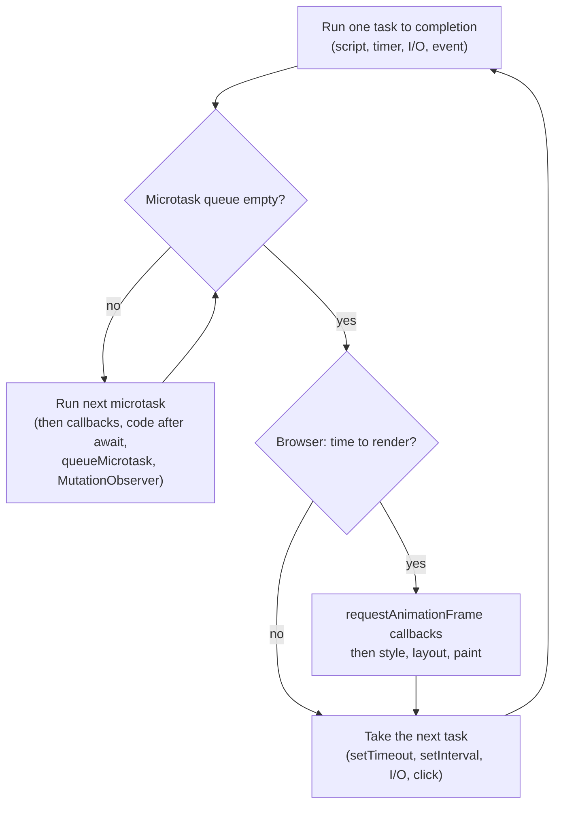

# Chapter 18 — Cheat Sheets and Glossary

This last chapter squeezes Chapters 1–17 into pages you can scan in a minute. It has one **cheat sheet** per area, a **"which API for which job"** table, a verified **ECMAScript version table** (ES2015 → ES2026), a **"where to go next"** plan, an **index of the interview questions** in Chapter 17, and an alphabetical **glossary** of 700+ terms, each linked to the section that explains it properly.

Nothing here is new. If a line doesn't make sense, follow its link back to the full explanation. The terms, acronyms and tool names used across the book (from *API* and *bytecode* to *trie* and *Zod*) each have a one-line, plain-English definition in the [glossary](#1821-glossary-az), so if a word on a sheet is new to you, look it up there first. References are written like **§12.2**, meaning Chapter 12, section 2.

**What you'll learn:** how to use this chapter as a revision tool. Read a sheet, cover the right-hand column, and try to say the answer before you look. The glossary is also a good last check before an interview: if you can't define a term in one sentence, follow its link.

Every concrete value quoted on the sheets (outputs, orderings, return values, errors thrown) is asserted by [`code/cheatsheet_checks.mjs`](code/cheatsheet_checks.mjs), which runs on Node 24 with jsdom for the DOM sheet:

```text
OK   18.1 syntax & types
OK   18.2 operators & coercion
OK   18.3 control flow
OK   18.4 functions/closures/this
OK   18.5 objects/Math/Date/JSON
OK   18.6 classes & prototypes
OK   18.7 strings & regex
OK   18.8 arrays
OK   18.9 Map/Set/iterators
OK   18.10 modules
OK   18.11 errors
OK   18.12 async & event loop
OK   18.13 DOM & events
OK   18.14 browser APIs
OK   18.15 Node core
OK   18.16 testing
      Node v24.11.1 - not yet available: Math.sumPrecise (ES2026), Uint8Array.fromBase64 (ES2026), Map#getOrInsert (ES2026), Iterator.concat (ES2026), Temporal (ES2027)
OK   18.18 versions (Node 24 availability)
all 17 cheat-sheet checks passed
```

**What's inside**

| # | Sheet | Built from |
|---|---|---|
| [18.1](#181-syntax-variables-and-types) | Syntax, variables and types | Ch 1, 2 |
| [18.2](#182-operators-and-the-coercion-table) | Operators and the coercion table | Ch 2 |
| [18.3](#183-control-flow-and-loops) | Control flow and loops | Ch 3 |
| [18.4](#184-functions-scope-closures-and-this) | Functions, scope, closures and `this` | Ch 4, 9 |
| [18.5](#185-objects-math-date-and-json) | Objects, Math, Date and JSON | Ch 5 |
| [18.6](#186-classes-and-prototypes) | Classes and prototypes | Ch 9 |
| [18.7](#187-strings-and-regular-expressions) | Strings and regular expressions | Ch 6 |
| [18.8](#188-arrays-mutating-vs-non-mutating) | Arrays: mutating vs non-mutating | Ch 7 |
| [18.9](#189-map-set-iterators-and-generators) | Map, Set, iterators and generators | Ch 8 |
| [18.10](#1810-modules-and-tooling) | Modules and tooling | Ch 10 |
| [18.11](#1811-errors-and-debugging) | Errors and debugging | Ch 11 |
| [18.12](#1812-async-and-the-event-loop) | Async and the event loop (with diagram) | Ch 12 |
| [18.13](#1813-dom-and-events) | DOM and events | Ch 13 |
| [18.14](#1814-browser-apis-and-security) | Browser APIs and security | Ch 14 |
| [18.15](#1815-nodejs-core-modules) | Node.js core modules | Ch 15 |
| [18.16](#1816-testing-and-typescript) | Testing and TypeScript | Ch 16 |
| [18.17](#1817-which-api-for-which-job) | Which API for which job | all |
| [18.18](#1818-ecmascript-versions-es2015--es2026) | ECMAScript versions ES2015 → ES2026 | Ch 1 + TC39 |
| [18.19](#1819-where-to-go-next) | Where to go next | — |
| [18.20](#1820-interview-question-index) | Interview question index | Ch 17 |
| [18.21](#1821-glossary-az) | Glossary (A–Z) | all |

---

## 18.1 Syntax, variables and types

**Running code** ([§1.5](../01-introduction-and-setup/README.md#15-setting-up-and-running-code)): the browser console, `<script defer src="app.js">` or `<script type="module">` in a page, `node file.js` / `node file.mjs`, or the Node REPL (`node` with no file).

**Basic rules** ([§1.6](../01-introduction-and-setup/README.md#16-hello-world--your-first-program-and-the-basic-rules)): case-sensitive; identifiers use letters, digits, `_` and `$` and can't start with a digit; statements end with `;` (automatic semicolon insertion exists, but never break a line straight after `return`). Comments: `//`, `/* */`, `/** JSDoc */` ([§1.7](../01-introduction-and-setup/README.md#17-comments)).

**Strict mode** ([§1.8](../01-introduction-and-setup/README.md#18-strict-mode)) is on automatically in modules and class bodies, and opt-in with `"use strict"` at the top of a script or function. It turns silent mistakes into errors:

| Mistake | Sloppy mode | Strict mode |
|---|---|---|
| `x = 1` with no declaration | creates a global | `ReferenceError` |
| `this` in a plain call `f()` | `globalThis` | `undefined` |
| Writing a frozen / read-only property | ignored | `TypeError` |
| `function f(a, a)`, `010`, `with` | allowed | `SyntaxError` |

**Declaring variables** ([§2.1](../02-variables-types-and-operators/README.md#21-variables-let-const-and-var), [§2.2](../02-variables-types-and-operators/README.md#22-hoisting-and-the-temporal-dead-zone)):

| | `const` (default choice) | `let` (when you reassign) | `var` (legacy) |
|---|---|---|---|
| Scope | block `{}` | block `{}` | function |
| Reassign | ✗ `TypeError` | ✓ | ✓ |
| Redeclare in same scope | ✗ `SyntaxError` | ✗ | ✓ silently |
| Read before its line | `ReferenceError` (TDZ) | `ReferenceError` (TDZ) | `undefined` |
| Top level of a classic script | not on `globalThis` | not on `globalThis` | becomes `globalThis.x` |

`const` stops *reassignment*, not *mutation*: `const o = { n: 1 }; o.n = 2` is fine.

**The eight types** ([§2.3](../02-variables-types-and-operators/README.md#23-data-types-and-typeof)): seven primitives plus objects.

| Value | `typeof` | Remember |
|---|---|---|
| `42`, `3.14`, `NaN`, `Infinity` | `"number"` | one 64-bit float type for all numbers |
| `10n` | `"bigint"` | whole numbers of any size; can't mix with `number` |
| `'hi'` | `"string"` | immutable UTF-16 text |
| `true` | `"boolean"` | |
| `undefined` | `"undefined"` | "not set yet" — what the language gives you |
| `null` | **`"object"`** | a historic bug; test with `x === null` |
| `Symbol('id')` | `"symbol"` | unique keys |
| `{}`, `[]`, `new Date()` | `"object"` | arrays too — use `Array.isArray` |
| `function () {}`, `class {}` | `"function"` | functions are callable objects |
| an undeclared name | `"undefined"` | `typeof` never throws, except in the TDZ |

**Primitives vs objects** ([§2.4](../02-variables-types-and-operators/README.md#24-primitives-vs-objects)): primitives are copied by value and compared by value; objects are copied as a **reference** and compared by identity, so `{} === {}` is `false` and two variables can point at one object.

---

## 18.2 Operators and the coercion table

**Arithmetic** ([§2.5](../02-variables-types-and-operators/README.md#25-arithmetic-operators)):

| Expression | Result | Why |
|---|---|---|
| `7 / 2` | `3.5` | `/` is always floating point; integer division is `Math.trunc(a / b)` |
| `-7 % 3` | `-1` | `%` is a remainder that keeps the **left** operand's sign; true modulo is `((a % n) + n) % n` → `2` |
| `2 ** 10` | `1024` | exponent (ES2016) |
| `n++` / `++n` (n = 5) | `5` / `7` | postfix returns the old value, prefix the new one |
| `1 + '2'` | `"12"` | `+` concatenates if either side is a string |
| `'5' - 2`, `'3' * '4'` | `3`, `12` | other arithmetic converts to numbers |
| `true + 1` | `2` | `true` → `1` |
| `[] + []` / `[] + {}` / `[1,2] + [3]` | `""` / `"[object Object]"` / `"1,23"` | objects become strings first |

**Equality** ([§2.6](../02-variables-types-and-operators/README.md#26-comparison-operators-and-equality)). Use `===`. The only common `==` idiom is `x == null` (true for `null` **or** `undefined`).

| Expression | `==` | Rule behind it |
|---|---|---|
| `0 == ''` | `true` | string → number (`''` → `0`) |
| `0 == '0'` | `true` | string → number |
| `'' == '0'` | `false` | both strings: compared as text — so `==` is **not transitive** |
| `false == '0'` | `true` | boolean → number first: `0 == '0'` |
| `'2' == true` | `false` | `true` → `1`, then `2 == 1` |
| `null == undefined` | `true` | they equal each other… |
| `null == 0` | `false` | …and nothing else |
| `null >= 0` | `true` | relational operators turn `null` into `0` |
| `NaN == NaN` | `false` | `NaN` equals nothing, not even itself |
| `[1] == 1`, `[] == ![]` | `true`, `true` | object → primitive (`[]` → `''` → `0`) |
| `1n == 1` | `true` | BigInt vs number compares the maths value |
| `'10' < '9'` / `'10' < 9` | `true` / `false` | two strings compare by character code; otherwise numerically |
| `Object.is(NaN, NaN)` / `Object.is(0, -0)` | `true` / `false` | `===` except for those two cases |

**Conversions** ([§2.12](../02-variables-types-and-operators/README.md#212-type-conversion-summary)):

| Value | `Number(v)` | `String(v)` | `Boolean(v)` |
|---|---|---|---|
| `''` / `' '` | `0` / `0` | `''` / `' '` | `false` / `true` |
| `'42'` / `'4px'` / `'0x1f'` | `42` / `NaN` / `31` | same text | `true` |
| `null` | `0` | `'null'` | `false` |
| `undefined` | `NaN` | `'undefined'` | `false` |
| `true` / `false` | `1` / `0` | `'true'` / `'false'` | — |
| `[]` / `[7]` / `[1,2]` | `0` / `7` / `NaN` | `''` / `'7'` / `'1,2'` | `true` (all objects) |
| `{}` | `NaN` | `'[object Object]'` | `true` |

`parseInt('08.5kg', 10)` → `8` (reads a prefix, **always pass the radix**) but `Number('08.5kg')` → `NaN` (all or nothing).

**Falsy** ([§2.11](../02-variables-types-and-operators/README.md#211-booleans-truthy-and-falsy)) — the complete list: `false`, `0`, `-0`, `0n`, `''`, `null`, `undefined`, `NaN`. Everything else is truthy, including `[]`, `{}`, `'0'`, `'false'` and `new Boolean(false)`.

**Logical operators** ([§2.7](../02-variables-types-and-operators/README.md#27-logical-operators--and-)):

| Operator | Returns | Example |
|---|---|---|
| `a && b` | `a` if falsy, else `b` | `0 && 'b'` → `0`; `'a' && 'b'` → `'b'` |
| `a \|\| b` | `a` if truthy, else `b` | `0 \|\| 'x'` → `'x'` |
| `a ?? b` | `a` unless `null`/`undefined` | `0 ?? 'x'` → `0`, `'' ?? 'x'` → `''` |
| `a?.b`, `a?.[k]`, `a?.()` | `undefined` if `a` is `null`/`undefined` | `null?.deep.prop` → `undefined` (short-circuits the whole chain) |
| `a \|\|= b`, `a &&= b`, `a ??= b` | assign only when falsy / truthy / nullish | `cfg.port ??= 8080` |

Mixing `??` with `||` or `&&` without parentheses is a `SyntaxError`.

**Numbers** ([§2.10](../02-variables-types-and-operators/README.md#210-numbers-in-depth)): `0.1 + 0.2` is `0.30000000000000004`; integers are exact only up to `Number.MAX_SAFE_INTEGER` = 2⁵³ − 1 (so `2 ** 53 === 2 ** 53 + 1` is `true`); `1 / 0` is `Infinity`; `Math.max()` is `-Infinity`. Use `Number.isNaN(x)` (the global `isNaN('abc')` converts first and says `true`), `toFixed(2)` for display (`(123.456).toFixed(2)` → `'123.46'`), integer cents for money, `BigInt` beyond 2⁵³. Numeric separators: `1_000_000`. Bitwise operators ([§2.8](../02-variables-types-and-operators/README.md#28-bitwise-and-assignment-operators)) work on 32-bit integers: `5 & 3` = 1, `5 | 3` = 7, `5 ^ 3` = 6, `~5` = −6.

**Precedence in one breath** ([§2.9](../02-variables-types-and-operators/README.md#29-operator-precedence)): member access/calls → postfix → unary (`!`, `typeof`, `await`) → `**` → `* / %` → `+ -` → shifts → `< > in instanceof` → equality → bitwise → `&&` → `|| ??` → `? :` → assignment and `=>` → comma. When unsure, add parentheses.

---

## 18.3 Control flow and loops

| Need | Use | Watch out |
|---|---|---|
| Choose between code paths | `if / else if / else` ([§3.2](../03-control-flow-and-loops/README.md#32-if-else-and-else-if)) | first truthy branch wins — order specific → general |
| Choose between two **values** | `cond ? a : b` ([§3.3](../03-control-flow-and-loops/README.md#33-the-conditional-ternary-operator)) | don't nest deeply |
| One value vs many fixed options | `switch` ([§3.4](../03-control-flow-and-loops/README.md#34-switch)) | compares with `===`; forgetting `break` **falls through**; `switch (1) { case 1: … case 2: … break }` runs both cases |
| Pure value → value mapping | lookup object or `Map` | object keys are strings |
| Count / index loop | `for (let i = 0; i < n; i++)` ([§3.6](../03-control-flow-and-loops/README.md#36-the-for-loop)) | `<` vs `<=` off-by-one |
| Unknown number of repeats | `while (cond)` ([§3.7](../03-control-flow-and-loops/README.md#37-the-while-loop)) | update the condition or it never ends |
| Run at least once | `do { } while (cond)` ([§3.8](../03-control-flow-and-loops/README.md#38-the-dowhile-loop)) | `do {…} while (false)` runs once |
| Values of an array, string, Map, Set | `for (const v of it)` ([§3.10](../03-control-flow-and-loops/README.md#310-the-forof-loop)) | plain objects aren't iterable — use `Object.entries(obj)` |
| Keys of a plain object | `for (const k in obj)` ([§3.9](../03-control-flow-and-loops/README.md#39-the-forin-loop)) | keys are **strings** (`for…in` over `['a','b']` gives `'0'`, `'1'`), includes inherited ones — avoid on arrays |
| Index and value | `for (const [i, v] of arr.entries())` | |
| Leave a loop / skip one pass | `break` / `continue` ([§3.11](../03-control-flow-and-loops/README.md#311-break-continue-and-labels)) | `forEach` can't be stopped — use `for…of`, `some`, `find` |
| Leave an **outer** loop | `outer: for (…) { for (…) { break outer; } }` | labels work with `continue outer` too |

**Closures in loops** ([§4.7](../04-functions-scope-and-closures/README.md#47-closures)): `for (var i…)` shares one `i`, so three saved callbacks all return `3`; `for (let i…)` makes a fresh binding per iteration, giving `0, 1, 2`.

---

## 18.4 Functions, scope, closures and `this`

**Forms** ([§4.1](../04-functions-scope-and-closures/README.md#41-what-a-function-is)–[§4.3](../04-functions-scope-and-closures/README.md#43-arrow-functions)):

```js
function add(a, b) { return a + b; }        // declaration: hoisted with its body
const sub = function (a, b) { return a - b; }; // expression: follows const (TDZ)
const sq = (x) => x * x;                    // arrow, implicit return
const mk = (x, y) => ({ x, y });            // returning an object literal needs ( )
(() => { /* IIFE: runs immediately */ })();
```

| | Regular `function` | Arrow `=>` |
|---|---|---|
| `this` | set by the call site | lexical — taken from where it's written; `call`/`bind` can't change it |
| `arguments` | yes | no — use `...args` |
| `new` | allowed | `TypeError` (no `prototype`) |
| Best as | object methods, constructors | callbacks, especially inside methods |

**Parameters** ([§4.4](../04-functions-scope-and-closures/README.md#44-parameters-defaults-rest-arguments-and-spread)): with `f = (a, b = 2, ...rest) => [a, b, rest]`, `f(1)` → `[1, 2, []]`; `f(1, undefined, 3, 4)` → `[1, 2, [3, 4]]`; `f(1, null)` → `[1, null, []]` — **defaults replace only `undefined`**. `fn.length` counts parameters before the first default/rest (`(a, b = 1, c) => 0` has length `1`). Use an options object for named parameters: `function f({ a = 1, b = 2 } = {})`.

**Scope and hoisting** ([§4.5](../04-functions-scope-and-closures/README.md#45-scope-global-function-and-block), [§4.6](../04-functions-scope-and-closures/README.md#46-hoisting--the-complete-picture)):

| Declaration | Before its line |
|---|---|
| `function f() {}` | callable |
| `var x` | `undefined` |
| `let` / `const` / `class` | `ReferenceError` (TDZ) |
| `var f = function…` | `undefined` → calling it is a `TypeError` |

Lookups walk the **lexical scope chain** outward from where the code is *written*; an inner name shadows an outer one.

**Closures** ([§4.7](../04-functions-scope-and-closures/README.md#47-closures)): a function keeps live access to the variables of the scope it was created in.

```js
function counter() { let c = 0; return () => ++c; }
const c1 = counter(); c1(); c1();
const c2 = counter();
c1(); // 3   - c1 has its own c
c2(); // 1   - c2 has a separate c
```

Uses: private state, factories, `once`, `memoize`, event handlers, debounce/throttle ([§17.3](../17-javascript-for-interviews/README.md#173-implement-from-scratch-classics)).

**Higher-order functions** ([§4.8](../04-functions-scope-and-closures/README.md#48-higher-order-functions-and-callbacks)): take or return functions — `map/filter/reduce`, `pipe` (left → right, `reduce`), `compose` (right → left, `reduceRight`), currying `f(a)(b)(c)`, partial application. **Recursion** ([§4.10](../04-functions-scope-and-closures/README.md#410-recursion)): base case + smaller case; too deep → `RangeError: Maximum call stack size exceeded`. **Pure functions** ([§4.11](../04-functions-scope-and-closures/README.md#411-pure-functions)): same input → same output, no side effects.

**`this` — decided at call time** ([§9.1](../09-this-prototypes-and-classes/README.md#91-this--the-call-time-context)), highest priority first:

| Call site | `this` |
|---|---|
| `new Fn()` | the new object |
| `fn.call(obj, a, b)`, `fn.apply(obj, [a, b])`, `fn.bind(obj)()` | `obj` |
| `obj.fn()` | `obj` (the thing before the dot) |
| plain `fn()` | `undefined` in strict code (`globalThis` in sloppy scripts) |
| arrow function | whatever `this` was where the arrow was written |

Checked facts: `user.hi()` → `'Ada'`, but `const lost = user.hi; lost()` → `this` is `undefined` (the method "loses" its object when passed around — fix with an arrow wrapper or `bind`). Binding twice keeps the **first** binding. `call` runs now with arguments listed, `apply` runs now with an array, `bind` returns a new function ([§9.2](../09-this-prototypes-and-classes/README.md#92-call-apply-and-bind)).

`['1', '7', '11'].map(parseInt)` → `[1, NaN, 3]`, because `map` passes `(value, index)` and `parseInt` treats the index as the radix.

---

## 18.5 Objects, Math, Date and JSON

**Objects** ([§5.1](../05-objects-math-date-and-json/README.md#51-what-an-object-is)–[§5.5](../05-objects-math-date-and-json/README.md#55-destructuring-objects)):

```js
const key = 'dyn';
const o = { b: 1, 2: 'two', a: 2, 1: 'one', [key]: 3 };   // computed key
Object.keys(o);            // ['1', '2', 'b', 'a', 'dyn'] - integer-like keys first, then insertion order
const { a, b: renamed, missing = 'def' } = o;            // 2, 1, 'def'
const merged = { ...{ x: 1, y: 1 }, ...{ y: 2 } };       // { x: 1, y: 2 } - later wins
```

| Task | Code | Note |
|---|---|---|
| Read with a fixed / dynamic key | `o.name` / `o[expr]` | brackets for spaces, dashes, variables |
| Own key? | `Object.hasOwn(o, k)` | `'toString' in {}` is `true` (inherited); `Object.hasOwn({}, 'toString')` is `false` |
| Remove | `delete o.k` | |
| List | `Object.keys / values / entries`, rebuild with `Object.fromEntries` | own, enumerable, string keys |
| Shallow copy / merge | `{ ...a, ...b }`, `Object.assign({}, a, b)` | nested objects are **shared** |
| Deep copy | `structuredClone(o)` | handles Date, Map, Set, cycles; throws on functions |
| Lock | `Object.preventExtensions` < `Object.seal` < `Object.freeze` | all **shallow**: a frozen object's nested objects stay writable |
| Prototype | `Object.create(proto)`, `Object.create(null)` for a bare dictionary | §18.6 |
| Getter / setter | `get total() {…}`, `set total(v) {…}` ([§5.7](../05-objects-math-date-and-json/README.md#57-getters-and-setters)) | keep them cheap |

Descriptors ([§5.6](../05-objects-math-date-and-json/README.md#56-object-static-methods-descriptors-and-locking)): `writable`, `enumerable`, `configurable` (+ `get`/`set`). Normal assignment makes them all `true`; `Object.defineProperty` defaults them to `false`.

**Math** ([§5.10](../05-objects-math-date-and-json/README.md#510-math)):

| Call | Result |
|---|---|
| `Math.round(2.5)` / `Math.round(-2.5)` | `3` / `-2` (halves go toward +∞) |
| `Math.floor(-1.5)` / `Math.trunc(-1.5)` / `Math.ceil(1.1)` | `-2` / `-1` / `2` |
| `Math.max(...[3, 9, 1])` | `9` (spread — `max` takes separate arguments) |
| Random int in [min, max] | `Math.floor(Math.random() * (max - min + 1)) + min` |
| Secure random | `crypto.getRandomValues`, `crypto.randomUUID()` — never `Math.random` |

**Date** ([§5.11](../05-objects-math-date-and-json/README.md#511-date)): a `Date` is milliseconds since 1970-01-01 UTC. Months are **0-based** (`new Date(2024, 0, 31)` is 31 January); `getDay()` is the weekday (0 = Sunday), `getDate()` the day of month; setters mutate and roll over (setting month 1 on 31 January gives a date in March); a date-only ISO string like `'2024-03-10'` is parsed as **UTC midnight**; `new Date(0).toISOString()` → `'1970-01-01T00:00:00.000Z'`. Show dates with `Intl.DateTimeFormat` / `toLocaleDateString`. **Temporal** reached Stage 4 in March 2026 (it goes into ES2027); it is not in Node 24, so feature-detect it.

**JSON** ([§5.12](../05-objects-math-date-and-json/README.md#512-json)):

| Input to `JSON.stringify` | Output |
|---|---|
| `{ u: undefined, f() {}, n: NaN, d: new Date(0), m: new Map([[1, 2]]) }` | `{"n":null,"d":"1970-01-01T00:00:00.000Z","m":{}}` |
| `[undefined, () => 1]` | `[null,null]` |
| `undefined` (top level) | `undefined` (not a string) |
| `{ big: 1n }` or an object with a cycle | throws `TypeError` |
| `JSON.stringify(v, null, 2)` | pretty-printed with 2-space indent |

`JSON.parse` is strict: double-quoted keys and strings only, no trailing commas, no comments (`JSON.parse("{'a':1}")` throws `SyntaxError`). A **reviver** `(key, value) => …` can turn ISO strings back into `Date`s.

---

## 18.6 Classes and prototypes

```js
class Animal {
  #secret = 's';                       // private field (ES2022)
  static count = 0;                    // static field
  static { Animal.ready = true; }      // static block, runs once
  constructor(name) { this.name = name; Animal.count++; }
  speak() { return `${this.name} makes a sound`; }   // on Animal.prototype
  get upper() { return this.name.toUpperCase(); }     // accessor
  static isAnimal(x) { return #secret in x; }        // brand check
}
class Dog extends Animal {
  speak() { return `${super.speak()} - woof`; }
}
new Dog('Rex').speak();  // 'Rex makes a sound - woof'
```

| Fact | Checked result |
|---|---|
| `Object.keys(new Dog('Rex'))` | `['name']` — methods are non-enumerable, `#private` is invisible |
| `Object.getPrototypeOf(Dog.prototype) === Animal.prototype` | `true` — `extends` links the chains |
| `Animal('x')` without `new` | `TypeError` |
| Using `this` before `super()` in a subclass constructor | `ReferenceError` |
| `typeof class {}` | `'function'` — a class is a special function |
| `Object.getPrototypeOf(Object.prototype)` | `null` — the end of every chain |
| `'toString' in Object.create(null)` | `false` — no inherited keys |

**How lookup works** ([§9.3](../09-this-prototypes-and-classes/README.md#93-prototypes-and-the-prototype-chain)): reading a missing property walks the `[[Prototype]]` chain until it finds it or reaches `null`; writing always creates an **own** property (shadowing). `Fn.prototype` is the object that *instances* of `new Fn()` get as their prototype, not `Fn`'s own prototype. `__proto__` is a legacy accessor — use `Object.getPrototypeOf`/`Object.create`.

**`new Fn(args)`** ([§9.4](../09-this-prototypes-and-classes/README.md#94-constructor-functions-and-new)): 1. create an object linked to `Fn.prototype`; 2. run `Fn` with `this` = that object; 3. return it, unless `Fn` returns a different **object** (a returned primitive is ignored).

**Type checks** ([§9.7](../09-this-prototypes-and-classes/README.md#97-instanceof-and-type-checks)): `typeof` for primitives, `Array.isArray` for arrays, `Error.isError` (ES2026) for errors, `x instanceof C` for "made by C" (walks the chain; breaks across realms), `#brand in x` inside a class, duck typing (`typeof x?.then === 'function'`) for "behaves like", `Object.prototype.toString.call(x)` → `'[object Date]'` for built-in tags.

**Design** ([§9.8](../09-this-prototypes-and-classes/README.md#98-mixins), [§9.9](../09-this-prototypes-and-classes/README.md#99-composition-vs-inheritance)): inheritance (is-a) only for stable taxonomies such as `HttpError extends Error`; composition (has-a) for most application code; mixins to share a capability between unrelated classes. TypeScript's `private` is compile-time only; JavaScript's `#private` is enforced at runtime.

---

## 18.7 Strings and regular expressions

**Strings** ([§6.2](../06-strings-and-regular-expressions/README.md#62-creating-strings)–[§6.6](../06-strings-and-regular-expressions/README.md#66-string-methods)) are immutable UTF-16 primitives. Methods always return a **new** string.

| Job | Method | Example → result |
|---|---|---|
| Interpolate / multi-line | template literal | `` `${1 + 1}` `` → `'2'` |
| Last char, out-of-range | `at(-1)`, `s[i]`, `charAt(i)` | `'Hello'.at(-1)` → `'o'`; `'Hello'[10]` → `undefined`; `charAt(10)` → `''` |
| Substring | `slice(start, end?)` (negatives OK) | `'Hello'.slice(-3)` → `'llo'`, `slice(1, 3)` → `'el'` |
| Search | `includes`, `startsWith`, `endsWith`, `indexOf` (−1 if absent) | |
| Replace first / all | `replace` / `replaceAll` | `'a-b-c'.replace('-', '+')` → `'a+b-c'`; `replaceAll` → `'a+b+c'` |
| Pad, repeat | `padStart`, `padEnd`, `repeat` | `'5'.padStart(3, '0')` → `'005'` |
| Trim | `trim`, `trimStart`, `trimEnd` | |
| Split / join | `split(sep)`, `arr.join(sep)` | `'a,b,,c'.split(',')` → `['a', 'b', '', 'c']` |
| Case | `toUpperCase`, `toLowerCase`, `toLocale…` | |
| Human ordering | `a.localeCompare(b)`, `Intl.Collator` | default `sort` gives `'Cab'` for `['b','a','C']`; with `localeCompare` → `'abC'` |

**Unicode** ([§6.5](../06-strings-and-regular-expressions/README.md#65-unicode-code-units-code-points-and-graphemes)): `length` counts 16-bit code units — `'😀'.length` is `2`, `[...'😀'].length` is `1` (code points), and a family emoji `'👩‍👩‍👧'` is one grapheme to `Intl.Segmenter`. Normalize with `normalize('NFC')` before comparing accented text.

**Regex syntax** ([§6.7](../06-strings-and-regular-expressions/README.md#67-regular-expressions-the-pattern-language)):

| Piece | Meaning |
|---|---|
| `.` `\d` `\w` `\s` (`\D` `\W` `\S`) | any char (not newline) / digit / word char / whitespace (and complements) |
| `[abc]` `[^abc]` `[a-z]` | class / negated class / range |
| `*` `+` `?` `{n,m}` | 0+ / 1+ / 0–1 / n to m — **greedy**; add `?` for lazy |
| `^` `$` `\b` | start / end / word boundary |
| `( )` `(?<name> )` `(?: )` | capture / named capture / group only |
| `(?= )` `(?! )` `(?<= )` `(?<! )` | lookahead / negative lookahead / lookbehind / negative lookbehind |
| `\1`, `\k<name>` | backreference |
| `\p{L}` (with `u` or `v`) | any letter in any script |
| Flags | `g` all, `i` ignore case, `m` multiline anchors, `s` dot matches newline, `u` Unicode, `v` Unicode sets, `y` sticky, `d` indices |

**Regex methods** ([§6.8](../06-strings-and-regular-expressions/README.md#68-regex-methods-and-techniques)):

| Call | Result |
|---|---|
| `/^\d{3}-\d{4}$/.test('555-1234')` | `true` |
| `'x'.match(/y/)` | `null` (not `[]`) |
| `'a1b22'.match(/\d+/g)` | `['1', '22']` |
| `'2024-03-10'.match(/(?<y>\d{4})-…/).groups.y` | `'2024'` |
| `'2024-03-10'.replace(/(\d+)-(\d+)-(\d+)/, '$3/$2/$1')` | `'10/03/2024'` |
| `[...'a1b2'.matchAll(/\d/g)].map(m => m.index)` | `[1, 3]`; `matchAll` without `g` throws `TypeError` |
| `'<b>x</b>'.replace(/<.+>/, '')` vs `/<.+?>/` | `''` (greedy) vs `'x</b>'` (lazy) |
| `/a/g.test('aa')` then `lastIndex` | `1` — a `g` regex remembers its position between calls |
| `new RegExp(RegExp.escape(userText))` | matches the text literally (ES2025) |

Prefer plain string methods for fixed text and real parsers (`URL`, `JSON.parse`, `DOMParser`) for structured formats ([§6.9](../06-strings-and-regular-expressions/README.md#69-modern-regex-features-and-practical-recipes)).

---

## 18.8 Arrays: mutating vs non-mutating

✎ = changes the original array ([§7.4](../07-arrays/README.md#74-the-methods-table-mutating-vs-non-mutating)).

| Mutates ✎ | Returns | Copying twin / alternative (leaves the original alone) |
|---|---|---|
| `push(x)` / `pop()` | new length / removed item | `[...arr, x]` / `arr.slice(0, -1)` |
| `unshift(x)` / `shift()` | new length / removed item | `[x, ...arr]` / `arr.slice(1)` |
| `splice(i, n, ...items)` | array of **removed** items | `toSpliced(i, n, ...items)` (ES2023) |
| `sort(cmp)` | the **same** array | `toSorted(cmp)` (ES2023) |
| `reverse()` | the same array | `toReversed()` (ES2023) |
| `arr[i] = x` | — | `with(i, x)` (ES2023; negative `i` OK, out of range → `RangeError`) |
| `fill(v, s, e)`, `copyWithin(t, s, e)` | the same array | `Array.from` / `map` |
| `arr.length = n` | truncates | `slice(0, n)` |

Never mutated: `slice`, `concat`, `map`, `filter`, `reduce`, `flat`, `flatMap`, `find*`, `some`, `every`, `includes`, `indexOf`, `at`, `join`, `keys/values/entries`, spread.

**Checked behaviours:** `const s = arr.sort(); s === arr` → `true`; `[1].push(2)` → `2` (not the array); `[10, 1, 2].sort()` → `[1, 10, 2]` (default sort compares **strings**) but `.sort((a, b) => a - b)` → `[1, 2, 10]`; `[3, 1, 2].toSorted()` → `[1, 2, 3]` with the original unchanged.

**Iteration methods** ([§7.5](../07-arrays/README.md#75-iteration-methods-map-filter-reduce-and-friends)):

| Want | Method | Checked example |
|---|---|---|
| Transform each | `map` | |
| Keep some | `filter` | |
| Fold to one value | `reduce(fn, init)` | `[1,2,3].reduce((s, x) => s + x, 0)` → `6`; `[].reduce(fn)` with no init → `TypeError` |
| First match / its index | `find` / `findIndex` | `find(x => x > 1)` → `2`; `findIndex(x => x > 5)` → `-1` |
| Last match | `findLast` / `findLastIndex` (ES2023) | `findLast(x => x > 1)` → `3` |
| Any / all | `some` / `every` | `[].every(…)` → `true` (vacuous truth) |
| Contains | `includes` | `[NaN].includes(NaN)` → `true`, `[NaN].indexOf(NaN)` → `-1` |
| Flatten | `flat(depth = 1)`, `flatMap` | `[1,[2,[3,[4]]]].flat()` → `[1,2,[3,[4]]]`; `flat(Infinity)` → `[1,2,3,4]` |
| Side effects only | `forEach` / `for…of` | `forEach` can't `break` or `await` |

**Sorting** ([§7.6](../07-arrays/README.md#76-sorting-correctly)): numbers `(a, b) => a - b`; text `a.localeCompare(b)`; several keys chained with `||`: `(p, q) => p.age - q.age || p.name.localeCompare(q.name)`. `sort` is stable (guaranteed since ES2019).

**Creating and destructuring** ([§7.2](../07-arrays/README.md#72-creating-arrays), [§7.7](../07-arrays/README.md#77-spread-rest-and-destructuring-with-arrays)): `Array.from({ length: 3 }, (_, i) => i * 2)` → `[0, 2, 4]`; `Array.of(3)` → `[3]` but `new Array(3)` has length 3 and holes; `Array(2).fill([])` puts the **same** inner array in both slots. `[x, y] = [y, x]` swaps; `const [first, , third = 'd', ...others] = [1, 2, undefined, 4, 5]` → `1`, `'d'`, `[4, 5]`. `join` turns `null`/`undefined` into empty strings.

**Immutable updates (React/Redux style):** add `[...arr, x]`; insert `arr.toSpliced(i, 0, x)`; remove by id `arr.filter(t => t.id !== id)`; replace `arr.with(i, x)`; update one `arr.map(t => t.id === id ? { ...t, done: true } : t)`.

**Which collection** ([§7.8](../07-arrays/README.md#78-arrays-vs-objects-vs-mapset)): array for ordered lists, object for fixed-shape records, `Map` for dynamic keyed lookup, `Set` for uniqueness. **Typed arrays** ([§7.9](../07-arrays/README.md#79-typed-arrays-a-short-note)) hold fixed-size binary numbers over an `ArrayBuffer`; values wrap (`new Uint8Array([256, 257])` → `[0, 1]`).

---
## 18.9 Map, Set, iterators and generators

**`Map`** ([§8.1](../08-maps-sets-iterators-and-generators/README.md#81-map)) — keys of any type, insertion order, `size`:

```js
const m = new Map([[1, 'num'], ['1', 'str']]);   // 1 and '1' are different keys
m.set({}, 'obj').set(NaN, 'nan');                 // set() returns the map, so it chains
m.get(NaN);            // 'nan' - keys compare with SameValueZero
JSON.stringify(m);     // '{}'  - convert first: Object.fromEntries(m) or [...m]
for (const [k, v] of m) { /* insertion order */ }
```

**`Set`** ([§8.2](../08-maps-sets-iterators-and-generators/README.md#82-set)) — unique values, O(1) `has`: `[...new Set([3, 1, 3, 2, 1])]` → `[3, 1, 2]` (dedupe, first-seen order). ES2025 set algebra, with A = {1,2,3} and B = {2,3,4}:

| Method | Result |
|---|---|
| `A.union(B)` | {1, 2, 3, 4} |
| `A.intersection(B)` | {2, 3} |
| `A.difference(B)` | {1} |
| `A.symmetricDifference(B)` | {1, 4} |
| `A.isSubsetOf(B)`, `isSupersetOf`, `isDisjointFrom` | booleans |

| Use | When |
|---|---|
| `Map` | dynamic dictionaries, counting, caches (an LRU cache is one `Map`), non-string keys |
| plain object | fixed-shape records, config, JSON |
| `Set` | membership tests, dedupe, visited sets in BFS/DFS |
| `WeakMap` / `WeakSet` ([§8.3](../08-maps-sets-iterators-and-generators/README.md#83-weakmap-weakset-weakref-and-finalizationregistry)) | data attached to objects you don't own; entries vanish with the key object; no `size`, no iteration |
| `WeakRef` / `FinalizationRegistry` | advanced caches; GC timing is never guaranteed |

**Iteration protocol** ([§8.4](../08-maps-sets-iterators-and-generators/README.md#84-iterators-and-the-iterable-protocol)): an **iterable** has a `[Symbol.iterator]()` method returning an **iterator**, an object whose `next()` returns `{ value, done }`. Arrays, strings, Maps, Sets, typed arrays, NodeLists and generators are iterable; plain objects are not (`[...{ a: 1 }]` → `TypeError`). Consumers: `for…of`, spread, array destructuring, `Array.from`, `new Map/Set`, `Promise.all`, `yield*`.

**Generators** ([§8.5](../08-maps-sets-iterators-and-generators/README.md#85-generators)):

```js
function* nat() { let n = 1; while (true) yield n++; }   // infinite, lazy
nat().next();                          // { value: 1, done: false }
const iterable = { *[Symbol.iterator]() { yield 1; yield 2; } };
[...iterable];                         // [1, 2]
function* two() { yield 'a'; return 'r'; }
[...two()];                            // ['a'] - the return value is not iterated
```

**Iterator helpers** (ES2025, [§8.6](../08-maps-sets-iterators-and-generators/README.md#86-iterator-helpers-es2025)) are lazy: `nat().filter(n => n % 2).map(n => n * n).take(3).toArray()` → `[1, 9, 25]`. Arrays need `.values()` first; `Iterator.from(x)` wraps custom iterators.

**Grouping** (ES2024, [§8.7](../08-maps-sets-iterators-and-generators/README.md#87-grouping-objectgroupby-and-mapgroupby-es2024)): `Object.groupBy([1,2,3,4], n => n % 2 ? 'odd' : 'even')` → `{ odd: [1, 3], even: [2, 4] }` (a null-prototype object); `Map.groupBy` when keys aren't strings.

**Async iteration** ([§12.12](../12-asynchronous-javascript/README.md#1212-async-iteration-for-awaitof-and-async-generators)): `async function*` + `for await (const page of pages())`; `await Array.fromAsync(pages())` (ES2026) collects them.

---

## 18.10 Modules and tooling

```js
// math.mjs
export const PI = 3.14;                 // named export
export function area(r) { return PI * r * r; }
export default class Circle {}          // one default per module
// app.mjs
import Circle, { area, PI as pi } from './math.mjs';
import * as math from './math.mjs';     // namespace object: math.area, math.default
export { area } from './math.mjs';      // re-export (barrel file)
const { heavy } = await import('./heavy.mjs');  // dynamic import -> promise, code splitting
import data from './data.json' with { type: 'json' };  // JSON module (ES2025)
```

| ES module fact ([§10.3](../10-modules-and-tooling/README.md#103-how-es-modules-load)) | Consequence |
|---|---|
| Loads in 3 phases: parse → link → evaluate | imports are hoisted; a missing export fails before any code runs |
| Imports are **live, read-only bindings** | you see the exporter's updates; you can't assign to them |
| Each module is evaluated **once** (singleton) | module-level state is shared by every importer |
| Always strict; top-level `this` is `undefined` | checked by the sheet script |
| Top-level `await` allowed ([§10.5](../10-modules-and-tooling/README.md#105-top-level-await)) | importers wait for it |
| `import.meta.url`, `import.meta.dirname` / `filename` (Node) ([§10.6](../10-modules-and-tooling/README.md#106-importmeta-and-json-modules)) | replace CommonJS `__dirname` / `__filename` |

**CommonJS vs ESM in Node** ([§10.8](../10-modules-and-tooling/README.md#108-commonjs-vs-es-modules-in-node)): `.mjs` = ESM, `.cjs` = CommonJS, `.js` follows `"type"` in the nearest `package.json`. CommonJS uses `require()` / `module.exports`, loads synchronously, has `__dirname`. ESM can import CommonJS (default import = `module.exports`); since Node 22.12 / 20.19, CommonJS can `require()` an ES module unless it uses top-level `await` (`ERR_REQUIRE_ASYNC_MODULE`). **Browsers** ([§10.7](../10-modules-and-tooling/README.md#107-modules-in-the-browser)): `<script type="module">` is deferred, strict, needs CORS and a server (not `file://`); import maps resolve bare names.

**npm** ([§10.9](../10-modules-and-tooling/README.md#109-npm-and-packagejson), [§10.10](../10-modules-and-tooling/README.md#1010-semantic-versioning-ranges-and-lockfiles)):

| Item | Meaning |
|---|---|
| `dependencies` / `devDependencies` / `peerDependencies` | needed at runtime / only to build and test / "use the host's copy" |
| `^1.2.3` | ≥1.2.3 <2.0.0 (npm's default) |
| `~1.2.3` | ≥1.2.3 <1.3.0 |
| `^0.2.3` | ≥0.2.3 <0.3.0 (caret is stricter below 1.0) |
| `package-lock.json` | commit it; CI runs `npm ci` (exact, clean install) |
| `npx tool`, `npm run x`, `node --run x` | run a package binary / a script |

**Tools** ([§10.11](../10-modules-and-tooling/README.md#1011-bundlers)–[§10.13](../10-modules-and-tooling/README.md#1013-linters-and-formatters)): bundlers (Vite, esbuild, webpack, Rollup/Rolldown) do resolution, tree shaking, code splitting, minification, source maps and HMR. **Transpile syntax, polyfill APIs**: a transpiler rewrites new syntax for old engines; a polyfill adds missing built-ins. ESLint finds bugs (flat config `eslint.config.js`); Prettier formats.

---

## 18.11 Errors and debugging

| Error type ([§11.1](../11-errors-and-debugging/README.md#111-errors-and-the-built-in-error-types)) | Checked trigger |
|---|---|
| `TypeError` | `null.length`, calling a non-function, `1n + 1`, assigning to a `const` |
| `ReferenceError` | undeclared name, TDZ access |
| `SyntaxError` | `JSON.parse('{bad}')`, bad code in `eval`/`new Function` |
| `RangeError` | `new Array(-1)`, `(1).toFixed(101)`, stack overflow |
| `URIError` | `decodeURIComponent('%')` |
| `AggregateError` | `Promise.any` when all reject — `.errors` holds them |

```js
class ValidationError extends Error {                 // §11.3
  constructor(msg, opts) { super(msg, opts); this.name = 'ValidationError'; this.code = 'E_VALID'; }
}
try {
  save();
} catch (err) {
  if (!(err instanceof ValidationError)) throw err;   // catch narrowly, rethrow the rest
  throw new Error('save failed', { cause: err });     // §11.4 error chaining
} finally {
  release();                                          // always runs; never return from it
}
```

Rules: always throw `Error` objects (they carry a `stack`); `String(err)` → `'ValidationError: save failed'`; a `return` in `try` still runs `finally` first; `catch {}` without a binding is legal (ES2019) but never swallow errors silently. **`try/catch` is synchronous**: it catches a rejected `await` inside an `async` function, but not an error thrown later in a timer callback ([§11.5](../11-errors-and-debugging/README.md#115-errors-in-asynchronous-code-preview)). Global last-resort handlers: browser `error` / `unhandledrejection` events; Node `uncaughtException` / `unhandledRejection` — log, then exit. `using` + `Symbol.dispose` gives automatic cleanup ([§11.6](../11-errors-and-debugging/README.md#116-guaranteed-cleanup-finally-and-using); finished proposal, edition ES2027).

**Debugging** ([§11.7](../11-errors-and-debugging/README.md#117-the-console-toolbox)–[§11.9](../11-errors-and-debugging/README.md#119-debugging-with-devtools-and-the-node-inspector)): `console.table`, `dir`, `group`, `count`, `time`/`timeEnd`, `trace`, `assert` (logs, doesn't throw). Stack traces list the newest frame first; source maps map bundled code back to your files. Breakpoints (conditional, logpoints, pause on exceptions), step over / into / out, Scope and Watch panes; `debugger;` statement; Node: `node --inspect` then `chrome://inspect`. Method: reproduce → read the message → hypothesize → inspect → fix the root cause → add a test. Common messages decoded: [§11.10](../11-errors-and-debugging/README.md#1110-common-runtime-errors--a-field-guide).

---

## 18.12 Async and the event loop



*Figure — one turn of the event loop: one task, then **all** microtasks, then maybe a render ([§12.2](../12-asynchronous-javascript/README.md#122-the-event-loop)).*

**The ordering rule** ([§12.3](../12-asynchronous-javascript/README.md#123-ordering-puzzles)): synchronous code first (including promise executors and an async function's body up to its first `await`), then microtasks in FIFO order, then the next task.

```js
log('A');
setTimeout(() => log('B timeout'), 0);
Promise.resolve().then(() => log('C then')).then(() => log('D then2'));
queueMicrotask(() => log('M micro'));
new Promise((res) => { log('P executor'); res(); });
(async () => { log('F before await'); await null; log('F after await'); })();
log('E');
// A, P executor, F before await, E, C then, M micro, F after await, D then2, B timeout
```

**Node extras** ([§12.4](../12-asynchronous-javascript/README.md#124-nodes-event-loop-nexttick-setimmediate-and-phases)): phases timers → pending → poll (I/O) → check (`setImmediate`) → close. Inside a callback, `process.nextTick` runs before promise microtasks, and both run before `setImmediate` — checked order: `nextTick, promise, immediate`.

**Promises** ([§12.7](../12-asynchronous-javascript/README.md#127-promises), [§12.8](../12-asynchronous-javascript/README.md#128-promise-combinators-all-allsettled-race-any)): pending → fulfilled or rejected, settle **once**; `then` returns a new promise, so always `return` inside it and end the chain with `catch`.

| Combinator | Fulfils when | Rejects when | Checked |
|---|---|---|---|
| `Promise.all` | all fulfil — values in **input order** | first rejection | `[ok(1, 5ms), ok(2, 1ms)]` → `[1, 2]` |
| `Promise.allSettled` | all settle | never | statuses `['fulfilled', 'rejected']` |
| `Promise.race` | first to **settle** fulfils | first to settle rejects | fastest wins |
| `Promise.any` | first to **fulfil** | all reject → `AggregateError` | skips a rejection |
| `Promise.withResolvers()` (ES2024) | `{ promise, resolve, reject }` | | |
| `Promise.try(fn)` (ES2025) | a sync throw becomes a rejection | | |

None of the combinators cancel the losing operations.

**async/await** ([§12.9](../12-asynchronous-javascript/README.md#129-async--await)): an `async` function always returns a promise; `await` unwraps it and **throws** on rejection (so `try/catch` works). Two independent awaits one after another take the sum of their times (checked: ~80 ms); `await Promise.all([...])` takes the longest (~40 ms). `arr.forEach(async …)` doesn't wait — use `for…of` (one at a time) or `Promise.all(arr.map(async …))` (all at once). Use `return await` inside `try` so the `catch` sees the rejection.

**Timers** ([§12.5](../12-asynchronous-javascript/README.md#125-timers)): delays are minimums; nested timers clamp to 4 ms in browsers; delays above 2³¹ − 1 ms overflow; prefer recursive `setTimeout` to `setInterval` for polling. **Cancellation** ([§12.11](../12-asynchronous-javascript/README.md#1211-cancellation-abortcontroller-and-abortsignal)): `const ac = new AbortController(); fetch(url, { signal: ac.signal }); ac.abort()`; `AbortSignal.timeout(ms)`; `AbortSignal.any([...])`. **Patterns** ([§12.13](../12-asynchronous-javascript/README.md#1213-real-world-async-patterns)): retry with exponential backoff + jitter, concurrency limits, last-request-wins, debounce/throttle.

---

## 18.13 DOM and events

| Task | API ([§13.1](../13-dom-and-events/README.md#131-the-dom-tree)–[§13.4](../13-dom-and-events/README.md#134-attributes-properties-classes-data-and-styles)) |
|---|---|
| Find one / many | `document.getElementById('id')`, `el.querySelector(css)` / `querySelectorAll(css)` (static `NodeList`) |
| Live collections | `getElementsByTagName` / `ByClassName` — update automatically (checked: after appending an `<li>`, the live list has 2 items, the static one still 1) |
| Relatives | `el.closest(css)` (self or ancestor), `el.matches(css)`, `parent.contains(node)`, `children`, `nextElementSibling` |
| Create and insert | `document.createElement('li')`, `append`, `prepend`, `before`, `after`, `replaceWith`, `remove`, `replaceChildren`; `DocumentFragment` / `<template>` for bulk |
| Text vs HTML | `el.textContent = userText` (never parsed — `'<b>safe</b>'` shows as text); `innerHTML` only for trusted markup (XSS risk) |
| Classes, data, style | `classList.add/remove/toggle/contains`, `el.dataset.id` (from `data-id`, always a string), `el.style.x` (inline), `getComputedStyle(el)` (final) |
| Attribute vs property | `input.getAttribute('value')` = initial HTML value; `input.value` = current value |

**Events** ([§13.5](../13-dom-and-events/README.md#135-events-and-listeners)–[§13.8](../13-dom-and-events/README.md#138-default-actions-and-preventdefault)):

```js
list.addEventListener('click', (e) => {          // one listener for all items (delegation)
  const item = e.target.closest('li');           // target = where it started
  if (!item || !list.contains(item)) return;
  console.log(item.dataset.id, e.currentTarget); // currentTarget = list (the listener's element)
}, { signal: controller.signal });                // options: once, passive, capture, signal
```

| Fact | Checked |
|---|---|
| Propagation: capture (window → target), target, bubble (target → window) | order: `body capture`, `delegated 7`, `body bubble target=BUTTON current=BODY` |
| `new Event('ping')` doesn't bubble | parent heard 0; with `{ bubbles: true }` → 1 |
| `{ once: true }` | handler ran once for two clicks |
| `e.preventDefault()` | cancels the default action (link navigation, form submit); `e.defaultPrevented` → `true` |
| `stopPropagation()` | stops the journey — use rarely |
| `dispatchEvent` | runs listeners **synchronously** |

**Forms** ([§13.9](../13-dom-and-events/README.md#139-forms)): listen for `submit`, call `preventDefault()`, read `new FormData(form)` (`getAll('t')` → `['a', 'b']` for repeated names), check `input.validity` / `setCustomValidity`, use `form.requestSubmit()`; always validate again on the server. **Watch changes**: `MutationObserver` ([§13.10](../13-dom-and-events/README.md#1310-watching-the-dom-mutationobserver)). **Performance** ([§13.11](../13-dom-and-events/README.md#1311-rendering-performance-reflow-repaint-and-layout-thrashing)): batch all layout reads, then all writes (interleaving them causes **layout thrashing**); animate `transform`/`opacity`; use `requestAnimationFrame`. **Script timing** ([§13.12](../13-dom-and-events/README.md#1312-when-scripts-run-domcontentloaded-load-and-defer)): `defer` and modules run after parsing, in order, before `DOMContentLoaded`; `async` runs whenever downloaded; `load` waits for images and styles.

---

## 18.14 Browser APIs and security

**fetch** ([§14.1](../14-browser-apis-and-security/README.md#141-fetch-and-http)):

```js
async function getJSON(url, { timeout = 5000 } = {}) {
  const res = await fetch(url, { signal: AbortSignal.timeout(timeout),
                                 headers: { Accept: 'application/json' } });
  if (!res.ok) throw new Error(`HTTP ${res.status}`);   // fetch resolves on 404/500!
  return res.json();                                    // the body can be read only once
}
await fetch('/api/items', { method: 'POST',
  headers: { 'Content-Type': 'application/json' }, body: JSON.stringify(item) });
```

`fetch` rejects only on network failure or abort; a 404 `Response` has `ok === false`. Reading a body twice throws `TypeError`.

**URL** ([§14.6](../14-browser-apis-and-security/README.md#146-url-and-urlsearchparams)): `new URL('https://shop.example.com:8443/search?q=red shoes')` → `.origin` = `'https://shop.example.com:8443'`, `.searchParams.get('q')` = `'red shoes'`; after `set('page','3')` and `append('tag','a&b')` the search string is `'?q=red+shoes&page=3&tag=a%26b'` (encoding done for you). `new URL('../img/a.png', 'https://x.dev/app/page/')` resolves to `https://x.dev/app/img/a.png`; `new URL('not a url')` throws `TypeError` (a cheap validator). `encodeURIComponent('a b&c')` → `'a%20b%26c'`.

**Storage** ([§14.3](../14-browser-apis-and-security/README.md#143-web-storage-localstorage-and-sessionstorage), [§14.4](../14-browser-apis-and-security/README.md#144-cookies-and-indexeddb--choosing-storage)):

| | Cookie | `localStorage` | `sessionStorage` | IndexedDB |
|---|---|---|---|---|
| Size | ~4 KB | ~5 MB | ~5 MB | large |
| API | strings, sync | strings, sync (`setItem('n', 42)` stores `'42'`; missing → `null`) | same, per tab | async, structured data |
| Sent to server | automatically | no | no | no |
| Use for | session ID (`HttpOnly; Secure; SameSite`) | preferences | wizard state | offline data, big caches |

Never put tokens or secrets in `localStorage` — any script on the page can read it.

**Other APIs**: `requestAnimationFrame` for visual updates, once per frame, paused in background tabs ([§14.5](../14-browser-apis-and-security/README.md#145-timers-and-requestanimationframe)); History API `pushState` / `replaceState` + `popstate` for SPA routing ([§14.7](../14-browser-apis-and-security/README.md#147-the-history-api)); Web Workers for CPU work off the main thread, talking via `postMessage` + structured clone ([§14.8](../14-browser-apis-and-security/README.md#148-web-workers)); `IntersectionObserver` (visibility, lazy loading) and `ResizeObserver` (element size) ([§14.9](../14-browser-apis-and-security/README.md#149-intersectionobserver-and-resizeobserver)). `structuredClone` copies Dates and Maps but throws `DataCloneError` on functions.

**Security** ([§14.2](../14-browser-apis-and-security/README.md#142-the-same-origin-policy-and-cors), [§14.10](../14-browser-apis-and-security/README.md#1410-cross-site-scripting-xss-and-sanitizing)–[§14.12](../14-browser-apis-and-security/README.md#1412-content-security-policy-csp)):

| Threat / rule | Remember |
|---|---|
| **Origin** | scheme + host + port; the browser lets a page *send* anywhere but *read* only same-origin responses |
| **CORS** | the **server** opts in with `Access-Control-Allow-Origin`; non-simple requests get an `OPTIONS` preflight; `*` can't be combined with credentials |
| **XSS** | treat data as text (`textContent`), escape by context (`<` → `&lt;`), sanitize HTML with DOMPurify, allow-list URL schemes, CSP, `HttpOnly` cookies |
| **CSRF** | `SameSite` cookies + CSRF token or `Origin` check; GET must never change state; CORS is not a CSRF defence |
| **CSP** | `Content-Security-Policy: default-src 'self'; script-src 'self'; object-src 'none'; frame-ancestors 'none'` — blocks inline scripts and clickjacking |
| **Other headers** | HSTS, `X-Content-Type-Options: nosniff`, `Referrer-Policy`, `Permissions-Policy` |
| **Supply chain** | lockfiles, `npm audit`, few dependencies, Subresource Integrity for CDN scripts |

---

## 18.15 Node.js core modules

Node = V8 + **libuv** (event loop, async I/O, a 4-thread pool for fs, DNS lookup, crypto, zlib) + core modules ([§15.1](../15-nodejs-basics/README.md#151-what-nodejs-is), [§15.2](../15-nodejs-basics/README.md#152-the-event-loop-the-thread-pool-and-blocking)). Import built-ins with the `node:` prefix. Never block the loop; move CPU-heavy work to `worker_threads`.

| Module | Everyday calls | Checked / remember |
|---|---|---|
| `node:fs/promises` ([§15.4](../15-nodejs-basics/README.md#154-files-with-nodefspromises)) | `readFile(p, 'utf8')`, `writeFile`, `appendFile`, `mkdir(p, { recursive: true })`, `readdir`, `stat`, `rm(p, { recursive: true, force: true })` | branch on `err.code` (`'ENOENT'`); don't check-then-act |
| `node:path` ([§15.5](../15-nodejs-basics/README.md#155-paths-and-file-urls-nodepath-nodeurl)) | `join`, `resolve`, `basename`, `extname`, `dirname`, `parse`, `relative` | `join('/srv','app','..','data')` → `/srv/data`; `extname('price.test.mjs')` → `.mjs` |
| `node:url` | `fileURLToPath(import.meta.url)`, `pathToFileURL` | or `import.meta.dirname` |
| `process` ([§15.6](../15-nodejs-basics/README.md#156-process-arguments-environment-and-exit-codes)) | `argv`, `env`, `exitCode`, `cwd()`, `on('SIGTERM')` | `process.env.X = 5` reads back `'5'` — env values are strings; `--env-file=.env` |
| `node:util` | `parseArgs`, `promisify`, `inspect` | `parseArgs` on `['--port','8080','file.txt']` → `port: '8080'`, positionals `['file.txt']` |
| `Buffer` ([§15.7](../15-nodejs-basics/README.md#157-buffer-raw-bytes)) | `Buffer.from(str)`, `.toString('hex' / 'base64')` | `Buffer.from('é').length` → `2` bytes, `'é'.length` → `1` |
| `node:events` ([§15.8](../15-nodejs-basics/README.md#158-events-eventemitter)) | `on`, `once`, `off`, `emit`; `events.once(em, name)` → promise | `emit` is **synchronous**; an unhandled `'error'` event throws |
| `node:stream` ([§15.9](../15-nodejs-basics/README.md#159-streams)) | Readable, Writable, Duplex, Transform; `pipeline` from `node:stream/promises` | `pipeline` handles **backpressure** and errors |
| `node:http` ([§15.10](../15-nodejs-basics/README.md#1510-building-an-http-server-with-nodehttp)) | `createServer((req, res) => { … res.end() })`, `listen(0)` in tests | always end the response; limit body size |
| `node:child_process` ([§15.11](../15-nodejs-basics/README.md#1511-child-processes-and-npm-scripts)) | `execFile(cmd, args)`, `spawn` | pass argument arrays — no shell injection |
| `node:test`, `node:assert/strict` | §18.16 | |

**Flags** ([§15.12](../15-nodejs-basics/README.md#1512-everyday-node-flags-and-node-vs-deno-vs-bun)): `--watch`, `--env-file`, `--run`, `--test`, `--inspect`, `--permission`; `node app.ts` strips types (no type check). **Alternatives**: Deno (secure by default, V8) and Bun (JavaScriptCore, fast tooling); Node stays the default choice.

---

## 18.16 Testing and TypeScript

```js
// price.test.mjs - run with: node --test
import { test, describe, beforeEach } from 'node:test';
import assert from 'node:assert/strict';
import { applyDiscount } from './price.mjs';

describe('applyDiscount', () => {
  test('takes 10 percent off', () => assert.equal(applyDiscount(100, 10), 90));
  test('rejects negative percentages', () => assert.throws(() => applyDiscount(100, -1), RangeError));
  test('async loader rejects', async () => { await assert.rejects(load('bad'), /not found/); });
  test('calls the logger once', (t) => {
    const log = t.mock.fn();                      // spy, auto-restored
    applyDiscount(100, 10, { log });
    assert.equal(log.mock.callCount(), 1);
  });
});
```

| Assertion ([§16.2](../16-testing-and-typescript/README.md#162-assertions-with-nodeassertstrict)) | Passes when | Checked |
|---|---|---|
| `equal(a, b)` | `Object.is(a, b)` — same primitive or same object | `equal({a:1}, {a:1})` fails |
| `deepEqual(a, b)` | same structure, type-strict | `{a:1}` vs `{a:'1'}` fails |
| `throws(fn, Class \| /regex/)` | `fn()` throws a match | |
| `await rejects(promise, …)` | the promise rejects — **must be awaited** | |
| `match(str, /re/)` | regex matches | |

**`node:test`** ([§16.3](../16-testing-and-typescript/README.md#163-writing-and-running-tests-with-nodetest)–[§16.6](../16-testing-and-typescript/README.md#166-snapshot-tests-and-code-coverage)): `test`/`it`, `describe`, hooks `before`/`beforeEach`/`afterEach`/`after`, `skip`/`todo`/`only`; `node --test` (finds `*.test.*`), `--watch`, `--test-name-pattern`; `t.mock.fn` / `t.mock.method` spies; fake timers `t.mock.timers.enable()` + `tick(ms)`; snapshots; `--experimental-test-coverage`. Test pyramid: many unit, some integration, few end-to-end (Playwright). Vitest/Jest use `expect(x).toBe(y)` ([§16.7](../16-testing-and-typescript/README.md#167-good-tests-and-other-runners)).

**TypeScript** ([§16.8](../16-testing-and-typescript/README.md#168-typescript-what-it-is-and-how-its-checked)–[§16.13](../16-testing-and-typescript/README.md#1613-classes-as-const-satisfies-and-enums)):

```ts
type Shape = { kind: 'circle'; r: number } | { kind: 'rect'; w: number; h: number }; // discriminated union
function area(s: Shape): number {
  switch (s.kind) {                                  // narrowing by discriminant
    case 'circle': return Math.PI * s.r ** 2;
    case 'rect': return s.w * s.h;
    default: { const never: never = s; return never; }   // exhaustive check
  }
}
function first<T>(xs: readonly T[]): T | undefined { return xs[0]; }   // generic
const ROLES = ['admin', 'user'] as const;            // readonly literal tuple
type Role = (typeof ROLES)[number];                  // 'admin' | 'user'
```

| Concept | One line |
|---|---|
| Types are erased | nothing is checked at runtime — validate JSON with a schema (e.g. Zod) |
| Structural typing | shapes match, names don't matter |
| `unknown` vs `any` | `unknown` must be narrowed before use; `any` switches checking off |
| Narrowing | `typeof`, `instanceof`, `in`, discriminant property, type predicates `x is T`, `asserts` functions |
| Utility types | `Partial`, `Required`, `Readonly`, `Pick`, `Omit`, `Record`, `ReturnType`, `Parameters`, `Awaited`, `NonNullable` |
| `interface` vs `type` | both describe objects; `type` also does unions/tuples; interfaces merge |
| `satisfies` | checks a value against a type without widening it |
| Running | `tsc --noEmit` type-checks; `node file.ts` only strips erasable syntax (no `enum`, no parameter properties) |
| JSDoc | `// @ts-check` + `/** @param {number} x */` type-checks plain `.js` files ([§16.15](../16-testing-and-typescript/README.md#1615-jsdoc-types-typescript-checking-for-plain-javascript)) |

---
## 18.17 Which API for which job

| Job | Reach for | Not | See |
|---|---|---|---|
| Default variable | `const` (`let` if reassigned) | `var` | [§2.1](../02-variables-types-and-operators/README.md#21-variables-let-const-and-var) |
| Compare values | `===`, `Object.is` for `NaN`/`-0` | `==` (except `x == null`) | [§2.6](../02-variables-types-and-operators/README.md#26-comparison-operators-and-equality) |
| Default for a missing value | `??` / `??=` | `\|\|` when `0` or `''` are valid | [§2.7](../02-variables-types-and-operators/README.md#27-logical-operators--and-) |
| Read possibly-missing nested data | `a?.b?.c` | long `&&` chains | [§5.8](../05-objects-math-date-and-json/README.md#58-optional-chaining-) |
| Money | integer cents, `Intl.NumberFormat` for display | floats | [§2.10](../02-variables-types-and-operators/README.md#210-numbers-in-depth) |
| Integers beyond 2⁵³ | `BigInt` | `number` | [§2.10](../02-variables-types-and-operators/README.md#210-numbers-in-depth) |
| Parse user input to a number | `Number(s)` + `Number.isNaN` | `parseInt` without a radix | [§2.12](../02-variables-types-and-operators/README.md#212-type-conversion-summary) |
| Walk an array / string / Map | `for…of` | `for…in` | [§3.12](../03-control-flow-and-loops/README.md#312-choosing-the-right-loop) |
| Walk a plain object | `Object.entries(obj)` + `for…of` | `for…in` without `hasOwn` | [§5.6](../05-objects-math-date-and-json/README.md#56-object-static-methods-descriptors-and-locking) |
| Transform / select / fold | `map` / `filter` / `reduce` | `forEach` + push | [§7.5](../07-arrays/README.md#75-iteration-methods-map-filter-reduce-and-friends) |
| Sort without touching the original | `toSorted(cmp)` | `sort()` on shared data | [§7.4](../07-arrays/README.md#74-the-methods-table-mutating-vs-non-mutating) |
| Last element | `arr.at(-1)` | `arr[arr.length - 1]` | [§7.3](../07-arrays/README.md#73-reading-changing-adding-and-removing) |
| Copy an object / array (top level) | `{ ...o }`, `[...a]` | `Object.assign` into the original | [§5.4](../05-objects-math-date-and-json/README.md#54-spread-rest-and-copying-objects) |
| Deep copy | `structuredClone` | `JSON.parse(JSON.stringify(x))` | [§5.4](../05-objects-math-date-and-json/README.md#54-spread-rest-and-copying-objects) |
| Dictionary with dynamic or non-string keys | `Map` | plain object | [§8.1](../08-maps-sets-iterators-and-generators/README.md#81-map) |
| Unique values, fast membership | `Set` | `array.includes` in a loop | [§8.2](../08-maps-sets-iterators-and-generators/README.md#82-set) |
| Metadata on objects you don't own | `WeakMap` | `Map` (leaks) | [§8.3](../08-maps-sets-iterators-and-generators/README.md#83-weakmap-weakset-weakref-and-finalizationregistry) |
| Group items by a key | `Object.groupBy` / `Map.groupBy` | hand-written `reduce` | [§8.7](../08-maps-sets-iterators-and-generators/README.md#87-grouping-objectgroupby-and-mapgroupby-es2024) |
| Lazy or infinite sequence | generator + iterator helpers | building a huge array | [§8.5](../08-maps-sets-iterators-and-generators/README.md#85-generators) |
| Text search / replace of fixed text | `includes`, `replaceAll` | regex | [§6.6](../06-strings-and-regular-expressions/README.md#66-string-methods) |
| Pattern matching | regex (`test`, `matchAll`, named groups) | manual char loops | [§6.8](../06-strings-and-regular-expressions/README.md#68-regex-methods-and-techniques) |
| Count visible characters | `Intl.Segmenter` | `length` | [§6.5](../06-strings-and-regular-expressions/README.md#65-unicode-code-units-code-points-and-graphemes) |
| Format dates / numbers for people | `Intl.DateTimeFormat`, `toLocaleString` | string concatenation | [§5.11](../05-objects-math-date-and-json/README.md#511-date) |
| Callback that keeps `this` | arrow function | `const self = this` | [§9.1](../09-this-prototypes-and-classes/README.md#91-this--the-call-time-context) |
| Truly private state | `#private` fields or closures | `_underscore` names | [§9.5](../09-this-prototypes-and-classes/README.md#95-classes) |
| Share code between modules | ES modules (`import`/`export`) | globals, IIFEs | [§10.2](../10-modules-and-tooling/README.md#102-export-and-import-syntax) |
| Load code only when needed | `import()` | one giant bundle | [§10.4](../10-modules-and-tooling/README.md#104-dynamic-import) |
| Reproducible installs | lockfile + `npm ci` | `npm install` in CI | [§10.10](../10-modules-and-tooling/README.md#1010-semantic-versioning-ranges-and-lockfiles) |
| Report a failure | `throw new Error(msg, { cause })` / custom subclass | throwing strings | [§11.3](../11-errors-and-debugging/README.md#113-custom-errors) |
| Several independent async jobs | `await Promise.all([...])` | sequential awaits | [§12.9](../12-asynchronous-javascript/README.md#129-async--await) |
| Report every outcome | `Promise.allSettled` | `all` | [§12.8](../12-asynchronous-javascript/README.md#128-promise-combinators-all-allsettled-race-any) |
| Timeout or cancel | `AbortSignal.timeout(ms)`, `AbortController` | `Promise.race` alone (doesn't cancel) | [§12.11](../12-asynchronous-javascript/README.md#1211-cancellation-abortcontroller-and-abortsignal) |
| Wrap an old callback API | `util.promisify` or `new Promise` once | nesting callbacks | [§12.7](../12-asynchronous-javascript/README.md#127-promises) |
| Paged / streamed data | `async function*` + `for await…of` | loading everything first | [§12.12](../12-asynchronous-javascript/README.md#1212-async-iteration-for-awaitof-and-async-generators) |
| Insert user text into the page | `textContent` | `innerHTML` | [§13.3](../13-dom-and-events/README.md#133-creating-inserting-and-removing-nodes) |
| Handle events on many children | delegation with `closest` | a listener per item | [§13.7](../13-dom-and-events/README.md#137-event-delegation) |
| Remove many listeners at once | `{ signal }` + `controller.abort()` | tracking every function | [§13.5](../13-dom-and-events/README.md#135-events-and-listeners) |
| Animate | CSS transitions, or `requestAnimationFrame` changing `transform` | `setInterval` changing `top`/`left` | [§14.5](../14-browser-apis-and-security/README.md#145-timers-and-requestanimationframe) |
| React to scroll visibility / element size | `IntersectionObserver` / `ResizeObserver` | `scroll` / `resize` handlers with measurements | [§14.9](../14-browser-apis-and-security/README.md#149-intersectionobserver-and-resizeobserver) |
| HTTP request | `fetch` + check `res.ok` | `XMLHttpRequest` | [§14.1](../14-browser-apis-and-security/README.md#141-fetch-and-http) |
| Build or parse URLs | `URL`, `URLSearchParams` | string concatenation | [§14.6](../14-browser-apis-and-security/README.md#146-url-and-urlsearchparams) |
| Store a session | `HttpOnly; Secure; SameSite` cookie | `localStorage` token | [§14.4](../14-browser-apis-and-security/README.md#144-cookies-and-indexeddb--choosing-storage) |
| Large offline data | IndexedDB | `localStorage` | [§14.4](../14-browser-apis-and-security/README.md#144-cookies-and-indexeddb--choosing-storage) |
| Heavy computation in a page | Web Worker | a long loop on the main thread | [§14.8](../14-browser-apis-and-security/README.md#148-web-workers) |
| Heavy computation in Node | `worker_threads` | blocking the event loop | [§15.2](../15-nodejs-basics/README.md#152-the-event-loop-the-thread-pool-and-blocking) |
| Big files / HTTP bodies | streams + `pipeline` | `readFile` of gigabytes | [§15.9](../15-nodejs-basics/README.md#159-streams) |
| Run another program | `execFile` / `spawn` with an argument array | `exec` with user input | [§15.11](../15-nodejs-basics/README.md#1511-child-processes-and-npm-scripts) |
| Tests without dependencies | `node:test` + `node:assert/strict` | ad-hoc `console.log` checks | [§16.3](../16-testing-and-typescript/README.md#163-writing-and-running-tests-with-nodetest) |
| Time-dependent tests | fake timers (`t.mock.timers`) | real `setTimeout` waits | [§16.5](../16-testing-and-typescript/README.md#165-test-doubles-and-mocking) |
| Types for untrusted data | `unknown` + narrowing / a schema | `any` | [§16.10](../16-testing-and-typescript/README.md#1610-everyday-types) |
| A fixed set of names in TS | union of literals or `as const` object | `enum` (not erasable) | [§16.13](../16-testing-and-typescript/README.md#1613-classes-as-const-satisfies-and-enums) |

---

## 18.18 ECMAScript versions ES2015 → ES2026

Each edition is published in June and contains every proposal that reached **Stage 4** in the year before ([§1.2](../01-introduction-and-setup/README.md#12-ecmascript-and-tc39)). The years below were checked against TC39's list of finished proposals (github.com/tc39/proposals, "finished-proposals"), and the Node 24 column was checked by running the features in Node v24.11 (the `18.18` block of `cheatsheet_checks.mjs`).

| Edition | Main features | Node 24 |
|---|---|---|
| **ES2015 (ES6)** | `let`/`const`, arrow functions, classes, ES modules, promises, template literals, destructuring, default / rest / spread parameters, `Map` / `Set` / `WeakMap` / `WeakSet`, `Symbol`, iterators and generators, `for…of`, `Proxy` / `Reflect`, typed arrays, `Array.from` / `of`, `find` / `findIndex`, `Object.assign`, `String` `includes` / `startsWith` / `repeat`, `Number.isNaN` / `isInteger`, regex `u` and `y` flags | ✓ |
| **ES2016** | `Array.prototype.includes`, exponent operator `**` | ✓ |
| **ES2017** | `async` / `await`, `Object.values` / `entries`, `padStart` / `padEnd`, `Object.getOwnPropertyDescriptors`, trailing commas in parameter lists, `SharedArrayBuffer` and `Atomics` | ✓ |
| **ES2018** | object rest/spread `{ ...o }`, async iteration (`for await…of`, async generators), `Promise.prototype.finally`, regex `s` flag, named groups, lookbehind, `\p{…}` escapes | ✓ |
| **ES2019** | `flat` / `flatMap`, `Object.fromEntries`, `trimStart` / `trimEnd`, optional `catch` binding, `Symbol.prototype.description`, well-formed `JSON.stringify`; `sort` required to be stable | ✓ |
| **ES2020** | `BigInt`, `??`, `?.`, dynamic `import()`, `import.meta`, `globalThis`, `Promise.allSettled`, `String.prototype.matchAll`, defined `for…in` order | ✓ |
| **ES2021** | `replaceAll`, `Promise.any` + `AggregateError`, logical assignment `\|\|=` `&&=` `??=`, numeric separators `1_000`, `WeakRef` / `FinalizationRegistry` | ✓ |
| **ES2022** | class fields, `#private` methods and fields, `static` blocks, `#x in obj`, top-level `await`, `.at()`, `Object.hasOwn`, error `cause`, regex `d` flag (match indices) | ✓ |
| **ES2023** | `toSorted` / `toReversed` / `toSpliced` / `with`, `findLast` / `findLastIndex`, hashbang `#!` lines, symbols as `WeakMap` keys | ✓ |
| **ES2024** | `Object.groupBy` / `Map.groupBy`, `Promise.withResolvers`, regex `v` flag, `isWellFormed` / `toWellFormed`, resizable `ArrayBuffer`, `ArrayBuffer.prototype.transfer`, `Atomics.waitAsync` | ✓ |
| **ES2025** | iterator helpers + `Iterator.from`, `Set` methods (`union`, `intersection`, …), `Promise.try`, `RegExp.escape`, regex pattern modifiers `(?i:…)`, duplicate named groups, import attributes + JSON modules, `Float16Array` / `Math.f16round` | ✓ |
| **ES2026** | `Array.fromAsync`, `Error.isError`, `JSON.parse` source text access (`JSON.rawJSON`), `Math.sumPrecise`, `Uint8Array` to/from base64 and hex, `Iterator.concat`, upsert (`Map.prototype.getOrInsert` / `getOrInsertComputed`) | partial: first three ✓; the rest ✗ (feature-detect) |
| *Next: ES2027* | finished but not yet published: **Temporal**, explicit resource management (`using`, `Symbol.dispose`), `Atomics.pause`, joint iteration (`Iterator.zip`) | `using` and `Atomics.pause` already work; Temporal and `Iterator.zip` don't |

"Node 24 ✓" means Node's V8 ships the feature. For browsers, check MDN's compatibility tables or the Baseline badge before relying on anything from the last two editions. A transpiler can rewrite new *syntax*, but only a polyfill can add missing *APIs* ([§10.12](../10-modules-and-tooling/README.md#1012-transpilers-and-polyfills)).

---

## 18.19 Where to go next

The course behind this book closes by inviting feedback and pointing to further courses. A list of places is more useful with an order, so here is a four-step study path built on what this book covered.

### Step 1 — Lock in the core (1–2 weeks)
1. Re-read the TL;DR at the end of each chapter, then do each sheet in this chapter with the right-hand column covered.
2. Work through the ordering puzzles in [§12.3](../12-asynchronous-javascript/README.md#123-ordering-puzzles) and the 53 questions in [§17.4](../17-javascript-for-interviews/README.md#174-fifty-three-tricky-interview-questions) until you can explain each answer out loud.
3. Rebuild from memory: `debounce`, `throttle`, `curry`, `memoize`, a `Promise.all` polyfill and an LRU cache ([§17.3](../17-javascript-for-interviews/README.md#173-implement-from-scratch-classics)).

### Step 2 — Build small, real things (2–4 weeks)
Pick projects that force you to combine chapters:

| Project | Exercises |
|---|---|
| To-do list with filters, saved in `localStorage` | DOM, events, delegation, immutable array updates, storage ([Ch 13](../13-dom-and-events/README.md), [Ch 14](../14-browser-apis-and-security/README.md)) |
| Search-as-you-type against a public API | `fetch`, `AbortController`, debounce, last-request-wins, error states ([Ch 12](../12-asynchronous-javascript/README.md)) |
| A command-line tool that summarizes a CSV or log file | `node:fs/promises`, streams, `parseArgs`, exit codes ([Ch 15](../15-nodejs-basics/README.md)) |
| A tiny JSON REST API with tests | `node:http`, validation, `node:test`, TypeScript via type stripping ([Ch 15](../15-nodejs-basics/README.md), [Ch 16](../16-testing-and-typescript/README.md)) |

Write tests for each one, run ESLint and Prettier, and put it in a git repository.

### Step 3 — Choose a direction

| Direction | Next topics | In this library |
|---|---|---|
| **Front end** | semantic HTML, CSS layout (flexbox, grid), accessibility, then React (components, state, effects, routing, data fetching) | [HTML & CSS Handbook](../../../html-css/chapters/01-how-the-web-works/README.md), [React Handbook](../../../react/chapters/01-why-react-and-setup/README.md) |
| **Back end with Node** | a framework (Express, Fastify or Hono), SQL and schema design, authentication, caching, queues | [SQL Handbook](../../../sql/chapters/01-databases-and-the-relational-model/README.md), [Database modeling](../../../sql/chapters/10-data-modeling-and-er-diagrams/README.md) |
| **Types at scale** | strict TypeScript, generics, declaration files, typing React components | [§16.8](../16-testing-and-typescript/README.md#168-typescript-what-it-is-and-how-its-checked), [TypeScript with React](../../../react/chapters/11-typescript-with-react/README.md) |
| **Interviews** | DSA patterns in JS, machine-coding rounds, object-oriented and system design | [Ch 17](../17-javascript-for-interviews/README.md), [LLD Handbook](../../../lld/chapters/01-lld-interview-approach/README.md), [DDIA notes](../../../ddia/chapters/01-reliable-scalable-maintainable/README.md) |

### Step 4 — Keep up to date
- **MDN Web Docs** is the reference for every API in this book, with browser-compatibility tables.
- **The ECMAScript spec** (tc39.es/ecma262) and the TC39 proposals repository show what's coming; features at Stage 3 are usually safe to learn.
- **Node.js release notes and docs** (nodejs.org): use an even-numbered LTS line.
- **Books for depth**: *You Don't Know JS Yet* (scope, closures, `this`, types), *Eloquent JavaScript* (fundamentals with exercises), and javascript.info as a free, well-structured tutorial.
- Read other people's code: small, well-maintained npm packages are a good place to start.

---

## 18.20 Interview question index

All questions below are answered, with real output, in [Chapter 17](../17-javascript-for-interviews/README.md). Links go to the group that contains the question.

**Coercion and equality → [§17.4.1](../17-javascript-for-interviews/README.md#1741-coercion-and-equality)**

| Q | Topic | Q | Topic |
|---|---|---|---|
| 1 | `+` with strings, arrays and objects | 8 | falsy values, `[]` and `new Boolean(false)` |
| 2 | `null == undefined`, `null >= 0`, `'' == 0` | 9 | `'b' + 'a' + +'a' + 'a'` |
| 3 | why `[] == ![]` is true | 10 | `['1','7','11'].map(parseInt)` |
| 4 | `typeof null` | 11 | `[10, 1, 2].sort()` |
| 5 | how `NaN` behaves | 12 | `\|\|` vs `??` |
| 6 | `Object.is` vs `===` | 13 | `{} === {}` |
| 7 | `typeof` for arrays, functions, classes, undeclared names | 14 | `0.1 + 0.2` and `Math.max() < Math.min()` |

**Scope, hoisting and closures → [§17.4.2](../17-javascript-for-interviews/README.md#1742-scope-hoisting-and-closures)**: Q15 `var` vs `let` vs `const` · Q16 reading before the declaration (TDZ) · Q17 calling a function before its definition · Q18 closures in loops · Q19 what a closure is · Q20 `let a = b = 5` · Q21 `var` leaking out of a block · Q22 what strict mode changes.

**`this`, arrows, `call`/`apply`/`bind`, `new` → [§17.4.3](../17-javascript-for-interviews/README.md#1743-this-arrow-functions-callapplybind-new)**: Q23 a method losing `this` · Q24 arrow vs regular functions · Q25 nested function vs nested arrow · Q26 `call` vs `apply` vs `bind` · Q27 binding twice · Q28 what `new` does and constructor return values.

**Prototypes and classes → [§17.4.4](../17-javascript-for-interviews/README.md#1744-prototypes-and-classes)**: Q29 `prototype` vs `__proto__` · Q30 how `instanceof` works · Q31 classes vs constructor functions · Q32 `Object.create(null)` · Q33 `#private` vs closure privacy · Q34 `this` before `super()`.

**Event loop and async → [§17.4.5](../17-javascript-for-interviews/README.md#1745-the-event-loop-and-async-code)**: Q35 the classic timer/promise order · Q36 `async`/`await` order · Q37 `nextTick`, promises, `setImmediate` · Q38 executor timing and resolving twice · Q39 why `try/catch` misses a timer's error · Q40 `await` inside `forEach` · Q41 two independent awaits · Q42 `all` vs `allSettled` vs `race` vs `any`.

**Objects, arrays and copies → [§17.4.6](../17-javascript-for-interviews/README.md#1746-objects-arrays-and-copies)**: Q43 shallow vs deep copy · Q44 changing a `const` object, `Object.freeze` · Q45 objects as object keys · Q46 `delete arr[i]` and `arr.length = n` · Q47 pass-by-value or by reference · Q48 `Map` vs object · Q49 what `JSON.stringify` drops · Q50 `for…in` vs `for…of`.

**Memory → [§17.4.7](../17-javascript-for-interviews/README.md#1747-garbage-collection-and-memory-leaks)**: Q51 how memory is freed · Q52 causes of leaks and fixes · Q53 `WeakMap`, `WeakRef`, `FinalizationRegistry`.

**Also in Chapter 17**: the complexity table of built-ins ([§17.1](../17-javascript-for-interviews/README.md#171-the-javascript-dsa-toolkit)), twenty-one coding patterns with a summary table ([§17.2](../17-javascript-for-interviews/README.md#172-coding-patterns)), and implement-from-scratch classics — debounce, throttle, curry, compose/pipe, memoize, flatten, `bind`, deep clone, deep equal, LRU cache, EventEmitter, promise combinator polyfills ([§17.3](../17-javascript-for-interviews/README.md#173-implement-from-scratch-classics)).

**Coding patterns at a glance → [§17.2](../17-javascript-for-interviews/README.md#172-coding-patterns)**

| # | Pattern | Reach for it when… | Classic problems in §17.2 |
|---|---|---|---|
| 1–3 | Two pointers, sliding window, hashing | sorted pairs; contiguous ranges; "seen before" | pair sum, longest unique substring, two sum, anagram groups |
| 4–6 | Stack, prefix sums, intervals | nesting / next greater; range sums; overlaps | brackets, daily temperatures, subarray sum = k, merge, meeting rooms |
| 7 | Heap, two heaps, k-way merge | top k, cheapest next, running median | k largest, Dijkstra, median of a stream, merge k sorted lists |
| 8–10 | Binary search, BFS, DFS | sorted / monotone yes-no; fewest steps; connectivity | lower bound, eating speed, grid path, islands, DFS topo order |
| 11–12 | DP with memo, backtracking | overlapping subproblems; list every option | stairs, coin change, LCS, subsets, N-Queens |
| 13 | Linked lists | rewire `next` references | reverse, remove k-th from end, intersection |
| 14 | Fast & slow pointers | cycle or middle in O(1) space | cycle start, middle node, happy number |
| 15 | Trees | combine left/right subtree answers | validate BST, lowest common ancestor, serialize |
| 16 | Tries | prefix lookups, many words at once | prefix tree, wildcard match, words on a board |
| 17 | Topological sort, union-find | dependencies; merging groups | course order (Kahn), components, redundant edge |
| 18 | Greedy | a local choice you can prove safe | jump game, gas station, candies |
| 19 | Sort & search | k-th item, 3-way partition, stable sort | quickselect, Dutch flag, merge sort |
| 20 | Bit manipulation | xor cancelling, bit counts, masks (32-bit!) | single number, counting bits, swap odd/even bits |
| 21 | Math & geometry | matrix walks, integer limits, exact slopes | spiral order, reverse integer, max points on a line |

---

## 18.21 Glossary (A–Z)

Each term has a one-line definition and a link to the section that explains it. Symbols and backticks are ignored when sorting.

**A**

- **AbortController** — An object whose `signal` is passed to `fetch`, listeners or timers; calling `abort()` cancels them all. [§12.11](../12-asynchronous-javascript/README.md#1211-cancellation-abortcontroller-and-abortsignal)
- **`AbortSignal.any`** — Combines several signals into one that aborts as soon as any of them does, e.g. a user's cancel button plus a timeout. [§12.11](../12-asynchronous-javascript/README.md#1211-cancellation-abortcontroller-and-abortsignal)
- **AbortSignal.timeout** — A ready-made signal that aborts itself after a number of milliseconds with a `TimeoutError`. [§12.11](../12-asynchronous-javascript/README.md#1211-cancellation-abortcontroller-and-abortsignal)
- **Abstract class** — A class meant only to be extended, never created directly; JavaScript has no `abstract` keyword (a constructor can throw if `new.target` is the base class), while TypeScript adds one. [§9.6](../09-this-prototypes-and-classes/README.md#96-inheritance-with-extends-and-super)
- **Abstract syntax tree (AST)** — A tree-shaped description of your code's structure that a parser builds before the engine compiles or runs it; linters and transpilers work on it too. [§1.3](../01-introduction-and-setup/README.md#13-javascript-engines--how-your-code-actually-runs)
- **Accessor property** — A property backed by a getter and/or setter function instead of a stored value. [§5.7](../05-objects-math-date-and-json/README.md#57-getters-and-setters)
- **Accidental global** — A variable that becomes a property of the global object because it was assigned without `let`/`const`/`var` in sloppy mode; strict mode turns it into a `ReferenceError`. [§17.4](../17-javascript-for-interviews/README.md#174-fifty-three-tricky-interview-questions)
- **`addEventListener`** — Registers a function to run when an event of a given type reaches an element; accepts `once`, `passive`, `capture` and `signal` options. [§13.5](../13-dom-and-events/README.md#135-events-and-listeners)
- **AggregateError** — An error that wraps several errors in its `errors` array; `Promise.any` rejects with one when every input rejects. [§11.1](../11-errors-and-debugging/README.md#111-errors-and-the-built-in-error-types)
- **AMD / UMD** — Older module formats: AMD loads modules asynchronously with `define()`; UMD wraps a file so it works as AMD, CommonJS or a global. [§10.1](../10-modules-and-tooling/README.md#101-why-modules)
- **Amortized cost** — The average cost per operation over a long run: `push` is O(1) amortized even though the array sometimes has to grow and copy. [§17.1](../17-javascript-for-interviews/README.md#171-the-javascript-dsa-toolkit)
- **Anchor (regex)** — A position rather than a character: `^` start, `$` end, `\b` word boundary. [§6.7](../06-strings-and-regular-expressions/README.md#67-regular-expressions-the-pattern-language)
- **`any` (TS)** — The TypeScript type that switches checking off for a value; anything goes in and out, so prefer `unknown`. [§16.10](../16-testing-and-typescript/README.md#1610-everyday-types)
- **API** — Application Programming Interface: the set of functions, objects and rules one piece of software offers for others to use, such as the DOM API or a web server's HTTP endpoints. [§1.4](../01-introduction-and-setup/README.md#14-where-javascript-runs--hosts)
- **Argument** — The actual value you pass when calling a function; the parameter is the name that receives it. [§4.1](../04-functions-scope-and-closures/README.md#41-what-a-function-is)
- **`arguments`** — An array-like object holding every argument passed to a non-arrow function; replaced in modern code by rest parameters. [§4.4](../04-functions-scope-and-closures/README.md#44-parameters-defaults-rest-arguments-and-spread)
- **Arrange–Act–Assert (AAA)** — A layout for a test: set up the data, perform the one action under test, then check the result. [§16.3](../16-testing-and-typescript/README.md#163-writing-and-running-tests-with-nodetest)
- **Array destructuring** — Unpacking values by position: `const [a, , c = 0, ...rest] = arr`. [§7.7](../07-arrays/README.md#77-spread-rest-and-destructuring-with-arrays)
- **Array-like** — An object with `length` and numeric indexes but no array methods (e.g. `arguments`, a `NodeList`); convert with `Array.from`. [§4.4](../04-functions-scope-and-closures/README.md#44-parameters-defaults-rest-arguments-and-spread)
- **`Array.from`** — Builds a real array from an iterable or array-like, with an optional mapping function. [§7.2](../07-arrays/README.md#72-creating-arrays)
- **`Array.fromAsync`** — Collects an async iterable (or iterable of promises) into an array, returning a promise (ES2026). [§12.12](../12-asynchronous-javascript/README.md#1212-async-iteration-for-awaitof-and-async-generators)
- **`Array.isArray`** — The reliable array test; works across realms, unlike `instanceof Array`. [§7.1](../07-arrays/README.md#71-why-arrays)
- **ArrayBuffer** — A fixed block of raw bytes that typed arrays and `DataView` read and write. [§7.9](../07-arrays/README.md#79-typed-arrays-a-short-note)
- **Arrow function** — Short function syntax `(x) => x * 2` with lexical `this`, no `arguments` and no `new`. [§4.3](../04-functions-scope-and-closures/README.md#43-arrow-functions)
- **`as const` (TS)** — Tells TypeScript to treat a literal as deeply read-only with its exact values (`'admin'` rather than `string`). [§16.13](../16-testing-and-typescript/README.md#1613-classes-as-const-satisfies-and-enums)
- **ASCII** — An old 7-bit character set covering 128 characters (English letters, digits, punctuation); its codes are the first 128 Unicode code points. [§6.9](../06-strings-and-regular-expressions/README.md#69-modern-regex-features-and-practical-recipes)
- **Assertion** — A check in a test that fails loudly when a value isn't what you expected (`assert.equal`, `assert.throws`). [§16.2](../16-testing-and-typescript/README.md#162-assertions-with-nodeassertstrict)
- **Assertion function (TS)** — A TypeScript function declared `asserts v is T` that narrows its argument for the code after the call. [§16.11](../16-testing-and-typescript/README.md#1611-narrowing)
- **Assignment operators** — `=` plus compound forms such as `+=`, `**=`, `||=`, `&&=` and `??=`. [§2.8](../02-variables-types-and-operators/README.md#28-bitwise-and-assignment-operators)
- **Associativity** — Which side groups first when operators of equal precedence meet: `-` is left-to-right (`8 - 3 - 1` is 4), while `**` and `=` are right-to-left. [§2.9](../02-variables-types-and-operators/README.md#29-operator-precedence)
- **`async` function** — A function that always returns a promise and may use `await` inside. [§12.9](../12-asynchronous-javascript/README.md#129-async--await)
- **Async generator** — An `async function*` that yields values over time; consumed with `for await…of`. [§12.12](../12-asynchronous-javascript/README.md#1212-async-iteration-for-awaitof-and-async-generators)
- **Async iteration** — Walking a sequence whose items arrive asynchronously, using `Symbol.asyncIterator` and `for await…of`. [§12.12](../12-asynchronous-javascript/README.md#1212-async-iteration-for-awaitof-and-async-generators)
- **`async` script** — `<script async>` downloads in parallel and runs as soon as it arrives, in no guaranteed order; fine for independent scripts such as analytics. [§13.12](../13-dom-and-events/README.md#1312-when-scripts-run-domcontentloaded-load-and-defer)
- **Attribute (HTML)** — The text written in markup (`value="init"`); read with `getAttribute`. Often the initial value only. [§13.4](../13-dom-and-events/README.md#134-attributes-properties-classes-data-and-styles)
- **Auto-boxing** — The engine briefly wraps a primitive in its object wrapper so that `'abc'.toUpperCase()` works. [§6.4](../06-strings-and-regular-expressions/README.md#64-working-with-strings-indexing-immutability-coercion-string-objects)
- **Automatic Semicolon Insertion (ASI)** — The parser's rule for adding missing semicolons; it is why a line break straight after `return` returns `undefined`. [§1.6](../01-introduction-and-setup/README.md#16-hello-world--your-first-program-and-the-basic-rules)
- **`await`** — Pauses an async function until a promise settles; gives the value or throws the rejection reason. [§12.9](../12-asynchronous-javascript/README.md#129-async--await)

**B**

- **Babel** — A transpiler that rewrites modern JavaScript (and JSX/TypeScript) into syntax older engines understand. [§10.12](../10-modules-and-tooling/README.md#1012-transpilers-and-polyfills)
- **Backpressure** — A stream's signal that the consumer is slower than the producer; `write()` returns `false` until `'drain'`. [§15.9](../15-nodejs-basics/README.md#159-streams)
- **Backreference** — `\1` or `\k<name>` in a regex: match the same text a group matched earlier. [§6.7](../06-strings-and-regular-expressions/README.md#67-regular-expressions-the-pattern-language)
- **Backtracking** — Building a solution step by step and undoing the last choice when it leads to a dead end; used to list subsets, permutations and N-Queens boards. [§17.2](../17-javascript-for-interviews/README.md#172-coding-patterns)
- **Bare specifier** — An import name without a path, such as `'lodash'`; Node finds it in `node_modules`, a browser needs an import map. [§10.7](../10-modules-and-tooling/README.md#107-modules-in-the-browser)
- **Barrel file** — A module that only re-exports other modules (`export * from './a.mjs'`) to offer one import path. [§10.2](../10-modules-and-tooling/README.md#102-export-and-import-syntax)
- **Base case** — The condition that stops a recursive function from calling itself again. [§4.10](../04-functions-scope-and-closures/README.md#410-recursion)
- **Base64** — A way to write arbitrary bytes using only 64 safe text characters (A–Z, a–z, 0–9, `+`, `/`), so binary data can travel inside text such as JSON or URLs. [§15.7](../15-nodejs-basics/README.md#157-buffer-raw-bytes)
- **Baseline** — A label on MDN and web.dev saying a web feature works in all major current browsers ("newly" or "widely" available). [§18.18](#1818-ecmascript-versions-es2015--es2026)
- **Basic Multilingual Plane (BMP)** — The first 65,536 Unicode code points; characters outside it, like most emoji, need two UTF-16 code units (a surrogate pair). [§6.5](../06-strings-and-regular-expressions/README.md#65-unicode-code-units-code-points-and-graphemes)
- **BigInt** — A primitive for integers of any size, written `10n`; can't be mixed with `number` in arithmetic. [§2.10](../02-variables-types-and-operators/README.md#210-numbers-in-depth)
- **Big-O notation** — A way to describe how running time or memory grows with input size `n`, ignoring constants: O(1) constant, O(log n), O(n) linear, O(n log n), O(n²). [§17.1](../17-javascript-for-interviews/README.md#171-the-javascript-dsa-toolkit)
- **Binary search** — Finding a target in sorted data by repeatedly checking the middle and discarding half, taking O(log n) steps. [§17.2](../17-javascript-for-interviews/README.md#172-coding-patterns)
- **Binary search tree (BST)** — A binary tree where every left descendant is smaller and every right descendant larger than the node, so an in-order walk is sorted. [§17.2](../17-javascript-for-interviews/README.md#172-coding-patterns)
- **Binary tree** — A tree in which each node has at most two children, `left` and `right`. [§17.2](../17-javascript-for-interviews/README.md#172-coding-patterns)
- **`bind`** — Returns a new function with `this` (and optionally leading arguments) fixed permanently. [§9.2](../09-this-prototypes-and-classes/README.md#92-call-apply-and-bind)
- **Binding** — The link between a name and the storage it refers to; `let` in a `for` loop creates a fresh binding each iteration. [§4.7](../04-functions-scope-and-closures/README.md#47-closures)
- **Bitwise operators** — `& | ^ ~ << >> >>>`: operate on the 32-bit integer form of numbers. [§2.8](../02-variables-types-and-operators/README.md#28-bitwise-and-assignment-operators)
- **Block** — Statements grouped in `{ }`, as in an `if` body or loop body; `let` and `const` are scoped to it. [§1.6](../01-introduction-and-setup/README.md#16-hello-world--your-first-program-and-the-basic-rules)
- **Block scope** — Visibility limited to the nearest `{ }`; applies to `let`, `const` and `class`. [§4.5](../04-functions-scope-and-closures/README.md#45-scope-global-function-and-block)
- **Blocking** — Code that keeps the single JavaScript thread busy (a long loop, synchronous file read), so nothing else, not even clicks or other requests, can run meanwhile. [§12.1](../12-asynchronous-javascript/README.md#121-one-thread-and-why-blocking-hurts)
- **Bound function** — The new function returned by `bind`, with `this` (and optionally some arguments) fixed permanently. [§9.2](../09-this-prototypes-and-classes/README.md#92-call-apply-and-bind)
- **Brand check** — Testing whether an object was really made by a class by checking for one of its private fields: `#secret in obj`. [§9.7](../09-this-prototypes-and-classes/README.md#97-instanceof-and-type-checks)
- **Breadth-first search (BFS)** — Exploring a graph or grid level by level using a queue; finds the fewest-steps path when all steps cost the same. [§17.2](../17-javascript-for-interviews/README.md#172-coding-patterns)
- **Breakpoint** — A marker in DevTools or an editor that pauses execution at a line so you can inspect variables; can be conditional. [§11.9](../11-errors-and-debugging/README.md#119-debugging-with-devtools-and-the-node-inspector)
- **browserslist** — A shared config listing which browsers a project supports; Babel, autoprefixer and other tools read it to decide what to transform. [§10.12](../10-modules-and-tooling/README.md#1012-transpilers-and-polyfills)
- **Bubbling** — The phase in which an event travels from the target back up through its ancestors. [§13.6](../13-dom-and-events/README.md#136-propagation-capture-target-bubble)
- **Buffer** — Node's type for raw bytes; its length is in bytes, not characters. [§15.7](../15-nodejs-basics/README.md#157-buffer-raw-bytes)
- **Built-in objects** — Objects the language provides everywhere, such as `Object`, `Array`, `Math`, `JSON`, `Date`, `Map` and `Promise`. [§5.9](../05-objects-math-date-and-json/README.md#59-javascripts-built-in-native-objects)
- **Bun** — A JavaScript runtime built on JavaScriptCore with its own package manager, bundler and test runner. [§15.12](../15-nodejs-basics/README.md#1512-everyday-node-flags-and-node-vs-deno-vs-bun)
- **Bundler** — A tool that follows imports and produces optimized files for the browser (Vite, esbuild, webpack, Rollup). [§10.11](../10-modules-and-tooling/README.md#1011-bundlers)
- **Busy-waiting** — Burning CPU in a loop until a condition changes, instead of waiting for an event or timer; it freezes the page in JavaScript. [§3.7](../03-control-flow-and-loops/README.md#37-the-while-loop)
- **Bytecode** — A compact, low-level instruction format an engine's interpreter runs; V8's Ignition turns your parsed code into it. [§1.3](../01-introduction-and-setup/README.md#13-javascript-engines--how-your-code-actually-runs)

**C**

- **Cache API** — A browser store of request/response pairs, used mostly by service workers for offline support. [§14.4](../14-browser-apis-and-security/README.md#144-cookies-and-indexeddb--choosing-storage)
- **`call` / `apply`** — Invoke a function right now with a chosen `this`; `call` takes listed arguments, `apply` an array. [§9.2](../09-this-prototypes-and-classes/README.md#92-call-apply-and-bind)
- **Call site** — The place in the code where a function is called; for regular functions it decides what `this` is. [§9.1](../09-this-prototypes-and-classes/README.md#91-this--the-call-time-context)
- **Call stack** — The stack of function calls currently running; the newest frame is on top. [§12.2](../12-asynchronous-javascript/README.md#122-the-event-loop)
- **Callback** — A function passed to another function to be called later or for each item. [§4.8](../04-functions-scope-and-closures/README.md#48-higher-order-functions-and-callbacks)
- **Callback hell** — Deeply nested callbacks where each step depends on the previous one; hard to read and to handle errors. [§12.6](../12-asynchronous-javascript/README.md#126-callbacks-and-callback-hell)
- **camelCase** — Naming style where the first word is lower-case and later words start with a capital (`totalPrice`); the JavaScript convention for variables and functions. [§2.1](../02-variables-types-and-operators/README.md#21-variables-let-const-and-var)
- **Cancelable event** — An event whose default action `preventDefault()` can stop; `event.cancelable` tells you. [§13.8](../13-dom-and-events/README.md#138-default-actions-and-preventdefault)
- **Capture phase** — The first event phase, travelling from `window` down to the target; listen with `{ capture: true }`. [§13.6](../13-dom-and-events/README.md#136-propagation-capture-target-bubble)
- **Capturing group** — `( … )` in a regex: groups a sub-pattern and remembers its match as `$1`, `m[1]`. [§6.7](../06-strings-and-regular-expressions/README.md#67-regular-expressions-the-pattern-language)
- **Caret range (`^`)** — An npm version range allowing newer minor and patch releases of the same major (`^1.2.3` means at least 1.2.3, below 2.0.0). [§10.10](../10-modules-and-tooling/README.md#1010-semantic-versioning-ranges-and-lockfiles)
- **`cause` (error)** — Option `new Error(msg, { cause })` that links an error to the one that caused it (ES2022). [§11.4](../11-errors-and-debugging/README.md#114-error-chaining-with-cause)
- **Character class** — `[abc]`, `[a-z]` or shorthands like `\d`: matches one character from a set. [§6.7](../06-strings-and-regular-expressions/README.md#67-regular-expressions-the-pattern-language)
- **Child process** — Another OS program started from Node with `node:child_process` (`execFile`, `spawn`, `fork`). [§15.11](../15-nodejs-basics/README.md#1511-child-processes-and-npm-scripts)
- **Chunk** — One piece of data delivered by a stream (often a `Buffer` of up to 64 KB); also a separate file a bundler emits for code splitting. [§15.9](../15-nodejs-basics/README.md#159-streams)
- **CI (continuous integration)** — A server that automatically installs, lints, tests and builds every change pushed to a repository. [§10.10](../10-modules-and-tooling/README.md#1010-semantic-versioning-ranges-and-lockfiles)
- **Circular dependency** — Two or more modules that import each other; ES modules allow it, but one side may see the other's bindings before they are initialised. [§10.3](../10-modules-and-tooling/README.md#103-how-es-modules-load)
- **Class** — Syntax for a constructor plus prototype methods, with fields, `#private` members, statics and `extends`. [§9.5](../09-this-prototypes-and-classes/README.md#95-classes)
- **Class field** — A property declared in the class body (`count = 0`) and created on each instance (ES2022). [§9.5](../09-this-prototypes-and-classes/README.md#95-classes)
- **Classic script** — A normal `<script>` without `type="module"`: sloppy by default, top-level `var` becomes a global, and it blocks HTML parsing unless `defer` or `async` is set. [§1.8](../01-introduction-and-setup/README.md#18-strict-mode)
- **`classList`** — An element's list of CSS classes with `add`, `remove`, `toggle` and `contains`. [§13.4](../13-dom-and-events/README.md#134-attributes-properties-classes-data-and-styles)
- **CLI** — Command-line interface: a program you run by typing commands in a terminal, such as `node`, `npm` or `tsc`. [§10.9](../10-modules-and-tooling/README.md#109-npm-and-packagejson)
- **Clickjacking** — Tricking a user into clicking something on your site hidden inside an invisible frame on another site; blocked with CSP `frame-ancestors`. [§14.12](../14-browser-apis-and-security/README.md#1412-content-security-policy-csp)
- **`closest`** — Returns the element itself or its nearest ancestor that matches a CSS selector, or `null`; the workhorse of event delegation. [§13.2](../13-dom-and-events/README.md#132-selecting-and-traversing)
- **Closure** — A function together with the variables of the scope where it was created, which it can still read and change. [§4.7](../04-functions-scope-and-closures/README.md#47-closures)
- **Code point** — A Unicode character number (U+0000 to U+10FFFF); some need two UTF-16 code units. [§6.5](../06-strings-and-regular-expressions/README.md#65-unicode-code-units-code-points-and-graphemes)
- **Code splitting** — Breaking a bundle into chunks that load on demand, usually at each dynamic `import()`. [§10.11](../10-modules-and-tooling/README.md#1011-bundlers)
- **Code unit** — One 16-bit value of UTF-16; `length` and indexes count these. [§6.5](../06-strings-and-regular-expressions/README.md#65-unicode-code-units-code-points-and-graphemes)
- **Coercion** — Automatic type conversion done by operators such as `+`, `==` and `if`. [§2.12](../02-variables-types-and-operators/README.md#212-type-conversion-summary)
- **Combinator (promise)** — A function that turns several promises into one: `Promise.all`, `allSettled`, `race` and `any`. [§12.8](../12-asynchronous-javascript/README.md#128-promise-combinators-all-allsettled-race-any)
- **Command injection** — An attack where user input passed to a shell is run as extra commands; avoided by `execFile`/`spawn` with an argument array. [§15.11](../15-nodejs-basics/README.md#1511-child-processes-and-npm-scripts)
- **CommonJS** — Node's original module system: `require()` and `module.exports`, loaded synchronously. [§10.8](../10-modules-and-tooling/README.md#108-commonjs-vs-es-modules-in-node)
- **Comparator** — The function passed to `sort`: negative keeps `a` first, positive puts `b` first, 0 keeps their order. [§7.6](../07-arrays/README.md#76-sorting-correctly)
- **Compile** — Translating source code into another form, such as machine code or bytecode, before it runs; JavaScript engines do this on the fly. [§1.3](../01-introduction-and-setup/README.md#13-javascript-engines--how-your-code-actually-runs)
- **Composition** — Building behaviour by combining objects or functions (has-a) instead of inheriting (is-a). [§9.9](../09-this-prototypes-and-classes/README.md#99-composition-vs-inheritance)
- **Compound assignment** — An operator that combines an operation with assignment: `x += 1` means `x = x + 1`. [§2.8](../02-variables-types-and-operators/README.md#28-bitwise-and-assignment-operators)
- **Computed property name** — An object key written as an expression in brackets: `{ [key]: value }`. [§5.2](../05-objects-math-date-and-json/README.md#52-reading-adding-updating-and-deleting-properties)
- **Concatenation** — Joining strings end to end, with `+`, `concat` or a template literal. [§6.3](../06-strings-and-regular-expressions/README.md#63-template-literals)
- **Concurrency limit** — Running many async jobs but only N at a time, so you don't flood a server or run out of file handles. [§12.13](../12-asynchronous-javascript/README.md#1213-real-world-async-patterns)
- **Conditional breakpoint** — A breakpoint that pauses only when an expression you give is truthy (e.g. `i === 500`). [§11.9](../11-errors-and-debugging/README.md#119-debugging-with-devtools-and-the-node-inspector)
- **Conditional statement** — Code that chooses what to run based on a condition: `if`, `else if`, `else` and `switch`. [§3.1](../03-control-flow-and-loops/README.md#31-conditional-statements--making-decisions)
- **Conditional types (TS)** — Types that pick one of two results based on a test, written `T extends U ? X : Y`. [§16.12](../16-testing-and-typescript/README.md#1612-generics-and-utility-types)
- **`const`** — Declares a block-scoped binding that can't be reassigned (the value may still be mutated). [§2.1](../02-variables-types-and-operators/README.md#21-variables-let-const-and-var)
- **Constraint Validation API** — Built-in form validation from HTML attributes (`required`, `min`, `pattern`), read via `input.validity` and customised with `setCustomValidity`. [§13.9](../13-dom-and-events/README.md#139-forms)
- **Constructor** — The function that sets up a new object: the `constructor` method of a class, or a function called with `new`. [§9.5](../09-this-prototypes-and-classes/README.md#95-classes)
- **Constructor function** — A regular function called with `new` to create objects; the pre-class way to make "types". [§9.4](../09-this-prototypes-and-classes/README.md#94-constructor-functions-and-new)
- **Content Security Policy (CSP)** — A response header that tells the browser which sources of scripts, styles and frames are allowed. [§14.12](../14-browser-apis-and-security/README.md#1412-content-security-policy-csp)
- **Content-Type / MIME type** — The header naming the format of a body, such as `application/json` or `text/html`; MIME types are those standard format names. [§14.1](../14-browser-apis-and-security/README.md#141-fetch-and-http)
- **Cookie** — A small string the server sets and the browser sends back automatically with matching requests. [§14.4](../14-browser-apis-and-security/README.md#144-cookies-and-indexeddb--choosing-storage)
- **core-js** — A widely used library of polyfills for modern JavaScript built-ins. [§10.12](../10-modules-and-tooling/README.md#1012-transpilers-and-polyfills)
- **CORS** — Cross-Origin Resource Sharing: headers by which a server allows pages from other origins to read its responses. [§14.2](../14-browser-apis-and-security/README.md#142-the-same-origin-policy-and-cors)
- **Coverage** — The share of code lines or branches your tests executed; a hint, not a goal. [§16.6](../16-testing-and-typescript/README.md#166-snapshot-tests-and-code-coverage)
- **CPU-bound / I/O-bound** — CPU-bound work is limited by computation (hashing, image resizing); I/O-bound work mostly waits for disks or networks. Node is great at the second, needs workers for the first. [§15.2](../15-nodejs-basics/README.md#152-the-event-loop-the-thread-pool-and-blocking)
- **CSRF** — Cross-site request forgery: another site makes the victim's browser send an authenticated request. [§14.11](../14-browser-apis-and-security/README.md#1411-cross-site-request-forgery-csrf)
- **CSRF token** — A secret, unpredictable value the server puts in a form and checks on submit, proving the request came from its own page. [§14.11](../14-browser-apis-and-security/README.md#1411-cross-site-request-forgery-csrf)
- **CSS** — Cascading Style Sheets: the language that controls how HTML looks (colours, layout, fonts). [§1.1](../01-introduction-and-setup/README.md#11-what-javascript-is)
- **`currentTarget`** — The element whose listener is running now, as opposed to `target`, where the event started. [§13.5](../13-dom-and-events/README.md#135-events-and-listeners)
- **Currying** — Turning `f(a, b, c)` into `f(a)(b)(c)` so arguments can be supplied one at a time. [§4.8](../04-functions-scope-and-closures/README.md#48-higher-order-functions-and-callbacks)
- **CustomEvent** — An event you create with your own `detail` data and fire with `dispatchEvent`. [§13.5](../13-dom-and-events/README.md#135-events-and-listeners)

**D**

- **`dataset`** — Access to `data-*` attributes as camelCase string properties (`data-user-id` → `dataset.userId`). [§13.4](../13-dom-and-events/README.md#134-attributes-properties-classes-data-and-styles)
- **`Date`** — A built-in object holding milliseconds since 1970-01-01 UTC, with local and UTC getters. [§5.11](../05-objects-math-date-and-json/README.md#511-date)
- **Daylight-saving time (DST)** — Seasonal clock changes that make some local days 23 or 25 hours long; a reason to store and compute dates in UTC. [§5.11](../05-objects-math-date-and-json/README.md#511-date)
- **Debounce** — Run a function only after calls have stopped for a given time (e.g. search-as-you-type). [§17.3](../17-javascript-for-interviews/README.md#173-implement-from-scratch-classics)
- **`debugger`** — A statement that pauses execution when developer tools are attached. [§11.9](../11-errors-and-debugging/README.md#119-debugging-with-devtools-and-the-node-inspector)
- **Declaration** — Code that introduces a name: `let x`, `const y = 1`, `function f() {}` or `class C {}`. [§2.1](../02-variables-types-and-operators/README.md#21-variables-let-const-and-var)
- **Declarative code** — Code that says what result you want (`items.filter(isActive)`) rather than spelling out each step in a loop (imperative code). [§7.5](../07-arrays/README.md#75-iteration-methods-map-filter-reduce-and-friends)
- **Deep copy** — A copy in which nested objects are copied too, e.g. `structuredClone(obj)`. [§5.4](../05-objects-math-date-and-json/README.md#54-spread-rest-and-copying-objects)
- **Default action** — What the browser does on its own after an event, such as following a link or submitting a form; stopped with `preventDefault()`. [§13.8](../13-dom-and-events/README.md#138-default-actions-and-preventdefault)
- **Default binding** — The `this` rule for a plain call `f()`: `undefined` in strict code, the global object in sloppy scripts. [§9.1](../09-this-prototypes-and-classes/README.md#91-this--the-call-time-context)
- **Default export** — The single unnamed export of a module, imported under any name: `import x from './m.mjs'`. [§10.2](../10-modules-and-tooling/README.md#102-export-and-import-syntax)
- **Default parameter** — A value used when an argument is missing or `undefined`: `function f(n = 1)`. [§4.4](../04-functions-scope-and-closures/README.md#44-parameters-defaults-rest-arguments-and-spread)
- **Defence in depth** — Using several independent protections (escaping, CSP, `HttpOnly` cookies) so one failure doesn't expose you. [§14.10](../14-browser-apis-and-security/README.md#1410-cross-site-scripting-xss-and-sanitizing)
- **`defer`** — Script attribute: download in parallel, run after the HTML is parsed, in document order. [§13.12](../13-dom-and-events/README.md#1312-when-scripts-run-domcontentloaded-load-and-defer)
- **`delete`** — Operator that removes an own property from an object. [§5.2](../05-objects-math-date-and-json/README.md#52-reading-adding-updating-and-deleting-properties)
- **Deno** — A V8-based runtime with deny-by-default permissions, built-in TypeScript and tooling. [§15.12](../15-nodejs-basics/README.md#1512-everyday-node-flags-and-node-vs-deno-vs-bun)
- **Deoptimization** — When the optimizing compiler's assumptions about your code (e.g. "this is always a number") turn out wrong, so the engine throws away the fast machine code and goes back to slower code. [§1.3](../01-introduction-and-setup/README.md#13-javascript-engines--how-your-code-actually-runs)
- **Dependency** — A package your project uses, listed in `package.json`; transitive dependencies are the packages your dependencies use in turn. [§10.9](../10-modules-and-tooling/README.md#109-npm-and-packagejson)
- **Dependency injection** — Passing collaborators (clock, database, HTTP client) in as arguments so tests can swap them for fakes. [§16.5](../16-testing-and-typescript/README.md#165-test-doubles-and-mocking)
- **Depth-first search (DFS)** — Exploring a graph or tree by going as deep as possible down one path before backing up, using recursion or a stack. [§17.2](../17-javascript-for-interviews/README.md#172-coding-patterns)
- **Destructuring** — Syntax that unpacks properties or elements into variables, with renames and defaults. [§5.5](../05-objects-math-date-and-json/README.md#55-destructuring-objects)
- **`devDependencies`** — Packages needed only to build and test (linters, bundlers), not at runtime. [§10.9](../10-modules-and-tooling/README.md#109-npm-and-packagejson)
- **DevTools** — The developer tools built into browsers (F12): console, element inspector, debugger, network and performance panels. [§1.5](../01-introduction-and-setup/README.md#15-setting-up-and-running-code)
- **Dijkstra's algorithm** — Finds the cheapest path from one node to all others in a graph with non-negative edge weights, using a priority queue. [§17.2](../17-javascript-for-interviews/README.md#172-coding-patterns)
- **Directive** — A string statement that changes how code is treated, such as `"use strict"` at the top of a script or function. [§1.8](../01-introduction-and-setup/README.md#18-strict-mode)
- **Discriminated union** — A TypeScript union whose members share a literal "kind" property used to narrow between them. [§16.11](../16-testing-and-typescript/README.md#1611-narrowing)
- **`dispatchEvent`** — Fires an event object at a node; its listeners run synchronously. [§13.5](../13-dom-and-events/README.md#135-events-and-listeners)
- **Document** — The root object of the DOM for one page (`document`); everything you select or create starts from it. [§13.1](../13-dom-and-events/README.md#131-the-dom-tree)
- **DocumentFragment** — A lightweight container for building many nodes off-page before inserting them at once. [§13.3](../13-dom-and-events/README.md#133-creating-inserting-and-removing-nodes)
- **DOM** — Document Object Model: the live tree of objects the browser builds from HTML and exposes to scripts. [§13.1](../13-dom-and-events/README.md#131-the-dom-tree)
- **DOM-based XSS** — XSS that happens entirely in the browser when script copies attacker-controlled data (often from the URL) into a dangerous sink like `innerHTML`. [§14.10](../14-browser-apis-and-security/README.md#1410-cross-site-scripting-xss-and-sanitizing)
- **`DOMContentLoaded`** — Event fired when the HTML is parsed and deferred scripts have run; images may still be loading. [§13.12](../13-dom-and-events/README.md#1312-when-scripts-run-domcontentloaded-load-and-defer)
- **DOMPurify** — A widely used library that sanitizes untrusted HTML before it goes into `innerHTML`. [§14.10](../14-browser-apis-and-security/README.md#1410-cross-site-scripting-xss-and-sanitizing)
- **dotAll flag** — The regex `s` flag: lets `.` match newline characters too. [§6.7](../06-strings-and-regular-expressions/README.md#67-regular-expressions-the-pattern-language)
- **Dual package hazard** — When both the CommonJS and ESM builds of one package get loaded, so the app ends up with two separate copies of its state. [§10.8](../10-modules-and-tooling/README.md#108-commonjs-vs-es-modules-in-node)
- **Duck typing** — Checking whether a value has the methods you need rather than which class made it. [§9.7](../09-this-prototypes-and-classes/README.md#97-instanceof-and-type-checks)
- **Dummy (test double)** — A placeholder argument a test passes only to fill a parameter; it is never actually used. [§16.5](../16-testing-and-typescript/README.md#165-test-doubles-and-mocking)
- **Duplex stream** — A stream that is both readable and writable, like a network socket. [§15.9](../15-nodejs-basics/README.md#159-streams)
- **Dutch national flag partition** — Sorting an array of three kinds of value (e.g. 0, 1, 2) in one pass with three pointers. [§17.2](../17-javascript-for-interviews/README.md#172-coding-patterns)
- **Dynamic import** — `import(specifier)`: loads a module at runtime and returns a promise for its namespace. [§10.4](../10-modules-and-tooling/README.md#104-dynamic-import)
- **Dynamic programming (DP)** — Solving a problem by combining answers to overlapping smaller subproblems, storing each so it is computed once (memo top-down or table bottom-up). [§17.2](../17-javascript-for-interviews/README.md#172-coding-patterns)
- **Dynamic typing** — Types belong to values, not variables; a variable may hold a number and later a string. [§1.1](../01-introduction-and-setup/README.md#11-what-javascript-is)

**E**

- **Ecma International** — The standards organisation that publishes ECMAScript (as ECMA-262); its TC39 committee designs the language. [§1.2](../01-introduction-and-setup/README.md#12-ecmascript-and-tc39)
- **ECMAScript** — The official language standard (ECMA-262) that JavaScript engines implement; a new edition every June. [§1.2](../01-introduction-and-setup/README.md#12-ecmascript-and-tc39)
- **Electron** — A framework for desktop apps (VS Code, Slack) built from Chromium plus Node.js, written in HTML, CSS and JavaScript. [§1.4](../01-introduction-and-setup/README.md#14-where-javascript-runs--hosts)
- **Element** — A DOM node that represents an HTML tag, such as `<li>` or `<button>`; it has attributes, children and methods like `querySelector`. [§13.1](../13-dom-and-events/README.md#131-the-dom-tree)
- **Encapsulation** — Hiding internal state so outside code can only use a public interface; achieved with closures, `#private` fields or module scope. [§4.7](../04-functions-scope-and-closures/README.md#47-closures)
- **Encoding** — The rule that turns text into bytes and back; UTF-8 is the usual one (`'é'` is 2 bytes in UTF-8). [§15.7](../15-nodejs-basics/README.md#157-buffer-raw-bytes)
- **Endianness** — The byte order of multi-byte numbers in memory: little-endian stores the least significant byte first; `DataView` lets you choose. [§7.9](../07-arrays/README.md#79-typed-arrays-a-short-note)
- **End-to-end (E2E) test** — A test that drives the whole application through its real interface, often a browser. [§16.1](../16-testing-and-typescript/README.md#161-why-test-and-what-kinds-of-tests-exist)
- **Engine** — The program that parses, compiles and runs JavaScript: V8, SpiderMonkey, JavaScriptCore. [§1.3](../01-introduction-and-setup/README.md#13-javascript-engines--how-your-code-actually-runs)
- **`ENOENT`** — Node's error code for "no such file or directory"; check `err.code` rather than the message. [§15.4](../15-nodejs-basics/README.md#154-files-with-nodefspromises)
- **Entry point** — The first module or file that starts an app (or that a bundler starts from) and from which all imports are followed. [§10.3](../10-modules-and-tooling/README.md#103-how-es-modules-load)
- **Enum (TS)** — A TypeScript construct that creates a named set of constants as a real runtime object; not erasable, so plain unions or `as const` objects are often preferred. [§16.13](../16-testing-and-typescript/README.md#1613-classes-as-const-satisfies-and-enums)
- **Enumerable** — A property attribute; enumerable properties appear in `for…in`, `Object.keys` and spread. [§5.6](../05-objects-math-date-and-json/README.md#56-object-static-methods-descriptors-and-locking)
- **Environment variable** — A named string setting given to a process by the OS or shell (e.g. `PORT=3000`), read in Node with `process.env`. [§15.6](../15-nodejs-basics/README.md#156-process-arguments-environment-and-exit-codes)
- **Erasable syntax (TS)** — TypeScript syntax that disappears when types are deleted (annotations, interfaces); `enum` and parameter properties are not erasable because they generate code. [§16.9](../16-testing-and-typescript/README.md#169-running-typescript-nodes-type-stripping-and-other-tools)
- **Error-first callback** — Node's callback convention `(err, result) => …`, where `err` is checked first. [§12.6](../12-asynchronous-javascript/README.md#126-callbacks-and-callback-hell)
- **`Error.isError`** — Reliable check that a value is a genuine error object, even across realms (ES2026). [§9.7](../09-this-prototypes-and-classes/README.md#97-instanceof-and-type-checks)
- **ES module (ESM)** — The standard module system: static `import` / `export`, strict mode, live bindings. [§10.2](../10-modules-and-tooling/README.md#102-export-and-import-syntax)
- **esbuild** — A very fast bundler and transpiler written in Go. [§10.11](../10-modules-and-tooling/README.md#1011-bundlers)
- **Escape sequence** — A backslash code inside a string literal for a character that is hard to type: `\n` newline, `\t` tab, `\'`, `\u{1F600}`. [§6.2](../06-strings-and-regular-expressions/README.md#62-creating-strings)
- **ESLint** — A configurable linter that reports likely bugs and style problems in JavaScript and TypeScript. [§10.13](../10-modules-and-tooling/README.md#1013-linters-and-formatters)
- **Event** — An object describing something that happened (click, key press, load) delivered to listeners. [§13.5](../13-dom-and-events/README.md#135-events-and-listeners)
- **Event delegation** — One listener on a container handles events from many children using `event.target.closest()`. [§13.7](../13-dom-and-events/README.md#137-event-delegation)
- **Event listener** — A function registered for an event type on a target; the browser calls it with an event object when that event happens. [§13.5](../13-dom-and-events/README.md#135-events-and-listeners)
- **Event loop** — The host scheduler that runs one task, then all microtasks, then possibly a render, repeatedly. [§12.2](../12-asynchronous-javascript/README.md#122-the-event-loop)
- **Event object** — The object passed to a listener, describing what happened: `type`, `target`, `currentTarget`, key or mouse details, and methods like `preventDefault`. [§13.5](../13-dom-and-events/README.md#135-events-and-listeners)
- **EventEmitter** — Node's publish/subscribe class: `on`, `once`, `off` and synchronous `emit`. [§15.8](../15-nodejs-basics/README.md#158-events-eventemitter)
- **Exception** — An error that has been thrown and interrupts normal flow until a `catch` handles it; uncaught, it ends the script or process. [§11.1](../11-errors-and-debugging/README.md#111-errors-and-the-built-in-error-types)
- **Excess property check (TS)** — TypeScript's error when an object literal has a property its target type doesn't declare, usually a typo. [§16.10](../16-testing-and-typescript/README.md#1610-everyday-types)
- **Execution context** — The engine's record for a running piece of code (its variables, scope chain and `this`); each call pushes one onto the call stack. [§4.1](../04-functions-scope-and-closures/README.md#41-what-a-function-is)
- **Executor** — The function passed to `new Promise((resolve, reject) => …)`; it runs immediately and synchronously. [§12.7](../12-asynchronous-javascript/README.md#127-promises)
- **Exit code** — The number a process returns to the OS when it ends: 0 for success, anything else for failure; set with `process.exitCode`. [§15.6](../15-nodejs-basics/README.md#156-process-arguments-environment-and-exit-codes)
- **Explicit binding** — Setting `this` yourself with `call`, `apply` or `bind`. [§9.1](../09-this-prototypes-and-classes/README.md#91-this--the-call-time-context)
- **Explicit resource management** — The `using` / `await using` declarations plus `Symbol.dispose`, which clean up a resource automatically when its block ends (ES2027). [§11.6](../11-errors-and-debugging/README.md#116-guaranteed-cleanup-finally-and-using)
- **Exponential backoff** — Retrying a failed request with waits that double each time (100 ms, 200 ms, 400 ms …), usually plus random jitter. [§12.13](../12-asynchronous-javascript/README.md#1213-real-world-async-patterns)
- **Exponentiation operator** — `**`: raises to a power (`2 ** 10` is 1024). [§2.5](../02-variables-types-and-operators/README.md#25-arithmetic-operators)
- **`export`** — Makes a binding available to other modules, by name or as the default. [§10.2](../10-modules-and-tooling/README.md#102-export-and-import-syntax)
- **Express** — The most widely used Node.js web framework, adding routing and middleware on top of `node:http`. [§15.10](../15-nodejs-basics/README.md#1510-building-an-http-server-with-nodehttp)
- **Expression** — Code that produces a value (`2 + 3`, `f(x)`, `a ? b : c`). [§1.6](../01-introduction-and-setup/README.md#16-hello-world--your-first-program-and-the-basic-rules)
- **`extends`** — Makes one class inherit from another (or from a built-in such as `Error`), linking their prototype chains. [§9.6](../09-this-prototypes-and-classes/README.md#96-inheritance-with-extends-and-super)

**F**

- **Factory function** — A plain function that builds and returns a new object, an alternative to classes and `new`. [§9.9](../09-this-prototypes-and-classes/README.md#99-composition-vs-inheritance)
- **Fake (test double)** — A working but simplified stand-in, such as an in-memory database used in place of a real one. [§16.5](../16-testing-and-typescript/README.md#165-test-doubles-and-mocking)
- **Fake timers** — Test tool that replaces `setTimeout`/`Date` so you can move time forward instantly. [§16.5](../16-testing-and-typescript/README.md#165-test-doubles-and-mocking)
- **Fall-through** — In a `switch`, running on into the next `case` because a `break` (or `return`) is missing. [§3.4](../03-control-flow-and-loops/README.md#34-switch)
- **Falsy** — A value that becomes `false` in a boolean context: `false`, `0`, `-0`, `0n`, `''`, `null`, `undefined`, `NaN`. [§2.11](../02-variables-types-and-operators/README.md#211-booleans-truthy-and-falsy)
- **Fast and slow pointers** — Two pointers moving through a list at different speeds; they meet if there is a cycle, and the slow one finds the middle. [§17.2](../17-javascript-for-interviews/README.md#172-coding-patterns)
- **Fastify / Hono / Koa** — Alternative Node.js web frameworks to Express: Fastify focuses on speed, Hono is tiny and runs on many runtimes, Koa is a minimal async-first design. [§15.10](../15-nodejs-basics/README.md#1510-building-an-http-server-with-nodehttp)
- **Feature detection** — Checking whether an API exists before using it (`if ('Temporal' in globalThis)`), instead of guessing from the browser name. [§1.4](../01-introduction-and-setup/README.md#14-where-javascript-runs--hosts)
- **`fetch`** — The promise-based HTTP API in browsers and Node; resolves even for 4xx/5xx responses. [§14.1](../14-browser-apis-and-security/README.md#141-fetch-and-http)
- **FinalizationRegistry** — Lets you ask for a callback some time after an object has been garbage-collected; timing is never guaranteed. [§8.3](../08-maps-sets-iterators-and-generators/README.md#83-weakmap-weakset-weakref-and-finalizationregistry)
- **`finally`** — Block that runs after `try`/`catch` whatever happened, for cleanup. [§11.2](../11-errors-and-debugging/README.md#112-throw-try-catch-finally)
- **First-class function** — Functions are values: stored in variables, passed as arguments and returned from other functions. [§4.1](../04-functions-scope-and-closures/README.md#41-what-a-function-is)
- **Fisher–Yates shuffle** — The correct way to shuffle an array fairly: walk from the end, swapping each item with a random earlier one (or itself). [§7.6](../07-arrays/README.md#76-sorting-correctly)
- **`flat` / `flatMap`** — Flatten nested arrays by a depth / map then flatten one level. [§7.5](../07-arrays/README.md#75-iteration-methods-map-filter-reduce-and-friends)
- **Floating point** — The way computers store fractional numbers in binary with limited precision, which is why `0.1 + 0.2` isn't exactly `0.3`. [§2.10](../02-variables-types-and-operators/README.md#210-numbers-in-depth)
- **`for await…of`** — Loops over an async iterable, awaiting each value. [§12.12](../12-asynchronous-javascript/README.md#1212-async-iteration-for-awaitof-and-async-generators)
- **Forced synchronous layout** — When reading a layout value (like `offsetHeight`) after a style change makes the browser recalculate layout immediately; repeated, it causes layout thrashing. [§13.11](../13-dom-and-events/README.md#1311-rendering-performance-reflow-repaint-and-layout-thrashing)
- **`for…in`** — Loops over enumerable property names (strings), including inherited ones. [§3.9](../03-control-flow-and-loops/README.md#39-the-forin-loop)
- **Formatter** — A tool that rewrites code to a consistent style (spacing, quotes, line breaks) without changing behaviour; Prettier is the common one. [§10.13](../10-modules-and-tooling/README.md#1013-linters-and-formatters)
- **`for…of`** — Loops over the values of any iterable (arrays, strings, Maps, Sets, generators). [§3.10](../03-control-flow-and-loops/README.md#310-the-forof-loop)
- **FormData** — An object holding a form's field names and values; can be sent directly with `fetch`. [§13.9](../13-dom-and-events/README.md#139-forms)
- **Framework** — A larger toolkit that shapes how a whole app is structured and calls your code (React, Angular, Express); a library is something your code calls. [Ch 1](../01-introduction-and-setup/README.md)
- **Fulfilled** — The state of a promise that finished successfully with a value. [§12.7](../12-asynchronous-javascript/README.md#127-promises)
- **Function** — A reusable, named (or anonymous) block of code that takes inputs (parameters), runs, and may return a value; in JavaScript it is also an object. [§4.1](../04-functions-scope-and-closures/README.md#41-what-a-function-is)
- **Function composition** — Combining functions so the output of one feeds the next: `compose(f, g)(x)` is `f(g(x))`; `pipe` runs left to right. [§4.8](../04-functions-scope-and-closures/README.md#48-higher-order-functions-and-callbacks)
- **Function declaration** — `function name() {}` as a statement; hoisted with its body. [§4.2](../04-functions-scope-and-closures/README.md#42-declarations-vs-expressions-and-hoisting)
- **Function expression** — A function used as a value (`const f = function () {}`); follows its variable's hoisting. [§4.2](../04-functions-scope-and-closures/README.md#42-declarations-vs-expressions-and-hoisting)
- **Function scope** — The scope created by each function call; `var` declarations and parameters live here. [§4.5](../04-functions-scope-and-closures/README.md#45-scope-global-function-and-block)

**G**

- **Garbage collection** — Automatic freeing of memory for objects no longer reachable from roots such as globals and the stack. [§17.4.7](../17-javascript-for-interviews/README.md#1747-garbage-collection-and-memory-leaks)
- **Generational garbage collection** — Collecting young objects often and old ones rarely, because most objects die young; V8 works this way. [§17.4](../17-javascript-for-interviews/README.md#174-fifty-three-tricky-interview-questions)
- **Generator** — A `function*` that can pause at `yield`; calling it returns an iterator. [§8.5](../08-maps-sets-iterators-and-generators/README.md#85-generators)
- **Generics (TS)** — Type parameters such as `<T>` that let one function or type work for many types safely. [§16.12](../16-testing-and-typescript/README.md#1612-generics-and-utility-types)
- **`getComputedStyle`** — Returns the final CSS values the browser applied to an element after all stylesheets and inline styles. [§13.4](../13-dom-and-events/README.md#134-attributes-properties-classes-data-and-styles)
- **Getter** — A `get` method that runs when a property is read. [§5.7](../05-objects-math-date-and-json/README.md#57-getters-and-setters)
- **Global object** — The object that holds the host's global variables (`window` in browsers, `global` in Node), always reachable as `globalThis`. [§1.4](../01-introduction-and-setup/README.md#14-where-javascript-runs--hosts)
- **Global scope** — The outermost scope, visible to all code; names declared there can clash across scripts. [§4.5](../04-functions-scope-and-closures/README.md#45-scope-global-function-and-block)
- **`globalThis`** — The standard name for the global object in every environment (ES2020). [§1.4](../01-introduction-and-setup/README.md#14-where-javascript-runs--hosts)
- **Graceful shutdown** — Stopping a server cleanly on a signal like `SIGTERM`: stop accepting new work, finish what's in flight, close connections, then exit. [§15.10](../15-nodejs-basics/README.md#1510-building-an-http-server-with-nodehttp)
- **Gradual typing** — Adding static types to a codebase a little at a time; typed and untyped code coexist (TypeScript, JSDoc checking). [§16.8](../16-testing-and-typescript/README.md#168-typescript-what-it-is-and-how-its-checked)
- **Graph** — A set of nodes connected by edges, possibly directed or weighted; maps, dependency lists and social networks are graphs. [§17.2](../17-javascript-for-interviews/README.md#172-coding-patterns)
- **Grapheme cluster** — What a reader sees as one character, possibly several code points (flags, family emoji). [§6.5](../06-strings-and-regular-expressions/README.md#65-unicode-code-units-code-points-and-graphemes)
- **Greedy algorithm** — Making the best-looking local choice at each step, which is correct only when you can prove those choices never hurt the final answer. [§17.2](../17-javascript-for-interviews/README.md#172-coding-patterns)
- **Greedy quantifier** — A regex repetition that matches as much as possible; add `?` to make it lazy. [§6.7](../06-strings-and-regular-expressions/README.md#67-regular-expressions-the-pattern-language)
- **`groupBy`** — `Object.groupBy` / `Map.groupBy` put items into buckets by a key function (ES2024). [§8.7](../08-maps-sets-iterators-and-generators/README.md#87-grouping-objectgroupby-and-mapgroupby-es2024)
- **Guard clause** — An early `return` (or `throw`) at the top of a function for invalid or special cases, so the main logic needn't be nested. [§3.2](../03-control-flow-and-loops/README.md#32-if-else-and-else-if)

**H**

- **Hash map** — A structure that maps keys to values with average O(1) lookup by hashing the key; in JavaScript use `Map` or a plain object. [§17.1](../17-javascript-for-interviews/README.md#171-the-javascript-dsa-toolkit)
- **Hashbang** — A `#!/usr/bin/env node` first line that tells Unix shells which program runs the file; allowed by JavaScript since ES2023. [§18.18](#1818-ecmascript-versions-es2015--es2026)
- **`hasOwn`** — `Object.hasOwn(obj, key)`: is this an own (not inherited) property? (ES2022) [§5.2](../05-objects-math-date-and-json/README.md#52-reading-adding-updating-and-deleting-properties)
- **Heap (data structure)** — A tree kept in an array so the smallest (min-heap) or largest (max-heap) item is always on top; push and pop are O(log n). [§17.2](../17-javascript-for-interviews/README.md#172-coding-patterns)
- **Heap (memory)** — The area of memory where objects live until the garbage collector frees them. [§17.4](../17-javascript-for-interviews/README.md#174-fifty-three-tricky-interview-questions)
- **Higher-order function** — A function that takes or returns another function. [§4.8](../04-functions-scope-and-closures/README.md#48-higher-order-functions-and-callbacks)
- **History API** — `pushState`, `replaceState` and `popstate` for changing the URL without reloading the page. [§14.7](../14-browser-apis-and-security/README.md#147-the-history-api)
- **HMR** — Hot Module Replacement: a dev server swaps changed modules into the running page without a full reload. [§10.11](../10-modules-and-tooling/README.md#1011-bundlers)
- **Hoisting** — Declarations are registered before code runs: functions fully, `var` as `undefined`, `let`/`const`/`class` in the TDZ. [§4.6](../04-functions-scope-and-closures/README.md#46-hoisting--the-complete-picture)
- **Hooks (testing)** — `before`, `beforeEach`, `afterEach` and `after`: functions a test runner calls around tests for setup and cleanup. [§16.3](../16-testing-and-typescript/README.md#163-writing-and-running-tests-with-nodetest)
- **Host** — The environment around the engine that supplies extra APIs: a browser, Node.js, Deno, Bun. [§1.4](../01-introduction-and-setup/README.md#14-where-javascript-runs--hosts)
- **HSTS** — HTTP Strict Transport Security: a response header telling the browser to use only HTTPS for this site from now on. [§14.12](../14-browser-apis-and-security/README.md#1412-content-security-policy-csp)
- **HTML** — HyperText Markup Language: the tag-based language that describes a web page's structure and content. [§1.1](../01-introduction-and-setup/README.md#11-what-javascript-is)
- **HTML Sanitizer API** — A newer browser API that cleans untrusted HTML of scripts and dangerous attributes, the built-in counterpart to DOMPurify. [§14.10](../14-browser-apis-and-security/README.md#1410-cross-site-scripting-xss-and-sanitizing)
- **HTTP** — HyperText Transfer Protocol: the request/response rules browsers and servers use to exchange data; HTTPS is HTTP encrypted with TLS. [§14.1](../14-browser-apis-and-security/README.md#141-fetch-and-http)
- **HTTP header** — A `Name: value` line of metadata on a request or response, such as `Content-Type`, `Authorization` or `Set-Cookie`. [§14.1](../14-browser-apis-and-security/README.md#141-fetch-and-http)
- **HTTP method** — The verb of a request: `GET` reads, `POST` creates, `PUT`/`PATCH` update, `DELETE` removes, `OPTIONS` asks what is allowed. [§14.1](../14-browser-apis-and-security/README.md#141-fetch-and-http)
- **HTTP status code** — The three-digit number in a response: 2xx success, 3xx redirect, 4xx client error (404 not found), 5xx server error. [§14.1](../14-browser-apis-and-security/README.md#141-fetch-and-http)
- **`HttpOnly`** — Cookie attribute that hides the cookie from JavaScript, protecting sessions from XSS theft. [§14.4](../14-browser-apis-and-security/README.md#144-cookies-and-indexeddb--choosing-storage)
- **HTTPS** — HTTP over an encrypted TLS connection, so nobody in between can read or change the traffic; required for `Secure` cookies. [§14.12](../14-browser-apis-and-security/README.md#1412-content-security-policy-csp)

**I**

- **Idempotent** — An operation that has the same effect whether it runs once or several times (e.g. "set status to paid"); only these are safe to retry blindly. [§12.13](../12-asynchronous-javascript/README.md#1213-real-world-async-patterns)
- **Identifier** — A name you give to a variable, function, class or parameter; letters, digits, `_` and `$`, not starting with a digit. [§1.6](../01-introduction-and-setup/README.md#16-hello-world--your-first-program-and-the-basic-rules)
- **IEEE 754** — The 64-bit floating-point format behind every JavaScript `number`. [§2.10](../02-variables-types-and-operators/README.md#210-numbers-in-depth)
- **Ignition / Sparkplug / Maglev / TurboFan** — V8's tiers: Ignition interprets bytecode, Sparkplug and Maglev compile it quickly to machine code, TurboFan produces the most optimized code for hot functions. [§1.3](../01-introduction-and-setup/README.md#13-javascript-engines--how-your-code-actually-runs)
- **IIFE** — Immediately Invoked Function Expression `(() => { … })()`: an old way to get a private scope. [§4.9](../04-functions-scope-and-closures/README.md#49-iife--immediately-invoked-function-expressions)
- **Immutability** — Not changing data in place; producing new values instead (important in React and Redux). [§7.4](../07-arrays/README.md#74-the-methods-table-mutating-vs-non-mutating)
- **Imperative code** — Code that spells out each step (counters, loops, pushes) to reach a result; contrast with declarative code. [§7.5](../07-arrays/README.md#75-iteration-methods-map-filter-reduce-and-friends)
- **Implicit binding** — The `this` rule for `obj.method()`: `this` is the object before the dot. [§9.1](../09-this-prototypes-and-classes/README.md#91-this--the-call-time-context)
- **Implicit return** — An arrow function with an expression body returns that expression without `return`. [§4.3](../04-functions-scope-and-closures/README.md#43-arrow-functions)
- **`import`** — Brings exported bindings from another module into this one. [§10.2](../10-modules-and-tooling/README.md#102-export-and-import-syntax)
- **Import attributes** — `with { type: 'json' }` on an import, telling the host how to load the module (ES2025). [§10.6](../10-modules-and-tooling/README.md#106-importmeta-and-json-modules)
- **Import map** — A browser `<script type="importmap">` that maps bare specifiers like `'lodash'` to URLs. [§10.7](../10-modules-and-tooling/README.md#107-modules-in-the-browser)
- **`import.meta`** — Per-module metadata such as `url`, `dirname`, `filename` and `resolve()`. [§10.6](../10-modules-and-tooling/README.md#106-importmeta-and-json-modules)
- **Impure function** — A function that has side effects or depends on outside state, so the same input may give a different result. [§4.11](../04-functions-scope-and-closures/README.md#411-pure-functions)
- **In-degree** — The number of edges pointing into a node of a directed graph; Kahn's topological sort starts from nodes with in-degree 0. [§17.2](../17-javascript-for-interviews/README.md#172-coding-patterns)
- **IndexedDB** — The browser's asynchronous, transactional database for large structured data. [§14.4](../14-browser-apis-and-security/README.md#144-cookies-and-indexeddb--choosing-storage)
- **Infinite loop** — A loop whose condition never becomes false, so it runs forever and freezes the page or process. [§3.7](../03-control-flow-and-loops/README.md#37-the-while-loop)
- **`Infinity`** — A special number bigger than any other, produced by `1 / 0` or overflow; `-Infinity` is its negative. [§2.10](../02-variables-types-and-operators/README.md#210-numbers-in-depth)
- **Inheritance** — One class extending another (`extends`) and reusing its behaviour through the prototype chain. [§9.6](../09-this-prototypes-and-classes/README.md#96-inheritance-with-extends-and-super)
- **Inline style** — CSS set directly on one element via its `style` attribute or `el.style.x`; overrides most stylesheet rules. [§13.4](../13-dom-and-events/README.md#134-attributes-properties-classes-data-and-styles)
- **`innerHTML`** — Gets or sets an element's children as an HTML string; setting it parses markup (XSS risk). [§13.3](../13-dom-and-events/README.md#133-creating-inserting-and-removing-nodes)
- **Inspector** — The debugging interface of an engine; `node --inspect` opens it so Chrome DevTools can attach to Node. [§11.9](../11-errors-and-debugging/README.md#119-debugging-with-devtools-and-the-node-inspector)
- **`instanceof`** — Tests whether `C.prototype` appears in an object's prototype chain. [§9.7](../09-this-prototypes-and-classes/README.md#97-instanceof-and-type-checks)
- **Integer** — A whole number with no fractional part; JavaScript numbers hold integers exactly only up to 2⁵³ − 1. [§2.10](../02-variables-types-and-operators/README.md#210-numbers-in-depth)
- **Integration test** — A test that runs several real components together, such as a handler and a database. [§16.1](../16-testing-and-typescript/README.md#161-why-test-and-what-kinds-of-tests-exist)
- **Interface (TS)** — A named object type in TypeScript; can be extended and merged. [§16.10](../16-testing-and-typescript/README.md#1610-everyday-types)
- **Interpolation** — Inserting values into a string, as with `${expr}` in a template literal. [§6.3](../06-strings-and-regular-expressions/README.md#63-template-literals)
- **Interpreter** — A program that runs code instruction by instruction without first compiling all of it to machine code; engines start this way and compile hot code later. [§1.3](../01-introduction-and-setup/README.md#13-javascript-engines--how-your-code-actually-runs)
- **Intersection type (TS)** — `A & B`: a value that has all the properties of both types. [§16.10](../16-testing-and-typescript/README.md#1610-everyday-types)
- **IntersectionObserver** — Reports when an element enters or leaves the viewport; used for lazy loading and infinite scroll. [§14.9](../14-browser-apis-and-security/README.md#149-intersectionobserver-and-resizeobserver)
- **`Intl`** — The internationalization namespace: `DateTimeFormat`, `NumberFormat`, `Collator`, `Segmenter` and more. [§5.11](../05-objects-math-date-and-json/README.md#511-date)
- **`Intl.NumberFormat`** — Formats numbers for people in a given locale, including currency and percentages (`€1,234.50`). [§2.10](../02-variables-types-and-operators/README.md#210-numbers-in-depth)
- **Invalid Date** — A `Date` whose time value is `NaN` because parsing failed; `isNaN(d)` or `Number.isNaN(d.getTime())` detects it. [§5.11](../05-objects-math-date-and-json/README.md#511-date)
- **Inversion of control** — Handing your callback to someone else's code and trusting it to call it once, at the right time; promises reduce that trust problem. [§12.6](../12-asynchronous-javascript/README.md#126-callbacks-and-callback-hell)
- **ISO 8601** — The international date-time text format `YYYY-MM-DDTHH:mm:ss.sssZ`; the safe format to send and parse. [§5.11](../05-objects-math-date-and-json/README.md#511-date)
- **Iterable** — An object with a `[Symbol.iterator]()` method, usable in `for…of` and spread. [§8.4](../08-maps-sets-iterators-and-generators/README.md#84-iterators-and-the-iterable-protocol)
- **Iterator** — An object with a `next()` method returning `{ value, done }`. [§8.4](../08-maps-sets-iterators-and-generators/README.md#84-iterators-and-the-iterable-protocol)
- **Iterator helpers** — Lazy `map`, `filter`, `take`, `drop`, `flatMap` and consuming `toArray`, `reduce` on iterators (ES2025). [§8.6](../08-maps-sets-iterators-and-generators/README.md#86-iterator-helpers-es2025)

**J**

- **JavaScriptCore** — Apple's JavaScript engine, used by Safari and Bun. [§1.3](../01-introduction-and-setup/README.md#13-javascript-engines--how-your-code-actually-runs)
- **Jest** — A popular all-in-one JavaScript test runner with `expect` assertions, mocking and snapshots. [§16.7](../16-testing-and-typescript/README.md#167-good-tests-and-other-runners)
- **JIT compilation** — Just-in-time compilation: the engine compiles frequently run code to machine code while the program runs. [§1.3](../01-introduction-and-setup/README.md#13-javascript-engines--how-your-code-actually-runs)
- **Jitter** — Random extra delay added to retries so many clients don't all retry at the same instant. [§12.13](../12-asynchronous-javascript/README.md#1213-real-world-async-patterns)
- **JSDoc** — Structured comments (`/** @param {number} x */`) that document code and can drive TypeScript checking. [§16.15](../16-testing-and-typescript/README.md#1615-jsdoc-types-typescript-checking-for-plain-javascript)
- **jsdom** — A JavaScript implementation of the DOM that runs in Node, used to test browser code without a browser. [§13.3](../13-dom-and-events/README.md#133-creating-inserting-and-removing-nodes)
- **JSON** — A text data format with double-quoted keys and strings, numbers, booleans, `null`, arrays and objects. [§5.12](../05-objects-math-date-and-json/README.md#512-json)
- **JSON module** — A `.json` file imported directly with `with { type: 'json' }` (ES2025). [§10.6](../10-modules-and-tooling/README.md#106-importmeta-and-json-modules)
- **`JSON.parse`** — Turns JSON text into values; strict syntax; an optional reviver transforms values. [§5.12](../05-objects-math-date-and-json/README.md#512-json)
- **`JSON.stringify`** — Turns values into JSON text; drops functions and `undefined` in objects, throws on BigInt and cycles. [§5.12](../05-objects-math-date-and-json/README.md#512-json)
- **JSX** — HTML-like syntax inside JavaScript used by React (`<Button />`); a build tool compiles it into function calls. [§10.11](../10-modules-and-tooling/README.md#1011-bundlers)
- **JWT** — JSON Web Token: a signed, Base64-encoded JSON token often used to prove who a user is; its timestamps are in seconds, not milliseconds. [§5.11](../05-objects-math-date-and-json/README.md#511-date)

**K**

- **Kahn's algorithm** — Topological sort by repeatedly taking nodes with no remaining incoming edges (in-degree 0) from a queue. [§17.2](../17-javascript-for-interviews/README.md#172-coding-patterns)

**L**

- **Label** — A name before a loop (`outer:`) that `break outer` / `continue outer` can target. [§3.11](../03-control-flow-and-loops/README.md#311-break-continue-and-labels)
- **`lastIndex`** — The position where a `g` or `y` regex will start its next search; it makes repeated `test` calls stateful. [§6.8](../06-strings-and-regular-expressions/README.md#68-regex-methods-and-techniques)
- **Last-request-wins** — Ignoring or cancelling responses from older requests so only the latest one updates the UI (e.g. in search-as-you-type). [§12.13](../12-asynchronous-javascript/README.md#1213-real-world-async-patterns)
- **Layout thrashing** — Alternating DOM writes and layout reads so the browser recalculates layout again and again. [§13.11](../13-dom-and-events/README.md#1311-rendering-performance-reflow-repaint-and-layout-thrashing)
- **Lazy evaluation** — Computing values only when they're requested, as generators and iterator helpers do. [§8.5](../08-maps-sets-iterators-and-generators/README.md#85-generators)
- **Lazy quantifier** — A regex repetition with a trailing `?` (`.+?`) that matches as little as possible. [§6.7](../06-strings-and-regular-expressions/README.md#67-regular-expressions-the-pattern-language)
- **`let`** — Declares a block-scoped variable that can be reassigned. [§2.1](../02-variables-types-and-operators/README.md#21-variables-let-const-and-var)
- **Lexical scope** — Scope decided by where code is written, not where it's called from. [§4.5](../04-functions-scope-and-closures/README.md#45-scope-global-function-and-block)
- **Lexical `this`** — An arrow function's `this` is the `this` of the surrounding code. [§4.3](../04-functions-scope-and-closures/README.md#43-arrow-functions)
- **Library** — Reusable code you call from your own program, such as Lodash or date-fns; contrast with a framework, which calls your code. [§1.1](../01-introduction-and-setup/README.md#11-what-javascript-is)
- **libuv** — The C library that gives Node its event loop, async I/O and thread pool. [§15.1](../15-nodejs-basics/README.md#151-what-nodejs-is)
- **Linked list** — A chain of nodes where each holds a value and a reference (`next`) to the following node; O(1) insert at a known spot, O(n) lookup. [§17.2](../17-javascript-for-interviews/README.md#172-coding-patterns)
- **Linter** — A tool that analyses source code for bugs and style problems without running it (ESLint). [§10.13](../10-modules-and-tooling/README.md#1013-linters-and-formatters)
- **Literal** — A value written directly in code: `42`, `'hi'`, `true`, `[1, 2]`, `{ a: 1 }`, `/re/`. [§1.6](../01-introduction-and-setup/README.md#16-hello-world--your-first-program-and-the-basic-rules)
- **Literal type (TS)** — A type that allows only one exact value, such as `'admin'` or `42`; unions of them make safe string options. [§16.10](../16-testing-and-typescript/README.md#1610-everyday-types)
- **Live binding** — An ES module import stays connected to the exporter's variable and sees updates. [§10.3](../10-modules-and-tooling/README.md#103-how-es-modules-load)
- **Live collection** — A DOM collection (`getElementsByTagName`) that updates automatically when the document changes. [§13.2](../13-dom-and-events/README.md#132-selecting-and-traversing)
- **`load` event** — Fires when the page and all its images, stylesheets and frames have finished loading, after `DOMContentLoaded`. [§13.12](../13-dom-and-events/README.md#1312-when-scripts-run-domcontentloaded-load-and-defer)
- **Local time** — A date and time in the user's own time zone, as `getHours()` and `toString()` show it; contrast with UTC. [§5.11](../05-objects-math-date-and-json/README.md#511-date)
- **`localeCompare`** — Compares two strings by a language's alphabet rules, returning a negative, zero or positive number; use it to sort text. [§6.6](../06-strings-and-regular-expressions/README.md#66-string-methods)
- **Localhost (`127.0.0.1`)** — The address that always means "this same computer"; servers bound to it can't be reached from other machines. [§15.10](../15-nodejs-basics/README.md#1510-building-an-http-server-with-nodehttp)
- **`localStorage`** — Per-origin string key-value storage that survives reloads; synchronous, about 5 MB. [§14.3](../14-browser-apis-and-security/README.md#143-web-storage-localstorage-and-sessionstorage)
- **Lockfile** — `package-lock.json`: records the exact installed version of every dependency. [§10.10](../10-modules-and-tooling/README.md#1010-semantic-versioning-ranges-and-lockfiles)
- **Logical assignment** — `a ||= b`, `a &&= b`, `a ??= b`: assign only when the condition holds (ES2021). [§2.7](../02-variables-types-and-operators/README.md#27-logical-operators--and-)
- **Logpoint** — A breakpoint that logs a message instead of pausing, so you can add logging without editing code. [§11.9](../11-errors-and-debugging/README.md#119-debugging-with-devtools-and-the-node-inspector)
- **Lone surrogate** — Half of a surrogate pair with no partner, which makes a string not well-formed; `isWellFormed` detects it. [§6.5](../06-strings-and-regular-expressions/README.md#65-unicode-code-units-code-points-and-graphemes)
- **Lookahead / lookbehind** — Regex assertions `(?=…)`, `(?!…)`, `(?<=…)`, `(?<!…)` that check surrounding text without consuming it. [§6.7](../06-strings-and-regular-expressions/README.md#67-regular-expressions-the-pattern-language)
- **LRU cache** — A fixed-size cache that throws out the Least Recently Used entry when full; a `Map` (which keeps insertion order) can implement it. [§17.3](../17-javascript-for-interviews/README.md#173-implement-from-scratch-classics)
- **LTS** — Long-Term Support: a Node.js release line (the even-numbered ones) that gets fixes for about 30 months; use one in production. [§15.1](../15-nodejs-basics/README.md#151-what-nodejs-is)

**M**

- **Macrotask** — Another name for a task in the event loop (timers, I/O, events). [§12.2](../12-asynchronous-javascript/README.md#122-the-event-loop)
- **Main thread** — The single thread that runs your JavaScript, and in a browser also handles rendering and input; keep it free of long work. [§12.1](../12-asynchronous-javascript/README.md#121-one-thread-and-why-blocking-hurts)
- **Major / minor / patch** — The three parts of a semantic version `MAJOR.MINOR.PATCH`: breaking changes, new features that don't break anything, bug fixes. [§10.10](../10-modules-and-tooling/README.md#1010-semantic-versioning-ranges-and-lockfiles)
- **`Map`** — A key-value collection with keys of any type, insertion order and a `size`. [§8.1](../08-maps-sets-iterators-and-generators/README.md#81-map)
- **Mapped types (TS)** — Types built by transforming every property of another type, e.g. `{ [K in keyof T]?: T[K] }` (how `Partial` works). [§16.12](../16-testing-and-typescript/README.md#1612-generics-and-utility-types)
- **Mark-and-sweep** — Garbage collection by marking everything reachable from the roots, then freeing everything unmarked. [§17.4](../17-javascript-for-interviews/README.md#174-fifty-three-tricky-interview-questions)
- **`Math`** — A namespace object with maths constants and functions (`round`, `max`, `random`). [§5.10](../05-objects-math-date-and-json/README.md#510-math)
- **MDN Web Docs** — Mozilla's free reference for JavaScript and web APIs, with browser-compatibility tables. [§18.19](#1819-where-to-go-next)
- **Memoization** — Caching a function's results by its arguments so repeated calls are instant. [§4.7](../04-functions-scope-and-closures/README.md#47-closures)
- **Memory leak** — Memory that stays reachable by mistake (forgotten listeners, timers, growing caches, detached DOM nodes). [§17.4.7](../17-javascript-for-interviews/README.md#1747-garbage-collection-and-memory-leaks)
- **Merge sort** — Sorting by splitting the array in halves, sorting each recursively, and merging them; O(n log n) and stable. [§17.2](../17-javascript-for-interviews/README.md#172-coding-patterns)
- **Message passing** — Communicating between threads by sending copies of data (`postMessage`) instead of sharing variables. [§14.8](../14-browser-apis-and-security/README.md#148-web-workers)
- **Method** — A function stored as an object property and called through the object (`user.greet()`), where `this` is that object. [§5.3](../05-objects-math-date-and-json/README.md#53-methods-and-this)
- **Method borrowing** — Calling one object's method on another object with `call`/`apply`, e.g. `Array.prototype.slice.call(arguments)`. [§9.2](../09-this-prototypes-and-classes/README.md#92-call-apply-and-bind)
- **Method shorthand** — Writing `greet() { … }` inside an object literal instead of `greet: function () { … }`. [§5.3](../05-objects-math-date-and-json/README.md#53-methods-and-this)
- **Microtask** — A job that runs right after the current task finishes: promise reactions, code after `await`, `queueMicrotask`. [§12.2](../12-asynchronous-javascript/README.md#122-the-event-loop)
- **Microtask queue** — The queue for promise callbacks, code after `await` and `queueMicrotask`; it is emptied completely after every task. [§12.2](../12-asynchronous-javascript/README.md#122-the-event-loop)
- **Microtask starvation** — When microtasks keep scheduling more microtasks, so the event loop never gets to timers, input or rendering. [§12.2](../12-asynchronous-javascript/README.md#122-the-event-loop)
- **Middleware** — A function in a web framework's request pipeline that can inspect or change the request and response, or pass control to the next one (logging, auth, parsing). [§15.10](../15-nodejs-basics/README.md#1510-building-an-http-server-with-nodehttp)
- **Minification** — Removing whitespace and shortening names so bundles download faster. [§10.11](../10-modules-and-tooling/README.md#1011-bundlers)
- **Mixin** — A reusable set of methods added to unrelated classes, by copying or by a subclass factory. [§9.8](../09-this-prototypes-and-classes/README.md#98-mixins)
- **Mock** — A test double that records calls so the test can verify how it was used. [§16.5](../16-testing-and-typescript/README.md#165-test-doubles-and-mocking)
- **Module** — A file with its own scope that exports and imports bindings. [§10.1](../10-modules-and-tooling/README.md#101-why-modules)
- **Module graph** — All the modules an app loads, linked by their imports, starting from the entry point. [§10.3](../10-modules-and-tooling/README.md#103-how-es-modules-load)
- **Module pattern** — An IIFE that returns an object of public functions while keeping private state in a closure. [§4.9](../04-functions-scope-and-closures/README.md#49-iife--immediately-invoked-function-expressions)
- **Module scope** — The private top-level scope of an ES module; its names are invisible to other files unless exported. [§4.5](../04-functions-scope-and-closures/README.md#45-scope-global-function-and-block)
- **Module specifier** — The string after `from` in an import: relative (`'./a.js'`), absolute URL, or bare (`'lodash'`). [§10.2](../10-modules-and-tooling/README.md#102-export-and-import-syntax)
- **Monotonic stack** — A stack kept in increasing or decreasing order, used for "next greater element" style problems in O(n). [§17.2](../17-javascript-for-interviews/README.md#172-coding-patterns)
- **Multi-paradigm** — A language that supports several styles of programming; JavaScript allows procedural, object-oriented and functional code. [§1.1](../01-introduction-and-setup/README.md#11-what-javascript-is)
- **Mutating method** — An array method that changes the original array (`push`, `splice`, `sort`, `reverse`). [§7.4](../07-arrays/README.md#74-the-methods-table-mutating-vs-non-mutating)
- **Mutation** — Changing an existing object or array in place (`o.n = 2`, `arr.push(x)`); everyone holding a reference sees the change. [§2.4](../02-variables-types-and-operators/README.md#24-primitives-vs-objects)
- **MutationObserver** — Calls back (as a microtask) with a batch of changes when the observed DOM changes. [§13.10](../13-dom-and-events/README.md#1310-watching-the-dom-mutationobserver)

**N**

- **Named capture group** — `(?<name>…)` in a regex; its match appears as `match.groups.name`. [§6.7](../06-strings-and-regular-expressions/README.md#67-regular-expressions-the-pattern-language)
- **Named export** — An export referenced by its name: `export const x`, imported with `import { x }`. [§10.2](../10-modules-and-tooling/README.md#102-export-and-import-syntax)
- **Named function expression** — A function expression with its own name (`const f = function fact(n) {…}`); the name is visible inside for recursion and in stack traces. [§4.2](../04-functions-scope-and-closures/README.md#42-declarations-vs-expressions-and-hoisting)
- **Namespace import** — `import * as ns from './m.mjs'`: one object holding all of a module's exports. [§10.2](../10-modules-and-tooling/README.md#102-export-and-import-syntax)
- **`NaN`** — "Not a Number": a `number` value from failed maths; not equal to anything, including itself. [§2.10](../02-variables-types-and-operators/README.md#210-numbers-in-depth)
- **Narrowing (TS)** — Refining a broad type to a specific one via checks like `typeof`, `in` or a discriminant. [§16.11](../16-testing-and-typescript/README.md#1611-narrowing)
- **Navigation API** — A newer browser API (`navigation`) for single-page-app routing that intercepts all navigations, a cleaner successor to the History API. [§14.7](../14-browser-apis-and-security/README.md#147-the-history-api)
- **NDJSON** — Newline-delimited JSON: one JSON value per line, handy for logs and streaming because each line parses on its own. [§5.12](../05-objects-math-date-and-json/README.md#512-json)
- **`never` (TS)** — The type with no values, used for code that can't be reached; assigning to it makes `switch` checks exhaustive. [§16.11](../16-testing-and-typescript/README.md#1611-narrowing)
- **`new`** — Creates an object linked to `Fn.prototype`, runs the constructor with it as `this` and returns it. [§9.4](../09-this-prototypes-and-classes/README.md#94-constructor-functions-and-new)
- **`new` binding** — The `this` rule for `new Fn()`: `this` is the brand-new object; it has the highest priority. [§9.1](../09-this-prototypes-and-classes/README.md#91-this--the-call-time-context)
- **`new.target`** — Inside a function, tells whether it was called with `new` (and which constructor). [§9.4](../09-this-prototypes-and-classes/README.md#94-constructor-functions-and-new)
- **Node (DOM)** — Any item in the DOM tree: elements, text nodes, comments and the document itself. [§13.1](../13-dom-and-events/README.md#131-the-dom-tree)
- **`node:` prefix** — Writing built-in Node modules as `node:fs` or `node:path`, which makes it clear they aren't npm packages. [§15.3](../15-nodejs-basics/README.md#153-modules-in-node--the-short-version)
- **`node_modules`** — The folder where npm installs a project's packages; never edit or commit it. [§10.9](../10-modules-and-tooling/README.md#109-npm-and-packagejson)
- **`node:test`** — Node's built-in test runner with suites, hooks, mocks, snapshots and coverage. [§16.3](../16-testing-and-typescript/README.md#163-writing-and-running-tests-with-nodetest)
- **Node.js** — A JavaScript runtime built from V8 and libuv, for servers, CLIs and tools. [§15.1](../15-nodejs-basics/README.md#151-what-nodejs-is)
- **NodeList** — A list of DOM nodes; `querySelectorAll` returns a static one that has `forEach`. [§13.2](../13-dom-and-events/README.md#132-selecting-and-traversing)
- **Non-blocking I/O** — Starting a disk or network operation and continuing with other work, getting a callback or promise when it finishes. [§12.1](../12-asynchronous-javascript/README.md#121-one-thread-and-why-blocking-hurts)
- **Non-capturing group** — `(?:…)`: groups part of a regex without remembering the match. [§6.7](../06-strings-and-regular-expressions/README.md#67-regular-expressions-the-pattern-language)
- **Nonce (CSP)** — A random value generated for each response and placed in both the CSP header and allowed `<script>` tags, so only those inline scripts run. [§14.12](../14-browser-apis-and-security/README.md#1412-content-security-policy-csp)
- **Normalization (Unicode)** — Converting text to a standard form (NFC) so visually identical strings, like a precomposed é and e plus an accent, compare equal. [§6.5](../06-strings-and-regular-expressions/README.md#65-unicode-code-units-code-points-and-graphemes)
- **npm** — Node's package manager and public registry. [§10.9](../10-modules-and-tooling/README.md#109-npm-and-packagejson)
- **`npm ci`** — Clean, exact install from the lockfile; the right command for CI and deploys. [§10.10](../10-modules-and-tooling/README.md#1010-semantic-versioning-ranges-and-lockfiles)
- **npm scripts** — Commands named under `"scripts"` in `package.json` and run with `npm run name` or `node --run name`. [§15.11](../15-nodejs-basics/README.md#1511-child-processes-and-npm-scripts)
- **`npx`** — Runs a command from an npm package, using the local install or downloading it temporarily. [§10.9](../10-modules-and-tooling/README.md#109-npm-and-packagejson)
- **`null`** — A primitive meaning "deliberately empty"; `typeof null` is `'object'`. [§2.3](../02-variables-types-and-operators/README.md#23-data-types-and-typeof)
- **Nullish** — The two "no value" values: `null` and `undefined`. [§2.7](../02-variables-types-and-operators/README.md#27-logical-operators--and-)
- **Nullish coalescing** — `a ?? b`: `b` only when `a` is `null` or `undefined` (ES2020). [§2.7](../02-variables-types-and-operators/README.md#27-logical-operators--and-)
- **Null-prototype object** — An object made with `Object.create(null)` that inherits nothing, so keys like `toString` or `__proto__` are safe to use as data. [§8.7](../08-maps-sets-iterators-and-generators/README.md#87-grouping-objectgroupby-and-mapgroupby-es2024)
- **`Number.EPSILON`** — The gap between 1 and the next double, about 2.2e-16; a tolerance for float comparisons. [§2.10](../02-variables-types-and-operators/README.md#210-numbers-in-depth)
- **`Number.MAX_SAFE_INTEGER`** — 2⁵³ − 1, the largest integer that numbers represent exactly. [§2.10](../02-variables-types-and-operators/README.md#210-numbers-in-depth)
- **Numeric separator** — Underscores inside number literals for readability: `1_000_000` (ES2021). [§2.10](../02-variables-types-and-operators/README.md#210-numbers-in-depth)

**O**

- **O(1), O(n), O(log n)** — Big-O labels for constant time, time growing in proportion to input size, and time growing with the logarithm of input size. [§17.1](../17-javascript-for-interviews/README.md#171-the-javascript-dsa-toolkit)
- **Object** — A collection of key–value properties; arrays, functions, dates and maps are all objects, and they are passed around by reference. [§2.3](../02-variables-types-and-operators/README.md#23-data-types-and-typeof)
- **Object literal** — Creating an object directly with braces: `{ name: 'Ada', age: 36 }`. [§5.1](../05-objects-math-date-and-json/README.md#51-what-an-object-is)
- **`Object.create`** — Makes a new object with a chosen prototype, or none: `Object.create(null)`. [§9.3](../09-this-prototypes-and-classes/README.md#93-prototypes-and-the-prototype-chain)
- **`Object.entries`** — Returns an object's own enumerable `[key, value]` pairs. [§5.6](../05-objects-math-date-and-json/README.md#56-object-static-methods-descriptors-and-locking)
- **`Object.freeze`** — Makes an object's own properties read-only and blocks new ones; shallow. [§5.6](../05-objects-math-date-and-json/README.md#56-object-static-methods-descriptors-and-locking)
- **`Object.is`** — Like `===` except `Object.is(NaN, NaN)` is true and `Object.is(0, -0)` is false. [§2.6](../02-variables-types-and-operators/README.md#26-comparison-operators-and-equality)
- **Observer pattern** — A design where an object keeps a list of listeners and notifies them when something happens; `EventEmitter` and DOM events follow it (also called publish/subscribe). [§15.8](../15-nodejs-basics/README.md#158-events-eventemitter)
- **Off-by-one error** — A loop or index that runs one step too many or too few, often `<=` used where `<` was meant. [§3.6](../03-control-flow-and-loops/README.md#36-the-for-loop)
- **OLOO** — "Objects linked to other objects": a style that skips classes and links plain objects with `Object.create`. [§9.9](../09-this-prototypes-and-classes/README.md#99-composition-vs-inheritance)
- **Operand** — A value an operator works on; in `a + b`, `a` and `b` are the operands. [§2.5](../02-variables-types-and-operators/README.md#25-arithmetic-operators)
- **Operator** — A symbol or keyword that computes a value from operands, such as `+`, `===`, `&&`, `typeof` or `?:`. [§2.5](../02-variables-types-and-operators/README.md#25-arithmetic-operators)
- **Optional catch binding** — `try { } catch { }` without naming the error (ES2019). [§11.2](../11-errors-and-debugging/README.md#112-throw-try-catch-finally)
- **Optional chaining** — `a?.b`, `a?.[k]`, `a?.()`: stop and return `undefined` if the left side is `null`/`undefined`. [§5.8](../05-objects-math-date-and-json/README.md#58-optional-chaining-)
- **Options object** — Passing one object of named settings instead of many positional arguments: `connect({ host, port })`. [§4.4](../04-functions-scope-and-closures/README.md#44-parameters-defaults-rest-arguments-and-spread)
- **Origin** — The scheme, host and port of a URL; the unit of the same-origin policy. [§14.2](../14-browser-apis-and-security/README.md#142-the-same-origin-policy-and-cors)
- **Override** — Defining a method in a subclass with the same name as one in its parent so it replaces it; `super.method()` still reaches the parent's. [§9.6](../09-this-prototypes-and-classes/README.md#96-inheritance-with-extends-and-super)
- **Own property** — A property stored directly on an object rather than inherited. [§9.3](../09-this-prototypes-and-classes/README.md#93-prototypes-and-the-prototype-chain)

**P**

- **Package** — A folder of code with a `package.json`, published to a registry such as npm so others can install it. [§10.9](../10-modules-and-tooling/README.md#109-npm-and-packagejson)
- **`package.json`** — A project's manifest: name, version, scripts, dependencies, `type` and entry points. [§10.9](../10-modules-and-tooling/README.md#109-npm-and-packagejson)
- **`padStart` / `padEnd`** — Pad a string to a length with a fill string (`'5'.padStart(3, '0')` → `'005'`). [§6.6](../06-strings-and-regular-expressions/README.md#66-string-methods)
- **Parameter** — A name in a function's definition that receives a value (the argument) when the function is called. [§4.1](../04-functions-scope-and-closures/README.md#41-what-a-function-is)
- **Parameter properties (TS)** — TypeScript shorthand `constructor(private name: string)` that declares and assigns a field; not erasable. [§16.9](../16-testing-and-typescript/README.md#169-running-typescript-nodes-type-stripping-and-other-tools)
- **`parseInt`** — Reads an integer from the start of a string, stopping at the first invalid character; always pass the radix (`parseInt(s, 10)`). [§2.10](../02-variables-types-and-operators/README.md#210-numbers-in-depth)
- **Partial application** — Fixing some of a function's arguments now and supplying the rest later. [§4.8](../04-functions-scope-and-closures/README.md#48-higher-order-functions-and-callbacks)
- **PascalCase** — Naming style where every word starts with a capital (`ShoppingCart`); the convention for classes and constructors. [§2.1](../02-variables-types-and-operators/README.md#21-variables-let-const-and-var)
- **Passive listener** — A listener registered with `{ passive: true }`, promising not to call `preventDefault()`, so scrolling stays smooth. [§13.8](../13-dom-and-events/README.md#138-default-actions-and-preventdefault)
- **`path` module** — Node's utilities for joining, resolving and splitting file paths. [§15.5](../15-nodejs-basics/README.md#155-paths-and-file-urls-nodepath-nodeurl)
- **Path traversal** — An attack using `../` in a user-supplied path to reach files outside an allowed folder; resolve the path and check its prefix. [§15.5](../15-nodejs-basics/README.md#155-paths-and-file-urls-nodepath-nodeurl)
- **Peer dependency** — A package a library expects the host app to install itself (e.g. a React plugin needs `react`), so only one copy exists. [§10.9](../10-modules-and-tooling/README.md#109-npm-and-packagejson)
- **Pending** — The starting state of a promise, before it is fulfilled or rejected. [§12.7](../12-asynchronous-javascript/README.md#127-promises)
- **Percent-encoding** — Writing unsafe URL characters as `%` plus hex bytes (`' '` → `%20`, `&` → `%26`); `URLSearchParams` and `encodeURIComponent` do it. [§14.6](../14-browser-apis-and-security/README.md#146-url-and-urlsearchparams)
- **Permission model** — Node's `--permission` flag that denies file-system reads and writes, child processes, worker threads and more unless each is allowed (`--allow-fs-read=…`). [§15.12](../15-nodejs-basics/README.md#1512-everyday-node-flags-and-node-vs-deno-vs-bun)
- **Phantom dependency** — A package your code imports that isn't in your own `package.json` and only works because some other package pulled it in. [§10.9](../10-modules-and-tooling/README.md#109-npm-and-packagejson)
- **`pipeline`** — Connects streams, handles backpressure and errors, and returns a promise (from `node:stream/promises`). [§15.9](../15-nodejs-basics/README.md#159-streams)
- **Playwright** — A tool from Microsoft for end-to-end testing that drives real Chromium, Firefox and WebKit browsers. [§16.1](../16-testing-and-typescript/README.md#161-why-test-and-what-kinds-of-tests-exist)
- **Poll phase** — The Node event-loop phase that waits for and runs I/O callbacks. [§12.4](../12-asynchronous-javascript/README.md#124-nodes-event-loop-nexttick-setimmediate-and-phases)
- **Polyfill** — Code that implements a missing built-in API for older environments. [§10.12](../10-modules-and-tooling/README.md#1012-transpilers-and-polyfills)
- **Polymorphism** — Different classes offering the same method name so calling code can treat them alike (`shape.area()`), each doing its own thing. [§9.6](../09-this-prototypes-and-classes/README.md#96-inheritance-with-extends-and-super)
- **`popstate`** — Event fired when the user moves back or forward through history entries. [§14.7](../14-browser-apis-and-security/README.md#147-the-history-api)
- **Precedence** — The order in which operators are evaluated when parentheses don't decide it. [§2.9](../02-variables-types-and-operators/README.md#29-operator-precedence)
- **Pre-commit hook** — A script git runs before each commit (often lint and format) that can block a bad commit. [§10.13](../10-modules-and-tooling/README.md#1013-linters-and-formatters)
- **Prefix / postfix increment** — `++n` adds one and returns the new value; `n++` adds one but returns the old value. [§2.5](../02-variables-types-and-operators/README.md#25-arithmetic-operators)
- **Prefix sum** — An array where each entry is the total of all earlier values, letting you answer any range-sum question in O(1). [§17.2](../17-javascript-for-interviews/README.md#172-coding-patterns)
- **Preflight** — The `OPTIONS` request a browser sends before a non-simple cross-origin request to ask permission. [§14.2](../14-browser-apis-and-security/README.md#142-the-same-origin-policy-and-cors)
- **Prettier** — An opinionated code formatter. [§10.13](../10-modules-and-tooling/README.md#1013-linters-and-formatters)
- **`preventDefault`** — Cancels the browser's default action for an event, such as following a link or submitting a form. [§13.8](../13-dom-and-events/README.md#138-default-actions-and-preventdefault)
- **Primitive** — An immutable value that isn't an object: number, bigint, string, boolean, undefined, null, symbol. [§2.4](../02-variables-types-and-operators/README.md#24-primitives-vs-objects)
- **Priority queue** — A queue that always hands out the highest-priority (smallest or largest) item next; usually built on a heap. [§17.1](../17-javascript-for-interviews/README.md#171-the-javascript-dsa-toolkit)
- **Private field** — A `#name` class member only reachable inside the class body, enforced at runtime (ES2022). [§9.5](../09-this-prototypes-and-classes/README.md#95-classes)
- **`process`** — Node's global object for arguments, environment variables, exit codes and signals. [§15.6](../15-nodejs-basics/README.md#156-process-arguments-environment-and-exit-codes)
- **`process.nextTick`** — Node queue that runs before promise microtasks after the current operation. [§12.4](../12-asynchronous-javascript/README.md#124-nodes-event-loop-nexttick-setimmediate-and-phases)
- **Promise** — An object representing a value that will be available later; pending, then fulfilled or rejected. [§12.7](../12-asynchronous-javascript/README.md#127-promises)
- **`Promise.all`** — Waits for all promises; values in input order; rejects on the first rejection. [§12.8](../12-asynchronous-javascript/README.md#128-promise-combinators-all-allsettled-race-any)
- **`Promise.allSettled`** — Waits for every promise and reports each outcome; never rejects. [§12.8](../12-asynchronous-javascript/README.md#128-promise-combinators-all-allsettled-race-any)
- **`Promise.any`** — Fulfils with the first fulfilment; rejects with `AggregateError` if all reject. [§12.8](../12-asynchronous-javascript/README.md#128-promise-combinators-all-allsettled-race-any)
- **`Promise.race`** — Settles like whichever input settles first. [§12.8](../12-asynchronous-javascript/README.md#128-promise-combinators-all-allsettled-race-any)
- **Promisify** — Converting a callback-style function into one that returns a promise (`util.promisify`). [§12.7](../12-asynchronous-javascript/README.md#127-promises)
- **Property (DOM)** — The live JavaScript value on an element object (`input.value`), as opposed to the HTML attribute. [§13.4](../13-dom-and-events/README.md#134-attributes-properties-classes-data-and-styles)
- **Property descriptor** — The settings of a property: `value`, `writable`, `enumerable`, `configurable`, or `get`/`set`. [§5.6](../05-objects-math-date-and-json/README.md#56-object-static-methods-descriptors-and-locking)
- **Proposal (TC39)** — A suggested new language feature that moves through Stages 0–4, guided by a "champion" on the committee. [§1.2](../01-introduction-and-setup/README.md#12-ecmascript-and-tc39)
- **Prototype** — The object another object delegates missing property reads to, via its `[[Prototype]]` link. [§9.3](../09-this-prototypes-and-classes/README.md#93-prototypes-and-the-prototype-chain)
- **Prototype chain** — The linked series of prototypes searched when a property isn't found on the object itself. [§9.3](../09-this-prototypes-and-classes/README.md#93-prototypes-and-the-prototype-chain)
- **Prototype pollution** — An attack that writes to `Object.prototype` (e.g. via a `__proto__` key in merged JSON), affecting every object. [§9.3](../09-this-prototypes-and-classes/README.md#93-prototypes-and-the-prototype-chain)
- **Proxy** — An object that wraps another and intercepts operations like get and set. [§5.9](../05-objects-math-date-and-json/README.md#59-javascripts-built-in-native-objects)
- **Pure function** — A function whose output depends only on its inputs and which has no side effects. [§4.11](../04-functions-scope-and-closures/README.md#411-pure-functions)

**Q**

- **`querySelector`** — Returns the first element matching a CSS selector, or `null`. [§13.2](../13-dom-and-events/README.md#132-selecting-and-traversing)
- **Queue** — A first-in, first-out (FIFO) list: add at the back, remove from the front. [§7.3](../07-arrays/README.md#73-reading-changing-adding-and-removing)
- **`queueMicrotask`** — Schedules a function as a microtask. [§12.5](../12-asynchronous-javascript/README.md#125-timers)
- **Quickselect** — Finding the k-th smallest item in average O(n) by partitioning around a pivot and recursing into one side only. [§17.2](../17-javascript-for-interviews/README.md#172-coding-patterns)

**R**

- **Race condition** — A bug where the result depends on which of several async operations finishes first. [§12.13](../12-asynchronous-javascript/README.md#1213-real-world-async-patterns)
- **Radians** — The unit `Math.sin`, `cos` and friends use for angles: 180° is π radians. [§5.10](../05-objects-math-date-and-json/README.md#510-math)
- **Radix** — The base of a number system: 10 for decimal, 16 for hex, 2 for binary; the second argument of `parseInt` and `toString`. [§2.10](../02-variables-types-and-operators/README.md#210-numbers-in-depth)
- **`RangeError`** — Thrown when a number is outside an allowed range: `new Array(-1)`, `toFixed(101)`, or too-deep recursion. [§11.1](../11-errors-and-debugging/README.md#111-errors-and-the-built-in-error-types)
- **Reachability** — An object is reachable if some chain of references leads to it from a root (globals, the stack); unreachable objects are garbage-collected. [§17.4](../17-javascript-for-interviews/README.md#174-fifty-three-tricky-interview-questions)
- **React** — A popular JavaScript library for building user interfaces from components; it relies heavily on immutable updates and closures. [§2.4](../02-variables-types-and-operators/README.md#24-primitives-vs-objects)
- **Realm** — A separate global environment (an iframe, a `vm` context) with its own copies of built-ins. [§9.7](../09-this-prototypes-and-classes/README.md#97-instanceof-and-type-checks)
- **Recursion** — A function solving a problem by calling itself on a smaller version of it. [§4.10](../04-functions-scope-and-closures/README.md#410-recursion)
- **ReDoS** — Regular-expression denial of service: a badly written pattern that takes exponential time on crafted input and freezes the thread. [§6.9](../06-strings-and-regular-expressions/README.md#69-modern-regex-features-and-practical-recipes)
- **`reduce`** — Folds an array into one value by running an accumulator function; pass an initial value. [§7.5](../07-arrays/README.md#75-iteration-methods-map-filter-reduce-and-friends)
- **Redux** — A state-management library whose reducers must be pure functions that return new state instead of mutating the old one. [§4.11](../04-functions-scope-and-closures/README.md#411-pure-functions)
- **Reference** — The address an object variable holds; copying the variable copies the address, so both names point at the same object. [§2.4](../02-variables-types-and-operators/README.md#24-primitives-vs-objects)
- **`ReferenceError`** — Thrown when you use a name that doesn't exist, or a `let`/`const` before its declaration (TDZ). [§11.1](../11-errors-and-debugging/README.md#111-errors-and-the-built-in-error-types)
- **`Referrer-Policy` / `Permissions-Policy`** — Security headers: the first limits how much of the current URL is sent to other sites, the second turns off browser features (camera, geolocation) a page doesn't need. [§14.12](../14-browser-apis-and-security/README.md#1412-content-security-policy-csp)
- **Reflect** — A built-in object of methods mirroring basic object operations (`Reflect.get`, `Reflect.ownKeys`); handy inside `Proxy` handlers. [§5.9](../05-objects-math-date-and-json/README.md#59-javascripts-built-in-native-objects)
- **Reflected XSS** — XSS where the attack script comes from the request (e.g. a URL parameter) and the server echoes it straight back into the page. [§14.10](../14-browser-apis-and-security/README.md#1410-cross-site-scripting-xss-and-sanitizing)
- **Reflow** — The browser recalculating element positions and sizes (layout) after DOM or style changes. [§13.11](../13-dom-and-events/README.md#1311-rendering-performance-reflow-repaint-and-layout-thrashing)
- **`RegExp.escape`** — Escapes special regex characters so a string can be matched literally (ES2025). [§6.9](../06-strings-and-regular-expressions/README.md#69-modern-regex-features-and-practical-recipes)
- **Registry (npm)** — The online database (registry.npmjs.org) that npm downloads packages from and publishes them to. [§10.9](../10-modules-and-tooling/README.md#109-npm-and-packagejson)
- **Regression** — A bug in something that used to work; tests guard against regressions when code changes. [§16.1](../16-testing-and-typescript/README.md#161-why-test-and-what-kinds-of-tests-exist)
- **Regular expression** — A pattern for matching text, written `/pattern/flags` or with `new RegExp`. [§6.7](../06-strings-and-regular-expressions/README.md#67-regular-expressions-the-pattern-language)
- **Rejection** — A promise settling with an error (reason) instead of a value. [§12.7](../12-asynchronous-javascript/README.md#127-promises)
- **Remainder operator** — `%`: the remainder of division, with the sign of the left operand. [§2.5](../02-variables-types-and-operators/README.md#25-arithmetic-operators)
- **Rendering (event loop)** — The step where the browser runs `requestAnimationFrame` callbacks, then style, layout and paint. [§12.2](../12-asynchronous-javascript/README.md#122-the-event-loop)
- **Repaint** — Redrawing pixels after a visual change that doesn't affect layout. [§13.11](../13-dom-and-events/README.md#1311-rendering-performance-reflow-repaint-and-layout-thrashing)
- **REPL** — Read–Eval–Print Loop: an interactive prompt that runs each line you type and prints the result (`node` with no file, the browser console). [§1.5](../01-introduction-and-setup/README.md#15-setting-up-and-running-code)
- **`replaceAll`** — Replaces every occurrence of a string or global regex (ES2021). [§6.6](../06-strings-and-regular-expressions/README.md#66-string-methods)
- **Replacer** — The optional second argument of `JSON.stringify`: a function or key list that changes or filters what is written. [§5.12](../05-objects-math-date-and-json/README.md#512-json)
- **Request / response** — The two halves of an HTTP exchange: the client sends a request (method, URL, headers, body); the server answers with a response (status, headers, body). [§14.1](../14-browser-apis-and-security/README.md#141-fetch-and-http)
- **`requestAnimationFrame`** — Runs a callback right before the next paint; the right tool for animations. [§14.5](../14-browser-apis-and-security/README.md#145-timers-and-requestanimationframe)
- **ResizeObserver** — Reports when an element's size changes. [§14.9](../14-browser-apis-and-security/README.md#149-intersectionobserver-and-resizeobserver)
- **Rest parameter** — `...args` as the last parameter: collects remaining arguments into a real array. [§4.4](../04-functions-scope-and-closures/README.md#44-parameters-defaults-rest-arguments-and-spread)
- **Return value** — The value a function hands back with `return`; without one, a call gives `undefined`. [§4.1](../04-functions-scope-and-closures/README.md#41-what-a-function-is)
- **Reviver** — A function passed to `JSON.parse` to transform each parsed value. [§5.12](../05-objects-math-date-and-json/README.md#512-json)
- **Runtime** — The environment that runs your code (Node, a browser, Deno, Bun); also "at runtime" means while the program is running, as opposed to while compiling. [§1.3](../01-introduction-and-setup/README.md#13-javascript-engines--how-your-code-actually-runs)
- **Run-to-completion** — Once a task starts, it runs until the call stack is empty; nothing interrupts it. [§12.1](../12-asynchronous-javascript/README.md#121-one-thread-and-why-blocking-hurts)

**S**

- **Same-origin policy** — Browser rule that a page may only read responses from its own origin unless CORS allows it. [§14.2](../14-browser-apis-and-security/README.md#142-the-same-origin-policy-and-cors)
- **Same-origin policy (SOP)** — The browser rule that a page may read responses only from its own origin unless the other server allows it with CORS. [§14.2](../14-browser-apis-and-security/README.md#142-the-same-origin-policy-and-cors)
- **`SameSite`** — Cookie attribute (`Strict`, `Lax`, `None`) controlling whether it's sent on cross-site requests. [§14.11](../14-browser-apis-and-security/README.md#1411-cross-site-request-forgery-csrf)
- **SameValueZero** — The equality `Map`, `Set` and `includes` use: like `===`, except `NaN` equals `NaN`. [§8.1](../08-maps-sets-iterators-and-generators/README.md#81-map)
- **`satisfies`** — TypeScript operator that checks a value against a type without widening the value's own type. [§16.13](../16-testing-and-typescript/README.md#1613-classes-as-const-satisfies-and-enums)
- **Scope** — The region of code where a name is visible: global, module, function or block. [§4.5](../04-functions-scope-and-closures/README.md#45-scope-global-function-and-block)
- **Scope chain** — The nested scopes searched outward when a variable is looked up. [§4.5](../04-functions-scope-and-closures/README.md#45-scope-global-function-and-block)
- **Seal** — `Object.seal`: no properties can be added or removed, but values can change. [§5.6](../05-objects-math-date-and-json/README.md#56-object-static-methods-descriptors-and-locking)
- **Semantic versioning** — `MAJOR.MINOR.PATCH`: breaking changes, new features, bug fixes. [§10.10](../10-modules-and-tooling/README.md#1010-semantic-versioning-ranges-and-lockfiles)
- **Serialization** — Turning an in-memory value into a format that can be stored or sent (such as a JSON string); deserialization turns it back. [§5.2](../05-objects-math-date-and-json/README.md#52-reading-adding-updating-and-deleting-properties)
- **Service worker** — A background script that acts as a network proxy for offline support, caching and push. [§14.8](../14-browser-apis-and-security/README.md#148-web-workers)
- **Session cookie** — A cookie with no expiry date that disappears when the browser session ends; also loosely, the cookie holding a login session ID. [§14.4](../14-browser-apis-and-security/README.md#144-cookies-and-indexeddb--choosing-storage)
- **`sessionStorage`** — Like `localStorage` but scoped to one tab and cleared when it closes. [§14.3](../14-browser-apis-and-security/README.md#143-web-storage-localstorage-and-sessionstorage)
- **`Set`** — A collection of unique values in insertion order with O(1) average `has`. [§8.2](../08-maps-sets-iterators-and-generators/README.md#82-set)
- **Set methods** — `union`, `intersection`, `difference`, `symmetricDifference` and subset tests on Sets (ES2025). [§8.2](../08-maps-sets-iterators-and-generators/README.md#82-set)
- **`setImmediate`** — Node timer that runs in the check phase, after I/O callbacks. [§12.4](../12-asynchronous-javascript/README.md#124-nodes-event-loop-nexttick-setimmediate-and-phases)
- **`setInterval`** — Runs a function repeatedly roughly every N milliseconds until cleared. [§12.5](../12-asynchronous-javascript/README.md#125-timers)
- **Setter** — A `set` method that runs when a property is assigned. [§5.7](../05-objects-math-date-and-json/README.md#57-getters-and-setters)
- **`setTimeout`** — Runs a function once after at least N milliseconds, as a new task. [§12.5](../12-asynchronous-javascript/README.md#125-timers)
- **Settled** — A promise that is no longer pending: it has been either fulfilled or rejected, and never changes again. [§12.7](../12-asynchronous-javascript/README.md#127-promises)
- **Shadowing** — An inner variable or own property hiding one with the same name further out. [§4.5](../04-functions-scope-and-closures/README.md#45-scope-global-function-and-block)
- **Shallow copy** — A copy of the top level only; nested objects are still shared. [§5.4](../05-objects-math-date-and-json/README.md#54-spread-rest-and-copying-objects)
- **SharedArrayBuffer / Atomics** — Memory that several workers can read and write at once, plus `Atomics` operations to update it safely without races. [§15.2](../15-nodejs-basics/README.md#152-the-event-loop-the-thread-pool-and-blocking)
- **Short-circuit evaluation** — `&&`, `||`, `??` and `?.` stop evaluating as soon as the result is known. [§2.7](../02-variables-types-and-operators/README.md#27-logical-operators--and-)
- **Side effect** — Anything a function does beyond returning a value: mutating inputs, I/O, logging, changing globals. [§4.11](../04-functions-scope-and-closures/README.md#411-pure-functions)
- **`SIGTERM` / `SIGINT`** — OS signals asking a process to stop: `SIGTERM` comes from tools such as Docker or `kill`, `SIGINT` from pressing Ctrl+C. [§15.6](../15-nodejs-basics/README.md#156-process-arguments-environment-and-exit-codes)
- **Simple request (CORS)** — A cross-origin `GET`, `HEAD` or `POST` with only basic headers and content types, sent without a preflight. [§14.2](../14-browser-apis-and-security/README.md#142-the-same-origin-policy-and-cors)
- **Single-page application (SPA)** — A web app that loads one page and updates the view with JavaScript, changing the URL with the History API instead of full page loads. [§14.7](../14-browser-apis-and-security/README.md#147-the-history-api)
- **Single-threaded** — JavaScript runs one piece of your code at a time on one thread; waiting is handed to the host. [§12.1](../12-asynchronous-javascript/README.md#121-one-thread-and-why-blocking-hurts)
- **Singleton** — Something that exists only once; every importer of an ES module shares the same single instance of it. [§10.3](../10-modules-and-tooling/README.md#103-how-es-modules-load)
- **Sink (XSS)** — An API that turns a string into HTML or code (`innerHTML`, `eval`, `document.write`); untrusted data must never reach it unescaped. [§14.10](../14-browser-apis-and-security/README.md#1410-cross-site-scripting-xss-and-sanitizing)
- **Sliding window** — Keeping a moving range `[left, right]` over an array or string and adjusting its ends, to solve contiguous-range problems in O(n). [§17.2](../17-javascript-for-interviews/README.md#172-coding-patterns)
- **Sloppy mode** — The default, non-strict mode of classic scripts, which silently allows mistakes strict mode reports. [§1.8](../01-introduction-and-setup/README.md#18-strict-mode)
- **Snapshot test** — A test that saves a serialized output and fails when it changes. [§16.6](../16-testing-and-typescript/README.md#166-snapshot-tests-and-code-coverage)
- **Soundness (TS)** — Whether a type system guarantees values really match their types; TypeScript is deliberately not fully sound (`any`, casts). [§16.8](../16-testing-and-typescript/README.md#168-typescript-what-it-is-and-how-its-checked)
- **Source map** — A file mapping minified or transpiled code back to the original source for debugging. [§11.8](../11-errors-and-debugging/README.md#118-reading-stack-traces-and-source-maps)
- **Sparse array** — An array with holes, indexes that were never set, as made by `new Array(3)` or `delete arr[i]`. [§7.3](../07-arrays/README.md#73-reading-changing-adding-and-removing)
- **SpiderMonkey** — Firefox's JavaScript engine, the first one ever written. [§1.3](../01-introduction-and-setup/README.md#13-javascript-engines--how-your-code-actually-runs)
- **`splice`** — Mutating array method that removes and/or inserts items at an index and returns the removed items. [§7.4](../07-arrays/README.md#74-the-methods-table-mutating-vs-non-mutating)
- **Spread syntax** — `...` expanding an iterable into elements or arguments, or an object's properties into another object. [§5.4](../05-objects-math-date-and-json/README.md#54-spread-rest-and-copying-objects)
- **Spy** — A test double that records its calls (`t.mock.fn()`). [§16.5](../16-testing-and-typescript/README.md#165-test-doubles-and-mocking)
- **Stable sort** — A sort that keeps items with equal keys in their original order; `Array.prototype.sort` has been stable since ES2019. [§7.6](../07-arrays/README.md#76-sorting-correctly)
- **Stack** — A last-in, first-out (LIFO) list: `push` and `pop` at the same end. [§7.3](../07-arrays/README.md#73-reading-changing-adding-and-removing)
- **Stack overflow** — The error when too many nested calls fill the call stack, usually recursion without a reachable base case: `RangeError: Maximum call stack size exceeded`. [§4.10](../04-functions-scope-and-closures/README.md#410-recursion)
- **Stack trace** — The list of function calls active when an error was created, newest first. [§11.8](../11-errors-and-debugging/README.md#118-reading-stack-traces-and-source-maps)
- **Stage (TC39)** — A proposal's maturity from 0 (idea) to 4 (finished, goes into the next edition). [§1.2](../01-introduction-and-setup/README.md#12-ecmascript-and-tc39)
- **Stale closure** — A callback still seeing old values because it closed over variables from an earlier render or call. [§4.7](../04-functions-scope-and-closures/README.md#47-closures)
- **Statement** — A complete instruction such as a declaration, an `if` or a loop. [§1.6](../01-introduction-and-setup/README.md#16-hello-world--your-first-program-and-the-basic-rules)
- **Static initialization block** — `static { … }` inside a class: code that runs once when the class is defined (ES2022). [§9.5](../09-this-prototypes-and-classes/README.md#95-classes)
- **Static member** — A method or field on the class itself, not on instances: `static create()`. [§9.5](../09-this-prototypes-and-classes/README.md#95-classes)
- **Static typing** — Checking types before the program runs, from annotations and inference; TypeScript adds it to JavaScript. [§16.8](../16-testing-and-typescript/README.md#168-typescript-what-it-is-and-how-its-checked)
- **`stdout` / `stderr`** — A process's two output streams: normal output and error/diagnostic output; `console.log` writes to one, `console.error` to the other. [§15.6](../15-nodejs-basics/README.md#156-process-arguments-environment-and-exit-codes)
- **Step over / into / out** — Debugger controls: run the next line, enter the function being called, or run until the current function returns. [§11.9](../11-errors-and-debugging/README.md#119-debugging-with-devtools-and-the-node-inspector)
- **Sticky flag (`y`)** — A regex flag that only matches starting exactly at `lastIndex`, useful for writing tokenizers. [§6.7](../06-strings-and-regular-expressions/README.md#67-regular-expressions-the-pattern-language)
- **`stopPropagation`** — Stops an event from travelling to further elements. [§13.6](../13-dom-and-events/README.md#136-propagation-capture-target-bubble)
- **Stored XSS** — XSS where the attacker's script is saved on the server (a comment, a profile name) and served to every visitor. [§14.10](../14-browser-apis-and-security/README.md#1410-cross-site-scripting-xss-and-sanitizing)
- **Stream** — Node's abstraction for data processed in chunks: Readable, Writable, Duplex, Transform. [§15.9](../15-nodejs-basics/README.md#159-streams)
- **Strict equality** — `===`: same type and value, no conversion. [§2.6](../02-variables-types-and-operators/README.md#26-comparison-operators-and-equality)
- **Strict mode** — A restricted mode that turns silent mistakes into errors; automatic in modules and classes. [§1.8](../01-introduction-and-setup/README.md#18-strict-mode)
- **String** — An immutable sequence of UTF-16 code units. [§6.1](../06-strings-and-regular-expressions/README.md#61-what-a-string-is)
- **`String.raw`** — A tag for template literals that keeps backslashes as written, handy for regex sources and Windows paths. [§6.3](../06-strings-and-regular-expressions/README.md#63-template-literals)
- **Structural typing** — TypeScript's rule that types are compatible if their shapes match, whatever their names. [§16.8](../16-testing-and-typescript/README.md#168-typescript-what-it-is-and-how-its-checked)
- **Structured clone** — The algorithm that deep-copies values for `structuredClone`, `postMessage` and IndexedDB; handles Dates, Maps and cycles but not functions. [§14.8](../14-browser-apis-and-security/README.md#148-web-workers)
- **`structuredClone`** — Built-in deep copy that handles Dates, Maps, Sets and cycles, but not functions. [§5.4](../05-objects-math-date-and-json/README.md#54-spread-rest-and-copying-objects)
- **Stub** — A test double that returns canned answers. [§16.5](../16-testing-and-typescript/README.md#165-test-doubles-and-mocking)
- **`submit` event** — Fires on a `<form>` when it is submitted; listen for it (not button clicks) and call `preventDefault()` to handle it in JavaScript. [§13.9](../13-dom-and-events/README.md#139-forms)
- **Subresource Integrity** — An `integrity` hash on a `<script>` so the browser refuses a tampered CDN file. [§14.12](../14-browser-apis-and-security/README.md#1412-content-security-policy-csp)
- **Subtest** — A test nested inside another test with `t.test()`, reported as part of its parent. [§16.3](../16-testing-and-typescript/README.md#163-writing-and-running-tests-with-nodetest)
- **`super`** — Calls the parent class's constructor (`super()`) or methods (`super.m()`). [§9.6](../09-this-prototypes-and-classes/README.md#96-inheritance-with-extends-and-super)
- **Supply-chain attack** — Malicious code slipped into a package you depend on (or its dependencies) so it runs in your app. [§10.10](../10-modules-and-tooling/README.md#1010-semantic-versioning-ranges-and-lockfiles)
- **SuppressedError** — The error thrown when cleanup with `using` fails while another error is already in flight; it holds both. [§11.6](../11-errors-and-debugging/README.md#116-guaranteed-cleanup-finally-and-using)
- **Surrogate pair** — Two UTF-16 code units that together encode one character outside the Basic Multilingual Plane, like most emoji. [§6.5](../06-strings-and-regular-expressions/README.md#65-unicode-code-units-code-points-and-graphemes)
- **SWC** — A very fast transpiler written in Rust, used by Next.js and others to strip types and transform syntax. [§10.12](../10-modules-and-tooling/README.md#1012-transpilers-and-polyfills)
- **`switch`** — Compares one value against `case` values with `===`; falls through without `break`. [§3.4](../03-control-flow-and-loops/README.md#34-switch)
- **Symbol** — A primitive creating unique identifiers, often used as property keys. [§2.3](../02-variables-types-and-operators/README.md#23-data-types-and-typeof)
- **`Symbol.dispose`** — The well-known symbol naming the cleanup method that a `using` declaration calls automatically. [§11.6](../11-errors-and-debugging/README.md#116-guaranteed-cleanup-finally-and-using)
- **`Symbol.iterator`** — The well-known symbol naming the method that makes an object iterable. [§8.4](../08-maps-sets-iterators-and-generators/README.md#84-iterators-and-the-iterable-protocol)
- **Synchronous** — Code that runs step by step and blocks until each step finishes. [§12.1](../12-asynchronous-javascript/README.md#121-one-thread-and-why-blocking-hurts)
- **Syntax** — The grammar rules for how code must be written; breaking them gives a `SyntaxError` before anything runs. [§1.6](../01-introduction-and-setup/README.md#16-hello-world--your-first-program-and-the-basic-rules)
- **`SyntaxError`** — Thrown when code or text can't be parsed: malformed source, bad `JSON.parse` input, an invalid regex. [§11.1](../11-errors-and-debugging/README.md#111-errors-and-the-built-in-error-types)

**T**

- **Table-driven test** — One test body run over a table of inputs and expected outputs, so new cases are a single line. [§16.3](../16-testing-and-typescript/README.md#163-writing-and-running-tests-with-nodetest)
- **Tagged template** — A function called with a template literal's pieces: ``tag`Hi ${name}` ``. [§6.3](../06-strings-and-regular-expressions/README.md#63-template-literals)
- **Task** — A unit of work in the event loop: a script, timer callback, I/O callback or UI event. [§12.2](../12-asynchronous-javascript/README.md#122-the-event-loop)
- **TC39** — The Ecma committee that designs and maintains ECMAScript. [§1.2](../01-introduction-and-setup/README.md#12-ecmascript-and-tc39)
- **TCP** — Transmission Control Protocol: the reliable, ordered byte-stream connection that HTTP runs on top of. [§15.2](../15-nodejs-basics/README.md#152-the-event-loop-the-thread-pool-and-blocking)
- **Template literal** — A backtick string with `${}` interpolation and real line breaks. [§6.3](../06-strings-and-regular-expressions/README.md#63-template-literals)
- **Temporal** — The modern date-time API (Stage 4 in March 2026, planned for ES2027); not in Node 24. [§5.11](../05-objects-math-date-and-json/README.md#511-date)
- **Temporal Dead Zone (TDZ)** — The time between entering a scope and a `let`/`const`/`class` declaration running; access throws. [§2.2](../02-variables-types-and-operators/README.md#22-hoisting-and-the-temporal-dead-zone)
- **Terminal** — A text window where you type commands (the command line), such as `node app.js` or `npm install`. [§1.5](../01-introduction-and-setup/README.md#15-setting-up-and-running-code)
- **Ternary operator** — `cond ? a : b`: chooses between two values. [§3.3](../03-control-flow-and-loops/README.md#33-the-conditional-ternary-operator)
- **Test double** — Any stand-in for a real dependency in a test: dummy, stub, spy, mock or fake. [§16.5](../16-testing-and-typescript/README.md#165-test-doubles-and-mocking)
- **Test pyramid** — The guideline to have many fast unit tests, fewer integration tests and only a few slow end-to-end tests. [§16.1](../16-testing-and-typescript/README.md#161-why-test-and-what-kinds-of-tests-exist)
- **Test runner** — The tool that finds tests, runs them and reports passes and failures: `node --test`, Vitest, Jest. [§16.1](../16-testing-and-typescript/README.md#161-why-test-and-what-kinds-of-tests-exist)
- **Test suite** — A group of related tests, or all of a project's tests together. [§16.1](../16-testing-and-typescript/README.md#161-why-test-and-what-kinds-of-tests-exist)
- **Test-driven development (TDD)** — Writing a failing test first, then the code that makes it pass, then tidying up (red, green, refactor). [§16.7](../16-testing-and-typescript/README.md#167-good-tests-and-other-runners)
- **Testing trophy** — An alternative to the test pyramid that puts most effort into integration tests, on top of static checks. [§16.1](../16-testing-and-typescript/README.md#161-why-test-and-what-kinds-of-tests-exist)
- **Text node** — A DOM node holding plain text inside an element, including the whitespace between tags. [§13.1](../13-dom-and-events/README.md#131-the-dom-tree)
- **`textContent`** — All text inside a node; setting it inserts plain text, never HTML. [§13.3](../13-dom-and-events/README.md#133-creating-inserting-and-removing-nodes)
- **`then`** — Registers callbacks on a promise and returns a new promise. [§12.7](../12-asynchronous-javascript/README.md#127-promises)
- **Thenable** — Any object with a `then` method; `await` and promise resolution treat it like a promise. [§12.7](../12-asynchronous-javascript/README.md#127-promises)
- **`this`** — The context object of a function call, set by how the function is called. [§9.1](../09-this-prototypes-and-classes/README.md#91-this--the-call-time-context)
- **Thread** — An independent line of execution the CPU can run; JavaScript code runs on one, while the host may use others behind the scenes. [§12.1](../12-asynchronous-javascript/README.md#121-one-thread-and-why-blocking-hurts)
- **Thread pool** — libuv's worker threads (4 by default) that run file-system, DNS lookup, crypto and zlib jobs for Node. [§15.2](../15-nodejs-basics/README.md#152-the-event-loop-the-thread-pool-and-blocking)
- **Throttle** — Run a function at most once per interval during a burst of calls (e.g. scroll handlers). [§17.3](../17-javascript-for-interviews/README.md#173-implement-from-scratch-classics)
- **`throw`** — Raises an exception, stopping normal flow until a `catch` handles it. [§11.2](../11-errors-and-debugging/README.md#112-throw-try-catch-finally)
- **Tilde range (`~`)** — An npm version range that allows only patch updates (`~1.2.3` means at least 1.2.3, below 1.3.0). [§10.10](../10-modules-and-tooling/README.md#1010-semantic-versioning-ranges-and-lockfiles)
- **Timers phase** — The Node event-loop phase that runs expired `setTimeout` and `setInterval` callbacks. [§12.4](../12-asynchronous-javascript/README.md#124-nodes-event-loop-nexttick-setimmediate-and-phases)
- **TOCTOU (check-then-act)** — "Time of check to time of use": a race where something changes between checking (does the file exist?) and acting on it; just try the action and handle the error. [§15.4](../15-nodejs-basics/README.md#154-files-with-nodefspromises)
- **`toJSON`** — A method `JSON.stringify` calls if present, letting an object choose its own JSON form (`Date` uses it to give an ISO string). [§5.12](../05-objects-math-date-and-json/README.md#512-json)
- **Top-level `await`** — Using `await` at the top level of an ES module; importers wait for it (ES2022). [§10.5](../10-modules-and-tooling/README.md#105-top-level-await)
- **Topological sort** — Ordering the nodes of a directed graph so every node comes after everything it depends on; impossible if there is a cycle. [§17.2](../17-javascript-for-interviews/README.md#172-coding-patterns)
- **`toSorted` / `toReversed` / `toSpliced` / `with`** — Non-mutating copies of `sort`, `reverse`, `splice` and index assignment (ES2023). [§7.4](../07-arrays/README.md#74-the-methods-table-mutating-vs-non-mutating)
- **Transform stream** — A duplex stream that changes data as it passes through, like gzip compression. [§15.9](../15-nodejs-basics/README.md#159-streams)
- **Transitive dependency** — A package you don't install directly but get because one of your dependencies (or theirs) needs it. [§10.9](../10-modules-and-tooling/README.md#109-npm-and-packagejson)
- **Transpiler** — A tool that rewrites source code into another syntax (TypeScript or new JavaScript → older JavaScript). [§10.12](../10-modules-and-tooling/README.md#1012-transpilers-and-polyfills)
- **Tree shaking** — Removing unused exports from a bundle, made possible by static ES module syntax. [§10.11](../10-modules-and-tooling/README.md#1011-bundlers)
- **Trie** — A tree of characters where each path from the root spells a prefix; fast for "starts with" lookups. [§17.2](../17-javascript-for-interviews/README.md#172-coding-patterns)
- **Trusted Types** — A browser feature that makes dangerous sinks like `innerHTML` accept only values produced by approved sanitizing policies. [§14.10](../14-browser-apis-and-security/README.md#1410-cross-site-scripting-xss-and-sanitizing)
- **Truthy** — Any value that is not falsy, including `[]`, `{}` and `'0'`. [§2.11](../02-variables-types-and-operators/README.md#211-booleans-truthy-and-falsy)
- **`try…catch`** — Runs code and handles exceptions thrown synchronously inside it. [§11.2](../11-errors-and-debugging/README.md#112-throw-try-catch-finally)
- **`tsc`** — The TypeScript compiler: it type-checks code and, unless given `--noEmit`, writes JavaScript output. [§16.8](../16-testing-and-typescript/README.md#168-typescript-what-it-is-and-how-its-checked)
- **`tsconfig.json`** — The configuration file for a TypeScript project: which files to check and with which compiler options (e.g. `strict`). [§16.8](../16-testing-and-typescript/README.md#168-typescript-what-it-is-and-how-its-checked)
- **`tsx`** — A popular command-line tool that runs TypeScript files directly in Node using esbuild. [§16.9](../16-testing-and-typescript/README.md#169-running-typescript-nodes-type-stripping-and-other-tools)
- **Tuple (TS)** — A fixed-length array type with a type per position, e.g. `[string, number]`. [§16.10](../16-testing-and-typescript/README.md#1610-everyday-types)
- **Two pointers** — Using two indexes that move through an array (often from both ends of sorted data) to solve pair problems in O(n). [§17.2](../17-javascript-for-interviews/README.md#172-coding-patterns)
- **Type annotation** — A TypeScript declaration of a value's type, such as `x: number`. [§16.10](../16-testing-and-typescript/README.md#1610-everyday-types)
- **Type assertion (TS)** — `value as Type`: telling TypeScript to trust you about a type; it checks nothing at runtime. [§16.8](../16-testing-and-typescript/README.md#168-typescript-what-it-is-and-how-its-checked)
- **Type checker** — The part of TypeScript that verifies values are used consistently with their types and reports errors before running. [§16.8](../16-testing-and-typescript/README.md#168-typescript-what-it-is-and-how-its-checked)
- **Type erasure** — TypeScript types are deleted when code is compiled or stripped, so none of them exist at runtime. [§16.8](../16-testing-and-typescript/README.md#168-typescript-what-it-is-and-how-its-checked)
- **Type inference** — TypeScript working out a type from how a value is created (`let n = 1` is `number`) so you needn't write it. [§16.10](../16-testing-and-typescript/README.md#1610-everyday-types)
- **Type predicate** — A TypeScript return type `x is T` that narrows the argument when the function returns true. [§16.11](../16-testing-and-typescript/README.md#1611-narrowing)
- **Type stripping** — Node running `.ts` files by deleting type syntax without checking it. [§16.9](../16-testing-and-typescript/README.md#169-running-typescript-nodes-type-stripping-and-other-tools)
- **Typed array** — An array-like view of fixed-size numbers over an `ArrayBuffer`, such as `Uint8Array`. [§7.9](../07-arrays/README.md#79-typed-arrays-a-short-note)
- **`TypeError`** — Thrown when a value is the wrong type for an operation: reading a property of `null`, calling a non-function, assigning to a `const`. [§11.1](../11-errors-and-debugging/README.md#111-errors-and-the-built-in-error-types)
- **`typeof`** — Operator returning a string naming a value's type; `typeof null` is `'object'`. [§2.3](../02-variables-types-and-operators/README.md#23-data-types-and-typeof)
- **TypeScript** — JavaScript plus static types that are checked by `tsc` and erased before running. [§16.8](../16-testing-and-typescript/README.md#168-typescript-what-it-is-and-how-its-checked)

**U**

- **Unary operator** — An operator with one operand: `-x`, `+x` (converts to number), `!x`, `typeof x`, `++x`. [§2.5](../02-variables-types-and-operators/README.md#25-arithmetic-operators)
- **`uncaughtException`** — Node's `process` event for an error nobody caught; log it and exit, because the app may be in a broken state. [§11.5](../11-errors-and-debugging/README.md#115-errors-in-asynchronous-code-preview)
- **`undefined`** — A primitive meaning "no value assigned yet"; what missing properties and arguments give. [§2.3](../02-variables-types-and-operators/README.md#23-data-types-and-typeof)
- **Unhandled rejection** — A rejected promise with no handler; reported by the browser and fatal by default in Node. [§11.5](../11-errors-and-debugging/README.md#115-errors-in-asynchronous-code-preview)
- **Unicode** — The standard that gives every character in every writing system a number (code point), plus encodings such as UTF-8 and UTF-16 to store them. [§6.5](../06-strings-and-regular-expressions/README.md#65-unicode-code-units-code-points-and-graphemes)
- **Unicode property escape** — `\p{…}` in a `u`/`v` regex, matching characters by Unicode property such as `\p{L}`. [§6.9](../06-strings-and-regular-expressions/README.md#69-modern-regex-features-and-practical-recipes)
- **Union type (TS)** — `A | B`: a value that may be any one of several types; narrow it before using type-specific features. [§16.10](../16-testing-and-typescript/README.md#1610-everyday-types)
- **Union-find** — A structure (disjoint-set union) that tracks which items are in the same group and merges groups quickly. [§17.2](../17-javascript-for-interviews/README.md#172-coding-patterns)
- **Unit test** — A fast test of one function or module in isolation. [§16.1](../16-testing-and-typescript/README.md#161-why-test-and-what-kinds-of-tests-exist)
- **Unix epoch** — The moment 1970-01-01T00:00:00Z; JavaScript dates count milliseconds since it. [§5.11](../05-objects-math-date-and-json/README.md#511-date)
- **`unknown` (TS)** — The type-safe "anything" type: you must narrow it before using it. [§16.10](../16-testing-and-typescript/README.md#1610-everyday-types)
- **Upsert (`getOrInsert`)** — Getting a key's value or inserting a default if it is missing, in one call: `map.getOrInsert(k, [])` (ES2026). [§8.1](../08-maps-sets-iterators-and-generators/README.md#81-map)
- **`URIError`** — Thrown when `encodeURIComponent` or `decodeURIComponent` gets malformed input, like `decodeURIComponent('%')`. [§11.1](../11-errors-and-debugging/README.md#111-errors-and-the-built-in-error-types)
- **URL / URLSearchParams** — Built-ins for parsing, building and encoding URLs and query strings. [§14.6](../14-browser-apis-and-security/README.md#146-url-and-urlsearchparams)
- **`using`** — Declaration that automatically calls `[Symbol.dispose]()` when the block ends (finished proposal, ES2027; works in Node 24). [§11.6](../11-errors-and-debugging/README.md#116-guaranteed-cleanup-finally-and-using)
- **UTC** — Coordinated Universal Time: the time-zone-free world clock; store and transmit dates in UTC and convert to local time only for display. [§5.11](../05-objects-math-date-and-json/README.md#511-date)
- **UTF-16** — The encoding JavaScript strings use: characters as one or two 16-bit code units. [§6.5](../06-strings-and-regular-expressions/README.md#65-unicode-code-units-code-points-and-graphemes)
- **UTF-8** — The most common text encoding on the web and in files: 1 to 4 bytes per code point, ASCII stays 1 byte. [§6.5](../06-strings-and-regular-expressions/README.md#65-unicode-code-units-code-points-and-graphemes)

**V**

- **V8** — Google's JavaScript engine, used in Chrome, Edge, Node.js and Deno. [§1.3](../01-introduction-and-setup/README.md#13-javascript-engines--how-your-code-actually-runs)
- **`var`** — The original function-scoped, hoisted variable declaration; avoid in new code. [§2.1](../02-variables-types-and-operators/README.md#21-variables-let-const-and-var)
- **Variable** — A named box for a value, declared with `let`, `const` or `var`. [§2.1](../02-variables-types-and-operators/README.md#21-variables-let-const-and-var)
- **Virtualization (lists)** — Rendering only the rows currently visible in a long list and reusing them as you scroll, to keep the DOM small. [§13.11](../13-dom-and-events/README.md#1311-rendering-performance-reflow-repaint-and-layout-thrashing)
- **Visual Studio Code (VS Code)** — A free code editor from Microsoft with built-in JavaScript/TypeScript support, a terminal and a debugger. [§1.5](../01-introduction-and-setup/README.md#15-setting-up-and-running-code)
- **Vite** — A dev server plus production bundler; the default choice for new front-end apps. [§10.11](../10-modules-and-tooling/README.md#1011-bundlers)
- **Vitest** — A fast test runner built on Vite with a Jest-compatible `expect` API. [§16.7](../16-testing-and-typescript/README.md#167-good-tests-and-other-runners)
- **Void operator** — `void expr` evaluates the expression and returns `undefined`. [§2.9](../02-variables-types-and-operators/README.md#29-operator-precedence)

**W**

- **Watch expression** — An expression the debugger re-evaluates and shows every time execution pauses. [§11.9](../11-errors-and-debugging/README.md#119-debugging-with-devtools-and-the-node-inspector)
- **WeakMap** — A map with object keys held weakly: entries disappear when the key object is garbage-collected. [§8.3](../08-maps-sets-iterators-and-generators/README.md#83-weakmap-weakset-weakref-and-finalizationregistry)
- **WeakRef** — A weak reference to an object; `deref()` returns it or `undefined` once collected. [§8.3](../08-maps-sets-iterators-and-generators/README.md#83-weakmap-weakset-weakref-and-finalizationregistry)
- **WeakSet** — A set of objects held weakly; used to tag objects without keeping them alive. [§8.3](../08-maps-sets-iterators-and-generators/README.md#83-weakmap-weakset-weakref-and-finalizationregistry)
- **Web Streams API** — The standard `ReadableStream` / `WritableStream` / `TransformStream` classes, shared by browsers and Node (`fetch` bodies use them). [§15.9](../15-nodejs-basics/README.md#159-streams)
- **Web Worker** — A background thread with no DOM access that talks to the page via `postMessage`. [§14.8](../14-browser-apis-and-security/README.md#148-web-workers)
- **webpack** — A long-established, highly configurable bundler. [§10.11](../10-modules-and-tooling/README.md#1011-bundlers)
- **Well-known symbol** — A built-in `Symbol` the language uses as a hook, such as `Symbol.iterator`, `Symbol.asyncIterator` or `Symbol.dispose`. [§8.4](../08-maps-sets-iterators-and-generators/README.md#84-iterators-and-the-iterable-protocol)
- **Worker threads** — Node's `worker_threads` module for running CPU-heavy JavaScript in parallel. [§15.2](../15-nodejs-basics/README.md#152-the-event-loop-the-thread-pool-and-blocking)

**X**

- **`X-Content-Type-Options: nosniff`** — A header telling the browser to trust the declared `Content-Type` instead of guessing, so an uploaded text file can't be run as a script. [§14.12](../14-browser-apis-and-security/README.md#1412-content-security-policy-csp)
- **XOR** — "Exclusive or": a bit is 1 when exactly one input bit is 1 (`^` in JavaScript); `x ^ x` is 0, which helps find a single unpaired number. [§2.8](../02-variables-types-and-operators/README.md#28-bitwise-and-assignment-operators)
- **XSS** — Cross-site scripting: attacker-controlled script runs in your page, usually through unescaped HTML. [§14.10](../14-browser-apis-and-security/README.md#1410-cross-site-scripting-xss-and-sanitizing)

**Y**

- **`yield`** — Pauses a generator and hands a value to the consumer; `yield*` delegates to another iterable. [§8.5](../08-maps-sets-iterators-and-generators/README.md#85-generators)

**Z**

- **Zalgo** — A callback API that is sometimes synchronous and sometimes asynchronous, making ordering unpredictable. [§12.6](../12-asynchronous-javascript/README.md#126-callbacks-and-callback-hell)
- **Zero-width joiner (ZWJ)** — An invisible character (U+200D) that glues emoji into one picture, such as a family emoji made of several people. [§6.5](../06-strings-and-regular-expressions/README.md#65-unicode-code-units-code-points-and-graphemes)
- **Zod** — A TypeScript-first library for describing data shapes and validating untrusted input at runtime. [§16.8](../16-testing-and-typescript/README.md#168-typescript-what-it-is-and-how-its-checked)

---

## Chapter 18 TL;DR

- Use this chapter for **revision**: cover the answer column of a sheet, say the answer, then follow the § link for anything you missed.
- **Language core**: `const` by default, `===` always, `??` for defaults, eight types with `typeof null === 'object'`, eight falsy values, floats that aren't exact (`0.1 + 0.2`), closures that remember their scope, and `this` decided at the call site (arrows excepted).
- **Data**: shallow spread vs `structuredClone`; `Object.freeze` is shallow; `toSorted`/`with` instead of mutating shared arrays; `Map`/`Set` for keyed lookup and uniqueness; generators and iterator helpers for lazy sequences.
- **Async**: one task, then **all** microtasks, then render; sync code → microtasks → tasks; `Promise.all` for parallel work, `allSettled` for every outcome, `AbortController` to cancel.
- **Platform**: `textContent` over `innerHTML`, delegation with `closest`, check `res.ok` after `fetch`, `HttpOnly; Secure; SameSite` cookies for sessions, CSP against XSS; in Node, `node:` modules, streams with `pipeline`, never block the loop.
- **Quality**: `node:test` + `assert/strict`, `tsc --noEmit` for types, ESLint + Prettier, lockfile + `npm ci`.
- **Versions**: ES2015 was the big one; since then one edition every June. ES2026 is only partly in Node 24; Temporal and `using` belong to ES2027.

This is the end of the JavaScript Handbook. Next: the [React Handbook](../../../react/chapters/01-why-react-and-setup/README.md), or back to [Chapter 1](../01-introduction-and-setup/README.md) for a second pass.
