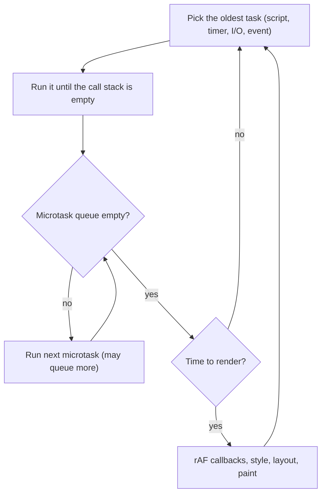

# JavaScript Handbook — Interview Edition

## How to use this edition
This is the book you re-read the night before an interview: every chapter of the *JavaScript Handbook* squeezed into one dense page-set, with nothing padded. It is about a tenth of the full book, uses only the book's own (reviewed, tested) content, and points back to it when you need the long explanation and the runnable code.

Every chapter has the same shape, so you always know where to look:

| Section | What it gives you |
|---|---|
| **Must-know** | The terms and rules, one line each, key word in bold |
| **Key facts & numbers** | Comparison tables, complexities, defaults, versions |
| **Code to remember** | The 1–3 tiny snippets interviewers ask you to write (≤ 10 lines each) |
| **In the interview** | The most likely questions with 1–3 sentence answers |
| **Gotchas** | Common mistake → correct idea |
| **TL;DR** | The chapter in one or two lines |

**Three ways to use it**
1. **Night before (60–90 min):** read the *Top 25 questions* below, then every chapter's *In the interview* and *TL;DR*, then the *Last-minute checklist* at the end.
2. **Focused revision:** the four pillars interviewers probe most are **coercion (Ch 2)**, **closures and scope (Ch 4)**, **`this` and prototypes (Ch 9)** and **the event loop (Ch 12)**. Read those chapters fully, and practise the three output puzzles in Ch 12 until you can predict every line.
3. **Coding round:** re-type the classics in Ch 17 (debounce, throttle, `Promise.all`, deep clone, LRU, curry) from memory, then check against the snippets. Say the complexity out loud before you code.

When an answer here feels too thin, open the same chapter number in the full book (`JavaScript-Handbook.pdf` or `../chapters/NN-name/README.md`): it has the analogy, the diagrams and the real program output.

## Top 25 questions across the book
| # | Question | One-line answer | Ch |
|---|---|---|---|
| 1 | `==` vs `===`? | `===` compares type and value with no conversion; `==` coerces non-transitively — use `===` except `x == null`. | 2 |
| 2 | What are the falsy values? | `false, 0, -0, 0n, "", null, undefined, NaN`; `[]`, `{}`, `"0"` are truthy. | 2 |
| 3 | Why is `0.1 + 0.2 !== 0.3`? | IEEE-754 doubles can't store 0.1/0.2 exactly; compare with a tolerance or use integer cents. | 2 |
| 4 | `var` vs `let` vs `const`? | Function vs block scope; `let`/`const` have a TDZ; `const` freezes the binding, not the value. | 2 |
| 5 | `??` vs `\|\|`? | `??` falls back only on `null`/`undefined`; `\|\|` also replaces `0`, `""`, `false`. | 2 |
| 6 | What is a closure? | A function plus live references to the variables where it was defined, kept alive after the outer function returns. | 4 |
| 7 | Why does `for (var i…) setTimeout(() => log(i))` print 3 3 3? | One shared `var`; callbacks run after the loop. `let` gives one binding per iteration. | 4 |
| 8 | Arrow vs regular function? | Arrows have lexical `this`, no `arguments`, no `new`/`prototype` — great callbacks, wrong methods. | 4 |
| 9 | Shallow vs deep copy? | Spread/`assign` copy the top level; `structuredClone` copies deep (Date/Map/Set/cycles, not functions). | 5 |
| 10 | Map vs Object? | Map: any key type, insertion order, `size`, fast churn. Object: fixed records, JSON. | 8 |
| 11 | How is `this` determined? | Call site: `new` > `call/apply/bind` > `obj.m()` > plain call (`undefined` in strict); arrows are lexical. | 9 |
| 12 | Explain the prototype chain. | Missing property reads follow `[[Prototype]]` links up to `null`; writes create own properties. | 9 |
| 13 | What does `new` do? | Creates an object linked to `Fn.prototype`, runs `Fn` with it as `this`, returns it unless `Fn` returns an object. | 9 |
| 14 | ES modules vs CommonJS? | ESM: static, live read-only bindings, strict, top-level await, tree-shakeable; CJS: sync `require`, copied values. | 10 |
| 15 | Why doesn't try/catch catch an error thrown in a timer? | The callback runs later on a fresh stack; try/catch is synchronous. | 11 |
| 16 | Explain the event loop. | Sync code → drain all microtasks → one task → drain microtasks → (render) → repeat. | 12 |
| 17 | Microtask vs task? | Microtasks: promise reactions, code after `await`, `queueMicrotask`. Tasks: timers, I/O, events. | 12 |
| 18 | `Promise.all` vs `allSettled` vs `race` vs `any`? | All-or-first-failure / every outcome / first settled / first success (else `AggregateError`); none cancel. | 12 |
| 19 | Two independent `await`s in a row? | Takes the sum; start both and `await Promise.all` for the max. Never `forEach(async)`. | 12 |
| 20 | Event propagation and delegation? | Capture ↓, target, bubble ↑; one listener on a container + `event.target.closest()` handles all children. | 13 |
| 21 | Does `fetch` reject on 404? | No — only on network errors/aborts; check `res.ok`. | 14 |
| 22 | SOP and CORS? | Pages can send anywhere but read only same-origin responses unless the server sends CORS headers; browsers enforce it. | 14 |
| 23 | XSS vs CSRF defences? | XSS: render as text, escape, sanitize, CSP, HttpOnly. CSRF: SameSite cookies, CSRF tokens, no state change on GET. | 14 |
| 24 | Is Node single-threaded? | JS runs on one thread; network I/O is OS-async; fs/DNS/crypto/zlib use libuv's 4-thread pool; CPU work → worker threads. | 15 |
| 25 | Debounce vs throttle? | Debounce runs once after calls stop; throttle runs at most once per interval during activity. | 17 |

## 1. Introduction and Setup
What JavaScript is, the standard behind it, engines vs hosts, running code, and strict mode.

### Must-know
- **JavaScript** — high-level, dynamically typed, garbage-collected, multi-paradigm language (1995); not related to Java beyond the name.
- **ECMAScript (ECMA-262)** — the standard; **JavaScript** = its implementations (V8, SpiderMonkey, JavaScriptCore) plus host APIs.
- **TC39** — the committee; proposals move through **Stages 0–4**; Stage 4 features ship in the next yearly edition (every June). Stage 3 = design complete, engines implementing.
- **Engine** — parses source to an AST, runs bytecode, **JIT**-compiles hot code to machine code. Runs only the core language.
- **Host / runtime** — engine + APIs (browser: DOM, `fetch`; Node: files, processes, servers). The **event loop** belongs to the host.
- **`globalThis`** — the portable name for the global object (`window` / `global` / `self`).
- **ASI** — Automatic Semicolon Insertion: a newline after `return` ends the statement; a line starting with `(`, `[` or `` ` `` joins the previous one.
- **Strict mode** — `"use strict"` as the first statement; automatic in **ES modules and class bodies**.

### Key facts & numbers
| Edition | Headline features |
|---|---|
| ES5 (2009) | strict mode, `JSON`, `forEach/map/filter`, `Object.defineProperty` |
| ES2015 / ES6 | `let`/`const`, arrows, classes, modules, promises, template literals, destructuring, `Map`/`Set`, `for…of` |
| ES2017 | `async`/`await` |
| ES2020 | `??`, `?.`, `BigInt`, `globalThis`, `Promise.allSettled` |
| ES2022 | class fields and `#private`, top-level `await`, `.at()`, `Error` `cause` |
| ES2023 | `toSorted`, `toReversed`, `with`, `findLast` |
| ES2024 | `Object.groupBy`, `Map.groupBy`, `Promise.withResolvers` |
| ES2025 | iterator helpers, `Set` methods (`union`, `intersection`…), `Promise.try`, `RegExp.escape`, JSON modules, `Float16Array` |
| ES2026 | `Array.fromAsync`, `Error.isError`, `Math.sumPrecise`, `Map.prototype.getOrInsert`, `Iterator.concat` (only some in Node 24) |
| ES2027 (next) | **Temporal**, `using` declarations, `Iterator.zip` |

| Situation | Sloppy | Strict |
|---|---|---|
| `x = 1` (undeclared) | creates a global | `ReferenceError` |
| `this` in plain call `f()` | global object | `undefined` |
| write to read-only / frozen prop | silently ignored | `TypeError` |
| duplicate params, `with`, octal `010` | allowed | `SyntaxError` |
| `eval("var x")` | leaks `x` outward | stays inside eval |
| `arguments` | linked to params | independent copy |

### In the interview
**Q:** JavaScript vs ECMAScript? **A:** ECMAScript is the spec maintained by TC39; JavaScript is the language as implemented by engines, plus host APIs. A new edition ships every June through the staged proposal process.

**Q:** Is `document` part of JavaScript? **A:** No — it is a browser (DOM) API supplied by the host; ECMAScript does not define it. That's why it is undefined in Node.

**Q:** Engine vs runtime? **A:** The engine runs the core language (V8: parse → bytecode → JIT); the runtime/host embeds it and adds I/O, timers, DOM and the event loop.

**Q:** What is strict mode? **A:** An opt-in restricted variant: silent errors become thrown errors, `this` is `undefined` in plain calls, and `with`/duplicate params/legacy octals are forbidden. Automatic in modules and classes.

**Q:** Why not make strict mode the default? **A:** It would break existing sites; the web must stay backward compatible.

### Gotchas
- `return` on its own line → returns `undefined` (ASI). Keep the value on the same line.
- `"use strict"` after other code → just an unused string. It must be first.
- `"use strict"` inside a function with default/rest/destructured params → `SyntaxError`.
- A Node `.js` file is **CommonJS and sloppy** unless `"type": "module"` or it uses `import`/`export`.
- `<script src>` in `<head>` touching elements → `null`; use `defer` or `type="module"`.
- Nested `/* /* */ */` → first `*/` ends the comment.

### TL;DR
ECMAScript is the spec, JavaScript the implementations; engine = language, host = everything else. Strict mode (automatic in modules/classes) turns silent mistakes into errors.

## 2. Variables, Types and Operators
Declarations, hoisting/TDZ, the 7 primitives, equality and coercion, `??`/`?.`, numbers and truthiness.

### Must-know
- **`const`** by default, **`let`** when reassigning, **`var`** only in old code. `const` freezes the **binding**, not the value.
- **Hoisting** — all declarations are known to their scope from the start; `var` starts as `undefined`, `let`/`const`/`class` sit in the **TDZ** (Temporal Dead Zone) and throw `ReferenceError` until the declaration runs. The TDZ is about **time**, not lines.
- **Types** — 7 primitives: `number`, `bigint`, `string`, `boolean`, `undefined`, `null`, `symbol`; everything else is an object. `typeof null === "object"` (historical bug); use `Array.isArray`.
- **Primitives** are immutable, copied/compared **by value**; **objects** by **reference**. Autoboxing lets `"abc".length` work; never `new String/Number/Boolean`.
- **`===`** no conversion; **`==`** coerces (see table). `Object.is` = `===` but `NaN` equals `NaN` and `0` ≠ `-0`.
- **`&&` / `||`** short-circuit and return an **operand**, not a boolean. **`??`** defaults only on `null`/`undefined` (keeps `0`, `""`). **`?.`** stops at `null`/`undefined`. **`||=`, `&&=`, `??=`** (ES2021).
- **Numbers** — one IEEE-754 64-bit double type; safe integers up to **2⁵³ − 1** (`Number.MAX_SAFE_INTEGER`); `BigInt` (`10n`) for larger. `/` is always floating point; `%` keeps the sign of the left operand; `+` concatenates if either side is a string.
- **Falsy (8)**: `false, 0, -0, 0n, "", null, undefined, NaN`. Everything else truthy — including `"0"`, `"false"`, `[]`, `{}`, `new Boolean(false)`.

### Key facts & numbers
| | `let` | `const` | `var` |
|---|---|---|---|
| Scope | block | block | function / global |
| Reassign | yes | no (`TypeError`) | yes |
| Redeclare same scope | `SyntaxError` | `SyntaxError` | yes, silently |
| Use before declaration | TDZ `ReferenceError` | TDZ | `undefined` |
| Top-level → `globalThis` prop | no | no | yes (classic script) |

**`==` algorithm:** same type → `===` · `null == undefined` only (so `null == 0` false) · number vs string → string to number · boolean → number first · object vs primitive → object to primitive (`[]` → `""`, `[1,2]` → `"1,2"`) · `NaN` equals nothing.

| Value | `Number()` | `String()` | `Boolean()` |
|---|---|---|---|
| `""` / `" "` | 0 / 0 | `""` / `" "` | false / **true** |
| `"4px"` | NaN | `"4px"` | true |
| `"0x1f"` | 31 | `"0x1f"` | true |
| `null` | 0 | `"null"` | false |
| `undefined` | NaN | `"undefined"` | false |
| `[]` / `[7]` / `[1,2]` | 0 / 7 / NaN | `""` / `"7"` / `"1,2"` | true |
| `{}` | NaN | `"[object Object]"` | true |

`parseInt("08.5kg", 10)` → 8 but `Number("08.5kg")` → NaN (parseInt stops at trailing text).

### In the interview
**Q:** `==` vs `===`? **A:** `===` compares type and value with no conversion; `==` coerces with non-transitive rules (`0 == ""`, `0 == "0"`, but `"" != "0"`). Use `===` everywhere except the `x == null` idiom (matches null and undefined).

**Q:** What is the TDZ? Are `let`/`const` hoisted? **A:** Yes, they're hoisted but uninitialised until their declaration runs; touching them earlier throws. That's why an inner `let x` shadows the outer `x` even above its line.

**Q:** Why is `0.1 + 0.2 !== 0.3`? **A:** Binary doubles can't represent 0.1 or 0.2 exactly; the sum is 0.30000000000000004. Compare with a tolerance (`Math.abs(a-b) < Number.EPSILON`) or use integer cents.

**Q:** `[] == ![]`? **A:** `true`: `![]` is `false`; `[] == false` → `"" == 0` → `0 == 0`.

**Q:** Why is `null >= 0` true but `null == 0` false? **A:** Relational operators convert `null` to 0; `==` has the special rule that null equals only undefined.

**Q:** `isNaN` vs `Number.isNaN`? **A:** Global `isNaN` converts first (`isNaN("abc")` true); `Number.isNaN` is true only for the real `NaN`. `x === NaN` is always false.

**Q:** List the falsy values. **A:** `false, 0, -0, 0n, "", null, undefined, NaN` (plus legacy `document.all`).

**Q:** `parseInt(0.0000005)`? **A:** `5` — the number becomes the string `"5e-7"` first. Always pass the radix.

### Gotchas
- `input.value` is a string: `"2" + "3"` → `"23"`. Convert with `Number()`.
- `if (arr)` is always true for arrays → test `arr.length > 0`.
- `if (count)` drops a valid `0` → use `count ?? default` or `!== undefined`.
- `x || 10` replaces `0`/`""` → use `x ?? 10`.
- `if (x == true)` → `"2" == true` is `2 == 1`, false.
- `a ?? b || c` without parentheses → `SyntaxError`.
- `2**53 + 1 === 2**53` → keep big IDs as strings or BigInt.
- `total = 5` without a keyword → accidental global (sloppy) or `ReferenceError` (strict).

### TL;DR
`const` first; `let`/`const` are block-scoped with a TDZ. Seven primitives plus objects; `===` always, `??` for defaults, `?.` for missing data; floats are inexact; 8 falsy values.

## 3. Control Flow and Loops
`if`/ternary/`switch`, the five loops, `break`/`continue`/labels, and which loop to pick.

### Must-know
- **`if / else if / else`** — first truthy branch wins; order **specific → general**; prefer **guard clauses** to deep nesting.
- **Ternary** `c ? a : b` — for choosing **values**, not running statements.
- **`switch`** — compares with **`===`**, runs from the first match until `break`/`return` (**fall-through**); `default` catches the rest; the whole body is **one block**.
- **`for`** — init once, test before each pass, update after; `let` in the header gives each iteration a **fresh binding** (matters for closures, §4).
- **`while`** checks first (0+ runs); **`do…while`** runs at least once.
- **`for…in`** — enumerable property **names** (strings), **inherited included**; for plain objects only, never arrays.
- **`for…of`** — **values** of iterables (arrays, strings, Maps, Sets); the default collection loop. Use `.entries()` for indexes, `Object.entries()` for objects.
- **`break`** exits the innermost loop, **`continue`** skips to the next pass (the `for` update still runs), **labels** target an outer loop.

### Key facts & numbers
| Situation | Best choice |
|---|---|
| Every element of an array/string/Map/Set | `for…of` |
| Need the index too | `for…of arr.entries()` or classic `for` |
| Backwards, steps, two pointers | classic `for` |
| Unknown count | `while` |
| Must run once first | `do…while` |
| Keys of a plain object | `Object.keys/entries` + `for…of` |
| Transform / keep some / combine | `map` / `filter` / `reduce` |
| First match / any / all | `find` / `some` / `every` |
| Wait for async work | `for await…of`, `await` in a loop — never a busy `while` |

### In the interview
**Q:** How does `switch` compare? **A:** Strict `===`, top-down, starting at the first match and continuing until `break` — so `switch("1")` never matches `case 1`.

**Q:** Why does `let x` in two cases fail? **A:** The switch body is one block, so it's a redeclaration `SyntaxError`; wrap each case body in `{ }`.

**Q:** How do you exit a nested loop from inside? **A:** Label the outer loop and `break outer`, or move the loops into a function and `return`.

**Q:** Can you `break` out of `forEach`? **A:** No (it's a callback, not a loop — `SyntaxError`). Use `for…of`, `some` or `find`.

**Q:** `for…in` vs `for…of`? **A:** `for…in` gives keys (strings, including inherited ones); `for…of` gives values of an iterable. Use `for…of` for arrays.

### Gotchas
- `if (role = "admin")` assigns and is always truthy → `===`.
- `i <= arr.length` → off-by-one; use `<`.
- Removing items while looping forward by index skips elements → loop backwards or `filter`.
- Busy-wait `while (!done) {}` freezes the single thread — the data can never arrive.
- Overlapping/gapped `else if` ranges (`< 60` and `> 60` miss 60) — test boundaries.

### TL;DR
First truthy branch wins; `switch` uses `===` and falls through without `break`. `for…of` for values, `for…in` only for object keys, `find`/`some` for search-and-stop.

## 4. Functions, Scope and Closures
Function forms, arrows, parameters, lexical scope, hoisting, closures, higher-order functions, IIFEs, recursion and purity.

### Must-know
- **First-class functions** — values you store, pass and return. Missing args → `undefined`; no `return` → `undefined`. Objects are passed as **shared references**.
- **Declaration** (`function f(){}`) is hoisted **with its body**; an **expression** (`const f = …`, arrows) follows its variable's hoisting.
- **Arrow functions** — concise; **lexical `this`**, no own `arguments`/`super`/`new.target`, no `prototype`, can't be `new`ed. Return an object: `() => ({ a: 1 })`.
- **Default params** replace only **`undefined`** (not `null`), evaluated **at call time**, left to right, may use earlier params.
- **Rest vs spread** — same `...`: rest **collects** into an array (params/destructuring); spread **expands** an iterable (calls/literals).
- **Scope** — global, function (`var`), block (`let`/`const`), module. **Lexical**: lookups walk outward from where the function is *defined* (the **scope chain**); inner names **shadow** outer.
- **Closure** — a function plus **live references** to the variables of the scope where it was defined; keeps them alive after the outer function returns.
- **Higher-order function** — takes or returns functions (`map`, `filter`, composition, currying). Callbacks may be sync or async.
- **IIFE** `(() => { … })()` — immediate private scope; legacy module pattern, replaced by modules/blocks.
- **Recursion** = base case + smaller case; deep recursion → `RangeError: Maximum call stack size exceeded`.
- **Pure function** — same input → same output, no side effects. "Pure core, impure shell."

### Key facts & numbers
| Feature | Regular `function` | Arrow `=>` |
|---|---|---|
| `this` | set by how it's called | lexical, fixed (even `bind` can't change it) |
| `arguments` | yes | no (enclosing function's) |
| `new` | yes | `TypeError`; no `prototype` |
| Generator (`yield`) | yes | no |
| As object method | yes | **no** |
| As callback inside a method | needs `bind` | **yes** |

| Declaration | Hoisted? | Value before its line |
|---|---|---|
| `function f() {}` | yes, with body | callable |
| `var x` | yes | `undefined` |
| `let` / `const` / `class` | yes | TDZ → `ReferenceError` |
| `var f = function(){}` | as the variable | `undefined` → `TypeError` if called |

### Code to remember
```js
function makeCounter() {           // closure = private state
  let count = 0;
  return { inc: () => ++count, get: () => count };
}
// Classic loop puzzle
for (var i = 0; i < 3; i++) setTimeout(() => console.log(i)); // 3 3 3
for (let j = 0; j < 3; j++) setTimeout(() => console.log(j)); // 0 1 2
```

### In the interview
**Q:** What is a closure? **A:** A function bundled with references to the variables where it was defined; because scope is lexical it keeps access after the outer function returns. Used for private state, factories, memoization, `once`, and every event handler.

**Q:** Why does the `var` loop print 3 3 3? **A:** One function-scoped `i` is shared; callbacks run after the loop ends. `let` creates a new binding per iteration (the pre-ES2015 fix was an IIFE per iteration).

**Q:** Do closures copy values? **A:** No — live references, so later changes are visible.

**Q:** Can closures leak memory? **A:** They keep what they reference reachable; long-lived listeners/timers/caches holding big objects keep them alive — remove listeners you don't need.

**Q:** Arrow vs regular function? **A:** Shorter, implicit return, but mainly: no own `this`/`arguments`/`super`, can't be constructors. Great callbacks, wrong as methods.

**Q:** Can `bind` change an arrow's `this`? **A:** No; the `this` argument is ignored.

**Q:** Explain scope. **A:** Global, function, block (and module); `var` is function-scoped, `let`/`const` block-scoped; lexical lookup along the scope chain is what makes closures possible. A top-level `let` does not create a `window` property; top-level `var`/function declarations in classic scripts do.

**Q:** When is a default parameter evaluated? **A:** At each call where the argument is `undefined`, left to right.

### Gotchas
- `addEventListener("click", save())` calls `save` now → pass `save`.
- `null` doesn't trigger a default → use `??` in the body.
- `function f(a = 1, b)` — required after optional forces callers to pass `undefined`.
- Sloppy-mode `arguments` stays linked to params; prefer rest params.
- **Stale closures** read an old scope's variable (React renders).
- Scope is lexical, not dynamic — a function can't see its *caller's* locals.

### TL;DR
Functions are values; arrows have lexical `this`. Scope is lexical; a closure keeps live access to its birth scope — use `let` in loops, beware stale values and retained memory.

## 5. Objects, Math, Date and JSON
Object basics, references and copying, destructuring, descriptors and freezing, `?.`, `Math`, `Date`, JSON.

### Must-know
- **Dot vs bracket** — `obj.key` for fixed identifier keys; `obj[expr]` for dynamic/unusual keys. **Computed keys** `{ [k]: v }`, **shorthand** `{ name }`.
- **Key order** — integer-like keys ascending, then string keys by insertion, then symbols.
- **References** — variables hold references; `===` compares **identity**; `const` doesn't freeze contents.
- **Key checks** — `Object.hasOwn(obj, k)` (own only) vs `k in obj` (includes prototype chain).
- **Spread / `Object.assign`** — **shallow**, later keys win; `assign` mutates its target and triggers setters. **`structuredClone`** = deep copy (Date, Map, Set, cycles; throws on functions).
- **Destructuring** — renames `{ id: orderId }`, defaults (only for `undefined`), nesting, in parameters.
- **Descriptor** — `value, writable, enumerable, configurable` or `get/set`; `defineProperty` omitted flags default to **`false`**.
- **`preventExtensions` < `seal` < `freeze`** — all **shallow**; violations throw only in strict mode.
- **`Object.create(proto | null)`** sets the prototype; `Object.create(null)` = no inherited keys.
- **`?.`** — short-circuits on `null`/`undefined`; can't be an assignment target (`obj?.x = 1` is `SyntaxError`).
- **`Math`** — `round` (halves toward +∞), `floor/ceil/trunc`, `max(...arr)`, trig in radians; `Math.random` is not for security → `crypto`.
- **`Date`** — one number: ms since 1970 UTC. Months **0-based**, `getDay()` = weekday, `getDate()` = day of month, setters **mutate and roll over**, date-only ISO strings parse as **UTC**. **Temporal** reached Stage 4 (March 2026); ships in Chrome, Firefox, Node 26 — not Node 24/Safari.

### Key facts & numbers
| Copy technique | Depth | Mutates target? | Notes |
|---|---|---|---|
| `{ ...a, ...b }` | shallow | no | getters called, values copied |
| `Object.assign(t, a, b)` | shallow | **yes** | triggers setters on `t` |
| `structuredClone(o)` | deep | no | Date/Map/Set/cycles; throws on functions |
| `JSON.parse(JSON.stringify(o))` | deep | no | lossy: Dates → strings, drops `undefined`/functions, throws on cycles/BigInt |

| Lock | Add | Delete | Change |
|---|---|---|---|
| `preventExtensions` | ✗ | ✓ | ✓ |
| `seal` | ✗ | ✗ | ✓ |
| `freeze` | ✗ | ✗ | ✗ |

| JSON.stringify of | In object | In array | Top level |
|---|---|---|---|
| `undefined`, function, symbol | **dropped** | `null` | `undefined` |
| `NaN`, `Infinity` | `null` | `null` | `"null"` |
| `Date` | ISO string (`toJSON`) | same | same |
| `Map`, `Set` | `{}` — data lost | same | same |
| BigInt, cycle | **throws `TypeError`** | throws | throws |

### Code to remember
```js
const randInt = (a, b) => Math.floor(Math.random() * (b - a + 1)) + a; // [a, b]
const daysInMonth = (y, m) => new Date(y, m + 1, 0).getDate();         // m is 0-based
const isValid = d => !Number.isNaN(d.getTime());
const round2 = x => Math.round(x * 100) / 100;
```

### In the interview
**Q:** Shallow vs deep copy? **A:** Spread copies own enumerable properties into a new object; nested objects are shared. For a deep copy use `structuredClone`; the JSON round-trip is lossy.

**Q:** `Object.assign` vs spread? **A:** Nearly the same, but `assign` mutates its first argument and triggers setters; spread always makes a new object.

**Q:** How do you make an object truly immutable? **A:** Deep-freeze recursively or use immutable structures (Immer); `freeze` is shallow and `const` does nothing for contents.

**Q:** `Object.keys` vs `getOwnPropertyNames` vs `Reflect.ownKeys`? **A:** Enumerable string keys / plus non-enumerable (e.g. array `length`) / plus symbols.

**Q:** How does JSON handle `undefined`, NaN, Dates, BigInt, cycles? **A:** Drops `undefined`/functions in objects, NaN → `null`, Dates → ISO via `toJSON`, throws on BigInt and cycles. `JSON.parse` is strict (double quotes, no trailing commas) and takes a **reviver** to restore types.

**Q:** Handling circular structures in `stringify`? **A:** A replacer with a `WeakSet` of seen objects to drop/mark repeats, or restructure the data.

**Q:** Why does `new Date('2024-01-01')` show Dec 31? **A:** Date-only ISO parses as UTC midnight, then is displayed in local time west of UTC.

**Q:** Is JSON a subset of JS? **A:** Yes since ES2019 (the "JSON superset" change).

### Gotchas
- `obj.field` when the key is in a variable → `obj[field]`.
- Arrow functions as object methods don't see the object (`this` is outer).
- `const f = person.greet; f()` loses `this`.
- `new Date(2024, 1, 1)` is **February** 1.
- Date setters mutate shared Dates → copy with `new Date(d)`.
- Store UTC (ISO / epoch ms) and convert only for display; beware DST in "days between".
- `Math.max(...hugeArray)` can exceed argument limits → `reduce`.

### TL;DR
Objects are references; spread and `assign` are shallow, `structuredClone` is deep. Freeze is shallow. Dates are ms since epoch with 0-based months; JSON silently drops or changes non-JSON values.

## 6. Strings and Regular Expressions
Immutable UTF-16 strings, template literals, Unicode levels, the string toolkit, and regex syntax, methods and traps.

### Must-know
- **Strings** — immutable UTF-16 primitives; `'…'` = `"…"`; **backticks** add `${}` interpolation, multi-line and **tagged templates** (`String.raw`).
- **Immutability** — methods return new strings; `s[0] = "x"` does nothing (throws in strict mode).
- **Indexing** — `s[i]` (out of range → `undefined`), `charAt`, **`at(-1)`**.
- **Unicode levels** — **code units** (`length`, indexing; emoji = 2), **code points** (`for…of`, spread), **graphemes** (`Intl.Segmenter`, what users see). `normalize('NFC')` before comparing; `isWellFormed`/`toWellFormed` for lone surrogates.
- **`slice`** (negatives OK, start > end → `''`) vs **`substring`** (negatives → 0, swaps args) vs **`substr`** (start, length — legacy).
- **`replace`** with a string changes only the **first** match → `replaceAll` or `/g`.
- **Human sorting** — `localeCompare` / `Intl.Collator` (default `sort()` puts uppercase first, accents last).
- **Regex** — literal `/…/flags` or `new RegExp(str)` (escape backslashes: `'\\d'`); quantifiers **greedy** by default, `?` makes them **lazy**; groups: numbered, named `(?<n>…)`, non-capturing `(?:…)`; lookaround `(?=…) (?!…) (?<=…) (?<!…)`; backreferences `\1`.
- **`lastIndex` trap** — a `/g` (or `/y`) regex is stateful; reusing it with `test`/`exec` resumes from the last position.
- **`RegExp.escape`** (ES2025) — escape user text before `new RegExp`.
- **Catastrophic backtracking** — nested unbounded quantifiers like `(a+)+$` go exponential on near-matches.

### Key facts & numbers
| Goal | Use | Returns |
|---|---|---|
| Yes/no | `re.test(s)` | boolean |
| First match + groups | `s.match(reNoG)` / `re.exec(s)` | match array or `null` |
| All matched strings | `s.match(reG)` | array or **`null`** |
| All matches with details | `s.matchAll(reG)` | iterator (**throws without `g`**) |
| Position | `s.search(re)` | index or -1 |
| Replace / split | `replace`/`replaceAll` / `split(re)` | string / array |

| Flag | Effect |
|---|---|
| `g` | all matches; makes `test`/`exec` stateful |
| `i` / `m` | case-insensitive / `^ $` per line |
| `s` | `.` matches newlines |
| `u` | code points, enables `\p{L}` |
| `v` | superset of `u` (set ops); use `u` **or** `v` |
| `y` / `d` | sticky at `lastIndex` / group `indices` |

### Code to remember
```js
const isPalindrome = s => {
  const t = s.toLowerCase().replace(/[^a-z0-9]/g, '');
  return t === [...t].reverse().join('');
};
const count = (s, sub) => s.split(sub).length - 1;
const { year } = '2024-05-01'.match(/(?<year>\d{4})-\d\d-\d\d/).groups;
```

### In the interview
**Q:** Why is `"😀".length` 2? **A:** Length counts UTF-16 code units; characters beyond U+FFFF use a surrogate pair. Use `[...s].length` for code points, `Intl.Segmenter` for visible characters.

**Q:** Reverse a string safely? **A:** `[...s].reverse().join('')` handles code points; for combining marks/ZWJ emoji reverse the graphemes from `Intl.Segmenter`.

**Q:** `slice` vs `substring`? **A:** `slice` supports negative indexes; `substring` clamps negatives to 0 and swaps reversed args.

**Q:** `match` vs `matchAll`? **A:** `match` with `g` returns just strings (or `null`); `matchAll` returns an iterator of full match objects with groups and indexes.

**Q:** Match a word in any language? **A:** `/\p{L}+/u` — `\w` is ASCII-only.

**Q:** Main regex gotchas? **A:** Anchor validations (`^…$`), `g` for global replace, stateful `lastIndex`, greedy vs lazy, and escaping user input with `RegExp.escape`.

### Gotchas
- `'${name}'` in normal quotes doesn't interpolate.
- Template-built HTML from user input → **XSS**; template-built SQL → injection.
- `if (s.indexOf(x))` fails when found at 0 → `includes`.
- `/\d{5}/.test('abc123456')` is true — missing anchors.
- `matchAll`/`replaceAll` with a non-global regex → `TypeError`.
- Compare user text only after `trim()` + case/accent normalisation.

### TL;DR
Strings are immutable UTF-16; `length` counts code units. `slice`, `includes`, `replaceAll`, `Intl.Collator`. Regex: anchor validations, `g` for all, watch `lastIndex`, escape user input.

## 7. Arrays
Creating and editing arrays, mutating vs copying methods, `map`/`filter`/`reduce`, sorting correctly, and when to use arrays vs objects vs Map/Set.

### Must-know
- **Arrays are objects** (`typeof` → `'object'`) → test with **`Array.isArray`**. Create with literals or `Array.from({ length: n }, fn)` / `Array.of` (avoid quirky `new Array(3)`).
- **`arr.at(-1)`** reads from the end; `length` is writable; avoid **holes**.
- **End vs start** — `push`/`pop` O(1); `unshift`/`shift` O(n). `push` returns the **new length**.
- **Mutators** — `push pop shift unshift splice sort reverse fill copyWithin`. **Copying twins (ES2023)** — `toSorted toReversed toSpliced with`. Non-mutating — `slice concat map filter flat flatMap`, spread.
- **Iteration** — `map` transforms, `filter` selects, `reduce` folds (**always pass an initial value**), `find`/`findLast` → element, `findIndex` → index, `some`/`every` short-circuit, `includes` finds `NaN` (unlike `indexOf`). Callbacks get `(element, index, array)`.
- **`forEach`** can't `break` and doesn't wait for `await`.
- **`sort`** — default compares **strings**; numbers need `(a, b) => a - b`; comparator returns negative/zero/positive; chain keys with `||`; **stable since ES2019**; O(n log n) (TimSort in V8); **mutates** → `toSorted`.
- **Shallow copies** — spread/`slice` share nested objects; `Array(n).fill([])` shares **one** array across slots.
- **Typed arrays** — fixed-length binary numbers over an `ArrayBuffer`.

### Key facts & numbers
| Goal | Mutating | Non-mutating |
|---|---|---|
| Add end / start | `push` / `unshift` | `[...arr, x]` / `[x, ...arr]` |
| Insert at `i` | `splice(i, 0, x)` | `toSpliced(i, 0, x)` |
| Remove at `i` | `splice(i, 1)` | `toSpliced(i, 1)` / `filter((_, j) => j !== i)` |
| Replace at `i` | `arr[i] = x` | `arr.with(i, x)` |
| Update by id | `item.done = true` | `map(t => t.id === id ? { ...t, done: true } : t)` |
| Sort / reverse | `sort` / `reverse` | `toSorted` / `toReversed` |

| Use | When |
|---|---|
| Array | order, position, iterate/sort/filter |
| Object | one record with named fields |
| Object / Map keyed by id | frequent lookup — O(1) vs `find` O(n) |
| Set | uniqueness, fast "is it in?" |

### Code to remember
```js
function shuffle(arr) {                 // Fisher–Yates, unbiased O(n)
  const a = [...arr];
  for (let i = a.length - 1; i > 0; i--) {
    const j = Math.floor(Math.random() * (i + 1));
    [a[i], a[j]] = [a[j], a[i]];
  }
  return a;
}
people.toSorted((a, b) => a.last.localeCompare(b.last) || a.first.localeCompare(b.first));
```

### In the interview
**Q:** Why does `['1','2','3'].map(parseInt)` give `[1, NaN, NaN]`? **A:** `map` passes the index as `parseInt`'s radix (0 → default, 1 and 2 invalid for those digits).

**Q:** Implement `map` with `reduce`. **A:** `arr.reduce((acc, x, i) => { acc.push(fn(x, i, arr)); return acc; }, [])`.

**Q:** `find` vs `filter`? **A:** `find` returns the first element (or `undefined`) and stops; `filter` scans all and returns an array.

**Q:** Why is `[10, 9, 1].sort()` → `[1, 10, 9]`? **A:** Default sort compares strings; pass `(a, b) => a - b`.

**Q:** Why not `sort(() => Math.random() - 0.5)`? **A:** Biased (inconsistent comparator) and O(n log n); use Fisher–Yates.

**Q:** `slice` vs `splice`? **A:** `slice` copies a range (non-mutating); `splice` edits in place and returns removed items.

### Gotchas
- `arr = arr.push(x)` turns `arr` into a number.
- `sort`/`reverse`/`splice` on props or state → use the copying twins.
- `const arr` doesn't stop `push`; `Object.freeze` is shallow.
- `includes`/`find` inside a loop over another big array → O(n²); build a `Set`/`Map` first.
- `reduce` without an initial value throws on `[]`.

### TL;DR
Know which methods mutate (and their ES2023 copying twins). `map/filter/reduce/find/some`; numeric sort needs a comparator; copies are shallow; Map/Set for lookups.

## 8. Maps, Sets, Iterators and Generators
Keyed collections, weak collections, the iteration protocol, generators, iterator helpers and grouping.

### Must-know
- **Map** — keys of **any type**, compared by **SameValueZero** (objects by reference, `NaN` equals `NaN`); insertion order; `size`; directly iterable. `set` (chainable), `get`, `has`, `delete`, `clear`, `keys/values/entries`, `forEach(value, key)`.
- **Set** — unique values (SameValueZero), insertion order, O(1) average `has`. Dedupe: `[...new Set(arr)]`. **ES2025 algebra**: `union`, `intersection`, `difference`, `symmetricDifference`, `isSubsetOf`, `isSupersetOf`, `isDisjointFrom`.
- **WeakMap / WeakSet** — keys must be objects (or non-registered symbols), held **weakly**; entries vanish when the key is collected → no `size`, no iteration, no `clear`. For per-object caches, private data, tagging DOM nodes.
- **WeakRef / FinalizationRegistry** — advanced; never rely on GC timing.
- **Iterable** — has `[Symbol.iterator]()` returning an **iterator** whose `next()` returns `{ value, done }`; optional `return()` for cleanup on early exit. Iterators are **single-use**.
- **Iterables**: arrays, strings, Maps, Sets, typed arrays, NodeLists, generators — **not plain objects**. Consumers: `for…of`, spread, destructuring, `Array.from`, Map/Set constructors, `Promise.all`.
- **Generator** (`function*`) — calling it returns an iterator **without running the body**; `yield` pauses, `next(x)` resumes (and sends `x` in), `return()`/`throw()` end it; `yield*` delegates. The `return` value is **not** included by `for…of`/spread.
- **Async generators** + `for await…of` — paged or streamed data.
- **Iterator helpers (ES2025)** — lazy `map/filter/take/drop/flatMap`, consuming `toArray/reduce/forEach/some/every/find` on any iterator; arrays need `.values()` first; `Iterator.from` wraps custom ones.
- **`Object.groupBy` / `Map.groupBy` (ES2024)** — bucket by key function → null-prototype object (string keys) or a Map (any keys).

### Key facts & numbers
| Feature | `Map` | Plain object |
|---|---|---|
| Key types | any value | strings & symbols |
| Order | insertion | integer-like keys first, then insertion |
| Size | `map.size` O(1) | `Object.keys(o).length` O(n) |
| Accidental keys | none | inherited (`'toString' in {}`), `__proto__` |
| Frequent add/delete | optimised | `delete` can slow objects |
| JSON | not directly (`{}`) | native |
| Best for | dynamic dictionaries, caches, counts | fixed records, config, JSON |

`array.includes` O(n) vs `set.has` O(1) average — build a Set once for repeated membership tests.

### Code to remember
```js
function* range(s, e) { for (let i = s; i < e; i++) yield i; }
const unique = [...new Set(arr)];
const byId = [...new Map(objs.map(o => [o.id, o])).values()]; // dedupe by id (keeps last)
const common = (a, b) => { const s = new Set(b); return a.filter(x => s.has(x)); };
const groups = Object.groupBy(items, x => x.type);  // or reduce: (acc[k] ??= []).push(x)
```

### In the interview
**Q:** Map vs Object? **A:** Map for dynamic key–value data: any key type, insertion order, `size`, direct iteration, optimised churn. Object for fixed-shape records and JSON.

**Q:** LRU cache in JS? **A:** A Map: on `get`, delete and re-insert; on overflow, delete `map.keys().next().value` (the oldest). Full code in §17.

**Q:** Map vs WeakMap? **A:** WeakMap keys are objects held weakly — entries disappear when the key is garbage-collected — so it has no `size`/iteration/`clear`. Use for per-object caches and private data.

**Q:** Why isn't a plain object iterable? **A:** Keys, values and entries are all reasonable choices, so the language makes you pick via `Object.keys/values/entries`.

**Q:** What's `yield*`? **A:** Delegation: yields every value of another iterable and evaluates to its return value.

**Q:** How do generators relate to async/await? **A:** Async functions behave like generators that yield promises and are resumed when each settles.

### Gotchas
- `map['k'] = 1` sets a property, not an entry — `get` won't see it, `size` stays 0.
- `map.get({ id: 1 })` with a different-but-equal object → `undefined` (reference keys).
- `JSON.stringify(map/set)` → `{}`; send `[...set]` / `Object.fromEntries(map)`.
- `new Set('hello')` → `{'h','e','l','o'}` (iterates the string).
- Spreading an infinite generator without `take` never ends.
- Reusing an exhausted iterator/generator gives nothing.

### TL;DR
Map for dynamic dictionaries, Set for uniqueness and O(1) membership, Weak* for per-object data without leaks. Anything with `[Symbol.iterator]` works with `for…of`/spread; generators make lazy iterators easy.

## 9. `this`, Prototypes and Classes
The four `this` rules, `call`/`apply`/`bind`, the prototype chain, `new`, classes and private fields, inheritance, type checks, mixins and composition.

### Must-know
- **`this`** is decided **at call time by the call site**, never by where the function is defined (except arrows). It is never "the function itself".
- **Arrow functions** have no own `this` — lexical, can't be rebound, can't be `new`ed.
- **`call(obj, a, b)` / `apply(obj, [a, b])`** run now with a chosen `this`; **`bind(obj, …args)`** returns a new permanently bound function (also partial application). `new BoundFn()` ignores the bound `this`.
- **Event listeners** — a regular function gets `this` = the element (`event.currentTarget`); a class method passed directly gets the element, not the instance.
- **`[[Prototype]]`** — hidden link on every object; missing **reads** walk the **prototype chain** to `null`; **writes** create own properties (**shadowing**). Methods run with `this` = the original receiver.
- **`__proto__` vs `prototype`** — `__proto__` (legacy accessor) is an object's own link; `Fn.prototype` is the object `new` links instances to.
- **`new Fn()`** — (1) create empty object, (2) link it to `Fn.prototype`, (3) run `Fn` with `this` = it, (4) return it unless `Fn` returns an **object**.
- **Class** = constructor + prototype methods with safer defaults: strict, **`new`-only**, methods **non-enumerable**, binding in the **TDZ**. ES2022: public/`#private` fields and methods, `static {}` blocks, `#x in obj` brand checks.
- **`extends`/`super`** — links both instance (`Child.prototype → Parent.prototype`) and static (`Child → Parent`) chains; call **`super()` before `this`**; no constructor = default one forwarding args. Built-ins (`Array`, `Error`, `Map`) subclass properly.
- **Init order** — parent fields → parent constructor body → child fields → rest of child constructor.
- **`instanceof`** — "is `C.prototype` in the chain?"; fails across realms (iframes). Prefer `Array.isArray`, `Error.isError`, `#brand in obj`, duck typing.
- **Composition over inheritance** — has-a (factories, injected collaborators, mixins) beats deep is-a hierarchies (**fragile base class** problem).

### Key facts & numbers
| Precedence | Rule | Call site | `this` |
|---|---|---|---|
| 1 (highest) | `new` | `new Fn()` | the new object |
| 2 | explicit | `fn.call(obj)` / `bind` | `obj` |
| 3 | implicit | `obj.fn()` | `obj` |
| 4 | default | `fn()` | `undefined` (strict) / `globalThis` (sloppy) |
| — | arrow | any | enclosing scope's `this` |

| Check | Own | Chain | Notes |
|---|---|---|---|
| `Object.hasOwn(o, k)` | ✓ | ✗ | preferred; works on null-prototype objects |
| `o.hasOwnProperty(k)` | ✓ | ✗ | fails on `Object.create(null)`, can be shadowed |
| `k in o` | ✓ | ✓ | includes non-enumerable |
| `for (k in o)` | ✓ | ✓ | enumerable only |

### Code to remember
```js
class Account {
  #balance = 0;                              // truly private
  static #count = 0;
  constructor(owner) { this.owner = owner; Account.#count++; }
  deposit(x) { this.#balance += x; return this; }   // chainable
  get balance() { return this.#balance; }
  onClick = () => this.deposit(1);           // arrow field: bound per instance
  static isAccount(o) { return #balance in o; }
}
```

### In the interview
**Q:** How is `this` determined? **A:** By the call site: `new` > `call/apply/bind` > `obj.m()` > plain call (`undefined` in strict). Arrows capture `this` lexically and can't be rebound.

**Q:** `const f = obj.m; f()` — what's `this`? **A:** `undefined` in strict code (global in sloppy) — the implicit binding is lost. Same for `setTimeout(obj.m)` and `promise.then(obj.m)`; fix with an arrow wrapper or `bind`.

**Q:** Explain the prototype chain. **A:** Each object has a `[[Prototype]]` link; failed lookups walk it until found or `null`. `Object.create(proto)` sets it directly; constructors/classes set it via `Fn.prototype`.

**Q:** What does `new` do? **A:** Creates an object linked to `Fn.prototype`, runs `Fn` with it as `this`, returns it unless `Fn` returns an object.

**Q:** Are classes hoisted? **A:** The binding is hoisted but in the TDZ, so early use throws `ReferenceError`.

**Q:** Arrow field vs method for handlers? **A:** Arrow field keeps `this` without `bind` but costs one function per instance and no `super`; a method is shared on the prototype.

**Q:** How private is `#x`? **A:** Language-enforced: invisible to every reflection API; only code inside the class body can access it.

**Q:** Composition vs inheritance? **A:** Inheritance couples you to the parent's implementation; composition assembles small parts. Use shallow `extends` for custom errors / framework base classes, composition for most app code.

### Gotchas
- `removeEventListener('click', fn.bind(this))` removes nothing — a new function each time.
- Methods defined inside the constructor → one copy per instance.
- Forgetting `new` on a constructor function → global pollution (sloppy) or `TypeError` (strict); classes always throw.
- Replacing `Fn.prototype` → repair `constructor`.
- **Prototype pollution** — naive deep-merge of `{"__proto__": {...}}` modifies `Object.prototype`; skip `__proto__`/`constructor` keys or use `Map`/null-prototype objects.
- Monkey-patching built-ins (`Array.prototype.x`) — why `contains` became `includes` and `flatten` became `flat`.
- `#private` fields aren't copied by spread, `JSON.stringify` or `structuredClone`.
- `class A { m = function(){} }` is a per-instance field, not a method.
- Calling overridable methods from a parent constructor sees uninitialised child fields.

### TL;DR
Look at the call site for `this`; arrows borrow it. Reads walk the prototype chain; `new` links to `Fn.prototype`. Classes are sugar with `#private`; prefer composition and shallow `extends`.

## 10. Modules and Tooling
ES modules vs CommonJS, how ESM loads, dynamic import and top-level await, npm and semver, bundlers, transpilers, linters.

### Must-know
- **Module** — a file with its own scope and explicit imports/exports. **ESM** (ES2015) is the standard; **CommonJS** remains common in Node.
- **Named exports** — many per module, names must match (`import { a as b }`). **Default** — one per module, importer picks the name. `import * as ns` → namespace object; `import './x.js'` → side effects only; `export … from` → barrels.
- **ESM loading** — **parse → link → evaluate**; each module evaluated **once**, dependencies first. Imports are **hoisted**, **live read-only bindings** (not copies); modules are **strict singletons**. Static structure enables **tree shaking**.
- **Circular imports** work if top-level code doesn't touch a binding still in its TDZ.
- **`import()`** — returns a promise of the namespace (default under `.default`); for code splitting / conditional loading.
- **Top-level `await`** — ESM only; importers wait for it. Good in entry points, risky in shared libraries.
- **`import.meta.url`** (Node adds `dirname`/`filename`); JSON modules: `import d from './d.json' with { type: 'json' }` (ES2025).
- **Browser modules** — `<script type="module">`: strict, deferred, once per URL, CORS-bound, not over `file://`; **import maps** resolve bare names.
- **Node decides** by extension (`.mjs`/`.cjs`) or `"type"` in `package.json`. ESM can import CJS (default = `module.exports`); modern Node can `require()` ESM **unless it uses top-level await**.
- **`"exports"`** in package.json — public entry points + conditional builds; blocks deep imports.
- **`dependencies`** (runtime) vs **`devDependencies`** (tooling); run tools via scripts/`npx`/`node --run`; `node_modules` is searched **upward** from the importing file.
- **Lockfile** — pins the exact tree; **commit it**; **`npm ci`** installs exactly from it.
- **Bundler** (Vite, esbuild, webpack, Rolldown) — resolve, transform, tree shake, code split, minify, source maps, HMR.
- **Transpile syntax, polyfill APIs**; targets via browserslist. Bundlers strip TS types — type-check separately.
- **ESLint** (flat config `eslint.config.js`) finds bugs; **Prettier** formats; use `eslint-config-prettier` so they don't fight.

### Key facts & numbers
| | CommonJS | ES modules |
|---|---|---|
| Syntax | `require` / `module.exports` | `import` / `export` |
| Loading | sync, runtime, can be in `if` | static graph; `import()` for dynamic |
| Exports | one object (destructuring copies) | live read-only bindings |
| Top-level `await` | ✗ | ✓ |
| Strict | opt-in | always |
| Top-level `this` | `module.exports` | `undefined` |
| `__dirname` | ✓ | `import.meta.dirname` |
| Extensions | optional | required for relative paths |
| Tree shaking | poor | good |
| Browsers | needs a bundler | native |

| Range | Allows |
|---|---|
| `^1.2.3` (npm default) | ≥1.2.3 <2.0.0 |
| `^0.2.3` | ≥0.2.3 <0.3.0 (major 0 locks minor) |
| `^0.0.3` | ≥0.0.3 <0.0.4 |
| `~1.2.3` | ≥1.2.3 <1.3.0 |
| `1.x` | ≥1.0.0 <2.0.0 |

Semver = **MAJOR.MINOR.PATCH** = breaking . feature . fix.

### In the interview
**Q:** How do ES modules load? **A:** Static: parse the whole graph, link imports to exports, evaluate each module once, dependencies first. Imports are hoisted live bindings; that's what enables tree shaking.

**Q:** ESM live bindings vs CommonJS exports? **A:** `require` returns the `module.exports` object; destructuring copies values at that moment. ESM imports stay connected to the exporter's variable.

**Q:** Why can't `import` go inside an `if`? **A:** Static imports must be known before execution; use `import()`.

**Q:** Why can't `require()` load ESM with top-level await? **A:** `require` is synchronous; an async module can't finish synchronously.

**Q:** `^` vs `~`? **A:** `^` keeps the left-most non-zero number; `~` allows patches only. Does `^0.3.1` allow 0.4.0? No.

**Q:** Should a library commit its lockfile? **A:** Yes, for its own CI reproducibility; consumers ignore it and resolve the library's ranges themselves.

**Q:** Transpiler vs polyfill? **A:** A transpiler rewrites new *syntax* into older syntax; a polyfill adds missing *APIs* at runtime.

### Gotchas
- Native ESM needs file extensions: `'./math'` → `ERR_MODULE_NOT_FOUND`.
- `import { default } from …` is invalid; `export default const x` is a syntax error.
- `exports = { a }` exports nothing → `module.exports = …`.
- `require is not defined in ES module scope` / `Cannot use import statement outside a module` → the file's module type is wrong (`.mjs`/`.cjs`/`"type"`).
- **Dual package hazard** — CJS and ESM builds loaded twice → two copies of state, failing `instanceof`.
- Big barrels load everything; `import _ from 'lodash'` defeats tree shaking → `import { debounce } from 'lodash-es'`.
- Build tools in `dependencies` / runtime libs in `devDependencies`; `npx` typos can run look-alike packages.
- `.eslintrc.json` no longer works in ESLint 10 (flat config only).

### TL;DR
ESM: static, live, strict, singleton, tree-shakeable; CJS: sync `require`, copied values. Node picks by `.mjs/.cjs/"type"`. `^` = same major; commit the lockfile, `npm ci` in CI.

## 11. Errors and Debugging
Error types, `try/catch/finally`, custom errors and `cause`, async errors, `using`, the console, stack traces and debuggers.

### Must-know
- **Error object** — `name`, `message`, `stack`, optional **`cause`**. **`Error.isError`** (ES2026) is the robust check (works across realms).
- **`throw`** unwinds the stack to the nearest `catch`; **`finally`** always runs (success, error, `return`, rethrow). A **`return` in `finally` overrides** everything and swallows errors.
- **try/catch is synchronous** — it can't catch errors from callbacks that run later; for promises, `await` inside `try` or `.catch()`.
- **Throw `Error` objects**, not strings (you lose the stack). Catch **narrowly**, rethrow what you can't handle.
- **Custom error** — `class X extends Error`, `super(message, { cause })`, set `name`, add `code`/data; create a class only if a caller handles it differently.
- **`cause`** — `new Error('what I was doing', { cause: err })`; walk `.cause` to the root. **`AggregateError`** for many errors (`Promise.any`).
- **Global handlers** — browser `error`/`unhandledrejection`, Node `uncaughtException`/`unhandledRejection`: for **logging**, not recovery.
- **`using`** + `[Symbol.dispose]` (ES2027, in Node 24) — guaranteed cleanup, disposed in **reverse order**, even on errors (`SuppressedError` if disposal also fails).
- **Console** — `table`, `dir`, `group`, `count`, `assert`, `time`/`timeEnd`, `trace`. Browser object logs are **live references**.
- **Stack trace** — first line = what; first frame in *your* code = where; newest frame first. **Source maps** map bundled code back to source.
- **Debugger** — breakpoints (conditional, **logpoints**, pause on exceptions), step over/into/out, Scope/Watch/Call Stack, Network panel; Node `--inspect`/`--inspect-brk` + `chrome://inspect` or VS Code. `debugger;` does nothing without DevTools open.
- **Method** — reproduce → read → hypothesise → inspect → fix the root cause → add a test.

### Key facts & numbers
| Type | Thrown when | Example |
|---|---|---|
| `TypeError` | wrong type for an operation | `null.length`, calling a non-function, assigning to `const` |
| `ReferenceError` | unknown name or TDZ | typo; `let` before its line |
| `SyntaxError` | unparseable code/JSON | `JSON.parse('{bad}')` |
| `RangeError` | value out of range | `new Array(-1)`, stack overflow |
| `URIError` | malformed URI | `decodeURIComponent('%')` |
| `AggregateError` (ES2021) | many errors | `Promise.any` all reject |
| `SuppressedError` (ES2027) | error while disposing after another | `using` |

| Message | Usual cause |
|---|---|
| `x is not a function` | typo, wrong import (default vs named), property holds data |
| `Cannot read properties of undefined (reading 'y')` | data not loaded yet, wrong API shape, missing `return` |
| `Cannot access 'x' before initialization` | TDZ, often via circular imports |
| `… is not iterable` | `for…of`/spread on a plain object or `undefined` |
| `Unexpected token '<' … not valid JSON` | server returned an HTML error page — check `response.ok` |
| `Class constructor X cannot be invoked without 'new'` | called a class like a function |
| `Maximum call stack size exceeded` | missing base case, setter assigning to itself |

### Code to remember
```js
class ValidationError extends Error {
  constructor(message, { field, cause } = {}) {
    super(message, { cause });
    this.name = 'ValidationError';
    this.field = field;
  }
}
try { await save(user); }
catch (err) { throw new Error('Saving user failed', { cause: err }); }
```

### In the interview
**Q:** `(() => { try { return 1 } finally { return 2 } })()`? **A:** `2` — a `return` in `finally` overrides.

**Q:** Does `finally` run if `catch` rethrows? **A:** Yes, then the error continues outward.

**Q:** Why is `catch (e) {}` dangerous? **A:** It silently hides every error, including programming bugs.

**Q:** Why doesn't try/catch catch an error in a `setTimeout` callback? **A:** The callback runs later on a fresh stack, after the `try` has finished.

**Q:** How do you debug minified production errors? **A:** Source maps, uploaded to the error tracker or loaded in DevTools.

**Q:** What's a logpoint? **A:** A breakpoint that logs an expression instead of pausing — logging without editing code.

### Gotchas
- Forgetting `super(message)` in a custom error → `ReferenceError` on `this`.
- Not setting `name` → every log says `Error:`.
- Sending `err.message`/`stack` of unexpected errors to clients leaks internals → log server-side, send a generic message.
- `console.log('user: ' + user)` → `[object Object]`; pass objects as separate args.
- Expanding a logged object later shows its *current* state → log `structuredClone(obj)`.
- Floating promises with no `.catch()` → unhandled rejections (Node exits by default).

### TL;DR
Throw `Error` objects, catch narrowly, chain with `cause`, clean up in `finally`/`using`. try/catch is synchronous. Debug with breakpoints and stack traces, not guesses.

## 12. Asynchronous JavaScript
One thread, the event loop and its ordering rules, Node's phases, timers, callbacks, promises, combinators, `async/await`, cancellation, async iteration.

### Must-know
- **One thread, run-to-completion** — a callback always finishes before anything else starts; the **host** (Web APIs / libuv) does the waiting. Long sync work blocks timers, input and rendering. CPU-heavy work → Web Workers / `worker_threads`.
- **Task (macrotask)** — timer callbacks, I/O, events, `message`, the initial script.
- **Microtask** — promise `then/catch/finally`, **code after `await`**, `queueMicrotask`, `MutationObserver`.
- **Event loop turn** — run **one task** → drain **all** microtasks (including new ones) → maybe render (`requestAnimationFrame` → style → layout → paint) → repeat.
- **Why microtasks** — promise callbacks run after the current code (always async) but before any other task or render can see inconsistent state.
- **Microtask starvation** — recursive `.then`/`queueMicrotask`/`nextTick` never lets the loop render or run tasks.
- **`await` doesn't yield to rendering** — it's only a microtask; split long work across tasks (`setTimeout`, `scheduler.yield()`, rAF).
- **Promise** — pending → fulfilled/rejected, **settles once**; `then` returns a **new** promise resolved with the callback's return value (or rejected with its throw). The **executor runs synchronously**. Promises are **eager and not cancellable**.
- **Thenable** — any object with `then`; returning one from `then` is **adopted** (costs 2 extra microtask ticks).
- **`Promise.withResolvers()`** (ES2024), **`Promise.try(fn)`** (ES2025), Node `util.promisify` / `fs/promises`.
- **`async` function** always returns a promise; body runs **synchronously up to the first `await`**; `await x` (even a non-promise) defers the rest to a microtask; rejections become throws.
- **Callbacks** → callback hell, no `try/catch`, inversion of control, **Zalgo** (sometimes sync, sometimes async). Keep them for **repeated events**.
- **`AbortController`** cancels, **`AbortSignal`** carries the cancel; `AbortSignal.timeout(ms)`, `AbortSignal.any([...])`; rejections named `AbortError`/`TimeoutError`.
- **Async iteration** — `for await…of` over async iterables, `async function*` produces them, `Array.fromAsync` (ES2026); `break` calls `return()` so the generator's `finally` runs.

### Event-loop ordering rules (predict any puzzle)
1. Run **all synchronous code** first — including `new Promise` **executors** and async-function code **before the first `await`**.
2. **Drain the microtask queue** FIFO; microtasks queued during this step run in the same drain.
3. Take **one task** (timers by due time, ties in creation order), run it, drain microtasks again; repeat.
4. Each `.then` in a chain is queued only when the previous step settles → two chains **interleave** one step at a time.
5. `resolve()` doesn't stop the executor; lines after it still run.
6. Returning a promise from `then` adds **2 extra ticks** before the next `then`.
7. **Node:** between callbacks drain `process.nextTick` queue, then promises (at an **ESM top level** promises come first). `setImmediate` vs `setTimeout(0)` is **only deterministic inside an I/O callback** (immediate wins).



### Three classic output puzzles
**Puzzle 1 — the classic.**
```js
console.log('A');
setTimeout(() => console.log('B timeout'), 0);
Promise.resolve().then(() => console.log('C then'));
queueMicrotask(() => console.log('D microtask'));
console.log('E');
```
**Answer:** `A, E, C then, D microtask, B timeout` — sync first, microtasks in queue order, then the timer task.

**Puzzle 2 — async/await + executor.**
```js
async function f() { console.log('f start'); await null; console.log('f after await'); }
console.log('1'); f(); console.log('2');
const p = new Promise(res => { console.log('executor'); res('v'); console.log('after resolve'); });
p.then(v => console.log('then: ' + v)); console.log('end');
```
**Answer:** `1, f start, 2, executor, after resolve, end, f after await, then: v` — the body up to `await` and the executor are synchronous; `resolve()` doesn't return; the two continuations are microtasks queued in that order. (Combines book puzzles P2 and P5.)

**Puzzle 3 — nested microtasks and timers.**
```js
setTimeout(() => { console.log('T1'); Promise.resolve().then(() => console.log('T1 -> micro')); }, 0);
setTimeout(() => console.log('T2'), 0);
Promise.resolve().then(() => {
  console.log('M1');
  setTimeout(() => console.log('M1 -> timeout'), 0);
  Promise.resolve().then(() => console.log('M1 -> micro'));
});
```
**Answer:** `M1, M1 -> micro, T1, T1 -> micro, T2, M1 -> timeout` — M1's microtask runs in the same drain; T1's microtask runs before task T2; M1's timer queued behind T1 and T2.

*Bonus answers from the book:* two chains `a1→a2→a3` and `b1→b2→b3` print `a1 b1 a2 b2 a3 b3`; a `then` that returns `Promise.resolve('inner')` alongside a chain y1…y4 prints `x1 y1 y2 y3 x2 y4`. Node ESM top level: `sync | promise | nextTick | …`; CommonJS: `sync | nextTick | promise`; inside an I/O callback: `nextTick | promise | immediate | timeout`.

### Key facts & numbers
| Combinator | Fulfils when | Rejects when | Result | Added |
|---|---|---|---|---|
| `Promise.all` | all fulfil | **first** rejection (fail-fast) | values in **input order** | ES2015 |
| `Promise.allSettled` | all settle | never | `{status, value/reason}` | ES2020 |
| `Promise.race` | first to **settle** | first to settle rejects | that value/reason | ES2015 |
| `Promise.any` | first to **fulfil** | **all** reject | value / `AggregateError` | ES2021 |

None of them cancel the losers.

| Node phase | Runs |
|---|---|
| timers | expired `setTimeout`/`setInterval` |
| pending callbacks | some deferred system callbacks |
| poll | I/O callbacks (waits here) |
| check | `setImmediate` |
| close | `'close'` events |

| Timer fact | Value |
|---|---|
| Delay | a **minimum**, never a guarantee |
| Nested ≥ 5 levels (browser) | clamped to ≥ **4 ms** |
| Background tabs | throttled (often ≤ 1/s) |
| Max delay | 2³¹−1 ms (~24.8 days); above overflows (Node: warning, 1 ms) |
| `setInterval` vs recursive `setTimeout` | start-to-start (can bunch) vs end-to-start (always ≥ delay idle) — poll with recursive `setTimeout` |

| Want | Use |
|---|---|
| After current code, portable | `queueMicrotask` / `Promise.resolve().then` |
| Node "right after this op" | `process.nextTick` (docs prefer `queueMicrotask` for new code) |
| Yield to I/O | `setImmediate` |
| After a delay | `setTimeout` |

| Error situation | Handle with |
|---|---|
| throw in `async` fn | `try/catch` around `await`, or `.catch()` |
| throw in `setTimeout`/event callback | `try/catch` **inside** the callback |
| unhandled rejection | browser `unhandledrejection`; Node ≥ 15 **crashes** |
| need every outcome | `allSettled` |

### Code to remember
```js
const [user, posts] = await Promise.all([getUser(id), getPosts(id)]); // parallel: max, not sum
for (const url of urls) await fetchOne(url);   // sequential on purpose — never forEach(async)
async function load() {
  try { return await fetchJSON(url); }         // return await INSIDE try, so catch sees it
  catch (err) { throw new Error('load failed', { cause: err }); }
}
const res = await fetch(url, { signal: AbortSignal.timeout(5000) });
```

### In the interview
**Q:** Explain the event loop. **A:** Sync code runs first; then the engine drains the whole microtask queue (promise callbacks, code after `await`, `queueMicrotask`), including ones added along the way; only then does it take the next task (timer, event, I/O), draining microtasks after each. So promises always beat `setTimeout(0)`.

**Q:** Does `await 5` pause? **A:** Yes — the rest of the function still runs as a microtask.

**Q:** Can microtasks starve rendering? **A:** Yes; the loop can't render or run tasks until the microtask queue is empty.

**Q:** `all` vs `allSettled` vs `race` vs `any`? **A:** All-or-first-failure; everything, never rejects; first settled; first success else `AggregateError`. None cancel.

**Q:** `Promise.all` with one rejection — do the others stop? **A:** No, their results are ignored.

**Q:** What does `async function f() {}; f()` return? **A:** A promise fulfilled with `undefined`.

**Q:** Why `return await` inside `try`? **A:** Without `await` the rejection escapes the `try` before `catch` can see it.

**Q:** Two awaits in a row for independent calls? **A:** Sum of times; start both and `await Promise.all` for the max. `Promise.all` also attaches handlers immediately (start-then-await can leave a briefly unhandled rejection).

**Q:** `nextTick` vs `setImmediate`? **A:** `nextTick` runs right after the current operation, before promises (CJS); `setImmediate` runs in the check phase after I/O polling. Recursive `nextTick` starves I/O.

**Q:** Why are callbacks worse than promises? **A:** Nesting, no `try/catch`, inversion of control (called 0 or 2 times), Zalgo; a promise settles exactly once and its callbacks are always async.

### Gotchas
- `setTimeout(fn, 0)` is not "immediately" — later task, after all microtasks, maybe after a render.
- Forgetting `return` inside `then` → next step gets `undefined`, inner errors go unhandled.
- `.then(ok, fail)` does **not** catch errors thrown in `ok`; `.then(ok).catch(fail)` does.
- Nesting `then` inside `then` recreates callback hell.
- `new Promise` around something already returning a promise → explicit-construction anti-pattern.
- `setTimeout(save(), 1000)` runs `save` now; `setTimeout(obj.m)` loses `this`.
- Forgotten `clearInterval` on unmount → leaks and duplicate work.
- `for await` over an array of promises reports a rejection late → `Promise.all`.
- Real-world: retry with backoff + jitter, cap concurrency with a pool, last-request-wins via request IDs or abort, time out every network call.

### TL;DR
Sync → all microtasks → one task → all microtasks… Executors and code before the first `await` are sync. `Promise.all` for independent work, `return await` inside `try`, `AbortController` to cancel.

## 13. The DOM and Events
The DOM tree, selecting and changing nodes, attributes vs properties, events and propagation, delegation, forms, `MutationObserver`, rendering performance and script loading.

### Must-know
- **DOM** — a **live tree of nodes** (element, text, comment) built by the parser (which inserts, moves and closes elements — DOM ≠ source HTML). Element-only navigation: `children`, `firstElementChild`, `nextElementSibling` (skips whitespace text nodes).
- **Select** — `querySelector(All)` (CSS selectors), `getElementById`; relationships via `closest`, `matches`, `contains`. `querySelectorAll` is a **static** snapshot; `getElementsBy*` are **live**. A `NodeList` has `forEach` but not `map` → `[...list]`.
- **Modify** — `createElement`, `append`/`prepend`/`before`/`after`/`replaceWith`/`remove`, `replaceChildren`. Appending an existing node **moves** it. Batch with a **DocumentFragment**; stamp repeated markup from a **`<template>`**.
- **Attributes vs properties** — attributes are the initial HTML strings; properties are live typed state (`input.value` vs `getAttribute('value')`). `classList`, `dataset` (`data-*`), `style`, `getComputedStyle`.
- **Listeners** — `addEventListener(type, fn, { once, passive, signal, capture })`; remove with the same reference or abort the `signal`.
- **`target`** = where the event started; **`currentTarget`** = element whose listener is running (use it in arrow listeners).
- **Propagation** — **capture** (window → target) → **target** → **bubble** (up, the default). `stopPropagation` halts it; `stopImmediatePropagation` also skips other listeners on the same element. `focus`, `mouseenter`, element `load` don't bubble; `new Event` needs `{ bubbles: true }`.
- **`preventDefault`** cancels the browser's default action — independent of propagation. `return false` works only in `on…` properties. **Passive** listeners for scroll/touch.
- **`CustomEvent` + `dispatchEvent`** — your own events; dispatch is **synchronous**.
- **Delegation** — one listener on a container + `event.target.closest(selector)` handles current **and future** children.
- **Forms** — listen to **`submit`** (catches Enter), `preventDefault`, read with **`FormData`** (`getAll` for multi-values, controls need `name`); `validity` + `setCustomValidity` for UX; `requestSubmit()` not `submit()`; **re-validate on the server**. `input` = each keystroke, `change` = committed value.
- **MutationObserver** — batched **microtask** callbacks for DOM changes; `disconnect()` when done.
- **Rendering** — style → layout (**reflow**) → paint (**repaint**) → composite. Reading geometry (`offsetWidth`) after a write forces synchronous layout; in a loop = **layout thrashing** (measured ~230× slower). Batch reads then writes; animate `transform`/`opacity`; use `requestAnimationFrame`.

### Key facts & numbers
| Property | Reads | Writes | Safety |
|---|---|---|---|
| `textContent` | all text incl. hidden | one text node | fast, **safe** for user data |
| `innerText` | rendered text only | text, `\n` → `<br>` | needs layout (slower) |
| `innerHTML` | serialised HTML | **parses** HTML | **XSS risk**; destroys children + listeners |

| Tag | Blocks parsing? | Runs when | Order |
|---|---|---|---|
| `<script src>` in head | yes | immediately | document |
| `defer` | no | after parsing, before `DOMContentLoaded` | document |
| `async` | no (pauses to run) | when downloaded | unpredictable |
| `type="module"` | no | deferred by default | document |

`DOMContentLoaded` (document) = DOM ready; `load` (window) = all images/styles/iframes loaded; `pagehide`/`visibilitychange` to save state.

### Code to remember
```js
list.addEventListener('click', (e) => {          // event delegation
  const btn = e.target.closest('button.delete');
  if (!btn || !list.contains(btn)) return;
  btn.closest('li').remove();
});
const ac = new AbortController();
window.addEventListener('resize', onResize, { signal: ac.signal, passive: true });
ac.abort();                                        // removes the listener
```

### In the interview
**Q:** Explain event propagation. **A:** Capture from window down to the target, target phase, then bubbling back up. Listeners default to bubble; `{capture: true}` switches. `stopPropagation` halts the journey; `preventDefault` only cancels the default action.

**Q:** `target` vs `currentTarget`? **A:** Origin of the event vs the element whose listener is running.

**Q:** When would you use capture? **A:** To see an event before children can stop it — a global "close menus on any click", focus tracking.

**Q:** What is event delegation and why `closest`? **A:** One listener on a parent handles clicks for all children, including ones added later; `closest` handles clicks on nested elements inside the button (e.g. an icon span).

**Q:** Reflow vs repaint? **A:** Reflow recomputes geometry (expensive, cascades); repaint redraws pixels. `transform`/`opacity` usually need only compositing.

**Q:** What is layout thrashing? **A:** Interleaving DOM writes with geometry reads so the browser recomputes layout on every read. Batch reads, then writes.

**Q:** `defer` vs `async`? **A:** Both download without blocking; `defer` runs after parsing in document order, `async` runs as soon as downloaded in any order.

### Gotchas
- `querySelector` returns `null` when nothing matches → check before `.classList`.
- Looping a **live** collection while removing items skips elements → copy first.
- `innerHTML +=` in a loop re-parses everything and wipes listeners/input state.
- `cloneNode` doesn't copy `addEventListener` listeners.
- `addEventListener('click', handle())` registers the return value; `'onclick'` is not an event type.
- `removeEventListener` with a new arrow removes nothing.
- Listening to the submit button's `click` misses Enter-key submits.
- Client-side validation is UX, not security.

### TL;DR
`querySelector` + `closest`, `textContent` for data, fragments for bulk. Events capture ↓ then bubble ↑; delegate from containers; `preventDefault` ≠ `stopPropagation`. Batch layout reads before writes; load scripts with `defer`/modules.

## 14. Browser APIs and Security
`fetch`, SOP and CORS, storage, `requestAnimationFrame`, `URL`, History, Web Workers, observers, and XSS / CSRF / CSP.

### Must-know
- **`fetch`** resolves when headers arrive — **even on 404/500**; rejects only on network failure or abort → check **`res.ok`**. Body is read **once** (`json()`/`text()`). Sending JSON needs `Content-Type: application/json` + `JSON.stringify`. Always time out (`AbortSignal.timeout`).
- **Cookies with fetch** — same-origin by default (`credentials: 'same-origin'`); cross-origin only with `credentials: 'include'` + CORS headers.
- **Origin** = scheme + host + port. **Same-origin policy (SOP)** — a page can *send* anywhere but *read* only same-origin responses.
- **CORS** — the server opts in with `Access-Control-Allow-Origin`; **non-simple** requests (JSON body, custom headers, PUT/DELETE) get an **OPTIONS preflight**. Enforced by **browsers only** (curl/Postman ignore it). Fixed on the **server**, never the front end.
- **Storage** — cookies (tiny, auto-sent; `HttpOnly; Secure; SameSite` for sessions), `localStorage` (persistent strings, ~5 MB, sync, never secrets), `sessionStorage` (per tab), **IndexedDB** (async DB, structured data, large quota).
- **`requestAnimationFrame`** — runs before the next paint, once per frame, paused in background tabs; use time-based progress and re-request each frame.
- **`URL` / `URLSearchParams`** — parse, build and encode URLs; resolve relative with a base; allow-list protocols for user links.
- **History API** — `pushState`/`replaceState` change the URL without loading; `popstate` on back/forward → re-render from `location`; server must fall back to `index.html`.
- **Web Workers** — real parallel threads, **no DOM**, talk via `postMessage` (structured clone or transfer). For CPU-heavy work.
- **`IntersectionObserver`** (visibility, lazy loading) and **`ResizeObserver`** (element size) — no polling, no forced layouts.
- **XSS** — attacker script running in your origin (stored, reflected, DOM-based): untrusted data reaching a sink (`innerHTML`, `eval`, `javascript:` URL).
- **CSRF** — a forged request that rides on **automatically-sent cookies**.
- **CSP** — header limiting script/style/image sources and blocking inline code; defence in depth.

### Key facts & numbers
| | Cookies | `localStorage` | `sessionStorage` | IndexedDB |
|---|---|---|---|---|
| Capacity | ~4 KB each | ~5 MB/origin | ~5 MB/origin | large |
| API | sync strings | sync | sync | async, transactions |
| Sent to server | **automatically** | no | no | no |
| Lifetime | expiry/session | until cleared | tab | until cleared (may be evicted) |
| JS-readable | unless `HttpOnly` | yes | yes | yes |
| Use | session ID, CSRF | preferences | wizard progress | offline data, large sets |

| CORS response header | Meaning |
|---|---|
| `Access-Control-Allow-Origin` | `*` or **one** exact origin (echo an allow-listed `Origin` + `Vary: Origin`) |
| `-Allow-Methods` / `-Allow-Headers` | preflight answer |
| `-Allow-Credentials: true` | cookies allowed; then Allow-Origin **can't be `*`** |
| `-Max-Age` | cache the preflight |
| `-Expose-Headers` | extra response headers JS may read |

**Simple request** = GET/HEAD/POST, safelisted headers, `Content-Type` only `text/plain`, `multipart/form-data` or `application/x-www-form-urlencoded` → sent without preflight.

| Threat | Defences |
|---|---|
| XSS | render as text (`textContent`, framework escaping), context-aware escaping, URL protocol allow-lists, DOMPurify for real HTML, strict CSP, `HttpOnly` cookies |
| CSRF | `SameSite` cookies, CSRF tokens / origin checks, no state changes on GET (CORS is **not** a defence) |
| Headers | CSP (report-only first; nonces + `'strict-dynamic'`), HSTS, `X-Content-Type-Options: nosniff`, `frame-ancestors` |

### Code to remember
```js
async function getJSON(url, opts = {}) {
  const res = await fetch(url, { signal: AbortSignal.timeout(5000), ...opts });
  if (!res.ok) throw new Error(`HTTP ${res.status}`);
  return res.json();
}
const u = new URL('/search', location.origin);
u.searchParams.set('q', text);                  // encodes & and # safely
```

### In the interview
**Q:** Does `fetch` reject on 404? **A:** No — it resolves with `ok: false`; it rejects only on network errors or aborts.

**Q:** Explain SOP and CORS. **A:** SOP lets a page send requests anywhere but read only same-origin responses; CORS lets the server opt in per origin. Non-simple requests get an OPTIONS preflight. It protects reading, not sending.

**Q:** Why does curl work but the browser fails? **A:** Only browsers enforce CORS; the server answered without the right headers.

**Q:** Where should a session token live? **A:** An `HttpOnly; Secure; SameSite` cookie plus a CSRF token (OWASP). `localStorage` + `Authorization` header avoids CSRF but any XSS can read the token.

**Q:** How do you prevent XSS? **A:** Treat data as text, escape by context, allow-list URL protocols, sanitize with DOMPurify when HTML is needed, and add CSP + HttpOnly as backup.

**Q:** Does a `<script>` injected with `innerHTML` run? **A:** No, but `` / `<svg onload>` do — no protection.

**Q:** Is React immune to XSS? **A:** Mostly for text; not for `dangerouslySetInnerHTML`, `javascript:` hrefs, or injected server HTML.

**Q:** `localStorage` vs `sessionStorage` vs IndexedDB? **A:** Persistent small strings / per-tab small strings / async structured database for large data.

### Gotchas
- `res.json()` on an HTML error page → `Unexpected token '<'`.
- `'?q=' + text` breaks on `&`/`#` → `URLSearchParams`.
- API keys in front-end code are public → proxy through your backend.
- `Allow-Origin: *` with credentials is rejected; reflecting any `Origin` with credentials disables SOP.
- `localStorage.setItem('k', obj)` stores `"[object Object]"`; even reading can throw → try/catch.
- `sessionStorage` is not shared across tabs.
- State-changing `GET` (`/logout`) can be triggered by an ``.

### TL;DR
Check `res.ok` and time out every fetch. SOP blocks reads; CORS is the server's opt-in, enforced by browsers. Sessions in HttpOnly SameSite cookies; XSS → render as text + CSP; CSRF → SameSite + tokens.

## 15. Node.js Basics
Node's architecture, the thread pool and blocking, files and paths, `process`, `Buffer`, `EventEmitter`, streams and backpressure, `node:http`, child processes, flags and alternative runtimes.

### Must-know
- **Node** = **V8** (runs JS) + **libuv** (event loop, async I/O, thread pool) + core modules. No DOM; files, processes, sockets instead. Run an **LTS** release (Node 24 today; Node 26 becomes LTS October 2026). Import built-ins with the **`node:`** prefix.
- **Threads** — your JS runs on **one main thread**; network I/O is OS-async (epoll/kqueue/IOCP); **fs, DNS lookup, some crypto, zlib** use libuv's **thread pool (4 by default, `UV_THREADPOOL_SIZE`)**. CPU-heavy JS → **worker threads**.
- **Never block the loop** in a server — no `*Sync` calls in request handlers (fine in CLIs/startup).
- **`node:fs/promises`** — `readFile(p, 'utf8')`, `writeFile`, `mkdir({ recursive })`, `readdir`, `stat`, `rm({ recursive, force })`; handle errors by **`err.code`** (`ENOENT`, `EEXIST`…).
- **Relative paths resolve against `process.cwd()`**, not the file → build from `import.meta.dirname`.
- **`path.join`** glues; **`path.resolve`** returns absolute and restarts at any absolute segment. `fileURLToPath(import.meta.url)`.
- **`process`** — `argv` (args from index 2; `util.parseArgs`), **`env` values are strings only** (`--env-file`), `process.exitCode` for failure, handle `SIGTERM`/`SIGINT` for graceful shutdown.
- **`Buffer`** = bytes (a `Uint8Array`); `Buffer.from(str, enc)` / `buf.toString(enc)`; **byte length ≠ string length** (`Buffer.byteLength`); base64 is encoding, not encryption.
- **`EventEmitter`** — `on/once/off/emit`; **`emit` is synchronous**, in registration order; an `'error'` event with **no listener throws**; `events.once(emitter, 'x')` → promise, `events.on` → async iterator.
- **Streams** — Readable, Writable, Duplex, Transform. **Backpressure**: `write()` returns `false` past `highWaterMark` → wait for `'drain'`. Use **`pipeline`** from `node:stream/promises` (propagates errors, cleans up).
- **`node:http`** — `req` = readable stream + method/url/headers; `res` = writable stream; **always `res.end()`**; limit body size; map errors to status codes; port 0 in tests.
- **child_process** — `execFile`/`spawn` with **argument arrays** (no shell injection); `exec` only with trusted strings.
- **Flags** — `--watch`, `--env-file`, `--run`, `--test`, `--inspect`, running `.ts` directly.
- **Deno** (secure-by-default, V8) and **Bun** (fast, JavaScriptCore, owned by Anthropic) run most npm code; Node remains the default.

### Key facts & numbers
| | Worker thread | Child process |
|---|---|---|
| Runs in | same process | separate process |
| Cost | cheaper | more overhead |
| Shared memory | only `SharedArrayBuffer` (else messages, structured clone) | fully isolated |
| Runs | JS only | any executable |
| Use | CPU-heavy JS | external programs, isolation |

| Error / symptom | Cause |
|---|---|
| `ERR_HTTP_HEADERS_SENT` | setting headers after the body started |
| Client hangs | forgot `res.end()` or an unhandled rejection in an async handler |
| `EMFILE` | leaked `FileHandle`s / file descriptors |
| Slow `readFile` with idle CPU | thread pool saturated (slow fs, `pbkdf2`) |
| Half-written file after crash | writes aren't atomic → write temp file + `rename` |

### Code to remember
```js
import { pipeline } from 'node:stream/promises';
import { createReadStream, createWriteStream } from 'node:fs';
import { createGzip } from 'node:zlib';
await pipeline(createReadStream('in.log'), createGzip(), createWriteStream('in.log.gz'));

import { createInterface } from 'node:readline';
for await (const line of createInterface({ input: createReadStream(f) })) count++;
const safe = (base, p) => { const r = resolve(base, p);
  if (!r.startsWith(base + sep)) throw new Error('traversal'); return r; };
```

### In the interview
**Q:** Is Node single-threaded? **A:** Your JS runs on one main thread with an event loop; network I/O is OS-async and fs/DNS/crypto/zlib run on libuv's 4-thread pool; CPU-heavy JS can move to worker threads.

**Q:** How does one thread serve thousands of requests? **A:** Each request is an event; handlers run briefly and yield at every `await` on I/O, so the thread serves others — as long as nothing blocks synchronously.

**Q:** How do you find what blocks the loop? **A:** Measure event-loop delay (`perf_hooks.monitorEventLoopDelay()`), then profile with `node --cpu-prof` or the inspector.

**Q:** What is backpressure? **A:** A slow consumer makes data pile up; `write()` returns false and the producer waits for `'drain'`. `pipeline` handles it and propagates errors.

**Q:** Why stream a download instead of `readFile` + `res.end`? **A:** Constant memory per request, and the first bytes arrive sooner.

**Q:** Is `emit` async? **A:** No — listeners run synchronously in order; a throwing listener throws out of `emit()`.

**Q:** Graceful shutdown? **A:** On `SIGTERM`: `server.close()`, finish in-flight requests, close idle keep-alive sockets and DB pools, exit with a deadline.

**Q:** Express vs Fastify? **A:** Express: minimal, huge ecosystem, v5 handles rejected async handlers. Fastify: schema validation/serialisation, faster JSON, plugins.

### Gotchas
- `if (await exists(f)) readFile(f)` — **TOCTOU** race; just try and handle `ENOENT` (flag `'wx'` for create-if-new).
- `readFile` on a 5 GB file → stream it.
- **Path traversal**: `join(publicDir, req.url)` serves `/../../etc/passwd`; resolve then check it's inside base + `path.sep`.
- `extname('a.tar.gz')` is `.gz`; `new URL(import.meta.url).pathname` stays percent-encoded.
- `process.env.FEATURE === "false"` is truthy; `PORT` is a string.
- `process.exit()` right after logging to a pipe can lose output → set `exitCode`.
- `Buffer.allocUnsafe` may contain old data; `subarray` shares memory; don't UTF-8-decode chunk by chunk.
- `src.pipe(dest)` without error handling leaks descriptors → `pipeline`.
- `off('x', () => …)` with a new arrow removes nothing; async listeners' rejections aren't caught (`captureRejections: true`).

### TL;DR
V8 + libuv; one JS thread plus a 4-thread pool; never block the loop. `fs/promises` + `err.code`, paths from `import.meta.dirname`, streams with `pipeline` for backpressure, `emit` is sync, always `res.end()`.

## 16. Testing and TypeScript
Kinds of tests, `node:assert` and `node:test`, async tests, test doubles, snapshots and coverage, then TypeScript: checking, type stripping, everyday types, narrowing, generics, `satisfies`, JSDoc.

### Must-know
- **Unit** (one piece, doubles for deps, ms) → **integration** (real pieces together) → **E2E** (whole app via a browser, few). Test **behaviour, not internals**; exit code 1 gates CI.
- **`node:assert/strict`** — `equal` (Object.is), `deepEqual` (structure, type-strict), `throws`, **`await rejects`**, `match`.
- **`node:test`** — `test`/`it`, `describe`, `beforeEach` hooks, subtests, `skip`/`todo`/`only`, `timeout`; run **`node --test`** (finds `*.test.*` and `test/`), `--watch`. One behaviour per test, **Arrange-Act-Assert**, fresh fixtures, table-driven tests.
- **Async tests** — `async` + `await` everything; a **missing `await`** can make a failing test look green.
- **Test doubles** — **stub** returns canned data; **mock/spy** records calls; **fake** is a simple working implementation (in-memory DB). Prefer **dependency injection**. `t.mock.fn`/`t.mock.method` (auto-restored); **fake timers** `t.mock.timers`; module mocks need `--experimental-test-module-mocks` (last resort).
- **Snapshots** (`t.assert.snapshot`, `--test-update-snapshots`) — commit and review. **Coverage** (`--experimental-test-coverage`) — a hint, not a target.
- **F.I.R.S.T.** — fast, isolated, repeatable, self-validating, timely.
- **TypeScript** = JS + static types, **erased at runtime**; **structural typing**; use `strict`; check with **`tsc --noEmit`**. **TS 7** (July 2026): Go-native compiler, ~10× faster, stricter defaults.
- **Type stripping** — `node file.ts` works (stable in Node 24) but **never type-checks**; erasable syntax only (**no `enum`**, parameter properties, namespaces with code), `.ts` extensions in imports, `import type`.
- **`unknown` over `any`** — `any` switches checking off and spreads; `unknown` forces narrowing. **`never`** = impossible value.
- **`interface` vs `type`** — both describe shapes; `interface` can be **reopened** (declaration merging) and `extends`; `type` also names unions, tuples, computed types.
- **Narrowing** via `typeof`, `instanceof`, `in`, equality, discriminants; **type predicate** `x is T`; assertion functions.
- **Generics** `<T>` keep precise types; constrain with `extends`; `keyof` / `T[K]`. Utility types: `Partial`, `Pick`, `Omit`, `Record`, `ReturnType`, `Awaited`.
- TS `private`/`readonly` are **compile-time only**; `#private` is runtime. Prefer **`as const`** objects/unions to `enum`; **`satisfies`** checks a value without widening its type.
- **JSDoc + `// @ts-check`** — type-check plain `.js` with no build step.

### Key facts & numbers
| Kind | Exercises | Speed | Tools |
|---|---|---|---|
| Unit | one function/module, deps doubled | ms | node:test, Vitest, Jest |
| Integration | real pieces (handler + real DB) | tens of ms–s | + Testcontainers |
| E2E | whole app through the UI | seconds | Playwright, Cypress |
| Static | types, lint | fast | TypeScript, ESLint |

Flaky-test causes: real time, real network, shared state, test order, unawaited promises, locale/timezone.

### Code to remember
```ts
type Shape = { kind: 'circle'; r: number } | { kind: 'square'; side: number };
function area(s: Shape): number {
  switch (s.kind) {
    case 'circle': return Math.PI * s.r ** 2;
    case 'square': return s.side ** 2;
    default: { const never: never = s; return never; }  // compile error if a case is missing
  }
}
const isString = (x: unknown): x is string => typeof x === 'string';
```

### In the interview
**Q:** Stub vs mock vs fake? **A:** Stub returns canned data; mock/spy records calls to assert on; fake is a lightweight working implementation. Injecting dependencies lets tests pass fakes without a framework.

**Q:** How do you test code using `setTimeout` or `Date.now()`? **A:** Fake timers (`t.mock.timers`) or inject a clock.

**Q:** How do you ensure every union case is handled? **A:** Discriminated union + `switch` + assign to a `never` variable in `default`; a new member becomes a compile error.

**Q:** `any` vs `unknown`? **A:** `any` disables checking and spreads; `unknown` accepts anything but must be narrowed before use.

**Q:** Does `node app.ts` type-check? **A:** No — it strips types; keep `tsc --noEmit` in CI.

**Q:** Does `(await res.json()) as User` validate anything? **A:** No; validate external data at the boundary with a schema or guard.

**Q:** What does `satisfies` do? **A:** Checks a value against a type while keeping its precise inferred type (no widening) — good for config objects.

### Gotchas
- Shared mutable state between tests → order-dependent, flaky.
- Committed `test.only` — Jest/Vitest silently skip the rest.
- Tests with no assertion always pass (`t.plan(n)` helps).
- Overusing `as` and `!` — wrong assertions come back as runtime errors.
- Generic used once (`<T>(x: T): void`) → just `unknown`; `any[]` loses the element type.
- `enum` and parameter properties don't work with Node type stripping.

### TL;DR
Fast isolated tests of behaviour, `await` everything, inject dependencies. TypeScript is erased at runtime: `strict`, `unknown` over `any`, discriminated unions + `never`, `satisfies`, and `tsc --noEmit` in CI.

## 17. JavaScript for Interviews
The DSA toolkit in JS, twenty-one coding patterns, the implement-from-scratch classics, and the best of the 53 tricky questions.

### Must-know
- **Stack** = array `push`/`pop` (O(1)); **queue** = array + head index (**never `shift`**, O(n)); **grid** = `Array.from({ length: r }, () => new Array(c).fill(0))`.
- **`Map`/`Set`** for O(1) average lookups (string keys like `` `${r},${c}` `` for coordinates); a 26-slot array (`charCodeAt(0) - 97`) beats a Map for lowercase letters.
- **`sort`** — always pass a comparator; it mutates; stable since ES2019; no comparator → strings by UTF-16 code units, `undefined` last.
- **Numbers** — no integer division (`Math.trunc` towards 0 vs `Math.floor` towards −∞); `%` sign follows the dividend (wrap with `((i % n) + n) % n`); exact to 2⁵³ − 1 then `BigInt`; bitwise ops are 32-bit (`(lo + hi) >> 1` fine for indexes); `Math.max(...[])` is `-Infinity`; spreading ~125k+ elements throws `RangeError`.
- **`BigInt`** — `n` suffix, no fractions (`7n / 2n` → `3n`), no `Math`, can't mix with numbers, `JSON.stringify(1n)` throws.
- **Strings** — immutable; build with `push` + `join`; `[...s]` splits by code point, `split('')` by code unit.
- **No built-in heap** — write a binary heap (parent `(i - 1) >> 1`, children `2i+1`, `2i+2`). **Two heaps** (max-heap for the lower half, min-heap for the upper) give a running median; a heap of list fronts merges k sorted lists in O(N log k).
- **Linked lists** — dummy head node; reverse = save `next`, flip, advance; k-th from end = a lead pointer k ahead; intersection = each pointer walks A then B. **Fast & slow** — cycle, cycle start (restart one pointer at the head), middle, happy number, all O(1) space.
- **Trees** — recursion that combines subtree answers; validate a BST by passing `(lo, hi)` down; LCA = the node where both sides report a target; serialize as preorder with `#` for empty. **Tries** — a `Map` per node + an end flag; O(L) per word; trie + backtracking finds all words on a board.
- **Graphs beyond BFS/DFS** — Kahn's topological sort (queue of in-degree-0 nodes; fewer than n out = cycle); union-find with path halving + union by size (≈ O(1)): components, redundant edge.
- **Greedy** only with a reason (exchange argument / invariant): jump game (max reach), gas station (reset start when the tank < 0), candies (two passes). Coins `[1, 3, 4]`, amount 6 breaks greedy → DP.
- **Sort & search** — quickselect for the k-th item (O(n) average, random pivot), Dutch flag for 0/1/2 in one pass, merge sort when stability matters. **Bits** are 32-bit signed in JS (`>>> 0` for unsigned): xor cancels pairs, `bits[i] = bits[i >> 1] + (i & 1)`, `n & (n - 1)` clears the lowest 1-bit. **Math** — spiral with four walls; numbers are exact to 2⁵³ so overflow checks can wait until the end; gcd-reduced `dx/dy` keys, never float slopes.
- **Approach** — restate, agree I/O + edge cases, brute force + cost, pick the pattern, state complexity, code, test by hand.
- **Classics** — closures hold state (debounce timer, memoize cache, curry args); forward `this` with `apply` (so wrappers must be regular `function`s); `bind` must handle `new`; LRU = one `Map`; EventEmitter iterates a **copy**.

### Key facts & numbers
| Operation | Cost |
|---|---|
| `arr[i]`, `length`, `at`, `push`, `pop` | O(1) (push/pop amortised) |
| `shift`, `unshift`, `splice` | O(n) |
| `indexOf`, `includes`, `find`, `some` | O(n) |
| `slice`, spread, `concat` | O(k) copied |
| `sort`, `toSorted` | O(n log n), stable (TimSort in V8) |
| `Map`/`Set` get/set/has/delete | O(1) average |
| heap push/pop (hand-written) | O(log n) |

| # | Pattern | Signal words | Time |
|---|---|---|---|
| 1 | Two pointers | sorted, pair, palindrome, in place | O(n) |
| 2 | Sliding window | longest/shortest contiguous | O(n) |
| 3 | Hashing | seen before, count, group | O(n) |
| 4 | (Monotonic) stack | brackets, next greater | O(n) |
| 5 | Prefix sums | range sum, subarray sum = k (seed map with `[0, 1]`) | O(n) |
| 6 | Intervals | overlap, merge, rooms (sort first) | O(n log n) |
| 7 | Heap (+ two heaps, k-way merge) | top k, cheapest next, running median | O(n log k) |
| 8 | Binary search | sorted, minimum value that works | O(log n) × check |
| 9 | BFS | fewest steps, levels (mark visited on enqueue) | O(V + E) |
| 10 | DFS | connected, cycle, order (iterative for deep inputs) | O(V + E) |
| 11 | DP + memo | count ways, min cost | states × transitions |
| 12 | Backtracking | all combinations, puzzles (choose/explore/un-choose) | exponential |
| 13 | Linked lists | reverse, k-th from end, intersection (dummy head) | O(n), O(1) space |
| 14 | Fast & slow pointers | cycle, cycle start, middle, happy number | O(n), O(1) space |
| 15 | Trees | validate BST (pass range), LCA, serialize | O(n), O(h) stack |
| 16 | Tries | prefix, wildcard `.`, words on a board | O(L) per word |
| 17 | Topo sort / union-find | dependencies (Kahn); groups, redundant edge | O(V + E); ≈ O(1) per op |
| 18 | Greedy | jump game, gas station, candies (prove it) | O(n) |
| 19 | Sort & search | quickselect k-th, Dutch flag, stable merge sort | O(n) avg; O(n log n) |
| 20 | Bit manipulation | single number (xor), count bits, swap bits | O(n) / O(1) |
| 21 | Math & geometry | spiral, reverse int (32-bit range), max points on a line | O(rows·cols); O(n²) |

| | Debounce | Throttle |
|---|---|---|
| Runs | once, after calls stop | at most once per interval |
| During a long burst | never (until it ends) | every `wait` ms |
| Use | search box, auto-save, validation | scroll, drag, resize, analytics |

| Deep copy | Spread | JSON round-trip | `structuredClone` | Manual `deepClone` |
|---|---|---|---|---|
| Depth | top level | deep | deep | deep |
| `Date` / `Map` / `Set` | shared | string / `{}` | ✓ | ✓ |
| `undefined`, `NaN` | ✓ | dropped / `null` | ✓ | ✓ |
| Cycles | shared | throws | ✓ | ✓ (`WeakMap`) |
| Functions | shared | dropped | **throws `DataCloneError`** | shared |
| Class prototype | lost | lost | lost | kept |

### Code to remember
The from-scratch classics, each ≤ 10 lines (compacted from the book's tested versions; re-verified on Node).
```js
function debounce(fn, wait) {                      // runs once, `wait` ms after calls stop
  let timer;
  return function (...args) {                      // regular function: forwards `this`
    clearTimeout(timer);                           // every call restarts the countdown
    timer = setTimeout(() => fn.apply(this, args), wait);
  };
}
```
```js
function throttle(fn, wait) {                      // at most once per `wait`, leading + trailing
  let last = -Infinity, timer = null, lastArgs, lastThis;
  const run = () => { last = Date.now(); timer = null; fn.apply(lastThis, lastArgs); };
  return function (...args) {
    lastArgs = args; lastThis = this;              // trailing call uses the latest args
    const remaining = wait - (Date.now() - last);
    if (remaining <= 0) { clearTimeout(timer); run(); }   // window open: run now
    else timer ??= setTimeout(run, remaining);           // else schedule one trailing run
  };
}
```
```js
function promiseAll(iterable) {
  return new Promise((resolve, reject) => {
    const items = [...iterable], results = new Array(items.length);
    let remaining = items.length;
    if (remaining === 0) return resolve(results);             // all([]) resolves at once
    items.forEach((item, i) => Promise.resolve(item).then(v => {
      results[i] = v; if (--remaining === 0) resolve(results); // by index + counter
    }, reject));                                               // first rejection wins
  });
}
```
```js
function deepClone(v, seen = new WeakMap()) {
  if (v === null || typeof v !== 'object') return v; if (seen.has(v)) return seen.get(v);
  const out = v instanceof Date ? new Date(v) : v instanceof Map ? new Map() : v instanceof Set
    ? new Set() : Array.isArray(v) ? [] : Object.create(Object.getPrototypeOf(v));
  seen.set(v, out);                                   // register BEFORE recursing (cycles)
  if (v instanceof Map) v.forEach((x, k) => out.set(deepClone(k, seen), deepClone(x, seen)));
  else if (v instanceof Set) v.forEach(x => out.add(deepClone(x, seen)));
  else for (const k of Reflect.ownKeys(v)) out[k] = deepClone(v[k], seen);
  return out;
}
```
```js
class LRUCache {                                     // Map keeps insertion order
  #cap; #map = new Map();
  constructor(cap) { this.#cap = cap; }
  get(k) { if (!this.#map.has(k)) return -1; const v = this.#map.get(k);
    this.#map.delete(k); this.#map.set(k, v); return v; }         // move to newest
  put(k, v) { this.#map.delete(k); this.#map.set(k, v);
    if (this.#map.size > this.#cap) this.#map.delete(this.#map.keys().next().value); }
}
const curry = fn => function curried(...a) {
  return a.length >= fn.length ? fn.apply(this, a) : (...b) => curried.apply(this, [...a, ...b]); };
const pipe = (...fns) => x => fns.reduce((acc, f) => f(acc), x);   // compose: reduceRight
```
Also know: **memoize** (`Map` cache keyed by `JSON.stringify(args)`, check with `has`; recursive functions must call the memoized version), **flatten** (recursive with depth, or iterative stack + reverse), **bind polyfill** (`if (new.target) return new target(...preset, ...later)`), **EventEmitter** (`on` returns an unsubscribe; `once` wrapper stores `.original`; `emit` copies the list; unhandled `'error'` throws), **concurrency pool** (N workers pulling `next++`, results by index).

### In the interview
**Q:** Implement debounce. **A:** Wrapper holds a timer in a closure; each call clears it and starts a new `wait`-ms timer; when it fires, call the original with the latest args and `this`. Add `cancel`; mention leading-edge.

**Q:** Debounce vs throttle? **A:** Debounce waits for quiet and runs once; throttle runs at a steady maximum rate during activity. For visual scroll updates, `requestAnimationFrame` is often better.

**Q:** Four things in a `Promise.all` polyfill? **A:** Results by **index** (not `push`), a **counter** (not `results.length`), `Promise.resolve(item)` for plain values, and **empty input** resolves immediately. `race([])` stays pending forever.

**Q:** Why does `deepClone` call `seen.set` before copying children? **A:** So a child pointing back to the parent finds the copy instead of recursing forever.

**Q:** Why is a `Map` enough for an LRU cache? **A:** Insertion order + O(1) delete/set: "touch" = delete + set, "oldest" = first key. Without Map: hash map + doubly linked list with dummy head/tail.

**Q:** Why BFS for shortest path? **A:** It visits nodes in order of distance; DFS may find a long path first.

**Q:** Top-down or bottom-up DP in JS? **A:** Top-down is easier and computes only needed states; bottom-up avoids recursion-depth limits and allows rolling arrays.

**Q:** Where does a linked-list cycle start? **A:** Floyd: fast (2 steps) and slow (1 step) meet inside the loop; then move one pointer to the head and step both by one — they meet at the start, because head-to-start distance = (whole laps) − (meeting offset).

**Q:** How do you get the median of a stream? **A:** Two heaps: a max-heap for the lower half, a min-heap for the upper half, sizes equal or lower one bigger; median = lower top or the average of both tops. O(log n) per add.

**Q:** Kahn's algorithm vs DFS for topological order? **A:** Both O(V + E); Kahn repeatedly takes in-degree-0 nodes, detects a cycle when fewer than n nodes come out and needs no recursion.

**Q:** When is greedy correct? **A:** When a locally best choice can always be part of some optimal answer (exchange argument) — e.g. jump game's max reach. Coins `[1, 3, 4]` for 6 is the counterexample: greedy 3 coins, optimum 2.

**Q:** Why does `(1 << 31)` print a negative number? **A:** Bitwise operators work on 32-bit signed integers; bit 31 is the sign. Use `>>> 0` to read the bits as unsigned, or `BigInt` for more than 32 bits.

**Q:** `'b' + 'a' + +'a' + 'a'`? **A:** `"baNaNa"` — unary `+'a'` is `NaN`.

**Q:** `['1','7','11'].map(parseInt)`? **A:** `[1, NaN, 3]` — index passed as radix (radix 0 = default; `'7'` in base 1 invalid; `'11'` in base 2 = 3).

**Q:** `Math.max() < Math.min()`? **A:** `true` — with no args they return `-Infinity` and `Infinity`.

**Q:** What's wrong with `let a = b = 5`? **A:** Parses as `b = 5; let a = b;` — `b` becomes an accidental global (sloppy) or throws (strict).

**Q:** What if you `bind` twice? **A:** The first `bind` wins; only `new` overrides a bound `this`.

**Q:** `o[{}] = 'a'; o[{id: 2}] = 'b'`? **A:** Both keys become `"[object Object]"`, so the second overwrites the first. Use a `Map`.

**Q:** `delete arr[1]`? **A:** Leaves a hole; length unchanged. Use `splice`. `arr.length = 0` empties in place.

**Q:** Pass-by-value or reference? **A:** Always by value, but an object's value is a reference ("call by sharing"): mutation is visible to the caller, reassignment isn't.

**Q:** How does JS free memory? **A:** Garbage collection of unreachable objects via **mark-and-sweep** from roots (globals, stack, closures, pending callbacks) — cycles are fine. V8 is **generational** (young generation collected often, survivors promoted).

**Q:** What causes leaks? **A:** Forgotten listeners/timers, unbounded caches (use LRU or `WeakMap`), closures capturing big data, detached DOM nodes, accidental globals. Find them with heap snapshots in the Memory panel.

**Q:** `WeakRef` / `FinalizationRegistry`? **A:** Reference without keeping alive / callback after collection; GC timing isn't guaranteed — optimisations only, never logic.

### Gotchas
- Arrow functions as `debounced`/`memoized` wrappers drop the caller's `this`.
- `Promise.all` with `results.push` (finish order) or `results.length === n` (pre-sized array is already "full").
- Deep clone without `seen` → infinite recursion on the first cycle.
- `curry` mutating a shared args array → partials interfere.
- `emit` iterating the live list while a `once` listener removes itself skips the next listener.
- `fn.length` of `(a, b = 2, ...rest) => {}` is `1` (stops at the first default/rest).
- Marking BFS nodes visited on dequeue floods the queue with duplicates.
- Validating a BST by comparing each node only with its parent (misses grandparent violations).
- Losing the rest of a linked list by overwriting `cur.next` before saving it.
- Float slopes as `Map` keys in geometry problems — use gcd-reduced integer pairs.
- Forgetting `>>> 0` after bit tricks that can set bit 31.
- `structuredClone` of a class instance returns a plain object; of a function throws.

### TL;DR
Arrays as stacks, head-index queues, Map/Set for O(1), comparators for sort, write your own heap (two for a median). Recognise one of the 21 patterns, state complexity, then code — lists with a dummy head, fast & slow for cycles, ranges for BSTs, tries for prefixes, Kahn/union-find for dependencies and groups, greedy only with a proof, quickselect for k-th, 32-bit bits. Classics: closure state + `apply(this)`, index + counter for `Promise.all`, `WeakMap` for cycles, one `Map` for LRU.

## 18. Cheat Sheet and Glossary
The book's revision chapter: "which API for which job", the ES-version map, and the interview-question index (the full cheat sheets and 353-term glossary stay in the main book).

### Must-know
- Every edition ships in **June** with the proposals that reached **Stage 4** the year before; a **transpiler** rewrites syntax, only a **polyfill** adds APIs.
- **Node 24** ships ES2015–ES2025 fully; of ES2026 only `Array.fromAsync`, `Error.isError` and `JSON.parse` source text access (feature-detect the rest); of ES2027 `using` and `Atomics.pause` already work, **Temporal** and `Iterator.zip` don't.
- For browsers, check MDN compatibility / the **Baseline** badge before relying on the last two editions.

### Key facts & numbers
| Job | Reach for | Not |
|---|---|---|
| Compare values | `===`, `Object.is` for `NaN`/`-0` | `==` (except `x == null`) |
| Default for a missing value | `??` / `??=` | `\|\|` when `0`/`''` are valid |
| Money | integer cents + `Intl.NumberFormat` | floats |
| Parse user input to a number | `Number(s)` + `Number.isNaN` | `parseInt` without radix |
| Walk an array / Map | `for…of` | `for…in` |
| Sort without mutating | `toSorted(cmp)` | `sort()` on shared data |
| Deep copy | `structuredClone` | JSON round-trip |
| Dynamic / non-string keys | `Map` | plain object |
| Fast membership | `Set` | `includes` in a loop |
| Metadata on objects you don't own | `WeakMap` | `Map` (leaks) |
| Group by key | `Object.groupBy` / `Map.groupBy` | hand-written `reduce` |
| Count visible characters | `Intl.Segmenter` | `length` |
| Callback keeping `this` | arrow function | `const self = this` |
| Truly private state | `#private` / closures | `_underscore` |
| Load code on demand | `import()` | one giant bundle |
| Reproducible installs | lockfile + `npm ci` | `npm install` in CI |
| Report a failure | `throw new Error(msg, { cause })` | throwing strings |
| Independent async jobs | `await Promise.all([...])` | sequential awaits |
| Timeout / cancel | `AbortSignal.timeout`, `AbortController` | `Promise.race` alone |
| Paged / streamed data | `async function*` + `for await` | loading everything |
| Insert user text | `textContent` | `innerHTML` |
| Events on many children | delegation + `closest` | a listener per item |
| Remove many listeners | `{ signal }` + `abort()` | tracking every function |
| Animate | CSS transitions / rAF + `transform` | `setInterval` moving `top`/`left` |
| Visibility / element size | `IntersectionObserver` / `ResizeObserver` | scroll/resize handlers measuring |
| Build URLs | `URL`, `URLSearchParams` | string concatenation |
| Store a session | `HttpOnly; Secure; SameSite` cookie | `localStorage` token |
| Heavy computation | Web Worker / `worker_threads` | blocking the main thread |
| Big files | streams + `pipeline` | `readFile` of gigabytes |
| Run another program | `execFile`/`spawn` with arg array | `exec` with user input |
| Time-dependent tests | fake timers | real waits |
| Untrusted data in TS | `unknown` + narrowing / schema | `any` |
| Fixed set of names in TS | literal union / `as const` | `enum` (not erasable) |

| Edition | Remember it for |
|---|---|
| ES2015 | `let/const`, arrows, classes, modules, promises, Map/Set, iterators, generators, `Proxy` |
| ES2016–17 | `includes`, `**`; `async/await`, `Object.entries`, `padStart` |
| ES2018 | object spread, `for await`, `finally`, regex named groups/lookbehind |
| ES2019 | `flat`, `Object.fromEntries`, stable `sort` |
| ES2020 | `BigInt`, `??`, `?.`, `import()`, `globalThis`, `allSettled` |
| ES2021 | `replaceAll`, `Promise.any`, `??=`, `1_000`, `WeakRef` |
| ES2022 | class fields, `#private`, top-level await, `.at()`, `Object.hasOwn`, `cause` |
| ES2023 | `toSorted/toReversed/toSpliced/with`, `findLast` |
| ES2024 | `groupBy`, `withResolvers`, regex `v` |
| ES2025 | iterator helpers, Set methods, `Promise.try`, `RegExp.escape`, JSON modules |
| ES2026 | `Array.fromAsync`, `Error.isError`, `Math.sumPrecise`, base64 `Uint8Array`, `getOrInsert` |
| ES2027 (next) | Temporal, `using`, `Iterator.zip` |

### In the interview
**Q:** What's new in recent JavaScript? **A:** ES2023 copying array methods, ES2024 `groupBy`/`withResolvers`, ES2025 iterator helpers, Set algebra, `Promise.try`, `RegExp.escape`; Temporal and `using` are finished for ES2027.

**Q:** Can you use a feature from the latest edition in production? **A:** Check the runtime (Node version / Baseline); syntax can be transpiled, missing APIs need a polyfill.

### Gotchas
- "Stage 3" ≠ shipped everywhere; "in the spec" ≠ in your Node version — feature-detect.
- `enum` breaks Node type stripping; `Temporal` isn't in Node 24 or Safari.

### TL;DR
Pick the right tool from the job table; know which edition added what, and that transpilers handle syntax while polyfills handle APIs.

## Last-minute checklist
- [ ] `===` everywhere; `x == null` is the only `==` idiom. `Number.isNaN`, not `isNaN`.
- [ ] Eight falsy values; `[]`, `{}`, `"0"`, `"false"` are truthy. `??` keeps `0` and `""`.
- [ ] `const` by default; `let`/`const` are block-scoped with a TDZ; `var` is function-scoped and hoisted as `undefined`.
- [ ] Floats: `0.1 + 0.2`, safe integers to 2⁵³ − 1, `BigInt` beyond, integer cents for money.
- [ ] Closures keep **live** references; `let` in loops = one binding per iteration.
- [ ] `this` = call site (`new` > explicit > implicit > default); arrows are lexical and unbindable.
- [ ] Prototype chain for reads, own properties for writes; classes are sugar with `#private`, `super()` before `this`.
- [ ] Spread/`assign` shallow, `structuredClone` deep; `freeze` shallow; JSON drops `undefined`/functions and throws on BigInt/cycles.
- [ ] Mutating array methods vs the ES2023 copying twins; numeric sort needs `(a, b) => a - b`.
- [ ] Map for dynamic keys, Set for membership, WeakMap for per-object data without leaks.
- [ ] ESM: static, hoisted, live bindings, strict; `.mjs/.cjs/"type"` decides in Node; `^` = same major, commit the lockfile.
- [ ] Throw `Error` objects, chain with `cause`, never `return` from `finally`; try/catch is synchronous.
- [ ] Event loop: sync → **all** microtasks → one task. Executors and code before the first `await` are sync. Returning a promise from `then` costs 2 ticks.
- [ ] Node: `nextTick` before promises (CJS), `setImmediate` beats `setTimeout(0)` only inside I/O callbacks.
- [ ] `Promise.all` for independent work; `return await` inside `try`; `AbortController` / `AbortSignal.timeout` to cancel.
- [ ] Events capture ↓ then bubble ↑; delegate with `closest`; `preventDefault` ≠ `stopPropagation`; batch layout reads before writes.
- [ ] `fetch` resolves on 404 — check `res.ok`; CORS is fixed on the server; sessions in HttpOnly SameSite cookies.
- [ ] XSS → `textContent`, DOMPurify, CSP; CSRF → SameSite + tokens; CORS is not a CSRF defence.
- [ ] Node: never block the loop, 4-thread libuv pool, streams + `pipeline` for backpressure, `emit` is synchronous.
- [ ] TS is erased at runtime: `unknown` over `any`, discriminated unions + `never`, `tsc --noEmit` in CI.
- [ ] Classics from memory: debounce, throttle, `Promise.all` (index + counter + empty input), deep clone (`WeakMap`), LRU (one `Map`), curry, bind.
- [ ] In a coding round: restate, edge cases, brute force + cost, pattern, complexity, code, test by hand.
