# Low-Level Design (Java) — Capstone Projects

## How to use this book

A **capstone** is a project big enough to pull many chapters together and small enough to finish. Each brief here describes one object-oriented system, or one reusable component, that you build yourself in **Java 25**, with tests, from an empty folder. The handbook chapters teach the pieces: classes, relationships, SOLID, patterns, concurrency. The capstones make you choose which pieces to use, which is the skill the low-level design (LLD) interview and the machine-coding round actually test.

**How to pick one.** Start at your level, not above it. If you have never written a class diagram for a whole system, do two or three Beginner projects first: they are small enough that you can focus on naming, responsibilities and tests. Intermediate projects add a real pattern or a concurrency problem at their core. Advanced projects are small libraries or engines where correctness under concurrency, undo, or failure is the whole point. If you are preparing for interviews in a few weeks, the project map below flags the classics (parking lot, elevator, movie booking, Splitwise, rate limiter, cache, order book) that come up again and again.

**How to use a brief.**
1. Read *What it is*, *The problem it solves* and *Requirements*. Write down your own list of nouns (classes) and verbs (methods) before looking at *The architecture*.
2. Compare your design with the class diagram. Differences are fine; be able to explain why yours is better or worse.
3. Build the **milestones in order**. Each one ends with a "done when" check — usually a test that passes. Do not start the next milestone until the check is green.
4. Read *Deep dive* when you hit the hard part, not before: struggling first makes the explanation stick.
5. Only then try the **stretch goals**. They are where the design is stress-tested: if adding one forces you to edit ten classes, your design has a coupling problem worth fixing.
6. Finish with *In the interview*: say the answers out loud, in under a minute each.

**What "architecture" means here.** In LLD the architecture is the **class diagram** (Mermaid `classDiagram`): which classes exist, which interfaces they implement, who owns whom. The **data model** is the set of key classes, enums and **state machines** (drawn as `stateDiagram-v2`). An entity-relationship diagram (`erDiagram`) appears only in the few projects where saving data to a database is part of the brief.

**Colour coding.** In the PDF, section headings are colour-coded so you can find your way at a glance: *What it is* and *The problem it solves* introduce the project, *Requirements* frames the problem, *The architecture* and *Deep dive* explain how it works, *Real-world examples* show where it exists for real, *Trade-offs* covers costs and failure modes, *In the interview* and *Self-check* are for practice, and *TL;DR* is the one-line summary.

**Level legend.**
| Level | What it means | Typical time |
|---|---|---|
| Beginner | One process, one thread, 5–12 classes. Focus on OOP, SOLID and one or two patterns. | 1–2 weekends |
| Intermediate | A real pattern or concurrency problem at the core. 10–25 classes, thread-safety tests. | 1–2 weeks |
| Advanced | An engine or library: concurrency, undo, failure handling or performance are the point. | 2–4 weeks |

**Shared toolkit for every project.** Java 25 (records, sealed interfaces, pattern matching for `switch`, virtual threads), a build tool (Maven or Gradle, current version), **JUnit 6** for tests, **AssertJ** for readable assertions, **Mockito** for test doubles (fake collaborators). Advanced projects add **jcstress** (OpenJDK's harness for testing concurrent code) and **JMH** (OpenJDK's micro-benchmark harness). Keep the domain free of frameworks: a plain `main` method or a small command-line interface is enough.

> These briefs describe **what** to build and **why**. They contain no solution code on purpose — you write the code. The chapter links under *Skills practised* point to where each idea is taught.

## Project map

| # | Project | Level | Time | Prerequisites (chapters) |
|---|---|---|---|---|
| 1 | Parking Lot | Beginner | 1 weekend | Ch 2, 3, 4, 14 |
| 2 | Vending Machine | Beginner | 1 weekend | Ch 2, 11, 14 |
| 3 | Library Management System | Beginner | 1–2 weekends | Ch 2, 3, 15 |
| 4 | Tic-Tac-Toe (N x N) | Beginner | 1 weekend | Ch 2, 11, 17 |
| 5 | ATM | Beginner | 1–2 weekends | Ch 9, 10, 11, 14 |
| 6 | Snake and Ladder | Beginner | 1 weekend | Ch 2, 4, 17 |
| 7 | Traffic Signal Controller | Beginner | 1 weekend | Ch 11, 12, 14 |
| 8 | Task Manager CLI | Beginner | 1–2 weekends | Ch 6, 8, 21 |
| 9 | Coffee Machine | Beginner | 1 weekend | Ch 8, 9, 14 |
| 10 | Digital Wallet | Beginner | 1–2 weekends | Ch 5, 12, 21 |
| 11 | Elevator System | Intermediate | 1–2 weeks | Ch 11, 12, 14 |
| 12 | Movie Ticket Booking with Seat Locks | Intermediate | 2 weeks | Ch 12, 15 |
| 13 | Splitwise | Intermediate | 1–2 weeks | Ch 11, 20 |
| 14 | Rate Limiter Library | Intermediate | 1 week | Ch 11, 13, 20 |
| 15 | LRU and LFU Cache | Intermediate | 1 week | Ch 9, 13, 20 |
| 16 | Logging Framework | Intermediate | 1–2 weeks | Ch 8, 10, 20 |
| 17 | In-Process Pub/Sub Broker | Intermediate | 1–2 weeks | Ch 11, 12, 20 |
| 18 | Notification Service | Intermediate | 1–2 weeks | Ch 8, 11, 20 |
| 19 | Car Rental System | Intermediate | 1–2 weeks | Ch 3, 5, 16 |
| 20 | Food Delivery Order Lifecycle | Intermediate | 2 weeks | Ch 11, 19 |
| 21 | Meeting Room Scheduler | Intermediate | 1–2 weeks | Ch 5, 21 |
| 22 | Inventory and Point of Sale | Intermediate | 2 weeks | Ch 9, 19, 21 |
| 23 | Unix find Clone | Intermediate | 1 week | Ch 9, 10, 21 |
| 24 | Online Auction | Intermediate | 2 weeks | Ch 11, 12, 19 |
| 25 | Q&A Platform with Reputation | Intermediate | 2 weeks | Ch 3, 11, 18 |
| 26 | In-Memory KV Store with TTL and Transactions | Advanced | 3–4 weeks | Ch 10, 12, 13, 20 |
| 27 | Thread Pool and Task Scheduler | Advanced | 2–3 weeks | Ch 12, 13 |
| 28 | Concurrent Order-Matching Engine | Advanced | 3–4 weeks | Ch 12, 13, 19 |
| 29 | Ride-Hailing Dispatch | Advanced | 3–4 weeks | Ch 11, 12, 20 |
| 30 | Chess with Undo and Replay | Advanced | 3 weeks | Ch 10, 11, 17 |
| 31 | Rules Engine | Advanced | 3 weeks | Ch 9, 10, 11 |
| 32 | Text Editor with Undo/Redo | Advanced | 3 weeks | Ch 9, 10 |
| 33 | Durable Job Queue | Advanced | 3–4 weeks | Ch 12, 13, 20 |
| 34 | Double-Entry Ledger | Advanced | 3 weeks | Ch 5, 12, 21 |
| 35 | Circuit Breaker and Retry Library | Advanced | 2–3 weeks | Ch 9, 11, 12 |
| 36 | Dependency Injection Container | Advanced | 3 weeks | Ch 4, 8, 9 |
| 37 | Checkout with Inventory Reservation | Advanced | 3–4 weeks | Ch 11, 12, 19 |
| 38 | Database Connection Pool | Advanced | 2–3 weeks | Ch 8, 12, 13 |
| 39 | Spreadsheet Engine | Advanced | 3–4 weeks | Ch 10, 11 |
| 40 | Concurrent Web Crawler | Advanced | 3 weeks | Ch 12, 13, 20 |

**Interview classics** (do these first if time is short): 1, 2, 11, 12, 13, 14, 15, 28.

## 1. Parking Lot
**Level:** Beginner · **Time:** 1 weekend · **Prerequisites:** Ch 2, Ch 3, Ch 4, Ch 14

### What it is
A program that models a multi-level car park: vehicles arrive, get a spot that fits them, receive a **ticket** (a record of entry time and spot), and pay a fee when they leave. It is the "hello world" of LLD interviews because it has just enough nouns to practise finding classes, and just enough variation (vehicle sizes, pricing rules) to practise the Open/Closed Principle.

### The problem it solves
A real garage operator needs to answer three questions instantly: *is there a spot for this vehicle?*, *where is it?*, and *how much does this person owe?* Doing that by hand causes queues at the gate and lost revenue. In software the hidden problem is change: new vehicle types (electric cars needing chargers), new pricing (weekend flat rate) and new spot-picking rules (nearest to the lift) arrive constantly. A design that hard-codes any of them with `if/else` chains breaks every time the business changes its mind.

### Real-world examples
- The parking lot appears in the open-source [awesome-low-level-design](https://github.com/ashishps1/awesome-low-level-design) problem collection and in most LLD interview lists — it is the standard warm-up.
- Java's [sealed classes (JEP 409)](https://openjdk.org/jeps/409) are a natural fit for a closed family of vehicle and spot types: the compiler knows every subtype, so a `switch` over them can be checked for completeness.

### Requirements
**Functional**
- Several levels, each with spots of type `SMALL` (motorbike), `COMPACT` (car) and `LARGE` (van/bus).
- `park(vehicle)` returns a ticket or a clear "lot full" result. `unpark(ticket)` frees the spot and returns the fee.
- Pricing is per started hour, different per vehicle type. Show free spots per level on a display board.
- Allow a bigger spot to be used when no exact fit is free (a car may take a large spot).

**Non-functional**
- `park` and `unpark` in O(1) or O(log n) time for lots up to 10,000 spots.
- Adding a new pricing rule or spot-picking rule must not require editing existing classes.
- Every rule covered by unit tests; whole test suite runs in under 2 seconds.

### The architecture
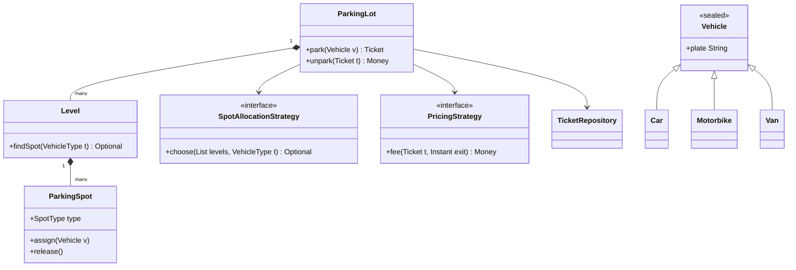
- **ParkingLot** — the facade (single entry point) the gate code talks to. It coordinates but holds no pricing or allocation logic itself.
- **Level / ParkingSpot** — the physical layout. A spot knows its type and whether it is free; a level keeps free spots grouped by type.
- **SpotAllocationStrategy** — the Strategy pattern: "first free", "nearest to exit" and "fill lowest level first" are interchangeable classes.
- **PricingStrategy** — computes the fee from a ticket and the exit time. Hourly, flat-weekend and free-first-15-minutes are separate implementations.
- **TicketRepository** — stores open tickets by id. An in-memory map now; a database later without touching the rest.

### Data model
| Type | Kind | Purpose |
|---|---|---|
| `Vehicle` | sealed interface, records `Car`, `Motorbike`, `Van` | plate number, size |
| `SpotType` | enum | `SMALL`, `COMPACT`, `LARGE`, with `fits(VehicleType)` |
| `Ticket` | record | id, plate, spot id, entry `Instant` |
| `Money` | record | amount as `long` minor units (cents) + currency |

### Tech stack
| Component | Choice | Why |
|---|---|---|
| Language | Java 25 | records and sealed types keep the model tiny |
| Time | `java.time.Clock` injected | lets tests freeze or advance time |
| Tests | JUnit 6 + AssertJ | readable, parameterised fee tests |
| Build | Maven or Gradle | standard layout, one command to test |

### Milestones
1. **Model.** Vehicles, spot types, `fits` rules. *Done when:* a parameterised test proves every vehicle/spot combination.
2. **Single level.** Park and unpark with "first free" allocation. *Done when:* parking into a full level returns "full", not an exception.
3. **Multi-level + display board.** Free counts per level and type. *Done when:* counts stay correct after 1,000 random park/unpark operations.
4. **Pricing.** Hourly pricing with an injected `Clock`. *Done when:* a test parks at 10:00, moves the clock to 12:01 and sees a 3-hour fee.
5. **Swap strategies.** Add "nearest spot" allocation and "weekend flat" pricing without editing old classes. *Done when:* `git diff` shows only new files plus wiring.

### Deep dive: the hard parts
**Finding a spot fast.** Scanning every spot is O(n). Instead keep, per level, a `Deque<ParkingSpot>` (or a `TreeSet` ordered by distance) of *free* spots for each `SpotType`. Parking pops from the right queue; unparking pushes back. The display board is then just the size of each queue — no counting.

**The "bigger spot" fallback.** Write the fallback order once, on the enum: `COMPACT.fallbacks()` returns `[COMPACT, LARGE]`. Allocation strategies iterate that list. If the rule lives inside each strategy, you will duplicate it and they will drift apart.

**Money and time.** Never use `double` for money: `0.1 + 0.2` is not `0.3` in binary floating point. Store cents in a `long` (or use `BigDecimal`). For "per started hour", compute `Duration.between(entry, exit)`, then round *up* with `(minutes + 59) / 60`. Inject a `Clock` instead of calling `Instant.now()`, or your pricing tests will be flaky.

### Testing strategy
Unit-test `fits` and each pricing strategy with `@ParameterizedTest` tables. Test `ParkingLot` against a fake `Clock` and a real in-memory repository. Add one randomised test: perform thousands of random park/unpark calls and check the invariant *free + occupied = capacity* after each one.

### Trade-offs, scaling and failure modes
Allowing big vehicles nowhere but big spots while letting cars spill into them can starve vans at peak time; some operators reserve a percentage of large spots — a policy that belongs in a strategy. A lost ticket is a real failure mode: support lookup by plate. If two gates call `park` at once, the free-spot queue is shared state; the simplest fix is making `park`/`unpark` `synchronized` on the level (at gate rates of a few cars per second, lock contention is irrelevant).

### Stretch goals
- Electric-vehicle spots with chargers, billed per kWh as a decorator on the pricing strategy.
- Reservations made in advance, held for 15 minutes past their start.
- Two entry gates running on separate virtual threads, with a concurrency test proving no spot is ever assigned twice.

### Skills practised
- [Ch 2 — OOP fundamentals](../chapters/02-oop-fundamentals/README.md): encapsulation of spot state.
- [Ch 3 — Relationships and UML](../chapters/03-relationships-and-uml/README.md): composition (lot owns levels owns spots).
- [Ch 4 — SOLID principles](../chapters/04-solid-principles/README.md): Open/Closed via strategies.
- [Ch 14 — Everyday objects](../chapters/14-case-everyday-objects/README.md): the reference parking-lot case study.

### In the interview
**Q:** Why is pricing a strategy and not a method on `Vehicle`?
**A:** Pricing is a business policy that changes independently of what a vehicle is. Putting it on `Vehicle` would mean editing vehicle classes when marketing runs a promotion, which breaks Single Responsibility.

**Q:** How would you handle two gates parking at the same time?
**A:** Make spot assignment atomic — lock per level, or use a concurrent queue of free spots so `poll()` hands each spot out exactly once.

**Q:** How do you test time-based pricing?
**A:** Inject `java.time.Clock`. Tests use `Clock.fixed` or a mutable test clock, so "two hours later" is one line, not a two-hour wait.

### TL;DR
A facade over levels and spots, with allocation and pricing as swappable strategies, money in integer cents and time from an injected clock.

## 2. Vending Machine
**Level:** Beginner · **Time:** 1 weekend · **Prerequisites:** Ch 2, Ch 11, Ch 14

### What it is
A software model of a snack vending machine: the user inserts coins, picks a product, receives it and gets change back. The machine behaves differently depending on its **state** (idle, has money, dispensing, out of service), which makes it the textbook exercise for the **State pattern** — each state is its own class that decides what each button press means.

### The problem it solves
Without the State pattern, every method (`insertCoin`, `select`, `cancel`) starts with a growing `if (state == ...)` block, and adding a new state ("maintenance mode") means editing every one of them. The real-world problem is equally sharp: the machine must never dispense without payment, never keep money for a product it cannot deliver, and must give correct change with the coins it actually has.

### Real-world examples
- Java 21+ [pattern matching for switch (JEP 441)](https://openjdk.org/jeps/441) lets you write the transition table as an exhaustive `switch` over a sealed set of events — a lightweight alternative to one-class-per-state.
- Production state-machine libraries such as [Spring Statemachine](https://docs.spring.io/spring-statemachine/docs/current/reference/) model exactly these ideas — states, events, transitions, guards and actions — for business workflows.

### Requirements
**Functional**
- Accept coins of fixed denominations (e.g. 5, 10, 25, 100 cents). Reject unknown coins.
- Select a product by slot code. Dispense if paid enough and in stock, otherwise explain why.
- Return change using the fewest coins available. Refuse the sale up front if exact change is impossible.
- Cancel at any time before dispensing returns all inserted money.
- Admin: restock products and coins, collect cash, put the machine out of service.

**Non-functional**
- No sequence of user actions may lose or create money: *coins in = coins out + revenue*.
- New states must be addable without editing existing state classes.
- 100% branch coverage on the state transitions.

### The architecture
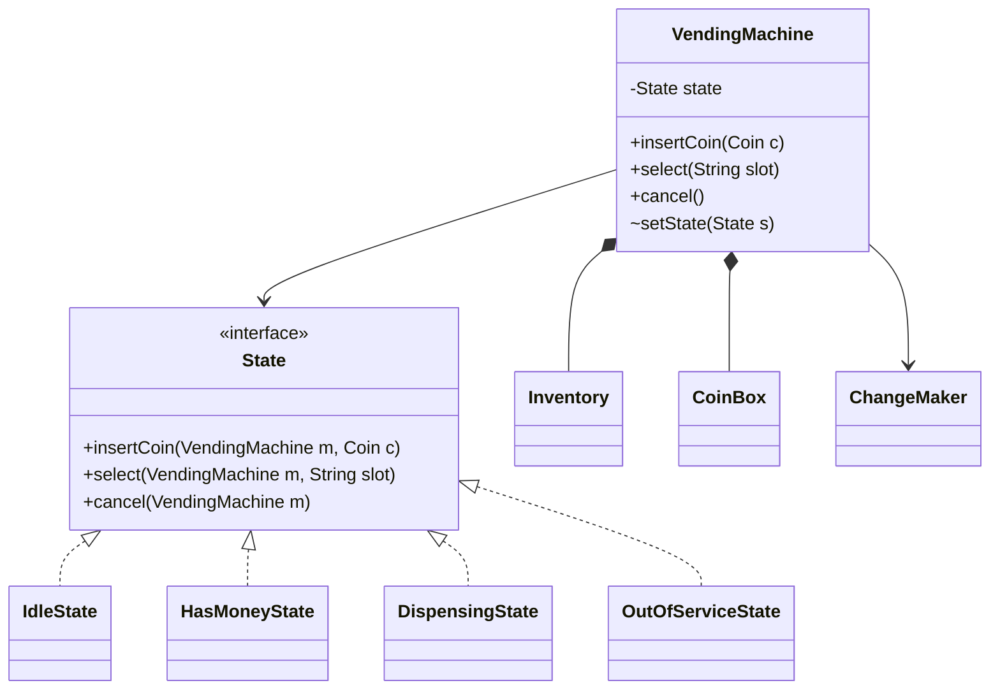
- **VendingMachine** — the context object. It forwards every button press to its current `State` and holds the shared parts.
- **State implementations** — one class per state. `IdleState.select` says "insert money first"; `HasMoneyState.select` checks price and stock.
- **Inventory** — slot code to product and quantity.
- **CoinBox** — counts of each coin denomination inside the machine, plus the coins of the current transaction kept separately until the sale completes.
- **ChangeMaker** — computes change from available coins (a strategy, so you can swap greedy for exact).

### Data model
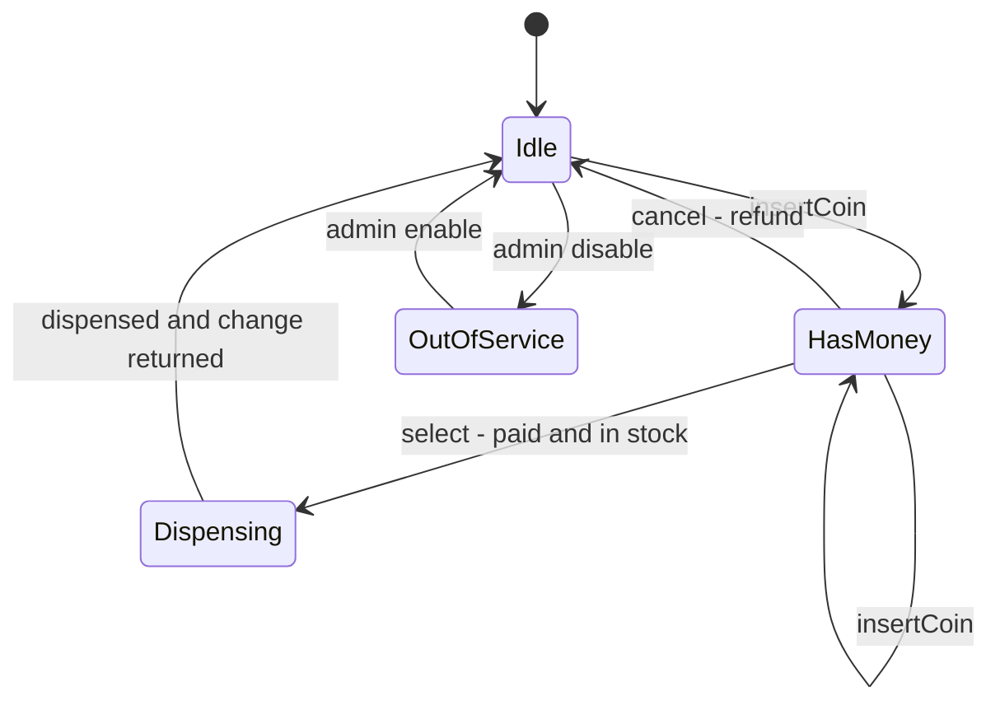
Key types: `Coin` enum (value in cents), `Product` record (name, price), `Slot` (product + count).

### Tech stack
| Component | Choice | Why |
|---|---|---|
| States | interface + one class each (or sealed + switch) | compare both styles |
| Money | `int` cents | coins are integers anyway |
| Tests | JUnit 6, AssertJ | assert on states and coin counts |
| CLI | plain `Scanner` loop | enough to demo |

### Milestones
1. **Coins and inventory.** *Done when:* inserting an unknown coin is rejected and counted nowhere.
2. **Idle and HasMoney states.** Insert and cancel. *Done when:* cancel returns exactly the inserted coins.
3. **Selling.** Dispensing with change. *Done when:* buying a 65-cent item with a 100-cent coin returns 35 cents as 25 + 10.
4. **Change feasibility.** *Done when:* when change cannot be made, the sale is refused and the money stays refundable.
5. **Out of service + admin.** *Done when:* every user action in `OutOfService` is rejected with a message.

### Deep dive: the hard parts
**Change-making.** Greedy (take the largest coin that fits, repeat) is optimal for standard coin systems like 1/5/10/25, but fails with odd denominations or when some coins run out: owing 30 with only 25s and 10s, greedy takes 25 and gets stuck at 5, while 10+10+10 works. Implement a small dynamic-programming or backtracking `ChangeMaker` that respects coin counts; the numbers are tiny so it is fast.

**Where the transaction's coins live.** Keep the current customer's coins in a separate "escrow" until the sale completes. Only then merge them into the cash box. This makes cancel trivial and guarantees the refund is exactly what was inserted.

**Who changes the state?** Either the states call `machine.setState(next)` (simple, but states know each other) or each handler returns the next state (states stay independent and testable). The second style is easier to unit-test: call a method, assert the returned state.

### Testing strategy
One test class per state, asserting the next state and side effects. A property test (with [jqwik](https://jqwik.net/) or a plain random loop) runs random action sequences and checks the money-conservation invariant after each step. Mock nothing: everything is in memory and fast.

### Trade-offs, scaling and failure modes
One-class-per-state is very clear but scatters the transition table over files; a sealed `switch` keeps the whole table on one screen but grows as states multiply. Real machines face power loss mid-dispense; a robust design writes "about to dispense slot A3" before acting so it can reconcile on restart. A jammed product (motor turns, nothing drops) should trigger a refund path, not a silent loss.

### Stretch goals
- Card payments via a `PaymentMethod` interface, alongside coins.
- A `Display` observer that shows messages, decoupled from states.
- Persist inventory and coin counts so a restart resumes correctly.

### Skills practised
- [Ch 11 — Behavioral patterns 2](../chapters/11-patterns-behavioral-2/README.md): State and Strategy.
- [Ch 14 — Everyday objects](../chapters/14-case-everyday-objects/README.md): vending and coffee machine case studies.
- [Ch 2 — OOP fundamentals](../chapters/02-oop-fundamentals/README.md): polymorphism replacing conditionals.

### In the interview
**Q:** Why State and not a big switch?
**A:** Each state's rules live in one class, so adding `Maintenance` means one new class rather than editing every method. With few states a sealed switch is fine — say which you would pick and why.

**Q:** Is greedy change-making always correct?
**A:** Only for "canonical" coin systems with unlimited coins. With limited coins you need search or dynamic programming.

**Q:** What invariant would you test?
**A:** Money conservation: coins inserted equal coins returned plus the price of goods dispensed.

### TL;DR
A context object delegating to state classes, an escrow for the current customer's coins, and a change-maker that respects real coin counts.

## 3. Library Management System
**Level:** Beginner · **Time:** 1–2 weekends · **Prerequisites:** Ch 2, Ch 3, Ch 15

### What it is
A system for a lending library: members search the catalogue, borrow and return copies, place holds on books that are out, and pay fines for late returns. The key modelling idea is the difference between a **book** (the title, identified by ISBN) and a **book item** (one physical copy with a barcode) — a distinction many beginners miss.

### The problem it solves
Libraries lend thousands of physical copies to thousands of people. Without a system, nobody knows who has what, when it is due, or who is next in line for a popular title. In design terms the problem trains you to separate catalogue data from inventory, to enforce business rules (borrow limits, hold queues) in one place, and to keep notification and fine logic out of the core lending flow.

### Real-world examples
- [Koha](https://koha-community.org/) is a widely used open-source integrated library system (ILS); its circulation module handles exactly these flows — checkout, return, holds and fines.
- The ISBN-versus-copy split is the same "type versus instance" split found in retail inventory and car rental (project 19).

### Requirements
**Functional**
- Catalogue: add books (ISBN, title, authors, subject) and copies. Search by title, author, subject.
- Members can borrow up to 5 items for 14 days, renew once if no hold exists, and return.
- Holds: if no copy is free, a member joins a first-in-first-out queue for that ISBN. On return, the copy is held for the first person in the queue for 3 days.
- Fines: a fixed amount per day late, capped at the item's price. Members with unpaid fines over a threshold cannot borrow.
- Notify members when a hold is ready or an item is due tomorrow.

**Non-functional**
- Search returns in under 50 ms for 100,000 titles in memory.
- Business rules (limits, durations, fine rates) configurable without code changes.
- All date logic testable with an injected clock.

### The architecture
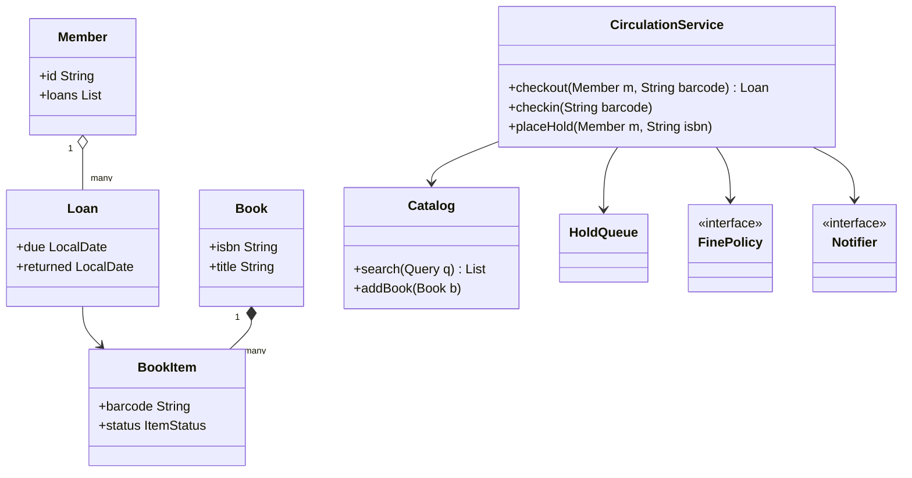
- **Catalog** — owns books and indexes for search (maps from lowercase author/title tokens to ISBNs).
- **Book / BookItem** — title-level data versus a physical copy with status and location.
- **Member / Loan** — a loan links one member to one copy with due and returned dates.
- **CirculationService** — the application service enforcing every lending rule. Controllers or a CLI call only this.
- **HoldQueue** — per-ISBN FIFO of member ids.
- **FinePolicy / Notifier** — interfaces so the fine formula and the delivery channel (email, SMS, console) can change independently.

### Data model
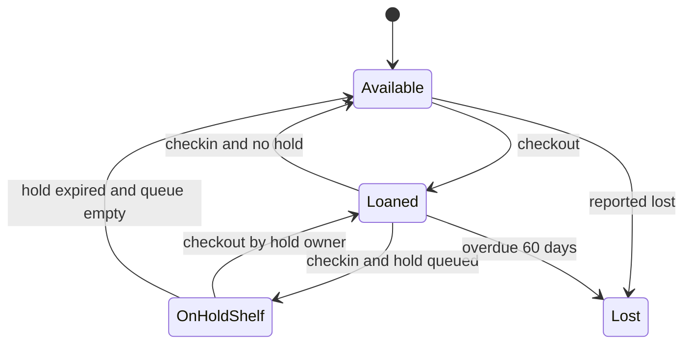
Persistence is optional here; in memory, repositories are interfaces backed by `HashMap`s.

### Tech stack
| Component | Choice | Why |
|---|---|---|
| Domain | Java 25 records + classes | `Book` is a record, `BookItem` is mutable |
| Search | in-memory inverted index | teaches indexing without a search engine |
| Time | `Clock` + `LocalDate` | due dates are calendar days |
| Tests | JUnit 6, AssertJ, Mockito for `Notifier` | verify notifications without sending |

### Milestones
1. **Catalogue and search.** *Done when:* searching "tolkien" finds all of his books regardless of case.
2. **Checkout and return.** *Done when:* a member at the 5-item limit is refused with a specific reason.
3. **Holds.** *Done when:* returning a copy with two people queued puts it on the hold shelf for the first and notifies them (verified with a Mockito mock).
4. **Fines.** *Done when:* a 3-day-late return produces the configured fine, and a member over the threshold cannot borrow.
5. **Renewals and reminders.** *Done when:* renewal is refused if anyone is waiting for that ISBN.

### Deep dive: the hard parts
**Holds are per title, not per copy.** A member wants "any copy of this ISBN". So the queue hangs off the `Book`, and on *any* copy's return you check that queue. Getting this wrong (queue per copy) makes members wait for one specific copy while others sit on the shelf.

**Where rules live.** Borrow limits, durations and fine rates should be in a `LendingRules` value object passed to the service, not sprinkled as constants. Different member types (student, staff) then become different rule objects, not subclasses of `Member`.

**Search index.** Tokenise titles and author names into lowercase words and keep `Map<String, Set<String>>` from token to ISBNs. A query with several words intersects the sets. This is the core idea of an inverted index, the structure behind every search engine.

### Testing strategy
Test `CirculationService` with in-memory repositories and a mock `Notifier` (`verify(notifier).holdReady(member, book)`). Use a mutable test clock to jump 15 days and check overdue logic. Parameterise fine tests over days late, including the cap.

### Trade-offs, scaling and failure modes
In memory, a restart forgets everything — acceptable for the exercise, and repositories as interfaces make swapping to a database a local change. A hold shelf item uncollected for 3 days must expire automatically; that needs a scheduled job, which is a source of bugs if it runs twice — make it idempotent (safe to run repeatedly). Deep inheritance (`StudentMember extends Member`) is tempting but brittle; prefer composition with a membership type.

### Stretch goals
- Persist to PostgreSQL behind the repository interfaces.
- Inter-branch transfers: a hold can be filled from another branch's copy.
- Ranking search results by how many words matched.

### Skills practised
- [Ch 2 — OOP fundamentals](../chapters/02-oop-fundamentals/README.md): identity versus value objects.
- [Ch 3 — Relationships and UML](../chapters/03-relationships-and-uml/README.md): composition versus aggregation.
- [Ch 15 — Booking 1](../chapters/15-case-booking-1/README.md): the library case study.
- [Ch 5 — Design principles](../chapters/05-design-principles/README.md): information expert, separation of concerns.

### In the interview
**Q:** Why separate `Book` and `BookItem`?
**A:** Title data is shared by all copies; status, barcode and location belong to each copy. Merging them duplicates data and makes holds per copy instead of per title.

**Q:** Where would you put the borrow-limit check?
**A:** In the circulation service (or a rule object it uses) — the one place that coordinates members, items and rules — not in `Member`, which would then need to know about inventory.

**Q:** How do you avoid sending the hold-ready email twice?
**A:** Record that the notification was sent with the hold, and make the sender check that flag; the operation becomes idempotent.

### TL;DR
Split titles from copies, put lending rules in one service, queue holds per title, and test dates with an injected clock.

## 4. Tic-Tac-Toe (N x N)
**Level:** Beginner · **Time:** 1 weekend · **Prerequisites:** Ch 2, Ch 11, Ch 17

### What it is
The noughts-and-crosses game, generalised: an N x N board, K-in-a-row to win, two or more players who can be humans or computer players. The project is small enough to finish quickly but rich enough to practise separating rules, board, players and user interface.

### The problem it solves
Most first attempts put everything in one `Game` class with a 3x3 array and eight hard-coded win lines. That code cannot grow to a 15x15 board with five-in-a-row, cannot plug in a computer opponent, and cannot be tested without typing moves. The design problem is to find the seams: who validates a move, who detects a win, who decides the next move.

### Real-world examples
- The computer player is the classic application of the [minimax algorithm](https://en.wikipedia.org/wiki/Minimax), which searches the game tree assuming both sides play optimally.
- Generalised K-in-a-row on a large board is the game Gomoku; the same O(K) win check you build here is what keeps it fast.

### Requirements
**Functional**
- Configurable N (3 to 15), K (3 to N) and 2–4 players with distinct symbols.
- Players take turns. Reject moves outside the board or on occupied cells.
- Detect win, draw (board full) and continue states after each move.
- Player types: human (console input) and computer (random, then minimax for 3x3).
- Undo the last move.

**Non-functional**
- Win detection after a move in O(K), not O(N^2).
- Game logic has zero dependency on the console — the UI is swappable.
- Minimax on an empty 3x3 board responds in under 1 second.

### The architecture
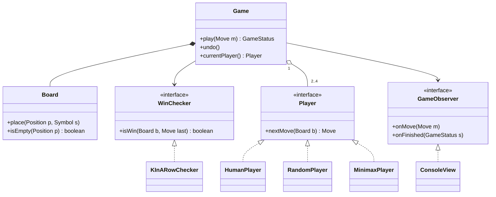
- **Game** — owns the turn order, history (for undo) and status. It is the only class that changes the board.
- **Board** — a grid of cells; knows nothing about winning.
- **WinChecker** — the win rule as a strategy, so variants (e.g. "connect four with gravity") plug in.
- **Player** — humans and bots behind one interface; the game loop does not care which.
- **GameObserver** — the Observer pattern; the console view (or a future GUI) subscribes to moves and results.

### Data model
| Type | Kind | Notes |
|---|---|---|
| `Position` | record (row, col) | value object, validated in constructor |
| `Move` | record (position, symbol) | pushed onto a history deque |
| `Symbol` | record or enum | `X`, `O`, `#`, `@` |
| `GameStatus` | sealed: `InProgress`, `Won(player)`, `Draw` | exhaustive switch in the UI |

### Tech stack
| Component | Choice | Why |
|---|---|---|
| Model | records + sealed status | immutable values, exhaustive handling |
| UI | console via `ConsoleView` observer | swappable for JavaFX later |
| AI | minimax with alpha-beta pruning | teaches recursion and pruning |
| Tests | JUnit 6 + AssertJ | scripted games as tests |

### Milestones
1. **Board and moves.** *Done when:* invalid moves are rejected with specific errors.
2. **Win checking in O(K).** *Done when:* tests cover horizontal, vertical, both diagonals and near-misses on a 7x7 board with K=4.
3. **Game loop with observers.** *Done when:* a scripted game of `Player` stubs plays to a win with no console.
4. **Undo.** *Done when:* undo after a winning move returns status to in-progress.
5. **Computer players.** *Done when:* minimax never loses a 3x3 game in 1,000 games against the random player.

### Deep dive: the hard parts
**Checking a win in O(K).** Only the last move can create a win. From it, walk in four directions — horizontal, vertical, two diagonals — counting consecutive same symbols both ways. If any direction reaches K, it is a win. There is no need to scan the whole board.

**Minimax and pruning.** Minimax recursively tries every move, scoring terminal positions +1/-1/0, and assumes the opponent picks the worst score for you. On 3x3 that is at most 9! paths, fine; on larger boards it explodes. Alpha-beta pruning stops exploring a branch once it cannot beat an option already found, which typically cuts the work dramatically. For N greater than 3, cap the depth and use a heuristic (count open lines).

**Undo without copying the board.** Keep a `Deque<Move>` of history. Undo pops the last move and clears that cell, then rewinds the turn index. This is the Command pattern in miniature, and the same trick that makes minimax cheap: make a move, recurse, undo.

### Testing strategy
Describe boards as strings in tests (`"XO.|.X.|..X"`) and parse them into `Board`, making win tests readable. Stub players returning scripted moves let you test the full game loop. Property: after any sequence of legal moves, the number of each symbol differs by at most one (for two players).

### Trade-offs, scaling and failure modes
A 2D `char[][]` is simplest; a flat `int[]` is faster and easier to copy for AI search. Observers make the UI pluggable but add indirection — for a pure console toy, direct printing is acceptable if tests do not need it. A slow AI blocks the game loop; run it on a separate thread with a timeout in a GUI version.

### Stretch goals
- Network play: two clients, a server-side `Game` per match.
- Ultimate tic-tac-toe (a 3x3 board of 3x3 boards) via the Composite pattern.
- A memoised minimax with a transposition table keyed by board hash.

### Skills practised
- [Ch 17 — Games](../chapters/17-case-games/README.md): the tic-tac-toe case study.
- [Ch 11 — Behavioral patterns 2](../chapters/11-patterns-behavioral-2/README.md): Strategy and Observer.
- [Ch 2 — OOP fundamentals](../chapters/02-oop-fundamentals/README.md): interfaces for players.

### In the interview
**Q:** How do you detect a win efficiently on a large board?
**A:** Check only lines through the last move, four directions, counting up to K each way — O(K) per move.

**Q:** How would you add a computer player?
**A:** It implements `Player.nextMove(board)`. The game loop is unchanged, which is the point of the interface.

**Q:** How does undo work?
**A:** A history stack of moves; undo pops, clears the cell, and moves the turn pointer back.

### TL;DR
Board, rules, players and view as separate pieces; O(K) win check from the last move; history stack for undo and AI search.

## 5. ATM
**Level:** Beginner · **Time:** 1–2 weekends · **Prerequisites:** Ch 9, Ch 10, Ch 11, Ch 14

### What it is
The software inside a cash machine: read a card, check the PIN, then let the customer check a balance, withdraw cash or deposit. The ATM talks to the bank over a network, holds a limited supply of notes, and must never pay out cash the bank has not approved.

### The problem it solves
An ATM is a small machine coordinating unreliable parts: a card reader, a keypad, a cash dispenser that can jam, and a remote bank that can time out. The design teaches you to model a session as a state machine, to hide hardware and the bank behind interfaces, and to dispense notes using a **Chain of Responsibility** (each note-size handler pays what it can and passes the rest on).

### Real-world examples
- Card-based ATM transactions travel to the bank as financial messages in formats such as [ISO 8583](https://en.wikipedia.org/wiki/ISO_8583), which defines request/response pairs and reversal messages — the same "authorise, then reverse if dispensing fails" flow you build here.
- The note-dispensing chain is the standard teaching example for Chain of Responsibility, covered in the handbook's behavioral patterns chapter.

### Requirements
**Functional**
- Insert card, enter PIN (3 wrong attempts retain the card).
- Balance enquiry, cash withdrawal in multiples of the smallest note, deposit, and eject card.
- Dispense using the fewest notes possible from what the cassettes hold.
- If the dispenser fails after the bank approved, send a reversal so the account is credited back.
- Daily withdrawal limit per card.

**Non-functional**
- Never dispense without an approval. Never debit without either dispensing or reversing.
- Bank calls time out after 10 seconds, with a clear message to the customer.
- Hardware and bank are interfaces; the whole session is testable with fakes.

### The architecture
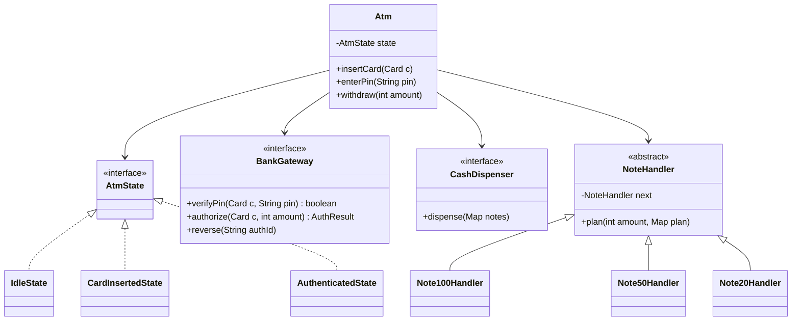
- **Atm** — the context: holds the session, current state and the hardware facades.
- **AtmState** — Idle, CardInserted (waiting for PIN), Authenticated (menu), plus OutOfCash/Maintenance.
- **BankGateway** — the adapter to the bank's network protocol. Tests use a fake.
- **CashDispenser** — the hardware interface; a fake can be told to jam.
- **NoteHandler chain** — computes a dispense plan from the largest note down, respecting cassette counts.

### Data model
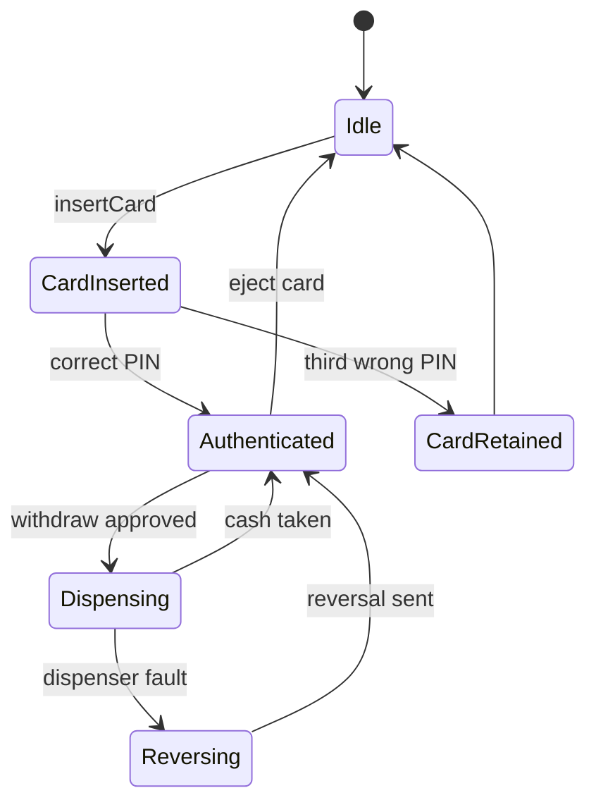
Key types: `Card` (record: number, expiry), `Session` (card, PIN attempts, withdrawn today), `AuthResult` (sealed: `Approved(authId)`, `Declined(reason)`).

### Tech stack
| Component | Choice | Why |
|---|---|---|
| States | State pattern | many buttons, behaviour per state |
| Dispensing | Chain of Responsibility | add a new note size as one class |
| Bank | `BankGateway` adapter + fake | no network in tests |
| Tests | JUnit 6, Mockito, AssertJ | verify `reverse` is called on jam |

### Milestones
1. **Session states and PIN.** *Done when:* three wrong PINs retain the card and return to Idle.
2. **Balance and withdrawal with fake bank.** *Done when:* a decline shows the reason and nothing is dispensed.
3. **Note chain.** *Done when:* withdrawing 170 with 100/50/20 notes yields 100+50+20, an impossible amount (like 30) is refused before contacting the bank, and tests cover empty cassettes.
4. **Failure handling.** *Done when:* a jammed dispenser triggers exactly one `reverse(authId)` call (Mockito `verify`).
5. **Limits and timeout.** *Done when:* a bank fake that sleeps 11 s produces a timeout message and no debit.

### Deep dive: the hard parts
**Plan before you dispense.** First compute a full plan of notes (the chain fills a map), and only if the remainder is zero ask the bank for approval, then dispense. If you dispense note by note and run out mid-way, you have paid out half the money with no clean way back.

**Authorise, dispense, then confirm or reverse.** The bank debits on approval. If the dispenser then fails, the ATM must send a reversal referencing the approval id. Network calls can fail too, so a reversal that cannot be sent is written to a local queue and retried later. This "compensating action" idea reappears in project 37.

**Greedy is not always enough.** With notes 50 and 20, withdrawing 60: greedy takes 50 and is stuck at 10, but 20+20+20 works. Let each handler try fewer of its notes when the rest of the chain fails (simple backtracking), or validate amounts against the available note set up front.

### Testing strategy
Fakes for `BankGateway` and `CashDispenser` that you can program ("decline next", "jam after 2 notes"). Mockito verifies the reversal call. Parameterised tests over amounts and cassette states for the note chain. One end-to-end session test walks card-in to card-out.

### Trade-offs, scaling and failure modes
Keeping session state in memory is fine — one customer at a time per machine. The real risk is ambiguity: did the bank receive the debit before the timeout? Production systems assume "maybe" and send a reversal for any timed-out authorisation. Retaining cards is a security feature but also a support burden; make the threshold configurable.

### Stretch goals
- Deposit with a note-recognition interface and a hold until counted.
- Multi-currency cassettes.
- A persistent journal of every hardware and bank event for audit.

### Skills practised
- [Ch 10 — Behavioral patterns 1](../chapters/10-patterns-behavioral-1/README.md): Chain of Responsibility.
- [Ch 11 — Behavioral patterns 2](../chapters/11-patterns-behavioral-2/README.md): State.
- [Ch 9 — Structural patterns](../chapters/09-patterns-structural/README.md): Adapter for the bank, Facade for hardware.
- [Ch 14 — Everyday objects](../chapters/14-case-everyday-objects/README.md): the ATM case study.

### In the interview
**Q:** What happens if cash jams after the bank approved?
**A:** The ATM sends a reversal for that authorisation id, retrying from a local queue until the bank acknowledges, so the customer is not charged for cash they did not get.

**Q:** Why Chain of Responsibility for notes?
**A:** Each handler knows one denomination; adding a 200 note is one new class linked into the chain, without editing the others.

**Q:** How do you test without hardware?
**A:** Hardware and bank are interfaces; tests use programmable fakes.

### TL;DR
A state machine for the session, a chain for note planning, and an authorise/dispense/reverse protocol that never loses money.

## 6. Snake and Ladder
**Level:** Beginner · **Time:** 1 weekend · **Prerequisites:** Ch 2, Ch 4, Ch 17

### What it is
The board game: players roll a die and move along squares 1 to 100; landing on a snake's head sends you down to its tail, landing on a ladder's foot sends you up. First to reach exactly 100 wins. As a project it is about clean modelling of a simple rule set and, above all, making randomness testable.

### The problem it solves
Games with dice are hard to test because the outcome is random. A design that calls `Math.random()` inside the game loop can only be tested statistically. This project teaches you to inject the source of randomness, to represent board jumps as data rather than code, and to keep rule variations (exact finish, extra turn on a six) pluggable.

### Real-world examples
- Java's [RandomGenerator interface (JEP 356)](https://openjdk.org/jeps/356) gives a common type for all random number generators, so the game can accept any generator — including a seeded one in tests.
- Snake and Ladder is a standard machine-coding problem in the handbook's games chapter, often used in timed rounds.

### Requirements
**Functional**
- Board of configurable size (default 100) with snakes and ladders loaded from a config file.
- 2–6 players take turns. Roll one die (or N dice).
- Rules: optional "exact roll to finish", optional "three sixes in a row forfeits the turn", optional "extra roll on six".
- Print each move and announce the winner.

**Non-functional**
- Validation at load time: no snake and ladder on the same square, no cycles, no jumps off the board, no snake at the final square.
- A game with a fixed seed is fully reproducible.
- 10,000 simulated games complete in under 1 second.

### The architecture
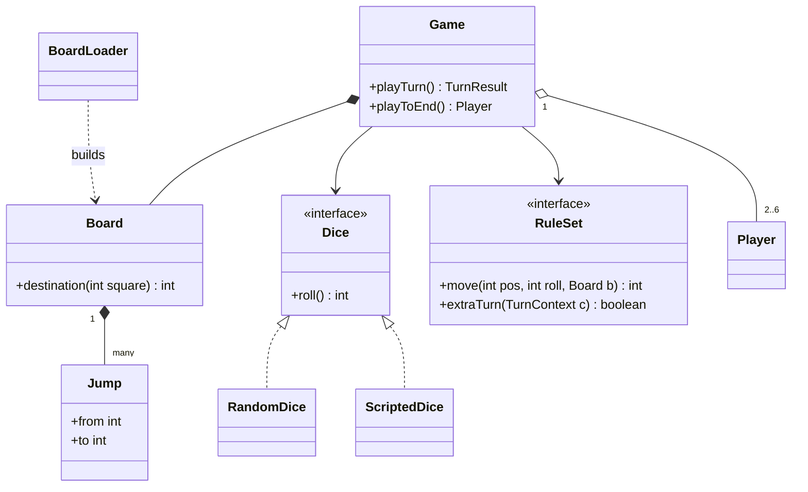
- **Game** — turn order, player positions and termination.
- **Board** — maps a square to its final destination after any snake or ladder; stored as an `int[]` so lookup is O(1).
- **Jump** — a record (from, to). Snakes and ladders are both jumps; only direction differs.
- **Dice** — injected; `RandomDice` wraps a `RandomGenerator`, `ScriptedDice` returns a fixed sequence for tests.
- **RuleSet** — the variant rules, so the game loop does not change when rules do.
- **BoardLoader** — reads and validates the config, the factory for `Board`.

### Data model
| Type | Kind | Notes |
|---|---|---|
| `Jump` | record | `isSnake()` is `to < from` |
| `Player` | record (name) | position kept in `Game`, not on the player |
| `TurnResult` | record | player, roll, from, to, jump taken |
| `BoardConfig` | record | size + list of jumps, validated |

### Tech stack
| Component | Choice | Why |
|---|---|---|
| Randomness | `RandomGenerator` injected | seeded and scripted dice for tests |
| Config | a small text or JSON file | data, not code, for boards |
| Tests | JUnit 6 + AssertJ | scripted dice make games deterministic |
| Simulation | plain loop | measure average game length |

### Milestones
1. **Board with jumps.** *Done when:* loading a config with a cycle or overlapping jump fails with a clear error.
2. **Single-player turn with scripted dice.** *Done when:* a scripted roll onto a ladder foot lands at its top.
3. **Multiplayer game loop.** *Done when:* a scripted 2-player game ends with the expected winner on the expected turn.
4. **Rule variants.** *Done when:* exact-finish and extra-turn-on-six are toggled by config, each with its own tests.
5. **Simulation.** *Done when:* running 10,000 seeded games prints the average number of turns, identical across runs.

### Deep dive: the hard parts
**Positions belong to the game.** Putting `position` on `Player` couples the player to one board. Keep a `Map<Player, Integer>` (or an array indexed by turn order) in `Game`; a player can then be in several games, and resetting is trivial.

**Validating the board.** Follow jumps from every square: if you ever revisit a square, there is a cycle (a ladder top that is a snake head leading back down to the ladder). Decide whether chained jumps are allowed; if yes, resolve them once at load time into the final destination so play is O(1).

**Testable randomness.** The game depends on the `Dice` interface only. `ScriptedDice` takes a list of numbers; tests read like stories ("roll 6, 6, 3"). For simulation, a seeded `RandomGenerator` gives repeatable results, so a failing run can be replayed exactly.

### Testing strategy
Scripted dice for rule tests; seeded random for simulation tests; property test: positions are always in [0, size]. Test the loader separately with good and bad configs.

### Trade-offs, scaling and failure modes
Representing the board as an array of destinations is fast but hides which squares are snakes; keep the `Jump` list for display. Rule variants as a strategy keep the loop clean but can conflict (extra turn on six plus three-sixes forfeit) — document the order rules apply in. An infinite game is possible with "exact finish" and no ladders; add a turn cap in simulation.

### Stretch goals
- Multiple dice and special squares (skip a turn, swap places).
- A GUI observer animating moves.
- A Markov-chain calculation of the expected game length, compared to your simulation.

### Skills practised
- [Ch 17 — Games](../chapters/17-case-games/README.md): the snake and ladder case study.
- [Ch 4 — SOLID principles](../chapters/04-solid-principles/README.md): Dependency Inversion for dice.
- [Ch 2 — OOP fundamentals](../chapters/02-oop-fundamentals/README.md): records for value types.

### In the interview
**Q:** How do you unit-test a dice game?
**A:** Inject the dice. Tests pass scripted dice with fixed rolls, so each test is deterministic.

**Q:** Snakes and ladders — two classes or one?
**A:** One `Jump` record; the behaviour is identical, only the direction differs. Two classes would duplicate logic for no gain.

**Q:** How would you add "skip a turn" squares?
**A:** Add a `Square` effect type and let the rule set apply effects after movement, without touching the dice or board loading.

### TL;DR
Jumps as data, positions in the game, rules as a strategy and dice injected so every game can be replayed.

## 7. Traffic Signal Controller
**Level:** Beginner · **Time:** 1 weekend · **Prerequisites:** Ch 11, Ch 12, Ch 14

### What it is
The controller for a four-way road junction: it cycles lights through green, yellow and red for each direction, never shows green to conflicting directions at once, handles pedestrian crossing requests, and gives way to emergency vehicles. It is a gentle introduction to time-driven state machines and to scheduling work with `java.util.concurrent`.

### The problem it solves
A junction controller must be safe first (never two conflicting greens) and efficient second (do not hold a green for an empty road). Code that changes lights with `Thread.sleep` inside loops is hard to test and impossible to interrupt for an emergency. The design separates *what* the light sequence is (a state machine of phases) from *when* transitions happen (a scheduler), so both can be tested and changed independently.

### Real-world examples
- Adaptive systems such as [SCATS](https://en.wikipedia.org/wiki/Sydney_Coordinated_Adaptive_Traffic_System) adjust phase timings from vehicle detector data instead of fixed cycles — the "adaptive timing" stretch goal here.
- The JDK's [ScheduledThreadPoolExecutor](https://docs.oracle.com/en/java/javase/25/docs/api/java.base/java/util/concurrent/ScheduledThreadPoolExecutor.html) is the standard way to run delayed tasks in Java and is what drives phase changes in this design.

### Requirements
**Functional**
- A junction has approaches (North, South, East, West). Phases group non-conflicting approaches (North+South green, then East+West).
- Each phase goes green, then yellow (3 s), then all-red clearance (2 s) before the next phase.
- Pedestrian button: shortens the current green (not below a minimum) and inserts a walk phase.
- Emergency override: move safely (via yellow and all-red) to green for the emergency direction.
- Night mode: flashing yellow.

**Non-functional**
- Safety invariant: no two conflicting approaches are ever green or yellow simultaneously — checked by tests and assertions.
- Timing accuracy within 100 ms is sufficient.
- Tests run in milliseconds using a fake clock/scheduler, not real seconds.

### The architecture
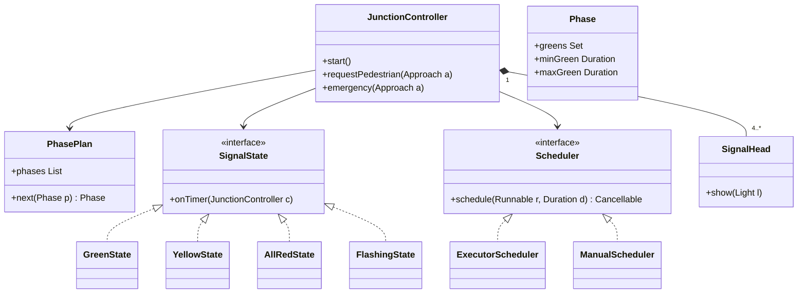
- **JunctionController** — owns the current phase and state; all events (timer fired, button pressed) are processed on one thread so no locks are needed.
- **PhasePlan / Phase** — configuration: which approaches go green together and their timings.
- **SignalState** — the State pattern for the green/yellow/all-red cycle.
- **Scheduler** — an interface; production wraps a `ScheduledExecutorService`, tests use `ManualScheduler` that advances virtual time.
- **SignalHead** — the output device for one approach (console print in this project).

### Data model
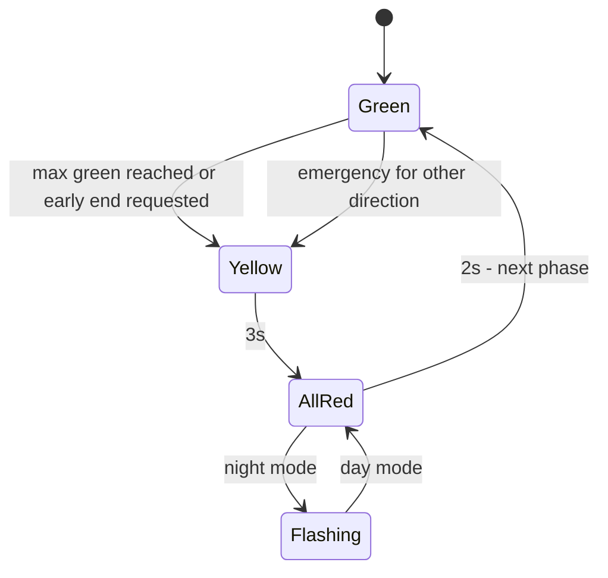
Key types: `Approach` enum, `Light` enum (`RED`, `YELLOW`, `GREEN`, `FLASHING_YELLOW`), `ConflictMatrix` (which approaches may not be green together).

### Tech stack
| Component | Choice | Why |
|---|---|---|
| Timing | `ScheduledExecutorService` (single thread) | serialises all events |
| Tests | `ManualScheduler` + JUnit 6 | simulate an hour in milliseconds |
| Safety check | `ConflictMatrix.assertSafe()` after every change | invariant enforced at runtime |
| Output | console `SignalHead` | swappable for hardware |

### Milestones
1. **Phase plan and conflict matrix.** *Done when:* a plan with conflicting approaches in one phase is rejected at startup.
2. **Fixed-time cycle.** *Done when:* with the manual scheduler, advancing 60 virtual seconds shows the exact expected sequence.
3. **Pedestrian requests.** *Done when:* a request during green ends it at `minGreen` at the earliest, then runs the walk phase.
4. **Emergency override.** *Done when:* an emergency during East-West green reaches North-South green via yellow and all-red, never directly.
5. **Night mode.** *Done when:* switching modes at any time passes the safety assertion.

### Deep dive: the hard parts
**One thread, no locks.** Button presses come from other threads; timers fire on the scheduler thread. If both change state, you need locks. Instead, submit every event as a task to the same single-threaded executor — the "actor" idea: one thread owns the state, others send it messages. Bugs from races disappear.

**Cancelling timers.** When an emergency arrives during green, the pending "go yellow at max green" timer must be cancelled, or it will fire later and break the sequence. Keep a handle to the scheduled task and cancel it on every transition.

**Never skip clearance.** The safety rule is in the transitions: green can only go to yellow, yellow only to all-red, all-red only to green. Emergency and pedestrian logic change *which* phase comes next, never the path. Encode this in the state classes so no caller can bypass it.

### Testing strategy
`ManualScheduler` keeps a priority queue of (due time, task) and an `advance(Duration)` method that runs due tasks in order. Every test asserts the safety invariant after each step. Scenario tests: rush of pedestrian presses, emergency during yellow, emergency during all-red.

### Trade-offs, scaling and failure modes
Fixed timing is simple but wastes green on empty roads; adaptive timing needs sensors and can starve a quiet approach without a max-wait rule. Real controllers fail safe: on any internal error they go to flashing red/yellow. Do the same — catch exceptions in the event loop and enter `Flashing`.

### Stretch goals
- Vehicle detectors that extend green while cars keep arriving, up to `maxGreen`.
- Coordinated junctions ("green wave") sharing a cycle offset.
- A JavaFX view showing the junction live.

### Skills practised
- [Ch 11 — Behavioral patterns 2](../chapters/11-patterns-behavioral-2/README.md): State.
- [Ch 12 — Concurrency concepts](../chapters/12-concurrency-concepts/README.md): executors and scheduled tasks.
- [Ch 14 — Everyday objects](../chapters/14-case-everyday-objects/README.md): the traffic signal case study.

### In the interview
**Q:** How do you guarantee no conflicting greens?
**A:** A conflict matrix checked at configuration time, transitions that always pass through yellow and all-red, and a runtime assertion after every change.

**Q:** How do you test a system that runs on timers?
**A:** Hide time behind a scheduler interface and use a manual implementation that advances virtual time instantly.

**Q:** Why a single-threaded executor?
**A:** It serialises all events, so state needs no locks and ordering is predictable.

### TL;DR
A phase plan plus a green/yellow/all-red state machine, driven by an injectable scheduler on one thread, with safety enforced in the transitions.

## 8. Task Manager CLI
**Level:** Beginner · **Time:** 1–2 weekends · **Prerequisites:** Ch 6, Ch 8, Ch 21

### What it is
A command-line to-do manager: add tasks with titles, priorities, due dates and tags; list and filter them; mark them done; undo the last action; and save to a file. It looks like a CRUD app (create, read, update, delete), but the interesting design is in the command parsing, filtering and undo.

### The problem it solves
A task tool has many commands and many filters, and both grow over time. The usual mess is a giant `switch` over command names in `main`, with filtering logic copy-pasted per command. This project practises the **Command** pattern (each command is an object), the **Builder** for tasks with many optional fields, a composable filter (the **Specification** idea), and the clean-code habits — small functions, clear names — that machine-coding rounds grade.

### Real-world examples
- [Taskwarrior](https://taskwarrior.org/) is a mature open-source command-line task manager with filters, tags, priorities and undo — a good reference for features and command syntax.
- [picocli](https://picocli.info/) is a widely used Java library for building command-line apps with subcommands and typed options.

### Requirements
**Functional**
- `add "title" --priority high --due 2026-11-01 --tag work`
- `list` with filters: status, priority, tag, due before/after, text search; sort by due or priority.
- `done <id>`, `edit <id> ...`, `delete <id>`, `undo`.
- Recurring tasks (daily, weekly): completing one creates the next.
- Persist to a JSON file on every change.

**Non-functional**
- Startup and any command under 200 ms for 10,000 tasks.
- A crash mid-save never corrupts the file.
- Each command class under 50 lines; parser and domain decoupled.

### The architecture
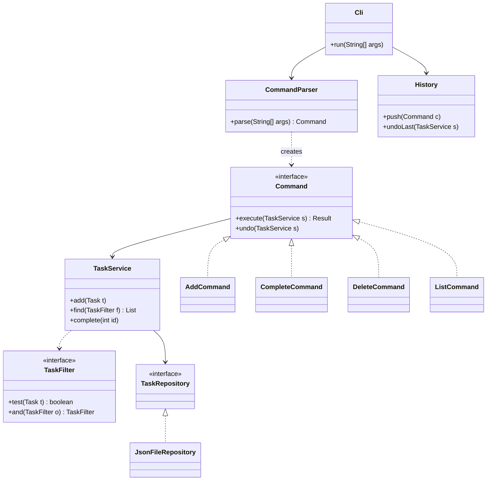
- **Cli / CommandParser** — turn arguments into a `Command` object. Only this layer knows the text syntax.
- **Command** — one class per action with `execute` and `undo`. Read-only commands have a no-op undo.
- **History** — a stack of executed commands for `undo`.
- **TaskService** — the domain operations, including recurrence.
- **TaskFilter** — small predicates combined with `and`/`or`, built from `--tag`, `--priority` etc.
- **TaskRepository** — persistence behind an interface; JSON file now.

### Data model
| Type | Kind | Notes |
|---|---|---|
| `Task` | class built with `Task.builder()` | id, title, priority, due, tags, status, recurrence |
| `Priority` | enum | `LOW`, `MEDIUM`, `HIGH` with ordering |
| `Recurrence` | sealed: `None`, `Daily`, `Weekly(DayOfWeek)` | computes next due date |
| `Status` | enum | `OPEN`, `DONE`, `DELETED` (soft delete enables undo) |

### Tech stack
| Component | Choice | Why |
|---|---|---|
| CLI parsing | hand-written parser, then picocli | learn it, then use the tool |
| JSON | Jackson (current version) | standard, records supported |
| Safe writes | write temp file + atomic move | no corrupted file on crash |
| Tests | JUnit 6, AssertJ, `@TempDir` | real files in a temp folder |

### Milestones
1. **Domain + builder.** *Done when:* building a task without a title throws a clear error.
2. **Commands and parser.** *Done when:* `add`, `list`, `done`, `delete` work end-to-end in tests that call `Cli.run`.
3. **Filters.** *Done when:* `list --tag work --priority high --due-before 2026-11-01` returns the right set.
4. **Undo.** *Done when:* `add`, `done`, `delete` are each undoable and tests check the store afterwards.
5. **Persistence and recurrence.** *Done when:* completing a weekly task creates next week's task and both survive a restart.

### Deep dive: the hard parts
**Undo needs enough information.** `DeleteCommand.undo` must restore the exact task, so the command records the task it deleted during `execute`. `AddCommand.undo` records the id it created. Soft delete (status `DELETED`) makes undo trivial and keeps ids stable.

**Composable filters.** Each option maps to a tiny `TaskFilter`; combine with `and`. This is Java's `Predicate` idea with a domain name, and it keeps `TaskService.find` to one line. New filters are new small classes, never edits to a long `if` chain — Open/Closed in practice.

**Atomic saves.** Writing directly over `tasks.json` and crashing halfway leaves half a file. Write to `tasks.json.tmp`, then `Files.move(tmp, target, ATOMIC_MOVE, REPLACE_EXISTING)`. On most file systems the rename is atomic: readers see either the old file or the new one.

### Testing strategy
Unit-test each filter and command. Use JUnit's `@TempDir` for repository tests with real files. A golden-output test runs a script of commands through `Cli.run` and compares the printed output to an expected text file.

### Trade-offs, scaling and failure modes
Rewriting the whole JSON file on every change is O(n) but simple and fine for thousands of tasks; an append-only log is faster but needs compaction. Undo history in memory is lost on exit — persist it if needed. Time zones matter for due dates: store `LocalDate` for date-only due dates, `Instant` for exact deadlines.

### Stretch goals
- Projects and subtasks (Composite pattern), with completion rolling up.
- A SQLite or PostgreSQL repository behind the same interface.
- Natural-language dates ("next friday").

### Skills practised
- [Ch 6 — Clean Code](../chapters/06-clean-code/README.md): small functions, naming.
- [Ch 8 — Creational patterns](../chapters/08-patterns-creational/README.md): Builder.
- [Ch 10 — Behavioral patterns 1](../chapters/10-patterns-behavioral-1/README.md): Command for undo.
- [Ch 21 — Machine coding](../chapters/21-case-machine-coding/README.md): the task management system case.

### In the interview
**Q:** How do you implement undo?
**A:** Every mutating command implements `undo` using state it captured during `execute`; a history stack replays undos in reverse order.

**Q:** How do you add a new filter without touching existing code?
**A:** A new `TaskFilter` class plus one line in the parser mapping an option to it.

**Q:** How do you avoid corrupting the save file?
**A:** Write to a temporary file and atomically rename it over the old one.

### TL;DR
Commands as objects with undo, composable filters, a builder for tasks and atomic file saves.

## 9. Coffee Machine
**Level:** Beginner · **Time:** 1 weekend · **Prerequisites:** Ch 8, Ch 9, Ch 14

### What it is
A model of a café coffee machine that brews drinks from recipes (espresso, latte, cappuccino), lets customers add extras (extra shot, oat milk, syrup) and tracks ingredient stock. It is the classic playground for **Decorator** (stacking extras onto a base drink) and **Builder/Factory** (creating drinks from a menu).

### The problem it solves
Drinks combine freely: a latte with oat milk, two extra shots and vanilla. A subclass per combination ("LatteWithOatAndVanilla") explodes combinatorially. Ingredient stock must be checked *before* brewing, for the whole order, so the machine never starts a drink it cannot finish. The project trains composition over inheritance and the "check all, then commit" pattern.

### Real-world examples
- Java's I/O streams are the best-known Decorator in the JDK: a [BufferedInputStream](https://docs.oracle.com/en/java/javase/25/docs/api/java.base/java/io/BufferedInputStream.html) wraps another `InputStream` and adds buffering, just as an "extra shot" wraps a drink and adds cost and ingredients.
- The coffee shop example is the Decorator chapter of *Head First Design Patterns*, summarised in the handbook's structural patterns chapter.

### Requirements
**Functional**
- Menu of base drinks, each a recipe of ingredients (espresso shots, milk ml, water ml, foam).
- Extras as add-ons with their own price and ingredients. Any number, any order.
- Check stock for the full drink; brew or refuse with "not enough milk".
- Refill ingredients; low-stock alerts at a threshold.
- Price and description computed from the composed drink ("Latte + oat milk + extra shot").

**Non-functional**
- New drink or extra = new data or one new class; no edits elsewhere.
- Stock never goes negative, even with concurrent orders from two dispensers.
- Price arithmetic exact (integer cents).

### The architecture
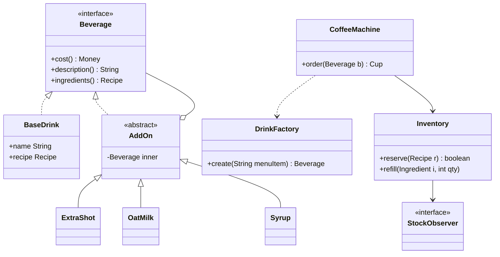
- **Beverage** — the common interface for drinks and decorated drinks.
- **BaseDrink** — espresso, latte etc., loaded from a menu file.
- **AddOn** — the Decorator: wraps a `Beverage`, adds cost and ingredients, delegates the rest.
- **DrinkFactory** — maps menu names (and an order like `"latte+oat+shot"`) to composed objects.
- **Inventory** — stock per ingredient with all-or-nothing `reserve`.
- **StockObserver** — notified on low stock.

### Data model
| Type | Kind | Notes |
|---|---|---|
| `Ingredient` | enum | `COFFEE_G`, `MILK_ML`, `OAT_MILK_ML`, `WATER_ML`, `SYRUP_ML` |
| `Recipe` | record (`Map<Ingredient,Integer>`) | `plus(Recipe)` merges amounts |
| `Money` | record (cents) | `plus` |
| `Cup` | record | description + price, the result of brewing |

### Tech stack
| Component | Choice | Why |
|---|---|---|
| Composition | Decorator | free combination of extras |
| Menu | JSON/YAML file | add drinks without code |
| Concurrency | `synchronized` reserve | all-or-nothing is one critical section |
| Tests | JUnit 6, AssertJ | price/description tables |

### Milestones
1. **Recipes and base drinks.** *Done when:* the menu file loads and each drink prints its price.
2. **Decorators.** *Done when:* `ExtraShot(OatMilk(Latte))` has the right cost, description and merged recipe.
3. **Inventory.** *Done when:* an order needing more milk than in stock is refused and stock is unchanged.
4. **Factory from order strings.** *Done when:* `"cappuccino+syrup+syrup"` builds correctly and unknown add-ons are rejected.
5. **Concurrency + alerts.** *Done when:* two threads placing 1,000 orders each never drive stock negative, and the observer fires once per threshold crossing.

### Deep dive: the hard parts
**Oat milk replaces milk.** A naive `OatMilk` decorator adds oat milk *and* keeps the base's dairy milk. Make `ingredients()` able to substitute: the decorator takes the inner recipe, removes `MILK_ML`, and adds the same amount of `OAT_MILK_ML`. This shows decorators can transform, not just add.

**Check then commit, atomically.** `reserve(recipe)` must check every ingredient and then subtract all of them in one critical section. Checking outside the lock and subtracting inside lets two orders both pass the check — a classic "check-then-act" race.

**Decorator versus a list of extras.** A `Drink` with a `List<Extra>` is often simpler and serialises more easily. Decorator wins when extras change behaviour (substitution, conditional pricing). Build the decorator version, then write a paragraph on when you would choose the list.

### Testing strategy
Table-driven tests for cost and description of many combinations. Inventory tests for boundary amounts (exactly enough, one short). A concurrency test with an `ExecutorService` and a `CountDownLatch` to start threads together, asserting final stock equals initial minus successful orders.

### Trade-offs, scaling and failure modes
Deep decorator stacks are hard to debug (stack traces through many wrappers) and to inspect ("does this drink have syrup?" needs a walk). Equality of decorated objects is awkward. The machine may fail mid-brew; reserve stock before brewing and release it if brewing fails.

### Stretch goals
- Size multipliers (small/medium/large) applied to the whole recipe.
- Loyalty discounts as a pricing strategy applied after decoration.
- A brewing pipeline with steps (grind, tamp, extract, steam) via Template Method.

### Skills practised
- [Ch 9 — Structural patterns](../chapters/09-patterns-structural/README.md): Decorator.
- [Ch 8 — Creational patterns](../chapters/08-patterns-creational/README.md): Factory and Builder.
- [Ch 14 — Everyday objects](../chapters/14-case-everyday-objects/README.md): the coffee machine case.
- [Ch 12 — Concurrency concepts](../chapters/12-concurrency-concepts/README.md): check-then-act races.

### In the interview
**Q:** Why Decorator here?
**A:** Extras combine freely and in any number; wrapping avoids a subclass per combination while keeping one `Beverage` interface.

**Q:** How do you stop stock going negative with two dispensers?
**A:** Check and deduct all ingredients inside one lock (or one atomic operation), never check outside the lock.

**Q:** When would you not use Decorator?
**A:** When extras are plain data with no behaviour — a list on the drink is simpler and easier to persist.

### TL;DR
Base drinks plus decorators for extras, recipes as mergeable values, and an all-or-nothing inventory reservation.

## 10. Digital Wallet
**Level:** Beginner · **Time:** 1–2 weekends · **Prerequisites:** Ch 5, Ch 12, Ch 21

### What it is
An in-memory wallet service: users open wallets, top up money, transfer to each other, and see a statement. It is a small project with two big lessons: money must be modelled exactly, and transfers between two accounts must be safe when many happen at once.

### The problem it solves
Money bugs are the most expensive bugs. Floating-point rounding loses cents; two concurrent transfers can both read the same balance and overdraw; a retried request can transfer twice. This project teaches the **Money** value object, immutable transaction records, lock ordering to avoid deadlock, and **idempotency keys** — a client-chosen id that makes retries safe.

### Real-world examples
- Martin Fowler's [Money pattern](https://martinfowler.com/eaaCatalog/money.html) describes pairing an amount with a currency in one value object, the basis of this design.
- Stripe's post on [idempotency keys](https://stripe.com/blog/idempotency) explains why payment APIs accept a client-generated key so a retried request does not charge twice.
- [JavaMoney (JSR 354)](https://javamoney.github.io/) is the Java standard API for monetary amounts and currencies, if you prefer a library to a hand-written `Money`.

### Requirements
**Functional**
- Create a wallet for a user, top up from an "external" source, withdraw, transfer between wallets.
- Reject transfers that would overdraw. Reject currency mismatches.
- Statement: list of transactions with running balance, filterable by date.
- Every mutating call accepts an idempotency key; repeating a call with the same key returns the first result.
- Optional cashback offer: 1% on the first transfer of the day (a pluggable offer strategy).

**Non-functional**
- Total money in the system changes only by top-ups and withdrawals: transfers conserve it.
- 100 threads doing 10,000 random transfers: no deadlock, no lost update, no negative balance.
- Transfer latency in memory under 1 ms at the 99th percentile.

### The architecture
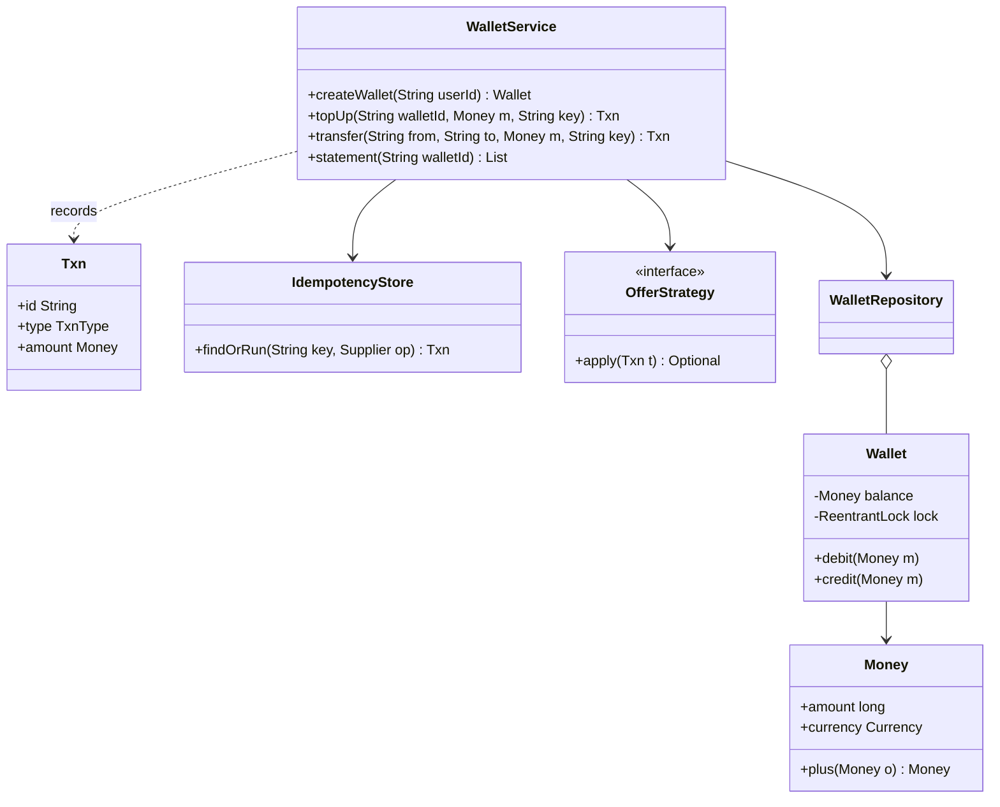
- **WalletService** — the application service: validation, locking order, idempotency, offers.
- **Wallet** — holds a balance and its own lock; `debit` refuses to go negative.
- **Money** — immutable amount in minor units plus currency; arithmetic refuses mixed currencies.
- **Txn** — an immutable record of every movement; the statement is a view over these.
- **IdempotencyStore** — remembers key to result.
- **OfferStrategy** — cashback rules, pluggable.

### Data model
| Type | Kind | Notes |
|---|---|---|
| `Money` | record (long minor units, `Currency`) | never `double` |
| `Txn` | record | id, type (`TOPUP`, `WITHDRAW`, `TRANSFER_OUT`, `TRANSFER_IN`, `CASHBACK`), amount, counterparty, time |
| `Wallet` | class | id, owner, balance, lock, list of txn ids |
| `TransferResult` | sealed: `Ok(txn)`, `Insufficient`, `CurrencyMismatch` | no exceptions for business outcomes |

### Tech stack
| Component | Choice | Why |
|---|---|---|
| Money | `long` cents or `BigDecimal` with scale 2 | exact arithmetic |
| Locks | `ReentrantLock` per wallet | fine-grained, `tryLock` with timeout |
| Concurrency tests | `ExecutorService` with virtual threads | thousands of cheap threads |
| Tests | JUnit 6, AssertJ | invariant assertions |

### Milestones
1. **Money.** *Done when:* adding EUR to USD throws, and 0.10 + 0.20 equals exactly 0.30.
2. **Single-threaded wallet service.** *Done when:* overdraft is refused and the statement shows correct running balances.
3. **Idempotency.** *Done when:* calling `transfer` twice with one key moves money once and returns the same txn id.
4. **Concurrent transfers.** *Done when:* 100 virtual threads doing random transfers among 50 wallets finish without deadlock and total money is unchanged.
5. **Offers.** *Done when:* cashback is applied only to the first transfer per user per day, verified with an injected clock.

### Deep dive: the hard parts
**Deadlock in transfers.** Thread 1 transfers A to B (locks A, then wants B) while thread 2 transfers B to A (locks B, wants A): both wait forever. Fix by always locking in a global order — e.g. by wallet id — regardless of transfer direction. Lock the smaller id first, then the larger. This removes the circular wait, one of the four conditions for deadlock.

**Conservation as a test oracle.** After any concurrent run, the sum of all balances must equal the sum of top-ups minus withdrawals. This single check catches lost updates, double-applies and partial transfers. Write it first.

**Idempotency race.** Two retries with the same key can arrive at the same time. Use `ConcurrentHashMap.computeIfAbsent(key, ...)` storing a future, so the second caller waits for and returns the first caller's result instead of running the transfer again.

### Testing strategy
Unit tests for `Money` and `Wallet`. A stress test using `Executors.newVirtualThreadPerTaskExecutor()` with a `CountDownLatch` start gate, followed by the conservation assertion. A deadlock test with a timeout (`assertTimeoutPreemptively`) that fails instead of hanging the build.

### Trade-offs, scaling and failure modes
Per-wallet locks scale well until one wallet is hot (a merchant receiving thousands of payments): every transfer to it serialises. A ledger of immutable entries (project 34) with balances derived from entries is more auditable than mutable balances. In-memory idempotency keys must expire, or memory grows forever — keep them for 24 hours.

### Stretch goals
- Persist to PostgreSQL with `SELECT ... FOR UPDATE` row locks in id order.
- Multi-currency with an exchange-rate provider and explicit conversion transactions.
- Scheduled payments using a `ScheduledExecutorService`.

### Skills practised
- [Ch 5 — Design principles](../chapters/05-design-principles/README.md): immutability, fail fast.
- [Ch 12 — Concurrency concepts](../chapters/12-concurrency-concepts/README.md): locks, deadlock, virtual threads.
- [Ch 21 — Machine coding](../chapters/21-case-machine-coding/README.md): the digital wallet case.

### In the interview
**Q:** How do you prevent deadlock when transferring between two wallets?
**A:** Acquire both locks in a fixed global order, such as by wallet id, so no two threads can wait on each other in a cycle.

**Q:** Why not `double` for money?
**A:** Binary floating point cannot represent most decimal fractions exactly, so sums drift by fractions of a cent. Use integer minor units or `BigDecimal`.

**Q:** A client times out and retries a transfer. What happens?
**A:** It sends the same idempotency key; the service returns the original result without moving money again.

### TL;DR
Exact `Money`, immutable transaction records, ordered locking for transfers and idempotency keys for safe retries.

## 11. Elevator System
**Level:** Intermediate · **Time:** 1–2 weeks · **Prerequisites:** Ch 11, Ch 12, Ch 14

### What it is
A controller for a bank of elevators in one building. People press **hall calls** (up/down buttons on a floor) and **car calls** (floor buttons inside a cabin); a **dispatcher** decides which cabin serves each hall call; each cabin moves, stops, opens doors and keeps going in a sensible order. It is the most common intermediate LLD question because it mixes state machines, scheduling strategy and concurrency.

### The problem it solves
Serving requests in arrival order makes cabins zig-zag and passengers wait. Real controllers minimise waiting time while never starving a floor. The software challenge is to separate three concerns that beginners merge: the **per-cabin state machine** (moving, stopped, doors open), the **per-cabin stop ordering** (which floor next), and the **cross-cabin dispatch** (which cabin gets a new hall call) — and to run it all safely while requests keep arriving from many threads.

### Real-world examples
- The single-cabin ordering rule is the [elevator algorithm (SCAN)](https://en.wikipedia.org/wiki/Elevator_algorithm): keep moving in one direction serving stops until none remain ahead, then reverse. The same idea schedules disk-head movement.
- The handbook's everyday-objects chapter works the elevator case study in detail; this project turns it into a running simulation.

### Requirements
**Functional**
- N floors (up to 100), M cabins (up to 8), each with capacity and current floor.
- Hall calls (floor + direction) and car calls (target floor).
- Cabins serve stops in SCAN/LOOK order; doors open for a fixed time; overweight blocks closing.
- Dispatcher assigns each hall call to one cabin using a pluggable strategy (nearest suitable car, least loaded, zoning).
- Maintenance mode removes a cabin from dispatch; fire mode sends all cabins to the ground floor.

**Non-functional**
- Simulation runs in discrete ticks; 10,000 simulated passengers process in under 2 seconds.
- Metrics: average and 95th-percentile wait time per strategy.
- Thread-safe request intake from many caller threads.

### The architecture
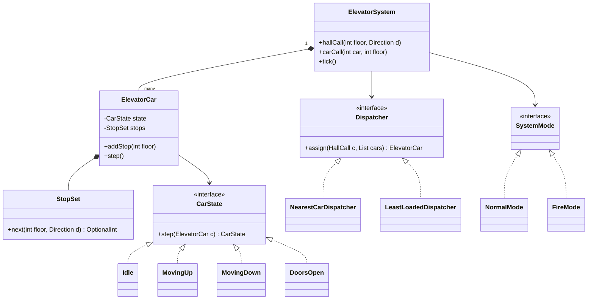
- **ElevatorSystem** — the facade: takes requests, drives the clock (`tick`), owns cars.
- **Dispatcher** — strategy for hall-call assignment. Swap it and compare metrics.
- **ElevatorCar** — one cabin: current floor, direction, load, state and pending stops.
- **StopSet** — two sorted sets (stops above, stops below) giving LOOK order in O(log n).
- **CarState** — State pattern for idle, moving and doors-open behaviour.
- **SystemMode** — normal, maintenance, fire; changes what the system accepts.

### Data model
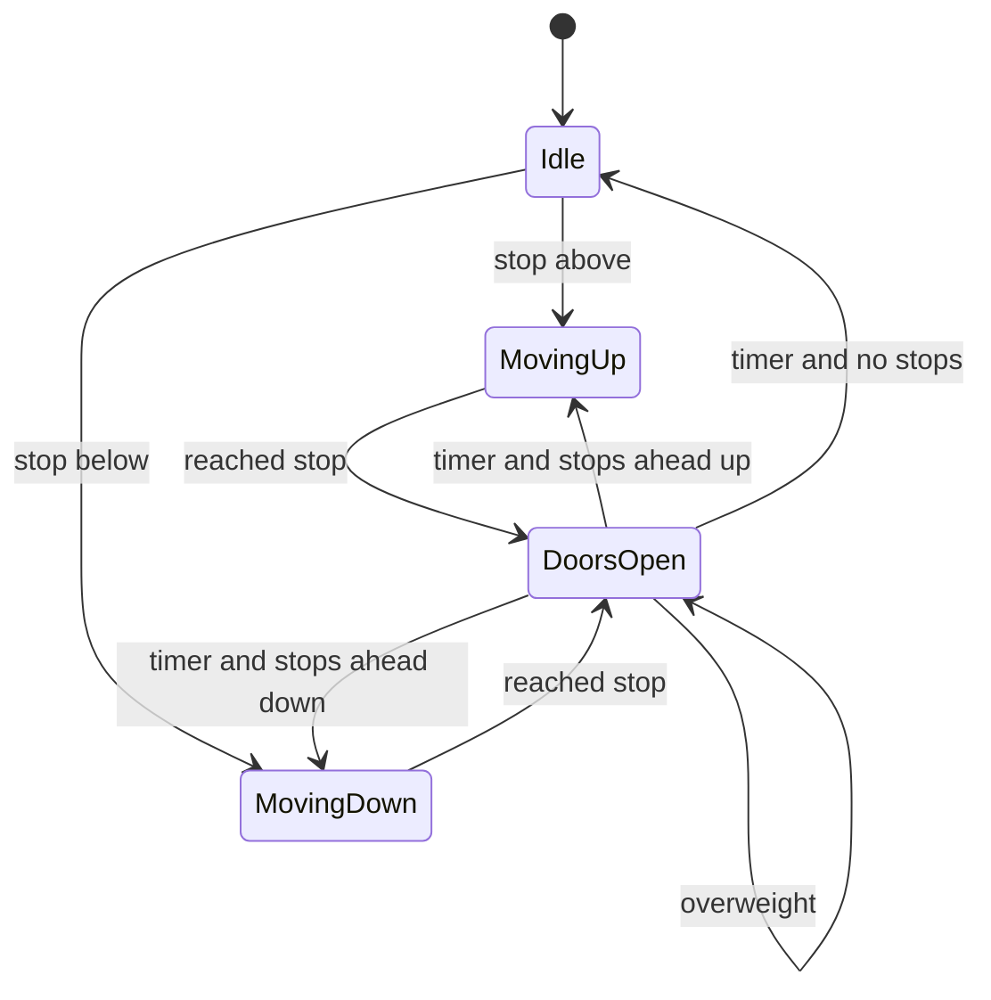
| Type | Notes |
|---|---|
| `Direction` | enum `UP`, `DOWN`, `NONE` |
| `HallCall` | record (floor, direction, time created) |
| `Passenger` (simulation) | origin, destination, arrival tick, boarded tick |

### Tech stack
| Component | Choice | Why |
|---|---|---|
| Stops | two `TreeSet<Integer>` per car | ordered next-stop lookup |
| Intake | `ConcurrentLinkedQueue` drained each tick | threads never touch car state |
| Simulation | discrete ticks, seeded random traffic | reproducible metrics |
| Tests | JUnit 6, AssertJ, parameterised scenarios | per-strategy comparisons |

### Milestones
1. **One car, LOOK ordering.** *Done when:* car at floor 5 going up with stops {7, 2, 9} visits 7, 9, then 2.
2. **Car state machine.** *Done when:* tests show doors open for exactly the configured ticks and overweight keeps them open.
3. **Multiple cars + nearest-car dispatch.** *Done when:* a hall call at 10 up goes to the car at 8 moving up, not the idle car at 1.
4. **Simulation and metrics.** *Done when:* a seeded morning-rush scenario prints average and p95 wait for two strategies.
5. **Concurrency and modes.** *Done when:* 50 threads issuing calls while the clock ticks lose no request, and fire mode sends every car to floor 0 without stopping.

### Deep dive: the hard parts
**What "suitable" means for dispatch.** A car is a good candidate for an "up at floor 10" call if it is idle, or moving up and still below 10. A car moving up past 10 would have to finish its run and come back, so its cost is much higher. Write a cost function: distance plus a penalty for each stop already queued plus a large penalty for direction mismatch. Every strategy is a different cost function — a clean Strategy pattern.

**LOOK in O(log n).** Keep `up = TreeSet` and `down = TreeSet`. Going up, the next stop is `up.ceiling(currentFloor)`; if null, reverse and use `down.floor(currentFloor)`. Never sort a list on each tick.

**Concurrency without locking cars.** Caller threads only enqueue requests into a concurrent queue. The single simulation thread drains the queue at the start of each tick and is the only writer of car state. This "one writer" design avoids locks and makes ticks deterministic, which is also what makes the simulation testable.

**Starvation.** A busy express zone can keep cars away from a quiet floor. Track each hall call's age and boost its priority once it exceeds a threshold.

### Testing strategy
Scenario tests with a scripted list of calls and expected stop sequence. Strategy comparison as a test that asserts the smarter dispatcher's average wait is lower than a round-robin baseline on a fixed seed. A concurrency test: many producer threads, then assert every request was served exactly once.

### Trade-offs, scaling and failure modes
Assigning a hall call immediately is simple but may be wrong a second later; "destination dispatch" systems ask for the destination at the lobby and group passengers, at the cost of a different user interface. A car that fails mid-run must have its hall calls reassigned — keep assignments in the dispatcher, not only in the car. Tick-based simulation is deterministic; a real-time version uses a scheduler but should still use one owner thread.

### Stretch goals
- Destination dispatch: passengers enter destination at the lobby keypad.
- Energy metric: count starts and stops; add a strategy that trades wait time for fewer starts.
- A live text visualisation of the shaft.

### Skills practised
- [Ch 14 — Everyday objects](../chapters/14-case-everyday-objects/README.md): the elevator case.
- [Ch 11 — Behavioral patterns 2](../chapters/11-patterns-behavioral-2/README.md): State and Strategy.
- [Ch 12 — Concurrency concepts](../chapters/12-concurrency-concepts/README.md): concurrent queues, single-writer design.

### In the interview
**Q:** How does one car decide its next stop?
**A:** LOOK: continue in the current direction to the nearest pending stop ahead; when none remain, reverse. Two sorted sets give the next stop in O(log n).

**Q:** How do you assign a hall call among cars?
**A:** A dispatcher strategy computes a cost per car — distance, direction compatibility, queued stops — and picks the cheapest. Strategies are swappable and measured in simulation.

**Q:** How do you handle concurrent button presses?
**A:** Presses go into a thread-safe queue; one controller thread applies them, so car state has a single writer and needs no locks.

### TL;DR
Per-car state machine plus LOOK stop ordering, a cost-based dispatcher strategy across cars, and a single-writer loop fed by a concurrent request queue.

## 12. Movie Ticket Booking with Seat Locks
**Level:** Intermediate · **Time:** 2 weeks · **Prerequisites:** Ch 12, Ch 15

### What it is
The core of a cinema booking service (like BookMyShow or Fandango): browse shows, view a seat map, pick seats, **hold** them for a few minutes while paying, and confirm. The defining problem is the seat hold: two people clicking the same seat at the same moment must not both get it.

### The problem it solves
Popular shows open for sale and thousands of people click at once. Without careful locking, two users can pay for the same seat ("double booking"), or seats can stay locked forever when a user abandons payment. The project teaches **temporary holds with expiry**, atomic multi-seat reservation (all seats or none), and the difference between a lock held in memory and the final confirmed booking.

### Real-world examples
- The handbook's booking chapter covers the BookMyShow-style design; this capstone implements the seat-hold engine underneath it.
- When holds move to a database, PostgreSQL's row locks ([explicit locking](https://www.postgresql.org/docs/current/explicit-locking.html)) and `SELECT ... FOR UPDATE SKIP LOCKED` ([SELECT docs](https://www.postgresql.org/docs/current/sql-select.html)) are the standard tools for "grab these rows unless someone else has them".
- In memory, [ConcurrentHashMap](https://docs.oracle.com/en/java/javase/25/docs/api/java.base/java/util/concurrent/ConcurrentHashMap.html) offers atomic per-key operations such as `compute` and `putIfAbsent`, which can implement per-seat holds.

### Requirements
**Functional**
- Cinemas, screens with seat layouts (rows, seat types, prices), movies, and shows (movie + screen + start time).
- Seat map for a show: each seat `AVAILABLE`, `HELD`, or `BOOKED`.
- `hold(show, seats, user)` holds all requested seats for 10 minutes or fails if any is taken.
- `confirm(holdId, payment)` books them if the hold has not expired. `release(holdId)` frees them.
- Expired holds are released automatically. A user may have one active hold per show.

**Non-functional**
- No double booking under any interleaving — proven by concurrency tests.
- `hold` under 5 ms in memory with 500 concurrent users on one show.
- Expiry accuracy within 1 second.

### The architecture
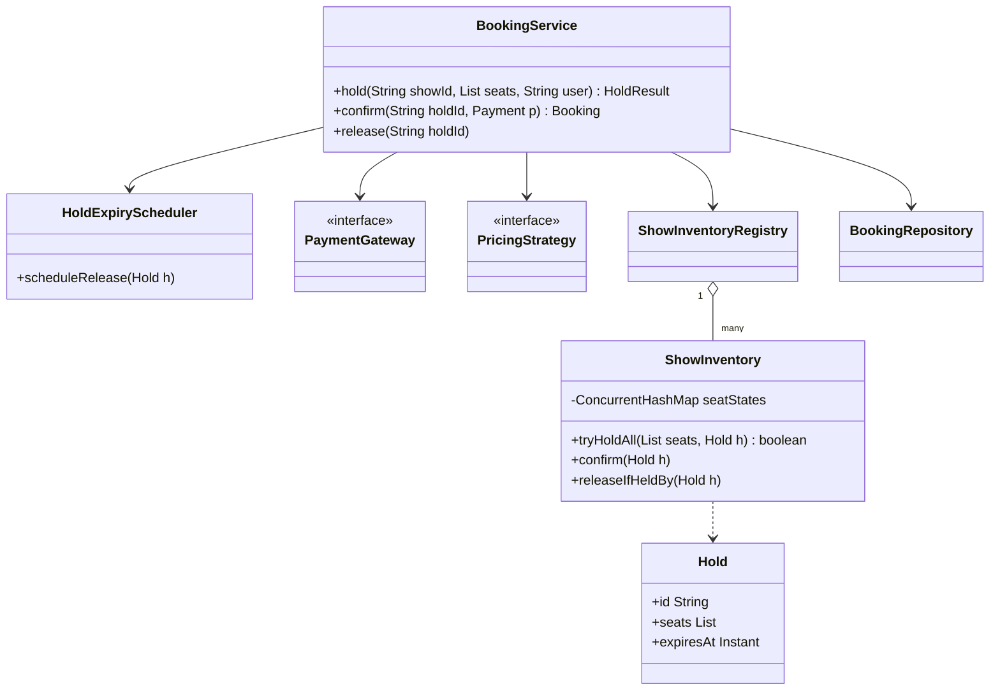
- **BookingService** — orchestrates hold, payment and confirmation.
- **ShowInventory** — the seat states of one show; the only place seat status changes, using atomic operations.
- **Hold** — a temporary claim with an expiry time.
- **HoldExpiryScheduler** — releases holds at expiry (a `ScheduledExecutorService` or a `DelayQueue`).
- **PaymentGateway** — external payment behind an interface.
- **PricingStrategy** — seat-type pricing, weekend surcharges.
- **BookingRepository** — confirmed bookings, the durable record.

### Data model
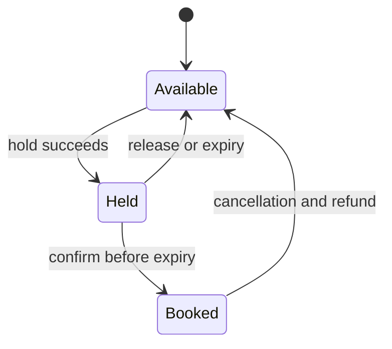
| Type | Notes |
|---|---|
| `SeatId` | record (row, number) |
| `SeatState` | sealed: `Available`, `Held(holdId, expiresAt)`, `Booked(bookingId)` |
| `Show` | id, movie, screen, start, layout reference |
| `Booking` | id, show, seats, user, amount, payment reference |

### Tech stack
| Component | Choice | Why |
|---|---|---|
| Seat states | `ConcurrentHashMap<SeatId, SeatState>` per show | atomic per-seat updates |
| Multi-seat atomicity | lock seats in sorted order, or one lock per show | all-or-nothing |
| Expiry | `DelayQueue` or `ScheduledExecutorService` | timed release |
| Tests | JUnit 6, AssertJ, virtual threads | massive contention tests |

### Milestones
1. **Catalogue and seat maps.** *Done when:* a show's seat map renders with prices from the strategy.
2. **Single-seat hold.** *Done when:* 1,000 virtual threads holding the same seat produce exactly one success.
3. **Multi-seat all-or-nothing.** *Done when:* two users holding overlapping sets {A1, A2} and {A2, A3} never both succeed and no seat is left half-held.
4. **Confirm and expiry.** *Done when:* confirm after expiry fails, and expired seats become available within 1 s (test clock + manual expiry run).
5. **Payment failure paths.** *Done when:* a failing gateway leaves seats held until expiry or explicit release, never booked.

### Deep dive: the hard parts
**All-or-nothing across seats.** Per-seat atomic operations are not enough: you might hold A1, then fail on A2, and must roll back A1 — while someone else may have seen A1 as held and given up. Two clean options: (1) one `ReentrantLock` per show: check all seats, then mark all — simple, and fine because a single show rarely exceeds a few hundred requests per second; (2) per-seat locks acquired in sorted seat order (preventing deadlock), then check and mark. Build (1), measure, then try (2).

**Expiry that does not race confirm.** The expiry task and a late `confirm` can run at the same time. Both must go through the same atomic check: release only "if still held by this hold id", confirm only "if still held by this hold id and not expired". Using `compute` per seat (or the show lock) makes these conditional updates atomic.

**Holding is not paying.** Payment calls are slow and can fail or time out. Never hold a lock during the payment call. Sequence: hold (fast, locked) → pay (slow, no lock) → confirm (fast, locked, checks hold still valid). If confirm fails after payment succeeded, refund — a compensating action.

### Testing strategy
Contention tests with `Executors.newVirtualThreadPerTaskExecutor()` and a start latch. Invariant check after each run: every seat is in exactly one state, and no seat appears in two bookings. Mockito for the payment gateway to script success, failure and timeout. A test clock to drive expiry deterministically.

### Trade-offs, scaling and failure modes
In-memory holds vanish on restart; a production version stores holds in a database or Redis with expiry. A per-show lock serialises a blockbuster's opening, but each operation is microseconds, so it is usually acceptable; shard by section if not. Showing stale seat maps is fine (refresh on failure), but the hold itself must be strongly consistent. Bots grabbing seats call for per-user hold limits.

### Stretch goals
- Persist with PostgreSQL: a `seat_hold` table, `FOR UPDATE` in seat order, expiry by `expires_at`.
- Waitlist for sold-out shows, notified when a hold expires.
- "Best available" seat suggestion (adjacent seats nearest the centre).

### Skills practised
- [Ch 15 — Booking 1](../chapters/15-case-booking-1/README.md): the BookMyShow case.
- [Ch 12 — Concurrency concepts](../chapters/12-concurrency-concepts/README.md): locks, atomic compute, lock ordering.
- [Ch 13 — Concurrency problems](../chapters/13-concurrency-problems/README.md): TTL caches and timed expiry.

### In the interview
**Q:** Two users click the same seat at the same time. What happens?
**A:** The hold is an atomic conditional update on the seat (or under the show lock); exactly one succeeds, the other gets "seat unavailable".

**Q:** Why hold before payment instead of locking during payment?
**A:** Payments are slow and can hang; a lock held across them would block everyone. A timed hold reserves the seat without holding a thread lock.

**Q:** What if payment succeeds but the hold expired?
**A:** Confirm fails its check, and the system refunds the payment — a compensating action — rather than double-booking.

### TL;DR
Timed holds via atomic conditional updates, all-or-nothing multi-seat reservation, no locks across payment, and expiry that races safely with confirm.

## 13. Splitwise
**Level:** Intermediate · **Time:** 1–2 weeks · **Prerequisites:** Ch 11, Ch 20

### What it is
An expense-sharing service: friends in a group add expenses ("I paid 120 for dinner, split equally among 4"), the system tracks who owes whom, and suggests a short list of payments to settle up. Split types include equal, exact amounts, percentages and shares.

### The problem it solves
Group spending creates a web of small debts that nobody can track mentally. The design problems are: modelling different split types without a pile of conditionals, keeping balances exact (no lost cents when 100 is split three ways), and **simplifying debts** — replacing many payments with as few as possible while everybody still ends up even.

### Real-world examples
- Splitwise's own blog post [Debts made simple](https://blog.splitwise.com/2012/09/14/debts-made-simple/) describes its debt-simplification feature and the fairness rules it keeps — for example, nobody ends up owing more in total than before.
- The handbook's components chapter has the full Splitwise case study; this project adds exact rounding and simplification.

### Requirements
**Functional**
- Users and groups. Add an expense: payer(s), amount, participants and split type (equal, exact, percent, shares).
- Validate splits: exact amounts sum to the total; percentages sum to 100.
- Balances per pair of users and net balance per user, per group and overall.
- Settle up: record a payment between two users.
- Simplify: compute a minimal-ish list of transfers that settles the group.
- Edit or delete an expense; balances update accordingly.

**Non-functional**
- Exact arithmetic: no cent is created or lost; rounding remainders assigned deterministically.
- Balance queries O(1) after each update (maintained incrementally).
- Simplification for a 50-person group in under 100 ms.

### The architecture
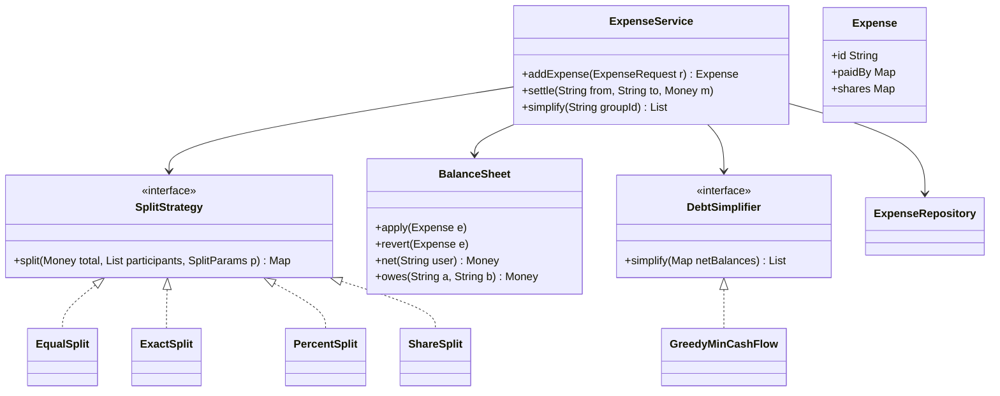
- **ExpenseService** — validates requests, picks the split strategy, records the expense and updates balances.
- **SplitStrategy** — one class per split type; each returns a map from user to owed amount that sums exactly to the total.
- **BalanceSheet** — maintains pairwise and net balances incrementally; `revert` supports edits and deletes.
- **DebtSimplifier** — computes settlement transfers from net balances.
- **Expense** — immutable record of who paid what and who owes what.

### Data model
| Type | Notes |
|---|---|
| `Money` | long minor units + currency |
| `Expense` | id, group, description, `paidBy: Map<User, Money>`, `owed: Map<User, Money>`, created time |
| `Settlement` | from, to, amount (also stored as an expense-like record) |
| `Transfer` | output of simplification: from, to, amount |
| `SplitType` | `EQUAL`, `EXACT`, `PERCENT`, `SHARES` |

### Tech stack
| Component | Choice | Why |
|---|---|---|
| Money | long cents | exact sums |
| Strategy selection | `Map<SplitType, SplitStrategy>` | no switch in the service |
| Simplification | two priority queues | greedy pairing of largest creditor and debtor |
| Tests | JUnit 6, AssertJ, jqwik | property: sums always balance |

### Milestones
1. **Split strategies.** *Done when:* 100.00 split equally among 3 yields 33.34, 33.33, 33.33, and the assignment of the extra cent is deterministic.
2. **Expenses and balances.** *Done when:* after a set of expenses, `net` for each user matches a hand-calculated table and all nets sum to zero.
3. **Settle-up and edit/delete.** *Done when:* deleting an expense restores balances exactly.
4. **Simplification.** *Done when:* a group with 6 pairwise debts settles in at most n-1 transfers and every net reaches zero.
5. **CLI or REST front end.** *Done when:* a scripted session of commands reproduces the expected output.

### Deep dive: the hard parts
**Rounding remainders.** 100 cents split three ways is 33 each with 1 left over. Compute the base share with integer division, then hand out the remainder one cent at a time in a deterministic order (e.g. sorted by user id, or payer last). For percentages, compute each share with floor, then distribute the leftover cents to the largest fractional parts. The invariant: shares always sum to exactly the total.

**Net balances make simplification easy.** Pairwise debts are a graph; what matters for settling is each person's *net* (paid minus owed). Split people into creditors (positive) and debtors (negative). Repeatedly match the largest debtor with the largest creditor, transfer the smaller of the two amounts, and requeue whoever is not yet at zero. This produces at most n-1 transfers. Finding the true minimum is NP-hard in general (it relates to partitioning into zero-sum subsets), so greedy is the practical choice — say this in an interview.

**Fairness constraints.** Greedy can create a payment between two people who never shared an expense. Splitwise's post lists rules to avoid surprises; a stricter simplifier only nets within existing debt relationships. Make it a second `DebtSimplifier` implementation.

### Testing strategy
Property-based tests (jqwik): for random expenses and split types, shares sum to the total and nets sum to zero; after applying simplification transfers, every net is zero. Example tests for each split type's validation errors. Mutation check: deleting then re-adding an expense leaves balances unchanged.

### Trade-offs, scaling and failure modes
Storing only expenses and recomputing balances is simple and always consistent but slow for long histories; incremental balances are fast but must be updated in the same transaction as the expense. Multi-currency groups need conversion at a recorded rate per expense. Concurrent edits to one group should be serialised (a per-group lock), since balance updates touch many users.

### Stretch goals
- Multiple payers for one expense.
- Multi-currency groups with per-expense exchange rates.
- Activity feed and notifications via an observer.

### Skills practised
- [Ch 20 — Components](../chapters/20-case-components/README.md): the Splitwise case.
- [Ch 11 — Behavioral patterns 2](../chapters/11-patterns-behavioral-2/README.md): Strategy for splits.
- [Ch 5 — Design principles](../chapters/05-design-principles/README.md): immutability, single responsibility.

### In the interview
**Q:** How do you split 100 among 3 without losing a cent?
**A:** Integer-divide, then distribute the remainder cents deterministically. Shares always sum to the total.

**Q:** How do you minimise the number of settlement payments?
**A:** Compute net balances, then greedily match the largest debtor to the largest creditor. That gives at most n-1 payments; the exact minimum is NP-hard, so greedy is the practical answer.

**Q:** How do you add a new split type?
**A:** A new `SplitStrategy` class registered in the map; the service does not change.

### TL;DR
Split strategies that sum exactly, incremental net balances, and a greedy creditor/debtor matcher for settle-up.

## 14. Rate Limiter Library
**Level:** Intermediate · **Time:** 1 week · **Prerequisites:** Ch 11, Ch 13, Ch 20

### What it is
A reusable Java library that decides whether a request may proceed, given a limit such as "100 requests per minute per API key". It offers several algorithms behind one interface — token bucket, fixed window, sliding window log and sliding window counter — and can be dropped into any service as a filter.

### The problem it solves
Without rate limiting, one misbehaving client (or attacker) can exhaust a service for everyone. Limits also protect expensive downstream resources and enforce pricing tiers. The engineering problem is to make the check **fast** (it runs on every request), **thread-safe** (many requests at once), **memory-bounded** (millions of keys) and **fair** at window boundaries.

### Real-world examples
- Guava's [RateLimiter](https://guava.dev/releases/snapshot-jre/api/docs/com/google/common/util/concurrent/RateLimiter.html) hands out permits at a configured rate and can block callers until a permit is available — a smoothed token-bucket style limiter.
- [Bucket4j](https://github.com/bucket4j/bucket4j) is a Java token-bucket library that also supports distributed buckets backed by shared stores.
- Stripe's engineering post [Scaling your API with rate limiters](https://stripe.com/blog/rate-limiters) describes using token buckets plus concurrency limits and load shedding in production.

### Requirements
**Functional**
- `RateLimiter.tryAcquire(key)` returns allowed/denied plus "retry after" when denied. Optional `tryAcquire(key, permits)`.
- Algorithms: token bucket, fixed window counter, sliding window log, sliding window counter.
- Per-key limits from a rule set (by API key, by user, by IP), with defaults.
- Optional blocking `acquire(key, timeout)`.
- Expose metrics: allowed, denied per key.

**Non-functional**
- `tryAcquire` under 1 microsecond median in memory; no global lock.
- Memory: idle keys evicted; bounded total keys (e.g. 1 million).
- Correct under 64 concurrent threads: never more than the limit allowed per window.

### The architecture
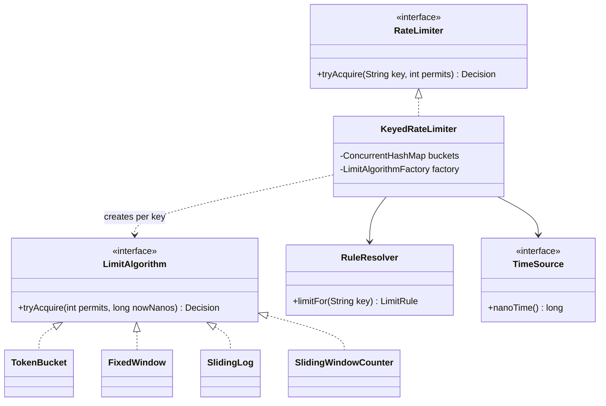
- **RateLimiter** — the public interface. Callers never see algorithms.
- **KeyedRateLimiter** — maps each key to its own algorithm instance, created lazily with `computeIfAbsent`.
- **LimitAlgorithm** — the Strategy; each instance holds the state for one key.
- **RuleResolver** — chooses the limit for a key (tier, route, default).
- **TimeSource** — injected clock so tests can move time.

### Data model
| Algorithm | State per key | Memory | Boundary behaviour |
|---|---|---|---|
| Token bucket | tokens, last refill time | O(1) | allows bursts up to capacity |
| Fixed window | window start, count | O(1) | up to 2x limit across a boundary |
| Sliding log | deque of timestamps | O(limit) | exact |
| Sliding counter | current + previous counts | O(1) | close approximation |

### Tech stack
| Component | Choice | Why |
|---|---|---|
| Per-key map | `ConcurrentHashMap` | lock-free reads, atomic create |
| Per-key state | `AtomicLong` CAS loop or small `synchronized` block | no global lock |
| Time | `System.nanoTime` behind `TimeSource` | monotonic, testable |
| Benchmarks | JMH | measure, do not guess |
| Tests | JUnit 6, AssertJ, jcstress for races | concurrency correctness |

### Milestones
1. **Token bucket, single thread.** *Done when:* with capacity 10 and 1 token/s, 10 immediate calls pass, the 11th fails, and after 1 s of fake time one more passes.
2. **Other algorithms.** *Done when:* a shared test suite runs against every algorithm, and a boundary test shows fixed window allowing a 2x burst while sliding log does not.
3. **Keyed limiter with rules.** *Done when:* two keys with different tiers get different limits.
4. **Thread safety.** *Done when:* 64 threads hammering one key allow exactly the limit within a window (no over-admission).
5. **Eviction + benchmarks.** *Done when:* idle keys are evicted after a TTL, and a JMH run reports median `tryAcquire` latency.

### Deep dive: the hard parts
**Lazy refill.** A token bucket does not need a timer thread. On each call, compute elapsed time since last refill, add `elapsed * rate` tokens (capped at capacity), then try to take. Store tokens as a scaled integer (e.g. micro-tokens) to avoid floating point drift.

**Atomic update without a big lock.** Two threads reading "1 token left" must not both take it. Either guard the tiny refill-and-take section with `synchronized` on the per-key object (contention is per key, usually low) or pack state into one `AtomicLong` and loop with `compareAndSet`. Measure both with JMH; the simple lock is often fast enough.

**Sliding window counter.** Keep counts for the current and previous fixed windows. Estimate the rolling count as `current + previous * (1 - elapsedFractionOfCurrentWindow)`. It costs O(1) memory and is accurate enough for most APIs; sliding log is exact but stores one timestamp per request.

**Memory.** A key per IP can mean millions of entries. Evict idle buckets: a full token bucket that has not been touched is equivalent to a new one, so it is safe to drop it.

### Testing strategy
One abstract test class with the behavioural contract, extended per algorithm. A fake `TimeSource` to step time precisely. Concurrency tests with a start latch and an exact count assertion; jcstress tests for the CAS loop. JMH benchmarks for single-key and many-key workloads.

### Trade-offs, scaling and failure modes
In-process limits are per instance: with 10 servers each allowing 100/min, a client gets 1,000/min. A shared store (Redis, or Bucket4j's distributed mode) gives a global limit at the cost of a network hop per request; a hybrid gives each instance a share of the budget. Decide whether to fail open (allow) or fail closed (deny) when the shared store is down — most APIs fail open.

### Stretch goals
- A servlet filter or Spring `HandlerInterceptor` that returns HTTP 429 with a `Retry-After` header.
- A concurrency limiter (max in-flight requests) using `Semaphore`.
- A Redis-backed implementation behind the same interface.

### Skills practised
- [Ch 20 — Components](../chapters/20-case-components/README.md): the rate limiter case.
- [Ch 13 — Concurrency problems](../chapters/13-concurrency-problems/README.md): thread-safe token bucket.
- [Ch 11 — Behavioral patterns 2](../chapters/11-patterns-behavioral-2/README.md): Strategy.

### In the interview
**Q:** Token bucket or sliding window?
**A:** Token bucket if short bursts are acceptable and you want O(1) state; sliding window counter for smoother limits with O(1) state; sliding log only if you need exactness and can afford memory.

**Q:** How do you avoid a background refill thread?
**A:** Refill lazily on each request using elapsed time since the last refill.

**Q:** How do you enforce a global limit across servers?
**A:** Keep the counter in a shared store with atomic operations, or split the budget per instance; choose fail-open or fail-closed for store outages.

### TL;DR
One `RateLimiter` interface, several algorithm strategies holding per-key state, lazy refill, per-key atomic updates and eviction of idle keys.

## 15. LRU and LFU Cache
**Level:** Intermediate · **Time:** 1 week · **Prerequisites:** Ch 9, Ch 13, Ch 20

### What it is
A generic in-memory cache library with a fixed capacity and pluggable **eviction policies**: LRU (least recently used — throw out what was touched longest ago) and LFU (least frequently used — throw out what is used least often), both with O(1) `get` and `put`. Later milestones add thread safety, time-to-live and statistics.

### The problem it solves
Caches make slow things fast by keeping recent results in memory, but memory is finite, so something must be thrown away. Choosing the wrong item to evict wastes the cache. The coding problem — O(1) LRU and LFU — is a top interview question, and the design problem is making eviction policy, storage and concurrency separate concerns.

### Real-world examples
- [Caffeine](https://github.com/ben-manes/caffeine) is the leading Java caching library; its [efficiency wiki page](https://github.com/ben-manes/caffeine/wiki/Efficiency) explains W-TinyLFU, which combines a small LRU admission window with frequency-based admission into a main segmented LRU.
- The JDK's [LinkedHashMap](https://docs.oracle.com/en/java/javase/25/docs/api/java.base/java/util/LinkedHashMap.html) supports access order and a `removeEldestEntry` hook — a two-line LRU you should compare against yours.

### Requirements
**Functional**
- `Cache<K, V>` with `get`, `put`, `remove`, `size`, and `getOrLoad(key, loader)`.
- Policies: LRU, LFU (ties broken by recency), and FIFO as a baseline.
- Optional per-entry or global TTL (time-to-live).
- Eviction listener callback. Statistics: hits, misses, evictions, hit ratio.

**Non-functional**
- O(1) average `get` and `put` for every policy.
- Thread-safe variant: correct under 32 threads; throughput benchmarked with JMH.
- `getOrLoad` loads each missing key once even if many threads ask at once.

### The architecture
```mermaid
classDiagram
    class Cache {
      <<interface>>
      +get(Object k) Optional
      +put(Object k, Object v)
      +getOrLoad(Object k, Function loader) Object
    }
    class BoundedCache {
      -Map store
      -EvictionPolicy policy
      -int capacity
    }
    class EvictionPolicy {
      <<interface>>
      +onAccess(Object k)
      +onInsert(Object k)
      +onRemove(Object k)
      +victim() Object
    }
    class ConcurrentCache {
      -Cache delegate
      -Lock lock
    }
    class StatsRecorder
    class RemovalListener {
      <<interface>>
    }
    Cache <|.. BoundedCache
    Cache <|.. ConcurrentCache
    ConcurrentCache o-- Cache
    BoundedCache --> EvictionPolicy
    BoundedCache --> StatsRecorder
    BoundedCache --> RemovalListener
    EvictionPolicy <|.. LruPolicy
    EvictionPolicy <|.. LfuPolicy
    EvictionPolicy <|.. FifoPolicy
```
- **Cache** — the public interface.
- **BoundedCache** — the storage map plus capacity enforcement; asks the policy for a victim when full.
- **EvictionPolicy** — Strategy that tracks usage and nominates victims.
- **ConcurrentCache** — a Decorator adding thread safety (and later striping) around any cache.
- **StatsRecorder / RemovalListener** — observability and callbacks.

### Data model
| Policy | Structure | Operations |
|---|---|---|
| LRU | hash map + doubly linked list | move node to head on access, evict tail |
| LFU | key to node, frequency to linked list, `minFreq` | move node to freq+1 list, evict from `minFreq` list tail |
| FIFO | queue | evict head |
| TTL | per-entry `expiresAt` + lazy check on read | optional sweeper |

### Tech stack
| Component | Choice | Why |
|---|---|---|
| Lists | hand-written doubly linked nodes | O(1) unlink, interview-ready |
| Concurrency | `ReentrantLock`, then lock striping | measure the difference |
| Single-flight load | `ConcurrentHashMap<K, CompletableFuture<V>>` | one load per key |
| Benchmarks | JMH, compare with Caffeine | honest baseline |
| Tests | JUnit 6, AssertJ, jqwik | model-based tests |

### Milestones
1. **LRU, single-threaded.** *Done when:* capacity 2, put a, put b, get a, put c evicts b.
2. **LFU.** *Done when:* the least-frequent key is evicted, with ties broken by least recent; all operations O(1).
3. **Policy as strategy.** *Done when:* one `BoundedCache` works with all three policies via constructor injection.
4. **TTL and stats.** *Done when:* an entry expires after its TTL on a fake clock, and hit ratio is reported.
5. **Concurrency.** *Done when:* 32 threads pass a stress test, `getOrLoad` calls the loader once per key under contention, and JMH shows throughput vs Caffeine.

### Deep dive: the hard parts
**O(1) LRU.** The map gives O(1) lookup of a node; the doubly linked list gives O(1) move-to-front and remove-tail because each node knows its neighbours. Sentinel head and tail nodes remove all null checks.

**O(1) LFU.** Keep a map from frequency to a doubly linked list of nodes with that frequency, plus a `minFreq` variable. On access, move the node from list f to list f+1; if list f is now empty and f was `minFreq`, increment `minFreq`. On insert, the new node has frequency 1 and `minFreq` becomes 1. Evict from the tail of the `minFreq` list (least recent among least frequent).

**Concurrency: why a plain lock hurts LRU.** Even `get` mutates the list (move to front), so reads need the write lock. Options: lock striping (N independent caches by key hash — approximate global LRU), or Caffeine's approach of recording reads in buffers and replaying them in batches. Implement striping and measure.

**Cache stampede.** When a hot key expires, hundreds of threads miss and call the loader at once. Store a `CompletableFuture` in a `ConcurrentHashMap` via `computeIfAbsent`; the first caller loads, the rest wait for the same future.

### Testing strategy
Model-based testing: run random operation sequences against your cache and a simple reference model (e.g. a `LinkedHashMap` in access order for LRU) and assert identical results. Concurrency tests with invariants (size never above capacity). JMH for throughput. A fake ticker for TTL.

### Trade-offs, scaling and failure modes
LRU is cheap but a one-off scan of many keys flushes the hot set; LFU resists scans but keeps once-popular items too long unless counts decay — which is why W-TinyLFU exists. Striped locks scale but each stripe evicts independently. Caches hide bugs: stale data after writes needs invalidation or short TTLs.

### Stretch goals
- Weight-based capacity (entries cost different amounts of memory).
- Frequency decay (halve all counts periodically) for LFU.
- Refresh-ahead: reload hot entries in the background before they expire.

### Skills practised
- [Ch 20 — Components](../chapters/20-case-components/README.md): cache and LRU case.
- [Ch 13 — Concurrency problems](../chapters/13-concurrency-problems/README.md): TTL cache, lock striping.
- [Ch 9 — Structural patterns](../chapters/09-patterns-structural/README.md): Decorator for thread safety.

### In the interview
**Q:** How is LRU O(1)?
**A:** A hash map from key to node, and a doubly linked list ordered by recency; moves and removals are pointer updates.

**Q:** How is LFU O(1)?
**A:** Frequency buckets of linked lists and a `minFreq` pointer; access moves a node to the next bucket, eviction takes the tail of the min bucket.

**Q:** What is a cache stampede and how do you prevent it?
**A:** Many threads missing the same key and loading it at once. Coalesce loads into one shared future per key.

### TL;DR
Storage plus pluggable eviction strategies with O(1) linked structures, a decorator for thread safety, and single-flight loading.

## 16. Logging Framework
**Level:** Intermediate · **Time:** 1–2 weeks · **Prerequisites:** Ch 8, Ch 10, Ch 20

### What it is
A small logging library in the spirit of SLF4J and Logback: application code calls `log.info("Order {} placed", id)`; the framework filters by level, formats the message, and writes it to one or more destinations (**appenders**: console, file, rolling file). Configuration decides levels per package, and an async mode keeps logging off the request path.

### The problem it solves
Every application logs, and badly designed logging is slow (string building for messages that are filtered out), blocks request threads on disk I/O, and is impossible to reconfigure without code changes. This project exercises a lot of patterns at once: **Factory** for loggers, a **hierarchy** of loggers by package name, **Chain of Responsibility** for filters, **Strategy** for layouts, **Observer**-like fan-out to appenders, and a **producer-consumer** queue for async writing.

### Real-world examples
- [SLF4J](https://www.slf4j.org/) is the facade most Java code logs through; it separates the API from the implementation, the same split you build here.
- Logback's [appenders manual](https://logback.qos.ch/manual/appenders.html) documents console, file and rolling-file appenders and their policies.
- Log4j 2's [asynchronous loggers](https://logging.apache.org/log4j/2.x/manual/async.html) explain how moving formatting and I/O to a background thread reduces latency for the caller.

### Requirements
**Functional**
- `LoggerFactory.getLogger(Class)` returns a cached logger named by class.
- Levels TRACE, DEBUG, INFO, WARN, ERROR; per-logger level inherited from the nearest configured ancestor (`com.shop` configures `com.shop.order.Service`).
- Parameterised messages `{}` formatted only if the level is enabled. Exceptions printed with stack traces.
- Appenders: console, file, size- or time-based rolling file. Layouts: pattern and JSON.
- Filters per appender (e.g. only ERROR to an alert file).
- Async mode with bounded queue and a policy when full (block, drop lowest levels).
- Config from a properties or YAML file, reloadable at runtime.

**Non-functional**
- Disabled-level calls cost under 10 ns (a level check and return).
- Async logging adds under 1 microsecond to the caller at the median.
- No log line lost on clean shutdown.

### The architecture
```mermaid
classDiagram
    class LoggerFactory {
      +getLogger(String name) Logger
    }
    class Logger {
      +name String
      -Level effectiveLevel
      +info(String fmt, Object args)
      +isEnabled(Level l) boolean
    }
    class LoggerContext {
      -ConcurrentHashMap loggers
      +reconfigure(Config c)
    }
    class Appender {
      <<interface>>
      +append(LogEvent e)
    }
    class Layout {
      <<interface>>
      +format(LogEvent e) String
    }
    class Filter {
      <<interface>>
      +decide(LogEvent e) Decision
    }
    class AsyncAppender {
      -BlockingQueue queue
      -Appender delegate
    }
    LoggerFactory --> LoggerContext
    LoggerContext "1" *-- "many" Logger
    Logger --> Appender
    Appender <|.. ConsoleAppender
    Appender <|.. FileAppender
    Appender <|.. RollingFileAppender
    Appender <|.. AsyncAppender
    AsyncAppender o-- Appender
    FileAppender --> Layout
    FileAppender --> Filter
    Layout <|.. PatternLayout
    Layout <|.. JsonLayout
```
- **LoggerFactory / LoggerContext** — create and cache loggers; compute effective levels from the name hierarchy; swap configuration atomically.
- **Logger** — the API. Checks level first, then builds a `LogEvent` and passes it to its appenders (and ancestors' appenders, if additive).
- **Appender** — a destination. **Layout** turns an event into text. **Filter** accepts, denies or stays neutral (a chain).
- **AsyncAppender** — a Decorator: queues events and lets a background thread call the real appender.

### Data model
| Type | Notes |
|---|---|
| `LogEvent` | record: timestamp, level, logger name, thread name, message pattern, args, throwable, MDC snapshot |
| `Level` | enum with integer severity |
| `Config` | immutable tree: logger name to level and appender refs |
| MDC (mapped diagnostic context) | per-thread key-value map (request id) copied into each event |

### Tech stack
| Component | Choice | Why |
|---|---|---|
| Async queue | `ArrayBlockingQueue` + one consumer thread | bounded memory |
| Files | `FileChannel` / buffered writer | fast appends |
| Config swap | `volatile` reference to immutable config | lock-free reads |
| Benchmarks | JMH | disabled-call and async latency |
| Tests | JUnit 6, AssertJ, `@TempDir` | real files, rolling checks |

### Milestones
1. **Logger + console appender + pattern layout.** *Done when:* `log.info("x={}", 5)` prints a formatted line with time, level, logger and thread.
2. **Hierarchy and levels.** *Done when:* configuring `com.shop` at WARN silences INFO from `com.shop.order.Service` but not from `com.other`.
3. **File and rolling appenders.** *Done when:* writing 10 MB with a 1 MB limit leaves 10 numbered files (in `@TempDir`) with no line split across files.
4. **Filters and JSON layout.** *Done when:* an ERROR-only filter on a second appender routes correctly.
5. **Async + shutdown + reload.** *Done when:* JMH shows the async caller cost, a shutdown hook flushes everything, and editing the config file changes levels without restart.

### Deep dive: the hard parts
**Fast path for disabled levels.** The most frequent call is one that is filtered out. Cache each logger's effective level in a field; `info()` first compares integers and returns. Use `{}` placeholders so message strings are not concatenated until needed. Never compute an expensive argument eagerly — offer `Supplier` overloads.

**Hierarchical levels and reconfiguration.** Effective level = nearest configured ancestor's level. Recomputing on every call is slow; compute it on configuration change for all cached loggers. Publish the new configuration with a single `volatile` write so threads see either all-old or all-new.

**Async without losing data.** A bounded queue protects memory; when full, choose: block the caller (no loss, but latency), or drop TRACE/DEBUG/INFO and keep WARN/ERROR (Logback's async appender offers a similar discard rule). On shutdown, stop accepting, drain the queue, flush and close files. Capture thread name and MDC *at the call site*, not in the background thread, or the data will be wrong.

### Testing strategy
An in-memory `ListAppender` for most tests. `@TempDir` for files and rolling. A concurrency test where 16 threads log 100,000 lines each and the output contains all lines, none interleaved mid-line. JMH benchmarks for the disabled path and async enqueue.

### Trade-offs, scaling and failure modes
Sync logging is simple and never loses data but couples latency to disk; async is fast but can lose events on crash (not clean shutdown). A full disk must not crash the app: appenders should catch I/O errors, report once to stderr, and keep going. Logging sensitive data is a security risk — provide a masking layout decorator.

### Stretch goals
- SLF4J provider: make your framework a backend for the real SLF4J API.
- Network appender with batching and retry.
- Structured logging with key-value pairs and a JSON schema.

### Skills practised
- [Ch 20 — Components](../chapters/20-case-components/README.md): the logging framework case.
- [Ch 10 — Behavioral patterns 1](../chapters/10-patterns-behavioral-1/README.md): Chain of Responsibility for filters.
- [Ch 8 — Creational patterns](../chapters/08-patterns-creational/README.md): factory and singleton context.
- [Ch 9 — Structural patterns](../chapters/09-patterns-structural/README.md): Decorator (async appender).

### In the interview
**Q:** How do you make disabled log statements cheap?
**A:** Cache the effective level per logger, check it first, and use placeholders or suppliers so no string is built unless needed.

**Q:** Why an async appender, and what can go wrong?
**A:** It moves formatting and I/O off the caller's thread. The queue can fill (block or drop by level) and a crash loses queued events.

**Q:** How do logger levels inherit?
**A:** By dotted name: a logger uses the level of its nearest configured ancestor, falling back to the root.

### TL;DR
Named loggers in a hierarchy, a cheap level check, appenders with layouts and filter chains, and a bounded async decorator that flushes on shutdown.

## 17. In-Process Pub/Sub Broker
**Level:** Intermediate · **Time:** 1–2 weeks · **Prerequisites:** Ch 11, Ch 12, Ch 20

### What it is
A message broker that lives inside one JVM: publishers send messages to named **topics**; **subscribers** register for topics and receive every message published after they subscribed. Each subscriber gets its own delivery thread and queue, so a slow subscriber does not slow down others. Later milestones add consumer groups, replay from an offset and backpressure.

### The problem it solves
Components that call each other directly are tightly coupled: the order service must know about email, analytics and inventory. Publish/subscribe decouples them — the publisher only knows a topic name. Doing it well in-process teaches the Observer pattern under real concurrency: isolation between subscribers, ordering guarantees, bounded memory and what to do when a consumer cannot keep up.

### Real-world examples
- The JDK ships [Flow](https://docs.oracle.com/en/java/javase/25/docs/api/java.base/java/util/concurrent/Flow.html) (the Reactive Streams interfaces) and [SubmissionPublisher](https://docs.oracle.com/en/java/javase/25/docs/api/java.base/java/util/concurrent/SubmissionPublisher.html), an in-process publisher with per-subscriber buffers and demand-based backpressure.
- Guava's [EventBus](https://github.com/google/guava/wiki/EventBusExplained) is a well-known in-process event bus; its own documentation now discourages new use in favour of dependency injection and reactive libraries — a useful trade-off discussion.

### Requirements
**Functional**
- `createTopic`, `publish(topic, message)`, `subscribe(topic, subscriber)` returning a handle to unsubscribe.
- Per-subscriber ordering: messages arrive in publish order.
- Each topic keeps a bounded log; a subscriber can start from "latest" or from an earlier offset (replay).
- Consumer groups: messages on a topic are split among members of a group (each message to one member).
- Backpressure policy per subscriber when its queue is full: block publisher, drop oldest, or drop newest.
- Acknowledgement and redelivery for failed handlers (up to N attempts, then a dead-letter topic).

**Non-functional**
- Publishing to a topic with 10 subscribers under 5 microseconds median (enqueue only).
- A subscriber that throws or hangs does not affect others.
- 1 million messages per second aggregate on a laptop for small messages (benchmark and report your real number).

### The architecture
```mermaid
classDiagram
    class Broker {
      +createTopic(String name, TopicConfig c)
      +publish(String topic, Message m) long
      +subscribe(String topic, SubscriptionSpec s) Subscription
    }
    class Topic {
      -RingLog log
      -List subscriptions
      +append(Message m) long
    }
    class RingLog {
      +append(Message m) long
      +read(long offset) Message
    }
    class Subscription {
      -long offset
      -BlockingQueue inbox
      +cancel()
    }
    class Subscriber {
      <<interface>>
      +onMessage(Message m)
    }
    class OverflowPolicy {
      <<interface>>
    }
    class ConsumerGroup {
      +next() Subscription
    }
    Broker "1" *-- "many" Topic
    Topic *-- RingLog
    Topic "1" o-- "many" Subscription
    Topic "1" o-- "many" ConsumerGroup
    Subscription --> Subscriber
    Subscription --> OverflowPolicy
    ConsumerGroup "1" o-- "many" Subscription
```
- **Broker** — the facade and registry of topics.
- **Topic** — appends to its log and fans out to subscriptions and groups.
- **RingLog** — fixed-size circular buffer of recent messages with monotonically increasing offsets, enabling replay.
- **Subscription** — one per subscriber: a bounded inbox, a delivery thread (virtual thread), current offset, retry state.
- **ConsumerGroup** — chooses one member per message (round robin, or by key hash for per-key ordering).
- **OverflowPolicy** — Strategy for full inboxes.

### Data model
| Type | Notes |
|---|---|
| `Message` | record: key, payload, headers, publish time |
| `Envelope` | message + offset + attempt count |
| `SubscriptionSpec` | start position, group name, overflow policy, max attempts |
| `DeliveryState` | sealed: `Pending`, `Acked`, `Failed(attempts)`, `DeadLettered` |

### Tech stack
| Component | Choice | Why |
|---|---|---|
| Delivery threads | virtual threads, one per subscription | cheap isolation |
| Inboxes | `ArrayBlockingQueue` | bounded, blocking |
| Log | array ring buffer + `AtomicLong` offset | O(1) append, replay |
| Benchmarks | JMH | throughput, latency |
| Tests | JUnit 6, AssertJ, Awaitility-style polling helper | async assertions |

### Milestones
1. **Topics and fan-out.** *Done when:* 3 subscribers each receive all 1,000 messages in order.
2. **Isolation.** *Done when:* a subscriber that sleeps 1 s per message does not delay the others (measured).
3. **Overflow policies.** *Done when:* each policy behaves as specified in tests with a tiny inbox.
4. **Ring log and replay.** *Done when:* a late subscriber starting at offset 0 receives retained history, then live messages, with no gap or duplicate at the switch-over.
5. **Groups, retries, dead letters.** *Done when:* a group of 3 shares messages, and a handler failing 3 times routes the message to the dead-letter topic.

### Deep dive: the hard parts
**Replay-to-live handover.** A late subscriber reads history from the log while new messages keep arriving. If it reads history then subscribes, it can miss messages in between; if it subscribes then reads history, it gets duplicates. The clean approach: the subscription itself reads from the log by offset, so "history" and "live" are the same loop — read offset n, then n+1 — and it only waits when it catches up with the head.

**Backpressure is a policy decision.** A slow consumer with an unbounded queue eventually exhausts memory. Bounded queues force a choice: block the publisher (protects data, couples speeds), drop (protects the publisher, loses data), or let the subscriber fall behind in the log and skip ahead if overwritten (report the gap). `SubmissionPublisher` uses demand signalling; compare it with your approach.

**Ordering with groups.** Round-robin across group members loses per-key order. Hash the message key to choose the member (like Kafka partitions) so all messages for one order go to the same consumer, in order.

### Testing strategy
Deterministic tests use a test executor that runs deliveries synchronously; concurrency tests use real virtual threads and wait with timeouts. Assert ordering per subscriber, no loss under "block" policy, exact drop counts under drop policies. JMH for publish latency with N subscribers.

### Trade-offs, scaling and failure modes
In-process means messages die with the JVM; durable brokers (Kafka, RabbitMQ) persist and replicate at the cost of network and disk. One thread per subscription is simple with virtual threads; a shared pool is more economical but risks one subscriber starving others. Retrying a poison message forever blocks a partition — always cap attempts and dead-letter.

### Stretch goals
- Topic wildcards (`orders.*`) via a trie of topic names.
- Persist the log to an append-only file and recover offsets on restart.
- Implement `Flow.Publisher` so reactive libraries can consume your topics.

### Skills practised
- [Ch 20 — Components](../chapters/20-case-components/README.md): the pub-sub case.
- [Ch 11 — Behavioral patterns 2](../chapters/11-patterns-behavioral-2/README.md): Observer.
- [Ch 12 — Concurrency concepts](../chapters/12-concurrency-concepts/README.md): blocking queues, virtual threads.
- [Ch 13 — Concurrency problems](../chapters/13-concurrency-problems/README.md): bounded blocking queue.

### In the interview
**Q:** How do you stop one slow subscriber from slowing everyone?
**A:** Give each subscription its own bounded inbox and delivery thread; the publisher only enqueues.

**Q:** What happens when an inbox is full?
**A:** A per-subscription policy: block, drop oldest, drop newest, or fall behind in the log. Each trades data loss against coupling.

**Q:** How do you keep per-key ordering with multiple consumers?
**A:** Route by key hash so each key always goes to the same consumer.

### TL;DR
Topics with a replayable ring log, isolated bounded subscriptions on virtual threads, policy-driven backpressure, key-hashed consumer groups and dead letters.

## 18. Notification Service
**Level:** Intermediate · **Time:** 1–2 weeks · **Prerequisites:** Ch 8, Ch 11, Ch 20

### What it is
A service other parts of a product call to notify users: "send order-shipped to user 42". It picks channels (email, SMS, push, in-app) based on user preferences, renders a template, respects quiet hours and rate limits, retries failed sends with backoff, and records delivery status.

### The problem it solves
Every feature team ends up writing its own email code, with inconsistent opt-out handling, no retries and no audit trail. A central notification service owns the hard cross-cutting rules: never notify someone who opted out, never send the same notification twice, do not spam, survive provider outages. In design terms it combines **Factory** (channel senders), **Strategy** (channel selection), **Template Method** (send pipeline), **Chain of Responsibility** (pre-send checks) and retry logic.

### Real-world examples
- [Novu](https://github.com/novuhq/novu) is an open-source notification infrastructure project with multi-channel workflows, templates and subscriber preferences — a reference for the feature set.
- [Resilience4j Retry](https://resilience4j.readme.io/docs/retry) documents configurable retry with backoff for Java, the behaviour you implement for provider failures.
- AWS's Builders' Library article on [timeouts, retries and backoff with jitter](https://aws.amazon.com/builders-library/timeouts-retries-and-backoff-with-jitter/) explains why retries need jitter to avoid synchronised retry storms.

### Requirements
**Functional**
- `notify(userId, eventType, data, idempotencyKey)`.
- User preferences per event type and channel; global opt-out; quiet hours in the user's time zone (except critical events).
- Templates per event type and channel with variable substitution and locale.
- Channel providers behind interfaces (fake email/SMS/push providers in this project); fallback order (push, then SMS).
- Retry with exponential backoff and jitter; dead-letter after N attempts.
- Delivery log with status per attempt; per-user rate limit (e.g. 5 per hour for marketing).

**Non-functional**
- Accept requests in under 10 ms (enqueue only); deliver asynchronously.
- No duplicate sends for the same idempotency key.
- A provider outage does not block other channels.

### The architecture
```mermaid
classDiagram
    class NotificationService {
      +notify(NotifyRequest r) String
    }
    class PreSendCheck {
      <<interface>>
      +check(Notification n) CheckResult
    }
    class ChannelSelector {
      <<interface>>
      +channels(User u, EventType t) List
    }
    class TemplateEngine {
      +render(String templateId, Map data, Locale l) Content
    }
    class ChannelSender {
      <<interface>>
      +send(Recipient r, Content c) SendResult
    }
    class SenderFactory {
      +forChannel(Channel c) ChannelSender
    }
    class DeliveryWorker {
      +process(Notification n)
    }
    class RetryPolicy {
      +nextDelay(int attempt) Duration
    }
    NotificationService --> IdempotencyStore
    NotificationService --> NotificationQueue
    DeliveryWorker --> NotificationQueue
    DeliveryWorker --> PreSendCheck
    DeliveryWorker --> ChannelSelector
    DeliveryWorker --> TemplateEngine
    DeliveryWorker --> SenderFactory
    DeliveryWorker --> RetryPolicy
    DeliveryWorker --> DeliveryLog
    PreSendCheck <|.. OptOutCheck
    PreSendCheck <|.. QuietHoursCheck
    PreSendCheck <|.. RateLimitCheck
    ChannelSender <|.. EmailSender
    ChannelSender <|.. SmsSender
    ChannelSender <|.. PushSender
```
- **NotificationService** — validates, de-duplicates by idempotency key, enqueues, returns an id.
- **NotificationQueue** — an in-memory delay queue (so retries can be scheduled for later).
- **DeliveryWorker** — the pipeline: checks, channel selection, rendering, sending, logging, retry.
- **PreSendCheck** — a chain: opt-out, quiet hours, rate limit, each may block or defer.
- **ChannelSelector / SenderFactory / ChannelSender** — choose channels and get the right provider adapter.
- **RetryPolicy / DeliveryLog** — backoff schedule and audit trail.

### Data model
```mermaid
stateDiagram-v2
    [*] --> Queued
    Queued --> Suppressed : opted out or rate limited
    Queued --> Deferred : quiet hours
    Deferred --> Queued : quiet hours end
    Queued --> Sending
    Sending --> Delivered : provider ok
    Sending --> RetryScheduled : transient failure
    RetryScheduled --> Queued : delay elapsed
    Sending --> Failed : permanent failure or max attempts
    Failed --> [*]
    Delivered --> [*]
```
Key types: `Notification` (id, user, event, data, attempts, state), `Preference` (user, event type, channels, enabled), `DeliveryAttempt` (notification, channel, time, result, provider message id).

### Tech stack
| Component | Choice | Why |
|---|---|---|
| Queue | `DelayQueue` of notifications | built-in delayed retry |
| Workers | virtual-thread executor | many concurrent provider calls |
| Templates | simple `{{var}}` engine, then Mustache | learn, then use a library |
| Time zones | `ZonedDateTime` + user `ZoneId` | correct quiet hours |
| Tests | JUnit 6, Mockito, AssertJ | mock providers and clock |

### Milestones
1. **Synchronous happy path.** *Done when:* a notify call renders a template and the fake email provider receives the right content.
2. **Preferences and checks chain.** *Done when:* opted-out users are suppressed and quiet-hours requests are deferred to the correct local time (tests in two time zones).
3. **Async queue and workers.** *Done when:* `notify` returns in under 10 ms while a slow provider takes 2 s.
4. **Retries and fallback.** *Done when:* a provider failing twice then succeeding produces 3 attempts with growing delays, and a permanently failing push falls back to SMS.
5. **Idempotency and rate limits.** *Done when:* duplicate keys send once, and the 6th marketing message in an hour is suppressed.

### Deep dive: the hard parts
**Transient versus permanent failure.** A timeout or HTTP 503 should be retried; an invalid phone number should not. The sender adapter maps provider errors into a sealed `SendResult` (`Ok`, `Transient`, `Permanent`), so the worker's retry logic never parses provider-specific codes.

**Backoff with jitter.** Delay = `base * 2^attempt`, capped, then randomised (e.g. a random value between 0 and that delay). Without jitter, every notification that failed during an outage retries at the same instant when the provider recovers, knocking it over again.

**Idempotency end to end.** De-duplicate on accept (same key returns the same notification id). But a worker can also crash after the provider accepted the message and before logging success, then retry and send twice. Pass your notification id to providers that support idempotency keys; otherwise, accept at-least-once delivery and document it.

**Quiet hours across time zones.** Store quiet hours as local times plus the user's `ZoneId`, compute the next allowed `Instant` with `ZonedDateTime`, and handle daylight-saving gaps (02:30 may not exist on the change day).

### Testing strategy
Mockito mocks for providers (programmed to fail N times). A fake clock and manual delay queue to test retries without waiting. Parameterised tests for quiet hours across zones and DST change dates. Concurrency test: 10,000 notifications with duplicate keys sprinkled in; assert exactly one send per key.

### Trade-offs, scaling and failure modes
An in-memory queue loses pending notifications on restart; production uses a durable queue (see project 33). Per-channel worker pools isolate a slow SMS provider from email. Rate limits protect users but can suppress important messages — mark event types as critical to bypass them. Delivery receipts from providers arrive later via callbacks; model them as events updating the log.

### Stretch goals
- Digest mode: batch low-priority notifications into one daily email.
- A/B testing of templates.
- Provider failover with a circuit breaker per provider (see project 35).

### Skills practised
- [Ch 20 — Components](../chapters/20-case-components/README.md): the notification service case.
- [Ch 10 — Behavioral patterns 1](../chapters/10-patterns-behavioral-1/README.md): Chain of Responsibility.
- [Ch 11 — Behavioral patterns 2](../chapters/11-patterns-behavioral-2/README.md): Strategy, Template Method.
- [Ch 8 — Creational patterns](../chapters/08-patterns-creational/README.md): Factory for senders.

### In the interview
**Q:** How do you avoid sending a notification twice?
**A:** Idempotency keys on accept, provider-side idempotency where supported, and otherwise an explicit at-least-once guarantee with de-duplication on the client.

**Q:** Why jitter on retries?
**A:** To spread retries out in time so recovering providers are not hit by a synchronised wave.

**Q:** How do you add WhatsApp as a channel?
**A:** A new `ChannelSender` adapter registered in the factory, plus templates; the pipeline is untouched.

### TL;DR
Accept fast and enqueue, then a worker pipeline of pre-send checks, channel selection, templating, pluggable senders and jittered retries, all idempotent.

## 19. Car Rental System
**Level:** Intermediate · **Time:** 1–2 weeks · **Prerequisites:** Ch 3, Ch 5, Ch 16

### What it is
A rental service for a company with several branches: customers search for available cars by location, dates and category, reserve one, pick it up, return it (possibly at another branch) and pay — including extras like insurance and late fees. The core is **availability over time ranges**, not just "is the car free now".

### The problem it solves
A car can be booked many times in the future, so availability is a question about overlapping date ranges. Customers book a *category* ("compact"), while the fleet is individual cars that move between branches. Pricing has many add-ons. The project trains modelling with time ranges, category versus instance (like book versus copy in project 3), and keeping pricing and policies outside the entities.

### Real-world examples
- Martin Fowler's [Range pattern](https://martinfowler.com/eaaDev/Range.html) describes representing a start/end pair as one object with `includes` and `overlaps` operations — the key value type here.
- The handbook's booking chapter has the car rental case study; this project adds category-level availability and one-way rentals.

### Requirements
**Functional**
- Branches, car categories (economy, compact, SUV), and individual cars with plate, category, mileage, branch.
- Search: category availability for a pickup branch and date range.
- Reserve a category (not a specific car); assign a specific car at pickup.
- Pickup, return (same or different branch), with mileage and fuel recorded.
- Pricing: daily rate per category, weekend rates, add-ons (insurance, child seat, extra driver), one-way fee, late return fee.
- Cancel with a policy (free until 24 h before).

**Non-functional**
- Availability query under 20 ms for 5,000 cars and 1 year of reservations.
- No overbooking of a category at a branch: reservations at any time never exceed cars expected there.
- Pricing rules testable in isolation.

### The architecture
```mermaid
classDiagram
    class RentalService {
      +search(SearchRequest r) List
      +reserve(ReserveRequest r) Reservation
      +pickup(String resId) Rental
      +returnCar(String rentalId, ReturnInfo i) Invoice
    }
    class AvailabilityService {
      +available(String branch, Category c, DateRange r) int
    }
    class Reservation {
      +category Category
      +range DateRange
      +status ReservationStatus
    }
    class Rental {
      +car Car
      +actualPickup Instant
    }
    class PriceCalculator {
      +quote(Category c, DateRange r, List addOns) Quote
    }
    class PricingRule {
      <<interface>>
      +apply(PricingContext c, Quote q) Quote
    }
    class CarAssigner {
      <<interface>>
      +assign(Reservation r, List cars) Car
    }
    RentalService --> AvailabilityService
    RentalService --> PriceCalculator
    RentalService --> CarAssigner
    RentalService --> ReservationRepository
    RentalService --> FleetRepository
    PriceCalculator "1" o-- "many" PricingRule
    Reservation --> DateRange
    Rental --> Reservation
```
- **RentalService** — application service orchestrating search, reserve, pickup and return.
- **AvailabilityService** — counts cars of a category expected at a branch versus overlapping reservations.
- **Reservation / Rental** — the booking promise versus the actual use of a specific car.
- **PriceCalculator + PricingRule** — a pipeline of rules (base daily rate, weekend, add-ons, one-way, late fee).
- **CarAssigner** — strategy for picking a specific car at pickup (lowest mileage, most fuel, oldest service).

### Data model
```mermaid
stateDiagram-v2
    [*] --> Reserved
    Reserved --> Cancelled : customer cancels
    Reserved --> NoShow : not picked up in 2h
    Reserved --> PickedUp : car assigned
    PickedUp --> Returned : car back
    Returned --> Closed : invoice paid
```
| Type | Notes |
|---|---|
| `DateRange` | record (start, end) half-open, `overlaps` and `days` |
| `Car` | plate, category, branch, mileage, status (`AVAILABLE`, `RENTED`, `MAINTENANCE`) |
| `Quote` / `Invoice` | line items + total in `Money` |

### Tech stack
| Component | Choice | Why |
|---|---|---|
| Ranges | `DateRange` record, half-open | no off-by-one at boundaries |
| Index | per branch and category, `TreeMap` by start | fast overlap queries |
| Pricing | rule pipeline | add rules without editing others |
| Tests | JUnit 6, AssertJ, parameterised pricing | many combinations |

### Milestones
1. **DateRange.** *Done when:* overlap tests cover touching ranges, contained ranges and same-day returns.
2. **Fleet and reservations.** *Done when:* reserving the 4th compact at a branch with 3 compacts over overlapping dates is refused.
3. **Pricing pipeline.** *Done when:* a weekend rental with insurance and a one-way fee matches a hand-computed invoice line by line.
4. **Pickup and return.** *Done when:* returning at another branch moves the car there and affects that branch's availability from the return date.
5. **Policies.** *Done when:* cancellation fees and no-show handling follow the rules on a test clock.

### Deep dive: the hard parts
**Half-open ranges.** Represent ranges as [start, end): a car returned on the 5th can be picked up on the 5th. Overlap is `a.start < b.end && b.start < a.end`. Closed ranges cause endless off-by-one bugs.

**Category availability is a counting problem.** For a request, count reservations of that category at that branch whose ranges overlap, and compare with cars expected there. But "overlaps the request at some point" overcounts: two reservations may overlap the request without overlapping each other. The precise check is the *maximum concurrent* reservations within the range: sweep over start/end events sorted by time, tracking a running count. Implement the sweep.

**One-way rentals change the fleet in the future.** A car returning to branch B next week increases B's supply from that date. Supply is therefore also time-dependent: model expected arrivals and departures per branch as events, and run the same sweep on supply minus demand.

### Testing strategy
Exhaustive `DateRange` tests. Scenario tests for availability with tables of reservations. Parameterised pricing tests. A randomised test: generate random reservation attempts and assert that at every day, reserved count never exceeds supply (checked by brute force).

### Trade-offs, scaling and failure modes
Reserving categories (not cars) maximises utilisation but means a specific car may be unavailable at pickup (breakdown) — keep a small buffer or allow free upgrades. A per-branch-category lock prevents two concurrent reservations from overbooking. Time zones: branches are local; store pickup times as `ZonedDateTime` with the branch zone.

### Stretch goals
- Dynamic pricing by utilisation (the more booked, the higher the rate).
- Maintenance scheduling that blocks cars and reduces supply.
- Loyalty tiers with free upgrades as a pricing rule.

### Skills practised
- [Ch 16 — Booking 2](../chapters/16-case-booking-2/README.md): car rental case.
- [Ch 3 — Relationships and UML](../chapters/03-relationships-and-uml/README.md): category versus instance.
- [Ch 5 — Design principles](../chapters/05-design-principles/README.md): value objects, information expert.

### In the interview
**Q:** How do you check overlap of two date ranges?
**A:** With half-open ranges, `a.start < b.end && b.start < a.end`.

**Q:** Why reserve categories rather than specific cars?
**A:** It maximises fleet use and lets the branch assign the best car at pickup; the trade-off is a need for buffers when a car becomes unavailable.

**Q:** How do you compute whether a category is available over a range?
**A:** Sweep reservation start/end events over the range and check that maximum concurrent demand stays below supply.

### TL;DR
Half-open date ranges, category-level reservations checked by an event sweep, specific cars assigned at pickup and pricing as a rule pipeline.

## 20. Food Delivery Order Lifecycle
**Level:** Intermediate · **Time:** 2 weeks · **Prerequisites:** Ch 11, Ch 19

### What it is
The order-management core of a food delivery app (like Swiggy or DoorDash): a customer places an order with a restaurant, the restaurant accepts and prepares it, a delivery partner is assigned, picks it up and delivers. Every step is a state transition with rules about who may trigger it, timeouts, cancellations and refunds.

### The problem it solves
An order passes through many hands, and each can fail: the restaurant rejects, no rider is available, the customer cancels after cooking started. Ad-hoc status strings and `if` checks scattered across controllers lead to impossible states ("delivered but never picked up") and inconsistent refunds. The project centres on an explicit **state machine** with guarded transitions, events emitted on each change, and **policies** (refunds, timeouts) separated from the machine itself.

### Real-world examples
- [Spring Statemachine](https://docs.spring.io/spring-statemachine/docs/current/reference/) is a framework for exactly this: states, events, guards and actions configured for a business process. You build a minimal one yourself first.
- The handbook's platforms chapter covers the Swiggy/FoodKart design; this capstone zooms into the order lifecycle.

### Requirements
**Functional**
- Restaurants with menus and opening hours; customers place orders with items and an address.
- Order states: placed, accepted, preparing, ready, picked up, delivered, cancelled, rejected.
- Role-based transitions: only the restaurant accepts; only the rider picks up.
- Auto-reject if the restaurant does not accept within 5 minutes.
- Rider assignment when the order is accepted (simple nearest-free-rider strategy).
- Cancellation policy: free before acceptance, partial refund during preparation, none after pickup.
- Every transition emits an event (for notifications, analytics, ETA updates).

**Non-functional**
- Illegal transitions are impossible — rejected by the machine, not by callers.
- Concurrent transitions on the same order are serialised (no lost updates).
- Full audit history of transitions per order.

### The architecture
```mermaid
classDiagram
    class OrderService {
      +place(PlaceOrder cmd) Order
      +handle(String orderId, OrderEvent e, Actor a)
    }
    class OrderStateMachine {
      +transition(OrderState s, OrderEvent e, Actor a) Transition
    }
    class Transition {
      +from OrderState
      +to OrderState
      +guard Guard
      +actions List
    }
    class Order {
      -OrderState state
      -long version
      +history List
    }
    class RiderAssigner {
      <<interface>>
    }
    class CancellationPolicy {
      <<interface>>
      +refundFor(Order o) Money
    }
    class EventBus {
      +publish(OrderEvent e)
    }
    class TimeoutScheduler
    OrderService --> OrderStateMachine
    OrderService --> OrderRepository
    OrderService --> EventBus
    OrderService --> TimeoutScheduler
    OrderStateMachine "1" *-- "many" Transition
    OrderService --> RiderAssigner
    OrderService --> CancellationPolicy
    OrderRepository o-- Order
```
- **OrderService** — loads the order, asks the state machine whether the event is allowed for this actor, applies it, saves, publishes.
- **OrderStateMachine** — a table of transitions (from, event) to (to, guard, actions). Pure, easily tested.
- **Order** — aggregate with current state, version number for optimistic locking, and history.
- **RiderAssigner** — strategy for choosing a rider.
- **CancellationPolicy** — computes refunds from state and timing.
- **TimeoutScheduler** — fires "accept timeout" events.
- **EventBus** — in-process publish/subscribe for side effects.

### Data model
```mermaid
stateDiagram-v2
    [*] --> Placed
    Placed --> Accepted : restaurant accepts
    Placed --> Rejected : restaurant rejects or 5 min timeout
    Placed --> Cancelled : customer cancels
    Accepted --> Preparing : kitchen starts
    Preparing --> Ready : food ready
    Accepted --> Cancelled : customer cancels - partial refund
    Preparing --> Cancelled : customer cancels - partial refund
    Ready --> PickedUp : rider picks up
    PickedUp --> Delivered : rider delivers
    Delivered --> [*]
```
Key types: `OrderEvent` (sealed: `Accept`, `Reject`, `StartPreparing`, `MarkReady`, `PickUp`, `Deliver`, `Cancel`, `AcceptTimeout`), `Actor` (sealed: `Customer`, `Restaurant`, `Rider`, `System`), `StateChange` (from, to, event, actor, time).

### Tech stack
| Component | Choice | Why |
|---|---|---|
| Machine | transition table in an `EnumMap` | data, not nested ifs |
| Events | sealed interface + pattern-matching switch | exhaustive handling |
| Concurrency | per-order version (optimistic locking) | detect conflicting updates |
| Timeouts | `ScheduledExecutorService` | accept timeout |
| Tests | JUnit 6, AssertJ, Mockito for event bus | verify side effects |

### Milestones
1. **State machine table.** *Done when:* a test enumerates every (state, event) pair and only listed transitions succeed.
2. **Actor guards.** *Done when:* a rider attempting `Accept` is rejected with "not allowed for actor".
3. **Order service and events.** *Done when:* placing and fully delivering an order emits exactly the expected event list (Mockito `InOrder`).
4. **Timeouts and cancellation policy.** *Done when:* an unaccepted order auto-rejects at 5 minutes on a test clock, and refunds match the policy table.
5. **Concurrency.** *Done when:* a cancel and an accept racing on the same order produce one winner and a clear conflict error for the other.

### Deep dive: the hard parts
**Guards and actions live in the table.** A transition has a guard (who may trigger it, extra conditions like "within opening hours") and actions (assign rider, refund, schedule timeout). Keeping these as data alongside the transition makes the machine reviewable: one table answers "what can happen from Preparing?".

**Timeouts racing with real events.** The 5-minute timer fires at the same moment the restaurant accepts. Treat the timer as just another event (`AcceptTimeout`) that goes through the same machine: if the order is already `Accepted`, the event is invalid and ignored. Never let the timer write state directly.

**Optimistic locking.** Each order has a version. Updates say "set state to X where version = 7"; if someone else updated first (version 8), the update fails and the loser reloads and retries or reports a conflict. In memory, implement with `ConcurrentHashMap.replace(key, oldOrder, newOrder)` on immutable order snapshots.

### Testing strategy
Table-driven tests generated from the transition table itself, plus negative tests for every unlisted pair. Scenario tests for full lifecycles. Test clock for timeouts. Race tests with two virtual threads and a start latch.

### Trade-offs, scaling and failure modes
A hand-rolled table is simple and transparent; a framework adds hierarchy, persistence and tooling at the cost of learning curve. Side effects after a state change (notify customer) can fail independently — publish events after saving, and make handlers idempotent. Riders may never pick up; add a timeout that reassigns.

### Stretch goals
- Partial order fulfilment (an item out of stock) with customer approval.
- Batching: one rider carries two orders from the same restaurant.
- Event sourcing: rebuild an order's state purely from its event history.

### Skills practised
- [Ch 19 — Platforms 2](../chapters/19-case-platforms-2/README.md): Swiggy/FoodKart case.
- [Ch 11 — Behavioral patterns 2](../chapters/11-patterns-behavioral-2/README.md): State, Observer, Strategy.
- [Ch 12 — Concurrency concepts](../chapters/12-concurrency-concepts/README.md): optimistic concurrency.

### In the interview
**Q:** How do you prevent impossible states?
**A:** All changes go through a transition table that lists the only legal (state, event, actor) combinations; anything else is rejected.

**Q:** How do you handle the auto-reject timer racing with acceptance?
**A:** The timer emits an event processed by the same machine; whichever applies first wins, and the other becomes an invalid transition.

**Q:** Two updates to the same order at once?
**A:** Optimistic locking with a version number; the second update fails and must reload.

### TL;DR
An explicit transition table with actor guards and actions, timeouts as ordinary events, versioned updates and events published after each change.

## 21. Meeting Room Scheduler
**Level:** Intermediate · **Time:** 1–2 weeks · **Prerequisites:** Ch 5, Ch 21

### What it is
A calendar and room-booking service for an office: people create events with attendees, book meeting rooms with enough seats and equipment, see free/busy times, and get suggestions for the earliest slot when everyone and a suitable room are free. Recurring events ("every Monday at 10:00") make it interesting.

### The problem it solves
Finding a time that works for five people and a room is tedious and error-prone. The software must answer interval questions fast — "is this room free from 14:00 to 15:00?", "when are all these people free this week?" — while handling time zones, recurring events and concurrent bookings of the same room. The project trains interval algorithms, value objects for time, and clean separation of query and booking logic.

### Real-world examples
- Calendar data is standardised by [iCalendar (RFC 5545)](https://datatracker.ietf.org/doc/html/rfc5545), including the `RRULE` recurrence-rule syntax you implement a subset of.
- Fast overlap queries are what an [interval tree](https://en.wikipedia.org/wiki/Interval_tree) is for; Java's [TreeMap](https://docs.oracle.com/en/java/javase/25/docs/api/java.base/java/util/TreeMap.html) gives a simpler sorted-by-start alternative that works well for non-overlapping room bookings.

### Requirements
**Functional**
- Rooms with capacity, floor and equipment (projector, video). Users with a home time zone.
- Create, update, cancel events with organiser, attendees, optional room, start/end.
- Recurring events: daily, weekly on given days, with an end date or count; exceptions (skip one occurrence).
- Free/busy for a user or room over a range.
- Suggest: earliest N slots of a given length within working hours where all required attendees and some room meeting the constraints are free.
- Reject double-booking of rooms. Attendees may be double-booked (with a warning).

**Non-functional**
- Room availability check under 1 ms for 1,000 rooms and a year of bookings.
- Correct across time zones and daylight-saving changes.
- Concurrent bookings of the same room never both succeed.

### The architecture
```mermaid
classDiagram
    class CalendarService {
      +create(EventRequest r) Event
      +freeBusy(String who, TimeRange r) List
      +suggest(SuggestRequest r) List
    }
    class Event {
      +id String
      +organizer String
      +attendees Set
      +recurrence Recurrence
    }
    class Recurrence {
      <<sealed>>
      +occurrences(TimeRange window) List
    }
    class RoomBookingIndex {
      -Map byRoom
      +isFree(String room, TimeRange r) boolean
      +book(String room, TimeRange r, String eventId) boolean
    }
    class AvailabilityFinder {
      +commonFree(List busyLists, TimeRange window, Duration len) List
    }
    class RoomMatcher {
      <<interface>>
      +matches(Room r, RoomNeeds n) boolean
    }
    CalendarService --> EventRepository
    CalendarService --> RoomBookingIndex
    CalendarService --> AvailabilityFinder
    CalendarService --> RoomMatcher
    Event --> Recurrence
    Recurrence <|-- OneOff
    Recurrence <|-- Weekly
    Recurrence <|-- Daily
```
- **CalendarService** — application service for all use cases.
- **Event / Recurrence** — an event with a recurrence rule that expands into concrete occurrences within a window.
- **RoomBookingIndex** — per-room `TreeMap<Instant, Booking>` keyed by start; free check looks at neighbours only.
- **AvailabilityFinder** — merges busy intervals of many people and finds gaps of the requested length.
- **RoomMatcher** — capacity and equipment rules as a composable predicate.

### Data model
| Type | Notes |
|---|---|
| `TimeRange` | record (start `Instant`, end `Instant`) half-open, `overlaps`, `minus` |
| `Recurrence` | sealed: `OneOff`, `Daily(interval, until)`, `Weekly(days, interval, until)`, with `exceptions: Set<LocalDate>` |
| `Event` | id, title, organiser, attendees, room, local start time + `ZoneId`, duration, recurrence, version |
| `Room` | id, capacity, equipment set, floor |

### Tech stack
| Component | Choice | Why |
|---|---|---|
| Time | `ZonedDateTime` for rules, `Instant` for storage | DST-safe expansion |
| Room index | `TreeMap` per room + per-room lock | O(log n) free check |
| Merging | sort + sweep | standard interval merge |
| Tests | JUnit 6, AssertJ, parameterised time zones | DST cases |

### Milestones
1. **TimeRange and room index.** *Done when:* booking 14:00–15:00 then 15:00–16:00 succeeds and 14:30–15:30 fails.
2. **Events and attendees.** *Done when:* free/busy for a user lists all their events in a week.
3. **Recurrence.** *Done when:* "weekly on Mon/Wed until Dec 31" expands correctly, with one skipped date, across a DST change.
4. **Suggestions.** *Done when:* for 4 people with busy calendars, the earliest 30-minute common slot inside 09:00–17:00 local time is found with a matching room.
5. **Concurrency.** *Done when:* 100 threads booking the same room slot yield exactly one success.

### Deep dive: the hard parts
**Recurring events across daylight saving.** "Every Monday at 10:00 Berlin time" must stay at 10:00 local when the clocks change, which means its UTC instant shifts by an hour. Store the rule in local time with a `ZoneId`, and expand to instants with `ZonedDateTime` per occurrence. Storing a fixed UTC time breaks twice a year.

**Free check in O(log n).** With non-overlapping bookings sorted by start, a new range [s, e) is free if the booking with the greatest start before e (`lowerEntry(e)`) ends at or before s. One lookup, no scan.

**Common free time.** Collect everyone's busy ranges in the window (expanding recurrences), sort by start, merge overlaps into a single busy list, then walk the gaps, intersecting with working hours, and emit gaps at least as long as the meeting. Then, for each candidate, ask the room index for a matching free room. This is the classic "merge intervals" interview problem in a real setting.

### Testing strategy
Parameterised tests across time zones including DST transition days. Property test: suggested slots never overlap any attendee's busy range. Concurrency test for room booking. Test clock for "now" when suggesting future slots.

### Trade-offs, scaling and failure modes
Expanding recurrences on every query is simple but slow for long ranges; caching expanded occurrences for the next 90 days is a common compromise, invalidated on edits. "Edit this and following occurrences" splits a series into two — model it explicitly. Attendees in different time zones mean working hours differ per person; intersect each person's own working hours.

### Stretch goals
- iCalendar export of events (a subset of RFC 5545).
- Room auto-release when nobody checks in within 10 minutes.
- Priority bumping: an executive meeting can request a booked room with approval.

### Skills practised
- [Ch 21 — Machine coding](../chapters/21-case-machine-coding/README.md): the event calendar case.
- [Ch 5 — Design principles](../chapters/05-design-principles/README.md): value objects, immutability.
- [Ch 12 — Concurrency concepts](../chapters/12-concurrency-concepts/README.md): per-resource locks.

### In the interview
**Q:** How do you check a room is free quickly?
**A:** Keep bookings sorted by start in a `TreeMap`; look up the latest booking starting before the new end and check it ends before the new start.

**Q:** How do you store a weekly 10:00 meeting?
**A:** As a local time plus time zone and a recurrence rule; occurrences are expanded to instants per date so DST is handled.

**Q:** How do you find a common free slot?
**A:** Merge all busy intervals, then scan gaps within working hours for one long enough.

### TL;DR
Half-open time ranges, recurrence rules in local time, a sorted per-room index for O(log n) checks and merge-intervals for suggestions.

## 22. Inventory and Point of Sale
**Level:** Intermediate · **Time:** 2 weeks · **Prerequisites:** Ch 9, Ch 19, Ch 21

### What it is
A system for a small chain of grocery stores: products with barcodes, stock per store, a checkout (**point of sale**, or POS) that scans items, applies promotions, takes payment and prints a receipt, and an inventory side that receives deliveries, tracks low stock and raises purchase orders. It combines a busy transactional flow (checkout) with bookkeeping (stock movements).

### The problem it solves
Stores lose money when stock counts drift from reality (sold items not deducted, deliveries not recorded) and when promotions are applied inconsistently. A design that updates a single `quantity` field from many places loses the history needed to find out why counts are wrong. This project uses an append-only **stock movement** log, a **promotion engine** built from composable rules, and adapters for payment devices.

### Real-world examples
- [Odoo](https://github.com/odoo/odoo) is an open-source business suite whose inventory and point-of-sale apps model stock moves between locations — a mature reference for the domain.
- Fowler's [Money pattern](https://martinfowler.com/eaaCatalog/money.html) applies directly to receipts, where rounding promotions per line versus per basket changes totals.

### Requirements
**Functional**
- Products: SKU, barcode, name, price, tax category, unit (each or weight).
- Checkout: scan or key in items, weighed items priced by kg, quantity changes, void a line, suspend/resume a basket.
- Promotions: percentage off, buy X get Y free, multi-buy price ("3 for 5.00"), basket threshold discount; best combination applied deterministically.
- Payment: cash with change, card via a terminal adapter, split payment.
- Receipt with line items, promotions, tax breakdown.
- Inventory: stock per store, movements (sale, delivery, transfer, adjustment, return), reorder point alerts, purchase orders.

**Non-functional**
- Scanning an item updates the basket total in under 50 ms.
- Stock on hand always equals the sum of movements.
- Checkout keeps working if the inventory service is slow (sales recorded, stock updated asynchronously).

### The architecture
```mermaid
classDiagram
    class CheckoutSession {
      +scan(String barcode)
      +voidLine(int line)
      +total() Money
      +pay(Payment p) Receipt
    }
    class Basket {
      +lines List
    }
    class PromotionEngine {
      +apply(Basket b) List
    }
    class Promotion {
      <<interface>>
      +evaluate(Basket b) List
    }
    class TaxCalculator
    class PaymentTerminal {
      <<interface>>
      +charge(Money m) PaymentResult
    }
    class InventoryService {
      +record(StockMovement m)
      +onHand(String sku, String store) long
    }
    class ReorderPolicy {
      <<interface>>
    }
    CheckoutSession *-- Basket
    CheckoutSession --> ProductCatalog
    CheckoutSession --> PromotionEngine
    CheckoutSession --> TaxCalculator
    CheckoutSession --> PaymentTerminal
    CheckoutSession ..> SaleCompleted : publishes
    PromotionEngine "1" o-- "many" Promotion
    Promotion <|.. PercentOff
    Promotion <|.. BuyXGetY
    Promotion <|.. MultiBuy
    InventoryService --> MovementLog
    InventoryService --> ReorderPolicy
```
- **CheckoutSession** — one customer's transaction: basket, totals, payment, receipt. Publishes `SaleCompleted`.
- **Basket** — line items with quantities or weights.
- **PromotionEngine / Promotion** — each promotion proposes discounts; the engine picks a non-conflicting best set.
- **TaxCalculator** — tax per category, computed after discounts.
- **PaymentTerminal** — adapter to card hardware; cash is another implementation.
- **InventoryService / MovementLog** — append-only movements, with on-hand as a derived, cached sum.
- **ReorderPolicy** — when and how much to reorder.

### Data model
| Type | Notes |
|---|---|
| `StockMovement` | record: id, sku, store, quantity (signed), type (`SALE`, `DELIVERY`, `TRANSFER_IN`, `TRANSFER_OUT`, `ADJUSTMENT`, `RETURN`), reference, time |
| `BasketLine` | product, quantity or weight, unit price, line number |
| `Discount` | promotion id, affected lines, amount |
| `Receipt` | lines, discounts, tax lines, payments, change |

### Tech stack
| Component | Choice | Why |
|---|---|---|
| Money | `BigDecimal` with explicit rounding | weights produce fractions |
| Promotions | strategy per type + engine | add promotion types freely |
| Sale to stock | in-process event, async consumer | checkout never waits for inventory |
| Tests | JUnit 6, AssertJ, Mockito for terminal | receipt golden files |

### Milestones
1. **Catalogue and basket.** *Done when:* scanning, quantity change and void produce correct totals including weighed items.
2. **Promotions.** *Done when:* "3 for 5.00" and "buy 2 get 1 free" on the same product resolve to the better deal for the customer, deterministically.
3. **Tax and receipt.** *Done when:* a golden-file test matches the printed receipt exactly.
4. **Payments.** *Done when:* split cash/card payments work and a declined card leaves the basket payable.
5. **Inventory.** *Done when:* sales, deliveries and transfers update on-hand; a reorder alert fires when stock crosses the reorder point.

### Deep dive: the hard parts
**Choosing among overlapping promotions.** Two promotions may want the same items. A simple, explainable rule: evaluate each promotion's discount, sort by value, apply greedily while marking consumed items so they cannot be used twice. Finding the true optimum is a combinatorial search; for a few lines you can brute-force, but greedy with a stable tie-break is what most shops ship. Document the rule.

**Rounding.** Weighed items (0.347 kg at 3.99/kg) and percentage discounts create fractions of a cent. Decide where rounding happens (per line, half-up) and apply it in one place. Tax computed per line versus per receipt gives different totals; follow one rule consistently.

**Stock as a ledger.** Never `UPDATE quantity`. Append a movement and update a cached on-hand total in the same step. When counts look wrong, the movement history explains why. A physical stock count becomes an `ADJUSTMENT` movement with a reason.

### Testing strategy
Promotion tests as tables (basket in, discounts out). Golden-file receipt tests. Property test: on-hand equals the sum of movements after random operations. Mockito for the payment terminal (approve, decline, timeout).

### Trade-offs, scaling and failure modes
Async stock updates keep checkout fast but allow selling an item the system thinks is out of stock — usually fine for groceries (the item is physically there). Offline mode: if the central server is down, the till must keep selling and sync later, so sales need client-generated ids. Promotion engines grow complex; keep promotions as data with a small set of rule types.

### Stretch goals
- Returns with refund to the original payment method.
- Loyalty points as a promotion and a payment method.
- Offline tills that queue sales and sync with idempotent upload.

### Skills practised
- [Ch 19 — Platforms 2](../chapters/19-case-platforms-2/README.md): grocery POS case.
- [Ch 21 — Machine coding](../chapters/21-case-machine-coding/README.md): inventory management case.
- [Ch 9 — Structural patterns](../chapters/09-patterns-structural/README.md): Adapter for payment terminals.
- [Ch 11 — Behavioral patterns 2](../chapters/11-patterns-behavioral-2/README.md): Strategy for promotions.

### In the interview
**Q:** Why record stock movements instead of updating a quantity?
**A:** The log is auditable and explains discrepancies; on-hand is derived. It also makes concurrent updates simpler since appends do not conflict.

**Q:** How do you resolve overlapping promotions?
**A:** Evaluate candidates, apply greedily by value with consumed items marked, and use a stable tie-break so results are reproducible.

**Q:** What if inventory is down during checkout?
**A:** Checkout completes and publishes a sale event; inventory consumes it later. Sales are never blocked on stock bookkeeping.

### TL;DR
A checkout session with a pluggable promotion engine and payment adapters, and stock kept as an append-only movement ledger fed by sale events.

## 23. Unix find Clone
**Level:** Intermediate · **Time:** 1 week · **Prerequisites:** Ch 9, Ch 10, Ch 21

### What it is
A Java command-line tool that walks a directory tree and prints files matching an expression, like the Unix `find` command: `jfind src -name "*.java" -size +10k -not -path "*/test/*"`. The core is a small **expression language** of tests combined with AND, OR and NOT, parsed into a tree of objects and evaluated per file.

### The problem it solves
Filters on files combine in endless ways. Hard-coding each combination is impossible; the right design treats each test as an object and combines them — the **Composite** and **Interpreter** patterns, also known as the Specification pattern. The project also teaches safe file-tree walking (symbolic link loops, permission errors) and writing a tiny parser.

### Real-world examples
- GNU findutils' [find manual](https://www.gnu.org/software/findutils/manual/html_mono/find.html) documents the expression grammar (tests, actions, operators and precedence) that this project implements a subset of.
- The JDK's [Files](https://docs.oracle.com/en/java/javase/25/docs/api/java.base/java/nio/file/Files.html) class provides `walkFileTree` and `walk` with options for following links — the traversal engine you build on.

### Requirements
**Functional**
- Starting paths; tests `-name`, `-iname` (glob), `-type f|d|l`, `-size`, `-mtime`, `-path`, `-empty`, `-perm`.
- Operators: implicit AND, `-or`, `-not`, parentheses, with standard precedence (NOT > AND > OR).
- Options: `-maxdepth`, `-mindepth`, `-follow` (follow symbolic links).
- Actions: `-print` (default), `-delete` (with confirmation flag), `-exec cmd {} ;` (later).
- Clear error messages for invalid expressions and unreadable directories (continue walking).

**Non-functional**
- Walk 1 million files in a time comparable to native `find` (measure and report).
- Never loop forever on symbolic link cycles.
- Adding a new test is one class plus a parser registration.

### The architecture
```mermaid
classDiagram
    class FindCommand {
      +run(String[] args) int
    }
    class Parser {
      +parse(List tokens) Expr
    }
    class Expr {
      <<interface>>
      +matches(FileInfo f) boolean
    }
    class AndExpr {
      +left Expr
      +right Expr
    }
    class OrExpr
    class NotExpr
    class NameTest
    class TypeTest
    class SizeTest
    class Walker {
      +walk(Path root, WalkOptions o, Consumer visitor)
    }
    class Action {
      <<interface>>
      +apply(FileInfo f)
    }
    FindCommand --> Parser
    FindCommand --> Walker
    FindCommand --> Action
    Parser ..> Expr : builds
    Expr <|.. AndExpr
    Expr <|.. OrExpr
    Expr <|.. NotExpr
    Expr <|.. NameTest
    Expr <|.. TypeTest
    Expr <|.. SizeTest
    AndExpr o-- Expr
    OrExpr o-- Expr
    NotExpr o-- Expr
    Action <|.. PrintAction
    Action <|.. DeleteAction
```
- **FindCommand** — wiring: parse args, build the walker and expression, run.
- **Parser** — recursive-descent parser turning tokens into an expression tree.
- **Expr** — the Composite: leaf tests and operator nodes share one interface.
- **Walker** — wraps `Files.walkFileTree`, applying depth limits, link handling and error reporting.
- **Action** — what to do with matches.

### Data model
| Type | Notes |
|---|---|
| `FileInfo` | record: path, `BasicFileAttributes`, depth — read once per file |
| `Expr` | sealed interface: `And`, `Or`, `Not`, and leaf test records |
| `SizeSpec` | record (comparison `+`/`-`/exact, amount, unit) |
| `WalkOptions` | max/min depth, follow links, starting points |

### Tech stack
| Component | Choice | Why |
|---|---|---|
| Walking | `Files.walkFileTree` + `FileVisitor` | handles errors, links, pruning |
| Glob | `FileSystems.getDefault().getPathMatcher("glob:...")` | correct glob semantics |
| Parsing | hand-written recursive descent | tiny grammar, great practice |
| Tests | JUnit 6, AssertJ, `@TempDir` | build real trees in tests |

### Milestones
1. **Walker.** *Done when:* walking a `@TempDir` tree prints every path, respects `-maxdepth`, and reports (not crashes on) an unreadable folder.
2. **Leaf tests.** *Done when:* `-name`, `-type` and `-size` each pass table-driven tests.
3. **Parser and operators.** *Done when:* `-name a -or -name b -type f` parses as `a OR (b AND f)` (precedence test on the tree's `toString`).
4. **Links and safety.** *Done when:* a symlink cycle with `-follow` terminates and reports the loop.
5. **Actions + performance.** *Done when:* `-delete` removes matched files bottom-up, and a benchmark on a large tree is reported against native `find`.

### Deep dive: the hard parts
**Precedence in a recursive-descent parser.** Write one method per precedence level: `parseOr` calls `parseAnd` and loops on `-or`; `parseAnd` calls `parseNot` and loops while the next token starts a primary (implicit AND); `parseNot` handles `-not` and `!`; `parsePrimary` handles parentheses and leaf tests. This structure enforces precedence naturally.

**Short-circuiting and cheap tests first.** `And` must stop at the first false, `Or` at the first true, exactly like `find` — users rely on it to avoid expensive checks. An optional optimiser can reorder AND children so cheap tests (name) run before expensive ones (reading content), as long as there are no side-effecting actions in between.

**Symbolic links and cycles.** When following links, the same directory can be reached forever. `walkFileTree` with `FOLLOW_LINKS` detects cycles using file keys and reports `FileSystemLoopException` to `visitFileFailed`; handle it by printing a warning and continuing.

### Testing strategy
Build trees in `@TempDir` with known sizes and times (`Files.setLastModifiedTime`). Table tests for each leaf. Parser tests comparing printed trees. End-to-end tests running `FindCommand.run` and capturing stdout. Skip link tests on systems that do not support symlinks.

### Trade-offs, scaling and failure modes
Reading attributes once per file into `FileInfo` avoids repeated system calls. Parallel walking (one virtual thread per subdirectory) can speed up network drives but loses deterministic output order — offer it as an option. `-delete` is dangerous; require an explicit flag and process depth-first so directories empty before deletion.

### Stretch goals
- `-exec` with `{}` substitution and batching (`+`).
- Content search `-contains "text"` with a size cap.
- Parallel walking with structured concurrency.

### Skills practised
- [Ch 21 — Machine coding](../chapters/21-case-machine-coding/README.md): the Unix find case.
- [Ch 9 — Structural patterns](../chapters/09-patterns-structural/README.md): Composite.
- [Ch 10 — Behavioral patterns 1](../chapters/10-patterns-behavioral-1/README.md): Interpreter.

### In the interview
**Q:** How do you support arbitrary combinations of filters?
**A:** Each filter is an `Expr`; AND, OR and NOT are composite nodes over `Expr`s. Evaluation is recursive.

**Q:** How do you get operator precedence right?
**A:** A recursive-descent parser with one function per precedence level, from OR (lowest) down to primaries.

**Q:** How do you avoid infinite loops with symlinks?
**A:** Use the walker's loop detection based on file keys and report the loop instead of following it.

### TL;DR
A recursive-descent parser building a composite expression tree, evaluated with short-circuiting over a safe file walker.

## 24. Online Auction
**Level:** Intermediate · **Time:** 2 weeks · **Prerequisites:** Ch 11, Ch 12, Ch 19

### What it is
An auction service where sellers list items with a starting price and end time, and bidders place bids until the auction closes. It supports **proxy bidding** (you enter your maximum, the system bids for you just enough to stay ahead), bid increments, reserve prices, and an anti-sniping extension.

### The problem it solves
In the final seconds of an auction many bids arrive at once; the system must order them correctly, never accept a bid lower than the current price, and close at exactly the right time. Proxy bidding adds logic: two maximum bids compete automatically. The project trains concurrency around a hot object, time-driven state changes and the Observer pattern for outbid notifications.

### Real-world examples
- eBay's help page on [automatic bidding](https://www.ebay.com/help/buying/bidding/automatic-bidding?id=4014) describes proxy bidding: you enter a maximum and the system raises your bid by increments only as needed.
- eBay also publishes its [bid increments](https://www.ebay.com/help/buying/bidding/bidding-increments?id=4062) table, where the minimum raise depends on the current price — a good data-driven rule to implement.
- Proxy bidding behaves much like a second-price ([Vickrey](https://en.wikipedia.org/wiki/Vickrey_auction)) auction: the winner pays about the second-highest maximum plus an increment.

### Requirements
**Functional**
- Sellers create auctions: item, start price, optional reserve price, start and end times.
- Bidders place bids with a maximum; the visible price is set by proxy logic and an increment table.
- Reject bids below the minimum next bid, on closed auctions, or by the seller.
- Anti-sniping: a bid in the last 2 minutes extends the end by 2 minutes (configurable).
- Close at end time: winner if reserve met, otherwise unsold. Notify outbid bidders, winner and seller.
- Bid history per auction.

**Non-functional**
- Bids on one auction are totally ordered; 1,000 concurrent bids on one auction are all processed correctly.
- Closing happens within 1 second of the end time.
- Bid acceptance under 5 ms.

### The architecture
```mermaid
classDiagram
    class AuctionService {
      +create(CreateAuction c) Auction
      +bid(String auctionId, String bidder, Money max) BidResult
    }
    class Auction {
      -AuctionState state
      -Money currentPrice
      -Bid leader
      -Instant endsAt
      +placeBid(Bid b, Instant now) BidResult
      +close(Instant now) Outcome
    }
    class ProxyBidResolver {
      +resolve(Bid leader, Bid challenger, IncrementTable t) Resolution
    }
    class IncrementTable {
      +minIncrement(Money price) Money
    }
    class AuctionCloser {
      +schedule(Auction a)
    }
    class AuctionListener {
      <<interface>>
      +outbid(String bidder, Auction a)
      +closed(Outcome o)
    }
    class SnipingPolicy {
      <<interface>>
    }
    AuctionService --> AuctionRepository
    AuctionService --> AuctionCloser
    Auction --> ProxyBidResolver
    Auction --> IncrementTable
    Auction --> SnipingPolicy
    AuctionService --> AuctionListener
    AuctionListener <|.. NotificationListener
```
- **AuctionService** — validates and routes bids; publishes events.
- **Auction** — the aggregate holding price, leader and end time; all rule checks happen inside, under one lock.
- **ProxyBidResolver** — decides who leads and the new visible price when a new maximum arrives.
- **IncrementTable** — data-driven minimum increments.
- **AuctionCloser** — schedules closing at `endsAt`, rescheduling when sniping extends it.
- **SnipingPolicy** — extension rule as a strategy.
- **AuctionListener** — Observer for notifications.

### Data model
```mermaid
stateDiagram-v2
    [*] --> Scheduled
    Scheduled --> Open : start time
    Open --> Open : bid accepted
    Open --> Closed : end time reached
    Closed --> Sold : reserve met
    Closed --> Unsold : no bids or reserve not met
    Scheduled --> Cancelled : seller cancels
    Open --> Cancelled : seller cancels with no bids
```
| Type | Notes |
|---|---|
| `Bid` | record: bidder, max amount, time, sequence number |
| `BidResult` | sealed: `Leading(price)`, `Outbid(price)`, `Rejected(reason)` |
| `Outcome` | sealed: `Sold(winner, price)`, `Unsold` |

### Tech stack
| Component | Choice | Why |
|---|---|---|
| Per-auction serialisation | `ReentrantLock` per auction | hot object, simple ordering |
| Closing | `ScheduledExecutorService`, reschedulable | timed transitions |
| Events | in-process listener list | decoupled notifications |
| Tests | JUnit 6, AssertJ, test clock | sniping and closing |

### Milestones
1. **Auction lifecycle.** *Done when:* bids before start or after close are rejected on a test clock.
2. **Increments and simple bids.** *Done when:* the increment table drives the minimum next bid at each price band.
3. **Proxy bidding.** *Done when:* A max 100, then B max 80, leaves A leading at 80 + increment; then C max 150 leads at 100 + increment.
4. **Sniping and closing.** *Done when:* a bid 30 s before the end extends it, and the closer fires at the new time, not the old.
5. **Concurrency + notifications.** *Done when:* 1,000 concurrent random bids produce the same winner and price as replaying them sequentially in acceptance order, and each outbid bidder is notified.

### Deep dive: the hard parts
**Proxy resolution.** When a challenger arrives with maximum M2 and the leader has M1: if M2 > M1, the challenger leads at `min(M2, M1 + increment(M1))`; if M2 <= M1, the leader stays and the price becomes `min(M1, M2 + increment(M2))`. Ties go to the earlier bid. Encode this as a pure function and test it exhaustively — it is the heart of the system.

**Serialising a hot auction.** Every bid reads and writes price and leader. One lock per auction gives a total order and is fast since each bid is microseconds of work. Never hold the lock while notifying listeners; collect events inside, publish after unlocking.

**Closing with extensions.** The closer schedules a task for `endsAt`; when sniping extends the time, cancel and reschedule (or have the task check the current `endsAt` and re-schedule itself if it is now later). The close itself takes the auction lock so it cannot interleave with a last bid; a bid arriving after close fails its state check.

### Testing strategy
Exhaustive tests of `ProxyBidResolver` over tables of (leader max, challenger max). A linearisability-style test: run concurrent bids, record the acceptance order, replay sequentially and compare. Test clock for sniping and closing. Mockito for listeners to verify notifications.

### Trade-offs, scaling and failure modes
A per-auction lock scales to many auctions in parallel; a single auction is limited by one core, which is plenty. Distributed deployments route all bids for one auction to one owner (sharding by auction id). Clock skew between servers would make "end time" ambiguous — use one authoritative clock per auction owner. Showing other bidders' maxima would leak information — never expose them.

### Stretch goals
- Dutch (descending price) auctions as another auction type.
- Buy-it-now that closes the auction immediately.
- Fraud signal: a bidder repeatedly bidding on one seller's items.

### Skills practised
- [Ch 19 — Platforms 2](../chapters/19-case-platforms-2/README.md): auction case.
- [Ch 11 — Behavioral patterns 2](../chapters/11-patterns-behavioral-2/README.md): Observer, State, Strategy.
- [Ch 12 — Concurrency concepts](../chapters/12-concurrency-concepts/README.md): locks and scheduling.

### In the interview
**Q:** How does proxy bidding decide the price?
**A:** The higher maximum leads at the lower maximum plus one increment, capped at the higher maximum; ties go to the earlier bid.

**Q:** How do you handle many bids in the last second?
**A:** Serialise bids per auction with a lock so each sees the latest state; closing takes the same lock, so no bid lands after close.

**Q:** What is anti-sniping?
**A:** Extending the end time when a bid arrives near the close, so others have time to respond.

### TL;DR
A per-auction serialised aggregate, a pure proxy-bid resolver, a reschedulable closer for anti-sniping, and listeners notified after unlocking.

## 25. Q&A Platform with Reputation
**Level:** Intermediate · **Time:** 2 weeks · **Prerequisites:** Ch 3, Ch 11, Ch 18

### What it is
The core of a question-and-answer site like Stack Overflow: users ask questions with tags, others answer and comment, everyone votes, the asker accepts an answer, and users earn **reputation** that unlocks privileges (editing, closing votes). Feeds rank questions by recency, votes or activity.

### The problem it solves
A Q&A site's value comes from its incentive rules: votes surface good content, reputation rewards good contributors, and privileges let trusted users moderate. These rules interact (an upvote changes reputation, which may unlock a privilege) and change over time. Hard-coding them into entity classes creates a tangle; the design challenge is to model content with inheritance or composition sensibly and drive reputation from **events** through configurable rules.

### Real-world examples
- Stack Overflow's help centre explains [what reputation is and how it is earned](https://stackoverflow.com/help/whats-reputation) and lists the [privileges](https://stackoverflow.com/help/privileges) unlocked at each reputation level.
- The handbook's platforms chapter has the Stack Overflow case study; this project adds event-driven reputation and ranking.

### Requirements
**Functional**
- Users, questions (title, body, tags), answers, comments on both.
- Upvote and downvote questions and answers; one vote per user per post; change or retract.
- Accept one answer per question.
- Reputation rules: e.g. +10 for an answer upvote, +5 for a question upvote, +15 for an accepted answer, -2 for a downvote received; daily cap on reputation from votes.
- Privileges by threshold: comment, upvote, downvote, edit, close vote.
- Search by tag and text. Feeds: newest, top-voted this week, active (recent answers).
- Bounties (stretch).

**Non-functional**
- Vote counts consistent under concurrent votes on a hot post.
- Reputation recomputable from history (audit).
- Feed queries under 50 ms for 1 million posts in memory.

### The architecture
```mermaid
classDiagram
    class Post {
      <<abstract>>
      +id String
      +author String
      +score int
      +comments List
    }
    class Question {
      +title String
      +tags Set
      +acceptedAnswerId String
    }
    class Answer {
      +questionId String
    }
    class VoteService {
      +vote(String user, String postId, VoteType t)
    }
    class ReputationEngine {
      +on(DomainEvent e)
    }
    class ReputationRule {
      <<interface>>
      +deltas(DomainEvent e) List
    }
    class PrivilegePolicy {
      +can(User u, Privilege p) boolean
    }
    class FeedRanker {
      <<interface>>
      +rank(List questions) List
    }
    Post <|-- Question
    Post <|-- Answer
    Question "1" o-- "many" Answer
    VoteService ..> DomainEvent : publishes
    ReputationEngine "1" o-- "many" ReputationRule
    ReputationEngine --> ReputationLedger
    VoteService --> PrivilegePolicy
    FeedRanker <|.. NewestRanker
    FeedRanker <|.. HotRanker
```
- **Post / Question / Answer** — content hierarchy; shared behaviour (score, comments, edits) in `Post`.
- **VoteService** — enforces one vote per user per post and privilege checks; publishes `VoteCast`, `VoteChanged`, `AnswerAccepted` events.
- **ReputationEngine** — subscribes to events; each `ReputationRule` turns an event into reputation deltas; writes to a ledger.
- **ReputationLedger** — append-only reputation changes; a user's reputation is the sum (cached).
- **PrivilegePolicy** — thresholds as data.
- **FeedRanker** — strategies for ordering feeds.

### Data model
| Type | Notes |
|---|---|
| `Vote` | record: user, post, type (`UP`, `DOWN`), time; key (user, post) |
| `DomainEvent` | sealed: `VoteCast`, `VoteRetracted`, `AnswerAccepted`, `PostDeleted` |
| `ReputationChange` | record: user, delta, reason, source event id, time |
| `Privilege` | enum with threshold: `COMMENT`, `UPVOTE`, `DOWNVOTE`, `EDIT`, `CLOSE_VOTE` |

### Tech stack
| Component | Choice | Why |
|---|---|---|
| Events | in-process bus (or your project 17 broker) | decouple reputation from votes |
| Votes | `ConcurrentHashMap` keyed by (user, post) | atomic one-vote rule |
| Search | inverted index by tag and word | fast filters |
| Tests | JUnit 6, AssertJ, jqwik | recompute-equals-incremental property |

### Milestones
1. **Content model.** *Done when:* questions, answers and comments can be created and fetched with authorship.
2. **Voting.** *Done when:* double votes are rejected, changing a vote adjusts the score by 2, and concurrent votes keep scores exact.
3. **Reputation from events.** *Done when:* a scripted sequence of events produces the expected reputation, including the daily cap.
4. **Privileges.** *Done when:* a 10-reputation user cannot downvote until crossing the configured threshold.
5. **Feeds and search.** *Done when:* "top this week" and tag search return the right ordered results on a seeded dataset.

### Deep dive: the hard parts
**Reversible reputation.** Votes can be retracted and posts deleted; reputation must follow. Since every change is a ledger entry linked to its source event, a retraction emits compensating entries (the negative of the original). Recomputing reputation from scratch must equal the cached value — a powerful test.

**Daily caps.** A cap of N reputation per day from votes means a rule must know how much the user already earned today. Give rules read access to the ledger's "earned today" query; the rule emits a reduced delta when the cap is hit. Timezone choice for "day" (UTC, as many sites use) must be explicit.

**Hot ranking.** A "hot" score decays with age: for example `score / (ageHours + 2)^gravity`. It changes with time, so you cannot store it once; recompute for candidates in a recent window, or bucket by hour. Keep it a strategy so you can experiment.

**Content inheritance.** `Question` and `Answer` share a lot, so an abstract `Post` is reasonable. But avoid putting voting rules on `Post`; they belong in `VoteService`, which can check privileges and publish events.

### Testing strategy
Event-sequence tests for reputation, including retractions and caps. Property test: for random event sequences, incremental reputation equals a full recompute. Concurrency test for votes. Ranking tests with a fixed clock.

### Trade-offs, scaling and failure modes
Event-driven reputation decouples features but adds eventual consistency (a vote's effect on reputation lags slightly). Vote fraud (sock-puppet accounts voting for each other) needs detection rules over the vote log. Large sites move search to a dedicated engine; keep yours behind a `SearchIndex` interface.

### Stretch goals
- Bounties: reputation escrowed and awarded to an answer.
- Badges as more event-driven rules.
- Duplicate-question detection by tag and title similarity.

### Skills practised
- [Ch 18 — Platforms 1](../chapters/18-case-platforms-1/README.md): Stack Overflow case.
- [Ch 3 — Relationships and UML](../chapters/03-relationships-and-uml/README.md): inheritance versus composition.
- [Ch 11 — Behavioral patterns 2](../chapters/11-patterns-behavioral-2/README.md): Observer and Strategy.

### In the interview
**Q:** How do you keep reputation correct when votes are retracted?
**A:** Reputation is an append-only ledger linked to source events; a retraction appends compensating entries. The total is a sum and can be recomputed.

**Q:** How do you enforce one vote per user per post under concurrency?
**A:** Key votes by (user, post) in a concurrent map and update atomically, adjusting the post score in the same critical section.

**Q:** Where do reputation rules live?
**A:** In rule objects subscribed to domain events, not in the post or user classes, so rules can change without touching content code.

### TL;DR
A post hierarchy for content, a vote service that publishes events, and a rule-driven reputation ledger that can always be recomputed.

## 26. In-Memory KV Store with TTL and Transactions
**Level:** Advanced · **Time:** 3–4 weeks · **Prerequisites:** Ch 10, Ch 12, Ch 13, Ch 20

### What it is
A small Redis-like key-value store inside the JVM (and optionally behind a simple text protocol over TCP). It stores strings, lists and hashes; keys can expire after a time-to-live (TTL); clients can group commands in **transactions** that apply atomically; and the store can snapshot to disk and recover. It is the advanced cousin of the cache project, where correctness under concurrency and failure is the main subject.

### The problem it solves
Many systems need a fast shared store for sessions, counters and locks. Building one teaches the problems real stores solve: expiring millions of keys without scanning them all, making a group of commands atomic without stopping the world, and surviving a crash without losing (too much) data. The design work is choosing a concurrency model (single-threaded command loop versus fine-grained locks) and implementing transactions on top.

### Real-world examples
- Redis documents [EXPIRE](https://redis.io/docs/latest/commands/expire/), including how it combines passive expiry on access with periodic active sampling of keys with a TTL — the scheme you implement.
- Redis [transactions](https://redis.io/docs/latest/develop/using-commands/transactions/) queue commands with MULTI and run them together on EXEC, with optimistic WATCH for check-and-set — the model for milestone 4.
- The handbook's concurrency-problems chapter builds a thread-safe TTL cache; this project generalises it.

### Requirements
**Functional**
- Commands: `GET`, `SET` (with optional `EX` seconds), `DEL`, `EXISTS`, `INCR`, `EXPIRE`, `TTL`, list ops (`LPUSH`, `RPOP`, `LRANGE`), hash ops (`HSET`, `HGET`).
- Transactions: `MULTI`, queued commands, `EXEC` applies all atomically; `DISCARD`; `WATCH key` aborts EXEC if the key changed since WATCH.
- Expiry: expired keys are never returned; memory reclaimed by background sampling.
- Persistence: periodic snapshot to a file plus an append-only command log; recovery on start.
- A text protocol over TCP served by virtual threads (stretch for milestone 5).

**Non-functional**
- 500,000 simple operations per second in-process on a laptop (benchmark and report).
- Expiry precision within 100 ms of the deadline for reads; memory reclaimed within seconds.
- After a crash, recovery loses at most 1 second of acknowledged writes (with log fsync every second).

### The architecture
```mermaid
classDiagram
    class KvServer {
      +start(int port)
    }
    class CommandParser {
      +parse(String line) Command
    }
    class Command {
      <<interface>>
      +execute(Keyspace ks, Session s) Reply
      +isWrite() boolean
    }
    class Engine {
      +submit(Session s, Command c) Reply
    }
    class Keyspace {
      -HashMap data
      -HashMap expires
      +get(String k, long now) Value
    }
    class ExpiryManager {
      +sampleAndEvict(Keyspace ks, long now)
    }
    class TxManager {
      +multi(Session s)
      +exec(Session s) List
      +watch(Session s, String k)
    }
    class Persistence {
      +append(Command c)
      +snapshot(Keyspace ks)
      +recover() Keyspace
    }
    KvServer --> CommandParser
    KvServer --> Engine
    Engine --> Keyspace
    Engine --> ExpiryManager
    Engine --> TxManager
    Engine --> Persistence
    Command <|.. GetCmd
    Command <|.. SetCmd
    Command <|.. IncrCmd
    Command <|.. LPushCmd
```
- **KvServer / CommandParser** — network edge: one virtual thread per connection reads lines, parses into commands.
- **Command** — the Command pattern; each command knows how to execute against the keyspace and whether it writes (for logging).
- **Engine** — the single owner of the keyspace. All commands run on one engine thread in order (Redis-style), which makes every command and every EXEC atomic for free.
- **Keyspace** — data map plus a separate map of expiry deadlines.
- **ExpiryManager** — lazy check on access plus periodic random sampling.
- **TxManager** — per-session queues and watched-key versions.
- **Persistence** — append-only log and snapshots.

### Data model
| Type | Notes |
|---|---|
| `Value` | sealed: `StrVal(bytes)`, `ListVal(Deque)`, `HashVal(Map)` |
| `Entry` metadata | version counter per key (for WATCH), expiry deadline (`long` millis) |
| `Session` | connection id, in-transaction flag, queued commands, watched keys with versions |
| `Reply` | sealed: `Ok`, `Bulk(value)`, `Int(n)`, `Nil`, `Err(msg)`, `Multi(list)` |

### Tech stack
| Component | Choice | Why |
|---|---|---|
| Concurrency model | single engine thread + `BlockingQueue` of requests | atomicity without locks |
| Connections | virtual thread per client | simple blocking I/O, many clients |
| Persistence | `FileChannel` append + periodic `force` | durability control |
| Benchmarks | JMH + a load-generator client | throughput, latency |
| Tests | JUnit 6, AssertJ, `@TempDir`, jqwik | model-based testing |

### Milestones
1. **Keyspace and commands (in-process).** *Done when:* a model-based test (random commands vs a reference `HashMap`) agrees on 100,000 operations.
2. **TTL.** *Done when:* a key with `EX 1` is invisible after 1 s on a test clock, and active sampling reclaims 95% of 1 million expired keys within a few cycles.
3. **Engine thread.** *Done when:* 64 client threads doing `INCR` on one key end with the exact total, without any locks in `Keyspace`.
4. **Transactions and WATCH.** *Done when:* EXEC applies all queued commands with no interleaving, and EXEC after a watched key changed returns nil and applies nothing.
5. **Persistence and network.** *Done when:* killing the process and restarting recovers state from snapshot + log, and a TCP client can run commands.

### Deep dive: the hard parts
**Two-part expiry.** Checking every key's deadline on a timer is O(n). Instead: (1) *passive* — on each access, if the key's deadline has passed, delete it and return nil, so correctness never depends on the background job; (2) *active* — every 100 ms, sample, say, 20 random keys from the expires map and delete the expired ones; if more than a quarter were expired, repeat immediately. This keeps memory bounded with tiny cost. Random sampling needs O(1) random access — keep expiring keys in an array-backed structure alongside the map.

**Why one engine thread makes transactions trivial.** If only the engine thread touches data, then running all of a transaction's commands in one go on that thread is automatically atomic and isolated. WATCH is optimistic concurrency: each key has a version incremented on every write; WATCH records the version; EXEC checks all watched versions before running and aborts if any changed. No locks are held while the client builds its transaction.

**Durability trade-off.** Append each write command to the log before replying. Calling `force` (fsync) on every write is safest but slow; every second loses at most a second of writes. Snapshots bound recovery time: write the keyspace to a temp file and atomically rename, then truncate the log. Taking a snapshot without pausing writes is hard (Redis forks the process); in Java, iterate a copy-on-write view or accept a brief pause.

### Testing strategy
Model-based testing against a simple reference implementation. Test clock injected into the engine for TTL. Concurrency tests for INCR and transactions. Crash tests: run writes, kill the engine without a clean shutdown (stop the thread abruptly), recover from `@TempDir` files and compare. JMH for throughput with and without logging.

### Trade-offs, scaling and failure modes
A single engine thread caps throughput at one core but removes all data races; sharding keys across N engines (by hash) scales, at the cost of cross-shard transactions. Fine-grained locking uses more cores but makes transactions need lock ordering or two-phase locking. Large values or `LRANGE 0 -1` on a huge list block the engine — cap response sizes. Clock jumps (NTP corrections) can expire keys early; use a monotonic clock for deadlines within one process.

### Stretch goals
- Pub/sub commands on the same server.
- Replication: a follower applying the leader's command log.
- `maxmemory` with LRU or LFU eviction (reuse project 15).

### Skills practised
- [Ch 20 — Components](../chapters/20-case-components/README.md): in-memory cache design.
- [Ch 13 — Concurrency problems](../chapters/13-concurrency-problems/README.md): TTL cache and concurrent maps.
- [Ch 12 — Concurrency concepts](../chapters/12-concurrency-concepts/README.md): virtual threads, single-writer design.
- [Ch 10 — Behavioral patterns 1](../chapters/10-patterns-behavioral-1/README.md): Command.

### In the interview
**Q:** How do you expire millions of keys efficiently?
**A:** Lazily on access for correctness, plus periodic random sampling of keys with TTLs to reclaim memory, repeating when many sampled keys were expired.

**Q:** How are transactions atomic?
**A:** All commands run on one engine thread; EXEC runs the queued commands back to back, so nothing interleaves. WATCH adds optimistic checks using per-key versions.

**Q:** How do you survive a crash?
**A:** An append-only command log flushed at a chosen interval, plus periodic snapshots to cap replay time.

### TL;DR
A single-threaded command engine for lock-free atomicity, two-part TTL expiry, optimistic WATCH transactions and log-plus-snapshot durability.

## 27. Thread Pool and Task Scheduler
**Level:** Advanced · **Time:** 2–3 weeks · **Prerequisites:** Ch 12, Ch 13

### What it is
Your own implementation of the machinery behind `ExecutorService` and `ScheduledExecutorService`: a fixed or elastic pool of worker threads taking tasks from a queue, futures for results, graceful shutdown, rejection when overloaded, and a scheduler for delayed and periodic tasks — plus a cron-like front end. You then compare it with the JDK and with virtual threads.

### The problem it solves
Creating a platform thread per task is expensive and unbounded; a pool reuses a fixed set of threads and queues work. Getting a pool right is subtle: workers must survive task exceptions, shutdown must not lose or hang tasks, and an overloaded pool must push back instead of exhausting memory. Building one is the best way to understand what `ThreadPoolExecutor` parameters really do and when virtual threads make pools unnecessary.

### Real-world examples
- The JDK's [ThreadPoolExecutor](https://docs.oracle.com/en/java/javase/25/docs/api/java.base/java/util/concurrent/ThreadPoolExecutor.html) documentation describes core and maximum pool sizes, queueing strategies and rejection policies — the reference you are reimplementing.
- [Virtual threads (JEP 444)](https://openjdk.org/jeps/444) make one-thread-per-task cheap for blocking I/O work, and the JEP explicitly advises against pooling virtual threads.
- The JDK's [DelayQueue](https://docs.oracle.com/en/java/javase/25/docs/api/java.base/java/util/concurrent/DelayQueue.html) holds elements until their delay expires, a building block for schedulers.

### Requirements
**Functional**
- `submit(Callable)` returns a future supporting `get`, `get(timeout)`, `cancel(interrupt)`.
- Core size, max size, keep-alive for idle extra threads, bounded queue.
- Rejection policies: abort (throw), caller-runs, discard, discard-oldest.
- `shutdown` (finish queued work), `shutdownNow` (interrupt and return pending tasks), `awaitTermination`.
- Scheduler: `schedule(task, delay)`, `scheduleAtFixedRate`, `scheduleWithFixedDelay`, and a cron expression parser for "every 5 minutes" style jobs.
- Metrics: active threads, queue size, completed tasks, rejected tasks.

**Non-functional**
- No task lost or run twice, verified under stress.
- A throwing task never kills the pool (worker replaced or loop continues).
- Scheduling accuracy within 10 ms for delays under 1 minute on an idle machine.

### The architecture
```mermaid
classDiagram
    class SimpleExecutor {
      -BlockingQueue queue
      -Set workers
      -AtomicInteger ctl
      +submit(Callable c) TaskFuture
      +shutdown()
      +shutdownNow() List
    }
    class Worker {
      -Thread thread
      +run()
    }
    class TaskFuture {
      -volatile int state
      -Object result
      +get() Object
      +cancel(boolean interrupt) boolean
    }
    class RejectionPolicy {
      <<interface>>
      +reject(Runnable r, SimpleExecutor e)
    }
    class Scheduler {
      -DelayQueue delayed
      -SimpleExecutor executor
      +schedule(Runnable r, Duration d) ScheduledHandle
      +atFixedRate(Runnable r, Duration init, Duration period)
    }
    class CronExpression {
      +next(ZonedDateTime after) ZonedDateTime
    }
    SimpleExecutor "1" *-- "many" Worker
    SimpleExecutor --> RejectionPolicy
    SimpleExecutor ..> TaskFuture : creates
    Scheduler --> SimpleExecutor
    Scheduler ..> CronExpression
    RejectionPolicy <|.. AbortPolicy
    RejectionPolicy <|.. CallerRunsPolicy
```
- **SimpleExecutor** — queue, worker set and a control state (running, shutdown, stop, terminated) plus worker count.
- **Worker** — a loop: take a task, run it, catch everything, repeat; exits when the pool shuts down or it has been idle beyond keep-alive.
- **TaskFuture** — the future: state machine from new to completed/failed/cancelled, with waiting callers.
- **RejectionPolicy** — Strategy for overload.
- **Scheduler** — a single timer thread takes due tasks from a `DelayQueue` and hands them to the executor; periodic tasks re-enqueue themselves.
- **CronExpression** — parses a 5-field cron string and computes the next fire time.

### Data model
```mermaid
stateDiagram-v2
    [*] --> Running
    Running --> Shutdown : shutdown
    Running --> Stop : shutdownNow
    Shutdown --> Stop : shutdownNow
    Shutdown --> Tidying : queue empty and no workers
    Stop --> Tidying : no workers
    Tidying --> Terminated
```
Task future states: `NEW` → `COMPLETING` → `NORMAL` / `EXCEPTIONAL`, or `NEW` → `CANCELLED` / `INTERRUPTED`.

### Tech stack
| Component | Choice | Why |
|---|---|---|
| Queue | `LinkedBlockingQueue` / `ArrayBlockingQueue` | blocking take with timeout |
| Future waiting | `LockSupport.park/unpark` or a `CountDownLatch` | learn the primitive |
| State | `AtomicInteger` with CAS | lock-free state checks |
| Stress tests | JUnit 6 + jcstress | races in future and state |
| Benchmarks | JMH vs JDK pool vs virtual threads | real comparison |

### Milestones
1. **Fixed pool.** *Done when:* 100,000 tasks complete exactly once with 8 workers, and a throwing task does not reduce the worker count.
2. **Futures.** *Done when:* `get(timeout)` times out correctly, `cancel(true)` interrupts a running task, and jcstress finds no race between completion and cancel.
3. **Elastic sizing and rejection.** *Done when:* with core 2, max 4, queue 10, the 15th concurrent long task is rejected per policy, and extra threads exit after keep-alive.
4. **Shutdown semantics.** *Done when:* `shutdown` runs all queued tasks and then terminates; `shutdownNow` returns unstarted tasks and interrupts running ones.
5. **Scheduler and cron.** *Done when:* fixed-rate and fixed-delay differ as documented under a slow task, and the cron expression `*/5 * * * *` yields the right next times across a DST change.

### Deep dive: the hard parts
**When to add a thread.** The JDK's rule surprises people: below core size, always start a new thread; at core size, queue the task; only when the queue is *full* add threads up to max; when at max and full, reject. With an unbounded queue, max size is never reached. Implement exactly this, then write down why a bounded queue matters.

**The future's race.** A task completing and a caller cancelling can happen at the same moment. Use a single atomic state: completion does CAS from NEW to COMPLETING, cancel does CAS from NEW to CANCELLED; only one wins. Waiters must be released in both cases and must not miss the wake-up — park in a loop that re-checks state.

**Fixed rate versus fixed delay.** Fixed rate computes the next start from the *previous scheduled start* (catching up if late); fixed delay computes it from the *end* of the previous run. If a periodic task throws, the JDK stops future runs — decide your behaviour and document it.

**Virtual threads change the question.** For blocking I/O tasks, a virtual thread per task (`Executors.newVirtualThreadPerTaskExecutor()`) removes queueing and sizing decisions. Pools remain useful to *limit* concurrency for CPU-bound work or scarce resources — which a `Semaphore` can also do. Benchmark both.

### Testing strategy
Stress tests counting executions with `LongAdder` and asserting exact totals. jcstress tests for the future's state machine. Tests with latches to control when tasks start and finish, so shutdown semantics can be checked precisely. A fake clock for cron next-time calculation.

### Trade-offs, scaling and failure modes
Bounded queues provide backpressure but force a rejection policy; caller-runs is a neat throttle because the submitting thread slows itself. Thread-local state leaks between tasks on pooled threads — clear it or use scoped values ([JEP 506](https://openjdk.org/jeps/506)). A deadlock occurs when pool tasks wait on other tasks queued in the same full pool — a classic interview trap.

### Stretch goals
- A work-stealing pool with per-worker deques (the Fork/Join idea).
- Priority tasks with a `PriorityBlockingQueue`.
- Pool metrics exported every second and an adaptive core size.

### Skills practised
- [Ch 12 — Concurrency concepts](../chapters/12-concurrency-concepts/README.md): executors, futures, virtual threads.
- [Ch 13 — Concurrency problems](../chapters/13-concurrency-problems/README.md): bounded blocking queue, Fork/Join.
- [Ch 11 — Behavioral patterns 2](../chapters/11-patterns-behavioral-2/README.md): Strategy for rejection.

### In the interview
**Q:** When does a `ThreadPoolExecutor` create threads beyond core size?
**A:** Only when the queue is full. With an unbounded queue it never grows beyond core.

**Q:** What happens to a worker if a task throws?
**A:** The exception is captured into the future (for `submit`) and the worker continues or is replaced; the pool must not shrink silently.

**Q:** Do we still need thread pools with virtual threads?
**A:** Not for blocking I/O concurrency — use a thread per task. Pools or semaphores still limit CPU-bound work or access to scarce resources.

### TL;DR
A queue plus workers with JDK-style growth rules, a CAS-driven future state machine, explicit shutdown states and a delay-queue scheduler — benchmarked against virtual threads.

## 28. Concurrent Order-Matching Engine
**Level:** Advanced · **Time:** 3–4 weeks · **Prerequisites:** Ch 12, Ch 13, Ch 19

### What it is
The heart of a stock exchange: an **order book** per instrument holds buy orders (bids) and sell orders (asks) sorted by price, and a **matching engine** pairs incoming orders with resting ones using **price-time priority** (best price first; at the same price, earliest first). It supports limit and market orders, cancels and amendments, and emits trades and market data.

### The problem it solves
Exchanges must match orders fairly, deterministically and very fast, while thousands of clients submit concurrently. Fairness means strict price-time priority; determinism means the same input sequence always yields the same trades (essential for audit and recovery). The design lesson: serialise matching per instrument on a single thread fed by a queue, rather than locking a shared book — the approach popularised by LMAX.

### Real-world examples
- Martin Fowler's article on the [LMAX architecture](https://martinfowler.com/articles/lmax.html) describes a financial exchange whose business logic runs on a single thread in memory, fed by ring buffers, with event sourcing for recovery.
- The [LMAX Disruptor](https://lmax-exchange.github.io/disruptor/) is the open-source inter-thread messaging library that came out of that work.
- An [order book](https://en.wikipedia.org/wiki/Order_book) is the standard structure; the handbook's stock brokerage/exchange case gives the domain model.

### Requirements
**Functional**
- Instruments with tick size (minimum price step) and lot size.
- Order types: limit, market, immediate-or-cancel (IOC), fill-or-kill (FOK).
- Price-time priority matching; partial fills; trades at the resting order's price.
- Cancel and amend (reducing quantity keeps priority; changing price loses it).
- Output: execution reports to order owners, trade prints, top-of-book and depth updates.
- Self-trade prevention (an account cannot trade against itself).

**Non-functional**
- Matching latency under 10 microseconds median for one instrument in memory (measure with JMH, report honestly).
- Deterministic: replaying the input log reproduces identical output.
- Throughput of at least 1 million orders per second across instruments on a laptop as a goal.

### The architecture
```mermaid
classDiagram
    class Gateway {
      +submit(OrderCommand c)
    }
    class Sequencer {
      +sequence(OrderCommand c) long
    }
    class InstrumentRouter {
      +route(OrderCommand c)
    }
    class MatchingEngine {
      -OrderBook book
      +onCommand(OrderCommand c) List
    }
    class OrderBook {
      -TreeMap bids
      -TreeMap asks
      -HashMap ordersById
      +match(Order o) List
      +cancel(long id) boolean
    }
    class PriceLevel {
      -ArrayDeque orders
      -long totalQty
    }
    class EventPublisher {
      <<interface>>
      +publish(EngineEvent e)
    }
    class CommandJournal {
      +append(OrderCommand c)
      +replay() Stream
    }
    Gateway --> Sequencer
    Sequencer --> CommandJournal
    Sequencer --> InstrumentRouter
    InstrumentRouter "1" --> "many" MatchingEngine
    MatchingEngine *-- OrderBook
    OrderBook "1" *-- "many" PriceLevel
    MatchingEngine --> EventPublisher
```
- **Gateway** — validates client input (tick size, lot size, account) on many threads.
- **Sequencer** — assigns a global sequence number and journals the command before matching.
- **InstrumentRouter** — sends each command to its instrument's engine queue.
- **MatchingEngine** — one thread per instrument (or per group): the only writer of its book.
- **OrderBook / PriceLevel** — sorted price levels, each a FIFO queue of orders.
- **EventPublisher** — execution reports and market data out to subscribers.
- **CommandJournal** — the input log for deterministic replay.

### Data model
```mermaid
stateDiagram-v2
    [*] --> New
    New --> PartiallyFilled : partial match
    New --> Filled : full match
    New --> Resting : no match - limit order
    Resting --> PartiallyFilled : incoming match
    PartiallyFilled --> Filled : remaining matched
    Resting --> Cancelled : cancel
    PartiallyFilled --> Cancelled : cancel or IOC remainder
    New --> Rejected : validation or FOK not fillable
```
| Type | Notes |
|---|---|
| `Order` | id, account, side, type, price in ticks (`long`), quantity, remaining, sequence |
| `Trade` | buy id, sell id, price, quantity, sequence, aggressor side |
| `EngineEvent` | sealed: `Accepted`, `Rejected`, `Fill`, `Cancelled`, `BookUpdate` |

### Tech stack
| Component | Choice | Why |
|---|---|---|
| Prices | `long` ticks | no floating point, fast compares |
| Book sides | `TreeMap<Long, PriceLevel>` (bids descending) | sorted best-price access |
| Engine input | `ArrayBlockingQueue` first, Disruptor as stretch | single-writer pipeline |
| Latency | JMH + `HdrHistogram`-style percentile recording | tail latency matters |
| Tests | JUnit 6, AssertJ, jqwik, golden replay files | determinism |

### Milestones
1. **Book and limit matching.** *Done when:* scenario tests show price-time priority, partial fills and trades at resting prices.
2. **Order types and cancels.** *Done when:* IOC leaves no residue, FOK either fills fully or does nothing, and quantity-down amends keep queue position.
3. **Single-writer engine with queues.** *Done when:* 16 producer threads submitting 1 million orders produce no data races and identical results to sequential replay of the journal.
4. **Market data and reports.** *Done when:* top-of-book events match the book state after every command.
5. **Performance.** *Done when:* JMH reports median and 99th-percentile matching latency, and you have removed at least one allocation hot spot with evidence.

### Deep dive: the hard parts
**Price-time priority with O(1) cancels.** Price levels are a sorted map; within a level, orders sit in FIFO order. Cancelling an order in the middle of a deque is O(n). Use an intrusive doubly linked list per level (each order node has prev/next) plus `ordersById` map, so cancel is O(1). Remove empty levels from the tree immediately so best price is always `firstKey`.

**Single writer, no locks.** Matching needs read-modify-write of both sides of the book in one step. Instead of locking, give each instrument's book to exactly one thread and feed it commands through a queue. Producers never touch the book. This removes lock contention and makes behaviour deterministic given the input order — which the sequencer fixes and the journal records.

**Determinism and recovery.** If the engine is a pure function of its input sequence (no wall-clock reads, no hash-order iteration, no randomness), then replaying the journal rebuilds exactly the same book after a crash. Pass timestamps in on commands from the sequencer instead of reading the clock inside the engine.

**Allocation and latency.** Garbage collection pauses show up in tail latency. Reuse order objects from a pool, avoid boxing `Long` keys in hot paths (a primitive-keyed map or arrays indexed by price offset), and keep the per-command path free of logging. Measure before and after each change.

### Testing strategy
Scenario tests written as tables (incoming orders → expected trades and book). Property tests: the book is never crossed (best bid < best ask) after any command; total quantity is conserved (submitted = filled + resting + cancelled). Determinism test: replay the journal twice and compare outputs byte for byte. JMH for latency.

### Trade-offs, scaling and failure modes
One thread per instrument scales across instruments, but a single very hot instrument is capped at one core — exchanges accept this because it buys determinism. A `TreeMap` is simple; arrays indexed by tick offset are faster when prices sit in a narrow band. The journal write is on the critical path; batch writes or replicate to a standby in memory (as LMAX does) to keep latency low while staying durable.

### Stretch goals
- Replace the queue with the LMAX Disruptor and compare latency.
- Stop orders triggered by last trade price.
- A hot standby engine replaying the same journal, with failover.

### Skills practised
- [Ch 19 — Platforms 2](../chapters/19-case-platforms-2/README.md): stock brokerage and exchange case.
- [Ch 12 — Concurrency concepts](../chapters/12-concurrency-concepts/README.md): single-writer principle, queues.
- [Ch 13 — Concurrency problems](../chapters/13-concurrency-problems/README.md): blocking queues and producer-consumer.

### In the interview
**Q:** What is price-time priority?
**A:** Better prices match first; among orders at the same price, the earliest one matches first.

**Q:** Why a single thread per book instead of locks?
**A:** Matching touches both sides atomically; a single writer avoids lock contention and gives deterministic, replayable behaviour.

**Q:** How do you recover after a crash?
**A:** Journal every sequenced command before matching and replay it into a fresh engine; determinism guarantees the same book.

### TL;DR
Sorted price levels of FIFO orders with O(1) cancel, one deterministic single-writer engine per instrument fed by a sequenced journal, and latency measured not guessed.

## 29. Ride-Hailing Dispatch
**Level:** Advanced · **Time:** 3–4 weeks · **Prerequisites:** Ch 11, Ch 12, Ch 20

### What it is
The dispatch core of a ride-hailing app (like Uber or Lyft): drivers stream location updates, riders request trips, and the system finds nearby available drivers, offers the trip to one at a time (or several), handles accept/decline/timeout, and tracks the trip through pickup and drop-off. Pricing includes a surge multiplier based on local supply and demand.

### The problem it solves
Dispatch must answer "which available drivers are near this point?" thousands of times a second while drivers move constantly, and must never assign one driver to two trips. Offers time out, drivers go offline mid-offer, riders cancel. The design combines a **spatial index**, a **trip state machine**, concurrency-safe driver reservation and pluggable matching strategies.

### Real-world examples
- Uber's engineering blog post on [H3](https://www.uber.com/us/en/blog/h3/) explains its hexagonal hierarchical spatial index, used to bucket the world into cells for analysis such as pricing and dispatch.
- [H3](https://h3geo.org/) is open source with bindings for many languages, including Java.
- The handbook's components chapter has the Uber case study; this project implements the matching loop and spatial index.

### Requirements
**Functional**
- Drivers: go online/offline, send location every few seconds, accept or decline offers.
- Riders: request a ride (pickup, drop-off, vehicle type), cancel.
- Find the K nearest available drivers of the right type within a radius.
- Offer flow: offer to the best driver, 15-second timeout, then next candidate; give up after N attempts.
- Trip states: requested, driver assigned, arriving, in progress, completed, cancelled.
- Surge: per cell, multiplier from open requests versus available drivers.
- Fare: base + per km + per minute, times surge.

**Non-functional**
- Location update processing under 1 ms; nearest-driver query under 5 ms for 100,000 online drivers.
- A driver is never assigned to two trips.
- Simulation of a city with 10,000 drivers runs in real time on a laptop.

### The architecture
```mermaid
classDiagram
    class DispatchService {
      +requestRide(RideRequest r) Trip
      +onDriverResponse(String offerId, boolean accept)
    }
    class LocationIndex {
      <<interface>>
      +update(String driverId, GeoPoint p)
      +nearby(GeoPoint p, double radiusKm, int k) List
    }
    class GridIndex {
      -ConcurrentHashMap cells
    }
    class DriverRegistry {
      +tryReserve(String driverId, String tripId) boolean
      +release(String driverId)
    }
    class MatchingStrategy {
      <<interface>>
      +rank(RideRequest r, List candidates) List
    }
    class OfferManager {
      +offer(Trip t, Driver d, Duration timeout)
    }
    class Trip {
      -TripState state
      +transition(TripEvent e)
    }
    class SurgeCalculator {
      +multiplier(CellId c) double
    }
    LocationIndex <|.. GridIndex
    DispatchService --> LocationIndex
    DispatchService --> DriverRegistry
    DispatchService --> MatchingStrategy
    DispatchService --> OfferManager
    DispatchService --> SurgeCalculator
    DispatchService --> TripRepository
    TripRepository o-- Trip
    MatchingStrategy <|.. NearestEta
    MatchingStrategy <|.. RatingWeighted
```
- **DispatchService** — orchestrates request → candidates → offers → assignment.
- **LocationIndex / GridIndex** — maps cells to sets of driver ids; nearby queries search the rider's cell and expanding rings of neighbours.
- **DriverRegistry** — driver status (offline, available, offered, on trip) with atomic reserve.
- **MatchingStrategy** — ranks candidates (nearest estimated time of arrival, ratings, fairness).
- **OfferManager** — sends offers and schedules timeouts.
- **Trip** — state machine for the trip.
- **SurgeCalculator** — supply/demand per cell.

### Data model
```mermaid
stateDiagram-v2
    [*] --> Requested
    Requested --> Offering : candidates found
    Requested --> NoDrivers : none in radius
    Offering --> Offering : decline or timeout - next driver
    Offering --> DriverAssigned : accept
    Offering --> NoDrivers : attempts exhausted
    DriverAssigned --> Arriving
    Arriving --> InProgress : rider picked up
    InProgress --> Completed : dropped off
    Requested --> Cancelled : rider cancels
    Offering --> Cancelled : rider cancels
    DriverAssigned --> Cancelled : rider or driver cancels
```
| Type | Notes |
|---|---|
| `GeoPoint` | record (lat, lon) with haversine distance |
| `CellId` | record from a fixed grid (or an H3 index) |
| `DriverStatus` | enum `OFFLINE`, `AVAILABLE`, `OFFERED`, `ON_TRIP` |
| `Offer` | id, trip, driver, expires at |

### Tech stack
| Component | Choice | Why |
|---|---|---|
| Spatial index | square grid, then H3 Java binding as stretch | simple first, real later |
| Driver status | `ConcurrentHashMap` + atomic `compute` | single assignment guarantee |
| Offers/timeouts | `ScheduledExecutorService` | timed transitions |
| Simulation | virtual thread per simulated driver | realistic concurrency |
| Tests | JUnit 6, AssertJ, test clock, seeded simulation | reproducible scenarios |

### Milestones
1. **Spatial index.** *Done when:* nearby queries match a brute-force scan on 100,000 random drivers, and are at least 50x faster.
2. **Driver registry.** *Done when:* 1,000 concurrent reservation attempts on one driver yield exactly one success.
3. **Offer flow.** *Done when:* a scripted scenario of decline, timeout, accept assigns the third driver and releases the first two.
4. **Trip lifecycle and fare.** *Done when:* a completed trip produces the correct fare with surge applied.
5. **City simulation.** *Done when:* 10,000 simulated drivers and a stream of requests run for 10 minutes with metrics (match rate, average pickup time) and no double assignment.

### Deep dive: the hard parts
**Spatial bucketing.** Divide the map into cells of roughly the search radius. A driver's location update removes it from its old cell's set and adds it to the new one (only when the cell changes). A nearby query checks the rider's cell and its 8 neighbours, computes exact distances and keeps the K best with a bounded priority queue; if fewer than K are found, expand to the next ring. Hexagonal cells (H3) have equal-distance neighbours, which avoids the square grid's diagonal distortion.

**Exactly one trip per driver.** Between finding candidates and offering, a driver may be taken by another request. Reserve before offering: `compute(driverId, (id, s) -> s == AVAILABLE ? OFFERED : s)` and check the result. On decline or timeout, CAS back from `OFFERED` to `AVAILABLE` — but only if the offer is still this one (track offer id), or a late timeout might free a driver who has since accepted another trip.

**Timeouts racing responses.** A driver accepts at 14.99 seconds while the timeout fires at 15.00. Both go through the trip's state machine under the trip's lock: the first transition wins; the second sees the trip already moved and becomes a no-op. Same principle as projects 20 and 24.

### Testing strategy
Index correctness against brute force. Concurrency tests for reservation. Scenario tests with a manual scheduler for offers. A seeded simulation as an integration test with assertions on invariants (no driver in two active trips; every request ends in a terminal state).

### Trade-offs, scaling and failure modes
Offering to one driver at a time is fair but slow in busy areas; broadcasting to several and taking the first acceptance is fast but wastes drivers' attention. Greedy nearest matching is simple; batch matching (collect requests for a second, then solve an assignment problem, e.g. with the [Hungarian algorithm](https://en.wikipedia.org/wiki/Hungarian_algorithm)) improves overall pickup times. Stale locations (a driver's phone loses signal) must expire — drop drivers whose last update is older than 30 seconds from the index.

### Stretch goals
- Batch matching every 2 seconds with an assignment solver.
- Ride pooling: match a second rider going the same way.
- Replace the square grid with H3 cells and compare query cost.

### Skills practised
- [Ch 20 — Components](../chapters/20-case-components/README.md): the Uber case.
- [Ch 11 — Behavioral patterns 2](../chapters/11-patterns-behavioral-2/README.md): State, Strategy.
- [Ch 12 — Concurrency concepts](../chapters/12-concurrency-concepts/README.md): atomic compute, scheduled tasks.

### In the interview
**Q:** How do you find nearby drivers quickly?
**A:** Bucket drivers by grid or hex cell; search the rider's cell and neighbours, rank by exact distance, expand rings if needed.

**Q:** How do you avoid assigning a driver twice?
**A:** Atomically move the driver from available to offered before sending an offer; only that offer can move them to on-trip or back to available.

**Q:** One driver at a time or broadcast?
**A:** Sequential offers are fair and simple; broadcast is faster but wasteful. Many systems batch requests and solve a global assignment instead.

### TL;DR
A cell-based spatial index, atomic driver reservation tied to offer ids, a trip state machine that absorbs timeout races, and pluggable matching strategies.

## 30. Chess with Undo and Replay
**Level:** Advanced · **Time:** 3 weeks · **Prerequisites:** Ch 10, Ch 11, Ch 17

### What it is
A complete chess engine core: full legal move generation (including castling, en passant and promotion), check, checkmate and stalemate detection, draw rules, unlimited undo/redo, saving and loading games in standard notations (FEN for positions, PGN for games), and a pluggable player interface for humans and a simple AI.

### The problem it solves
Chess rules are full of special cases that break naive designs: a move may be illegal only because it exposes your own king; castling depends on history (has the king moved?); en passant depends on the previous move. Undo must restore all of that history exactly. The project teaches modelling complex rules cleanly, the **Command** and **Memento** patterns for undo, and rigorous testing against known reference results.

### Real-world examples
- [Forsyth–Edwards Notation (FEN)](https://en.wikipedia.org/wiki/Forsyth%E2%80%93Edwards_Notation) describes a full position (pieces, side to move, castling rights, en passant square, move clocks) in one line — the exact state your board must capture.
- [Portable Game Notation (PGN)](https://en.wikipedia.org/wiki/Portable_Game_Notation) is the standard text format for recording games.
- Lichess's open-source rules library [scalachess](https://github.com/lichess-org/scalachess) is a production example of a complete, tested chess rules implementation.

### Requirements
**Functional**
- Board setup from the initial position or any FEN; export FEN.
- Legal move generation for all pieces with castling, en passant, promotion.
- Game end: checkmate, stalemate, threefold repetition, fifty-move rule, insufficient material.
- Undo and redo any number of moves; replay a game move by move.
- PGN export and import (standard algebraic notation such as `Nf3`, `exd5`, `O-O`, `e8=Q+`).
- Players: human via console, random AI, simple minimax AI with material evaluation.
- Clocks (optional): time per side.

**Non-functional**
- Move generation verified by **perft** (counting all positions at a given depth) against published reference counts.
- Generating legal moves for one position in under 50 microseconds.
- Undo restores the exact previous state, including castling rights and en passant.

### The architecture
```mermaid
classDiagram
    class Game {
      +play(Move m) GameResult
      +undo()
      +redo()
      +legalMoves() List
    }
    class Board {
      -Piece[] squares
      -Color sideToMove
      -CastlingRights rights
      -int epSquare
      +make(Move m) Undo
      +unmake(Move m, Undo u)
    }
    class MoveGenerator {
      +pseudoLegal(Board b) List
      +legal(Board b) List
    }
    class Move {
      +from int
      +to int
      +promotion PieceType
      +flags int
    }
    class UndoInfo {
      +captured Piece
      +prevRights CastlingRights
      +prevEp int
      +prevHalfmove int
    }
    class EndConditionChecker
    class Notation {
      <<interface>>
    }
    class Player {
      <<interface>>
      +choose(Game g) Move
    }
    Game *-- Board
    Game --> MoveGenerator
    Game --> EndConditionChecker
    Game ..> UndoInfo : history stack
    Board ..> Move
    Notation <|.. FenCodec
    Notation <|.. PgnCodec
    Player <|.. HumanPlayer
    Player <|.. MinimaxPlayer
```
- **Game** — history of (move, undo info) pairs, redo stack, result, repetition counts.
- **Board** — the full position state with `make` and `unmake` operations.
- **MoveGenerator** — generates pseudo-legal moves per piece, then filters out those leaving the king in check.
- **Move / UndoInfo** — the Command (what to do) and the Memento-like record of what it destroyed.
- **EndConditionChecker** — checkmate, stalemate, repetition, fifty-move, material.
- **Notation codecs** — FEN and PGN conversion.
- **Player** — strategy interface for move choice.

### Data model
| Type | Notes |
|---|---|
| `Piece` | enum of 12 coloured pieces, or record (type, colour) |
| Board squares | `Piece[64]` (0 = a1), simple and fast enough |
| `CastlingRights` | 4 bits: white/black king/queen side |
| `Move` | compact `int` or record: from, to, promotion, flags (capture, castle, en passant, double push) |
| Position hash | Zobrist hash (`long`) for repetition detection |

### Tech stack
| Component | Choice | Why |
|---|---|---|
| Board | 0..63 array with direction offsets | easy to reason about |
| Hashing | [Zobrist hashing](https://en.wikipedia.org/wiki/Zobrist_hashing) | O(1) incremental position hash |
| Verification | perft against known counts | finds rule bugs |
| Tests | JUnit 6, AssertJ, FEN-driven parameterised tests | position-based tests |

### Milestones
1. **Board and FEN.** *Done when:* FEN round-trips (parse then print) for 20 varied positions.
2. **Pseudo-legal moves.** *Done when:* each piece's moves are correct in hand-built positions.
3. **Legal filtering + make/unmake.** *Done when:* perft from the start position matches reference counts to depth 4, and make followed by unmake leaves the board identical (equals and hash).
4. **Special rules and endings.** *Done when:* perft passes on a well-known tricky test position covering castling, en passant and promotion, and end conditions are detected.
5. **Undo/redo, PGN, players.** *Done when:* importing a PGN game, undoing to move 10 and replaying gives the same final FEN; minimax beats the random player consistently.

### Deep dive: the hard parts
**Legal versus pseudo-legal.** Generating only strictly legal moves directly is complex. The common approach: generate pseudo-legal moves (ignoring self-check), then for each, make the move, test whether your king is attacked, and unmake. "Is square attacked" is computed by looking outward from the king: knight jumps, sliding rays, pawn diagonals.

**Make/unmake instead of copying.** Copying the board for every candidate move is simple but slow for search. `make` returns an `UndoInfo` with exactly what is not recoverable from the move itself — captured piece, previous castling rights, previous en passant square, previous halfmove clock and previous hash. `unmake` restores those. Your undo/redo feature is then just a stack of (move, undo info) pairs: the Command pattern with a Memento for the lost state.

**Perft as the test oracle.** Perft counts leaf nodes of the move tree to a given depth. Published counts for the starting position and special test positions are known exactly; any rule bug changes the count. When counts differ, "divide" (perft per root move) narrows down which move is wrong.

**Repetition.** Threefold repetition needs position identity, including side to move, castling rights and en passant possibility. A Zobrist hash (XOR of random numbers per piece-square and state) is updated incrementally in make/unmake and stored in history; count occurrences of the current hash.

### Testing strategy
Perft as the main correctness test. FEN-driven parameterised tests for special moves and end conditions. Property test: for random legal move sequences, make then unmake restores the exact board and hash. PGN round-trip tests on sample games.

### Trade-offs, scaling and failure modes
A 64-square array is easy; bitboards (one `long` per piece type) are much faster for move generation but harder to read — a good stretch. Object-heavy moves (records) are clean but create garbage in AI search; an `int` encoding is faster. Standard algebraic notation needs disambiguation (`Nbd2`); generate legal moves first, then choose the shortest unambiguous string.

### Stretch goals
- Bitboard move generation and a speed comparison.
- Alpha-beta search with iterative deepening and a transposition table keyed by Zobrist hash.
- Play over the UCI protocol so chess GUIs can use your engine.

### Skills practised
- [Ch 17 — Games](../chapters/17-case-games/README.md): the chess case.
- [Ch 10 — Behavioral patterns 1](../chapters/10-patterns-behavioral-1/README.md): Command and Memento.
- [Ch 11 — Behavioral patterns 2](../chapters/11-patterns-behavioral-2/README.md): Strategy for players.

### In the interview
**Q:** How do you check that a move does not leave the king in check?
**A:** Make it, test whether the king's square is attacked by the opponent, then unmake. Pseudo-legal moves that fail are discarded.

**Q:** How does undo restore castling rights and en passant?
**A:** Each made move returns undo info holding the state it overwrote; unmake restores it exactly.

**Q:** How do you know your move generator is correct?
**A:** Perft counts against published reference values for several test positions.

### TL;DR
A position with make/unmake and undo info, pseudo-legal generation filtered by king safety, perft as the oracle, and a history stack that gives unlimited undo for free.

## 31. Rules Engine
**Level:** Advanced · **Time:** 3 weeks · **Prerequisites:** Ch 9, Ch 10, Ch 11

### What it is
A small business-rules engine: rules like "IF customer.tier == GOLD AND order.total > 100 THEN discount 10%" are written in a tiny text language (or JSON), parsed into an expression tree, validated, and evaluated against **facts** (the input data). It supports priorities, conflict resolution, chaining (one rule's action creates a fact that triggers another) and an explanation of why each rule fired.

### The problem it solves
Business people change rules — discounts, fraud checks, eligibility — far more often than developers can redeploy code. Hard-coded `if` chains become unreadable and unauditable. A rules engine moves rules into data, and the design problem is building a safe, fast, explainable interpreter: the **Interpreter** and **Composite** patterns for expressions, **Specification** for reusable conditions, **Command** for actions and a **Visitor** for validation and pretty-printing.

### Real-world examples
- [Drools](https://www.drools.org/) is a mature open-source Java rules engine with its own rule language and forward chaining, historically built on the [Rete algorithm](https://en.wikipedia.org/wiki/Rete_algorithm), which avoids re-checking all rules when a single fact changes.
- [Easy Rules](https://github.com/j-easy/easy-rules) is a lightweight Java rules library built on the same Rule / Facts / RulesEngine concepts you build here; its README notes it has been in maintenance mode since December 2020.

### Requirements
**Functional**
- Rule syntax: `rule "gold discount" priority 10 when customer.tier == "GOLD" and order.total > 100 then set order.discount = 0.10`.
- Expressions: comparisons, `and`/`or`/`not`, arithmetic, `in [..]`, string functions, field paths into nested facts (maps or records).
- Actions: set a field, add a fact, emit an event, stop processing.
- Engine modes: first-match, all-matches (by priority), and forward chaining until no new facts (with a cycle limit).
- Validation at load time: unknown fields, type mismatches (number compared with string), unreachable rules.
- Explanation: for each evaluation, which rules fired and the values of each condition.

**Non-functional**
- Evaluate 1,000 rules against one fact set in under 1 ms (single-match mode, compiled trees).
- Rules hot-reloadable without dropping in-flight evaluations.
- A buggy rule cannot loop forever or crash the engine.

### The architecture
```mermaid
classDiagram
    class RuleEngine {
      +evaluate(Facts f, Mode m) EvaluationResult
      +reload(RuleSet rs)
    }
    class RuleParser {
      +parse(String source) RuleSet
    }
    class Rule {
      +name String
      +priority int
      +condition Expr
      +actions List
    }
    class Expr {
      <<interface>>
      +eval(Facts f, Trace t) Value
      +accept(ExprVisitor v) Object
    }
    class Action {
      <<interface>>
      +apply(Facts f, Agenda a)
    }
    class ExprVisitor {
      <<interface>>
    }
    class TypeChecker
    class Agenda {
      +activations List
    }
    RuleEngine --> RuleSet
    RuleEngine --> Agenda
    RuleParser ..> RuleSet : builds
    RuleSet "1" *-- "many" Rule
    Rule --> Expr
    Rule "1" *-- "many" Action
    Expr <|.. BinaryOp
    Expr <|.. FieldRef
    Expr <|.. Literal
    Expr <|.. FunctionCall
    ExprVisitor <|.. TypeChecker
    ExprVisitor <|.. PrettyPrinter
```
- **RuleParser** — tokenizer plus recursive-descent parser producing rules and expression trees.
- **Rule** — name, priority, condition tree, list of actions.
- **Expr** — Interpreter/Composite nodes; `eval` records intermediate values into a `Trace` for explanations.
- **ExprVisitor** — the Visitor pattern: type checking, pretty printing, field-dependency extraction, all without changing node classes.
- **Action** — Command objects applied to facts.
- **Agenda** — the list of rules whose conditions are true, ordered for firing (conflict resolution).
- **RuleEngine** — runs the match–resolve–act cycle.

### Data model
| Type | Notes |
|---|---|
| `Value` | sealed: `Num(BigDecimal)`, `Str`, `Bool`, `ListVal`, `Null` |
| `Facts` | map of name to fact object; field paths resolved by reflection over records or nested maps |
| `RuleSet` | immutable list of rules + version; swapped atomically on reload |
| `EvaluationResult` | fired rules in order, changed facts, emitted events, trace |

### Tech stack
| Component | Choice | Why |
|---|---|---|
| Parsing | hand-written tokenizer + recursive descent | full control of errors |
| Nodes | sealed interfaces + records | exhaustive pattern matching |
| Reload | `AtomicReference<RuleSet>` | in-flight evaluations keep old set |
| Benchmarks | JMH | 1,000-rule evaluation |
| Tests | JUnit 6, AssertJ, golden explanation files | readable rule tests |

### Milestones
1. **Expressions.** *Done when:* `1 + 2 * 3 > 6 and not false` evaluates to true and precedence tests pass.
2. **Rules and facts.** *Done when:* the gold-discount rule fires for a gold customer with total 150 and not for total 50, with nested field paths.
3. **Validation visitor.** *Done when:* `order.total > "abc"` and `customr.tier` (typo) are rejected at load time with line and column.
4. **Engine modes and chaining.** *Done when:* forward chaining derives facts across three rules and a self-triggering rule is stopped by the cycle limit with a clear error.
5. **Explanations, reload, performance.** *Done when:* each result explains fired rules with condition values, reload swaps rules atomically under load, and JMH meets the 1 ms target.

### Deep dive: the hard parts
**Evaluation that explains itself.** A rule that did not fire should say why: "order.total > 100 was false (total = 80)". Pass a `Trace` into `eval`; each node records its value. The same tree serves evaluation and explanation, and the visitor can pretty-print the condition next to its values.

**Conflict resolution and chaining.** When several rules match, order them by priority, then by specificity or rule order (be explicit). In forward chaining, firing an action can make other conditions true or false, so after each firing you re-evaluate affected rules. Naively re-evaluating all rules each cycle is O(rules × cycles). A dependency index (field → rules that read it, built by a visitor) re-checks only rules touching changed fields — a small step toward what Rete does more thoroughly.

**Termination.** A rule like "when x > 0 then set x = x + 1" loops forever under chaining. Defences: a cycle limit, refusing to re-fire a rule for the same unchanged facts ("refraction"), and a load-time warning when a rule writes a field it reads.

**Safety.** Rules come from non-programmers; never evaluate them as Java code or scripts with full access. Your interpreter only knows the operations you implement, so it is sandboxed by construction. Add timeouts and limits on list sizes.

### Testing strategy
Expression tests from a table of strings and expected values. Parser error tests with positions. Golden-file tests for explanations. Property test: pretty-print then re-parse yields an equal tree. JMH for evaluation speed. A concurrency test reloading rules while 16 threads evaluate.

### Trade-offs, scaling and failure modes
A custom language is easy for business users but needs tooling (error messages, editors); JSON rules are easier to generate but harder to read. Interpreting trees is fast enough for most needs; compiling to bytecode or lambdas is faster but harder to explain. Rules hide logic from code review — require versioning, tests per rule and an audit of who changed what.

### Stretch goals
- Decision tables (a grid of conditions and outcomes) compiled to rules.
- Compile expression trees into nested Java lambdas and compare speed.
- A Rete-style network that shares common condition nodes across rules.

### Skills practised
- [Ch 10 — Behavioral patterns 1](../chapters/10-patterns-behavioral-1/README.md): Interpreter and Command.
- [Ch 11 — Behavioral patterns 2](../chapters/11-patterns-behavioral-2/README.md): Visitor and Specification.
- [Ch 9 — Structural patterns](../chapters/09-patterns-structural/README.md): Composite.

### In the interview
**Q:** How would you let business users change discount rules without redeploying?
**A:** Store rules as data in a small, sandboxed language; parse into expression trees, validate at load, and swap the rule set atomically.

**Q:** Why a Visitor here?
**A:** Several operations — type checking, printing, dependency extraction — walk the same tree; a visitor adds operations without editing node classes.

**Q:** How do you stop rules looping?
**A:** Cycle limits, refraction (do not re-fire on the same facts) and load-time detection of rules that write what they read.

### TL;DR
A parser to expression trees, an explaining interpreter, visitors for validation, a match–resolve–act cycle with termination guards and atomic hot reload.

## 32. Text Editor with Undo/Redo
**Level:** Advanced · **Time:** 3 weeks · **Prerequisites:** Ch 9, Ch 10

### What it is
The core engine of a text editor (no fancy UI required): an efficient text buffer that handles large files, cursor and selection, insert/delete/replace, find and replace, unlimited undo/redo with sensible grouping (typing a word is one undo step), and multiple cursors. A simple terminal or Swing view sits on top.

### The problem it solves
Storing a document as one `String` makes every keystroke copy the whole file — fine for a tweet, unusable for a 50 MB log. Undo is equally tricky: undoing per character is annoying, and undo must restore the cursor too. The project teaches buffer data structures (gap buffer, piece table, rope), the **Command** pattern with merging, and **Memento** for cursor state.

### Real-world examples
- The VS Code team's blog post on its [text buffer reimplementation](https://code.visualstudio.com/blogs/2018/03/23/text-buffer-reimplementation) explains why they replaced an array of lines with a *piece tree* (a piece table stored in a balanced tree) to cut memory use and speed up opening large files.
- The [piece table](https://en.wikipedia.org/wiki/Piece_table) and [gap buffer](https://en.wikipedia.org/wiki/Gap_buffer) are the two classic editor buffer structures you will compare.

### Requirements
**Functional**
- Open, edit and save files; insert, delete, replace at positions; line/column to offset conversion.
- Cursor movement (char, word, line), selection, copy/cut/paste.
- Undo/redo, unlimited, with grouping: consecutive typed characters merge until a pause, cursor jump or space.
- Find (plain and regex) and replace all as one undoable step.
- Multiple cursors applying the same edit.
- Change listeners for views (Observer).

**Non-functional**
- Open a 100 MB file in under 1 second (no full copy into a `String`).
- Insert/delete in O(log n) or amortised O(1) near the cursor.
- Memory overhead under 2x file size for typical editing sessions.

### The architecture
```mermaid
classDiagram
    class Document {
      -TextBuffer buffer
      -UndoManager undo
      +apply(EditCommand c)
      +text(int start, int end) String
    }
    class TextBuffer {
      <<interface>>
      +insert(int offset, String s)
      +delete(int offset, int len) String
      +charAt(int i) char
      +length() int
    }
    class PieceTable {
      -String original
      -StringBuilder added
      -List pieces
    }
    class GapBuffer
    class LineIndex {
      +offsetOf(int line, int col) int
      +lineOf(int offset) int
    }
    class EditCommand {
      <<interface>>
      +execute(Document d)
      +undo(Document d)
      +mergeWith(EditCommand next) boolean
    }
    class UndoManager {
      -Deque undoStack
      -Deque redoStack
    }
    class CursorSet {
      +snapshot() CursorMemento
      +restore(CursorMemento m)
    }
    class DocumentListener {
      <<interface>>
    }
    Document --> TextBuffer
    Document --> LineIndex
    Document --> UndoManager
    Document --> CursorSet
    Document --> DocumentListener
    TextBuffer <|.. PieceTable
    TextBuffer <|.. GapBuffer
    UndoManager o-- EditCommand
    EditCommand <|.. InsertCommand
    EditCommand <|.. DeleteCommand
    EditCommand <|.. CompositeEdit
```
- **Document** — the facade combining buffer, line index, cursors, undo and listeners.
- **TextBuffer** — Strategy for storage; implement both a gap buffer and a piece table.
- **LineIndex** — line-start offsets for line/column mapping, updated incrementally.
- **EditCommand** — Command with `execute`, `undo` and `mergeWith` for grouping; `CompositeEdit` (Composite) for replace-all and multi-cursor edits.
- **UndoManager** — two stacks; a new edit clears redo.
- **CursorSet / CursorMemento** — cursor positions captured with each command so undo restores them.

### Data model
| Type | Notes |
|---|---|
| `Piece` | record (source `ORIGINAL` or `ADDED`, start, length) |
| `Cursor` | position + selection anchor |
| `EditRecord` | offset, removed text, inserted text, cursor before, cursor after |
| `DocumentEvent` | offset, removed length, inserted length — for views and line index |

### Tech stack
| Component | Choice | Why |
|---|---|---|
| Buffers | piece table and gap buffer | compare trade-offs |
| Large files | `FileChannel` memory-map for original | open without copying |
| View | terminal (JLine, current version) or Swing | keep UI thin |
| Benchmarks | JMH on edit patterns | measure structures |
| Tests | JUnit 6, AssertJ, jqwik model tests | compare with `StringBuilder` |

### Milestones
1. **Gap buffer.** *Done when:* a model-based test of random inserts/deletes agrees with a `StringBuilder` for 100,000 operations.
2. **Piece table.** *Done when:* the same model test passes, and opening a 100 MB file takes under 1 second.
3. **Line index and cursors.** *Done when:* line/column ↔ offset conversion is correct after random edits, including at line ends.
4. **Undo/redo with grouping.** *Done when:* typing "hello world" then undo removes "world" then "hello " (or your documented grouping), restoring the cursor each time.
5. **Find/replace and multi-cursor.** *Done when:* replace-all of 1,000 matches is one undo step, and multi-cursor typing inserts at all cursors with correct offsets.

### Deep dive: the hard parts
**Piece table.** The original file is read-only; everything typed is appended to an "added" buffer. The document is a list of pieces pointing into either buffer. Inserting splits one piece into up to three; deleting trims or removes pieces. Nothing is ever copied, which makes undo cheap and large files fast. A plain list of pieces makes finding the piece for an offset O(pieces); a balanced tree keyed by cumulative length (VS Code's piece tree) makes it O(log n).

**Gap buffer.** An array with a gap at the cursor; typing fills the gap in O(1), moving the cursor moves the gap by copying the characters between. Excellent for local edits, poor for jumping around a huge file.

**Undo grouping.** `InsertCommand.mergeWith(next)` returns true if next is an insert immediately after this one, typed within a short time, and not crossing a word boundary; then it absorbs the text. This keeps the undo stack meaningful. Every command stores cursor state before and after (Memento) so undo puts the cursor where the user expects.

**Multi-cursor offsets.** Applying the same insertion at several cursors shifts the offsets of later cursors. Apply edits from the last cursor to the first (descending offset) so earlier edits do not invalidate later positions, and wrap them in one `CompositeEdit`.

### Testing strategy
Model-based tests against a `StringBuilder` for every buffer. Undo property: after any sequence of edits, undoing all returns the original text and cursor; redoing all returns the final text. Line index tests with mixed `\n` and `\r\n`. JMH benchmarks for typing, random jumps and large paste.

### Trade-offs, scaling and failure modes
Gap buffers are simplest and fastest for typing; piece tables shine for large files and cheap undo; ropes (balanced trees of strings) suit very large documents and concurrent editing. Memory-mapping the original file means another program changing it underneath corrupts your view — detect changes by timestamp. Unicode: Java `char` is a UTF-16 unit; cursor movement must skip surrogate pairs and ideally grapheme clusters.

### Stretch goals
- Syntax highlighting with incremental re-tokenising of changed lines.
- Persistent undo history saved with the file.
- Collaborative editing with operational transformation between two documents.

### Skills practised
- [Ch 10 — Behavioral patterns 1](../chapters/10-patterns-behavioral-1/README.md): Command and Memento.
- [Ch 9 — Structural patterns](../chapters/09-patterns-structural/README.md): Composite and Facade.
- [Ch 11 — Behavioral patterns 2](../chapters/11-patterns-behavioral-2/README.md): Observer and Strategy.

### In the interview
**Q:** Why not store the document as a `String`?
**A:** Every edit would copy the whole text. A gap buffer, piece table or rope makes edits local.

**Q:** How do you group typing into one undo step?
**A:** Commands can merge with the next command when it is a continuation (adjacent insert, short pause, same word).

**Q:** How does a piece table support undo cheaply?
**A:** Buffers are append-only; an edit only changes the piece list, so undo restores the previous piece arrangement without copying text.

### TL;DR
A swappable buffer (gap buffer or piece table), an incremental line index, mergeable edit commands with cursor mementos, and composite edits for replace-all and multi-cursor.

## 33. Durable Job Queue
**Level:** Advanced · **Time:** 3–4 weeks · **Prerequisites:** Ch 12, Ch 13, Ch 20

### What it is
A background-job system backed by PostgreSQL: application code enqueues jobs ("send this email", "resize this image"); several worker processes claim jobs, run them, and mark them done; failed jobs are retried with backoff; jobs can be scheduled for later, de-duplicated, and limited per queue. It is "distributed-ish": multiple JVMs share one database, which is the coordination point.

### The problem it solves
Work that should not block a user request must run in the background — reliably, even if a worker crashes mid-job. In-memory queues lose jobs on restart. The design problems are: claiming a job so exactly one worker gets it, recovering jobs from dead workers (**leases**), retrying safely (**at-least-once** delivery plus idempotent handlers), and keeping the database from becoming a bottleneck.

### Real-world examples
- PostgreSQL's [SELECT](https://www.postgresql.org/docs/current/sql-select.html) documents `FOR UPDATE SKIP LOCKED`, which lets many workers claim different rows concurrently without blocking each other — the foundation of database-backed queues.
- Amazon SQS's [visibility timeout](https://docs.aws.amazon.com/AWSSimpleQueueService/latest/SQSDeveloperGuide/sqs-visibility-timeout.html) hides a received message for a period; if it is not deleted in time it becomes visible again — the same lease idea you implement.
- [JobRunr](https://github.com/jobrunr/jobrunr) is an open-source Java library for background jobs persisted in a database, with retries and a dashboard.

### Requirements
**Functional**
- `enqueue(queue, type, payload, options)` with options: run-at time, priority, max attempts, unique key.
- Workers poll queues, claim a batch, run handlers by job type, and complete or fail jobs.
- Leases: a claimed job is invisible for a lease period; workers heartbeat long jobs; expired leases make the job claimable again.
- Retries with exponential backoff and jitter; dead-letter after max attempts.
- Unique jobs: enqueue with a unique key is a no-op if an unfinished job has that key.
- Per-queue concurrency limits; pause/resume a queue; a small admin CLI to list, retry and cancel jobs.

**Non-functional**
- At-least-once execution: no job is lost if a worker crashes at any point.
- 1,000 jobs per second claim throughput on a single PostgreSQL instance (benchmark and report your number).
- Claim latency under 50 ms when jobs are waiting.

### The architecture
```mermaid
classDiagram
    class JobClient {
      +enqueue(EnqueueRequest r) long
    }
    class WorkerProcess {
      +start()
      +shutdown(Duration grace)
    }
    class Poller {
      +claimBatch(String queue, int n) List
    }
    class JobRepository {
      <<interface>>
      +insert(Job j) long
      +claim(String queue, String worker, int n, Duration lease) List
      +complete(long id)
      +fail(long id, String err, Instant retryAt)
      +heartbeat(long id, Duration lease)
    }
    class HandlerRegistry {
      +handlerFor(String type) JobHandler
    }
    class JobHandler {
      <<interface>>
      +handle(JobContext c)
    }
    class RetryPolicy {
      +nextAttemptAt(int attempt, Instant now) Instant
    }
    class LeaseReaper {
      +reclaimExpired()
    }
    JobClient --> JobRepository
    WorkerProcess --> Poller
    WorkerProcess --> HandlerRegistry
    WorkerProcess --> RetryPolicy
    Poller --> JobRepository
    LeaseReaper --> JobRepository
    JobRepository <|.. PostgresJobRepository
    JobRepository <|.. InMemoryJobRepository
    HandlerRegistry o-- JobHandler
```
- **JobClient** — the producer API, used inside the caller's own transaction when possible.
- **WorkerProcess** — runs pollers and executes jobs on virtual threads, limited per queue by a semaphore.
- **Poller** — claims batches; backs off when empty; can be woken by PostgreSQL `LISTEN/NOTIFY`.
- **JobRepository** — the persistence port; an in-memory version for fast tests, PostgreSQL for real.
- **HandlerRegistry / JobHandler** — maps job types to code.
- **RetryPolicy** — backoff schedule.
- **LeaseReaper** — returns jobs with expired leases to the queue (or claim queries include them directly).

### Data model
```mermaid
erDiagram
    JOB {
        bigint id PK
        text queue
        text job_type
        jsonb payload
        text status
        int priority
        timestamptz run_at
        int attempts
        int max_attempts
        text locked_by
        timestamptz lease_until
        text unique_key UK
        text last_error
        timestamptz created_at
    }
    JOB_ATTEMPT {
        bigint id PK
        bigint job_id FK
        int attempt_no
        text worker
        timestamptz started_at
        timestamptz finished_at
        text outcome
        text error
    }
    QUEUE_CONFIG {
        text queue PK
        int max_concurrency
        boolean paused
    }
    JOB ||--o{ JOB_ATTEMPT : has
    QUEUE_CONFIG ||--o{ JOB : configures
```
Job status: `READY` → `RUNNING` → `DONE`, or `RUNNING` → `READY` (retry, with later `run_at`) → ... → `DEAD`. The unique key is enforced by a partial unique index on unfinished jobs.

### Tech stack
| Component | Choice | Why |
|---|---|---|
| Store | PostgreSQL (`FOR UPDATE SKIP LOCKED`, partial indexes) | durable, concurrent claims |
| Access | plain JDBC + a connection pool (project 38 or HikariCP) | see every query |
| Workers | virtual threads + `Semaphore` per queue | cheap concurrency, limits |
| Wake-up | `LISTEN/NOTIFY` ([docs](https://www.postgresql.org/docs/current/sql-notify.html)) | low latency without hot polling |
| Tests | JUnit 6, AssertJ, Testcontainers PostgreSQL | real database in tests |

### Milestones
1. **In-memory queue with the full interface.** *Done when:* enqueue, claim, complete, fail and retry pass a contract test suite.
2. **PostgreSQL repository.** *Done when:* the same contract suite passes against a Testcontainers database.
3. **Concurrent claiming.** *Done when:* 8 worker threads across 2 JVMs process 100,000 jobs with each job completed exactly once in the attempts table (no double claim without a crash).
4. **Leases and crash recovery.** *Done when:* killing a worker mid-job makes the job run again after the lease expires, and heartbeats keep a long job's lease alive.
5. **Uniqueness, limits, admin.** *Done when:* duplicate unique keys are ignored, per-queue concurrency is respected, and the CLI retries a dead job.

### Deep dive: the hard parts
**Claiming without contention.** The claim is one statement: select up to N ready rows ordered by priority and `run_at`, `FOR UPDATE SKIP LOCKED`, and update them to `RUNNING` with `locked_by` and `lease_until`, returning the rows. `SKIP LOCKED` makes concurrent workers skip rows another transaction is claiming instead of waiting. An index on (queue, status, priority, run_at) keeps the selection cheap.

**At-least-once is the honest guarantee.** A worker can finish the work and crash before marking it done; after the lease expires, another worker runs it again. You cannot fix this inside the queue alone. Handlers must be idempotent: use the job id as an idempotency key for side effects (e.g. "email for job 123 already sent"). If the job's work is a database write in the same database, complete the job in the same transaction as the work — that gives effectively-once for that case.

**Transactional enqueue.** If the application saves an order and enqueues "send confirmation" in two separate steps, a crash between them loses or orphans the job. Because the queue is in the same PostgreSQL database, enqueue inside the application's transaction: both commit or neither does. This is the transactional outbox idea for free.

**Table bloat.** Constant updates and deletes create dead rows in PostgreSQL. Move finished jobs to an archive table or delete them in batches, keep the hot table small, and let autovacuum keep up.

### Testing strategy
One contract test suite run against both repositories. Testcontainers for PostgreSQL. Crash tests: run a worker in a separate process (or thread you abruptly stop) and verify reclamation. Concurrency tests counting completions per job id. Load test reporting claim throughput and latency.

### Trade-offs, scaling and failure modes
A database-backed queue is simple to operate and transactional with your data, but tops out well below dedicated brokers (Kafka, RabbitMQ, SQS); beyond that, use a broker plus an outbox table. Short leases recover faster from crashes but risk duplicate runs of slow jobs if heartbeats lag. Polling adds load; `LISTEN/NOTIFY` reduces it but notifications are not durable, so keep a slow poll as a fallback.

### Stretch goals
- Cron-style recurring jobs with a single scheduler elected by an advisory lock.
- Job dependencies (run B after A completes).
- A web dashboard showing queue depth, throughput and failures.

### Skills practised
- [Ch 12 — Concurrency concepts](../chapters/12-concurrency-concepts/README.md): virtual threads, semaphores.
- [Ch 13 — Concurrency problems](../chapters/13-concurrency-problems/README.md): producer-consumer queues.
- [Ch 20 — Components](../chapters/20-case-components/README.md): notification and pub-sub designs that sit on queues.
- [Ch 4 — SOLID principles](../chapters/04-solid-principles/README.md): repository port with two adapters.

### In the interview
**Q:** How do multiple workers claim jobs without double-processing?
**A:** A single `UPDATE ... WHERE id IN (SELECT ... FOR UPDATE SKIP LOCKED LIMIT n)` that marks claimed rows with a worker and a lease; other workers skip locked rows.

**Q:** What if a worker dies mid-job?
**A:** Its lease expires and the job becomes claimable again. That is why delivery is at-least-once and handlers must be idempotent.

**Q:** How do you avoid losing a job enqueued alongside a business write?
**A:** Enqueue in the same database transaction as the business write.

### TL;DR
A PostgreSQL table claimed with `SKIP LOCKED`, leases with heartbeats for crash recovery, jittered retries, transactional enqueue and idempotent handlers for honest at-least-once processing.

## 34. Double-Entry Ledger
**Level:** Advanced · **Time:** 3 weeks · **Prerequisites:** Ch 5, Ch 12, Ch 21

### What it is
A ledger service that records money movements using **double-entry bookkeeping**: every transaction consists of entries that debit some accounts and credit others, and the debits always equal the credits. Balances are derived from entries, never edited directly. The service supports transfers with idempotency, holds (authorise now, capture later), reversals and point-in-time balances.

### The problem it solves
Payment systems, wallets and marketplaces must be able to prove where every cent went. Mutable balance columns cannot: if a balance is wrong, there is no trail. Double entry makes errors visible (unbalanced transactions are rejected) and gives a complete audit history. The engineering challenges are concurrency (no overdrafts under parallel transfers), idempotent APIs, and fast balance reads without giving up the append-only log.

### Real-world examples
- [Double-entry bookkeeping](https://en.wikipedia.org/wiki/Double-entry_bookkeeping) is the centuries-old accounting principle the data model follows.
- Stripe's [idempotency](https://stripe.com/blog/idempotency) post explains why money-moving APIs need client-supplied keys to make retries safe.
- [TigerBeetle](https://github.com/tigerbeetle/tigerbeetle) is an open-source database built specifically for financial transactions, centred on accounts and transfers with debits and credits.

### Requirements
**Functional**
- Accounts with type (asset, liability, revenue, expense), currency and a "may go negative" flag.
- `post(transaction)`: a set of entries (account, amount, debit or credit); rejected unless balanced per currency.
- Transfers between user accounts as balanced transactions; overdraft prevention.
- Holds: reserve funds (pending), later capture (all or part) or void.
- Reversals: a new transaction negating an earlier one (never delete).
- Balance now and at any past timestamp; account statement with pagination.
- Idempotency keys on every write.

**Non-functional**
- Invariant: sum of all debits equals sum of all credits, always.
- 2,000 transfers per second on one PostgreSQL instance (or in-memory equivalent) with no lost updates.
- Balance read under 5 ms using cached balances that always equal the sum of entries.

### The architecture
```mermaid
classDiagram
    class LedgerService {
      +post(PostRequest r) TransactionId
      +hold(HoldRequest r) HoldId
      +capture(String holdId, Money m) TransactionId
      +balance(String account, Instant at) Balances
    }
    class TransactionValidator {
      +validate(LedgerTransaction t)
    }
    class AccountLocker {
      +lockInOrder(Set accountIds)
    }
    class LedgerRepository {
      <<interface>>
      +appendEntries(LedgerTransaction t)
      +updateBalances(Map deltas, long expectedVersion)
    }
    class IdempotencyStore {
      +reserve(String key, String requestHash) Optional
      +complete(String key, String result)
    }
    class BalanceProjector {
      +rebuild(String account) Balances
    }
    LedgerService --> TransactionValidator
    LedgerService --> AccountLocker
    LedgerService --> LedgerRepository
    LedgerService --> IdempotencyStore
    LedgerService --> BalanceProjector
    LedgerRepository <|.. PostgresLedgerRepository
    LedgerRepository <|.. InMemoryLedgerRepository
```
- **LedgerService** — the API: validate, lock, append, update balances, record idempotency — in one database transaction.
- **TransactionValidator** — balanced per currency, accounts exist, currency matches, amounts positive.
- **AccountLocker** — locks involved accounts in sorted id order to prevent deadlock.
- **LedgerRepository** — append-only entries plus a balance table updated in the same transaction.
- **IdempotencyStore** — key → request fingerprint and stored response.
- **BalanceProjector** — recomputes balances from entries for audits and point-in-time queries.

### Data model
```mermaid
erDiagram
    ACCOUNT {
        uuid id PK
        text name
        text account_type
        text currency
        boolean allow_negative
        timestamptz created_at
    }
    LEDGER_TRANSACTION {
        uuid id PK
        text description
        text idempotency_key UK
        uuid reverses_id FK
        timestamptz posted_at
    }
    ENTRY {
        bigint id PK
        uuid transaction_id FK
        uuid account_id FK
        text direction
        bigint amount_minor
        text currency
    }
    ACCOUNT_BALANCE {
        uuid account_id PK
        bigint posted_minor
        bigint pending_minor
        bigint version
    }
    HOLD {
        uuid id PK
        uuid account_id FK
        bigint amount_minor
        text status
        timestamptz expires_at
    }
    LEDGER_TRANSACTION ||--|{ ENTRY : contains
    ACCOUNT ||--o{ ENTRY : receives
    ACCOUNT ||--|| ACCOUNT_BALANCE : caches
    ACCOUNT ||--o{ HOLD : reserves
```
Available balance = posted minus pending holds. Entries are insert-only; a database rule or permission revokes `UPDATE` and `DELETE` on `ENTRY`.

### Tech stack
| Component | Choice | Why |
|---|---|---|
| Store | PostgreSQL, `SELECT ... FOR UPDATE` on balance rows | strong consistency |
| Amounts | `bigint` minor units | exact, fast |
| Isolation | READ COMMITTED + explicit row locks | predictable locking |
| Tests | JUnit 6, AssertJ, Testcontainers, jqwik | invariants under load |

### Milestones
1. **In-memory ledger.** *Done when:* unbalanced transactions are rejected and balances equal the sum of entries after random postings (property test).
2. **Transfers and overdraft rules.** *Done when:* 100 threads doing random transfers never overdraw a non-negative account and total money is conserved.
3. **PostgreSQL implementation.** *Done when:* the same tests pass against Testcontainers, with accounts locked in id order and no deadlock errors under load.
4. **Idempotency and reversals.** *Done when:* replaying a request with the same key returns the original transaction id; replaying with the same key but a different body is rejected; a reversal restores balances.
5. **Holds and point-in-time.** *Done when:* hold, partial capture and void move pending and posted correctly, and balance-at-timestamp matches a recomputation.

### Deep dive: the hard parts
**Lock ordering and hot accounts.** A transfer touches at least two balance rows. Lock them in a fixed order (sorted account id) with `SELECT ... FOR UPDATE` to prevent deadlocks. A hot account (the platform's fee account, credited by every transfer) serialises everything. Mitigations: split it into N sub-accounts and pick one at random, or skip updating its cached balance synchronously and compute it from entries asynchronously, since it may go negative anyway.

**Idempotency correctness.** Insert the idempotency key in the *same* transaction as the entries. If two identical requests race, the unique constraint makes one fail; it then reads and returns the winner's stored result. Store a hash of the request body so a client reusing a key for a different request gets an error instead of a wrong answer.

**Cached balances that are provably right.** Reading balances by summing millions of entries is slow; caching them risks drift. Update the cache in the same transaction as the entries, include a version, and run a periodic reconciliation job that recomputes from entries and alerts on any difference. The ledger, not the cache, is the source of truth.

### Testing strategy
Property tests on the in-memory implementation (random balanced postings, conservation, non-negativity). Concurrency stress against PostgreSQL in Testcontainers. Idempotency race tests with two threads and one key. Reconciliation test: corrupt a cached balance deliberately and assert the job detects it.

### Trade-offs, scaling and failure modes
Strong consistency with row locks is simple and correct but limits throughput per hot account. Sharding accounts across databases makes cross-shard transfers distributed transactions (two-phase commit or sagas with pending states). Never "fix" a mistaken entry by editing it — post a correcting transaction; auditors depend on immutability. Currency conversion must be explicit entries through FX accounts, never silent.

### Stretch goals
- Multi-currency transfers via FX accounts with a recorded rate.
- Daily balance snapshots to speed up point-in-time queries.
- A sharded design with a saga for cross-shard transfers.

### Skills practised
- [Ch 21 — Machine coding](../chapters/21-case-machine-coding/README.md): the Ledger Co and wallet cases.
- [Ch 12 — Concurrency concepts](../chapters/12-concurrency-concepts/README.md): lock ordering and deadlock avoidance.
- [Ch 5 — Design principles](../chapters/05-design-principles/README.md): immutability, design by contract.

### In the interview
**Q:** Why double entry instead of a balance column?
**A:** Every movement is recorded twice and must balance, so errors are detectable and the full history explains every balance.

**Q:** How do you prevent deadlocks between concurrent transfers?
**A:** Lock the involved account rows in a consistent order, such as sorted by id.

**Q:** How do you correct a mistaken transaction?
**A:** Post a reversing transaction; entries are never updated or deleted.

### TL;DR
Balanced, append-only transactions; balances cached in the same database transaction and reconciled; ordered row locks; idempotency keys stored with the write.

## 35. Circuit Breaker and Retry Library
**Level:** Advanced · **Time:** 2–3 weeks · **Prerequisites:** Ch 9, Ch 11, Ch 12

### What it is
A resilience library that wraps calls to unreliable dependencies: a **circuit breaker** stops calling a failing service for a while (instead of piling up timeouts), **retry** repeats transient failures with backoff, a **timeout** bounds each call, and a **bulkhead** caps concurrent calls. Decorators compose them: `bulkhead(circuitBreaker(retry(timeout(call))))`.

### The problem it solves
When a downstream service slows down, callers wait, threads pile up, and the slowness spreads upstream until everything fails — a cascading failure. Naive retries make it worse by multiplying load on the struggling service. A circuit breaker "fails fast" when a dependency is unhealthy and probes carefully to detect recovery. Building one teaches sliding-window statistics, a concurrent state machine and the **Decorator** and **Proxy** patterns.

### Real-world examples
- Martin Fowler's [CircuitBreaker](https://martinfowler.com/bliki/CircuitBreaker.html) article explains the closed/open/half-open idea with a simple implementation.
- [Resilience4j's CircuitBreaker](https://resilience4j.readme.io/docs/circuitbreaker) documents count-based and time-based sliding windows, failure-rate and slow-call thresholds, and the half-open state — the feature set you mirror.
- AWS's [timeouts, retries and backoff with jitter](https://aws.amazon.com/builders-library/timeouts-retries-and-backoff-with-jitter/) explains why retries need limits and jitter.

### Requirements
**Functional**
- `CircuitBreaker` with closed, open and half-open states; count-based window (last N calls) and time-based window (last N seconds).
- Open when failure rate or slow-call rate exceeds thresholds (with a minimum number of calls).
- Stay open for a wait duration, then half-open: allow K trial calls; close if they succeed, reopen if not.
- `Retry` with max attempts, exponential backoff with jitter, retry-on predicates (exception types, results).
- `TimeLimiter` and `Bulkhead` (semaphore-based max concurrent calls).
- Composable decorators for `Supplier`, `Callable` and `CompletionStage`; events and metrics (state transitions, rejected calls).

**Non-functional**
- Overhead per call in the closed state under 1 microsecond median.
- Thread-safe under heavy concurrency; exactly K calls admitted in half-open.
- Deterministic tests via injected clock and random source.

### The architecture
```mermaid
classDiagram
    class Resilience {
      +decorate(Supplier s) DecoratorBuilder
    }
    class CircuitBreaker {
      -AtomicReference state
      +tryAcquirePermission() boolean
      +onSuccess(long durationNanos)
      +onError(long durationNanos, Throwable t)
    }
    class CbState {
      <<interface>>
    }
    class SlidingWindow {
      <<interface>>
      +record(Outcome o) Snapshot
    }
    class Retry {
      +execute(Callable c) Object
    }
    class BackoffPolicy {
      <<interface>>
      +delay(int attempt) Duration
    }
    class Bulkhead {
      -Semaphore permits
    }
    class TimeLimiter
    class EventPublisher {
      +onStateTransition(Consumer c)
    }
    CircuitBreaker --> CbState
    CbState <|.. Closed
    CbState <|.. Open
    CbState <|.. HalfOpen
    CircuitBreaker --> SlidingWindow
    SlidingWindow <|.. CountWindow
    SlidingWindow <|.. TimeWindow
    Retry --> BackoffPolicy
    Resilience ..> CircuitBreaker
    Resilience ..> Retry
    Resilience ..> Bulkhead
    Resilience ..> TimeLimiter
    CircuitBreaker --> EventPublisher
```
- **Resilience / DecoratorBuilder** — fluent API composing decorators around a call, in a documented order.
- **CircuitBreaker** — permission check before the call, outcome recording after; state held in an `AtomicReference`.
- **CbState** — State pattern; each state decides permissions and transitions.
- **SlidingWindow** — Strategy: ring buffer of outcomes (count-based) or per-second buckets (time-based).
- **Retry / BackoffPolicy** — attempt loop with pluggable delays.
- **Bulkhead / TimeLimiter** — concurrency cap and per-call timeout.
- **EventPublisher** — Observer for metrics and logging.

### Data model
```mermaid
stateDiagram-v2
    [*] --> Closed
    Closed --> Open : failure or slow rate over threshold
    Open --> HalfOpen : wait duration elapsed
    HalfOpen --> Closed : trial calls healthy
    HalfOpen --> Open : trial calls failing
    Closed --> ForcedOpen : manual
    ForcedOpen --> Closed : manual reset
```
| Type | Notes |
|---|---|
| `Outcome` | enum `SUCCESS`, `FAILURE`, `SLOW_SUCCESS`, `SLOW_FAILURE` |
| `Snapshot` | total calls, failures, slow calls, failure rate |
| `CbConfig` | thresholds, window type and size, wait duration, permitted half-open calls, minimum calls |

### Tech stack
| Component | Choice | Why |
|---|---|---|
| State | `AtomicReference<CbState>` + CAS | lock-free transitions |
| Window | ring buffer of `byte` outcomes or `LongAdder` buckets | O(1) record |
| Async | `CompletableFuture` integration | non-blocking callers |
| Benchmarks | JMH | closed-state overhead |
| Tests | JUnit 6, AssertJ, jcstress, fake clock | timing and races |

### Milestones
1. **Count-based breaker.** *Done when:* with window 10, threshold 50%, minimum 5, the 5th failure out of 10 opens the circuit.
2. **Open and half-open.** *Done when:* after the wait (fake clock) exactly K concurrent trial calls are admitted, verified with 100 threads.
3. **Time-based window and slow calls.** *Done when:* calls slower than the threshold count toward opening, and old buckets age out.
4. **Retry, time limiter, bulkhead.** *Done when:* retry stops at max attempts with growing jittered delays, and a bulkhead of 10 rejects the 11th concurrent call.
5. **Composition and metrics.** *Done when:* the decorated stack behaves correctly in a scenario test with a flaky fake service, and JMH reports closed-state overhead.

### Deep dive: the hard parts
**Admitting exactly K trial calls.** In half-open, many threads ask for permission at once. Give the `HalfOpen` state an `AtomicInteger` of remaining permits and `decrementAndGet`; only threads that see a value at or above zero proceed. Transitions (half-open → closed/open) use `compareAndSet` on the state reference so only one thread performs each transition and stale states are ignored.

**Windows that are cheap.** A count-based window is a ring buffer of the last N outcomes plus running totals: on record, subtract the outcome being overwritten and add the new one — O(1). A time-based window uses one bucket per second in a ring; on record, reset buckets that are older than the window.

**Decorator order matters.** Retry outside the circuit breaker means each retry asks the breaker, so an open breaker stops retries immediately — usually what you want. Retry inside the breaker hides individual failures from it. Bulkhead outermost prevents queued retries from consuming permits. Document the default order and test both.

**What counts as failure.** A 404 is usually the caller's problem, not the dependency's health; counting it would open the circuit wrongly. Let users configure which exceptions or results count, with sensible defaults (timeouts and 5xx count; 4xx do not).

### Testing strategy
Fake clock and seeded random for deterministic timing and jitter. Scenario tests with a programmable fake dependency (fail N times, then slow, then recover). jcstress tests for half-open permits and concurrent transitions. JMH for the closed-state hot path.

### Trade-offs, scaling and failure modes
Breakers are per instance, so each server learns independently — usually fine and avoids a shared dependency. Too-sensitive thresholds flap (open/close repeatedly); require minimum calls and use longer windows. Retries multiply load: 3 retries at each of 3 layers is up to 64 calls for one user request — retry at one layer only. Fallbacks (cached data, defaults) are part of the design, not an afterthought.

### Stretch goals
- Adaptive concurrency limits that grow and shrink with observed latency.
- Integration as a Spring AOP aspect with annotations.
- Retry budgets: cap retries to a percentage of total traffic.

### Skills practised
- [Ch 9 — Structural patterns](../chapters/09-patterns-structural/README.md): Decorator and Proxy.
- [Ch 11 — Behavioral patterns 2](../chapters/11-patterns-behavioral-2/README.md): State, Strategy, Observer.
- [Ch 12 — Concurrency concepts](../chapters/12-concurrency-concepts/README.md): atomics, CAS, semaphores.

### In the interview
**Q:** What does half-open do?
**A:** After the open wait, it admits a limited number of trial calls; their results decide whether to close or reopen.

**Q:** Retry inside or outside the circuit breaker?
**A:** Usually outside, so an open breaker short-circuits retries and failures are visible to the breaker.

**Q:** Why jitter?
**A:** To avoid synchronised retries from many clients hitting a recovering service at the same moment.

### TL;DR
A CAS-driven closed/open/half-open state machine over O(1) sliding windows, plus retry, timeout and bulkhead decorators composed in a deliberate order.

## 36. Dependency Injection Container
**Level:** Advanced · **Time:** 3 weeks · **Prerequisites:** Ch 4, Ch 8, Ch 9

### What it is
A minimal dependency injection (DI) container, like a tiny Guice or Spring core: you register or annotate classes, and the container constructs object graphs for you — resolving constructor parameters, managing scopes (singleton, prototype), binding interfaces to implementations, calling lifecycle hooks and detecting circular dependencies. Optionally it adds simple proxies for cross-cutting concerns like timing or transactions.

### The problem it solves
Dependency Inversion says high-level code should depend on interfaces, but *someone* still has to create concrete objects and wire them together. Doing it by hand in `main` works until there are hundreds of classes. A container automates wiring while keeping classes framework-free (plain constructors). Building one demystifies what Spring does at startup, and exercises reflection, graph algorithms (cycle detection, ordering), the Factory and Proxy patterns, and good error messages.

### Real-world examples
- Martin Fowler's article [Inversion of Control Containers and the Dependency Injection pattern](https://martinfowler.com/articles/injection.html) named and explained constructor, setter and interface injection.
- [Guice](https://github.com/google/guice) is a reflection-based Java DI framework built around modules and bindings; [Dagger](https://dagger.dev/) does the same wiring at compile time with generated code — a key trade-off to discuss.
- The Spring Framework reference on [the IoC container](https://docs.spring.io/spring-framework/reference/core/beans.html) documents bean scopes, lifecycle callbacks and constructor injection.

### Requirements
**Functional**
- Register bindings: interface → implementation, instance bindings, provider (factory) bindings, qualifiers (named bindings).
- Constructor injection: choose the single public constructor or the one annotated `@Inject`.
- Scopes: singleton (one per container) and prototype (new each time); a request-like custom scope as a stretch.
- Lifecycle: `@PostConstruct`-style init and `@PreDestroy`-style close, called in dependency order and reverse order.
- Inject `Provider<T>` for lazy or repeated access.
- Classpath scanning of a package for annotated components (optional).
- Clear errors: missing binding with the full dependency path; circular dependency with the cycle printed.

**Non-functional**
- Container start for 500 components under 500 ms.
- Thread-safe singleton creation (no duplicates under concurrent `get`).
- Zero framework annotations required on domain classes when using explicit modules.

### The architecture
```mermaid
classDiagram
    class Container {
      +get(Class type) Object
      +get(Key k) Object
      +close()
    }
    class Module {
      <<interface>>
      +configure(Binder b)
    }
    class Binder {
      +bind(Class type) BindingBuilder
    }
    class Key {
      +type Type
      +qualifier String
    }
    class Binding {
      <<interface>>
      +provider() InternalProvider
      +scope() Scope
    }
    class InternalProvider {
      <<interface>>
      +get(ResolutionContext c) Object
    }
    class ConstructorProvider
    class Scope {
      <<interface>>
      +scope(Key k, InternalProvider p) InternalProvider
    }
    class GraphValidator {
      +validate(Map bindings)
    }
    class LifecycleManager
    Container --> Binder
    Container "1" o-- "many" Binding
    Container --> GraphValidator
    Container --> LifecycleManager
    Module ..> Binder
    Binding --> Key
    Binding --> InternalProvider
    Binding --> Scope
    InternalProvider <|.. ConstructorProvider
    InternalProvider <|.. InstanceProvider
    Scope <|.. SingletonScope
    Scope <|.. PrototypeScope
```
- **Container** — the public face: builds from modules, validates eagerly, resolves keys.
- **Module / Binder** — the configuration DSL (a Builder).
- **Key** — type (including generics) plus optional qualifier.
- **Binding** — what provides a key and in which scope.
- **InternalProvider** — the Factory: `ConstructorProvider` reflects on a constructor and resolves its parameters.
- **Scope** — a Decorator around a provider; `SingletonScope` caches the instance.
- **GraphValidator** — builds the dependency graph and finds missing bindings and cycles before any object is created.
- **LifecycleManager** — records creation order for init and shutdown hooks.

### Data model
| Type | Notes |
|---|---|
| `Key<T>` | record (java.lang.reflect.Type, qualifier) — must handle `List<String>` vs `List<Integer>` |
| `Dependency` | record (key, injection point description) for error paths |
| `ResolutionContext` | stack of keys being constructed — detects cycles at runtime and prints paths |
| Graph | adjacency map key → dependency keys, for validation and topological order |

### Tech stack
| Component | Choice | Why |
|---|---|---|
| Reflection | `java.lang.reflect`, `MethodHandles` for speed | constructor invocation |
| Generic keys | a `TypeLiteral`-style super-type token | capture `List<String>` |
| Proxies | `java.lang.reflect.Proxy` for interfaces | timing and logging aspects |
| Tests | JUnit 6, AssertJ | error message assertions |

### Milestones
1. **Explicit bindings and constructor injection.** *Done when:* a three-level graph (controller → service → repository) is built from a module with no annotations on the classes.
2. **Scopes.** *Done when:* singletons are created once even under 100 concurrent `get` calls, and prototypes are new each time.
3. **Validation and errors.** *Done when:* a missing binding reports the full path (`A -> B -> C: no binding for C`), and a cycle reports `A -> B -> A` before anything is constructed.
4. **Providers, qualifiers, lifecycle.** *Done when:* `Provider<T>` breaks a cycle legally, named bindings resolve, and close hooks run in reverse creation order.
5. **Scanning and proxies.** *Done when:* annotated components in a package are discovered, and a `@Timed` interface method is wrapped by a dynamic proxy that records durations.

### Deep dive: the hard parts
**Cycle detection, twice.** At startup, run a depth-first search over the graph with three colours (unvisited, in progress, done); hitting an "in progress" node means a cycle — print the stack. At runtime (for dynamic cases), keep a per-resolution stack in `ResolutionContext`. `Provider<T>` injection legitimately breaks cycles because it defers resolution, so the validator must treat provider edges as non-blocking.

**Generic type keys.** `Class<T>` erases generics, so `List<String>` and `List<Integer>` look the same. Capture the full `Type` with a "super type token": an anonymous subclass `new TypeLiteral<List<String>>() {}` whose generic superclass reveals the type argument via reflection. Keys compare full `Type`s.

**Thread-safe singletons without a global lock.** Two threads asking for the same singleton must get one instance. Use per-key `computeIfAbsent` on a `ConcurrentHashMap` — but beware: the JDK forbids recursively modifying the same map inside `computeIfAbsent`, and constructing a singleton often requests other singletons. Use a per-key lock (or a future per key) instead, created with `computeIfAbsent`, then construct outside the map's internal lock.

**Reflection versus compile time.** Reflection-based containers find wiring errors at startup and pay reflection costs; Dagger generates plain Java at compile time, finding errors at build time and starting faster. Write a paragraph on when each is better.

### Testing strategy
Graph tests with tiny test classes covering every binding type. Error-message tests asserting the exact path text (error quality is a feature). Concurrency test for singleton uniqueness. Startup benchmark with 500 generated classes.

### Trade-offs, scaling and failure modes
Auto-scanning is convenient but hides wiring; explicit modules are verbose but searchable. Field injection is tempting but hides dependencies and blocks immutability — support constructor injection first. Proxies only work for interfaces with the JDK `Proxy`; class proxies need bytecode generation libraries. Too much magic makes debugging hard: provide a `container.explain(Key)` that prints how a key is built.

### Stretch goals
- Request scope backed by a `ScopedValue` (JEP 506).
- Compile-time wiring with an annotation processor generating factory classes.
- Conditional bindings by environment (dev/prod).

### Skills practised
- [Ch 4 — SOLID principles](../chapters/04-solid-principles/README.md): Dependency Inversion.
- [Ch 5 — Design principles](../chapters/05-design-principles/README.md): Hollywood principle and inversion of control.
- [Ch 8 — Creational patterns](../chapters/08-patterns-creational/README.md): Factory, Builder, Singleton scope.
- [Ch 9 — Structural patterns](../chapters/09-patterns-structural/README.md): Proxy and Decorator.

### In the interview
**Q:** What is the difference between DI and a service locator?
**A:** With DI, dependencies are passed in (usually via the constructor) and classes do not know the container; a service locator is called by the class to fetch dependencies, hiding them and coupling the class to the locator.

**Q:** How do you detect circular dependencies?
**A:** Depth-first search over the binding graph at startup, reporting the cycle path; provider injections are allowed to break cycles.

**Q:** Reflection or code generation?
**A:** Reflection is flexible and simple; code generation (like Dagger) moves errors to build time and starts faster.

### TL;DR
Bindings keyed by full generic type, providers as factories wrapped by scopes, an eager graph validator with readable cycle and missing-binding errors, and thread-safe singletons.

## 37. Checkout with Inventory Reservation
**Level:** Advanced · **Time:** 3–4 weeks · **Prerequisites:** Ch 11, Ch 12, Ch 19

### What it is
The checkout flow of an online shop, built as a small modular monolith with separate modules for cart, inventory, payment, and orders that communicate only through interfaces and events. Placing an order **reserves** stock, **authorises** payment, **confirms** the order, and on any failure runs **compensations** (release stock, void payment) — a **saga**, the standard way to keep several independent parts consistent without one big transaction.

### The problem it solves
Overselling (taking money for items you do not have) and charging for orders that fail are expensive and anger customers. When inventory, payment and orders are separate services or modules with their own data, a single database transaction cannot cover them. The project teaches sagas, reservations with expiry, idempotent steps, the **transactional outbox** for reliable events, and how to design module boundaries that could later become services.

### Real-world examples
- The [Saga pattern](https://microservices.io/patterns/data/saga.html) on microservices.io describes coordinating a sequence of local transactions with compensating actions, either by choreography (events) or orchestration (a coordinator).
- Stripe's [idempotency](https://stripe.com/blog/idempotency) post shows why each step that moves money must be safe to retry — every saga step here takes an idempotency key.
- The handbook's platforms chapter covers the Amazon-style e-commerce design; this capstone implements its checkout core.

### Requirements
**Functional**
- Cart: add, remove and change quantities; price snapshot at checkout.
- Inventory: stock per SKU per warehouse; reservations with a 15-minute expiry; commit reservation on confirmation; release on cancellation.
- Payment: authorise, capture, void, refund via a gateway interface (fake provider).
- Order: states from pending to confirmed, cancelled or failed; customer-visible history.
- Saga orchestrator: reserve → authorise → confirm order → commit stock → capture; compensate on failure at any step.
- Events emitted for each state change via an outbox.

**Non-functional**
- No overselling under 500 concurrent checkouts for the last 10 units of a SKU.
- A crash at any step leaves the system recoverable to a consistent end state (completed or fully compensated).
- Checkout response under 300 ms with fake providers.

### The architecture
```mermaid
classDiagram
    class CheckoutOrchestrator {
      +checkout(String cartId, String idemKey) OrderId
      +resume(String sagaId)
    }
    class SagaLog {
      +record(String sagaId, Step s, StepStatus st)
      +incomplete() List
    }
    class InventoryPort {
      <<interface>>
      +reserve(String sagaId, List lines) ReservationId
      +commit(ReservationId r)
      +release(ReservationId r)
    }
    class PaymentPort {
      <<interface>>
      +authorize(String sagaId, Money m) AuthId
      +capture(AuthId a)
      +voidAuth(AuthId a)
    }
    class OrderPort {
      <<interface>>
      +createPending(Cart c) OrderId
      +confirm(OrderId o)
      +fail(OrderId o, String reason)
    }
    class Outbox {
      +add(DomainEvent e)
      +publishPending()
    }
    class ReservationExpirer
    CheckoutOrchestrator --> SagaLog
    CheckoutOrchestrator --> InventoryPort
    CheckoutOrchestrator --> PaymentPort
    CheckoutOrchestrator --> OrderPort
    InventoryPort <|.. InventoryModule
    PaymentPort <|.. PaymentModule
    OrderPort <|.. OrderModule
    InventoryModule --> Outbox
    OrderModule --> Outbox
    ReservationExpirer --> InventoryModule
```
- **CheckoutOrchestrator** — runs the saga steps in order and the compensations in reverse on failure; resumes incomplete sagas after a crash.
- **SagaLog** — durable record of each step's status: the orchestrator's memory.
- **InventoryPort / PaymentPort / OrderPort** — module interfaces (ports); every method is idempotent per saga id.
- **Outbox** — events written in the same local transaction as the state change, published afterwards.
- **ReservationExpirer** — releases reservations whose saga never completed.

### Data model
```mermaid
stateDiagram-v2
    [*] --> Started
    Started --> StockReserved : reserve ok
    Started --> Failed : out of stock
    StockReserved --> PaymentAuthorized : authorize ok
    StockReserved --> Compensating : payment declined
    PaymentAuthorized --> OrderConfirmed : confirm ok
    OrderConfirmed --> Completed : stock committed and payment captured
    PaymentAuthorized --> Compensating : confirm failed
    Compensating --> Failed : stock released and auth voided
```
| Type | Notes |
|---|---|
| `Reservation` | id, saga id, lines, status (`HELD`, `COMMITTED`, `RELEASED`, `EXPIRED`), expires at |
| `SagaInstance` | id, cart id, current step, step results (reservation id, auth id, order id), attempts |
| `OutboxEvent` | id, aggregate, type, payload, created, published flag |

### Tech stack
| Component | Choice | Why |
|---|---|---|
| Modules | Java packages with module-info or ArchUnit rules | enforce boundaries |
| Storage | PostgreSQL (one schema per module) or in-memory | local transactions per module |
| Stock check | conditional update `available >= qty` | atomic oversell guard |
| Tests | JUnit 6, Mockito, AssertJ, [ArchUnit](https://archunit.org/), Testcontainers | boundaries and failures |

### Milestones
1. **Modules and ports.** *Done when:* ArchUnit tests prove no module touches another's internals.
2. **Happy-path saga.** *Done when:* a checkout reserves, authorises, confirms, commits and captures, recording each step.
3. **Oversell protection.** *Done when:* 500 concurrent checkouts for 10 units produce exactly 10 completed orders.
4. **Compensations.** *Done when:* a declined payment releases stock, and a failure after authorisation voids the payment and releases stock — each verified.
5. **Crash recovery and outbox.** *Done when:* killing the orchestrator after each step and calling `resume` always reaches Completed or Failed with no leaked reservation or authorisation, and events are published exactly once per outbox row (at-least-once to subscribers).

### Deep dive: the hard parts
**Atomic stock reservation.** The check "is there enough stock?" and the decrement must be one atomic operation: `UPDATE stock SET available = available - :qty WHERE sku = :sku AND available >= :qty` and check the affected row count. In memory, `ConcurrentHashMap.compute` per SKU does the same. Multi-line carts reserve lines in sorted SKU order inside one local transaction to avoid deadlocks.

**Idempotent steps make recovery simple.** After a crash, the orchestrator does not know whether the last step happened. If every port method is idempotent on the saga id (`reserve(sagaId, ...)` returns the existing reservation if one exists), recovery is just "re-run the current step". Compensations must be idempotent too: releasing an already-released reservation is a no-op.

**The outbox.** Writing to the database and publishing an event are two systems; a crash between them loses or duplicates events. Insert the event into an outbox table in the same transaction as the state change; a relay publishes unpublished rows and marks them. Subscribers must tolerate duplicates.

**Orchestration versus choreography.** An orchestrator is easy to follow and test, but central. Choreography (each module reacts to the previous module's event) has no centre but makes the flow hard to see. Build orchestration, then sketch choreography and compare.

### Testing strategy
Mockito-scripted failures at each step to test compensations. A crash-injection test harness that stops after step N and resumes. Concurrency test for overselling. ArchUnit rules for module boundaries. Testcontainers for the PostgreSQL version.

### Trade-offs, scaling and failure modes
Reserving at checkout holds stock that may never be bought; short expiry and releasing on cart abandonment limit the damage. Some shops reserve only at payment, accepting rare overselling and apologising. Compensations are not rollbacks — a voided authorisation may still show briefly on a card statement. Sagas give eventual consistency: for a moment, stock is reserved but the order is not yet confirmed; the UI must show "processing".

### Stretch goals
- Split modules into separate processes communicating over HTTP, keeping the same ports.
- Partial fulfilment from multiple warehouses.
- Choreography version driven by events, compared with the orchestrator.

### Skills practised
- [Ch 19 — Platforms 2](../chapters/19-case-platforms-2/README.md): Amazon-style e-commerce case.
- [Ch 11 — Behavioral patterns 2](../chapters/11-patterns-behavioral-2/README.md): State and Observer; sagas as beyond-GoF patterns.
- [Ch 12 — Concurrency concepts](../chapters/12-concurrency-concepts/README.md): atomic conditional updates.
- [Ch 4 — SOLID principles](../chapters/04-solid-principles/README.md): ports and dependency inversion.

### In the interview
**Q:** How do you keep inventory, payment and orders consistent without a distributed transaction?
**A:** A saga: a sequence of local transactions with compensations for each completed step, driven by an orchestrator with a durable log.

**Q:** How do you prevent overselling?
**A:** A conditional decrement that only succeeds if enough stock is available, executed atomically per SKU.

**Q:** How do you publish events reliably?
**A:** A transactional outbox: write events with the state change, publish afterwards, and make consumers idempotent.

### TL;DR
An orchestrated saga over idempotent module ports, atomic conditional stock reservations with expiry, compensations in reverse order and an outbox for reliable events.

## 38. Database Connection Pool
**Level:** Advanced · **Time:** 2–3 weeks · **Prerequisites:** Ch 8, Ch 12, Ch 13

### What it is
A JDBC connection pool, like a small HikariCP: it keeps a set of open database connections, lends one to each request, takes it back when the caller closes it, validates connections, replaces broken ones, and bounds how long callers wait. Callers use the standard `javax.sql.DataSource` interface, so any JDBC code can use your pool unchanged.

### The problem it solves
Opening a database connection costs a network round trip, authentication and server-side setup — far too slow per request. A pool reuses connections, but must handle hard problems: fair and fast hand-off under contention, connections that die silently (network blips, server restarts), callers that forget to return connections (leaks), and bounding total connections so the database is not overwhelmed. It is the canonical **Object Pool** pattern plus serious concurrency.

### Real-world examples
- [HikariCP](https://github.com/brettwooldridge/HikariCP) is the default connection pool in Spring Boot; its wiki page [Down the Rabbit Hole](https://github.com/brettwooldridge/HikariCP/wiki/Down-the-Rabbit-Hole) describes its custom lock-free `ConcurrentBag` with thread-local caching and direct hand-off.
- HikariCP's [About Pool Sizing](https://github.com/brettwooldridge/HikariCP/wiki/About-Pool-Sizing) page argues that small pools usually outperform large ones and suggests a starting formula based on CPU cores and disks.

### Requirements
**Functional**
- Implements `DataSource.getConnection()`; returns a proxy connection whose `close()` returns it to the pool.
- Minimum idle and maximum pool size; connection timeout for waiting callers.
- Validation: test idle connections before lending (`isValid`) when idle longer than a threshold.
- Max lifetime: retire connections after N minutes (with jitter) to avoid all expiring at once.
- Leak detection: warn with the borrower's stack trace if a connection is held longer than a threshold.
- Reset state on return (auto-commit, isolation, read-only) and roll back uncommitted work.
- Metrics: active, idle, waiting, creation time, wait time.

**Non-functional**
- Borrow/return overhead under 1 microsecond median when connections are idle (JMH).
- No connection lent to two callers; no connection lost from the pool under stress.
- Waiting callers time out exactly at the configured limit (within 10 ms).

### The architecture
```mermaid
classDiagram
    class PooledDataSource {
      +getConnection() Connection
      +close()
    }
    class ConnectionBag {
      -CopyOnWriteArrayList all
      -SynchronousQueue handoff
      -ThreadLocal recent
      +borrow(Duration timeout) PoolEntry
      +requite(PoolEntry e)
    }
    class PoolEntry {
      -Connection raw
      -AtomicInteger state
      -long lastUsed
      -long createdAt
    }
    class ProxyConnection {
      -PoolEntry entry
      +close()
    }
    class ConnectionFactory {
      <<interface>>
      +create() Connection
    }
    class HouseKeeper {
      +run()
    }
    class LeakDetector
    class PoolMetrics
    PooledDataSource --> ConnectionBag
    PooledDataSource --> ConnectionFactory
    PooledDataSource --> HouseKeeper
    ConnectionBag "1" o-- "many" PoolEntry
    ProxyConnection --> PoolEntry
    PooledDataSource ..> ProxyConnection : wraps
    PooledDataSource --> LeakDetector
    PooledDataSource --> PoolMetrics
```
- **PooledDataSource** — the public `DataSource`; orchestrates borrow, validation and wrapping.
- **ConnectionBag** — the core data structure: all entries, a thread-local list of recently used entries, and a hand-off queue for waiters.
- **PoolEntry** — one physical connection with an atomic state (`NOT_IN_USE`, `IN_USE`, `RESERVED`, `REMOVED`).
- **ProxyConnection** — a Proxy around the real connection; `close()` returns to the pool; tracks open statements.
- **ConnectionFactory** — creates physical connections (via `DriverManager` or a driver's `DataSource`).
- **HouseKeeper** — background task: retire old connections, fill to minimum idle, remove idle extras.
- **LeakDetector / PoolMetrics** — observability.

### Data model
```mermaid
stateDiagram-v2
    [*] --> NotInUse : created
    NotInUse --> InUse : borrow CAS
    InUse --> NotInUse : close via proxy
    NotInUse --> Reserved : housekeeper evicting
    Reserved --> Removed : closed
    InUse --> Removed : broken or max lifetime on return
    Removed --> [*]
```
Configuration record: pool name, JDBC URL, credentials, min idle, max size, connection timeout, idle timeout, max lifetime, validation timeout, leak threshold.

### Tech stack
| Component | Choice | Why |
|---|---|---|
| Entry state | `AtomicInteger` CAS | lock-free claim |
| Waiters | `SynchronousQueue` hand-off, or `Semaphore` + queue first | direct hand-off |
| Proxy | hand-written delegating class (or `java.lang.reflect.Proxy`) | intercept `close` |
| Database for tests | H2 in-memory and PostgreSQL via Testcontainers | fast and realistic |
| Tests | JUnit 6, AssertJ, jcstress, JMH | correctness and speed |

### Milestones
1. **Simple pool.** *Done when:* a `Semaphore` plus `ConcurrentLinkedQueue` pool passes a 64-thread borrow/return stress test with no double lending.
2. **Proxy connection.** *Done when:* closing the proxy returns the connection, a second close is a no-op, and using a closed proxy throws.
3. **Timeouts and validation.** *Done when:* waiters time out at the limit, and a connection killed on the server side is detected and replaced on borrow.
4. **Housekeeping and lifetime.** *Done when:* connections retire after max lifetime (fake clock), and idle extras shrink to min idle.
5. **Lock-free bag and benchmarks.** *Done when:* a `ConcurrentBag`-style implementation with thread-local reuse beats the simple pool in JMH under contention, and leak detection logs the borrower's stack.

### Deep dive: the hard parts
**Claiming an entry exactly once.** Each entry's state is an `AtomicInteger`; borrowing is `compareAndSet(NOT_IN_USE, IN_USE)`. Whichever thread wins owns it. Scanning the shared list for a free entry is O(n), so first check a thread-local list of entries this thread used recently (likely free and warm in CPU cache), then the shared list, then wait on the hand-off queue.

**Hand-off to waiters.** When a connection is returned and threads are waiting, giving it directly to a waiter (via `SynchronousQueue.offer`) avoids a race where a newly arriving thread steals it and the waiter times out. Track the waiter count; only attempt hand-off when someone is waiting.

**Resetting state on return.** A caller may leave auto-commit off, change isolation or leave a transaction open. On return, roll back if not auto-commit, then restore defaults — only for properties that changed (track "dirty bits" in the proxy) because each reset may cost a round trip.

**Sizing.** More connections are not faster: the database has limited cores and disks, and extra connections add context switching and lock contention. Little's law ([L = λW](https://en.wikipedia.org/wiki/Little%27s_law)) helps: connections needed ≈ requests per second × average time each holds a connection. With virtual threads, thousands of tasks may want a connection at once — the pool becomes the limiter, which is exactly its job.

### Testing strategy
Stress tests counting borrows and returns per entry and asserting no overlaps (record owner thread in each entry). jcstress for the CAS claim. Fault injection: a `ConnectionFactory` wrapper that kills connections or slows creation. JMH comparing implementations and HikariCP as baseline.

### Trade-offs, scaling and failure modes
Validation on every borrow is safe but adds a round trip; validating only after idle time is the usual compromise. A database restart breaks all connections at once: borrowers must get a fresh connection rather than an error, and creation must be rate-limited to avoid a stampede. Leak detection is diagnostic only — killing leaked connections risks breaking a slow but legitimate transaction.

### Stretch goals
- Fairness option: strict FIFO for waiters.
- JMX or Micrometer-style metrics export.
- A generic `ObjectPool<T>` extracted from the connection-specific parts.

### Skills practised
- [Ch 8 — Creational patterns](../chapters/08-patterns-creational/README.md): Object Pool.
- [Ch 9 — Structural patterns](../chapters/09-patterns-structural/README.md): Proxy.
- [Ch 12 — Concurrency concepts](../chapters/12-concurrency-concepts/README.md): CAS, semaphores, thread-locals.
- [Ch 13 — Concurrency problems](../chapters/13-concurrency-problems/README.md): bounded resources and blocking queues.

### In the interview
**Q:** How does `close()` return a connection instead of closing it?
**A:** Callers get a proxy; its `close()` resets state and gives the underlying connection back to the pool.

**Q:** How do you handle connections that died while idle?
**A:** Validate connections idle longer than a threshold before lending, retire them after a maximum lifetime, and replace broken ones.

**Q:** How big should the pool be?
**A:** Usually small: enough to keep the database busy, estimated by Little's law and measured; extra connections add contention.

### TL;DR
An object pool of CAS-claimed entries with thread-local reuse and direct hand-off, proxy connections that reset and return on close, and a housekeeper for lifetime and validation.

## 39. Spreadsheet Engine
**Level:** Advanced · **Time:** 3–4 weeks · **Prerequisites:** Ch 10, Ch 11

### What it is
The calculation engine of a spreadsheet: cells hold values or formulas (`=SUM(A1:A10) * B2`), formulas are parsed into expression trees, and when a cell changes, every cell that depends on it — directly or indirectly — is recalculated in the right order. It detects circular references, reports errors like `#DIV/0!` and supports undo.

### The problem it solves
A spreadsheet is a reactive program written by non-programmers. Recalculating every cell on every change is too slow for large sheets; recalculating in the wrong order shows wrong values. The engine needs a **dependency graph**, **topological ordering** for recalculation, **cycle detection**, an **Interpreter** for formulas, and **Observer** notifications to update the view — a satisfying combination of algorithms and patterns.

### Real-world examples
- Apache POI's [formula evaluation](https://poi.apache.org/components/spreadsheet/eval.html) documentation explains that spreadsheet files cache formula results and that changed cells and their dependents must be re-evaluated — the same problem your engine solves.
- [Topological sorting](https://en.wikipedia.org/wiki/Topological_sorting) orders recalculation so every cell is computed after its inputs; the [shunting yard algorithm](https://en.wikipedia.org/wiki/Shunting_yard_algorithm) is one classic way to parse infix formulas with precedence.

### Requirements
**Functional**
- Grid addressed as `A1`; cells contain numbers, text, booleans or formulas starting with `=`.
- Formula language: arithmetic with precedence, comparison, cell refs, ranges (`A1:B10`), functions (`SUM`, `AVERAGE`, `MIN`, `MAX`, `IF`, `COUNT`), absolute refs (`$A$1`).
- Incremental recalculation of only affected cells, in dependency order.
- Circular references detected and shown as `#CYCLE!` on all cells in the cycle.
- Errors propagate: `#DIV/0!`, `#REF!`, `#VALUE!`, `#NAME?`.
- Copy/paste formulas with relative reference adjustment. Undo/redo of edits.
- Save and load as CSV (values) and a simple JSON (formulas).

**Non-functional**
- Changing one input cell in a 100,000-cell sheet with a chain of 10,000 dependents recalculates in under 100 ms.
- Parse errors reported with position.
- Evaluation is deterministic and side-effect free.

### The architecture
```mermaid
classDiagram
    class Sheet {
      +set(CellRef r, String input)
      +value(CellRef r) Value
      +undo()
    }
    class Cell {
      +ref CellRef
      +raw String
      +expr Expr
      +value Value
    }
    class FormulaParser {
      +parse(String formula) Expr
    }
    class Expr {
      <<interface>>
      +eval(EvalContext c) Value
      +references() Set
    }
    class DependencyGraph {
      +setDependencies(CellRef c, Set deps)
      +dependentsClosure(CellRef c) Set
      +topoOrder(Set cells) List
    }
    class Recalculator {
      +recalc(CellRef changed)
    }
    class FunctionRegistry {
      +lookup(String name) SheetFunction
    }
    class SheetListener {
      <<interface>>
      +cellChanged(CellRef r, Value v)
    }
    Sheet "1" *-- "many" Cell
    Sheet --> FormulaParser
    Sheet --> DependencyGraph
    Sheet --> Recalculator
    Sheet --> SheetListener
    Cell --> Expr
    Expr <|.. NumberLit
    Expr <|.. RefExpr
    Expr <|.. RangeExpr
    Expr <|.. BinaryExpr
    Expr <|.. CallExpr
    CallExpr --> FunctionRegistry
```
- **Sheet** — the facade: set cell input, read values, undo.
- **Cell** — raw input, parsed expression and cached value.
- **FormulaParser** — tokenizer and recursive-descent (or shunting-yard) parser into `Expr` trees.
- **Expr** — Interpreter nodes; `references()` extracts dependencies.
- **DependencyGraph** — two maps: cell → cells it reads, and cell → cells that read it.
- **Recalculator** — finds affected cells, orders them topologically, evaluates, detects cycles.
- **FunctionRegistry** — built-in functions as strategies; add new ones without touching the parser.
- **SheetListener** — Observer for views.

### Data model
| Type | Notes |
|---|---|
| `CellRef` | record (column, row, absolute flags), parse/format `A1` |
| `Value` | sealed: `Num(double)`, `Text`, `Bool`, `Empty`, `Err(ErrorCode)` |
| `ErrorCode` | enum `DIV0`, `REF`, `VALUE`, `NAME`, `CYCLE` |
| `Edit` | record (cell, old raw, new raw) — the undo command |

### Tech stack
| Component | Choice | Why |
|---|---|---|
| Storage | `HashMap<CellRef, Cell>` (sparse) | most cells are empty |
| Graph | adjacency maps both directions | fast dependents lookup |
| Ordering | Kahn's algorithm on the affected subgraph | detects cycles too |
| UI | Swing `JTable` or terminal grid | keep it thin |
| Tests | JUnit 6, AssertJ, jqwik | compare incremental vs full recalc |

### Milestones
1. **Values and refs.** *Done when:* `A1`, `$B$12`, `AA100` parse and format round-trip.
2. **Formula parser and evaluator.** *Done when:* `=1+2*3`, `=(A1+A2)/2`, `=SUM(A1:A3)` evaluate correctly with errors for bad syntax.
3. **Dependency graph and incremental recalc.** *Done when:* changing A1 recalculates exactly its transitive dependents, in topological order, verified by an evaluation log.
4. **Cycles and errors.** *Done when:* `A1=B1+1, B1=A1+1` marks both `#CYCLE!`, breaking the cycle restores values, and `#DIV/0!` propagates.
5. **Copy/paste, undo, persistence, performance.** *Done when:* pasting `=A1+B1` one row down yields `=A2+B2`, undo restores formulas and values, and the 10,000-cell chain benchmark meets the target.

### Deep dive: the hard parts
**Incremental recalculation.** When cell X changes: (1) update X's dependencies in the graph (its formula may read different cells now); (2) collect the transitive closure of cells that depend on X (BFS over the "dependents" map); (3) topologically order that set using only edges within it (Kahn's algorithm: repeatedly take cells whose in-set inputs are all done); (4) evaluate in order. Only affected cells are touched.

**Cycle detection for free.** If Kahn's algorithm finishes with cells left over, those cells are in or downstream of a cycle. Mark the ones on cycles as `#CYCLE!` (find them with a strongly-connected-components pass, or mark all leftovers for simplicity) and make their dependents propagate the error.

**Ranges are dependencies too.** `=SUM(A1:A1000)` depends on 1,000 cells; storing 1,000 edges per range formula is heavy. A refinement keeps range dependencies separately and checks "does this changed cell fall inside any watched range?" with an interval structure per column. Start with expanded edges, measure, then refine.

**Relative references on paste.** Store references with absolute flags. When pasting a formula from (r1, c1) to (r2, c2), shift every non-absolute row by r2 - r1 and column by c2 - c1. A reference shifted off the sheet becomes `#REF!`. Implement as a visitor that rewrites the expression tree.

### Testing strategy
Parser tests from tables of formulas and expected trees. Property test: after random edits, incremental values equal a full recalculation from scratch (the oracle). Cycle tests including self-reference and long cycles. Benchmarks with long chains and wide fan-outs.

### Trade-offs, scaling and failure modes
`double` for numbers matches real spreadsheets (and their rounding quirks); `BigDecimal` is exact but slower and differs from users' expectations elsewhere. Volatile functions (`NOW()`, `RAND()`) must recalculate every time — mark them and include them in every recalc. Very large dependency closures (a cell everything depends on) make one edit slow; multi-threaded recalculation of independent branches is a possible optimisation.

### Stretch goals
- Named ranges and cross-sheet references.
- Parallel recalculation of independent subgraphs with structured concurrency.
- Formula auto-complete using the function registry.

### Skills practised
- [Ch 10 — Behavioral patterns 1](../chapters/10-patterns-behavioral-1/README.md): Interpreter and Command for undo.
- [Ch 11 — Behavioral patterns 2](../chapters/11-patterns-behavioral-2/README.md): Observer, Visitor, Strategy for functions.
- [Ch 9 — Structural patterns](../chapters/09-patterns-structural/README.md): Composite expression trees.

### In the interview
**Q:** How do you recalculate efficiently after one cell changes?
**A:** Find the transitive dependents through a reverse dependency graph, topologically sort that subset, and evaluate in that order.

**Q:** How do you detect circular references?
**A:** Kahn's algorithm leaves unprocessed nodes when there is a cycle; mark them with a cycle error.

**Q:** How do you adjust formulas on copy/paste?
**A:** A visitor rewrites relative references by the row and column offset, leaving absolute ones alone.

### TL;DR
Formulas parsed to expression trees, a two-way dependency graph, incremental recalculation by topological order over affected cells, and cycles detected by Kahn's algorithm.

## 40. Concurrent Web Crawler
**Level:** Advanced · **Time:** 3 weeks · **Prerequisites:** Ch 12, Ch 13, Ch 20

### What it is
A polite, concurrent web crawler: starting from seed URLs, it fetches pages, extracts links, and keeps crawling within limits — respecting `robots.txt`, limiting requests per host, de-duplicating URLs, retrying failures and stopping cleanly. It uses virtual threads for I/O and structured concurrency to keep tasks organised.

### The problem it solves
Crawling is the textbook concurrent I/O problem: thousands of slow network requests that should overlap, but with constraints — never hammer one site, never fetch the same URL twice, never run out of memory on an infinite web. The design forces you to separate the **frontier** (what to crawl next, with per-host politeness), **fetching**, **parsing** and **storage**, and to make shutdown and cancellation correct.

### Real-world examples
- The [Robots Exclusion Protocol (RFC 9309)](https://www.rfc-editor.org/rfc/rfc9309) standardises `robots.txt`, including how crawlers match user agents and allow/disallow rules.
- [crawler4j](https://github.com/yasserg/crawler4j) is an open-source Java crawler with politeness delays, robots handling and a pluggable page processor.
- Java 25's [structured concurrency (JEP 505)](https://openjdk.org/jeps/505), still a preview API, treats a group of related subtasks as one unit for cancellation and error handling — a good fit for "fetch page, then fetch its resources".

### Requirements
**Functional**
- Seeds, max depth, max pages, allowed domains or URL patterns.
- URL normalisation (lowercase host, remove fragments, resolve relative links, sort query parameters optionally).
- De-duplication of seen URLs.
- Politeness: per-host minimum delay (e.g. 1 s), per-host concurrency of 1–2, `robots.txt` fetched and cached per host, `Crawl-delay` respected where present.
- Fetch with timeouts, redirects (limited), retries with backoff for 5xx and network errors.
- Extract links from HTML; store page metadata (URL, status, title, outlinks, fetch time).
- Graceful stop: finish in-flight fetches, persist the frontier, resume later.

**Non-functional**
- Sustain 200 pages per second across many hosts on a laptop (against a local test server).
- Memory bounded: seen-set and frontier sizes capped or spilled to disk.
- No more than one request per host per delay interval — verified by a test server log.

### The architecture
```mermaid
classDiagram
    class Crawler {
      +start(List seeds)
      +stop()
    }
    class Frontier {
      +add(UrlTask t)
      +next() UrlTask
      +markDone(String host)
    }
    class HostQueue {
      -ArrayDeque urls
      -Instant nextAllowed
    }
    class SeenSet {
      <<interface>>
      +addIfAbsent(String url) boolean
    }
    class RobotsCache {
      +isAllowed(URI u) boolean
    }
    class Fetcher {
      +fetch(URI u) FetchResult
    }
    class LinkExtractor {
      <<interface>>
      +extract(FetchResult r) List
    }
    class PageSink {
      <<interface>>
      +store(PageRecord p)
    }
    class UrlNormalizer
    Crawler --> Frontier
    Crawler --> Fetcher
    Crawler --> LinkExtractor
    Crawler --> PageSink
    Crawler --> RobotsCache
    Frontier "1" *-- "many" HostQueue
    Frontier --> SeenSet
    Frontier --> UrlNormalizer
    SeenSet <|.. InMemorySeenSet
    SeenSet <|.. BloomSeenSet
```
- **Crawler** — runs the worker loop on virtual threads; owns lifecycle and shutdown.
- **Frontier** — per-host queues plus a priority queue of hosts ordered by `nextAllowed`; hands out only URLs whose host is ready.
- **HostQueue** — URLs for one host and its politeness timer.
- **SeenSet** — de-duplication; exact set or [Bloom filter](https://en.wikipedia.org/wiki/Bloom_filter) for memory efficiency.
- **RobotsCache** — fetch, parse and cache robots rules per host.
- **Fetcher** — wraps `java.net.http.HttpClient` with timeouts, redirects and retries.
- **LinkExtractor / PageSink / UrlNormalizer** — parsing, storage and canonical URLs as pluggable parts.

### Data model
| Type | Notes |
|---|---|
| `UrlTask` | record: URI, depth, discovered-from, attempt |
| `FetchResult` | sealed: `Ok(status, headers, body)`, `Redirect(location)`, `Failed(reason, retryable)` |
| `PageRecord` | URL, status, title, outlinks, fetched at, content hash |
| `RobotsRules` | allow/disallow path rules for the matched user agent, crawl delay, fetched at |

### Tech stack
| Component | Choice | Why |
|---|---|---|
| HTTP | `java.net.http.HttpClient` | built in, async or blocking |
| Concurrency | virtual threads + `Semaphore` for global limit | thousands of blocking fetches |
| Task grouping | `StructuredTaskScope` (preview in Java 25) | scoped cancellation |
| HTML parsing | jsoup (current version) | robust real-world HTML |
| Tests | JUnit 6, AssertJ, local test HTTP server (`com.sun.net.httpserver`) | deterministic web |

### Milestones
1. **Normaliser and seen-set.** *Done when:* URLs differing only by fragment, case of host or default port are treated as the same.
2. **Single-threaded crawl of a local site.** *Done when:* a 1,000-page generated test site is crawled completely with correct depth limits.
3. **Politeness frontier.** *Done when:* the test server's access log shows no host received two requests closer than the configured delay, while multiple hosts are crawled in parallel.
4. **Robots and retries.** *Done when:* disallowed paths are never requested, and a page returning 503 twice then 200 is fetched on the third attempt with backoff.
5. **Concurrency, stop and resume.** *Done when:* 500 virtual-thread workers reach the throughput target on the local server, `stop()` completes in-flight work within 5 s, and resume continues from the saved frontier without refetching.

### Deep dive: the hard parts
**A politeness-aware frontier.** A single global queue makes workers pick URLs from the same host back to back. Instead keep one queue per host and a priority queue of hosts keyed by the earliest time they may be fetched again. `next()` takes the host at the head; if its time has not arrived, the worker waits until it has (or until a new host is added). After a fetch, the host's next-allowed time is set to now plus the delay and it goes back into the priority queue. This guarantees politeness by construction.

**Concurrency with virtual threads.** Blocking HTTP calls on virtual threads are cheap, so code can be simple and sequential per task. Limit global in-flight fetches with a `Semaphore` (sockets and memory are finite). Since [JEP 491](https://openjdk.org/jeps/491) (Java 24), `synchronized` blocks no longer pin virtual threads to carriers, but the frontier's waits are still clearer with `ReentrantLock` and `Condition` for timed waits.

**De-duplication at scale.** A `ConcurrentHashMap.newKeySet()` of URL strings grows without bound. A Bloom filter uses a few bits per URL with a tunable false-positive rate (some new URLs are wrongly skipped, never duplicates fetched) — acceptable for many crawls. Also hash page content to skip duplicate pages under different URLs.

**Clean shutdown.** `stop()` sets a flag so workers stop taking new tasks, waits for in-flight fetches (with a deadline), then snapshots the frontier and seen-set to disk. Structured concurrency helps: closing the scope cancels outstanding subtasks and waits for them, so no fetch outlives the crawl.

### Testing strategy
A local HTTP test server generating sites with known link graphs, configurable latency, errors and `robots.txt`. Assertions on the server's access log for politeness. Unit tests for normalisation and robots matching from RFC 9309 examples. Load test measuring pages per second.

### Trade-offs, scaling and failure modes
Breadth-first crawling finds important pages early; depth-first finds deep content but risks spider traps (infinite calendars, session ids in URLs) — cap depth and URL length and detect repeating path patterns. A single process is bounded by one machine; distributed crawlers partition hosts across nodes (by host hash) so politeness stays local. Being a good citizen matters: identify your crawler in the `User-Agent`, honour robots rules and back off on errors.

### Stretch goals
- Persist the frontier in an embedded store and crawl millions of URLs.
- Re-crawl scheduling based on how often pages change.
- Distributed mode: several crawler processes sharing hosts by consistent hashing.

### Skills practised
- [Ch 12 — Concurrency concepts](../chapters/12-concurrency-concepts/README.md): virtual threads, semaphores, conditions.
- [Ch 13 — Concurrency problems](../chapters/13-concurrency-problems/README.md): concurrent Bloom filter, blocking queues.
- [Ch 20 — Components](../chapters/20-case-components/README.md): rate limiter ideas applied per host.
- [Ch 4 — SOLID principles](../chapters/04-solid-principles/README.md): pluggable fetcher, extractor and sink.

### In the interview
**Q:** How do you stay polite to each host while crawling many hosts in parallel?
**A:** Per-host queues and a priority queue of hosts by next-allowed time; a worker only takes a URL from a host whose delay has passed.

**Q:** Why virtual threads here?
**A:** The work is mostly waiting on network I/O; virtual threads let you write simple blocking code for thousands of concurrent fetches cheaply.

**Q:** How do you avoid crawling the same page twice with limited memory?
**A:** Normalise URLs and use a Bloom filter for the seen-set, accepting a small chance of skipping a new URL; hash content to catch duplicates under different URLs.

### TL;DR
A host-aware frontier that enforces politeness by construction, virtual-thread workers bounded by a semaphore, robots and retries, compact de-duplication and a clean, resumable shutdown.
