# Chapter 1 — The LLD Interview & How to Approach It

> **What you will learn in this chapter**
> - What the low-level design (LLD) round is, its names at different companies, and how it differs from system design; the **object-oriented design (OOD) round** vs the **machine-coding round**.
> - A complete answer before any theory (a music playlist in Java).
> - A repeatable framework, with a time budget, that turns one sentence into working code: requirements, classes, a SOLID check (five rules of thumb that keep classes easy to change), and the six patterns that come up most.
> - What interviewers score, how to talk while you design, the costliest mistakes, a study plan and a map of the handbook (Chapters 1–22).
> - A second worked example (a small parking lot) run through every step.

---

## 1.1 What this round is, and what this handbook covers

### What it is

The **low-level design** round gives you **a single application** to design while an interviewer watches, usually in 45–60 minutes (a machine-coding round stretches this to 90 minutes or 2 hours). Not the servers underneath: **the set of classes inside the program** — a parking lot, a vending machine, a chess game, Splitwise (an app that splits shared expenses between friends), an elevator.

| Term | Meaning |
|---|---|
| **Class** | A named type in code holding data (fields) and the methods (functions that belong to the class) that work on it. |
| **Object** | One concrete instance of a class, with real values in its fields. |
| **Responsibility** | The one job a class does, statable in a single sentence. |
| **Relationship** | How two classes are connected: one uses, holds, owns, or extends the other. |
| **UML** | Unified Modeling Language: the standard symbols for drawing classes and their relationships. |
| **Design pattern** | A named, reusable answer to a recurring design problem (e.g. Strategy, Observer). |

Analogy: system design is the **city plan** (roads, power, water); low-level design is the **floor plan of one house** (which rooms, what each is for, which doors connect them). Engineers who write classes daily still struggle here because daily work seldom makes you **explain aloud** why each class exists and **justify** how they connect.

### What you should be able to do after this handbook

- Turn one sentence ("Design a parking lot") into a bounded requirement list with an explicit out-of-scope list.
- Pick the classes a problem needs, with **exactly one job** apiece, and relate and draw each pair correctly.
- Code the Java methods behind the core flows until they run.
- Say which design pattern you used **and which you rejected**, and why.

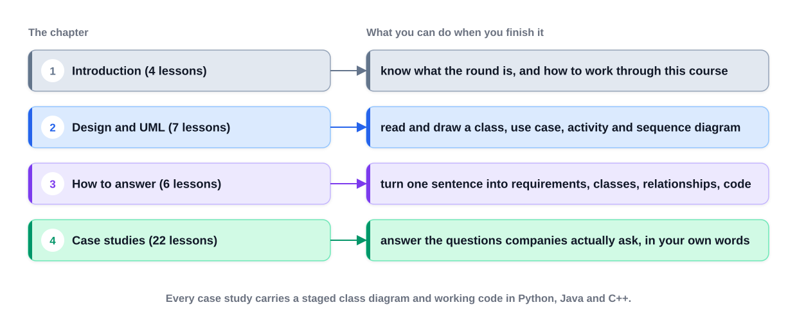
*Figure — The four parts of the course material this handbook absorbs: introduction, design and UML notation, the answering method, and the case studies (course diagram)*

The handbook follows that arc (understand the round, the notation, the **method**, then case studies) and adds full chapters on OOP, SOLID, design principles, clean code, refactoring (improving code structure without changing behaviour), all 23 GoF patterns (the catalogue from the 1994 "Gang of Four" book) and concurrency (several pieces of work running at once and sharing data), so you need no second resource.

**Every case study uses one template:** the question and chosen requirements (with out of scope); actors and use cases (often a use case diagram: who uses the system and for what); the class diagram built in stages; diagrams for key flows (activity diagrams show the steps of a process, sequence diagrams the messages objects send each other in time order); working Java with a driver `Main` (a class whose `main` method runs the example) and its real output; patterns named **only where really used**; and "Extensions & follow-up questions" listing the simplifications and what to say when the interviewer notices them.

### Who this is for, and what you need

For anyone facing this round, writing OO code without ever defending a class diagram aloud, or prepared only for system design. The method also splits new features into classes at work.

- **Some object-oriented language**, enough that a class with a constructor (the special method that sets up a new object) and a few methods reads easily. All examples are **Java 21** (a recent long-term-support release).
- **No UML** (Chapter 3 teaches it from zero).
- **No system design.** That round asks how a product survives millions of users (servers, databases, caches, queues; see [System Design Fundamentals](../../../system-design-patterns/modules/00-system-design-fundamentals/README.md)). This round stays **inside one process** (one running program). Practising one gives little for the other.
- Data structures only at basic level (a separate round): a **list** keeps items in order, a **map** looks a value up by key, a **set** holds no duplicates, a **queue** hands items out first-in first-out, a **heap** gives the smallest or largest item quickly.

It will not teach a language from scratch or give scripts to memorise: a memorised answer is useless the moment the question is new. **The reusable part is the method.**

### TL;DR

The LLD round = design the classes inside one application, out loud, then code the main flows. Prerequisite: one OO language. The method beats memorised answers.

---

## 1.2 How the interview runs

### What it is

The interviewer says one sentence, "Design a parking lot", and stops. Nothing tells you how many classes, whether to code, or how long you have. **That silence is the hard part.**

| Name | Where you hear it | What is different |
|---|---|---|
| **Object-oriented design (OOD) interview** | US big tech, many product companies | Whiteboard/doc: requirements, classes, diagram, code for main flows. |
| **Low-level design (LLD)** | Indian product companies, general usage | Same as OOD; the umbrella term. |
| **Machine-coding round** | Commonly reported at Indian product companies such as Flipkart, Swiggy and PhonePe | **Working, runnable code is mandatory**, usually in a 90-minute to 2-hour window. |

**LLD vs HLD (system design)** — same product, different zoom:

| | Low-level design (this handbook) | High-level / system design |
|---|---|---|
| Scope | Inside one application or service | Many services and machines |
| Vocabulary | Classes, interfaces, fields, methods, relationships, patterns | Servers, load balancers (spread requests across servers), databases, caches, queues, sharding (splitting one database across machines) |
| Output | Class diagram + code | Architecture diagram + capacity numbers |
| Typical question | "Design the classes for a parking lot" | "Design a parking-lot booking service for 10 million users" |

### OOD round vs machine-coding round

| | OOD / LLD discussion round | Machine-coding round |
|---|---|---|
| Duration | 45–60 minutes | Usually about 90 minutes of coding (often 2 hours including evaluation) |
| Where | Whiteboard, shared doc, or IDE (code editor with build and run tools) | Your own IDE, on your laptop or a remote machine |
| What you produce | Requirements, use cases, class diagram, code for 2–3 main flows | A **complete, running program** implementing the minimum required features |
| Storage | Not discussed much | **In-memory** (maps and lists); no real database unless asked |
| Interaction | Continuous conversation | Problem statement up front, mostly silent coding, then a **demo and code walkthrough** |
| What is judged | Bounding the problem, responsibilities, relationships, trade-offs, patterns | Working code, **data models**, **service interfaces**, **extensibility**, readability, edge cases, sometimes tests and thread safety |
| Common failure | Talking without converging, or coding too early | Not finishing, or one giant class that cannot be extended |

Machine coding gives a **minimum feature set**; you choose data structures, design **service interfaces** a client (e.g. a command-line driver) calls, and present **working code** with reasoning and patterns. Common for SDE-1/SDE-2 hiring (Software Development Engineer levels: entry, mid).

Terms: **data models** = classes holding the problem's data (`Ticket`, `Spot`); **service interface** = the public methods a caller uses (`park`, `exit`); **extensibility** = adding a feature without rewriting; **edge cases** = unusual boundary inputs (empty, full, negative, duplicate); **thread safety** = staying correct when several **threads** (independent lines of execution inside one program) use the code at once.

### How it works: the five core steps

1. **Clarify the requirements** — one sentence → a short written list of what the system must do.
2. **Find the actors and use cases** — who uses it (actors) and what each does (use cases).
3. **Find the classes** — one responsibility each.
4. **Connect the classes** — how each pair relates; a class diagram.
5. **Write the code** — the classes plus the 2–3 methods of the main flows.

**Order matters more than speed**: skip step 1 and step 3 invents classes no requirement asked for. (Section 1.4 expands these into eleven finer steps.)

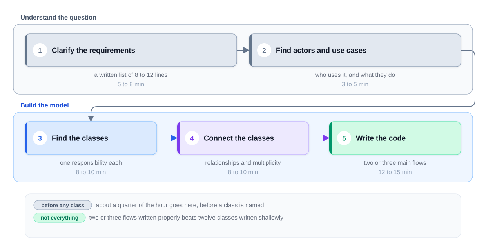
*Figure — The five steps split into "understand the question" and "build the model", with a time budget for each (course diagram)*

Up to **a quarter of the hour goes before any class is named**; the largest block, code, covers only two or three flows. **Nobody completes the whole product, and you are not expected to**: the design is judged on the part you built properly.

### Time-boxing

**45-minute OOD round:**

| Step | Time | What exists at the end |
|---|---|---|
| Clarify requirements | 5–8 min | 8–12 requirements + out-of-scope list |
| Actors and use cases | 3–5 min | 2–4 actors, 6–10 use cases |
| Find the classes | 8–10 min | Class list, one responsibility each |
| Connect the classes | 8–10 min | Class diagram with relationships and multiplicity (how many of each) |
| Write the code | 12–15 min | 2–3 methods implementing the main flows |

**90-minute machine-coding round:**

| Phase | Time | Output |
|---|---|---|
| Read, list requirements and assumptions | 5–10 min | Comment block at the top of `Main.java` |
| Model: entities, enums, service interfaces | 10–15 min | Empty classes/interfaces that **compile** (the compiler accepts them) |
| Core flow end to end | 30–40 min | One **happy path** (main flow, valid input) running from a driver `main` |
| Remaining features, validation, edge cases | 15–20 min | All "must have" features working |
| Polish: names, exceptions, one extension point, demo script | 5–10 min | Clean demo output |
| Buffer | 5 min | Never zero |

(**Enums** are types with a fixed list of named values; Section 1.6.) Rule of thumb: **get something running by the halfway mark** — a running partial solution beats a beautiful non-compiling one.

### What the interviewer is actually judging

1. **Did you bound the problem?** A clear bounded set beats a broad unbounded design.
2. **Does each class have one job statable in one sentence?** If not, it is normally two classes glued together.
3. **Are the relationships right?** Holding, owning and extending are different choices.
4. **Does the code match the diagram?** A method with no place in the diagram means one of them is wrong.
5. **Can you explain a trade-off?** Naming the road taken and the road not taken scores higher.

Machine coding adds: **runs**, **modular** (new vehicle type / payment / rule = new class), **readable**, **handles bad input**, and (senior) **thread-safe** shared state. Not graded: perfect UML or every diagram type — **the model is graded; notation is presentation.**

**Sizing:** a parking lot has ~12 requirements → ~12 classes, ~15 relationships. Three classes implement the main flows (issue a ticket, hold a vehicle, price the stay): write those properly, name the other nine in a sentence each. The costliest mistake is writing all twelve at equal depth so no flow works end to end.

### TL;DR

OOD, LLD and machine coding are one family; machine coding needs running code in ~90 minutes. Five steps in order, a quarter of the time before naming a class, two or three flows built properly.

---

## 1.3 A complete answer in five minutes: "Design a music playlist"

A complete answer first, theory later. It is small on purpose; later case studies are ~10× the size but follow **the identical outline**. (Diagram notation: Chapter 3.)

### Step 1: requirements

"Design a music playlist." Three clarifying questions give three requirements:

- Songs sit in a playlist and **their sequence is significant**.
- Someone can ask for **the following song**; the player tracks its current position.
- A user can turn **shuffle** on, changing the play order.

**Out of scope, agreed out loud:** user accounts, downloads, storage, the audio itself. The "not building" list earns as much credit as the "building" list.

### Step 2: actors and use cases

An **actor** is anyone or anything outside the application that interacts with it. Here only the **listener**: adds a song, plays the next one, switches shuffle on. Ten seconds here; three minutes for a parking lot, repaid tenfold, because **the actors reveal which classes must exist**.

### Step 3: classes, one sentence each

| Class | Responsibility (one sentence, no "and" where possible) |
|---|---|
| `Song` | Holds a title, an artist and a length; knows about itself and nothing else. |
| `Playlist` | Holds songs in order; stores them, does not play them. |
| `PlayOrder` (interface) | Picks the position to play after the current one; an interface because several ordering rules exist. |
| `InOrder` | Walks positions in insertion order. |
| `Shuffled` | Plays positions in a shuffled order decided once, up front. |
| `Player` | Holds a playlist and an order, and remembers the current position. |

An **interface** names a set of methods without saying how they work. Key insight: **a rule that can vary becomes its own type.** Without shuffle, `Player` would just count upward; with shuffle, "what plays next" has two versions, so it becomes `PlayOrder`, and the player never needs to know which it holds. Test: if a responsibility sentence needs **"and"** to join two unrelated jobs, it is probably two classes.

### Step 4: connect them

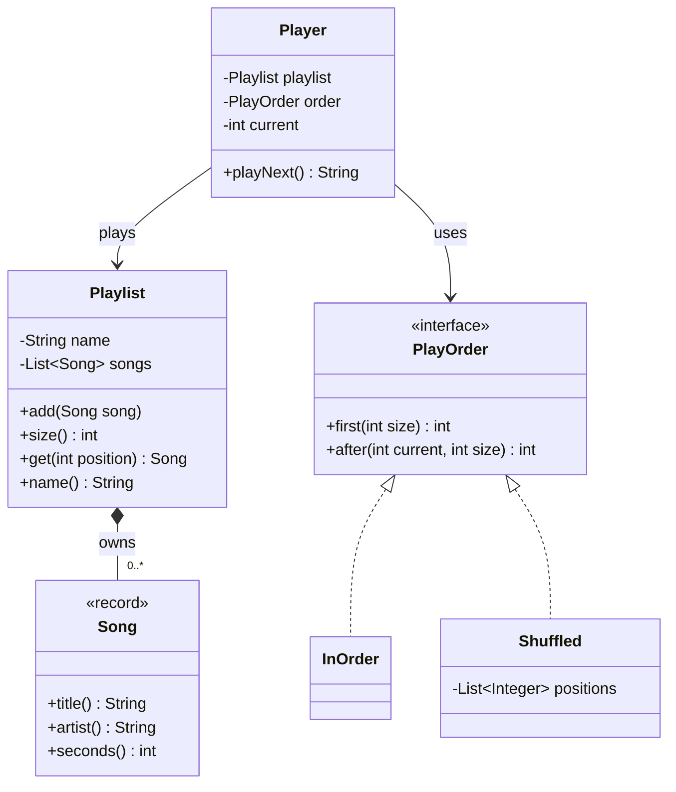

Three facts an interviewer checks:

- The **filled diamond** between `Playlist` and `Song`: the playlist **owns** its songs (composition); `*` / `0..*` means **many**.
- The **plain arrow** from `Player` to `PlayOrder`: the player **relies on** an ordering without owning it, and the arrow touches only the **interface**, not `InOrder` or `Shuffled`.
- The **dashed arrows with hollow triangles**: `InOrder` and `Shuffled` **implement** `PlayOrder`. A third rule later is one extra box; nothing drawn changes.

### Step 5: the code

> **Key term — reading the Java below:** `package` groups related classes like a folder. `implements PlayOrder` promises every method of that interface; `@Override` marks a method fulfilling such a promise (compiler-checked). `final` on a class forbids extending it; on a field, it is set once. `private` hides a member from code outside the class.

Essential lines (full files: `code/lld/ch01/playlist/`; `Song` is a record with a validating constructor, `Playlist` wraps a private `List<Song>` with `add`/`size`/`get`/`name`):

```java
// File: code/lld/ch01/playlist/PlayOrder.java
public interface PlayOrder {
    int NONE = -1;                           // "there is no next position"
    int first(int size);                     // first position to play, or NONE if empty
    int after(int current, int size);        // position after 'current', or NONE at the end
}

// File: code/lld/ch01/playlist/InOrder.java
public final class InOrder implements PlayOrder {
    @Override public int first(int size) { return size == 0 ? NONE : 0; }
    @Override public int after(int current, int size) { return current + 1 < size ? current + 1 : NONE; }
}

// File: code/lld/ch01/playlist/Shuffled.java  — order injected, so output is deterministic = testable
public final class Shuffled implements PlayOrder {
    private final List<Integer> positions;
    public Shuffled(List<Integer> positions) { this.positions = List.copyOf(positions); }
    @Override public int first(int size) { return positions.isEmpty() ? NONE : positions.get(0); }
    @Override public int after(int current, int size) {
        int i = positions.indexOf(current);
        return (i >= 0 && i + 1 < positions.size()) ? positions.get(i + 1) : NONE;
    }
}

// File: code/lld/ch01/playlist/Player.java  — never asks WHICH order it holds
public final class Player {
    private final Playlist playlist;
    private final PlayOrder order;           // depends on the interface, not on InOrder/Shuffled
    private int current = PlayOrder.NONE;
    private boolean started = false;
    // constructor stores playlist and order
    public String playNext() {
        if (!started) {
            current = order.first(playlist.size());
            started = true;
        } else if (current != PlayOrder.NONE) {          // once at the end, stay at the end
            current = order.after(current, playlist.size());
        }
        if (current == PlayOrder.NONE) return "end of playlist";
        Song s = playlist.get(current);
        return "playing " + s.title() + " by " + s.artist();
    }
}

// File: code/lld/ch01/playlist/Main.java (driver, abridged)
Playlist mix = new Playlist("Morning mix");
mix.add(new Song("Sunrise", "Ada Lane", 201));
mix.add(new Song("Blue Line", "The Meridians", 187));
mix.add(new Song("Paper Boats", "Nori Kim", 243));
run("in order", new Player(mix, new InOrder()), mix.size());          // run() prints label, then
run("shuffled", new Player(mix, new Shuffled(List.of(2, 0, 1))), mix.size()); // playNext() size+1 times
```

Run it: `cd chapters/01-lld-interview-approach/code && javac --release 21 -d /tmp/lld_01 $(find . -name '*.java') && java -cp /tmp/lld_01 lld.ch01.playlist.Main` (`javac` compiles `.java` to runnable `.class` files; `java` runs them; `-cp`, the classpath, says where they are).

Output:

```
in order:
  playing Sunrise by Ada Lane
  playing Blue Line by The Meridians
  playing Paper Boats by Nori Kim
  end of playlist
shuffled:
  playing Paper Boats by Nori Kim
  playing Sunrise by Ada Lane
  playing Blue Line by The Meridians
  end of playlist
```

**Explaining each part:**
- `Song` is a Java **record**: an immutable (unchangeable after creation) data carrier whose fields, constructor, accessors (`title()`), `equals`, `hashCode` and `toString` (compare, use as map key, print) are generated; its compact constructor (no parameter list, only checks values) rejects a blank title or non-positive length.
- `Playlist` keeps its list `private` (**encapsulation**: data reachable only through the class's own methods); callers add and read but cannot replace it.
- `PlayOrder` is the **variation point** (where different behaviours plug in); `NONE = -1` is an interface constant for "nothing more to play".
- `Shuffled` is **given** its order rather than using `Random`, so output is identical every run: **testable**. In production you would **inject** (hand in from outside, usually via the constructor) a `Random` with a **seed** (a fixed starting number that makes it repeat the same sequence) or a list shuffled elsewhere.
- `Player` depends on the interface, not a **concrete class** (a real class you can instantiate). One `Player` gives both behaviours and **nothing tests which mode is active**; its only `if`s track *where* it is (first call asks `first`, later calls `after`, and at the end it stays there).

### What to notice

- **One requirement turned into a type.** Shuffle was one line of requirements and produced an interface plus two implementations. **Classes come out of requirements**, never the reverse.
- **One job per class** (see the table): no class knows more than its sentence.
- **Open to changes you did not build.** "Repeat one" or "reverse" are new `PlayOrder` classes; nothing is reopened (Strategy pattern + Open/Closed Principle, Chapters 4 and 11).
- **Gaps announced on purpose:** pause, volume, queue, time. Say them yourself; every case study ends with "Extensions & follow-up questions" for this reason.

### TL;DR

A complete answer = a short bounded requirement list, a few one-sentence classes, one diagram, code for the main flow. A rule that varies becomes an interface, and its user never asks which version it holds.

---

## 1.4 The step-by-step answer framework

### What it is

A checklist run on **every** LLD question, expanding the five core steps into eleven, so "where do I start?" becomes small questions with known answers. Without it candidates freeze or code at once and find missing requirements at minute 35; with it your progress is **visible**, which is itself scored.

### How it works

| # | Step | Questions to ask yourself | Output | Core step |
|---|---|---|---|---|
| 1 | **Clarify** | Who uses it? What exactly is "a parking lot" here? One location or many? | Shared understanding | Requirements |
| 2 | **Requirements** | What must it do (functional)? How well (non-functional: thread-safe, extensible, in-memory, latency i.e. response time)? Out of scope? | 8–12 numbered lines + out-of-scope list | Requirements |
| 3 | **Use cases** | For each actor, what can they do? | Actor → use case list (or diagram) | Actors & use cases |
| 4 | **Entities** | Which nouns hold state or behaviour? Which are just values (fields/enums)? | Class list, one-sentence responsibilities | Classes |
| 5 | **Relationships** | Uses, has, owns, or is-a? How many (1, 0..1, *)? | Relationship list | Connect |
| 6 | **Class diagram** | Fields, key methods, interfaces, enums | UML class diagram | Connect |
| 7 | **Key flows** | Step by step for the 2–3 main use cases? Which states does the core object go through? | Sequence / activity / state diagram (states and moves between them) | Connect |
| 8 | **Patterns & SOLID** | A rule that varies (Strategy)? A lifecycle (fixed states an object moves through: State)? Many listeners (Observer)? A class with two reasons to change? | Named patterns + rejected alternatives | Check |
| 9 | **Code** | Interfaces, enums, models, services, a driver `main` | Running code for main flows | Code |
| 10 | **Edge cases & concurrency** | Invalid input? Full capacity? Two users grabbing the same seat? | Validation, exceptions (Java's error signal that stops normal flow), locks (one thread at a time in protected code) | Code |
| 11 | **Extensions** | What changes if requirement X is added? | Short answers, maybe one extra class | Wrap-up |

### Trade-offs

| Do this | Instead of this | Why |
|---|---|---|
| Spend 8–13 minutes on steps 1–3 | Coding at minute 2 | Unbounded scope wastes far more time later |
| Code 2–3 flows fully | Stub 12 classes (empty placeholders) | Depth on the chosen part is judged |
| Name one or two patterns where the signal appears | Apply six | Over-engineering (more flexibility than needed) reads as poor judgement |
| Pass time into methods (`nowMinute`); hold money as `BigDecimal` (Java's exact decimal type) or whole cents in a `long` | Call `System.currentTimeMillis()` inside logic; use `double` (binary floating point) for money | Deterministic (same input, same output) and testable; `double` cannot represent 0.10 exactly, so sums drift |

**Not rigidly:** if the interviewer steers ("skip requirements, show the class model"), follow. In machine coding steps 5–7 are often in your head or a comment; the code **is** the diagram.

### TL;DR

Clarify → requirements → use cases → entities → relationships → class diagram → key flows → patterns/SOLID → code → edge cases/concurrency → extensions. Say each step out loud as you enter it.

---

## 1.5 From one line to a list of requirements

### What it is

A **requirement** states one capability so you can test whether the design delivers it ("customers can pay at the exit", not "the lot should be good").

- **Functional** — a behaviour: "a customer takes a ticket at an entry panel".
- **Non-functional** — a quality: "two entry panels never assign the same spot" (thread safety), "a new vehicle type changes no existing class" (extensibility), "data kept in memory" (storage).

### The problem it solves

Real products start the same way: a short request someone turns into a specification. "Design a parking lot" is four words; the design is ~12 classes. Without a written list: **the design has no edges** (season tickets, plate recognition... and no code); **you cannot defend a choice** ("why no `Reservation`?" → "out of scope; we agreed at minute four"); **you cannot tell when you are finished**.

### How it works: the four questions

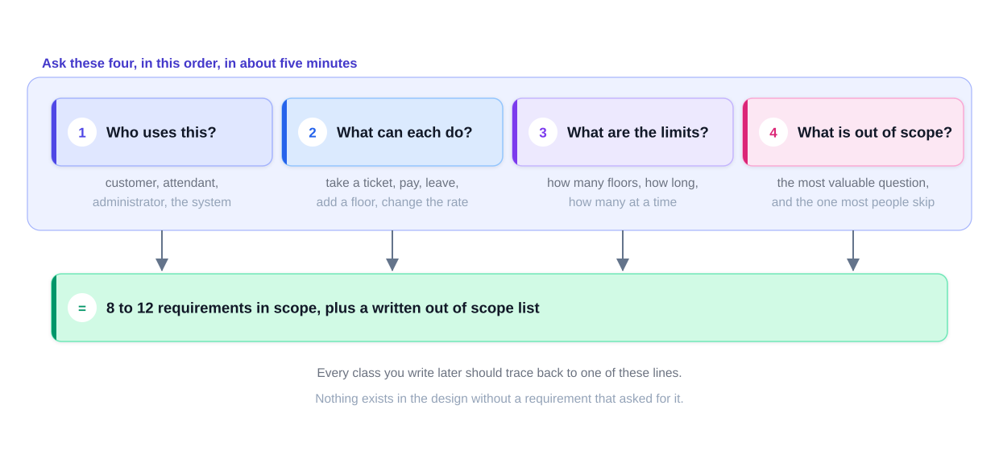
*Figure — Four questions asked in order produce 8–12 in-scope requirements plus a written out-of-scope list (course diagram)*

In order, ~5 minutes:

1. **Who uses this?** The **actors** — parking lot: customer, attendant, administrator, the system itself. Each brings its own requirements.
2. **What can each do?** Each action is a **use case** (customer takes ticket, parks, pays, leaves; admin adds floors, changes prices). Most of the list comes from here.
3. **What are the limits?** Floor count, spot kinds, max booking length, books per member. **Limits become constants and validation checks**; easiest to gather.
4. **What is out of scope?** Rarely asked, pays off most: the only question that makes the problem **smaller**.

Scope questions for almost any problem: "Are payments mine, or an external service I take as given?" "One site, or several sharing an account?" "Are users and permissions modelled, or may I assume a logged-in user?" Each answer adds or removes two or three classes, so ask early. If told "your choice": **choose, say it, write it down** — a stated assumption counts like a given answer.

### What good looks like: the parking lot in ten lines

**In scope**
1. The lot has multiple floors; each floor has many parking spots.
2. Spot types: compact, large, handicapped, motorbike, electric.
3. Vehicle types: car, van, truck, motorbike, electric car.
4. A customer takes a ticket at an entrance panel on arrival.
5. A customer pays at an exit panel, at a floor portal, or to an attendant.
6. Payment is by cash or card.
7. Charges are per hour, with the hourly rate depending on how long the stay lasts.
8. Each floor shows how many spots of each type are free.
9. The system refuses entry when no suitable spot is free.
10. Admins may add floors, spots and panels, and may update the rate.

**Out of scope:** season passes, licence-plate recognition, booking before arrival, refunds, multi-site reports.

Every line becomes a class, field or method. **If no line asked for it, it is not in the design.**

**Make each line checkable:** **put a number on it** ("no more than **five** books out at once" → a constant → a check in one method) and **name the actor** ("**a member** can reserve a copy currently on loan" → you know which class owns the method). Such a line is close to a test case: "requirement 5 lives here".

### Use cases

A **use case** is one goal an actor achieves ("customer pays for parking"); a **use case diagram** (Chapter 3) draws actors as stick figures and use cases as ovals. In 45 minutes a list suffices:

| Actor | Use cases |
|---|---|
| Customer | take ticket, park, pay (cash/card), exit |
| Attendant | collect cash payment, help customer |
| Admin | add floor, add spot, add panel, change rate |
| System | assign spot, update display boards, refuse entry when full |

### Common mistakes

- **Saying yes to every idea** — reservations, multiple sites... twenty minutes later 22 requirements and nothing designed. Declining is a **strong** move: "Let me park reservations and get ticketing and payment working end to end; I'll return if time allows."
- Forgetting non-functional requirements (concurrency, extensibility).
- Vague lines with no number and no actor.

### In the interview

**30-second answer** ("how do you start an LLD question?"): "I ask four questions: who uses it, what each actor does, what the limits are, and what is out of scope. I write 8 to 12 numbered requirements and an out-of-scope list, confirm them with you, and then every class I create must trace back to one of those lines."

- *"Why not just start designing?"* — Without a boundary the design grows forever and I cannot defend omissions. Five minutes here saves fifteen later.
- *"What if I say 'your choice'?"* — I pick the simpler option, say it, and write it as an assumption: visible and reversible.

### Self-check

- **Q:** Which of the four questions makes the problem smaller? **A:** "What is out of scope?"
- **Q:** Rewrite "users can book some seats" as a checkable requirement. **A:** "A customer can hold at most 10 seats for one show; held seats are released after 10 minutes if unpaid."
- **Q:** Where do limits end up in code? **A:** Constants plus a validation check in the method that owns the data.

### TL;DR

Four questions (who, what, limits, out of scope) → 8–12 checkable lines with numbers and actors, plus an out-of-scope list. Saying "no" to extra scope is a strength.

---

## 1.6 Finding the classes

### What it is

A ten-minute method: **collect candidates, cut the ones that are not classes, give each survivor one job.**

### How it works

1. **Underline the nouns.** Parking lot — structure: lot, floor, spot, compact spot, large spot, entrance panel, exit panel, display board, portal; vehicles: vehicle, car, van, truck, motorbike; people: customer, attendant, administrator; money/time: ticket, payment, cash, card, rate, hour. Deliberately too many: **candidates**, none made up.
2. **Underline the verbs** (park, take a ticket, pay, leave, refuse entry, show free spots, add a floor, change the rate). **Each verb becomes a method** on some class; a verb with no home means a class is missing.
3. **Cut candidates with five tests:**

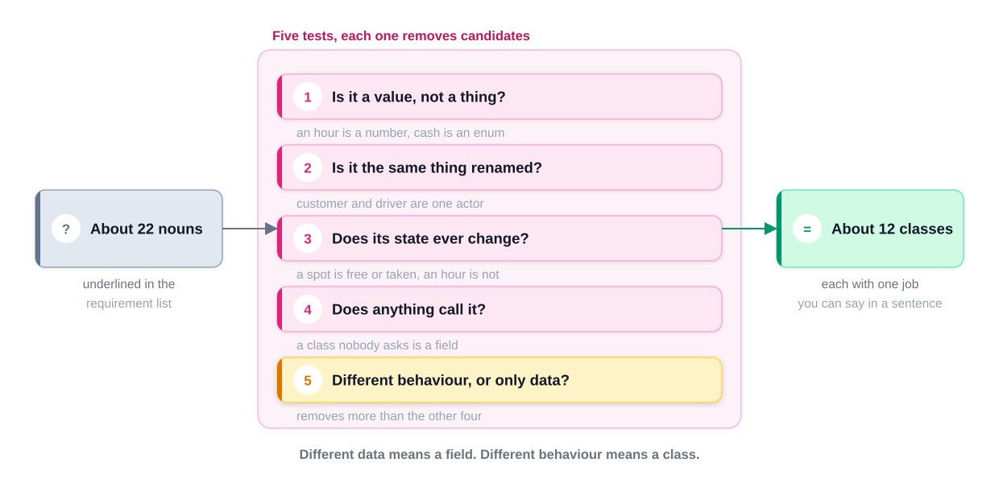
*Figure — About 22 nouns pass through five tests and about 12 classes survive, each with one job (course diagram)*

| # | Test | Example | Result |
|---|---|---|---|
| 1 | Is it a **value** rather than a thing? | An hour is a number, a licence plate a string; cash/card are options of a payment type | Field or **enum** constant (a fixed set of named values) |
| 2 | Just **another name** for a listed candidate? | Customer and driver are one actor; portal and panel could be one class in several places | Merge, pick one name |
| 3 | Does it have **state that changes**? | A spot is free or occupied; an hour never changes | Changing state → class |
| 4 | Does anything **call** it? | Nobody asks an `Hour` object a question | Never called → a value |
| 5 | Different **behaviour** or only **data**? | Compact vs large spot differ only in which vehicle fits; cash vs card behave differently | **Different data → a field. Different behaviour → a class.** |

Tests 1–4 cut ~22 to ~15; test 5 alone brings it to ~12. Spot kinds differ only in allowed vehicle (**data** → one `ParkingSpot` with a `type` field); cash checks the amount given while card calls a provider and waits (**behaviour** → two classes). **Smell** (a surface sign something is wrong): five subclasses (classes extending a parent) whose only content is passing a different constant to the parent — a field pretending to be classes.

4. **One responsibility each**, one sentence, no "and":

| Class | Responsibility |
|---|---|
| `ParkingLot` | Issues tickets and can tell when no space is left |
| `ParkingFloor` | Owns a level's spots and locates an empty one |
| `ParkingSpot` | Tracks if it is occupied and by which vehicle |
| `Vehicle` | Carries its plate number and the spot types it can use |
| `ParkingTicket` | Notes the vehicle, the spot it took, and the entry time |
| `ParkingRate` | Converts a duration in hours into a price |
| `Payment` | Collects the money and says if that worked |
| `ParkingDisplayBoard` | Shows how many spots of each type are free |

`ParkingLot`'s sentence admits two jobs (tickets **and** fullness/assignment); a longer design splits it, but in 45 minutes **naming the tension aloud is enough**.

5. **Put each method where the data is.** "Find a free spot" touches the floor's spots → `ParkingFloor`; "price the stay" the rate card → `ParkingRate`; "take a ticket" the ticket store → `ParkingLot`. A method needing data from three classes belongs with the one owning most of it (GRASP "Information Expert" — guidelines for which class gets which job — and the cure for *Feature Envy*, a method using another class's data more than its own; Chapters 5 and 7).

### Common mistakes

- One subclass per value (`CompactSpot`, `LargeSpot`... with no behaviour).
- Missing the **record-keeping** class (ticket, loan, booking) and the **rule** class (rate, strategy): the two beginners most often forget.
- "Manager" **god classes** (one huge class owning most of the logic).

### Self-check

- **Q:** Car, van and truck: subclasses or enum? **A:** If they differ only in size/which spots fit, an enum `VehicleType` (or a field); genuinely different behaviour → subclasses.
- **Q:** A verb has no class to live on? **A:** A class is missing.
- **Q:** A class has fields but no verbs? **A:** Probably a value (record/field), not a full class.

### TL;DR

Nouns → candidates, verbs → methods. Cut values, duplicates, stateless and never-called nouns. **Different data = field; different behaviour = class.** One sentence per class; the method goes where its data is. Twelve clear classes beat twenty overlapping ones.

---

## 1.7 Connecting the classes (preview)

For each pair decide: does one **use** the other briefly (dependency), **hold** a reference (association), **contain** parts that can live alone (aggregation), **own** parts that die with it (composition), or **is** it a kind of the other (inheritance: a class extends another and reuses its code; realization: a class implements an interface)? Add **multiplicity** (1, 0..1, 1..*, *). Chapter 3 covers every relationship and symbol. The commonest beginner error: **inheritance** where **composition** is right. Test the sentence "A **is a** B": a car is not an engine, so `Car` has an `Engine`.

---

## 1.8 Keeping the design honest with SOLID

### What it is

**SOLID** is five rules (one per letter) that catch the common ways a class diagram goes wrong. Chapter 4 teaches them in depth; in the interview run them as **five quick checks** over your diagram, about five minutes.

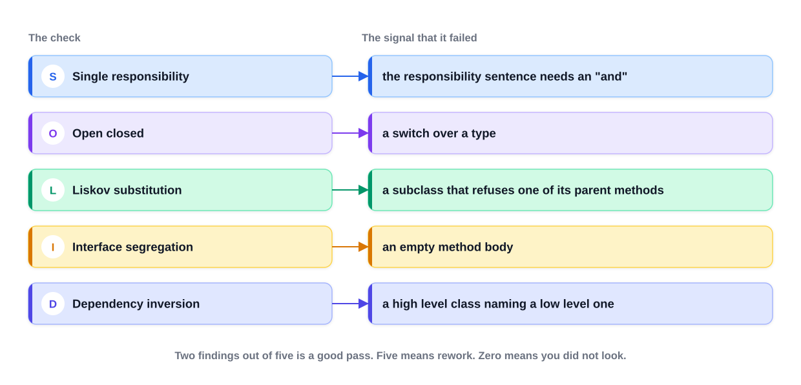
*Figure — The five SOLID checks and the signal that each one has failed (course diagram)*

### How it works: five checks, with a pass over the parking lot

| Check | Rule in one line | Signal it failed | Quick check | Parking-lot finding |
|---|---|---|---|---|
| **S** — Single responsibility | One reason to change | Responsibility sentence needs "and" | Name the change forcing an edit; two unrelated → split | `ParkingLot` issues tickets **and** finds spots (and, if it printed receipts, would change for pricing and layout): split if time allows, else say it |
| **O** — Open/closed | Add behaviour without editing code | `switch`/`if` chain over a type | Pick a likely new feature; if it edits three classes, the design is closed to the wrong thing | Pricing behind `ParkingRate`, so a weekend rate is a new class, not a switch edit. Passes |
| **L** — Liskov substitution | A subclass works anywhere its parent does | Subclass throws, does nothing, or refuses a parent method | Read each inheritance arrow: can the child go where the parent is expected? | A `ReadOnlySpot` whose `occupy` throws would fail. The five no-behaviour spot subclasses are *not* strictly a Liskov violation (they substitute fine) — it is 1.6's "different data → field" caught again; collapse to a `type` field. Re-read arrows at the end: they get added late |
| **I** — Interface segregation | No class implements methods it does not use | Empty method bodies | Split until every implementer uses everything | No wide interfaces. Passes. (A library `Search` with four methods is fine only if implementers really do all four) |
| **D** — Dependency inversion | Depend on an interface, not a concrete class | A high-level class (business rules) constructs or names a low-level one (one technical job: database, payment provider) | Could you test it without the real database/provider? | Lot depends on `Payment`; `new CreditCardTransaction()` inside it would block testing and cash. Passes |

Two real findings, each explainable in a sentence, is a good pass; **five** usually means rework, **zero** that you did not look.

**Most credit:** **S** improves your class list (twelve well-named classes beat six doing three things); **O** is what interviewers probe with a late requirement ("trucks charged differently?") — "add a class" beats "add a branch to this switch".

**When not to:** no interface for everything — a single-implementer interface "because SOLID" is **indirection** (an extra layer between caller and code) with no benefit; add one when a second implementation exists or is clearly coming, or for a **test double** (a fake stand-in used in tests). Do not over-split: thirty two-method classes are as bad as one god class; the one-sentence test is the boundary. Apply each rule where its problem appears.

### TL;DR

Run S-O-L-I-D as five quick checks on your own diagram before the interviewer does. S and O earn most credit. No single-implementer interfaces, no over-splitting.

---

## 1.9 The design patterns that come up in this round

### What it is

A **design pattern** is a named solution to a recurring design problem. The Gang of Four book catalogues 23 (Chapters 8–11 cover all); **six** recur in this round. The name turns a paragraph into two words. **A misapplied pattern hurts more than an unknown one**, so learn each with its **signal**.


*Figure — The six patterns most used in this round and the signal for each (course diagram)*

| Pattern | Signal → reach for it | Skip it if | Parking lot / library example and what to say |
|---|---|---|---|
| **Strategy** | One operation, several interchangeable rules chosen at run time | Only one rule and no second in sight | `ParkingRate` with `HourlyRate`, `WeekendRate`, `MonthlyPass`. Without it the pricing method grows a `switch` edited per rate; with it a new rate is a new class. Answers "what if the rules change?", the commonest late question. Also matching, sorting, ranking, routing |
| **Factory** | Creation depends on a type value; caller should not know the concrete class | Only one concrete class | A factory turns a type/enum into a `Vehicle`, so the entrance panel does not know every vehicle class; registering a new type happens in **one spot** (open/closed). A factory **method** is usually enough; one factory class per product is too heavy for 45 minutes |
| **Observer** | One thing changes, several others must know, source should not know them | One listener the source already holds | **Spot is the subject**; boards, entrance panels and floor portals register and update when it fills; the spot never learns who listens. With one listener a direct call is enough (e.g. notifying the member who reserved a returned book; the floor pushing to its single board) |
| **State** | Behaviour depends on current state with a fixed set of transitions | A single guarded method covers ~3–4 states | Ticket active → paid → closed; book copy available/reserved/loaned/lost. Without it every method checks status and legal transitions scatter; with it each state class knows what is allowed, so illegal moves cannot be expressed. Choose only for large transition tables; else **enum + one guarded method**, and say why |
| **Singleton** | Exactly one instance must exist | The real goal is just easy global access | `ParkingLot`, `Library`: private constructor + one accessor. Expect two follow-ups every time: **thread safety** (lock, or eager creation when the class loads) and **global state** (data any code can reach and change) hurting tests; many teams inject one shared instance instead |
| **Builder** | Many optional fields; constructor getting long | Three required fields | `BookItem` with barcode, price, format, dates, rack: eight args are easy to swap (two adjacent strings compile fine); a builder sets fields **by name**. Readability fix, not structural; mention at ~six arguments and move on |

**One or two patterns** suit a 45-minute design; six usually means patterns drive the design rather than requirements. Best of all is a **comparison**: "The rate gets Strategy because a second rate is likely; the ticket does not get State, since one guard is enough for three statuses."

### Real-world examples

- **Strategy:** `java.util.Comparator` passed to `List.sort`; Spring Security's pluggable `PasswordEncoder` implementations.
- **Factory** (static factory methods hiding the concrete class): `Executors.newFixedThreadPool(...)` (a **thread pool** is a fixed set of reusable worker threads), `List.of(...)`, `Calendar.getInstance()`.
- **Observer:** Swing/AWT (Java's older desktop UI toolkits) listeners (`ActionListener`), `java.beans.PropertyChangeListener`, Spring `ApplicationEvent` listeners.
- **State:** e-commerce order lifecycle (placed → paid → shipped → delivered); TCP connection states (TCP: the protocol keeping a reliable connection between machines; see [System Design Fundamentals](../../../system-design-patterns/modules/00-system-design-fundamentals/README.md)).
- **Singleton:** `java.lang.Runtime.getRuntime()`; Spring beans (objects created and wired by **Spring**'s *container*) are singleton-scoped **per container** by default — not the GoF class-enforced singleton.
- **Builder:** `StringBuilder`, `java.net.http.HttpRequest.newBuilder()`, `Stream.builder()`.

### TL;DR

Know six by name: Strategy, Factory, Observer, State, Singleton, Builder. Use one or two where their signal appears, and name the one you rejected.

---

## 1.10 Code, edge cases and concurrency: how to write interview code

### How it works: a machine-coding skeleton that scales

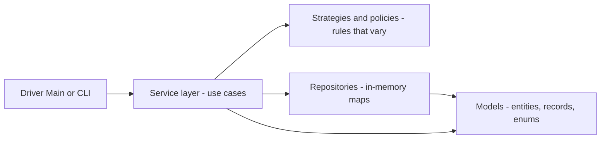

1. **Models** — entities (`ParkingSpot`: identity, state changes over time), value objects (`record Vehicle`: plain data compared by value), enums (`VehicleType`). Encapsulate state; validate in constructors.
2. **Repositories** — only store and find objects: an in-memory `Map<Id, Entity>` behind a small interface, so a database could replace it.
3. **Strategies / policies** — every rule that might vary (pricing, spot selection, bill splitting).
4. **Services** — the use cases (`park`, `exit`, `bookSeats`): the **service interface** a client calls.
5. **Driver** — a `Main` running a scripted scenario (or reading commands) with clear demo output.

**Habits interviewers notice:**
- **Pass time in** (`long nowMinute`, `Instant now` — Java's point-in-time type), never read the clock inside logic: same input → same output → testable.
- **Money as `BigDecimal`** (built from strings: `new BigDecimal("3.50")`) or whole cents in a `long`; never `double`. This handbook uses `BigDecimal` in domain code.
- **Fail loudly**: `IllegalArgumentException` for bad arguments, `IllegalStateException` for wrong state, custom exceptions (`SpotNotAvailableException`) where clearer.
- **Return `Optional`** (a box holding a value or empty, instead of `null`) when "not found" is normal.
- **Fields `private final`** unless they must change; **domain names** (`ParkingTicket`, not `Data2`).

### Edge cases and concurrency checklist

| Category | Questions |
|---|---|
| Input | null (no object at all), empty, negative, duplicate IDs, unknown IDs |
| Capacity | Full lot, empty playlist, zero seats left, max loans reached |
| State | Paying twice, exiting without entering, cancelling a delivered order |
| Time | Exit before entry, bookings expiring, part hours (round up?) |
| Concurrency | Two threads booking the same seat or spot: `synchronized`, a `ReentrantLock`, or atomic structures such as `ConcurrentHashMap.computeIfAbsent`; lock the **smallest** shared thing that keeps the invariant |

> **Key term — threads, locks and atomicity:** A **thread** is one independent line of execution; a server handling two panels at once runs two threads over the same objects. `synchronized` and `ReentrantLock` let only one thread at a time into a block. An **atomic** operation happens all at once from other threads' view, with no visible half-finished moment; `ConcurrentHashMap` is a thread-safe map offering such operations. An **invariant** is a rule about the data that must always hold ("one spot holds at most one vehicle").

Chapters 12–13 cover concurrency in depth.

### TL;DR

Models → repositories → strategies → services → driver. Inject time, `BigDecimal` (or cents) for money, validate, return `Optional`, guard shared state.

---

## 1.11 Worked mini-example, end to end: a small parking lot

Every framework step on a deliberately small version (the full parking lot with panels, payments and boards is in the case-study chapters).

### Problem & clarifying questions

| Question | Answer (assumed) |
|---|---|
| Single lot or many? | Single lot, one or more floors |
| Which vehicles? | Motorbike, car, truck |
| Which spot types? | Motorbike, compact, large; a smaller vehicle may use a bigger spot |
| Payment? | Out of scope: we compute the fee; a payment service collects it |
| Pricing? | Hourly, tiered, part hours round up; trucks pay double; swappable (weekend flat rate) |
| Concurrency? | Several entry/exit panels may act at once |

### Requirements

**Functional**
1. The lot has floors; each floor has spots of type MOTORBIKE, COMPACT or LARGE.
2. A motorbike fits MOTORBIKE or COMPACT; a car fits COMPACT or LARGE; a truck fits LARGE only. The smallest fitting spot is tried first.
3. On entry, the system assigns a free fitting spot and issues a ticket (id, vehicle, spot, entry time).
4. If no fitting spot is free, entry is refused.
5. On exit, the ticket is closed, the spot freed and the fee returned.
6. Fee: $4.00 first hour, $3.50 for hours 2–3, $2.50 per hour after; part hours round up; minimum one hour; trucks pay double.
7. The pricing rule can be swapped at run time (e.g. a flat $10 weekend rate).
8. A floor can report how many spots of a type are free.

**Non-functional:** in-memory; thread-safe entry/exit; new pricing rules or vehicle types need no edits to existing services; deterministic (time passed in).

**Out of scope:** payment collection, reservations, display boards, number-plate recognition, multiple lots.

### Use cases

| Actor | Use cases |
|---|---|
| Driver (customer) | enter and get ticket, exit and see fee |
| Admin | add floor/spots, change pricing rule |
| System | find free spot, refuse entry when full, compute fee |

### Core entities

| Class | Kind | Responsibility |
|---|---|---|
| `SpotType` | enum | The spot sizes |
| `VehicleType` | enum | Vehicle kinds, each knowing which spot types fit (smallest first) |
| `Vehicle` | record | Plate + type (pure data) |
| `ParkingSpot` | class | Tracks if it is occupied and by which vehicle |
| `ParkingFloor` | class | Holds spots on one floor and finds a free fitting one |
| `Ticket` | record | Which vehicle went into which spot, and when (the "connection object") |
| `PricingStrategy` | interface | Turns a stay into a fee (`BigDecimal`) |
| `HourlyRate`, `FlatWeekendRate` | classes | Two pricing rules |
| `ParkingLot` | class | Issues and closes tickets; the service the panels call |

Spot sizes are an enum, not three subclasses: **different data → field**.

### Class diagram

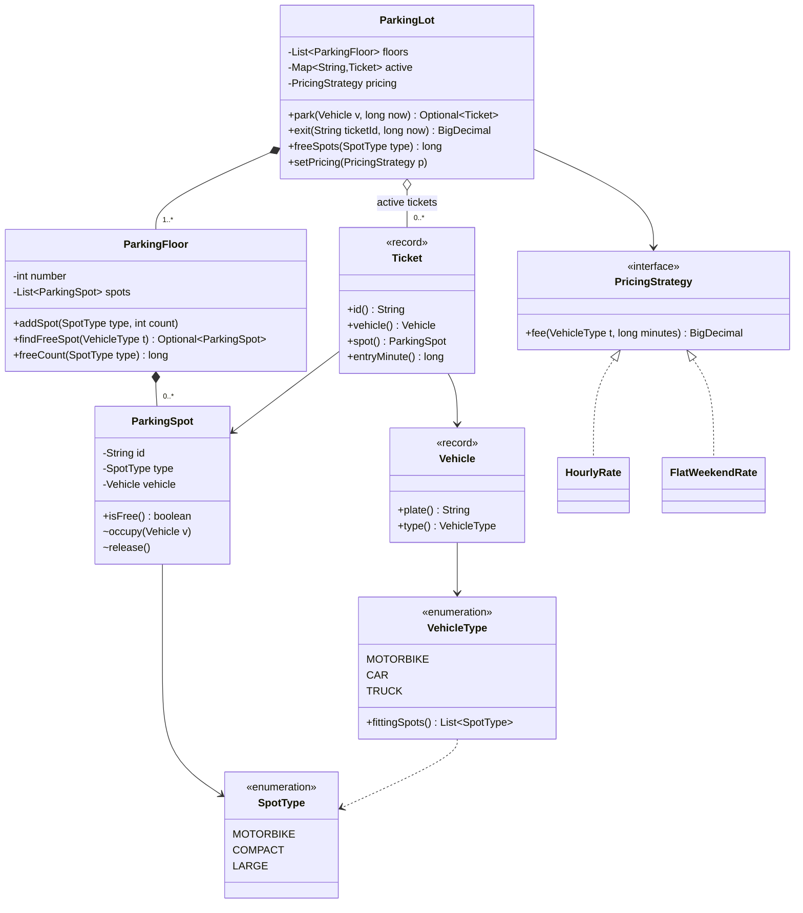

### Key flows

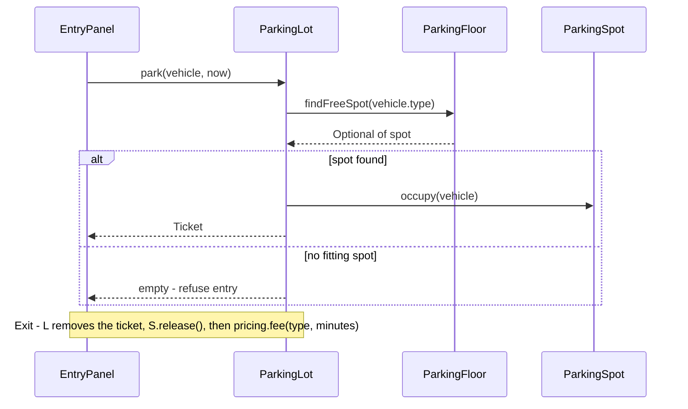

### Design decisions & patterns used

| Decision | Why | Alternative rejected |
|---|---|---|
| **Strategy** for pricing (`PricingStrategy`) | A second rule (weekend) is required; new rules = new classes (open/closed) | A `switch` over a rate enum inside `ParkingLot` |
| Spot and vehicle types as **enums** | Differ in data only | One subclass per spot type |
| `Ticket` as a **record** | A ticket is a fact that never changes after issue. (Only *shallowly* immutable: fields cannot be reassigned, but the `ParkingSpot` it points to still changes) | Mutable ticket with setters (methods that change fields) |
| Money as `BigDecimal` | Exact: `3.50 + 3.50` is exactly `7.00` | `double` (binary fractions, rounding drift) |
| `synchronized` on `park`/`exit`/`freeSpots` | Two panels never get the same spot; a lot-wide lock is simple and correct at this size | Per-floor locks (better throughput — more requests per second — but more complex; an extension) |
| No Singleton for `ParkingLot` | Injecting one instance keeps it testable | Global `getInstance()` |
| No State pattern for tickets | Only active/closed; a map of active tickets is enough | State classes per ticket status |

### Java implementation

Essential lines below; full code in `code/lld/ch01/parkinglot/` (`SpotType` enum; `Vehicle(plate, type)` and `Ticket(id, vehicle, spot, entryMinute)` records; `PricingStrategy` interface with `BigDecimal fee(VehicleType type, long minutesParked)`; `FlatWeekendRate` returns a flat `10.00` — added later as a new class, no existing code edited; `ParkingFloor.findFreeSpot` tries each of the vehicle's `fittingSpots()` in order and returns the first free spot of that type, and `addSpot` names spots `"F" + floor + "-" + first letter of type + i`, e.g. `F0-C1`; `ParkingFloor` is not thread-safe itself — the lot calls it under its lock).

```java
// File: code/lld/ch01/parkinglot/VehicleType.java — each type knows which spots fit, smallest first
public enum VehicleType {
    MOTORBIKE(List.of(SpotType.MOTORBIKE, SpotType.COMPACT)),
    CAR(List.of(SpotType.COMPACT, SpotType.LARGE)),
    TRUCK(List.of(SpotType.LARGE));
    private final List<SpotType> fits;
    VehicleType(List<SpotType> fits) { this.fits = fits; }
    public List<SpotType> fittingSpots() { return fits; }
}

// File: code/lld/ch01/parkinglot/ParkingSpot.java (excerpt)
private Vehicle vehicle;                 // null = free
public boolean isFree() { return vehicle == null; }
void occupy(Vehicle v) {                 // package-private: only the lot may change a spot
    if (!isFree()) throw new IllegalStateException(id + " is taken");
    vehicle = v;
}
void release() { vehicle = null; }

// File: code/lld/ch01/parkinglot/HourlyRate.java — $4.00 first hour, $3.50 hours 2-3, $2.50 after; trucks x2
private static final BigDecimal FIRST_HOUR = new BigDecimal("4.00");
private static final BigDecimal HOURS_2_TO_3 = new BigDecimal("3.50");
private static final BigDecimal LATER_HOURS = new BigDecimal("2.50");
@Override
public BigDecimal fee(VehicleType type, long minutesParked) {
    long hours = Math.max(1, (minutesParked + 59) / 60);    // ceiling, minimum one hour
    BigDecimal total = BigDecimal.ZERO;
    for (long h = 1; h <= hours; h++) {
        total = total.add(h == 1 ? FIRST_HOUR : (h <= 3 ? HOURS_2_TO_3 : LATER_HOURS));
    }
    return type == VehicleType.TRUCK ? total.multiply(BigDecimal.TWO) : total;
}

// File: code/lld/ch01/parkinglot/ParkingLot.java — time PASSED IN; every method touching
// spots, tickets or pricing is synchronized, so two panels cannot hand out the same spot
public final class ParkingLot {
    private final List<ParkingFloor> floors;               // List.copyOf(floors) in the constructor
    private final Map<String, Ticket> active = new HashMap<>();
    private PricingStrategy pricing;
    private int nextTicket = 1;

    public synchronized Optional<Ticket> park(Vehicle v, long nowMinute) {
        for (ParkingFloor floor : floors) {
            Optional<ParkingSpot> spot = floor.findFreeSpot(v.type());
            if (spot.isPresent()) {
                spot.get().occupy(v);
                Ticket t = new Ticket("T" + nextTicket++, v, spot.get(), nowMinute);
                active.put(t.id(), t);
                return Optional.of(t);
            }
        }
        return Optional.empty();               // lot full for this vehicle type -> refuse entry
    }

    public synchronized BigDecimal exit(String ticketId, long nowMinute) {
        Ticket t = active.get(ticketId);
        if (t == null) throw new IllegalArgumentException("unknown or already closed ticket " + ticketId);
        if (nowMinute < t.entryMinute()) throw new IllegalArgumentException("exit before entry");
        active.remove(ticketId);                // validate first, then change state
        t.spot().release();
        return pricing.fee(t.vehicle().type(), nowMinute - t.entryMinute());
    }

    public synchronized long freeSpots(SpotType type) {    // same lock as park/exit
        return floors.stream().mapToLong(f -> f.freeCount(type)).sum();
    }
    public synchronized void setPricing(PricingStrategy pricing) { this.pricing = pricing; }
}

// File: code/lld/ch01/parkinglot/Main.java (scenario, abridged)
// one floor (floor 0) with 1 MOTORBIKE, 1 COMPACT, 1 LARGE spot; pricing = new HourlyRate()
// park car KA-01-1234 at minute 0, truck KA-02-9999 at 10, car KA-03-5555 at 20 (refused: prints orElse text)
// print lot.freeSpots(COMPACT); exit T1 at 150, T2 at 60
lot.setPricing(new FlatWeekendRate());          // swap the strategy at run time
// park KA-03-5555 at 200 (gets T3) and exit it at 500; then exit T1 again at 600 and print the caught error
```

Run: `java -cp /tmp/lld_01 lld.ch01.parkinglot.Main`

Output:

```
T1: KA-01-1234 -> spot F0-C1
T2: KA-02-9999 -> spot F0-L1
KA-03-5555 -> refused, no suitable spot
free compact spots: 0
T1 exits after 150 min, pays $11.00
T2 exits after 50 min, pays $8.00
T3: KA-03-5555 -> spot F0-C1, weekend exit pays $10.00
error: unknown or already closed ticket T1
```

Reading it: car → compact, truck → the only large spot, so the third car is refused (requirement 4). 150 min = 3 h = $4.00 + $3.50 + $3.50 = $11.00; the truck's 50 min round up to 1 h, doubled = $8.00; after the strategy swap the flat $10 applies; a double close is rejected.

### Concurrency & edge cases

- `park`/`exit` are `synchronized` on the lot, so find-then-occupy is **atomic**: two panels cannot both see a spot free and both take it (a *check-then-act* **race condition** — a bug whose result depends on which thread runs first).
- `freeSpots` reads under the **same** lock, so a display never sees a half-finished `park`; `ParkingFloor` is only ever called through the lot.
- `exit` validates ticket and time **before** changing anything, so a rejected exit leaves the ticket open; exit before entry, unknown ticket and double exit all throw `IllegalArgumentException`.
- `ParkingSpot.occupy` also throws if taken (second line of defence); `occupy`/`release` are **package-private**, so outside code cannot change spot state.

### Extensions & follow-up questions

| Follow-up | Answer |
|---|---|
| "Add electric-vehicle spots with charging." | Add `ELECTRIC` to `SpotType` and an `ELECTRIC_CAR` vehicle type whose fitting list starts with `ELECTRIC`. If charging has **behaviour** (meter, charging fee), a `ChargingSpot` class or a charging component composed into the spot. |
| "Nearest spot to the entrance instead of first free." | Extract a `SpotSelectionStrategy` interface (Strategy again), injected into `ParkingLot`. |
| "Update display boards when spots change." | Observer: spots/floors publish "spot freed/occupied" events; boards subscribe. |
| "Improve throughput with many panels." | Lock per floor (or per spot type) instead of the whole lot; or a `ConcurrentLinkedQueue` (thread-safe queue) of free spots per type, `poll()`ed atomically. |
| "Add payment by cash or card." | `Payment` interface with `CashPayment`, `CardPayment`; `exit` returns the fee and a `PaymentService` collects it (dependency inversion). |

### In the interview

About 5 minutes on questions and requirements, 3 on actors, 8 on entities and the "enum vs subclass" decision, 8 on the diagram, 15 on `park`, `exit` and `HourlyRate`. Close by naming Strategy (used), Singleton and State (rejected, with reasons), and the per-floor locking extension.

### Self-check

- **Q:** Why is `SpotType` an enum and not a class hierarchy? **A:** Spot types differ only in data (which vehicles fit), not behaviour.
- **Q:** What race does `synchronized` on `park` prevent? **A:** Two threads finding the same free spot and both occupying it (check-then-act).
- **Q:** How did the weekend rate respect open/closed? **A:** It was a new `PricingStrategy` class; nothing existing was edited.

### TL;DR

Small, complete, honest: 8 requirements, 10 types, one Strategy, one lock, and a clear list of what was left out.

---

## 1.12 Communication tips

| Do | Why |
|---|---|
| **Think out loud**, naming the step you are in ("Now I'll list actors") | Your process is scored, not only the result |
| **Write things down** where the interviewer sees them | Shared artefacts prevent misunderstandings |
| **Confirm before moving on** ("Does this scope look right?") | Cheap course corrections |
| **State assumptions explicitly** | Counts like an answer from the interviewer |
| **Offer trade-offs in pairs**: "X over Y because..." | Shows judgement |
| **Welcome hints**; treat the interviewer as a teammate | Collaboration is evaluated |
| **Say what you leave out** and how you would add it | Turns a gap into a strength |
| **Keep a clock in view**; announce the move to code | Prevents "no code at minute 40" |
| **Use domain names**, not `Manager`, `Helper`, `Data` | Clear names are clear thinking |
| **When stuck, return to the requirements** | Every class traces back to a line |

**Don't:** go silent for minutes, argue with feedback, name `HashMap`s and threads in minute two (implementation before analysis and design), or recite pattern definitions without a reason to use them.

---

## 1.13 How to use this handbook, and a study plan

### Attempt first, then compare

**Reading** case studies is pleasant but builds little skill: any finished design looks obvious. **Attempting each yourself, then comparing**, is slower and is what improves performance under pressure.

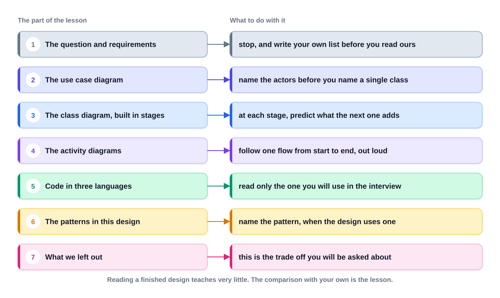
*Figure — The parts of a case-study lesson and what to do at each one (course diagram)*

Three stopping points matter most:

1. **After the question:** write your requirement list (8–12 lines + out of scope) and compare. A shorter list usually means **not asking enough questions**, not missing knowledge.
2. **After the requirements:** write your class list, then read the diagram. Most people are **two classes short** — **the record keeper** (ticket, loan, booking) and **the rule** (rate, strategy).
3. **At each stage of the class diagram:** predict the next stage; each wrong guess shows how an experienced designer thinks.

More habits: read diagrams in stages, looking symbols up in Chapter 3 as you meet them; if a decision looks wrong, write down why (several designs here exist because someone disagreed with an earlier version); read one language's code (Java) — translations teach nothing about design; **never skip "what we left out"** — interviewers ask exactly these, and "I merged these two responsibilities to save time; here is how I'd split them" beats hoping nobody asks; never invent pattern names. **After six or seven case studies, do timed runs** (a known question, 45 minutes, blank page) and measure two things: first ten minutes on requirements and actors? running code for at least one flow? They predict the result better than class count. **Compile and run every example** (`bash tools/compile_all.sh` runs all chapters; `bash` is the Unix shell, the `.sh` file a command script).

### Map of this handbook

| Ch | Title | Use it for |
|---|---|---|
| 1 | The LLD interview & how to approach it | The method, time budget, study plan (this chapter) |
| 2 | OOP fundamentals | Classes, objects, the four pillars, interfaces, enums, equality, immutability, generics, OOA/OOD (object-oriented analysis / design) |
| 3 | Relationships & UML | Association, aggregation, composition, dependency; class, use case, activity, sequence, state diagrams |
| 4 | SOLID principles | The five principles in depth |
| 5 | Design principles | DRY (don't repeat yourself), KISS (keep it simple), YAGNI (you aren't gonna need it), composition over inheritance, Law of Demeter, GRASP and friends |
| 6 | Clean code | Naming, functions, comments, error handling, tests |
| 7 | Refactoring | Code smells and the named refactorings that fix them |
| 8 | Creational patterns | Singleton, Factory Method, Abstract Factory, Builder, Prototype |
| 9 | Structural patterns | Adapter, Bridge, Composite, Decorator, Facade, Flyweight, Proxy |
| 10–11 | Behavioural patterns | Strategy, Observer, State, Command, Template Method, Iterator, Chain of Responsibility, Mediator, Memento, Visitor, Interpreter; MVC (Model-View-Controller) |
| 12 | Concurrency concepts | Threads, locks, `java.util.concurrent`, thread-safety patterns |
| 13 | Concurrency problems | Producer–consumer, readers–writers, rate limiters and other classic problems |
| 14 | Case studies: everyday objects | Parking lot, vending machine, ATM, elevator, traffic signal, coffee machine |
| 15–16 | Case studies: booking and inventory | Library, movie tickets, concerts, hotels, car rental, restaurant, airline, course registration |
| 17 | Case studies: games | Chess, tic-tac-toe, snake and ladder, 2048, blackjack |
| 18–19 | Case studies: platforms | Social and Q&A sites, cricket scores, Amazon-style shopping, food delivery, auctions, stock brokerage and exchange, music streaming |
| 20 | Case studies: components | Caches (incl. LRU, evicting the least recently used item), logger, rate limiter (caps requests per time window), pub-sub (publishers send to all subscribers of a topic), notifications, Splitwise, ride sharing and similar |
| 21 | Case studies: machine coding | 90-minute problems with runnable solutions: task manager, digital wallet, event calendar, coding contest platform, property listing, loan ledger, inventory |
| 22 | Cheat sheets & glossary | Last-day revision |

### Study plans

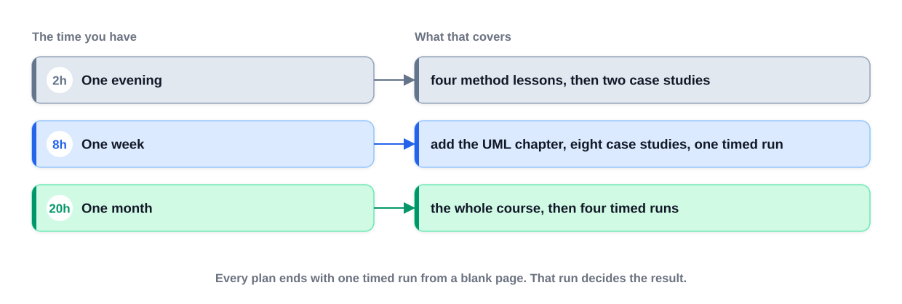
*Figure — Three study plans for three amounts of time; every plan ends with one timed run from a blank page (course diagram)*

Choose by the time your **calendar** really has. **The method is worth more than any single case study**, and the first six case studies more than the rest (later ones repeat earlier skills).

| Plan | Do |
|---|---|
| **Interview tomorrow (~2 h)** | §1.2 time budget (10 min) → §1.5 requirements (15) → §1.6 finding classes (15) → Ch 3 choosing the relationship between two classes (15) → Ch 3 class diagram notation (10) → parking lot case study, whole (30) → vending machine case study, whole (25). The parking lot is the most-asked question; the vending machine shows a **lifecycle** (fixed states an object moves through), the second most common kind. Do not start a third; write the five steps on a card and rehearse them |
| **One week (~8 h, an hour a day)** | Day 1: Ch 1 fully + Ch 2's four pillars. Day 2: Ch 3 use case, class and activity diagrams (sequence later). Day 3: parking lot, then library management (your requirements first). Day 4: ATM, vending machine. Day 5: movie ticket booking, hotel management. Day 6: Splitwise, Amazon-style shopping. **Day 7: no new material** — redo the parking lot from a blank page in 45 minutes; it matters most, checking you can design against the clock |
| **One month (~20 h)** | Week 1: Ch 1–4 + first three case studies. Week 2: Ch 5, 8–11 (patterns) with case studies 4–10, two per session, always drawing your classes first. Week 3: Ch 12–13 (concurrency) + case studies 11–18; one timed run. Week 4: remaining case studies, Ch 21 machine-coding problems, three timed runs on questions you have read; Ch 22 for revision. When case studies feel repetitive by week three, the method is learned: read faster, checking your class list against the first diagram stages |
| **Beginner (six weeks, 5–6 h/week)** — OOP itself new | W1: Ch 1–2, writing and running every Ch 2 example. W2: Ch 3–5 (UML, SOLID, principles). W3: Ch 6–7 (clean code, refactoring) + Ch 8. W4: Ch 9–11 (remaining patterns) + two small case studies. W5: Ch 12–13 + four case studies incl. one with concurrency (ticket booking). W6: Ch 21 problems in 90-minute timed runs; Ch 22 |

**If you can only do six case studies:**

| Case study | What it teaches |
|---|---|
| Parking lot | The canonical question, and how to bound one |
| Library management | Borrow, return and limits, a common family |
| Vending machine | A lifecycle, one class per state |
| Movie ticket booking | Two people wanting the same seat: the concurrency question |
| Splitwise | Money, and a rule with several versions |
| Amazon online shopping | A question too big to finish, and choosing the part you build |

Add a seventh, **an in-memory cache (LRU)**, if target companies ask for a data structure rather than a product.

**The night before:** no new question (a half-understood design adds anxiety and will not stick). Re-read the time budget (knowing you are *allowed* eight minutes on requirements stops rushing), re-read one done case study's extensions, and write the five steps from memory: **requirements, actors and use cases, classes, relationships, code.**

---

## 1.14 Common mistakes

| Mistake | Why it hurts | Fix |
|---|---|---|
| Coding in minute two | Missing requirements appear at minute 35 | 8–13 minutes on requirements and actors |
| No out-of-scope list | Scope creeps; omissions look like oversights | Write it down and agree it |
| Agreeing to every suggested feature | Nothing gets finished | "I'll leave X out and add it if time allows" |
| One subclass per value | Class explosion with no behaviour | Different data → field/enum |
| God class (`ParkingLotManager` does everything) | Fails single responsibility; untestable | One sentence per class, split on "and" |
| Missing the record class (ticket/loan/booking) | Data on the wrong class (`dueDate` on `Book`) | A connection that carries data = an object |
| Inheritance for reuse ("Car extends Engine") | Wrong "is-a"; fragile | Composition |
| Pattern stuffing | Looks like memorisation, not judgement | One or two patterns, with the signal |
| `switch` on type everywhere | Every new type edits many places | Polymorphism (one call, different behaviour per class) / Strategy |
| All twelve classes at equal depth | No flow works end to end | Two or three flows fully |
| Silent designing | Interviewer cannot credit reasoning | Narrate each step |
| Ignoring concurrency on a shared resource | Double booking | Lock or atomic operation on the shared state |
| Non-running code in machine coding | Often an automatic reject | Thin end-to-end path running by halfway |
| `double` for money, clock read inside logic | Rounding bugs, flaky demo | Cents/`BigDecimal`, inject time |

---

## In the interview

**30-second answer** ("How do you approach a low-level design problem?"):
"First I clarify and write 8 to 12 requirements with an explicit out-of-scope list. Then I list the actors and their use cases. From the nouns I pick the classes, cutting anything that is only a value, and give each class one responsibility. I connect them with the right relationships and draw a class diagram, sketch the key flow, and run a quick SOLID check and pick at most one or two patterns where the signal is clear. Then I code the two or three core flows, handle edge cases and concurrency, and finish by discussing extensions and trade-offs."

- *"How is this different from system design?"* — System design is many machines and scale (databases, caches, queues); LLD stays inside one application: classes, interfaces, relationships, code.
- *"You won't finish; what matters?"* — Depth on the chosen part: bounded scope, clean responsibilities, correct relationships, code matching the diagram, one defensible trade-off.
- *"What changes in machine coding?"* — The code must run: in-memory storage, service interfaces and a driver, happy path by halfway, then features, validation and one extension point.
- *"How do you decide whether to use a pattern?"* — By its signal: interchangeable rules → Strategy, many-transition lifecycle → State, many listeners → Observer. No signal → plain classes.

## Self-check

- **Q:** The five core steps in order? **A:** Requirements, actors & use cases, classes, relationships, code.
- **Q:** How much of a 45-minute round goes before naming a class? **A:** Roughly a quarter (8–13 minutes).
- **Q:** The five things an interviewer judges? **A:** Bounded problem, one-sentence responsibilities, correct relationships, code matching the diagram, an explained trade-off.
- **Q:** What does machine coding add? **A:** Working code in about 90 minutes, data models, service interfaces, extensibility, a demo.
- **Q:** Which two classes do beginners most often miss? **A:** The record-keeping class (ticket/loan/booking) and the rule class (rate/strategy).
- **Q:** "Different data" vs "different behaviour"? **A:** Data → field or enum; behaviour → separate class.
- **Q:** How many patterns in a 45-minute design? **A:** One or two, where the signal appears; name a rejected one too.
- **Q:** The last day of any study plan? **A:** A timed run from a blank page.

## TL;DR

- LLD/OOD = design the classes inside one application and code the main flows; machine coding = the same with running code in ~90 minutes.
- Clarify → requirements → use cases → entities → relationships → diagram → flows → patterns/SOLID → code → edge cases/concurrency → extensions.
- A quarter of the time before naming a class; write an out-of-scope list.
- Different data → field; different behaviour → class; one sentence per class.
- SOLID as five quick checks; one or two patterns where the signal appears.
- Code two or three flows properly; inject time, `BigDecimal` (or cents) for money, guard shared state.
- Attempt first, then compare; finish every plan with a timed blank-page run.
