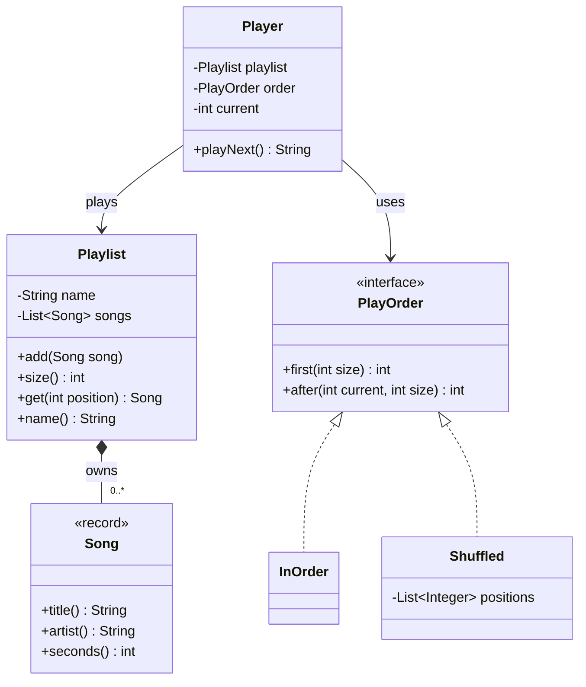
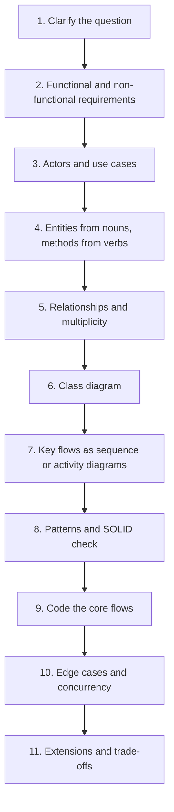
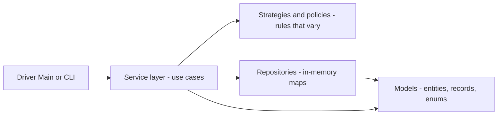
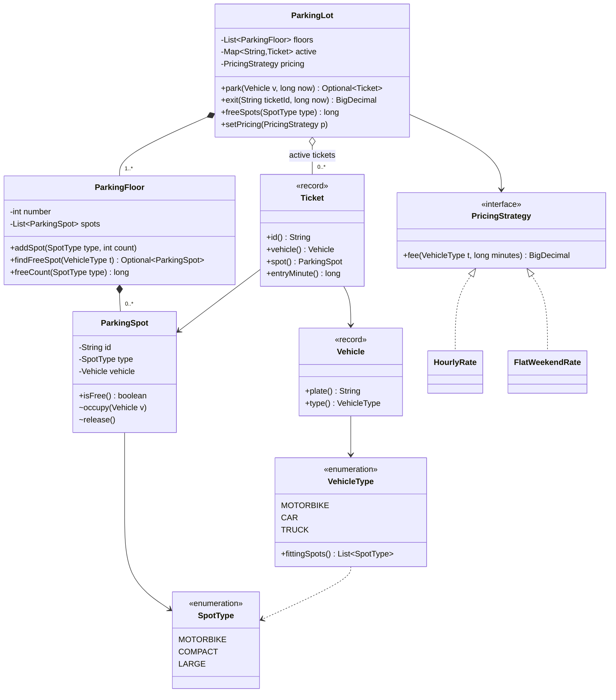
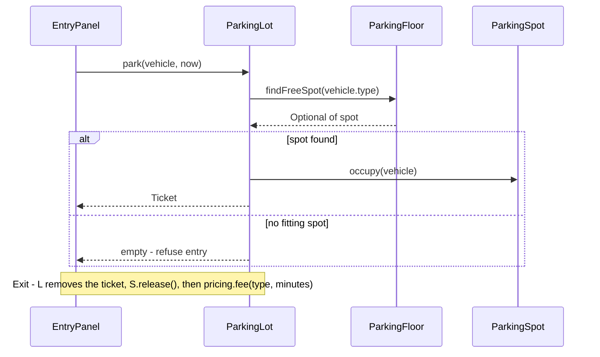

# Chapter 1 — The LLD Interview & How to Approach It

> **What you will learn in this chapter**
> - What the low-level design (LLD) round is, what it is called at different companies, and how it differs from the system design round.
> - The difference between the **object-oriented design (OOD) round** and the **machine-coding round**.
> - A complete answer, start to finish, before any theory (a music playlist in Java).
> - A repeatable, step-by-step framework that turns one sentence into working code, with a time budget.
> - How to turn one line into requirements, how to find classes, how to check a design with SOLID (five rules of thumb that keep classes easy to change), and which six patterns come up most.
> - What interviewers actually score, how to talk while you design, and the mistakes that cost the most.
> - A study plan and a map of this handbook (Chapters 1–22).
> - A second worked mini-example (a small parking lot) run through every step of the framework.

---

## 1.1 What this round is, and what this handbook covers

### What it is

The **low-level design** round gives you **a single application** to design while an interviewer watches, usually within 45–60 minutes (a machine-coding round stretches this to 90 minutes or 2 hours). The servers underneath are not your concern. What you design is **the set of classes inside the program**: a parking lot, a vending machine, a chess game, Splitwise (an app that splits shared expenses between friends), an elevator.

A few words we will use all the time:

| Term | Meaning |
|---|---|
| **Class** | A named type in code. It holds some data (fields) and the methods (functions that belong to the class) that work on that data. |
| **Object** | One concrete instance of a class, with real values in its fields. |
| **Responsibility** | The one job a class does, which you should be able to state in a single sentence. |
| **Relationship** | How two classes are connected: one uses, holds, owns, or extends the other. |
| **UML** | Unified Modeling Language: the standard set of symbols for drawing classes and their relationships. |
| **Design pattern** | A named, reusable answer to a design problem that keeps coming up (for example Strategy or Observer). |

Everyday analogy: system design is the **city plan** (roads, power stations, water pipes). Low-level design is the **floor plan of one house**: which rooms exist, what each room is for, and which doors connect them.

Plenty of engineers write classes daily and still struggle here, because day-to-day work seldom makes you **explain aloud** why each class exists and **justify** the way they connect. This round is exactly that.

### What you should be able to do after this handbook

- Turn one sentence ("Design a parking lot") into a bounded list of requirements, with an explicit out-of-scope list.
- Pick out the classes a problem calls for, with **exactly one job** apiece.
- Decide how any pair of classes is related, and draw that link without mistakes.
- Code the handful of Java methods behind the core flows until they actually execute.
- Say which design pattern you used **and which one you rejected**, and why.


*Figure — The four parts of the course material this handbook absorbs: introduction, design and UML notation, the answering method, and the case studies (course diagram)*

The figure above shows the four building blocks of preparation: first understand the round (this chapter), then the notation (UML), then the **method** for answering, then many worked case studies. This handbook follows the same arc but goes wider: it adds full chapters on OOP, SOLID, the classic design principles, clean code, refactoring (improving the structure of code without changing what it does), all 23 GoF patterns (the classic catalogue from the 1994 "Gang of Four" book), and concurrency (several pieces of work running at the same time and sharing data), so that you do not need a second resource.

### What every case study in this handbook contains

Once you have read one case study you always know what comes next, because each one follows the same template:

- The question, and the requirements chosen to design against (with an out-of-scope list).
- The actors and their use cases (often as a use case diagram, a picture of who uses the system and for what).
- The class diagram, built up in stages so you follow the reasoning instead of staring at a finished picture.
- Diagrams for the most important flows (activity diagrams show the steps of a process; sequence diagrams show the messages objects send each other, in time order).
- Working Java code with a driver `Main` (a small class whose `main` method runs the example) and its real output.
- The design patterns the answer uses, named, **only where it really uses one**.
- An "Extensions & follow-up questions" section: the simplifications made, and what to say when the interviewer notices them.

### Who this is for

- You have an interview coming up and this round is part of it.
- You write object-oriented code at work but have never had to defend a class diagram out loud.
- You prepared for system design and discovered this is a different round with different rules.

It also pays off outside interviews: the same step-by-step method is how you split a new feature into classes at work when nobody has designed it yet.

### What you need already

- **Some object-oriented language**, well enough that a class with a constructor (the special method that sets up a new object) plus a few methods reads easily to you. Every example here is in **Java 21** (a recent long-term-support release of Java).
- You do **not** need UML (Chapter 3 teaches it from zero).
- You do **not** need system design knowledge. That round asks how a product survives millions of users (servers, databases, caches, queues; see [System Design Fundamentals](../../../system-design-patterns/modules/00-system-design-fundamentals/README.md) if those words are new). This round stays **inside one process** (one running program: classes, fields, methods, relationships). Practising one round gives you little for the other.
- You do not need data structures and algorithms beyond the basics (lists, maps, sets, queues, heaps). That is a separate round. (Quick refresher: a **list** keeps items in order, a **map** looks a value up by its key, a **set** holds no duplicates, a **queue** hands items out first-in, first-out, and a **heap** always gives you the smallest or largest item quickly.)

### What this handbook will not do

It will not teach you a programming language from scratch (it assumes you can already read one). It will not give you scripts to memorise. A memorised answer is useless the moment the question is one you have not seen. **The reusable part is the method.**

### TL;DR

The LLD round = design the classes inside one application, out loud, then code the main flows. Prerequisite: one OO language. The method beats memorised answers.

---

## 1.2 How the interview runs

### What it is

The interviewer says one sentence, for example "Design a parking lot", and then stops talking. Nothing in that sentence tells you how many classes they want, whether to code, or how long you have. **That silence is the hard part.** This section removes it.

The round has several names, all meaning roughly the same thing:

| Name | Where you hear it | What is different |
|---|---|---|
| **Object-oriented design (OOD) interview** | US big tech, many product companies | Whiteboard/doc: requirements, classes, diagram, code for main flows. |
| **Low-level design (LLD)** | Indian product companies, general usage | Same as OOD; the umbrella term. |
| **Machine-coding round** | Commonly reported at Indian product companies such as Flipkart, Swiggy and PhonePe | Same idea, but **working, runnable code is mandatory** at the end, usually in a 90-minute to 2-hour window. |

**LLD vs HLD (system design).** Same product, different zoom level:

| | Low-level design (this handbook) | High-level / system design |
|---|---|---|
| Scope | Inside one application or service | Many services and machines |
| Vocabulary | Classes, interfaces, fields, methods, relationships, patterns | Servers, load balancers, databases, caches, queues, sharding |
| Output | Class diagram + code | Architecture diagram + capacity numbers |
| Typical question | "Design the classes for a parking lot" | "Design a parking-lot booking service for 10 million users" |

(For the right-hand column: a **load balancer** spreads incoming requests across several servers, and **sharding** splits one big database into pieces stored on different machines. You will not need either in this round.)

### OOD round vs machine-coding round

| | OOD / LLD discussion round | Machine-coding round |
|---|---|---|
| Duration | 45–60 minutes | Usually about 90 minutes of coding (often 2 hours including evaluation) |
| Where | Whiteboard, shared doc, or IDE (code editor with build and run tools) | Your own IDE, on your laptop or a remote machine |
| What you produce | Requirements, use cases, class diagram, code for 2–3 main flows | A **complete, running program** implementing the minimum required features |
| Storage | Not discussed much | **In-memory** (maps and lists); no real database unless asked |
| Interaction | Continuous conversation with the interviewer | Problem statement up front, mostly silent coding, then a **demo and code walkthrough** |
| What is judged | Bounding the problem, responsibilities, relationships, trade-offs, patterns | Working code, **data models**, **service interfaces** a client could call, **extensibility** (can a new feature be added without rewriting), readability, edge cases, sometimes tests and thread safety |
| Common failure | Talking without converging, or coding too early | Not finishing, or finishing with one giant class that cannot be extended |

The machine-coding round, as commonly described by candidates, works like this: you get a problem statement with a **minimum set of features**; within the time window you must choose the data structures, design **service interfaces** that a client (for example a command-line driver, a small program you run from a terminal) would use, and present **working code** together with the reasoning behind your design and the patterns you used. It is especially common for SDE-1 and SDE-2 hiring (Software Development Engineer job levels: entry level and mid level).

A few words from the table above: **data models** are the classes that hold the problem's data (a `Ticket`, a `Spot`); a **service interface** is the set of public methods a caller uses (`park`, `exit`); **edge cases** are unusual inputs at the boundaries (empty, full, negative, duplicate); **thread safety** means the code stays correct when several **threads** (independent lines of execution inside one program) use it at the same moment.

### How it works: the five core steps

Every question in this handbook is answered with the same five core steps (Section 1.4 expands them into a finer checklist):

1. **Clarify the requirements** — turn one sentence into a short written list of things the system must do.
2. **Find the actors and use cases** — who uses the system (actors) and what each of them does (use cases).
3. **Find the classes** — turn requirements into classes; give each one responsibility.
4. **Connect the classes** — decide how each pair relates; record it in a class diagram.
5. **Write the code** — the classes plus the 2–3 methods that implement the main flows.

**Getting the order right matters more than going fast.** Each step feeds the next. Skip step 1 and step 3 has nothing to work from: you end up inventing classes no requirement asked for.


*Figure — The five steps split into "understand the question" and "build the model", with a time budget for each (course diagram)*

In the figure above, notice two things. First, up to **a quarter of the hour is spent before a single class is named** (requirements plus actors). Second, the code step is the largest single block, yet it covers only two or three flows.

**Nobody completes the whole product in the time, and you are not expected to.** The design is judged on the part you chose to build properly, not on how much of the product you touched.

### Time-boxing

**45-minute OOD round:**

| Step | Time | What exists at the end |
|---|---|---|
| Clarify requirements | 5–8 min | A written list of 8–12 requirements + out-of-scope list |
| Actors and use cases | 3–5 min | 2–4 actors, 6–10 use cases |
| Find the classes | 8–10 min | Class list, one responsibility each |
| Connect the classes | 8–10 min | Class diagram with relationships and multiplicity (how many of each) |
| Write the code | 12–15 min | 2–3 methods that implement the main flows |

**90-minute machine-coding round** (a budget that works well in practice):

| Phase | Time | Output |
|---|---|---|
| Read the statement, list requirements and assumptions | 5–10 min | Comment block at the top of `Main.java` |
| Model: entities, enums, service interfaces | 10–15 min | Empty classes/interfaces that compile |
| Implement the core flow end to end | 30–40 min | One happy path running from a driver `main` |
| Remaining features + validation + edge cases | 15–20 min | All "must have" features working |
| Polish: names, exceptions, one extension point, demo script | 5–10 min | Clean output you can demo |
| Buffer | 5 min | Never zero |

In this table, code that **compiles** is code the Java compiler accepts, so it can run; **enums** are types with a fixed list of named values (more in Section 1.6); the **happy path** is the main flow with valid input and nothing going wrong.

Rule of thumb: **get something running by the halfway mark**. A running partial solution beats a beautiful non-compiling one.

### What the interviewer is actually judging

The interviewer is not counting classes. They watch for:

1. **Did you bound the problem?** A design for a clear, bounded set of requirements beats a broad design for an unbounded one.
2. **Does each class have one job you can state in one sentence?** If one sentence cannot describe a class, it is normally two classes glued together.
3. **Are the relationships right?** Holding, owning, and extending are different choices; a wrong one is visible immediately.
4. **Does the code match the diagram?** If the code has a method that the diagram has nowhere to put, either the code or the diagram is wrong.
5. **Can you explain a trade-off?** Each design decision has a road taken and a road not taken; naming both scores higher than naming only one.

Machine-coding rounds add: **does it run**, is it **modular** (can a new vehicle type / payment method / rule be added by adding a class), is it **readable** (names, small methods), does it **handle bad input** gracefully, and (for senior roles) is shared state **thread-safe**.

Notice what is **not** on the list: perfect UML notation, or using every diagram type. **What is graded is the model; the notation is just the way you present it.**

### A worked example of size

Take the parking lot. About 12 requirements produce about 12 classes with about 15 relationships between them. Three classes implement the main flows: one hands out a ticket, one holds a vehicle, one prices the stay. You write those three properly. You name the other nine and describe each in a sentence. That is a complete answer in 45 minutes.

The most expensive mistake is writing all twelve classes at the same level of detail. It feels thorough, but the clock runs out before any single flow works end to end.

### TL;DR

OOD, LLD and machine coding are one family of rounds; machine coding requires running code in ~90 minutes. Follow five steps in order, spend a quarter of the time before naming a class, and build two or three flows properly rather than twelve classes shallowly.

---

## 1.3 A complete answer in five minutes: "Design a music playlist"

Let's see a complete answer first and save the theory for later. It is small on purpose: a screenful of classes, a single diagram, a page of Java. Later case studies are roughly ten times the size, yet they follow **the identical outline**. Don't worry if some diagram notation is unfamiliar; Chapter 3 covers it.

### Step 1: requirements

The interviewer says only: "Design a music playlist." Three clarifying questions produce three requirements:

- Songs sit in a playlist, and **their sequence is significant**.
- Someone can ask for **the following song**, and the player keeps track of its current position.
- A user can turn **shuffle** on, and the play order changes.

**Out of scope, agreed out loud:** user accounts, downloads, storage, and the audio itself. An explicit "not building" list earns as much credit as the "building" list.

### Step 2: actors and use cases

Anyone or anything outside the application that interacts with it is an **actor**. This example has just one, the **listener**, who does three things: adds a song, plays the next one, switches shuffle on. For so small a question this takes ten seconds; for a parking lot it costs three minutes and repays ten, since **the actors reveal which classes have to exist**.

### Step 3: classes, one sentence each

| Class | Responsibility (one sentence, no "and" where possible) |
|---|---|
| `Song` | Holds a title, an artist and a length; knows about itself and nothing else. |
| `Playlist` | Holds songs in order; stores them, does not play them. |
| `PlayOrder` (interface) | Picks the position to play after the current one. It is an interface since several ordering rules exist. |
| `InOrder` | Walks through positions in insertion order. |
| `Shuffled` | Plays positions in a shuffled order decided once, up front. |
| `Player` | Holds a playlist and an order, and remembers the current position. |

An **interface** names a set of methods without saying how they work. The key insight: **a rule that can vary becomes its own type.** Without shuffle, `Player` could just count upwards and `PlayOrder` would not exist. With shuffle, "what plays next" has two versions, so it becomes `PlayOrder`, and the player no longer needs to know which version it holds.

A useful test: if a responsibility sentence needs the word **"and"** to join two unrelated jobs, the class is probably two classes.

### Step 4: connect them


*Figure — The playlist design: Playlist owns many Songs, Player uses a PlayOrder, and InOrder and Shuffled implement PlayOrder (course diagram)*

Three facts from the figure above are exactly what an interviewer checks:

- The **filled diamond** between `Playlist` and `Song` means the playlist **owns** its songs (composition); the `*` means it owns **many**.
- A **plain arrow** running from `Player` to `PlayOrder` says the player **relies on** an ordering without owning one. Its head touches the **interface** only, not `InOrder` or `Shuffled`.
- The **dashed arrows with hollow triangles** mean `InOrder` and `Shuffled` **implement** `PlayOrder`. A third rule later is one extra box; nothing already drawn changes.

Here is the same design for the Java code below:



### Step 5: the code

> **Key term — reading the Java below:** A `package` line groups related classes, much like a folder. `implements PlayOrder` promises that the class provides every method of that interface, and `@Override` marks a method that fulfils such a promise (the compiler checks it). `final` on a class means no other class may extend it; on a field it means the field is set once and never reassigned. `private` hides a field or method from code outside the class.

```java
// File: code/lld/ch01/playlist/InOrder.java
package lld.ch01.playlist;

/** Plays positions in the order the songs were added. */
public final class InOrder implements PlayOrder {
    @Override public int first(int size) { return size == 0 ? NONE : 0; }
    @Override public int after(int current, int size) { return current + 1 < size ? current + 1 : NONE; }
}
```

```java
// File: code/lld/ch01/playlist/PlayOrder.java
package lld.ch01.playlist;

/** The rule that decides which position plays next. A rule that varies becomes its own type. */
public interface PlayOrder {
    int NONE = -1;                           // "there is no next position"

    int first(int size);                     // first position to play, or NONE if empty
    int after(int current, int size);        // position after 'current', or NONE at the end
}
```

```java
// File: code/lld/ch01/playlist/Player.java
package lld.ch01.playlist;

/** Holds a playlist and an order, and remembers where it is. It never asks WHICH order it holds. */
public final class Player {
    private final Playlist playlist;
    private final PlayOrder order;           // depends on the interface, not on InOrder/Shuffled
    private int current = PlayOrder.NONE;
    private boolean started = false;

    public Player(Playlist playlist, PlayOrder order) {
        this.playlist = playlist;
        this.order = order;
    }

    public String playNext() {
        if (!started) {
            current = order.first(playlist.size());
            started = true;
        } else if (current != PlayOrder.NONE) {          // once at the end, stay at the end
            current = order.after(current, playlist.size());
        }
        if (current == PlayOrder.NONE) return "end of playlist";
        Song s = playlist.get(current);
        return "playing " + s.title() + " by " + s.artist();
    }
}
```

```java
// File: code/lld/ch01/playlist/Playlist.java
package lld.ch01.playlist;

import java.util.ArrayList;
import java.util.List;

/** Holds songs in order. It stores them; it does not play them. */
public final class Playlist {
    private final String name;
    private final List<Song> songs = new ArrayList<>();   // composition: the playlist owns its list

    public Playlist(String name) { this.name = name; }

    public void add(Song song) { songs.add(song); }
    public int size()          { return songs.size(); }
    public Song get(int position) { return songs.get(position); }
    public String name()       { return name; }
}
```

```java
// File: code/lld/ch01/playlist/Shuffled.java
package lld.ch01.playlist;

import java.util.List;

/**
 * Plays positions in an order decided once, up front. The order is injected
 * (not generated inside) so the program prints the same output every run: deterministic = testable.
 */
public final class Shuffled implements PlayOrder {
    private final List<Integer> positions;

    public Shuffled(List<Integer> positions) { this.positions = List.copyOf(positions); }

    @Override public int first(int size) { return positions.isEmpty() ? NONE : positions.get(0); }

    @Override public int after(int current, int size) {
        int i = positions.indexOf(current);
        return (i >= 0 && i + 1 < positions.size()) ? positions.get(i + 1) : NONE;
    }
}
```

```java
// File: code/lld/ch01/playlist/Song.java
package lld.ch01.playlist;

/** A song knows about itself and nothing else. A record = immutable data carrier. */
public record Song(String title, String artist, int seconds) {
    public Song {
        if (title == null || title.isBlank()) throw new IllegalArgumentException("title required");
        if (seconds <= 0) throw new IllegalArgumentException("length must be positive");
    }
}
```

```java
// File: code/lld/ch01/playlist/Main.java
package lld.ch01.playlist;

import java.util.List;

public class Main {
    public static void main(String[] args) {
        Playlist mix = new Playlist("Morning mix");
        mix.add(new Song("Sunrise", "Ada Lane", 201));
        mix.add(new Song("Blue Line", "The Meridians", 187));
        mix.add(new Song("Paper Boats", "Nori Kim", 243));

        run("in order", new Player(mix, new InOrder()), mix.size());
        run("shuffled", new Player(mix, new Shuffled(List.of(2, 0, 1))), mix.size());
    }

    private static void run(String label, Player player, int songs) {
        System.out.println(label + ":");
        for (int i = 0; i <= songs; i++) {          // one extra call shows the end
            System.out.println("  " + player.playNext());
        }
    }
}
```

Run it: `cd chapters/01-lld-interview-approach/code && javac --release 21 -d /tmp/lld_01 $(find . -name '*.java') && java -cp /tmp/lld_01 lld.ch01.playlist.Main`

(`javac` is the Java compiler, which turns `.java` source files into runnable `.class` files; `java` then runs them, and `-cp` (classpath) tells it where those files are.)

Output:

```
in order:
  playing Sunrise by Ada Lane
  playing Blue Line by The Meridians
  playing Paper Boats by Nori Kim
  end of playlist
shuffled:
  playing Paper Boats by Nori Kim
  playing Sunrise by Ada Lane
  playing Blue Line by The Meridians
  end of playlist
```

**Explaining each part:**
- `Song` is a Java **record**: an immutable (cannot change after creation) data carrier whose fields, constructor, accessors (getter methods such as `title()`), `equals`, `hashCode` and `toString` (the standard methods for comparing objects, using them as map keys, and printing them) are generated. The compact constructor (a constructor with no parameter list, used just to check the values) validates input.
- `Playlist` keeps its list `private` (encapsulation: hiding a class's data so it can only be reached through the class's own methods). Callers can add and read, but cannot replace the list.
- `PlayOrder` is the variation point (the place where different behaviours can be plugged in). `NONE = -1` is an interface constant meaning "nothing more to play".
- `Shuffled` is **given** its order instead of generating one with `Random`. This makes the output identical on every run, which makes the design **testable**. (In production you would inject a `Random` with a seed, or a shuffled list produced elsewhere. To **inject** something is to hand it in from outside, usually through the constructor; a **seed** is a fixed starting number that makes `Random` produce the same sequence every time.)
- `Player` depends on the interface `PlayOrder`, not on a concrete class (a real class you can create objects from, as opposed to an interface). One `Player` gives both behaviours, and **nothing in it tests which mode is active**. (Its only `if`s track *where* it is: the first call asks `first`, later calls ask `after`, and once it has reached the end it stays there instead of asking the order again.)

### What to notice

- **One requirement turned into a type.** Shuffle occupied a single line of the requirements, yet it produced an interface plus two implementations. That is the usual flow: **classes come out of requirements**, and it never runs backwards.
- **Each class has exactly one job.** A `Song` has no idea any playlist contains it. A `Playlist` is unaware that playback happens. A `Player` never learns how the next position gets picked.
- **The design is open to changes you did not build.** "Repeat one song" and "play in reverse" are just new classes implementing `PlayOrder`; nothing already written is reopened. (This is the Strategy pattern and the Open/Closed Principle, Chapters 4 and 11.)
- **Things were left out on purpose:** pause, volume, queue, time. In an interview you **announce** these gaps yourself instead of waiting to be caught. Every case study in this handbook ends with an "Extensions & follow-up questions" section for the same reason.

### TL;DR

A complete answer = a short bounded requirement list, a few one-sentence classes, one diagram, and code for the main flow. A rule that varies becomes an interface, and the class that uses it never asks which version it holds.

---

## 1.4 The step-by-step answer framework

### What it is

A checklist you run on **every** LLD question, so the question stops being "where do I start?" and becomes a series of small questions with known answers. It expands the five core steps into eleven finer ones.

### The problem it solves

Without a framework, candidates either freeze, or jump straight into code and discover missing requirements at minute 35. The framework makes your progress **visible** to the interviewer, which is itself part of the score.

### How it works



| # | Step | Questions to ask yourself | Output | Core step |
|---|---|---|---|---|
| 1 | **Clarify** | Who uses it? What exactly is "a parking lot" here? Single location or many? | Shared understanding | Requirements |
| 2 | **Requirements** | What must it do (functional)? How well (non-functional: thread-safe, extensible, in-memory, latency, i.e. response time)? What is out of scope? | 8–12 numbered lines + out-of-scope list | Requirements |
| 3 | **Use cases** | For each actor, what can they do? | Actor → use case list (or use case diagram) | Actors & use cases |
| 4 | **Entities** | Which nouns hold state or behaviour? Which are just values (fields/enums)? | Class list with one-sentence responsibilities | Classes |
| 5 | **Relationships** | Uses, has, owns, or is-a? How many (1, 0..1, *)? | Relationship list | Connect |
| 6 | **Class diagram** | Fields, key methods, interfaces, enums | UML class diagram | Connect |
| 7 | **Key flows** | What happens step by step for the 2–3 main use cases? What states does the core object go through? | Sequence / activity / state diagram (states and the moves between them) | Connect |
| 8 | **Patterns & SOLID** | Is there a rule that varies (Strategy)? A lifecycle (fixed states an object moves through: State)? Many listeners (Observer)? Any class with two reasons to change? | Named patterns + rejected alternatives | Check |
| 9 | **Code** | Interfaces, enums, models, services, a driver `main` | Running code for main flows | Code |
| 10 | **Edge cases & concurrency** | Invalid input? Full capacity? Two users grabbing the same seat? | Validation, exceptions, locks | Code |
| 11 | **Extensions** | What would change if requirement X is added? | Short answers, maybe one extra class | Wrap-up |

(Row 10 in plain words: an **exception** is Java's way of signalling an error that stops the normal flow, and a **lock** lets only one thread at a time run a protected piece of code.)

### Trade-offs

| Do this | Instead of this | Why |
|---|---|---|
| Spend 8–13 minutes on steps 1–3 | Coding at minute 2 | Unbounded scope wastes far more time later |
| Code 2–3 flows fully | Stub 12 classes (empty placeholders) | Interviewers judge depth on the chosen part |
| Name one or two patterns where the signal appears | Apply six patterns | Over-engineering (building more flexibility than the problem needs) is scored as poor judgement |
| Pass time into methods (`nowMinute`) and hold money as `BigDecimal` (Java's exact decimal type; or whole cents in a `long`) | Call `System.currentTimeMillis()` inside the logic, and use `double` (binary floating-point number) for money | Deterministic (same input, same output) and testable; `double` cannot represent values like 0.10 exactly, so sums drift |

### When not to use it (rigidly)

If the interviewer steers ("skip requirements, I care about the class model"), follow them. The framework is a default order, not a contract. In a machine-coding round, steps 5–7 are often done in your head or as a short comment; the code **is** the diagram.

### TL;DR

Clarify → requirements → use cases → entities → relationships → class diagram → key flows → patterns/SOLID → code → edge cases/concurrency → extensions. Say each step out loud as you enter it.

---

## 1.5 From one line to a list of requirements

### What it is

Each **requirement** states a single capability, phrased so you can test whether the design delivers it. "Customers can pay at the exit" qualifies. "The parking lot should be good" does not.

- **Functional requirement** — a behaviour: "a customer takes a ticket at an entry panel".
- **Non-functional requirement** — a quality: "two entry panels must never assign the same spot" (thread safety), "adding a new vehicle type must not change existing classes" (extensibility), "data kept in memory" (storage).

Analogy: an architect never starts drawing before asking how many people will live in the house and whether they need a garage.

### The problem it solves

This is not an interview trick: real products start the same way, with a short request someone has to turn into a specification. "Design a parking lot" is four words. The expected design has about twelve classes. Everything in between is yours to decide. Without a written list:

- **The design has no edges.** You keep adding classes (season tickets, number-plate recognition) and write no code.
- **You cannot defend a choice.** Asked "why is there no `Reservation` class?", the only honest answer is "I did not think of it". With a list, the answer is "reservations were out of scope; we agreed that at minute four".
- **You cannot tell when you are finished.** A bounded list turns an open request into a task with an end.

### How it works: the four questions


*Figure — Four questions asked in order produce 8–12 in-scope requirements plus a written out-of-scope list (course diagram)*

As the figure above shows, ask these in order; they take about five minutes and cover most products:

1. **Who uses this?** These are the **actors**. Parking lot: customer, attendant, administrator, and the system itself. Each brings requirements the others do not.
2. **What can each of them do?** One actor at a time, list actions. Each action is a **use case**. A customer takes a ticket, parks, pays, leaves. An admin adds floors and changes prices. Most of the list comes from here.
3. **What are the limits?** The numbers and rules: floor count, kinds of spot, maximum booking length, how many books one member can borrow. **Limits turn into constants and validation checks.** They are also the simplest requirements to gather.
4. **What is out of scope?** Hardly anyone asks this, yet it pays off most. It is the only one of the four questions that makes the problem **smaller**.

**Scope questions worth asking in almost any problem:**
- "Do payments belong to my design, or can I treat an external payment service as given?"
- "Is there one site, or do several sites share an account?"
- "Are users and permissions part of the model, or may I take a logged-in user for granted?"

Each answer adds or removes two or three classes, so ask early. If the interviewer says "your choice", treat it as permission, not a dodge: **choose, say it out loud, write it down**. An assumption you state clearly counts just like an answer you were given.

### What good looks like: the parking lot in ten lines

**In scope**
1. The lot has multiple floors; each floor has many parking spots.
2. Spot types: compact, large, handicapped, motorbike, electric.
3. Vehicle types: car, van, truck, motorbike, electric car.
4. A customer takes a ticket at an entrance panel on arrival.
5. A customer pays at an exit panel, at a floor portal, or to an attendant.
6. Payment is by cash or card.
7. Charges are per hour, with the hourly rate depending on how long the stay lasts.
8. Each floor shows how many spots of each type are free.
9. The system refuses entry when no suitable spot is free.
10. Admins may add floors, spots and panels, and may update the rate.

**Out of scope:** season passes, licence-plate recognition, booking before arrival, refunds, reports across several sites.

Every line above becomes a class, a field, or a method. **If no line asked for it, it does not go in the design.**

### Make each requirement checkable

- **Put a number on it.** Rather than "a member can borrow a few books", write "a member may have **no more than five** books out at once". That number turns into a constant, and the constant turns into a check inside one method.
- **Name the actor.** Not "books can be reserved" but "**a member** can reserve a copy that is currently on loan" (you reserve a copy that is out so you get it next). Now you know which class the method belongs to.

A line written like this is close to a test case: you can point at one method and say "requirement 5 lives here".

### Use cases

A **use case** is one goal an actor achieves with the system ("customer pays for parking"). A **use case diagram** (Chapter 3) draws actors as stick figures and use cases as ovals. In a 45-minute round a bulleted list is enough:

| Actor | Use cases |
|---|---|
| Customer | take ticket, park, pay (cash/card), exit |
| Attendant | collect cash payment, help customer |
| Admin | add floor, add spot, add panel, change rate |
| System | assign spot, update display boards, refuse entry when full |

### Common mistakes

- **Saying yes to every idea.** Reservations come up and you accept. Multiple sites, accepted too. Twenty minutes on, you have 22 requirements and nothing designed. Declining is allowed: "Let me park reservations for now and get ticketing and payment working end to end first; I'll come back to it if time allows." Interviewers see that as a **strong** move, because it proves you can protect a fixed time budget from an open-ended ask.
- Forgetting non-functional requirements (concurrency, extensibility).
- Writing vague lines with no number and no actor.

### In the interview

**30-second answer** (to "how do you start an LLD question?"): "I ask four questions: who uses it, what each actor does, what the limits are, and what is out of scope. I write 8 to 12 numbered requirements and an out-of-scope list, confirm them with you, and then every class I create must trace back to one of those lines."

**Follow-ups:**
- *"Why not just start designing?"* — Without a boundary the design grows forever and I cannot defend omissions. Five minutes here saves fifteen later.
- *"What if I say 'your choice'?"* — I pick the simpler option, say it out loud, and write it as an assumption, so the decision is visible and reversible.

### Self-check

- **Q:** Which of the four questions makes the problem smaller? **A:** "What is out of scope?"
- **Q:** Rewrite "users can book some seats" as a checkable requirement. **A:** "A customer can hold at most 10 seats for one show; held seats are released after 10 minutes if unpaid."
- **Q:** Where do limits end up in code? **A:** As constants plus a validation check in the method that owns the data.

### TL;DR

Four questions (who, what, limits, out of scope) → 8–12 checkable lines with numbers and actors, plus an out-of-scope list. Saying "no" to extra scope is a strength.

---

## 1.6 Finding the classes

### What it is

A reliable ten-minute method to go from requirements to a class list: **collect candidates, cut the ones that are not classes, give each survivor one job.**

### How it works

1. **Underline the nouns** in the requirements. For the parking lot they fall into rough groups. Structure: parking lot, floor, spot, compact spot, large spot, entrance panel, exit panel, display board, portal. Vehicles: vehicle, car, van, truck, motorbike. People: customer, attendant, administrator. Money and time: ticket, payment, cash, card, rate, hour. That is deliberately too many: treat them as **candidates**. Since every one was taken from the requirements, none of them is made up.
2. **Underline the verbs.** Park, take a ticket, pay, leave, refuse entry, show free spots, add a floor, change the rate. **Each verb turns into a method** and has to land on some class. A verb with no home means a class is missing.
3. **Cut candidates with five tests:**


*Figure — About 22 nouns pass through five tests and about 12 classes survive, each with one job (course diagram)*

| # | Test | Example | Result |
|---|---|---|---|
| 1 | Is it a **value** rather than a thing? | An hour is just a number, a licence plate just a string, and cash or card are options of a payment type | Field or **enum** constant (an enum is a fixed set of named values) |
| 2 | Is it just **another name** for a candidate already listed? | Customer and driver describe one actor; portal and panel could be a single class installed in several places | Merge, pick one name |
| 3 | Does it have **state that changes**? | A spot is free or occupied; an hour never changes | Changing state → class |
| 4 | Does anything **call** it? | Nobody ever asks an `Hour` object a question | Never called → it is a value |
| 5 | Does it differ in **behaviour** or only in **data**? | Compact vs large spot differ only in which vehicle fits; cash vs card payment behave differently | **Different data → a field. Different behaviour → a class.** |

Applied to the parking-lot nouns, tests one to four cut the list to about fifteen; test five brings it to roughly twelve, removing more than the other four combined. Compact, large and handicapped spots all hold a vehicle, report free or occupied, and carry a number; they differ only in which vehicle kind is allowed. A difference like that is **data**, so a single `ParkingSpot` class gets a `type` field. Paying cash means checking enough money was given; paying by card means calling a provider and waiting for its reply. That difference is **behaviour**, so it earns two classes. Watch for this smell (a surface sign that something is probably wrong) in a diagram: five subclasses (classes that extend another class, their parent) whose only content is handing a different constant up to the parent. They are a single field pretending to be classes.

4. **Give each class one responsibility**, in one sentence with no "and":

| Class | Responsibility |
|---|---|
| `ParkingLot` | Issues tickets and can tell when no space is left |
| `ParkingFloor` | Owns a level's spots and locates an empty one |
| `ParkingSpot` | Tracks if it is occupied and by which vehicle |
| `Vehicle` | Carries its plate number and the spot types it can use |
| `ParkingTicket` | Notes the vehicle, the spot it took, and the entry time |
| `ParkingRate` | Converts a duration in hours into a price |
| `Payment` | Collects the money and says if that worked |
| `ParkingDisplayBoard` | Shows how many spots of each type are free |

`ParkingLot`'s sentence admits two jobs (issuing tickets **and** knowing fullness/assigning spots). In a longer design you would split it into a spot-assignment part and a ticketing part. In 45 minutes, **naming the tension out loud is enough**.

5. **Put each method where the data is.** "Find a free spot" touches the spot collection, which the floor owns → `ParkingFloor`. "Price the stay" touches the rate card → `ParkingRate`. "Take a ticket" touches the ticket store → `ParkingLot`. If a method needs data from three classes, it is probably in the wrong place; move it to the class that owns most of what it touches. (This is the GRASP "Information Expert" idea and the cure for the *Feature Envy* smell, Chapters 5 and 7. GRASP is a set of guidelines for deciding which class gets which job; *Feature Envy* is a method that uses another class's data more than its own.)

### Common mistakes

- One subclass per value (`CompactSpot`, `LargeSpot` ... with no behaviour).
- Missing the **record-keeping** class (ticket, loan, booking) and the **rule** class (rate, strategy). These two are the classes beginners most often forget.
- "Manager" god classes that do everything (a *god class* is one huge class that owns most of the program's logic).

### Self-check

- **Q:** Car, van and truck: subclasses or enum? **A:** If they differ only in size/which spots fit, an enum `VehicleType` (or a field). If they have genuinely different behaviour, subclasses.
- **Q:** A verb has no class to live on. What does that tell you? **A:** A class is missing.
- **Q:** A class has fields but no verbs. What is it? **A:** Probably a value (record/field), not a full class.

### TL;DR

Nouns → candidate classes, verbs → methods. Cut values, duplicates, stateless and never-called nouns. **Different data = field; different behaviour = class.** One sentence per class, method goes where its data is. Twelve classes with one clear job each beat twenty that overlap.

---

## 1.7 Connecting the classes (preview)

Once you have the classes, decide for each pair: does one **use** the other briefly (dependency), **hold** a reference (association), **contain** parts that can live alone (aggregation), **own** parts that die with it (composition), or **is** it a kind of the other (inheritance, where a class extends another and reuses its code / realization, where a class implements an interface)? Then add **multiplicity** (1, 0..1, 1..*, *). Chapter 3 teaches every relationship and UML symbol in detail. For now, remember the most common beginner error: using **inheritance** where **composition** is right. The test is the sentence "A **is a** B". A car is not an engine, so `Car` has an `Engine`.

---

## 1.8 Keeping the design honest with SOLID

### What it is

**SOLID** is five rules (one per letter) that catch the common ways a class diagram goes wrong. Chapter 4 teaches them in depth. In the interview, use them as **five quick checks** run over the diagram you just drew, in about five minutes.


*Figure — The five SOLID checks and the signal that each one has failed (course diagram)*

### How it works: run the five checks in this order

| Check | Rule in one line | Signal that it failed (from the figure above) | Quick check |
|---|---|---|---|
| **S** — Single responsibility | A class should have one reason to change | The responsibility sentence needs an "and" | Name the change that would force an edit; two unrelated changes → split |
| **O** — Open/closed | Add behaviour without editing existing code | A `switch`/`if` chain over a type | Pick one likely new feature; if it edits three classes, the design is closed to the wrong thing |
| **L** — Liskov substitution | A subclass must work anywhere its parent works | A subclass that throws, does nothing, or refuses a parent method | Read each inheritance arrow: can the child be handed to code expecting the parent? |
| **I** — Interface segregation | No class should implement methods it does not use | Empty method bodies | Split the interface until every implementer uses everything |
| **D** — Dependency inversion | Depend on an interface, not a concrete class | A high-level class constructs or names a low-level one | Could you test the class without the real database/provider? |

(In the **D** row, **high-level** code holds the business rules, while **low-level** code does one technical job such as talking to a database or a payment provider.)

Examples from the parking lot:
- **S:** a `ParkingLot` that both assigns spots and prints receipts changes when pricing changes **and** when the layout changes → two classes.
- **O:** pricing written as a switch over rate types means a weekend rate edits the class that prices everything. With pricing behind a small interface, the weekend rate is a new class.
- **L:** re-read every inheritance arrow at the end, because arrows are often added late when time is short. A `ReadOnlySpot extends ParkingSpot` whose `occupy` throws would fail the check: code that expects any spot to accept a vehicle breaks when handed that child.
- **I:** a library `Search` interface with four methods is fine if the catalog truly implements all four; it is not fine if half the implementers throw on two of them.
- **D:** a `ParkingLot` that does `new CreditCardTransaction()` cannot be tested without a payment provider and cannot take cash without an edit. Make it depend on `Payment`, and let something else decide which kind arrives.

### The two that earn the most credit

- **Single responsibility** improves your class list: twelve well-named classes beat six classes doing three things each.
- **Open/closed** is what interviewers probe, usually as a late new requirement: "What if trucks are charged differently?" Answering "add a class" beats "add a branch to this switch".

### When not to use it

- **Do not add an interface for everything.** An interface with one implementer, added "because SOLID", is indirection (an extra layer between the caller and the real code) with no benefit. Add it when a second implementation exists or is clearly coming (or when you need a test double, a fake stand-in object used in tests).
- **Do not split beyond what a reader can follow.** Thirty two-method classes are as bad as one god class. The one-sentence test is the boundary.

Each rule targets a **specific problem**. Apply it where your design shows that problem; applying it where the problem is absent only adds cost.

### A five-minute pass over the parking lot

| Check | Finding |
|---|---|
| S | `ParkingLot` issues tickets and finds spots: two reasons to change. Split if time allows; otherwise say it. |
| O | Pricing sits behind `ParkingRate`, so a new rate is a new class. Passes. |
| L (re-reading the inheritance arrows) | Five spot subclasses add no behaviour. Strictly this is not a Liskov violation (each would substitute fine); it is the "different data → field" test from 1.6 caught a second time while reading the arrows. Collapse them into a `type` field. |
| I | No wide interfaces. Passes. |
| D | The lot depends on `Payment`, not on the card class. Passes. |

Two real findings, each explainable in a sentence: that is a good pass. **Five findings** usually means the design needs rework; **zero** usually means you did not really look.

### TL;DR

Run S-O-L-I-D as five two-minute checks on your own diagram before the interviewer does. S and O earn the most credit. Do not add single-implementer interfaces or over-split.

---

## 1.9 The design patterns that come up in this round

### What it is

A **design pattern** is a named solution to a design problem that keeps recurring. There are dozens (the Gang of Four book catalogues 23; Chapters 8–11 cover all of them). **Six** appear in this round often enough to know by name. The name turns a paragraph into two words and tells the interviewer you have seen the problem before. **A misapplied pattern hurts you more than an unknown one**, so learn each pattern together with the **signal** that says it applies.


*Figure — The six patterns most used in this round and the signal for each (course diagram)*

| Pattern | Signal (from the figure above) | Typical place | Parking lot / library example |
|---|---|---|---|
| **Strategy** | One operation, several interchangeable rules chosen at run time (while the program runs) | Pricing, matching, sorting, ranking, routing | `ParkingRate` interface with `HourlyRate`, `WeekendRate`, `MonthlyPass`. Answers "what if the rules change?", the most common late question |
| **Factory** | Creation depends on a type value; caller should not know the concrete class | Vehicles, spots, payments, notifications | A factory turns a type/enum into a `Vehicle`, so the entrance panel does not know every vehicle class. Keep it small: a factory **method** is usually enough |
| **Observer** | One thing changes, several others must know, and the source should not know them | Display boards, notifications, live updates, event logs | When a spot fills, all boards/panels registered on it update; adding a board changes nothing in the spot. With only **one** listener, a direct call is enough (e.g. notifying the member who reserved a returned book) |
| **State** | Behaviour depends on the current state, with a fixed set of transitions | Tickets, orders, bookings, loans, vending machines | Ticket: active → paid → closed. Book copy: available, reserved, loaned, lost. Each state class knows what is allowed, so illegal transitions become impossible. For 3–4 states, an **enum + one guarded method** is simpler: say so |
| **Singleton** | Exactly one instance must exist | The top-level object (`ParkingLot`, `Library`) | Private constructor + one accessor. Say out loud: it must be **thread-safe** (lock or eager creation, i.e. built when the class loads), and it is **global state** (data any code anywhere can reach and change), which hurts testing; many teams inject one shared instance instead |
| **Builder** | Many optional fields; the constructor is getting long | A book copy, a booking, a search query | `BookItem` with barcode, price, format, dates, rack: eight constructor args are easy to swap by mistake (two strings side by side compile fine). A builder sets fields **by name**. It is a readability fix, not a structural one |

### What to say about each one

- **Strategy:** without it, the pricing method grows a `switch` and every new rate edits it. With it, the lot holds one rate object and calls it; a new rate is a new class.
- **Factory:** it goes hand in hand with open/closed, since registering a new type happens in **a single spot**: the factory. Giving every product type its own factory class is heavier than a 45-minute design calls for.
- **Observer:** the simple version has the floor recompute and push to its single board. With Observer the **spot is the subject** and boards, entrance panels and floor portals register as observers; the spot never learns who is listening.
- **State:** without it, every method starts by checking the current status and the legal transitions are scattered across the class. With it, each state class knows what is allowed from there, so illegal moves cannot be expressed. Choose it only when the transition table is large, and say why.
- **Singleton:** expect the same two follow-ups (thread safety and testability) nearly every time; being able to state that trade-off counts for more than knowing the pattern.
- **Builder:** mention it when your own constructor reaches about six arguments, then move on.

### Choosing patterns without overusing them

| Pattern | Reach for it if | Skip it if |
|---|---|---|
| Strategy | A single operation has several swappable rules | Only one rule exists and a second is not in sight |
| Factory | Which object to build hinges on a type value | Just one concrete class exists |
| Observer | Several listeners; source should not know them | One listener the source already holds |
| State | The lifecycle has lots of transitions | A single guarded method covers three states |
| Singleton | There truly must be one instance | The real goal is just easy global access |
| Builder | Many optional fields | Three required fields |

**One or two patterns** is the right number in a 45-minute design. Six patterns in one answer usually means the design is driven by patterns rather than by the requirements.

Nothing lands better than a **comparison**: "The rate gets Strategy because a second rate is likely. The ticket does not get State, since one guard is enough for three statuses." It proves you understand what the pattern gives and what it costs.

### Real-world examples

- **Strategy:** `java.util.Comparator` passed to `List.sort`; Spring Security's pluggable `PasswordEncoder` implementations.
- **Factory** (static factory methods that hide the concrete class returned): `java.util.concurrent.Executors.newFixedThreadPool(...)`, `List.of(...)`, `Calendar.getInstance()`.
- **Observer:** Swing/AWT listeners (`ActionListener`), `java.beans.PropertyChangeListener`, Spring `ApplicationEvent` listeners.
- **State:** order lifecycle in e-commerce (placed → paid → shipped → delivered); TCP connection states.
- **Singleton:** `java.lang.Runtime.getRuntime()`; Spring beans are singleton-scoped **per container** by default (not the GoF class-enforced singleton).
- **Builder:** `StringBuilder`, `java.net.http.HttpRequest.newBuilder()`, `Stream.builder()`.

(Names in this list: **Spring** is a popular Java framework whose *container* creates and wires your application objects, called *beans*; **Swing/AWT** are Java's older desktop user-interface toolkits; **TCP** is the network protocol that keeps a reliable connection between two machines, see [System Design Fundamentals](../../../system-design-patterns/modules/00-system-design-fundamentals/README.md); a **thread pool** is a fixed set of reusable worker threads.)

### TL;DR

Know six by name: Strategy, Factory, Observer, State, Singleton, Builder. Use one or two where their signal appears, and name the one you rejected.

---

## 1.10 Code, edge cases and concurrency: how to write interview code

### How it works: a machine-coding skeleton that scales



1. **Models** — entities (`ParkingSpot`; objects with an identity whose state changes over time), value objects (`record Vehicle`; plain data compared by its values), enums (`VehicleType`). Encapsulate state; validate in constructors.
2. **Repositories** — classes whose only job is storing and finding objects: an in-memory `Map<Id, Entity>` behind a small interface, so a database could replace it later.
3. **Strategies / policies** — every rule that might vary (pricing, spot selection, splitting a bill).
4. **Services** — the use cases (`park`, `exit`, `bookSeats`). This is the **service interface** a client calls.
5. **Driver** — a `Main` that runs a scripted scenario (or reads commands) and prints clear output for the demo.

**Habits that interviewers notice:**
- **Pass time in** (`long nowMinute`, `Instant now`, where `Instant` is Java's type for a point in time) rather than reading the clock inside the method: same input → same output → testable.
- **Hold money as `BigDecimal`** (built from strings such as `new BigDecimal("3.50")`) or as whole cents in a `long`; never `double`. This handbook uses `BigDecimal` in domain code.
- **Fail loudly on bad input**: `IllegalArgumentException` for bad arguments, `IllegalStateException` for wrong state, custom exceptions (`SpotNotAvailableException`) where they clarify.
- **Return `Optional`** (a box that either holds a value or is empty, used instead of returning `null`) when "not found" is a normal outcome.
- **Keep fields `private final`** unless they must change.
- **Name things after the domain** (`ParkingTicket`, not `Data2`).

### Edge cases and concurrency checklist

| Category | Questions |
|---|---|
| Input | null (no object at all), empty, negative, duplicate IDs, unknown IDs |
| Capacity | Full lot, empty playlist, zero seats left, max loans reached |
| State | Paying twice, exiting without entering, cancelling a delivered order |
| Time | Exit before entry, bookings expiring, part hours (round up?) |
| Concurrency | Two threads booking the same seat or taking the same spot: use `synchronized`, a `ReentrantLock`, or atomic structures such as `ConcurrentHashMap.computeIfAbsent`; lock the **smallest** shared thing that keeps the invariant |

> **Key term — threads, locks and atomicity:** A **thread** is one independent line of execution; a server handling two panels at once runs two threads over the same objects. `synchronized` and `ReentrantLock` are Java's ways to let only one thread at a time into a block of code. An **atomic** operation happens all at once from other threads' point of view, with no half-finished moment they can see; `ConcurrentHashMap` is a thread-safe map that offers such operations. An **invariant** is a rule about the data that must always hold, such as "one spot holds at most one vehicle".

Chapters 12 and 13 cover concurrency in depth.

### TL;DR

Models → repositories → strategies → services → driver. Inject time, use `BigDecimal` (or cents) for money, validate, return `Optional`, guard shared state.

---

## 1.11 Worked mini-example, end to end: a small parking lot

This runs every step of the framework on a deliberately small version of the classic question, so you can see the whole shape once. (A full parking lot with multiple panels, payments and display boards appears in the case-study chapters.)

### Problem & clarifying questions

"Design a parking lot." Questions asked, with the answers we assume:

| Question | Answer |
|---|---|
| Single lot or many? | Single lot, one or more floors |
| Which vehicles? | Motorbike, car, truck |
| Which spot types? | Motorbike, compact, large; a smaller vehicle may use a bigger spot |
| Payment? | Out of scope: we compute the fee; a payment service collects it |
| Pricing? | Hourly, tiered, part hours round up; trucks pay double; must be swappable (weekend flat rate) |
| Concurrency? | Several entry/exit panels may act at the same time |

### Requirements

**Functional**
1. The lot has floors; each floor has spots of type MOTORBIKE, COMPACT or LARGE.
2. A motorbike fits MOTORBIKE or COMPACT; a car fits COMPACT or LARGE; a truck fits LARGE only. The smallest fitting spot is tried first.
3. On entry, the system assigns a free fitting spot and issues a ticket (id, vehicle, spot, entry time).
4. If no fitting spot is free, entry is refused.
5. On exit, the ticket is closed, the spot freed and the fee returned.
6. Fee: $4.00 first hour, $3.50 for hours 2–3, $2.50 per hour after; part hours round up; minimum one hour; trucks pay double.
7. The pricing rule can be swapped at run time (e.g. a flat $10 weekend rate).
8. A floor can report how many spots of a type are free.

**Non-functional:** in-memory; thread-safe entry/exit; new pricing rules or vehicle types must not require editing existing services; deterministic (time passed in).

**Out of scope:** payment collection, reservations, display boards, number-plate recognition, multiple lots.

### Use cases

| Actor | Use cases |
|---|---|
| Driver (customer) | enter and get ticket, exit and see fee |
| Admin | add floor/spots, change pricing rule |
| System | find free spot, refuse entry when full, compute fee |

### Core entities

| Class | Kind | Responsibility |
|---|---|---|
| `SpotType` | enum | The spot sizes |
| `VehicleType` | enum | Vehicle kinds, each knowing which spot types fit (smallest first) |
| `Vehicle` | record | Plate + type (pure data) |
| `ParkingSpot` | class | Tracks if it is occupied and by which vehicle |
| `ParkingFloor` | class | Holds spots on one floor and finds a free fitting one |
| `Ticket` | record | Records which vehicle went into which spot, and when (the "connection object") |
| `PricingStrategy` | interface | Turns a stay into a fee (`BigDecimal`) |
| `HourlyRate`, `FlatWeekendRate` | classes | Two pricing rules |
| `ParkingLot` | class | Issues and closes tickets; the service the panels call |

Notice the **"different data → field"** rule: spot sizes are an enum, not three subclasses, because they do not behave differently.

### Class diagram



### Key flows



### Design decisions & patterns used

| Decision | Why | Alternative rejected |
|---|---|---|
| **Strategy** for pricing (`PricingStrategy`) | A second rule (weekend) is explicitly required; new rules = new classes (open/closed) | A `switch` over a rate enum inside `ParkingLot` |
| Spot and vehicle types as **enums** | They differ in data only | One subclass per spot type |
| `Ticket` as a **record** | A ticket is a fact that never changes after issue. (A record is only *shallowly* immutable: its fields cannot be reassigned, but the `ParkingSpot` it points to still changes state.) | Mutable ticket with setters (methods that change fields) |
| Money as `BigDecimal` | Exact decimal arithmetic; `3.50 + 3.50` is exactly `7.00` | `double` (binary fractions, rounding drift) |
| `synchronized` on `park`/`exit`/`freeSpots` | Two panels must never get the same spot; lot-wide lock is simple and correct for this size | Per-floor locks (better throughput, i.e. more requests handled per second; more complex; mention as an extension) |
| No Singleton for `ParkingLot` | Injecting one instance keeps it testable | Global `getInstance()` |
| No State pattern for tickets | Only active/closed; a map of active tickets is enough | State classes per ticket status |

### Java implementation

```java
// File: code/lld/ch01/parkinglot/FlatWeekendRate.java
package lld.ch01.parkinglot;

import java.math.BigDecimal;

/** A NEW rule added later: flat $10.00 per visit. Added as a class; no existing code was edited (open-closed). */
public final class FlatWeekendRate implements PricingStrategy {
    private static final BigDecimal FLAT = new BigDecimal("10.00");

    @Override public BigDecimal fee(VehicleType type, long minutesParked) { return FLAT; }
}
```

```java
// File: code/lld/ch01/parkinglot/HourlyRate.java
package lld.ch01.parkinglot;

import java.math.BigDecimal;

/** $4.00 for the first hour, $3.50 for hours 2 and 3, $2.50 per hour after that. Part hours round up. Trucks pay double. */
public final class HourlyRate implements PricingStrategy {
    private static final BigDecimal FIRST_HOUR = new BigDecimal("4.00");
    private static final BigDecimal HOURS_2_TO_3 = new BigDecimal("3.50");
    private static final BigDecimal LATER_HOURS = new BigDecimal("2.50");

    @Override
    public BigDecimal fee(VehicleType type, long minutesParked) {
        long hours = Math.max(1, (minutesParked + 59) / 60);    // ceiling, minimum one hour
        BigDecimal total = BigDecimal.ZERO;
        for (long h = 1; h <= hours; h++) {
            total = total.add(h == 1 ? FIRST_HOUR : (h <= 3 ? HOURS_2_TO_3 : LATER_HOURS));
        }
        return type == VehicleType.TRUCK ? total.multiply(BigDecimal.TWO) : total;
    }
}
```

```java
// File: code/lld/ch01/parkinglot/ParkingFloor.java
package lld.ch01.parkinglot;

import java.util.ArrayList;
import java.util.List;
import java.util.Optional;

/** Holds the spots on one floor and finds a free one. Not thread-safe on its own: ParkingLot calls it under its lock. */
public final class ParkingFloor {
    private final int number;
    private final List<ParkingSpot> spots = new ArrayList<>();

    public ParkingFloor(int number) { this.number = number; }

    public void addSpot(SpotType type, int count) {
        for (int i = 1; i <= count; i++) {
            spots.add(new ParkingSpot("F" + number + "-" + type.name().charAt(0) + i, type));
        }
    }

    /** First free spot, trying the vehicle's preferred (smallest) spot type first. */
    public Optional<ParkingSpot> findFreeSpot(VehicleType vehicleType) {
        for (SpotType wanted : vehicleType.fittingSpots()) {
            for (ParkingSpot s : spots) {
                if (s.type() == wanted && s.isFree()) return Optional.of(s);
            }
        }
        return Optional.empty();
    }

    public long freeCount(SpotType type) {
        return spots.stream().filter(s -> s.type() == type && s.isFree()).count();
    }
}
```

```java
// File: code/lld/ch01/parkinglot/ParkingLot.java
package lld.ch01.parkinglot;

import java.math.BigDecimal;
import java.util.HashMap;
import java.util.List;
import java.util.Map;
import java.util.Optional;

/**
 * Issues tickets and closes them. Time is PASSED IN (not read from the clock) so runs are
 * repeatable. Every method that reads or changes spots, tickets or pricing is synchronized on
 * the lot, so two entrance panels cannot hand out the same spot.
 */
public final class ParkingLot {
    private final List<ParkingFloor> floors;
    private final Map<String, Ticket> active = new HashMap<>();
    private PricingStrategy pricing;
    private int nextTicket = 1;

    public ParkingLot(List<ParkingFloor> floors, PricingStrategy pricing) {
        this.floors = List.copyOf(floors);
        this.pricing = pricing;
    }

    public synchronized Optional<Ticket> park(Vehicle v, long nowMinute) {
        for (ParkingFloor floor : floors) {
            Optional<ParkingSpot> spot = floor.findFreeSpot(v.type());
            if (spot.isPresent()) {
                spot.get().occupy(v);
                Ticket t = new Ticket("T" + nextTicket++, v, spot.get(), nowMinute);
                active.put(t.id(), t);
                return Optional.of(t);
            }
        }
        return Optional.empty();               // lot full for this vehicle type -> refuse entry
    }

    /** Closes the ticket, frees the spot and returns the fee. */
    public synchronized BigDecimal exit(String ticketId, long nowMinute) {
        Ticket t = active.get(ticketId);
        if (t == null) throw new IllegalArgumentException("unknown or already closed ticket " + ticketId);
        if (nowMinute < t.entryMinute()) throw new IllegalArgumentException("exit before entry");
        active.remove(ticketId);                // validate first, then change state
        t.spot().release();
        return pricing.fee(t.vehicle().type(), nowMinute - t.entryMinute());
    }

    /** Free spots of one type across all floors, read under the same lock as park/exit. */
    public synchronized long freeSpots(SpotType type) {
        return floors.stream().mapToLong(f -> f.freeCount(type)).sum();
    }

    public synchronized void setPricing(PricingStrategy pricing) { this.pricing = pricing; }
}
```

```java
// File: code/lld/ch01/parkinglot/ParkingSpot.java
package lld.ch01.parkinglot;

/** Knows whether it is free and which vehicle is in it. */
public final class ParkingSpot {
    private final String id;
    private final SpotType type;
    private Vehicle vehicle;                 // null = free

    public ParkingSpot(String id, SpotType type) { this.id = id; this.type = type; }

    public boolean isFree()      { return vehicle == null; }
    public SpotType type()       { return type; }
    public String id()           { return id; }

    void occupy(Vehicle v) {                 // package-private: only the lot may change a spot
        if (!isFree()) throw new IllegalStateException(id + " is taken");
        vehicle = v;
    }
    void release() { vehicle = null; }
}
```

```java
// File: code/lld/ch01/parkinglot/PricingStrategy.java
package lld.ch01.parkinglot;

import java.math.BigDecimal;

/** Strategy: turns a stay into an amount of money. Money is BigDecimal, never double (no binary rounding errors). */
public interface PricingStrategy {
    BigDecimal fee(VehicleType type, long minutesParked);
}
```

```java
// File: code/lld/ch01/parkinglot/SpotType.java
package lld.ch01.parkinglot;

/** Spot kinds differ only in data (which vehicles fit), so they are enum values, not subclasses. */
public enum SpotType { MOTORBIKE, COMPACT, LARGE }
```

```java
// File: code/lld/ch01/parkinglot/Ticket.java
package lld.ch01.parkinglot;

/** Records which vehicle went into which spot, and when. The "connection object" between Vehicle and Spot. */
public record Ticket(String id, Vehicle vehicle, ParkingSpot spot, long entryMinute) { }
```

```java
// File: code/lld/ch01/parkinglot/Vehicle.java
package lld.ch01.parkinglot;

/** A vehicle is pure data: its plate and its type. */
public record Vehicle(String plate, VehicleType type) { }
```

```java
// File: code/lld/ch01/parkinglot/VehicleType.java
package lld.ch01.parkinglot;

import java.util.List;

/** Each vehicle type knows which spot types fit it, smallest first. */
public enum VehicleType {
    MOTORBIKE(List.of(SpotType.MOTORBIKE, SpotType.COMPACT)),
    CAR(List.of(SpotType.COMPACT, SpotType.LARGE)),
    TRUCK(List.of(SpotType.LARGE));

    private final List<SpotType> fits;

    VehicleType(List<SpotType> fits) { this.fits = fits; }

    public List<SpotType> fittingSpots() { return fits; }
}
```

```java
// File: code/lld/ch01/parkinglot/Main.java
package lld.ch01.parkinglot;

import java.math.BigDecimal;
import java.util.List;

public class Main {
    public static void main(String[] args) {
        ParkingFloor ground = new ParkingFloor(0);
        ground.addSpot(SpotType.MOTORBIKE, 1);
        ground.addSpot(SpotType.COMPACT, 1);
        ground.addSpot(SpotType.LARGE, 1);
        ParkingLot lot = new ParkingLot(List.of(ground), new HourlyRate());

        Vehicle car   = new Vehicle("KA-01-1234", VehicleType.CAR);
        Vehicle truck = new Vehicle("KA-02-9999", VehicleType.TRUCK);
        Vehicle car2  = new Vehicle("KA-03-5555", VehicleType.CAR);

        Ticket t1 = lot.park(car, 0).orElseThrow();
        System.out.println(t1.id() + ": " + car.plate() + " -> spot " + t1.spot().id());
        Ticket t2 = lot.park(truck, 10).orElseThrow();
        System.out.println(t2.id() + ": " + truck.plate() + " -> spot " + t2.spot().id());
        System.out.println(car2.plate() + " -> " + lot.park(car2, 20).map(Ticket::id).orElse("refused, no suitable spot"));

        System.out.println("free compact spots: " + lot.freeSpots(SpotType.COMPACT));
        System.out.println(t1.id() + " exits after 150 min, pays " + money(lot.exit(t1.id(), 150)));
        System.out.println(t2.id() + " exits after 50 min, pays " + money(lot.exit(t2.id(), 60)));

        lot.setPricing(new FlatWeekendRate());          // swap the strategy at run time
        Ticket t3 = lot.park(car2, 200).orElseThrow();
        System.out.println(t3.id() + ": " + car2.plate() + " -> spot " + t3.spot().id()
                + ", weekend exit pays " + money(lot.exit(t3.id(), 500)));

        try {
            lot.exit(t1.id(), 600);
        } catch (IllegalArgumentException e) {
            System.out.println("error: " + e.getMessage());
        }
    }

    private static String money(BigDecimal amount) { return "$" + amount.toPlainString(); }
}
```

Run: `java -cp /tmp/lld_01 lld.ch01.parkinglot.Main`

Output:

```
T1: KA-01-1234 -> spot F0-C1
T2: KA-02-9999 -> spot F0-L1
KA-03-5555 -> refused, no suitable spot
free compact spots: 0
T1 exits after 150 min, pays $11.00
T2 exits after 50 min, pays $8.00
T3: KA-03-5555 -> spot F0-C1, weekend exit pays $10.00
error: unknown or already closed ticket T1
```

Reading the output: the car took the compact spot, the truck the only large spot, so the third car was refused (requirement 4). 150 minutes = 3 hours = $4.00 + $3.50 + $3.50 = $11.00. The truck's 50 minutes round up to one hour, doubled = $8.00. After swapping the strategy at run time, the same service charges the flat $10. Closing a ticket twice is rejected.

### Concurrency & edge cases

- `park` and `exit` are `synchronized` on the lot, so find-then-occupy is **atomic**: two panels cannot both see the same spot as free and both occupy it (a classic *check-then-act* race: a **race condition** is a bug whose result depends on which thread happens to run first).
- `freeSpots` is read under the **same** lock, so a display never sees a half-finished `park`. `ParkingFloor` itself is not thread-safe; it is only ever called through the lot.
- `exit` validates the ticket and the time **before** changing anything, so a rejected exit (for example exit before entry) leaves the ticket open.
- `ParkingSpot.occupy` also throws if the spot is taken: a second line of defence.
- Exit before entry, unknown ticket, and double exit all throw `IllegalArgumentException`.
- `occupy`/`release` are **package-private**, so code outside the package cannot change spot state directly.

### Extensions & follow-up questions

| Follow-up | Answer |
|---|---|
| "Add electric-vehicle spots with charging." | Add `ELECTRIC` to `SpotType`, add an `ELECTRIC_CAR` vehicle type whose fitting list starts with `ELECTRIC`. If charging has **behaviour** (meter, charging fee), then a `ChargingSpot` class or a charging component composed into the spot. |
| "Choose the nearest spot to the entrance instead of the first free one." | Extract a `SpotSelectionStrategy` interface (Strategy again), injected into `ParkingLot`. |
| "Update display boards when spots change." | Observer: spots/floors publish "spot freed/occupied" events; boards subscribe. |
| "Improve throughput with many panels." | Lock per floor (or per spot type) instead of the whole lot; or keep free spots in a `ConcurrentLinkedQueue` (a thread-safe queue) per type and `poll()` atomically. |
| "Add payment by cash or card." | `Payment` interface with `CashPayment`, `CardPayment`; `exit` returns the fee and a `PaymentService` collects it (dependency inversion). |

### In the interview

Spend about 5 minutes on the questions and requirement list above, 3 on actors, 8 on entities and the "enum vs subclass" decision, 8 on the diagram, and 15 on `park`, `exit` and `HourlyRate`. Close by naming Strategy (used), Singleton and State (rejected, with reasons), and the per-floor locking extension.

### Self-check

- **Q:** Why is `SpotType` an enum and not a class hierarchy? **A:** Spot types differ only in data (which vehicles fit), not in behaviour.
- **Q:** What race does `synchronized` on `park` prevent? **A:** Two threads finding the same free spot and both occupying it (check-then-act).
- **Q:** How did adding a weekend rate respect open/closed? **A:** It was a new `PricingStrategy` class; no existing class was edited.

### TL;DR

Small, complete, and honest: 8 requirements, 10 types, one Strategy, one lock, and a clear list of what was left out.

---

## 1.12 Communication tips

| Do | Why |
|---|---|
| **Think out loud**, narrating the step you are in ("Now I'll list actors") | The interviewer scores your process, not only the result |
| **Write things down** (requirements, class list) where the interviewer can see them | Shared artefacts prevent misunderstandings |
| **Confirm before moving on** ("Does this scope look right?") | Cheap course corrections |
| **State assumptions explicitly** | An assumption said out loud counts like an answer from the interviewer |
| **Offer trade-offs in pairs**: "I chose X over Y because..." | Shows judgement |
| **Welcome hints**; treat the interviewer as a teammate | Collaboration is part of the evaluation |
| **Say what you are leaving out** and how you would add it | Turns a gap into a strength |
| **Keep a clock in view**; announce when you move to code | Prevents the "no code at minute 40" failure |
| **Use domain names**, not `Manager`, `Helper`, `Data` | Clear names are clear thinking |
| **When stuck, go back to the requirements** | Every class must trace back to a line |

What **not** to do: go silent for minutes, argue with feedback, name `HashMap`s and threads in minute two (that is implementation, skipping analysis and design), or recite pattern definitions without a reason to use them.

---

## 1.13 How to use this handbook, and a study plan

### Attempt first, then compare

There are two ways to work through case studies. The first is to **read** them. That is quick and pleasant but builds very little skill, because any finished design looks obvious after someone else has drawn it. The second is to **attempt each one yourself, then compare**. That is slower and less comfortable, and it is the approach that actually improves how you perform under pressure.


*Figure — The parts of a case-study lesson and what to do at each one (course diagram)*

As the figure above shows, every case study has the same parts, so you can decide in advance where to stop and think. Three stopping points matter most:

1. **Stop after the question.** Write your own requirement list (8–12 lines plus out of scope), then compare. If yours is shorter, the cause is usually not missing knowledge but **not asking enough questions**.
2. **Stop after the requirements.** Write your class list, one responsibility each, then read the class diagram. Most people are close but **two classes short**, and they are usually the same kind: **the thing that keeps a record** (ticket, loan, booking) and **the thing that decides a rule** (rate, strategy).
3. **Stop at each stage of the class diagram.** Predict what the next stage adds. A wrong guess is free, and each one shows you how an experienced designer thinks.

More habits:
- **Read the class diagram in stages.** Many case-study diagrams are built up step by step; you do not need to read the UML chapter first. Seeing a symbol inside a real design and then looking it up in Chapter 3 works well.
- **If a design decision looks wrong to you, write down why.** Arguing with a worked answer is good practice; several of these designs exist in their current form because someone disagreed with an earlier version.
- **Read one language's code** (here, Java). Reading multiple translations teaches nothing about design.
- **Do not skip the extensions / "what we left out" section.** It lists the simplifications and their trade-offs, and interviewers ask about exactly these. "I merged these two responsibilities to save time; here is how I would split them" is worth far more than hoping nobody asks.
- **Do not invent pattern names.** Where plain classes are enough, say so. Labelling a pattern the design does not use loses credibility.
- **After six or seven case studies, switch to timed runs**: a question you have already done, 45 minutes, blank page. You will not finish; nobody does. Measure two things: did you spend the first ten minutes on requirements and actors, and did you reach running code for at least one flow? These predict the real result better than the number of classes you drew.
- **Compile and run every example** (`bash tools/compile_all.sh` runs all chapters; `bash` is the Unix command shell and the `.sh` file is a script of commands).

### Map of this handbook

| Ch | Title | Use it for |
|---|---|---|
| 1 | The LLD interview & how to approach it | The method, time budget, study plan (this chapter) |
| 2 | OOP fundamentals | Classes, objects, the four pillars, interfaces, enums, equality, immutability, generics, OOA/OOD (object-oriented analysis / design) |
| 3 | Relationships & UML | Association, aggregation, composition, dependency; class, use case, activity, sequence, state diagrams |
| 4 | SOLID principles | The five principles in depth |
| 5 | Design principles | DRY (don't repeat yourself), KISS (keep it simple), YAGNI (you aren't gonna need it), composition over inheritance, Law of Demeter, GRASP and friends |
| 6 | Clean code | Naming, functions, comments, error handling, tests |
| 7 | Refactoring | Code smells and the named refactorings that fix them |
| 8 | Creational patterns | Singleton, Factory Method, Abstract Factory, Builder, Prototype |
| 9 | Structural patterns | Adapter, Bridge, Composite, Decorator, Facade, Flyweight, Proxy |
| 10–11 | Behavioural patterns | Strategy, Observer, State, Command, Template Method, Iterator, Chain of Responsibility, Mediator, Memento, Visitor, Interpreter; MVC (Model-View-Controller) |
| 12 | Concurrency concepts | Threads, locks, `java.util.concurrent`, thread-safety patterns |
| 13 | Concurrency problems | Producer–consumer, readers–writers, rate limiters and other classic problems |
| 14 | Case studies: everyday objects | Parking lot, vending machine, ATM, elevator, traffic signal, coffee machine |
| 15–16 | Case studies: booking and inventory | Library, movie tickets, concerts, hotels, car rental, restaurant, airline, course registration |
| 17 | Case studies: games | Chess, tic-tac-toe, snake and ladder, 2048, blackjack |
| 18–19 | Case studies: platforms | Social and Q&A sites, cricket scores, Amazon-style shopping, food delivery, auctions, stock brokerage and exchange, music streaming |
| 20 | Case studies: components | Caches (including LRU, which evicts the least recently used item), logger, rate limiter (caps how many requests are allowed per time window), pub-sub (publishers send messages to all subscribers of a topic), notifications, Splitwise, ride sharing and similar |
| 21 | Case studies: machine coding | 90-minute style problems with runnable solutions: task manager, digital wallet, event calendar, coding contest platform, property listing, loan ledger, inventory |
| 22 | Cheat sheets & glossary | Last-day revision |

### Study plans


*Figure — Three study plans for three amounts of time; every plan ends with one timed run from a blank page (course diagram)*

Choose by the time you really have (your **calendar**), not the time you wish you had. The **method is worth more than any single case study**, and the first six case studies are worth more than the rest, because later ones repeat skills the earlier ones taught.

**If the interview is tomorrow (about 2 hours)**

| Order | Read | Time |
|---|---|---|
| 1 | Section 1.2 (for the time budget) | 10 min |
| 2 | Section 1.5 (requirements) | 15 min |
| 3 | Section 1.6 (finding the classes) | 15 min |
| 4 | Chapter 3: choosing the relationship between two classes | 15 min |
| 5 | Chapter 3: class diagram notation | 10 min |
| 6 | Parking lot case study, whole | 30 min |
| 7 | Vending machine case study, whole | 25 min |

Two case studies show the structure twice. The parking lot is the most-asked question; the vending machine shows what to do when a design has a **lifecycle** (a fixed set of states an object moves through), the second most common kind of question. Do not start a third; write the five steps on a card and rehearse them.

**If you have one week (about 8 hours, an hour a day)**

| Day | Do |
|---|---|
| 1 | Chapter 1 fully, plus Chapter 2 sections on the four pillars |
| 2 | Chapter 3: use case, class and activity diagrams (sequence diagrams later) |
| 3 | Parking lot, then library management (write your requirements first) |
| 4 | ATM, then vending machine |
| 5 | Movie ticket booking, then hotel management |
| 6 | Splitwise, then Amazon-style online shopping |
| 7 | **No new material.** Redo the parking lot from a blank page in 45 minutes |

Day 7 matters most: days 1–6 fill your head with material, and day 7 checks that you can actually produce a design against the clock.

**If you have one month (about 20 hours)**

| Week | Do |
|---|---|
| 1 | Chapters 1–4, then the first three case studies |
| 2 | Chapters 5, 8–11 (patterns) alongside case studies 4–10, two per session, always drawing your classes first |
| 3 | Chapters 12–13 (concurrency) and case studies 11–18; one timed run at the end of the week |
| 4 | Remaining case studies, Chapter 21 machine-coding problems, then three timed runs on questions you have read; Chapter 22 for revision |

By week three the case studies feel repetitive. That means the method has been learned; keep going but read faster, checking your class list against the first diagram stages.

**Beginner plan (six weeks, 5–6 hours a week)** — if OOP itself is new to you:

| Week | Do |
|---|---|
| 1 | Chapters 1–2; write and run every Chapter 2 example yourself |
| 2 | Chapters 3–5 (UML, SOLID, principles) |
| 3 | Chapters 6–7 (clean code, refactoring) and Chapter 8 |
| 4 | Chapters 9–11 (remaining patterns); two small case studies |
| 5 | Chapters 12–13; four case studies including one with concurrency (ticket booking) |
| 6 | Chapter 21 machine-coding problems in 90-minute timed runs; Chapter 22 |

**If you can only do six case studies**, do these; they cover the skills the others repeat:

| Case study | What it teaches |
|---|---|
| Parking lot | The canonical question, and how to bound one |
| Library management | Borrow, return and limits, a common family of questions |
| Vending machine | A lifecycle, one class per state |
| Movie ticket booking | Two people wanting the same seat: the concurrency question |
| Splitwise | Money, and a rule with several versions |
| Amazon online shopping | A question too big to finish, and choosing the part you build |

Add a seventh, **an in-memory cache (LRU)**, if your target companies ask for a data structure rather than a product.

**The night before:** do not learn a new question (a half-understood design adds anxiety and will not be remembered). Instead: re-read the time budget (knowing you are *allowed* eight minutes on requirements stops you rushing), re-read the extensions section of one case study you have done, and write the five steps from memory: **requirements, actors and use cases, classes, relationships, code.**

---

## 1.14 Common mistakes

| Mistake | Why it hurts | Fix |
|---|---|---|
| Coding in minute two | Missing requirements appear at minute 35 | Spend 8–13 minutes on requirements and actors |
| No out-of-scope list | Scope creeps; omissions look like oversights | Write it down and agree it |
| Agreeing to every suggested feature | Nothing gets finished | "I'll leave X out and add it if time allows" |
| One subclass per value | Class explosion with no behaviour | Different data → field/enum |
| God class (`ParkingLotManager` does everything) | Fails single responsibility; untestable | One sentence per class, split on "and" |
| Missing the record class (ticket/loan/booking) | Data ends up on the wrong class (`dueDate` on `Book`) | Connection that carries data = an object |
| Inheritance for code reuse ("Car extends Engine") | Wrong "is-a"; fragile | Composition |
| Pattern stuffing | Looks like memorisation, not judgement | One or two patterns, with the signal |
| `switch` on type everywhere | Every new type edits many places | Polymorphism (one call, different behaviour per class) / Strategy |
| All twelve classes at equal depth | No flow works end to end | Two or three flows fully |
| Silent designing | Interviewer cannot credit your reasoning | Narrate each step |
| Ignoring concurrency when two users share a resource | Double booking | Lock or atomic operation on the shared state |
| Non-running code in machine coding | Often an automatic reject | Get a thin end-to-end path running by halfway |
| Using `double` for money, reading the clock inside logic | Rounding bugs, flaky demo | Cents/`BigDecimal`, inject time |

---

## In the interview

**30-second answer** (to "How do you approach a low-level design problem?"):
"First I clarify and write 8 to 12 requirements with an explicit out-of-scope list. Then I list the actors and their use cases. From the nouns I pick the classes, cutting anything that is only a value, and give each class one responsibility. I connect them with the right relationships and draw a class diagram, sketch the key flow, and run a quick SOLID check and pick at most one or two patterns where the signal is clear. Then I code the two or three core flows, handle edge cases and concurrency, and finish by discussing extensions and trade-offs."

**Follow-ups:**
- *"How is this different from system design?"* — System design is about many machines and scale (databases, caches, queues). LLD stays inside one application: classes, interfaces, relationships and code.
- *"You won't finish; what matters?"* — Depth on the chosen part: a bounded scope, clean responsibilities, correct relationships, code that matches the diagram, and one trade-off I can defend.
- *"What changes in a machine-coding round?"* — The code must run. I keep storage in memory, define service interfaces and a driver, get the happy path working by halfway, then add features, validation and one extension point.
- *"How do you decide whether to use a pattern?"* — I look for the signal: several interchangeable rules → Strategy, lifecycle with many transitions → State, many listeners → Observer. If there is no signal, plain classes are the better answer.

## Self-check

- **Q:** Name the five core steps in order. **A:** Requirements, actors & use cases, classes, relationships, code.
- **Q:** How much of a 45-minute round goes before naming a class? **A:** Roughly a quarter (8–13 minutes).
- **Q:** What are the five things an interviewer judges? **A:** Bounded problem, one-sentence responsibilities, correct relationships, code matching the diagram, an explained trade-off.
- **Q:** What does a machine-coding round add? **A:** Working code within about 90 minutes, data models, service interfaces, extensibility, and a demo.
- **Q:** Which two classes do beginners most often miss? **A:** The record-keeping class (ticket/loan/booking) and the rule class (rate/strategy).
- **Q:** "Different data" vs "different behaviour"? **A:** Different data → field or enum. Different behaviour → separate class.
- **Q:** How many patterns in a 45-minute design? **A:** One or two, placed where the signal appears; name a rejected one too.
- **Q:** What should the last day of any study plan be? **A:** A timed run from a blank page.

## TL;DR

- LLD/OOD = design the classes inside one application and code the main flows; machine coding = the same with running code in ~90 minutes.
- Clarify → requirements → use cases → entities → relationships → diagram → flows → patterns/SOLID → code → edge cases/concurrency → extensions.
- Spend a quarter of the time before naming a class; write an out-of-scope list.
- Different data → field; different behaviour → class; one sentence per class.
- Run SOLID as five quick checks; use one or two patterns where the signal appears.
- Code two or three flows properly; inject time, use `BigDecimal` (or cents) for money, guard shared state.
- Practise by attempting first, then comparing; finish every plan with a timed blank-page run.
