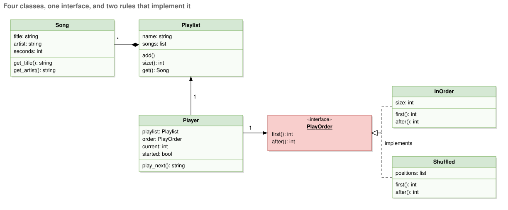
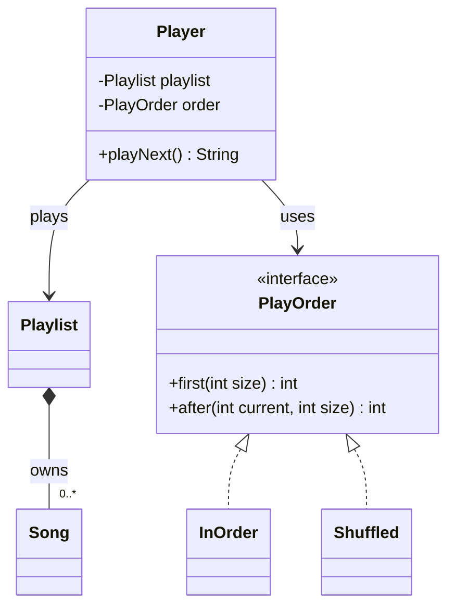
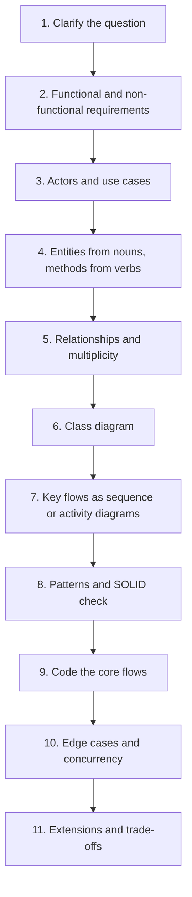
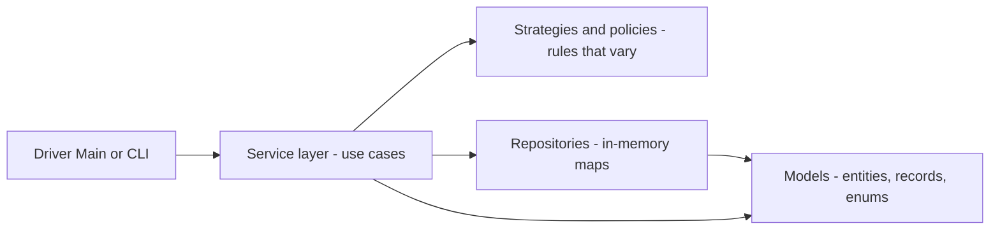
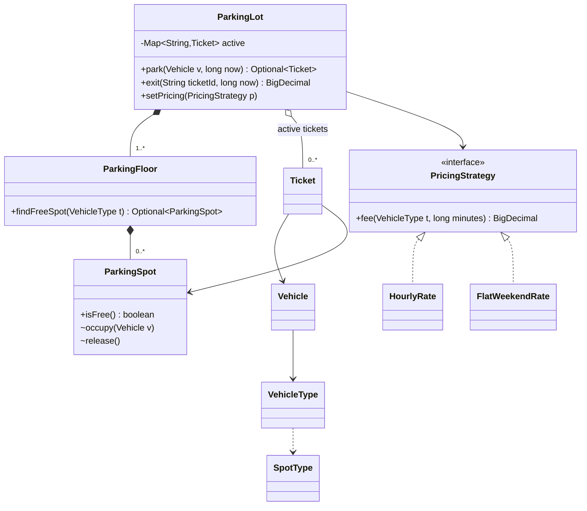

# Chapter 1 — The LLD Interview & How to Approach It (Study Edition)

> **Study Edition.** Every topic of the full chapter, without the padding. Full code, outputs and extra examples are in the Full Edition (`README.md`).
>
> **You will learn:** what the LLD round is, a complete small answer, an 11-step framework with a time budget, how to get requirements and classes, a SOLID check, the six common patterns, how to write interview code, a worked parking lot, communication tips and a study plan.

---

## 1.1 What this round is, and what this handbook covers

### What it is

The **low-level design (LLD)** round: design **one application** while an interviewer watches, in 45–60 minutes (machine coding: 90 min–2 h). You design **the classes inside the program** (parking lot, vending machine, chess, Splitwise), not servers. Analogy: system design is the **city plan**; LLD is the **floor plan of one house**.

| Term | Meaning |
|---|---|
| **Class** / **Object** | A named type with fields and methods / one concrete instance of it |
| **Responsibility** | The one job a class does, in one sentence |
| **Relationship** | How two classes connect: uses, holds, owns, or extends |
| **UML** | Standard symbols for drawing classes and relationships |
| **Design pattern** | A named, reusable answer to a recurring design problem |

The hard part is **explaining aloud** why each class exists and **justifying** how they connect.

### What you should be able to do after this handbook

Bound one sentence into requirements plus an out-of-scope list; pick classes with **one job** each; relate every pair correctly; code the core flows until they run; name the pattern you used **and the one you rejected**.


*Figure — The four parts of the course material this handbook absorbs: introduction, design and UML notation, the answering method, and the case studies (course diagram)*

The handbook follows this arc (round → UML → method → case studies) and adds OOP, SOLID, principles, clean code, refactoring, all 23 GoF patterns and concurrency.

### What every case study in this handbook contains · Who this is for · What you need already · What this handbook will not do

- **Case-study template:** requirements with out-of-scope, actors and use cases, a staged class diagram, key flow diagrams, runnable Java with output, patterns **only where really used**, and "Extensions & follow-up questions".
- **For:** anyone facing this round. **Needed:** one OO language (examples use **Java 21**); not UML (Chapter 3), not system design (this round stays **inside one process**), not DSA beyond basic collections.
- **Won't do:** teach a language or give scripts to memorise. **The reusable part is the method.**

### TL;DR

Design the classes of one application out loud, then code the main flows. Method beats memorisation.

---

## 1.2 How the interview runs

### What it is

One sentence ("Design a parking lot"), then silence. Names for the round: **OOD interview** (US big tech), **LLD** (umbrella term), **machine-coding round** (commonly reported at Flipkart, Swiggy, PhonePe: **runnable code is mandatory**, 90 min–2 h).

| | LLD | HLD / system design |
|---|---|---|
| Scope / vocabulary | One application: classes, interfaces, patterns | Many machines: servers, DBs, caches, queues |
| Output | Class diagram + code | Architecture + capacity numbers |

### OOD round vs machine-coding round

| | OOD / LLD discussion | Machine coding |
|---|---|---|
| Time / output | 45–60 min; requirements, diagram, code for 2–3 flows | ~90 min coding; a **complete running program** |
| Storage / interaction | Rarely discussed; continuous conversation | **In-memory**; silent coding, then **demo + walkthrough** |
| Judged on | Bounding, responsibilities, relationships, trade-offs | Working code, **data models**, **service interfaces**, **extensibility**, readability, edge cases, sometimes thread safety |
| Common failure | Not converging, coding too early | Not finishing, or one giant class |

### How it works: the five core steps

1. **Clarify requirements** 2. **Actors and use cases** 3. **Find the classes** 4. **Connect them** (class diagram) 5. **Write the code** for 2–3 main flows.

**Order matters more than speed**: skip step 1 and step 3 invents classes nobody asked for.


*Figure — The five steps split into "understand the question" and "build the model", with a time budget for each (course diagram)*

About **a quarter of the hour passes before any class is named**. **Nobody finishes the product**; you are judged on the part you built properly.

### Time-boxing

| 45-min OOD step | Time | Output |
|---|---|---|
| Requirements | 5–8 min | 8–12 lines + out-of-scope |
| Actors & use cases | 3–5 min | 2–4 actors, 6–10 use cases |
| Classes | 8–10 min | One responsibility each |
| Connect | 8–10 min | Diagram with multiplicity |
| Code | 12–15 min | 2–3 main-flow methods |

**90-min machine coding:** requirements/assumptions 5–10 · model (entities, enums, interfaces) 10–15 · core flow end to end 30–40 · remaining features + edge cases 15–20 · polish + demo 5–10 · buffer 5 (never zero). **Get something running by halfway.**

### What the interviewer is actually judging

1. Did you **bound** the problem? 2. **One job** per class? 3. **Right relationships**? 4. Does **code match the diagram**? 5. Can you explain a **trade-off**?

Machine coding adds: **runs**, **modular** (new type = new class), readable, handles bad input, thread-safe (senior). Perfect UML notation is **not** graded; the model is.

### A worked example of size

Parking lot: ~12 requirements → ~12 classes → ~15 relationships. Code the three that carry the main flows; name the other nine. Costliest mistake: all twelve at equal depth.

### TL;DR

Five steps in order, a quarter of the time before naming a class, two or three flows done properly.

---

## 1.3 A complete answer in five minutes: "Design a music playlist"

### Step 1: requirements

Songs are **ordered**; a listener asks for **the next song**; **shuffle** changes the order. **Out of scope (said aloud):** accounts, downloads, storage, audio.

### Step 2: actors and use cases

One **actor** (someone outside the app): the listener (add song, play next, shuffle). On bigger problems **actors reveal which classes must exist**.

### Step 3: classes, one sentence each

| Class | Responsibility |
|---|---|
| `Song` | Title, artist, length; knows only itself |
| `Playlist` | Holds songs in order; stores, does not play |
| `PlayOrder` (interface) | Picks the next position (several rules exist) |
| `InOrder` / `Shuffled` | Insertion order / an order fixed up front |
| `Player` | Holds playlist + order, remembers the position |

**A rule that can vary becomes its own type.** If a responsibility needs "and" to join two jobs, it is two classes.

### Step 4: connect them


*Figure — The playlist design: Playlist owns many Songs, Player uses a PlayOrder, and InOrder and Shuffled implement PlayOrder (course diagram)*

Filled diamond = `Playlist` **owns** many `Song`s (composition). Plain arrow = `Player` **uses** the `PlayOrder` interface only. Dashed hollow-triangle arrows = `InOrder`/`Shuffled` **implement** it; a third rule is one more box.



### Step 5: the code

```java
// File: code/lld/ch01/playlist/PlayOrder.java
public interface PlayOrder {
    int NONE = -1;                           // "there is no next position"

    int first(int size);                     // first position to play, or NONE if empty
    int after(int current, int size);        // position after 'current', or NONE at the end
}
```

```java
// File: code/lld/ch01/playlist/Player.java
public final class Player {
    private final Playlist playlist;
    private final PlayOrder order;           // depends on the interface, not on InOrder/Shuffled
    private int current = PlayOrder.NONE;
    private boolean started = false;
    // ... constructor

    public String playNext() {
        if (!started) {
            current = order.first(playlist.size());
            started = true;
        } else if (current != PlayOrder.NONE) {          // once at the end, stay at the end
            current = order.after(current, playlist.size());
        }
        if (current == PlayOrder.NONE) return "end of playlist";
        Song s = playlist.get(current);
        return "playing " + s.title() + " by " + s.artist();
    }
}
```

Full runnable code: code/lld/ch01/playlist/ (see the Full Edition).

`Song` is a validating **record**; `Playlist` keeps its list `private`; `Shuffled` is **given** its order (not `Random`), so output is the same every run: **deterministic = testable**. `Player` never checks which mode is active.

### What to notice

- **Shuffle (one line) became a type**: classes come from requirements.
- **One job per class**: `Song` doesn't know playlists exist.
- **Open to change**: "repeat one" is a new `PlayOrder` (Strategy + Open/Closed).
- **Announce deliberate gaps** (pause, volume, queue).

### TL;DR

Bounded requirements, one-sentence classes, one diagram, code for the main flow. A varying rule becomes an interface.

---

## 1.4 The step-by-step answer framework

### What it is

A checklist for every question, expanding the five steps into eleven.

### The problem it solves

Stops freezing and premature coding; makes progress **visible** (which is scored).

### How it works



Ask at step 8: varying rule (Strategy)? lifecycle (State)? many listeners (Observer)? At step 10: invalid input, full, two users on one seat?

### Trade-offs

| Do this | Instead of | Why |
|---|---|---|
| 8–13 min on steps 1–3 | Coding at minute 2 | Unbounded scope costs more later |
| 2–3 flows fully | 12 stubs | Depth is judged |
| 1–2 patterns with a signal | Six patterns | Over-engineering = poor judgement |
| Pass time in; `BigDecimal`/cents | Clock in logic; `double` money | Testable; `double` can't hold 0.10 exactly |

### When not to use it (rigidly)

Follow the interviewer if they steer. In machine coding, steps 5–7 are often mental; **the code is the diagram**.

### TL;DR

Clarify → requirements → use cases → entities → relationships → diagram → flows → patterns/SOLID → code → edge cases → extensions. Announce each step.

---

## 1.5 From one line to a list of requirements

### What it is

A **requirement** is one testable capability. **Functional** = behaviour ("customer takes a ticket"). **Non-functional** = quality (thread safety, extensibility, in-memory).

### The problem it solves

Without a list the design has **no edges**, you **can't defend omissions** ("reservations were out of scope; we agreed"), and you **can't tell when you're done**.

### How it works: the four questions


*Figure — Four questions asked in order produce 8–12 in-scope requirements plus a written out-of-scope list (course diagram)*

1. **Who uses it?** (actors) 2. **What can each do?** (use cases; most requirements) 3. **What are the limits?** (→ constants + validation) 4. **What is out of scope?** (the only question that makes the problem **smaller**).

Ask early: payments in scope? one site or many? users/permissions modelled? Each answer adds or removes 2–3 classes. If told "your choice": **choose, say it, write it down**.

### What good looks like: the parking lot in ten lines

In scope: multiple floors of spots; spot types (compact, large, handicapped, motorbike, electric); vehicle types; ticket at entrance; pay at exit/portal/attendant; cash or card; hourly rate by stay length; free-spot display per floor; refuse entry when full; admins add floors/spots/panels and change rates. **Out of scope:** season passes, plate recognition, pre-booking, refunds, multi-site reports. **If no line asked for it, it's not in the design.**

### Make each requirement checkable

**Put a number on it** ("at most **five** books on loan" → constant → one check) and **name the actor** ("**a member** can reserve a copy on loan" → tells you the owning class).

### Use cases

Customer: take ticket, park, pay, exit. Attendant: collect cash. Admin: add floor/spot/panel, change rate. System: assign spot, update boards, refuse when full. A list is enough in 45 minutes.

### Common mistakes

**Saying yes to every idea** (declining politely is a **strong** move); forgetting non-functional requirements; vague lines without number or actor.

### In the interview

**30-second answer:** "I ask who uses it, what each actor does, the limits, and what's out of scope. I write 8–12 numbered requirements plus an out-of-scope list, confirm them, and every class must trace back to a line."

- *"Why not just start designing?"* — No boundary means endless growth and indefensible omissions.
- *"'Your choice'?"* — I pick the simpler option and write it as a visible assumption.

### Self-check

- **Q:** Which question shrinks the problem? **A:** Out of scope.
- **Q:** Make "users can book some seats" checkable. **A:** "A customer can hold at most 10 seats per show; unpaid holds release after 10 minutes."

### TL;DR

Who, what, limits, out of scope → 8–12 checkable lines plus out-of-scope.

---

## 1.6 Finding the classes

### What it is

**Collect candidates, cut non-classes, give each survivor one job.**

### How it works

1. **Nouns** → candidate classes (deliberately too many). 2. **Verbs** → methods; a verb with no home = a missing class. 3. **Cut with five tests:**


*Figure — About 22 nouns pass through five tests and about 12 classes survive, each with one job (course diagram)*

| # | Test | Example | Result |
|---|---|---|---|
| 1 | A **value**? | Hour, plate, cash/card option | Field or **enum** |
| 2 | **Another name**? | Customer/driver | Merge |
| 3 | **Changing state**? | Spot free/occupied | Class |
| 4 | Anything **calls** it? | Nobody asks an `Hour` | Value |
| 5 | **Behaviour** or only **data** differs? | Compact vs large spot (data); cash vs card (behaviour) | **Data → field. Behaviour → class.** |

Test 5 cuts the most: one `ParkingSpot` with a `type` field, but separate cash and card classes. Smell: subclasses that only pass a constant to the parent.

4. **One sentence per class**, e.g. `ParkingFloor` owns a level's spots and finds a free one; `ParkingSpot` tracks its occupant; `ParkingTicket` records vehicle, spot, entry time; `ParkingRate` turns duration into price; `Payment` collects money; `ParkingDisplayBoard` shows free spots. `ParkingLot` (issues tickets **and** tracks fullness) has two jobs: **name the tension aloud**.
5. **Method goes where its data is** ("find a free spot" → `ParkingFloor`). Needing three classes' data = misplaced (GRASP Information Expert; *Feature Envy*).

### Common mistakes

One subclass per value; missing the **record-keeping** class (ticket/loan/booking) and the **rule** class (rate/strategy); "Manager" god classes.

### Self-check

- **Q:** Car, van, truck: subclasses or enum? **A:** Enum/field unless behaviour truly differs.
- **Q:** Class with fields but no verbs? **A:** Probably a value (record/field).

### TL;DR

Nouns → candidates, verbs → methods. **Different data = field; different behaviour = class.** Method where its data is.

---

## 1.7 Connecting the classes (preview)

For each pair: **uses** briefly (dependency), **holds** (association), **contains** parts that live alone (aggregation), **owns** parts that die with it (composition), or **is-a** (inheritance/realization); then **multiplicity** (1, 0..1, 1..*, *). Chapter 3 details all. Top error: inheritance where composition fits. A car is not an engine, so `Car` **has an** `Engine`.

---

## 1.8 Keeping the design honest with SOLID

### What it is

The five SOLID rules (Chapter 4) used as **five quick checks** on your diagram (~5 minutes).


*Figure — The five SOLID checks and the signal that each one has failed (course diagram)*

### How it works: run the five checks in this order

| Check | Failure signal | Parking-lot example |
|---|---|---|
| **S** One reason to change | Sentence needs "and" | Lot that assigns spots **and** prints receipts → split |
| **O** Extend without editing | `switch` over a type | Weekend rate = new class, not new case |
| **L** Child works wherever parent does | Child throws / does nothing | `ReadOnlySpot` whose `occupy` throws |
| **I** No unused methods | Empty bodies | Split an interface half its implementers can't honour |
| **D** Depend on interfaces | High-level class does `new` of low-level | Lot depends on `Payment`, not `new CreditCardTransaction()` |

### The two that earn the most credit

**S** improves the class list; **O** is what gets probed ("trucks charged differently?" → "add a class").

### When not to use it

No single-implementer interfaces "because SOLID" (unless a test double needs one); no splitting past what a reader can follow.

### A five-minute pass over the parking lot

S: lot has two jobs (split or say it). O: pricing behind `ParkingRate`, passes. L: five behaviour-less spot subclasses aren't a Liskov violation, but they fail "different data → field": collapse. I, D: pass. **Two findings is good; five = rework; zero = you didn't look.**

### TL;DR

Check S-O-L-I-D before the interviewer does; S and O matter most; don't over-apply.

---

## 1.9 The design patterns that come up in this round

### What it is

A **pattern** is a named solution to a recurring problem (GoF has 23; Chapters 8–11). Six recur here. **A misapplied pattern hurts more than an unknown one**: learn the **signal**.


*Figure — The six patterns most used in this round and the signal for each (course diagram)*

### What to say about each one

| Pattern | Signal | What to say |
|---|---|---|
| **Strategy** | Several swappable rules for one operation | `ParkingRate` → `HourlyRate`, `WeekendRate`; a new rate is a new class, not a `switch` case |
| **Factory** | Object to build depends on a type value | Registering a new type happens in **one place**; a factory method is usually enough |
| **Observer** | One change, many listeners the source shouldn't know | The spot is the subject; boards register. One listener → direct call |
| **State** | Behaviour depends on state, fixed transitions | Illegal moves become impossible; for 3–4 states, **enum + guarded method** |
| **Singleton** | Exactly one instance | Must be **thread-safe**; **global state** hurts tests; often inject one instance instead |
| **Builder** | Many optional fields (~6+ constructor args) | Sets fields by name; a readability fix |

### Choosing patterns without overusing them

Skip each when its signal is absent: one rule (Strategy), one concrete class (Factory), one listener (Observer), three states and one guard (State), just wanting global access (Singleton), three required fields (Builder). **One or two patterns** per design; best is a comparison: "Rate gets Strategy; ticket doesn't get State, one guard covers three statuses."

### Real-world examples

`Comparator` (Strategy); `List.of`, `Executors.newFixedThreadPool` (Factory); `ActionListener`, Spring events (Observer); order lifecycle, TCP (State); `Runtime.getRuntime()` (Singleton; Spring beans are singleton **per container**); `StringBuilder`, `HttpRequest.newBuilder()` (Builder).

### TL;DR

Know six; use one or two where the signal appears; name the rejected one.

---

## 1.10 Code, edge cases and concurrency: how to write interview code

### How it works: a machine-coding skeleton that scales



**Models** (validated entities, records, enums) → **repositories** (in-memory maps behind an interface) → **strategies** (rules that vary) → **services** (use cases: the **service interface**) → **driver** (`Main` demo).

**Habits:** pass time in; money as `BigDecimal` (from strings) or cents, never `double`; fail loudly (`IllegalArgumentException`, `IllegalStateException`, clear custom exceptions); `Optional` for normal "not found"; `private final` fields; domain names.

### Edge cases and concurrency checklist

**Input** (null, negative, duplicate/unknown IDs) · **Capacity** (full lot, empty playlist) · **State** (pay twice, exit without entry) · **Time** (exit before entry, round part hours) · **Concurrency** (two threads, same seat: `synchronized`, `ReentrantLock`, `ConcurrentHashMap.computeIfAbsent`; lock the **smallest** thing that keeps the invariant; Chapters 12–13).

### TL;DR

Models → repositories → strategies → services → driver; inject time, exact money, validate, guard shared state.

---

## 1.11 Worked mini-example, end to end: a small parking lot

### Problem & clarifying questions

Assumed answers: single lot, one or more floors; motorbike/car/truck; MOTORBIKE/COMPACT/LARGE spots (smaller vehicles may use bigger spots); payment out of scope (we compute the fee); tiered hourly pricing, swappable; several panels act concurrently.

### Requirements

1. Floors with MOTORBIKE, COMPACT, LARGE spots. 2. Motorbike → MOTORBIKE/COMPACT; car → COMPACT/LARGE; truck → LARGE; smallest first. 3. Entry assigns a spot and issues a ticket. 4. No fit → refused. 5. Exit closes ticket, frees spot, returns fee. 6. $4.00 first hour, $3.50 hours 2–3, $2.50 after; round up; minimum 1 h; trucks double. 7. Pricing swappable at run time (flat $10 weekend). 8. Free-spot count per type.

**Non-functional:** in-memory, thread-safe, extensible, time passed in. **Out of scope:** payment collection, reservations, boards, plate recognition, multiple lots.

### Use cases · Core entities

Driver: enter/exit. Admin: add spots, change pricing. System: find spot, refuse, compute fee. Types: `SpotType`, `VehicleType` (enums; vehicle knows which spots fit), `Vehicle` and `Ticket` (records; the ticket is the "connection object"), `ParkingSpot`, `ParkingFloor`, `PricingStrategy` + `HourlyRate`/`FlatWeekendRate`, and `ParkingLot` (the service). Spot sizes are an enum: **different data → field**.

### Class diagram



### Key flows

`park`: lot asks each floor `findFreeSpot(type)`; if found, `occupy` it and return a `Ticket`, else return empty (refuse). `exit`: remove the ticket, `release()` the spot, return `pricing.fee(type, minutes)`.

### Design decisions & patterns used

| Decision | Why | Rejected |
|---|---|---|
| **Strategy** pricing | Weekend rule required; open/closed | `switch` in the lot |
| Enums for types | Data only differs | Subclass per type |
| `Ticket` record | Fixed after issue (only *shallowly* immutable) | Mutable ticket |
| `BigDecimal` | `3.50 + 3.50` is exactly `7.00` | `double` |
| `synchronized` lot methods | Two panels never share a spot | Per-floor locks (extension) |
| No Singleton, no State | Injectable/testable; only active/closed | `getInstance()`; state classes |

### Java implementation

```java
// File: code/lld/ch01/parkinglot/HourlyRate.java
public final class HourlyRate implements PricingStrategy {
    // ... FIRST_HOUR = 4.00, HOURS_2_TO_3 = 3.50, LATER_HOURS = 2.50
    @Override
    public BigDecimal fee(VehicleType type, long minutesParked) {
        long hours = Math.max(1, (minutesParked + 59) / 60);    // ceiling, minimum one hour
        BigDecimal total = BigDecimal.ZERO;
        for (long h = 1; h <= hours; h++) {
            total = total.add(h == 1 ? FIRST_HOUR : (h <= 3 ? HOURS_2_TO_3 : LATER_HOURS));
        }
        return type == VehicleType.TRUCK ? total.multiply(BigDecimal.TWO) : total;
    }
}
```

```java
// File: code/lld/ch01/parkinglot/ParkingLot.java
public final class ParkingLot {
    private final Map<String, Ticket> active = new HashMap<>();
    private PricingStrategy pricing;
    // ... floors, nextTicket, constructor

    public synchronized Optional<Ticket> park(Vehicle v, long nowMinute) {
        for (ParkingFloor floor : floors) {
            Optional<ParkingSpot> spot = floor.findFreeSpot(v.type());
            if (spot.isPresent()) {
                spot.get().occupy(v);
                Ticket t = new Ticket("T" + nextTicket++, v, spot.get(), nowMinute);
                active.put(t.id(), t);
                return Optional.of(t);
            }
        }
        return Optional.empty();               // lot full for this vehicle type -> refuse entry
    }

    public synchronized BigDecimal exit(String ticketId, long nowMinute) {
        Ticket t = active.get(ticketId);
        if (t == null) throw new IllegalArgumentException("unknown or already closed ticket " + ticketId);
        if (nowMinute < t.entryMinute()) throw new IllegalArgumentException("exit before entry");
        active.remove(ticketId);                // validate first, then change state
        t.spot().release();
        return pricing.fee(t.vehicle().type(), nowMinute - t.entryMinute());
    }
    // ... freeSpots(type) and setPricing(p), both synchronized
}
```

Full runnable code: code/lld/ch01/parkinglot/ (see the Full Edition).

Output (excerpt): the third car is refused; `T1 exits after 150 min, pays $11.00` (4.00 + 3.50 + 3.50); the truck's 50 min → 1 h × 2 = `$8.00`; after `setPricing(new FlatWeekendRate())` the exit pays `$10.00`; a second exit of T1 prints `error: unknown or already closed ticket T1`.

### Concurrency & edge cases

`synchronized park/exit` makes find-then-occupy **atomic** (no *check-then-act* race); `freeSpots` uses the same lock; `ParkingFloor` is only called under it. `exit` **validates before changing state**; `occupy` throws if taken (second defence) and is package-private.

### Extensions & follow-up questions

- **EV charging:** `ELECTRIC` spot + `ELECTRIC_CAR`; if charging has behaviour, a `ChargingSpot` or composed component.
- **Nearest spot:** inject a `SpotSelectionStrategy`.
- **Display boards:** Observer on spot events.
- **Throughput:** per-floor/type locks, or a `ConcurrentLinkedQueue` of free spots with atomic `poll()`.
- **Cash/card:** `Payment` interface + implementations, collected by a `PaymentService` (DIP).

### In the interview

~5 min requirements, 3 actors, 8 entities (enum vs subclass), 8 diagram, 15 coding `park`, `exit`, `HourlyRate`. Close by naming Strategy (used), Singleton and State (rejected), and per-floor locking.

### Self-check

- **Q:** What race does `synchronized park` prevent? **A:** Two threads occupying the same free spot.
- **Q:** How did the weekend rate respect open/closed? **A:** A new class; nothing edited.

### TL;DR

8 requirements, 10 types, one Strategy, one lock, an honest out-of-scope list.

---

## 1.12 Communication tips

**Do:** think out loud (name the step), write requirements/classes where visible, confirm before moving on, state assumptions, give trade-offs in pairs ("X over Y because..."), welcome hints, say what you leave out, watch the clock and announce the switch to code, use domain names (not `Manager`/`Helper`), and **when stuck, return to the requirements**. **Don't:** go silent, argue, talk `HashMap`s in minute two, or recite patterns without a reason.

---

## 1.13 How to use this handbook, and a study plan

### Attempt first, then compare


*Figure — The parts of a case-study lesson and what to do at each one (course diagram)*

Reading builds little skill; **attempt, then compare**. Stop (1) after the question (write requirements), (2) after the requirements (write classes; most people are **two short**: the record class and the rule class), (3) at each diagram stage (predict). Also: argue with decisions in writing, read one language, **never skip extensions**, don't invent pattern names, switch to **timed 45-minute blank-page runs** after 6–7 case studies, run `bash tools/compile_all.sh`.

### Map of this handbook

1 approach · 2 OOP · 3 relationships & UML · 4 SOLID · 5 design principles · 6 clean code · 7 refactoring · 8 creational · 9 structural · 10–11 behavioural (+MVC) · 12 concurrency concepts · 13 concurrency problems · 14 everyday objects · 15–16 booking & inventory · 17 games · 18–19 platforms · 20 components (LRU, rate limiter, Splitwise) · 21 machine coding · 22 cheat sheets.

### Study plans


*Figure — Three study plans for three amounts of time; every plan ends with one timed run from a blank page (course diagram)*

- **Tomorrow (~2 h):** §1.2, §1.5, §1.6, Ch 3 relationship guide + class notation, parking lot (30 min), vending machine (25 min, a **lifecycle**).
- **One week:** Ch 1 + OOP pillars; Ch 3 diagrams; parking lot + library; ATM + vending; movie tickets + hotel; Splitwise + Amazon; **day 7: redo parking lot blank-page in 45 min**.
- **One month (~20 h):** Ch 1–4 + 3 case studies; Ch 5, 8–11 + case studies 4–10; Ch 12–13 + 11–18 + a timed run; the rest, Ch 21, three timed runs, Ch 22.
- **Beginner (6 weeks):** Ch 1–2; 3–5; 6–8; 9–11 + two case studies; 12–13 + four incl. ticket booking; Ch 21 timed runs + Ch 22.

**Only six case studies?** Parking lot, library, vending machine, movie tickets (concurrency), Splitwise (money), Amazon (too big: choose). Add **LRU cache** if data-structure questions are likely. **Night before:** nothing new; re-read the time budget; recite **requirements, actors and use cases, classes, relationships, code.**

---

## 1.14 Common mistakes

| Mistake | Fix |
|---|---|
| Coding in minute two; no out-of-scope list; yes to every feature | 8–13 min on requirements; write and agree scope |
| One subclass per value; god class | Data → field/enum; split on "and" |
| Missing record class; "Car extends Engine" | Connection with data = object; composition |
| Pattern stuffing; `switch` on type | 1–2 patterns with signal; polymorphism |
| Equal depth everywhere; silent designing | 2–3 flows fully; narrate |
| Ignoring concurrency; non-running code | Lock shared state; thin path running by halfway |
| `double` money; clock in logic | `BigDecimal`/cents; inject time |

---

## In the interview

**30-second answer:** "I clarify and write 8–12 requirements with an out-of-scope list, list actors and use cases, pick classes from the nouns with one responsibility each, connect them in a class diagram, sketch the key flow, run a SOLID check and pick one or two patterns where the signal is clear. Then I code the core flows, handle edge cases and concurrency, and finish with extensions and trade-offs."

- *"Different from system design?"* — That's many machines and scale; LLD is classes and code inside one application.
- *"You won't finish; what matters?"* — Bounded scope, clean responsibilities, correct relationships, code matching the diagram, one defended trade-off.

## Self-check

- **Q:** Five core steps? **A:** Requirements, actors & use cases, classes, relationships, code.
- **Q:** Two classes beginners miss? **A:** The record-keeping class and the rule class.
- **Q:** Patterns in 45 minutes? **A:** One or two where the signal appears; name a rejected one.

## TL;DR

- Design the classes of one app and code main flows; machine coding = same, running, ~90 min.
- A quarter of the time before naming a class; always an out-of-scope list.
- Different data → field; different behaviour → class; one sentence per class.
- SOLID as quick checks; one or two patterns with a signal.
- Inject time, exact money, guard shared state; attempt first, then timed blank-page runs.
