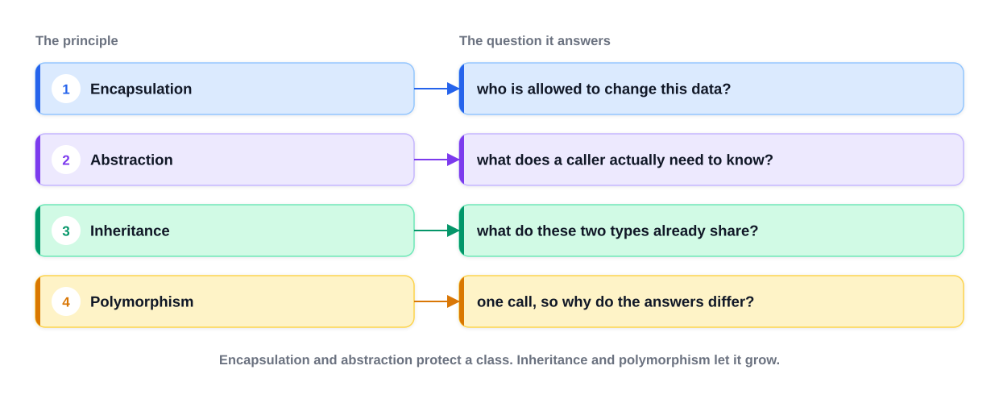
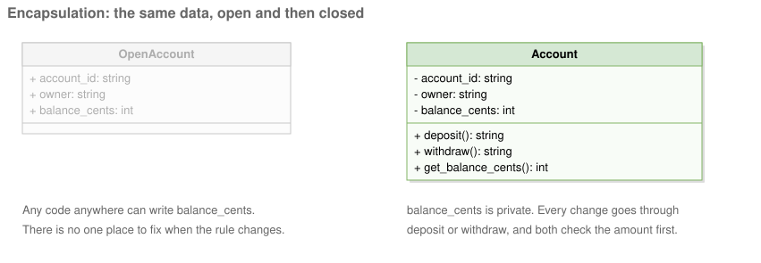
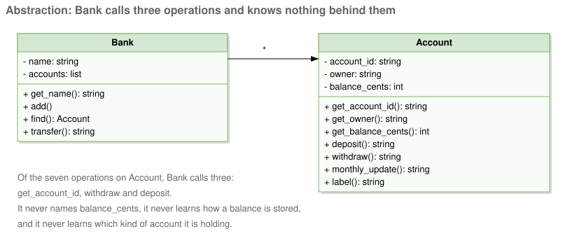
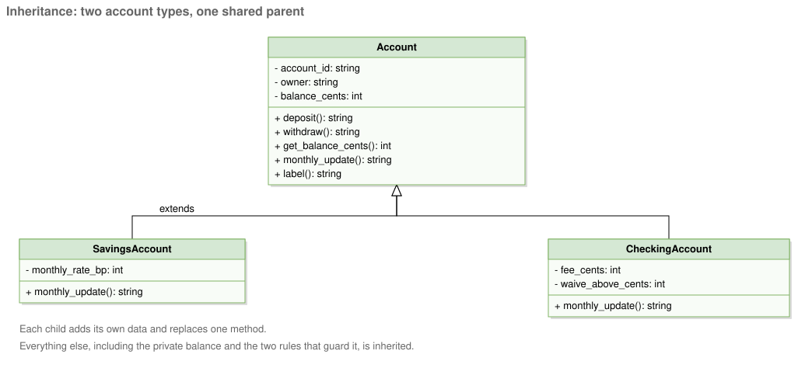
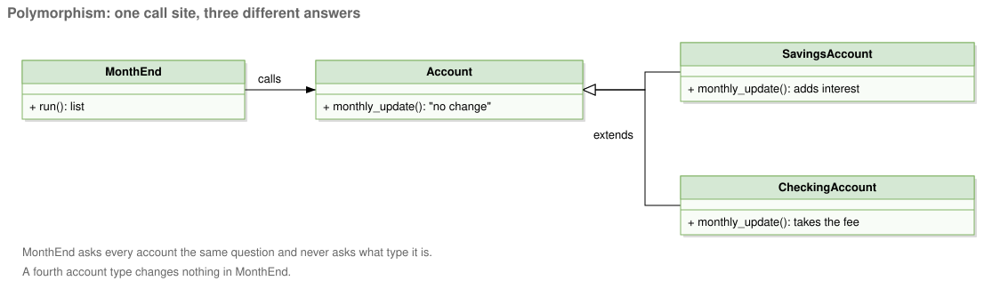
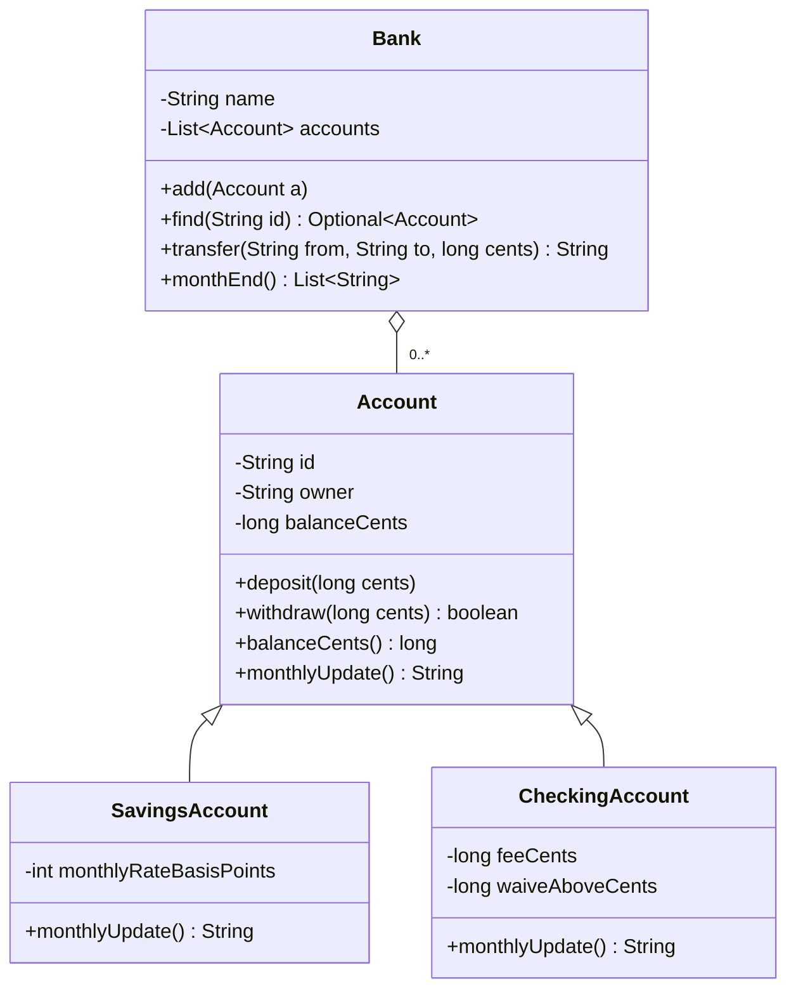
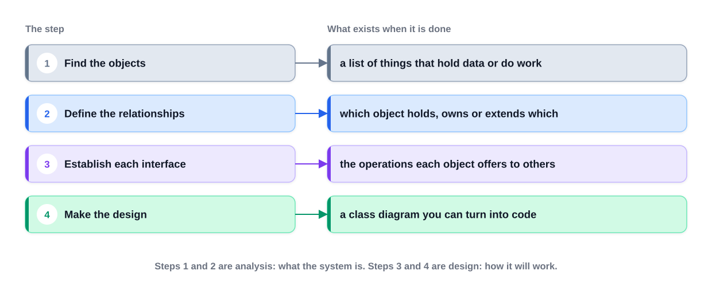
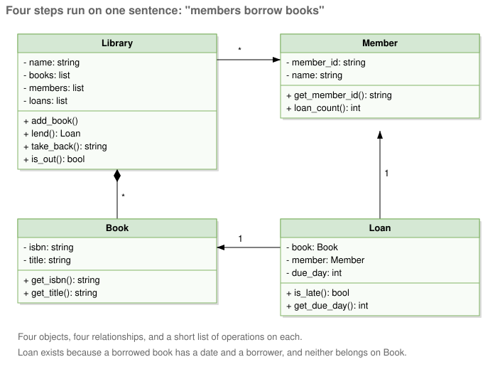
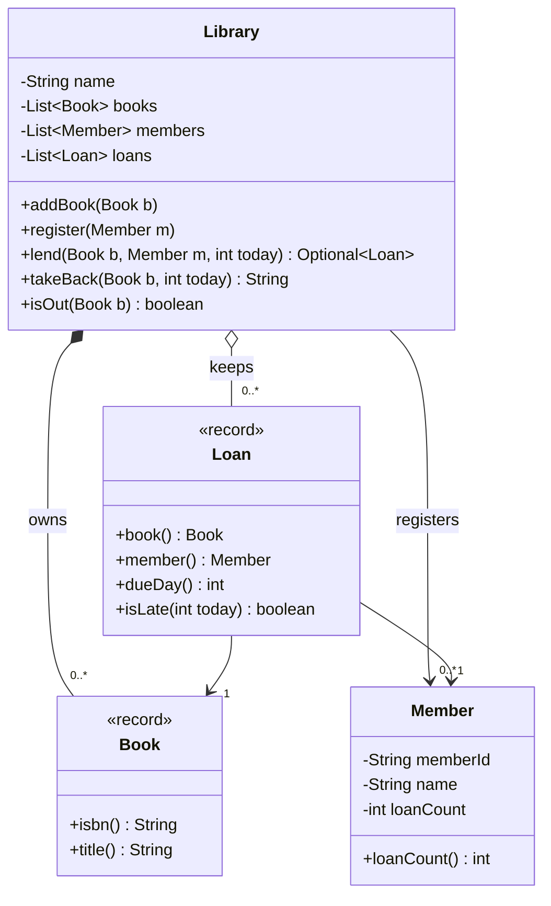

# Chapter 2 — OOP Fundamentals

> **What you will learn in this chapter**
> - What object-oriented programming (OOP) is and why the LLD round is really a test of it.
> - Classes and objects, constructors, `this`, `static` vs instance members, and `final`.
> - The four pillars — **encapsulation, abstraction, inheritance, polymorphism** — on one running bank example.
> - Inheritance details (`super`, overriding rules) and polymorphism details (overloading vs overriding, dynamic dispatch).
> - Interfaces (default, static, private methods, functional interfaces), abstract classes, and when to pick which.
> - Enums with fields and behaviour.
> - Composition over inheritance, identity vs equality (`equals`/`hashCode`), immutability and records.
> - Access modifiers and packages, and the generics you actually need in LLD.
> - Object-oriented analysis vs design vs programming (OOA / OOD / OOP), with a four-step process.
>
> Every concept has a Java 21 example that compiles and runs; the real output is shown under each program.

**How to run all examples:**
`cd chapters/02-oop-fundamentals/code && javac --release 21 -d /tmp/lld_02 $(find . -name '*.java') && java -cp /tmp/lld_02 lld.ch02.<package>.Main`

**Concept checklist** (the commonly listed "must-know OOP concepts" and where each is covered):

| Concept | Section | Concept | Section |
|---|---|---|---|
| Classes & objects | 2.2 | Interfaces (default/static/functional) | 2.8 |
| Constructors, constructor chaining | 2.2 | Abstract class vs interface | 2.9 |
| `this` keyword | 2.2 | Enums | 2.10 |
| `static` vs instance, `final` | 2.2 | Composition over inheritance | 2.11 |
| Encapsulation | 2.3 | Identity vs equality, `equals`/`hashCode` | 2.12 |
| Abstraction | 2.4 | Immutability & records | 2.13 |
| Inheritance, `super`, overriding rules | 2.5 | Access modifiers & packages | 2.14 |
| Polymorphism, overloading, dynamic dispatch | 2.6–2.7 | Generics basics | 2.15 |
| Coupling & cohesion | 2.16 | OOA / OOD / OOP | 2.17 |

---

## 2.1 What object-oriented programming is

### What it is

**Object-oriented programming (OOP)** is a style of programming that **bundles data with the code allowed to modify it**, packaging both into a single unit called an **object**.

**Procedural programming** separates the two: data sits in one place, and free-standing functions anywhere in the program can read and modify it. OOP instead **fences the data in**: the only code that can reach it is the object's own methods.

Analogy: a bank vault vs a pile of cash on a table. With the pile (procedural), anyone can take or add money and nobody enforces rules. With the vault (OOP), you must go through the teller (the methods), who checks every request.

### The problem it solves

When any code can change any data, a rule such as "a balance can never go negative" has to be copied into every caller, and one forgotten copy is a bug. OOP puts each rule in **one place**, next to the data it protects, and lets a design grow by **adding new classes** instead of editing old ones.

### Why this matters for the interview

Nobody in the LLD round will ask you to recite textbook definitions. What they want to see is you **breaking a problem into objects, assigning each one its responsibilities and data, and justifying that breakdown**. Every idea in this chapter is a tool for that.


*Figure — The four OOP principles and the question each one answers (course diagram)*

As the figure above summarises, each pillar answers one design question:

| Pillar | Question it answers |
|---|---|
| Encapsulation | Who is allowed to change this data? |
| Abstraction | What does a caller actually need to know? |
| Inheritance | What do these two types already share? |
| Polymorphism | One call, so why do the answers differ? |

**The first two pillars guard a single class; the last two let the design expand with new classes.**

---

## 2.2 Classes, objects, constructors, `this`, `static` and `final`

### What it is

- A **class** is the **blueprint**: it lists the fields a thing has and the operations it supports. You write it once.
- An **object** (instance) is **one concrete thing built from that blueprint**, holding actual values in its fields. You create as many as you need with `new`.
- A **field** is a variable that belongs to a class or object. A **method** is a function that belongs to a class or object.
- A **constructor** is special code that runs when an object is created. It has the class's name and **no return type**. Its job: put the new object into a **valid** state.
- **`this`** is a reference to **the current object** inside its own instance methods and constructors.
- **`static`** means "belongs to the **class**, shared by all objects". Without `static`, a member is an **instance** member: each object has its own copy.
- **`final`** means "cannot change": a `final` variable is assigned once, a `final` method cannot be overridden, a `final` class cannot be extended.

Examples: the `Account` class defines what any account looks like, while account `S-1` (owner Ada, balance 50,000 cents) is a single object of it. In an online shop, `Customer` is the class, and the particular shopper behind order 4192 from last Tuesday is an object.

### How it works

1. `new Account("S-1", "Ada", 50_000)` allocates memory for the fields, sets them to defaults (0, `null`, `false`), then runs the constructor.
2. **Initialisation order:** static initialisers run **once**, when the class is initialised (just before its first real use, such as the first `new` or the first static method call). For each `new`: the parent constructor runs first (`super(...)`, implicit if you do not write it), then instance field initialisers and instance initialiser blocks in source order, then the rest of the constructor body.
3. If you write **no constructor**, the compiler adds a public no-argument **default constructor**. If you write any constructor, it does not.
4. **Overloaded constructors** (same name, different parameters) should **chain** to one canonical constructor with `this(...)`, so validation lives in one place. In Java 21, `this(...)` or `super(...)` must be the **first statement**. (Java 25 relaxes this with "flexible constructor bodies", JEP 513: statements that do not use the object under construction may come before the call. This book targets Java 21, so keep the call first.)
5. Uses of `this`: disambiguate a field from a parameter (`this.id = id`), pass the current object to another method, chain constructors (`this(...)`), and return the object for **fluent chaining** (`return this`).
6. `static` methods have **no `this`**: they cannot touch instance fields directly. Use them for utilities and factories.
7. Variables of class type hold **references** (like an address), not the object itself. `Account alias = a;` copies the reference: both names now point to the **same** object.

### Java example

```java
// File: code/lld/ch02/classes/Account.java
package lld.ch02.classes;

/** A CLASS is the blueprint. Every Account OBJECT gets its own copy of the instance fields. */
public class Account {
    // static = belongs to the CLASS, shared by all objects
    private static int openedCount = 0;
    public static final long MIN_OPENING_CENTS = 0;

    // instance fields = belong to EACH object
    private final String id;
    private final String owner;
    private long balanceCents;

    /** Canonical constructor: does all validation in one place. */
    public Account(String id, String owner, long openingCents) {
        if (openingCents < MIN_OPENING_CENTS) throw new IllegalArgumentException("negative opening balance");
        this.id = id;                 // 'this.id' is the field, 'id' is the parameter
        this.owner = owner;
        this.balanceCents = openingCents;
        openedCount++;                // shared counter
    }

    /** Overloaded constructor: chains to the canonical one with this(...). Must be the first statement. */
    public Account(String id, String owner) {
        this(id, owner, 0);
    }

    public Account deposit(long cents) {   // returns 'this' so calls can be chained
        if (cents <= 0) throw new IllegalArgumentException("deposit must be positive");
        this.balanceCents += cents;
        return this;
    }

    public long balanceCents() { return balanceCents; }
    public String id()         { return id; }
    public String owner()      { return owner; }

    public static int openedCount() { return openedCount; }  // static method: no 'this' available here

    @Override public String toString() { return id + "(" + owner + ", " + balanceCents + "c)"; }
}
```

```java
// File: code/lld/ch02/classes/Main.java
package lld.ch02.classes;

public class Main {
    public static void main(String[] args) {
        Account a = new Account("S-1", "Ada", 50_000);          // 3-arg constructor
        Account b = new Account("C-1", "Kai");                  // 2-arg constructor chains to 3-arg
        b.deposit(1_000).deposit(500);                          // chaining via 'return this'

        System.out.println("a = " + a);
        System.out.println("b = " + b);
        System.out.println("accounts opened (static, shared): " + Account.openedCount());

        Account alias = a;                                      // copies the REFERENCE, not the object
        alias.deposit(1);
        System.out.println("after alias.deposit(1), a = " + a + ", same object? " + (alias == a));

        try {
            new Account("X", "Bad", -5);
        } catch (IllegalArgumentException e) {
            System.out.println("constructor refused: " + e.getMessage());
        }
        System.out.println("accounts opened: " + Account.openedCount() + " (failed construction did not count)");
    }
}
```

Output:

```
a = S-1(Ada, 50000c)
b = C-1(Kai, 1500c)
accounts opened (static, shared): 2
after alias.deposit(1), a = S-1(Ada, 50001c), same object? true
constructor refused: negative opening balance
accounts opened: 2 (failed construction did not count)
```

**Explaining each part:** `openedCount` is `static`, so there is one counter for the class; `balanceCents` is an instance field, so each account has its own. The two-argument constructor calls `this(id, owner, 0)`, so validation is written once. `deposit` returns `this`, enabling `b.deposit(1_000).deposit(500)`. `alias == a` is `true` because both variables hold the same reference. The failing constructor threw **before** incrementing the counter, so no half-built object was counted: **validate first, then change state**.

### Trade-offs

| Choice | Benefit | Cost |
|---|---|---|
| Static members | Shared, no object needed | Global state: hard to test and dangerous with threads |
| Many constructor overloads | Convenient | Confusing beyond 3–4; use a **Builder** (Chapter 8) or static factory methods |
| `final` fields | Safer, thread-friendlier | Must be set in every constructor |

### Common mistakes

- Putting per-object data in a `static` field (every object then shares it).
- Doing heavy work or calling overridable methods inside constructors (a subclass override may run before the subclass's fields are set).
- Forgetting `this.` so the parameter is assigned to itself (`id = id;`).
- Thinking `=` copies an object; it copies a reference.

### Real-world examples

`Math.max`, `Integer.parseInt`, `List.of` are static methods; `StringBuilder.append` returns `this` for chaining; `String` is a `final` class.

### In the interview

**30-second answer:** "A class is the blueprint, an object is an instance with its own state. Constructors put an object into a valid state; I chain overloads with `this(...)` so validation lives once. Static members belong to the class and are shared, so I keep them for constants, utilities and factories and avoid mutable static state."

- *"What happens if you define a constructor with arguments only?"* — The default no-arg constructor is no longer generated; `new X()` stops compiling.
- *"Can a static method use `this`?"* — No; there is no current object in a static context.
- *"Why avoid mutable static fields?"* — They are hidden global state shared by all threads and tests.

### Self-check

- **Q:** How many copies of a `static` field exist for 1,000 objects? **A:** One.
- **Q:** What runs first: parent constructor or child field initialisers? **A:** Parent constructor.
- **Q:** What does `alias == a` compare? **A:** References (whether both point to the same object).

### TL;DR

Class = blueprint, object = instance. Constructors create valid objects; chain them with `this(...)`. `static` = one per class; `final` = cannot change. Variables hold references.

---

## 2.3 Encapsulation

### What it is

**Encapsulation** means an object hides its own data (**private**) and allows the outside world to modify it **only by calling methods the object itself defines and guards**. Analogy: a medicine bottle with a child-proof cap: the contents are reachable, but only through a mechanism that enforces the rules.

### The problem it solves


*Figure — The same account data, first open (public fields anyone can write) and then closed (private fields changed only through deposit and withdraw) (course diagram)*

The left side of the figure shows unprotected, public fields: **code in any file** may write a negative number into `balance`, and if the rule ever changes you have **nowhere central** to update it. (That open version exists only as a contrast; our code does not contain it.) The right side makes the balance private, and both `deposit` and `withdraw` validate the amount first. Overdrawing is therefore impossible: **every route to the balance goes through a method that can say no**. (The default `monthlyUpdate` on `Account` does nothing yet; it becomes useful in Section 2.6.)

### How it works

1. Make fields `private` (and `final` where possible).
2. Expose **behaviour** (`deposit`, `withdraw`), not raw setters (`setBalance`).
3. Validate inside those methods: the rule lives **once**.
4. Return copies or unmodifiable views of internal collections (never the live list).
5. For every field, settle **which code may modify it**. When the honest answer is "nobody but this class", state it aloud in the interview: it turns a list of fields into a visible design decision.

### Java example

The `Account` class of the bank example in Section 2.6 (package `lld.ch02.bank`) is the encapsulation example: `balanceCents` is `private`; `deposit` rejects non-positive amounts; `withdraw` rejects amounts larger than the balance; both are `final` so a subclass cannot weaken the rule.

### Trade-offs

| Benefit | Cost |
|---|---|
| Invariants (rules that must always hold) enforced in one place | A little more code than public fields |
| Internals can change without breaking callers | Over-encapsulating trivial data carriers is noise (use records) |

### When not to use it (strictly)

Plain data carriers with no rules (DTOs, events) do not need hand-written getters and validation; a **record** gives you private final fields and accessors for free.

### Common mistakes

- **Getter/setter for every field** ("anemic" objects): the data is technically private but anyone can still set anything. That is not encapsulation.
- Returning a mutable internal list (`return items;`), so callers modify your state behind your back.

### Real-world examples

`java.lang.String` hides its internal byte array; `ArrayList` hides its backing array and `size`; `LocalDate` exposes only validated factory methods (`LocalDate.of(2026, 2, 30)` throws).

### In the interview

**30-second answer:** "Encapsulation hides state behind methods, and those methods are the single home of every rule about that state. For each field I ask who may change it; if only this class, it is private and changed through intention-revealing methods like `withdraw`, not a setter."

- *"Are getters and setters encapsulation?"* — Only partly. A setter with no rule is a public field in disguise. Prefer behaviour methods that enforce rules.

### Self-check

- **Q:** Where should the "no negative balance" rule live? **A:** Inside `Account.withdraw`, once.

### TL;DR

Private data + methods that enforce the rules = encapsulation. Expose behaviour, not setters.

---

## 2.4 Abstraction

### What it is

**Abstraction** means giving a caller **just the operations it requires** while concealing **how** they are carried out. Put simply: encapsulation conceals **state**, abstraction conceals **design choices**, and the short list of operations stays valid even if everything behind it is rewritten. Analogy: a car's steering wheel and pedals. You drive without knowing about fuel injection, and the engine can be replaced by an electric motor without changing how you drive.

### The problem it solves


*Figure — Of Account's seven public operations, Bank relies on three and sees nothing of what lies behind them (course diagram)*

In the course diagram `Account` has seven public operations (it includes a `label()` helper; our Java `Account` has six: `id`, `owner`, `balanceCents`, `deposit`, `withdraw`, `monthlyUpdate`). Either way, `Bank.transfer` relies on only three of them: read the id, withdraw, deposit. `Bank` has no idea that balances are stored as whole cents, what checks an account performs, or that several account subclasses exist. That ignorance is the point: the balance could be moved from a `long` field into a database table and `transfer` would stay exactly as it is.

### How it works

1. Decide the **smallest set of operations** a caller needs.
2. Name them after **what** they do (`transfer`), not how.
3. Put them on an interface or the public surface of a class; keep everything else private.
4. Callers depend on that surface only.

### Java example

`Bank.transfer` in Section 2.6 uses only `id()`, `withdraw()` and `deposit()`.

### Trade-offs

| Benefit | Cost |
|---|---|
| Callers are simpler and survive internal rewrites | A wrong abstraction is expensive to change later |
| Enables polymorphism (many implementations behind one surface) | Too many layers make code hard to follow |

### Common mistakes

- **Leaky abstraction:** the interface exposes implementation details (`getHashMapOfSeats()`).
- Abstracting too early, before two concrete cases exist.

### Real-world examples

`java.util.List` (callers do not care whether it is an `ArrayList` or `LinkedList`); JDBC's `Connection`/`Statement` (same code for different databases); `java.io.InputStream`.

### In the interview

**30-second answer:** "Abstraction is exposing only what the caller needs. My test is the sentence 'the caller does not need to know that': whenever I can honestly say it, something moves behind the interface, the design shrinks, and I can change the implementation freely."

- *"Encapsulation vs abstraction?"* — Encapsulation hides and protects **data** with access control; abstraction hides **complexity and decisions** behind a small set of operations. They work together.

### Self-check

- **Q:** Which three `Account` operations does `Bank.transfer` need? **A:** `id()`, `withdraw()`, `deposit()`.

### TL;DR

Show the minimum surface; hide the how. "The caller does not need to know that."

---

## 2.5 Inheritance

### What it is

**Inheritance** lets a new class (the **child**, subclass) start with everything an existing class (the **parent**, superclass) has, then **add** fields/methods or **replace** (override) some methods. In Java: `class SavingsAccount extends Account`. Analogy: a savings account **is a** bank account with one extra rule.

### The problem it solves


*Figure — SavingsAccount and CheckingAccount extend Account; each adds its own data and replaces one method (course diagram)*

Savings accounts earn interest; checking accounts take a monthly fee unless their balance clears a threshold. Apart from that, the two share everything: the balance, the deposit check and the withdrawal check, so all of that comes from the parent. In the figure, savings contributes one new field and checking two, and **each overrides a single method**; neither duplicates the balance or its rules. If the is-a sentence were false, the difference would belong in a **field**, not in a parent class.

### How it works

1. Declare `class Child extends Parent`. Java allows **one** parent class (single inheritance of classes), but many interfaces.
2. The child inherits all **accessible** (non-private) members. Private fields still exist in the object but are reached only through the parent's methods. **Constructors are not inherited.**
3. The child constructor must call a parent constructor, `super(...)`, as its first statement (implicitly `super()` if omitted, which fails to compile if the parent has no no-arg constructor).
4. `super.method()` calls the parent's version from inside an override (reuse, then extend).
5. **Overriding rules:**

| Rule | Detail |
|---|---|
| Same signature | Same method name and parameter types |
| Return type | Same, or a **subtype** for reference types (*covariant return*); primitives must match exactly |
| Access | Same or **wider** (protected → public is fine; public → protected is not) |
| Checked exceptions | May throw fewer or narrower checked exceptions, never new or broader ones; unchecked are free |
| Cannot override | `final` methods, `static` methods (they are **hidden**, not overridden), `private` methods (not inherited) |
| Annotation | Always write `@Override`: the compiler then catches typos and wrong signatures |

6. Every class ultimately extends `java.lang.Object`, which is why every object has `toString`, `equals`, `hashCode` and `getClass`.
7. **The is-a test:** the sentence "a SavingsAccount **is an** Account" must be true in every situation. A car is not an engine, so `Car` should **hold** an `Engine` (Section 2.11).

### Java example

See `SavingsAccount` and `CheckingAccount` in Section 2.6 (each calls `super(...)` and overrides `monthlyUpdate()`), and `Circle` in Section 2.7 (covariant return, `super.who()`, static-method hiding, field hiding).

### Trade-offs

| Benefit | Cost |
|---|---|
| Reuse of shared state and behaviour | **Tight coupling**: child depends on parent internals (fragile base class) |
| Enables polymorphism | Hierarchy is fixed at compile time; single parent only |
| Natural for true "is-a" families | Deep hierarchies (more than 2–3 levels) are hard to reason about |

### When not to use it

- Only to **reuse code** when the is-a sentence is false (use composition).
- When the child would need to **disable** a parent method (throw `UnsupportedOperationException` or do nothing): that breaks the **Liskov Substitution Principle** (Chapter 4): the child can no longer stand in for the parent.
- For variations that differ **only in data** (use a field or enum).

### Common mistakes

- `Square extends Rectangle` with independent `setWidth`/`setHeight`: code expecting a rectangle breaks.
- Forgetting `@Override` and silently **overloading** instead (e.g. `equals(Point p)` instead of `equals(Object o)`).
- Calling overridable methods from a parent constructor.

### Real-world examples

Good: `FileInputStream extends InputStream`; Spring's `AbstractController`-style base classes. Known mistakes in the JDK itself: `java.util.Stack extends Vector` (a stack exposes random-access `insertElementAt`), and `java.util.Properties extends Hashtable` (lets you put non-string entries).

### In the interview

**30-second answer:** "Inheritance lets a subclass reuse all of its parent's members, and it is only right when the sentence 'the child is a kind of the parent' holds in every situation. I use it for genuine type families, override with `@Override`, and if a child would have to disable a parent method I switch to composition, because that is a Liskov violation."

- *"Can you override a static method?"* — No. A static method with the same signature in the child **hides** the parent's; which one runs depends on the compile-time type (see Section 2.7 output).
- *"Can an override return a different type?"* — Only a subtype of the original (covariant return), e.g. `Circle copy()` overriding `Shape copy()`.

### Self-check

- **Q:** Is `private` inherited? **A:** The field exists in the child object but the child cannot access it directly; private methods are not overridden.
- **Q:** Can an override reduce visibility from `public` to `protected`? **A:** No.

### TL;DR

`extends` for true is-a families only. `super(...)` first, `@Override` always, never narrow access or disable parent behaviour.

---

## 2.6 Polymorphism (and the full bank example)

### What it is

**Polymorphism** (Greek for "many forms") means **the same method call can do different things depending on the object it lands on**. The calling code works with a variable of the **parent type** and invokes a method by name; the concrete object behind that variable determines the behaviour. Analogy: a "start" button that starts a car, a washing machine or a laptop, each in its own way.

### The problem it solves

Without it, code asks "what type are you?" everywhere: `if (a instanceof SavingsAccount) ... else if (a instanceof CheckingAccount) ...`. Every new type means finding and editing every such branch. With polymorphism, the branch disappears.


*Figure — MonthEnd calls monthlyUpdate on every account and never asks which type it holds (course diagram)*

In the figure, the month-end loop sends the identical request to each account and **never checks which kind it is**; it contains no `if` about account types. Introduce a fourth account type next month and the loop needs no edit.

### How it works

1. Declare the method on the parent type (or interface).
2. Each child overrides it.
3. Callers hold the **parent type** (`Account a`) and call the method.
4. At run time the JVM looks at the **actual class of the object** and runs that class's version: **dynamic dispatch** (also called late binding).

### Java example: the bank (encapsulation + abstraction + inheritance + polymorphism)



```java
// File: code/lld/ch02/bank/Account.java
package lld.ch02.bank;

/**
 * ENCAPSULATION: the balance is private; the only way to change it is through deposit/withdraw,
 * and both enforce the rules. The parent also defines the hook monthlyUpdate() for POLYMORPHISM.
 */
public class Account {
    private final String id;
    private final String owner;
    private long balanceCents;                      // hidden: nobody outside can set it to -5

    public Account(String id, String owner, long openingCents) {
        if (openingCents < 0) throw new IllegalArgumentException("negative opening balance");
        this.id = id;
        this.owner = owner;
        this.balanceCents = openingCents;
    }

    public final void deposit(long cents) {         // final: children may not weaken the rule
        if (cents <= 0) throw new IllegalArgumentException("deposit must be positive");
        balanceCents += cents;
    }

    public final boolean withdraw(long cents) {
        if (cents <= 0 || cents > balanceCents) return false;   // the one place the rule lives
        balanceCents -= cents;
        return true;
    }

    public final long balanceCents() { return balanceCents; }
    public final String id()         { return id; }
    public final String owner()      { return owner; }

    /** Default month-end behaviour. Subclasses OVERRIDE it. */
    public String monthlyUpdate() { return "no change"; }
}
```

```java
// File: code/lld/ch02/bank/Bank.java
package lld.ch02.bank;

import java.util.ArrayList;
import java.util.List;
import java.util.Optional;

/**
 * ABSTRACTION: Bank uses only id(), withdraw() and deposit(). It does not know how a balance is
 * stored, what rules an account applies, or which subclass it holds.
 */
public class Bank {
    private final String name;
    private final List<Account> accounts = new ArrayList<>();

    public Bank(String name) { this.name = name; }

    public void add(Account a) { accounts.add(a); }

    public Optional<Account> find(String id) {
        return accounts.stream().filter(a -> a.id().equals(id)).findFirst();
    }

    public String transfer(String fromId, String toId, long cents) {
        Account from = find(fromId).orElseThrow();
        Account to = find(toId).orElseThrow();
        if (!from.withdraw(cents)) return fromId + " rejected, not enough money";
        to.deposit(cents);
        return "moved " + Money.format(cents) + " from " + fromId + " to " + toId;
    }

    /** POLYMORPHISM: one call, a different result per object, and no 'if' on the account type. */
    public List<String> monthEnd() {
        List<String> lines = new ArrayList<>();
        for (Account a : accounts) {
            String what = a.monthlyUpdate();                 // dynamic dispatch picks the override
            lines.add(a.id() + " (" + a.owner() + "): " + what + ", balance " + Money.format(a.balanceCents()));
        }
        return lines;
    }

    public List<Account> accounts() { return List.copyOf(accounts); }
    public String name() { return name; }
}
```

```java
// File: code/lld/ch02/bank/CheckingAccount.java
package lld.ch02.bank;

/** A checking account charges a monthly fee unless the balance is above a threshold. */
public class CheckingAccount extends Account {
    private final long feeCents;
    private final long waiveAboveCents;

    public CheckingAccount(String id, String owner, long openingCents, long feeCents, long waiveAboveCents) {
        super(id, owner, openingCents);
        this.feeCents = feeCents;
        this.waiveAboveCents = waiveAboveCents;
    }

    @Override
    public String monthlyUpdate() {
        if (balanceCents() >= waiveAboveCents) return "fee waived";
        return withdraw(feeCents) ? "fee " + Money.format(feeCents) : "fee could not be taken";
    }
}
```

```java
// File: code/lld/ch02/bank/Money.java
package lld.ch02.bank;

/** Utility: formats whole cents as dollars. Private constructor = cannot be instantiated. */
public final class Money {
    private Money() { }
    public static String format(long cents) { return String.format("$%d.%02d", cents / 100, cents % 100); }
}
```

```java
// File: code/lld/ch02/bank/SavingsAccount.java
package lld.ch02.bank;

/** INHERITANCE: a savings account IS an account; it adds a rate and replaces one method. */
public class SavingsAccount extends Account {
    private final int monthlyRateBasisPoints;      // 25 bp = 0.25 %

    public SavingsAccount(String id, String owner, long openingCents, int monthlyRateBasisPoints) {
        super(id, owner, openingCents);            // parent constructor runs first
        this.monthlyRateBasisPoints = monthlyRateBasisPoints;
    }

    @Override
    public String monthlyUpdate() {
        long interest = balanceCents() * monthlyRateBasisPoints / 10_000;
        if (interest > 0) deposit(interest);
        return "interest " + Money.format(interest);
    }
}
```

```java
// File: code/lld/ch02/bank/Main.java
package lld.ch02.bank;

public class Main {
    public static void main(String[] args) {
        Bank bank = new Bank("Gurus Bank");
        bank.add(new SavingsAccount("S-1", "Ada", 50_000, 25));
        bank.add(new CheckingAccount("C-1", "Kai", 8_000, 250, 50_000));
        bank.add(new Account("P-1", "Ravi", 3_000));

        System.out.println(bank.name() + ", opening balances:");
        for (Account a : bank.accounts()) {
            System.out.println("  " + a.id() + " (" + a.owner() + "): " + Money.format(a.balanceCents()));
        }
        System.out.println(bank.transfer("S-1", "C-1", 10_000));
        System.out.println(bank.transfer("S-1", "C-1", 90_000));
        System.out.println("month end:");
        bank.monthEnd().forEach(line -> System.out.println("  " + line));
    }
}
```

Output:

```
Gurus Bank, opening balances:
  S-1 (Ada): $500.00
  C-1 (Kai): $80.00
  P-1 (Ravi): $30.00
moved $100.00 from S-1 to C-1
S-1 rejected, not enough money
month end:
  S-1 (Ada): interest $1.00, balance $401.00
  C-1 (Kai): fee $2.50, balance $177.50
  P-1 (Ravi): no change, balance $30.00
```

**Explaining each part:**
- **Encapsulation:** `balanceCents` is private; `deposit`/`withdraw` are `final` and enforce the rules. The second transfer ($900 from an account holding $400) is refused inside `withdraw`.
- **Abstraction:** `Bank.transfer` only uses `id()`, `withdraw()`, `deposit()`.
- **Inheritance:** each child calls `super(...)` and adds one or two fields.
- **Polymorphism:** `monthEnd()` calls `a.monthlyUpdate()`: three accounts, one method name, three results (interest 0.25% of $400 = $1.00; checking balance $180 is below the $500 waiver so $2.50 is charged; the plain account uses the parent's "no change"). **No `if` asks which is which.**
- **Why `long` cents and not `BigDecimal` here:** money must never be a `double` (binary floating point cannot store 0.10 exactly, so sums drift). A `long` count of whole **cents** is exact too, and keeps this example about the four pillars rather than about arithmetic. Its limit is that it cannot hold a fraction of a cent: `balanceCents() * monthlyRateBasisPoints / 10_000` uses integer division, which **truncates** (rounds toward zero). With 40,000 cents at 25 bp the result is exactly 100 cents, but for 40,001 cents the 0.0025-cent remainder would be dropped. When a domain needs fractional amounts or an explicit rounding rule (interest, tax, currency conversion), use `BigDecimal` with a stated `RoundingMode`, as the `Money` value object in Section 2.13 does. Interest is in **basis points** (1 bp = 0.01%).

### How the four fit together

Encapsulation and abstraction guard a class: they settle **what is hidden** and what outsiders may see. Inheritance and polymorphism let the design expand: they make **a new requirement show up as an added class** rather than as surgery on an existing one. Designs that apply all four tend to look alike: hidden state, a small public API, a parent for the common parts, and subclasses that each override one method.

### Trade-offs

| Benefit | Cost |
|---|---|
| Removes type switches; open to new types | Behaviour is spread over several classes; you must look at the runtime type to know what runs |
| Enables Strategy, State, Command and most patterns | A virtual call is marginally slower than a direct call (almost never matters) |

### Common mistakes

- Long `if/else` or `switch` over a type: almost always where polymorphism belongs. **Pointing this out to the interviewer earns more credit than actually refactoring it.**
- Using `instanceof` chains to decide behaviour (fine for occasional data inspection, e.g. pattern matching in Java 21, but not as the main dispatch mechanism in an OO model).

### Real-world examples

`List.add` behaves differently for `ArrayList` and `LinkedList`; `Runnable.run()` executed by any `Executor`; Spring injecting any implementation of an interface; `Comparator.compare` in `Collections.sort`.

### In the interview

**30-second answer:** "Polymorphism lets one call behave differently depending on the object receiving it. I code against the parent type or an interface, each subtype overrides the method, and the JVM picks the right one at run time. It removes type switches, so a new type is a new class, not an edit."

- *"Where would you use it in a parking lot?"* — Pricing (`PricingStrategy.feeCents`), payments (`Payment.pay`), spot selection.

### Self-check

- **Q:** Which version of `monthlyUpdate` runs for `Account a = new SavingsAccount(...)`? **A:** `SavingsAccount`'s, chosen at run time.

### TL;DR

Hold the parent type, call the method, let the object decide. Type switches are the signal that polymorphism is missing.

---

## 2.7 Compile-time vs runtime polymorphism: overloading vs overriding

### What it is

| | **Overloading** (compile-time / static polymorphism) | **Overriding** (runtime / dynamic polymorphism) |
|---|---|---|
| What | Same method name, **different parameter lists**, usually in the same class | Same signature re-implemented in a **subclass** |
| Decided by | The **compiler**, using the **declared (static) types** of the arguments | The **JVM at run time**, using the **actual class** of the receiver object |
| Return type | May differ (but cannot be the only difference) | Same or covariant |
| Needs inheritance? | No | Yes (class or interface) |
| Example | `add(int,int)`, `add(double,double)` | `Circle.area()` overriding `Shape.area()` |

### How it works: overload resolution

The compiler picks an overload in three phases and stops at the first phase that finds a match:
1. Exact match or **widening** of primitives/references (`int` → `long` → `double`, `Circle` → `Shape`), no boxing, no varargs.
2. Allow **boxing/unboxing** (`int` ↔ `Integer`).
3. Allow **varargs** (`int...`).
If several candidates remain in a phase, the **most specific** wins; if none is most specific, it is a compile error (ambiguous call).

**Not polymorphic:** fields (resolved by the static type; a child field with the same name **hides** the parent's), `static` methods (hidden, chosen by the static type), and `private` methods.

### Java example

```java
// File: code/lld/ch02/polymorphism/Calculator.java
package lld.ch02.polymorphism;

/** OVERLOADING: same name, different parameter lists. Chosen by the COMPILER from static types. */
public class Calculator {
    public String add(int a, int b)       { return "add(int,int) = " + (a + b); }
    public String add(long a, long b)     { return "add(long,long) = " + (a + b); }
    public String add(double a, double b) { return "add(double,double) = " + (a + b); }
    public String add(int... xs)          { int s = 0; for (int x : xs) s += x; return "add(int...) = " + s; }

    public String greet(Shape s)  { return "greet(Shape)"; }
    public String greet(Circle c) { return "greet(Circle)"; }
}
```

```java
// File: code/lld/ch02/polymorphism/Circle.java
package lld.ch02.polymorphism;

public class Circle extends Shape {
    public String kind = "circle";                               // HIDES Shape.kind, does not override it
    private final double r;

    public Circle(double r) {
        super();                                                 // implicit anyway; parent constructed first
        this.r = r;
    }

    @Override public double area() { return Math.PI * r * r; }  // OVERRIDE: same signature

    @Override public Circle copy() { return new Circle(r); }    // covariant return type is allowed

    public static String describe() { return "static Circle.describe"; }

    @Override public String who() { return super.who() + " (radius " + r + ")"; }  // super.method() reuses parent code
}
```

```java
// File: code/lld/ch02/polymorphism/Shape.java
package lld.ch02.polymorphism;

public class Shape {
    public String kind = "shape";                                // fields are NOT polymorphic

    public double area() { return 0; }

    public Shape copy() { return new Shape(); }

    public static String describe() { return "static Shape.describe"; }   // static: hidden, not overridden

    public String who() { return "I am a " + kind + " with area " + String.format("%.2f", area()); }
}
```

```java
// File: code/lld/ch02/polymorphism/Main.java
package lld.ch02.polymorphism;

import java.util.List;

public class Main {
    public static void main(String[] args) {
        Calculator calc = new Calculator();
        System.out.println(calc.add(2, 3));            // exact match int,int
        System.out.println(calc.add(2L, 3));           // widening to long,long
        System.out.println(calc.add(2.5, 3));          // widening to double,double
        System.out.println(calc.add(1, 2, 3));         // varargs, chosen last

        Shape s = new Circle(1.0);                     // static type Shape, runtime type Circle
        System.out.println("s.area() -> " + String.format("%.2f", s.area()) + "  (runtime override: dynamic dispatch)");
        System.out.println("calc.greet(s) -> " + calc.greet(s) + "  (overload picked at compile time from static type)");
        System.out.println("s.kind -> " + s.kind + "  (fields use the static type)");
        System.out.println("((Circle) s).kind -> " + ((Circle) s).kind);
        System.out.println("Shape.describe() -> " + Shape.describe() + ", Circle.describe() -> " + Circle.describe());
        System.out.println("s.copy() class -> " + s.copy().getClass().getSimpleName());
        System.out.println(s.who());

        List<Shape> shapes = List.of(new Shape(), new Circle(2), new Circle(0.5));
        double total = 0;
        for (Shape sh : shapes) total += sh.area();     // one call site, many behaviours
        System.out.println("total area = " + String.format("%.2f", total));

        if (s instanceof Circle c) {                    // pattern matching instanceof (Java 16+)
            System.out.println("pattern-matched a circle: " + c.who());
        }
    }
}
```

Output:

```
add(int,int) = 5
add(long,long) = 5
add(double,double) = 5.5
add(int...) = 6
s.area() -> 3.14  (runtime override: dynamic dispatch)
calc.greet(s) -> greet(Shape)  (overload picked at compile time from static type)
s.kind -> shape  (fields use the static type)
((Circle) s).kind -> circle
Shape.describe() -> static Shape.describe, Circle.describe() -> static Circle.describe
s.copy() class -> Circle
I am a shape with area 3.14 (radius 1.0)
total area = 13.35
pattern-matched a circle: I am a shape with area 3.14 (radius 1.0)
```

**Explaining each part:**
- `add(2L, 3)`: no `(long,int)` overload, so `3` widens to `long` (phase 1).
- `s.area()` runs `Circle.area()` although `s` is declared `Shape`: **dynamic dispatch**.
- `calc.greet(s)` prints `greet(Shape)`, not `greet(Circle)`: overloads are chosen **at compile time from the declared type** of `s`. This surprises many people and is a favourite interview question.
- `s.kind` is `"shape"`: fields are not polymorphic. Inside `Shape.who()`, `kind` also means `Shape.kind`, which is why the output says "I am a shape". Lesson: **never hide fields**; use private fields plus overridable methods.
- `Circle copy()` overrides `Shape copy()` with a **covariant return type**.
- `super.who()` reuses the parent's text and appends the radius.
- `s instanceof Circle c` is **pattern matching for instanceof** (Java 16+): test and cast in one step.

### Common mistakes

- Expecting overloads to be picked by runtime type (they are not; that would require double dispatch, see the Visitor pattern in Chapter 11).
- Writing `public boolean equals(Point p)`: an **overload**, not an override of `equals(Object)`, so collections never call it. `@Override` would have caught it.

### In the interview

**30-second answer:** "Overloading is compile-time: same name, different parameters, chosen by declared types. Overriding is runtime: a subclass re-implements the same signature and the JVM dispatches on the actual object. Fields and static methods are not polymorphic."

- *"Why does `greet(s)` call `greet(Shape)`?"* — Overload resolution uses the static type of `s`, which is `Shape`.

### Self-check

- **Q:** Can two methods differ only in return type? **A:** No; that is a compile error.
- **Q:** Which phase allows varargs? **A:** The third (last).

### TL;DR

Overloading = compiler picks by declared types. Overriding = JVM picks by actual object. Fields and statics never dispatch dynamically.

---

## 2.8 Interfaces (default, static, private methods, functional interfaces)

### What it is

An **interface** is a **contract**: a named list of methods a class promises to provide, without (necessarily) saying how. `class EmailNotifier implements Notifier`. Analogy: a wall socket standard. Any appliance with the right plug works with any socket, whoever made them.

Key facts:
- Abstract methods are implicitly `public abstract`; fields are implicitly `public static final` (constants).
- A class can **implement many interfaces** (but extend only one class).
- **Default methods** (Java 8+): a method with a body that implementers inherit and may override. Added so interfaces can evolve without breaking every implementer (for example `Collection.stream()`, `Iterable.forEach`).
- **Static methods** (Java 8+): belong to the interface; called as `Notifier.console()`; **not inherited** by implementing classes.
- **Private methods** (Java 9+): helpers shared by default methods, invisible to implementers.
- A **functional interface** has **exactly one abstract method** (methods inherited from `Object`, like `equals`, do not count; default and static methods do not count). It can be implemented by a **lambda** or **method reference**. `@FunctionalInterface` asks the compiler to enforce the rule.

### The problem it solves

Callers depend on **what** can be done, not on a concrete class. New implementations can be added without touching callers (open/closed), and tests can pass fakes (dependency inversion). Interfaces also give Java a safe form of multiple inheritance (of **type**, not state).

### How it works

1. Define the interface with the smallest set of methods a caller needs.
2. Implement it in one or more classes (or with a lambda if it is functional).
3. Callers declare variables and parameters of the interface type.
4. If two interfaces supply the same default method, the class **must** override it and may pick one with `A.super.method()`. If a superclass declares the method, **the class wins** over interface defaults.

### Java example

```java
// File: code/lld/ch02/interfaces/DiscountRule.java
package lld.ch02.interfaces;

/** A FUNCTIONAL interface has exactly one abstract method, so a lambda can implement it. */
@FunctionalInterface
public interface DiscountRule {
    long apply(long priceCents);

    default DiscountRule then(DiscountRule next) { return p -> next.apply(apply(p)); }  // defaults are allowed
}
```

```java
// File: code/lld/ch02/interfaces/EmailNotifier.java
package lld.ch02.interfaces;

public class EmailNotifier implements Notifier {
    @Override public String send(String to, String message) { return "[email] to " + to + ": " + message; }
}
```

```java
// File: code/lld/ch02/interfaces/Notifier.java
package lld.ch02.interfaces;

/** An interface is a contract: WHAT can be done, not HOW. */
public interface Notifier {
    String send(String to, String message);        // abstract method: every implementer must provide it

    /** default method: implementers inherit it and may override it (added in Java 8). */
    default String sendAll(java.util.List<String> recipients, String message) {
        StringBuilder sb = new StringBuilder();
        for (String r : recipients) sb.append(send(r, clean(message))).append('\n');
        return sb.toString().stripTrailing();
    }

    /** static method: belongs to the interface itself; called as Notifier.console(). */
    static Notifier console() { return (to, msg) -> "[console] " + to + ": " + msg; }

    /** private method (Java 9+): a helper shared by default methods, hidden from implementers. */
    private String clean(String message) { return message.strip(); }
}
```

```java
// File: code/lld/ch02/interfaces/Report.java
package lld.ch02.interfaces;

/**
 * An ABSTRACT class can hold state and constructors, and mix finished and unfinished methods.
 * Here it fixes the skeleton of an algorithm (Template Method) and lets subclasses fill the steps.
 */
public abstract class Report {
    private final String title;                    // state: interfaces cannot have instance fields

    protected Report(String title) { this.title = title; }

    public final String render() {                 // final: subclasses cannot change the skeleton
        return header() + "\n" + body() + "\n-- end of " + title + " --";
    }

    protected String header() { return "== " + title + " =="; }   // concrete, overridable
    protected abstract String body();                              // must be supplied
}
```

```java
// File: code/lld/ch02/interfaces/SalesReport.java
package lld.ch02.interfaces;

public class SalesReport extends Report {
    private final long totalCents;
    public SalesReport(long totalCents) { super("Sales"); this.totalCents = totalCents; }
    @Override protected String body() { return "total: " + totalCents + " cents"; }
}
```

```java
// File: code/lld/ch02/interfaces/Main.java
package lld.ch02.interfaces;

import java.util.List;
import java.util.function.Predicate;

public class Main {
    public static void main(String[] args) {
        Notifier email = new EmailNotifier();                 // class implementing the interface
        Notifier sms = (to, msg) -> "[sms] " + to + ": " + msg; // Notifier is functional too (one abstract method)
        for (Notifier n : List.of(email, sms, Notifier.console())) {
            System.out.println(n.send("ada", "your order shipped"));
        }
        System.out.println(email.sendAll(List.of("kai", "ravi"), "  sale starts today  "));

        DiscountRule tenPercent = p -> p * 90 / 100;
        DiscountRule minusFiveDollars = p -> Math.max(0, p - 500);
        System.out.println("10% then -$5 on 10000c = " + tenPercent.then(minusFiveDollars).apply(10_000) + "c");

        Predicate<String> blank = String::isBlank;              // JDK functional interface + method reference
        System.out.println("'  ' blank? " + blank.test("  "));

        Report r = new SalesReport(123_45);
        System.out.println(r.render());
    }
}
```

Output:

```
[email] to ada: your order shipped
[sms] ada: your order shipped
[console] ada: your order shipped
[email] to kai: sale starts today
[email] to ravi: sale starts today
10% then -$5 on 10000c = 8500c
'  ' blank? true
== Sales ==
total: 12345 cents
-- end of Sales --
```

**Explaining each part:** `Notifier` has one abstract method, so it is also usable with lambdas (`sms`). `sendAll` is a default method that uses the private helper `clean`. `Notifier.console()` is a static factory on the interface. `DiscountRule` is an explicit `@FunctionalInterface` with a default combinator `then` (like `Function.andThen`). `Predicate<String>` is one of the JDK's built-in functional interfaces (`java.util.function`: `Function`, `Supplier`, `Consumer`, `Predicate`, `BiFunction`, `UnaryOperator`...). `Report`/`SalesReport` show an **abstract class** (Section 2.9).

### Trade-offs

| Benefit | Cost |
|---|---|
| Loose coupling, easy testing, multiple implementations | One more type to read; pointless if only one implementation will ever exist |
| Multiple inheritance of type | Cannot hold instance state |
| Default methods allow evolution | Overusing defaults turns interfaces into mini base classes |

### When not to use it

An interface with a single implementation and no realistic second one (and no test-double need) is indirection without benefit. Add it when the second implementation appears.

### Common mistakes

- **Fat interfaces** that force implementers to leave methods empty (Interface Segregation, Chapter 4).
- "Constant interfaces" used only to hold constants (use a final class or enum).

### Real-world examples

`Comparable`, `Comparator`, `Runnable`, `Callable`, `Iterable`, `AutoCloseable` (enables try-with-resources), `List`/`Map`; Spring's `Repository` interfaces; SLF4J's `Logger`.

### In the interview

**30-second answer:** "An interface is a contract of methods. I make services depend on interfaces such as `PaymentGateway` or `PricingStrategy`, so I can add implementations without editing callers and test with fakes. Since Java 8 interfaces can have default and static methods, and an interface with one abstract method is functional, so a lambda can implement it."

- *"Why were default methods added?"* — To add methods to widely-implemented interfaces (like `Collection.stream`) without breaking existing implementations.
- *"Two interfaces with the same default method?"* — Compile error until the class overrides it; it can delegate with `X.super.m()`.

### Self-check

- **Q:** Is `Comparator` functional although it has many methods? **A:** Yes; only `compare` is abstract (`equals` comes from `Object`, the rest are default/static).

### TL;DR

Interfaces are contracts; depend on them. Defaults evolve them, statics provide factories/helpers, one abstract method = lambda-friendly.

---

## 2.9 Abstract classes vs interfaces

### What it is

An **abstract class** is a class marked `abstract` that **cannot be instantiated**. It may contain fields, constructors, finished methods and **abstract methods** (declared without a body) that subclasses must implement. Analogy: a form with some fields pre-printed and some left blank for each department to fill in.

### How it works

In the `interfaces` package above, `Report` holds state (`title`), has a constructor, a `final` skeleton method `render()`, a concrete overridable `header()`, and an abstract `body()`. `SalesReport` supplies only `body()`. This "fixed skeleton, variable steps" shape is the **Template Method** pattern (Chapter 11).

| | Abstract class | Interface |
|---|---|---|
| Instantiable? | No | No |
| Instance fields (state) | Yes | No (only `public static final` constants) |
| Constructors | Yes | No |
| Method bodies | Any | `default`, `static`, `private` only |
| Access modifiers on members | Any | Abstract/default/static are public; helpers can be private |
| How many can a class extend/implement? | **One** | **Many** |
| Relationship expressed | "is a" (shared identity and state) | "can do" (capability / role) |
| Evolution | Add concrete methods freely | Add `default` methods |
| Typical use | Shared state + partial implementation for a close family | Contracts, roles, strategies, test seams |

### Rule of thumb

Start with an **interface** for the contract. Add an **abstract class** underneath when several implementations share state or a fixed algorithm (JDK example: `List` interface + `AbstractList` skeleton + `ArrayList`). Callers still depend on the interface.

### Common mistakes

- Using an abstract class just to share one helper method (use composition or a static helper).
- Making everything abstract "for flexibility".

### In the interview

**30-second answer:** "Interfaces define capabilities and allow multiple implementation; abstract classes share state and partial implementation but allow only one parent. I default to interfaces and add an abstract base class when implementations share real state or a template algorithm."

### Self-check

- **Q:** Can an abstract class have no abstract methods? **A:** Yes; it just cannot be instantiated.
- **Q:** Can an interface have a constructor? **A:** No.

### TL;DR

Interface = contract, many allowed, no state. Abstract class = partial implementation with state, one allowed. Interface first; abstract base class when sharing real code.

---

## 2.10 Enums with fields and behaviour

### What it is

An **enum** (enumerated type) is a type with a **fixed set of named instances**, such as `Coin.PENNY` or `OrderStatus.SHIPPED`. In Java an enum is a full class: it can have **fields, constructors, methods, implement interfaces**, and even give each constant its own method body. Analogy: the fixed denominations of coins; you cannot invent a 7-cent coin.

### The problem it solves

String or int constants (`"PAID"`, `2`) allow typos and invalid values and carry no behaviour. Enums are **type-safe** (only valid values compile), readable, and can hold the data and rules that belong to each value, which removes `switch` statements scattered around the code. In LLD, enums are the natural home for "**different data, not different behaviour**" (spot types, vehicle types, coin values, statuses).

### How it works

1. Every enum implicitly extends `java.lang.Enum` and cannot extend anything else; it can implement interfaces.
2. Constructors are always private; constants are created once when the enum class is initialised.
3. Built-ins: `values()`, `valueOf(String)` (throws `IllegalArgumentException` for unknown names), `name()`, `ordinal()` (position, 0-based; do **not** persist it, reordering changes it), `compareTo` (by ordinal).
4. Compare with `==` (each constant is a single instance).
5. Constant-specific bodies (`PAID { ... }`) let each constant override an abstract method: a tiny state machine or strategy.
6. `EnumMap` / `EnumSet` are compact, fast collections keyed by enums.
7. `switch` expressions over an enum that cover every constant are **exhaustive**: no `default` needed, and adding a constant makes the compiler flag missing cases.
8. A single-element enum is the simplest thread-safe, serialization-safe **Singleton** (Chapter 8).

### Java example

```java
// File: code/lld/ch02/enums/Coin.java
package lld.ch02.enums;

/** An enum with a FIELD, a constructor and a method. Enum constructors are always private. */
public enum Coin {
    PENNY(1), NICKEL(5), DIME(10), QUARTER(25);

    private final int cents;

    Coin(int cents) { this.cents = cents; }

    public int cents() { return cents; }
}
```

```java
// File: code/lld/ch02/enums/OrderStatus.java
package lld.ch02.enums;

import java.util.Set;

/** An enum with BEHAVIOUR: each constant says which statuses it may move to (a tiny state machine). */
public enum OrderStatus {
    PLACED    { @Override Set<OrderStatus> next() { return Set.of(PAID, CANCELLED); } },
    PAID      { @Override Set<OrderStatus> next() { return Set.of(SHIPPED, CANCELLED); } },
    SHIPPED   { @Override Set<OrderStatus> next() { return Set.of(DELIVERED); } },
    DELIVERED { @Override Set<OrderStatus> next() { return Set.of(); } },
    CANCELLED { @Override Set<OrderStatus> next() { return Set.of(); } };

    abstract Set<OrderStatus> next();          // constant-specific method bodies

    public boolean canMoveTo(OrderStatus target) { return next().contains(target); }
    public boolean isFinal() { return next().isEmpty(); }
}
```

```java
// File: code/lld/ch02/enums/Main.java
package lld.ch02.enums;

import java.util.EnumMap;
import java.util.List;
import java.util.Map;

public class Main {
    public static void main(String[] args) {
        List<Coin> inserted = List.of(Coin.QUARTER, Coin.QUARTER, Coin.DIME, Coin.PENNY);
        int total = inserted.stream().mapToInt(Coin::cents).sum();
        System.out.println("inserted " + inserted + " = " + total + " cents");

        Map<Coin, Integer> counts = new EnumMap<>(Coin.class);   // compact, ordered by declaration
        for (Coin c : inserted) counts.merge(c, 1, Integer::sum);
        System.out.println("counts: " + counts);

        System.out.println("valueOf(\"DIME\") = " + Coin.valueOf("DIME") + ", ordinal " + Coin.DIME.ordinal());

        OrderStatus s = OrderStatus.PLACED;
        for (OrderStatus target : List.of(OrderStatus.SHIPPED, OrderStatus.PAID, OrderStatus.SHIPPED, OrderStatus.DELIVERED)) {
            if (s.canMoveTo(target)) { s = target; System.out.println("moved to " + s); }
            else System.out.println("refused " + s + " -> " + target);
        }
        System.out.println(s + " is final? " + s.isFinal());

        String label = switch (s) {                           // exhaustive switch: no default needed
            case PLACED, PAID -> "in progress";
            case SHIPPED -> "on the way";
            case DELIVERED -> "done";
            case CANCELLED -> "stopped";
        };
        System.out.println("label: " + label);
    }
}
```

Output:

```
inserted [QUARTER, QUARTER, DIME, PENNY] = 61 cents
counts: {PENNY=1, DIME=1, QUARTER=2}
valueOf("DIME") = DIME, ordinal 2
refused PLACED -> SHIPPED
moved to PAID
moved to SHIPPED
moved to DELIVERED
DELIVERED is final? true
label: done
```

**Explaining each part:** `Coin` stores its value in a field, so summing is `Coin::cents`, with no switch. `EnumMap` prints in declaration order. `OrderStatus` gives each constant its own `next()` set, so illegal transitions (`PLACED → SHIPPED`) are refused in one method. This is the "enum plus a guarded method" alternative to the full State pattern that Chapter 1 recommends for small lifecycles.

### Trade-offs

| Benefit | Cost |
|---|---|
| Type-safe, self-documenting, can hold data/behaviour | Closed set: adding a value means recompiling |
| Great for small state machines and lookup tables | Large per-constant behaviour becomes hard to read; move to State/Strategy classes |

### When not to use it

When values are **open-ended or user-defined at run time** (product categories created by an admin) or when each value needs substantial, independently evolving behaviour (use classes).

### Common mistakes

- Persisting `ordinal()` in a database (store `name()` or an explicit code field).
- Giant `switch` statements over an enum in many places instead of a method on the enum.

### Real-world examples

`java.time.DayOfWeek` and `Month` (with methods like `plus`), `java.util.concurrent.TimeUnit` (each constant converts units: `TimeUnit.SECONDS.toMillis(5)`), `java.nio.file.StandardOpenOption`, `Thread.State`.

### In the interview

**30-second answer:** "I use enums for fixed sets like vehicle types, spot types and statuses. Java enums can carry fields and methods, so data like 'which spots fit this vehicle' or 'which statuses can follow this one' lives on the enum rather than in switches around the code."

- *"Enum or class hierarchy for vehicle types?"* — Enum if they differ only in data; classes if they behave differently.

### Self-check

- **Q:** What does `Coin.valueOf("dime")` do? **A:** Throws `IllegalArgumentException` (names are case-sensitive).

### TL;DR

Enums are type-safe fixed sets that can carry data and behaviour. Use them for "different data, same behaviour"; compare with `==`; never persist ordinals.

---

## 2.11 Composition over inheritance

### What it is

**Composition** means building a class by **holding references to other objects** and delegating work to them ("has-a"), rather than inheriting from them ("is-a"). The principle **"favour composition over inheritance"** comes from the Gang of Four book and is a core idea in *Head First Design Patterns*. Analogy: a phone **has** a camera module; it is not a kind of camera. The module can be upgraded without redesigning the phone.

### The problem it solves

Inheritance couples a child to the **internal implementation** of its parent (the **fragile base class problem**): a change in the parent, or a hidden detail of how it works, can silently break the child. Inheritance is also fixed at compile time and single-parent. Composition keeps classes independent, lets you **swap parts at run time**, and combine behaviours freely.

### How it works

1. Identify the behaviour you want to reuse or vary.
2. Put it behind an interface (`Engine`, `Set`).
3. Hold it in a private field, received through the constructor (so it can be replaced or faked).
4. **Forward** (delegate) calls to it, adding your own logic around them.

### Java example

```java
// File: code/lld/ch02/composition/Car.java
package lld.ch02.composition;

/** A car IS NOT an engine; it HAS an engine. The part can be swapped at run time. */
public class Car {
    private final String model;
    private Engine engine;

    public Car(String model, Engine engine) { this.model = model; this.engine = engine; }

    public void replaceEngine(Engine e) { this.engine = e; }

    public String drive() { return model + ": " + engine.start(); }
}
```

```java
// File: code/lld/ch02/composition/CountingSet.java
package lld.ch02.composition;

import java.util.Collection;
import java.util.Set;

/**
 * FIXED with composition: HAS-A Set and forwards to it. Works with ANY Set implementation
 * and does not care how that set implements addAll internally.
 */
public class CountingSet<E> {
    private final Set<E> inner;
    private int attempts = 0;

    public CountingSet(Set<E> inner) { this.inner = inner; }

    public boolean add(E e) { attempts++; return inner.add(e); }

    public boolean addAll(Collection<? extends E> c) {
        attempts += c.size();
        boolean changed = false;
        for (E e : c) changed |= inner.add(e);     // talk to the inner set, not to our own add()
        return changed;
    }

    public int size()     { return inner.size(); }
    public int attempts() { return attempts; }
}
```

```java
// File: code/lld/ch02/composition/Engine.java
package lld.ch02.composition;

public interface Engine {
    String start();
}
```

```java
// File: code/lld/ch02/composition/InheritingCountingSet.java
package lld.ch02.composition;

import java.io.Serial;
import java.util.Collection;
import java.util.HashSet;

/**
 * BROKEN on purpose: counts attempted additions by EXTENDING HashSet.
 * HashSet.addAll is inherited from AbstractCollection, which calls add() once per element,
 * so every element of addAll is counted twice. The subclass silently depends on how the parent
 * uses its own methods internally ("self-use"): the "fragile base class" problem.
 */
public class InheritingCountingSet<E> extends HashSet<E> {
    @Serial private static final long serialVersionUID = 1L;   // HashSet is Serializable, so subclasses should declare one

    private int attempts = 0;

    @Override public boolean add(E e) { attempts++; return super.add(e); }

    @Override public boolean addAll(Collection<? extends E> c) { attempts += c.size(); return super.addAll(c); }

    public int attempts() { return attempts; }
}
```

```java
// File: code/lld/ch02/composition/Main.java
package lld.ch02.composition;

import java.util.List;
import java.util.TreeSet;

public class Main {
    public static void main(String[] args) {
        InheritingCountingSet<String> bad = new InheritingCountingSet<>();
        bad.addAll(List.of("a", "b", "c"));
        System.out.println("inheritance: added 3, attempts counted = " + bad.attempts());

        CountingSet<String> good = new CountingSet<>(new TreeSet<>());
        good.addAll(List.of("a", "b", "c"));
        good.add("a");
        System.out.println("composition: 4 attempts counted = " + good.attempts() + ", size = " + good.size());

        Car car = new Car("City", () -> "petrol engine vroom");
        System.out.println(car.drive());
        car.replaceEngine(() -> "electric motor hum");
        System.out.println(car.drive());
    }
}
```

Output:

```
inheritance: added 3, attempts counted = 6
composition: 4 attempts counted = 4, size = 3
City: petrol engine vroom
City: electric motor hum
```

**Explaining each part:** `InheritingCountingSet` counts 6 for 3 elements because `HashSet` inherits `addAll` from `AbstractCollection`, which calls `add` once per element, and `add` is overridden to count again. The subclass depended on **how the parent uses its own methods internally** ("self-use"). `AbstractCollection` describes this in an implementation note, but `HashSet` does not promise to keep it, so a future version could change it and silently fix or break the count. `CountingSet` **has a** `Set`, forwards to it, and works with any `Set` implementation (here a `TreeSet`). `Car` has an `Engine`, and the engine is swapped at run time, which inheritance cannot do.

### Trade-offs

| | Inheritance | Composition |
|---|---|---|
| Relationship | is-a | has-a |
| Coupling | Tight (to parent internals) | Loose (to an interface) |
| Change at run time | No | Yes |
| Boilerplate | Low | Forwarding methods |
| Polymorphism | Built in | Via the interface the parts implement |

### When not to use it

When there is a **genuine is-a relationship** designed for extension (e.g. extending an abstract template class meant to be subclassed), inheritance is fine and simpler.

### Common mistakes

- Extending a concrete library class (`HashMap`, `ArrayList`) to add a feature.
- Composing but then exposing the inner object directly (`getInner()`), losing control again.

### Real-world examples

`java.io.BufferedReader` wraps any `Reader` (Decorator = composition); `Collections.unmodifiableList` wraps a list; Spring beans are composed via dependency injection; strategy objects such as `Comparator` passed into `TreeMap`.

### In the interview

**30-second answer:** "I prefer composition: a class holds an interface-typed collaborator and delegates to it. It avoids the fragile base class problem, lets me swap behaviour at run time, and most patterns such as Strategy, Decorator and State are built on it. I use inheritance only for true is-a relationships."

- *"Show a case where inheritance breaks."* — The counting set above: overriding `add` and `addAll` double counts because the parent's `addAll` calls `add`.

### Self-check

- **Q:** Why does `CountingSet.addAll` call `inner.add`, not `this.add`? **A:** To avoid double counting and to depend only on the inner set's public contract.

### TL;DR

Has-a + delegate beats is-a for reuse. Use inheritance only for real, designed-for-extension type families.

---

## 2.12 Object identity vs equality: the `equals`/`hashCode` contract

### What it is

- **Identity:** are these two references pointing at the **same object**? Tested with `==`.
- **Equality:** do these two objects **represent the same value**? Tested with `equals`. By default `Object.equals` is identity; classes override it to mean value equality (`String`, `Integer`, `LocalDate`, records).

Analogy: two printed copies of the same book are **equal** (same content) but not **identical** (two physical objects).

### The problem it solves

Hash-based collections (`HashMap`, `HashSet`) first use `hashCode()` to pick a bucket, then `equals()` to compare inside the bucket. If you get either wrong, objects "disappear" from sets and maps.

### How it works: the contracts

**`equals` must be:**
1. **Reflexive:** `x.equals(x)` is true.
2. **Symmetric:** `x.equals(y)` ⇔ `y.equals(x)`.
3. **Transitive:** if `x.equals(y)` and `y.equals(z)` then `x.equals(z)`.
4. **Consistent:** repeated calls give the same answer if nothing used in the comparison changed.
5. **Non-null:** `x.equals(null)` is false.

**`hashCode` must:**
1. Return the same value on repeated calls in one run, if the fields used by `equals` do not change.
2. Return **equal hash codes for equal objects**.
3. Unequal objects **may** share a hash code (collisions are allowed, just slower).

**So: whenever you override `equals`, override `hashCode` using the same fields.** Records and IDE generators do this for you.

### Java example

```java
// File: code/lld/ch02/equality/BrokenPoint.java
package lld.ch02.equality;

/**
 * WRONG on purpose: overrides equals but NOT hashCode, breaking the contract "equal objects -> equal hash codes".
 * javac -Xlint warns about exactly this bug ([overrides]); the warning is silenced ONLY because this class
 * exists to demonstrate the bug. In real code, treat that warning as an error and add hashCode().
 */
@SuppressWarnings("overrides")
public final class BrokenPoint {
    private final int x, y;

    public BrokenPoint(int x, int y) { this.x = x; this.y = y; }

    @Override
    public boolean equals(Object o) {
        return o instanceof BrokenPoint p && x == p.x && y == p.y;
    }
    // hashCode() inherited from Object: usually different for two distinct objects
}
```

```java
// File: code/lld/ch02/equality/Point.java
package lld.ch02.equality;

import java.util.Objects;

/** Correct value-equality: equals and hashCode are overridden TOGETHER, on the same fields. */
public final class Point {
    private final int x, y;

    public Point(int x, int y) { this.x = x; this.y = y; }

    @Override
    public boolean equals(Object o) {
        if (this == o) return true;                          // reflexive fast path
        if (!(o instanceof Point p)) return false;           // also handles null
        return x == p.x && y == p.y;
    }

    @Override public int hashCode() { return Objects.hash(x, y); }

    @Override public String toString() { return "(" + x + "," + y + ")"; }
}
```

```java
// File: code/lld/ch02/equality/Main.java
package lld.ch02.equality;

import java.util.HashSet;
import java.util.Set;

public class Main {
    public static void main(String[] args) {
        Point a = new Point(1, 2), b = new Point(1, 2);
        System.out.println("a == b (identity): " + (a == b));
        System.out.println("a.equals(b) (equality): " + a.equals(b));
        System.out.println("hash codes equal: " + (a.hashCode() == b.hashCode()));
        Set<Point> good = new HashSet<>();
        good.add(a); good.add(b);
        System.out.println("HashSet<Point> size after adding a and b: " + good.size() + ", contains (1,2)? " + good.contains(new Point(1, 2)));

        BrokenPoint x = new BrokenPoint(1, 2), y = new BrokenPoint(1, 2);
        Set<BrokenPoint> bad = new HashSet<>();
        bad.add(x);
        System.out.println("BrokenPoint equals: " + x.equals(y) + ", but set.contains(equal one): " + bad.contains(y));

        String s1 = "hi", s2 = new String("hi");
        System.out.println("\"hi\" == new String(\"hi\"): " + (s1 == s2) + ", equals: " + s1.equals(s2));

        Integer i1 = 1000, i2 = 1000;
        System.out.println("Integer 1000 equals: " + i1.equals(i2) + "  (never compare boxed numbers with ==)");
    }
}
```

Output:

```
a == b (identity): false
a.equals(b) (equality): true
hash codes equal: true
HashSet<Point> size after adding a and b: 1, contains (1,2)? true
BrokenPoint equals: true, but set.contains(equal one): false
"hi" == new String("hi"): false, equals: true
Integer 1000 equals: true  (never compare boxed numbers with ==)
```

**Explaining each part:** `Point` overrides both methods on the same fields, so the set treats `a` and `b` as one element. `BrokenPoint` overrides only `equals`; its inherited identity-based `hashCode` (almost always different for two distinct objects) sends an equal object to a different bucket, so `contains` fails. `javac -Xlint` even warns about this (`[overrides] ... overrides equals, but neither it nor any superclass overrides hashCode`); `BrokenPoint` carries `@SuppressWarnings("overrides")` only because it exists to show the bug. In real code, treat that warning as an error. Strings and boxed numbers must be compared with `equals`: `Integer` caches only small values (at least −128 to 127), so `==` on boxed numbers happens to work for small values and fails for large ones.

### Trade-offs / design choice

| Kind of class | Equality |
|---|---|
| **Value object** (Money, Point, Coordinate) | Value equality on all fields; ideally immutable |
| **Entity** (User, Order, ParkingSpot) | Identity or equality by a stable **ID** only |

### Common mistakes

- Overriding `equals` without `hashCode` (above).
- `equals(Point p)` instead of `equals(Object o)` (an overload, never called by collections).
- Using **mutable fields** in `hashCode` and then mutating an object that is already a key in a `HashMap` (it becomes unfindable).
- Using `getClass() !=` vs `instanceof` inconsistently across a hierarchy, breaking symmetry.

### Real-world examples

`String`, `Integer`, `BigDecimal` (note: `new BigDecimal("1.0").equals(new BigDecimal("1.00"))` is false because scale is part of equality; use `compareTo` for numeric comparison), `LocalDate`, `List.equals` (element-wise).

### In the interview

**30-second answer:** "`==` compares identity, `equals` compares logical value. If I override `equals` I must override `hashCode` on the same fields, because hash collections use the hash to find the bucket and `equals` inside it. For value objects I use records; for entities I compare by ID."

- *"What happens if only `equals` is overridden?"* — Equal objects can land in different buckets; `HashSet.contains` and `HashMap.get` fail.

### Self-check

- **Q:** Can two unequal objects have the same hash code? **A:** Yes; that is a collision and is allowed.
- **Q:** Can two equal objects have different hash codes? **A:** No; that breaks the contract.

### TL;DR

`==` = same object; `equals` = same value. Override `equals` and `hashCode` together, on the same (preferably immutable) fields.

---

## 2.13 Immutability and records

### What it is

An **immutable** object cannot change after construction. "Changes" produce **new** objects. A **record** (Java 16+) is a concise way to declare an immutable **data carrier**: `record Order(String id, List<String> items, Money total) {}`. Analogy: a printed receipt. To correct it, you print a new receipt; you do not edit the old one.

### The problem it solves

Mutable shared objects cause bugs when one part of the program changes something another part relies on, and they need locking when shared between threads. Immutable objects (all fields `final`, `this` not leaked during construction) are **thread-safe without locks**, safe as `HashMap` keys and `HashSet` elements, easy to cache and share, and easy to reason about.

### How it works

**Hand-written immutable class (checklist):**
1. Make the class `final` (or give it private constructors and static factories) so no subclass can add mutability.
2. Make all fields `private final`.
3. Provide no setters; methods that "modify" return a new object (`plus`, `withItem`).
4. **Defensive copies:** copy mutable inputs in the constructor and never hand out internal mutable objects (return copies or unmodifiable views).
5. Do not let `this` escape during construction.

**Records** generate: `private final` fields for each component, a canonical constructor, accessors named after the components (`id()`, not `getId()`), and `equals`, `hashCode`, `toString` based on all components. Records are implicitly `final`, extend `java.lang.Record`, cannot declare extra **instance** fields (static fields and extra methods are fine), and can implement interfaces. A **compact constructor** (`public Order { ... }`) validates or normalises the parameters before they are assigned.

**Records are only shallowly immutable:** if a component is a mutable `List`, the list can still change unless you copy it (`List.copyOf`).

### Java example

```java
// File: code/lld/ch02/immutability/Money.java
package lld.ch02.immutability;

import java.math.BigDecimal;
import java.math.RoundingMode;
import java.util.Objects;

/**
 * A hand-written immutable VALUE OBJECT: final class, private final fields, no setters,
 * "changes" return NEW objects. The amount is a BigDecimal (exact decimal arithmetic, never double),
 * normalised to 2 decimal places so that 5 and 5.00 are the same Money.
 */
public final class Money {
    private final BigDecimal amount;
    private final String currency;

    private Money(BigDecimal amount, String currency) {
        this.currency = Objects.requireNonNull(currency);
        // UNNECESSARY = refuse (ArithmeticException) anything finer than a cent instead of silently rounding it
        this.amount = amount.setScale(2, RoundingMode.UNNECESSARY);
    }

    public static Money of(String amount, String currency) { return new Money(new BigDecimal(amount), currency); }

    public Money plus(Money other) {
        if (!currency.equals(other.currency)) throw new IllegalArgumentException("currency mismatch");
        return new Money(amount.add(other.amount), currency);   // new object; 'this' is untouched
    }

    public BigDecimal amount() { return amount; }

    @Override public boolean equals(Object o) {        // safe: the scale is always 2, so equals == numeric equality
        return o instanceof Money m && amount.equals(m.amount) && currency.equals(m.currency);
    }
    @Override public int hashCode() { return Objects.hash(amount, currency); }
    @Override public String toString() { return amount.toPlainString() + " " + currency; }
}
```

```java
// File: code/lld/ch02/immutability/Order.java
package lld.ch02.immutability;

import java.util.List;

/**
 * A RECORD: the compiler generates the private final fields, canonical constructor, accessors,
 * equals, hashCode and toString. The compact constructor validates and makes a DEFENSIVE COPY,
 * because a record is only shallowly immutable.
 */
public record Order(String id, List<String> items, Money total) {
    public Order {
        if (id == null || id.isBlank()) throw new IllegalArgumentException("id required");
        items = List.copyOf(items);                 // unmodifiable copy: caller's list cannot leak in
    }

    public Order withItem(String item, Money price) {  // "wither": returns a modified copy
        var more = new java.util.ArrayList<>(items);
        more.add(item);
        return new Order(id, more, total.plus(price));
    }
}
```

```java
// File: code/lld/ch02/immutability/Main.java
package lld.ch02.immutability;

import java.util.ArrayList;
import java.util.List;

public class Main {
    public static void main(String[] args) {
        Money five = Money.of("5.00", "USD");
        Money seven = five.plus(Money.of("2.00", "USD"));
        System.out.println("five = " + five + ", seven = " + seven + "  (five unchanged)");
        System.out.println("Money.of(\"5\") equals Money.of(\"5.00\")? " + Money.of("5", "USD").equals(five) + "  (scale normalised)");

        List<String> callerList = new ArrayList<>(List.of("pen"));
        Order o1 = new Order("O-1", callerList, five);
        callerList.add("SNEAKY");                             // does not reach the record
        System.out.println("o1 = " + o1);

        Order o2 = o1.withItem("ink", Money.of("1.50", "USD"));
        System.out.println("o2 = " + o2);
        System.out.println("o1 still = " + o1.items() + ", equals copy? " + o1.equals(new Order("O-1", List.of("pen"), Money.of("5.00", "USD"))));

        try {
            o1.items().add("hack");
        } catch (UnsupportedOperationException e) {
            System.out.println("items() is unmodifiable: " + e.getClass().getSimpleName());
        }
    }
}
```

Output:

```
five = 5.00 USD, seven = 7.00 USD  (five unchanged)
Money.of("5") equals Money.of("5.00")? true  (scale normalised)
o1 = Order[id=O-1, items=[pen], total=5.00 USD]
o2 = Order[id=O-1, items=[pen, ink], total=6.50 USD]
o1 still = [pen], equals copy? true
items() is unmodifiable: UnsupportedOperationException
```

**Explaining each part:** `Money.plus` returns a new object; `five` stays 5.00. The amount is a `BigDecimal` (exact decimal arithmetic; `double` cannot represent 0.10 exactly, so money in `double` drifts). The constructor fixes the **scale** (number of decimal places) at 2, because `BigDecimal.equals` compares scale too (`5` and `5.00` would otherwise be unequal, see Section 2.12); `RoundingMode.UNNECESSARY` makes it throw instead of silently rounding away a fraction of a cent. The constructor is private and `Money.of(...)` is a **static factory**, one of the options in the checklist above. The record's compact constructor copies the caller's list with `List.copyOf`, so adding `"SNEAKY"` to the caller's list later has no effect, and `items()` is unmodifiable. `withItem` is a "wither" returning a changed copy. Two records with equal components are `equals`.

### Trade-offs

| Benefit | Cost |
|---|---|
| Thread-safe without locks; safe hash keys; no defensive reasoning needed | New object per change (usually cheap; can matter in hot loops) |
| Records remove boilerplate | Records cannot hide their components or extend classes |

### When not to use it

Entities whose identity persists while state changes (a `ParkingSpot` becoming occupied, an `Account` balance) are naturally **mutable**, with encapsulated changes. Make them immutable only if you adopt an event-sourced or copy-on-write style deliberately.

### Common mistakes

- Forgetting defensive copies (a "final" list field whose contents anyone can change).
- Assuming `final` makes the referenced object immutable (it only fixes the reference).
- Using records for entities that need controlled mutation.

### Real-world examples

`String`, boxed primitives (`Integer`, `Long`), `BigDecimal`, `BigInteger`, all of `java.time` (`LocalDate`, `Instant`, `Duration`), `List.of`/`Map.of` collections; Kafka messages and event-sourcing events are treated as immutable facts.

### In the interview

**30-second answer:** "For value objects like Money, Coordinate or Ticket I use immutable records: final fields, no setters, validation in the compact constructor, and defensive copies of collections. They are thread-safe and safe as map keys. Entities whose state changes stay mutable but encapsulated."

- *"Is a record fully immutable?"* — Shallowly. Mutable components must be copied.

### Self-check

- **Q:** What does `final List<String> items` guarantee? **A:** The reference never changes; the list contents still can.

### TL;DR

Immutable = final class, private final fields, no setters, defensive copies. Records give you this (shallowly) in one line. Use for value objects; keep entities mutable but encapsulated.

---

## 2.14 Access modifiers and packages

### What it is

A **package** is a named group of related classes (a namespace and a folder), e.g. `lld.ch02.access.core`. **Access modifiers** control who can see a class or member.

| Modifier | Same class | Same package | Subclass in another package | Everyone |
|---|---|---|---|---|
| `private` | ✔ | ✘ | ✘ | ✘ |
| *(none)* package-private | ✔ | ✔ | ✘ | ✘ |
| `protected` | ✔ | ✔ | ✔ (through inheritance) | ✘ |
| `public` | ✔ | ✔ | ✔ | ✔ |

Top-level classes can only be `public` or package-private. Analogy: rooms in an office: your desk drawer (private), the team room (package), the company floor accessible to affiliated teams (protected), the lobby (public).

### The problem it solves

Access modifiers make encapsulation **enforceable by the compiler**. Packages group classes by feature and let you hide implementation classes, exposing only a small public API.

### How it works

1. Start everything as `private`; widen only when needed.
2. Group by **feature** (`parking`, `payment`) rather than by layer only.
3. Keep helper classes package-private; expose a small `public` facade.
4. `protected` is for members designed for subclasses; note that it **also** grants access to the whole package.
5. Since Java 9, **modules** (`module-info.java`) add a further level: only exported packages are visible to other modules.

### Java example

```java
// File: code/lld/ch02/access/client/PremiumWallet.java
package lld.ch02.access.client;

import lld.ch02.access.core.Wallet;

/** A subclass in ANOTHER package: may use protected members, not package-private or private ones. */
public class PremiumWallet extends Wallet {
    public PremiumWallet(String owner) { super(owner); }

    public void grantBonus(long cents) {
        bonusCents += cents;                    // OK: protected, accessed through inheritance
        // auditCount++;                        // would NOT compile: package-private in another package
        // balanceCents += cents;               // would NOT compile: private
    }

    @Override public String describe() {       // may WIDEN protected -> public when overriding
        return "[premium] " + super.describe();
    }
}
```

```java
// File: code/lld/ch02/access/client/Main.java
package lld.ch02.access.client;

import lld.ch02.access.core.Audits;
import lld.ch02.access.core.Wallet;

public class Main {
    public static void main(String[] args) {
        Wallet basic = new Wallet("Ada");
        basic.add(1_000);
        PremiumWallet premium = new PremiumWallet("Kai");
        premium.add(2_000);
        premium.add(500);
        premium.grantBonus(300);

        System.out.println("public field owner: " + basic.owner + ", public method balance: " + basic.balanceCents());
        System.out.println(premium.describe());
        System.out.println("audit lines: " + Audits.all());
        System.out.println("audits for Kai: " + Audits.countFor(premium));
        // new lld.ch02.access.core.AuditLog();  // would NOT compile: class is package-private
    }
}
```

```java
// File: code/lld/ch02/access/core/AuditLog.java
package lld.ch02.access.core;

import java.util.ArrayList;
import java.util.List;

/** Package-private CLASS: an implementation detail of the core package. */
final class AuditLog {
    private static final List<String> LINES = new ArrayList<>();

    private AuditLog() { }

    static void record(Wallet w, String what) {
        w.auditCount++;                          // allowed: same package
        LINES.add(w.owner + ": " + what);
    }

    static List<String> lines() { return List.copyOf(LINES); }
}
```

```java
// File: code/lld/ch02/access/core/Audits.java
package lld.ch02.access.core;

import java.util.List;

/** The PUBLIC face of the package: exposes only what outsiders are allowed to read. */
public final class Audits {
    private Audits() { }
    public static List<String> all() { return AuditLog.lines(); }
    public static long countFor(Wallet w) { return w.auditCount; }
}
```

```java
// File: code/lld/ch02/access/core/Wallet.java
package lld.ch02.access.core;

/** Shows all four access levels on one class. */
public class Wallet {
    public final String owner;                 // public: visible everywhere
    protected long bonusCents;                 // protected: same package + subclasses anywhere
    long auditCount;                           // package-private (no keyword): same package only
    private long balanceCents;                 // private: this class only

    public Wallet(String owner) { this.owner = owner; }

    public void add(long cents) {
        if (cents <= 0) throw new IllegalArgumentException("positive only");
        balanceCents += cents;
        AuditLog.record(this, "add " + cents);   // package-private helper class, invisible outside core
    }

    public long balanceCents() { return balanceCents; }

    protected String describe() { return owner + " has " + balanceCents + "c (+" + bonusCents + "c bonus)"; }
}
```

(`Main` is in `lld.ch02.access.client`; run `java -cp /tmp/lld_02 lld.ch02.access.client.Main`.)

Output:

```
public field owner: Ada, public method balance: 1000
[premium] Kai has 2500c (+300c bonus)
audit lines: [Ada: add 1000, Kai: add 2000, Kai: add 500]
audits for Kai: 2
```

**Explaining each part:** `AuditLog` is a package-private class and `auditCount` a package-private field, so only code in `core` touches them; outsiders read audit data only through the public `Audits` facade. `PremiumWallet` in another package can update `protected bonusCents` but the commented lines (package-private and private access) would not compile. The override of `describe()` widens `protected` to `public`, which overriding allows.

### Common mistakes

- Making everything `public` "to be safe".
- Using `protected` fields as a shortcut instead of protected methods (subclasses then break invariants).
- Putting every class of a machine-coding solution in one package.

### In the interview

**30-second answer:** "Fields are private by default, collaborators within a feature package can be package-private, protected is only for members designed for subclassing, and public is the deliberate API. I organise machine-coding solutions into packages such as model, repository, service and strategy."

### Self-check

- **Q:** Can a class in another package, which is not a subclass, read a `protected` field? **A:** No.

### TL;DR

private < package-private < protected < public. Default to private; expose a small public API per package.

---

## 2.15 Generics basics for LLD

### What it is

**Generics** let a class, interface or method work with **any type while keeping compile-time type safety**. `List<String>` holds only strings; `Repository<String, User>` stores only users. The letters in angle brackets (`T`, `ID`, `E`, `K`, `V`) are **type parameters**. Analogy: a labelled storage box: "SHOES ONLY". The label is checked when you put things in, so you never need to check when you take them out.

### The problem it solves

Without generics you store `Object` and cast on every read, discovering mistakes at run time (`ClassCastException`). With generics, mistakes are **compile errors**, and one class (`Repository<ID, T>`) serves every entity, which is extremely handy in machine-coding rounds.

### How it works

1. **Generic class/interface:** `class Repository<ID, T extends Identifiable<ID>>`.
2. **Bounded type parameter:** `T extends X` means T must be X or a subtype, so you can call X's methods on T.
3. **Generic method:** `static <T extends Comparable<? super T>> T max(List<? extends T> items)`.
4. **Wildcards:** `? extends T` (read-only producer), `? super T` (write-capable consumer), `?` (unknown). Mnemonic **PECS**: *Producer Extends, Consumer Super* (from *Effective Java*).
5. **Diamond operator:** `new Repository<>()` infers the type arguments.
6. **Type erasure:** type arguments exist only at compile time; at run time `List<String>` and `List<Integer>` are the same class. Consequences: no `new T()`, no `instanceof List<String>`, no primitive type arguments (use `Integer`, not `int`).
7. **Avoid raw types** (`List` without `<...>`); they switch the checks off.

### Java example

```java
// File: code/lld/ch02/generics/Identifiable.java
package lld.ch02.generics;

/** Generic interface: ID is a TYPE PARAMETER filled in by each implementer. */
public interface Identifiable<ID> {
    ID id();
}
```

```java
// File: code/lld/ch02/generics/Product.java
package lld.ch02.generics;

public record Product(Integer id, String title, long priceCents)
        implements Identifiable<Integer>, Comparable<Product> {
    @Override public int compareTo(Product o) { return Long.compare(priceCents, o.priceCents); }
}
```

```java
// File: code/lld/ch02/generics/Repository.java
package lld.ch02.generics;

import java.util.*;

/**
 * A generic in-memory repository, a very common helper in machine-coding rounds.
 * T is BOUNDED: it must be Identifiable by the same ID type.
 */
public class Repository<ID, T extends Identifiable<ID>> {
    private final Map<ID, T> store = new LinkedHashMap<>();

    public void save(T item)            { store.put(item.id(), item); }
    public Optional<T> findById(ID id)  { return Optional.ofNullable(store.get(id)); }
    public List<T> findAll()            { return List.copyOf(store.values()); }
}
```

```java
// File: code/lld/ch02/generics/User.java
package lld.ch02.generics;

public record User(String id, String name) implements Identifiable<String> { }
```

```java
// File: code/lld/ch02/generics/Main.java
package lld.ch02.generics;

import java.util.ArrayList;
import java.util.List;

public class Main {
    /** Generic METHOD with a bounded type parameter. */
    static <T extends Comparable<? super T>> T max(List<? extends T> items) {
        T best = items.get(0);
        for (T t : items) if (t.compareTo(best) > 0) best = t;
        return best;
    }

    /** PECS: Producer Extends (we read from src), Consumer Super (we write into dst). */
    static <T> void copy(List<? extends T> src, List<? super T> dst) {
        dst.addAll(src);
    }

    public static void main(String[] args) {
        Repository<String, User> users = new Repository<>();
        users.save(new User("u1", "Ada"));
        users.save(new User("u2", "Kai"));
        System.out.println("user u2: " + users.findById("u2").map(User::name).orElse("none"));
        System.out.println("user u9: " + users.findById("u9").map(User::name).orElse("none"));

        Repository<Integer, Product> products = new Repository<>();
        products.save(new Product(1, "pen", 150));
        products.save(new Product(2, "lamp", 2_500));
        products.save(new Product(3, "mug", 800));
        System.out.println("most expensive: " + max(products.findAll()).title());

        List<Integer> ints = List.of(3, 1, 2);
        List<Number> numbers = new ArrayList<>();
        copy(ints, numbers);                            // Integer list into a Number list
        System.out.println("copied into List<Number>: " + numbers + ", max int = " + max(ints));

        // users.save(new Product(4, "x", 1));          // would NOT compile: type safety at compile time
        List<String> a = new ArrayList<>();
        List<Integer> b = new ArrayList<>();
        System.out.println("same runtime class (type erasure)? " + (a.getClass() == b.getClass()));
    }
}
```

Output:

```
user u2: Kai
user u9: none
most expensive: lamp
copied into List<Number>: [3, 1, 2], max int = 3
same runtime class (type erasure)? true
```

**Explaining each part:** one `Repository` class stores `User`s keyed by `String` and `Product`s keyed by `Integer`; `findById` returns `Optional` for a normal "not found". `max` works for any comparable type (`Product` compares by price). `copy` accepts a `List<Integer>` as a producer and a `List<Number>` as a consumer (PECS). The final line demonstrates erasure.

### Common mistakes

- Raw types and unchecked casts.
- Thinking `List<Integer>` is a subtype of `List<Number>` (it is not; use `List<? extends Number>`).
- Over-generic designs with five type parameters nobody can read.

### Real-world examples

The entire Collections framework (`List<E>`, `Map<K,V>`), `Optional<T>`, `CompletableFuture<T>`, `Comparator<T>`, Spring Data's `CrudRepository<T, ID>` (the same idea as our `Repository`).

### In the interview

**30-second answer:** "I use generics for reusable infrastructure like an in-memory `Repository<ID, T>` or an `EventBus<E>`, so type errors are caught at compile time. I know bounded types, wildcards with PECS, and that erasure removes type arguments at run time."

### Self-check

- **Q:** Why can't you write `new T()`? **A:** Type erasure: the runtime does not know T; pass a `Supplier<T>` instead.

### TL;DR

Generics = type-safe reuse. Bounds let you call methods on T; PECS for wildcards; erasure means no runtime type info.

---

## 2.16 Coupling and cohesion (the yardsticks)

- **Cohesion** — how closely the responsibilities **inside** one class belong together. **High cohesion is good**: every method works on the same data toward one purpose (the "one sentence, no 'and'" test from Chapter 1).
- **Coupling** — how much one class **depends on** others' details. **Low coupling is good**: classes talk through small interfaces, so a change in one does not ripple through many.

Every idea in this chapter pushes toward **high cohesion, low coupling**: encapsulation and access modifiers reduce coupling; single-responsibility classes raise cohesion; interfaces and composition decouple callers from implementations. Chapters 4–5 turn these yardsticks into named principles (SOLID, Law of Demeter, GRASP).

---

## 2.17 Object-oriented analysis and design (OOA / OOD / OOP)

### What it is

**Object-oriented analysis and design (OOAD)** is a long-established, standard method for converting a written description of a system into objects plus the links between them. Most of the vocabulary used in an LLD interview originates here. The name covers two separate activities, analysis and design, followed by implementation; each asks a different question and produces a different result:

| Activity | Question it answers | What exists at the end | Talks about |
|---|---|---|---|
| **Analysis (OOA)** | What does the system consist of, and what is it required to do? | The things in the problem, named in **business (domain) terms** | books, members, loans |
| **Design (OOD)** | Which objects, with which responsibilities, will provide that behaviour? | Classes, what each is responsible for, and how they relate | `Book`, `Member`, `Loan` and who holds whom |
| **Implementation (OOP)** | How do we express it in a programming language? | Running code | `ArrayList`, `HashMap`, `synchronized` |

If you are talking about a `HashMap` two minutes in, you have leapt straight to implementation and **left out the two activities the interviewer wanted to watch**.

### The problem it solves

Blending the activities is the classic time sink: if you pick operations before the objects are settled, operations end up on the wrong class, and moving them later is expensive.

### How it works: the four steps


*Figure — The four OOAD steps and what exists after each; steps 1–2 are analysis and steps 3–4 are design (course diagram)*

1. **Find the objects.** Go through the description and note everything that **stores information or performs work**; most candidates are nouns. Anything that carries only a single value (a colour, a date) becomes a **field** of some object, not an object itself.
2. **Define the relationships.** For every pair of objects mentioned together, answer three questions: which one holds a reference to the other, does it **own** it, and **how many** of each are involved? (E.g. a library holds many books; a loan points at one book and one member.)
3. **Establish each interface.** Here *interface* means the set of operations an object makes available **to other objects**. Write that set down per object. Whatever is left off becomes **private**, so this step is where encapsulation really gets decided.
4. **Make the design.** Put classes, fields, operations and relationships into a single drawing (a UML class diagram) and verify it against the description you began with. That drawing is the design; the code is derived from it.

In the figure, steps 1–2 form the analysis (what the system is) and steps 3–4 form the design (how it will work). **The order is fixed because each step consumes the output of the one before.**

### Worked example: "library members borrow books; each book on loan must be returned by a due date"


*Figure — The four steps applied to one sentence: Library, Member, Book and the connection object Loan (course diagram)*

**Step 1, objects.** Candidate nouns: member, library, book, date, borrowed book. A *date* is one value, so it becomes a field. That leaves four objects: `Library`, `Member`, `Book`, and the borrowed book, which reads better as **`Loan`**. `Loan` is the one candidates overlook most often, since the sentence never uses it as a noun.

> **General rule:** if two objects are linked and **the link has data of its own**, model the link as an object. A lent book comes with someone who borrowed it and a date it must be back by; neither can live on `Book`, because a book sitting on the shelf has neither. Other examples: `Reservation` in a hotel, `Ticket` in a parking lot, `Enrollment` between student and course.

**Step 2, relationships.** The library **owns** its many book records in the strong sense (delete the library and its book records disappear with it): that is **composition**, drawn as the filled diamond. The library also **registers** many members without owning them (people go on existing without the library): a plain **association** arrow. Each loan **points to** a single book and a single member, owning neither.

**Step 3, interfaces.** Library: lend a book, accept a return, report whether a copy is currently out. Book: expose its title and ISBN. Member: report its number of loans. Loan: report whether it is overdue. All other members, every field included, stay private. Pay attention to **which class answers "is this book out?"**: `Book` cannot, since it has no knowledge of loans; `Library` keeps the loans, so only it can answer.

**Step 4, design.** The figure fully answers the original sentence in four steps without a line of code. Our Java version (which adds a `register` operation so members can be checked):



```java
// File: code/lld/ch02/ooad/Book.java
package lld.ch02.ooad;

/** A book on the shelf: knows its ISBN and title, and nothing about who borrowed it. */
public record Book(String isbn, String title) { }
```

```java
// File: code/lld/ch02/ooad/Library.java
package lld.ch02.ooad;

import java.util.ArrayList;
import java.util.List;
import java.util.Optional;

/** Owns its books (composition), refers to members (association), and keeps the loans. */
public final class Library {
    public static final int LOAN_DAYS = 14;
    public static final int MAX_LOANS_PER_MEMBER = 5;

    private final String name;
    private final List<Book> books = new ArrayList<>();
    private final List<Member> members = new ArrayList<>();
    private final List<Loan> loans = new ArrayList<>();

    public Library(String name) { this.name = name; }

    public void addBook(Book b)     { books.add(b); }
    public void register(Member m)  { members.add(m); }

    /** Only the library can answer this: a Book does not know about loans. */
    public boolean isOut(Book b) { return loans.stream().anyMatch(l -> l.book().equals(b)); }

    public Optional<Loan> lend(Book b, Member m, int today) {
        if (!books.contains(b) || !members.contains(m)) return Optional.empty();
        if (isOut(b) || m.loanCount() >= MAX_LOANS_PER_MEMBER) return Optional.empty();
        Loan loan = new Loan(b, m, today + LOAN_DAYS);
        loans.add(loan);
        m.loanStarted();
        return Optional.of(loan);
    }

    public String takeBack(Book b, int today) {
        for (Loan l : loans) {
            if (l.book().equals(b)) {
                loans.remove(l);
                l.member().loanEnded();
                return b.title() + " returned " + (l.isLate(today) ? "LATE" : "on time");
            }
        }
        return b.title() + " was not on loan";
    }

    public String name() { return name; }
}
```

```java
// File: code/lld/ch02/ooad/Loan.java
package lld.ch02.ooad;

/**
 * The CONNECTION OBJECT: "a borrowed book" carries its own data (borrower, due day),
 * which belongs neither on Book nor on Member.
 */
public record Loan(Book book, Member member, int dueDay) {
    public boolean isLate(int today) { return today > dueDay; }
}
```

```java
// File: code/lld/ch02/ooad/Member.java
package lld.ch02.ooad;

/** A member exists independently of the library (the library refers to it, it does not own it). */
public final class Member {
    private final String memberId;
    private final String name;
    private int loanCount;

    public Member(String memberId, String name) { this.memberId = memberId; this.name = name; }

    public String memberId() { return memberId; }
    public String name()     { return name; }
    public int loanCount()   { return loanCount; }

    void loanStarted() { loanCount++; }        // package-private: only Library changes it
    void loanEnded()   { loanCount--; }
}
```

```java
// File: code/lld/ch02/ooad/Main.java
package lld.ch02.ooad;

public class Main {
    public static void main(String[] args) {
        Library lib = new Library("City Library");
        Book ddd = new Book("978-0321125217", "Domain-Driven Design");
        Book gof = new Book("978-0201633610", "Design Patterns");
        lib.addBook(ddd);
        lib.addBook(gof);
        Member ada = new Member("M1", "Ada");
        Member kai = new Member("M2", "Kai");
        lib.register(ada);
        lib.register(kai);

        System.out.println("Ada borrows DDD on day 1: " + lib.lend(ddd, ada, 1).map(l -> "due day " + l.dueDay()).orElse("refused"));
        System.out.println("Kai borrows DDD on day 2: " + lib.lend(ddd, kai, 2).map(l -> "due day " + l.dueDay()).orElse("refused (already out)"));
        System.out.println("Kai borrows GoF on day 2: " + lib.lend(gof, kai, 2).map(l -> "due day " + l.dueDay()).orElse("refused"));
        System.out.println("is DDD out? " + lib.isOut(ddd) + ", Ada's loans: " + ada.loanCount());
        System.out.println(lib.takeBack(ddd, 10));
        System.out.println(lib.takeBack(gof, 20));
        System.out.println(lib.takeBack(gof, 21));
        System.out.println("is DDD out? " + lib.isOut(ddd));
    }
}
```

Output:

```
Ada borrows DDD on day 1: due day 15
Kai borrows DDD on day 2: refused (already out)
Kai borrows GoF on day 2: due day 16
is DDD out? true, Ada's loans: 1
Domain-Driven Design returned on time
Design Patterns returned LATE
Design Patterns was not on loan
is DDD out? false
```

**Explaining each part:** limits from the requirements became constants (`LOAN_DAYS = 14`, `MAX_LOANS_PER_MEMBER = 5`). `Loan` is an immutable record holding the connection data. `Member.loanStarted/loanEnded` are package-private so only `Library` changes loan counts. `isOut` lives on `Library`, the only object with the information.

### Why UML

A design only helps if another engineer can read it. **UML (Unified Modeling Language)** is the standard drawing notation for that; it displaced several rival notations decades ago because it can express exactly the OOAD ideas above: a **filled diamond** marks ownership (composition), a **plain arrow** marks one object referring to another, and **+ / −** mark public / private. No symbol is decorative; each records a design decision. That is also why the concepts are taught before the notation: a shape means nothing until you know the decision behind it. Chapter 3 teaches UML in full.

### Three ways this goes wrong

1. **Naming classes after tables** (`UserRow`, `OrderTable`, `BookData`). That is a database schema wearing OO clothes. An object pairs data with the behaviour that modifies it, so a class holding only fields and getters should prompt the question: what is it for, what does it **do**?
2. **Missing the connection object** (`Loan`, `Reservation`, `Ticket`). If `borrower` and `dueDate` are drifting onto `Book`, that is the signal that a connection class is missing.
3. **Listing every operation you can imagine.** Step 3 is about what an object provides **to other objects**, not every conceivable action. Long method lists on every class show that no decisions were made.

### In the interview

**30-second answer:** "I separate analysis from design. First I find the objects from the nouns, dropping single values into fields, and define relationships with ownership and multiplicity. Then I decide each object's public operations, which also decides what is private, and draw the class diagram. When the link between two objects has data of its own, like a loan's due date, that link becomes a class."

- *"Where does `isOut(book)` belong?"* — On `Library`, because it owns the loans; a `Book` does not know about loans.
- *"Why is `date` not a class?"* — It holds a single value with no behaviour of its own in this problem; it is a field.

### Self-check

- **Q:** Which OOAD steps are analysis? **A:** Find the objects, define the relationships.
- **Q:** What is the connection object in a parking lot? **A:** The parking ticket (vehicle + spot + entry time).
- **Q:** When is encapsulation actually decided? **A:** In step 3, when you list each object's public operations; everything unlisted is private.

### TL;DR

Analysis = what the system is (objects, relationships). Design = how objects deliver it (interfaces, class diagram). Implementation = code. Connections with data become objects. Don't name a `HashMap` in minute two.

---

## Chapter summary: in the interview

**30-second answer** (to "Explain the pillars of OOP"):
"Encapsulation hides data and gathers the rules about it into the class that owns it. Abstraction exposes only what callers need. Inheritance lets a child reuse a parent when 'child is a parent' is truly correct. Polymorphism lets one call behave differently per object, which removes type switches. In design I prefer interfaces and composition over deep inheritance, use enums for fixed sets, records for immutable values, and I keep equals and hashCode consistent."

**Common follow-ups:**
- *"Abstract class or interface?"* — Interface for the contract (many allowed, no state); abstract class when implementations share state or a template algorithm.
- *"Overloading vs overriding?"* — Compile-time by declared parameter types vs run-time by actual object.
- *"Why composition over inheritance?"* — Avoids fragile base classes, allows run-time swapping, keeps coupling low.
- *"What breaks if `hashCode` is not overridden with `equals`?"* — Hash collections fail to find equal objects.
- *"How do you make a class immutable?"* — Final class, private final fields, no setters, defensive copies; or a record with a compact constructor that copies collections.

## Self-check (whole chapter)

- **Q:** Class vs object? **A:** Blueprint vs one instance with real values.
- **Q:** What does `this(...)` do? **A:** Calls another constructor of the same class (constructor chaining).
- **Q:** Encapsulation vs abstraction? **A:** Hiding data behind rule-enforcing methods vs hiding complexity behind a minimal set of operations.
- **Q:** What is dynamic dispatch? **A:** The JVM choosing an overridden method's implementation from the object's actual class at run time.
- **Q:** Are static methods overridden? **A:** No, hidden.
- **Q:** Can an interface have a method with a body? **A:** Yes: default, static and private methods.
- **Q:** Where should "which spot types fit a truck" live? **A:** As data on the `VehicleType` enum.
- **Q:** State the hashCode rule in one line. **A:** Equal objects must have equal hash codes.
- **Q:** Are records deeply immutable? **A:** No, shallowly; copy mutable components.
- **Q:** Who can see a package-private member? **A:** Only classes in the same package.
- **Q:** What does PECS stand for? **A:** Producer `extends`, consumer `super`.
- **Q:** Name the OOAD steps. **A:** Find objects, define relationships, establish interfaces, make the design.

## TL;DR

- OOP = data bundled with the only code allowed to modify it.
- Class = blueprint; object = instance. Constructors create valid objects; `this` = current object; `static` = one per class.
- Four pillars: encapsulation (who may change data), abstraction (what callers need), inheritance (true is-a only), polymorphism (one call, many behaviours; kills type switches).
- Overloading is compile-time; overriding is run-time; fields and statics are not polymorphic.
- Interfaces = contracts (default/static/private methods, functional interfaces for lambdas); abstract classes = shared state and templates.
- Enums hold data and behaviour for fixed sets; composition beats inheritance for reuse.
- `==` identity vs `equals` value; override `hashCode` with `equals`.
- Immutable value objects (records + defensive copies); mutable but encapsulated entities.
- Default to `private`; group by feature packages; generics for type-safe reusable infrastructure.
- OOA (what) → OOD (how, with objects) → OOP (code). Connections that carry data become objects.
