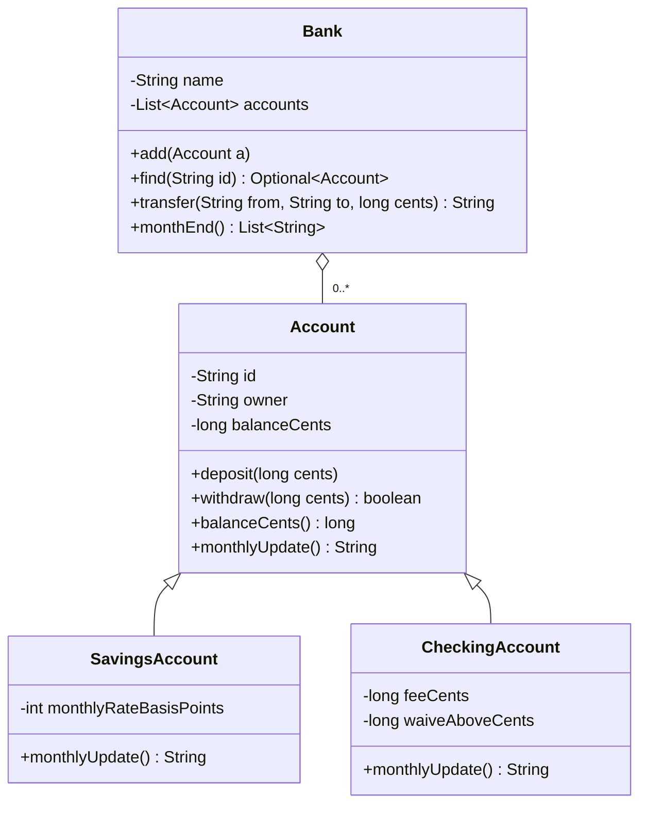
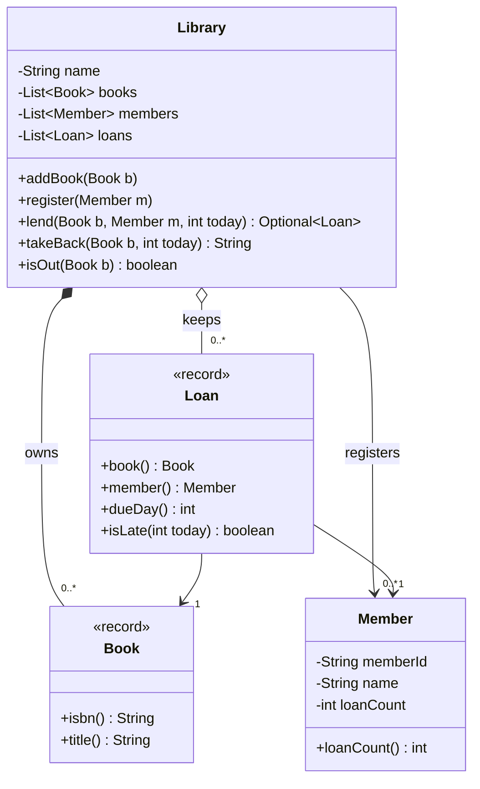

# Chapter 2 — OOP Fundamentals

> **What you will learn in this chapter**
> - What object-oriented programming (OOP) is and why the LLD round is really a test of it.
> - Classes and objects, constructors and constructor chaining, `this`, `static` vs instance members, and `final` (2.2).
> - The four pillars — **encapsulation, abstraction, inheritance, polymorphism** — on one running bank example (2.3–2.6); `super` and overriding rules; overloading vs overriding and dynamic dispatch (2.7).
> - Interfaces (default, static, private methods, functional interfaces) and abstract classes, and when to pick which (2.8–2.9); enums with fields and behaviour (2.10).
> - Composition over inheritance (2.11), identity vs equality (`equals`/`hashCode`, 2.12), immutability and records (2.13), access modifiers and packages (2.14), the generics you need in LLD (2.15), coupling and cohesion (2.16).
> - Object-oriented analysis vs design vs programming (OOA / OOD / OOP), with a four-step process (2.17).
>
> Every concept has a Java 21 example that compiles and runs; listings below show the essential lines, the full files are in `code/lld/ch02/`, and the real output is shown under each program.

**How to run all examples:**
`cd chapters/02-oop-fundamentals/code && javac --release 21 -d /tmp/lld_02 $(find . -name '*.java') && java -cp /tmp/lld_02 lld.ch02.<package>.Main`

(`javac` compiles `.java` source into `.class` files; `java` runs them on the **JVM**, the Java Virtual Machine that executes compiled Java code; `-cp` says where the compiled classes live.)

---

## 2.1 What object-oriented programming is

### What it is

**Object-oriented programming (OOP)** **bundles data with the code allowed to modify it** into one unit, an **object**. **Procedural programming** separates them: data sits in one place and free-standing functions anywhere can change it. OOP **fences the data in**: only the object's own methods reach it. Analogy: a bank vault with a teller (the methods) who checks every request, vs a pile of cash on a table.

### The problem it solves

When any code can change any data, a rule like "a balance never goes negative" must be copied into every caller, and one forgotten copy is a bug. OOP puts each rule in **one place**, next to the data it protects, and lets a design grow by **adding classes** rather than editing old ones.

### Why this matters for the interview

They watch you **break a problem into objects, give each responsibilities and data, and justify it**; every idea here serves that.


*Figure — The four OOP principles and the question each one answers (course diagram)*

| Pillar | Question it answers |
|---|---|
| Encapsulation | Who is allowed to change this data? |
| Abstraction | What does a caller actually need to know? |
| Inheritance | What do these two types already share? |
| Polymorphism | One call, so why do the answers differ? |

**The first two guard a single class; the last two let the design expand with new classes.**

---

## 2.2 Classes, objects, constructors, `this`, `static` and `final`

### What it is

- A **class** is the **blueprint**: the fields a thing has and the operations it supports, written once.
- An **object** (instance) is **one concrete thing built from it**, with actual field values; create as many as needed with `new`. (`Account` is a class; account `S-1`, owner Ada, 50,000 cents, is an object. `Customer` is a class; the shopper behind order 4192 is an object.)
- A **field** is a variable belonging to a class or object; a **method** is a function belonging to one.
- A **constructor** runs when an object is created; it has the class's name and **no return type**, and its job is to put the object into a **valid** state.
- **`this`** refers to **the current object** inside its instance methods and constructors.
- **`static`** = belongs to the **class**, shared by all objects; otherwise a member is an **instance** member (one copy per object).
- **`final`** = cannot change: a `final` variable is assigned once, a `final` method cannot be overridden (replaced by a child class's version), a `final` class cannot be extended (used as a parent; 2.5).

### How it works

1. `new Account("S-1", "Ada", 50_000)` allocates the fields, sets defaults (0, `null` meaning "no object", `false`), then runs the constructor.
2. **Initialisation order:** static initialisers (`static` field assignments and `static { ... }` blocks) run **once**, when the class is initialised (just before first real use: first `new` or first static method call). For each `new`: the parent constructor runs first (`super(...)`, implicit if omitted), then instance field initialisers and instance initialiser blocks (plain `{ ... }`) in source order, then the rest of the constructor body.
3. With **no constructor written**, the compiler adds a public no-argument **default constructor**; with any constructor written, it does not.
4. **Overloaded constructors** (same name, different parameters) should **chain** with `this(...)` to one canonical constructor (the "main" one all others call), so validation lives in one place. In Java 21, `this(...)`/`super(...)` must be the **first statement**. (Java 25 relaxes this with "flexible constructor bodies", JEP 513 — JEPs, JDK Enhancement Proposals, are the numbered documents describing new Java features: statements not using the object under construction may come first. This book targets Java 21, so keep the call first.)
5. `this`: disambiguates field from parameter (`this.id = id`), passes the current object on, chains constructors, enables **fluent chaining** (`return this`).
6. `static` methods have **no `this`** (no direct instance-field access): use them for utilities (`Math.max`) and factories (methods that create and return objects).
7. Class-type variables hold **references** (like an address): `Account alias = a;` makes both names point to the **same** object.

### Java example

```java
// File: code/lld/ch02/classes/Account.java (essentials)
public class Account {
    private static int openedCount = 0;                // static: ONE counter for the class
    public static final long MIN_OPENING_CENTS = 0;
    private final String id;                           // instance fields: one copy per object
    private final String owner;
    private long balanceCents;

    public Account(String id, String owner, long openingCents) {   // canonical: validates once
        if (openingCents < MIN_OPENING_CENTS) throw new IllegalArgumentException("negative opening balance");
        this.id = id;                 // 'this.id' is the field, 'id' is the parameter
        this.owner = owner;
        this.balanceCents = openingCents;
        openedCount++;
    }
    public Account(String id, String owner) { this(id, owner, 0); }   // chains; must be first statement

    public Account deposit(long cents) {               // returns 'this' so calls can be chained
        if (cents <= 0) throw new IllegalArgumentException("deposit must be positive");
        this.balanceCents += cents;
        return this;
    }
    public static int openedCount() { return openedCount; }  // static method: no 'this' here
    @Override public String toString() { return id + "(" + owner + ", " + balanceCents + "c)"; }
}

// File: code/lld/ch02/classes/Main.java
Account a = new Account("S-1", "Ada", 50_000);          // 3-arg constructor
Account b = new Account("C-1", "Kai");                  // 2-arg chains to 3-arg
b.deposit(1_000).deposit(500);                          // chaining via 'return this'
System.out.println("a = " + a);
System.out.println("b = " + b);
System.out.println("accounts opened (static, shared): " + Account.openedCount());
Account alias = a;                                      // copies the REFERENCE, not the object
alias.deposit(1);
System.out.println("after alias.deposit(1), a = " + a + ", same object? " + (alias == a));
try { new Account("X", "Bad", -5); }
catch (IllegalArgumentException e) { System.out.println("constructor refused: " + e.getMessage()); }
System.out.println("accounts opened: " + Account.openedCount() + " (failed construction did not count)");
```

Output:

```
a = S-1(Ada, 50000c)
b = C-1(Kai, 1500c)
accounts opened (static, shared): 2
after alias.deposit(1), a = S-1(Ada, 50001c), same object? true
constructor refused: negative opening balance
accounts opened: 2 (failed construction did not count)
```

`alias == a` is `true`: both hold the same reference. The failing constructor threw **before** incrementing the counter, so no half-built object was counted: **validate first, then change state**.

### Trade-offs

| Choice | Benefit | Cost |
|---|---|---|
| Static members | Shared, no object needed | Global state (reachable from anywhere): hard to test, dangerous with threads (parts of a program running at once) |
| Many constructor overloads | Convenient | Confusing beyond 3–4; use a **Builder** (Chapter 8: collects settings step by step, then creates the object) or static factory methods |
| `final` fields | Safer, thread-friendlier | Must be set in every constructor |

### Common mistakes

- Per-object data in a `static` field (every object shares it).
- Heavy work or overridable calls in constructors (a subclass override may run before the subclass's fields are set).
- Forgetting `this.` so the parameter is assigned to itself (`id = id;`).
- Thinking `=` copies an object; it copies a reference.

**Real-world:** `Math.max`, `Integer.parseInt`, `List.of` are static; `StringBuilder.append` returns `this`; `String` is a `final` class.

### In the interview

**30-second answer:** "A class is the blueprint, an object is an instance with its own state. Constructors put an object into a valid state; I chain overloads with `this(...)` so validation lives once. Static members belong to the class and are shared, so I keep them for constants, utilities and factories and avoid mutable (changeable) static state."

- *"Constructor with arguments only?"* — No default no-arg constructor is generated; `new X()` stops compiling.
- *"Can a static method use `this`?"* — No; there is no current object.
- *"Why avoid mutable static fields?"* — Hidden global state shared by all threads and tests.

### Self-check

- **Q:** Copies of a `static` field for 1,000 objects? **A:** One.
- **Q:** First: parent constructor or child field initialisers? **A:** Parent constructor.
- **Q:** What does `alias == a` compare? **A:** References (same object or not).

### TL;DR

Class = blueprint, object = instance. Constructors create valid objects; chain them with `this(...)`. `static` = one per class; `final` = cannot change. Variables hold references.

---

## 2.3 Encapsulation

### What it is

**Encapsulation**: an object hides its data (**private**) and lets the outside change it **only through methods it defines and guards**. Analogy: a child-proof medicine cap — reachable, but only through a mechanism that enforces the rules.

### The problem it solves


*Figure — The same account data, first open (public fields anyone can write) and then closed (private fields changed only through deposit and withdraw) (course diagram)*

Public fields (left; a contrast only) let **any file** write a negative `balance`, and a rule change has **nowhere central** to go. Private balance + validating `deposit`/`withdraw` (right): **every route to the balance goes through a method that can say no**. (`Account`'s default `monthlyUpdate` does nothing until 2.6.)

### How it works

1. Fields `private` (and `final` where possible).
2. Expose **behaviour** (`deposit`, `withdraw`), not raw setters (`setBalance`, which just overwrite a field).
3. Validate inside those methods: the rule lives **once**.
4. Return copies or unmodifiable views (read-only wrappers that throw on change) of internal collections, never the live list.
5. For every field, settle **which code may modify it**; when the answer is "only this class", say so in the interview — it makes a field list a visible design decision.

The bank `Account` in 2.6 is the example: private `balanceCents`; `deposit` rejects non-positive amounts, `withdraw` amounts above the balance; both `final` so a subclass cannot weaken the rule.

### Trade-offs

| Benefit | Cost |
|---|---|
| Invariants (rules that must always hold) enforced in one place | A little more code than public fields |
| Internals change without breaking callers | Over-encapsulating trivial data carriers is noise (use records) |

**When not (strictly):** plain data carriers with no rules — DTOs (Data Transfer Objects that only carry data between parts of a system), events (records of something that happened) — need no hand-written getters or validation; a **record** gives private final fields and accessors free.

### Common mistakes

- **Getter/setter for every field** (getter = method returning a field; "anemic" objects): technically private, but anyone can set anything. Not encapsulation.
- Returning a mutable internal list (`return items;`), letting callers change your state.

**Real-world:** `String` hides its byte array; `ArrayList` hides its backing array (the plain array storing elements) and `size`; `LocalDate` exposes only validated factories (`LocalDate.of(2026, 2, 30)` throws).

### In the interview

**30-second answer:** "Encapsulation hides state behind methods, and those methods are the single home of every rule about that state. For each field I ask who may change it; if only this class, it is private and changed through intention-revealing methods (named after the business action) like `withdraw`, not a setter."

- *"Are getters and setters encapsulation?"* — Only partly; a rule-free setter is a public field in disguise. Prefer behaviour methods.

**Self-check — Q:** Where should "no negative balance" live? **A:** Inside `Account.withdraw`, once.

### TL;DR

Private data + rule-enforcing methods = encapsulation. Expose behaviour, not setters.

---

## 2.4 Abstraction

### What it is

**Abstraction** gives a caller **just the operations it requires** and conceals **how** they are done. Encapsulation conceals **state**; abstraction conceals **design choices**, so the short list of operations survives a full rewrite behind it. Analogy: steering wheel and pedals — you drive without knowing about fuel injection, and an electric motor can replace the engine without changing how you drive.

### The problem it solves


*Figure — Of Account's seven public operations, Bank relies on three and sees nothing of what lies behind them (course diagram)*

(The diagram's seven include a `label()` helper; our Java `Account` has six: `id`, `owner`, `balanceCents`, `deposit`, `withdraw`, `monthlyUpdate`.) `Bank.transfer` uses `id()`, `withdraw()`, `deposit()` and knows nothing of whole cents, checks or subclasses — the balance could move into a database table and `transfer` would not change.

### How it works

1. Decide the **smallest set of operations** a caller needs.
2. Name them for **what** they do (`transfer`), not how.
3. Put them on an interface (a named list of methods with no code that classes promise to provide; 2.8) or a class's public surface; keep the rest private.
4. Callers depend only on that surface.

### Trade-offs

| Benefit | Cost |
|---|---|
| Simpler callers that survive internal rewrites | A wrong abstraction is expensive to change |
| Enables polymorphism (many implementations behind one surface) | Too many layers are hard to follow |

### Common mistakes

- **Leaky abstraction:** the interface exposes implementation details (`getHashMapOfSeats()`).
- Abstracting before two concrete cases exist.

**Real-world:** `java.util.List` (`ArrayList` or `LinkedList`, callers do not care); JDBC's `Connection`/`Statement` (Java Database Connectivity: same code for different SQL databases); `java.io.InputStream`.

### In the interview

**30-second answer:** "Abstraction is exposing only what the caller needs. My test is the sentence 'the caller does not need to know that': whenever I can honestly say it, something moves behind the interface, the design shrinks, and I can change the implementation freely."

- *"Encapsulation vs abstraction?"* — Encapsulation hides and protects **data** with access control (keywords such as `private` deciding who sees a member, 2.14); abstraction hides **complexity and decisions** behind a small set of operations. They work together.

### TL;DR

Show the minimum surface; hide the how. "The caller does not need to know that."

---

## 2.5 Inheritance

### What it is

**Inheritance** lets a **child** (subclass) start with everything its **parent** (superclass) has, then **add** fields/methods or **replace** (override) methods: `class SavingsAccount extends Account`. A savings account **is a** bank account with one extra rule.

### The problem it solves


*Figure — SavingsAccount and CheckingAccount extend Account; each adds its own data and replaces one method (course diagram)*

Savings earns interest; checking charges a fee unless the balance clears a threshold; balance and its checks come from the parent. Savings adds one field, checking two, **each overrides one method**. Were the is-a sentence false, the difference would be a **field**.

### How it works

1. `class Child extends Parent`: **one** parent class (single inheritance of classes), many interfaces.
2. The child inherits all **accessible** (non-private) members; private fields exist in the object but are reached only via parent methods. **Constructors are not inherited.**
3. The child constructor must call `super(...)` first (implicitly `super()`, which fails to compile if the parent lacks a no-arg constructor).
4. `super.method()` calls the parent's version inside an override (reuse, then extend).
5. **Overriding rules:**

| Rule | Detail |
|---|---|
| Same signature | Same name and parameter types |
| Return type | Same, or a **subtype** (a type that extends or implements it) for reference types (*covariant return*); primitives (`int`, `long`, `boolean`...) must match exactly |
| Access | Same or **wider** (protected — visible to subclasses — → public is fine; public → protected is not) |
| Checked exceptions | Fewer or narrower, never new or broader; unchecked are free. (A **checked exception**, e.g. `IOException`, must be caught or declared; an **unchecked** one, e.g. `IllegalArgumentException`, extends `RuntimeException` and needs no declaration) |
| Cannot override | `final` methods, `static` methods (**hidden**, not overridden), `private` methods (not inherited) |
| Annotation | Always write `@Override` (an annotation is an `@` tag giving the compiler extra information): it catches typos and wrong signatures |

6. Every class ultimately extends `java.lang.Object` — hence `toString`, `equals`, `hashCode`, `getClass` everywhere.
7. **The is-a test:** "a SavingsAccount **is an** Account" must be true in every situation. A car is not an engine, so `Car` **holds** an `Engine` (2.11).

Examples: `SavingsAccount`/`CheckingAccount` in 2.6 (each calls `super(...)` and overrides `monthlyUpdate()`); `Circle` in 2.7 (covariant return, `super.who()`, static-method hiding, field hiding).

### Trade-offs

| Benefit | Cost |
|---|---|
| Reuse of shared state and behaviour | **Tight coupling** (a change in one class forces changes in another): the child depends on parent internals (fragile base class) |
| Enables polymorphism | Hierarchy fixed at compile time (before the code runs); single parent only |
| Natural for true "is-a" families | Deep hierarchies (more than 2–3 levels) are hard to reason about |

**When not:** only to **reuse code** when is-a is false (use composition); when the child would **disable** a parent method (throw `UnsupportedOperationException` or do nothing) — that breaks the **Liskov Substitution Principle** (Chapter 4): the child can no longer stand in for the parent; for variations differing **only in data** (field or enum).

### Common mistakes

- `Square extends Rectangle` with independent `setWidth`/`setHeight`: code expecting a rectangle breaks.
- Forgetting `@Override` and silently **overloading** (`equals(Point p)` instead of `equals(Object o)`).
- Calling overridable methods from a parent constructor.

**Real-world:** good — `FileInputStream extends InputStream`; Spring's (a popular Java application framework) `AbstractController`-style base classes. Known mistakes in the JDK (Java Development Kit: compiler + standard library) itself: `java.util.Stack extends Vector` (a stack, which should only touch its top, exposes random-access `insertElementAt`), and `java.util.Properties extends Hashtable` (allows non-string entries).

### In the interview

**30-second answer:** "Inheritance lets a subclass reuse all of its parent's members, and it is only right when the sentence 'the child is a kind of the parent' holds in every situation. I use it for genuine type families, override with `@Override`, and if a child would have to disable a parent method I switch to composition, because that is a Liskov violation."

- *"Can you override a static method?"* — No. A same-signature static in the child **hides** the parent's; the compile-time type decides which runs (see 2.7 output).
- *"Can an override return a different type?"* — Only a subtype (covariant return), e.g. `Circle copy()` overriding `Shape copy()`.

### Self-check

- **Q:** Is `private` inherited? **A:** The field exists in the child object but the child cannot access it directly; private methods are not overridden.
- **Q:** Can an override narrow `public` to `protected`? **A:** No.

### TL;DR

`extends` for true is-a families only. `super(...)` first, `@Override` always, never narrow access or disable parent behaviour.

---

## 2.6 Polymorphism (and the full bank example)

### What it is

**Polymorphism** ("many forms"): **one method call does different things depending on the object it lands on** — code holds a **parent-type** variable, the concrete object decides. Analogy: one "start" button on a car, a washing machine, a laptop.

### The problem it solves

Without it, code asks "what type are you?" everywhere (`if (a instanceof SavingsAccount) ... else if ...`) and every new type edits every branch.


*Figure — MonthEnd calls monthlyUpdate on every account and never asks which type it holds (course diagram)*

No `if` on type in the loop, so a fourth account type needs no edit.

### How it works

1. Declare the method on the parent type (or interface); 2. each child overrides it; 3. callers hold the **parent type** (`Account a`) and call it; 4. at run time the JVM looks at the **actual class of the object** and runs that version: **dynamic dispatch** (late binding).

### Java example: the bank (all four pillars)



```java
// File: code/lld/ch02/bank/Account.java — ENCAPSULATION (constructor rejects a negative opening balance)
private long balanceCents;                      // hidden: nobody outside can set it to -5
public final void deposit(long cents) {         // final: children may not weaken the rule
    if (cents <= 0) throw new IllegalArgumentException("deposit must be positive");
    balanceCents += cents;
}
public final boolean withdraw(long cents) {
    if (cents <= 0 || cents > balanceCents) return false;   // the one place the rule lives
    balanceCents -= cents;
    return true;
}
public String monthlyUpdate() { return "no change"; }      // default; subclasses OVERRIDE it
// final accessors id(), owner(), balanceCents()

// File: code/lld/ch02/bank/SavingsAccount.java — INHERITANCE
public SavingsAccount(String id, String owner, long openingCents, int monthlyRateBasisPoints) {
    super(id, owner, openingCents);            // parent constructor runs first
    this.monthlyRateBasisPoints = monthlyRateBasisPoints;   // 25 bp = 0.25 %
}
@Override public String monthlyUpdate() {
    long interest = balanceCents() * monthlyRateBasisPoints / 10_000;
    if (interest > 0) deposit(interest);
    return "interest " + Money.format(interest);
}

// File: code/lld/ch02/bank/CheckingAccount.java — fee unless balance above a threshold
@Override public String monthlyUpdate() {
    if (balanceCents() >= waiveAboveCents) return "fee waived";
    return withdraw(feeCents) ? "fee " + Money.format(feeCents) : "fee could not be taken";
}

// File: code/lld/ch02/bank/Bank.java — ABSTRACTION + POLYMORPHISM
public String transfer(String fromId, String toId, long cents) {
    Account from = find(fromId).orElseThrow();
    Account to = find(toId).orElseThrow();
    if (!from.withdraw(cents)) return fromId + " rejected, not enough money";
    to.deposit(cents);
    return "moved " + Money.format(cents) + " from " + fromId + " to " + toId;
}
public List<String> monthEnd() {               // one call, a different result per object, no 'if' on type
    List<String> lines = new ArrayList<>();
    for (Account a : accounts) {
        String what = a.monthlyUpdate();       // dynamic dispatch picks the override
        lines.add(a.id() + " (" + a.owner() + "): " + what + ", balance " + Money.format(a.balanceCents()));
    }
    return lines;
}
// Money.format(cents) -> String.format("$%d.%02d", cents / 100, cents % 100) (utility, private constructor)

// File: code/lld/ch02/bank/Main.java
Bank bank = new Bank("Gurus Bank");
bank.add(new SavingsAccount("S-1", "Ada", 50_000, 25));
bank.add(new CheckingAccount("C-1", "Kai", 8_000, 250, 50_000));
bank.add(new Account("P-1", "Ravi", 3_000));
// prints bank name + each opening balance
System.out.println(bank.transfer("S-1", "C-1", 10_000));
System.out.println(bank.transfer("S-1", "C-1", 90_000));
System.out.println("month end:");
bank.monthEnd().forEach(line -> System.out.println("  " + line));
```

Output:

```
Gurus Bank, opening balances:
  S-1 (Ada): $500.00
  C-1 (Kai): $80.00
  P-1 (Ravi): $30.00
moved $100.00 from S-1 to C-1
S-1 rejected, not enough money
month end:
  S-1 (Ada): interest $1.00, balance $401.00
  C-1 (Kai): fee $2.50, balance $177.50
  P-1 (Ravi): no change, balance $30.00
```

**Explaining each part:**
- **Encapsulation:** the $900 transfer from an account holding $400 is refused inside `withdraw`.
- **Abstraction:** `Bank.transfer` uses only `id()`, `withdraw()`, `deposit()`.
- **Inheritance:** each child calls `super(...)` and adds one or two fields.
- **Polymorphism:** three accounts, one method name, three results — 0.25% of $400 = $1.00; checking's $180 is below the $500 waiver so $2.50 is charged; the plain account uses the parent's "no change". **No `if` asks which is which.**
- **Why `long` cents, not `BigDecimal`:** never `double` for money (it cannot store 0.10 exactly; sums drift). Whole **cents** in a `long` are exact but hold no fraction of a cent: the interest line is integer division and **truncates** (toward zero) — 40,000 cents at 25 **basis points** (1 bp = 0.01%) gives exactly 100, but 40,001 drops a 0.0025-cent remainder. For fractions or explicit rounding (interest, tax, currency conversion) use `BigDecimal` (exact decimal type) with a stated `RoundingMode`, like the `Money` value object (a small object defined only by its values, 2.12) in 2.13.

**Together:** encapsulation and abstraction guard a class; inheritance and polymorphism make **a new requirement an added class**, not surgery. Typical shape: hidden state, a small public API (application programming interface: the methods other code may call), a parent for common parts, subclasses each overriding one method.

### Trade-offs

| Benefit | Cost |
|---|---|
| Removes type switches; open to new types | Behaviour spread over classes; you must know the runtime type to know what runs |
| Enables Strategy, State, Command and most patterns (named reusable designs; Chapters 8–11) | A virtual call (resolved at run time) is marginally slower than a direct call (almost never matters) |

### Common mistakes

- Long `if/else` or `switch` over a type: almost always where polymorphism belongs. **Pointing this out earns more credit than actually refactoring (restructuring without changing behaviour) it.**
- `instanceof` chains as the main dispatch mechanism (fine for occasional data inspection, e.g. Java 21 pattern matching, which tests a type and binds a variable in one step).

**Real-world:** `List.add` in `ArrayList` vs `LinkedList`; `Runnable.run()` under any `Executor` (runs tasks, often on background threads); Spring injecting (handing in) any implementation of an interface; `Comparator.compare` in `Collections.sort`.

### In the interview

**30-second answer:** "Polymorphism lets one call behave differently depending on the object receiving it. I code against the parent type or an interface, each subtype overrides the method, and the JVM picks the right one at run time. It removes type switches, so a new type is a new class, not an edit."

- *"Where in a parking lot?"* — Pricing (`PricingStrategy.feeCents`), payments (`Payment.pay`), spot selection.

**Self-check — Q:** Which `monthlyUpdate` runs for `Account a = new SavingsAccount(...)`? **A:** `SavingsAccount`'s, chosen at run time.

### TL;DR

Hold the parent type, call the method, let the object decide. Type switches signal missing polymorphism.

---

## 2.7 Compile-time vs runtime polymorphism: overloading vs overriding

### What it is

| | **Overloading** (compile-time / static polymorphism) | **Overriding** (runtime / dynamic polymorphism) |
|---|---|---|
| What | Same name, **different parameter lists**, usually same class | Same signature re-implemented in a **subclass** |
| Decided by | The **compiler**, from the **declared (static) types** of the arguments | The **JVM at run time**, from the **actual class** of the receiver |
| Return type | May differ (but cannot be the only difference) | Same or covariant |
| Needs inheritance? | No | Yes (class or interface) |
| Example | `add(int,int)`, `add(double,double)` | `Circle.area()` overriding `Shape.area()` |

### How it works: overload resolution

Three phases; the first phase with a match wins:
1. Exact match or **widening** (automatic conversion to a bigger/more general type: `int` → `long` → `double`, `Circle` → `Shape`); no boxing, no varargs.
2. Allow **boxing/unboxing** (`int` ↔ `Integer`: wrapping a primitive in its object form and back).
3. Allow **varargs** (`int...`: any number of arguments).

Several candidates in a phase → the **most specific** wins; none most specific → compile error (ambiguous call). **Not polymorphic:** fields (resolved by static type; a same-named child field **hides** the parent's), `static` methods (hidden), `private` methods.

### Java example

```java
// File: code/lld/ch02/polymorphism/Calculator.java — OVERLOADS chosen by the compiler
public String add(int a, int b)       { return "add(int,int) = " + (a + b); }
public String add(long a, long b)     { return "add(long,long) = " + (a + b); }
public String add(double a, double b) { return "add(double,double) = " + (a + b); }
public String add(int... xs)          { int s = 0; for (int x : xs) s += x; return "add(int...) = " + s; }
public String greet(Shape s)  { return "greet(Shape)"; }
public String greet(Circle c) { return "greet(Circle)"; }

// File: code/lld/ch02/polymorphism/Shape.java
public class Shape {
    public String kind = "shape";                                // fields are NOT polymorphic
    public double area() { return 0; }
    public Shape copy() { return new Shape(); }
    public static String describe() { return "static Shape.describe"; }   // static: hidden, not overridden
    public String who() { return "I am a " + kind + " with area " + String.format("%.2f", area()); }
}

// File: code/lld/ch02/polymorphism/Circle.java (constructor: super(); this.r = r;)
public class Circle extends Shape {
    public String kind = "circle";                               // HIDES Shape.kind
    private final double r;
    @Override public double area() { return Math.PI * r * r; }  // OVERRIDE
    @Override public Circle copy() { return new Circle(r); }    // covariant return
    public static String describe() { return "static Circle.describe"; }
    @Override public String who() { return super.who() + " (radius " + r + ")"; }
}

// File: code/lld/ch02/polymorphism/Main.java
Calculator calc = new Calculator();
System.out.println(calc.add(2, 3));            // exact match int,int
System.out.println(calc.add(2L, 3));           // widening to long,long
System.out.println(calc.add(2.5, 3));          // widening to double,double
System.out.println(calc.add(1, 2, 3));         // varargs, chosen last
Shape s = new Circle(1.0);                     // static type Shape, runtime type Circle
System.out.println("s.area() -> " + String.format("%.2f", s.area()) + "  (runtime override: dynamic dispatch)");
System.out.println("calc.greet(s) -> " + calc.greet(s) + "  (overload picked at compile time from static type)");
System.out.println("s.kind -> " + s.kind + "  (fields use the static type)");
System.out.println("((Circle) s).kind -> " + ((Circle) s).kind);
System.out.println("Shape.describe() -> " + Shape.describe() + ", Circle.describe() -> " + Circle.describe());
System.out.println("s.copy() class -> " + s.copy().getClass().getSimpleName());
System.out.println(s.who());
double total = 0;
for (Shape sh : List.of(new Shape(), new Circle(2), new Circle(0.5))) total += sh.area();  // one call site
System.out.println("total area = " + String.format("%.2f", total));
if (s instanceof Circle c) System.out.println("pattern-matched a circle: " + c.who());   // Java 16+
```

Output:

```
add(int,int) = 5
add(long,long) = 5
add(double,double) = 5.5
add(int...) = 6
s.area() -> 3.14  (runtime override: dynamic dispatch)
calc.greet(s) -> greet(Shape)  (overload picked at compile time from static type)
s.kind -> shape  (fields use the static type)
((Circle) s).kind -> circle
Shape.describe() -> static Shape.describe, Circle.describe() -> static Circle.describe
s.copy() class -> Circle
I am a shape with area 3.14 (radius 1.0)
total area = 13.35
pattern-matched a circle: I am a shape with area 3.14 (radius 1.0)
```

**Explaining each part:**
- `add(2L, 3)`: no `(long,int)` overload, so `3` widens to `long` (phase 1); `s.area()` runs `Circle.area()` though `s` is declared `Shape` (**dynamic dispatch**).
- `calc.greet(s)` prints `greet(Shape)`: overloads are chosen **at compile time from the declared type** — a favourite interview surprise.
- `s.kind` is `"shape"`: fields are not polymorphic; inside `Shape.who()`, `kind` is `Shape.kind`, hence "I am a shape". Lesson: **never hide fields**; use private fields plus overridable methods.
- `Circle copy()` overrides with a **covariant return type**; `super.who()` reuses the parent's text.
- `s instanceof Circle c` is **pattern matching for instanceof** (Java 16+): test and cast (treat as the more specific type) in one step.

### Common mistakes

- Expecting overloads picked by runtime type (that needs double dispatch — choosing a method by the runtime types of two objects; Visitor pattern, Chapter 11).
- `public boolean equals(Point p)`: an **overload**, not an override of `equals(Object)`, so collections (`List`, `Set`, `Map`) never call it; `@Override` would have caught it.

### In the interview

**30-second answer:** "Overloading is compile-time: same name, different parameters, chosen by declared types. Overriding is runtime: a subclass re-implements the same signature and the JVM dispatches on the actual object. Fields and static methods are not polymorphic."

- *"Why does `greet(s)` call `greet(Shape)`?"* — Overload resolution uses the static type of `s`, `Shape`.

### Self-check

- **Q:** Can two methods differ only in return type? **A:** No; compile error.
- **Q:** Which phase allows varargs? **A:** The third (last).

### TL;DR

Overloading = compiler picks by declared types. Overriding = JVM picks by actual object. Fields and statics never dispatch dynamically.

---

## 2.8 Interfaces (default, static, private methods, functional interfaces)

### What it is

An **interface** is a **contract**: methods a class promises to provide, without (necessarily) saying how (`class EmailNotifier implements Notifier`). Analogy: a wall-socket standard — any plug fits any socket, whoever made them.

- Abstract methods are implicitly `public abstract`; fields implicitly `public static final` (constants).
- A class can **implement many interfaces** (but extend one class).
- **Default methods** (Java 8+): have a body implementers inherit and may override; added so interfaces can evolve without breaking implementers (`Collection.stream()`, `Iterable.forEach`).
- **Static methods** (Java 8+): belong to the interface (`Notifier.console()`), **not inherited** by implementers.
- **Private methods** (Java 9+): helpers for default methods, invisible to implementers.
- A **functional interface** has **exactly one abstract method** (methods from `Object` like `equals`, and default/static methods, do not count), so a **lambda** (a short inline unnamed function, `(to, msg) -> ...`) or **method reference** (a pointer to an existing method, `String::isBlank`) can implement it. `@FunctionalInterface` makes the compiler enforce the rule.

### The problem it solves

Callers depend on **what**, not a concrete class: new implementations need no caller edits (open/closed: open to extension, closed to modification) and tests pass fakes (dependency inversion: depend on interfaces; both Chapter 4). Also safe multiple inheritance (several parents) — of **type**, not state.

### How it works

Smallest method set a caller needs; implement in classes (or a lambda); type variables and parameters by the interface. If two interfaces supply the same default method, the class **must** override it and may pick one with `A.super.method()`; if a superclass declares the method, **the class wins** over interface defaults.

### Java example

```java
// File: code/lld/ch02/interfaces/Notifier.java
public interface Notifier {
    String send(String to, String message);        // abstract: every implementer provides it
    default String sendAll(java.util.List<String> recipients, String message) {   // default (Java 8)
        StringBuilder sb = new StringBuilder();
        for (String r : recipients) sb.append(send(r, clean(message))).append('\n');
        return sb.toString().stripTrailing();
    }
    static Notifier console() { return (to, msg) -> "[console] " + to + ": " + msg; }  // static
    private String clean(String message) { return message.strip(); }                  // private (Java 9+)
}
// EmailNotifier.send returns "[email] to " + to + ": " + message

// File: code/lld/ch02/interfaces/DiscountRule.java
@FunctionalInterface
public interface DiscountRule {
    long apply(long priceCents);
    default DiscountRule then(DiscountRule next) { return p -> next.apply(apply(p)); }
}

// File: code/lld/ch02/interfaces/Report.java — ABSTRACT class: state + constructor + mixed methods
public abstract class Report {
    private final String title;                    // state: interfaces cannot have instance fields
    protected Report(String title) { this.title = title; }
    public final String render() {                 // final skeleton (Template Method)
        return header() + "\n" + body() + "\n-- end of " + title + " --";
    }
    protected String header() { return "== " + title + " =="; }   // concrete, overridable
    protected abstract String body();                              // must be supplied
}
// SalesReport extends Report: super("Sales"); body() returns "total: " + totalCents + " cents"

// File: code/lld/ch02/interfaces/Main.java
Notifier email = new EmailNotifier();
Notifier sms = (to, msg) -> "[sms] " + to + ": " + msg;     // Notifier is functional too
for (Notifier n : List.of(email, sms, Notifier.console())) System.out.println(n.send("ada", "your order shipped"));
System.out.println(email.sendAll(List.of("kai", "ravi"), "  sale starts today  "));
DiscountRule tenPercent = p -> p * 90 / 100;
DiscountRule minusFiveDollars = p -> Math.max(0, p - 500);
System.out.println("10% then -$5 on 10000c = " + tenPercent.then(minusFiveDollars).apply(10_000) + "c");
Predicate<String> blank = String::isBlank;                  // JDK functional interface + method reference
System.out.println("'  ' blank? " + blank.test("  "));
System.out.println(new SalesReport(123_45).render());
```

Output:

```
[email] to ada: your order shipped
[sms] ada: your order shipped
[console] ada: your order shipped
[email] to kai: sale starts today
[email] to ravi: sale starts today
10% then -$5 on 10000c = 8500c
'  ' blank? true
== Sales ==
total: 12345 cents
-- end of Sales --
```

`sms` is a lambda implementing `Notifier`; `sendAll` (default) uses the private helper `clean`; `Notifier.console()` is a static factory. `DiscountRule` is an explicit `@FunctionalInterface` with a default combinator (a method joining two functions into one) `then`, like `Function.andThen`. `Predicate<String>` is one of the JDK's built-in functional interfaces in `java.util.function` (`Function`, `Supplier`, `Consumer`, `Predicate`, `BiFunction`, `UnaryOperator`...). `Report`/`SalesReport` show an **abstract class** (2.9).

### Trade-offs

| Benefit | Cost |
|---|---|
| Loose coupling (classes know little about each other), easy testing, multiple implementations | One more type to read; pointless if only one implementation will ever exist |
| Multiple inheritance of type | Cannot hold instance state |
| Default methods allow evolution | Overused defaults turn interfaces into mini base classes |

**When not:** one implementation, no realistic second, and no test double (fake version for tests) needed = indirection (an extra layer) without benefit; add the interface when the second implementation appears.

### Common mistakes

- **Fat interfaces** forcing empty methods (Interface Segregation, Chapter 4).
- "Constant interfaces" holding only constants (use a final class or enum).

**Real-world:** `Comparable`, `Comparator`, `Runnable`, `Callable`, `Iterable`, `AutoCloseable` (enables try-with-resources, a `try (...)` block that closes files/connections automatically), `List`/`Map`; Spring's `Repository` interfaces; SLF4J's (a logging library) `Logger`.

### In the interview

**30-second answer:** "An interface is a contract of methods. I make services depend on interfaces such as `PaymentGateway` or `PricingStrategy`, so I can add implementations without editing callers and test with fakes. Since Java 8 interfaces can have default and static methods, and an interface with one abstract method is functional, so a lambda can implement it."

- *"Why were default methods added?"* — To add methods to widely implemented interfaces (like `Collection.stream`) without breaking implementations.
- *"Two interfaces, same default method?"* — Compile error until the class overrides it; it can delegate with `X.super.m()`.

**Self-check — Q:** Is `Comparator` functional despite many methods? **A:** Yes; only `compare` is abstract (`equals` comes from `Object`, the rest are default/static).

### TL;DR

Interfaces are contracts; depend on them. Defaults evolve them, statics provide factories/helpers, one abstract method = lambda-friendly.

---

## 2.9 Abstract classes vs interfaces

### What it is

An **abstract class** is marked `abstract` and **cannot be instantiated**; it may hold fields, constructors, finished methods and **abstract methods** (no body) that subclasses must implement. Analogy: a form with some fields pre-printed and some left blank per department.

### How it works

`Report` (2.8) holds state (`title`), has a constructor, a `final` skeleton `render()`, an overridable `header()` and an abstract `body()`; `SalesReport` supplies only `body()`. "Fixed skeleton, variable steps" is the **Template Method** pattern (Chapter 11).

| | Abstract class | Interface |
|---|---|---|
| Instantiable? | No | No |
| Instance fields (state) | Yes | No (only `public static final` constants) |
| Constructors | Yes | No |
| Method bodies | Any | `default`, `static`, `private` only |
| Access modifiers on members | Any | Abstract/default/static are public; helpers can be private |
| How many can a class extend/implement? | **One** | **Many** |
| Relationship expressed | "is a" (shared identity and state) | "can do" (capability / role) |
| Evolution | Add concrete methods freely | Add `default` methods |
| Typical use | Shared state + partial implementation for a close family | Contracts, roles, strategies, test seams (where a test swaps in a fake) |

**Rule of thumb:** start with an **interface** for the contract; add an **abstract class** underneath when implementations share state or a fixed algorithm (JDK: `List` + `AbstractList` skeleton + `ArrayList`). Callers still depend on the interface.

**Common mistakes:** an abstract class just to share one helper (use composition or a static helper); making everything abstract "for flexibility".

### In the interview

**30-second answer:** "Interfaces define capabilities and allow multiple implementation; abstract classes share state and partial implementation but allow only one parent. I default to interfaces and add an abstract base class when implementations share real state or a template algorithm."

### Self-check

- **Q:** Can an abstract class have no abstract methods? **A:** Yes; it just cannot be instantiated.
- **Q:** Can an interface have a constructor? **A:** No.

### TL;DR

Interface = contract, many allowed, no state. Abstract class = partial implementation with state, one allowed. Interface first; abstract base class when sharing real code.

---

## 2.10 Enums with fields and behaviour

### What it is

An **enum** (enumerated type) has a **fixed set of named instances** (`Coin.PENNY`, `OrderStatus.SHIPPED`). In Java it is a full class: **fields, constructors, methods, interfaces**, even a method body per constant. Analogy: coin denominations — no 7-cent coin.

### The problem it solves

String/int constants (`"PAID"`, `2`) allow typos and invalid values and carry no behaviour. Enums are **type-safe** (only valid values compile) and hold each value's data and rules, removing scattered `switch`es — the LLD home for "**different data, not different behaviour**" (spot, vehicle, coin types, statuses).

### How it works

1. Implicitly extends `java.lang.Enum` (cannot extend anything else); can implement interfaces. Constructors are always private; constants are created once at initialisation.
3. Built-ins: `values()`, `valueOf(String)` (throws `IllegalArgumentException` for unknown names), `name()`, `ordinal()` (0-based position; **never persist** it — save to a database or file — since reordering changes it), `compareTo` (by ordinal).
4. Compare with `==` (one instance per constant). 5. Constant-specific bodies (`PAID { ... }`) override an abstract method: a tiny state machine (fixed states + allowed moves) or strategy.
6. `EnumMap` / `EnumSet`: compact, fast enum-keyed collections.
7. A `switch` expression covering every constant is **exhaustive**: no `default`, and a new constant makes the compiler flag missing cases.
8. A single-element enum is the simplest thread-safe, serialization-safe (serialization turns an object into bytes to store or send) **Singleton** (exactly one instance; Chapter 8).

### Java example

```java
// File: code/lld/ch02/enums/Coin.java — FIELD + private constructor + method
public enum Coin {
    PENNY(1), NICKEL(5), DIME(10), QUARTER(25);
    private final int cents;
    Coin(int cents) { this.cents = cents; }
    public int cents() { return cents; }
}

// File: code/lld/ch02/enums/OrderStatus.java — BEHAVIOUR per constant (tiny state machine)
public enum OrderStatus {
    PLACED    { @Override Set<OrderStatus> next() { return Set.of(PAID, CANCELLED); } },
    PAID      { @Override Set<OrderStatus> next() { return Set.of(SHIPPED, CANCELLED); } },
    SHIPPED   { @Override Set<OrderStatus> next() { return Set.of(DELIVERED); } },
    DELIVERED { @Override Set<OrderStatus> next() { return Set.of(); } },
    CANCELLED { @Override Set<OrderStatus> next() { return Set.of(); } };
    abstract Set<OrderStatus> next();
    public boolean canMoveTo(OrderStatus target) { return next().contains(target); }
    public boolean isFinal() { return next().isEmpty(); }
}

// File: code/lld/ch02/enums/Main.java
List<Coin> inserted = List.of(Coin.QUARTER, Coin.QUARTER, Coin.DIME, Coin.PENNY);
int total = inserted.stream().mapToInt(Coin::cents).sum();           // printed with the list
Map<Coin, Integer> counts = new EnumMap<>(Coin.class);               // ordered by declaration
for (Coin c : inserted) counts.merge(c, 1, Integer::sum);            // printed as "counts: ..."
// prints Coin.valueOf("DIME") and Coin.DIME.ordinal()
OrderStatus s = OrderStatus.PLACED;
for (OrderStatus target : List.of(OrderStatus.SHIPPED, OrderStatus.PAID, OrderStatus.SHIPPED, OrderStatus.DELIVERED)) {
    if (s.canMoveTo(target)) { s = target; System.out.println("moved to " + s); }
    else System.out.println("refused " + s + " -> " + target);
}
System.out.println(s + " is final? " + s.isFinal());
String label = switch (s) {                           // exhaustive: no default needed
    case PLACED, PAID -> "in progress";
    case SHIPPED -> "on the way";
    case DELIVERED -> "done";
    case CANCELLED -> "stopped";
};
System.out.println("label: " + label);
```

Output:

```
inserted [QUARTER, QUARTER, DIME, PENNY] = 61 cents
counts: {PENNY=1, DIME=1, QUARTER=2}
valueOf("DIME") = DIME, ordinal 2
refused PLACED -> SHIPPED
moved to PAID
moved to SHIPPED
moved to DELIVERED
DELIVERED is final? true
label: done
```

Summing is `Coin::cents`, no switch; `EnumMap` prints in declaration order; illegal transitions (`PLACED → SHIPPED`) are refused in one method — the "enum plus a guarded method" alternative to the full State pattern that Chapter 1 recommends for small lifecycles.

### Trade-offs

| Benefit | Cost |
|---|---|
| Type-safe, self-documenting, holds data/behaviour | Closed set: a new value means recompiling |
| Great for small state machines and lookup tables | Large per-constant behaviour gets hard to read; move to State/Strategy classes |

**When not:** values **open-ended or user-defined at run time** (admin-created product categories), or each needing substantial independently evolving behaviour (classes).

**Common mistakes:** persisting `ordinal()` (store `name()` or an explicit code field); giant `switch`es over an enum in many places instead of a method on it.

**Real-world:** `java.time.DayOfWeek`, `Month` (with `plus`), `java.util.concurrent.TimeUnit` (`TimeUnit.SECONDS.toMillis(5)`), `java.nio.file.StandardOpenOption`, `Thread.State`.

### In the interview

**30-second answer:** "I use enums for fixed sets like vehicle types, spot types and statuses. Java enums can carry fields and methods, so data like 'which spots fit this vehicle' or 'which statuses can follow this one' lives on the enum rather than in switches around the code."

- *"Enum or class hierarchy for vehicle types?"* — Enum if they differ only in data; classes if they behave differently.

**Self-check — Q:** `Coin.valueOf("dime")`? **A:** Throws `IllegalArgumentException` (names are case-sensitive).

### TL;DR

Enums are type-safe fixed sets carrying data and behaviour: "different data, same behaviour"; compare with `==`; never persist ordinals.

---

## 2.11 Composition over inheritance

### What it is

**Composition** builds a class by **holding references to other objects** and delegating ("has-a") instead of inheriting ("is-a"). **"Favour composition over inheritance"** comes from the Gang of Four book and is core to *Head First Design Patterns*. A phone **has** an upgradable camera module; it is not a kind of camera.

### The problem it solves

Inheritance couples a child to the parent's **internal implementation** (the **fragile base class problem**: a parent change or hidden detail silently breaks the child) and is compile-time and single-parent. Composition keeps classes independent, **swaps parts at run time**, combines behaviours freely.

### How it works

Identify the behaviour to reuse or vary → put it behind an interface (`Engine`, `Set`) → hold it in a private field received via the constructor (replaceable or fakeable) → **forward** (delegate) calls to it, adding your logic around them.

### Java example

```java
// File: code/lld/ch02/composition/InheritingCountingSet.java — BROKEN on purpose
public class InheritingCountingSet<E> extends HashSet<E> {
    @Serial private static final long serialVersionUID = 1L;   // HashSet is Serializable
    private int attempts = 0;
    @Override public boolean add(E e) { attempts++; return super.add(e); }
    @Override public boolean addAll(Collection<? extends E> c) { attempts += c.size(); return super.addAll(c); }
    public int attempts() { return attempts; }
}

// File: code/lld/ch02/composition/CountingSet.java — FIXED: HAS-A Set, works with ANY Set
public class CountingSet<E> {
    private final Set<E> inner;
    private int attempts = 0;
    public CountingSet(Set<E> inner) { this.inner = inner; }
    public boolean add(E e) { attempts++; return inner.add(e); }
    public boolean addAll(Collection<? extends E> c) {
        attempts += c.size();
        boolean changed = false;
        for (E e : c) changed |= inner.add(e);     // talk to the inner set, not to our own add()
        return changed;
    }
    // size() -> inner.size(); attempts()
}

// File: code/lld/ch02/composition/Car.java — a car HAS an Engine (interface: String start())
public class Car {
    private final String model;
    private Engine engine;
    public Car(String model, Engine engine) { this.model = model; this.engine = engine; }
    public void replaceEngine(Engine e) { this.engine = e; }
    public String drive() { return model + ": " + engine.start(); }
}

// File: code/lld/ch02/composition/Main.java
bad.addAll(List.of("a", "b", "c"));                         // bad = new InheritingCountingSet<>()
good.addAll(List.of("a", "b", "c")); good.add("a");          // good = new CountingSet<>(new TreeSet<>())
// prints bad.attempts(), then good.attempts() and good.size()
Car car = new Car("City", () -> "petrol engine vroom");
System.out.println(car.drive());
car.replaceEngine(() -> "electric motor hum");
System.out.println(car.drive());
```

Output:

```
inheritance: added 3, attempts counted = 6
composition: 4 attempts counted = 4, size = 3
City: petrol engine vroom
City: electric motor hum
```

**Why 6:** `HashSet` inherits `addAll` from `AbstractCollection`, which calls `add` per element, and the overridden `add` counts again — the subclass depended on **how the parent uses its own methods internally** ("self-use"), documented only in an `AbstractCollection` implementation note that `HashSet` does not promise to keep, so a future version could silently fix or break the count. `CountingSet` forwards to any `Set` (here a `TreeSet`); `Car`'s engine swaps at run time, which inheritance cannot do.

### Trade-offs

| | Inheritance | Composition |
|---|---|---|
| Relationship | is-a | has-a |
| Coupling | Tight (to parent internals) | Loose (to an interface) |
| Change at run time | No | Yes |
| Boilerplate (repetitive filler code) | Low | Forwarding methods |
| Polymorphism | Built in | Via the interface the parts implement |

**When not:** a **genuine is-a relationship** designed for extension (e.g. an abstract template class meant to be subclassed): inheritance is fine and simpler.

**Common mistakes:** extending a concrete library class (`HashMap`, `ArrayList`) to add a feature; composing but exposing the inner object (`getInner()`), losing control again.

**Real-world:** `java.io.BufferedReader` wraps any `Reader` (Decorator — a wrapper adding behaviour around an object — is composition); `Collections.unmodifiableList` wraps a list; Spring beans (objects the framework creates) composed via dependency injection (the framework hands each object its collaborators); `Comparator` strategies passed into `TreeMap`.

### In the interview

**30-second answer:** "I prefer composition: a class holds an interface-typed collaborator and delegates to it. It avoids the fragile base class problem, lets me swap behaviour at run time, and most patterns such as Strategy, Decorator and State are built on it. I use inheritance only for true is-a relationships."

- *"Show where inheritance breaks."* — The counting set: overriding `add` and `addAll` double counts because the parent's `addAll` calls `add`.

**Self-check — Q:** Why does `CountingSet.addAll` call `inner.add`, not `this.add`? **A:** To avoid double counting and depend only on the inner set's public contract.

### TL;DR

Has-a + delegate beats is-a for reuse. Inheritance only for real, designed-for-extension type families.

---

## 2.12 Object identity vs equality: the `equals`/`hashCode` contract

### What it is

- **Identity:** do two references point at the **same object**? `==`.
- **Equality:** do two objects **represent the same value**? `equals`. `Object.equals` defaults to identity; value classes override it (`String`, `Integer`, `LocalDate`, records).

Two printed copies of a book are **equal**, not **identical**.

### The problem it solves

Hash collections (`HashMap`, `HashSet`) store entries in an array of slots called **buckets**: they compute the object's **hash code** (an `int` derived from its fields), jump straight to one bucket, then compare the few objects there with `equals`. That makes lookups fast — and means equal objects must have equal hash codes, or the search starts in the wrong bucket and objects "disappear" from sets and maps.

### How it works: the contracts

**`equals` must be:** 1. **Reflexive** (`x.equals(x)`); 2. **Symmetric** (`x.equals(y)` ⇔ `y.equals(x)`); 3. **Transitive** (x=y and y=z ⇒ x=z); 4. **Consistent** (same answer while compared fields are unchanged); 5. **Non-null** (`x.equals(null)` is false).

**`hashCode` must:** 1. return the same value on repeated calls in one run if `equals` fields are unchanged; 2. give **equal hash codes for equal objects**; 3. unequal objects **may** collide (allowed, just slower).

**So: override `equals` ⇒ override `hashCode` on the same fields.** Records and IDE generators ("generate equals/hashCode" in a code editor) do this for you.

### Java example

```java
// File: code/lld/ch02/equality/Point.java — equals and hashCode TOGETHER, same fields
@Override public boolean equals(Object o) {
    if (this == o) return true;                          // reflexive fast path
    if (!(o instanceof Point p)) return false;           // also handles null
    return x == p.x && y == p.y;
}
@Override public int hashCode() { return Objects.hash(x, y); }

// File: code/lld/ch02/equality/BrokenPoint.java — WRONG on purpose: equals without hashCode
@SuppressWarnings("overrides")    // javac -Xlint warns [overrides]; silenced ONLY for this demo
public final class BrokenPoint {
    private final int x, y;
    public BrokenPoint(int x, int y) { this.x = x; this.y = y; }
    @Override public boolean equals(Object o) { return o instanceof BrokenPoint p && x == p.x && y == p.y; }
    // hashCode() inherited from Object: usually different for two distinct objects
}

// File: code/lld/ch02/equality/Main.java (abridged)
Point a = new Point(1, 2), b = new Point(1, 2);
// prints a == b, a.equals(b), a.hashCode() == b.hashCode()
Set<Point> good = new HashSet<>(); good.add(a); good.add(b);     // prints size and contains(new Point(1, 2))
BrokenPoint x = new BrokenPoint(1, 2), y = new BrokenPoint(1, 2);
Set<BrokenPoint> bad = new HashSet<>(); bad.add(x);              // prints x.equals(y) and bad.contains(y)
String s1 = "hi", s2 = new String("hi");                         // prints s1 == s2 and s1.equals(s2)
Integer i1 = 1000, i2 = 1000;                                    // prints i1.equals(i2)
```

Output:

```
a == b (identity): false
a.equals(b) (equality): true
hash codes equal: true
HashSet<Point> size after adding a and b: 1, contains (1,2)? true
BrokenPoint equals: true, but set.contains(equal one): false
"hi" == new String("hi"): false, equals: true
Integer 1000 equals: true  (never compare boxed numbers with ==)
```

`BrokenPoint`'s inherited identity-based `hashCode` sends an equal object to a different bucket, so `contains` fails; `javac -Xlint` (extra warnings on) flags it (`[overrides] ... overrides equals, but neither it nor any superclass overrides hashCode`) — treat that warning as an error. Compare strings and boxed numbers with `equals`: `Integer` caches (reuses ready-made objects for) only small values (at least −128 to 127), so `==` works for small values and fails for large ones.

### Design choice

| Kind of class | Equality |
|---|---|
| **Value object** (Money, Point, Coordinate) | Value equality on all fields; ideally immutable |
| **Entity** (User, Order, ParkingSpot) | Identity, or equality by a stable **ID** only |

### Common mistakes

- `equals` without `hashCode` (above); `equals(Point p)` instead of `equals(Object o)` (an overload collections never call).
- **Mutable fields** in `hashCode`, then mutating an object already used as a `HashMap` key (it becomes unfindable).
- Mixing `getClass() !=` and `instanceof` across a hierarchy, breaking symmetry.

**Real-world:** `String`, `Integer`, `BigDecimal` (`new BigDecimal("1.0").equals(new BigDecimal("1.00"))` is false because scale — the number of decimal places — is part of equality; use `compareTo` for numeric comparison), `LocalDate`, `List.equals` (element-wise).

### In the interview

**30-second answer:** "`==` compares identity, `equals` compares logical value. If I override `equals` I must override `hashCode` on the same fields, because hash collections use the hash to find the bucket and `equals` inside it. For value objects I use records; for entities I compare by ID."

- *"Only `equals` overridden?"* — Equal objects can land in different buckets; `HashSet.contains` and `HashMap.get` fail.

### Self-check

- **Q:** Can unequal objects share a hash code? **A:** Yes; a collision, allowed.
- **Q:** Can equal objects have different hash codes? **A:** No; that breaks the contract.

### TL;DR

`==` = same object; `equals` = same value. Override `equals` and `hashCode` together, on the same (preferably immutable) fields.

---

## 2.13 Immutability and records

### What it is

An **immutable** object cannot change after construction; "changes" produce **new** objects. A **record** (Java 16+) concisely declares an immutable **data carrier**: `record Order(String id, List<String> items, Money total) {}`. Analogy: a printed receipt — to correct it, print a new one.

### The problem it solves

Shared mutable objects break when one part changes what another relies on, and need locks across threads. Immutable ones (all fields `final`, `this` not leaked during construction) are **thread-safe without locks**, safe as `HashMap` keys/`HashSet` elements, easy to cache and reason about.

### How it works

**Hand-written immutable class (checklist):**
1. Class `final` (or private constructors + static factories) so no subclass adds mutability.
2. All fields `private final`.
3. No setters; "modifying" methods return a new object (`plus`, `withItem`).
4. **Defensive copies:** copy mutable inputs in the constructor; never hand out internal mutable objects (copies or unmodifiable views).
5. Do not let `this` escape during construction.

**Records** generate `private final` fields per component, a canonical constructor, accessors named after components (`id()`, not `getId()`), and `equals`/`hashCode`/`toString` over all components. They are implicitly `final`, extend `java.lang.Record`, cannot declare extra **instance** fields (static fields and extra methods are fine), and can implement interfaces. A **compact constructor** (`public Order { ... }`) validates or normalises parameters before assignment. **Records are only shallowly immutable:** a mutable `List` component can still change unless copied (`List.copyOf`).

### Java example

```java
// File: code/lld/ch02/immutability/Money.java — hand-written immutable VALUE OBJECT
public final class Money {
    private final BigDecimal amount;
    private final String currency;
    private Money(BigDecimal amount, String currency) {
        this.currency = Objects.requireNonNull(currency);
        // UNNECESSARY = refuse (ArithmeticException) anything finer than a cent instead of silently rounding
        this.amount = amount.setScale(2, RoundingMode.UNNECESSARY);
    }
    public static Money of(String amount, String currency) { return new Money(new BigDecimal(amount), currency); }
    public Money plus(Money other) {
        if (!currency.equals(other.currency)) throw new IllegalArgumentException("currency mismatch");
        return new Money(amount.add(other.amount), currency);   // new object; 'this' untouched
    }
    // equals/hashCode on amount + currency (safe: scale is always 2); toString = amount.toPlainString() + " " + currency
}

// File: code/lld/ch02/immutability/Order.java — a RECORD with a compact constructor
public record Order(String id, List<String> items, Money total) {
    public Order {
        if (id == null || id.isBlank()) throw new IllegalArgumentException("id required");
        items = List.copyOf(items);                 // DEFENSIVE COPY: unmodifiable, caller's list cannot leak in
    }
    public Order withItem(String item, Money price) {  // "wither": returns a modified copy
        var more = new java.util.ArrayList<>(items);
        more.add(item);
        return new Order(id, more, total.plus(price));
    }
}

// File: code/lld/ch02/immutability/Main.java (abridged)
Money five = Money.of("5.00", "USD");
Money seven = five.plus(Money.of("2.00", "USD"));     // prints both; then Money.of("5", "USD").equals(five)
List<String> callerList = new ArrayList<>(List.of("pen"));
Order o1 = new Order("O-1", callerList, five);
callerList.add("SNEAKY");                             // does not reach the record; prints o1
Order o2 = o1.withItem("ink", Money.of("1.50", "USD"));   // prints o2
// prints o1.items() and o1.equals(new Order("O-1", List.of("pen"), Money.of("5.00", "USD")))
try { o1.items().add("hack"); }
catch (UnsupportedOperationException e) { System.out.println("items() is unmodifiable: " + e.getClass().getSimpleName()); }
```

Output:

```
five = 5.00 USD, seven = 7.00 USD  (five unchanged)
Money.of("5") equals Money.of("5.00")? true  (scale normalised)
o1 = Order[id=O-1, items=[pen], total=5.00 USD]
o2 = Order[id=O-1, items=[pen, ink], total=6.50 USD]
o1 still = [pen], equals copy? true
items() is unmodifiable: UnsupportedOperationException
```

**Explaining each part:** `Money.plus` returns a new object; `five` stays 5.00. `BigDecimal` is exact (`double` cannot represent 0.10). **Scale** (decimal places) is fixed at 2 because `BigDecimal.equals` compares scale (2.12); `RoundingMode.UNNECESSARY` throws rather than silently rounding away a fraction of a cent. Private constructor + `Money.of(...)` is the checklist's **static factory** option. `List.copyOf` keeps `"SNEAKY"` out and makes `items()` unmodifiable; records with equal components are `equals`.

### Trade-offs

| Benefit | Cost |
|---|---|
| Thread-safe without locks; safe hash keys; no defensive reasoning | New object per change (usually cheap; can matter in hot loops, code run millions of times) |
| Records remove boilerplate | Records cannot hide their components or extend classes |

**When not:** entities whose identity persists while state changes (a `ParkingSpot` becoming occupied, an `Account` balance) are naturally **mutable**, with encapsulated changes — unless you deliberately adopt event sourcing (state rebuilt from a stored list of past events) or copy-on-write (every change makes a new copy).

**Common mistakes:** forgetting defensive copies (a "final" list whose contents anyone can change); assuming `final` makes the referenced object immutable (it only fixes the reference); records for entities needing controlled mutation.

**Real-world:** `String`, boxed primitives (`Integer`, `Long`), `BigDecimal`, `BigInteger`, all of `java.time` (`LocalDate`, `Instant`, `Duration`), `List.of`/`Map.of`; Kafka (a message-streaming system) messages and event-sourcing events are immutable facts.

### In the interview

**30-second answer:** "For value objects like Money, Coordinate or Ticket I use immutable records: final fields, no setters, validation in the compact constructor, and defensive copies of collections. They are thread-safe and safe as map keys. Entities whose state changes stay mutable but encapsulated."

- *"Is a record fully immutable?"* — Shallowly; copy mutable components.

**Self-check — Q:** What does `final List<String> items` guarantee? **A:** The reference never changes; the contents still can.

### TL;DR

Immutable = final class, private final fields, no setters, defensive copies. Records give this (shallowly) in one line. Value objects immutable; entities mutable but encapsulated.

---

## 2.14 Access modifiers and packages

### What it is

A **package** is a named group of related classes (a namespace and a folder), e.g. `lld.ch02.access.core`. **Access modifiers** control who sees a class or member.

| Modifier | Same class | Same package | Subclass in another package | Everyone |
|---|---|---|---|---|
| `private` | ✔ | ✘ | ✘ | ✘ |
| *(none)* package-private | ✔ | ✔ | ✘ | ✘ |
| `protected` | ✔ | ✔ | ✔ (through inheritance) | ✘ |
| `public` | ✔ | ✔ | ✔ | ✔ |

Top-level classes are only `public` or package-private. (Desk drawer, team room, shared floor, lobby.) They make encapsulation **compiler-enforced**; packages group classes by feature, hiding implementation classes behind a small public API.

### How it works

1. Start everything `private`; widen only when needed.
2. Group by **feature** (`parking`, `payment`), not only by layer.
3. Keep helpers package-private behind a small `public` facade (one simple front class hiding the others).
4. `protected` is for members designed for subclasses — and **also** opens them to the whole package.
5. Since Java 9, **modules** (`module-info.java`) add a level: only exported packages are visible to other modules.

### Java example

```java
// File: code/lld/ch02/access/core/Wallet.java — all four levels on one class
public class Wallet {
    public final String owner;                 // public: everywhere
    protected long bonusCents;                 // protected: same package + subclasses anywhere
    long auditCount;                           // package-private: same package only
    private long balanceCents;                 // private: this class only
    public void add(long cents) {
        if (cents <= 0) throw new IllegalArgumentException("positive only");
        balanceCents += cents;
        AuditLog.record(this, "add " + cents);   // package-private helper class, invisible outside core
    }
    protected String describe() { return owner + " has " + balanceCents + "c (+" + bonusCents + "c bonus)"; }
    // public balanceCents()
}
// core/AuditLog.java: package-private final class; record() does w.auditCount++ and keeps "owner: what" lines
// core/Audits.java: PUBLIC facade — all() returns the lines, countFor(w) returns w.auditCount

// File: code/lld/ch02/access/client/PremiumWallet.java — subclass in ANOTHER package
public class PremiumWallet extends Wallet {
    public void grantBonus(long cents) {
        bonusCents += cents;                    // OK: protected, through inheritance
        // auditCount++;                        // would NOT compile: package-private
        // balanceCents += cents;               // would NOT compile: private
    }
    @Override public String describe() { return "[premium] " + super.describe(); }  // widens protected -> public
}

// File: code/lld/ch02/access/client/Main.java (abridged)
// Ada's Wallet: add(1_000). Kai's PremiumWallet: add(2_000), add(500), grantBonus(300).
// prints basic.owner + basic.balanceCents(), premium.describe(), Audits.all(), Audits.countFor(premium)
// new lld.ch02.access.core.AuditLog();  // would NOT compile: class is package-private
```

Run with `java -cp /tmp/lld_02 lld.ch02.access.client.Main`. Output:

```
public field owner: Ada, public method balance: 1000
[premium] Kai has 2500c (+300c bonus)
audit lines: [Ada: add 1000, Kai: add 2000, Kai: add 500]
audits for Kai: 2
```

Only `core` touches `AuditLog` and `auditCount`; outsiders read audits via the public `Audits` facade. `PremiumWallet` may update `protected bonusCents`, not the package-private or private fields, and its override widens `protected` to `public`, which overriding allows.

### Common mistakes

- Everything `public` "to be safe".
- `protected` fields as a shortcut instead of protected methods (subclasses then break invariants).
- Every class of a machine-coding solution in one package.

### In the interview

**30-second answer:** "Fields are private by default, collaborators within a feature package can be package-private, protected is only for members designed for subclassing, and public is the deliberate API. I organise machine-coding solutions into packages such as model, repository, service and strategy."

**Self-check — Q:** Can a non-subclass in another package read a `protected` field? **A:** No.

### TL;DR

private < package-private < protected < public. Default to private; a small public API per package.

---

## 2.15 Generics basics for LLD

### What it is

**Generics** let a class, interface or method work with **any type while keeping compile-time type safety**: `List<String>` holds only strings; `Repository<String, User>` only users. `T`, `ID`, `E`, `K`, `V` in angle brackets are **type parameters**. (A "SHOES ONLY" box: checked going in, so not coming out.)

### The problem it solves

Without them you store `Object` (root of every class) and cast on every read, failing at run time (`ClassCastException`); with them mistakes are **compile errors** and one `Repository<ID, T>` serves every entity — handy in machine coding.

### How it works

1. **Generic class/interface:** `class Repository<ID, T extends Identifiable<ID>>`.
2. **Bounded type parameter:** `T extends X` — T is X or a subtype, so X's methods can be called on T.
3. **Generic method:** `static <T extends Comparable<? super T>> T max(List<? extends T> items)`.
4. **Wildcards:** `? extends T` (read-only producer), `? super T` (write-capable consumer), `?` (unknown). **PECS**: *Producer Extends, Consumer Super* (from *Effective Java*, Joshua Bloch's Java best-practice book).
5. **Diamond operator:** `new Repository<>()` infers type arguments.
6. **Type erasure:** type arguments exist only at compile time; at run time `List<String>` and `List<Integer>` are one class. Hence no `new T()`, no `instanceof List<String>`, no primitive type arguments (`Integer`, not `int`).
7. **Avoid raw types** (`List` without `<...>`): they switch the checks off.

### Java example

```java
// File: code/lld/ch02/generics/Repository.java — generic in-memory repository; T BOUNDED
public class Repository<ID, T extends Identifiable<ID>> {    // Identifiable<ID> { ID id(); }
    private final Map<ID, T> store = new LinkedHashMap<>();
    public void save(T item)            { store.put(item.id(), item); }
    public Optional<T> findById(ID id)  { return Optional.ofNullable(store.get(id)); }
    public List<T> findAll()            { return List.copyOf(store.values()); }
}
// record User(String id, String name) implements Identifiable<String>
// record Product(Integer id, String title, long priceCents) implements Identifiable<Integer>, Comparable<Product>  (by price)

// File: code/lld/ch02/generics/Main.java
static <T extends Comparable<? super T>> T max(List<? extends T> items) {   // generic METHOD, bounded
    T best = items.get(0);
    for (T t : items) if (t.compareTo(best) > 0) best = t;
    return best;
}
static <T> void copy(List<? extends T> src, List<? super T> dst) { dst.addAll(src); }   // PECS

Repository<String, User> users = new Repository<>();                 // saves u1 Ada, u2 Kai
System.out.println("user u2: " + users.findById("u2").map(User::name).orElse("none"));
System.out.println("user u9: " + users.findById("u9").map(User::name).orElse("none"));
Repository<Integer, Product> products = new Repository<>();          // pen 150, lamp 2_500, mug 800
System.out.println("most expensive: " + max(products.findAll()).title());
List<Integer> ints = List.of(3, 1, 2);
List<Number> numbers = new ArrayList<>();
copy(ints, numbers);                            // Integer list into a Number list
System.out.println("copied into List<Number>: " + numbers + ", max int = " + max(ints));
// users.save(new Product(4, "x", 1));          // would NOT compile
List<String> a = new ArrayList<>();
List<Integer> b = new ArrayList<>();
System.out.println("same runtime class (type erasure)? " + (a.getClass() == b.getClass()));
```

Output:

```
user u2: Kai
user u9: none
most expensive: lamp
copied into List<Number>: [3, 1, 2], max int = 3
same runtime class (type erasure)? true
```

One `Repository` stores `User`s by `String` and `Product`s by `Integer`; `findById` returns `Optional` (a box holding a value or empty, instead of `null`) for a normal "not found". `max` works for any comparable type; `copy` takes `List<Integer>` as producer and `List<Number>` as consumer (PECS); the last line shows erasure.

### Common mistakes

- Raw types and unchecked casts.
- Thinking `List<Integer>` is a subtype of `List<Number>` (it is not; use `List<? extends Number>`).
- Over-generic designs with five unreadable type parameters.

**Real-world:** the Collections framework (`List<E>`, `Map<K,V>`), `Optional<T>`, `CompletableFuture<T>` (a result arriving later from background work), `Comparator<T>`, Spring Data's `CrudRepository<T, ID>` (same idea as our `Repository`).

### In the interview

**30-second answer:** "I use generics for reusable infrastructure like an in-memory `Repository<ID, T>` or an `EventBus<E>`, so type errors are caught at compile time. I know bounded types, wildcards with PECS, and that erasure removes type arguments at run time."

**Self-check — Q:** Why no `new T()`? **A:** Type erasure: the runtime does not know T; pass a `Supplier<T>` instead.

### TL;DR

Generics = type-safe reuse. Bounds let you call methods on T; PECS for wildcards; erasure means no runtime type info.

---

## 2.16 Coupling and cohesion (the yardsticks)

- **Cohesion** — how closely the responsibilities **inside** one class belong together. **High cohesion is good**: every method works on the same data toward one purpose (Chapter 1's "one sentence, no 'and'" test).
- **Coupling** — how much one class **depends on** others' details. **Low coupling is good**: classes talk through small interfaces, so a change does not ripple.

Everything in this chapter pushes toward **high cohesion, low coupling**: encapsulation and access modifiers cut coupling; single-responsibility classes raise cohesion; interfaces and composition decouple callers from implementations. Chapters 4–5 turn these into named principles (SOLID, Law of Demeter, GRASP).

---

## 2.17 Object-oriented analysis and design (OOA / OOD / OOP)

### What it is

**Object-oriented analysis and design (OOAD)** is the long-established method for turning a written description into objects and links between them; most LLD vocabulary comes from it. It has two activities, then implementation:

| Activity | Question it answers | What exists at the end | Talks about |
|---|---|---|---|
| **Analysis (OOA)** | What does the system consist of, and what must it do? | The things in the problem, in **business (domain) terms** | books, members, loans |
| **Design (OOD)** | Which objects, with which responsibilities, provide that behaviour? | Classes, responsibilities, relationships | `Book`, `Member`, `Loan` and who holds whom |
| **Implementation (OOP)** | How do we express it in a language? | Running code | `ArrayList`, `HashMap`, `synchronized` |

A `HashMap` two minutes in means you **skipped the two activities the interviewer wanted to watch**; and operations chosen before the objects settle land on the wrong class, expensive to move.

### How it works: the four steps


*Figure — The four OOAD steps and what exists after each; steps 1–2 are analysis and steps 3–4 are design (course diagram)*

1. **Find the objects** — everything that **stores information or performs work** (mostly nouns). Something carrying a single value (a colour, a date) is a **field**, not an object.
2. **Define the relationships** — for each pair mentioned together: who holds a reference to whom, does it **own** it, **how many** of each? (A library holds many books; a loan points at one book and one member.)
3. **Establish each interface** — here *interface* means the operations an object offers **to other objects**. Everything left off is **private**, so this is where encapsulation is really decided.
4. **Make the design** — classes, fields, operations and relationships in one drawing (a UML class diagram), checked against the original description. The code derives from it.

Steps 1–2 are analysis (what the system is), 3–4 design (how it works). **The order is fixed: each step consumes the previous one's output.**

### Worked example: "library members borrow books; each book on loan must be returned by a due date"


*Figure — The four steps applied to one sentence: Library, Member, Book and the connection object Loan (course diagram)*

**Step 1, objects.** Candidates: member, library, book, date, borrowed book. *Date* is one value → field. That leaves `Library`, `Member`, `Book`, and the borrowed book, better named **`Loan`** — the one most often missed, since the sentence never uses it as a noun.

> **General rule:** if two objects are linked and **the link has data of its own**, model the link as an object. A lent book has a borrower and a due date; neither fits on `Book`, because a shelved book has neither. Also: `Reservation` (hotel), `Ticket` (parking lot), `Enrollment` (student–course).

**Step 2, relationships.** Library **owns** its book records (they disappear with it): **composition**, filled diamond. It **registers** members without owning them (people outlive it): **association** arrow. Each loan **points to** one book and one member, owning neither.

**Step 3, interfaces.** Library: lend, accept a return, report whether a copy is out. Book: title and ISBN (International Standard Book Number). Member: number of loans. Loan: is it overdue. Everything else, all fields included, private. Note **who answers "is this book out?"**: not `Book` (it knows nothing of loans) but `Library`, which keeps the loans.

**Step 4, design.** The figure answers the sentence with no code. Our Java version (adding `register` so members can be checked):



```java
// File: code/lld/ch02/ooad/Loan.java — the CONNECTION OBJECT (data belonging on neither Book nor Member)
public record Loan(Book book, Member member, int dueDay) {
    public boolean isLate(int today) { return today > dueDay; }
}
// Book: record(isbn, title). Member: memberId, name, loanCount; package-private loanStarted()/loanEnded()
// so only Library changes the count.

// File: code/lld/ch02/ooad/Library.java (essentials; addBook/register just add to the lists)
public static final int LOAN_DAYS = 14;
public static final int MAX_LOANS_PER_MEMBER = 5;
public boolean isOut(Book b) { return loans.stream().anyMatch(l -> l.book().equals(b)); }  // only Library knows
public Optional<Loan> lend(Book b, Member m, int today) {
    if (!books.contains(b) || !members.contains(m)) return Optional.empty();
    if (isOut(b) || m.loanCount() >= MAX_LOANS_PER_MEMBER) return Optional.empty();
    Loan loan = new Loan(b, m, today + LOAN_DAYS);
    loans.add(loan);
    m.loanStarted();
    return Optional.of(loan);
}
public String takeBack(Book b, int today) {
    for (Loan l : loans) {
        if (l.book().equals(b)) {
            loans.remove(l);
            l.member().loanEnded();
            return b.title() + " returned " + (l.isLate(today) ? "LATE" : "on time");
        }
    }
    return b.title() + " was not on loan";
}

// File: code/lld/ch02/ooad/Main.java — books ddd "Domain-Driven Design", gof "Design Patterns";
// members ada (M1), kai (M2); all added/registered first
System.out.println("Ada borrows DDD on day 1: " + lib.lend(ddd, ada, 1).map(l -> "due day " + l.dueDay()).orElse("refused"));
System.out.println("Kai borrows DDD on day 2: " + lib.lend(ddd, kai, 2).map(l -> "due day " + l.dueDay()).orElse("refused (already out)"));
System.out.println("Kai borrows GoF on day 2: " + lib.lend(gof, kai, 2).map(l -> "due day " + l.dueDay()).orElse("refused"));
System.out.println("is DDD out? " + lib.isOut(ddd) + ", Ada's loans: " + ada.loanCount());
System.out.println(lib.takeBack(ddd, 10));
System.out.println(lib.takeBack(gof, 20));
System.out.println(lib.takeBack(gof, 21));
System.out.println("is DDD out? " + lib.isOut(ddd));
```

Output:

```
Ada borrows DDD on day 1: due day 15
Kai borrows DDD on day 2: refused (already out)
Kai borrows GoF on day 2: due day 16
is DDD out? true, Ada's loans: 1
Domain-Driven Design returned on time
Design Patterns returned LATE
Design Patterns was not on loan
is DDD out? false
```

Limits became constants; `isOut` lives on `Library`, the only object with the information.

### Why UML

**UML (Unified Modeling Language)** is the standard notation that lets another engineer read a design; it displaced rival notations decades ago because it expresses exactly these OOAD ideas: **filled diamond** = ownership (composition), **plain arrow** = one object referring to another, **+ / −** = public / private. Each symbol records a decision — hence concepts before notation. Chapter 3 teaches UML in full.

### Three ways this goes wrong

1. **Classes named after tables** (`UserRow`, `OrderTable`, `BookData`): a database schema (layout of tables and columns) in OO clothes. A class with only fields and getters should prompt: what does it **do**?
2. **Missing the connection object** (`Loan`, `Reservation`, `Ticket`): `borrower` and `dueDate` drifting onto `Book` is the signal.
3. **Listing every imaginable operation.** Step 3 is what an object provides **to other objects**; long method lists everywhere show no decisions were made.

### In the interview

**30-second answer:** "I separate analysis from design. First I find the objects from the nouns, dropping single values into fields, and define relationships with ownership and multiplicity. Then I decide each object's public operations, which also decides what is private, and draw the class diagram. When the link between two objects has data of its own, like a loan's due date, that link becomes a class."

- *"Where does `isOut(book)` belong?"* — On `Library`, which owns the loans; a `Book` does not know about loans.
- *"Why is `date` not a class?"* — A single value with no behaviour of its own here; a field.

### Self-check

- **Q:** Which OOAD steps are analysis? **A:** Find the objects, define the relationships.
- **Q:** The connection object in a parking lot? **A:** The parking ticket (vehicle + spot + entry time).
- **Q:** When is encapsulation actually decided? **A:** Step 3, listing each object's public operations; everything unlisted is private.

### TL;DR

Analysis = what the system is (objects, relationships). Design = how objects deliver it (interfaces, class diagram). Implementation = code. Connections with data become objects. No `HashMap` in minute two.

---

## Chapter summary: in the interview

**30-second answer** ("Explain the pillars of OOP"):
"Encapsulation hides data and gathers the rules about it into the class that owns it. Abstraction exposes only what callers need. Inheritance lets a child reuse a parent when 'child is a parent' is truly correct. Polymorphism lets one call behave differently per object, which removes type switches. In design I prefer interfaces and composition over deep inheritance, use enums for fixed sets, records for immutable values, and I keep equals and hashCode consistent."

**Common follow-ups** (answered in each section's *In the interview*): abstract class or interface (2.9), overloading vs overriding (2.7), why composition over inheritance (2.11), `hashCode` without `equals` (2.12), how to make a class immutable (2.13).

## Self-check (whole chapter)

- **Q:** Class vs object? **A:** Blueprint vs one instance with real values.
- **Q:** What does `this(...)` do? **A:** Calls another constructor of the same class (constructor chaining).
- **Q:** What is dynamic dispatch? **A:** The JVM choosing an overridden method's implementation from the object's actual class at run time.
- **Q:** Can an interface method have a body? **A:** Yes: default, static and private methods.
- **Q:** Where should "which spot types fit a truck" live? **A:** As data on the `VehicleType` enum.
- **Q:** The hashCode rule in one line? **A:** Equal objects must have equal hash codes.
- **Q:** The OOAD steps? **A:** Find objects, define relationships, establish interfaces, make the design.

## TL;DR

- OOP = data bundled with the only code allowed to modify it.
- Class = blueprint; object = instance. Constructors create valid objects; `this` = current object; `static` = one per class.
- Four pillars: encapsulation (who may change data), abstraction (what callers need), inheritance (true is-a only), polymorphism (one call, many behaviours; kills type switches).
- Overloading is compile-time; overriding is run-time; fields and statics are not polymorphic.
- Interfaces = contracts (default/static/private methods, functional interfaces for lambdas); abstract classes = shared state and templates.
- Enums hold data and behaviour for fixed sets; composition beats inheritance for reuse.
- `==` identity vs `equals` value; override `hashCode` with `equals`.
- Immutable value objects (records + defensive copies); mutable but encapsulated entities.
- Default to `private`; group by feature packages; generics for type-safe reusable infrastructure.
- OOA (what) → OOD (how, with objects) → OOP (code). Connections that carry data become objects.
