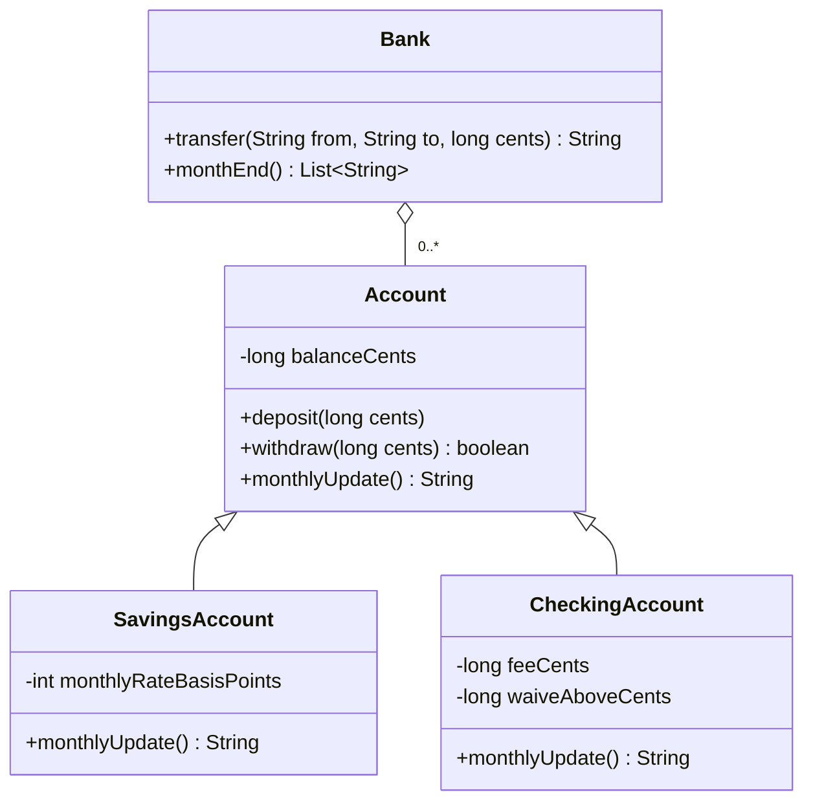
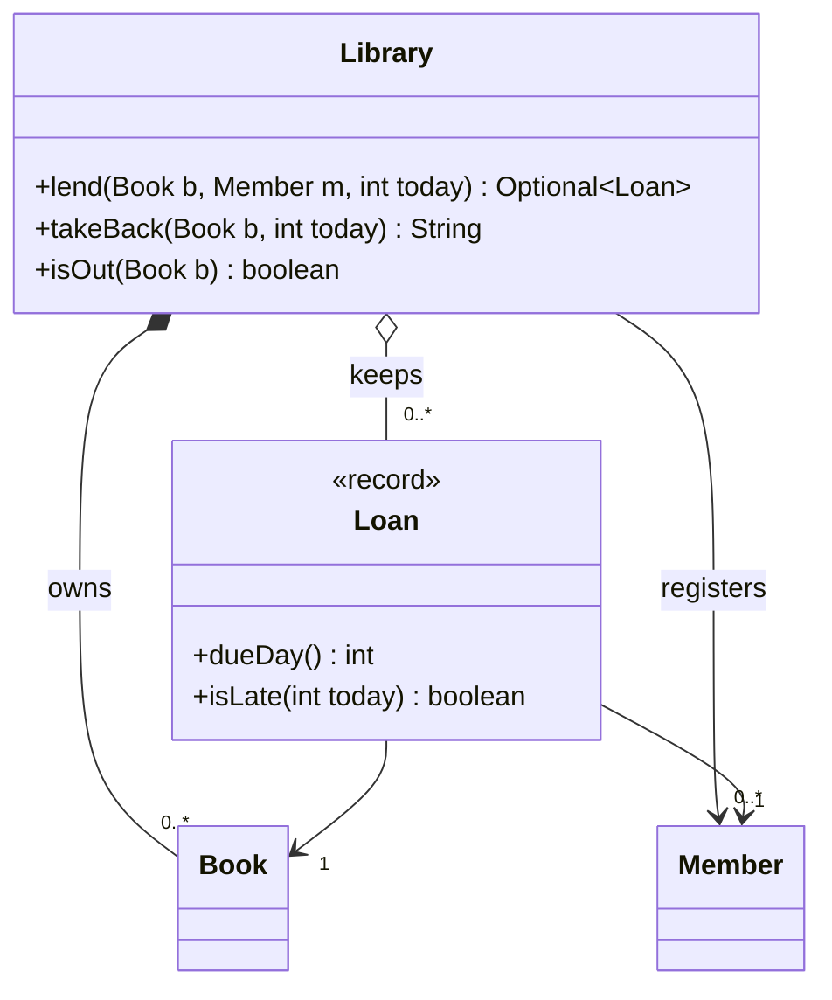

# Chapter 2 — OOP Fundamentals (Study Edition)

> **Study Edition.** Every topic of the full chapter, without the padding. Full programs and outputs are in the Full Edition (`README.md`).
>
> **You will learn:** the class basics, the four pillars on one bank example, and the Java OOP tools LLD relies on (sections 2.2–2.17 map one-to-one to the Full Edition).

**Run all examples:** `cd chapters/02-oop-fundamentals/code && javac --release 21 -d /tmp/lld_02 $(find . -name '*.java') && java -cp /tmp/lld_02 lld.ch02.<package>.Main`

---

## 2.1 What object-oriented programming is

### What it is

**OOP bundles data with the only code allowed to modify it** (an **object**). Procedural code keeps data apart, so any function can change it. Analogy: cash on a table vs a vault with a teller (the methods) who checks every request.

### The problem it solves

A rule like "balance never negative" lives **once**, next to its data, instead of in every caller; designs grow by **adding classes**.

### Why this matters for the interview

LLD tests **splitting a problem into objects, giving each responsibilities and data, and justifying it**.


*Figure — The four OOP principles and the question each one answers (course diagram)*

| Pillar | Question it answers |
|---|---|
| Encapsulation | Who may change this data? |
| Abstraction | What does a caller need to know? |
| Inheritance | What do these types share? |
| Polymorphism | One call, why do answers differ? |

**The first two guard one class; the last two let the design grow with new classes.**

---

## 2.2 Classes, objects, constructors, `this`, `static` and `final`

### What it is

**Class** = blueprint; **object** = one instance made with `new`. **Constructor** = named like the class, **no return type**, makes the object **valid**. **`this`** = current object. **`static`** = one per class, shared (else per-object **instance** members). **`final`** = variable set once / method not overridable / class not extendable.

### How it works

1. `new` sets fields to defaults (0, `null`, `false`), then runs the constructor.
2. **Order:** static initialisers run **once** at first use; per `new`: parent constructor (`super(...)`) → instance initialisers in source order → constructor body.
3. No constructor written → compiler adds a public no-arg **default constructor**; write any → it doesn't.
4. **Chain** overloads to one canonical constructor with `this(...)` so validation lives once; in Java 21 it must be the **first statement** (Java 25, JEP 513, relaxes this).
5. `this`: disambiguate (`this.id = id`), pass self, chain, `return this` for **fluent** calls.
6. `static` methods have **no `this`**: utilities and factories.
7. Variables hold **references**: `Account alias = a;` is the **same** object.

### Java example

```java
// File: code/lld/ch02/classes/Account.java
public class Account {
    // static = belongs to the CLASS, shared by all objects
    private static int openedCount = 0;
    // ... MIN_OPENING_CENTS constant, final id/owner, balanceCents

    public Account(String id, String owner, long openingCents) {
        if (openingCents < MIN_OPENING_CENTS) throw new IllegalArgumentException("negative opening balance");
        this.id = id;                 // 'this.id' is the field, 'id' is the parameter
        this.owner = owner;
        this.balanceCents = openingCents;
        openedCount++;                // shared counter
    }

    public Account(String id, String owner) {
        this(id, owner, 0);
    }

    public Account deposit(long cents) {   // returns 'this' so calls can be chained
        if (cents <= 0) throw new IllegalArgumentException("deposit must be positive");
        this.balanceCents += cents;
        return this;
    }
    // ... accessors, static openedCount(), toString
}
```

Full runnable code: code/lld/ch02/classes/ (see the Full Edition).

A refused `new Account("X", "Bad", -5)` leaves the counter unchanged: **validate first, then change state**.

### Trade-offs

Static members are shared but are global state (hard to test, thread-risky). Many constructor overloads confuse past 3–4 (use a Builder or static factories). `final` fields are safer but must be set in every constructor.

### Common mistakes

Per-object data in a `static` field; heavy work or overridable calls in constructors; `id = id;`; thinking `=` copies an object.

### Real-world examples

`Math.max` (static); `StringBuilder.append` returns `this`; `String` is `final`.

### In the interview

**30-second answer:** "A class is the blueprint, an object an instance with its own state. Constructors create valid objects; I chain overloads with `this(...)`. Static members are shared, so I keep them for constants, utilities and factories, never mutable state."

### Self-check

- **Q:** Copies of a `static` field for 1,000 objects? **A:** One.
- **Q:** Parent constructor or child initialisers first? **A:** Parent constructor.

### TL;DR

Class = blueprint, object = instance; chain with `this(...)`; `static` = per class; variables hold references.

---

## 2.3 Encapsulation

### What it is

Hide data (**private**) and allow change **only through guarded methods**. Analogy: a child-proof cap.

### The problem it solves


*Figure — The same account data, first open (public fields anyone can write) and then closed (private fields changed only through deposit and withdraw) (course diagram)*

With a private balance, **every route to the data passes a method that can say no**; public fields leave no central place for the rule.

### How it works

Fields `private` (and `final`); expose **behaviour** (`withdraw`), not setters; validate there, **once**; return copies/unmodifiable views of collections; decide **who may modify each field** and say it.

### Java example

`Account` in §2.6: private balance, `final deposit`/`withdraw`.

### Trade-offs · When not to use it (strictly)

Rules in one place and freely changeable internals, for a little more code. Rule-free data carriers (DTOs, events): use a **record**.

### Common mistakes

**Getter + setter for every field** (anemic, private in name only); returning the live internal list.

### Real-world examples

`String`, `ArrayList`; `LocalDate.of(2026, 2, 30)` throws.

### In the interview

**30-second answer:** "State hides behind methods that hold every rule about it. If only this class may change a field, it's private and changed through `withdraw`-style methods, not setters." A rule-free setter is a public field in disguise.

### Self-check

- **Q:** Where does "no negative balance" live? **A:** In `Account.withdraw`, once.

### TL;DR

Private data + rule-enforcing methods; behaviour, not setters.

---

## 2.4 Abstraction

### What it is

Give callers **only the operations they need**, hide **how**. Encapsulation hides **state**; abstraction hides **decisions**. Analogy: pedals work the same for petrol or electric.

### The problem it solves


*Figure — Of Account's seven public operations, Bank relies on three and sees nothing of what lies behind them (course diagram)*

`Bank.transfer` uses only `id()`, `withdraw()`, `deposit()` (our Java `Account` has six public operations, the diagram seven). It doesn't know about cents or subclasses, so storage could move to a database untouched.

### How it works

Smallest set of operations, named by **what** they do, on an interface/public surface; callers depend only on it.

### Java example

`Bank.transfer` in §2.6.

### Trade-offs

Simpler callers, enables polymorphism; a wrong abstraction is costly, too many layers confuse.

### Common mistakes

**Leaky** abstractions (`getHashMapOfSeats()`); abstracting before two concrete cases.

### Real-world examples

`List`, JDBC `Connection`, `InputStream`.

### In the interview

**30-second answer:** "Expose only what callers need; whenever 'the caller doesn't need to know that' is true, it moves behind the interface." Encapsulation protects **data**; abstraction hides **complexity**.

### Self-check

- **Q:** What does `transfer` need from `Account`? **A:** `id()`, `withdraw()`, `deposit()`.

### TL;DR

Minimum surface, hidden how.

---

## 2.5 Inheritance

### What it is

A **child** gets everything its **parent** has, then **adds** or **overrides**: `class SavingsAccount extends Account` (a savings account **is an** account).

### The problem it solves


*Figure — SavingsAccount and CheckingAccount extend Account; each adds its own data and replaces one method (course diagram)*

Both children share the parent's balance and rules, add 1–2 fields and **override one method**. If is-a were false, the difference would be a **field**.

### How it works

1. **One** parent class, many interfaces. **Constructors are not inherited**; private fields exist but are reached via parent methods.
2. Child constructor calls `super(...)` first (implicit `super()` fails if the parent lacks a no-arg constructor). `super.method()` reuses the parent's code.
3. **Overriding rules:**

| Rule | Detail |
|---|---|
| Signature | Same name and parameter types |
| Return type | Same or a **subtype** (*covariant*); primitives exact |
| Access | Same or **wider** only |
| Checked exceptions | Fewer/narrower only |
| Cannot override | `final`; `static` (**hidden**); `private` |
| Annotation | Always `@Override` |

4. Every class extends `Object` (`toString`, `equals`, `hashCode`, `getClass`). The **is-a test** must hold always.

### Java example

`SavingsAccount`/`CheckingAccount` (§2.6); `Circle` (§2.7).

### Trade-offs

Reuse and polymorphism for true families; but **tight coupling** to parent internals (fragile base class), compile-time fixed, single parent, hard past 2–3 levels.

### When not to use it

Code reuse without is-a (use composition); a child that must **disable** a parent method (breaks **Liskov**, Chapter 4); data-only differences (field/enum).

### Common mistakes

`Square extends Rectangle` with independent setters; missing `@Override` (accidental overload); overridable calls in parent constructors.

### Real-world examples

Good: `FileInputStream extends InputStream`. JDK mistakes: `Stack extends Vector`, `Properties extends Hashtable`.

### In the interview

**30-second answer:** "Inheritance is right only when 'child is a kind of parent' always holds. I use `@Override`, and if a child must disable a parent method I switch to composition, since that breaks Liskov."

- *"Override a static method?"* — No, it's **hidden** (chosen by compile-time type).

### Self-check

- **Q:** Override from `public` to `protected`? **A:** No.

### TL;DR

True is-a only; `super(...)` first, `@Override` always.

---

## 2.6 Polymorphism (and the full bank example)

### What it is

**One call, different behaviour per receiving object.** Code holds the **parent type**; the actual object decides. Analogy: one "start" button on a car, washer, laptop.

### The problem it solves

Removes `if (a instanceof SavingsAccount) ... else if ...` chains that every new type must edit.


*Figure — MonthEnd calls monthlyUpdate on every account and never asks which type it holds (course diagram)*

The month-end loop has **no type `if`**; a fourth account type needs no edit.

### How it works

Declare on the parent/interface → children override → callers hold the parent type → the JVM runs the **actual class's** version: **dynamic dispatch** (late binding).

### Java example: the bank (encapsulation + abstraction + inheritance + polymorphism)



```java
// File: code/lld/ch02/bank/Account.java
public class Account {
    private long balanceCents;                      // hidden: nobody outside can set it to -5
    // ... id, owner, constructor

    public final boolean withdraw(long cents) {
        if (cents <= 0 || cents > balanceCents) return false;   // the one place the rule lives
        balanceCents -= cents;
        return true;
    }
    // ... final deposit() and accessors

    public String monthlyUpdate() { return "no change"; }
}
```

```java
// File: code/lld/ch02/bank/SavingsAccount.java
    @Override
    public String monthlyUpdate() {
        long interest = balanceCents() * monthlyRateBasisPoints / 10_000;
        if (interest > 0) deposit(interest);
        return "interest " + Money.format(interest);
    }
```

```java
// File: code/lld/ch02/bank/Bank.java
    public List<String> monthEnd() {
        List<String> lines = new ArrayList<>();
        for (Account a : accounts) {
            String what = a.monthlyUpdate();                 // dynamic dispatch picks the override
            lines.add(a.id() + " (" + a.owner() + "): " + what + ", balance " + Money.format(a.balanceCents()));
        }
        return lines;
    }
```

Full runnable code: code/lld/ch02/bank/ (see the Full Edition).

```
S-1 rejected, not enough money
month end:
  S-1 (Ada): interest $1.00, balance $401.00
  C-1 (Kai): fee $2.50, balance $177.50
  P-1 (Ravi): no change, balance $30.00
```

- The $900 transfer is refused inside `withdraw` (encapsulation); `CheckingAccount` waives its fee above a threshold; one call gives three results with no type `if` (polymorphism).
- **Why `long` cents:** exact, unlike `double`, but integer division **truncates** fractions of a cent. For interest/tax use `BigDecimal` with a `RoundingMode` (§2.13). 1 basis point = 0.01%.

### How the four fit together

Encapsulation + abstraction decide **what is hidden**; inheritance + polymorphism make **new requirements into added classes**.

### Trade-offs

Kills type switches and underpins most patterns; but behaviour spreads across classes (virtual-call cost rarely matters).

### Common mistakes

Type `switch`/`if` chains (**pointing it out earns more credit than refactoring**); `instanceof` chains as the main dispatch.

### Real-world examples

`List.add` on `ArrayList` vs `LinkedList`; `Comparator.compare`.

### In the interview

**30-second answer:** "I code against the parent type or interface, each subtype overrides, and the JVM picks at run time, so a new type is a new class, not an edit." In a parking lot: pricing, payments, spot selection.

### Self-check

- **Q:** `Account a = new SavingsAccount(...)`: whose `monthlyUpdate`? **A:** `SavingsAccount`'s, at run time.

### TL;DR

Hold the parent type, let the object decide; type switches signal missing polymorphism.

---

## 2.7 Compile-time vs runtime polymorphism: overloading vs overriding

### What it is

| | **Overloading** (compile-time) | **Overriding** (runtime) |
|---|---|---|
| What | Same name, **different parameters** | Same signature in a **subclass** |
| Chosen by | **Compiler**, from **declared** argument types | **JVM**, from the receiver's **actual class** |
| Return type | May differ (not alone) | Same or covariant |
| Inheritance? | No | Yes |

### How it works: overload resolution

Phases, first match wins: (1) exact or **widening** (`int` → `long` → `double`, `Circle` → `Shape`); (2) **boxing**; (3) **varargs**. Ties → **most specific**, else ambiguous error. **Not polymorphic:** fields (**hidden**), `static` and `private` methods.

### Java example

```java
// File: code/lld/ch02/polymorphism/Calculator.java
    public String add(int a, int b)       { return "add(int,int) = " + (a + b); }
    public String add(long a, long b)     { return "add(long,long) = " + (a + b); }
    // ... add(double,double), add(int...)
    public String greet(Shape s)  { return "greet(Shape)"; }
    public String greet(Circle c) { return "greet(Circle)"; }
```

```java
// File: code/lld/ch02/polymorphism/Circle.java
public class Circle extends Shape {
    public String kind = "circle";                               // HIDES Shape.kind, does not override it
    // ...
    @Override public double area() { return Math.PI * r * r; }  // OVERRIDE: same signature

    @Override public Circle copy() { return new Circle(r); }    // covariant return type is allowed
    // ... static describe() (hidden), who() calls super.who()
}
```

Full runnable code: code/lld/ch02/polymorphism/ (see the Full Edition).

With `Shape s = new Circle(1.0)`: `calc.add(2L, 3)` → `add(long,long)` (widening); `s.area()` → 3.14 (dispatch); `calc.greet(s)` → **`greet(Shape)`** (overloads use the declared type: a favourite question); `s.kind` → `shape` (**never hide fields**); `s.copy()` is a `Circle`. `s instanceof Circle c` is pattern matching (Java 16+).

### Common mistakes

Expecting overloads to follow runtime type (needs double dispatch: Visitor, Chapter 11); `equals(Point p)` overload.

### In the interview

**30-second answer:** "Overloading is compile-time, chosen by declared types; overriding is runtime, dispatched on the actual object. Fields and statics aren't polymorphic."

### Self-check

- **Q:** Differ only in return type? **A:** Compile error. **Q:** Varargs phase? **A:** Last.

### TL;DR

Overloading = compiler, declared types; overriding = JVM, actual object.

---

## 2.8 Interfaces (default, static, private methods, functional interfaces)

### What it is

A **contract**: methods a class promises. Analogy: a socket standard. Abstract methods are `public abstract`, fields `public static final`; a class **implements many**. **Default** (Java 8) bodies let interfaces evolve (`Collection.stream()`); **static** (Java 8) belong to the interface, not inherited; **private** (Java 9) help defaults. A **functional interface** has **exactly one abstract method** (Object/default/static don't count) → a **lambda** can implement it; `@FunctionalInterface` enforces it.

### The problem it solves

Callers depend on **what**, not a class: add implementations without edits, test with fakes, multiple inheritance of **type** (not state).

### How it works

Smallest method set; implement via classes or lambdas; callers use the interface type. Same default in two interfaces → class **must** override (may call `A.super.m()`); a superclass method **wins** over defaults.

### Java example

```java
// File: code/lld/ch02/interfaces/Notifier.java
public interface Notifier {
    String send(String to, String message);        // abstract method: every implementer must provide it

    default String sendAll(java.util.List<String> recipients, String message) {
        StringBuilder sb = new StringBuilder();
        for (String r : recipients) sb.append(send(r, clean(message))).append('\n');
        return sb.toString().stripTrailing();
    }

    static Notifier console() { return (to, msg) -> "[console] " + to + ": " + msg; }

    private String clean(String message) { return message.strip(); }
}
```

Full runnable code: code/lld/ch02/interfaces/ (see the Full Edition).

`EmailNotifier` and a lambda both implement `Notifier`; `DiscountRule` is an `@FunctionalInterface` with a default `then` combinator. JDK ones: `Function`, `Supplier`, `Consumer`, `Predicate`.

### Trade-offs

Loose coupling, testability, evolvable; but an extra type, no state, and overused defaults become mini base classes.

### When not to use it

One implementation, no realistic second, no test double.

### Common mistakes

**Fat interfaces** (ISP); constant-only interfaces.

### Real-world examples

`Comparable`, `Runnable`, `AutoCloseable`, Spring `Repository`.

### In the interview

**30-second answer:** "Services depend on interfaces like `PaymentGateway` so implementations can be added and faked. Interfaces have default and static methods; one abstract method makes them lambda-friendly." Defaults exist to add methods like `stream` without breaking implementers.

### Self-check

- **Q:** Is `Comparator` functional? **A:** Yes; only `compare` is abstract.

### TL;DR

Depend on contracts; defaults evolve, statics are factories, one abstract method = lambda.

---

## 2.9 Abstract classes vs interfaces

### What it is

An **abstract class** can't be instantiated; it may hold fields, constructors, finished and **abstract** methods. Analogy: a partly pre-printed form.

### How it works

```java
// File: code/lld/ch02/interfaces/Report.java
public abstract class Report {
    private final String title;                    // state: interfaces cannot have instance fields

    protected Report(String title) { this.title = title; }

    public final String render() {                 // final: subclasses cannot change the skeleton
        return header() + "\n" + body() + "\n-- end of " + title + " --";
    }

    protected String header() { return "== " + title + " =="; }   // concrete, overridable
    protected abstract String body();                              // must be supplied
}
```

`SalesReport` supplies only `body()`: **Template Method** (Chapter 11).

| | Abstract class | Interface |
|---|---|---|
| State / constructors | Yes | Constants only / no |
| Bodies | Any | `default`, `static`, `private` |
| Per class | **One** | **Many** |
| Expresses | "is a" | "can do" |
| Use | Shared state + partial implementation | Contracts, roles, strategies, test seams |

### Rule of thumb

Interface for the contract; abstract class beneath when implementations share state or an algorithm (`List` + `AbstractList` + `ArrayList`).

### Common mistakes

Abstract class to share one helper; everything abstract "for flexibility".

### In the interview

**30-second answer:** "Interfaces define capabilities and allow many; abstract classes share state and partial implementation, one parent. Interface first; abstract base for real shared state or a template."

### Self-check

- **Q:** Abstract class without abstract methods? **A:** Allowed. **Q:** Interface constructor? **A:** No.

### TL;DR

Interface = contract, many, stateless; abstract class = partial implementation, one.

---

## 2.10 Enums with fields and behaviour

### What it is

A **fixed set of named instances**; in Java a full class with **fields, constructors, methods, interfaces**, even per-constant bodies.

### The problem it solves

String/int constants allow typos and carry no behaviour. Enums are **type-safe** and hold each value's data and rules, removing switches: LLD's home for "**different data, not behaviour**".

### How it works

Implicitly extend `Enum`; private constructors; `values()`, `valueOf` (throws on unknown), `name()`, `ordinal()` (**never persist**); compare with `==`; per-constant bodies make tiny state machines; `EnumMap`/`EnumSet`; exhaustive `switch` needs no `default`; a one-element enum is the simplest safe **Singleton**.

### Java example

```java
// File: code/lld/ch02/enums/OrderStatus.java
public enum OrderStatus {
    PLACED    { @Override Set<OrderStatus> next() { return Set.of(PAID, CANCELLED); } },
    PAID      { @Override Set<OrderStatus> next() { return Set.of(SHIPPED, CANCELLED); } },
    SHIPPED   { @Override Set<OrderStatus> next() { return Set.of(DELIVERED); } },
    DELIVERED { @Override Set<OrderStatus> next() { return Set.of(); } },
    CANCELLED { @Override Set<OrderStatus> next() { return Set.of(); } };

    abstract Set<OrderStatus> next();          // constant-specific method bodies

    public boolean canMoveTo(OrderStatus target) { return next().contains(target); }
    // ... isFinal()
}
```

Full runnable code: code/lld/ch02/enums/ (see the Full Edition).

`Coin` carries `cents` as a field (`PENNY(1) ... QUARTER(25)`), so summing needs no switch. `OrderStatus` refuses `PLACED -> SHIPPED`: the "**enum + guarded method**" alternative to the State pattern.

### Trade-offs

Type-safe, data + behaviour; but closed (recompile to add), and large per-constant logic belongs in State/Strategy classes.

### When not to use it

Values created at run time, or needing big independent behaviour.

### Common mistakes

Persisting `ordinal()`; switches over the enum instead of methods on it.

### Real-world examples

`DayOfWeek`, `TimeUnit.SECONDS.toMillis(5)`, `Thread.State`.

### In the interview

**30-second answer:** "Enums model fixed sets like vehicle types and statuses, carrying data like 'which spots fit' or 'which status may follow'." Enum if only data differs; classes if behaviour does.

### Self-check

- **Q:** `Coin.valueOf("dime")`? **A:** `IllegalArgumentException` (case-sensitive).

### TL;DR

Type-safe fixed sets with data and behaviour; `==`; no persisted ordinals.

---

## 2.11 Composition over inheritance

### What it is

**Hold** other objects and **delegate** ("has-a") instead of inheriting ("is-a"); GoF's "favour composition over inheritance". Analogy: a phone **has** an upgradable camera module.

### The problem it solves

Inheritance ties the child to the parent's **internals** (**fragile base class**), fixed at compile time. Composition stays independent and **swappable at run time**.

### How it works

Put the behaviour behind an interface → hold it in a private field from the constructor → **forward** calls, adding your logic.

### Java example

```java
// File: code/lld/ch02/composition/InheritingCountingSet.java
    @Override public boolean add(E e) { attempts++; return super.add(e); }

    @Override public boolean addAll(Collection<? extends E> c) { attempts += c.size(); return super.addAll(c); }
```

```java
// File: code/lld/ch02/composition/CountingSet.java
public class CountingSet<E> {
    private final Set<E> inner;
    // ...
    public boolean addAll(Collection<? extends E> c) {
        attempts += c.size();
        boolean changed = false;
        for (E e : c) changed |= inner.add(e);     // talk to the inner set, not to our own add()
        return changed;
    }
}
```

Full runnable code: code/lld/ch02/composition/ (see the Full Edition).

```
inheritance: added 3, attempts counted = 6
composition: 4 attempts counted = 4, size = 3
```

`HashSet.addAll` calls `add` per element (parent **self-use**, not promised), so the subclass double counts. `CountingSet` works with any `Set`. `Car` **has an** `Engine`, swapped at run time.

### Trade-offs

| | Inheritance | Composition |
|---|---|---|
| Relationship / coupling | is-a / tight | has-a / loose |
| Run-time change | No | Yes |
| Boilerplate | Low | Forwarding methods |

### When not to use it

A genuine is-a class **designed for extension** is fine to extend.

### Common mistakes

Extending concrete library classes (`HashMap`); exposing the inner object (`getInner()`).

### Real-world examples

`BufferedReader` wraps a `Reader`; Spring DI; `Comparator` in `TreeMap`.

### In the interview

**30-second answer:** "I hold an interface-typed collaborator and delegate: no fragile base class, run-time swapping, and it underlies Strategy, Decorator, State. Inheritance only for true is-a." Example of breakage: the counting set.

### Self-check

- **Q:** Why `inner.add`, not `this.add`? **A:** No double counting; relies only on the public contract.

### TL;DR

Has-a + delegate beats is-a for reuse.

---

## 2.12 Object identity vs equality: the `equals`/`hashCode` contract

### What it is

**Identity** `==`: same object. **Equality** `equals`: same value (default is identity; `String`, `Integer`, records override). Two copies of a book: equal, not identical.

### The problem it solves

Hash collections pick a bucket by `hashCode()`, then compare with `equals()`; get either wrong and objects "disappear".

### How it works: the contracts

`equals`: reflexive, symmetric, transitive, consistent, `equals(null)` false. `hashCode`: stable, **equal objects → equal hashes**, collisions allowed. **Override both on the same fields.**

### Java example

```java
// File: code/lld/ch02/equality/Point.java
    @Override
    public boolean equals(Object o) {
        if (this == o) return true;                          // reflexive fast path
        if (!(o instanceof Point p)) return false;           // also handles null
        return x == p.x && y == p.y;
    }

    @Override public int hashCode() { return Objects.hash(x, y); }
```

Full runnable code: code/lld/ch02/equality/ (see the Full Edition).

A `HashSet<Point>` holding two equal points has size 1. `BrokenPoint` (only `equals`) gives `set.contains(equal one): false`; `javac -Xlint` warns `[overrides]`: treat as an error. Compare boxed numbers with `equals`: `Integer` caches only small values (at least −128..127).

### Trade-offs / design choice

**Value objects** (Money, Point): value equality, immutable. **Entities** (User, Order): identity or stable **ID**.

### Common mistakes

`equals` without `hashCode`; `equals(Point p)`; **mutable fields in `hashCode`** then mutating a key; mixing `getClass()`/`instanceof`.

### Real-world examples

`String`, `LocalDate`, `List.equals`; `new BigDecimal("1.0").equals(new BigDecimal("1.00"))` is **false** (scale; use `compareTo`).

### In the interview

**30-second answer:** "`==` is identity, `equals` value. I override `hashCode` with `equals` on the same fields, since hash collections locate the bucket by hash. Records for values, IDs for entities."

### Self-check

- **Q:** Unequal objects, same hash? **A:** Allowed. **Q:** Equal objects, different hashes? **A:** Broken contract.

### TL;DR

Override `equals` and `hashCode` together, on immutable fields.

---

## 2.13 Immutability and records

### What it is

**Immutable** objects never change; "changes" return **new** objects. A **record** (Java 16+) declares an immutable data carrier in one line. Analogy: a printed receipt.

### The problem it solves

Shared mutable state causes surprise changes and needs locks. Immutable objects are **thread-safe without locks** and safe hash keys.

### How it works

**Checklist:** `final` class (or private constructors + static factories); `private final` fields; no setters; **defensive copies** in and out; don't leak `this`. **Records** generate fields, canonical constructor, accessors (`id()`), `equals`/`hashCode`/`toString`; they're `final`, allow no extra instance fields, may implement interfaces; a **compact constructor** validates. **Only shallowly immutable**: copy mutable components.

### Java example

```java
// File: code/lld/ch02/immutability/Money.java
    private Money(BigDecimal amount, String currency) {
        this.currency = Objects.requireNonNull(currency);
        // UNNECESSARY = refuse (ArithmeticException) anything finer than a cent instead of silently rounding it
        this.amount = amount.setScale(2, RoundingMode.UNNECESSARY);
    }

    public static Money of(String amount, String currency) { return new Money(new BigDecimal(amount), currency); }

    public Money plus(Money other) {
        if (!currency.equals(other.currency)) throw new IllegalArgumentException("currency mismatch");
        return new Money(amount.add(other.amount), currency);   // new object; 'this' is untouched
    }
```

```java
// File: code/lld/ch02/immutability/Order.java
public record Order(String id, List<String> items, Money total) {
    public Order {
        if (id == null || id.isBlank()) throw new IllegalArgumentException("id required");
        items = List.copyOf(items);                 // unmodifiable copy: caller's list cannot leak in
    }
    // ... withItem(item, price) returns a modified copy ("wither")
}
```

Full runnable code: code/lld/ch02/immutability/ (see the Full Edition).

Scale fixed at 2 makes `Money.of("5")` equal `Money.of("5.00")`; `items()` is an unmodifiable copy.

### Trade-offs

Lock-free safety, no boilerplate; but a new object per change, and records can't hide components or extend classes.

### When not to use it

Entities whose state changes (occupied spot, balance) stay **mutable but encapsulated**.

### Common mistakes

No defensive copies; thinking `final` freezes the referenced object; records for entities.

### Real-world examples

`String`, `BigDecimal`, `java.time`, `List.of`.

### In the interview

**30-second answer:** "Value objects like Money or Ticket are immutable records with compact-constructor validation and defensive copies: thread-safe, safe keys. Entities stay mutable but encapsulated." Records are only shallowly immutable.

### Self-check

- **Q:** `final List<String> items` guarantees? **A:** The reference, not the contents.

### TL;DR

Final, private final, no setters, defensive copies; records do it (shallowly).

---

## 2.14 Access modifiers and packages

### What it is

A **package** groups classes (namespace + folder); **access modifiers** set visibility:

| Modifier | Class | Package | Subclass elsewhere | Everyone |
|---|---|---|---|---|
| `private` | ✔ | ✘ | ✘ | ✘ |
| *(none)* package-private | ✔ | ✔ | ✘ | ✘ |
| `protected` | ✔ | ✔ | ✔ (via inheritance) | ✘ |
| `public` | ✔ | ✔ | ✔ | ✔ |

Top-level classes: `public` or package-private only.

### The problem it solves

Encapsulation becomes **compiler-enforced**; packages hide implementation behind a small API.

### How it works

Start `private`; group by **feature**; package-private helpers behind a `public` facade; `protected` only for subclass hooks (it **also** opens the package); Java 9 **modules** export chosen packages.

### Java example

```java
// File: code/lld/ch02/access/client/PremiumWallet.java
    public void grantBonus(long cents) {
        bonusCents += cents;                    // OK: protected, accessed through inheritance
        // auditCount++;                        // would NOT compile: package-private in another package
        // balanceCents += cents;               // would NOT compile: private
    }

    @Override public String describe() {       // may WIDEN protected -> public when overriding
        return "[premium] " + super.describe();
    }
```

Full runnable code: code/lld/ch02/access/core/ and code/lld/ch02/access/client/ (see the Full Edition).

`Wallet` (in `core`) has one field per access level; `AuditLog` is a package-private class exposed only through the public `Audits` facade.

### Common mistakes

Everything `public`; `protected` fields instead of methods; one package for a whole solution.

### In the interview

**30-second answer:** "Private by default, package-private for feature collaborators, protected only for subclass hooks, public as the deliberate API; packages like model, repository, service, strategy."

### Self-check

- **Q:** Non-subclass in another package reads `protected`? **A:** No.

### TL;DR

private < package-private < protected < public; default private.

---

## 2.15 Generics basics for LLD

### What it is

Type-safe code for **any type**: `List<String>`, `Repository<String, User>`; `T`, `ID`, `E` are **type parameters**. Analogy: a "SHOES ONLY" box checked on the way in.

### The problem it solves

No `Object` + casts failing at run time: errors become **compile errors**, and one `Repository<ID, T>` serves every entity.

### How it works

Generic types and methods; **bounds** (`T extends X`) let you call X's methods; wildcards `? extends T` (producer), `? super T` (consumer): **PECS**; diamond `new Repository<>()`; **erasure**: no `new T()`, no `instanceof List<String>`, no primitives; avoid **raw types**.

### Java example

```java
// File: code/lld/ch02/generics/Repository.java
public class Repository<ID, T extends Identifiable<ID>> {
    private final Map<ID, T> store = new LinkedHashMap<>();

    public void save(T item)            { store.put(item.id(), item); }
    public Optional<T> findById(ID id)  { return Optional.ofNullable(store.get(id)); }
    public List<T> findAll()            { return List.copyOf(store.values()); }
}
```

Full runnable code: code/lld/ch02/generics/ (see the Full Edition).

The same class stores `User`s by `String` and `Product`s by `Integer`. `copy(List<? extends T> src, List<? super T> dst)` moves integers into a `List<Number>` (PECS). `ArrayList<String>` and `ArrayList<Integer>` share one runtime class (erasure).

### Common mistakes

Raw types; thinking `List<Integer>` is a `List<Number>`; over-generic designs.

### Real-world examples

Collections, `Optional<T>`, Spring Data `CrudRepository<T, ID>`.

### In the interview

**30-second answer:** "Generics give type-safe infrastructure like `Repository<ID, T>`; I know bounds, PECS, and erasure."

### Self-check

- **Q:** Why no `new T()`? **A:** Erasure; pass a `Supplier<T>`.

### TL;DR

Type-safe reuse; bounds, PECS, erasure.

---

## 2.16 Coupling and cohesion (the yardsticks)

**Cohesion** (how well a class's duties belong together) should be **high**; **coupling** (dependence on others' details) should be **low**. Encapsulation and access modifiers cut coupling, single-responsibility raises cohesion, interfaces and composition decouple. Chapters 4–5 name these as SOLID, Law of Demeter, GRASP.

---

## 2.17 Object-oriented analysis and design (OOA / OOD / OOP)

### What it is

| Activity | Question | Talks about |
|---|---|---|
| **Analysis (OOA)** | What is the system, what must it do? | Domain terms: books, members, loans |
| **Design (OOD)** | Which objects with which responsibilities? | `Book`, `Member`, `Loan`, who holds whom |
| **Implementation (OOP)** | How in code? | `ArrayList`, `HashMap` |

### The problem it solves

Choosing operations before objects are settled puts them on the wrong class.

### How it works: the four steps


*Figure — The four OOAD steps and what exists after each; steps 1–2 are analysis and steps 3–4 are design (course diagram)*

1. **Find the objects** (things that store info or do work; single values become fields).
2. **Define relationships** (who references whom, ownership, how many).
3. **Establish each interface** (operations offered to others; the rest is **private**).
4. **Make the design** (one class diagram, checked against the description). Fixed order.

### Worked example: "library members borrow books; each book on loan must be returned by a due date"


*Figure — The four steps applied to one sentence: Library, Member, Book and the connection object Loan (course diagram)*

Objects: `Library`, `Member`, `Book`, and **`Loan`** (most often missed); *date* is a field. **Rule: a link with data of its own becomes an object** (`Loan`, `Reservation`, `Ticket`, `Enrollment`). Library **owns** books (composition), **registers** members (association); a loan **points to** one book and one member. Only `Library` can answer "is this book out?" because it keeps the loans.



```java
// File: code/lld/ch02/ooad/Library.java
    public static final int LOAN_DAYS = 14;
    public static final int MAX_LOANS_PER_MEMBER = 5;
    // ...
    public Optional<Loan> lend(Book b, Member m, int today) {
        if (!books.contains(b) || !members.contains(m)) return Optional.empty();
        if (isOut(b) || m.loanCount() >= MAX_LOANS_PER_MEMBER) return Optional.empty();
        Loan loan = new Loan(b, m, today + LOAN_DAYS);
        loans.add(loan);
        m.loanStarted();
        return Optional.of(loan);
    }
```

Full runnable code: code/lld/ch02/ooad/ (see the Full Edition).

Limits became constants; `Loan` is a record with `isLate(today)`; `Member.loanStarted/loanEnded` are package-private so only `Library` changes counts.

### Why UML

**UML** is the standard notation because each symbol records a decision: **filled diamond** = ownership, **plain arrow** = reference, **+ / −** = public/private (Chapter 3).

### Three ways this goes wrong

**Classes named after tables** (`UserRow`) that do nothing; **missing the connection object** (`dueDate` on `Book`); **listing every imaginable operation**.

### In the interview

**30-second answer:** "Analysis first: objects from nouns, relationships with ownership and multiplicity. Then design: each object's public operations (which decides what's private), then the diagram. A link with its own data becomes a class."

### Self-check

- **Q:** Analysis steps? **A:** Find objects, define relationships. **Q:** Parking-lot connection object? **A:** The ticket. **Q:** When is encapsulation decided? **A:** Step 3.

### TL;DR

OOA = what; OOD = how with objects; OOP = code. Connections with data become objects.

---

## Chapter summary: in the interview

**30-second answer** ("pillars of OOP"): "Encapsulation keeps data and its rules in the owning class; abstraction exposes only what callers need; inheritance reuses a parent when is-a truly holds; polymorphism lets one call behave per object, removing type switches. I prefer interfaces and composition, enums for fixed sets, records for values, and consistent equals/hashCode."

- *"Make a class immutable?"* — Final class, private final fields, no setters, defensive copies, or a record.

## Self-check (whole chapter)

- **Q:** Dynamic dispatch? **A:** The JVM choosing the override from the actual class at run time.
- **Q:** Where does "which spots fit a truck" live? **A:** On the `VehicleType` enum.
- **Q:** hashCode rule? **A:** Equal objects, equal hash codes.
- **Q:** OOAD steps? **A:** Objects, relationships, interfaces, design.

## TL;DR

- OOP = data bundled with the only code allowed to change it.
- Pillars: encapsulation, abstraction, inheritance (true is-a), polymorphism (kills type switches).
- Overloading compile-time; overriding run-time; fields/statics not polymorphic.
- Interfaces = contracts; abstract classes = shared state; enums = fixed sets; composition over inheritance.
- `equals` + `hashCode` together; immutable records for values; encapsulated mutable entities.
- Private by default; generics for type-safe infrastructure; OOA → OOD → OOP.
