# Chapter 3 — Class Relationships & UML

> **What you will learn.** How two classes can be connected (association, aggregation, composition, dependency, generalization, realization), how each connection looks in Java, how to pick the right one in ten seconds, and how to *draw* a design with UML: use-case, class, sequence, activity and state machine diagrams. The chapter ends with how much UML you should actually draw in a 45-minute interview.

**How this chapter is organised**

| Part | Topics | Java package |
|---|---|---|
| A. Relationships | 3.1 Big picture · 3.2 Association (uni/bi, multiplicity) · 3.3 Aggregation · 3.4 Composition · 3.5 Dependency · 3.6 Generalization · 3.7 Realization · 3.8 Decision guide | `lld.ch03.association`, `aggregation`, `composition`, `dependency`, `generalization`, `realization` |
| B. UML | 3.9 What UML is · 3.10 Use-case · 3.11 Class · 3.12 Sequence · 3.13 Activity · 3.14 State machine | `lld.ch03.library` (use case → class → sequence → activity), `lld.ch03.statemachine` |
| C. Interview | 3.15 How much UML to draw · 3.16 Chapter self-check · 3.17 TL;DR | — |

Every package has a `Main` that you can run:

```bash
cd chapters/03-relationships-and-uml/code
javac --release 21 -d /tmp/lld_03 $(find . -name '*.java')
java -cp /tmp/lld_03 lld.ch03.association.Main     # or aggregation, composition, dependency,
                                                   # generalization, realization, statemachine, library
```

---

# Part A — Class Relationships

## 3.1 The big picture: what a "relationship" really claims

### What it is

A **relationship** is a line between two classes on a class diagram. It says that objects of one class are connected to objects of the other. That is all a beginner usually hears. But the line actually makes two precise claims:

1. **A claim about lifetime.** If object A is destroyed, is object B destroyed too? ("Lifetime" = the time between an object being created and it no longer being used.)
2. **A claim about substitution.** Can an object of class B be used anywhere an object of class A is expected? ("Substitution" = handing a B to code that asked for an A and having everything still work.)

Everyday analogy: your **body** and your **heart** share a lifetime (composition). A **car** and its **driver** do not — the driver walks away after parking (association). A **sports car** *is a* car and can go anywhere a car can (generalization).

There are six relationships you must know. Three of them are "has-a", one is "uses-a", and two are "is-a":

| Family | Relationship | One-line meaning | Coupling (rough order) |
|---|---|---|---|
| uses-a | **Dependency** | A uses B briefly (parameter, local variable, return type) | weakest |
| has-a | **Association** | A holds a reference to B and can call it; nobody owns anybody | ↓ |
| has-a | **Aggregation** | A is a whole holding parts B; the parts can outlive A | ↓ |
| has-a | **Composition** | A is a whole *owning* parts B; the parts die with A | ↓ |
| is-a | **Realization** | class A implements interface B | ↓ |
| is-a | **Generalization** | class A extends class B (inheritance) | strongest coupling |

"Coupling" means how much one class must change when the other changes. Inheritance couples a subclass to every detail of its parent, which is why it is at the bottom of the list. The order is a rule of thumb for discussion, not something the UML standard defines.


*Figure — The UML conventions legend used throughout this book: class and interface boxes, and the line style for realization, generalization, dependency, association, uni-directional association, aggregation and composition (course diagram)*

In the figure above, look at the *ends* of each line. The shape at the end (triangle, diamond, arrowhead) and whether the line is solid or dashed is the entire vocabulary. The rest of Part A goes through each line one at a time.

Two small differences between this legend and strict UML, so you are not confused later: the legend draws the **uni-directional association** with a *filled* arrowhead and the **dependency** as a dashed line with *no* head. Standard UML (and this book's Mermaid diagrams) uses an **open** arrowhead (`→`) for both — solid line for association, dashed line for dependency. Either drawing is understood in an interview if you say what you mean.

### The problem it solves

Without a precise vocabulary, "Order has a Customer" and "ParkingFloor has ParkingSpots" sound the same. In code they are very different: one only points at an object that lives elsewhere, the other creates, owns and deletes its parts. If you mix them up you get bugs such as deleting data you did not own, or leaking objects nobody is responsible for. In an interview the mistake is visible on the whiteboard before a single line of code is written.

### TL;DR

A relationship line is a claim about **who owns whom (lifetime)** and **who can stand in for whom (substitution)**. Learn the six lines and the one question that separates each.

---

## 3.2 Association (uni-directional, bi-directional, multiplicity)

### What it is

An **association** means one class keeps a *reference* (a field) to another class and can call its methods over a long period — longer than one method call. Neither side owns the other. Destroy one and the other is unaffected.

Analogy: a **ticket** refers to a **parking spot**. Throw the ticket away and the spot is still in the building.

Three sub-ideas come with it:

- **Direction (navigability).** "Navigable" means "can be reached from". In a **uni-directional** association only one side has a field pointing at the other. In a **bi-directional** association both sides have fields pointing at each other.
- **Multiplicity.** How many objects take part at each end: `1`, `0..1` (optional), `*` or `0..*` (any number), `1..*` (at least one), `2` (exactly two), `2..4` (a range).
- **Role name / association name.** An optional label on the line such as `assigned to` or `borrower`.

### The problem it solves

Objects need to collaborate over time. An `Order` must always know which `Customer` placed it. Association is the plain, honest way to record "A knows B" without claiming ownership. It is the most common relationship in a real design, and that is correct.

### How it works

1. Decide who needs to call whom. If only `Order` ever asks for its customer, make it **uni-directional**: put a `customer` field in `Order` only.
2. Only make it **bi-directional** if *both* directions are needed by real use cases (e.g. "list a student's courses" *and* "list a course's students").
3. For a bi-directional link, choose **one side to own the update** and make it update both fields in one method, so the two ends can never disagree.
4. Write the **multiplicity** at each end of the line, and then **enforce it in code**:
   - `1` → the field is required: `Objects.requireNonNull` in the constructor.
   - `0..1` → the field may be empty: expose it as `Optional<T>`.
   - `*` → a collection; `1..*` → a collection that must never be empty.
   - exact numbers like `2` → check the size in the constructor.

### UML notation

- Plain solid line = association (UML reads a plain line as "navigability unspecified"; in interviews it is read as "both know each other").
- Solid line with an **open arrowhead** = uni-directional; the class at the tail knows the class at the head.
- An **×** at an end (rarely drawn) = explicitly not navigable in that direction.
- Numbers at each end = multiplicity. The number sits next to the class it counts. `Order "*" --> "1" Customer` reads "many orders, each with exactly one customer".

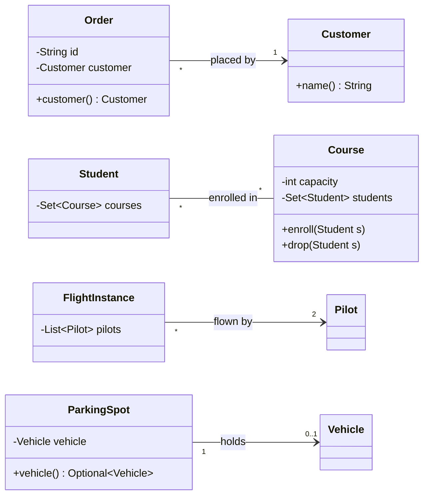

### Java example

```java
// File: code/lld/ch03/association/Customer.java
package lld.ch03.association;

/** Knows nothing about orders: the association Order -> Customer is one-way. */
public record Customer(String name) { }
```

```java
// File: code/lld/ch03/association/Order.java
package lld.ch03.association;

import java.util.Objects;

/**
 * Uni-directional association, multiplicity "many orders to exactly 1 customer".
 * Order holds a reference to Customer; Customer has no field pointing back.
 */
public final class Order {
    private final String id;
    private final Customer customer;   // "1" end: never null

    public Order(String id, Customer customer) {
        this.id = id;
        this.customer = Objects.requireNonNull(customer, "an order needs exactly one customer");
    }

    public String id() { return id; }
    public Customer customer() { return customer; }
}
```

```java
// File: code/lld/ch03/association/Student.java
package lld.ch03.association;

import java.util.Collections;
import java.util.LinkedHashSet;
import java.util.Set;

/** One side of a bi-directional many-to-many association (Student * -- * Course). */
public final class Student {
    private final String name;
    private final Set<Course> courses = new LinkedHashSet<>();

    public Student(String name) { this.name = name; }

    public String name() { return name; }
    public Set<Course> courses() { return Collections.unmodifiableSet(courses); }

    /** Package-private: only Course.enroll/drop may touch this side, so both ends stay in sync. */
    void linkCourse(Course c)   { courses.add(c); }
    void unlinkCourse(Course c) { courses.remove(c); }

    @Override public String toString() { return name; }
}
```

```java
// File: code/lld/ch03/association/Course.java
package lld.ch03.association;

import java.util.Collections;
import java.util.LinkedHashSet;
import java.util.Set;

/**
 * Other side of the bi-directional association. Course is the "owner" of the link:
 * enroll/drop update BOTH ends in one place, which is the main rule for two-way links.
 * Multiplicity on this end: a course holds 0..capacity students.
 */
public final class Course {
    private final String code;
    private final int capacity;
    private final Set<Student> students = new LinkedHashSet<>();

    public Course(String code, int capacity) {
        this.code = code;
        this.capacity = capacity;
    }

    public void enroll(Student s) {
        if (students.contains(s)) return;
        if (students.size() == capacity) {
            throw new IllegalStateException(code + " is full (max " + capacity + ")");
        }
        students.add(s);
        s.linkCourse(this);
    }

    public void drop(Student s) {
        if (students.remove(s)) s.unlinkCourse(this);
    }

    public Set<Student> students() { return Collections.unmodifiableSet(students); }
    public String code() { return code; }

    @Override public String toString() { return code; }
}
```

```java
// File: code/lld/ch03/association/Pilot.java
package lld.ch03.association;

public record Pilot(String name) { }
```

```java
// File: code/lld/ch03/association/FlightInstance.java
package lld.ch03.association;

import java.util.List;

/** Multiplicity "exactly 2": the constructor enforces the number written on the diagram. */
public final class FlightInstance {
    private final String flightNo;
    private final List<Pilot> pilots;

    public FlightInstance(String flightNo, List<Pilot> pilots) {
        if (pilots.size() != 2) {
            throw new IllegalArgumentException("a flight needs exactly 2 pilots, got " + pilots.size());
        }
        this.flightNo = flightNo;
        this.pilots = List.copyOf(pilots);
    }

    public List<Pilot> pilots() { return pilots; }
    public String flightNo() { return flightNo; }
}
```

```java
// File: code/lld/ch03/association/Vehicle.java
package lld.ch03.association;

public record Vehicle(String plate) { }
```

```java
// File: code/lld/ch03/association/ParkingSpot.java
package lld.ch03.association;

import java.util.Optional;

/** Multiplicity "0..1": the field may be empty, so the getter returns Optional and callers must check. */
public final class ParkingSpot {
    private final int number;
    private Vehicle vehicle;   // null means "0" of 0..1

    public ParkingSpot(int number) { this.number = number; }

    public void park(Vehicle v) {
        if (vehicle != null) throw new IllegalStateException("spot " + number + " is taken");
        vehicle = v;
    }

    public void leave() { vehicle = null; }

    public Optional<Vehicle> vehicle() { return Optional.ofNullable(vehicle); }
    public int number() { return number; }
}
```

```java
// File: code/lld/ch03/association/Main.java
package lld.ch03.association;

import java.util.List;

public class Main {
    public static void main(String[] args) {
        System.out.println("== Uni-directional: Order -> Customer ==");
        Customer asha = new Customer("Asha");
        Order o1 = new Order("O-1", asha);
        Order o2 = new Order("O-2", asha);
        System.out.println(o1.id() + " belongs to " + o1.customer().name());
        System.out.println(o2.id() + " belongs to " + o2.customer().name());
        System.out.println("Customer has no way to list its orders (one-way link).");

        System.out.println("\n== Bi-directional many-to-many: Student <-> Course ==");
        Student ravi = new Student("Ravi");
        Student meera = new Student("Meera");
        Course java = new Course("JAVA101", 2);
        Course uml = new Course("UML201", 30);
        java.enroll(ravi);
        java.enroll(meera);
        uml.enroll(ravi);
        System.out.println("JAVA101 students: " + java.students());
        System.out.println("Ravi's courses:   " + ravi.courses());
        try {
            java.enroll(new Student("Kiran"));
        } catch (IllegalStateException e) {
            System.out.println("Multiplicity 0..2 enforced: " + e.getMessage());
        }
        java.drop(ravi);
        System.out.println("After drop, JAVA101: " + java.students() + ", Ravi: " + ravi.courses());

        System.out.println("\n== Multiplicity 2 and 0..1 ==");
        FlightInstance f = new FlightInstance("AI-202", List.of(new Pilot("Capt. Rao"), new Pilot("F/O Das")));
        System.out.println(f.flightNo() + " pilots: " + f.pilots());
        try {
            new FlightInstance("AI-303", List.of(new Pilot("Solo")));
        } catch (IllegalArgumentException e) {
            System.out.println("Rejected: " + e.getMessage());
        }
        ParkingSpot spot = new ParkingSpot(7);
        System.out.println("Spot 7 vehicle: " + spot.vehicle().map(Vehicle::plate).orElse("<empty>"));
        spot.park(new Vehicle("KA-01-1234"));
        System.out.println("Spot 7 vehicle: " + spot.vehicle().map(Vehicle::plate).orElse("<empty>"));
    }
}
```

**What each part shows:**

- `Order` has a `final Customer customer` field and `Customer` has nothing pointing back → **uni-directional**, multiplicity `1` enforced with `requireNonNull`.
- `Student` and `Course` each hold a `Set` of the other → **bi-directional many-to-many**. Only `Course.enroll/drop` may change the link; `Student.linkCourse` is package-private. This single "owning side" rule is what keeps both ends consistent.
- `Course(capacity)` turns multiplicity `0..capacity` into a runtime check.
- `FlightInstance` rejects anything but exactly **2** pilots; `ParkingSpot` exposes **0..1** as `Optional<Vehicle>`.
- Lifetimes: every object here is created by `Main` and merely *referenced* by the others. Dropping a course does not delete the student.

Output:

```
== Uni-directional: Order -> Customer ==
O-1 belongs to Asha
O-2 belongs to Asha
Customer has no way to list its orders (one-way link).

== Bi-directional many-to-many: Student <-> Course ==
JAVA101 students: [Ravi, Meera]
Ravi's courses:   [JAVA101, UML201]
Multiplicity 0..2 enforced: JAVA101 is full (max 2)
After drop, JAVA101: [Meera], Ravi: [UML201]

== Multiplicity 2 and 0..1 ==
AI-202 pilots: [Pilot[name=Capt. Rao], Pilot[name=F/O Das]]
Rejected: a flight needs exactly 2 pilots, got 1
Spot 7 vehicle: <empty>
Spot 7 vehicle: KA-01-1234
```

### Trade-offs

| Choice | Pros | Cons |
|---|---|---|
| Uni-directional | Simple; one field; no sync bugs; lower coupling | Reverse question ("which orders does this customer have?") needs a query or repository |
| Bi-directional | Fast navigation both ways | Two fields to keep in sync; tighter coupling; risk of infinite loops in `toString`/`equals`/JSON serialisation |
| Strict multiplicity checks | Invalid states cannot be created | A little more constructor code |

### When not to use it

- Do not store a long-lived field if you only need the object inside one method — that is a **dependency** (3.5), which couples less.
- Do not default to bi-directional. Most associations should be uni-directional.

### Common mistakes

- Making every line bi-directional "just in case".
- Updating only one side of a bi-directional link (`student.courses.add(c)` without `course.students.add(s)`).
- Forgetting multiplicity on the line, then forgetting the null-check / non-empty check in the code.
- Including both sides in `toString()` or `equals()` → stack overflow from infinite recursion.

### Real-world examples

- **JPA / Hibernate:** `@ManyToOne` on `Order.customer` is a uni-directional association. A bi-directional `@OneToMany(mappedBy = "customer")` needs an *owning side* (the side with the foreign key) and helper methods that set both ends — exactly the `Course.enroll` rule above.
- **Spring:** a service with a constructor-injected repository holds an association to it; the Spring container, not the service, creates and destroys the repository.
- **E-commerce:** an order row stores `customer_id` (Order → Customer); a customer does not store a list of order ids.

### In the interview

**30-second answer:** "Association means one class holds a reference to another and can call it, with no ownership. I make it uni-directional unless both directions are needed, and I write multiplicity on every line because it changes the code: `1` is a required field, `0..1` is an Optional, `1..*` is a non-empty collection."

**Follow-ups:**

- *Q: How do you keep a bi-directional association consistent?* — A: Pick one owning side and put a single method there (`enroll`) that updates both ends; make the other side's mutators package-private.
- *Q: What changes if a parking spot can hold two motorbikes?* — A: The multiplicity changes from `0..1` to `0..2`, so the field becomes a small collection with a size check instead of an `Optional`.
- *Q: Why not make everything bi-directional?* — A: It doubles the places that must change together and increases coupling; the reverse direction can usually be answered by a repository query.

### Self-check

- *Q: `Order "*" --> "1" Customer` — which class has the field?* → A: `Order`; the arrow points at the class being referenced.
- *Q: What Java type fits multiplicity `0..1`?* → A: A nullable field exposed as `Optional<T>`.
- *Q: Is a many-to-many association always bi-directional?* → A: No. "Many-to-many" is about counts; direction is a separate choice.

### TL;DR

Association = "A knows B", no ownership. Prefer one-way. Put multiplicity on every line and enforce it in the constructor/types.

---

## 3.3 Aggregation

### What it is

**Aggregation** is a special association that says "A is a *whole* made of parts B, but the parts have their own life". The parts exist before the whole, can move to another whole, and survive when the whole is destroyed. It is sometimes called *shared aggregation* because a part may even belong to several wholes.

Analogy: an **airline** and its **aircraft**. If the airline shuts down, the planes are sold to another airline — they are not scrapped. A **team** and its **players** is another: disband the team and the players still exist.

### The problem it solves

It lets you say "these objects form a group" (a whole–part meaning, stronger than a plain association) while making clear that the group does **not** control their lifetime. That tells readers: "do not delete the parts when you delete the whole".

### How it works

1. The part is **created outside** the whole (by the caller, a factory, or a repository).
2. The part is **passed in** (`addAircraft(a)`), and the whole stores a reference.
3. Removing the part from the whole **returns it alive**; destroying the whole **releases** its parts.
4. In UML, draw a **hollow diamond at the whole's end** of the line.

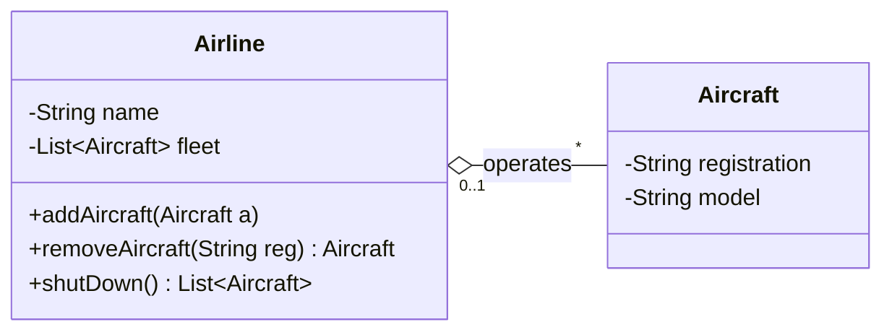

### Java example

```java
// File: code/lld/ch03/aggregation/Aircraft.java
package lld.ch03.aggregation;

/** A part that has its own life: it is created outside any airline and can move between airlines. */
public final class Aircraft {
    private final String registration;
    private final String model;

    public Aircraft(String registration, String model) {
        this.registration = registration;
        this.model = model;
    }

    public String registration() { return registration; }

    @Override public String toString() { return registration + " (" + model + ")"; }
}
```

```java
// File: code/lld/ch03/aggregation/Airline.java
package lld.ch03.aggregation;

import java.util.ArrayList;
import java.util.Collections;
import java.util.List;

/**
 * Aggregation (hollow diamond at Airline): Airline 0..1 o-- * Aircraft
 * (an aircraft belongs to at most one airline at a time and may belong to none).
 * The airline HOLDS aircraft that were created elsewhere and handed in.
 * It never creates them and never destroys them.
 */
public final class Airline {
    private final String name;
    private final List<Aircraft> fleet = new ArrayList<>();

    public Airline(String name) { this.name = name; }

    public void addAircraft(Aircraft a) { fleet.add(a); }        // part is passed in

    public Aircraft removeAircraft(String registration) {         // part is handed back, still alive
        for (var it = fleet.iterator(); it.hasNext(); ) {
            Aircraft a = it.next();
            if (a.registration().equals(registration)) { it.remove(); return a; }
        }
        throw new IllegalArgumentException("no aircraft " + registration + " in " + name);
    }

    /** Shutting down the airline releases the parts instead of destroying them. */
    public List<Aircraft> shutDown() {
        List<Aircraft> released = List.copyOf(fleet);
        fleet.clear();
        return released;
    }

    public List<Aircraft> fleet() { return Collections.unmodifiableList(fleet); }
    public String name() { return name; }
}
```

```java
// File: code/lld/ch03/aggregation/Main.java
package lld.ch03.aggregation;

import java.util.List;

public class Main {
    public static void main(String[] args) {
        // The parts exist BEFORE any whole.
        Aircraft a1 = new Aircraft("VT-AAA", "A320");
        Aircraft a2 = new Aircraft("VT-BBB", "B737");
        Aircraft a3 = new Aircraft("VT-CCC", "ATR72");

        Airline skyways = new Airline("Skyways");
        skyways.addAircraft(a1);
        skyways.addAircraft(a2);
        Airline blueJet = new Airline("BlueJet");
        blueJet.addAircraft(a3);

        System.out.println(skyways.name() + " fleet: " + skyways.fleet());
        System.out.println(blueJet.name() + " fleet: " + blueJet.fleet());

        // Transfer one part between wholes.
        blueJet.addAircraft(skyways.removeAircraft("VT-BBB"));
        System.out.println("After transfer, BlueJet fleet: " + blueJet.fleet());

        // Destroy a whole: its parts survive and can join another whole.
        List<Aircraft> released = skyways.shutDown();
        skyways = null;   // the Airline object is now unreachable
        System.out.println("Skyways shut down. Released aircraft still exist: " + released);
        released.forEach(blueJet::addAircraft);
        System.out.println("BlueJet fleet now: " + blueJet.fleet());
    }
}
```

**What each part shows:** `Aircraft` objects are built in `Main` *before* any airline exists. `Airline.addAircraft` receives them; `removeAircraft` and `shutDown` hand them back. After `skyways = null` the airline is garbage, but its aircraft are still referenced and join `BlueJet`.

Output:

```
Skyways fleet: [VT-AAA (A320), VT-BBB (B737)]
BlueJet fleet: [VT-CCC (ATR72)]
After transfer, BlueJet fleet: [VT-CCC (ATR72), VT-BBB (B737)]
Skyways shut down. Released aircraft still exist: [VT-AAA (A320)]
BlueJet fleet now: [VT-CCC (ATR72), VT-BBB (B737), VT-AAA (A320)]
```

### Trade-offs

| | Aggregation | Plain association |
|---|---|---|
| Extra meaning | "whole–part" grouping | just "knows" |
| Lifetime claim | parts outlive whole | none |
| Code difference | usually **none** — both are a field holding a reference | — |

The honest trade-off: aggregation adds meaning for the reader but almost nothing in code. The UML specification itself leaves the precise meaning of shared aggregation to the modeller, and several well-known UML authors (Martin Fowler's *UML Distilled* among them) advise using it sparingly. In interviews, it is still expected when there is a clear whole–part grouping.

### When not to use it

- If there is no "whole made of parts" idea (a ticket and a spot), use plain association.
- If the parts are created by and die with the whole, it is composition.

### Common mistakes

- Putting the diamond at the **part's** end. The diamond always sits at the **whole**.
- Choosing aggregation vs composition at random. Use the test: *imagine the whole is gone — is the part still meaningful by itself?* Yes → aggregation.
- Deleting parts in the whole's "close/delete" method even though the diagram says aggregation.

### Real-world examples

- A `java.util.List<Customer>`: clearing the list does not destroy the customers; they are still referenced elsewhere.
- A Slack/Teams **channel** and its **members**: archiving a channel does not delete user accounts.
- A **playlist** and **songs** (Spotify): deleting your playlist does not delete the songs from the catalogue.
- A **department** and its **professors** in a university model.

### In the interview

**30-second answer:** "Aggregation is a whole–part association where the parts can outlive the whole — hollow diamond at the whole. An airline aggregates aircraft: shut the airline down and the aircraft still exist. In Java the parts are created outside and passed in, and the whole never destroys them."

**Follow-ups:**

- *Q: Can an airline exist without aircraft?* — A: That is a multiplicity question, not an aggregation question. If the business says an airline must have at least one aircraft, write `1..*` on the aircraft end; it is still aggregation because the aircraft survive the airline.
- *Q: How is aggregation different in code from association?* — A: Usually it is not; the difference is the modelling intent (whole–part). That is why you say the lifetime test out loud.

### Self-check

- *Q: Where does the hollow diamond go?* → A: At the whole (`Airline`).
- *Q: A library closes; do its members disappear?* → A: No — a person exists either way, so Library ◇— Member is aggregation.

### TL;DR

Aggregation = "has-a, parts live on". Parts are passed in, never destroyed by the whole. Hollow diamond at the whole.

---

## 3.4 Composition

### What it is

**Composition** is the strongest has-a relationship: the whole **owns** its parts. A part belongs to **exactly one** whole at a time, is usually **created by** the whole, and is **destroyed with** it. (UML also allows a part to be explicitly removed from the whole *before* the whole is deleted.)

Analogy: a **house** and its **rooms**. Demolish the house and the rooms are gone — a "room of a house that does not exist" means nothing. Likewise a **parking floor** and its **spots**, a **parking lot** and its **floors**, a **flight** and its **weekly schedule**.

### The problem it solves

Some objects make no sense on their own, and letting outsiders create or share them causes bugs (two floors pointing at the same spot, orphan spots after a floor is removed). Composition makes the owner responsible for the parts' full life cycle, so there is one place that creates, changes and removes them.

### How it works

1. The whole **creates** the parts itself (in its constructor or an `addX(...)` method that takes *data*, not a ready-made part).
2. The part's constructor is **not public** (package-private or a private nested class) so nobody else can make one.
3. The whole **never hands out** its internal collection — only read-only views or copies.
4. **Removing** the whole (or removing a part from it) drops the only reference, so the part becomes garbage.
5. In UML, draw a **filled (black) diamond at the whole's end**.

A note on Java: Java has no destructors. "The part dies with the whole" means *logically*: nobody else holds a reference, so when the whole is removed the part becomes unreachable and the garbage collector reclaims it. If you need clean-up (closing files, sockets), the whole's `close()` must close its parts too — for example, closing a `BufferedReader` also closes the `FileReader` it wraps.

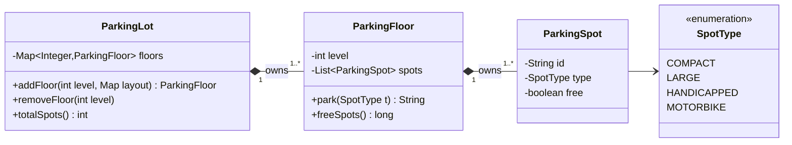

### Java example

```java
// File: code/lld/ch03/composition/SpotType.java
package lld.ch03.composition;

/** A spot "kind" is a value, not a subclass (see the generalization chapter section). */
public enum SpotType { COMPACT, LARGE, HANDICAPPED, MOTORBIKE }
```

```java
// File: code/lld/ch03/composition/ParkingSpot.java
package lld.ch03.composition;

/**
 * A part of a composition. The constructor is package-private, so only ParkingFloor
 * (same package) can create a spot. Outside code can read a spot but never make one.
 */
public final class ParkingSpot {
    private final String id;
    private final SpotType type;
    private boolean free = true;

    ParkingSpot(String id, SpotType type) {
        this.id = id;
        this.type = type;
    }

    public String id() { return id; }
    public SpotType type() { return type; }
    public boolean isFree() { return free; }
    void occupy() { free = false; }

    @Override public String toString() { return id + ":" + type; }
}
```

```java
// File: code/lld/ch03/composition/ParkingFloor.java
package lld.ch03.composition;

import java.util.ArrayList;
import java.util.Collections;
import java.util.List;
import java.util.Map;

/**
 * Composition (filled diamond at ParkingFloor): ParkingFloor 1 *-- 1..* ParkingSpot.
 * The floor CREATES its spots in its own constructor, never shares them with another floor,
 * and when the floor is removed the spots go with it.
 */
public final class ParkingFloor {
    private final int level;
    private final List<ParkingSpot> spots = new ArrayList<>();

    ParkingFloor(int level, Map<SpotType, Integer> layout) {
        this.level = level;
        int n = 1;
        for (var e : layout.entrySet()) {
            for (int i = 0; i < e.getValue(); i++) {
                spots.add(new ParkingSpot("L" + level + "-" + n++, e.getKey()));
            }
        }
        if (spots.isEmpty()) throw new IllegalArgumentException("a floor needs 1..* spots");
    }

    public int level() { return level; }
    public List<ParkingSpot> spots() { return Collections.unmodifiableList(spots); }

    public long freeSpots() { return spots.stream().filter(ParkingSpot::isFree).count(); }

    /** Parks in the first free spot of the type; the spot itself never leaves the floor. */
    public String park(SpotType type) {
        for (ParkingSpot s : spots) {
            if (s.isFree() && s.type() == type) { s.occupy(); return s.id(); }
        }
        return null;
    }
}
```

```java
// File: code/lld/ch03/composition/ParkingLot.java
package lld.ch03.composition;

import java.util.Collections;
import java.util.Map;
import java.util.TreeMap;

/** Composition again: ParkingLot 1 *-- 1..* ParkingFloor. The lot builds and removes its floors. */
public final class ParkingLot {
    private final String name;
    private final Map<Integer, ParkingFloor> floors = new TreeMap<>();

    public ParkingLot(String name) { this.name = name; }

    /** The caller describes the floor; the lot constructs it. No ParkingFloor object is passed in. */
    public ParkingFloor addFloor(int level, Map<SpotType, Integer> layout) {
        ParkingFloor f = new ParkingFloor(level, layout);
        floors.put(level, f);
        return f;
    }

    /** Removing the whole removes its parts: no one else holds the spots, so they become garbage. */
    public void removeFloor(int level) { floors.remove(level); }

    public int totalSpots() {
        return floors.values().stream().mapToInt(f -> f.spots().size()).sum();
    }

    public Map<Integer, ParkingFloor> floors() { return Collections.unmodifiableMap(floors); }
    public String name() { return name; }
}
```

```java
// File: code/lld/ch03/composition/Main.java
package lld.ch03.composition;

import java.util.LinkedHashMap;
import java.util.Map;

public class Main {
    public static void main(String[] args) {
        ParkingLot lot = new ParkingLot("City Centre");
        Map<SpotType, Integer> layout = new LinkedHashMap<>();
        layout.put(SpotType.COMPACT, 3);
        layout.put(SpotType.LARGE, 1);

        ParkingFloor ground = lot.addFloor(0, layout);
        lot.addFloor(1, Map.of(SpotType.MOTORBIKE, 4));

        System.out.println("Floor 0 spots: " + ground.spots());
        System.out.println("Total spots in lot: " + lot.totalSpots());
        System.out.println("Parked compact car at " + ground.park(SpotType.COMPACT));
        System.out.println("Free spots on floor 0: " + ground.freeSpots());

        try {
            ground.spots().clear();
        } catch (UnsupportedOperationException e) {
            System.out.println("Outsiders cannot change the parts: spots() is read-only");
        }

        lot.removeFloor(1);
        System.out.println("After removing floor 1, total spots: " + lot.totalSpots()
                + " (its 4 spots are gone with it)");
        System.out.println("Floors left: " + lot.floors().keySet());
    }
}
```

**What each part shows:** `ParkingLot.addFloor` receives a *layout description* and builds the `ParkingFloor` itself. `ParkingFloor`'s constructor builds its `ParkingSpot`s; `ParkingSpot`'s constructor is package-private, so code outside the package cannot create a spot. `spots()` returns an unmodifiable view, so outsiders cannot add or remove parts. `removeFloor(1)` drops the floor and, with it, its four spots.

Output:

```
Floor 0 spots: [L0-1:COMPACT, L0-2:COMPACT, L0-3:COMPACT, L0-4:LARGE]
Total spots in lot: 8
Parked compact car at L0-1
Free spots on floor 0: 3
Outsiders cannot change the parts: spots() is read-only
After removing floor 1, total spots: 4 (its 4 spots are gone with it)
Floors left: [0]
```

### Trade-offs

| | Composition | Aggregation |
|---|---|---|
| Who creates the part | the whole | someone else |
| Can the part be shared? | no (one owner at a time) | yes |
| Part outlives whole? | no | yes |
| Encapsulation | strong — whole controls all changes | weaker |
| Flexibility | lower — parts cannot be reused elsewhere | higher |

### When not to use it

- When the part has an independent identity the business cares about (a *person*, an *aircraft*, a *song*) — use aggregation/association.
- When the part must be shared between wholes.

### Common mistakes

- Accepting a ready-made part from outside (`addSpot(ParkingSpot s)`) and calling it composition — the caller may still hold and share it.
- Returning the internal mutable list (`return spots;`) — outsiders can now add/remove parts behind the owner's back.
- Mixing up composition (object design) with "favour composition over inheritance" (3.6): in that slogan "composition" means *holding* an object instead of extending its class, and it covers association/aggregation too.

### Real-world examples

- `java.util.HashMap` creates and manages its internal `Node` entries (a package-private nested class); they are never shared with another map and go away with it.
- **JPA:** `@OneToMany(cascade = CascadeType.ALL, orphanRemoval = true)` models composition — delete the `Order` and its `OrderLine` rows are deleted too.
- **Documents:** deleting a Google Doc deletes its comments and revision history.
- **Operating systems:** killing a process frees its threads and memory pages.

### In the interview

**30-second answer:** "Composition means the whole owns the parts: it creates them, they belong to only it, and they die with it — filled diamond at the whole. A parking floor composes its spots: remove the floor and the spots are gone. In Java I build the parts inside the owner, hide their constructor, and only expose read-only views."

**Follow-ups:**

- *Q: Java has garbage collection — how can a part 'die'?* — A: It dies logically: the whole holds the only reference, so removing the whole makes the part unreachable. If the part holds resources, the whole's `close()` closes it.
- *Q: Is `Flight` → `WeeklySchedule` composition?* — A: Yes; a schedule of a flight that no longer exists is meaningless.

### Self-check

- *Q: The test that separates aggregation from composition?* → A: Imagine the whole is gone — is the part still meaningful by itself? No → composition.
- *Q: Why is `ParkingSpot`'s constructor package-private?* → A: So only the owning floor can create spots.

### TL;DR

Composition = "owns, parts die with it". Whole creates parts, never shares them, exposes read-only views. Filled diamond at the whole.

---

## 3.5 Dependency

### What it is

A **dependency** means class A *uses* class B for a short time — inside one method — without keeping a field that points at B. B appears as a **method parameter**, a **local variable**, a **return type**, or a **static method call**. When the method returns, the relationship is over.

Analogy: a **chef** *uses* a **delivery van** to receive groceries this morning. The chef does not own the van and does not keep it in the kitchen; tomorrow it may be a different van.

### The problem it solves

It records the weakest possible link: "if B's interface changes, A may have to change", nothing more. Recognising a dependency (instead of an association) keeps classes stateless and loosely coupled — the caller can pass in a different collaborator on every call.

### How it works

1. A method receives B as a parameter (`checkout(Cart cart, PaymentGateway gateway)`), or
2. creates B as a local variable (`new TaxCalculator()`), or
3. returns a B (`Receipt`), or calls a static method on B.
4. No field of type B exists in A.
5. In UML, draw a **dashed line with an open arrowhead** from the user (A) to the used class (B). You may add a keyword such as `«use»` or `«create»`.

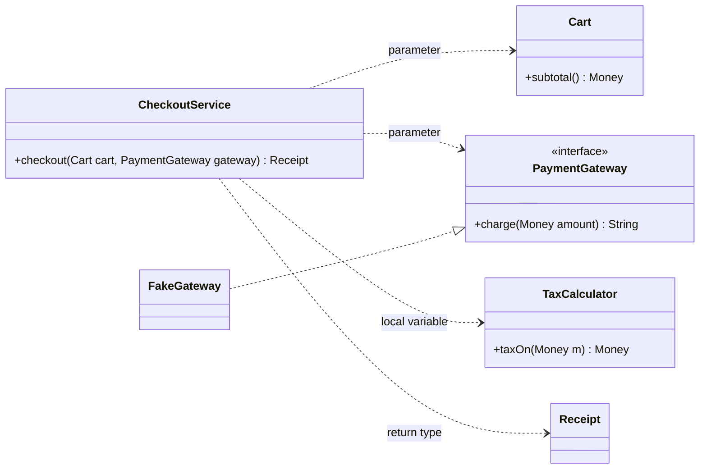

### Java example

```java
// File: code/lld/ch03/dependency/Money.java
package lld.ch03.dependency;

import java.math.BigDecimal;
import java.math.RoundingMode;

/** A small value type. Anything that returns or accepts Money depends on it. */
public record Money(BigDecimal amount) {
    public static Money of(String s) { return new Money(new BigDecimal(s).setScale(2, RoundingMode.HALF_UP)); }
    public Money plus(Money o) { return new Money(amount.add(o.amount)); }
    public Money times(BigDecimal f) { return new Money(amount.multiply(f).setScale(2, RoundingMode.HALF_UP)); }
    @Override public String toString() { return "Rs " + amount.toPlainString(); }
}
```

```java
// File: code/lld/ch03/dependency/Cart.java
package lld.ch03.dependency;

import java.util.List;

public record Cart(List<Money> itemPrices) {
    public Money subtotal() {
        return itemPrices.stream().reduce(Money.of("0"), Money::plus);
    }
}
```

```java
// File: code/lld/ch03/dependency/PaymentGateway.java
package lld.ch03.dependency;

public interface PaymentGateway {
    String charge(Money amount);   // returns a transaction id
}
```

```java
// File: code/lld/ch03/dependency/FakeGateway.java
package lld.ch03.dependency;

public final class FakeGateway implements PaymentGateway {
    private int next = 1;
    @Override public String charge(Money amount) {
        System.out.println("  [gateway] charging " + amount);
        return "TXN-" + next++;
    }
}
```

```java
// File: code/lld/ch03/dependency/TaxCalculator.java
package lld.ch03.dependency;

import java.math.BigDecimal;

public final class TaxCalculator {
    private static final BigDecimal GST = new BigDecimal("0.18");
    public Money taxOn(Money m) { return m.times(GST); }
}
```

```java
// File: code/lld/ch03/dependency/CheckoutService.java
package lld.ch03.dependency;

/**
 * Dependency (dashed arrow, "uses"): CheckoutService has NO fields pointing at
 * Cart, PaymentGateway, TaxCalculator or Receipt. It only touches them for the
 * duration of one method call:
 *   - Cart and PaymentGateway arrive as PARAMETERS,
 *   - TaxCalculator is a LOCAL variable,
 *   - Receipt is the RETURN type.
 * When checkout() returns, the relationship is over.
 */
public final class CheckoutService {

    public Receipt checkout(Cart cart, PaymentGateway gateway) {
        TaxCalculator tax = new TaxCalculator();            // local-variable dependency
        Money subtotal = cart.subtotal();                   // parameter dependency
        Money total = subtotal.plus(tax.taxOn(subtotal));
        String txn = gateway.charge(total);                 // parameter dependency (interface)
        return new Receipt(txn, subtotal, total);           // return-type dependency
    }

    public record Receipt(String txnId, Money subtotal, Money total) { }
}
```

```java
// File: code/lld/ch03/dependency/Main.java
package lld.ch03.dependency;

import java.util.List;

public class Main {
    public static void main(String[] args) {
        CheckoutService service = new CheckoutService();   // holds no collaborators at all
        Cart cart = new Cart(List.of(Money.of("250"), Money.of("99.50")));

        // The caller decides which gateway to use on every call.
        CheckoutService.Receipt r = service.checkout(cart, new FakeGateway());
        System.out.println("Receipt: " + r);

        PaymentGateway loggingGateway = amount -> {
            System.out.println("  [lambda gateway] charging " + amount);
            return "LMB-42";
        };
        System.out.println("Receipt: " + service.checkout(cart, loggingGateway));
    }
}
```

**What each part shows:** `CheckoutService` has **no fields at all**. It depends on `Cart` and `PaymentGateway` through parameters, on `TaxCalculator` through a local variable, and on `Receipt` through its return type. `Main` passes a different gateway (even a lambda) on each call — something you cannot do as easily with a stored field. `Money` uses `BigDecimal`, not `double`, because currency needs exact decimal arithmetic.

Output:

```
  [gateway] charging Rs 412.41
Receipt: Receipt[txnId=TXN-1, subtotal=Rs 349.50, total=Rs 412.41]
  [lambda gateway] charging Rs 412.41
Receipt: Receipt[txnId=LMB-42, subtotal=Rs 349.50, total=Rs 412.41]
```

### Trade-offs

| | Dependency (parameter) | Association (field) |
|---|---|---|
| Coupling | lowest | higher |
| Object state | can be stateless | holds state |
| Swapping collaborator | per call | per object (or via setter) |
| Call-site noise | caller passes B every time | caller passes B once |

### When not to use it

If A needs B across many methods and many calls (e.g. a service always uses the same repository), a stored field (association via constructor injection) is cleaner than passing B to every method.

### Common mistakes

- Drawing a solid association line for something that is only a parameter — it overstates coupling.
- Drawing *every* dependency: a real class depends on `String`, `List`, `LocalDate`… Draw only the ones that matter to the design.
- Hiding a dependency with `new ConcreteThing()` deep inside a method when the caller should decide (this blocks testing). Prefer taking an interface as a parameter.

### Real-world examples

- `Collections.sort(list, comparator)` depends on the `Comparator` only during the call.
- A Spring MVC controller method `handle(HttpServletRequest req)` depends on the request only for that call.
- `LocalDate.now(Clock clock)` depends on a `Clock` parameter — the JDK's way to make time testable.
- In build tools (Maven/Gradle) a "dependency" is the same idea at package level: your code uses a library's classes.

### In the interview

**30-second answer:** "Dependency is 'uses briefly': B is a parameter, local variable or return type of A's method, and A keeps no field for it. Dashed arrow from A to B. It is the loosest coupling, so when a collaborator is only needed in one method I pass it in rather than store it."

**Follow-ups:**

- *Q: `FlightReservation` takes a `Payment` in `pay(Payment p)` — association or dependency?* — A: Dependency, unless the reservation stores the payment in a field; then it becomes an association.
- *Q: How is this related to Dependency Injection?* — A: DI is about *who supplies* the collaborator (from outside, not `new` inside). The supplied object may be stored (association) or passed per call (dependency). The Dependency Inversion Principle adds: depend on interfaces, not concrete classes (Chapter 4).

### Self-check

- *Q: Which UML line: dashed + open arrow, or dashed + hollow triangle?* → A: Dashed + open arrow is dependency; dashed + hollow triangle is realization.
- *Q: A method returns a `Receipt`. Does that create a relationship?* → A: Yes, a dependency on `Receipt`.

### TL;DR

Dependency = "uses for one call". Parameter, local variable, return type or static call; no field. Dashed arrow.

---

## 3.6 Generalization (inheritance)

### What it is

**Generalization** is UML's word for **inheritance**: class B `extends` class A, so B *is a kind of* A. A is the **parent** (superclass, general); B is the **child** (subclass, specialised). B inherits A's fields and methods and may override them.

Analogy: a **credit-card payment** *is a* **payment**. Anywhere the shop's code can handle "a payment", it can handle a credit-card payment.

### The problem it solves

When several classes truly share a contract **and** some behaviour, inheritance puts the shared parts in one place and lets calling code work with the general type (`Payment`) without knowing the specific one (**polymorphism** — one call, different behaviour depending on the actual object).

### How it works

1. Before extending, run the **substitution test**: *can B be used anywhere A is expected, with no surprises?* If there is any method of A that B would have to refuse or break, the answer is no. (This is the Liskov Substitution Principle — Chapter 4.)
2. If yes, put the shared state and workflow in A (often `abstract`), and let subclasses override only the varying steps.
3. If no, **hold instead of extend**: give A a field of an interface type and plug in different behaviour objects.
4. In UML, draw a **solid line with a hollow triangle pointing at the parent**. An abstract class is shown with its name in *italics* (or `{abstract}` / `«abstract»`); abstract operations are italic too.

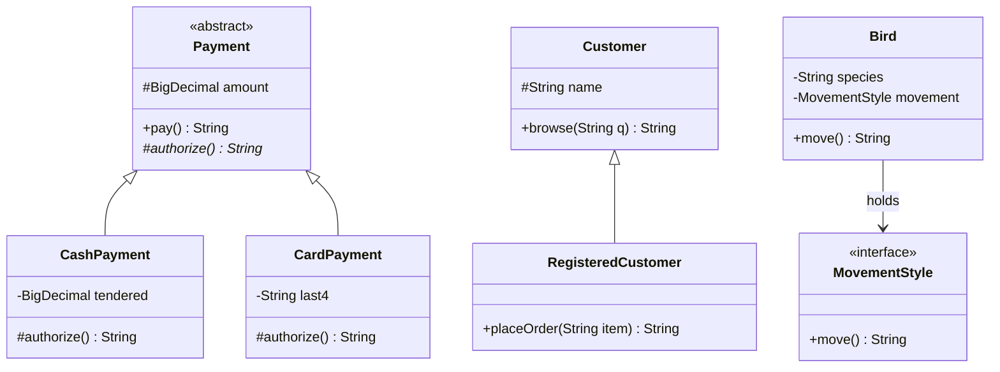

### Java example

```java
// File: code/lld/ch03/generalization/Payment.java
package lld.ch03.generalization;

import java.math.BigDecimal;

/**
 * Generalization parent (abstract, drawn in italics or with {abstract}).
 * Every subclass genuinely "is a" Payment: each one really can take money, in its own way.
 * Money is BigDecimal, never double: double cannot represent amounts like 0.10 exactly.
 */
public abstract class Payment {
    protected final BigDecimal amount;   // '#' protected: visible to subclasses

    protected Payment(BigDecimal amount) {
        if (amount.signum() <= 0) throw new IllegalArgumentException("amount must be positive");
        this.amount = amount;
    }

    /** Shared, final workflow; the varying step is abstract. */
    public final String pay() {
        String ref = authorize();
        return getClass().getSimpleName() + " of " + amount + " -> " + ref;
    }

    protected abstract String authorize();   // abstract operation (italics in UML)
}
```

```java
// File: code/lld/ch03/generalization/CashPayment.java
package lld.ch03.generalization;

import java.math.BigDecimal;

public final class CashPayment extends Payment {
    private final BigDecimal tendered;

    public CashPayment(BigDecimal amount, BigDecimal tendered) {
        super(amount);
        this.tendered = tendered;
    }

    @Override protected String authorize() {
        if (tendered.compareTo(amount) < 0) return "DECLINED (short by " + amount.subtract(tendered) + ")";
        return "OK, change " + tendered.subtract(amount);
    }
}
```

```java
// File: code/lld/ch03/generalization/CardPayment.java
package lld.ch03.generalization;

import java.math.BigDecimal;

public final class CardPayment extends Payment {
    private final String last4;

    public CardPayment(BigDecimal amount, String last4) {
        super(amount);
        this.last4 = last4;
    }

    @Override protected String authorize() { return "OK, card ****" + last4 + " approved"; }
}
```

```java
// File: code/lld/ch03/generalization/Customer.java
package lld.ch03.generalization;

/** Base class holds only what EVERY customer can do, so no subclass must refuse anything. */
public class Customer {
    protected final String name;
    public Customer(String name) { this.name = name; }
    public String browse(String query) { return name + " browses '" + query + "'"; }
}
```

```java
// File: code/lld/ch03/generalization/RegisteredCustomer.java
package lld.ch03.generalization;

/** Ordering lives here, not on Customer, because a guest may not order. */
public class RegisteredCustomer extends Customer {
    public RegisteredCustomer(String name) { super(name); }
    public String placeOrder(String item) { return name + " orders " + item; }
}
```

```java
// File: code/lld/ch03/generalization/MovementStyle.java
package lld.ch03.generalization;

/** "Prefer holding over extending": behaviour that varies is held, not inherited. */
public interface MovementStyle {
    String move();

    MovementStyle FLY = () -> "flies";
    MovementStyle SWIM = () -> "swims";
    MovementStyle WALK = () -> "walks";
}
```

```java
// File: code/lld/ch03/generalization/Bird.java
package lld.ch03.generalization;

public final class Bird {
    private final String species;
    private MovementStyle movement;   // held, so it can be swapped at run time

    public Bird(String species, MovementStyle movement) {
        this.species = species;
        this.movement = movement;
    }

    public void setMovement(MovementStyle m) { this.movement = m; }
    public String move() { return species + " " + movement.move(); }
}
```

```java
// File: code/lld/ch03/generalization/Main.java
package lld.ch03.generalization;

import java.math.BigDecimal;
import java.util.List;

public class Main {
    public static void main(String[] args) {
        System.out.println("== Good hierarchy: substitution works ==");
        List<Payment> payments = List.of(
                new CashPayment(new BigDecimal("500.00"), new BigDecimal("600.00")),
                new CardPayment(new BigDecimal("1200.00"), "4242"),
                new CashPayment(new BigDecimal("300.00"), new BigDecimal("200.00")));
        for (Payment p : payments) System.out.println(p.pay());   // caller only knows Payment

        System.out.println("\n== Guest vs registered customer ==");
        Customer guest = new Customer("Guest-17");
        RegisteredCustomer reg = new RegisteredCustomer("Asha");
        List<Customer> visitors = List.of(guest, reg);   // a RegisteredCustomer IS a Customer
        visitors.forEach(c -> System.out.println(c.browse("headphones")));
        System.out.println(reg.placeOrder("headphones"));
        System.out.println("guest.placeOrder(...) does not compile: guests never inherit ordering");

        System.out.println("\n== Holding instead of extending ==");
        Bird eagle = new Bird("Eagle", MovementStyle.FLY);
        Bird penguin = new Bird("Penguin", MovementStyle.SWIM);
        System.out.println(eagle.move());
        System.out.println(penguin.move());
        penguin.setMovement(MovementStyle.WALK);   // impossible with a subclass
        System.out.println(penguin.move() + " (behaviour swapped at run time)");
    }
}
```

**What each part shows:**

- `Payment` is abstract, its `pay()` is `final` (the shared workflow), and `authorize()` is abstract (the step that varies). Both subclasses honour every promise of `Payment`, so `Main` loops over `List<Payment>` without caring which is which. Amounts are `BigDecimal` and compared with `compareTo`, because `double` cannot store values such as `0.10` exactly and money must not drift.
- **Wrong-inheritance fix #1 — the subclass that must refuse something.** If `Guest extends Customer` and `Customer` can place orders, a guest could order, which the requirement forbids. The fix: `Customer` only has what *every* customer can do (browse); ordering moves down to `RegisteredCustomer`.
- **Wrong-inheritance fix #2 — the subclass that only carries a constant.** `CompactSpot`, `LargeSpot`, `HandicappedSpot` whose constructors only pass a different value up are three classes with no new behaviour. That is a field: see the `SpotType` enum in the composition example. A fourth type becomes one enum constant, not a new class.
- **Prefer holding over extending.** `FlyingBird` / `Penguin` subclasses break when a penguin arrives (penguins don't fly). `Bird` *holds* a `MovementStyle` instead, and it can even be swapped at run time — impossible with `extends`.

Output:

```
== Good hierarchy: substitution works ==
CashPayment of 500.00 -> OK, change 100.00
CardPayment of 1200.00 -> OK, card ****4242 approved
CashPayment of 300.00 -> DECLINED (short by 100.00)

== Guest vs registered customer ==
Guest-17 browses 'headphones'
Asha browses 'headphones'
Asha orders headphones
guest.placeOrder(...) does not compile: guests never inherit ordering

== Holding instead of extending ==
Eagle flies
Penguin swims
Penguin walks (behaviour swapped at run time)
```

### Trade-offs

| | Inheritance (extends) | Holding an object (composition/association) |
|---|---|---|
| Reuse | automatic | explicit delegation |
| Change at run time | no — fixed at compile time | yes — swap the held object |
| Coupling | tight: subclass sees parent internals ("fragile base class") | loose: only the interface |
| Number of parents in Java | one class | many interfaces / many fields |
| Best for | true is-a with different behaviour | varying behaviour, features that combine |

### When not to use it

- To share a few fields or a helper method ("code reuse" alone is not a reason).
- When a subclass would have to throw `UnsupportedOperationException` for an inherited method.
- When the variation is just data (use a field or enum).
- When behaviours need to be mixed (fly + swim + walk) — the class count explodes.

### Common mistakes

- Deep hierarchies (more than 2–3 levels) that nobody can follow.
- `Stack extends Vector` style mistakes: the child inherits methods that break its own rules (a JDK `Stack` lets you insert in the middle).
- Arrow direction: the triangle points **at the parent**, not the child.
- Using inheritance between two classes when one can do what the other does only in *some* situations. Generalization needs "always"; for "sometimes", hold a shared interface or a role object instead.

### Real-world examples

- `java.util.ArrayList extends AbstractList` (reuses the skeleton implementation).
- `java.io.FileInputStream extends InputStream`; any code taking an `InputStream` accepts it.
- Every Java exception: `IOException extends Exception extends Throwable`, which is why `catch (Exception e)` catches an `IOException`.
- **Counter-example in the JDK:** `java.util.Stack extends Vector` and `java.util.Properties extends Hashtable` are widely cited as inheritance that should have been composition.

### In the interview

**30-second answer:** "Generalization is inheritance — solid line with a hollow triangle at the parent. I use it only when the child passes the substitution test: it can go anywhere the parent goes and never refuses a parent method. A subclass that only passes a constant up becomes an enum field; varying behaviour I hold as an interface instead of extending."

**Follow-ups:**

- *Q: Why not `CompactSpot extends ParkingSpot`?* — A: It adds no behaviour; a `SpotType` field does the same job and new types are one enum constant.
- *Q: When *is* inheritance right?* — A: When subclasses behave differently but all keep the parent's promises, like `Payment` → cash/card: both really take money, differently.
- *Q: Can a Java class have two parents?* — A: It can extend only one class but implement many interfaces.

### Self-check

- *Q: Which way does the hollow triangle point?* → A: At the parent (general class).
- *Q: Guest cannot order, but `Guest extends Customer` and `Customer.placeOrder()` exists. What principle is broken and how do you fix it?* → A: Substitution (LSP). Move `placeOrder` to `RegisteredCustomer`.

### TL;DR

Generalization = "is-a", `extends`. Only after the substitution test. Constants → fields; varying behaviour → hold an interface. Triangle points at the parent.

---

## 3.7 Realization (interface implementation)

### What it is

**Realization** means a class *implements* an **interface**. An interface is a named list of operations (a contract) with no instance state. The class promises to provide those operations. In Java: `class EmailNotifier implements Notifier`.

Analogy: a **wall socket standard**. Any appliance whose plug "realizes" the standard works in any socket; the socket does not care who made the appliance.

### The problem it solves

Callers can depend on the **contract**, not the concrete class. You can add new implementations (SMS, push, WhatsApp) without changing the caller, test with fakes, and give one class several roles (a class may implement many interfaces but extend only one class).

### How it works

1. Define an interface with the operations callers need (`send(to, message)`).
2. Each concrete class `implements` it and provides the method bodies.
3. Callers hold / receive the **interface type** (`List<Notifier>`).
4. Since Java 8 an interface may have `default` methods (with a body) and `static` methods; implementers may override defaults.
5. In UML, draw a **dashed line with a hollow triangle pointing at the interface**, and mark the interface with `«interface»`. (A compact alternative is the "lollipop": a small circle on a stick labelled with the interface name.)

Realization looks like generalization on purpose: it is the same "is-a" idea, but nothing but the contract is inherited.

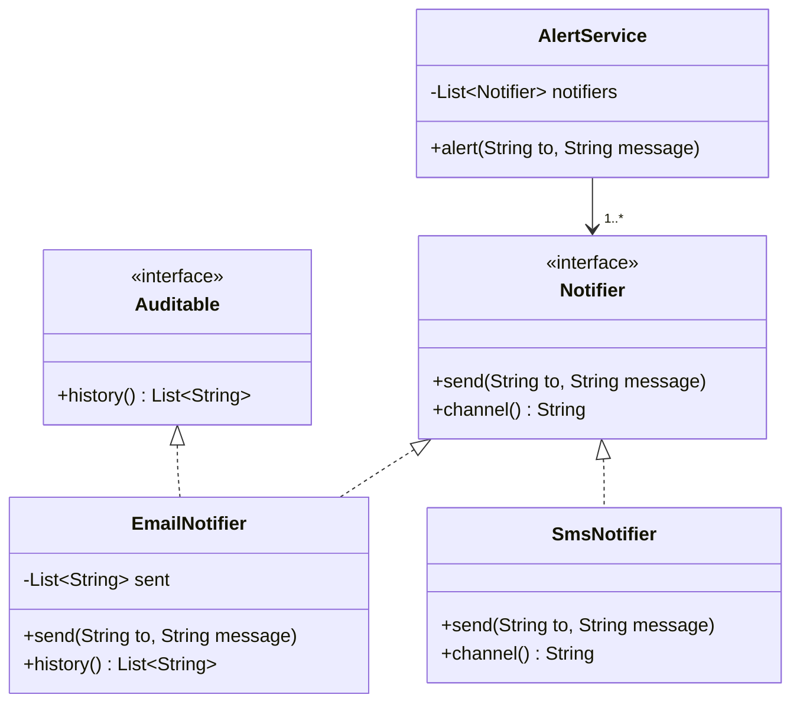

### Java example

```java
// File: code/lld/ch03/realization/Notifier.java
package lld.ch03.realization;

/** An interface: a contract of operations with no state. Drawn as <<interface>>. */
public interface Notifier {
    void send(String to, String message);

    /** Java 8+ default method: implementers inherit this unless they override it. */
    default String channel() {
        String n = getClass().getSimpleName();
        return n.contains("$$Lambda") ? "lambda" : n;   // lambdas get generated class names
    }
}
```

```java
// File: code/lld/ch03/realization/Auditable.java
package lld.ch03.realization;

import java.util.List;

public interface Auditable {
    List<String> history();
}
```

```java
// File: code/lld/ch03/realization/EmailNotifier.java
package lld.ch03.realization;

import java.util.ArrayList;
import java.util.List;

/** Realizes TWO interfaces. A class may implement many interfaces but extend only one class. */
public final class EmailNotifier implements Notifier, Auditable {
    private final List<String> sent = new ArrayList<>();

    @Override public void send(String to, String message) {
        String line = "EMAIL to " + to + ": " + message;
        sent.add(line);
        System.out.println("  " + line);
    }

    @Override public List<String> history() { return List.copyOf(sent); }
}
```

```java
// File: code/lld/ch03/realization/SmsNotifier.java
package lld.ch03.realization;

public final class SmsNotifier implements Notifier {
    @Override public void send(String to, String message) {
        String text = message.length() > 20 ? message.substring(0, 20) + "..." : message;
        System.out.println("  SMS to " + to + ": " + text);
    }

    @Override public String channel() { return "SMS"; }   // overrides the default
}
```

```java
// File: code/lld/ch03/realization/AlertService.java
package lld.ch03.realization;

import java.util.List;

/**
 * AlertService is associated with the INTERFACE, not with any concrete class.
 * Adding a PushNotifier later needs no change here.
 */
public final class AlertService {
    private final List<Notifier> notifiers;

    public AlertService(List<Notifier> notifiers) { this.notifiers = List.copyOf(notifiers); }

    public void alert(String to, String message) {
        for (Notifier n : notifiers) {
            System.out.println("via " + n.channel());
            n.send(to, message);
        }
    }
}
```

```java
// File: code/lld/ch03/realization/Main.java
package lld.ch03.realization;

import java.util.List;

public class Main {
    public static void main(String[] args) {
        EmailNotifier email = new EmailNotifier();
        Notifier sms = new SmsNotifier();
        Notifier console = (to, msg) -> System.out.println("  CONSOLE " + to + ": " + msg); // lambda realizes it too

        AlertService alerts = new AlertService(List.of(email, sms, console));
        alerts.alert("ops@shop.example", "Disk usage above 90 percent on db-1");

        Auditable audit = email;   // same object, seen through its other interface
        System.out.println("Email audit trail: " + audit.history());
    }
}
```

**What each part shows:** `EmailNotifier` realizes **two** interfaces; `SmsNotifier` realizes one and overrides the `default` method; a **lambda** also realizes `Notifier`, because it has exactly one abstract method (a *functional interface*). `AlertService` holds `List<Notifier>` — an association to the interface — so a new channel needs no change in it. The same `email` object is seen as a `Notifier` by `AlertService` and as an `Auditable` by `Main`.

Output:

```
via EmailNotifier
  EMAIL to ops@shop.example: Disk usage above 90 percent on db-1
via SMS
  SMS to ops@shop.example: Disk usage above 90 ...
via lambda
  CONSOLE ops@shop.example: Disk usage above 90 percent on db-1
Email audit trail: [EMAIL to ops@shop.example: Disk usage above 90 percent on db-1]
```

### Trade-offs

| | Interface + realization | Abstract class + generalization |
|---|---|---|
| Multiple per class | yes | no (single inheritance) |
| Instance fields | no | yes |
| Shared code | `default` methods only | any methods, constructors |
| Best for | roles/capabilities, plug-ins, test seams | a family sharing state and a workflow |

### When not to use it

- An interface with exactly one implementation that will never vary, and no testing need, is ceremony. Add it when a second implementation or a test double appears (YAGNI).
- "Marker" interfaces with no methods are rarely needed now; annotations usually serve better.

### Common mistakes

- Solid line instead of dashed (that would mean class inheritance).
- Fat interfaces that force implementers to stub methods they do not need (breaks the Interface Segregation Principle, Chapter 4).
- Callers declaring variables with the concrete type (`EmailNotifier n = ...`) and losing the benefit.

### Real-world examples

- `java.util.List` realized by `ArrayList` and `LinkedList`; `Comparable`, `Runnable`, `AutoCloseable`.
- **JDBC:** `java.sql.Connection` is an interface; each database vendor's driver realizes it, and your code never names the vendor class.
- **Spring:** you inject `PaymentGateway`; the bean may be a Stripe, Razorpay or mock implementation.
- **SLF4J** (logging facade): your code calls the `Logger` interface; Logback or Log4j realizes it.

### In the interview

**30-second answer:** "Realization is a class implementing an interface — dashed line, hollow triangle at the interface. I put an interface wherever behaviour can vary or I need a test double (payment gateway, notifier, pricing strategy), and the rest of the design depends on the interface only."

**Follow-ups:**

- *Q: Interface or abstract class?* — A: Interface for a capability many unrelated classes can have, or when a class needs several; abstract class when subclasses share state and a fixed workflow. They combine well: interface on top, abstract skeleton class below (like `List` → `AbstractList` → `ArrayList`).
- *Q: Is a lambda a realization?* — A: Yes; a lambda is an instance of a functional interface.

### Self-check

- *Q: Draw the difference between generalization and realization.* → A: Same hollow triangle; generalization has a solid line, realization a dashed line.
- *Q: How many interfaces can a Java class implement?* → A: Any number.

### TL;DR

Realization = "implements". Dashed line + hollow triangle at the `«interface»`. Depend on the interface, plug in implementations.

---

## 3.8 Decision guide: choosing the relationship between two classes

Ask these questions **in order** and stop at the first "yes":


*Figure — The four-question decision: inheritance, then composition, then aggregation, else association (course diagram)*

As the figure above shows, inheritance is asked first only because it is the easiest to *rule out*: it needs a strict yes to the substitution test, and most pairs fail it. Most pairs end up as plain association, which is healthy. If nearly every box in your diagram extends another, the design needs another look.

The full guide including the two "light" relationships:

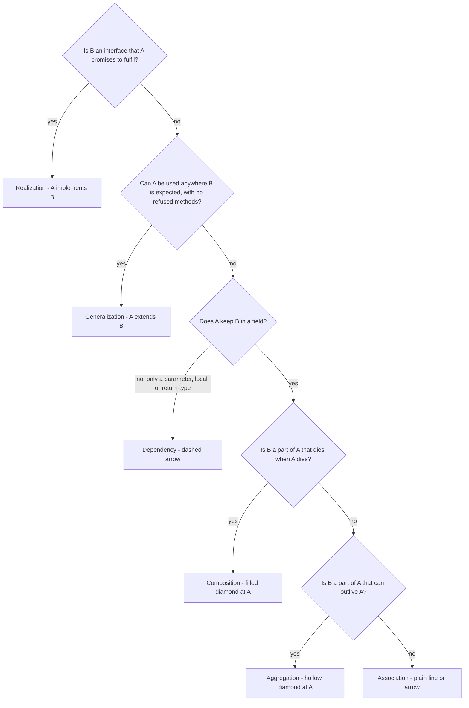

**Summary table (keep this one)**

| Relationship | Phrase | UML line | Java shape | Lifetime | Example |
|---|---|---|---|---|---|
| Dependency | A *uses* B | dashed, open arrow → B | B as parameter / local / return / static call | none | `CheckoutService` uses `PaymentGateway` |
| Association | A *knows* B | solid line (arrow for one-way) | field of type B, B created elsewhere | independent | `Order` → `Customer` |
| Aggregation | A *has* B (parts live on) | solid, hollow ◇ at A | field/collection, parts passed in | B outlives A | `Airline` ◇— `Aircraft` |
| Composition | A *owns* B | solid, filled ◆ at A | A creates B, hides it, B not shared | B dies with A | `ParkingFloor` ◆— `ParkingSpot` |
| Realization | A *implements* B | dashed, hollow △ at B | `implements` | — | `EmailNotifier` ⇢ `Notifier` |
| Generalization | A *is a* B | solid, hollow △ at B | `extends` | — | `CardPayment` → `Payment` |

**Mermaid cheat-sheet for these lines** (used in all later chapters):

| Mermaid | Meaning |
|---|---|
| `A ..> B` | A depends on B |
| `A --> B` | A associated with B, navigable A to B |
| `A -- B` | association (both ways / unspecified) |
| `A o-- B` | aggregation, A is the whole |
| `A *-- B` | composition, A is the whole |
| `B <\|.. A` | A realizes interface B |
| `B <\|-- A` | A extends B |
| `A "1" *-- "1..*" B` | with multiplicities |

### Common mistakes (all relationships)

- Diamond at the wrong end (it goes at the **whole**).
- Triangle at the wrong end (it goes at the **parent / interface**).
- Lines without multiplicity. A line with no type or count means the design question behind it is still open. Candidates who write the numbers on every line from the very first box report that the interviewer simply stops asking about them — it is cheap to add and removes a whole class of follow-up questions.
- Inheritance used to share data.

### In the interview

Say the test **out loud** as you draw each line, e.g. *"When a floor is removed its spots go too, so this is composition"* or *"Cash and card can both be asked to take money, so inheriting from Payment is honest."* If you spot a subclass that only carries a constant, say so and collapse it into a field yourself. Expect two follow-ups: "why not inheritance here?" (answer with the substitution test) and "what if a spot can hold two motorbikes?" (change the multiplicity, then say what it does to the code).

### Self-check

- *Q: `Library` and `Member` — which relationship?* → A: Aggregation (or plain association): members exist whether or not the library does.
- *Q: `Flight` and `WeeklySchedule`?* → A: Composition.
- *Q: `ParkingTicket` and `ParkingSpot`?* → A: Association: the ticket refers to the spot but is not a whole made of spots.
- *Q: `Report.render(Formatter f)`?* → A: Dependency.

### TL;DR

Realization/generalization for "is-a" (only after the substitution test), composition when parts die with the whole, aggregation when they live on, association when one just knows the other, dependency when it is only used inside a method.

---

# Part B — UML

## 3.9 What UML is (structural vs behavioural diagrams)

### What it is

**UML (Unified Modeling Language)** is a standard set of symbols for drawing software designs. Because everybody uses the same symbols, a diagram drawn by one engineer can be read by another without a legend. It is maintained by the OMG (Object Management Group); the current version is UML 2.5.1.

UML is **not** a programming language. It does not run and you do not need a tool to use it — a whiteboard is enough. It is an agreement about what, for example, "a line with a filled diamond on one end" means.

A little history explains its size: in the 1990s three competing object-oriented methods (Grady Booch's, James Rumbaugh's OMT and Ivar Jacobson's OOSE) each had their own notation. They were merged into UML so that the industry had one language. Because it had to satisfy three groups of users, UML is large — and every team uses only the subset it needs.

### The problem it solves

1. **It makes a design visible.** Twelve classes in sentences are hard to hold in your head; twelve boxes with lines are readable in seconds.
2. **It makes decisions explicit.** In a sentence you can stay vague about whether A owns B. On a diagram you must pick a diamond — filled or hollow.
3. **It makes disagreement cheap.** The interviewer can put a finger on one line and ask "why composition here?". That kind of back-and-forth is exactly what a good interview looks like.

### How it works — the 14 diagram types

UML 2.5 defines **14 diagram types** in two families:

- **Structural diagrams** show what the system *is made of* — the static parts that exist at any moment.
- **Behavioural diagrams** show what the system *does* over time. A subgroup of behavioural diagrams, **interaction diagrams**, focus on messages between objects.

| Family | Diagram | Shows | Interview use |
|---|---|---|---|
| Structural | **Class** | classes, attributes, operations, relationships | **always** |
| Structural | Object | a snapshot of real objects and their links | rarely (to explain an example) |
| Structural | Package | how classes group into packages/modules | rarely |
| Structural | Component | deployable parts and their interfaces | system design rounds |
| Structural | Composite structure | internal parts of one class | rarely |
| Structural | Deployment | software on hardware nodes | system design rounds |
| Structural | Profile | extensions to UML itself | never |
| Behavioural | **Use case** | actors and what they can achieve | early, often spoken |
| Behavioural | **Activity** | steps of one flow with branches | one per key flow |
| Behavioural | **State machine** | states of one object and allowed transitions | when an object has a lifecycle |
| Behavioural → interaction | **Sequence** | who calls whom, in time order | on request |
| Behavioural → interaction | Communication | same messages, drawn on a network of objects | rarely |
| Behavioural → interaction | Interaction overview | an activity diagram whose nodes are interactions | rarely |
| Behavioural → interaction | Timing | state changes against a time axis | embedded / hardware |

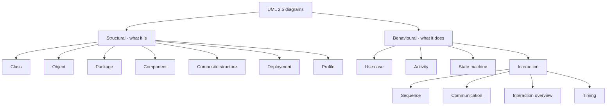


*Figure — The four diagrams an OOD interview uses and the question each answers (course diagram)*

As the figure above shows, four diagrams carry an object-oriented design interview, and this book adds a fifth that often helps:

1. **Use-case diagram** — who uses the system and what can each of them do? Drawn first, before any class exists.
2. **Class diagram** — what are the classes and how do they connect? *The* answer; the only one that maps directly to code.
3. **Activity diagram** — what are the steps of one flow and where does it branch?
4. **Sequence diagram** — which object calls which, in what order?
5. **State machine diagram** — what states can one object be in, and what moves it between them? (Parking spot, order, elevator, vending machine…)

### Trade-offs

| Benefit | Cost |
|---|---|
| Shared vocabulary, no legend needed | Large spec; easy to over-draw |
| Forces explicit decisions | Takes whiteboard time from code/discussion |
| Tool support (PlantUML, Mermaid, draw.io, StarUML) | Diagrams go stale if not kept with code |

### When not to use it

As documentation that nobody maintains, or in full formal detail on a whiteboard. Many teams today use lightweight "sketch" UML, the C4 model for architecture, or text-based tools (Mermaid/PlantUML) kept next to the code. For an interview, UML-lite is exactly right.

### Common mistakes

- Thinking the interviewer grades notation. They grade whether your **diagram and your words agree**. If you forget the realization arrow, say "this one implements that one" and draw something. If you draw a hollow diamond where you meant a filled one and then say which you meant, that is a discussion, not a lost point.
- Drawing a line you cannot justify. It hurts more than a missing line.

### Real-world examples

- Mermaid diagrams render natively in GitHub and GitLab Markdown, which is why many design docs (RFCs, ADRs) embed sequence and class diagrams as text.
- PlantUML is widely used in enterprise wikis (Confluence plug-ins) for sequence diagrams of service calls.

### In the interview

**30-second answer:** "UML is a standard notation for designs. It has 14 diagrams: structural ones (class, object, component…) describe what the system is made of; behavioural ones (use case, activity, state machine, and the interaction diagrams such as sequence) describe what it does. In an OOD round I use a quick use-case list, one class diagram, and an activity or sequence diagram for the key flow."

**Follow-ups:**

- *Q: Is UML outdated?* — A: The full formal UML is rarely used, but its core notations (class, sequence, state) remain the shared language of design discussions and appear in Mermaid/PlantUML in modern repos. You only need the subset.
- *Q: Which diagram maps to code?* — A: The class diagram.

### Self-check

- *Q: Structural or behavioural: sequence diagram?* → A: Behavioural (an interaction diagram).
- *Q: How many UML diagram types exist?* → A: 14 (7 structural, 7 behavioural).

### TL;DR

UML = standard symbols, not a language that runs. 14 diagrams: structural (what it is) vs behavioural (what it does). Interviews use class (always), use case, activity, sequence, and state machine when an object has a lifecycle.

---

## 3.10 Use-case diagrams

### What it is

A **use-case diagram** shows **who** uses the system and **what** each of them can achieve. It has no classes, no methods, no data and no ordering.

- An **actor** is a *role* that interacts with the system, drawn as a stick figure outside the system. Roles, not people: one person can be both a Member and a Librarian; one actor can stand for thousands of users. An actor need not be human — a payment gateway, an email service or a timer ("System") is an actor too.
- A **use case** is one goal an actor can achieve that produces a result the actor cares about, drawn as an oval with a verb phrase: "Borrow a book". "Click the search button" is not a use case; it is a step inside one.
- The **system boundary** is a rectangle around all use cases, labelled with the system's name. Inside = what you build. Outside = everything else.

Analogy: the menu board at a restaurant. It lists what customers can order (use cases) and who can order what (a kids' menu for children), without saying anything about the kitchen.


*Figure — The parts of a use-case diagram for online shopping: actors (Customer, Guest), use cases, system boundary, generalization between actors, and «include» / «extend» relationships (course diagram)*

### The problem it solves

It turns a vague one-line question ("design a library") into an **agreed scope**. Drawing the boundary lets you say "these nine things are in; refunds, seasonal pricing and reporting are out" — and the interviewer, who judges whether your answer is complete, has agreed to that list. It also hands you your first classes: **actors usually become classes and use cases usually become methods**.

### How it works

1. **Find the actors** with four questions:
   - *Who starts something?* (customer, member, player)
   - *Who administers it?* (adds books, sets rates, blocks accounts — the most-forgotten actor, and it brings a whole column of use cases)
   - *Who gets told?* (anyone receiving notifications)
   - *What acts with nobody present?* (timers, background jobs, external services — draw as "System")
2. Put **primary actors** (who start use cases) on the left and **secondary/supporting actors** (whom the system calls, e.g. payment gateway) on the right.
3. Draw the **system boundary** and put each **use case** (verb phrase) inside.
4. Connect actors to their use cases with **plain lines (associations)**.
5. Add relationships between use cases only where they help:
   - **«include»** — *always*. The base use case always performs the included one. Dashed arrow **from the base to the included** case. E.g. *Borrow a book* «include» *Check member's limit*. In code: one method always calls another.
   - **«extend»** — *sometimes*. An optional behaviour that is inserted into the base under a condition, at a named **extension point**. Dashed arrow **from the extending case back to the base**. E.g. *Charge fine* «extend» *Return a book* (only if late). Test: can the base use case complete without it? Yes → extend; no → include.
   - **Generalization** — solid line with a hollow triangle: between actors (a Librarian can do everything a Member can) or between use cases (*Pay by card* is a kind of *Make payment*).
6. Spell the keywords singular: «include», «extend». Older material uses «includes», «extends» or «uses»; «uses» was replaced by «include» long ago.

Reading the course figure above: the Customer→Guest line has its hollow triangle at **Guest**, so it reads "a Customer is a kind of Guest — a Customer can do everything a Guest can, plus check out". The figure also puts hollow triangles on its «include»/«extend» arrows; strict UML draws both as a dashed line with an **open** arrowhead (the triangle is reserved for generalization). What matters is the direction and the label: «include» points *Checkout shopping cart → Make payment*; both «extend» arrows point from the search variants back to *Search product*.

Mermaid has no native use-case diagram, so this book draws them as flowcharts (stadium shapes = use cases, a subgraph = the boundary):

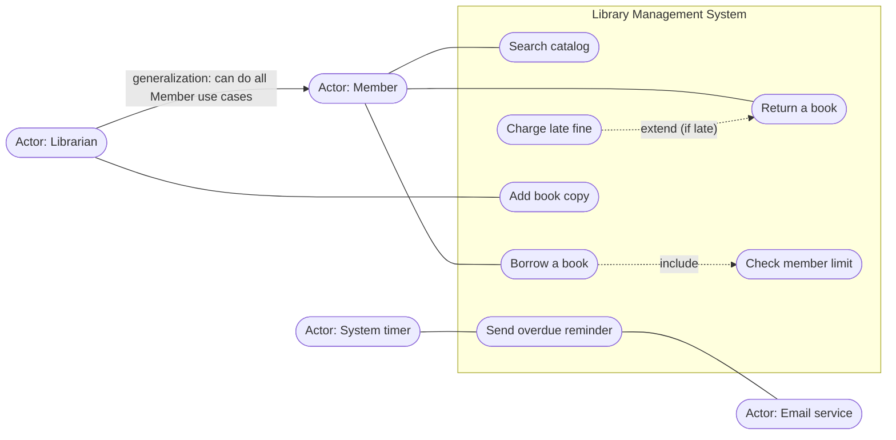

### From use cases to code (see `lld.ch03.library`)

| Use-case element | Becomes in Java |
|---|---|
| Actor *Member* | class `Member` |
| Actor *Librarian* (generalizes Member) | `class Librarian extends Member` |
| *Borrow a book* | `Member.checkout(BookItem, LocalDate)` |
| «include» *Check member limit* | private `checkLimit()` called on **every** checkout |
| *Return a book* | `Member.returnBook(BookItem, LocalDate)` |
| «extend» *Charge late fine* | `chargeFine(...)` called **only if** the book is late |
| *Add book copy* | `Librarian.addCopy(...)` |

This is a starting point, not a rule: a use-case method sometimes belongs on a service class instead of the actor class.

### Trade-offs

| Pro | Con |
|---|---|
| Fast scope agreement; finds forgotten actors | No ordering, no data — it cannot show *how* |
| Maps to classes and methods | Easy to bloat with UI steps |

### When not to use it

When the interviewer has already given precise requirements — then a spoken list of actors and their use cases is enough.

### Common mistakes

- **Use cases that are UI steps.** Typing a password, pressing submit and seeing a confirmation are all part of a single use case, "Log in". A diagram with dozens of ovals is usually a list of screens, not goals.
- **One actor per person.** A librarian who also borrows is *two roles*. Draw two actors, linked by generalization if one can do everything the other can.
- Reversing the «extend» arrow (it points from the optional case to the base).
- Using «include» for something that only happens sometimes.
- Leaving off the system boundary — the most useful part.

### Real-world examples

- **An e-commerce checkout (Amazon-style), modelled:** *Place order* always «include»s *Make payment*; *Apply gift card* «extend»s it only when the customer has one.
- **BookMyShow:** Customer, Theatre admin, Payment gateway and a timer that releases held seats are the actors.

### In the interview

**30-second answer:** "Before classes, I list actors and what each can do, and draw a boundary to agree scope. Actors are roles — including admins, external services and timers. «include» is always, «extend» is sometimes. Actors become my first classes and use cases become methods."

**Follow-ups:**

- *Q: Is 'make payment' an include or an extend of 'checkout'?* — A: If every checkout requires payment, it is «include». Something like "apply coupon", which checkout can complete without, is «extend».
- *Q: How long should this take?* — A: Three to five minutes, early.

### Self-check

- *Q: Which direction does the «include» arrow point?* → A: From the base use case to the included one.
- *Q: Is a payment gateway an actor?* → A: Yes — an external system that interacts with ours (a secondary actor).
- *Q: "Search product by name" and "by category" relate to "Search product" how?* → A: As in the course diagram: optional variants, drawn as «extend» (some modellers draw them as use-case generalization — both are defensible if explained).

### TL;DR

Actors (roles, outside) + use cases (goals, inside) + boundary (scope). «include» = always, arrow base→included; «extend» = sometimes, arrow extension→base. Actors → classes, use cases → methods.

---

## 3.11 Class diagrams

### What it is

A **class diagram** shows the **static structure** of a design: which classes exist, what each holds (attributes), what each can do (operations), and how they connect (relationships with multiplicity). It is the answer to an OOD question and the only UML diagram that maps directly to code.

### The problem it solves

It captures the whole design on one page so it can be reviewed, challenged and turned into code. Every other diagram exists either to get you to it (use case) or to check/explain it (activity, sequence, state).

### How it works — the class box

A class is a rectangle with three compartments: **name** / **attributes** / **operations**.


*Figure — A class box: name on top, properties (attributes) in the middle, methods (operations) at the bottom, using a Flight class (course diagram)*

As in the figure above, attributes are written `name: Type` and operations `name(params): ReturnType`. The full UML syntax is:

```
visibility name : Type [multiplicity] = default      e.g.  - spots : ParkingSpot [1..*]
visibility name(param : Type, ...) : ReturnType      e.g.  + park(v : Vehicle) : Ticket
```

**Visibility markers** (mapped to Java):

| UML | Meaning | Java |
|---|---|---|
| `+` | public — anyone | `public` |
| `-` | private — only this class | `private` |
| `#` | protected — this class and subclasses | `protected` (Java also allows the same package) |
| `~` | package — same package only | no modifier (package-private) |

**Other notation:**

| Notation | Meaning | Java |
|---|---|---|
| *Italic* name, or `{abstract}` / `«abstract»` | abstract class (one you never create objects of directly) / abstract operation (no body) | `abstract` |
| `«interface»` above the name | interface | `interface` |
| `«enumeration»` + literals | enum | `enum` |
| <u>underlined</u> member | static (class-level) | `static` |
| `{readOnly}` | cannot change after creation | `final` field |
| `List<T>` / `T[*]` | collection attribute | `List<T>` |

You do **not** have to fill all three compartments. Early in an interview a box with only a name is a perfectly good class. Attributes and operations arrive as the design settles.

In Mermaid, visibility uses the same symbols; `*` after a method means abstract and `$` means static; `<<interface>>`, `<<abstract>>`, `<<enumeration>>` are annotations; generics are written `List~T~`.

### How it works — the relationships (all arrow types)


*Figure — An airline-system class diagram using every relationship: associations (e.g. Flight to Aircraft, uni-directional), multiplicities (FlightInstance has 2 Pilots), aggregation (Airline–Aircraft), composition (Flight–WeeklySchedule), generalization (Person to Crew/Pilot/Admin) and dependency (course diagram)*

The figure above uses the complete vocabulary: the six relationships of Part A (association appearing in both its two-way and one-way form) plus multiplicity. Those are the only symbols a class diagram needs:

| Line | Drawn as | Read as | Example from the figure |
|---|---|---|---|
| Association (bi-directional) | solid line | "A and B know each other" | FlightInstance — Pilot, FlightInstance — Crew ("assigned to") |
| Uni-directional association | solid line, arrowhead at B | "A can call B, not vice versa" | Flight → Airport ("lands on/departs from"), Flight → Aircraft ("assigned to") |
| Multiplicity | numbers at the line ends: `1`, `*`, `0..1`, `2..4` (a range) | "how many" | FlightInstance `*` — `2` Pilot: each flight instance has exactly 2 pilots, each pilot flies many instances |
| Aggregation | hollow diamond at the whole | "has-a, part lives on" | Airline `1` ◇— `*` Aircraft |
| Composition | filled diamond at the whole | "owns, part dies with it" | Flight ◆— WeeklySchedule, Flight ◆— CustomSchedule, Flight ◆— FlightInstance |
| Generalization | solid line, hollow triangle at parent | "is-a" | Pilot, Crew, Admin → Person |
| Realization | dashed line, hollow triangle at interface | "implements" | (any `«interface»`) |
| Dependency | dashed line, open arrowhead | "uses" | FlightReservation ⇢ Payment |

(The figure draws its one-way arrowheads filled; strict UML uses an open arrowhead — see the legend note in 3.1.)

A note on reading the figure: some of its classes carry getters for the "other" direction (e.g. `Aircraft.getFlights()`) even though the line is drawn one-way. Strictly, such a getter makes the association navigable both ways; treat the arrow as "the primary direction", and in your own diagrams keep arrows and fields consistent.

Two extra notations worth recognising:

- **Association class** — a class hanging off an association by a dashed line, holding data about the *link itself* (e.g. `Enrollment{grade}` on Student–Course).
- **Qualified association** — a small box on one end with a key (e.g. `Library [isbn] → Book`), meaning "look up by this key" — in Java a `Map<Isbn, Book>`.

### Worked example — the library design (code in `lld.ch03.library`)

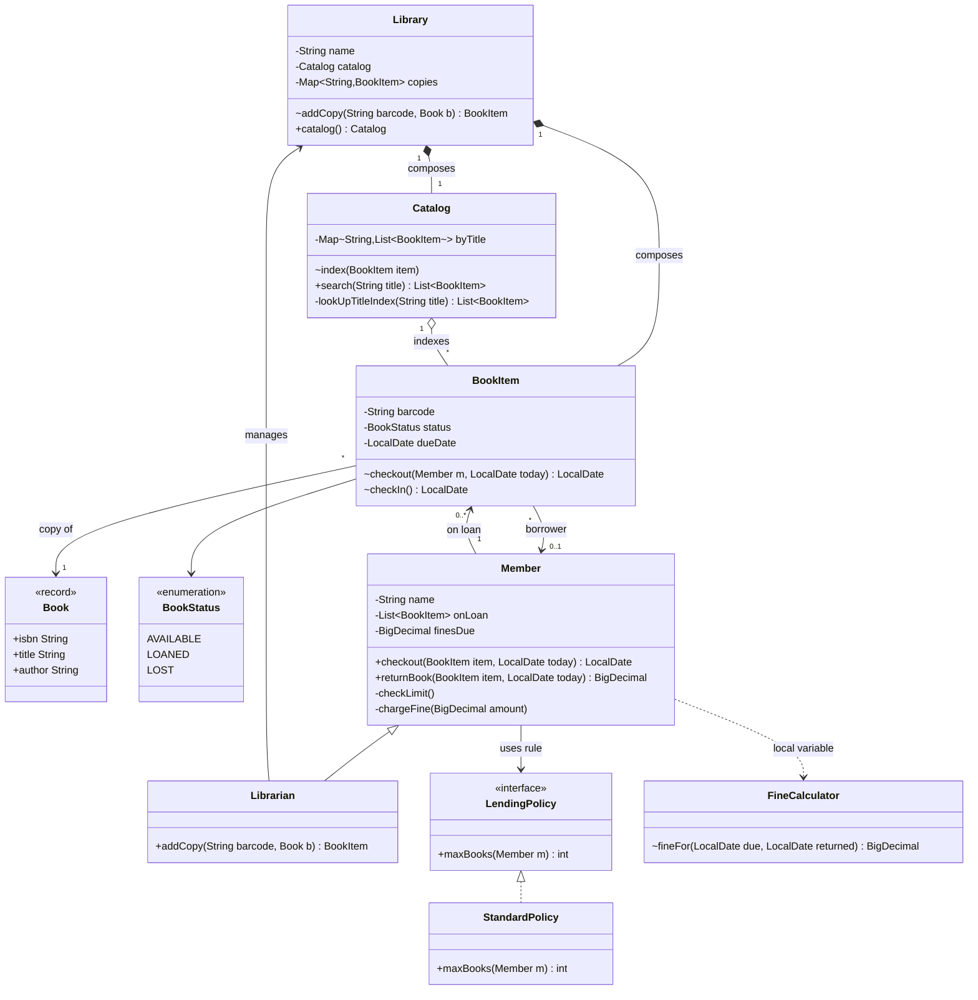

Every line type appears: composition (Library ◆ Catalog, Library ◆ BookItem), aggregation (Catalog ◇ BookItem — the index points at copies it does not own), associations with multiplicity, generalization (Librarian → Member), realization (StandardPolicy ⇢ LendingPolicy) and dependency (Member ⇢ FineCalculator). Visibility `~` marks package-private methods such as `BookItem.checkout`, which only `Member` (same package) may call. The Java code is listed in full in 3.12.

### How much detail to draw

- **Every class gets a box and a name.** 10–15 boxes is a full answer.
- **Attributes only where they matter** — the two or three fields that carry the design.
- **Operations only where they are interesting** — the methods that appear in your flows.
- **Every line gets a relationship type and a multiplicity.** This is the part not to skip.
- If short of time, **drop attributes before relationships**. Boxes with only names but precise, labelled lines already describe a design; richly detailed boxes joined by vague lines do not.

### Trade-offs

| Detailed diagram | Sketch diagram |
|---|---|
| Near code-ready; fewer surprises later | Faster; easier to change during discussion |
| Takes 10+ minutes | Leaves details for the coding phase |

### When not to use it

It does not show *order* or *time* — use sequence/activity/state diagrams for behaviour.

### Common mistakes

- Unlabelled lines (no type, no multiplicity).
- Diamonds/triangles at the wrong end.
- Listing every getter/setter and `String` field.
- Associations drawn in the diagram that do not exist as fields in the code (or vice versa).

### Real-world examples

- IntelliJ IDEA (Ultimate) can generate class diagrams from code; many teams use them to explore unfamiliar modules.
- JPA entity diagrams (ER-style) are essentially class diagrams with multiplicities (`@OneToMany` = `1..*`).

### In the interview

**30-second answer:** "I start with named boxes from the nouns and actors, then draw every line with a type and multiplicity, saying the lifetime/substitution test aloud. I add only the attributes and methods that drive the key flows. `+ - # ~` for visibility, italics or «abstract» for abstract, «interface» for interfaces."

**Follow-ups:**

- *Q: What does `#` mean and what is the Java nuance?* — A: Protected. In Java, protected is also visible to classes in the same package, which UML's `#` does not imply.
- *Q: How do you show a static method?* — A: Underline it (Mermaid: `$` suffix).

### Self-check

- *Q: `~` means?* → A: Package visibility (Java's default, no modifier).
- *Q: What is the one test for aggregation vs composition?* → A: Imagine the whole is gone — is the part still meaningful by itself?

### TL;DR

Box = name / attributes / operations with `+ - # ~`. Seven lines: association (± arrow), aggregation ◇, composition ◆, generalization (solid △), realization (dashed △), dependency (dashed arrow), plus multiplicity on every line.

---

## 3.12 Sequence diagrams

### What it is

A **sequence diagram** shows **which object calls which, and in what order**, for one scenario. Objects run across the top; **time runs down the page**.


*Figure — A member searches the catalog for "dune" and borrows a copy: lifelines, a self-call on Catalog, calls with filled arrowheads and dashed returns (course diagram)*

### The problem it solves

A class diagram says objects *can* talk; a sequence diagram shows what they *actually say* and in which order. It is the right diagram when the order is easy to get wrong (reserve seat → take payment → confirm — any other order is a bug, and the diagram is the argument for this one), when several objects take part in one flow (two objects need no diagram; five usually do), or when you are explaining a class diagram you have already drawn.

### How it works — the notation

| Element | Drawn as | Meaning |
|---|---|---|
| **Participant / lifeline** | box at top + dashed vertical line | one *object* (strictly `catalog : Catalog`; most people just write the class name) |
| **Actor** | stick figure at top | a user or external system starting the flow |
| **Synchronous message** | solid line, **filled** arrowhead | a call; the caller waits for it to finish |
| **Asynchronous message** | solid line, **open** arrowhead | fire-and-forget; the caller continues (events, queues) |
| **Return (reply)** | dashed line, open arrowhead | the value coming back — draw only when it matters |
| **Self-message** | arrow looping back to the same lifeline | the object calls its own method |
| **Activation bar** (execution specification) | thin rectangle on a lifeline | the object is busy executing |
| **Create message** | dashed arrow to the new object's box, often labelled «create» | the object is created at that moment |
| **Destruction** | **X** at the end of a lifeline | the object is destroyed |
| **Combined fragment** | labelled box around messages | control logic: see below |

**Combined fragments** (the box's top-left label is the *operator*; conditions called *guards* are in `[ ]`):

| Operator | Meaning | Java equivalent |
|---|---|---|
| `alt` | alternatives, one runs (sections split by dashed lines, each with a guard, last can be `[else]`) | `if / else if / else` |
| `opt` | optional, runs only if the guard is true | `if` without `else` |
| `loop` | repeats while the guard holds (`loop [for each item]`) | `for` / `while` |
| `par` | sections run in parallel | threads / `CompletableFuture` |
| `break` | if guard true, run this and leave the enclosing fragment | early `return` / `break` |
| `critical` | atomic region, no interleaving | `synchronized` / lock |
| `ref` | reference to another diagram | calling a helper flow |

(UML also has `neg`, `strict`, `seq`, `assert`, `ignore` and `consider`; you will not need them in an interview.)

On a whiteboard, activation bars and fragments are both optional and usually skipped: lifelines, calls, the returns that matter and self-calls are enough. They are shown in full here so you can read them when you meet them.

### Example 1 — the library checkout, matching the Java code

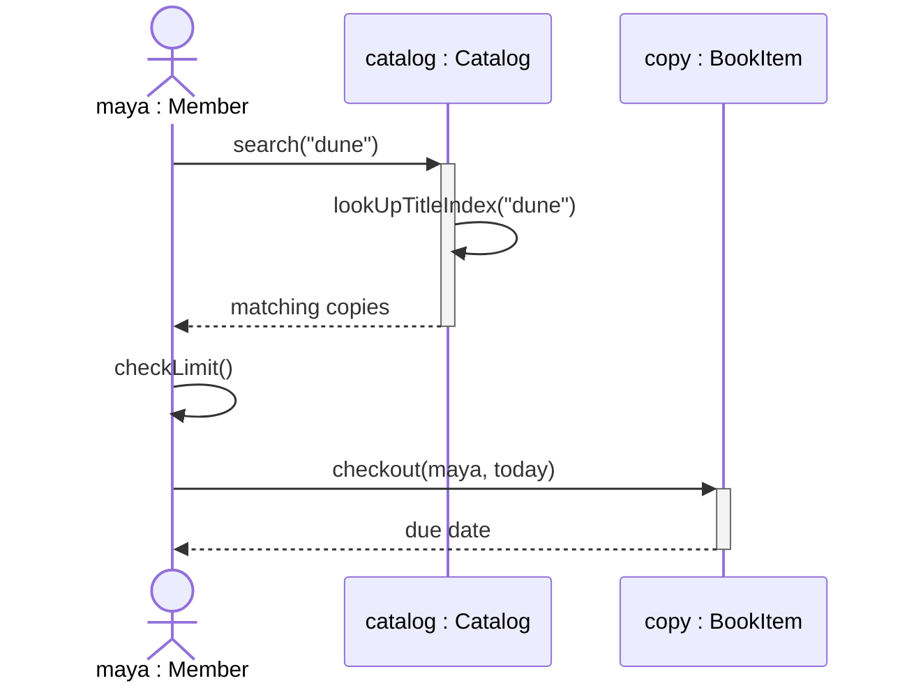

Four things are worth noticing (the same as in the course figure above):

1. **The first message starts the flow** — a flow is always kicked off from outside the objects shown; here the member calls `search`.
2. **The catalog calls itself** — looking up the title index needs no other object, so the arrow loops back.
3. **Only two returns are drawn** — the copies and the due date; other calls return nothing worth naming.
4. **The member talks to the copy directly** — borrowing goes straight to `BookItem`, not back through `Catalog`. No other diagram shows this choice, and an interviewer can question it simply by tapping that arrow.

### Example 2 — all fragments and async messages (checkout with payment)

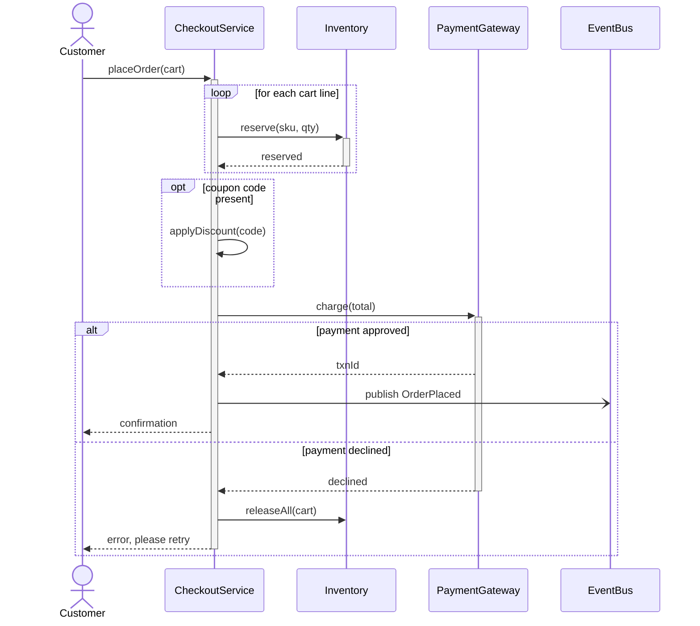

Here `->>` is a synchronous call, `-->>` a reply, and `-)` an **asynchronous** message: publishing an event does not wait for subscribers. The order is the point of the diagram: reserve stock *before* charging, and release it if the charge fails.

### Java code for Example 1 (`lld.ch03.library`)

```java
// File: code/lld/ch03/library/Book.java
package lld.ch03.library;

/** The title (one per ISBN). Many physical copies (BookItem) point at one Book. */
public record Book(String isbn, String title, String author) { }
```

```java
// File: code/lld/ch03/library/BookStatus.java
package lld.ch03.library;

public enum BookStatus { AVAILABLE, LOANED, LOST }
```

```java
// File: code/lld/ch03/library/BookItem.java
package lld.ch03.library;

import java.time.LocalDate;
import java.util.Optional;

/** One physical copy. Association BookItem * --> 1 Book, and 0..1 borrower. */
public final class BookItem {
    static final int LOAN_DAYS = 14;

    private final String barcode;
    private final Book book;
    private BookStatus status = BookStatus.AVAILABLE;
    private Member borrower;      // 0..1
    private LocalDate dueDate;    // set only while LOANED

    public BookItem(String barcode, Book book) {
        this.barcode = barcode;
        this.book = book;
    }

    /** Called by Member. Returns the due date: the one return the sequence diagram draws. */
    LocalDate checkout(Member m, LocalDate today) {
        if (status != BookStatus.AVAILABLE) {
            throw new IllegalStateException(barcode + " is " + status);
        }
        status = BookStatus.LOANED;
        borrower = m;
        dueDate = today.plusDays(LOAN_DAYS);
        return dueDate;
    }

    LocalDate checkIn() {
        if (status != BookStatus.LOANED) throw new IllegalStateException(barcode + " is not on loan");
        LocalDate due = dueDate;
        status = BookStatus.AVAILABLE;
        borrower = null;
        dueDate = null;
        return due;
    }

    public String barcode() { return barcode; }
    public Book book() { return book; }
    public BookStatus status() { return status; }
    public Optional<Member> borrower() { return Optional.ofNullable(borrower); }

    @Override public String toString() { return barcode + "[" + book.title() + ", " + status + "]"; }
}
```

```java
// File: code/lld/ch03/library/Catalog.java
package lld.ch03.library;

import java.util.ArrayList;
import java.util.HashMap;
import java.util.List;
import java.util.Locale;
import java.util.Map;

/** An index over copies. It aggregates BookItems: it points at them but does not create or own them. */
public final class Catalog {
    private final Map<String, List<BookItem>> byTitle = new HashMap<>();

    void index(BookItem item) {
        byTitle.computeIfAbsent(key(item.book().title()), k -> new ArrayList<>()).add(item);
    }

    public List<BookItem> search(String title) {
        List<BookItem> hits = lookUpTitleIndex(title);   // self-call in the sequence diagram
        return List.copyOf(hits);
    }

    private List<BookItem> lookUpTitleIndex(String title) {
        return byTitle.getOrDefault(key(title), List.of());
    }

    private static String key(String title) { return title.toLowerCase(Locale.ROOT); }
}
```

```java
// File: code/lld/ch03/library/LendingPolicy.java
package lld.ch03.library;

/** Realized by concrete policies. Member depends on this interface, not on a class. */
public interface LendingPolicy {
    int maxBooks(Member m);
}
```

```java
// File: code/lld/ch03/library/StandardPolicy.java
package lld.ch03.library;

public final class StandardPolicy implements LendingPolicy {
    @Override public int maxBooks(Member m) { return m instanceof Librarian ? 10 : 2; }
}
```

```java
// File: code/lld/ch03/library/FineCalculator.java
package lld.ch03.library;

import java.math.BigDecimal;
import java.time.LocalDate;
import java.time.temporal.ChronoUnit;

/** Used as a local helper inside Member.returnBook: a dependency, not a field. */
final class FineCalculator {
    private static final BigDecimal PER_DAY = new BigDecimal("5.00");

    BigDecimal fineFor(LocalDate due, LocalDate returned) {
        long late = ChronoUnit.DAYS.between(due, returned);
        return late > 0 ? PER_DAY.multiply(BigDecimal.valueOf(late)) : BigDecimal.ZERO.setScale(2);
    }
}
```

```java
// File: code/lld/ch03/library/Member.java
package lld.ch03.library;

import java.math.BigDecimal;
import java.time.LocalDate;
import java.util.ArrayList;
import java.util.Collections;
import java.util.List;

/**
 * Actor "Member" becomes a class; its use cases become methods:
 *   Borrow a book  -> checkout(...)  which always <<include>>s the limit check
 *   Return a book  -> returnBook(...) which is sometimes <<extend>>ed by "charge a fine"
 */
public class Member {
    private final String name;
    private final LendingPolicy policy;              // association to an interface
    private final List<BookItem> onLoan = new ArrayList<>();
    private BigDecimal finesDue = BigDecimal.ZERO.setScale(2);   // money: BigDecimal, not double

    public Member(String name, LendingPolicy policy) {
        this.name = name;
        this.policy = policy;
    }

    public LocalDate checkout(BookItem item, LocalDate today) {
        checkLimit();                                // <<include>>: happens every time
        LocalDate due = item.checkout(this, today);
        onLoan.add(item);
        return due;
    }

    public BigDecimal returnBook(BookItem item, LocalDate today) {
        if (!onLoan.remove(item)) throw new IllegalStateException(name + " does not hold " + item.barcode());
        LocalDate due = item.checkIn();
        BigDecimal fine = new FineCalculator().fineFor(due, today);
        if (fine.signum() > 0) chargeFine(fine);       // <<extend>>: only when late
        return fine;
    }

    private void checkLimit() {
        int max = policy.maxBooks(this);
        if (onLoan.size() >= max) {
            throw new IllegalStateException(name + " already has " + max + " books (limit)");
        }
    }

    private void chargeFine(BigDecimal amount) { finesDue = finesDue.add(amount); }

    public String name() { return name; }
    public BigDecimal finesDue() { return finesDue; }
    public List<BookItem> onLoan() { return Collections.unmodifiableList(onLoan); }
}
```

```java
// File: code/lld/ch03/library/Librarian.java
package lld.ch03.library;

/** Generalization between actors: a librarian can do everything a member can, plus more. */
public final class Librarian extends Member {
    private final Library library;

    public Librarian(String name, LendingPolicy policy, Library library) {
        super(name, policy);
        this.library = library;
    }

    public BookItem addCopy(String barcode, Book book) { return library.addCopy(barcode, book); }
}
```

```java
// File: code/lld/ch03/library/Library.java
package lld.ch03.library;

import java.util.LinkedHashMap;
import java.util.Map;

/**
 * The system boundary made concrete. Library composes its Catalog (created here,
 * never shared) and composes its copies (only a Library creates a BookItem it registers).
 */
public final class Library {
    private final String name;
    private final Catalog catalog = new Catalog();                  // composition
    private final Map<String, BookItem> copies = new LinkedHashMap<>();

    public Library(String name) { this.name = name; }

    BookItem addCopy(String barcode, Book book) {
        BookItem item = new BookItem(barcode, book);
        copies.put(barcode, item);
        catalog.index(item);
        return item;
    }

    public Catalog catalog() { return catalog; }
    public String name() { return name; }
}
```

```java
// File: code/lld/ch03/library/Main.java
package lld.ch03.library;

import java.math.BigDecimal;
import java.time.LocalDate;
import java.util.List;

public class Main {
    public static void main(String[] args) {
        LendingPolicy policy = new StandardPolicy();
        Library lib = new Library("Town Library");
        Librarian lee = new Librarian("Lee", policy, lib);

        Book dune = new Book("978-0441013593", "Dune", "Frank Herbert");
        Book hobbit = new Book("978-0547928227", "The Hobbit", "J.R.R. Tolkien");
        lee.addCopy("B-1", dune);
        lee.addCopy("B-2", dune);
        lee.addCopy("B-3", hobbit);
        lee.addCopy("B-4", hobbit);

        Member maya = new Member("Maya", policy);
        LocalDate day1 = LocalDate.of(2026, 3, 1);

        // Sequence: member -> catalog.search -> (self) lookUpTitleIndex -> copies; member -> copy.checkout -> due
        List<BookItem> hits = lib.catalog().search("dune");
        System.out.println("search(\"dune\") -> " + hits);
        LocalDate due = maya.checkout(hits.get(0), day1);
        System.out.println("Maya borrowed B-1, due " + due);
        maya.checkout(lib.catalog().search("the hobbit").get(0), day1);
        System.out.println("Maya on loan: " + maya.onLoan());

        try {
            maya.checkout(hits.get(1), day1);   // <<include>> limit check fires
        } catch (IllegalStateException e) {
            System.out.println("Blocked: " + e.getMessage());
        }

        try {
            new Member("Omar", policy).checkout(hits.get(0), day1);   // copy already LOANED
        } catch (IllegalStateException e) {
            System.out.println("Blocked: " + e.getMessage());
        }

        BigDecimal onTime = maya.returnBook(hits.get(0), day1.plusDays(10));
        System.out.println("Returned B-1 on time, fine = " + onTime);
        BookItem hobbitCopy = maya.onLoan().get(0);
        BigDecimal late = maya.returnBook(hobbitCopy, day1.plusDays(17));   // <<extend>> fine applies
        System.out.println("Returned " + hobbitCopy.barcode() + " 3 days late, fine = " + late
                + ", Maya owes " + maya.finesDue());
        System.out.println("Librarian limit: " + policy.maxBooks(lee) + ", member limit: " + policy.maxBooks(maya));
    }
}
```

Output:

```
search("dune") -> [B-1[Dune, AVAILABLE], B-2[Dune, AVAILABLE]]
Maya borrowed B-1, due 2026-03-15
Maya on loan: [B-1[Dune, LOANED], B-3[The Hobbit, LOANED]]
Blocked: Maya already has 2 books (limit)
Blocked: B-1 is LOANED
Returned B-1 on time, fine = 0.00
Returned B-3 3 days late, fine = 15.00, Maya owes 15.00
Librarian limit: 10, member limit: 2
```

Check the diagram against the code: every arrow is a real method — `Catalog.search`, `Catalog.lookUpTitleIndex`, `Member.checkLimit`, `BookItem.checkout`. **If a message has no method, your class diagram is missing one** — the same check the activity diagram does, from another direction.

### Trade-offs

| Good at | Poor at |
|---|---|
| Order of calls, who talks to whom | Branch-heavy flows (nested `alt` becomes unreadable) |
| Showing sync vs async | Showing the whole design |
| Spotting missing methods | Being quick to draw — each message is a line |

### When not to use it

- For a flow with three or more decisions: use an **activity diagram**. A second `alt`/`opt` box on the same diagram is the warning sign.
- Unprompted in most OOD interviews — it costs time you need for the class diagram.

### Common mistakes

- Drawing a return for every call — the diagram doubles in height and says nothing more.
- Messages that are not methods on the receiving class.
- Mixing up arrowheads: filled = sync call, open solid = async, dashed = reply.
- Drawing classes instead of the specific objects when two objects of the same class take part (e.g. `from : Account`, `to : Account`).

### Real-world examples

- **OAuth 2.0 / OpenID Connect** login flows (browser → app → authorization server → token endpoint) are almost always documented as sequence diagrams.
- **Payment integrations** (Stripe, Razorpay) document "create order → redirect → webhook" as sequence diagrams, with the webhook as an asynchronous message.
- **Microservice sagas** (e.g. a travel booking that reserves a flight, a hotel and a car) are usually explained with sequence diagrams that show the compensating "undo" calls when one step fails.

### In the interview

**30-second answer:** "A sequence diagram shows one scenario: objects across the top, time downwards. Solid filled arrows are sync calls, open arrows async, dashed arrows returns. `alt`/`opt`/`loop` fragments show if/else, if, and loops. I keep it to three or four objects and six to eight messages, and check that every arrow is a method on my class diagram."

**Follow-ups:**

- *Q: Sync vs async message?* — A: Sync: caller blocks until the callee returns (a normal method call). Async: caller continues immediately (a queue message, event, `CompletableFuture`).
- *Q: When would you use a sequence diagram over an activity diagram?* — A: When the interesting part is *who calls whom* in what order; activity when the interesting part is branching.

### Self-check

- *Q: What does a thin rectangle on a lifeline mean?* → A: An activation bar — the object is executing.
- *Q: Which fragment models "retry up to 3 times"?* → A: `loop [attempt <= 3]`.
- *Q: How do you show that `Order` creates a `Payment` mid-flow?* → A: A create message (dashed arrow, «create») pointing to the new lifeline's box, which starts lower on the page.

### TL;DR

Objects across, time down. Filled = sync call, open = async, dashed = return. `alt` = if/else, `opt` = if, `loop` = loop, `par` = parallel. Keep it small and check each arrow is a real method.

---

## 3.13 Activity diagrams

### What it is

An **activity diagram** traces **a single flow end to end**, marking each point where it **branches** (and any steps that run in parallel). Where a class diagram captures the design at rest, an activity diagram follows one route through it. Among UML diagrams it is the closest thing to a flowchart, so nearly everyone can follow it — which also makes a careless one easy to produce.

### The problem it solves

It makes the business logic of a flow — every `if`, `unless`, `otherwise` in the requirements — visible and checkable. Its best interview use is as a **test of your class diagram**: walk the flow action by action and ask *which class does this?* If an action has no home, you have found a missing class — on the whiteboard, not in the code.

### How it works — the symbols


*Figure — The core activity-diagram symbols: start, action, a decision with [yes]/[no] guards, the other branch, where the branches meet again, and the end (course diagram)*

| Symbol | Drawn as | Meaning |
|---|---|---|
| **Initial node (start)** | filled black circle | where the flow begins (draw exactly one; UML technically allows several, but one keeps the diagram readable) |
| **Action** | rounded rectangle with a verb phrase | one step: "System calculates the parking fee" |
| **Control flow** | arrow | time runs along the arrows |
| **Decision** | diamond, each outgoing arrow has a **guard** `[condition]` | a branch; guards must cover every case (use `[else]`) |
| **Merge** | diamond (or arrows meeting one node) | branches come back together |
| **Fork** | thick bar, one arrow in, many out | the following actions run **in parallel** |
| **Join** | thick bar, many in, one out | wait until **all** parallel actions finish |
| **Activity final (end)** | filled circle inside a ring (bullseye) | the whole activity stops; there may be several ("payment failed", "gate opened") |
| **Flow final** | circle with an X | only *this* branch stops; others continue |
| **Swimlane (partition)** | vertical or horizontal lanes labelled with an actor/class | *who* performs each action |
| Object node | rectangle | data passed between actions (e.g. `[Ticket]`) |
| Send / receive signal | convex / concave pentagon | sending or waiting for an event |

**Steps to draw one:**

1. Pick **one** flow, ideally the one with an interesting branch. A requirement containing "if", "unless" or "otherwise" describes a branch — draw that.
2. Start node → actions in the language of the problem ("The system calculates the fee", **not** "call `calculateFee()`").
3. At each decision, draw every outcome with a guard.
4. Use fork/join only when steps really happen at the same time. Most interview flows do not need them.
5. Add swimlanes if it helps to show which actor/class does each step.
6. End node(s).

### Example 1 — online shopping (course)

Every activity diagram has the shape of the small symbols figure above, and it reads as a single sentence: *begin, perform an action, ask a question, follow one of two paths, merge, end.* Here is a bigger example:


*Figure — A customer shopping online: search, item found or not found, add to cart, view/update the cart, more shopping or checkout (course diagram)*

### Example 2 — pay at the parking exit (three decisions, with swimlanes)

Three decisions appear in the Parking Lot case study (Chapter 14): *is the ticket paid already?*, *did payment go through?* and *does the customer ask for a receipt?* Every one traces back to a requirement. Below it is drawn with swimlanes (subgraphs), a retry loop, and a hand-off to an attendant once three attempts fail:

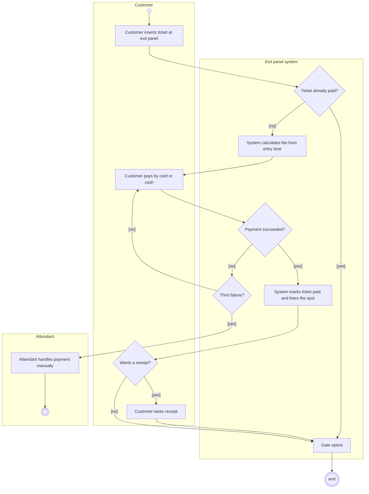

### Example 3 — fork and join (order fulfilment)

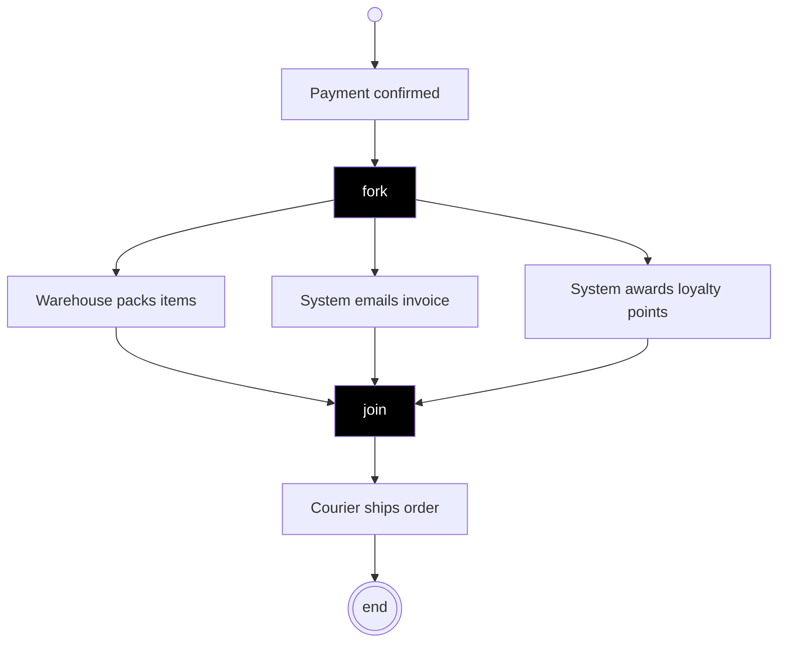

After the **fork** bar the three actions happen in parallel; the **join** waits for all three before shipping.

### Activity vs sequence diagram

| | Activity diagram | Sequence diagram |
|---|---|---|
| Shows | a process as a series of steps | objects sending messages to each other |
| Branches | natural: decisions with guards | awkward: nested `alt` fragments |
| Names | actions, in business language | objects and method calls |
| Use when | the flow has interesting branches | the order of calls is the interesting part |
| Answers | "what happens?" | "who calls whom?" |

Rule of thumb: a flow with **three branches** calls for an activity diagram; **four objects** whose call order is easy to confuse call for a sequence diagram.

### Trade-offs

| Pro | Con |
|---|---|
| Anyone (including non-engineers) can read it | Does not show which object does what unless you add swimlanes |
| Great at branches and parallelism | Big flows sprawl quickly |

### When not to use it

For a straight-line flow ("customer pays and leaves") — there is nothing to decide, so the picture adds nothing. For object-to-object call order, use a sequence diagram.

### Common mistakes

- **A diamond with only one exit.** If only one outcome is possible, nothing is being decided — draw the missing branch or remove the diamond.
- **Actions written as code** ("call `calculateFee()`"). Keep it in the language of the problem so it can be checked against the requirements.
- Guards that do not cover every case (`[amount > 100]` and `[amount < 100]` — what about exactly 100?).
- Using fork/join for steps that are merely sequential.

### Real-world examples

- **BPMN** (Business Process Model and Notation), used by workflow engines such as Camunda, is a close cousin of UML activity diagrams, with lanes and gateways.
- **CI/CD pipelines** (GitHub Actions, Jenkins) are activity diagrams in practice: parallel jobs (fork), a job that `needs:` several others (join), conditional steps (guards).
- Food-delivery apps (Swiggy, Zomato, DoorDash) typically let the restaurant prepare the food while a delivery partner is being assigned — two parallel branches that join at "order picked up".

### In the interview

**30-second answer:** "An activity diagram walks one flow: start, actions, decisions with guards covering every case, merges, optional fork/join for parallel steps, swimlanes for who does what, and one or more ends. I draw the flow with the interesting branch, then check that every action has a class to live in."

**Follow-ups:**

- *Q: Activity final vs flow final?* — A: Activity final ends the whole activity; flow final ends only that one path while other parallel paths continue.
- *Q: Which flow do you draw?* — A: The one whose requirement contains "if/unless/otherwise" — e.g. payment failure and retry.

### Self-check

- *Q: What must every arrow leaving a decision have?* → A: A guard in square brackets; together they must cover all cases.
- *Q: How do you show two steps that happen at the same time?* → A: A fork bar before them and a join bar after them.

### TL;DR

One flow, start → actions → decisions with guards → merge → end. Fork/join for parallel, swimlanes for who. Draw the branching flow and use it to test your class diagram.

---

## 3.14 State machine diagrams

### What it is

A **state machine diagram** (also called a *statechart* or *state diagram*) shows the **states one object can be in** during its life and the **transitions** that move it from one state to another in response to **events**.

- **State** — a condition during which the object behaves in a certain way or waits (rounded rectangle): `CREATED`, `PAID`, `SHIPPED`.
- **Initial pseudostate** — filled circle, arrow to the first state.
- **Final state** — bullseye; the object's life (in this machine) is over.
- **Transition** — arrow labelled `event [guard] / action`:
  - **event (trigger)** — what happens: `pay(amount)`.
  - **guard** — boolean condition that must be true for the transition to fire: `[amount == total]`.
  - **action (effect)** — what the object does while transitioning: `/ refund()`.
- **Internal activities** inside a state: `entry / ...` (on entering), `exit / ...` (on leaving), `do / ...` (while in the state).
- **Self-transition** — an arrow from a state back to itself (exit and re-entry actions run).
- **Choice pseudostate** — a small diamond that picks the next state based on guards.
- **Composite state** — a state containing sub-states (e.g. `Active` containing `Idle` and `Moving`); **history** `(H)` remembers the last sub-state.
- **Orthogonal regions** — a state split by dashed lines into parts that are active at the same time.

Analogy: a **traffic light**. It is always in exactly one state (red, green, yellow), a timer event moves it on, and the allowed order is fixed — it never goes straight from green to red.

### The problem it solves

Objects with a lifecycle (orders, tickets, elevators, vending machines, parking spots, TCP connections) are the source of many bugs: shipping a cancelled order, paying twice, refunding an undelivered item. A state diagram lists **every legal transition** so that everything else can be rejected. It also maps directly to code (an `enum` of states plus a transition method, or the **State pattern**, Chapter 11).

### How it works

1. Pick **one** class with a lifecycle.
2. List its states (usually an `enum`).
3. For each state, list the events it accepts, the guard (if any), the target state and the action.
4. Everything not listed is **illegal** — the code must reject it.
5. Mark the initial and final states.

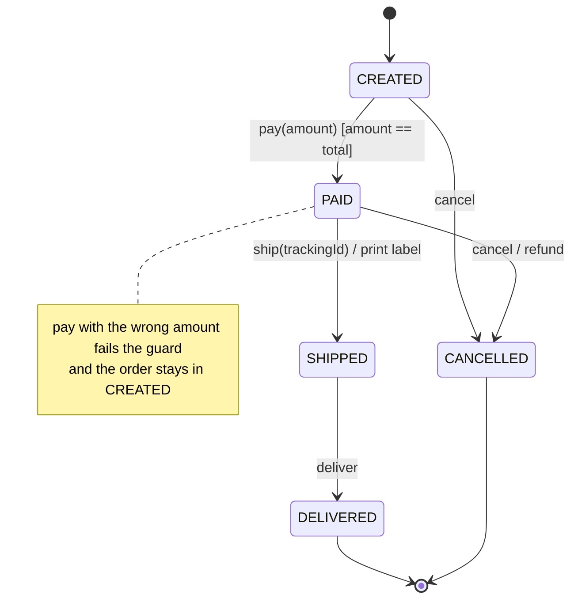

A composite-state example (an elevator car) for recognition:

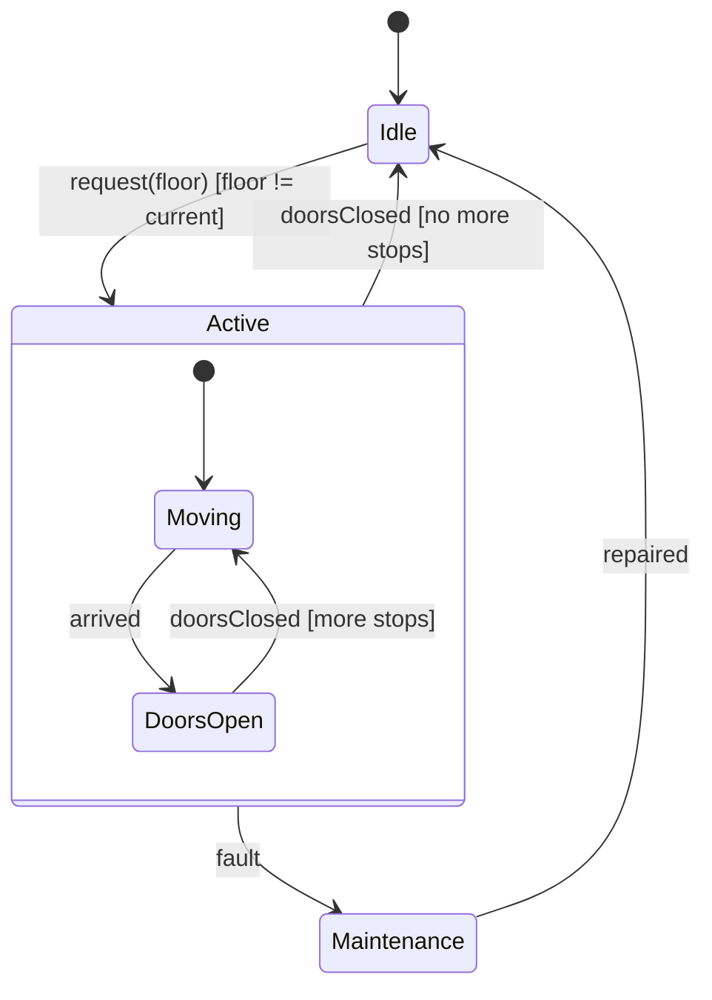

### Java example (`lld.ch03.statemachine`)

```java
// File: code/lld/ch03/statemachine/OrderState.java
package lld.ch03.statemachine;

public enum OrderState { CREATED, PAID, SHIPPED, DELIVERED, CANCELLED;
    public boolean isFinal() { return this == DELIVERED || this == CANCELLED; }
}
```

```java
// File: code/lld/ch03/statemachine/OrderEvent.java
package lld.ch03.statemachine;

import java.math.BigDecimal;

/** Events that can trigger transitions. Sealed, so the switch in Order is checked for completeness. */
public sealed interface OrderEvent {
    record Pay(BigDecimal amount) implements OrderEvent { }
    record Ship(String trackingId) implements OrderEvent { }
    record Deliver() implements OrderEvent { }
    record Cancel(String reason) implements OrderEvent { }
}
```

```java
// File: code/lld/ch03/statemachine/Order.java
package lld.ch03.statemachine;

import java.math.BigDecimal;
import java.util.ArrayList;
import java.util.List;

/**
 * Code for the state machine diagram. Each transition is written as
 *   event [guard] / action
 * An event that has no transition from the current state is rejected.
 */
public final class Order {
    private final String id;
    private final BigDecimal total;   // money: BigDecimal, not double
    private OrderState state = OrderState.CREATED;   // initial pseudostate -> CREATED
    private final List<String> log = new ArrayList<>();

    public Order(String id, BigDecimal total) {
        this.id = id;
        this.total = total;
        log.add("[*] -> CREATED");
    }

    public OrderState state() { return state; }
    public List<String> log() { return List.copyOf(log); }

    public void handle(OrderEvent event) {
        OrderState from = state;
        OrderState to = switch (event) {
            case OrderEvent.Pay p when state == OrderState.CREATED && p.amount().compareTo(total) == 0 -> OrderState.PAID;
            case OrderEvent.Pay p when state == OrderState.CREATED ->
                    reject(event, "guard failed: paid " + p.amount() + " but total is " + total);
            case OrderEvent.Ship s when state == OrderState.PAID -> {
                log.add("  action: print label " + s.trackingId());
                yield OrderState.SHIPPED;
            }
            case OrderEvent.Deliver d when state == OrderState.SHIPPED -> OrderState.DELIVERED;
            case OrderEvent.Cancel c when state == OrderState.CREATED -> OrderState.CANCELLED;
            case OrderEvent.Cancel c when state == OrderState.PAID -> {
                log.add("  action: refund " + total);
                yield OrderState.CANCELLED;
            }
            default -> reject(event, "no transition from " + state);
        };
        state = to;
        log.add(from + " --" + event.getClass().getSimpleName() + "--> " + to);
    }

    private OrderState reject(OrderEvent e, String why) {
        throw new IllegalStateException(id + ": " + e.getClass().getSimpleName() + " rejected, " + why);
    }
}
```

```java
// File: code/lld/ch03/statemachine/Main.java
package lld.ch03.statemachine;

import java.math.BigDecimal;

public class Main {
    public static void main(String[] args) {
        Order happy = new Order("ORD-1", new BigDecimal("499.00"));
        happy.handle(new OrderEvent.Pay(new BigDecimal("499.00")));
        happy.handle(new OrderEvent.Ship("TRK-77"));
        happy.handle(new OrderEvent.Deliver());
        System.out.println("ORD-1 path:");
        happy.log().forEach(l -> System.out.println("  " + l));
        System.out.println("  final? " + happy.state().isFinal());

        Order refund = new Order("ORD-2", new BigDecimal("120.00"));
        tryEvent(refund, new OrderEvent.Pay(new BigDecimal("100.00")));   // guard fails
        tryEvent(refund, new OrderEvent.Pay(new BigDecimal("120.00")));
        tryEvent(refund, new OrderEvent.Cancel("changed mind"));
        tryEvent(refund, new OrderEvent.Ship("TRK-99"));                         // no transition from CANCELLED
        System.out.println("ORD-2 path:");
        refund.log().forEach(l -> System.out.println("  " + l));
    }

    private static void tryEvent(Order o, OrderEvent e) {
        try {
            o.handle(e);
        } catch (IllegalStateException ex) {
            System.out.println("Rejected: " + ex.getMessage());
        }
    }
}
```

**What each part shows:** `OrderState` is the list of states. Amounts are `BigDecimal` (never `double` for money), so the guard `[amount == total]` is written `p.amount().compareTo(total) == 0` — `BigDecimal.equals` would treat `120.0` and `120.00` as different because it also compares scale. `OrderEvent` is a **sealed** interface of event records, so the `switch` in `Order.handle` uses Java 21 **pattern matching with `when` guards** — each `case` line is literally one arrow of the diagram: `event [guard] -> target` with its action. The `default` branch rejects every transition that is not on the diagram.

Output:

```
ORD-1 path:
  [*] -> CREATED
  CREATED --Pay--> PAID
    action: print label TRK-77
  PAID --Ship--> SHIPPED
  SHIPPED --Deliver--> DELIVERED
  final? true
Rejected: ORD-2: Pay rejected, guard failed: paid 100.00 but total is 120.00
Rejected: ORD-2: Ship rejected, no transition from CANCELLED
ORD-2 path:
  [*] -> CREATED
  CREATED --Pay--> PAID
    action: refund 120.00
  PAID --Cancel--> CANCELLED
```

### Trade-offs

| enum + switch (this example) | State pattern (class per state, Ch. 11) |
|---|---|
| All transitions visible in one place | Each state's behaviour in its own class |
| Best for few states, simple actions | Best when states have lots of different behaviour |
| Adding a state edits the switch | Adding a state adds a class (Open/Closed) |

### When not to use it

For objects with only a flag or two and no real lifecycle (`active/inactive`). For flows that span many objects, use an activity diagram instead — a state machine describes **one** object.

### Common mistakes

- Confusing states with actions: "Paying" (an action) vs "PAID" (a state).
- Missing transitions (e.g. forgetting that a paid order can be cancelled with a refund) or allowing illegal ones by default.
- Guards that overlap, so two transitions could fire for the same event.
- Drawing a state machine for the *system* rather than for one object.

### Real-world examples

- `java.lang.Thread.State`: `NEW`, `RUNNABLE`, `BLOCKED`, `WAITING`, `TIMED_WAITING`, `TERMINATED`.
- **TCP** connection states (`LISTEN`, `SYN_SENT`, `ESTABLISHED`, `FIN_WAIT_1`, …) — the classic protocol state machine.
- **Amazon / Flipkart order tracking** (ordered → packed → shipped → out for delivery → delivered; cancel allowed only before shipping).
- **Uber trip** (requested → driver assigned → driver arrived → in progress → completed / cancelled).
- **Spring Statemachine** and AWS Step Functions are libraries/services built around state machines.

### In the interview

**30-second answer:** "When an object has a lifecycle — order, ticket, elevator, vending machine — I draw its states with transitions labelled `event [guard] / action`. Anything not on the diagram is illegal and the code rejects it. In Java it is an enum of states with one transition method, or the State pattern if each state has a lot of behaviour."

**Follow-ups:**

- *Q: What is a guard?* — A: A boolean condition in `[ ]` that must be true for the transition to fire, e.g. `[amount == total]`.
- *Q: State machine vs activity diagram?* — A: A state machine is about one object's states over its lifetime; an activity diagram is about the steps of a process, possibly across many objects.
- *Q: How do you make transitions thread-safe?* — A: Make the transition method `synchronized` (or use a lock / compare-and-set on an `AtomicReference<State>`), so two events cannot both read the old state and both move on.

### Self-check

- *Q: Read `PAID --> CANCELLED : cancel / refund`.* → A: In PAID, the event `cancel` moves to CANCELLED and performs the action `refund`.
- *Q: What happens to an event that has no transition from the current state?* → A: It is ignored or rejected — in our code, rejected with an exception.

### TL;DR

One object, its states, and `event [guard] / action` arrows. Initial dot, final bullseye. Everything not drawn is illegal. Code: enum + guarded switch, or the State pattern.

---

# Part C — UML in the interview

## 3.15 How much UML to draw in an interview

The interviewer is not marking your arrowheads. What is checked is whether **your diagram and your words agree**. Leaving a line out costs you less than drawing one you cannot justify.

**Suggested budget for a 45-minute OOD round:**

| Minute | Diagram | Depth |
|---|---|---|
| 0–5 | **Use case** | Usually *spoken* or a quick list: actors + what each does + what is out of scope (the boundary). Draw it only if asked. |
| 5–20 | **Class diagram** | *Always drawn.* 10–15 boxes, every line typed with multiplicity; key attributes and methods only. |
| 20–25 | **Activity** *or* **sequence** *or* **state** | One diagram for the one flow that carries the design: activity if it branches, sequence if call order matters, state if one object has a lifecycle. |
| 25–45 | Code + discussion | Code the core classes; walk the flow against your diagrams. |

**Rules of thumb**

1. **If you only have one picture, make it the class diagram.** It is the answer.
2. **Drop attributes before relationships** when short of time.
3. **Never leave a line unlabelled** — type + multiplicity.
4. **Say the test aloud** for every diamond and triangle.
5. **Use the other diagrams as tests:** every action in the activity diagram and every arrow in the sequence diagram must be a method on a class in the class diagram.
6. **Keep sequence diagrams small:** 3–4 objects, 6–8 messages, no branches.
7. **Machine-coding rounds** (90–120 min, working code expected): a 2-minute class sketch is enough — spend the time on code.
8. If you forget a symbol, **say what you mean** ("this implements that") and move on.

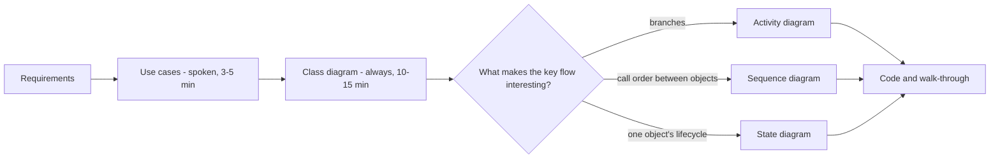

### In the interview

**30-second answer:** "I list use cases verbally to fix scope, spend most of my diagram time on one class diagram with typed, multiplicity-labelled lines, then draw one behaviour diagram for the key flow and use it to check that every step has a class and method."

---

## 3.16 Chapter self-check

1. *Q: Name the six relationships from weakest to strongest coupling.* → A: Dependency, association, aggregation, composition, realization, generalization.
2. *Q: Where does the diamond go, and what does filled vs hollow mean?* → A: At the whole; filled = composition (parts die with it), hollow = aggregation (parts live on).
3. *Q: Code smell: `CompactSpot`, `LargeSpot` subclasses that only pass a constant to `super`. Fix?* → A: One `ParkingSpot` with a `SpotType` enum field.
4. *Q: Java type for multiplicity `0..1` and `1..*`?* → A: `Optional<T>` (nullable field); a non-empty collection checked in the constructor.
5. *Q: «include» vs «extend»?* → A: Include = always, arrow from base to included; extend = sometimes (conditional), arrow from extension to base.
6. *Q: `+ - # ~`?* → A: public, private, protected, package.
7. *Q: Arrowheads in sequence diagrams?* → A: Solid + filled = sync call; solid + open = async; dashed + open = return.
8. *Q: `alt` vs `opt`?* → A: `alt` = if/else with several guarded sections; `opt` = a single guarded section (if without else).
9. *Q: Fork/join?* → A: Fork splits one flow into parallel flows; join waits for all of them.
10. *Q: Transition label syntax in a state machine?* → A: `event [guard] / action`.
11. *Q: 14 UML diagrams split how?* → A: 7 structural (class, object, package, component, composite structure, deployment, profile) and 7 behavioural (use case, activity, state machine, sequence, communication, interaction overview, timing).
12. *Q: If you can draw only one diagram?* → A: The class diagram.

## 3.17 TL;DR

- **Relationships are claims about lifetime and substitution.** Dependency (uses, dashed arrow) · Association (knows, line/arrow) · Aggregation (has, parts live on, ◇ at whole) · Composition (owns, parts die, ◆ at whole) · Realization (implements, dashed △) · Generalization (extends, solid △).
- **Choose in order:** substitution test → dies with whole? → part that outlives? → else association; parameter-only → dependency. Inheritance last.
- **Multiplicity changes code:** `1` required, `0..1` Optional, `1..*` non-empty collection, exact numbers checked in constructors.
- **UML:** 14 diagrams, structural vs behavioural. Interviews: use case (scope), class (the answer), activity (branches), sequence (call order), state machine (lifecycle).
- **Draw little, label everything, say the test out loud,** and use behaviour diagrams to test the class diagram.
