# Chapter 3 — Class Relationships & UML

> **What you will learn.** How two classes can be connected (association, aggregation, composition, dependency, generalization, realization), how each looks in Java, how to pick the right one in ten seconds, and how to *draw* a design with UML (Unified Modeling Language, the standard picture notation for software designs; 3.9): use-case, class, sequence, activity and state machine diagrams — plus how much UML to actually draw in a 45-minute interview.

| Part | Topics | Java package |
|---|---|---|
| A. Relationships | 3.1 Big picture · 3.2 Association (uni/bi, multiplicity) · 3.3 Aggregation · 3.4 Composition · 3.5 Dependency · 3.6 Generalization · 3.7 Realization · 3.8 Decision guide | `lld.ch03.association`, `aggregation`, `composition`, `dependency`, `generalization`, `realization` |
| B. UML | 3.9 What UML is · 3.10 Use-case · 3.11 Class · 3.12 Sequence · 3.13 Activity · 3.14 State machine | `lld.ch03.library` (use case → class → sequence → activity), `lld.ch03.statemachine` |
| C. Interview | 3.15 How much UML to draw · 3.16 Chapter self-check · 3.17 TL;DR | — |

Every package has a runnable `Main`; listings below show the essential lines and the full files are in `code/lld/ch03/` (`javac` compiles `.java` into `.class` files, `java` runs them, `-cp` says where the classes are):

```bash
cd chapters/03-relationships-and-uml/code
javac --release 21 -d /tmp/lld_03 $(find . -name '*.java')
java -cp /tmp/lld_03 lld.ch03.association.Main     # or aggregation, composition, dependency,
                                                   # generalization, realization, statemachine, library
```

---

# Part A — Class Relationships

## 3.1 The big picture: what a "relationship" really claims

### What it is

A **relationship** is a line between two classes on a class diagram: objects of one are connected to objects of the other. The line makes two precise claims:

1. **Lifetime.** If object A is destroyed, is B destroyed too? (Lifetime = from creation until the object is no longer used.)
2. **Substitution.** Can a B be used anywhere an A is expected? (Handing a B to code that asked for an A, and everything still works.)

Analogy: **body** and **heart** share a lifetime (composition); a **car** and its **driver** do not — the driver walks away (association); a **sports car** *is a* car and goes anywhere a car can (generalization).

Six relationships: three "has-a", one "uses-a", two "is-a":

| Family | Relationship | One-line meaning | Coupling (rough order) |
|---|---|---|---|
| uses-a | **Dependency** | A uses B briefly (parameter, local variable, return type) | weakest |
| has-a | **Association** | A holds a reference to B and can call it; nobody owns anybody | ↓ |
| has-a | **Aggregation** | A is a whole holding parts B; the parts can outlive A | ↓ |
| has-a | **Composition** | A is a whole *owning* parts B; the parts die with A | ↓ |
| is-a | **Realization** | class A implements interface B | ↓ |
| is-a | **Generalization** | class A extends class B (inheritance) | strongest coupling |

**Coupling** = how much one class must change when the other changes. Inheritance couples a subclass to every parent detail, hence last. The order is a discussion rule of thumb, not part of the UML standard.


*Figure — The UML conventions legend used throughout this book: class and interface boxes, and the line style for realization, generalization, dependency, association, uni-directional association, aggregation and composition (course diagram)*

Look at the *ends* of each line: the end shape (triangle, diamond, arrowhead) and solid vs dashed is the whole vocabulary. Two differences from strict UML: the legend draws **uni-directional association** with a *filled* arrowhead and **dependency** as a dashed line with *no* head; standard UML (and this book's Mermaid diagrams — Mermaid is a text-based diagram language) uses an **open** arrowhead (`→`) for both, solid for association, dashed for dependency. Either is understood in an interview if you say what you mean.

### The problem it solves

"Order has a Customer" and "ParkingFloor has ParkingSpots" sound alike but differ in code: one points at an object living elsewhere, the other creates, owns and deletes its parts. Mixing them up causes bugs — deleting data you did not own, or leaking objects nobody is responsible for — and in an interview the mistake is visible on the whiteboard before any code.

### TL;DR

A relationship line is a claim about **who owns whom (lifetime)** and **who can stand in for whom (substitution)**. Learn the six lines and the one question that separates each.

---

## 3.2 Association (uni-directional, bi-directional, multiplicity)

### What it is

An **association**: one class keeps a *reference* (a field) to another and can call it over a long period — longer than one method call. Neither owns the other; destroy one and the other is unaffected. Analogy: a **ticket** refers to a **parking spot**; throw the ticket away and the spot remains.

- **Direction (navigability** — "can be reached from"**).** **Uni-directional**: only one side has a field pointing at the other. **Bi-directional**: both do.
- **Multiplicity:** how many objects take part at each end: `1`, `0..1` (optional), `*` or `0..*` (any number), `1..*` (at least one), `2` (exactly two), `2..4` (a range).
- **Role name / association name:** an optional line label such as `assigned to` or `borrower`.

### The problem it solves

Objects collaborate over time — an `Order` must always know its `Customer`. Association records "A knows B" without claiming ownership. It is the most common relationship in a real design, correctly so.

### How it works

1. Decide who calls whom. If only `Order` asks for its customer, make it **uni-directional** (a `customer` field in `Order` only).
2. Go **bi-directional** only if real use cases need both directions ("a student's courses" *and* "a course's students").
3. For a bi-directional link, **one side owns the update** and sets both fields in one method, so the ends never disagree.
4. Write **multiplicity** at each end and **enforce it in code**: `1` → required field, `Objects.requireNonNull` (throws if `null`, i.e. no object) in the constructor; `0..1` → expose as `Optional<T>` (holds one value or is empty, so callers must check); `*` → a collection, `1..*` → a never-empty collection; exact numbers like `2` → size check in the constructor.

### UML notation

- Plain solid line = association (UML: "navigability unspecified"; interviews read it as "both know each other").
- Solid line + **open arrowhead** = uni-directional; the tail knows the head. An **×** at an end (rare) = explicitly not navigable that way.
- Numbers at each end = multiplicity, written next to the class they count: `Order "*" --> "1" Customer` = "many orders, each with exactly one customer".

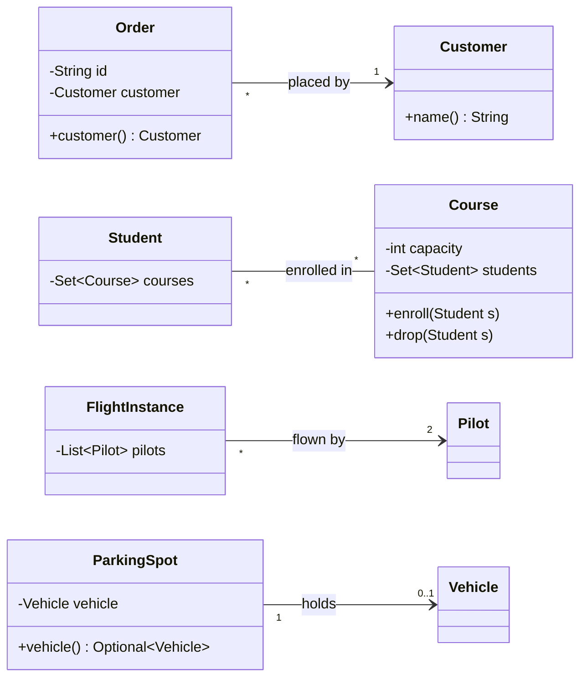

### Java example

```java
// File: code/lld/ch03/association/Order.java — uni-directional, "many orders to exactly 1 customer"
public final class Order {
    private final String id;
    private final Customer customer;   // "1" end: never null. record Customer(String name) has no field back
    public Order(String id, Customer customer) {
        this.id = id;
        this.customer = Objects.requireNonNull(customer, "an order needs exactly one customer");
    }
}

// File: code/lld/ch03/association/Course.java — owning side of bi-directional Student * -- * Course
public final class Course {
    private final String code;
    private final int capacity;                              // multiplicity 0..capacity
    private final Set<Student> students = new LinkedHashSet<>();
    public void enroll(Student s) {
        if (students.contains(s)) return;
        if (students.size() == capacity) throw new IllegalStateException(code + " is full (max " + capacity + ")");
        students.add(s);
        s.linkCourse(this);                                  // updates BOTH ends in one place
    }
    public void drop(Student s) { if (students.remove(s)) s.unlinkCourse(this); }
    public Set<Student> students() { return Collections.unmodifiableSet(students); }
}
// Student: Set<Course> courses; package-private linkCourse/unlinkCourse — only Course may touch this side

// File: code/lld/ch03/association/FlightInstance.java — multiplicity "exactly 2" enforced
public FlightInstance(String flightNo, List<Pilot> pilots) {
    if (pilots.size() != 2) throw new IllegalArgumentException("a flight needs exactly 2 pilots, got " + pilots.size());
    this.flightNo = flightNo;
    this.pilots = List.copyOf(pilots);
}

// File: code/lld/ch03/association/ParkingSpot.java — multiplicity "0..1" exposed as Optional
private Vehicle vehicle;   // null means "0" of 0..1
public void park(Vehicle v) {
    if (vehicle != null) throw new IllegalStateException("spot " + number + " is taken");
    vehicle = v;
}
public Optional<Vehicle> vehicle() { return Optional.ofNullable(vehicle); }

// File: code/lld/ch03/association/Main.java (abridged)
// Orders O-1, O-2 for Customer Asha; Student Ravi, Meera; Course JAVA101 (capacity 2), UML201 (30)
java.enroll(ravi); java.enroll(meera); uml.enroll(ravi);
try { java.enroll(new Student("Kiran")); }
catch (IllegalStateException e) { System.out.println("Multiplicity 0..2 enforced: " + e.getMessage()); }
java.drop(ravi);
// FlightInstance AI-202 with two pilots; AI-303 with one (rejected); ParkingSpot 7 before/after park(KA-01-1234)
```

Output:

```
== Uni-directional: Order -> Customer ==
O-1 belongs to Asha
O-2 belongs to Asha
Customer has no way to list its orders (one-way link).

== Bi-directional many-to-many: Student <-> Course ==
JAVA101 students: [Ravi, Meera]
Ravi's courses:   [JAVA101, UML201]
Multiplicity 0..2 enforced: JAVA101 is full (max 2)
After drop, JAVA101: [Meera], Ravi: [UML201]

== Multiplicity 2 and 0..1 ==
AI-202 pilots: [Pilot[name=Capt. Rao], Pilot[name=F/O Das]]
Rejected: a flight needs exactly 2 pilots, got 1
Spot 7 vehicle: <empty>
Spot 7 vehicle: KA-01-1234
```

`Student` and `Course` each hold a `Set` of the other (**bi-directional many-to-many**); only `Course.enroll/drop` change the link because `Student.linkCourse` is package-private (no access keyword: same-package callers only) — the single "owning side" rule keeps both ends consistent. Every object is created by `Main` and merely *referenced*: dropping a course does not delete the student.

### Trade-offs

| Choice | Pros | Cons |
|---|---|---|
| Uni-directional | Simple; one field; no sync bugs; lower coupling | Reverse question ("which orders does this customer have?") needs a query or repository (a class that stores and looks up objects) |
| Bi-directional | Fast navigation both ways | Two fields to keep in sync; tighter coupling; risk of infinite loops in `toString`/`equals`/JSON serialisation (turning objects into JSON text) |
| Strict multiplicity checks | Invalid states cannot be created | A little more constructor code |

**When not:** if you only need the object inside one method, that is a **dependency** (3.5), which couples less; do not default to bi-directional — most associations should be one-way.

### Common mistakes

- Every line bi-directional "just in case".
- Updating only one side of a bi-directional link (`student.courses.add(c)` without `course.students.add(s)`).
- No multiplicity on the line, then no null/non-empty check in the code.
- Both sides in `toString()`/`equals()` → stack overflow from infinite recursion (each method calls the other's until Java runs out of room to track calls).

### Real-world examples

- **JPA / Hibernate** (Java's standard API for saving objects to SQL tables, and its most popular implementation): `@ManyToOne` on `Order.customer` is uni-directional; a bi-directional `@OneToMany(mappedBy = "customer")` needs an *owning side* (holding the foreign key — the column storing the other row's ID) and helpers setting both ends — the `Course.enroll` rule.
- **Spring** (a popular Java framework): a service with a constructor-injected repository has an association to it; the Spring container (creates and wires objects) creates and destroys the repository.
- **E-commerce:** an order row stores `customer_id`; a customer stores no order-id list.

### In the interview

**30-second answer:** "Association means one class holds a reference to another and can call it, with no ownership. I make it uni-directional unless both directions are needed, and I write multiplicity on every line because it changes the code: `1` is a required field, `0..1` is an Optional, `1..*` is a non-empty collection."

- *Q: How do you keep a bi-directional association consistent?* — A: One owning side with a single method (`enroll`) updating both ends; the other side's mutators (state-changing methods) package-private.
- *Q: What if a parking spot can hold two motorbikes?* — A: `0..1` becomes `0..2`: a small collection with a size check instead of an `Optional`.
- *Q: Why not make everything bi-directional?* — A: It doubles the places that must change together and raises coupling; a repository query usually answers the reverse direction.

### Self-check

- *Q: `Order "*" --> "1" Customer` — which class has the field?* → A: `Order`; the arrow points at the referenced class.
- *Q: Java type for `0..1`?* → A: A nullable field exposed as `Optional<T>`.
- *Q: Is many-to-many always bi-directional?* → A: No; counts and direction are separate choices.

### TL;DR

Association = "A knows B", no ownership. Prefer one-way. Multiplicity on every line, enforced in constructors/types.

---

## 3.3 Aggregation

### What it is

**Aggregation** is an association meaning "A is a *whole* made of parts B, but the parts have their own life": they exist before the whole, can move to another whole, and survive its destruction. Also called *shared aggregation*, since a part may belong to several wholes. Analogy: an **airline** and its **aircraft** — if the airline shuts down, the planes are sold, not scrapped; a **team** and its **players**.

### The problem it solves

It says "these objects form a group" (whole–part, stronger than plain association) while making clear the group does **not** control their lifetime: "do not delete the parts when you delete the whole".

### How it works

1. The part is **created outside** the whole (caller, factory or repository).
2. It is **passed in** (`addAircraft(a)`); the whole stores a reference.
3. Removing a part **returns it alive**; destroying the whole **releases** its parts.
4. UML: **hollow diamond at the whole's end**.

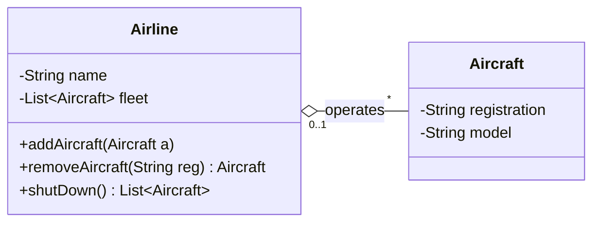

### Java example

```java
// File: code/lld/ch03/aggregation/Airline.java — Airline 0..1 o-- * Aircraft: holds, never creates or destroys
public final class Airline {
    private final String name;
    private final List<Aircraft> fleet = new ArrayList<>();
    public void addAircraft(Aircraft a) { fleet.add(a); }        // part is passed in
    public Aircraft removeAircraft(String registration) {         // part is handed back, still alive
        for (var it = fleet.iterator(); it.hasNext(); ) {
            Aircraft a = it.next();
            if (a.registration().equals(registration)) { it.remove(); return a; }
        }
        throw new IllegalArgumentException("no aircraft " + registration + " in " + name);
    }
    public List<Aircraft> shutDown() {                            // releases parts instead of destroying them
        List<Aircraft> released = List.copyOf(fleet);
        fleet.clear();
        return released;
    }
}
// Aircraft(registration, model); toString = registration + " (" + model + ")"

// File: code/lld/ch03/aggregation/Main.java (abridged)
// Aircraft a1 VT-AAA A320, a2 VT-BBB B737, a3 VT-CCC ATR72 exist BEFORE any airline;
// Skyways gets a1, a2; BlueJet gets a3; both fleets printed
blueJet.addAircraft(skyways.removeAircraft("VT-BBB"));       // transfer one part between wholes
List<Aircraft> released = skyways.shutDown();
skyways = null;                                              // the Airline object is now unreachable
released.forEach(blueJet::addAircraft);                      // parts survive and join another whole
```

Output:

```
Skyways fleet: [VT-AAA (A320), VT-BBB (B737)]
BlueJet fleet: [VT-CCC (ATR72)]
After transfer, BlueJet fleet: [VT-CCC (ATR72), VT-BBB (B737)]
Skyways shut down. Released aircraft still exist: [VT-AAA (A320)]
BlueJet fleet now: [VT-CCC (ATR72), VT-BBB (B737), VT-AAA (A320)]
```

After `skyways = null` the airline is garbage (nothing points to it, so Java's garbage collector, which frees unreachable objects' memory, reclaims it), but its aircraft are still referenced and join `BlueJet`.

### Trade-offs

| | Aggregation | Plain association |
|---|---|---|
| Extra meaning | "whole–part" grouping | just "knows" |
| Lifetime claim | parts outlive whole | none |
| Code difference | usually **none** — both are a field holding a reference | — |

Aggregation adds meaning for the reader but almost nothing in code. The UML specification leaves shared aggregation's precise meaning to the modeller, and several UML authors (Martin Fowler's *UML Distilled* among them) advise using it sparingly; interviews still expect it for a clear whole–part grouping.

**When not:** no "whole made of parts" idea (a ticket and a spot) → plain association; parts created by and dying with the whole → composition.

### Common mistakes

- Diamond at the **part's** end — it always sits at the **whole**.
- Choosing aggregation vs composition at random. Test: *imagine the whole is gone — is the part still meaningful by itself?* Yes → aggregation.
- Deleting parts in the whole's "close/delete" method despite drawing aggregation.

**Real-world:** clearing a `List<Customer>` leaves the customers; archiving a Slack/Teams **channel** keeps **members**' accounts; deleting a Spotify **playlist** keeps the **songs**; a **department** and its **professors**.

### In the interview

**30-second answer:** "Aggregation is a whole–part association where the parts can outlive the whole — hollow diamond at the whole. An airline aggregates aircraft: shut the airline down and the aircraft still exist. In Java the parts are created outside and passed in, and the whole never destroys them."

- *Q: Can an airline exist without aircraft?* — A: A multiplicity question, not an aggregation one: if the business requires at least one, write `1..*`; it is still aggregation because aircraft survive the airline.
- *Q: How does aggregation differ in code from association?* — A: Usually it doesn't; the difference is modelling intent, so say the lifetime test aloud.

### Self-check

- *Q: Where does the hollow diamond go?* → A: At the whole (`Airline`).
- *Q: A library closes; do its members disappear?* → A: No — Library ◇— Member is aggregation.

### TL;DR

Aggregation = "has-a, parts live on". Parts passed in, never destroyed by the whole. Hollow diamond at the whole.

---

## 3.4 Composition

### What it is

**Composition** is the strongest has-a: the whole **owns** its parts. A part belongs to **exactly one** whole at a time, is usually **created by** it, and is **destroyed with** it (UML also allows explicitly removing a part *before* the whole is deleted). Analogy: a **house** and its **rooms** — "a room of a house that does not exist" means nothing. Likewise **parking floor** → **spots**, **parking lot** → **floors**, **flight** → **weekly schedule**.

### The problem it solves

Some objects make no sense alone, and letting outsiders create or share them causes bugs (two floors sharing a spot, orphan spots after a floor is removed). Composition gives the owner the parts' full life cycle: one place creates, changes and removes them.

### How it works

1. The whole **creates** the parts (constructor or `addX(...)` taking *data*, not a ready-made part).
2. The part's constructor is **not public** (package-private, or a private nested class declared inside the whole's class).
3. The whole **never hands out** its internal collection — only read-only views or copies.
4. **Removing** the whole (or a part) drops the only reference, so the part becomes garbage.
5. UML: **filled (black) diamond at the whole's end**.

Java has no destructors (methods run automatically on destruction, as in C++): "dies with the whole" is *logical* — nobody else holds a reference, so the part becomes unreachable and is collected. For clean-up (files, sockets i.e. open network connections), the whole's `close()` closes its parts — e.g. closing a `BufferedReader` closes the `FileReader` it wraps.

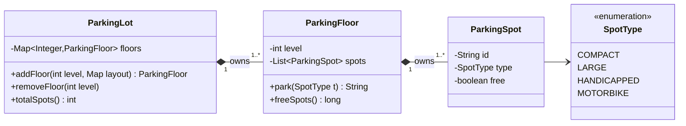

### Java example

```java
// File: code/lld/ch03/composition/ParkingSpot.java — package-private constructor: only ParkingFloor can create one
ParkingSpot(String id, SpotType type) { this.id = id; this.type = type; }
void occupy() { free = false; }          // toString = id + ":" + type. SpotType is an enum (a value, not subclasses)

// File: code/lld/ch03/composition/ParkingFloor.java — ParkingFloor 1 *-- 1..* ParkingSpot
ParkingFloor(int level, Map<SpotType, Integer> layout) {
    this.level = level;
    int n = 1;
    for (var e : layout.entrySet())
        for (int i = 0; i < e.getValue(); i++)
            spots.add(new ParkingSpot("L" + level + "-" + n++, e.getKey()));   // the floor CREATES its spots
    if (spots.isEmpty()) throw new IllegalArgumentException("a floor needs 1..* spots");
}
public List<ParkingSpot> spots() { return Collections.unmodifiableList(spots); }
public String park(SpotType type) {      // first free spot of the type; the spot never leaves the floor
    for (ParkingSpot s : spots) if (s.isFree() && s.type() == type) { s.occupy(); return s.id(); }
    return null;
}
// freeSpots() counts isFree()

// File: code/lld/ch03/composition/ParkingLot.java — ParkingLot 1 *-- 1..* ParkingFloor
private final Map<Integer, ParkingFloor> floors = new TreeMap<>();
public ParkingFloor addFloor(int level, Map<SpotType, Integer> layout) {   // caller describes, lot constructs
    ParkingFloor f = new ParkingFloor(level, layout);
    floors.put(level, f);
    return f;
}
public void removeFloor(int level) { floors.remove(level); }   // parts go with it: nobody else holds them
// totalSpots() sums floor sizes; floors() is an unmodifiable view

// File: code/lld/ch03/composition/Main.java (abridged)
ParkingFloor ground = lot.addFloor(0, layout);               // layout: COMPACT 3, LARGE 1 (LinkedHashMap)
lot.addFloor(1, Map.of(SpotType.MOTORBIKE, 4));
// prints ground.spots(), lot.totalSpots(), ground.park(COMPACT), ground.freeSpots()
try { ground.spots().clear(); }
catch (UnsupportedOperationException e) { System.out.println("Outsiders cannot change the parts: spots() is read-only"); }
lot.removeFloor(1);                                          // then prints totalSpots() and floors().keySet()
```

Output:

```
Floor 0 spots: [L0-1:COMPACT, L0-2:COMPACT, L0-3:COMPACT, L0-4:LARGE]
Total spots in lot: 8
Parked compact car at L0-1
Free spots on floor 0: 3
Outsiders cannot change the parts: spots() is read-only
After removing floor 1, total spots: 4 (its 4 spots are gone with it)
Floors left: [0]
```

`addFloor` receives a *layout description* and builds the floor itself; spots cannot be created outside the package; `spots()` is read-only; `removeFloor(1)` drops the floor and its four spots.

### Trade-offs

| | Composition | Aggregation |
|---|---|---|
| Who creates the part | the whole | someone else |
| Can the part be shared? | no (one owner at a time) | yes |
| Part outlives whole? | no | yes |
| Encapsulation | strong — whole controls all changes | weaker |
| Flexibility | lower — parts cannot be reused elsewhere | higher |

**When not:** the part has an independent identity the business cares about (a *person*, *aircraft*, *song*) → aggregation/association; the part must be shared between wholes.

### Common mistakes

- Accepting a ready-made part (`addSpot(ParkingSpot s)`) and calling it composition — the caller may still hold and share it.
- Returning the internal mutable list (`return spots;`), so outsiders add/remove parts behind the owner's back.
- Confusing it with "favour composition over inheritance" (3.6), where "composition" means *holding* an object instead of extending its class, covering association/aggregation too.

**Real-world:** `HashMap`'s internal `Node` entries (a package-private nested class), created by and gone with the map; **JPA** `@OneToMany(cascade = CascadeType.ALL, orphanRemoval = true)` — delete the `Order`, its `OrderLine` rows go too; a deleted Google Doc takes its comments and revision history; killing an OS process (running program) frees its threads (parallel lines of execution) and memory pages.

### In the interview

**30-second answer:** "Composition means the whole owns the parts: it creates them, they belong to only it, and they die with it — filled diamond at the whole. A parking floor composes its spots: remove the floor and the spots are gone. In Java I build the parts inside the owner, hide their constructor, and only expose read-only views."

- *Q: Java has garbage collection — how can a part 'die'?* — A: Logically: the whole holds the only reference, so removing it makes the part unreachable; resource-holding parts are closed by the whole's `close()`.
- *Q: Is `Flight` → `WeeklySchedule` composition?* — A: Yes; a schedule of a non-existent flight is meaningless.

### Self-check

- *Q: The test separating aggregation from composition?* → A: Whole gone — is the part still meaningful alone? No → composition.
- *Q: Why is `ParkingSpot`'s constructor package-private?* → A: So only the owning floor can create spots.

### TL;DR

Composition = "owns, parts die with it". Whole creates parts, never shares them, exposes read-only views. Filled diamond at the whole.

---

## 3.5 Dependency

### What it is

A **dependency**: class A *uses* B briefly — inside one method — without a field pointing at B. B appears as a **method parameter**, **local variable**, **return type**, or **static method call**; when the method returns, the relationship is over. (A **chef** *uses* today's **delivery van**; tomorrow's may differ.)

### The problem it solves

It records the weakest link: "if B's interface changes, A may have to change". Recognising it (instead of an association) keeps classes stateless (no data held between calls) and loosely coupled — the caller can pass a different collaborator on every call.

### How it works

A method receives B as a parameter (`checkout(Cart cart, PaymentGateway gateway)`), creates it as a local (`new TaxCalculator()`), returns it (`Receipt`), or calls a static method on it — and A has no field of type B. UML: **dashed line with an open arrowhead** from user (A) to used (B), optionally with a keyword like `«use»` or `«create»`.

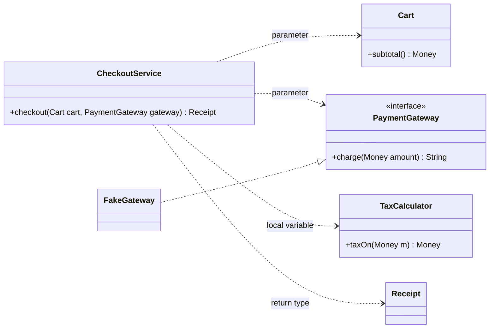

### Java example

```java
// File: code/lld/ch03/dependency/CheckoutService.java — NO fields: every link lasts one call
public final class CheckoutService {
    public Receipt checkout(Cart cart, PaymentGateway gateway) {
        TaxCalculator tax = new TaxCalculator();            // local-variable dependency (GST = 0.18)
        Money subtotal = cart.subtotal();                   // parameter dependency
        Money total = subtotal.plus(tax.taxOn(subtotal));
        String txn = gateway.charge(total);                 // parameter dependency (interface)
        return new Receipt(txn, subtotal, total);           // return-type dependency
    }
    public record Receipt(String txnId, Money subtotal, Money total) { }
}
// Money: record over BigDecimal, scale 2 HALF_UP, toString "Rs " + amount. Cart(List<Money>).subtotal() sums.
// PaymentGateway { String charge(Money amount); }  FakeGateway prints "  [gateway] charging ..." and returns TXN-1, TXN-2...

// File: code/lld/ch03/dependency/Main.java
CheckoutService service = new CheckoutService();   // holds no collaborators at all
Cart cart = new Cart(List.of(Money.of("250"), Money.of("99.50")));
CheckoutService.Receipt r = service.checkout(cart, new FakeGateway());   // caller picks the gateway per call
System.out.println("Receipt: " + r);
PaymentGateway loggingGateway = amount -> {
    System.out.println("  [lambda gateway] charging " + amount);
    return "LMB-42";
};
System.out.println("Receipt: " + service.checkout(cart, loggingGateway));
```

Output:

```
  [gateway] charging Rs 412.41
Receipt: Receipt[txnId=TXN-1, subtotal=Rs 349.50, total=Rs 412.41]
  [lambda gateway] charging Rs 412.41
Receipt: Receipt[txnId=LMB-42, subtotal=Rs 349.50, total=Rs 412.41]
```

`Main` passes a different gateway — even a lambda (a short inline unnamed function) — per call, which a stored field makes harder. `Money` uses `BigDecimal` (exact decimal type), not `double` (binary floating point, cannot hold 0.10 exactly), because currency needs exact arithmetic.

### Trade-offs

| | Dependency (parameter) | Association (field) |
|---|---|---|
| Coupling | lowest | higher |
| Object state | can be stateless | holds state |
| Swapping collaborator | per call | per object (or via setter) |
| Call-site noise | caller passes B every time | caller passes B once |

**When not:** if A needs B across many methods and calls (a service always using the same repository), store it (association via constructor injection, passing it into the constructor once).

### Common mistakes

- A solid association line for something that is only a parameter — overstates coupling.
- Drawing *every* dependency (`String`, `List`, `LocalDate`…); draw only those that matter.
- Hiding a dependency as `new ConcreteThing()` deep in a method when the caller should decide (blocks testing); take an interface parameter instead.

**Real-world:** `Collections.sort(list, comparator)`; a Spring MVC controller method (answers one web request) `handle(HttpServletRequest req)`; `LocalDate.now(Clock clock)`, the JDK's way to make time testable; Maven/Gradle (build tools that fetch libraries and compile projects) use "dependency" for the same idea at package level.

### In the interview

**30-second answer:** "Dependency is 'uses briefly': B is a parameter, local variable or return type of A's method, and A keeps no field for it. Dashed arrow from A to B. It is the loosest coupling, so when a collaborator is only needed in one method I pass it in rather than store it."

- *Q: `FlightReservation.pay(Payment p)` — association or dependency?* — A: Dependency, unless the reservation stores the payment in a field; then association.
- *Q: Relation to Dependency Injection?* — A: DI is about *who supplies* the collaborator (from outside, not `new` inside); it may then be stored (association) or passed per call (dependency). The Dependency Inversion Principle adds: depend on interfaces, not concrete classes (Chapter 4).

### Self-check

- *Q: Dashed + open arrow vs dashed + hollow triangle?* → A: Dependency vs realization.
- *Q: A method returns a `Receipt` — a relationship?* → A: Yes, a dependency on `Receipt`.

### TL;DR

Dependency = "uses for one call". Parameter, local variable, return type or static call; no field. Dashed arrow.

---

## 3.6 Generalization (inheritance)

### What it is

**Generalization** is UML's word for **inheritance**: class B `extends` A, so B *is a kind of* A. A is the **parent** (superclass, general), B the **child** (subclass, specialised); B inherits A's fields and methods and may override them. Analogy: a **credit-card payment** *is a* **payment** — any code that handles "a payment" handles it.

### The problem it solves

When classes truly share a contract **and** some behaviour, inheritance keeps the shared parts in one place and lets callers use the general type (`Payment`) without knowing the specific one (**polymorphism** — one call, different behaviour by actual object).

### How it works

1. Run the **substitution test** first: *can B be used anywhere A is expected, with no surprises?* If B would have to refuse or break any method of A, no. (Liskov Substitution Principle — Chapter 4.)
2. If yes, put shared state and workflow in A (often `abstract`: cannot be instantiated, may leave methods for subclasses) and let subclasses override only the varying steps.
3. If no, **hold instead of extend**: give A an interface-typed field and plug in behaviour objects.
4. UML: **solid line with a hollow triangle pointing at the parent**. Abstract class names are *italic* (or `{abstract}` / `«abstract»`); abstract operations too.

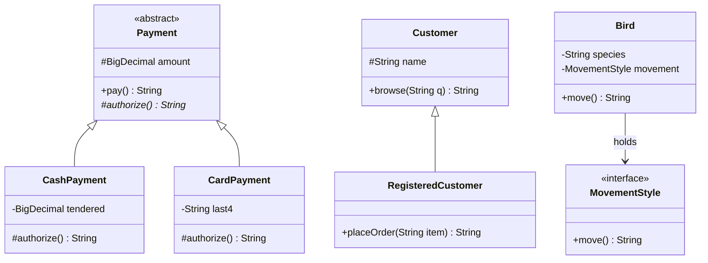

### Java example

```java
// File: code/lld/ch03/generalization/Payment.java — abstract parent; every subclass really "is a" Payment
public abstract class Payment {
    protected final BigDecimal amount;   // '#' protected; BigDecimal, never double
    protected Payment(BigDecimal amount) {
        if (amount.signum() <= 0) throw new IllegalArgumentException("amount must be positive");
        this.amount = amount;
    }
    public final String pay() {                     // shared, final workflow
        String ref = authorize();
        return getClass().getSimpleName() + " of " + amount + " -> " + ref;
    }
    protected abstract String authorize();          // the varying step (italics in UML)
}

// File: code/lld/ch03/generalization/CashPayment.java (constructor: super(amount); this.tendered = tendered;)
@Override protected String authorize() {
    if (tendered.compareTo(amount) < 0) return "DECLINED (short by " + amount.subtract(tendered) + ")";
    return "OK, change " + tendered.subtract(amount);
}
// CardPayment.authorize() returns "OK, card ****" + last4 + " approved"

// Customer.browse(q) -> name + " browses '" + q + "'" (only what EVERY customer can do);
// RegisteredCustomer extends Customer adds placeOrder(item) -> name + " orders " + item (a guest may not order)
// MovementStyle { String move(); FLY = () -> "flies"; SWIM = () -> "swims"; WALK = () -> "walks"; }

// File: code/lld/ch03/generalization/Bird.java — hold, don't extend
private MovementStyle movement;                      // held, so it can be swapped at run time
public void setMovement(MovementStyle m) { this.movement = m; }
public String move() { return species + " " + movement.move(); }

// File: code/lld/ch03/generalization/Main.java (abridged; prints the three section headers)
for (Payment p : List.of(
        new CashPayment(new BigDecimal("500.00"), new BigDecimal("600.00")),
        new CardPayment(new BigDecimal("1200.00"), "4242"),
        new CashPayment(new BigDecimal("300.00"), new BigDecimal("200.00"))))
    System.out.println(p.pay());                     // caller only knows Payment
List<Customer> visitors = List.of(new Customer("Guest-17"), reg);   // reg = new RegisteredCustomer("Asha")
visitors.forEach(c -> System.out.println(c.browse("headphones")));
System.out.println(reg.placeOrder("headphones"));
System.out.println("guest.placeOrder(...) does not compile: guests never inherit ordering");
// eagle = new Bird("Eagle", FLY), penguin = new Bird("Penguin", SWIM); print both moves
penguin.setMovement(MovementStyle.WALK);              // impossible with a subclass
System.out.println(penguin.move() + " (behaviour swapped at run time)");
```

Output:

```
== Good hierarchy: substitution works ==
CashPayment of 500.00 -> OK, change 100.00
CardPayment of 1200.00 -> OK, card ****4242 approved
CashPayment of 300.00 -> DECLINED (short by 100.00)

== Guest vs registered customer ==
Guest-17 browses 'headphones'
Asha browses 'headphones'
Asha orders headphones
guest.placeOrder(...) does not compile: guests never inherit ordering

== Holding instead of extending ==
Eagle flies
Penguin swims
Penguin walks (behaviour swapped at run time)
```

**What each part shows:**

- `Payment`'s `pay()` is `final` (shared workflow) and `authorize()` abstract (the varying step); both subclasses honour every promise, so `Main` loops over `List<Payment>` without caring which. Amounts are `BigDecimal` compared with `compareTo` (`double` cannot store `0.10` exactly; money must not drift).
- **Wrong-inheritance fix #1 — the subclass that must refuse something.** If `Guest extends Customer` and `Customer` can order, a guest could order, which is forbidden. Fix: `Customer` holds only what *every* customer can do (browse); ordering moves down to `RegisteredCustomer`.
- **Wrong-inheritance fix #2 — the subclass that only carries a constant.** `CompactSpot`, `LargeSpot`, `HandicappedSpot` whose constructors only pass a different value up add no behaviour: that is a field (the `SpotType` enum in 3.4); a fourth type is one constant.
- **Prefer holding over extending.** `FlyingBird` / `Penguin` subclasses break when a penguin arrives (penguins don't fly); `Bird` *holds* a `MovementStyle`, swappable at run time — impossible with `extends`.

### Trade-offs

| | Inheritance (extends) | Holding an object (composition/association) |
|---|---|---|
| Reuse | automatic | explicit delegation |
| Change at run time | no — fixed at compile time | yes — swap the held object |
| Coupling | tight: subclass sees parent internals ("fragile base class") | loose: only the interface |
| Number of parents in Java | one class | many interfaces / many fields |
| Best for | true is-a with different behaviour | varying behaviour, features that combine |

**When not:** only to share a few fields or a helper ("code reuse" alone is no reason); when a subclass would throw `UnsupportedOperationException` (Java's standard "not supported" error) for an inherited method; when the variation is just data (field or enum); when behaviours mix (fly + swim + walk) — the class count explodes.

### Common mistakes

- Deep hierarchies (more than 2–3 levels).
- `Stack extends Vector`-style: the child inherits methods breaking its own rules (a JDK `Stack` lets you insert in the middle).
- Arrow direction: the triangle points **at the parent**.
- Inheritance between classes where one can do what the other does only *sometimes*: generalization needs "always"; for "sometimes", hold a shared interface or a role object.

**Real-world:** `java.util.ArrayList extends AbstractList` (reuses the skeleton); `java.io.FileInputStream extends InputStream` (accepted by any `InputStream` code); `IOException extends Exception extends Throwable` — why `catch (Exception e)` catches an `IOException`. **Counter-examples in the JDK:** `java.util.Stack extends Vector` and `java.util.Properties extends Hashtable`, widely cited as inheritance that should have been composition.

### In the interview

**30-second answer:** "Generalization is inheritance — solid line with a hollow triangle at the parent. I use it only when the child passes the substitution test: it can go anywhere the parent goes and never refuses a parent method. A subclass that only passes a constant up becomes an enum field; varying behaviour I hold as an interface instead of extending."

- *Q: Why not `CompactSpot extends ParkingSpot`?* — A: No added behaviour; a `SpotType` field does it and new types are one enum constant.
- *Q: When *is* inheritance right?* — A: When subclasses behave differently but all keep the parent's promises, like `Payment` → cash/card.
- *Q: Can a Java class have two parents?* — A: It extends one class but implements many interfaces.

### Self-check

- *Q: Which way does the hollow triangle point?* → A: At the parent (general class).
- *Q: Guest cannot order, but `Guest extends Customer` and `Customer.placeOrder()` exists — what breaks, and the fix?* → A: Substitution (LSP); move `placeOrder` to `RegisteredCustomer`.

### TL;DR

Generalization = "is-a", `extends`, only after the substitution test. Constants → fields; varying behaviour → hold an interface. Triangle points at the parent.

---

## 3.7 Realization (interface implementation)

### What it is

**Realization**: a class *implements* an **interface** — a named list of operations (a contract) with no instance state — promising to provide them (`class EmailNotifier implements Notifier`). Analogy: a **wall socket standard**: any plug that "realizes" it works in any socket.

### The problem it solves

Callers depend on the **contract**, not the class: new implementations (SMS, push, WhatsApp) need no caller changes, tests use fakes, and one class can play several roles (many interfaces, one parent class).

### How it works

1. Define an interface with the operations callers need (`send(to, message)`).
2. Each concrete class `implements` it with method bodies.
3. Callers hold / receive the **interface type** (`List<Notifier>`).
4. Since Java 8 interfaces may have `default` (with body; overridable) and `static` methods.
5. UML: **dashed line with a hollow triangle at the interface**, marked `«interface»` (compact alternative: the "lollipop", a small circle on a stick labelled with the interface name).

It deliberately looks like generalization: the same "is-a" idea, but only the contract is inherited.

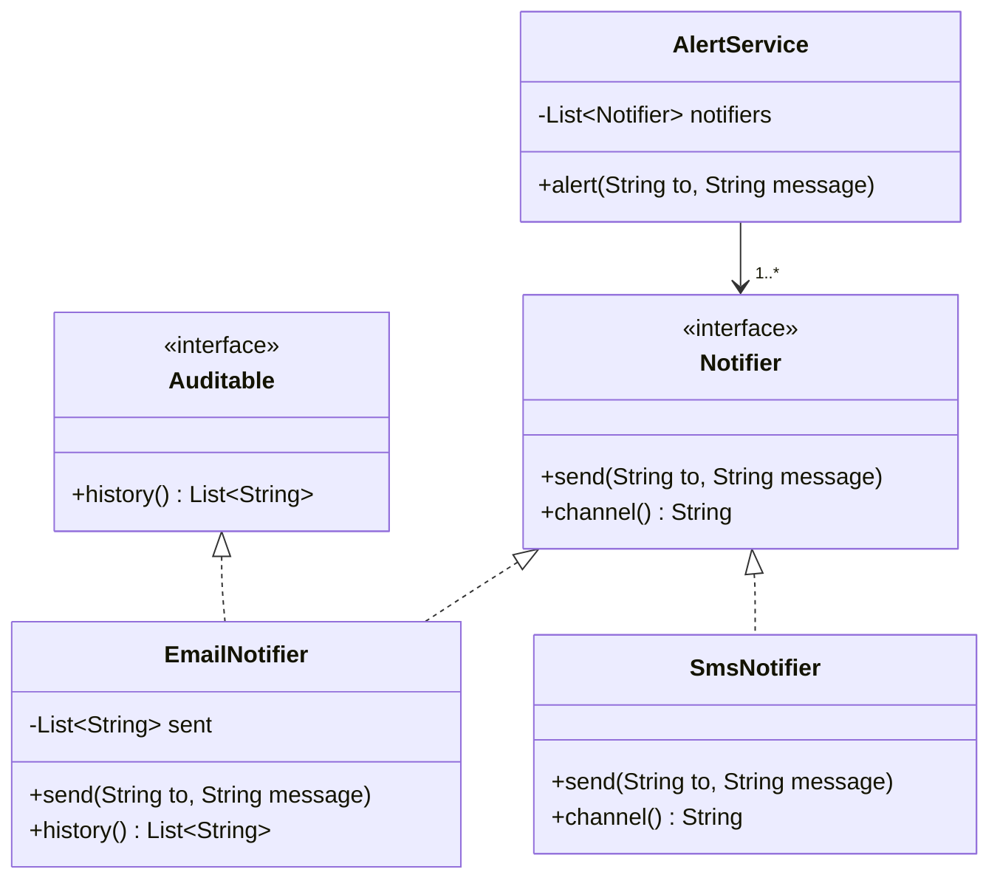

### Java example

```java
// File: code/lld/ch03/realization/Notifier.java — contract, no state
public interface Notifier {
    void send(String to, String message);
    default String channel() {                       // Java 8+ default method
        String n = getClass().getSimpleName();
        return n.contains("$$Lambda") ? "lambda" : n;   // lambdas get generated class names
    }
}
// Auditable { List<String> history(); }

// File: code/lld/ch03/realization/EmailNotifier.java — realizes TWO interfaces
public final class EmailNotifier implements Notifier, Auditable {
    private final List<String> sent = new ArrayList<>();
    @Override public void send(String to, String message) {
        String line = "EMAIL to " + to + ": " + message;
        sent.add(line);
        System.out.println("  " + line);
    }
    @Override public List<String> history() { return List.copyOf(sent); }
}

// File: code/lld/ch03/realization/SmsNotifier.java
@Override public void send(String to, String message) {
    String text = message.length() > 20 ? message.substring(0, 20) + "..." : message;
    System.out.println("  SMS to " + to + ": " + text);
}
@Override public String channel() { return "SMS"; }   // overrides the default

// File: code/lld/ch03/realization/AlertService.java — associated with the INTERFACE only
public void alert(String to, String message) {       // notifiers = List.copyOf(constructor argument)
    for (Notifier n : notifiers) {
        System.out.println("via " + n.channel());
        n.send(to, message);
    }
}

// File: code/lld/ch03/realization/Main.java
EmailNotifier email = new EmailNotifier();
Notifier sms = new SmsNotifier();
Notifier console = (to, msg) -> System.out.println("  CONSOLE " + to + ": " + msg); // a lambda realizes it too
AlertService alerts = new AlertService(List.of(email, sms, console));
alerts.alert("ops@shop.example", "Disk usage above 90 percent on db-1");
Auditable audit = email;   // same object, seen through its other interface
System.out.println("Email audit trail: " + audit.history());
```

Output:

```
via EmailNotifier
  EMAIL to ops@shop.example: Disk usage above 90 percent on db-1
via SMS
  SMS to ops@shop.example: Disk usage above 90 ...
via lambda
  CONSOLE ops@shop.example: Disk usage above 90 percent on db-1
Email audit trail: [EMAIL to ops@shop.example: Disk usage above 90 percent on db-1]
```

A lambda realizes `Notifier` because it has exactly one abstract method (a *functional interface*). `AlertService` holds `List<Notifier>`, so a new channel (e.g. `PushNotifier`) needs no change there; the same `email` object is a `Notifier` to `AlertService` and an `Auditable` to `Main`.

### Trade-offs

| | Interface + realization | Abstract class + generalization |
|---|---|---|
| Multiple per class | yes | no (single inheritance) |
| Instance fields | no | yes |
| Shared code | `default` methods only | any methods, constructors |
| Best for | roles/capabilities, plug-ins, test seams | a family sharing state and a workflow |

**When not:** one implementation that will never vary and no testing need is ceremony — add the interface when a second implementation or a test double (fake stand-in for tests) appears (YAGNI: "you aren't gonna need it"). "Marker" interfaces with no methods are rarely needed; annotations (`@` tags like `@Override` attaching information to code) usually serve better.

### Common mistakes

- Solid line instead of dashed (that means class inheritance).
- Fat interfaces forcing implementers to stub (write empty placeholders for) unneeded methods (breaks Interface Segregation, Chapter 4).
- Declaring variables with the concrete type (`EmailNotifier n = ...`), losing the benefit.

**Real-world:** `List` realized by `ArrayList`/`LinkedList`; `Comparable`, `Runnable`, `AutoCloseable`; **JDBC** (Java Database Connectivity): each vendor's driver realizes `java.sql.Connection`, your code never names the vendor class; **Spring** injects a `PaymentGateway` bean (Spring-created object) that may be Stripe, Razorpay (payment providers) or a mock (fake); **SLF4J** (a logging facade, one front for several libraries): code calls `Logger`, Logback or Log4j realizes it.

### In the interview

**30-second answer:** "Realization is a class implementing an interface — dashed line, hollow triangle at the interface. I put an interface wherever behaviour can vary or I need a test double (payment gateway, notifier, pricing strategy), and the rest of the design depends on the interface only."

- *Q: Interface or abstract class?* — A: Interface for a capability many unrelated classes can have, or when a class needs several; abstract class when subclasses share state and a fixed workflow. They combine: interface on top, abstract skeleton below (`List` → `AbstractList` → `ArrayList`).
- *Q: Is a lambda a realization?* — A: Yes; it is an instance of a functional interface.

### Self-check

- *Q: Generalization vs realization on paper?* → A: Same hollow triangle; solid line vs dashed line.
- *Q: How many interfaces can a Java class implement?* → A: Any number.

### TL;DR

Realization = "implements". Dashed line + hollow triangle at the `«interface»`. Depend on the interface, plug in implementations.

---

## 3.8 Decision guide: choosing the relationship between two classes

Ask **in order**, stop at the first "yes":

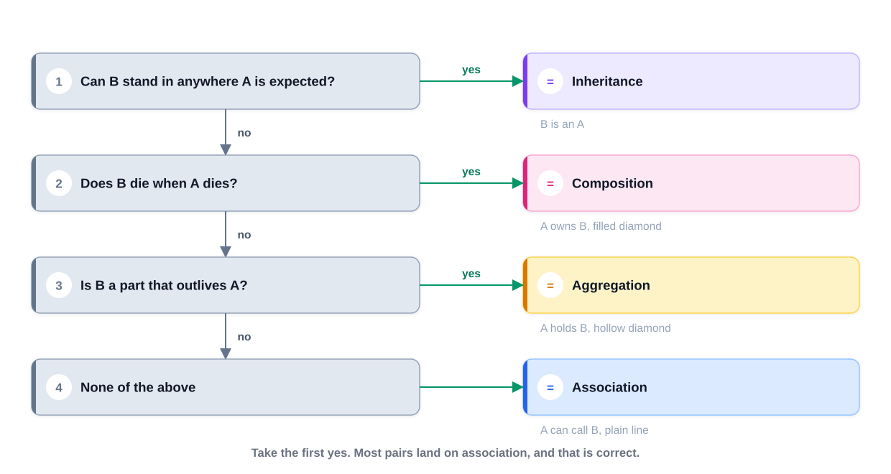
*Figure — The four-question decision: inheritance, then composition, then aggregation, else association (course diagram)*

Inheritance comes first only because it is easiest to *rule out* (a strict yes to the substitution test, which most pairs fail). Most pairs end as plain association — healthy; if nearly every box extends another, look again. Full guide, with the two "light" relationships:

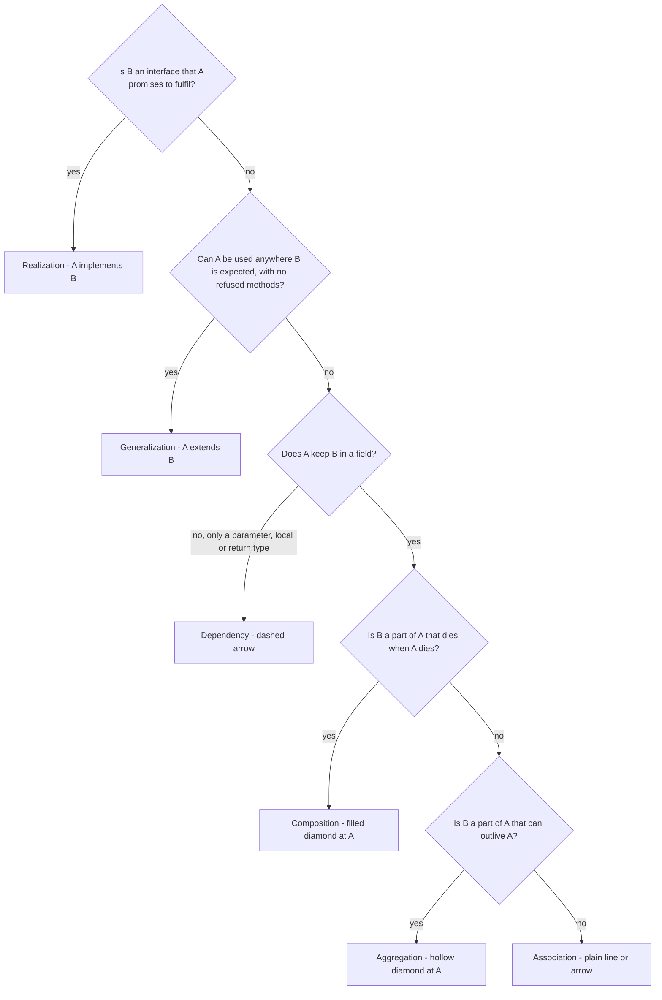

**Summary table (keep this one)**

| Relationship | Phrase | UML line | Java shape | Lifetime | Example |
|---|---|---|---|---|---|
| Dependency | A *uses* B | dashed, open arrow → B | B as parameter / local / return / static call | none | `CheckoutService` uses `PaymentGateway` |
| Association | A *knows* B | solid line (arrow for one-way) | field of type B, B created elsewhere | independent | `Order` → `Customer` |
| Aggregation | A *has* B (parts live on) | solid, hollow ◇ at A | field/collection, parts passed in | B outlives A | `Airline` ◇— `Aircraft` |
| Composition | A *owns* B | solid, filled ◆ at A | A creates B, hides it, B not shared | B dies with A | `ParkingFloor` ◆— `ParkingSpot` |
| Realization | A *implements* B | dashed, hollow △ at B | `implements` | — | `EmailNotifier` ⇢ `Notifier` |
| Generalization | A *is a* B | solid, hollow △ at B | `extends` | — | `CardPayment` → `Payment` |

**Mermaid cheat-sheet for these lines** (used in all later chapters):

| Mermaid | Meaning |
|---|---|
| `A ..> B` | A depends on B |
| `A --> B` | A associated with B, navigable A to B |
| `A -- B` | association (both ways / unspecified) |
| `A o-- B` | aggregation, A is the whole |
| `A *-- B` | composition, A is the whole |
| `B <\|.. A` | A realizes interface B |
| `B <\|-- A` | A extends B |
| `A "1" *-- "1..*" B` | with multiplicities |

### Common mistakes (all relationships)

- Diamond at the wrong end (goes at the **whole**); triangle at the wrong end (goes at the **parent / interface**).
- Lines without multiplicity: a line with no type or count means the design question is still open. Candidates who write numbers on every line from the first box report the interviewer simply stops asking — cheap, and it removes a whole class of follow-ups.
- Inheritance used to share data.

### In the interview

Say the test **out loud** for each line: *"When a floor is removed its spots go too, so this is composition"*; *"Cash and card can both be asked to take money, so inheriting from Payment is honest."* Spot a constant-only subclass and collapse it into a field yourself. Expect "why not inheritance here?" (substitution test) and "what if a spot can hold two motorbikes?" (change the multiplicity, then say what it does to the code).

### Self-check

- *Q: `Library` and `Member`?* → A: Aggregation (or plain association): members exist either way.
- *Q: `Flight` and `WeeklySchedule`?* → A: Composition.
- *Q: `ParkingTicket` and `ParkingSpot`?* → A: Association: the ticket refers to the spot but is not a whole made of spots.
- *Q: `Report.render(Formatter f)`?* → A: Dependency.

### TL;DR

Realization/generalization for "is-a" (only after the substitution test), composition when parts die with the whole, aggregation when they live on, association when one just knows the other, dependency when only used inside a method.

---

# Part B — UML

## 3.9 What UML is (structural vs behavioural diagrams)

### What it is

**UML (Unified Modeling Language)** is a standard set of symbols for software designs, so one engineer's diagram reads without a legend. Maintained by the OMG (Object Management Group); current version UML 2.5.1. It is **not** a programming language — it does not run, needs no tool (a whiteboard will do); it is an agreement about what, say, "a line with a filled diamond" means.

In the 1990s three competing OO methods — Grady Booch's, James Rumbaugh's OMT, Ivar Jacobson's OOSE — merged their notations into UML; serving three user groups made it large, so every team uses a subset.

### The problem it solves

1. **Makes a design visible:** twelve boxes with lines read in seconds; twelve classes in sentences do not.
2. **Makes decisions explicit:** a sentence can be vague about ownership; a diagram forces a filled or hollow diamond.
3. **Makes disagreement cheap:** the interviewer points at one line — "why composition here?" — which is what a good interview looks like.

### How it works — the 14 diagram types

UML 2.5 defines **14 diagram types**: **structural** (what the system *is made of* — static parts existing at any moment) and **behavioural** (what it *does* over time), with **interaction diagrams** a behavioural subgroup focused on messages between objects.

| Family | Diagram | Shows | Interview use |
|---|---|---|---|
| Structural | **Class** | classes, attributes, operations, relationships | **always** |
| Structural | Object | a snapshot of real objects and their links | rarely (to explain an example) |
| Structural | Package | how classes group into packages/modules | rarely |
| Structural | Component | deployable parts and their interfaces | system design rounds |
| Structural | Composite structure | internal parts of one class | rarely |
| Structural | Deployment | software on hardware nodes (machines) | system design rounds |
| Structural | Profile | extensions to UML itself | never |
| Behavioural | **Use case** | actors and what they can achieve | early, often spoken |
| Behavioural | **Activity** | steps of one flow with branches | one per key flow |
| Behavioural | **State machine** | states of one object and allowed transitions | when an object has a lifecycle |
| Behavioural → interaction | **Sequence** | who calls whom, in time order | on request |
| Behavioural → interaction | Communication | same messages, drawn on a network of objects | rarely |
| Behavioural → interaction | Interaction overview | an activity diagram whose nodes are interactions | rarely |
| Behavioural → interaction | Timing | state changes against a time axis | embedded (software inside devices) / hardware |

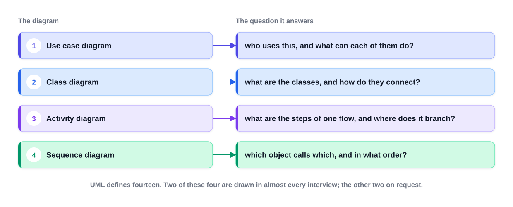
*Figure — The four diagrams an OOD interview uses and the question each answers (course diagram)*

Four diagrams carry an OOD interview — **use case** (who uses it and what each can do; drawn first, before any class), **class** (*the* answer, the only one mapping to code), **activity** (one flow's steps and branches), **sequence** (who calls whom, in order) — plus a fifth this book adds: **state machine** (one object's states and what moves it between them: parking spot, order, elevator, vending machine…).

### Trade-offs

| Benefit | Cost |
|---|---|
| Shared vocabulary, no legend needed | Large spec; easy to over-draw |
| Forces explicit decisions | Takes whiteboard time from code/discussion |
| Tool support (PlantUML, Mermaid, draw.io, StarUML: diagram-drawing tools) | Diagrams go stale if not kept with code |

**When not:** as unmaintained documentation, or in full formal detail on a whiteboard. Teams today use lightweight "sketch" UML, the C4 model for architecture (a system drawn at four zoom levels), or text-based Mermaid/PlantUML next to the code. For an interview, UML-lite is right.

### Common mistakes

- Thinking notation is graded: what is graded is whether **diagram and words agree** — forget the realization arrow, say "this implements that"; draw a hollow diamond meaning filled and say so; that is discussion, not a lost point. A line you cannot justify is worse than a missing one.

**Real-world:** Mermaid renders natively in GitHub and GitLab Markdown (a plain-text formatting language), so design docs (RFCs, written design proposals; ADRs, Architecture Decision Records) embed diagrams as text; PlantUML is common in enterprise wikis (Confluence via plug-ins) for service-call sequence diagrams.

### In the interview

**30-second answer:** "UML is a standard notation for designs. It has 14 diagrams: structural ones (class, object, component…) describe what the system is made of; behavioural ones (use case, activity, state machine, and the interaction diagrams such as sequence) describe what it does. In an OOD round I use a quick use-case list, one class diagram, and an activity or sequence diagram for the key flow."

- *Q: Is UML outdated?* — A: Full formal UML is rare, but its core notations (class, sequence, state) remain the shared language of design and live on in Mermaid/PlantUML in modern repos (code repositories). You need only the subset.
- *Q: Which diagram maps to code?* — A: The class diagram.

### Self-check

- *Q: Sequence diagram — structural or behavioural?* → A: Behavioural (interaction).
- *Q: How many UML diagram types?* → A: 14 (7 structural, 7 behavioural).

### TL;DR

UML = standard symbols, not a language that runs. 14 diagrams: structural (what it is) vs behavioural (what it does). Interviews use class (always), use case, activity, sequence, and state machine when an object has a lifecycle.

---

## 3.10 Use-case diagrams

### What it is

A **use-case diagram** shows **who** uses the system and **what** each can achieve — no classes, methods, data or ordering.

- An **actor** is a *role* interacting with the system, drawn as a stick figure outside it. Roles, not people: one person can be Member and Librarian; one actor can stand for thousands of users. Actors need not be human — a payment gateway, email service or timer ("System") is an actor.
- A **use case** is one goal producing a result the actor cares about, an oval with a verb phrase: "Borrow a book". "Click the search button" is a step inside one, not a use case.
- The **system boundary** is a rectangle around all use cases, labelled with the system name: inside = what you build.

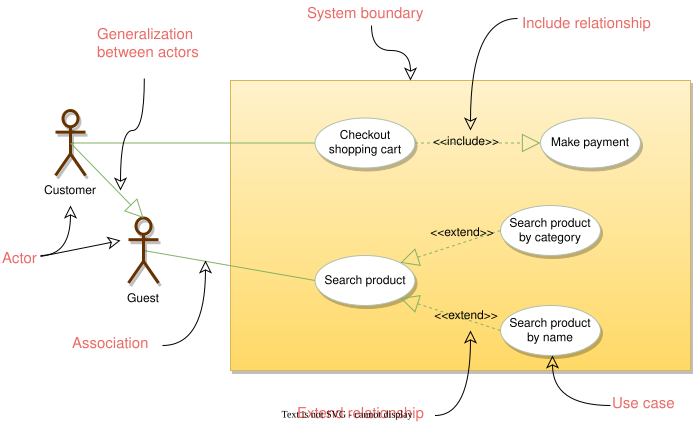
*Figure — The parts of a use-case diagram for online shopping: actors (Customer, Guest), use cases, system boundary, generalization between actors, and «include» / «extend» relationships (course diagram)*

### The problem it solves

It turns "design a library" into an **agreed scope** ("these nine in; refunds, seasonal pricing, reporting out"), agreed by the interviewer who judges completeness, and yields first classes: **actors usually become classes, use cases methods**.

### How it works

1. **Find the actors** with four questions: *Who starts something?* (customer, member, player). *Who administers it?* (adds books, sets rates, blocks accounts — the most-forgotten actor, bringing a whole column of use cases). *Who gets told?* (notification recipients). *What acts with nobody present?* (timers, background jobs, external services — draw as "System").
2. **Primary actors** (who start use cases) on the left, **secondary/supporting actors** (whom the system calls, e.g. payment gateway) on the right.
3. Draw the **system boundary**; put each **use case** (verb phrase) inside.
4. Connect actors to their use cases with **plain lines (associations)**.
5. Add use-case relationships only where they help:
   - **«include»** — *always*: the base always performs the included one. Dashed arrow **from base to included**. *Borrow a book* «include» *Check member's limit*. In code: one method always calls another.
   - **«extend»** — *sometimes*: optional behaviour inserted into the base under a condition, at a named **extension point**. Dashed arrow **from the extending case back to the base**. *Charge fine* «extend» *Return a book* (only if late). Test: can the base complete without it? Yes → extend; no → include.
   - **Generalization** — solid line, hollow triangle: between actors (a Librarian can do everything a Member can) or use cases (*Pay by card* is a kind of *Make payment*).
6. Keywords are singular: «include», «extend». Older material uses «includes», «extends» or «uses» («uses» was replaced by «include» long ago).

In the course figure the Customer→Guest triangle is at **Guest**: a Customer can do everything a Guest can, plus check out. Its «include»/«extend» arrows have hollow triangles; strict UML draws them dashed with an **open** arrowhead (triangles mean generalization). Direction and label are what matter: «include» *Checkout shopping cart → Make payment*; both «extend» arrows run from the search variants back to *Search product*.

Mermaid has no use-case diagram, so this book uses flowcharts (stadium shapes = use cases, a subgraph = the boundary):


### From use cases to code (see `lld.ch03.library`)

| Use-case element | Becomes in Java |
|---|---|
| Actor *Member* | class `Member` |
| Actor *Librarian* (generalizes Member) | `class Librarian extends Member` |
| *Borrow a book* | `Member.checkout(BookItem, LocalDate)` |
| «include» *Check member limit* | private `checkLimit()` called on **every** checkout |
| *Return a book* | `Member.returnBook(BookItem, LocalDate)` |
| «extend» *Charge late fine* | `chargeFine(...)` called **only if** the book is late |
| *Add book copy* | `Librarian.addCopy(...)` |

A starting point, not a rule: a use-case method sometimes belongs on a service class instead.

### Trade-offs

| Pro | Con |
|---|---|
| Fast scope agreement; finds forgotten actors | No ordering, no data — it cannot show *how* |
| Maps to classes and methods | Easy to bloat with UI (user interface) steps |

**When not:** if the interviewer already gave precise requirements, a spoken list of actors and use cases suffices.

### Common mistakes

- **Use cases that are UI steps.** Typing a password, pressing submit, seeing a confirmation = one use case, "Log in". Dozens of ovals usually means a list of screens, not goals.
- **One actor per person.** A librarian who borrows is *two roles*: two actors, linked by generalization if one can do everything the other can.
- Reversing «extend» (it points from optional case to base); «include» for something that happens only sometimes; leaving off the boundary — the most useful part.

**Real-world:** an Amazon-style checkout: *Place order* always «include»s *Make payment*; *Apply gift card* «extend»s it only if the customer has one. **BookMyShow:** actors are Customer, Theatre admin, Payment gateway and a timer releasing held seats.

### In the interview

**30-second answer:** "Before classes, I list actors and what each can do, and draw a boundary to agree scope. Actors are roles — including admins, external services and timers. «include» is always, «extend» is sometimes. Actors become my first classes and use cases become methods."

- *Q: 'Make payment' — include or extend of 'checkout'?* — A: «include» if every checkout requires payment; "apply coupon", which checkout completes without, is «extend».
- *Q: How long should this take?* — A: Three to five minutes, early.

### Self-check

- *Q: Direction of the «include» arrow?* → A: From the base use case to the included one.
- *Q: Is a payment gateway an actor?* → A: Yes — an external system (a secondary actor).
- *Q: "Search product by name/by category" vs "Search product"?* → A: As in the course diagram, optional variants drawn as «extend» (use-case generalization is also defensible if explained).

### TL;DR

Actors (roles, outside) + use cases (goals, inside) + boundary (scope). «include» = always, arrow base→included; «extend» = sometimes, arrow extension→base. Actors → classes, use cases → methods.

---

## 3.11 Class diagrams

### What it is

A **class diagram** shows the **static structure**: which classes exist, what each holds (attributes) and can do (operations), and how they connect (relationships with multiplicity). It is the answer to an OOD question and the only UML diagram mapping directly to code; every other diagram either gets you to it (use case) or checks/explains it (activity, sequence, state), and it puts the whole design on one reviewable page.

### How it works — the class box

A rectangle with three compartments: **name** / **attributes** / **operations**.

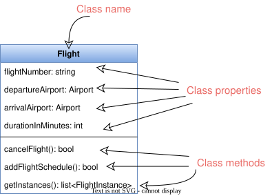
*Figure — A class box: name on top, properties (attributes) in the middle, methods (operations) at the bottom, using a Flight class (course diagram)*

Attributes are `name: Type`, operations `name(params): ReturnType`. Full syntax:

```
visibility name : Type [multiplicity] = default      e.g.  - spots : ParkingSpot [1..*]
visibility name(param : Type, ...) : ReturnType      e.g.  + park(v : Vehicle) : Ticket
```

| UML | Meaning | Java |
|---|---|---|
| `+` | public — anyone | `public` |
| `-` | private — only this class | `private` |
| `#` | protected — this class and subclasses | `protected` (Java also allows the same package) |
| `~` | package — same package only | no modifier (package-private) |

| Notation | Meaning | Java |
|---|---|---|
| *Italic* name, or `{abstract}` / `«abstract»` | abstract class (never instantiated directly) / abstract operation (no body) | `abstract` |
| `«interface»` above the name | interface | `interface` |
| `«enumeration»` + literals | enum | `enum` |
| <u>underlined</u> member | static (class-level) | `static` |
| `{readOnly}` | cannot change after creation | `final` field |
| `List<T>` / `T[*]` | collection attribute | `List<T>` |

You need **not** fill all three compartments: early on a name-only box is a good class. In Mermaid, visibility uses the same symbols; `*` after a method = abstract, `$` = static; `<<interface>>`, `<<abstract>>`, `<<enumeration>>` are annotations; generics are `List~T~`.

### How it works — the relationships (all arrow types)

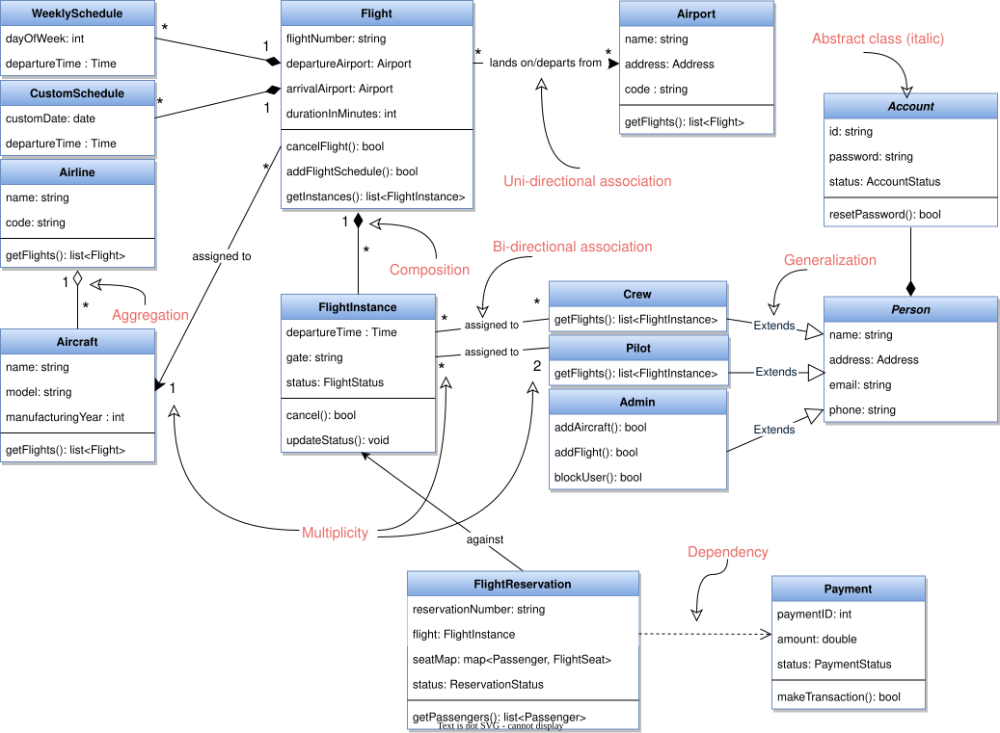
*Figure — An airline-system class diagram using every relationship: associations (e.g. Flight to Aircraft, uni-directional), multiplicities (FlightInstance has 2 Pilots), aggregation (Airline–Aircraft), composition (Flight–WeeklySchedule), generalization (Person to Crew/Pilot/Admin) and dependency (course diagram)*

The figure uses the complete vocabulary — Part A's six relationships (association two-way and one-way) plus multiplicity:

| Line | Drawn as | Read as | Example from the figure |
|---|---|---|---|
| Association (bi-directional) | solid line | "A and B know each other" | FlightInstance — Pilot, FlightInstance — Crew ("assigned to") |
| Uni-directional association | solid line, arrowhead at B | "A can call B, not vice versa" | Flight → Airport ("lands on/departs from"), Flight → Aircraft ("assigned to") |
| Multiplicity | numbers at line ends: `1`, `*`, `0..1`, `2..4` (a range) | "how many" | FlightInstance `*` — `2` Pilot: each instance has exactly 2 pilots, each pilot flies many |
| Aggregation | hollow diamond at the whole | "has-a, part lives on" | Airline `1` ◇— `*` Aircraft |
| Composition | filled diamond at the whole | "owns, part dies with it" | Flight ◆— WeeklySchedule, Flight ◆— CustomSchedule, Flight ◆— FlightInstance |
| Generalization | solid line, hollow triangle at parent | "is-a" | Pilot, Crew, Admin → Person |
| Realization | dashed line, hollow triangle at interface | "implements" | (any `«interface»`) |
| Dependency | dashed line, open arrowhead | "uses" | FlightReservation ⇢ Payment |

(The figure's one-way arrowheads are filled; strict UML uses open — see 3.1.) Some figure classes carry getters for the "other" direction (`Aircraft.getFlights()`) though the line is one-way; strictly that makes it navigable both ways — read the arrow as "primary direction", and keep arrows and fields consistent in your own diagrams.

Two extra notations to recognise:

- **Association class** — a class hanging off an association by a dashed line, holding data about the *link itself* (`Enrollment{grade}` on Student–Course).
- **Qualified association** — a small box on one end with a key (`Library [isbn] → Book`): "look up by this key", in Java a `Map<Isbn, Book>`.

### Worked example — the library design (code in `lld.ch03.library`)

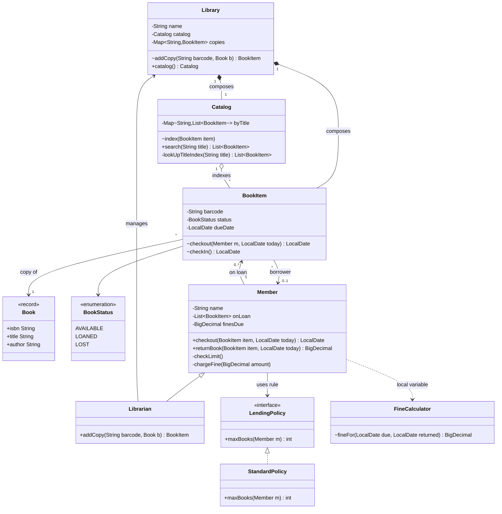

Every line type appears — note aggregation Catalog ◇ BookItem (the index points at copies it does not own) and dependency Member ⇢ FineCalculator. `~` marks package-private methods like `BookItem.checkout`, callable only by `Member` (same package). The Java essentials are in 3.12.

### How much detail to draw

**Every class a named box** (10–15 is a full answer), **attributes only where they matter** (the two or three carrying the design), **operations only those in your flows**, and **every line typed with a multiplicity** — the part not to skip. Short of time, **drop attributes before relationships**: name-only boxes with precise lines describe a design; rich boxes with vague lines do not (budget in 3.15).

### Trade-offs

| Detailed diagram | Sketch diagram |
|---|---|
| Near code-ready; fewer surprises later | Faster; easier to change during discussion |
| Takes 10+ minutes | Leaves details for the coding phase |

**When not:** it shows no *order* or *time* — use sequence/activity/state diagrams for behaviour.

### Common mistakes

- Unlabelled lines; diamonds/triangles at the wrong end; every getter/setter and `String` field listed; associations on the diagram that are not fields in the code (or vice versa).

**Real-world:** IntelliJ IDEA (Ultimate), a Java IDE (code editor with build/run tools), generates class diagrams from code; JPA entity diagrams (ER-style: entity-relationship pictures of tables) are class diagrams with multiplicities (`@OneToMany` = `1..*`).

### In the interview

**30-second answer:** "I start with named boxes from the nouns and actors, then draw every line with a type and multiplicity, saying the lifetime/substitution test aloud. I add only the attributes and methods that drive the key flows. `+ - # ~` for visibility, italics or «abstract» for abstract, «interface» for interfaces."

- *Q: `#` and its Java nuance?* — A: Protected; in Java it is also visible within the same package, which UML's `#` does not imply.
- *Q: How do you show a static method?* — A: Underline it (Mermaid: `$` suffix).

### Self-check

- *Q: `~` means?* → A: Package visibility (Java's default, no modifier).
- *Q: The one test for aggregation vs composition?* → A: Whole gone — is the part still meaningful by itself?

### TL;DR

Box = name / attributes / operations with `+ - # ~`. Seven lines: association (± arrow), aggregation ◇, composition ◆, generalization (solid △), realization (dashed △), dependency (dashed arrow), plus multiplicity on every line.

---

## 3.12 Sequence diagrams

### What it is

A **sequence diagram** shows **which object calls which, and in what order**, for one scenario: objects across the top, **time down the page**.

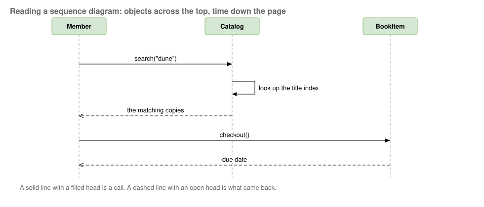
*Figure — A member searches the catalog for "dune" and borrows a copy: lifelines, a self-call on Catalog, calls with filled arrowheads and dashed returns (course diagram)*

### The problem it solves

A class diagram says objects *can* talk; this shows what they *actually say*, in order. Use it when order is easy to get wrong (reserve seat → take payment → confirm; any other order is a bug), when several objects take part (two need no diagram; five usually do), or to explain a drawn class diagram.

### How it works — the notation

| Element | Drawn as | Meaning |
|---|---|---|
| **Participant / lifeline** | box at top + dashed vertical line | one *object* (strictly `catalog : Catalog`; most write the class name) |
| **Actor** | stick figure at top | a user or external system starting the flow |
| **Synchronous message** | solid line, **filled** arrowhead | a call; the caller waits for it to finish |
| **Asynchronous message** | solid line, **open** arrowhead | fire-and-forget; caller continues (events, queues: lists of messages waiting to be processed) |
| **Return (reply)** | dashed line, open arrowhead | the value coming back — draw only when it matters |
| **Self-message** | arrow looping back to the same lifeline | the object calls its own method |
| **Activation bar** (execution specification) | thin rectangle on a lifeline | the object is busy executing |
| **Create message** | dashed arrow to the new object's box, often «create» | the object is created at that moment |
| **Destruction** | **X** at the end of a lifeline | the object is destroyed |
| **Combined fragment** | labelled box around messages | control logic: see below |

**Combined fragments** (top-left label = *operator*; conditions, *guards*, in `[ ]`):

| Operator | Meaning | Java equivalent |
|---|---|---|
| `alt` | alternatives, one runs (sections split by dashed lines, each guarded, last can be `[else]`) | `if / else if / else` |
| `opt` | optional, runs only if the guard is true | `if` without `else` |
| `loop` | repeats while the guard holds (`loop [for each item]`) | `for` / `while` |
| `par` | sections run in parallel | threads (independent lines of execution) / `CompletableFuture` (a result arriving later from background work) |
| `break` | if guard true, run this and leave the enclosing fragment | early `return` / `break` |
| `critical` | atomic region (one indivisible step), no interleaving | `synchronized` (one thread at a time) / lock |
| `ref` | reference to another diagram | calling a helper flow |

(UML also has `neg`, `strict`, `seq`, `assert`, `ignore`, `consider` — not needed in interviews.) On a whiteboard activation bars and fragments are optional and usually skipped: lifelines, calls, the returns that matter and self-calls suffice.

### Example 1 — the library checkout, matching the Java code

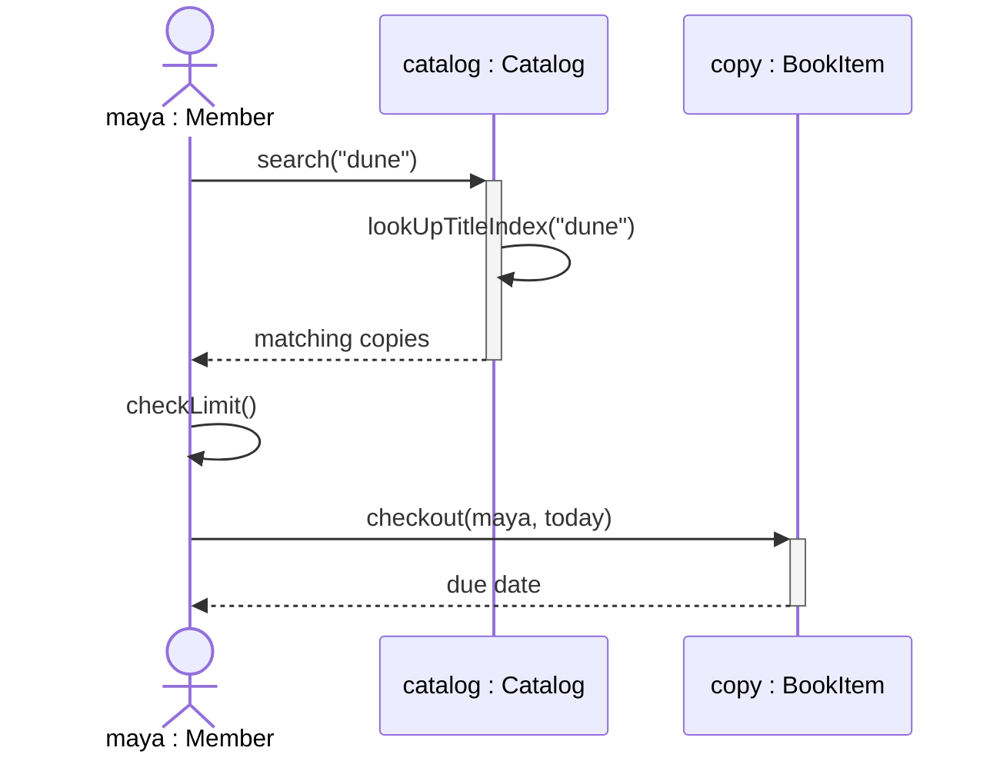

Four things to notice (as in the course figure):

1. **The first message starts the flow**, always from outside the objects shown: the member calls `search`.
2. **The catalog calls itself** — the title-index lookup needs no other object.
3. **Only two returns are drawn** — copies and due date; other returns are not worth naming.
4. **The member talks to the copy directly**, not back through `Catalog` — a choice no other diagram shows, which an interviewer can question by tapping that arrow.

### Example 2 — all fragments and async messages (checkout with payment)

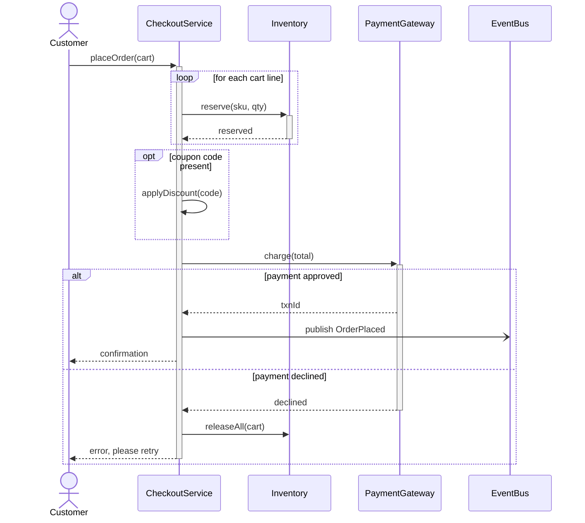

`->>` is a synchronous call, `-->>` a reply, `-)` an **asynchronous** message (publishing does not wait for subscribers). (An `EventBus` delivers each published event to all subscribers; `sku` = stock-keeping unit, a product ID; queues and async messaging: [System Design Fundamentals](../../../system-design-patterns/modules/00-system-design-fundamentals/README.md).) The order is the point: reserve stock *before* charging, release it if the charge fails.

### Java code for Example 1 (`lld.ch03.library`)

Essentials below; full files in `code/lld/ch03/library/` (`Book` record (isbn, title, author); `BookStatus` enum AVAILABLE/LOANED/LOST; `StandardPolicy.maxBooks` = 10 for a `Librarian`, else 2; `FineCalculator.fineFor` = 5.00 per late day (`ChronoUnit.DAYS`), else 0.00 — used as a local variable, a dependency; `Librarian extends Member` and its `addCopy` delegates to `Library.addCopy`, which creates the `BookItem`, stores it and `catalog.index`es it; `Library` composes its `Catalog`).

```java
// File: code/lld/ch03/library/BookItem.java — one physical copy: BookItem * --> 1 Book, 0..1 borrower
static final int LOAN_DAYS = 14;
LocalDate checkout(Member m, LocalDate today) {      // package-private; returns the due date
    if (status != BookStatus.AVAILABLE) throw new IllegalStateException(barcode + " is " + status);
    status = BookStatus.LOANED;
    borrower = m;
    dueDate = today.plusDays(LOAN_DAYS);
    return dueDate;
}
// checkIn(): requires LOANED, resets to AVAILABLE, returns the old due date; toString = barcode[title, STATUS]

// File: code/lld/ch03/library/Catalog.java — aggregates BookItems: points at them, does not own them
public List<BookItem> search(String title) {
    List<BookItem> hits = lookUpTitleIndex(title);   // self-call in the sequence diagram
    return List.copyOf(hits);
}
private List<BookItem> lookUpTitleIndex(String title) { return byTitle.getOrDefault(key(title), List.of()); }
// byTitle: Map<lower-cased title, List<BookItem>>, filled by index(item)

// File: code/lld/ch03/library/Member.java — actor -> class, use cases -> methods
public LocalDate checkout(BookItem item, LocalDate today) {
    checkLimit();                                    // <<include>>: happens every time
    LocalDate due = item.checkout(this, today);
    onLoan.add(item);
    return due;
}
public BigDecimal returnBook(BookItem item, LocalDate today) {
    if (!onLoan.remove(item)) throw new IllegalStateException(name + " does not hold " + item.barcode());
    LocalDate due = item.checkIn();
    BigDecimal fine = new FineCalculator().fineFor(due, today);
    if (fine.signum() > 0) chargeFine(fine);         // <<extend>>: only when late
    return fine;
}
private void checkLimit() {
    int max = policy.maxBooks(this);                 // policy: LendingPolicy interface (association)
    if (onLoan.size() >= max) throw new IllegalStateException(name + " already has " + max + " books (limit)");
}
private void chargeFine(BigDecimal amount) { finesDue = finesDue.add(amount); }   // BigDecimal, not double

// File: code/lld/ch03/library/Main.java (abridged) — Librarian Lee adds B-1, B-2 (Dune), B-3, B-4 (The Hobbit)
LocalDate day1 = LocalDate.of(2026, 3, 1);
List<BookItem> hits = lib.catalog().search("dune");                     // printed
LocalDate due = maya.checkout(hits.get(0), day1);                        // printed
maya.checkout(lib.catalog().search("the hobbit").get(0), day1);          // then prints maya.onLoan()
maya.checkout(hits.get(1), day1);                       // <<include>> limit fires -> "Blocked: ..."
new Member("Omar", policy).checkout(hits.get(0), day1); // copy already LOANED -> "Blocked: ..."
maya.returnBook(hits.get(0), day1.plusDays(10));        // on time
maya.returnBook(hobbitCopy, day1.plusDays(17));         // 3 days late: <<extend>> fine applies
// finally prints policy.maxBooks(lee) and policy.maxBooks(maya)
```

Output:

```
search("dune") -> [B-1[Dune, AVAILABLE], B-2[Dune, AVAILABLE]]
Maya borrowed B-1, due 2026-03-15
Maya on loan: [B-1[Dune, LOANED], B-3[The Hobbit, LOANED]]
Blocked: Maya already has 2 books (limit)
Blocked: B-1 is LOANED
Returned B-1 on time, fine = 0.00
Returned B-3 3 days late, fine = 15.00, Maya owes 15.00
Librarian limit: 10, member limit: 2
```

Check diagram against code: every arrow is a real method — `Catalog.search`, `Catalog.lookUpTitleIndex`, `Member.checkLimit`, `BookItem.checkout`. **A message with no method means your class diagram is missing one** — the activity diagram's check, from another direction.

### Trade-offs

| Good at | Poor at |
|---|---|
| Order of calls, who talks to whom | Branch-heavy flows (nested `alt` becomes unreadable) |
| Showing sync vs async | Showing the whole design |
| Spotting missing methods | Being quick to draw — each message is a line |

**When not:** flows with three or more decisions — use an **activity diagram** (a second `alt`/`opt` box is the warning sign); unprompted in most OOD interviews — it costs class-diagram time.

### Common mistakes

- A return for every call (twice the height, nothing more said); messages that are not methods on the receiver.
- Mixed-up arrowheads (see the notation table).
- Classes instead of specific objects when two of one class take part (`from : Account`, `to : Account`).

**Real-world:** **OAuth 2.0 / OpenID Connect** ("log in with another account" protocols) flows (browser → app → authorization server → token endpoint); **payment integrations** (Stripe, Razorpay): "create order → redirect → webhook" (an HTTP call the provider makes to your server), the webhook drawn async; **microservice sagas** (microservices: small separately deployed services; saga: a multi-step transaction with an "undo" per step, e.g. flight + hotel + car) showing compensating "undo" calls when a step fails — all documented as sequence diagrams.

### In the interview

**30-second answer:** "A sequence diagram shows one scenario: objects across the top, time downwards. Solid filled arrows are sync calls, open arrows async, dashed arrows returns. `alt`/`opt`/`loop` fragments show if/else, if, and loops. I keep it to three or four objects and six to eight messages, and check that every arrow is a method on my class diagram."

- *Q: Sync vs async?* — A: Sync: the caller blocks until the callee returns (a normal call). Async: it continues at once (queue message, event, `CompletableFuture`).
- *Q: Sequence or activity diagram?* — A: Sequence when *who calls whom* in what order matters; activity when branching does.

### Self-check

- *Q: A thin rectangle on a lifeline?* → A: An activation bar — the object is executing.
- *Q: Fragment for "retry up to 3 times"?* → A: `loop [attempt <= 3]`.
- *Q: `Order` creates a `Payment` mid-flow?* → A: A create message (dashed, «create») to the new lifeline's box, which starts lower on the page.

### TL;DR

Objects across, time down. Filled = sync call, open = async, dashed = return. `alt` = if/else, `opt` = if, `loop` = loop, `par` = parallel. Keep it small; each arrow must be a real method.

---

## 3.13 Activity diagrams

### What it is

An **activity diagram** traces **one flow end to end**, marking each point where it **branches** (and any parallel steps). A class diagram is the design at rest; this follows one route through it. It is the UML diagram closest to a flowchart, so anyone can read it — and a careless one is easy to produce.

### The problem it solves

It makes a flow's business logic (every `if`, `unless`, `otherwise`) visible and checkable. Best interview use: a **test of your class diagram** — walk the flow asking *which class does this?*; an action with no home is a missing class, found on the whiteboard, not in code.

### How it works — the symbols

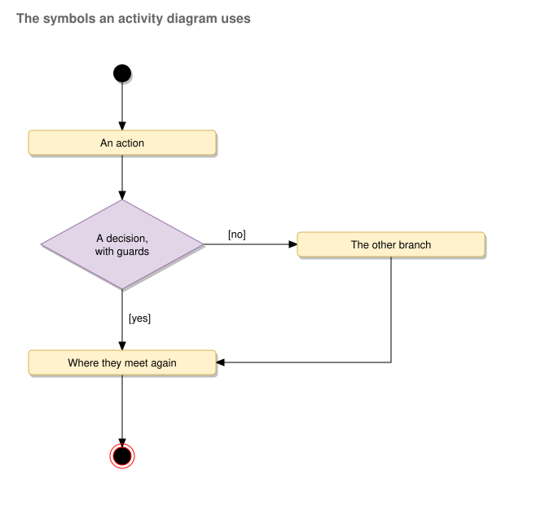
*Figure — The core activity-diagram symbols: start, action, a decision with [yes]/[no] guards, the other branch, where the branches meet again, and the end (course diagram)*

| Symbol | Drawn as | Meaning |
|---|---|---|
| **Initial node (start)** | filled black circle | where the flow begins (draw exactly one; UML allows several, one keeps it readable) |
| **Action** | rounded rectangle with a verb phrase | one step: "System calculates the parking fee" |
| **Control flow** | arrow | time runs along the arrows |
| **Decision** | diamond; each outgoing arrow has a **guard** `[condition]` | a branch; guards must cover every case (use `[else]`) |
| **Merge** | diamond (or arrows meeting one node) | branches come back together |
| **Fork** | thick bar, one arrow in, many out | following actions run **in parallel** |
| **Join** | thick bar, many in, one out | wait until **all** parallel actions finish |
| **Activity final (end)** | filled circle in a ring (bullseye) | the whole activity stops; there may be several ("payment failed", "gate opened") |
| **Flow final** | circle with an X | only *this* branch stops; others continue |
| **Swimlane (partition)** | lanes labelled with an actor/class | *who* performs each action |
| Object node | rectangle | data passed between actions (e.g. `[Ticket]`) |
| Send / receive signal | convex / concave pentagon | sending or waiting for an event |

**Steps:** (1) pick **one** flow with an interesting branch — a requirement with "if", "unless" or "otherwise"; (2) start node → actions in the problem's language ("The system calculates the fee", **not** "call `calculateFee()`"); (3) every decision outcome with a guard; (4) fork/join only for truly simultaneous steps (most interview flows need none); (5) swimlanes if they show who does what; (6) end node(s).

### Example 1 — online shopping (course)

Every activity diagram reads as one sentence: *begin, act, ask, follow one of two paths, merge, end.* A bigger example:

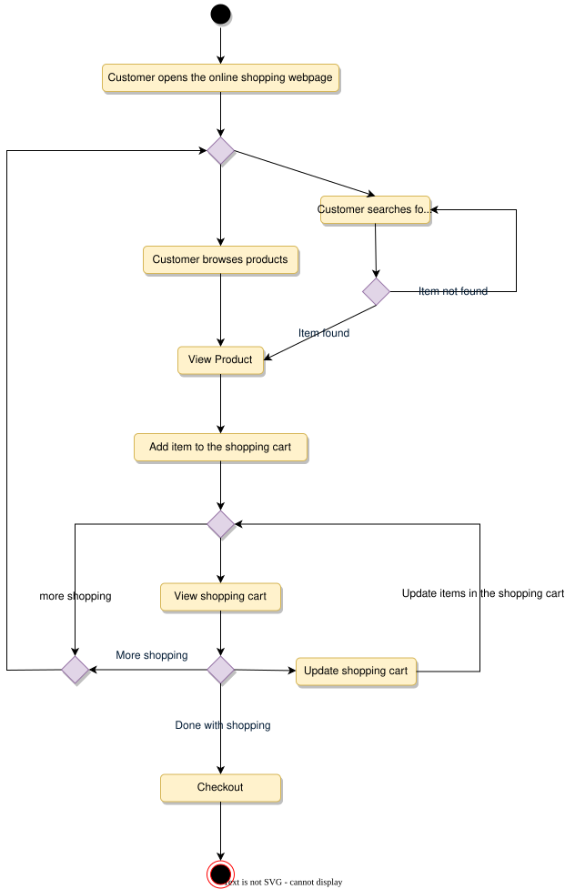
*Figure — A customer shopping online: search, item found or not found, add to cart, view/update the cart, more shopping or checkout (course diagram)*

### Example 2 — pay at the parking exit (three decisions, with swimlanes)

The Parking Lot case study (Chapter 14) has three decisions — *ticket already paid?*, *payment went through?*, *receipt wanted?* — each tracing to a requirement. Drawn with swimlanes (subgraphs), a retry loop, and a hand-off to an attendant after three failures:

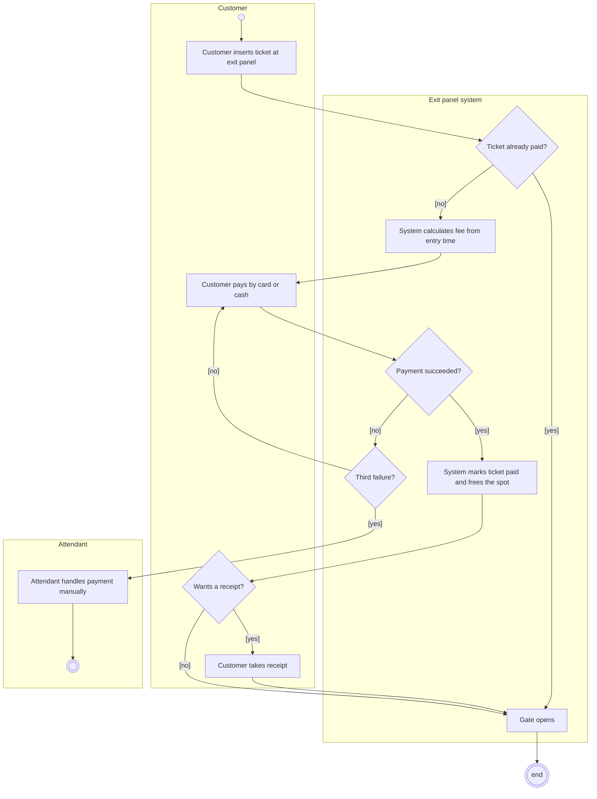

### Example 3 — fork and join (order fulfilment)

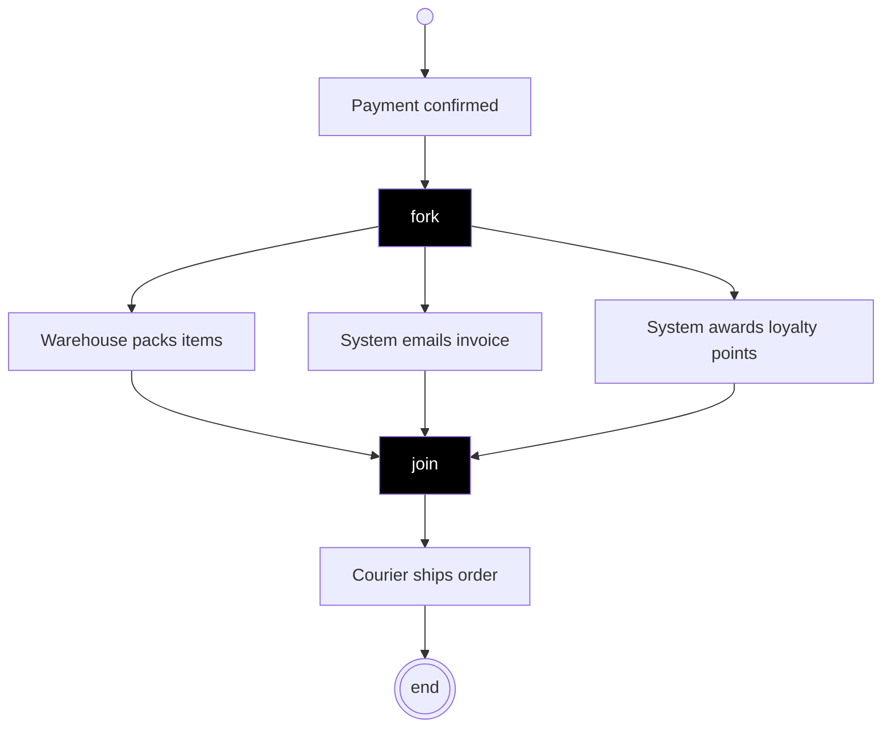

After the **fork** the three actions run in parallel; the **join** waits for all three before shipping.

### Activity vs sequence diagram

| | Activity diagram | Sequence diagram |
|---|---|---|
| Shows | a process as a series of steps | objects sending messages to each other |
| Branches | natural: decisions with guards | awkward: nested `alt` fragments |
| Names | actions, in business language | objects and method calls |
| Use when | the flow has interesting branches | the order of calls is the interesting part |
| Answers | "what happens?" | "who calls whom?" |

Rule of thumb: **three branches** → activity; **four objects** with easily confused call order → sequence.

### Trade-offs

| Pro | Con |
|---|---|
| Anyone (including non-engineers) can read it | Does not show which object does what unless you add swimlanes |
| Great at branches and parallelism | Big flows sprawl quickly |

**When not:** straight-line flows ("customer pays and leaves") — nothing to decide; object-to-object call order — use a sequence diagram.

### Common mistakes

- **A diamond with one exit** — nothing is decided: draw the missing branch or drop the diamond.
- **Actions written as code** ("call `calculateFee()`") — keep the problem's language so it checks against requirements.
- Guards not covering every case (`[amount > 100]` and `[amount < 100]` — exactly 100?); fork/join for merely sequential steps.

**Real-world:** **BPMN** (Business Process Model and Notation), used by workflow engines (run business processes step by step) like Camunda, is a close cousin with lanes and gateways; **CI/CD pipelines** (Continuous Integration / Delivery: build, test, deploy on every change; GitHub Actions, Jenkins) — parallel jobs (fork), a job that `needs:` others (join), conditional steps (guards); food delivery (Swiggy, Zomato, DoorDash) prepares food while assigning a rider — parallel branches joining at "order picked up".

### In the interview

**30-second answer:** "An activity diagram walks one flow: start, actions, decisions with guards covering every case, merges, optional fork/join for parallel steps, swimlanes for who does what, and one or more ends. I draw the flow with the interesting branch, then check that every action has a class to live in."

- *Q: Activity final vs flow final?* — A: Activity final ends the whole activity; flow final ends only that path while parallel paths continue.
- *Q: Which flow do you draw?* — A: The one whose requirement has "if/unless/otherwise" — e.g. payment failure and retry.

### Self-check

- *Q: What must every arrow leaving a decision have?* → A: A guard in square brackets; together they cover all cases.
- *Q: Two steps at the same time?* → A: A fork bar before them, a join bar after.

### TL;DR

One flow: start → actions → guarded decisions → merge → end. Fork/join for parallel, swimlanes for who. Draw the branching flow and use it to test your class diagram.

---

## 3.14 State machine diagrams

### What it is

A **state machine diagram** (*statechart*, *state diagram*) shows the **states one object can be in** during its life and the **transitions** moving it between them in response to **events**.

- **State** — a condition in which the object behaves a certain way or waits (rounded rectangle): `CREATED`, `PAID`, `SHIPPED`.
- **Initial pseudostate** — filled circle, arrow to the first state. **Final state** — bullseye: the object's life (in this machine) is over.
- **Transition** — arrow labelled `event [guard] / action`: **event (trigger)** — what happens (`pay(amount)`); **guard** — boolean that must be true to fire (`[amount == total]`); **action (effect)** — what the object does while transitioning (`/ refund()`).
- **Internal activities:** `entry / ...` (on entering), `exit / ...` (on leaving), `do / ...` (while in the state).
- **Self-transition** — arrow back to the same state (exit and re-entry actions run).
- **Choice pseudostate** — a small diamond picking the next state by guards.
- **Composite state** — contains sub-states (`Active` containing `Idle` and `Moving`); **history** `(H)` remembers the last sub-state.
- **Orthogonal regions** — a state split by dashed lines into simultaneously active parts.

Analogy: a **traffic light** — always one state, a timer moves it on, order fixed (never green straight to red).

### The problem it solves

Lifecycle objects (orders, tickets, elevators, vending machines, parking spots, TCP connections — TCP: the reliable-connection network protocol, see [System Design Fundamentals](../../../system-design-patterns/modules/00-system-design-fundamentals/README.md)) breed bugs: shipping a cancelled order, paying twice, refunding the undelivered. The diagram lists **every legal transition** so all else is rejected, and maps to code (an `enum` + a transition method, or the **State pattern**, Chapter 11).

### How it works

1. Pick **one** class with a lifecycle; 2. list its states (usually an `enum`); 3. per state, the accepted events, guard, target and action; 4. everything unlisted is **illegal** — the code rejects it; 5. mark initial and final states.

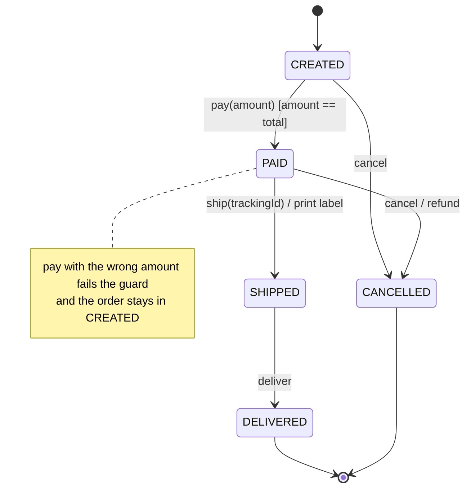

A composite-state example (an elevator car) for recognition:

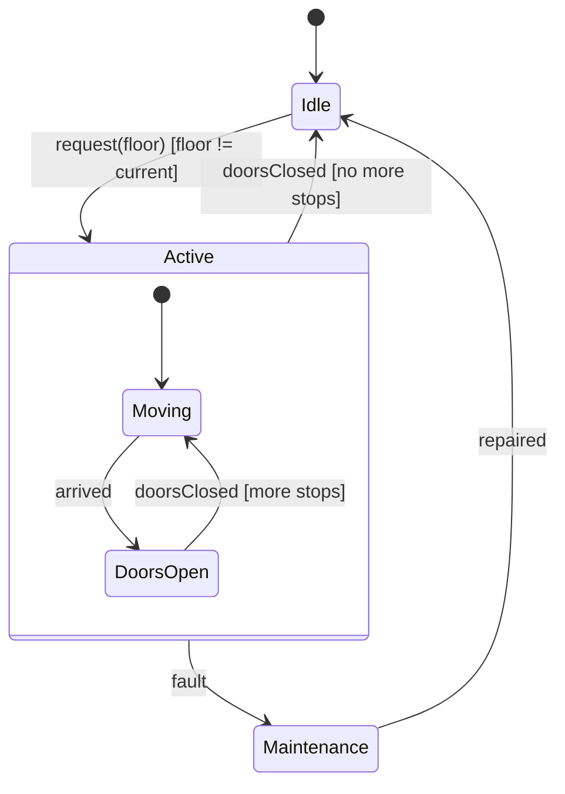

### Java example (`lld.ch03.statemachine`)

```java
// File: code/lld/ch03/statemachine/OrderState.java
public enum OrderState { CREATED, PAID, SHIPPED, DELIVERED, CANCELLED;
    public boolean isFinal() { return this == DELIVERED || this == CANCELLED; }
}

// File: code/lld/ch03/statemachine/OrderEvent.java — sealed, so the switch is checked for completeness
public sealed interface OrderEvent {
    record Pay(BigDecimal amount) implements OrderEvent { }
    record Ship(String trackingId) implements OrderEvent { }
    record Deliver() implements OrderEvent { }
    record Cancel(String reason) implements OrderEvent { }
}

// File: code/lld/ch03/statemachine/Order.java — each case = one arrow: event [guard] / action
// fields: id, BigDecimal total, state = CREATED (constructor logs "[*] -> CREATED"), List<String> log
public void handle(OrderEvent event) {
    OrderState from = state;
    OrderState to = switch (event) {
        case OrderEvent.Pay p when state == OrderState.CREATED && p.amount().compareTo(total) == 0 -> OrderState.PAID;
        case OrderEvent.Pay p when state == OrderState.CREATED ->
                reject(event, "guard failed: paid " + p.amount() + " but total is " + total);
        case OrderEvent.Ship s when state == OrderState.PAID -> {
            log.add("  action: print label " + s.trackingId());
            yield OrderState.SHIPPED;
        }
        case OrderEvent.Deliver d when state == OrderState.SHIPPED -> OrderState.DELIVERED;
        case OrderEvent.Cancel c when state == OrderState.CREATED -> OrderState.CANCELLED;
        case OrderEvent.Cancel c when state == OrderState.PAID -> {
            log.add("  action: refund " + total);
            yield OrderState.CANCELLED;
        }
        default -> reject(event, "no transition from " + state);
    };
    state = to;
    log.add(from + " --" + event.getClass().getSimpleName() + "--> " + to);
}
private OrderState reject(OrderEvent e, String why) {
    throw new IllegalStateException(id + ": " + e.getClass().getSimpleName() + " rejected, " + why);
}

// File: code/lld/ch03/statemachine/Main.java (abridged; tryEvent prints "Rejected: " + message)
// ORD-1 (total 499.00): Pay 499.00, Ship TRK-77, Deliver; prints its log and state().isFinal()
// ORD-2 (total 120.00), each via tryEvent:
tryEvent(refund, new OrderEvent.Pay(new BigDecimal("100.00")));   // guard fails
tryEvent(refund, new OrderEvent.Pay(new BigDecimal("120.00")));
tryEvent(refund, new OrderEvent.Cancel("changed mind"));
tryEvent(refund, new OrderEvent.Ship("TRK-99"));                  // no transition from CANCELLED
// then prints ORD-2's log
```

Output:

```
ORD-1 path:
  [*] -> CREATED
  CREATED --Pay--> PAID
    action: print label TRK-77
  PAID --Ship--> SHIPPED
  SHIPPED --Deliver--> DELIVERED
  final? true
Rejected: ORD-2: Pay rejected, guard failed: paid 100.00 but total is 120.00
Rejected: ORD-2: Ship rejected, no transition from CANCELLED
ORD-2 path:
  [*] -> CREATED
  CREATED --Pay--> PAID
    action: refund 120.00
  PAID --Cancel--> CANCELLED
```

Amounts are `BigDecimal`, so `[amount == total]` is `compareTo(total) == 0` — `BigDecimal.equals` would treat `120.0` and `120.00` as different (it compares scale too). `OrderEvent` is a **sealed** interface (only the listed types may implement it), so the `switch` uses Java 21 **pattern matching with `when` guards**; the `default` branch rejects every transition not on the diagram.

### Trade-offs

| enum + switch (this example) | State pattern (class per state, Ch. 11) |
|---|---|
| All transitions visible in one place | Each state's behaviour in its own class |
| Best for few states, simple actions | Best when states have lots of different behaviour |
| Adding a state edits the switch | Adding a state adds a class (Open/Closed) |

**When not:** objects with a flag or two and no real lifecycle (`active/inactive`); flows spanning many objects — use an activity diagram (a state machine describes **one** object).

### Common mistakes

- States confused with actions: "Paying" (action) vs "PAID" (state).
- Missing transitions (forgetting a paid order can be cancelled with a refund) or allowing illegal ones by default.
- Overlapping guards, so two transitions could fire for one event.
- A state machine for the *system* rather than one object.

**Real-world:** `java.lang.Thread.State` (`NEW`, `RUNNABLE`, `BLOCKED`, `WAITING`, `TIMED_WAITING`, `TERMINATED`); **TCP** connection states (`LISTEN`, `SYN_SENT`, `ESTABLISHED`, `FIN_WAIT_1`, …), the classic protocol state machine; **Amazon / Flipkart order tracking** (ordered → packed → shipped → out for delivery → delivered; cancel only before shipping); **Uber trip** (requested → driver assigned → driver arrived → in progress → completed / cancelled); **Spring Statemachine** and AWS Step Functions (Amazon's cloud workflow service) are built around state machines.

### In the interview

**30-second answer:** "When an object has a lifecycle — order, ticket, elevator, vending machine — I draw its states with transitions labelled `event [guard] / action`. Anything not on the diagram is illegal and the code rejects it. In Java it is an enum of states with one transition method, or the State pattern if each state has a lot of behaviour."

- *Q: What is a guard?* — A: A boolean in `[ ]` that must be true for the transition to fire, e.g. `[amount == total]`.
- *Q: State machine vs activity diagram?* — A: One object's states over its lifetime vs the steps of a process, possibly across many objects.
- *Q: Thread-safe transitions?* — A: Make the transition method `synchronized` (or use a lock, or compare-and-set on an `AtomicReference<State>` — changes a value only if it still equals what you last read, in one atomic step), so two events cannot both read the old state and both move on.

### Self-check

- *Q: Read `PAID --> CANCELLED : cancel / refund`.* → A: In PAID, event `cancel` moves to CANCELLED, performing `refund`.
- *Q: An event with no transition from the current state?* → A: Ignored or rejected — here, rejected with an exception.

### TL;DR

One object, its states, `event [guard] / action` arrows. Initial dot, final bullseye. Everything not drawn is illegal. Code: enum + guarded switch, or the State pattern.

---

# Part C — UML in the interview

## 3.15 How much UML to draw in an interview

Arrowheads are not marked — **diagram and words agreeing** is (3.9).

**Suggested budget for a 45-minute OOD round:**

| Minute | Diagram | Depth |
|---|---|---|
| 0–5 | **Use case** | Usually *spoken* or a quick list: actors + what each does + what is out of scope (the boundary). Draw only if asked. |
| 5–20 | **Class diagram** | *Always drawn.* 10–15 boxes, every line typed with multiplicity; key attributes and methods only. |
| 20–25 | **Activity** *or* **sequence** *or* **state** | One diagram for the flow carrying the design: activity if it branches, sequence if call order matters, state if one object has a lifecycle. |
| 25–45 | Code + discussion | Code the core classes; walk the flow against your diagrams. |

**Rules of thumb**

1. **Only one picture? The class diagram** — it is the answer.
2. **Drop attributes before relationships**; **never leave a line unlabelled** (type + multiplicity); **say the test aloud** for every diamond and triangle.
3. **Use the other diagrams as tests:** every activity action and sequence arrow must be a method on a class in the class diagram.
4. **Small sequence diagrams:** 3–4 objects, 6–8 messages, no branches.
5. **Machine-coding rounds** (90–120 min, working code expected): a 2-minute class sketch, then code.
6. Forgot a symbol? **Say what you mean** ("this implements that") and move on.

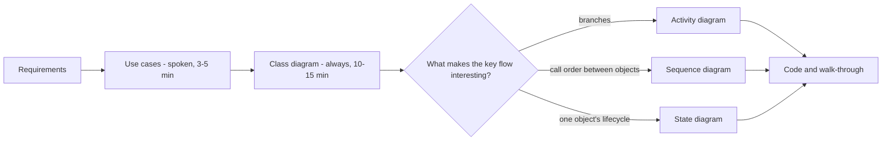

### In the interview

**30-second answer:** "I list use cases verbally to fix scope, spend most of my diagram time on one class diagram with typed, multiplicity-labelled lines, then draw one behaviour diagram for the key flow and use it to check that every step has a class and method."

---

## 3.16 Chapter self-check

1. *Q: The six relationships, weakest to strongest coupling?* → A: Dependency, association, aggregation, composition, realization, generalization.
2. *Q: Code smell (a surface sign of a likely design problem): `CompactSpot`, `LargeSpot` subclasses only passing a constant to `super`. Fix?* → A: One `ParkingSpot` with a `SpotType` enum field.
3. *Q: Java type for `0..1` and `1..*`?* → A: `Optional<T>` (nullable field); a non-empty collection checked in the constructor.
4. *Q: «include» vs «extend»?* → A: Include = always, base → included; extend = conditional, extension → base.
5. *Q: Sequence-diagram arrowheads?* → A: Solid + filled = sync call; solid + open = async; dashed + open = return.
6. *Q: `alt` vs `opt`?* → A: `alt` = if/else with several guarded sections; `opt` = one guarded section (if without else).
7. *Q: Fork/join?* → A: Fork splits a flow into parallel flows; join waits for all.
8. *Q: The 14 UML diagrams split how?* → A: 7 structural (class, object, package, component, composite structure, deployment, profile), 7 behavioural (use case, activity, state machine, sequence, communication, interaction overview, timing).

## 3.17 TL;DR

- **Relationships are claims about lifetime and substitution.** Dependency (uses, dashed arrow) · Association (knows, line/arrow) · Aggregation (has, parts live on, ◇ at whole) · Composition (owns, parts die, ◆ at whole) · Realization (implements, dashed △) · Generalization (extends, solid △).
- **Choose in order:** substitution test → dies with whole? → part that outlives? → else association; parameter-only → dependency. Inheritance last.
- **Multiplicity changes code:** `1` required, `0..1` Optional, `1..*` non-empty collection, exact numbers checked in constructors.
- **UML:** 14 diagrams, structural vs behavioural. Interviews: use case (scope), class (the answer), activity (branches), sequence (call order), state machine (lifecycle).
- **Draw little, label everything, say the test out loud,** and use behaviour diagrams to test the class diagram.
