# Chapter 3 — Class Relationships & UML (Study Edition)

> **Study Edition.** Every topic of the full chapter, without the padding. Full programs and outputs are in the Full Edition (`README.md`).
>
> **You will learn:** the six class relationships and their Java shape, how to choose one, the five UML diagrams interviews use, and how much to draw.

**Parts:** A. Relationships (3.1–3.8) · B. UML (3.9–3.14) · C. Interview (3.15–3.17). One runnable package per relationship, plus `library` and `statemachine`.

Run: `cd chapters/03-relationships-and-uml/code && javac --release 21 -d /tmp/lld_03 $(find . -name '*.java') && java -cp /tmp/lld_03 lld.ch03.<package>.Main`

---

# Part A — Class Relationships

## 3.1 The big picture: what a "relationship" really claims

### What it is

A line between two classes makes two claims: about **lifetime** (if A is destroyed, is B too?) and about **substitution** (can a B be used wherever an A is expected?). Analogy: body and heart share a lifetime (composition); a car and its driver don't (association); a sports car *is a* car (generalization).

| Family | Relationship | Meaning | Coupling |
|---|---|---|---|
| uses-a | **Dependency** | A uses B briefly (parameter, local, return type) | weakest |
| has-a | **Association** | A holds a reference to B; nobody owns anybody | ↓ |
| has-a | **Aggregation** | A is a whole of parts B; parts can outlive A | ↓ |
| has-a | **Composition** | A *owns* parts B; parts die with A | ↓ |
| is-a | **Realization** | A implements interface B | ↓ |
| is-a | **Generalization** | A extends class B | strongest |

**Coupling** = how much one class must change when the other does; inheritance couples to every parent detail. (The order is a discussion rule of thumb, not UML.)


*Figure — The UML conventions legend used throughout this book: class and interface boxes, and the line style for realization, generalization, dependency, association, uni-directional association, aggregation and composition (course diagram)*

Line ends (triangle, diamond, arrowhead) plus solid vs dashed are the whole vocabulary. (This legend draws one-way association with a *filled* head and dependency with *no* head; standard UML and our Mermaid use an **open** arrowhead for both.)

### The problem it solves

"Order has a Customer" only points at something living elsewhere; "ParkingFloor has ParkingSpots" creates, owns and deletes them. Confusing them deletes data you don't own or leaks orphans, visibly, before any code.

### TL;DR

A line claims **who owns whom (lifetime)** and **who can stand in for whom (substitution)**.

---

## 3.2 Association (uni-directional, bi-directional, multiplicity)

### What it is

One class keeps a **reference (field)** to another and calls it over time; **neither owns the other**. Analogy: a ticket refers to a spot; throw the ticket away and the spot remains.
- **Navigability:** **uni-directional** (one side has the field) or **bi-directional** (both do).
- **Multiplicity:** `1`, `0..1`, `*`/`0..*`, `1..*`, `2`, `2..4`.
- Optional **role/association name** (`placed by`).

### The problem it solves

Objects collaborate over time (an `Order` must know its `Customer`). Association records "A knows B" without claiming ownership; it is the most common relationship, correctly.

### How it works

1. If only one side calls the other, make it **uni-directional**.
2. **Bi-directional** only if real use cases need both directions.
3. For bi-directional, **one side owns the update** and changes both ends in one method.
4. **Enforce multiplicity in code:** `1` → `Objects.requireNonNull`; `0..1` → `Optional<T>`; `*` → collection; `1..*` → non-empty collection; exact numbers → size check in the constructor.

### UML notation

Plain solid line = association (navigability unspecified; read as "both know"). **Open arrowhead** = uni-directional (tail knows head). **×** = explicitly not navigable. Numbers sit next to the class they count: `Order "*" --> "1" Customer` = many orders, each with one customer.

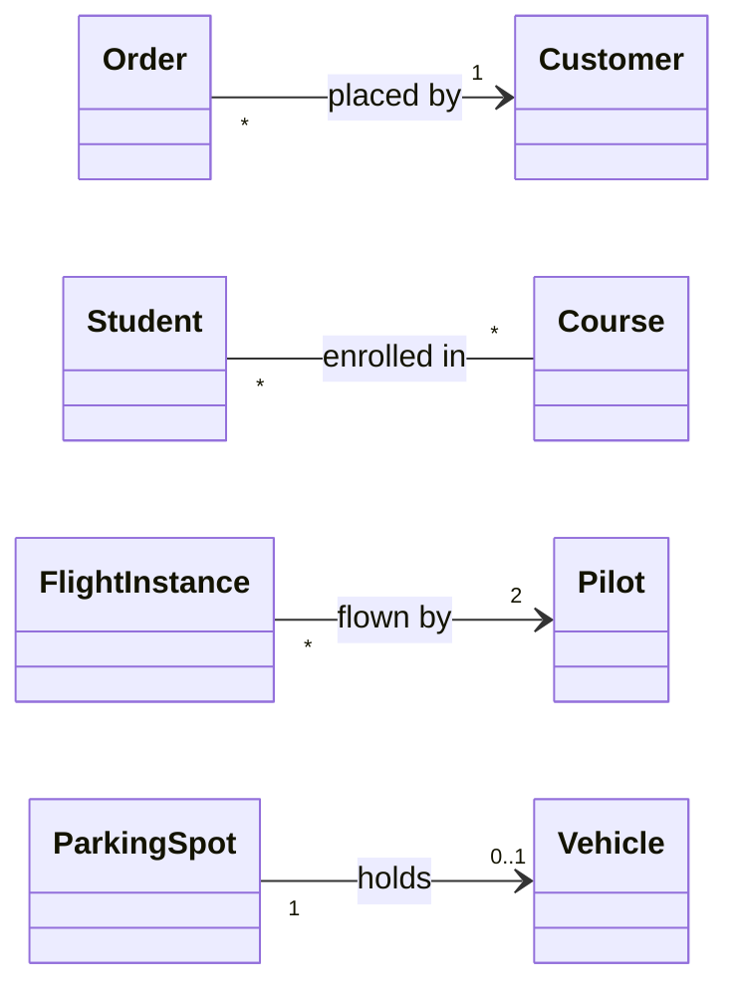

### Java example

```java
// File: code/lld/ch03/association/Course.java
    public void enroll(Student s) {
        if (students.contains(s)) return;
        if (students.size() == capacity) {
            throw new IllegalStateException(code + " is full (max " + capacity + ")");
        }
        students.add(s);
        s.linkCourse(this);
    }

    public void drop(Student s) {
        if (students.remove(s)) s.unlinkCourse(this);
    }
```

Full runnable code: code/lld/ch03/association/ (see the Full Edition).

- `Order` holds a `final Customer` set with `Objects.requireNonNull`; `Customer` has no field back → **uni-directional**, multiplicity `1`.
- `Student`/`Course` hold sets of each other → **bi-directional many-to-many**; only `Course.enroll/drop` change the link (`Student.linkCourse` is package-private): the **owning-side rule**.
- `FlightInstance` rejects anything but **2** pilots; `ParkingSpot` exposes **0..1** as `Optional<Vehicle>`.

### Trade-offs

Uni-directional is simple and low-coupling, but the reverse question needs a query. Bi-directional navigates both ways but has two fields to sync and recursion risk in `toString`/`equals`/JSON. Strict multiplicity checks make invalid states impossible for a little constructor code.

### When not to use it · Common mistakes · Real-world examples

**Avoid when:** Needed only inside one method → a **dependency** (3.5). Don't default to bi-directional. **Mistakes:** Every line bi-directional "just in case"; updating only one side; no multiplicity (and so no check); both sides in `toString()`/`equals()` → stack overflow. **Seen in:** JPA `@ManyToOne` (uni); a bi-directional `@OneToMany(mappedBy=...)` needs an owning side and helpers setting both ends.

### In the interview

**30-second answer:** "Association: a class holds a reference to another and calls it, with no ownership. I make it one-way unless both directions are needed, and write multiplicity on every line because it changes the code: `1` is required, `0..1` an Optional, `1..*` a non-empty collection."

- *Spot holds two motorbikes?* — `0..1` becomes `0..2`: a small collection with a size check.

### Self-check

- **Q:** `Order "*" --> "1" Customer`: who has the field? **A:** `Order` (arrow points at the referenced class).

### TL;DR

"A knows B", no ownership. Prefer one-way; enforce multiplicity in constructors/types.

---

## 3.3 Aggregation

### What it is

Whole–part association where **parts have their own life**: they exist before, can move, and survive the whole (*shared aggregation*). Analogy: an airline's aircraft are sold, not scrapped.

### The problem it solves

It says "these form a group" while making clear the whole does **not** control their lifetime: don't delete parts with the whole.

### How it works

1. Parts are **created outside** the whole. 2. They are **passed in** (`addAircraft(a)`). 3. Removing a part **returns it alive**; destroying the whole **releases** parts. 4. **Hollow diamond at the whole**.

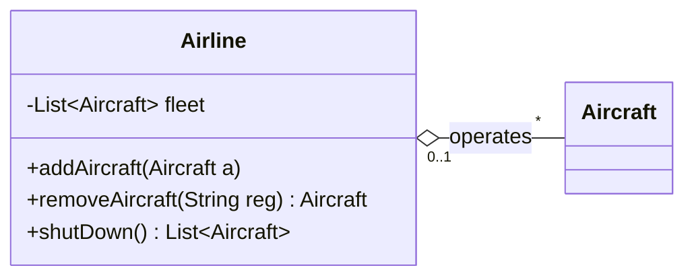

### Java example

```java
// File: code/lld/ch03/aggregation/Airline.java
    public void addAircraft(Aircraft a) { fleet.add(a); }        // part is passed in
    // ... removeAircraft(registration) hands the part back, still alive

    /** Shutting down the airline releases the parts instead of destroying them. */
    public List<Aircraft> shutDown() {
        List<Aircraft> released = List.copyOf(fleet);
        fleet.clear();
        return released;
    }
```

Full runnable code: code/lld/ch03/aggregation/ (see the Full Edition).

Aircraft are built in `Main` before any airline; one is transferred between airlines; after `skyways = null` its released aircraft join `BlueJet`.

### Trade-offs

Aggregation adds whole–part **meaning** but usually **no code difference** from association (both are a field). The UML spec leaves its meaning to the modeller and authors like Fowler advise sparing use; interviews still expect it for clear whole–part groups.

### When not to use it · Common mistakes · Real-world examples

**Avoid when:** No whole–part idea (ticket and spot) → association. Parts created by and dying with the whole → composition. **Mistakes:** Diamond at the **part's** end (it goes at the whole); choosing randomly (test: *if the whole is gone, is the part still meaningful?* Yes → aggregation); deleting parts in the whole's close method. **Seen in:** Archiving a Slack channel keeps its users; deleting a playlist keeps the songs.

### In the interview

**30-second answer:** "Aggregation is whole–part where parts outlive the whole, hollow diamond at the whole. Shut down an airline and the aircraft remain. In Java parts are created outside, passed in, never destroyed by the whole."

- *Airline with no aircraft allowed?* — That's multiplicity (`1..*`), not aggregation vs composition.

### Self-check

- **Q:** A library closes; do members vanish? **A:** No: Library ◇— Member is aggregation.

### TL;DR

"Has-a, parts live on"; passed in, never destroyed; hollow diamond at the whole.

---

## 3.4 Composition

### What it is

The whole **owns** its parts: each belongs to **exactly one** whole, is usually **created by** it and **dies with** it (or is explicitly removed first). Analogy: house and rooms; floor and spots.

### The problem it solves

Some objects make no sense alone; letting outsiders create or share them causes bugs (two floors sharing a spot, orphan spots). One owner handles the full life cycle.

### How it works

1. The whole **creates** parts (constructor or `addX(data)`, not a ready-made part).
2. The part's constructor is **not public**.
3. Never hand out the internal collection: read-only views or copies.
4. Removing the whole drops the only reference → part becomes garbage.
5. **Filled diamond at the whole**.

Java has no destructors: parts die **logically** (unreachable → GC); for resources the whole's `close()` closes its parts.

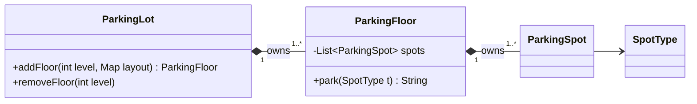

### Java example

```java
// File: code/lld/ch03/composition/ParkingFloor.java
    ParkingFloor(int level, Map<SpotType, Integer> layout) {
        this.level = level;
        int n = 1;
        for (var e : layout.entrySet()) {
            for (int i = 0; i < e.getValue(); i++) {
                spots.add(new ParkingSpot("L" + level + "-" + n++, e.getKey()));
            }
        }
        if (spots.isEmpty()) throw new IllegalArgumentException("a floor needs 1..* spots");
    }

    public List<ParkingSpot> spots() { return Collections.unmodifiableList(spots); }
```

Full runnable code: code/lld/ch03/composition/ (see the Full Edition).

`ParkingLot.addFloor(level, layout)` takes a *description* and builds the floor itself; `ParkingSpot`'s constructor is package-private; `spots().clear()` throws; `removeFloor(1)` takes its 4 spots with it. Spot kinds are a `SpotType` enum, not subclasses.

### Trade-offs

Composition: the whole creates the part, no sharing, part doesn't outlive it; strong encapsulation, lower flexibility. Aggregation: someone else creates it, sharable, outlives the whole; weaker encapsulation, more flexibility.

### When not to use it · Common mistakes · Real-world examples

**Avoid when:** The part has its own business identity (person, aircraft, song) or must be shared. **Mistakes:** Accepting a ready-made part (`addSpot(ParkingSpot s)`) and calling it composition; returning the internal list; confusing it with "favour composition over inheritance" (3.6), where "composition" means *holding* an object, including association/aggregation. **Seen in:** `HashMap`'s internal `Node`s; JPA `cascade = ALL, orphanRemoval = true` (delete an `Order`, lose its `OrderLine`s).

### In the interview

**30-second answer:** "Composition: the whole creates its parts, they belong only to it and die with it; filled diamond at the whole. In Java I build parts inside the owner, hide their constructor, and expose read-only views."

- *With GC, how does a part 'die'?* — Logically: the whole held the only reference.

### Self-check

- **Q:** Why is `ParkingSpot`'s constructor package-private? **A:** Only the owning floor may create spots.

### TL;DR

"Owns, parts die with it"; whole creates, never shares, read-only views; filled diamond.

---

## 3.5 Dependency

### What it is

A **uses** B briefly, inside one method, with **no field**: B is a **parameter**, **local variable**, **return type** or **static call**. Analogy: a chef uses today's delivery van.

### The problem it solves

Records the weakest link ("if B's interface changes, A may change"); keeps classes stateless and lets callers pass a different collaborator per call.

### How it works

B as parameter / `new` local / return type / static call; no field of type B. UML: **dashed line, open arrowhead** from A to B, optionally `«use»`/`«create»`.

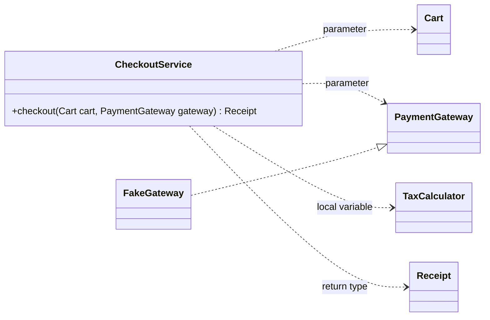

### Java example

```java
// File: code/lld/ch03/dependency/CheckoutService.java
public final class CheckoutService {

    public Receipt checkout(Cart cart, PaymentGateway gateway) {
        TaxCalculator tax = new TaxCalculator();            // local-variable dependency
        Money subtotal = cart.subtotal();                   // parameter dependency
        Money total = subtotal.plus(tax.taxOn(subtotal));
        String txn = gateway.charge(total);                 // parameter dependency (interface)
        return new Receipt(txn, subtotal, total);           // return-type dependency
    }

    public record Receipt(String txnId, Money subtotal, Money total) { }
}
```

Full runnable code: code/lld/ch03/dependency/ (see the Full Edition).

`CheckoutService` has **no fields**; `Main` passes a `FakeGateway` and then a lambda gateway on the next call. `Money` uses `BigDecimal`.

### Trade-offs

Dependency: lowest coupling, stateless, swap per call, but callers pass B every time. Association (field): higher coupling and state, swap per object, pass once.

### When not to use it · Common mistakes · Real-world examples

**Avoid when:** When A uses B across many methods (a service and its repository), a constructor-injected field is cleaner. **Mistakes:** Solid association line for a mere parameter; drawing every dependency (`String`, `List`...); hiding `new ConcreteThing()` deep inside where the caller should decide (blocks testing). **Seen in:** `Collections.sort(list, comparator)`; `LocalDate.now(Clock clock)`.

### In the interview

**30-second answer:** "Dependency is 'uses briefly': parameter, local or return type, no field; dashed arrow. It's the loosest coupling, so a collaborator needed in one method is passed in, not stored."

- *Relation to DI?* — DI is *who supplies* the collaborator; it may be stored (association) or passed per call (dependency). DIP adds "depend on interfaces" (Chapter 4).

### Self-check

- **Q:** Dashed + open arrow vs dashed + hollow triangle? **A:** Dependency vs realization.

### TL;DR

"Uses for one call"; no field; dashed arrow.

---

## 3.6 Generalization (inheritance)

### What it is

UML's word for **inheritance**: B `extends` A, so B *is a kind of* A. Analogy: a card payment *is a* payment.

### The problem it solves

Classes sharing a contract **and** behaviour keep shared parts in one place, and callers use the general type (**polymorphism**).

### How it works

1. Run the **substitution test** (Liskov, Chapter 4): can B go anywhere A is expected with no refused or broken method?
2. Yes → shared state/workflow in A (often `abstract`), subclasses override varying steps.
3. No → **hold instead of extend** (an interface-typed field).
4. UML: **solid line, hollow triangle at the parent**; abstract names in *italics* or `{abstract}`.

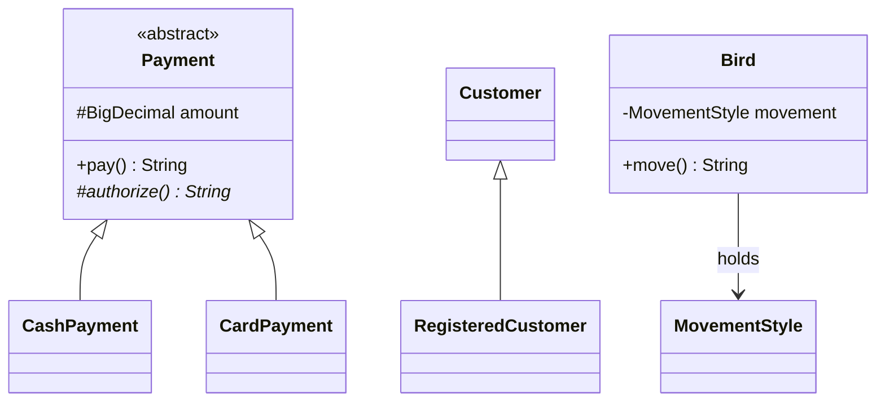

### Java example

```java
// File: code/lld/ch03/generalization/Payment.java
public abstract class Payment {
    protected final BigDecimal amount;   // '#' protected: visible to subclasses
    // ... constructor rejects non-positive amounts

    public final String pay() {
        String ref = authorize();
        return getClass().getSimpleName() + " of " + amount + " -> " + ref;
    }

    protected abstract String authorize();   // abstract operation (italics in UML)
}
```

Full runnable code: code/lld/ch03/generalization/ (see the Full Edition).

- **Good hierarchy:** cash and card both truly take money, so `Main` loops over `List<Payment>`; amounts are `BigDecimal` compared with `compareTo`.
- **Fix #1, subclass that must refuse:** a `Guest extends Customer` that can't order breaks substitution → `Customer` only browses; ordering moves to `RegisteredCustomer`.
- **Fix #2, subclass that only carries a constant:** `CompactSpot`/`LargeSpot` → a `SpotType` enum field.
- **Hold, don't extend:** `Penguin` breaks a `FlyingBird` hierarchy; `Bird` holds a `MovementStyle` field (FLY, SWIM, WALK) and `setMovement` swaps it at run time.

### Trade-offs

Inheritance: automatic reuse, fixed at compile time, tight coupling (fragile base class), one parent; best for true is-a with different behaviour. Holding an object: explicit delegation, swappable at run time, loose coupling, many fields/interfaces; best for varying or combinable behaviour.

### When not to use it · Common mistakes · Real-world examples

**Avoid when:** Just sharing fields/helpers; a child would throw `UnsupportedOperationException`; data-only variation; mixable behaviours (fly + swim + walk → class explosion). **Mistakes:** Hierarchies deeper than 2–3; `Stack extends Vector` style leaks; triangle pointing at the child; inheriting when the relation holds only *sometimes* (use a role/interface). **Seen in:** `ArrayList extends AbstractList`; `FileInputStream extends InputStream`; `IOException extends Exception`. Counter-examples: `Stack extends Vector`, `Properties extends Hashtable`.

### In the interview

**30-second answer:** "Generalization is inheritance, solid line with a hollow triangle at the parent. Only when the child passes the substitution test. A subclass that only passes a constant becomes an enum field; varying behaviour I hold as an interface."

- *Why not `CompactSpot extends ParkingSpot`?* — No behaviour; a `SpotType` field does it.

### Self-check

- **Q:** Guest can't order but `Customer.placeOrder()` exists. **A:** LSP broken; move `placeOrder` to `RegisteredCustomer`.

### TL;DR

"Is-a", `extends`, only after the substitution test; triangle at the parent.

---

## 3.7 Realization (interface implementation)

### What it is

A class **implements an interface** (a stateless contract): `class EmailNotifier implements Notifier`. Analogy: a plug that realizes a socket standard.

### The problem it solves

Callers depend on the **contract**: new implementations need no caller change, fakes for tests, several roles per class.

### How it works

Define the operations callers need; classes `implement` them; callers hold the **interface type**; `default`/`static` methods allowed. UML: **dashed line, hollow triangle at the interface**, `«interface»` (or a "lollipop"). Same is-a idea as generalization, but only the contract is inherited.

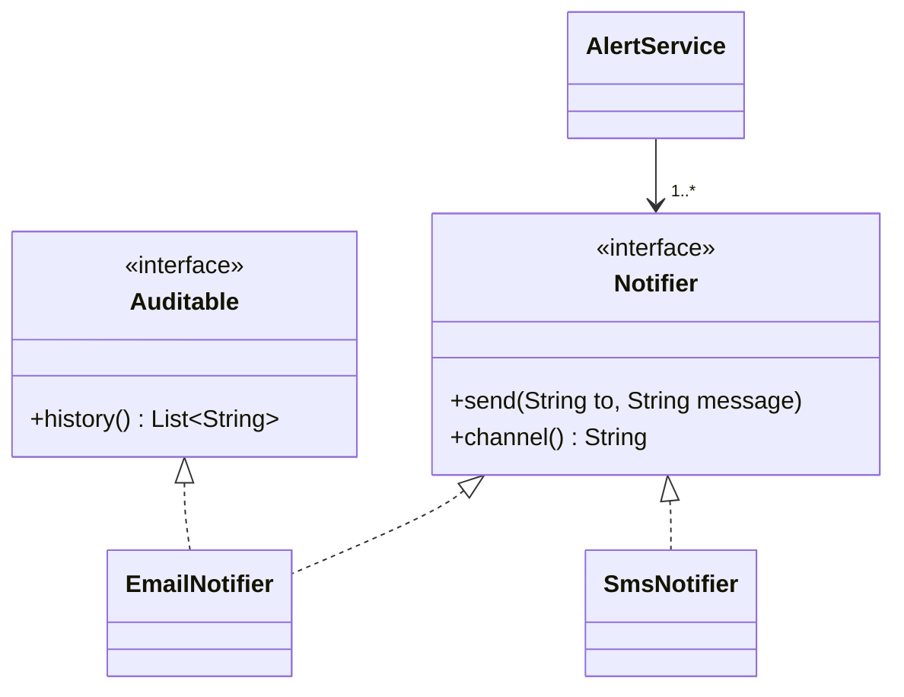

### Java example

```java
// File: code/lld/ch03/realization/AlertService.java
public final class AlertService {
    private final List<Notifier> notifiers;

    public AlertService(List<Notifier> notifiers) { this.notifiers = List.copyOf(notifiers); }

    public void alert(String to, String message) {
        for (Notifier n : notifiers) {
            System.out.println("via " + n.channel());
            n.send(to, message);
        }
    }
}
```

Full runnable code: code/lld/ch03/realization/ (see the Full Edition).

`EmailNotifier` realizes **two** interfaces; `SmsNotifier` overrides the `default channel()`; a **lambda** also realizes `Notifier` (functional interface). `AlertService` depends only on the interface, so a `PushNotifier` needs no change.

### Trade-offs

Interface: many per class, no instance fields, shared code only via `default`; for roles, plug-ins, test seams. Abstract class: one parent, any fields and code; for a family sharing state and workflow.

### When not to use it · Common mistakes · Real-world examples

**Avoid when:** A single never-varying implementation with no test need (YAGNI); empty "marker" interfaces (annotations serve better). **Mistakes:** Solid instead of dashed line; fat interfaces (ISP); variables typed with the concrete class. **Seen in:** JDBC `Connection` realized by vendor drivers; SLF4J `Logger` realized by Logback/Log4j.

### In the interview

**30-second answer:** "Realization: a class implements an interface, dashed line with a hollow triangle at the interface. I add interfaces where behaviour varies or I need a test double (gateway, notifier, pricing), and the design depends only on them."

- *Interface or abstract class?* — Interface for capabilities (many allowed); abstract class for shared state/workflow; combine as `List` → `AbstractList` → `ArrayList`.

### Self-check

- **Q:** Generalization vs realization drawn? **A:** Same hollow triangle; solid vs dashed line.

### TL;DR

"Implements": dashed line + hollow triangle at `«interface»`; depend on the interface.

---

## 3.8 Decision guide: choosing the relationship between two classes


*Figure — The four-question decision: inheritance, then composition, then aggregation, else association (course diagram)*

Ask in order; stop at the first yes. Inheritance comes first only because it's easiest to **rule out**; most pairs end as association.

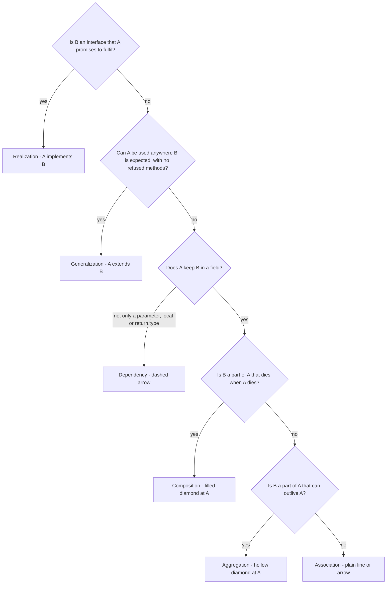

**Summary table (keep this one)**

| Relationship | Phrase | UML line | Java shape | Lifetime | Example |
|---|---|---|---|---|---|
| Dependency | A *uses* B | dashed, open arrow → B | parameter/local/return/static call | none | `CheckoutService` uses `PaymentGateway` |
| Association | A *knows* B | solid (arrow if one-way) | field, B made elsewhere | independent | `Order` → `Customer` |
| Aggregation | A *has* B | solid, hollow ◇ at A | field/collection, parts passed in | B outlives A | `Airline` ◇— `Aircraft` |
| Composition | A *owns* B | solid, filled ◆ at A | A creates B, hides it | B dies with A | `ParkingFloor` ◆— `ParkingSpot` |
| Realization | A *implements* B | dashed, hollow △ at B | `implements` | — | `EmailNotifier` ⇢ `Notifier` |
| Generalization | A *is a* B | solid, hollow △ at B | `extends` | — | `CardPayment` → `Payment` |

**Mermaid cheat-sheet:** `A ..> B` dependency · `A --> B` association A→B · `A -- B` association (both/unspecified) · `A o-- B` aggregation (A whole) · `A *-- B` composition (A whole) · `B <|.. A` A realizes B · `B <|-- A` A extends B · `A "1" *-- "1..*" B` with multiplicities.

### Common mistakes (all relationships)

Diamond not at the **whole**; triangle not at the **parent/interface**; lines without multiplicity; inheritance to share data.

### In the interview

Say the test **aloud** per line ("remove the floor and its spots go: composition"); collapse constant-only subclasses yourself. Expect "why not inheritance?" (substitution test) and multiplicity changes.

### Self-check

- **Q:** `Library`/`Member`? **A:** Aggregation or association. **Q:** `Flight`/`WeeklySchedule`? **A:** Composition.
- **Q:** `ParkingTicket`/`ParkingSpot`? **A:** Association. **Q:** `Report.render(Formatter f)`? **A:** Dependency.

### TL;DR

Is-a only after the substitution test; composition if parts die with the whole, aggregation if they live on, association if one just knows the other, dependency if only used in a method.

---

# Part B — UML

## 3.9 What UML is (structural vs behavioural diagrams)

### What it is

**UML** is the OMG's standard design notation (UML 2.5.1): not a programming language, a whiteboard suffices. It merged Booch, OMT (Rumbaugh) and OOSE (Jacobson) in the 1990s, hence its size.

### The problem it solves

Makes a design **visible**, forces **explicit decisions** (filled or hollow diamond?), and makes **disagreement cheap** (the interviewer taps a line and asks why).

### How it works — the 14 diagram types

**Structural** (what it is made of): **Class** (always), Object, Package, Component, Composite structure, Deployment, Profile. **Behavioural** (what it does): **Use case**, **Activity**, **State machine**, and the **interaction** diagrams **Sequence**, Communication, Interaction overview, Timing. Component/deployment belong to system design rounds; profile is never used in interviews.


*Figure — The four diagrams an OOD interview uses and the question each answers (course diagram)*

Interview set: **use case** (who does what; first), **class** (the answer, maps to code), **activity** (steps and branches of one flow), **sequence** (who calls whom), plus **state machine** when an object has a lifecycle.

### Trade-offs · When not to use it · Common mistakes · Real-world examples

Shared vocabulary and tools (PlantUML, Mermaid) vs a big spec, whiteboard time, stale diagrams. Avoid unmaintained formal docs; sketch UML, C4 or Mermaid beside the code is the norm, UML-lite for interviews. **Mistakes:** Thinking notation is graded: what's graded is whether **diagram and words agree** (say what a symbol means if unsure). A line you can't justify hurts more than a missing one. **Seen in:** Mermaid in GitHub/GitLab design docs; PlantUML in Confluence.

### In the interview

**30-second answer:** "UML has 14 diagrams: structural (class, object, component...) and behavioural (use case, activity, state machine, sequence...). In an OOD round I use a quick use-case list, one class diagram, and an activity or sequence diagram for the key flow."


### Self-check

- **Q:** Sequence diagram family? **A:** Behavioural (interaction). **Q:** How many types? **A:** 14 (7 + 7).

### TL;DR

Standard symbols, not code; structural vs behavioural; interviews use class, use case, activity, sequence, state.

---

## 3.10 Use-case diagrams

### What it is

Shows **who** uses the system and **what** each can achieve; no classes, data or order.
- **Actor** — a *role* outside the system (stick figure); may be non-human (payment gateway, timer).
- **Use case** — one goal with a result the actor cares about (oval, verb phrase): "Borrow a book", not "click search".
- **System boundary** — rectangle: inside = what you build.


*Figure — The parts of a use-case diagram for online shopping: actors (Customer, Guest), use cases, system boundary, generalization between actors, and «include» / «extend» relationships (course diagram)*

### The problem it solves

Turns a one-liner into an **agreed scope** ("these nine are in; refunds and reporting are out"). **Actors usually become classes; use cases become methods.**

### How it works

1. Find actors: *who starts something? who administers it* (most forgotten)? *who gets told? what acts with nobody present* (timers, jobs)?
2. Primary actors left, secondary (gateway) right; use cases inside the boundary, joined to actors by plain lines.
3. **«include»** = *always*; dashed arrow **base → included** (*Borrow* «include» *Check limit*). **«extend»** = *sometimes*, at an extension point; arrow **extension → base** (*Charge fine* «extend» *Return*). Test: can the base complete without it? Yes → extend.
4. **Generalization** (hollow triangle) between actors or use cases. Keywords are singular; old «uses» = «include».

In the course figure the triangle at Guest means a Customer can do all a Guest can, plus check out.

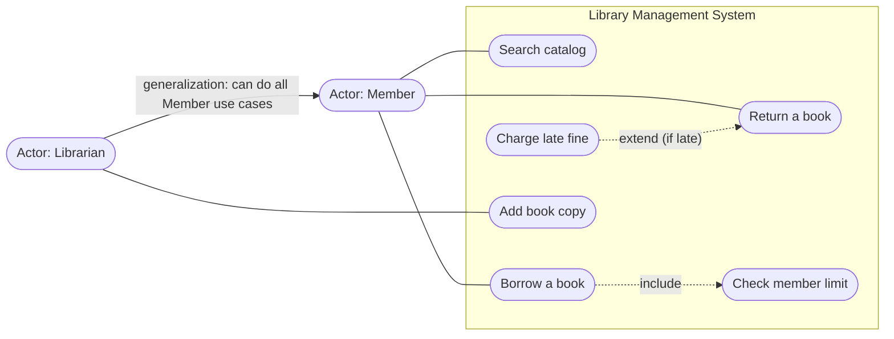

### From use cases to code (see `lld.ch03.library`)

| Use-case element | Java |
|---|---|
| Actor *Member* / *Librarian* | `class Member` / `class Librarian extends Member` |
| *Borrow a book* + «include» *Check limit* | `Member.checkout(...)` calling private `checkLimit()` **every** time |
| *Return a book* + «extend» *Charge fine* | `Member.returnBook(...)` calling `chargeFine(...)` **only if** late |
| *Add book copy* | `Librarian.addCopy(...)` |

A starting point: some use-case methods belong on a service class.

### Trade-offs · When not to use it · Common mistakes · Real-world examples

Fast scope agreement and finds forgotten actors, but shows no order or data and bloats with UI steps. If requirements are already precise, a spoken list suffices. **Mistakes:** UI steps as use cases; one actor per person (a borrowing librarian is two roles); reversed «extend»; «include» for something occasional; no boundary. **Seen in:** *Place order* «include» *Make payment*; *Apply gift card* «extend»s it.

### In the interview

**30-second answer:** "Before classes I list actors (roles, including admins, external services, timers) and their goals, with a boundary for scope. «include» is always, «extend» sometimes. Actors become classes, use cases methods." Takes 3–5 minutes, early.

### Self-check

- **Q:** «include» arrow direction? **A:** Base → included.
- **Q:** Is a payment gateway an actor? **A:** Yes, secondary.

### TL;DR

Actors outside, goals inside, boundary = scope; include always, extend sometimes.

---

## 3.11 Class diagrams

### What it is

The **static structure**: classes, attributes, operations, relationships with multiplicity. The answer to an OOD question, and the only UML diagram mapping directly to code.

### The problem it solves

Puts the whole design on one page to review, challenge and code; other diagrams lead to it or test it.

### How it works — the class box


*Figure — A class box: name on top, properties (attributes) in the middle, methods (operations) at the bottom, using a Flight class (course diagram)*

```
visibility name : Type [multiplicity] = default      e.g.  - spots : ParkingSpot [1..*]
visibility name(param : Type, ...) : ReturnType      e.g.  + park(v : Vehicle) : Ticket
```

Visibility: `+` public, `-` private, `#` protected (Java's `protected` also opens the package), `~` package (no modifier). *Italic* or `{abstract}` = abstract; `«interface»`, `«enumeration»`; underlined = static; `{readOnly}` = `final`.

A name-only box is fine early. Mermaid: same visibility symbols, `*` = abstract, `$` = static, `List~T~` for generics.

### How it works — the relationships (all arrow types)


*Figure — An airline-system class diagram using every relationship: associations (e.g. Flight to Aircraft, uni-directional), multiplicities (FlightInstance has 2 Pilots), aggregation (Airline–Aircraft), composition (Flight–WeeklySchedule), generalization (Person to Crew/Pilot/Admin) and dependency (course diagram)*

The figure uses every line: association FlightInstance — Pilot (two-way) and Flight → Airport (one-way); multiplicity `*` — `2` Pilot; aggregation Airline ◇— Aircraft; composition Flight ◆— WeeklySchedule; generalization Pilot/Crew/Admin → Person; dependency FlightReservation ⇢ Payment. Keep arrows consistent with fields.

Also recognise: **association class** (dashed-attached class holding link data, e.g. `Enrollment{grade}`) and **qualified association** (key box, `Library [isbn] → Book` = a `Map<Isbn, Book>`).

### Worked example — the library design (code in `lld.ch03.library`)

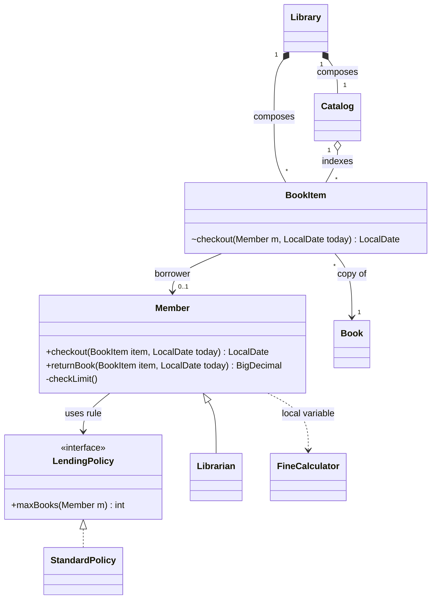

Every line type appears; `~` marks package-private methods like `BookItem.checkout`, callable only by `Member`.

### How much detail to draw

10–15 named boxes; attributes/operations only where flows need them; **every line typed with multiplicity**; **drop attributes before relationships**.

### Trade-offs · When not to use it · Common mistakes · Real-world examples

Detailed = near code-ready but 10+ minutes; sketch = fast and changeable. It shows no order or time: use behaviour diagrams for that. **Mistakes:** Unlabelled lines; diamonds/triangles at the wrong end; every getter and `String` field listed; lines with no matching field in code (or vice versa). **Seen in:** JPA entity diagrams are class diagrams with multiplicities.

### In the interview

**30-second answer:** "Named boxes from nouns and actors, then every line with type and multiplicity, saying the test aloud; only the attributes and methods the key flows need. `+ - # ~` for visibility, «abstract», «interface»."

- *`#` nuance in Java?* — Also visible within the package. *Static?* — Underline (Mermaid `$`).

### Self-check

- **Q:** `~`? **A:** Package visibility. **Q:** Aggregation vs composition test? **A:** Is the part meaningful once the whole is gone?

### TL;DR

Box = name / attributes / operations; seven line types plus multiplicity on every line.

---

## 3.12 Sequence diagrams

### What it is

**Which object calls which, in what order**, for one scenario: objects across the top, **time down the page**.


*Figure — A member searches the catalog for "dune" and borrows a copy: lifelines, a self-call on Catalog, calls with filled arrowheads and dashed returns (course diagram)*

### The problem it solves

Shows what objects *actually* say and when: vital when order is easy to get wrong (reserve → pay → confirm), when several objects take part, or to explain a class diagram.

### How it works — the notation

- **Lifeline:** box + dashed vertical line, one object (`catalog : Catalog`); **actor** (stick figure) starts the flow.
- **Sync message:** solid, **filled** head (caller waits). **Async:** solid, **open** head (fire-and-forget). **Return:** dashed, open head (only when it matters). **Self-message:** loops back.
- **Activation bar:** thin rectangle, object busy. **Create:** dashed «create» arrow to a new box; **destroy:** **X**.

**Fragments** (guards in `[ ]`): `alt` if/else, `opt` if, `loop`, `par` parallel, `break` early exit, `critical` atomic, `ref` another diagram (others like `neg`, `strict` aren't needed). Whiteboards usually skip bars and fragments.

### Example 1 — the library checkout, matching the Java code

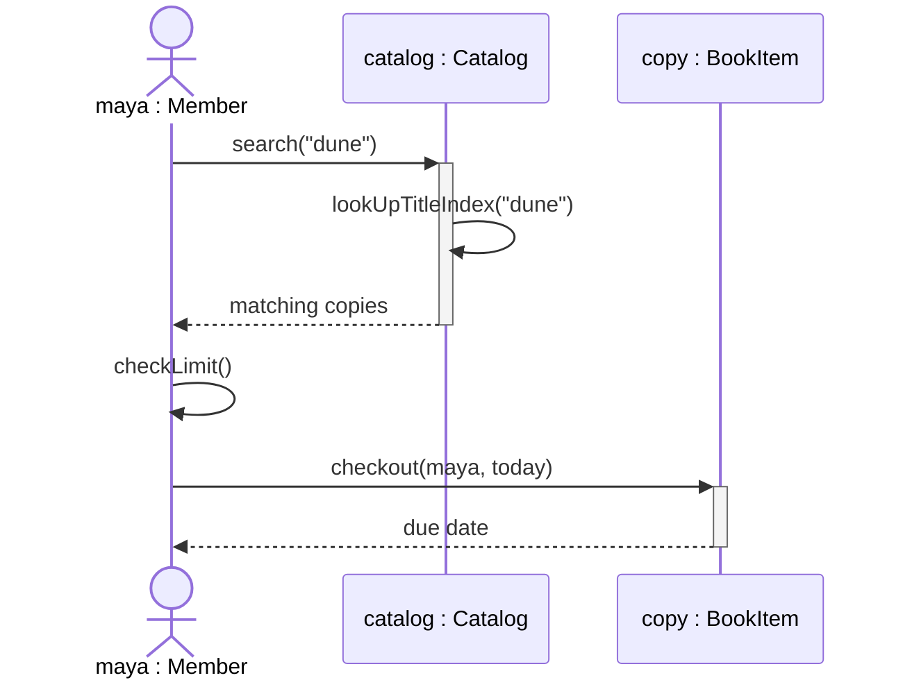

The flow starts outside; the catalog **calls itself**; only two returns are drawn; the member talks **directly** to the copy, a choice the interviewer can question.

### Example 2 — all fragments and async messages (checkout with payment)

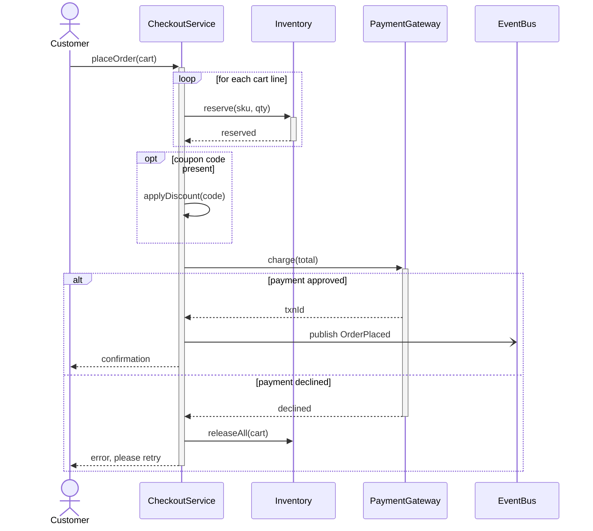

`-)` is an **asynchronous** message (publishing doesn't wait). Point: reserve stock *before* charging; release it if the charge fails.

### Java code for Example 1 (`lld.ch03.library`)

```java
// File: code/lld/ch03/library/Member.java
    public LocalDate checkout(BookItem item, LocalDate today) {
        checkLimit();                                // <<include>>: happens every time
        LocalDate due = item.checkout(this, today);
        onLoan.add(item);
        return due;
    }

    public BigDecimal returnBook(BookItem item, LocalDate today) {
        if (!onLoan.remove(item)) throw new IllegalStateException(name + " does not hold " + item.barcode());
        LocalDate due = item.checkIn();
        BigDecimal fine = new FineCalculator().fineFor(due, today);
        if (fine.signum() > 0) chargeFine(fine);       // <<extend>>: only when late
        return fine;
    }
```

Full runnable code: code/lld/ch03/library/ (see the Full Edition). `Catalog.search` calls its private `lookUpTitleIndex` (the self-call).

Output (excerpt): `Maya borrowed B-1, due 2026-03-15`, `Blocked: Maya already has 2 books (limit)`, `Returned B-3 3 days late, fine = 15.00`. **Every arrow is a real method; a message with no method means the class diagram is missing one.**

### Trade-offs

Good at call order, sync vs async, spotting missing methods; poor at branch-heavy flows, the whole design, and speed.

### When not to use it · Common mistakes · Real-world examples

**Avoid when:** Three or more decisions → **activity diagram** (a second `alt`/`opt` is the warning sign). Unprompted in most OOD rounds, it steals class-diagram time. **Mistakes:** A return for every call; messages that aren't methods; mixed-up arrowheads; drawing classes when two objects of one class take part (`from : Account`, `to : Account`). **Seen in:** OAuth/OIDC login flows; payment "create order → redirect → webhook" (async webhook); sagas with compensating calls.

### In the interview

**30-second answer:** "One scenario, objects across, time down. Filled arrows sync, open async, dashed returns; `alt`/`opt`/`loop` for if/else, if, loops. Three or four objects, six to eight messages, and every arrow is a method on my class diagram."

- *Sequence vs activity?* — Sequence when *who calls whom* matters; activity when branching does.

### Self-check

- **Q:** Thin rectangle on a lifeline? **A:** Activation bar. **Q:** "Retry up to 3 times"? **A:** `loop [attempt <= 3]`.

### TL;DR

Objects across, time down; filled sync, open async, dashed return; keep it small.

---

## 3.13 Activity diagrams

### What it is

Traces **one flow end to end** with its **branches** (and parallel steps): the flowchart of UML.

### The problem it solves

Makes the flow's `if/unless/otherwise` logic checkable, and **tests the class diagram**: for every action, *which class does this?* No home = missing class.

### How it works — the symbols


*Figure — The core activity-diagram symbols: start, action, a decision with [yes]/[no] guards, the other branch, where the branches meet again, and the end (course diagram)*

**Initial node** (filled circle, draw one) · **action** (rounded rectangle, one step) · **decision/merge** (diamond; **guards** must cover every case, use `[else]`) · **fork/join** (thick bar: start parallel actions / wait for **all**) · **activity final** (bullseye; whole activity stops) · **flow final** (circle with X; only this branch) · **swimlane** (who does each action) · object nodes and signals for data and events.

**Steps:** pick the flow with an "if/unless/otherwise"; actions in business language ("System calculates the fee", not `calculateFee()`); guard every outcome; fork/join only for true parallelism; swimlanes if helpful; end node(s).

### Example 1 — online shopping (course)


*Figure — A customer shopping online: search, item found or not found, add to cart, view/update the cart, more shopping or checkout (course diagram)*

### Example 2 — pay at the parking exit (three decisions, with swimlanes)

Three requirement-driven decisions (ticket paid? payment succeeded? receipt?), a retry loop, and hand-off to an attendant after three failures (Parking Lot case study, Chapter 14):

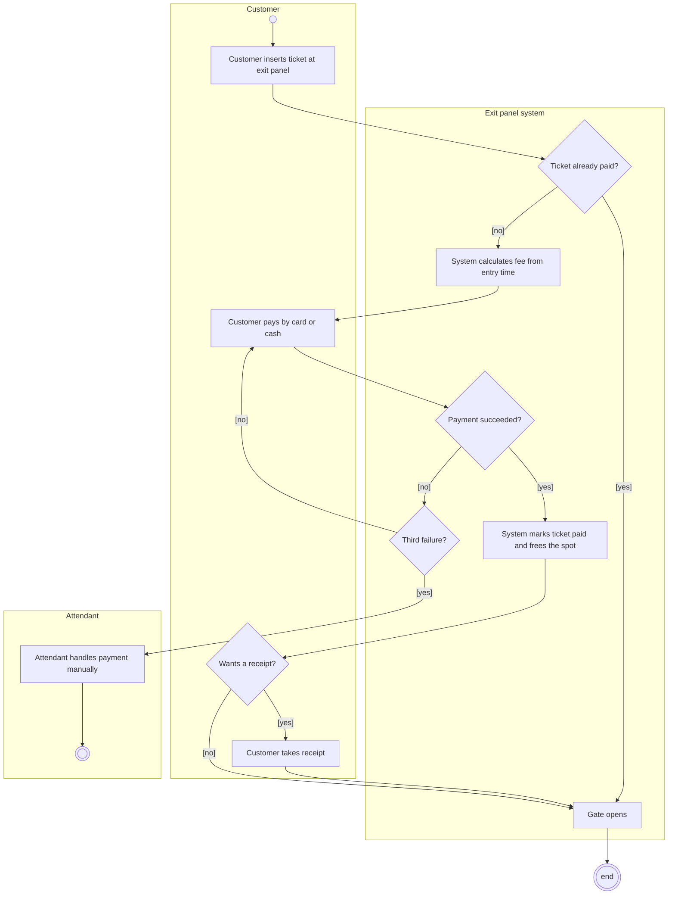

### Example 3 — fork and join (order fulfilment)

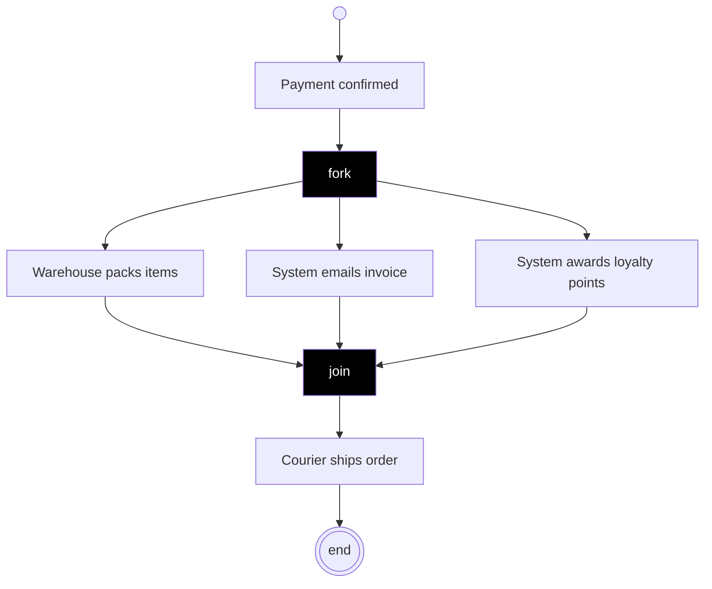

After the **fork** bar the three actions run in parallel; the **join** waits for all three before shipping.

### Activity vs sequence diagram

Activity shows a process as steps, handles branches naturally and answers "what happens?"; sequence shows objects messaging, handles branches awkwardly (nested `alt`) and answers "who calls whom?". Rule of thumb: **three branches** → activity; **four objects** with tricky call order → sequence.

### Trade-offs · When not to use it · Common mistakes · Real-world examples

Readable by anyone, great at branches and parallelism; but no "who" without swimlanes, and big flows sprawl. Skip straight-line flows; use sequence for call order. **Mistakes:** A diamond with one exit; actions written as code; guards missing a case (`> 100` and `< 100`: what about 100?); fork/join for merely sequential steps. **Seen in:** BPMN (Camunda); CI/CD pipelines (parallel jobs = fork, `needs:` = join).

### In the interview

**30-second answer:** "One flow: start, actions, decisions with complete guards, merges, fork/join for parallel steps, swimlanes, ends. I draw the branching flow and check every action has a class."

- *Activity final vs flow final?* — Whole activity vs one path.

### Self-check

- **Q:** What must every arrow leaving a decision have? **A:** A guard; together covering all cases.

### TL;DR

Start → actions → guarded decisions → merge → end; fork/join, swimlanes; use it to test the class diagram.

---

## 3.14 State machine diagrams

### What it is

The **states one object** can be in and the **transitions** that events trigger.
- **State** (rounded rectangle), **initial pseudostate** (filled circle), **final state** (bullseye).
- **Transition** label `event [guard] / action`: trigger, boolean condition, effect.
- Internal `entry / exit / do` activities; **self-transition**; **choice** pseudostate (diamond); **composite state** with sub-states and **history** `(H)`; **orthogonal regions** active together.

Analogy: a traffic light, always in one state, moving in a fixed order.

### The problem it solves

Lifecycle bugs (shipping a cancelled order, paying twice). The diagram lists **every legal transition**, so everything else is rejected; it maps to an `enum` + transition method or the **State pattern** (Chapter 11).

### How it works

Pick **one** class with a lifecycle → list states → per state: accepted events, guard, target, action → **everything else is illegal** → mark initial and final states.

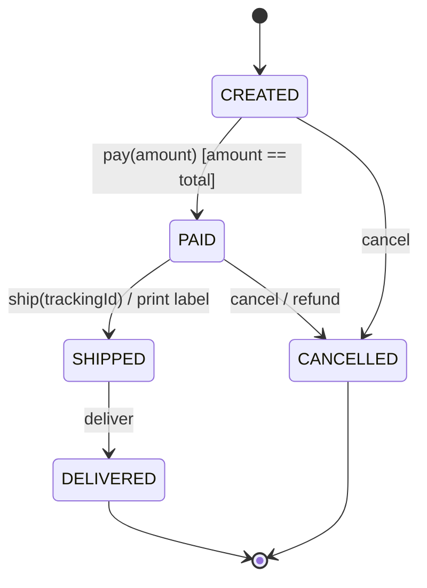

For recognition, an elevator uses a **composite state** `Active` (sub-states `Moving` ⇄ `DoorsOpen`) entered from `Idle` on `request(floor) [floor != current]`, with `Active --> Maintenance : fault`.

### Java example (`lld.ch03.statemachine`)

```java
// File: code/lld/ch03/statemachine/Order.java
    public void handle(OrderEvent event) {
        OrderState from = state;
        OrderState to = switch (event) {
            case OrderEvent.Pay p when state == OrderState.CREATED && p.amount().compareTo(total) == 0 -> OrderState.PAID;
            case OrderEvent.Pay p when state == OrderState.CREATED ->
                    reject(event, "guard failed: paid " + p.amount() + " but total is " + total);
            case OrderEvent.Ship s when state == OrderState.PAID -> {
                log.add("  action: print label " + s.trackingId());
                yield OrderState.SHIPPED;
            }
            case OrderEvent.Deliver d when state == OrderState.SHIPPED -> OrderState.DELIVERED;
            // ... two Cancel cases (from CREATED; from PAID with "refund" action)
            default -> reject(event, "no transition from " + state);
        };
        state = to;
        log.add(from + " --" + event.getClass().getSimpleName() + "--> " + to);
    }
```

Full runnable code: code/lld/ch03/statemachine/ (see the Full Edition).

`OrderEvent` is a **sealed** interface of records; each `case ... when` line is one diagram arrow, and `default` rejects the rest (e.g. `Ship rejected, no transition from CANCELLED`). The guard uses `compareTo` since `BigDecimal.equals` compares scale.

### Trade-offs

**enum + switch:** all transitions in one place; best for few states with simple actions; a new state edits the switch. **State pattern (Ch. 11):** each state's behaviour in its own class; best when states behave very differently; a new state is a new class (Open/Closed).

### When not to use it · Common mistakes · Real-world examples

**Avoid when:** A flag or two with no lifecycle; flows across many objects (activity diagram). A state machine is about **one** object. **Mistakes:** States named as actions ("Paying" vs PAID); missing or default-allowed transitions; overlapping guards; a state machine for the whole system. **Seen in:** `Thread.State`; TCP states; order tracking (cancel only before shipping); Spring Statemachine.

### In the interview

**30-second answer:** "For a lifecycle object I draw states with `event [guard] / action` transitions; anything not drawn is illegal and rejected. In Java: an enum with one transition method, or the State pattern when states carry lots of behaviour."

- *Guard?* — A boolean in `[ ]` that must hold, e.g. `[amount == total]`.
- *Thread-safe transitions?* — `synchronized` method, a lock, or CAS on an `AtomicReference<State>`.

### Self-check

- **Q:** Read `PAID --> CANCELLED : cancel / refund`. **A:** In PAID, `cancel` moves to CANCELLED and refunds.

### TL;DR

One object's states, `event [guard] / action` arrows; everything undrawn is illegal.

---

# Part C — UML in the interview

## 3.15 How much UML to draw in an interview

Arrowheads aren't marked; what's checked is that **diagram and words agree**. A missing line costs less than an unjustifiable one.

| Minute | Diagram | Depth |
|---|---|---|
| 0–5 | **Use case** | Usually spoken: actors, goals, out of scope |
| 5–20 | **Class diagram** | *Always*: 10–15 boxes, typed lines with multiplicity |
| 20–25 | **Activity**, **sequence** or **state** | One, for the key flow: branches / call order / lifecycle |
| 25–45 | Code + discussion | Walk the flow against the diagrams |

**Rules:** one picture → the class diagram; drop attributes before relationships; label every line; say the test aloud; every activity action and sequence arrow must be a method; sequence diagrams 3–4 objects, 6–8 messages; machine coding → a 2-minute sketch; forgot a symbol → say what you mean.

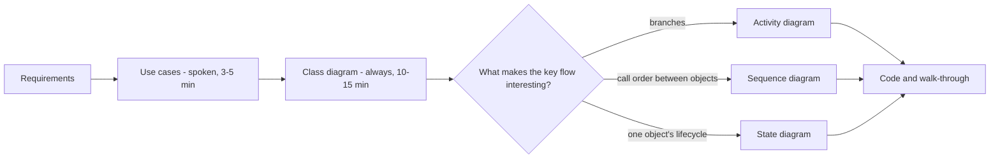

### In the interview

**30-second answer:** "I list use cases verbally for scope, spend most diagram time on one class diagram with typed, multiplicity-labelled lines, then one behaviour diagram for the key flow to check every step has a class and method."

---

## 3.16 Chapter self-check

1. **Q:** Six relationships, weakest to strongest coupling? **A:** Dependency, association, aggregation, composition, realization, generalization.
2. **Q:** `CompactSpot`/`LargeSpot` subclasses passing a constant? **A:** One `ParkingSpot` with a `SpotType` enum.
3. **Q:** «include» vs «extend»? **A:** Always, base → included; sometimes, extension → base.
4. **Q:** Sequence arrowheads? **A:** Filled = sync, open = async, dashed = return.
5. **Q:** 14 UML diagrams? **A:** 7 structural (class, object, package, component, composite structure, deployment, profile), 7 behavioural (use case, activity, state machine, sequence, communication, interaction overview, timing).
6. **Q:** Only one diagram? **A:** The class diagram.

## 3.17 TL;DR

- **Relationships claim lifetime and substitution:** dependency (dashed arrow) · association (line/arrow) · aggregation (◇ at whole, parts live on) · composition (◆ at whole, parts die) · realization (dashed △) · generalization (solid △).
- **Choose in order:** substitution test → dies with whole? → outlives? → association; parameter-only → dependency.
- **Multiplicity changes code:** `1` required, `0..1` Optional, `1..*` non-empty, exact numbers checked.
- **UML:** 14 diagrams; interviews use use case, class (the answer), activity, sequence, state machine.
- **Draw little, label everything, say the test aloud,** and test the class diagram with behaviour diagrams.
