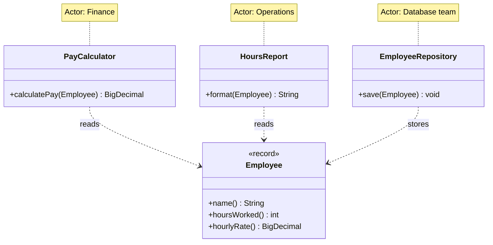
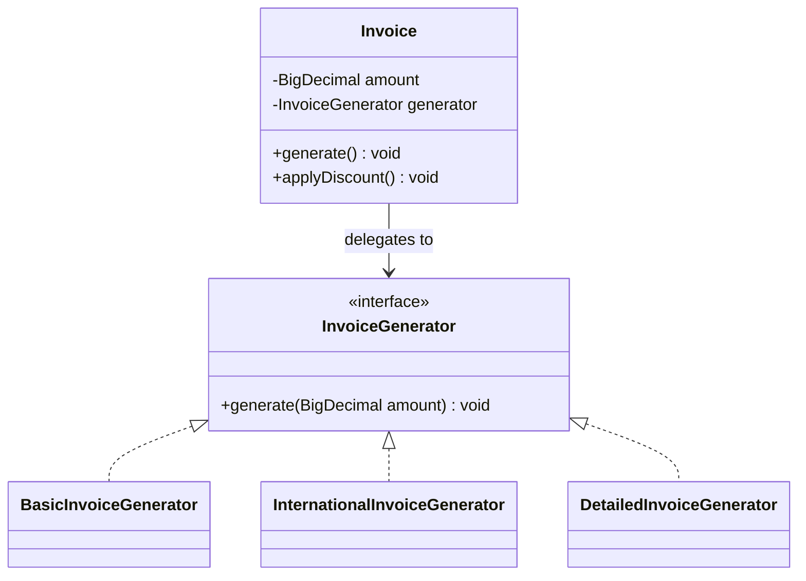
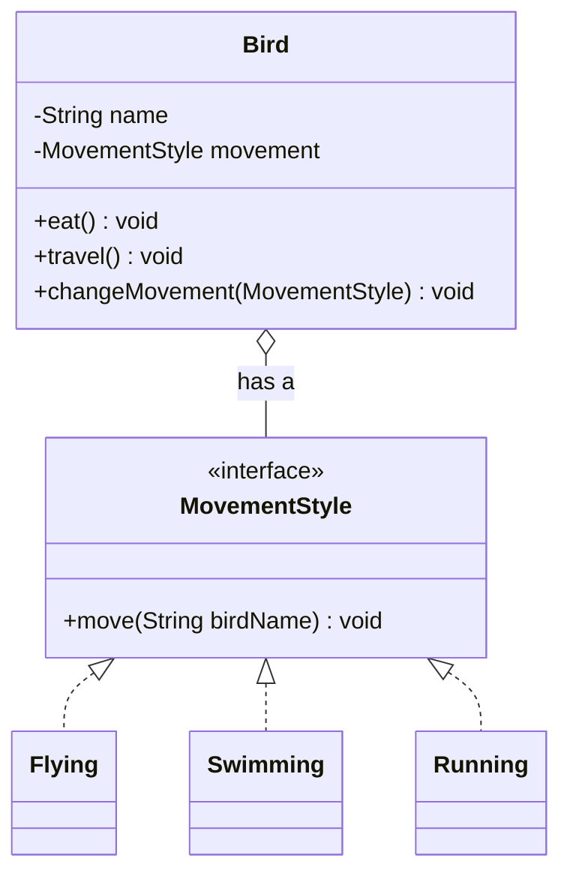
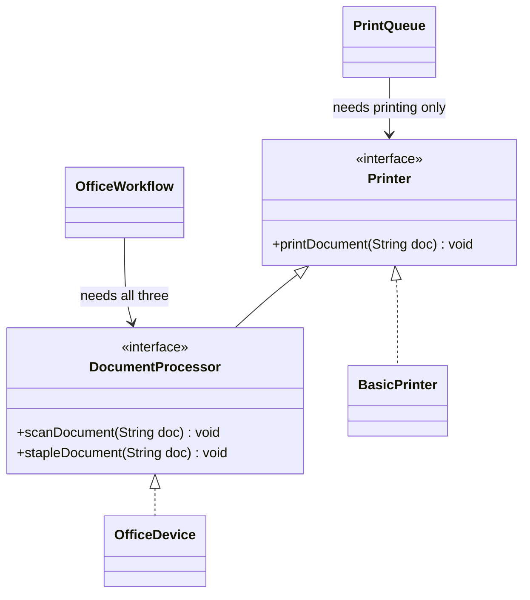
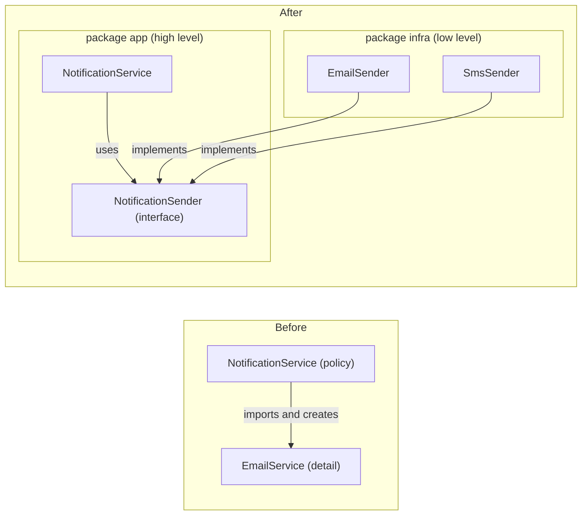
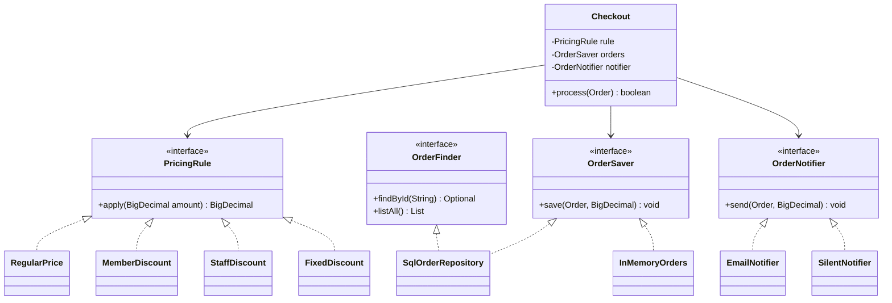

# Chapter 4 — SOLID Principles

> **What you will learn.** The five SOLID principles, one at a time and then all together. For each one you get a plain definition, an everyday analogy, a broken Java example, the refactored Java example, the rules behind it, the cost of applying it, and how to talk about it in a design interview. Along the way you also learn the ideas SOLID is built on: **cohesion**, **coupling** and **separation of concerns**.
>
> **How to use this chapter.** Read 4.1 first. Then read the principles in order, because each one sets up the next. Section 4.11 runs one class through all five principles, and it is the best single thing to rehearse before an interview. Sections 4.13 and 4.14 are about saying all this out loud.

**Run the code.** All code for this chapter is under `chapters/04-solid-principles/code/`, one package per topic. From that folder:

```bash
javac --release 21 -d /tmp/lld_04 $(find . -name '*.java')
java -cp /tmp/lld_04 lld.ch04.srp.Main        # also: cohesion, coupling, soc, ocp, lsp, isp, dip, checkout
```

| Package | What it shows |
|---|---|
| `lld.ch04.srp` | SRP: an `Employee` class split by actor |
| `lld.ch04.cohesion` | Low cohesion vs high cohesion |
| `lld.ch04.coupling` | Tight coupling vs loose coupling, in three steps |
| `lld.ch04.soc` | Separation of concerns: rules vs storage |
| `lld.ch04.ocp` | OCP: invoice formats behind an interface |
| `lld.ch04.lsp` | LSP: cars, the four contract rules, the history rule, birds and composition |
| `lld.ch04.isp` | ISP: fat printer interface, over-splitting, role interfaces |
| `lld.ch04.dip` | DIP: notifications, dependency injection, service locator, plug-ins |
| `lld.ch04.checkout` | One checkout class refactored through all five principles |

**A note on money.** Every amount of money in this chapter's code (pay, invoice totals, prices, balances, order totals) is a `java.math.BigDecimal` created from a string (`new BigDecimal("19.99")`), and every result that could gain extra decimal places (a multiplication by a rate) is rounded explicitly with `setScale(2, RoundingMode.HALF_EVEN)` (two decimal places, "banker's rounding"). Adding or subtracting two-decimal amounts stays at two decimals on its own. Never use `double` for money: binary floating point cannot store values such as 0.1 exactly, so `0.1 + 0.2` prints `0.30000000000000004`, and those tiny errors add up in totals. `BigDecimal` also has one trap: `equals` compares the scale too (`2.0` is not equal to `2.00`), so compare amounts with `compareTo` or `signum()`, as the code here does.

---

## 4.1 What SOLID is and why you should learn it

### What it is

**SOLID** is a set of five design guidelines for object-oriented code. Each letter names one principle:

| Letter | Principle | The one-line rule |
|---|---|---|
| **S** | Single Responsibility Principle (SRP) | A class should have one reason to change. |
| **O** | Open/Closed Principle (OCP) | Add new behaviour by adding code, not by editing working code. |
| **L** | Liskov Substitution Principle (LSP) | A subtype must be usable anywhere its parent type is expected. |
| **I** | Interface Segregation Principle (ISP) | No client should be forced to depend on methods it does not use. |
| **D** | Dependency Inversion Principle (DIP) | Depend on abstractions, not on concrete details. |

A few terms first, because the rest of the chapter uses them:

- A **class** is a blueprint for objects. A **module** is a bigger unit: a package, a library, a service.
- A **client** (or **caller**) is any code that uses another piece of code.
- An **interface** is a list of methods a class promises to provide, with no bodies. In Java it is the `interface` keyword. In general design talk it also means "the set of methods a caller can see".
- An **abstraction** is an interface or abstract class: something that says *what* is done without saying *how*.
- A **concrete class** is a class you can actually create with `new`.


*Figure — the five principles and the single rule each one states (course diagram)*

In the figure above, look at the bottom line: every principle **limits how far one change spreads through the code**. That is the common thread. SRP limits it by giving each class one owner. OCP limits it by letting you add instead of edit. LSP makes sure a new subclass does not break old callers. ISP stops a change in one method from reaching callers that never use it. DIP stops a change in a low-level detail from reaching business logic.

**A little history.** Robert C. Martin ("Uncle Bob") collected these principles in his writing around 2000, most fully in the paper *Design Principles and Design Patterns* and the book *Agile Software Development: Principles, Patterns, and Practices* (2002). Michael Feathers noticed the initials spelled SOLID. Two of the ideas are older: the Open/Closed Principle comes from Bertrand Meyer (1988), and the Substitution Principle from Barbara Liskov (1987).

### The problem it solves

Code that works today still has to change tomorrow. Without guidelines, classes grow by small additions until one edit breaks three unrelated features. SOLID gives you:

- **Cleaner code.** Small, focused classes are easier to read and to hand to a teammate.
- **Flexibility.** New features plug in without breaking old ones.
- **Fewer bugs.** Less code is touched per change, so there is less to break.
- **Reuse.** A class with one job can be used in places its author never imagined.
- **Easier change.** When requirements shift, the change lands in one place.
- **A shared vocabulary.** This is the benefit people forget. When a teammate says "this class breaks ISP", everybody knows what the problem is, and a disagreement about design can be decided by an argument rather than by personal preference.

### How to use SOLID (the honest version)

1. Treat each principle as a **name for a problem**, not a rule to obey everywhere.
2. When code is painful to change, find the principle that names the pain.
3. Apply the fix **when a real change asks for it**, not in advance.
4. Always say what the fix costs (more classes, more interfaces, more wiring).

Applied without judgement, SOLID produces a maze of interfaces that each have one implementation. This chapter shows the cost of every recommendation along with its benefit.

### TL;DR

SOLID = five guidelines that keep one change from spreading. Use them to **diagnose** code, apply them when a real change needs them, and always state the cost.

---

## 4.2 Single Responsibility Principle (SRP)

### What it is

Robert C. Martin's first wording was roughly: **a class should have only one reason to change.** Later (in *Clean Architecture*, 2017) he sharpened it to: **a module should be responsible to one, and only one, actor.** An **actor** is a person or group who can ask for a change to the code.

The everyday version you will often hear is "every component should have one job". That version is a useful start, but it is hard to measure, as we will see.

**Analogy: army knife vs kitchen knife.** A Swiss army knife has scissors, a bottle opener and a screwdriver. It does many jobs and is not the best tool for any of them. A kitchen knife has one job, cutting, and it is excellent at it.


*Figure — an army knife with three jobs (three reasons to change) next to a knife with one job (course diagram)*

In the figure above, the army knife is the class that breaks SRP: three jobs, three reasons to open it and change it. The kitchen knife follows SRP.

The "one job" idea is often applied at every size of code:

- a **method** should perform one action,
- a **class** should serve one purpose,
- a **module** should cover one area of functionality.

Be precise about the names, though. Martin's SRP is a rule about **classes and modules** and their reasons to change. "A function should do one thing" is a separate (good) rule about functions from *Clean Code*. Both push in the same direction, but only the first is SRP.

### The problem it solves

When one class serves several groups, every edit made for one group ships inside code that the other groups rely on, so a payroll tweak can break an operations report. Unrelated logic is also mixed together, which makes it slow to find the right place for a change. With one responsibility per class, you know exactly which class to open.

### What counts as one responsibility?

"Do one thing" has no fixed size. Is "register a user" one thing? Is checking the email address part of it, or a job of its own? Reasonable people can debate that without end, because the phrase offers no yardstick.

The **actor** view gives you something to measure. A reason to change always comes from someone. So ask: **who can send me a change request for this code?** If two different groups can, the class has two responsibilities, however small it looks.

Here is an `Employee` class. Every method is "about employees", so the "one thing" test passes. Now ask who can demand a change to each method:

| Method | Who asks for the change | Example request |
|---|---|---|
| `calculatePay` | Finance | "Overtime starts after 38 hours, not 40." |
| `reportHours` | Operations | "Show the week-ending date in the report." |
| `save` | Database team | "Move from SQL to a document store." |

So one class has three owners and three independent reasons to change. A new overtime rule from finance means editing `Employee`, which also ships the report code and the storage code again, although neither of those teams wanted anything. If the edit accidentally breaks the report layout, operations pays for a decision it had no part in.


*Figure — finance, operations and the database team all reach into one Employee class; splitting by actor gives each group its own class (course diagram)*

Martin tells a sharper version of this story in *Clean Architecture*. Suppose `calculatePay` and `reportHours` both call a shared private helper, `regularHours()`, because the two calculations happen to match today. Finance changes the helper for its own reasons. The operations report now shows wrong numbers, and nobody on the operations side was told. The code looked like good reuse, but the two uses belonged to different actors. That is **accidental duplication**: two pieces of code that look the same but change for different reasons should not be merged.

### How it works

1. List the methods of the class.
2. For each one, name **who** would ask for it to change.
3. Group the methods by actor.
4. Move each group into its own class, named after its job.
5. Keep plain data in a simple data class (a Java `record` is ideal).
6. Check the split with the three checks below.

### Java example: splitting `Employee` by actor

The violation. Three actors share one class:

```java
// File: code/lld/ch04/srp/before/Employee.java
package lld.ch04.srp.before;

import java.math.BigDecimal;
import java.math.RoundingMode;

/**
 * VIOLATION: three different groups (actors) can each demand a change here.
 * Finance owns the pay rule, operations owns the report, the database team owns storage.
 */
public class Employee {
    private final String name;
    private final int hoursWorked;
    private final BigDecimal hourlyRate; // money: BigDecimal, never double

    public Employee(String name, int hoursWorked, BigDecimal hourlyRate) {
        this.name = name;
        this.hoursWorked = hoursWorked;
        this.hourlyRate = hourlyRate;
    }

    // Actor 1: Finance -- "overtime should start after 38 hours, not 40"
    public BigDecimal calculatePay() {
        int overtime = Math.max(0, hoursWorked - 40);
        int normal = hoursWorked - overtime;
        BigDecimal normalPay = hourlyRate.multiply(BigDecimal.valueOf(normal));
        BigDecimal overtimePay = hourlyRate.multiply(new BigDecimal("1.5"))
                .multiply(BigDecimal.valueOf(overtime));
        return normalPay.add(overtimePay).setScale(2, RoundingMode.HALF_EVEN);
    }

    // Actor 2: Operations -- "show the week-ending date in the report"
    public String reportHours() {
        return name + " worked " + hoursWorked + " hours";
    }

    // Actor 3: Database team -- "move from SQL to a document store"
    public void save() {
        System.out.println("INSERT INTO employees VALUES ('" + name + "')");
    }
}
```

The refactor. `Employee` keeps only the data. Each actor gets its own class:

```java
// File: code/lld/ch04/srp/after/Employee.java
package lld.ch04.srp.after;

import java.math.BigDecimal;

/** Just the data. No group owns a business rule in here. */
public record Employee(String name, int hoursWorked, BigDecimal hourlyRate) { }
```

```java
// File: code/lld/ch04/srp/after/PayCalculator.java
package lld.ch04.srp.after;

import java.math.BigDecimal;
import java.math.RoundingMode;

/** Only Finance asks for changes to this class. */
public class PayCalculator {
    private static final int OVERTIME_THRESHOLD = 40;
    private static final BigDecimal OVERTIME_MULTIPLIER = new BigDecimal("1.5");

    public BigDecimal calculatePay(Employee e) {
        int overtime = Math.max(0, e.hoursWorked() - OVERTIME_THRESHOLD);
        int normal = e.hoursWorked() - overtime;
        BigDecimal normalPay = e.hourlyRate().multiply(BigDecimal.valueOf(normal));
        BigDecimal overtimePay = e.hourlyRate().multiply(OVERTIME_MULTIPLIER)
                .multiply(BigDecimal.valueOf(overtime));
        return normalPay.add(overtimePay).setScale(2, RoundingMode.HALF_EVEN); // cents
    }
}
```

```java
// File: code/lld/ch04/srp/after/HoursReport.java
package lld.ch04.srp.after;

/** Only Operations asks for changes to this class. */
public class HoursReport {
    public String format(Employee e) {
        return e.name() + " worked " + e.hoursWorked() + " hours";
    }
}
```

```java
// File: code/lld/ch04/srp/after/EmployeeRepository.java
package lld.ch04.srp.after;

/** Only the database team asks for changes to this class. */
public class EmployeeRepository {
    public void save(Employee e) {
        System.out.println("INSERT INTO employees VALUES ('" + e.name() + "')");
    }
}
```

```java
// File: code/lld/ch04/srp/Main.java
package lld.ch04.srp;

import java.math.BigDecimal;
import lld.ch04.srp.after.EmployeeRepository;
import lld.ch04.srp.after.HoursReport;
import lld.ch04.srp.after.PayCalculator;

public class Main {
    public static void main(String[] args) {
        System.out.println("--- Before: one class, three actors ---");
        var before = new lld.ch04.srp.before.Employee("Ada", 45, new BigDecimal("20.00"));
        System.out.println("Pay: " + before.calculatePay());
        System.out.println(before.reportHours());
        before.save();

        System.out.println("--- After: split by actor ---");
        var ada = new lld.ch04.srp.after.Employee("Ada", 45, new BigDecimal("20.00"));
        System.out.println("Pay: " + new PayCalculator().calculatePay(ada));
        System.out.println(new HoursReport().format(ada));
        new EmployeeRepository().save(ada);
    }
}
```

Output:

```text
--- Before: one class, three actors ---
Pay: 950.00
Ada worked 45 hours
INSERT INTO employees VALUES ('Ada')
--- After: split by actor ---
Pay: 950.00
Ada worked 45 hours
INSERT INTO employees VALUES ('Ada')
```

What each part does:

- `Employee` is a `record`: an immutable data carrier. No business rule lives there, so no actor needs to edit it for a rule change.
- `PayCalculator` belongs to finance. The overtime threshold and multiplier are named constants, so the next finance request is a one-line change in one class.
- `HoursReport` belongs to operations. `EmployeeRepository` belongs to the database team.
- The output is **identical** before and after. Behaviour did not change. What changed is who must be consulted before an edit. Finance can now change the overtime rule without anyone touching the report or the database code.



### Where splitting goes wrong

A badly applied SRP leaves the code in a **worse** state than no SRP at all. The typical mistake: a large class is chopped up by verb, one class per method or per step, without asking who owns what. The cuts fall in arbitrary places, and the result is a handful of tiny classes that must always be edited as a group, so each change now spreads over half a dozen files. Three checks catch this:

1. **Do the pieces change together?** After a few months, read the version-control log. Two classes that show up in nearly every commit side by side were really one responsibility that got cut in two.
2. **Does each new class have a name that stands on its own?** `EmployeePayCalculator` describes a job. `EmployeeHelper` and `EmployeeUtils` describe nothing. If the name is meaningless without the original class next to it, the class usually is too.
3. **Could the new class be used from somewhere else?** A pay calculator could serve a payroll export, a quote for a contractor, or a unit test. If you cannot imagine any second caller, question why you split it off.

**Splitting does not automatically reduce dependencies.** After an extraction the two classes still call each other. If the extracted class was designed around the precise needs of the class it came from, every change to one will drag the other along. So the split is only step one; step two is deciding what each class is allowed to know about the other. Those two questions have names: **cohesion** (4.3) and **coupling** (4.4). SRP usually helps both, but promises neither.

### Why SRP is important

- **Simpler maintenance.** A class with one job is easy to understand, debug and change.
- **Reuse.** A focused class fits in more places.
- **Scales with the codebase.** New features add classes instead of bloating old ones.
- **High cohesion.** Everything in the class serves one purpose.
- **Opens the door to low coupling, but does not finish the job.** Separating responsibilities gives you a seam. Coupling drops only when the dependency across that seam points at an abstraction (see 4.4).

### Trade-offs

| You gain | You pay |
|---|---|
| A change requested by one group touches only that group's code | More classes and files to navigate |
| Smaller classes are easier to test in isolation | The caller now wires several objects together |
| Clear ownership (who reviews what) | Risk of over-splitting into classes that always change together |

### When not to use it

- When you cannot name two different actors. If you cannot name the groups, you do not yet know where the seam is.
- In short-lived code such as a one-off script.
- When the pieces would always change together anyway.

### Common mistakes

- **Splitting by counting methods or verbs** instead of by actor.
- **Helper/Utils classes** that exist only because something had to be moved somewhere.
- **Merging "duplicate" code that belongs to different actors** (the `regularHours()` trap).
- **Thinking SRP means "a class has one method".** A class can have ten methods and one responsibility.
- **Confusing SRP with "a function should do one thing".** That is a separate (good) rule about functions from *Clean Code*. SRP is about reasons to change.

### Code smells that point to SRP (from *Refactoring*)

- **Divergent Change** — one class is edited for many different kinds of reasons. This is SRP broken.
- **Large Class** — too many fields and methods, often a sign of several jobs.
- **Shotgun Surgery** — one change forces small edits in many classes. This is often the result of **over-splitting**, the opposite mistake.
- The usual fix is the **Extract Class** refactoring (and **Move Function**/**Move Field**).

### Real-world examples

- **Spring layers**: `@Controller` handles HTTP, `@Service` holds business rules, `@Repository` handles persistence. Each layer answers to a different kind of change.
- **JDK**: `java.time.format.DateTimeFormatter` formats and parses dates; `LocalDate` holds the date. Formatting rules can change without touching the date value type.
- **Logging frameworks** (Logback, Log4j 2) split the *logger* (what to log), the *appender* (where it goes) and the *layout* (how it looks). A new output format does not touch the destination code.

### In the interview

**30-second answer:** "SRP says a class should have one reason to change. The sharp version is: one actor, one group of people who can request changes. I find the actors by asking who would ask for each method to change. If finance, operations and the DBAs can all ask for edits to `Employee`, I split it into `PayCalculator`, `HoursReport` and `EmployeeRepository`, and keep `Employee` as data. The cost is more classes and some wiring, so I only split when I can name the different groups."

**Follow-ups:**

- *"Would you always split?"* — No. If the two halves always change together, I have turned one file into two for nothing. I split when two different people can ask for two different changes.
- *"How do you know you split too far?"* — The pieces show up in the same commits, their names only make sense next to each other (`XHelper`), and nothing else could use them.
- *"Is SRP about methods?"* — It applies to methods, classes and modules, but the test is always reasons to change, not the number of methods.

### Self-check

1. **Q:** What is an "actor" in SRP? **A:** A person or group who can request a change to the code, for example finance or the database team.
2. **Q:** A `ReportService` formats a report and emails it. Is that an SRP problem? **A:** Yes, if different people own the wording and the delivery. Formatting and delivery change for different reasons.
3. **Q:** Name the three checks for a good split. **A:** Do the pieces change together? Does each name stand alone? Could each piece be used elsewhere?
4. **Q:** Does splitting a class always lower coupling? **A:** No. If the new class names a concrete collaborator, the dependency just moved. Point it at an abstraction to loosen it.

### TL;DR

One class, one actor. Find the actors, split along them, keep data in a record, check the split, and do not split what always changes together.

---

## 4.3 Cohesion

### What it is

**Cohesion** is how closely the contents of one class (or module, or method) belong together. **High cohesion**: every method works toward the same purpose. **Low cohesion**: unrelated jobs are bundled into one place.

**Analogy: a garbage dump vs sorted bins.** A dump holds plastic, paper and food waste in one pile. Nothing in it has a clear purpose, and finding anything is hard. Separate bins, one per material, each have one job.


*Figure — one mixed bin (low cohesion) next to one bin per material (high cohesion) (course diagram)*

In the figure above, the mixed bin is a class whose methods have nothing to do with each other. The sorted bins are classes where every method serves the same purpose, so each one has a single reason to change.

### The problem it solves

In a low-cohesion class, someone who wants to change one job has to open, read and redeploy a class that also owns other jobs. Low cohesion also works in the other direction: if the code for **one** job is **scattered** over several classes (say `addUser` in one class and `deleteUser` in another), a change to that job has to hunt for all the pieces. Both are cohesion problems: the first mixes unrelated things, the second separates related things.

### The classic types of cohesion

Structured-design authors (Larry Constantine, Ed Yourdon, Glenford Myers, 1970s) ranked cohesion from worst to best. The names are still useful for describing what you see:

| Type (worst → best) | What groups the code | Java-flavoured example |
|---|---|---|
| **Coincidental** | Nothing, it just ended up together | `Utils` with `formatDate`, `sendEmail`, `parseCsv` |
| **Logical** | Same category, chosen by a flag | `handle(type)` with a big `switch` over unrelated actions |
| **Temporal** | Things that run at the same time | `startup()` that opens the DB, warms caches and prints a banner |
| **Procedural** | Steps that follow an order | A method that validates, then logs, then retries |
| **Communicational** | Work on the same data | `ReportBuilder` methods that all read the same `Order` list |
| **Sequential** | Output of one step is input to the next | `parse → validate → transform` pipeline in one class |
| **Functional** (best) | Everything contributes to one well-defined task | `PayCalculator` |

You do not need to memorise the list. Aim for **functional** cohesion and recognise **coincidental** cohesion (the "Utils" class) as a warning sign.

### How it works

1. Look at each method in the class. Which fields does it use?
2. If the methods fall into groups that use **different** fields for **different** purposes, the class has low cohesion.
3. Move each group into its own class.
4. If the code for one job is scattered over several classes, gather it into one.

### Java example

Before: user bookkeeping and audit-file work share a class. `addUser`/`deleteUser` use `users`; `writeToFile`/`readFromFile` use `auditLines`. Two disjoint groups:

```java
// File: code/lld/ch04/cohesion/before/UserManager.java
package lld.ch04.cohesion.before;

import java.util.ArrayList;
import java.util.List;

/** LOW cohesion: user bookkeeping and audit-file work share one class but not one purpose. */
public class UserManager {
    private final List<String> users = new ArrayList<>();
    private final List<String> auditLines = new ArrayList<>();

    // --- user work ---
    public void addUser(String user) {
        users.add(user);
        System.out.println("user added: " + user);
    }

    public void deleteUser(String user) {
        users.remove(user);
        System.out.println("user deleted: " + user);
    }

    // --- file work, unrelated to the two methods above ---
    public void writeToFile(String line) {
        auditLines.add(line);
        System.out.println("wrote a line to the audit file: " + line);
    }

    public List<String> readFromFile() {
        System.out.println("read " + auditLines.size() + " line(s) back from the audit file");
        return List.copyOf(auditLines);
    }
}
```

After: two classes, each with one purpose:

```java
// File: code/lld/ch04/cohesion/after/UserManager.java
package lld.ch04.cohesion.after;

import java.util.ArrayList;
import java.util.List;

/** HIGH cohesion: every method works on the same field for the same purpose. */
public class UserManager {
    private final List<String> users = new ArrayList<>();

    public void addUser(String user) {
        users.add(user);
        System.out.println("user added: " + user);
    }

    public void deleteUser(String user) {
        users.remove(user);
        System.out.println("user deleted: " + user);
    }
}
```

```java
// File: code/lld/ch04/cohesion/after/AuditFile.java
package lld.ch04.cohesion.after;

import java.util.ArrayList;
import java.util.List;

/** HIGH cohesion: only audit-log work lives here. */
public class AuditFile {
    private final List<String> lines = new ArrayList<>();

    public void writeLine(String line) {
        lines.add(line);
        System.out.println("wrote a line to the audit file: " + line);
    }

    public List<String> readAll() {
        System.out.println("read " + lines.size() + " line(s) back from the audit file");
        return List.copyOf(lines);
    }
}
```

```java
// File: code/lld/ch04/cohesion/Main.java
package lld.ch04.cohesion;

import lld.ch04.cohesion.after.AuditFile;
import lld.ch04.cohesion.after.UserManager;

public class Main {
    public static void main(String[] args) {
        System.out.println("--- Before: one class, two unrelated jobs ---");
        var manager = new lld.ch04.cohesion.before.UserManager();
        manager.addUser("ada");
        manager.writeToFile("created ada");
        manager.deleteUser("ada");
        manager.readFromFile();

        System.out.println("--- After: two classes, one job each ---");
        var users = new UserManager();
        var audit = new AuditFile();
        users.addUser("ada");
        audit.writeLine("created ada");
        users.deleteUser("ada");
        audit.readAll();
    }
}
```

Output:

```text
--- Before: one class, two unrelated jobs ---
user added: ada
wrote a line to the audit file: created ada
user deleted: ada
read 1 line(s) back from the audit file
--- After: two classes, one job each ---
user added: ada
wrote a line to the audit file: created ada
user deleted: ada
read 1 line(s) back from the audit file
```

Both halves of the output are identical. The difference is structural: each class now has a single purpose, so a new audit-log format is an edit to `AuditFile` alone and never touches user management. The **cost** is that the caller must create and hold two objects instead of one, which becomes worth it as soon as the two jobs change for different reasons.

### Cohesion and SRP

- Low cohesion usually means several unrelated jobs in one class, which breaks SRP.
- High cohesion means the class is built around one job, which is what SRP asks for.
- So aiming for high cohesion tends to give you SRP for free.

### Trade-offs

| High cohesion gains | Costs |
|---|---|
| Easy to name, read and test each class | More classes to wire |
| A change lands in one class | Callers may hold several objects |

### When not to use it

Do not split a class that already has functional cohesion just to make it smaller. Five tiny classes can be harder to follow than one clear one.

### Common mistakes

- Calling every mixed class a "coupling problem". A single class mixing jobs is a **cohesion** problem; coupling needs two classes.
- Creating a `Utils` dumping ground (coincidental cohesion).

### Real-world examples

- `java.lang.Math` is a set of static math functions: functional cohesion around "numeric calculations".
- `java.util.Collections` is looser: sorting, searching, wrapping and synchronising collections all live together. It is still "operations on collections", but it shows how a utility class drifts toward logical cohesion.

### In the interview

**30-second answer:** "Cohesion is how much the things inside one class belong together. I check which fields each method uses. If the methods split into two groups that touch different fields for different reasons, the class has low cohesion and I split it. High cohesion is basically SRP seen from inside the class."

**Follow-up:** *"Is a big class always low-cohesion?"* — No. If every method serves one task, it is cohesive even if it is large. Size is a hint, not the measure.

### Self-check

1. **Q:** What is the worst kind of cohesion? **A:** Coincidental: code grouped for no reason, like a `Utils` class.
2. **Q:** Is "the code for one job is spread over three classes" a cohesion problem? **A:** Yes. Related code should live together.

### TL;DR

Cohesion = do the parts of this class belong together? Aim for one purpose per class; split disjoint groups; gather scattered pieces.

---

## 4.4 Coupling

### What it is

**Coupling** is how much one class depends on another. It always describes a pair: a lone class cannot be "tightly coupled", because there is nothing else in the picture for it to depend on.

- **Low (loose) coupling**: you can change, replace or test one class without changing the other.
- **High (tight) coupling**: a change to one forces a change to the other.

**Analogy: TV and remote.** A remote that controls only one specific TV, and a TV that accepts only that remote, are tightly coupled: replace one and you must replace both. A universal remote and a TV that accepts any remote are loosely coupled: each follows a shared standard (the infrared signal), and each can be swapped on its own.


*Figure — a remote tied to one TV (high coupling) vs any remote working with any device through an agreed signal (low coupling) (course diagram)*

In the figure above, the "agreed signal" on the right is exactly what an **interface** does in code: both sides agree on a contract instead of knowing each other.

### The problem it solves

With tight coupling:

- you cannot swap an implementation (MySQL → Postgres) without editing the caller,
- you cannot unit-test the caller without the real dependency (a running database),
- a change in how the dependency is **constructed** ripples into every class that builds it.

### The classic types of coupling

From structured design again, from worst to best:

| Type (worst → best) | What A knows about B | Java-flavoured example |
|---|---|---|
| **Content** | A reaches into B's internals | Reflection that sets B's private field |
| **Common** | A and B share global mutable data | Both read/write a `public static Map` |
| **External** | Both depend on an external format or device | Both parse the same hand-rolled file format |
| **Control** | A passes a flag telling B *how* to work | `print(doc, boolean asPdf)` |
| **Stamp** | A passes a whole structure when B needs one field | `sendInvoice(Customer c)` that only reads `c.email()` |
| **Data** | A passes only the values B needs | `sendInvoice(String email, Money total)` |
| **Message** (lowest) | A sends a message through an interface | `notifier.send(message)` on an interface |

In object-oriented design, the practical goal is: **depend on interfaces, pass only what is needed, never share mutable globals.**

### How it works

1. Find where class A **names** class B (a field type, a `new B()`, a static call `B.x()`).
2. Ask: does A need *this particular* B, or just *something that does the job*?
3. If the latter, describe the job as an interface.
4. Let A accept any object that implements the interface, usually through its constructor.
5. Let the caller (or the program's entry point) choose which implementation to pass.

### Java example: three steps with `Student`

**Start: one class, two jobs.** `Student` holds data *and* talks to MySQL. With a single class in play this is a **cohesion** problem; coupling needs a second class:

```java
// File: code/lld/ch04/coupling/start/Student.java
package lld.ch04.coupling.start;

/** Starting point: ONE class, two jobs. A cohesion problem -- nothing to be coupled to yet. */
public class Student {
    private final String studentId;

    public Student(String studentId) {
        this.studentId = studentId;
    }

    public String studentId() {
        return studentId;
    }

    // Student holds the data AND knows how to store it
    public void save() {
        System.out.println("Connecting to MySQL...");
        System.out.println("Saving student with ID: " + studentId);
    }
}
```

**Step 1: extract the database work.** Cohesion is fixed. But now there are two classes, and the coupling is **tight**: `Student` names `MySqlDatabase` directly.

```java
// File: code/lld/ch04/coupling/extracted/MySqlDatabase.java
package lld.ch04.coupling.extracted;

public class MySqlDatabase {
    public void saveStudent(String studentId) {
        System.out.println("Connecting to MySQL...");
        System.out.println("Saving student with ID: " + studentId);
    }
}
```

```java
// File: code/lld/ch04/coupling/extracted/Student.java
package lld.ch04.coupling.extracted;

/** Step 1: cohesion fixed, but Student now names one concrete class -> TIGHT coupling. */
public class Student {
    private final String studentId;
    private final MySqlDatabase database = new MySqlDatabase(); // hard-wired

    public Student(String studentId) {
        this.studentId = studentId;
    }

    public void save() {
        database.saveStudent(studentId);
    }
}
```

Three costs follow: storing students in any other place requires editing `Student`; every test of `Student` needs a live MySQL server; and if `MySqlDatabase` ever needs constructor arguments, `Student` must change too. The extraction relocated the database code, but `Student` still **depends** on it just as much as before.

**Step 2: depend on an interface.** Describe what `Student` needs as `StudentRepository`, and let the caller choose the implementation:

```java
// File: code/lld/ch04/coupling/decoupled/StudentRepository.java
package lld.ch04.coupling.decoupled;

/** What Student needs, described as a contract rather than a working class. */
public interface StudentRepository {
    void save(String studentId);
}
```

```java
// File: code/lld/ch04/coupling/decoupled/MySqlStudentRepository.java
package lld.ch04.coupling.decoupled;

public class MySqlStudentRepository implements StudentRepository {
    @Override
    public void save(String studentId) {
        System.out.println("Saving student " + studentId + " to MySQL");
    }
}
```

```java
// File: code/lld/ch04/coupling/decoupled/InMemoryStudentRepository.java
package lld.ch04.coupling.decoupled;

import java.util.ArrayList;
import java.util.List;

/** A stand-in that a unit test can use -- no database server needed. */
public class InMemoryStudentRepository implements StudentRepository {
    private final List<String> saved = new ArrayList<>();

    @Override
    public void save(String studentId) {
        saved.add(studentId);
        System.out.println("Keeping student " + studentId + " in memory for a test");
    }

    public List<String> saved() {
        return List.copyOf(saved);
    }
}
```

```java
// File: code/lld/ch04/coupling/decoupled/Student.java
package lld.ch04.coupling.decoupled;

import java.util.Objects;

/** Step 2: Student names no database at all -> LOOSE coupling. */
public class Student {
    private final String studentId;
    private final StudentRepository repository;

    public Student(String studentId, StudentRepository repository) {
        this.studentId = studentId;
        this.repository = Objects.requireNonNull(repository);
    }

    public void save() {
        repository.save(studentId);
    }
}
```

```java
// File: code/lld/ch04/coupling/Main.java
package lld.ch04.coupling;

import lld.ch04.coupling.decoupled.InMemoryStudentRepository;
import lld.ch04.coupling.decoupled.MySqlStudentRepository;
import lld.ch04.coupling.decoupled.Student;

public class Main {
    public static void main(String[] args) {
        System.out.println("--- Start: one class holds data and SQL ---");
        new lld.ch04.coupling.start.Student("S-1024").save();

        System.out.println("--- Step 1: extracted, but tightly coupled to MySqlDatabase ---");
        new lld.ch04.coupling.extracted.Student("S-1024").save();

        System.out.println("--- Step 2: depends on the StudentRepository interface ---");
        new Student("S-1024", new MySqlStudentRepository()).save();
        var fake = new InMemoryStudentRepository();
        new Student("S-2048", fake).save();
        System.out.println("test double recorded: " + fake.saved());
    }
}
```

Output:

```text
--- Start: one class holds data and SQL ---
Connecting to MySQL...
Saving student with ID: S-1024
--- Step 1: extracted, but tightly coupled to MySqlDatabase ---
Connecting to MySQL...
Saving student with ID: S-1024
--- Step 2: depends on the StudentRepository interface ---
Saving student S-1024 to MySQL
Keeping student S-2048 in memory for a test
test double recorded: [S-2048]
```


*Figure — the three steps: one class with two jobs, an extracted but tightly coupled class, and a class that depends on an interface (course diagram)*

In the figure above, follow the arrows. In the middle panel `Student` *names* `MySqlDatabase`. In the last panel it names only `StudentRepository`, a one-method contract, and the concrete repositories point *toward* that contract. Moving to Postgres is now a new repository class handed in by the caller, with no edit to `Student`, and a unit test simply hands in the in-memory version.

This final move is the rule **depend on abstractions, not on concrete classes**, the D in SOLID (4.10). DIP is, in effect, the standard cure for tight coupling.

### Coupling and SRP

- **Separating the jobs** (SRP) repaired cohesion, yet by itself it left `Student` bound tightly to `MySqlDatabase`.
- **Aiming the dependency at an interface** is what repaired coupling, and SRP alone never requires that step.
- Hence SRP *usually* reduces coupling (a single-job class needs fewer collaborators) without *guaranteeing* it. After each split, inspect what the two resulting classes depend on; a class carved out to serve its parent's exact needs can remain welded to it.

### Trade-offs

| Loose coupling gains | Costs |
|---|---|
| Swap implementations without editing callers | An extra interface and a constructor parameter |
| Unit tests with in-memory fakes | Someone must do the wiring (the entry point or a framework) |
| Changes stop rippling | "Go to definition" lands on an interface, one more hop to the real code |

### When not to use it

- Do not put an interface in front of a **stable** class that will never vary and never needs faking (`String`, `LocalDate`, a pure calculation). Coupling to stable things is harmless.
- An interface with one implementation and no test double is usually just an extra file.

### Common mistakes

- Thinking "I extracted a class, so coupling is lower". Only depending on an abstraction lowers it.
- Hiding `new ConcreteThing()` inside a constructor. The dependency is still hard-wired.
- Passing whole objects when only one field is needed (stamp coupling).

### Real-world examples

- **JDBC**: your code talks to `java.sql.Connection`, `Statement` and `ResultSet`, which are interfaces. The MySQL or Postgres driver supplies the implementation.
- **SLF4J**: code logs through the `org.slf4j.Logger` interface; Logback or Log4j is plugged in at deployment.
- **USB, HTTP, SQL** themselves are "agreed signals", the real-world version of an interface.

### In the interview

**30-second answer:** "Coupling is how much one class depends on another. I check where a class names a concrete collaborator. If it only needs something that does the job, I describe the job as an interface and pass the implementation in. That lets me swap MySQL for Postgres and test with an in-memory fake. I do not add interfaces in front of stable things like `String`."

**Follow-up:** *"Can SRP increase coupling?"* — It can. Extract a class built around the old class's exact needs and the two are tightly bound. Check the dependencies after every split.

### Self-check

1. **Q:** Can a single class be "tightly coupled"? **A:** Not to anything inside itself. Coupling is between two things. A single class with two jobs has a cohesion problem.
2. **Q:** `Student` does `new MySqlDatabase()` in its constructor. Tight or loose? **A:** Tight. It names a concrete class and creates it.
3. **Q:** What is "control coupling"? **A:** Passing a flag that tells the other code how to behave, e.g. `print(doc, asPdf)`.

### TL;DR

Coupling = how much A must know about B. Loosen it by depending on an interface and passing the implementation in. Extracting a class alone is not enough.

---

## 4.5 Separation of Concerns (SoC)

### What it is

**Separation of Concerns** means splitting a program into parts where each part handles one **concern**. A concern is one area of the work: storing data is one concern, deciding whether an email address is acceptable is another, drawing the screen is a third. The term comes from Edsger Dijkstra (1974).

**Analogy:** in a restaurant, the kitchen cooks, the waiters serve, and the cashier takes payment. A new menu does not change how payment works.

### The problem it solves

When concerns are mixed, one change forces you to read and edit code about other concerns. When they are separate, each change lands in one module.

**Benefits:**

- **Modularity** — each part covers one area, so the system is easier to follow.
- **Maintainability** — a change in one part rarely affects the others.
- **Reusability** — a well-defined module can be reused elsewhere.
- **Testability** — test one concern with the others replaced by simple stand-ins.

### How it works

1. List the concerns in the feature (for registration: storage, business rules).
2. Give each concern its own module.
3. Let modules talk only through small, clear methods.
4. Test the result: for each likely requirement change, **count the modules you would have to edit**. The ideal answer is one.

### Java example: user registration

Two concerns. **Storage** keeps users and never judges whether a user is valid. **Business rules** decide what is acceptable and ask storage to save it, without knowing how storage works.

```java
// File: code/lld/ch04/soc/UserStore.java
package lld.ch04.soc;

import java.util.ArrayList;
import java.util.List;

/** Storage concern only. It has no opinion about what a valid user is. */
public class UserStore {
    public record User(String username, String email) { }

    private final List<User> users = new ArrayList<>();

    public void addUser(String username, String email) {
        users.add(new User(username, email));
        System.out.println("Stored user: " + username);
    }

    public int count() {
        return users.size();
    }
}
```

```java
// File: code/lld/ch04/soc/UserService.java
package lld.ch04.soc;

/** Business-rules concern only. Storage is somebody else's job. */
public class UserService {
    private final UserStore store;

    public UserService(UserStore store) {
        this.store = store;
    }

    boolean isValidUsername(String username) {
        return username.length() >= 3;
    }

    boolean isValidEmail(String email) {
        return email.contains("@") && email.contains(".");
    }

    public boolean registerUser(String username, String email) {
        if (!isValidUsername(username)) {
            System.out.println("Rejected: " + username + " is too short");
            return false;
        }
        if (!isValidEmail(email)) {
            System.out.println("Rejected: " + email + " is not an email address");
            return false;
        }
        store.addUser(username, email);
        return true;
    }
}
```

```java
// File: code/lld/ch04/soc/Main.java
package lld.ch04.soc;

public class Main {
    public static void main(String[] args) {
        UserStore store = new UserStore();
        UserService service = new UserService(store);
        service.registerUser("ada", "ada@example.com");
        service.registerUser("jo", "jo@example.com");
        service.registerUser("grace", "grace-at-example");
        System.out.println("Users in store: " + store.count());
    }
}
```

Output:

```text
Stored user: ada
Rejected: jo is too short
Rejected: grace-at-example is not an email address
Users in store: 1
```

Of the three attempts, only `ada` made it into storage: `jo` failed the length rule and `grace-at-example` failed the email rule. Every accept/reject decision was made by `UserService`, which never touched the list itself; `UserStore` simply kept whatever it was handed, without judging it.


*Figure — UserService decides what is acceptable and asks UserStore to save it; each change lands in one module (course diagram)*

As the figure above shows, each likely change lands in exactly one place:

| Change | Module you open |
|---|---|
| Move from an in-memory list to a real database | `UserStore` only |
| Require usernames of at least eight characters | `UserService` only |
| Test the rules without a database | Pass `UserService` a stand-in store |

(In a bigger system you would also put `UserStore` behind an interface, which is the coupling fix from 4.4.)

### SoC and SRP

The two are the same instinct applied at different scales. **SRP** is normally discussed for a single class; **SoC** for modules, layers and whole subsystems. Giving every class in a module a single responsibility is one route to well-separated concerns.

### Trade-offs

| Gains | Costs |
|---|---|
| Changes stay local | More modules and boundaries to design |
| Each concern tested alone | Cross-cutting concerns (logging, security, transactions) still touch many modules; they need special tools such as aspects or decorators |

### When not to use it

A 50-line script does not need layers. Separate concerns when they change for different reasons or at different speeds.

### Common mistakes

- Validation that quietly happens inside the storage class ("the DAO also checks the email").
- Layers that exist on paper but call each other in every direction.

### Real-world examples

- **MVC** (Model–View–Controller): model = data and rules, view = display, controller = input handling. Spring MVC and most web frameworks follow it.
- **HTML / CSS / JavaScript**: structure, style and behaviour are three concerns in three languages.
- **Layered architecture**: controller → service → repository.
- **Spring `@Transactional`**: transaction handling (a cross-cutting concern) is separated from business code by a proxy.

### In the interview

**30-second answer:** "Separation of concerns means each module handles one area of the work, like storage vs business rules. My test is: when a requirement changes, how many modules do I open? Ideally one. It is SRP at module size."

### Self-check

1. **Q:** What is a "concern"? **A:** One area of the work, such as storage, validation or presentation.
2. **Q:** How do SoC and SRP differ? **A:** Mostly in size: SRP is about a class, SoC about modules and layers.

### TL;DR

One module per area of work; measure it by how many modules a change forces you to open.

---

## 4.6 SRP vs cohesion vs coupling vs SoC — one table

| Idea | Question it asks | Scope | How it relates to SRP |
|---|---|---|---|
| **SRP** | How many actors can ask this class to change? | Class / module | — |
| **Cohesion** | Do the parts of this class belong together? | Inside one unit | Applying SRP usually raises cohesion, because one job means related parts. |
| **Coupling** | How much does A depend on B? | Between two units | SRP tends to lower coupling but does not guarantee it; you still need to depend on abstractions. |
| **SoC** | Is each area of work in its own module? | Modules, layers | SRP applied to every class is one way to achieve SoC. |

The rule of thumb every textbook repeats, **"high cohesion, low coupling"**, is the goal. SRP is the tool that gets you the first half; depending on abstractions (DIP) gets you the second.

---
## 4.7 Open/Closed Principle (OCP)

### What it is

**Software entities (classes, modules, functions) should be open for extension but closed for modification.** In plain words: you should be able to add new behaviour **by adding new code**, without editing code that already works.

- **Closed for modification**: once a class is written and tested, adding the next variation should not require opening it. Every edit to working code risks breaking it.
- **Open for extension**: new behaviour arrives as new parts, usually through **interfaces**, **polymorphism** (one call, many implementations) or **inheritance**.

**Where it comes from.** Bertrand Meyer stated the principle in 1988 (*Object-Oriented Software Construction*). In **Meyer's OCP** a class is *closed* once it is compiled, published and used by clients (it is changed only to fix bugs), and it stays *open* because a new class can **inherit** from it and add or redefine features. That is extension by implementation inheritance. Robert C. Martin's 1996 article restated it as the **polymorphic OCP**: the stable code depends on an **abstract interface**, and new behaviour arrives as new implementations of that interface, which can be swapped for one another. The polymorphic version is the one people usually mean today, and it is the one used in this chapter.

**Analogy: a game console and its accessories.** You buy a console with a standard controller. Later you add a racing wheel, a motion controller and a VR headset. Nobody opens the console and rewires it. The console is **closed** (its internals stay sealed) and **open** (it offers a standard port that new accessories plug into).


*Figure — new accessories plug into a standard port; the console itself is never opened (course diagram)*

In the figure above, the **standard port** is the interface. The accessories are new classes that implement it.

### The problem it solves

The textbook symptom is an `if/else` chain or `switch` on a type code that keeps growing. Each new case is an edit to a tested, working method, and each edit can break the cases that were fine. Often the same `switch` also appears in several places, and one copy gets missed.

**Quick test:** *can I add the next case without opening this file?* If not, the class is not closed against that kind of change.

### How it works

1. Wait until you have seen the variation happen (at least a second case).
2. Identify **the part that varies** (here: the invoice format).
3. Describe it as an interface.
4. Move each variant into its own class that implements the interface.
5. Make the stable class **delegate** to the interface instead of branching.
6. Add the next variant as a new class. Nothing existing is opened.
7. Choose the variant in one place, at the edge of the program (the entry point, a factory, a map, or configuration).

### Java example: invoice formats

**Before.** While `Invoice` had a single format, there was nothing to fix: OCP only matters for code that actually receives new variations. The trouble starts when sales wants **international invoices** and the quickest route is a type parameter and a branch:

```java
// File: code/lld/ch04/ocp/before/Invoice.java
package lld.ch04.ocp.before;

import java.math.BigDecimal;

/** VIOLATION: every new invoice type means opening this working, tested method. */
public class Invoice {
    private final BigDecimal amount;

    public Invoice(BigDecimal amount) {
        this.amount = amount;
    }

    public void generate(String invoiceType) {
        if (invoiceType.equals("basic")) {
            System.out.println("Generating basic invoice for amount: " + amount);
        } else if (invoiceType.equals("international")) {
            System.out.println("Generating international invoice for amount: " + amount);
        } else {
            throw new IllegalArgumentException("Unknown invoice type: " + invoiceType);
        }
    }

    public void applyDiscount() {
        System.out.println("Applying discount on invoice: " + amount);
    }
}
```

Note exactly what is wrong. Doing two jobs would be an SRP complaint; the OCP complaint is that **each new invoice type forces an edit to code that already works**.

**After.** Step 1: turn the part that varies into an interface. Step 2: give each format its own class. These classes *produce* invoices, so they are named *generators*; a name like `BasicInvoice` would falsely imply a subtype of invoice. Step 3: `Invoice` hands the work to its generator. Step 4: a third format costs one new class plus one line at the place where formats are chosen.

```java
// File: code/lld/ch04/ocp/after/InvoiceGenerator.java
package lld.ch04.ocp.after;

import java.math.BigDecimal;

/** Step 1: the part that varies (the invoice format) gets its own abstraction. */
@FunctionalInterface
public interface InvoiceGenerator {
    void generate(BigDecimal amount);
}
```

```java
// File: code/lld/ch04/ocp/after/BasicInvoiceGenerator.java
package lld.ch04.ocp.after;

import java.math.BigDecimal;

public class BasicInvoiceGenerator implements InvoiceGenerator {
    @Override
    public void generate(BigDecimal amount) {
        System.out.println("Generating basic invoice for amount: " + amount);
    }
}
```

```java
// File: code/lld/ch04/ocp/after/InternationalInvoiceGenerator.java
package lld.ch04.ocp.after;

import java.math.BigDecimal;

public class InternationalInvoiceGenerator implements InvoiceGenerator {
    @Override
    public void generate(BigDecimal amount) {
        System.out.println("Generating international invoice for amount: " + amount);
        System.out.println("  including customs declaration and currency conversion");
    }
}
```

```java
// File: code/lld/ch04/ocp/after/DetailedInvoiceGenerator.java
package lld.ch04.ocp.after;

import java.math.BigDecimal;

/** Step 4: the ONLY new code for a third format. No existing class was opened. */
public class DetailedInvoiceGenerator implements InvoiceGenerator {
    @Override
    public void generate(BigDecimal amount) {
        System.out.println("Generating detailed invoice for amount: " + amount);
        System.out.println("  line items, tax breakdown and payment terms");
    }
}
```

```java
// File: code/lld/ch04/ocp/after/Invoice.java
package lld.ch04.ocp.after;

import java.math.BigDecimal;
import java.util.Objects;

/** Step 3: Invoice delegates. It no longer knows how many formats exist. */
public class Invoice {
    private final BigDecimal amount;
    private final InvoiceGenerator generator;

    public Invoice(BigDecimal amount, InvoiceGenerator generator) {
        this.amount = Objects.requireNonNull(amount);
        this.generator = Objects.requireNonNull(generator);
    }

    public void generate() {
        generator.generate(amount); // no branching
    }

    // Still closed? No -- a new discount rule would still edit this class.
    // That is fine until discounts actually start to vary.
    public void applyDiscount() {
        System.out.println("Applying discount on invoice: " + amount);
    }
}
```

```java
// File: code/lld/ch04/ocp/Main.java
package lld.ch04.ocp;

import java.math.BigDecimal;
import java.util.List;
import lld.ch04.ocp.after.BasicInvoiceGenerator;
import lld.ch04.ocp.after.DetailedInvoiceGenerator;
import lld.ch04.ocp.after.InternationalInvoiceGenerator;
import lld.ch04.ocp.after.Invoice;
import lld.ch04.ocp.after.InvoiceGenerator;

public class Main {
    public static void main(String[] args) {
        BigDecimal amount = new BigDecimal("120.00"); // money: BigDecimal with 2 decimals

        System.out.println("--- Before: branch per type ---");
        var old = new lld.ch04.ocp.before.Invoice(amount);
        old.generate("basic");
        old.generate("international");

        System.out.println("--- After: one class per format ---");
        List<InvoiceGenerator> generators = List.of(
                new BasicInvoiceGenerator(),
                new InternationalInvoiceGenerator(),
                new DetailedInvoiceGenerator(),
                // A lambda is also an extension: no new file, no edited file.
                a -> System.out.println("Generating pro-forma invoice for amount: " + a));
        for (InvoiceGenerator g : generators) {
            new Invoice(amount, g).generate();
        }
    }
}
```

Output:

```text
--- Before: branch per type ---
Generating basic invoice for amount: 120.00
Generating international invoice for amount: 120.00
--- After: one class per format ---
Generating basic invoice for amount: 120.00
Generating international invoice for amount: 120.00
  including customs declaration and currency conversion
Generating detailed invoice for amount: 120.00
  line items, tax breakdown and payment terms
Generating pro-forma invoice for amount: 120.00
```

What to notice:

- `Invoice` has **no branch**. It does not know how many formats exist.
- `DetailedInvoiceGenerator` is the only new code for format three. `Invoice`, `BasicInvoiceGenerator` and `InternationalInvoiceGenerator` were not opened.
- `InvoiceGenerator` is a `@FunctionalInterface`, so in Java a **lambda** is also an extension (the pro-forma line in `Main`). That is OCP with zero new files.


*Figure — a branch per type forces an edit to Invoice; one class per format lets a new format be added as a file (course diagram)*



This shape (a context object holding an interface-typed field, with interchangeable implementations) is the **Strategy pattern**. Strategy is OCP applied to an algorithm that varies.

### Why not just subclass `Invoice`?

Most readers ask this. Writing `class InternationalInvoice extends Invoice` and overriding `generate()` is also OCP-compliant (it is Meyer's original style): a class is added, nothing is edited. In a small program that is perfectly acceptable. Delegation wins as the system grows, for two reasons:

- **A second dimension of change.** If invoices differ by format **and** by currency, subclassing needs a class for every pairing (3 formats × 4 currencies = 12 classes), while delegation combines two independent objects (3 + 4 = 7 classes).
- **Deciding while the program runs.** An object's class is fixed at `new`. A generator can be picked once the customer's country is known, and even replaced later on the same invoice.

Inheritance is therefore a legitimate option; delegation simply copes with more situations. (Head First calls this "favour composition over inheritance".)

### What is still not closed

Only invoice *generation* was opened up. `applyDiscount` still lives inside `Invoice`, so a new kind of discount still means an edit there, and that is fine. **"Closed" is never absolute: a class is closed against a specific kind of change**, normally one you have already watched happen. Discount rules have not varied yet, so there is no reason to abstract them yet. Martin's term for this is **strategic closure**: since no real program can be closed against every possible change, the designer picks which kinds of change to close against, guided by experience.

### Approaches to OCP

| Approach | How it extends | Pattern / Java feature | Good when |
|---|---|---|---|
| **Interface + delegation** | New class implements the interface | Strategy, `Comparator` | The algorithm varies, choose at run time |
| **Inheritance + overriding** | Subclass overrides a hook method | Template Method, abstract classes | Fixed skeleton, a few steps vary |
| **Wrapping** | New class wraps the old and adds behaviour | Decorator (`BufferedInputStream`) | Add features around existing behaviour |
| **Listening** | New subscriber registers | Observer, event listeners | New reactions to existing events |
| **Plug-ins / registry** | New implementation registers itself in a map or via `ServiceLoader` | Plug-in architecture | Third parties add features |
| **Functions** | Pass a lambda | `java.util.function`, `@FunctionalInterface` | Small, one-method variations |
| **Data / configuration** | New entry in a table or config file | Rules engines, feature flags | Variations that are just different numbers |

The `switch` does not always disappear. It moves to **one** place at the edge of the program, often a factory or a `Map<String, InvoiceGenerator>`, instead of being repeated inside business logic.

### Importance of OCP

- **Extensibility** — features are added without touching the tested core.
- **Faster testing** — you test the new class, and the core's tests stay valid.
- **Fewer regressions** — working code is not edited, so it is not broken.
- **Adaptability** — the software absorbs new requirements without rewrites.

### Caution: do not over-engineer

- **Start simple.** Write the `if` first. Introduce the interface when the second or third case actually arrives (the "rule of three").
- **Balance.** Too many abstraction layers make the code harder to read, which defeats the purpose.
- **Think about real needs.** Extension points for futures that never arrive are wasted effort. *Refactoring* calls this smell **Speculative Generality**.

### How OCP relates to SRP

The SOLID principles reinforce one another. OCP pulls the parts that change away from the core that stays put, and each changing part ends up in a class with a single job, which is SRP. In practice SRP usually has to happen first, because the extension point stays hidden until the class is down to one job.

### Trade-offs

| You gain | You pay |
|---|---|
| New variants without editing old code | An interface plus one class per variant |
| Each variant tested on its own | Behaviour is spread over files; reading the whole flow takes more hops |
| Variants selectable at run time | Someone must choose the variant (factory, map, DI) |

### When not to use it

- Nothing has varied yet.
- The "variants" are just different numbers (use data, not classes).
- The set of cases is fixed and small and will not grow (e.g. the two values of a boolean). Java 21's **sealed interfaces with pattern-matching `switch`** are a good fit here: the compiler checks every case is handled, which is the opposite trade (easy to add operations, hard to add types).

### Common mistakes

- Thinking OCP means "never edit a file". Bug fixes, refactoring and changes to the extension point itself all involve editing.
- Building plug-in systems for one implementation.
- Replacing a `switch` in business logic with a `switch` in five factories.

### Refactorings and smells

- Smell: **Repeated Switches** (called *Switch Statements* in the first edition of *Refactoring*).
- Fix: **Replace Conditional with Polymorphism**; also **Replace Type Code with Subclasses**.

### Real-world examples

- **`Comparator`**: `list.sort(comparator)` never changes; you pass a new comparator for a new ordering.
- **Java I/O decorators**: `new BufferedInputStream(new FileInputStream(f))` adds buffering without editing `FileInputStream`.
- **Servlet filters / Spring `HandlerInterceptor`**: new cross-cutting behaviour is a new filter registered in a chain.
- **JDBC drivers** via `ServiceLoader`: a new database is supported by adding a driver JAR, not by editing `DriverManager`.
- **IDE plug-ins** (IntelliJ, VS Code extensions) and **browser extensions**: the core is closed, the plug-in API is the port.

### In the interview

**30-second answer:** "OCP says you should be able to add the next variation by adding code, not editing working code. When I see a `switch` over a type that keeps growing, I put the varying behaviour behind an interface, one class per variant, and the stable class delegates to it. That is Strategy. I only do it once the variation has actually appeared, and I say that a class is closed against a specific kind of change, not against everything."

**Follow-ups:**

- *"Does OCP mean you never edit a class?"* — No. It means the next variation of a known kind is an addition. Bug fixes and refactoring still edit.
- *"Inheritance or delegation?"* — Both satisfy OCP. Delegation handles several axes of variation and run-time choice better.
- *"Would you add an interface for pricing up front?"* — Only if pricing has already varied or is clearly about to. Otherwise I leave the `if` and refactor when the second case shows up.
- *"The interviewer adds: 'trucks are charged a different rate'."* — A design that answers "add a class" beats one that answers "add a branch in this switch".

### Self-check

1. **Q:** What does "closed for modification" mean? **A:** Adding the next variation does not require editing tested code.
2. **Q:** After the refactor, is `Invoice` closed against new discount rules? **A:** No, only against new formats. That is fine until discounts vary.
3. **Q:** Which pattern is "OCP for an algorithm"? **A:** Strategy.
4. **Q:** Give a quick OCP test. **A:** "To add the next case, must I open this file?"

### TL;DR

Put the part that varies behind an interface, add variants as new classes, choose them at the edge. Do it when variation is real, and remember closure is always against a specific kind of change.

---

## 4.8 Liskov Substitution Principle (LSP)

### What it is

**Objects of a subtype must be usable wherever objects of the parent type are expected, without making the program incorrect.** Barbara Liskov introduced the idea in a 1987 keynote; with Jeannette Wing she later (1994) defined it precisely as *behavioural subtyping*. Robert C. Martin's short form is: **subtypes must be substitutable for their base types.**

"Substitutable" means more than "it compiles". Code written against the parent type must still get **correct results** when handed a child.

**Analogy:** a hire-car company promises "a car that takes petrol". If they hand you an electric car and you drive to a petrol station, the promise was broken, even though an electric car is certainly a car.

### The problem it solves

Polymorphism only works if callers can trust the base type. If some subclass secretly behaves differently, every caller has to check which subclass it got (`instanceof`), and the benefit of polymorphism, and of OCP, is gone.

### Example 1: `Car` and `ElectricCar`

`Car` has `start()`, `stop()` and `refuel()`. `ElectricCar extends Car`. An electric car starts and stops fine, but `refuel()` makes no sense, so it throws. It also adds its own `recharge()`.

```java
// File: code/lld/ch04/lsp/car/before/Car.java
package lld.ch04.lsp.car.before;

public class Car {
    public void start() {
        System.out.println("Car is starting");
    }

    public void stop() {
        System.out.println("Car is stopping");
    }

    /** Names a MECHANISM (liquid fuel) instead of a goal. */
    public void refuel() {
        System.out.println("Car is refueling");
    }
}
```

```java
// File: code/lld/ch04/lsp/car/before/ElectricCar.java
package lld.ch04.lsp.car.before;

/** VIOLATION: inherits a promise (refuel) it cannot keep. */
public class ElectricCar extends Car {
    @Override
    public void refuel() {
        throw new UnsupportedOperationException("Electric cars don't need refueling");
    }

    public void recharge() {
        System.out.println("Electric car is recharging");
    }
}
```

Code that *knows* it holds an `ElectricCar` can call `recharge()` and never notice a problem. But the new method does not make `refuel()` go away; the broken method is still part of the object's public face. LSP is tested by code that does **not** know the subclass, such as `service(Car car)` in `Main` below: it calls `start`, `refuel` and `stop` on whatever `Car` it receives, and it crashes when that car is electric.


*Figure — what Car promises every caller, and the unusable refuel() that ElectricCar is left holding (course diagram)*

As the figure above shows, `ElectricCar` cannot fulfil the contract of `Car`, so it is not a valid substitute.

**Name the real mistake.** "`ElectricCar` should not extend `Car`" is only half the diagnosis. The root cause is the method itself: `refuel()` describes one **mechanism** (pouring in liquid fuel) that only some vehicles use. A method on a base class should describe the **goal** that all subclasses have in common. Every vehicle must take on energy before driving, so the common goal is `replenishEnergy()`.

**The fix: raise a general parent.** `Vehicle` declares the goal. `Car` and `ElectricCar` both extend `Vehicle`, and **neither extends the other**:

```java
// File: code/lld/ch04/lsp/car/after/Vehicle.java
package lld.ch04.lsp.car.after;

/** The base type promises the GOAL every vehicle shares, not one mechanism. */
public abstract class Vehicle {
    public void start() {
        System.out.println(getClass().getSimpleName() + " is starting");
    }

    public void stop() {
        System.out.println(getClass().getSimpleName() + " is stopping");
    }

    public abstract void replenishEnergy();
}
```

```java
// File: code/lld/ch04/lsp/car/after/Car.java
package lld.ch04.lsp.car.after;

public class Car extends Vehicle {
    @Override
    public void replenishEnergy() {
        System.out.println("Car is pumping gasoline");
    }
}
```

```java
// File: code/lld/ch04/lsp/car/after/ElectricCar.java
package lld.ch04.lsp.car.after;

/** A sibling of Car, not a child of it. Both can stand in for Vehicle. */
public class ElectricCar extends Vehicle {
    @Override
    public void replenishEnergy() {
        System.out.println("Electric car is charging its battery");
    }
}
```

Three points worth stating carefully:

- **The easy workaround is still wrong.** You could keep `refuel()` and have `ElectricCar.refuel()` secretly charge the battery. The exception disappears, but the method name keeps telling callers something untrue about half the fleet. Renaming fixes the promise itself rather than disguising it.
- **Why not just add `recharge()` to `ElectricCar`?** Code typed as `Vehicle` has no way to call it. A caller may depend only on what the base type declares, never on extras one subclass happens to offer.
- **Substitution goes from child to parent, never between siblings.** `Car` and `ElectricCar` can each replace a `Vehicle`. An `ElectricCar` was never meant to replace a `Car`; the two are siblings.

**When to break a hierarchy**, watch for:

- a subclass that **cannot implement** a parent method (it throws or does nothing),
- a base method that describes a **mechanism** rather than a goal,
- callers that **test the type** (`if (v instanceof ElectricCar)`), a sign that the base type promises too little or promises the wrong thing,
- subclasses with almost nothing in common, where the shared parent invents a relationship that is not really there.

The fix is usually one of two moves: **raise a general parent** (as above) or **take the varying behaviour out of the hierarchy** with composition (next).

### Example 2: birds, and composition instead of inheritance

Here `fly()` is declared on `Bird`, so penguins inherit it and have to reject it. The fault is not the penguin; it is that `Bird` made a promise only part of its family can keep. (In *Refactoring*, a subclass that does not want what it inherits is the **Refused Bequest** smell.)

Two ways to connect classes:

- **Inheritance is an is-a relationship.** `Sparrow extends Bird`: a sparrow is a bird and receives **every** method of `Bird`, whether it suits it or not.
- **Composition is a has-a relationship.** `Bird` holds a field of type `MovementStyle`: a bird *has* a way of moving and calls it. It inherits nothing from it.

The fix: turn the varying behaviour (how a bird moves) into its own small type, and give each bird one through its constructor. There are **no bird subclasses** at all. A sparrow and a penguin are both `Bird`, built with a different `MovementStyle`.

```java
// File: code/lld/ch04/lsp/birds/inheritance/Bird.java
package lld.ch04.lsp.birds.inheritance;

/** Promises fly() to EVERY bird -- a promise only some birds can keep. */
public class Bird {
    public void fly() {
        System.out.println(getClass().getSimpleName() + " is flying");
    }
}
```

```java
// File: code/lld/ch04/lsp/birds/inheritance/Sparrow.java
package lld.ch04.lsp.birds.inheritance;

public class Sparrow extends Bird { }
```

```java
// File: code/lld/ch04/lsp/birds/inheritance/Penguin.java
package lld.ch04.lsp.birds.inheritance;

/** VIOLATION ("refused bequest"): inherits fly() and has to refuse it. */
public class Penguin extends Bird {
    @Override
    public void fly() {
        throw new UnsupportedOperationException("Penguins can't fly");
    }
}
```

```java
// File: code/lld/ch04/lsp/birds/composition/MovementStyle.java
package lld.ch04.lsp.birds.composition;

/** The behaviour that varies, pulled out into its own small type. */
@FunctionalInterface
public interface MovementStyle {
    void move(String birdName);
}
```

```java
// File: code/lld/ch04/lsp/birds/composition/Flying.java
package lld.ch04.lsp.birds.composition;

public class Flying implements MovementStyle {
    @Override
    public void move(String birdName) {
        System.out.println(birdName + " is flying through the air");
    }
}
```

```java
// File: code/lld/ch04/lsp/birds/composition/Swimming.java
package lld.ch04.lsp.birds.composition;

public class Swimming implements MovementStyle {
    @Override
    public void move(String birdName) {
        System.out.println(birdName + " is swimming through the water");
    }
}
```

```java
// File: code/lld/ch04/lsp/birds/composition/Running.java
package lld.ch04.lsp.birds.composition;

public class Running implements MovementStyle {
    @Override
    public void move(String birdName) {
        System.out.println(birdName + " is running along the ground");
    }
}
```

```java
// File: code/lld/ch04/lsp/birds/composition/Bird.java
package lld.ch04.lsp.birds.composition;

import java.util.Objects;

/** A bird HAS-A movement style. No subclasses, so nothing is inherited and refused. */
public final class Bird {
    private final String name;
    private MovementStyle movement;

    public Bird(String name, MovementStyle movement) {
        this.name = name;
        this.movement = Objects.requireNonNull(movement);
    }

    public void eat() {
        System.out.println(name + " is eating");
    }

    /** Tell, don't ask: callers say "travel", the bird decides how. */
    public void travel() {
        movement.move(name);
    }

    /** Composition can change behaviour at run time (e.g. an injured bird). */
    public void changeMovement(MovementStyle movement) {
        this.movement = Objects.requireNonNull(movement);
    }
}
```

Why this satisfies LSP: `Bird` now promises only what every bird can do (`eat()` and `travel()`), so there is nothing any bird must refuse. Flight has become one optional object that some birds are given, not a promise to all of them. Supporting the ostrich took one new movement style instead of an `Ostrich` subclass stuck with a meaningless `fly()`. And since the style is just a field, it can be replaced while the program runs (`changeMovement`).


*Figure — inheritance (Penguin inherits fly() and refuses it) vs composition (a Bird has a MovementStyle) (course diagram)*

In the figure above, the left side is the inheritance tree where the penguin receives a method it does not want. The right side is composition: one `Bird` class holding one of `Flying`, `Swimming`, `Running`.



**Is-a and has-a side by side:**

| | Inheritance | Composition |
|---|---|---|
| Kind of link | Penguin **is a** Bird | Bird **has a** MovementStyle |
| In code | `class Penguin extends Bird` | `Bird` holds a `MovementStyle` field |
| What it gets | all of the parent's methods | just the object handed to it |
| To change behaviour | add another subclass | supply another object |
| Change while running? | no, fixed at creation | yes, replace the field |
| LSP risk | high: inherited methods may not suit | low: nothing is inherited |

**When to use which.** Choose **inheritance** when the child genuinely is a kind of the parent *and* can keep every inherited promise. Choose **composition** when what differs between objects is a behaviour, or the moment you find a subclass rejecting something it inherited. That rejection is the tell: an overridden method that throws, silently does nothing, or carries a "never call this on X" comment should become a separate object.

### Tell, Don't Ask

The composition design above follows a related guideline, popularised by Andy Hunt and Dave Thomas (*The Pragmatic Programmer* authors): **tell an object what to do; do not ask it about its state and then decide for it.**

```java
// Asking: the caller inspects the object and makes the decision.
if (bird instanceof Penguin) { swim(bird); } else { fly(bird); }

// Telling: the caller states the goal, the object decides how.
bird.travel();
```

Asking code has to know every subtype, so it breaks OCP and hides LSP problems behind `instanceof` checks. Telling code works with any substitute. In the composition design, `bird.travel()` is the "tell". A caller that needs `instanceof` on a base type is a strong hint that the base type promises the wrong thing.

### The rules a subclass must follow

So far every violation crashed with an exception, which makes it easy to spot. The harmful ones are those that **quietly produce a wrong result and keep running**.

**Example: `Square extends Rectangle`.** Geometry says every square is a rectangle, so the subclass looks natural. To remain square, `Square` keeps both sides equal: setting the width also changes the height. No exception is thrown. Yet a method written for `Rectangle` that sets width 5 and height 4 expects an area of 20 and receives 16. In production that kind of error becomes an incorrect bill or inventory figure that nobody notices for weeks.

The rule that `Rectangle` implied without ever stating is **width and height can be changed independently**; the two separate setters invited every caller to rely on it. Mathematically a square is a rectangle, but it is **not a valid subtype of this `Rectangle` class**, because the class makes a promise a square cannot honour. **Base inheritance on the promises written in the code, not on how things are classified in the real world.**

A subclass is free to do the job *differently*. What it may not do is **require more** from its callers, **give them less**, or **break an assumption they depend on**. The rules below spell that out. Their vocabulary comes from Bertrand Meyer's **Design by Contract**: a method has **preconditions** (what the caller must provide), **postconditions** (what the method guarantees afterwards) and **invariants** (what is always true of the object).

**Rule 1 — Preconditions may not be strengthened.** A precondition is what must be true before the call. An overriding method may accept a *wider* range of inputs than the parent, never a narrower one. In the example, `Discount` accepts any amount of zero or more, while `SmallOrderDiscount` refuses anything from 100 upward. A caller that passes 250, which the parent allows, now fails, and would have to find out which discount it was given, the very check substitution was meant to make unnecessary.

**Rule 2 — Postconditions may not be weakened.** A postcondition is what the method guarantees when it returns. An override may guarantee *more*, never less. `Account.withdraw` guarantees the balance stays at zero or above. `OverdraftAccount` lets it go negative: a reasonable banking feature, but a broken guarantee. Every caller that relied on "balance ≥ 0" is now silently wrong. Nothing crashes; a payment job might, for example, keep paying suppliers from an account that is already overdrawn. An overdraft account can be a perfectly good class, just not a subtype of an account that promises a non-negative balance.

**Rule 3 — Invariants must be preserved.** An invariant is a condition that holds throughout the object's life. `Square` broke "width and height are independent". (The same bug can equally be described as a weakened postcondition: `Rectangle.setWidth` implicitly guarantees "the height is unchanged", and `Square.setWidth` drops that guarantee. Martin describes it that way; either description leads to the same conclusion.) Invariants are the hardest rule to follow because they are rarely written down: a subclass inherits every promise of its parent, including the ones nobody documented.

**Rule 4 — No new exceptions callers cannot handle.** An override may throw the exceptions the parent already declares (or subtypes of them), nothing new: a new exception type arrives at callers that have no `catch` for it. `ElectricCar.refuel()` broke this rule. Note that Java's compiler enforces this only for **checked** exceptions; `UnsupportedOperationException` is unchecked, so the violating code compiled without complaint. This is the most visible rule to break and the least harmful, because the failure is immediate and loud.

**Rule 5 — The history constraint.** Liskov and Wing added a rule about how state changes over time: **a subtype must not allow state changes that the parent type does not allow.** In the example, `Price` promises that its value never changes after creation. `AdjustablePrice` adds an `adjust()` method. Each call looks innocent, but a caller that captured a quote of 100 is later charged 120 on "the same" price. This is why immutable Java classes such as `String` and `Integer` are declared `final`: a mutable subclass could break the immutability callers rely on.

Here are all of them in runnable code:

```java
// File: code/lld/ch04/lsp/rules/Discount.java
package lld.ch04.lsp.rules;

import java.math.BigDecimal;
import java.math.RoundingMode;

/** Contract -- precondition: any amount >= 0. Postcondition: result = 90% of amount. */
public class Discount {
    private static final BigDecimal RATE = new BigDecimal("0.90");

    public BigDecimal apply(BigDecimal amount) {
        if (amount.signum() < 0) {
            throw new IllegalArgumentException("amount must be >= 0");
        }
        return amount.multiply(RATE).setScale(2, RoundingMode.HALF_EVEN);
    }
}
```

```java
// File: code/lld/ch04/lsp/rules/SmallOrderDiscount.java
package lld.ch04.lsp.rules;

import java.math.BigDecimal;

/** RULE 1 BROKEN: demands MORE than the parent (amount must also be under 100). */
public class SmallOrderDiscount extends Discount {
    private static final BigDecimal LIMIT = new BigDecimal("100");

    @Override
    public BigDecimal apply(BigDecimal amount) {
        if (amount.compareTo(LIMIT) >= 0) {
            throw new IllegalArgumentException("only for orders under 100");
        }
        return super.apply(amount);
    }
}
```

```java
// File: code/lld/ch04/lsp/rules/Account.java
package lld.ch04.lsp.rules;

import java.math.BigDecimal;

/** Contract -- postcondition of withdraw: the balance is never negative. */
public class Account {
    protected BigDecimal balance;

    public Account(BigDecimal balance) {
        this.balance = balance;
    }

    /** Withdraws only if funds allow; returns the balance afterwards (always >= 0). */
    public BigDecimal withdraw(BigDecimal amount) {
        if (amount.compareTo(balance) <= 0) {
            balance = balance.subtract(amount);
        }
        return balance;
    }
}
```

```java
// File: code/lld/ch04/lsp/rules/OverdraftAccount.java
package lld.ch04.lsp.rules;

import java.math.BigDecimal;

/** RULE 2 BROKEN: promises LESS -- the balance may now go negative. Nothing throws. */
public class OverdraftAccount extends Account {
    public OverdraftAccount(BigDecimal balance) {
        super(balance);
    }

    @Override
    public BigDecimal withdraw(BigDecimal amount) {
        balance = balance.subtract(amount);
        return balance;
    }
}
```

```java
// File: code/lld/ch04/lsp/rules/Rectangle.java
package lld.ch04.lsp.rules;

/** Unwritten invariant: width and height can be set independently. */
public class Rectangle {
    protected int width;
    protected int height;

    public Rectangle(int width, int height) {
        this.width = width;
        this.height = height;
    }

    public void setWidth(int width) {
        this.width = width;
    }

    public void setHeight(int height) {
        this.height = height;
    }

    public int area() {
        return width * height;
    }
}
```

```java
// File: code/lld/ch04/lsp/rules/Square.java
package lld.ch04.lsp.rules;

/** RULE 3 BROKEN: to stay square it couples the two setters -- a silent wrong answer. */
public class Square extends Rectangle {
    public Square(int side) {
        super(side, side);
    }

    @Override
    public void setWidth(int width) {
        this.width = width;
        this.height = width;
    }

    @Override
    public void setHeight(int height) {
        this.width = height;
        this.height = height;
    }
}
```

```java
// File: code/lld/ch04/lsp/rules/Price.java
package lld.ch04.lsp.rules;

import java.math.BigDecimal;

/** Contract (history): once created, a Price never changes value. */
public class Price {
    private final BigDecimal value;

    public Price(BigDecimal value) {
        this.value = value;
    }

    public BigDecimal value() {
        return value;
    }
}
```

```java
// File: code/lld/ch04/lsp/rules/AdjustablePrice.java
package lld.ch04.lsp.rules;

import java.math.BigDecimal;

/**
 * HISTORY CONSTRAINT BROKEN: adds a mutator, so an object the caller believed was
 * frozen can now change between two reads. No single method call looks wrong.
 */
public class AdjustablePrice extends Price {
    private BigDecimal current;

    public AdjustablePrice(BigDecimal value) {
        super(value);
        this.current = value;
    }

    @Override
    public BigDecimal value() {
        return current;
    }

    public void adjust(BigDecimal newValue) {
        this.current = newValue;
    }
}
```

**Why it matters so much.** Code written against a base type has no way to protect itself: it cannot see which subclass it received, and it should not need to. Only the subclass author can keep the contract.

**The fix for Rectangle/Square.** Do not share a mutable promise that one of them cannot keep. Make both **immutable** and give them a common interface that promises only what both can do (`area()`). "Resizing" returns a new object, so no setter can break an invariant. Java 21 `record`s and a `sealed` interface make this short:

```java
// File: code/lld/ch04/lsp/shapes/Shape.java
package lld.ch04.lsp.shapes;

/** The fix for Rectangle/Square: promise only what every shape can keep. */
public sealed interface Shape permits Rect, Sq {
    int area();
}
```

```java
// File: code/lld/ch04/lsp/shapes/Rect.java
package lld.ch04.lsp.shapes;

/** Immutable: "resizing" returns a new object, so no setter can break an invariant. */
public record Rect(int width, int height) implements Shape {
    public Rect withWidth(int w) {
        return new Rect(w, height);
    }

    @Override
    public int area() {
        return width * height;
    }
}
```

```java
// File: code/lld/ch04/lsp/shapes/Sq.java
package lld.ch04.lsp.shapes;

public record Sq(int side) implements Shape {
    @Override
    public int area() {
        return side * side;
    }
}
```

And the driver that runs every example, with each client method written only against the base type:

```java
// File: code/lld/ch04/lsp/Main.java
package lld.ch04.lsp;

import java.math.BigDecimal;
import java.util.List;
import lld.ch04.lsp.birds.composition.Bird;
import lld.ch04.lsp.birds.composition.Flying;
import lld.ch04.lsp.birds.composition.Running;
import lld.ch04.lsp.birds.composition.Swimming;
import lld.ch04.lsp.car.after.Vehicle;
import lld.ch04.lsp.rules.Account;
import lld.ch04.lsp.rules.AdjustablePrice;
import lld.ch04.lsp.rules.Discount;
import lld.ch04.lsp.rules.OverdraftAccount;
import lld.ch04.lsp.rules.Price;
import lld.ch04.lsp.rules.Rectangle;
import lld.ch04.lsp.rules.SmallOrderDiscount;
import lld.ch04.lsp.rules.Square;
import lld.ch04.lsp.shapes.Rect;
import lld.ch04.lsp.shapes.Shape;
import lld.ch04.lsp.shapes.Sq;

public class Main {

    // ---- Client code: every method below knows ONLY the base type ----

    static void service(lld.ch04.lsp.car.before.Car car) {
        car.start();
        car.refuel();
        car.stop();
    }

    static void takeATrip(Vehicle v) {
        v.start();
        v.replenishEnergy();
        v.stop();
    }

    static void checkout(Discount d, BigDecimal amount) {
        try {
            System.out.println("  Charged: " + d.apply(amount));
        } catch (IllegalArgumentException e) {
            System.out.println("  Broke on a valid amount: " + e.getMessage());
        }
    }

    static void paySupplier(Account account, BigDecimal amount, String label) {
        BigDecimal balance = account.withdraw(amount);
        System.out.println("  " + label + " balance after payment: " + balance
                + (balance.signum() < 0 ? "   <-- the caller never expected this" : ""));
    }

    /** A contract test written against Rectangle -- run it for every subclass. */
    static void resizeAndCheck(Rectangle r, String label) {
        r.setWidth(5);
        r.setHeight(4);
        System.out.println("  " + label + " expected area 20, got " + r.area());
    }

    static void quoteThenCharge(Price p, Runnable somethingElseHappens) {
        BigDecimal quoted = p.value();
        somethingElseHappens.run();
        System.out.println("  quoted " + quoted + ", charged " + p.value());
    }

    public static void main(String[] args) {
        System.out.println("=== 1. Car / ElectricCar (exception rule) ===");
        service(new lld.ch04.lsp.car.before.Car());
        try {
            service(new lld.ch04.lsp.car.before.ElectricCar());
        } catch (UnsupportedOperationException e) {
            System.out.println("  substitution broke: " + e.getMessage());
        }

        System.out.println("=== 2. Fixed hierarchy: Vehicle -> Car | ElectricCar ===");
        List<Vehicle> fleet = List.of(new lld.ch04.lsp.car.after.Car(),
                new lld.ch04.lsp.car.after.ElectricCar());
        fleet.forEach(Main::takeATrip);

        System.out.println("=== 3. Precondition strengthened ===");
        checkout(new Discount(), new BigDecimal("250.00"));
        checkout(new SmallOrderDiscount(), new BigDecimal("250.00"));

        System.out.println("=== 4. Postcondition weakened ===");
        paySupplier(new Account(new BigDecimal("50.00")), new BigDecimal("80.00"), "Account:         ");
        paySupplier(new OverdraftAccount(new BigDecimal("50.00")), new BigDecimal("80.00"),
                "OverdraftAccount:");

        System.out.println("=== 5. Invariant broken (Rectangle / Square) ===");
        resizeAndCheck(new Rectangle(1, 1), "Rectangle:");
        resizeAndCheck(new Square(1), "Square:   ");

        System.out.println("=== 6. History constraint broken ===");
        quoteThenCharge(new Price(new BigDecimal("100.00")), () -> { });
        AdjustablePrice sneaky = new AdjustablePrice(new BigDecimal("100.00"));
        quoteThenCharge(sneaky, () -> sneaky.adjust(new BigDecimal("120.00")));

        System.out.println("=== 7. Fix for shapes: no shared mutable promise ===");
        List<Shape> shapes = List.of(new Rect(5, 4), new Sq(4), new Rect(2, 3).withWidth(5));
        for (Shape s : shapes) {
            System.out.println("  " + s + " area=" + s.area());
        }

        System.out.println("=== 8. Birds: inheritance vs composition ===");
        List<lld.ch04.lsp.birds.inheritance.Bird> old = List.of(
                new lld.ch04.lsp.birds.inheritance.Sparrow(),
                new lld.ch04.lsp.birds.inheritance.Penguin());
        for (var b : old) {
            try {
                b.fly();
            } catch (UnsupportedOperationException e) {
                System.out.println("  Substitution broke: " + e.getMessage());
            }
        }
        List<Bird> birds = List.of(
                new Bird("Sparrow", new Flying()),
                new Bird("Penguin", new Swimming()),
                new Bird("Ostrich", new Running()));
        birds.forEach(Bird::travel);
        Bird sparrow = birds.get(0);
        sparrow.changeMovement(new Running()); // behaviour swapped at run time
        sparrow.travel();
    }
}
```

Output:

```text
=== 1. Car / ElectricCar (exception rule) ===
Car is starting
Car is refueling
Car is stopping
Car is starting
  substitution broke: Electric cars don't need refueling
=== 2. Fixed hierarchy: Vehicle -> Car | ElectricCar ===
Car is starting
Car is pumping gasoline
Car is stopping
ElectricCar is starting
Electric car is charging its battery
ElectricCar is stopping
=== 3. Precondition strengthened ===
  Charged: 225.00
  Broke on a valid amount: only for orders under 100
=== 4. Postcondition weakened ===
  Account:          balance after payment: 50.00
  OverdraftAccount: balance after payment: -30.00   <-- the caller never expected this
=== 5. Invariant broken (Rectangle / Square) ===
  Rectangle: expected area 20, got 20
  Square:    expected area 20, got 16
=== 6. History constraint broken ===
  quoted 100.00, charged 100.00
  quoted 100.00, charged 120.00
=== 7. Fix for shapes: no shared mutable promise ===
  Rect[width=5, height=4] area=20
  Sq[side=4] area=16
  Rect[width=5, height=3] area=15
=== 8. Birds: inheritance vs composition ===
Sparrow is flying
  Substitution broke: Penguins can't fly
Sparrow is flying through the air
Penguin is swimming through the water
Ostrich is running along the ground
Sparrow is running along the ground
```


*Figure — preconditions and postconditions: accepting more or promising more is safe; accepting less or promising less breaks callers (course diagram)*

The figure above sums up the direction: **widen, never narrow.** A subclass may ask less of its callers and offer them more. (In the figure the parent `Discount` accepts positive amounts and the safe subclass also accepts zero; in this chapter's code the parent already accepts zero, but the direction of the rule is the same. Likewise the figure's "promises more" account keeps the balance above a fee, a stronger guarantee than "never negative".)

**The contract in one table:**

| Rule | The subclass may not… | How it usually shows up |
|---|---|---|
| Preconditions | demand more from the caller | valid input is rejected |
| Postconditions | guarantee less to the caller | a returned value breaks a caller's assumption |
| Invariants | break a rule that always held | a silently wrong result (the square) |
| Exceptions | throw something new | a crash in code with no matching `catch` |
| History | allow state changes the parent forbids | a "fixed" value changes between two reads |

**Signature rules (the part the compiler checks).** Behavioural subtyping also has type-level rules: parameter types may be *wider* (contravariant), return types may be *narrower* (covariant), and exceptions may only be *narrower*. Java enforces a version of this for you:

- an overriding method may return a **subtype** of the parent's return type (covariant returns),
- it may **not** declare new or broader **checked** exceptions,
- it may **not** reduce visibility (a `public` method stays `public`),
- parameter types must match exactly (a different parameter type is an **overload**, not an override; use `@Override` so the compiler catches this).

Java checks none of the **behavioural** rules. Unchecked exceptions, weakened postconditions and broken invariants all compile happily. That part is on you.

### How to check a subclass

1. **List the parent's promises before writing the subclass.** Promises, not method signatures: "the balance never drops below zero", "width and height change independently". Most violations slip in because the promise was never stated, so its breach went unnoticed.
2. **Write one test against the parent type and run it for every subclass.** `resizeAndCheck(Rectangle)` is such a test: it never mentions `Square`, yet `Square` fails it. Whenever a base-type test fails for some subclass, that subclass violates LSP, regardless of how reasonable its code looks. (In JUnit this is an *abstract contract test* that each subclass's test class extends.)

### Why LSP is important

- **Prevents fragile code** — callers are not surprised by a subclass.
- **Keeps polymorphism usable** — new subclasses plug in without `instanceof` checks, which is what makes OCP work.
- **Correctness** — results stay right, not just "no crash".
- **Reuse** — base types can be extended safely.

### Trade-offs

| Following LSP gains | Costs |
|---|---|
| Callers trust the base type; no type checks | You must think about and document contracts |
| New subclasses are safe to add | Some "natural" hierarchies (Square/Rectangle) must be abandoned |
| Composition gives run-time flexibility | More small objects; behaviour is spread out |

### When not to use it

LSP is not optional where you use polymorphism. What you can skip is inheritance itself: if a subclass cannot keep the parent's promises, **do not make it a subclass**.

### Common mistakes

- Modelling the real world ("a square is a rectangle", "a penguin is a bird") instead of the code's promises.
- "Fixing" a violation by making the method do nothing silently. That just changes a loud failure into a quiet wrong result.
- Thinking LSP is only about exceptions. The silent rules (postconditions, invariants, history) are more dangerous.
- Believing that siblings must substitute for each other. Substitution is only child → parent.

### Refactorings and smells

- Smell: **Refused Bequest** (a subclass does not want what it inherits).
- Fixes: **Replace Subclass with Delegate**, **Replace Superclass with Delegate** (composition), **Extract Superclass** (raise a general parent), **Push Down Method** (move a method only some subclasses support out of the parent).

### Real-world examples

- **`java.sql.Date extends java.util.Date`**: its time methods such as `getHours()` throw `IllegalArgumentException`, because an SQL date has no time part. Code written against `java.util.Date` can break.
- **`java.sql.Timestamp`**: its Javadoc warns that its `equals` is not symmetric with `java.util.Date.equals`, and says the inheritance is implementation inheritance, not type inheritance. A textbook LSP warning in the JDK itself.
- **`java.util.Stack extends Vector`**: a stack inherits `insertElementAt` and `get(int)`, which let callers break stack order. The Javadoc now recommends `Deque` instead.
- **`List.of(...)` and `Collections.unmodifiableList(...)`** throw `UnsupportedOperationException` from `add`. The `List` interface marks `add` as an *optional operation*, so this is written into the contract, but it is a known design compromise: a caller holding a `List` cannot know whether `add` works.

### In the interview

**30-second answer:** "LSP says a subclass must work anywhere its parent is expected, giving correct results, not just no crash. Concretely: it cannot demand more input, promise less output, break an invariant, throw new exceptions, or allow state changes the parent forbids. Square extending a mutable Rectangle is the classic silent break: set width 5 and height 4 and you get 16. I test it by writing one test against the base type and running it for every subclass. When a subclass must refuse a method, I either raise a better parent or move the behaviour into a composed object."

**Follow-ups:**

- *"Give an LSP violation you've seen."* — The Rectangle/Square case, or `java.sql.Date` throwing from `getHours()`. Then state the rule: demand no more, promise no less, keep the invariants.
- *"Composition over inheritance, always?"* — No. Inheritance is fine when the child truly honours every parent method. The signal to switch is a subclass refusing an inherited method.
- *"Is `ElectricCar` a substitute for `Car` after your fix?"* — No, and it should not be. Both substitute for `Vehicle`; siblings do not substitute for each other.

### Self-check

1. **Q:** A subclass accepts **fewer** inputs than its parent. Which rule? **A:** Preconditions strengthened (rule 1).
2. **Q:** Why is the Square/Rectangle bug more dangerous than `ElectricCar.refuel()` throwing? **A:** It gives a silent wrong answer; the exception fails loudly and is found at once.
3. **Q:** What is the history constraint? **A:** A subtype must not allow state changes the parent does not allow, e.g. a mutable subclass of an immutable class.
4. **Q:** What does `@Override` protect you from? **A:** Accidentally overloading (different parameter type) instead of overriding.
5. **Q:** What is "Tell, Don't Ask"? **A:** Tell an object to do the job (`bird.travel()`), instead of inspecting its type or state and deciding for it.

### TL;DR

A subclass must keep every promise of its parent: accept at least as much, deliver at least as much, keep invariants and history, throw nothing new. Inheritance follows promises, not real-world categories. When a subclass must refuse something, raise a better parent or use composition.

---
## 4.9 Interface Segregation Principle (ISP)

### What it is

**Clients should not be forced to depend on methods they do not use.** Instead of one large, general interface, offer smaller interfaces shaped around what each kind of caller needs.

**Where it comes from.** Robert C. Martin describes meeting the problem while consulting for Xerox. A printer system had one big `Job` class used by every task (printing, stapling and so on), so a change for one task forced every other task's code to be rebuilt. Splitting the class's services into separate interfaces, one per kind of client, fixed it.

**Analogy:** a restaurant that hands every guest the full 40-page menu, including the wine list, the kids' menu and the catering price list, even to someone who only wants a coffee. A coffee card is enough for them.

A **fat interface** is an interface with many methods, usually because it grew one feature at a time. A **role interface** is a small interface describing the role an object plays for one kind of caller.

### The problem it solves

- Implementers are forced to write methods they cannot honour, so they throw or do nothing (which also breaks LSP).
- Callers depend on methods they never call, so a change to those methods still reaches them (recompiles, redeploys, retests).
- Test doubles become long, because a fake must implement every method.

### Example: a bloated `Printer` interface

One interface for everything a printer might do: print, scan, fax, staple.

```java
// File: code/lld/ch04/isp/fat/Printer.java
package lld.ch04.isp.fat;

/** A FAT interface: one list of everything any printer might ever do. */
public interface Printer {
    void printDocument(String doc);

    void scanDocument(String doc);

    void faxDocument(String doc);

    void stapleDocument(String doc);
}
```

```java
// File: code/lld/ch04/isp/fat/BasicPrinter.java
package lld.ch04.isp.fat;

/** VIOLATION: forced to "implement" three methods it can only refuse. */
public class BasicPrinter implements Printer {
    @Override
    public void printDocument(String doc) {
        System.out.println("BasicPrinter printing " + doc);
    }

    @Override
    public void scanDocument(String doc) {
        throw new UnsupportedOperationException("BasicPrinter cannot scan");
    }

    @Override
    public void faxDocument(String doc) {
        throw new UnsupportedOperationException("BasicPrinter cannot fax");
    }

    @Override
    public void stapleDocument(String doc) {
        throw new UnsupportedOperationException("BasicPrinter cannot staple");
    }
}
```

```java
// File: code/lld/ch04/isp/fat/AdvancedPrinter.java
package lld.ch04.isp.fat;

/** The wide interface is honest for this device -- it really does all four jobs. */
public class AdvancedPrinter implements Printer {
    @Override
    public void printDocument(String doc) {
        System.out.println("AdvancedPrinter printing " + doc);
    }

    @Override
    public void scanDocument(String doc) {
        System.out.println("AdvancedPrinter scanning " + doc);
    }

    @Override
    public void faxDocument(String doc) {
        System.out.println("AdvancedPrinter faxing " + doc);
    }

    @Override
    public void stapleDocument(String doc) {
        System.out.println("AdvancedPrinter stapling " + doc);
    }
}
```

`BasicPrinter` only prints, but it must "implement" scanning, faxing and stapling, and the only honest thing it can do is throw. `AdvancedPrinter` really does all four, so for it the wide interface is fine.


*Figure — BasicPrinter keeps one real method and three that exist only to throw (course diagram)*


*Figure — one interface, two devices: it fits the larger device and punishes the smaller one (course diagram)*

The two figures above capture ISP in one picture: the simplest device carries the heaviest burden. Split the interface according to what each caller actually uses.

### Restructuring: first attempt, one interface per capability

Split the big interface into `Printer`, `Scanner`, `Fax` and `Stapler`. `BasicPrinter` implements only `Printer`; `AdvancedPrinter` implements all four. No class implements anything it cannot do.

```java
// File: code/lld/ch04/isp/split/Printer.java
package lld.ch04.isp.split;

public interface Printer {
    void printDocument(String doc);
}
```

```java
// File: code/lld/ch04/isp/split/Scanner.java
package lld.ch04.isp.split;

public interface Scanner {
    void scanDocument(String doc);
}
```

```java
// File: code/lld/ch04/isp/split/Fax.java
package lld.ch04.isp.split;

public interface Fax {
    void faxDocument(String doc);
}
```

```java
// File: code/lld/ch04/isp/split/Stapler.java
package lld.ch04.isp.split;

public interface Stapler {
    void stapleDocument(String doc);
}
```

```java
// File: code/lld/ch04/isp/split/BasicPrinter.java
package lld.ch04.isp.split;

/** Implements only what it can honour. */
public class BasicPrinter implements Printer {
    @Override
    public void printDocument(String doc) {
        System.out.println("BasicPrinter printing " + doc);
    }
}
```

```java
// File: code/lld/ch04/isp/split/AdvancedPrinter.java
package lld.ch04.isp.split;

/** Opts in to every capability it really has. */
public class AdvancedPrinter implements Printer, Scanner, Fax, Stapler {
    @Override
    public void printDocument(String doc) {
        System.out.println("AdvancedPrinter printing " + doc);
    }

    @Override
    public void scanDocument(String doc) {
        System.out.println("AdvancedPrinter scanning " + doc);
    }

    @Override
    public void faxDocument(String doc) {
        System.out.println("AdvancedPrinter faxing " + doc);
    }

    @Override
    public void stapleDocument(String doc) {
        System.out.println("AdvancedPrinter stapling " + doc);
    }
}
```

This satisfies ISP and makes the mechanics easy to see. But **one interface per method is not the goal.** If every scanning device can also fax, and every caller uses both, putting them in separate interfaces adds names while removing no dependency at all.

### How small should an interface be?

**Group by caller, not by method: an interface should carry the methods that one kind of caller needs.** The size is right when both answers below are "no":

1. **Is any implementer forced to supply a method it cannot honour?** If yes, the interface is too wide.
2. **Does any caller depend on methods it never calls?** If yes, it is too wide for that caller.

It might have one method or six. The count was never the measure.

**What over-splitting costs.** Now add a caller to the one-method-per-interface design. `OfficeWorkflow` scans, prints and staples, so it needs three constructor parameters, and whoever creates it hands over **one device three times**:

```java
// File: code/lld/ch04/isp/split/OfficeWorkflow.java
package lld.ch04.isp.split;

/** OVER-SPLIT: needs all three, so it takes three dependencies -- and gains nothing. */
public class OfficeWorkflow {
    private final Printer printer;
    private final Scanner scanner;
    private final Stapler stapler;

    public OfficeWorkflow(Printer printer, Scanner scanner, Stapler stapler) {
        this.printer = printer;
        this.scanner = scanner;
        this.stapler = stapler;
    }

    public void run(String doc) {
        scanner.scanDocument(doc);
        printer.printDocument(doc);
        stapler.stapleDocument(doc);
    }
}
```

The code runs and technically follows ISP, yet nothing was gained: `OfficeWorkflow` calls all three methods, so the split took away no dependency. It only added two extra type names and two extra parameters.

**Grouping by role.** `OfficeWorkflow` wants one device that can scan, print and staple, so that is a single role, `DocumentProcessor`. `PrintQueue` only ever prints, which is a different role, `Printer`. The reason two interfaces are justified is that a `BasicPrinter` can play the second role but not the first. In Java, `DocumentProcessor extends Printer`, so any document processor can also be placed in a print queue.

```java
// File: code/lld/ch04/isp/roles/Printer.java
package lld.ch04.isp.roles;

/** Role interface for callers that only print (e.g. PrintQueue). */
public interface Printer {
    void printDocument(String doc);
}
```

```java
// File: code/lld/ch04/isp/roles/DocumentProcessor.java
package lld.ch04.isp.roles;

/** Role interface for callers that scan, print AND staple (e.g. OfficeWorkflow). */
public interface DocumentProcessor extends Printer {
    void scanDocument(String doc);

    void stapleDocument(String doc);
}
```

```java
// File: code/lld/ch04/isp/roles/BasicPrinter.java
package lld.ch04.isp.roles;

public class BasicPrinter implements Printer {
    @Override
    public void printDocument(String doc) {
        System.out.println("Basic printer printing " + doc);
    }
}
```

```java
// File: code/lld/ch04/isp/roles/OfficeDevice.java
package lld.ch04.isp.roles;

public class OfficeDevice implements DocumentProcessor {
    @Override
    public void printDocument(String doc) {
        System.out.println("Printing " + doc);
    }

    @Override
    public void scanDocument(String doc) {
        System.out.println("Scanning " + doc);
    }

    @Override
    public void stapleDocument(String doc) {
        System.out.println("Stapling " + doc);
    }
}
```

```java
// File: code/lld/ch04/isp/roles/PrintQueue.java
package lld.ch04.isp.roles;

/** Depends on printing only, so a basic printer is enough. */
public class PrintQueue {
    private final Printer printer;

    public PrintQueue(Printer printer) {
        this.printer = printer;
    }

    public void submit(String doc) {
        printer.printDocument(doc);
    }
}
```

```java
// File: code/lld/ch04/isp/roles/OfficeWorkflow.java
package lld.ch04.isp.roles;

/** One dependency, because one role covers everything it needs. */
public class OfficeWorkflow {
    private final DocumentProcessor processor;

    public OfficeWorkflow(DocumentProcessor processor) {
        this.processor = processor;
    }

    public void run(String doc) {
        processor.scanDocument(doc);
        processor.printDocument(doc);
        processor.stapleDocument(doc);
    }
}
```

```java
// File: code/lld/ch04/isp/Main.java
package lld.ch04.isp;

import java.util.List;
import lld.ch04.isp.roles.BasicPrinter;
import lld.ch04.isp.roles.OfficeDevice;
import lld.ch04.isp.roles.OfficeWorkflow;
import lld.ch04.isp.roles.PrintQueue;

public class Main {
    public static void main(String[] args) {
        System.out.println("=== 1. Fat interface ===");
        List<lld.ch04.isp.fat.Printer> printers = List.of(
                new lld.ch04.isp.fat.AdvancedPrinter(), new lld.ch04.isp.fat.BasicPrinter());
        for (var p : printers) {
            p.printDocument("report.pdf");
            try {
                p.scanDocument("report.pdf");
            } catch (UnsupportedOperationException e) {
                System.out.println("  forced to implement: " + e.getMessage());
            }
        }

        System.out.println("=== 2. One interface per method ===");
        new lld.ch04.isp.split.BasicPrinter().printDocument("memo.pdf");
        var adv = new lld.ch04.isp.split.AdvancedPrinter();
        adv.faxDocument("memo.pdf");
        // The same object passed three times -- a sign the split went too far.
        new lld.ch04.isp.split.OfficeWorkflow(adv, adv, adv).run("contract.pdf");

        System.out.println("=== 3. Role interfaces (grouped by caller) ===");
        new PrintQueue(new BasicPrinter()).submit("receipt.pdf");
        new PrintQueue(new OfficeDevice()).submit("receipt.pdf"); // bigger device fits the small role
        new OfficeWorkflow(new OfficeDevice()).run("contract.pdf");
    }
}
```

Output:

```text
=== 1. Fat interface ===
AdvancedPrinter printing report.pdf
AdvancedPrinter scanning report.pdf
BasicPrinter printing report.pdf
  forced to implement: BasicPrinter cannot scan
=== 2. One interface per method ===
BasicPrinter printing memo.pdf
AdvancedPrinter faxing memo.pdf
AdvancedPrinter scanning contract.pdf
AdvancedPrinter printing contract.pdf
AdvancedPrinter stapling contract.pdf
=== 3. Role interfaces (grouped by caller) ===
Basic printer printing receipt.pdf
Printing receipt.pdf
Scanning contract.pdf
Printing contract.pdf
Stapling contract.pdf
```


*Figure — split too far (three interfaces, the same device passed three times) vs split by caller (one role per kind of caller) (course diagram)*



| | Four interfaces, one method each | Two role interfaces |
|---|---|---|
| Implementer forced to supply what it cannot do? | No | No |
| Caller depending on unused methods? | No | No |
| Dependencies for `OfficeWorkflow` | 3 | 1 |
| Names to learn | 4 | 2 |

Both designs satisfy ISP. The role-based one is leaner because its interfaces were shaped around callers instead of around methods.

**Rule of thumb:** only split an interface when you can **point to the caller** that needs the smaller piece; without such a caller the split is speculation. The converse also holds: two interfaces that are always implemented by the same classes and always consumed by the same callers should probably be merged.

**Languages without an `interface` keyword.** Python and JavaScript have no `interface` keyword, but the interface is still there, just invisible: it is **the set of methods a caller actually calls**. Handing a 20-method object to a function that calls one of them creates exactly the same needless dependency, only no compiler points it out. Testing hides it further: in Java a wide interface forces a long stub, while in Python you can pass a tiny object with one method and the test passes, which is convenient but masks the problem. So check deliberately: look at what a function calls on its argument and ask whether the argument is far bigger than that. Python's `abc` module and `typing.Protocol` let you write the role down when it is worth it; for a role used in only one place, a comment listing the methods the function needs is often enough.

### Five signals of an ISP violation

**1. Low cohesion in the interface.** The methods belong to unrelated groups.

```java
interface MediaDevice { void playAudio(); void playVideo(); void recordVideo(); }
// A Speaker can only playAudio(); playVideo() and recordVideo() must throw.
```

**2. A fat interface.** A long method list that grew one feature at a time. Method names that name a specific mechanism are a tell: some implementer will not use them.

```java
interface PaymentProcessor { void processCreditCard(BigDecimal a); void processPayPal(BigDecimal a); void processBankTransfer(BigDecimal a); }
// A shop that only takes PayPal must still supply the other two.
// Better: interface PaymentMethod { void pay(BigDecimal amount); } with one class per method.
```

**3. Empty or throwing methods.** The clearest signal: the interface asks for something the class cannot provide.

```java
interface Vehicle { void drive(); void fly(); void sail(); }
// A Car drives; fly() and sail() throw UnsupportedOperationException.
```

**4. One interface serving several kinds of client.** It describes a whole category ("everything an employee can do") instead of one caller's needs, so every role implements the union of all roles.

```java
interface Employee { void calculateSalary(); void handleCustomerQueries(); void manageTeam(); }
// A support agent handles queries; the other two methods must throw.
```

**5. Tests that need long stand-ins.** This one appears while writing tests rather than reading code. A fake for a wide interface must implement every method, even if the test exercises just one; dozens of empty method bodies for a single call mean the interface is too wide **for that caller**. What this signal really measures is the distance between what a caller uses and what it is forced to depend on.

Signals 1 and 2 show up when you read the interface, 3 and 4 when you read its implementers, and 5 when you write a test.

| Signal | When it shows up | Typical cause |
|---|---|---|
| Low cohesion | Reading the interface | Groups of unrelated methods should be split into their own interfaces |
| Fat interface | Reading the interface | It grew feature by feature and was never split |
| Empty / throwing methods | Reading an implementer | The implementer was forced to accept what it cannot do |
| One interface, many roles | Comparing implementers | It describes a category, not a caller's needs |
| Long test stand-ins | Writing a test | Callers are tied to much more than they actually call |

### How it works (step by step)

1. For each caller of an interface, list the methods it actually calls.
2. Group callers whose lists are the same; each group is a **role**.
3. Create one interface per role (interfaces may extend each other, like `DocumentProcessor extends Printer`).
4. Let each class implement every role it can honestly fill.
5. Change each caller's parameter type to the narrowest role it needs.

### Importance of ISP

- **No bloated classes** forced to implement unneeded methods.
- **Maintainability** — a change to one role does not ripple to callers of another.
- **Flexibility** — small roles are easy to implement in new ways.
- **Simpler tests** — fakes implement one or two methods.
- **Clearer design** — each interface documents one relationship.

### How ISP relates to the other principles

- **SRP**: ISP is SRP for interfaces. Each interface has one focused purpose.
- **OCP**: new capabilities arrive as new small interfaces instead of edits to a big one.
- **LSP**: implementers of small interfaces can honour every method, so substitution is safe. A fat interface **forces** LSP violations (the throwing `BasicPrinter`).
- **DIP**: high-level code depends on the smallest abstraction it needs.

### Trade-offs

| Small role interfaces gain | Costs |
|---|---|
| No forced, throwing methods | More interface names |
| Callers insulated from unrelated changes | Over-splitting adds wiring with no benefit |
| Tiny test doubles; lambdas for one-method roles | Harder to see "everything this device can do" in one place |

### When not to use it

- When every implementer supports every method and every caller uses them all (the interface is already right-sized).
- When you cannot name the caller that wants the smaller piece.

### Common mistakes

- **One interface per method everywhere.** The most common mistake among people who just learned ISP. A fat interface at least makes its cost visible; hundreds of tiny ones cost you slowly, in names and wiring, and are harder to undo.
- Splitting by the implementer's features instead of the caller's needs.
- Keeping the fat interface and adding an "adapter" base class with empty methods (like AWT's `MouseAdapter`): convenient, but a symptom that the interface is too wide.

### Real-world examples

- **Java's tiny role interfaces**: `Runnable`, `Comparable`, `AutoCloseable`, `Iterable`, `CharSequence`, and the whole `java.util.function` package. `try-with-resources` needs only `AutoCloseable`, not "a file".
- **AWT `MouseListener`** has five methods; most listeners need one, so the JDK added `MouseAdapter` with empty bodies. Later APIs (JavaFX event handlers) use one-method handlers.
- **Collections**: `List.of(...)` and unmodifiable views throw on `add`, because `Collection` bundles reading and writing. Kotlin, by contrast, separates `List` (read) and `MutableList` (write).
- **Spring Data**: `CrudRepository`, `PagingAndSortingRepository`, and the bare `Repository` marker let you expose only the operations a repository needs.

### In the interview

**30-second answer:** "ISP says no caller should depend on methods it does not use. The symptom is a class implementing an interface method by throwing, or a test fake full of empty methods. I split interfaces by caller: one role interface per kind of caller, not one per method. For printers, a print queue needs `Printer`, an office workflow needs `DocumentProcessor`. I split only when I can name the caller that wants the smaller piece."

**Follow-ups:**

- *"Difference between SRP and ISP?"* — SRP protects the **class** (one reason to change); ISP protects the **caller** (no unused dependencies). SRP splits classes, ISP splits interfaces; you can break either without the other.
- *"How small is too small?"* — When a caller has to take several interfaces that are always the same object. Always implemented together and always used together means one interface.

### Self-check

1. **Q:** What two questions decide if an interface is the right size? **A:** Is any implementer forced to supply something it cannot do? Does any caller depend on methods it never calls?
2. **Q:** Name three signals of an ISP violation. **A:** Throwing/empty methods, a fat interface with mechanism-named methods, long test stand-ins (also: low cohesion, one interface for several roles).
3. **Q:** Why did the four-interface version not help `OfficeWorkflow`? **A:** It uses all three methods, so no dependency was removed; only names and parameters were added.

### TL;DR

One interface per kind of caller. Throwing methods and long fakes mean it is too wide; the same object passed three times means it is too thin.

---

## 4.10 Dependency Inversion Principle (DIP)

### What it is

Robert C. Martin's two statements, paraphrased:

1. **High-level modules should not depend on low-level modules. Both should depend on abstractions.**
2. **Abstractions should not depend on details. Details should depend on abstractions.**

Terms:

- A **high-level module** holds the business policy: *what* the application does (e.g. "notify the user when an order ships").
- A **low-level module** handles a technical detail: *how* it is done (SMTP email, SMS gateway, MySQL).
- An **abstraction** is the interface in between.

**Why "inversion"?** In traditional layered code, high-level code calls low-level code **and** its source code depends on it (`import com.mail.SmtpClient`). DIP keeps the direction of the call (policy still calls the detail at run time) but **reverses the direction of the source-code dependency**: the detail now imports and implements an interface that belongs to the policy.

**Analogy: a wall socket.** Your lamp does not wire itself directly into the power station. It plugs into a standard socket. The building's wiring (the detail) was built to the socket standard too. Either side can be replaced without touching the other.

### The problem it solves

- Business logic is tied to one vendor or technology; switching (email → SMS) means editing the business code.
- Business logic cannot be tested without the real infrastructure (a mail server, a database).
- A change in a low-level library ripples up into the policy.

### Example: notifications

**Before.** `NotificationService` (high level) creates and names `EmailService` (low level):

```java
// File: code/lld/ch04/dip/before/EmailService.java
package lld.ch04.dip.before;

/** Low-level detail. */
public class EmailService {
    public void sendEmail(String message) {
        System.out.println("Sending email: " + message);
    }
}
```

```java
// File: code/lld/ch04/dip/before/NotificationService.java
package lld.ch04.dip.before;

/** VIOLATION: high-level policy creates and names a low-level detail. */
public class NotificationService {
    private final EmailService emailService = new EmailService();

    public void notifyUser(String message) {
        emailService.sendEmail(message);
    }
}
```

It is tightly coupled, and switching to SMS or push means editing `NotificationService`.

**After, in four steps.**

1. **Introduce an abstraction**, `NotificationSender`.
2. **Low-level modules implement it** (`EmailSender`, `SmsSender`): details depend on the abstraction.
3. **The high-level module depends only on the abstraction**, received through its constructor.
4. **Test it** with different senders, including a recording fake.

Look at the packages. The interface lives in `app`, **next to the policy that uses it**, not in `infra` next to the implementations. That is the part of DIP most people miss: **the high-level side owns the abstraction.** It is shaped by what the policy needs, not by what email happens to offer. `app` imports nothing from `infra`; `infra` imports `app`.

```java
// File: code/lld/ch04/dip/app/NotificationSender.java
package lld.ch04.dip.app;

/**
 * The abstraction. Note the PACKAGE: it lives with the high-level policy (app),
 * not with the implementations (infra). The policy owns the contract.
 */
public interface NotificationSender {
    void send(String recipient, String message);
}
```

```java
// File: code/lld/ch04/dip/app/NotificationService.java
package lld.ch04.dip.app;

import java.util.Objects;

/** High-level policy: depends only on an abstraction it owns. Imports nothing from infra. */
public class NotificationService {
    private final NotificationSender sender;

    public NotificationService(NotificationSender sender) { // constructor injection
        this.sender = Objects.requireNonNull(sender);
    }

    public void notifyUser(String userId, String message) {
        if (message.isBlank()) {
            throw new IllegalArgumentException("empty notification");
        }
        sender.send(userId, message);
    }
}
```

```java
// File: code/lld/ch04/dip/infra/EmailSender.java
package lld.ch04.dip.infra;

import lld.ch04.dip.app.NotificationSender;

/** Detail depends on the abstraction -- the arrow now points UP into app. */
public class EmailSender implements NotificationSender {
    @Override
    public void send(String recipient, String message) {
        System.out.println("[email -> " + recipient + "] " + message);
    }
}
```

```java
// File: code/lld/ch04/dip/infra/SmsSender.java
package lld.ch04.dip.infra;

import lld.ch04.dip.app.NotificationSender;

public class SmsSender implements NotificationSender {
    @Override
    public void send(String recipient, String message) {
        System.out.println("[sms -> " + recipient + "] " + message);
    }
}
```

```java
// File: code/lld/ch04/dip/infra/RecordingSender.java
package lld.ch04.dip.infra;

import java.util.ArrayList;
import java.util.List;
import lld.ch04.dip.app.NotificationSender;

/** A test double: proves NotificationService can be tested with no mail server. */
public class RecordingSender implements NotificationSender {
    private final List<String> sent = new ArrayList<>();

    @Override
    public void send(String recipient, String message) {
        sent.add(recipient + ":" + message);
    }

    public List<String> sent() {
        return List.copyOf(sent);
    }
}
```



In the "After" box, every arrow between packages points **from the detail into the policy**. That is the inversion.

### DIP in practice: four real-world techniques

**1. Dependency Injection (DI).** Give a class its dependencies from outside instead of letting it create them. Three flavours:

| Kind | How | Use when |
|---|---|---|
| **Constructor injection** | Pass dependencies to the constructor | Default choice: required dependencies, immutable fields, obvious in the signature |
| **Setter injection** | Call `setX(...)` after construction | Optional dependencies with a sensible default |
| **Method (parameter) injection** | Pass the dependency to the one method that needs it | It varies per call (e.g. if the format changed on every call, `invoice.generate(generator)` instead of the constructor injection used in 4.7) |

A typical web-application case: a `DataService` needs database access, so it receives a `DataRepository` interface in its constructor instead of building a MySQL repository itself; moving to another database then means passing in a different implementation, with no edit to `DataService`.

The class that does all the `new`-ing is called the **composition root**. In this chapter it is each `Main`: the one place that knows the concrete classes.

**2. Service Locator.** A central registry hands out services by name or type. The high-level class depends on a `Locator` abstraction and asks it for what it needs at run time.

```java
// File: code/lld/ch04/dip/locator/PaymentService.java
package lld.ch04.dip.locator;

import java.math.BigDecimal;

public interface PaymentService {
    void processPayment(BigDecimal amount);
}
```

```java
// File: code/lld/ch04/dip/locator/PayPalService.java
package lld.ch04.dip.locator;

import java.math.BigDecimal;

public class PayPalService implements PaymentService {
    @Override
    public void processPayment(BigDecimal amount) {
        System.out.println("Processing payment via PayPal: $" + amount);
    }
}
```

```java
// File: code/lld/ch04/dip/locator/Locator.java
package lld.ch04.dip.locator;

/** The high-level code depends on this abstraction, not on a concrete registry. */
public interface Locator {
    PaymentService paymentService(String name);
}
```

```java
// File: code/lld/ch04/dip/locator/ServiceLocator.java
package lld.ch04.dip.locator;

import java.util.Map;
import java.util.NoSuchElementException;
import java.util.concurrent.ConcurrentHashMap;

/** A central registry that hands out services by name. */
public class ServiceLocator implements Locator {
    private final Map<String, PaymentService> services = new ConcurrentHashMap<>();

    public void register(String name, PaymentService service) {
        services.put(name, service);
    }

    @Override
    public PaymentService paymentService(String name) {
        PaymentService s = services.get(name);
        if (s == null) {
            throw new NoSuchElementException("No payment service named " + name);
        }
        return s;
    }
}
```

```java
// File: code/lld/ch04/dip/locator/CheckoutFlow.java
package lld.ch04.dip.locator;

import java.math.BigDecimal;

/** Asks the locator at run time. Its real dependency (PaymentService) is hidden inside. */
public class CheckoutFlow {
    private final Locator locator;

    public CheckoutFlow(Locator locator) {
        this.locator = locator;
    }

    public void pay(String serviceName, BigDecimal amount) {
        locator.paymentService(serviceName).processPayment(amount);
    }
}
```

This does follow DIP: `CheckoutFlow` names no concrete payment class, and it receives the `Locator` *interface* through its constructor, so even the registry itself can be replaced (for example by a test locator) without touching `CheckoutFlow`. But be aware of the criticism (Martin Fowler compares the two approaches; Mark Seemann calls Service Locator an anti-pattern): the class's **real** dependencies are hidden inside method bodies, so you cannot see from the constructor what it needs, and a missing registration fails only at run time. Prefer constructor injection; use a locator mainly at framework boundaries.

**3. Inversion of Control (IoC) containers.** Frameworks such as **Spring** (Java) and the built-in container in **.NET** create objects and inject dependencies for you. In Spring, a class with a single constructor gets its dependencies injected automatically (the `@Autowired` annotation is optional for a single constructor since Spring 4.3):

```java
// Spring version -- NOT part of this chapter's compiled code (needs Spring on the classpath).
@Service
public class OrderService {
    private final PaymentService payments;          // an interface

    public OrderService(PaymentService payments) {  // Spring finds the one PaymentService bean
        this.payments = payments;
    }

    public void placeOrder(BigDecimal amount) { payments.processPayment(amount); }
}
```

Without Spring, the same wiring is one line in `main`: `new OrderService(new StripePayments())`. **The framework is a convenience for wiring, not the principle.** `OrderService` was already inverted the moment it accepted an abstraction instead of creating a concrete class.

**4. Plug-in architecture.** The core defines an abstraction; plug-ins implement it and are installed without changing the core. A media player defines `AudioDecoder`; MP3 and FLAC support arrive as plug-ins.

```java
// File: code/lld/ch04/dip/plugin/AudioDecoder.java
package lld.ch04.dip.plugin;

/** The plug-in contract, owned by the core media player. */
public interface AudioDecoder {
    String extension();

    void decode(String fileName);
}
```

```java
// File: code/lld/ch04/dip/plugin/Mp3Decoder.java
package lld.ch04.dip.plugin;

public class Mp3Decoder implements AudioDecoder {
    @Override
    public String extension() {
        return "mp3";
    }

    @Override
    public void decode(String fileName) {
        System.out.println("Decoding MP3 file: " + fileName);
    }
}
```

```java
// File: code/lld/ch04/dip/plugin/FlacDecoder.java
package lld.ch04.dip.plugin;

public class FlacDecoder implements AudioDecoder {
    @Override
    public String extension() {
        return "flac";
    }

    @Override
    public void decode(String fileName) {
        System.out.println("Decoding FLAC file: " + fileName);
    }
}
```

```java
// File: code/lld/ch04/dip/plugin/MediaPlayer.java
package lld.ch04.dip.plugin;

import java.util.HashMap;
import java.util.Map;

/** The core. New formats arrive as plug-ins; this class is never edited for them. */
public class MediaPlayer {
    private final Map<String, AudioDecoder> decoders = new HashMap<>();

    public void install(AudioDecoder decoder) {
        decoders.put(decoder.extension(), decoder);
    }

    public void play(String fileName) {
        String ext = fileName.substring(fileName.lastIndexOf('.') + 1);
        AudioDecoder decoder = decoders.get(ext);
        if (decoder == null) {
            System.out.println("No plug-in installed for ." + ext);
            return;
        }
        decoder.decode(fileName);
        System.out.println("Playing audio...");
    }
}
```

```java
// File: code/lld/ch04/dip/Main.java
package lld.ch04.dip;

import java.math.BigDecimal;
import lld.ch04.dip.app.NotificationService;
import lld.ch04.dip.infra.EmailSender;
import lld.ch04.dip.infra.RecordingSender;
import lld.ch04.dip.infra.SmsSender;
import lld.ch04.dip.locator.CheckoutFlow;
import lld.ch04.dip.locator.PayPalService;
import lld.ch04.dip.locator.ServiceLocator;
import lld.ch04.dip.plugin.FlacDecoder;
import lld.ch04.dip.plugin.MediaPlayer;
import lld.ch04.dip.plugin.Mp3Decoder;

/** This class is the COMPOSITION ROOT: the one place that knows the concrete classes. */
public class Main {
    public static void main(String[] args) {
        System.out.println("=== 1. Before: NotificationService builds EmailService itself ===");
        new lld.ch04.dip.before.NotificationService().notifyUser("Your order shipped");

        System.out.println("=== 2. After: inject any NotificationSender ===");
        new NotificationService(new EmailSender()).notifyUser("u-42", "Your order shipped");
        new NotificationService(new SmsSender()).notifyUser("u-42", "Your order shipped");
        var recorder = new RecordingSender();
        new NotificationService(recorder).notifyUser("u-7", "Test message");
        System.out.println("test double captured: " + recorder.sent());

        System.out.println("=== 3. Service locator ===");
        var locator = new ServiceLocator();
        locator.register("PayPal", new PayPalService());
        new CheckoutFlow(locator).pay("PayPal", new BigDecimal("100.00"));

        System.out.println("=== 4. Plug-in architecture ===");
        var player = new MediaPlayer();
        player.install(new Mp3Decoder());
        player.install(new FlacDecoder());
        player.play("song.mp3");
        player.play("concert.flac");
        player.play("voice.ogg");
    }
}
```

Output:

```text
=== 1. Before: NotificationService builds EmailService itself ===
Sending email: Your order shipped
=== 2. After: inject any NotificationSender ===
[email -> u-42] Your order shipped
[sms -> u-42] Your order shipped
test double captured: [u-7:Test message]
=== 3. Service locator ===
Processing payment via PayPal: $100.00
=== 4. Plug-in architecture ===
Decoding MP3 file: song.mp3
Playing audio...
Decoding FLAC file: concert.flac
Playing audio...
No plug-in installed for .ogg
```

**DI vs plug-in architecture.** At first sight they are the same thing (an implementation of an interface is handed to a core), but they work at different scales. **DI** is a small-scale mechanism: how one class obtains its collaborators. **Plug-in architecture** is a system-level design for extensibility: whole modules, often built by other teams, are added independently and frequently discovered while the program runs (Java's `ServiceLoader`, OSGi, IDE plug-in APIs).

### DIP vs DI vs IoC — do not mix them up

| Term | What it is | Kind | Example |
|---|---|---|---|
| **Dependency Inversion (DIP)** | Depend on abstractions; the policy owns the abstraction | A **principle** (what good structure looks like) | `NotificationService` depends on `NotificationSender` |
| **Dependency Injection (DI)** | Pass dependencies in from outside instead of creating them | A **technique** (one way to achieve DIP) | `new NotificationService(new SmsSender())` |
| **Inversion of Control (IoC)** | The framework calls your code, not the other way round ("don't call us, we'll call you" — the Hollywood Principle) | A broad **idea**; DI is one form of it | Spring creating beans; a servlet container calling `doGet`; JUnit calling your `@Test` methods |
| **IoC container** | A framework that performs DI for you | A **tool** | Spring `ApplicationContext`, Google Guice |

Two combinations prove they are different:

- **Injection without inversion**: `new OrderService(new MySqlDatabase())` where the parameter type is the concrete `MySqlDatabase`. It is injected, but the policy still depends on a detail.
- **Inversion without a framework**: everything in this chapter. Constructor + interface + a `main` that wires it. No container needed.

### Stable vs volatile dependencies

DIP targets **volatile** dependencies: things that change often or that you want to fake in tests (databases, networks, clocks, third-party APIs, business rules that vary). Depending directly on **stable** concrete classes is fine: `String`, `List`, `LocalDate`, `Math`. Nobody wraps `String` in an interface. (Head First's version of DIP gives guidelines like "no variable should hold a reference to a concrete class", and then admits they are ideals you will break; the stable/volatile distinction is how you decide when.)

### Importance of DIP

- **Flexibility** — swap implementations without touching business logic.
- **Maintainability** — detail changes stay in the detail.
- **Testability** — pass fakes and mocks; no real database or mail server in unit tests.

### How DIP relates to the other principles

- **SRP**: injected collaborators keep each class focused on its own job; creating and configuring dependencies becomes the composition root's job.
- **OCP**: high-level code depends on abstractions, so new implementations extend it without edits.
- **LSP**: all implementations of the abstraction must be proper substitutes, or injection becomes dangerous.
- **ISP**: the abstraction the high-level module owns should be the **smallest** role it needs.

### How it works (step by step)

1. Find a high-level class that names or creates a volatile low-level class.
2. Write down what the high-level class **needs** from it, in its own words (`send(recipient, message)`).
3. Make that an interface **in the high-level package**.
4. Make the low-level class implement it.
5. Inject the implementation (constructor by default).
6. Move all `new` calls for concrete classes to the composition root (`main`, a factory, or a DI container).

### Trade-offs

| You gain | You pay |
|---|---|
| Policy independent of technology | An interface per volatile dependency |
| Easy unit tests with fakes | Wiring code (or a framework and its learning curve) |
| Swappable implementations | Indirection: "go to implementation" takes an extra hop |

### When not to use it

- For stable classes (`String`, collections, value objects).
- For an interface that would have exactly one implementation forever and no test double.
- In tiny scripts.

### Common mistakes

- Putting the interface in the **low-level** package (e.g. `mysql.MySqlRepository` and `mysql.Repository`). The policy then still depends on the detail's package.
- Designing the interface around one vendor's API (`sendSmtpMessage(...)`) instead of the policy's need (`send(...)`). Changing vendors then changes the interface too.
- Breaking the **second** clause ("abstractions should not depend on details"): an interface whose methods return `java.sql.ResultSet` or throw `javax.mail.MessagingException` is technically an abstraction, but it drags the detail's types into the policy. Use the policy's own types (`Optional<Order>`, a domain exception) instead.
- Believing "we use Spring, so we follow DIP". Spring can inject concrete classes just as happily.
- Calling `new ConcreteThing()` inside a class "just this once".

### Real-world examples

- **JDBC**: your code depends on `java.sql.Connection` / `DataSource` interfaces; drivers from MySQL, PostgreSQL, Oracle implement them. `DriverManager` finds drivers through `ServiceLoader`.
- **SLF4J**: the application depends on the logging facade; Logback or Log4j 2 is the plugged-in detail.
- **Spring** and **Jakarta EE CDI**: IoC containers doing constructor injection.
- **JPA**: code uses `EntityManager`; Hibernate or EclipseLink implements it.
- **Hexagonal architecture (ports and adapters)**: the core defines *ports* (interfaces); *adapters* for HTTP, databases and queues implement them. This is DIP applied to a whole service.

### In the interview

**30-second answer:** "DIP says business logic should not depend on technical details; both depend on an abstraction, and the business side owns that abstraction. So `NotificationService` depends on a `NotificationSender` interface in its own package, and email and SMS senders implement it. I inject the implementation through the constructor and wire everything in `main`. That makes the service testable with a fake and lets me swap providers. DI is the technique; DIP is the principle; Spring is just a tool that does the wiring."

**Follow-ups:**

- *"Difference between dependency inversion and dependency injection?"* — Inversion is the principle (depend on abstractions); injection is one technique (pass dependencies in). You can inject a concrete class, which is injection without inversion.
- *"Who should own the interface?"* — The high-level module that uses it.
- *"Is Service Locator OK?"* — It satisfies DIP but hides dependencies and fails late. I prefer constructor injection.

### Self-check

1. **Q:** What is "inverted" in DIP? **A:** The source-code dependency: the detail depends on (implements) an abstraction owned by the policy, instead of the policy importing the detail.
2. **Q:** Is `new OrderService(new MySqlDatabase())` with a `MySqlDatabase` parameter DIP? **A:** No. It is injection of a concrete class; the policy still depends on the detail.
3. **Q:** What is a composition root? **A:** The one place (usually `main` or the container config) where concrete classes are created and wired.
4. **Q:** Should you put `String` behind an interface? **A:** No. It is stable; DIP is for volatile dependencies.

### TL;DR

Business code depends on interfaces it owns; details implement them; `main` (or a container) wires them. DI is the how, DIP is the why, IoC containers are the tool.

---

## 4.11 Refactoring one class through all five principles

In real code the principles seldom show up one at a time; they tend to appear **in a fixed sequence**, each exposing the need for the next. This section refactors a single order-checkout class five times. The class checks the order, prices it, saves it and emails the customer, the sort of class that has been growing unnoticed for a couple of years.


*Figure — one checkout class, five steps: SRP, OCP, LSP, ISP, DIP, each creating the situation the next addresses (course diagram)*

### Step 0: the starting class

The code runs correctly, and yet each of the five principles finds something to object to.

```java
// File: code/lld/ch04/checkout/step0/CustomerOrder.java
package lld.ch04.checkout.step0;

import java.math.BigDecimal;

/** The original order shape: the customer type travels with the order as a string. */
public record CustomerOrder(String orderId, String customerType, BigDecimal amount, String email) { }
```

```java
// File: code/lld/ch04/checkout/step0/OrderService.java
package lld.ch04.checkout.step0;

import java.math.BigDecimal;
import java.math.RoundingMode;

/** STEP 0 -- the class that grew quietly for two years. It works. */
public class OrderService {
    public void process(CustomerOrder order) {
        // 1. Validation  (business-rules owner)
        if (order.amount().signum() <= 0) {
            System.out.println("Rejected: amount must be positive");
            return;
        }
        // 2. Pricing, one branch per customer type  (finance)
        BigDecimal total = order.amount();
        if (order.customerType().equals("member")) {
            total = total.multiply(new BigDecimal("0.90"));
        } else if (order.customerType().equals("staff")) {
            total = total.multiply(new BigDecimal("0.70"));
        }
        total = total.setScale(2, RoundingMode.HALF_EVEN); // money: always 2 decimals
        // 3. Storage  (database team)
        System.out.println("INSERT INTO orders VALUES ('" + order.orderId() + "', " + total + ")");
        // 4. Telling the customer  (marketing)
        System.out.println("Emailing " + order.email() + ": your order total is " + total);
    }
}
```

### Step 1: Single Responsibility — split by actor

List everyone who might request a change to `process`:

| Section of `process` | Requested by |
|---|---|
| Validation | The business-rules owner |
| Pricing | Finance |
| The `INSERT` statement | The database team |
| The email wording | Marketing |

One method answers to four different groups, so rewording the email forces a redeploy of the pricing logic. Split it by actor into `OrderValidator`, `PriceCalculator`, `OrderRepository` and `Notifier`:

```java
// File: code/lld/ch04/checkout/step1/OrderValidator.java
package lld.ch04.checkout.step1;

import lld.ch04.checkout.step0.CustomerOrder;

/** Actor: business-rules owner. */
public class OrderValidator {
    public boolean isValid(CustomerOrder order) {
        return order.amount().signum() > 0;
    }
}
```

```java
// File: code/lld/ch04/checkout/step1/PriceCalculator.java
package lld.ch04.checkout.step1;

import java.math.BigDecimal;
import java.math.RoundingMode;
import lld.ch04.checkout.step0.CustomerOrder;

/** Actor: finance. SRP is satisfied, but the branch is still here -> OCP problem next. */
public class PriceCalculator {
    public BigDecimal total(CustomerOrder order) {
        BigDecimal total = switch (order.customerType()) {
            case "member" -> order.amount().multiply(new BigDecimal("0.90"));
            case "staff" -> order.amount().multiply(new BigDecimal("0.70"));
            default -> order.amount();
        };
        return total.setScale(2, RoundingMode.HALF_EVEN);
    }
}
```

```java
// File: code/lld/ch04/checkout/step1/OrderRepository.java
package lld.ch04.checkout.step1;

import java.math.BigDecimal;
import lld.ch04.checkout.step0.CustomerOrder;

/** Actor: database team. */
public class OrderRepository {
    public void save(CustomerOrder order, BigDecimal total) {
        System.out.println("INSERT INTO orders VALUES ('" + order.orderId() + "', " + total + ")");
    }
}
```

```java
// File: code/lld/ch04/checkout/step1/Notifier.java
package lld.ch04.checkout.step1;

import java.math.BigDecimal;
import lld.ch04.checkout.step0.CustomerOrder;

/** Actor: marketing (owns the wording). */
public class Notifier {
    public void send(CustomerOrder order, BigDecimal total) {
        System.out.println("Emailing " + order.email() + ": your order total is " + total);
    }
}
```

```java
// File: code/lld/ch04/checkout/step1/Checkout.java
package lld.ch04.checkout.step1;

import java.math.BigDecimal;
import lld.ch04.checkout.step0.CustomerOrder;

/** STEP 1 (SRP): coordinates four single-actor classes. Still news them up itself. */
public class Checkout {
    private final OrderValidator validator = new OrderValidator();
    private final PriceCalculator calculator = new PriceCalculator();
    private final OrderRepository repository = new OrderRepository();
    private final Notifier notifier = new Notifier();

    public void process(CustomerOrder order) {
        if (!validator.isValid(order)) {
            System.out.println("Rejected: amount must be positive");
            return;
        }
        BigDecimal total = calculator.total(order);
        repository.save(order, total);
        notifier.send(order, total);
    }
}
```

### Step 2: Open/Closed — one class per pricing rule

Inside `PriceCalculator` the branch on customer type survived the split, so a new "student" rate would still mean editing working code. Give each rate its own class behind a `PricingRule` interface. From here on the order stops carrying a type string; whoever calls the checkout picks the rule:

```java
// File: code/lld/ch04/checkout/Order.java
package lld.ch04.checkout;

import java.math.BigDecimal;

/** From step 2 on, the order no longer carries a customer-type string: the rule is chosen outside. */
public record Order(String orderId, BigDecimal amount, String email) { }
```

```java
// File: code/lld/ch04/checkout/pricing/PricingRule.java
package lld.ch04.checkout.pricing;

import java.math.BigDecimal;

/**
 * STEP 2 (OCP): one class per rate; a new rate is a new class.
 * CONTRACT every implementation must keep (STEP 3, LSP):
 *   precondition : amount >= 0
 *   postcondition: result >= 0, rounded to 2 decimals   (a total is never negative)
 */
@FunctionalInterface
public interface PricingRule {
    BigDecimal apply(BigDecimal amount);
}
```

```java
// File: code/lld/ch04/checkout/pricing/RegularPrice.java
package lld.ch04.checkout.pricing;

import java.math.BigDecimal;
import java.math.RoundingMode;

public class RegularPrice implements PricingRule {
    @Override
    public BigDecimal apply(BigDecimal amount) {
        return amount.setScale(2, RoundingMode.HALF_EVEN);
    }
}
```

```java
// File: code/lld/ch04/checkout/pricing/MemberDiscount.java
package lld.ch04.checkout.pricing;

import java.math.BigDecimal;
import java.math.RoundingMode;

public class MemberDiscount implements PricingRule {
    private static final BigDecimal RATE = new BigDecimal("0.90");

    @Override
    public BigDecimal apply(BigDecimal amount) {
        return amount.multiply(RATE).setScale(2, RoundingMode.HALF_EVEN);
    }
}
```

```java
// File: code/lld/ch04/checkout/pricing/StaffDiscount.java
package lld.ch04.checkout.pricing;

import java.math.BigDecimal;
import java.math.RoundingMode;

public class StaffDiscount implements PricingRule {
    private static final BigDecimal RATE = new BigDecimal("0.70");

    @Override
    public BigDecimal apply(BigDecimal amount) {
        return amount.multiply(RATE).setScale(2, RoundingMode.HALF_EVEN);
    }
}
```

```java
// File: code/lld/ch04/checkout/step2/PriceCalculator.java
package lld.ch04.checkout.step2;

import java.math.BigDecimal;
import lld.ch04.checkout.Order;
import lld.ch04.checkout.pricing.PricingRule;

/** STEP 2: no branch left. The calculator never learns how many rates exist. */
public class PriceCalculator {
    public BigDecimal total(Order order, PricingRule rule) {
        return rule.apply(order.amount());
    }
}
```

A student rate is now one new class and no edits.

### Step 3: Liskov Substitution — every rule keeps the promise

Once one interface has several implementations, you have to ask whether each of them can really stand in for the others. Finance now wants a **fixed** discount of 20 rather than a percentage. A naive version turns a 10 order into a total of **−10**, with no exception at all: the negative total is saved, and later the customer may be credited money they never paid. This is the postcondition/invariant rule from 4.8: every pricing rule must guarantee **a total that is never negative**, and a rule that does not is not a valid substitute. The fix is to state the promise explicitly (it is in the `PricingRule` Javadoc), make every rule honour it, and verify that with one contract test applied to every implementation:

```java
// File: code/lld/ch04/checkout/pricing/CarelessFixedDiscount.java
package lld.ch04.checkout.pricing;

import java.math.BigDecimal;
import java.math.RoundingMode;

/** LSP VIOLATION kept for the demo: 20 off a 10 order gives -10. Nothing throws. */
public class CarelessFixedDiscount implements PricingRule {
    private final BigDecimal off;

    public CarelessFixedDiscount(BigDecimal off) {
        this.off = off;
    }

    @Override
    public BigDecimal apply(BigDecimal amount) {
        return amount.subtract(off).setScale(2, RoundingMode.HALF_EVEN);
    }
}
```

```java
// File: code/lld/ch04/checkout/pricing/FixedDiscount.java
package lld.ch04.checkout.pricing;

import java.math.BigDecimal;
import java.math.RoundingMode;

/** STEP 3 fix: keeps the promise that a total is never negative. */
public class FixedDiscount implements PricingRule {
    private final BigDecimal off;

    public FixedDiscount(BigDecimal off) {
        if (off.signum() < 0) {
            throw new IllegalArgumentException("discount must be >= 0");
        }
        this.off = off;
    }

    @Override
    public BigDecimal apply(BigDecimal amount) {
        return amount.subtract(off).max(BigDecimal.ZERO).setScale(2, RoundingMode.HALF_EVEN);
    }
}
```

```java
// File: code/lld/ch04/checkout/step3/PricingRuleContract.java
package lld.ch04.checkout.step3;

import java.math.BigDecimal;
import java.util.List;
import lld.ch04.checkout.pricing.PricingRule;

/** STEP 3: ONE test written against the interface, run for EVERY implementation. */
public final class PricingRuleContract {
    private static final List<BigDecimal> SAMPLE_AMOUNTS = List.of(
            new BigDecimal("0.00"), new BigDecimal("10.00"),
            new BigDecimal("100.00"), new BigDecimal("250.00"));

    private PricingRuleContract() { }

    public static boolean holds(PricingRule rule) {
        for (BigDecimal amount : SAMPLE_AMOUNTS) {
            BigDecimal total = rule.apply(amount);
            if (total.signum() < 0) {
                System.out.println("  " + rule.getClass().getSimpleName()
                        + " broke the contract: apply(" + amount + ") = " + total);
                return false;
            }
        }
        System.out.println("  " + rule.getClass().getSimpleName() + " keeps the contract");
        return true;
    }
}
```

### Step 4: Interface Segregation — the checkout needs a save method, not a repository

Repositories tend to accumulate methods (`save`, `findById`, `delete`, `listAll`) as other parts of the system ask for them. The checkout, however, only ever **saves**. If it is typed against the full repository, each new query added for reporting becomes one more method it depends on without calling. So describe the **role** the checkout needs instead of the class it is handed: an order saver, exactly one method wide. The real repository is free to play that role and others:

```java
// File: code/lld/ch04/checkout/fin/OrderSaver.java
package lld.ch04.checkout.fin;

import java.math.BigDecimal;
import lld.ch04.checkout.Order;

/** STEP 4 (ISP): the role the checkout needs -- one method wide, owned by the checkout. */
@FunctionalInterface
public interface OrderSaver {
    void save(Order order, BigDecimal total);
}
```

```java
// File: code/lld/ch04/checkout/fin/OrderFinder.java
package lld.ch04.checkout.fin;

import java.util.List;
import java.util.Optional;
import lld.ch04.checkout.Order;

/** A different role, for reporting callers. The checkout never sees it. */
public interface OrderFinder {
    Optional<Order> findById(String orderId);

    List<Order> listAll();
}
```

```java
// File: code/lld/ch04/checkout/fin/OrderNotifier.java
package lld.ch04.checkout.fin;

import java.math.BigDecimal;
import lld.ch04.checkout.Order;

@FunctionalInterface
public interface OrderNotifier {
    void send(Order order, BigDecimal total);
}
```

```java
// File: code/lld/ch04/checkout/fin/SqlOrderRepository.java
package lld.ch04.checkout.fin;

import java.math.BigDecimal;
import java.util.ArrayList;
import java.util.List;
import java.util.Optional;
import lld.ch04.checkout.Order;

/** The full repository grows (save, find, list...) but plays two separate roles. */
public class SqlOrderRepository implements OrderSaver, OrderFinder {
    private final List<Order> table = new ArrayList<>(); // stands in for a real DB table

    @Override
    public void save(Order order, BigDecimal total) {
        table.add(order);
        System.out.println("  INSERT INTO orders VALUES ('" + order.orderId() + "', " + total + ")");
    }

    @Override
    public Optional<Order> findById(String orderId) {
        return table.stream().filter(o -> o.orderId().equals(orderId)).findFirst();
    }

    @Override
    public List<Order> listAll() {
        return List.copyOf(table);
    }
}
```

### Step 5: Dependency Inversion — the entry point decides

A last problem remains: the step-1 `Checkout` constructs its collaborators itself, so it refers to concrete classes (a SQL repository, an email notifier) and cannot run in a test without a database and a mail server. Instead, have the abstractions passed in. The checkout then mentions no concrete class, and the program's entry point chooses the implementations:

```java
// File: code/lld/ch04/checkout/fin/InMemoryOrders.java
package lld.ch04.checkout.fin;

import java.math.BigDecimal;
import java.util.ArrayList;
import java.util.List;
import lld.ch04.checkout.Order;

/** Test double: one method to implement, because the role is one method wide. */
public class InMemoryOrders implements OrderSaver {
    private final List<String> saved = new ArrayList<>();

    @Override
    public void save(Order order, BigDecimal total) {
        saved.add(order.orderId() + "=" + total);
        System.out.println("  kept " + order.orderId() + " in memory");
    }

    public List<String> saved() {
        return List.copyOf(saved);
    }
}
```

```java
// File: code/lld/ch04/checkout/fin/EmailNotifier.java
package lld.ch04.checkout.fin;

import java.math.BigDecimal;
import lld.ch04.checkout.Order;

public class EmailNotifier implements OrderNotifier {
    @Override
    public void send(Order order, BigDecimal total) {
        System.out.println("  emailing " + order.email() + ": total " + total);
    }
}
```

```java
// File: code/lld/ch04/checkout/fin/SilentNotifier.java
package lld.ch04.checkout.fin;

import java.math.BigDecimal;
import lld.ch04.checkout.Order;

public class SilentNotifier implements OrderNotifier {
    @Override
    public void send(Order order, BigDecimal total) {
        System.out.println("  (test run, no email sent)");
    }
}
```

```java
// File: code/lld/ch04/checkout/fin/Checkout.java
package lld.ch04.checkout.fin;

import java.math.BigDecimal;
import java.util.Objects;
import lld.ch04.checkout.Order;
import lld.ch04.checkout.pricing.PricingRule;

/**
 * STEP 5 (DIP): every volatile collaborator arrives from outside.
 * No concrete database, mail or pricing class is named here.
 */
public class Checkout {
    private final PricingRule rule;
    private final OrderSaver orders;
    private final OrderNotifier notifier;

    public Checkout(PricingRule rule, OrderSaver orders, OrderNotifier notifier) {
        this.rule = Objects.requireNonNull(rule);
        this.orders = Objects.requireNonNull(orders);
        this.notifier = Objects.requireNonNull(notifier);
    }

    public boolean process(Order order) {
        // Validation has not varied yet, so it stays a plain check (see "What we did not do").
        if (order.amount().signum() <= 0) {
            System.out.println("  rejected: amount must be positive");
            return false;
        }
        BigDecimal total = rule.apply(order.amount());
        orders.save(order, total);
        notifier.send(order, total);
        return true;
    }
}
```

```java
// File: code/lld/ch04/checkout/Main.java
package lld.ch04.checkout;

import java.math.BigDecimal;
import java.util.List;
import lld.ch04.checkout.fin.Checkout;
import lld.ch04.checkout.fin.EmailNotifier;
import lld.ch04.checkout.fin.InMemoryOrders;
import lld.ch04.checkout.fin.SilentNotifier;
import lld.ch04.checkout.fin.SqlOrderRepository;
import lld.ch04.checkout.pricing.CarelessFixedDiscount;
import lld.ch04.checkout.pricing.FixedDiscount;
import lld.ch04.checkout.pricing.MemberDiscount;
import lld.ch04.checkout.pricing.PricingRule;
import lld.ch04.checkout.pricing.RegularPrice;
import lld.ch04.checkout.pricing.StaffDiscount;
import lld.ch04.checkout.step0.CustomerOrder;
import lld.ch04.checkout.step0.OrderService;
import lld.ch04.checkout.step2.PriceCalculator;
import lld.ch04.checkout.step3.PricingRuleContract;

public class Main {
    private static final BigDecimal TWENTY = new BigDecimal("20.00");

    public static void main(String[] args) {
        System.out.println("=== Step 0: the original class ===");
        var legacy = new OrderService();
        legacy.process(new CustomerOrder("A-1", "regular", new BigDecimal("100.00"), "ada@example.com"));
        legacy.process(new CustomerOrder("A-2", "staff", new BigDecimal("100.00"), "grace@example.com"));

        System.out.println("=== Step 1: SRP -- split by actor (same output) ===");
        new lld.ch04.checkout.step1.Checkout()
                .process(new CustomerOrder("A-2", "staff", new BigDecimal("100.00"), "grace@example.com"));

        System.out.println("=== Step 2: OCP -- one class per pricing rule ===");
        var calc = new PriceCalculator();
        var order = new Order("A-3", new BigDecimal("100.00"), "ada@example.com");
        for (PricingRule r : List.of(new RegularPrice(), new MemberDiscount(), new StaffDiscount())) {
            System.out.println("  " + r.getClass().getSimpleName() + " -> " + calc.total(order, r));
        }

        System.out.println("=== Step 3: LSP -- every rule must keep 'total >= 0' ===");
        var small = new Order("A-4", new BigDecimal("10.00"), "ada@example.com");
        System.out.println("  careless FixedDiscount(20) on 10 -> "
                + calc.total(small, new CarelessFixedDiscount(TWENTY)));
        System.out.println("  correct  FixedDiscount(20) on 10 -> "
                + calc.total(small, new FixedDiscount(TWENTY)));
        List<PricingRule> all = List.of(new RegularPrice(), new MemberDiscount(),
                new StaffDiscount(), new FixedDiscount(TWENTY), new CarelessFixedDiscount(TWENTY));
        long passing = all.stream().filter(PricingRuleContract::holds).count();
        System.out.println("  " + passing + "/" + all.size() + " rules are safe substitutes");

        System.out.println("=== Steps 4+5: ISP + DIP -- same Checkout, two wirings ===");
        var a9 = new Order("A-9", new BigDecimal("200.00"), "ada@example.com");
        System.out.println("Production wiring:");
        var db = new SqlOrderRepository();
        new Checkout(new MemberDiscount(), db, new EmailNotifier()).process(a9);
        System.out.println("  reporting side can still find it: " + db.findById("A-9").isPresent());

        System.out.println("Test wiring, same Checkout class:");
        var fake = new InMemoryOrders();
        new Checkout(new MemberDiscount(), fake, new SilentNotifier()).process(a9);
        System.out.println("  test double recorded " + fake.saved());

        System.out.println("Lambda wiring (roles are functional interfaces):");
        new Checkout(amount -> amount, (o, t) -> System.out.println("  saved " + o.orderId()),
                (o, t) -> System.out.println("  notified " + o.email())).process(a9);
        new Checkout(new RegularPrice(), fake, new SilentNotifier())
                .process(new Order("A-10", BigDecimal.ZERO, "x@example.com"));
    }
}
```

Output:

```text
=== Step 0: the original class ===
INSERT INTO orders VALUES ('A-1', 100.00)
Emailing ada@example.com: your order total is 100.00
INSERT INTO orders VALUES ('A-2', 70.00)
Emailing grace@example.com: your order total is 70.00
=== Step 1: SRP -- split by actor (same output) ===
INSERT INTO orders VALUES ('A-2', 70.00)
Emailing grace@example.com: your order total is 70.00
=== Step 2: OCP -- one class per pricing rule ===
  RegularPrice -> 100.00
  MemberDiscount -> 90.00
  StaffDiscount -> 70.00
=== Step 3: LSP -- every rule must keep 'total >= 0' ===
  careless FixedDiscount(20) on 10 -> -10.00
  correct  FixedDiscount(20) on 10 -> 0.00
  RegularPrice keeps the contract
  MemberDiscount keeps the contract
  StaffDiscount keeps the contract
  FixedDiscount keeps the contract
  CarelessFixedDiscount broke the contract: apply(0.00) = -20.00
  4/5 rules are safe substitutes
=== Steps 4+5: ISP + DIP -- same Checkout, two wirings ===
Production wiring:
  INSERT INTO orders VALUES ('A-9', 180.00)
  emailing ada@example.com: total 180.00
  reporting side can still find it: true
Test wiring, same Checkout class:
  kept A-9 in memory
  (test run, no email sent)
  test double recorded [A-9=180.00]
Lambda wiring (roles are functional interfaces):
  saved A-9
  notified ada@example.com
  rejected: amount must be positive
```

One unmodified `Checkout` class ran against production collaborators, against test doubles and even against lambdas, **without being edited or subclassed**. That is what the five steps bought.



### Reading the five steps back

| Step | The question it asked | What changed |
|---|---|---|
| SRP | Who might request changes here? | The single class split into four, one per actor |
| OCP | What breaks when a new case shows up? | Each pricing branch turned into its own class |
| LSP | Does each rule work when called through the interface? | All rules guarantee the total never drops below zero |
| ISP | Is the caller tied to more than it calls? | Checkout depends on one save method rather than a whole repository |
| DIP | Who decides which concrete class is used? | The entry point decides, not the checkout |


**The sequence has a reason.** SRP goes first because the point where behaviour varies stays hidden until each class has a single job. OCP then introduces an interface. LSP becomes relevant as soon as that interface has a second implementation. ISP becomes relevant when new callers (reporting) show up. DIP is last because inversion needs abstractions to point at. Every step sets up the problem the next step solves, which is why the five are normally learned as a group.

### What we did not do

- **Not every principle was applied to every class.** `Order` remains a simple record without an interface, because no requirement has made it vary.
- **Not every class was closed against every change.** Adding a validation rule still means editing `Checkout`. That is fine while validation stays stable; the day a third validation rule is requested is the day validation deserves the treatment pricing received.
- **Not everything was injected.** `Order` and the `BigDecimal` arithmetic are stable, so they are used directly.

Pre-emptively applying all five principles to every class turns a small, clear program into a confusing one. **Each step above was triggered by an actual change request, never by a checklist.**

### Self-check

1. **Q:** Why does SRP come before OCP here? **A:** Until pricing lived in its own class, the varying part (the branch on customer type) was buried in a method that did four things.
2. **Q:** What contract did step 3 add? **A:** Every `PricingRule` returns a total ≥ 0 for any amount ≥ 0.
3. **Q:** Why is `OrderSaver` one method wide? **A:** The checkout only saves; depending on the full repository would tie it to reporting methods it never calls.
4. **Q:** What proves the design worked? **A:** One `Checkout` class ran with three different wirings (production, test doubles, lambdas) without being edited.

### TL;DR

SRP → OCP → LSP → ISP → DIP, each triggered by a real change. Proof: one class, several wirings, zero edits.

---

## 4.12 SOLID and design patterns

Most classic design patterns (Chapters 8–11) exist because of these principles. Learning the principles first makes the patterns look inevitable rather than arbitrary: **the principles say what good structure looks like; the patterns are named, reusable ways to produce it.**

| Pattern | Principle(s) it serves | How |
|---|---|---|
| **Strategy** | OCP, DIP | A varying algorithm behind an interface (`InvoiceGenerator`, `PricingRule`) |
| **Template Method** | OCP | A fixed skeleton in a base class; subclasses fill in hook steps |
| **Decorator** | OCP, SRP | Adds behaviour by wrapping, without modifying the original class |
| **Adapter** | DIP, ISP | Lets a caller keep depending on the interface it already owns while a foreign class is plugged in |
| **Factory Method / Abstract Factory** | DIP, OCP | Keeps callers away from concrete constructors; the `switch` lives in one place |
| **Observer** | OCP, DIP | New reactions are new subscribers; the subject depends only on a listener interface |
| **Composite** | LSP, OCP | Leaves and groups share one interface, so callers treat them the same |
| **Proxy** | SRP, OCP | Adds access control, caching or laziness in a separate class |
| **Command** | SRP, OCP | Each request is its own object; new commands are new classes |
| **Visitor** | OCP (for operations) | Easy to add operations, hard to add element types: OCP along a different axis |
| **Null Object** | LSP | A do-nothing implementation that still keeps the contract, instead of `null` checks |

*Head First Design Patterns* states several of the same ideas as its "OO design principles": **encapsulate what varies**, **favour composition over inheritance**, **program to an interface, not an implementation**, **classes should be open for extension but closed for modification** (its Decorator chapter), **depend upon abstractions, do not depend upon concrete classes** (its Factory chapter's name for DIP), and **a class should have only one reason to change** (its Iterator/Composite chapter). *Clean Code* covers SRP and "organising for change" in its chapter on classes, and "isolating from change" is DIP by another name.

---

## 4.13 SOLID in the design interview

### Keeping the design honest: five checks over your class diagram

A complete class diagram can still be a poor design. In an OOD interview, SOLID is most useful as **five quick checks over the diagram you just drew**, taking about five minutes. Run them in this order:

1. **Single responsibility.** Say each class's responsibility in one sentence. If the sentence needs an "and", the class has two jobs. A `ParkingLot` that assigns spots **and** prints receipts changes when pricing changes and again when the layout changes: two classes. *Quick check:* name the change that would force you to edit the class; if you can name two unrelated changes, split it.
2. **Open/closed.** Look for a `switch` or `if` chain over a type. In a parking lot, pricing as a switch over rate types means a weekend rate edits the class that prices everything. Put pricing behind a small interface and the weekend rate is a new class. *Quick check:* pick one likely feature; if adding it edits three existing classes, the design is closed to the wrong thing.
3. **Liskov substitution.** Read each inheritance arrow: can the child be handed to code expecting the parent? If any parent method would throw, do nothing or refuse, the arrow is wrong. Check this again at the end: inheritance arrows get added late, when time is short.
4. **Interface segregation.** Look for a big interface where implementers leave methods empty. Split until every implementer uses everything it promised. A library `Search` interface with four methods is fine if the catalog genuinely implements all four.
5. **Dependency inversion.** Find high-level classes naming low-level ones. A `ParkingLot` that constructs a `CreditCardTransaction` cannot be tested without a payment provider and cannot take cash without an edit. Make it depend on `Payment` and let something else decide which kind arrives.


*Figure — each check and the signal that it failed: an "and" in the sentence, a switch over a type, a refused parent method, an empty method body, a high-level class naming a low-level one (course diagram)*

In the figure above, the right-hand column is what to scan for. The note at the bottom is the calibration: **two findings out of five is a good pass; five means rework; zero means you did not look.**

**The two that earn the most credit.** **SRP** improves your class list: twelve well-named classes beat six that each do three things. **OCP** is the one interviewers probe, usually as a late requirement ("what if trucks are charged a different rate?"). "Add a class" is a stronger answer than "add a branch in this switch".

**A five-minute pass over a parking lot design:**

| Check | Finding |
|---|---|
| Single responsibility | `ParkingLot` issues tickets and finds spots: two reasons to change. Split if there is time; name it out loud if not. |
| Open/closed | Pricing sits behind `ParkingRate`, so a new rate is a new class. Passes. |
| Liskov substitution | Five spot subclasses add no behaviour. Collapse them into one class with a `type` field. |
| Interface segregation | No wide interfaces. Passes. |
| Dependency inversion | The lot depends on `Payment`, not on the card class. Passes. |

Two real findings, each explainable in a sentence. That is what a good pass looks like.

**Where SOLID is not the answer.** It is a set of checks, not a scoring system. Do **not** add an interface for everything: an interface with one implementer, added because a rule "seemed to ask for it", is indirection with no benefit; add it when a second implementation exists or is clearly coming. Do **not** split classes further than a reader can follow: thirty classes with two methods each cannot be held in anyone's head. The one-sentence test is the boundary: if the responsibility fits in one sentence, the class is small enough.

### Naming a design problem out loud

Interviewers seldom ask for a definition of OCP. They ask for a parking lot, a rate limiter or a file store, and then judge whether you can **explain the reasons behind the shape of your design**, which separates someone who memorised five acronyms from someone who uses them. Three things are weighed, most important first:

1. **Can you spot and name a problem in the code in front of you?** Shown a class with an ever-growing `if/else` on a type field, can you state the flaw in one crisp sentence?
2. **Can you defend a choice?** "SOLID says so" earns nothing. "Pricing rules change every quarter, and I don't want every change to reopen the checkout" earns a lot.
3. **Do you know when to hold back?** This is what marks a senior candidate. Adding abstractions is easy; choosing which ones to skip is the rarer skill.

**A sentence pattern that works — say three things, in this order:**

1. **What you see** — a specific fact about the code.
2. **What it will cost** — the future change that this makes painful.
3. **What you would do, and what that costs you** — the remedy and its price. This third part is the one most people leave out, and it is exactly what makes an answer sound like it comes from experience rather than from memory.

*Example: a `ReportGenerator` that formats a report, writes it to disk and emails it.*

- Weak: "It breaks SRP since it does three things; I'd make three classes." Correct, but it sounds like a definition recalled from last night's reading.
- Strong: "Three different owners can request changes here: marketing controls the wording, the platform team controls where files land, and the email owners control delivery. That means a copy edit redeploys the file-writing code. I'd pull formatting apart from delivery, likely into a formatter and a sink. It costs me two more classes and a little wiring, which pays off because the wording changes frequently." It names the actors, the pain, the fix and its price, and ends in a decision.

**Say the observation before the principle.** "`Reporting` implements nine methods but calls only two of them, which is an interface segregation problem" shows that you noticed something. Opening with "This violates ISP because…" sounds like you went looking for a place to use the acronym. Do still name the principle at the end, because it hands the interviewer a label for the write-up.

**"Would you always do that?"** This follow-up checks whether you understand the price of your own suggestion; it is rarely a trap, and the right answer is almost never "yes". Keep honest limits ready:

- *On splitting classes:* "No. If the two parts would always be edited together, I've just created an extra file. I split when two different people would ask for two different changes."
- *On extension points:* "No. I keep the `if/else` until a second or third case actually appears. An extension point built in advance is usually wasted effort and makes the code harder to follow in the meantime."
- *On interfaces:* "Only where behaviour varies or a test needs a substitute. An interface with a single implementation and no fake is just one more file."

Treating a principle as unconditional is the quickest way to show you have never actually applied it.

**Three things that cost marks:**

- **Reciting definitions** without tying them to the code on the whiteboard.
- **Applying everything at once.** Five interfaces for a forty-line problem looks inexperienced, not thorough; real systems earn their abstractions.
- **Naming the wrong principle confidently.** Mixing up cohesion and coupling reveals that the vocabulary is second-hand. When unsure, describe the issue in plain words and leave the label out: an accurate unnamed description beats a confidently wrong name.

**A one-minute drill** for any class you own: (1) Who can ask me to change this class, and which parts belong to whom? (2) What is the next feature likely to be, and would I have to edit this class for it? (3) Which dependencies could I not replace in a test, and does that matter? Practising this on your own code prepares you better than rereading definitions, and the interview will ask you to do it on code you have never seen.

> **In the interview:** describe before you label, and end every recommendation with its cost, for example: "I'd move delivery into its own class; that costs a file and some wiring, and in return a wording change no longer touches file handling." 

---

## 4.14 Common questions about SOLID (with short answers)

Give the two-line version and stop; expand only if asked. Long unprompted answers about definitions eat the time you need for the design itself.

**1. What is the difference between SRP and ISP?** The difference is *whom* each one guards. **SRP guards the class** that does the work: does it have more than one reason to change? **ISP guards the caller** at a boundary: must it depend on methods it never calls? A `Printer` interface with `print`, `scan` and `fax` is an ISP issue for a basic printer, which has to supply two operations it cannot perform. A `ReportService` that both formats and emails is an SRP issue with no interface in sight. *Short answer:* SRP splits classes, ISP splits interfaces, and either can be violated without the other.

**2. When would you not apply these principles?** This question separates candidates, so have a concrete answer. Skip them when nothing has varied yet (an extension point for a case that never arrives adds indirection and returns nothing); in small or throwaway code (a one-off script needs no interfaces); when the split would be arbitrary (you cannot name the two groups who would each ask for changes); and when it would hurt readability (five four-line files can be harder to follow than one twenty-line file). *Framing:* each principle buys **flexibility later** with **simplicity now**; if "later" never comes, the price was paid for nothing.

**3. Is SOLID still relevant, given the criticism?** Yes, and being aware of the criticism counts in your favour. The objections are reasonable: the principles came from large object-oriented systems and are frequently taught as absolute rules to people building small ones, which yields layers of interfaces with a single implementation each. Some engineers argue that plainer advice (keep functions small, make dependencies explicit) captures most of the benefit. What outlasts the criticism is the **vocabulary and the diagnosis**: a compact way to explain why a piece of code will resist change, in any language or paradigm. *Short answer:* valuable as diagnostic tools, misleading as rules; treat them as names for problems, not a checklist.

**4. Dependency inversion vs dependency injection?** Candidates mix these up constantly, so a crisp answer stands out. Inversion is the **principle** (depend on abstractions); injection is one **technique** for reaching it (supply dependencies from outside rather than constructing them inside). Injecting a concrete class is injection without inversion, and a hand-written constructor with no framework is inversion without a container. Spring only automates the wiring; it is not the principle.

**5. Give an example of an LSP violation.** Prefer one from your own work; failing that, Square/Rectangle, but explain the underlying rule rather than just the story: `Rectangle` lets callers set width and height separately, `Square` cannot permit that and remain a square, so code written for `Rectangle` computes a wrong area without any error. The general rule: a subclass must not require more, guarantee less, or break an assumption callers depend on; an exception is merely the most obvious way to break it.

**6. Does OCP mean I can never edit a file?** No, and saying so plainly is a good answer. It means one more variation *of a kind you already support* can be added without touching existing code; the file is not frozen. Bug fixes, refactorings and changes to the extension point itself all involve edits. Closure is also relative to a kind of change: the invoice design in 4.7 was closed to new formats yet fully open to new discount rules, and that was the right trade at the time.

**7. Composition over inheritance, always?** No; it is a guideline, not a rule. Inherit when the child really is a kind of the parent and keeps every inherited promise. Compose when a behaviour differs between objects or a subclass would have to reject an inherited method. That rejection is the thing to watch for: an override that throws, does nothing, or is documented as "don't call this on X" belongs in a separate object.

**8. How do these principles relate to design patterns?** Many patterns are these principles in concrete form, which is why learning the principles first makes the patterns feel natural. **Strategy** applies OCP to an algorithm that varies; **Adapter** lets a caller go on using the interface it already knows; **Decorator** adds behaviour without editing the wrapped class; **Factory** hides concrete constructors from callers, which serves DIP. The principles describe good structure; the patterns are named, reusable recipes for producing it (see 4.12).

**9. Which principle is violated most often?** There is no single right answer, but two defensible ones. **SRP**, because classes grow by small accumulations: no one sets out to write a two-thousand-line service; it builds up one sensible-looking addition at a time. **ISP in reverse** (over-splitting): engineers fresh from learning it create an interface per method, meeting the wording of the rule while adding names and removing no dependency. Citing the second shows you have watched the principles being misused, not merely ignored.

> **Interview tip:** if the interviewer invites you to go deeper, the two questions worth expanding are "when would you not apply this?" and "dependency inversion vs dependency injection", since most candidates stay vague on both and a precise answer stands out. The strongest answers on SOLID always **admit a limit**: anyone can praise a principle; saying where it stops paying off is what sounds like real maintenance experience.

---

## 4.15 Over-engineering: the warnings in one place

| Warning sign | Principle misapplied | What to do instead |
|---|---|---|
| Classes named `XHelper`, `XUtils`, `XManager2` after a split | SRP | Split by actor; each new class needs a name that stands alone |
| Six small classes that always change in the same commit | SRP (over-split) — *Shotgun Surgery* | Merge them back |
| An interface + factory + registry for a single implementation | OCP — *Speculative Generality* | Write the `if`; refactor at the second or third case (rule of three) |
| A subclass that "works" by silently doing nothing | LSP | Raise a better parent or use composition |
| One interface per method; the same object passed three times | ISP (over-split) | Group by caller into role interfaces |
| An interface in front of `String`-like stable classes | DIP | Invert only volatile dependencies |
| A DI container for a 200-line program | DIP | Wire by hand in `main` |

**YAGNI** ("You Aren't Gonna Need It", from Extreme Programming) is the counterweight to all of SOLID: do not build for requirements you do not have. SOLID tells you **what** a good seam looks like; YAGNI tells you **when** to cut it: when a real change asks for it.

---

## Chapter self-check

1. **Q:** State each SOLID principle in one line. **A:** SRP: one reason (actor) to change. OCP: add behaviour by adding code, not editing. LSP: subtypes must be substitutable for their base types. ISP: no caller depends on methods it does not use. DIP: policy and details both depend on abstractions owned by the policy.
2. **Q:** A class has a `switch (vehicleType)` that computes parking fees. Which principle, and what fix? **A:** OCP. Put fees behind a `ParkingRate` interface with one class per rate (Strategy), chosen at the edge.
3. **Q:** `ReadOnlyList extends ArrayList` and throws on `add`. Which principle? **A:** LSP (a new exception / refused bequest). Prefer composition or a read-only interface.
4. **Q:** A `Robot` class implements a `Worker` interface with `work()` and `eat()`. What is wrong? **A:** ISP: the robot must implement `eat()`. Split into `Workable` and `Eater` roles based on callers.
5. **Q:** `OrderService` has `private final MySqlOrderDao dao = new MySqlOrderDao();`. What two problems? **A:** Tight coupling / DIP violation (names and creates a volatile detail) and untestable without MySQL. Inject an `OrderSaver` interface owned by the service.
6. **Q:** Why is Square/Rectangle a worse bug than `Penguin.fly()` throwing? **A:** It is silent: the program continues with a wrong result.
7. **Q:** Coupling vs cohesion in one sentence each. **A:** Cohesion is how well the insides of one class belong together; coupling is how much one class depends on another.
8. **Q:** In what order do the principles usually appear during a refactor, and why? **A:** SRP → OCP → LSP → ISP → DIP; each creates the situation the next one addresses.
9. **Q:** What is the difference between DIP, DI and IoC? **A:** DIP is the principle (depend on abstractions); DI is a technique (pass dependencies in); IoC is the broader idea that a framework calls your code, and IoC containers perform DI.
10. **Q:** When should you not add an interface? **A:** When there is one implementation, no test double, and nothing has varied; or when the dependency is stable.

## TL;DR

- **SOLID** = five names for the ways code becomes painful to change. Use them to diagnose, not as a checklist.
- **SRP**: one actor per class. Split by *who asks for changes*, not by method count. High cohesion inside, and check coupling after every split.
- **OCP**: put the part that *has* varied behind an interface; add variants as classes (Strategy). A class is closed against a specific kind of change.
- **LSP**: a subclass must accept at least as much, promise at least as much, keep invariants and history, and throw nothing new. Inheritance follows promises, not real-world categories. Prefer composition when a subclass would refuse a method.
- **ISP**: one role interface per kind of caller. Throwing methods mean too wide; the same object passed three times means too thin.
- **DIP**: policy owns the abstraction; details implement it; `main` wires them. DI is the technique, IoC containers are the tool.
- **Order**: SRP → OCP → LSP → ISP → DIP, each triggered by a real change.
- **In the interview**: observation → cost → fix → price of the fix. Always know when *not* to apply a principle.
