# Chapter 4 — SOLID Principles

> **What you will learn.** The five SOLID principles, one at a time and then together: for each, a plain definition, an everyday analogy, a broken and a refactored Java example, the rules behind it, its cost, and how to talk about it in an interview — plus the ideas SOLID is built on: **cohesion**, **coupling** and **separation of concerns**.
>
> **How to use this chapter.** Read 4.1, then the principles in order (each sets up the next). 4.11 runs one class through all five — the best single thing to rehearse. 4.13–4.14 are about saying it out loud.

**Run the code.** Under `chapters/04-solid-principles/code/`, one package per topic; listings below show the essential lines (`javac` compiles, `java` runs, `-cp` says where the classes are):

```bash
javac --release 21 -d /tmp/lld_04 $(find . -name '*.java')
java -cp /tmp/lld_04 lld.ch04.srp.Main        # also: cohesion, coupling, soc, ocp, lsp, isp, dip, checkout
```

| Package | What it shows |
|---|---|
| `lld.ch04.srp` | SRP: an `Employee` class split by actor |
| `lld.ch04.cohesion` | Low cohesion vs high cohesion |
| `lld.ch04.coupling` | Tight coupling vs loose coupling, in three steps |
| `lld.ch04.soc` | Separation of concerns: rules vs storage |
| `lld.ch04.ocp` | OCP: invoice formats behind an interface |
| `lld.ch04.lsp` | LSP: cars, the four contract rules, the history rule, birds and composition |
| `lld.ch04.isp` | ISP: fat printer interface, over-splitting, role interfaces |
| `lld.ch04.dip` | DIP: notifications, dependency injection, service locator, plug-ins |
| `lld.ch04.checkout` | One checkout class refactored through all five principles |

**A note on money.** Every amount (pay, invoice totals, prices, balances, order totals) is a `java.math.BigDecimal` (Java's exact decimal type) built from a string (`new BigDecimal("19.99")`); any result that could gain decimals (multiplying by a rate) is rounded with `setScale(2, RoundingMode.HALF_EVEN)` — two places, "banker's rounding": an exact half such as 2.345 goes to the even neighbour, 2.34, so errors do not all lean one way. Adding/subtracting two-decimal amounts stays at two decimals. Never `double`: binary floating point cannot store 0.1 exactly (`0.1 + 0.2` prints `0.30000000000000004`) and the errors add up. One `BigDecimal` trap: `equals` compares scale (decimal places) too (`2.0` ≠ `2.00`), so compare with `compareTo` or `signum()`, as the code does.

---

## 4.1 What SOLID is and why you should learn it

### What it is

**SOLID** is five design guidelines for object-oriented code:

| Letter | Principle | The one-line rule |
|---|---|---|
| **S** | Single Responsibility Principle (SRP) | A class should have one reason to change. |
| **O** | Open/Closed Principle (OCP) | Add new behaviour by adding code, not by editing working code. |
| **L** | Liskov Substitution Principle (LSP) | A subtype must be usable anywhere its parent type is expected. |
| **I** | Interface Segregation Principle (ISP) | No client should be forced to depend on methods it does not use. |
| **D** | Dependency Inversion Principle (DIP) | Depend on abstractions, not on concrete details. |

Terms used throughout:

- A **class** is a blueprint for objects; a **module** is a bigger unit (package, library, service).
- A **client** (**caller**) is any code using another piece of code.
- An **interface** is a list of methods a class promises, with no bodies (Java's `interface`); in design talk also "the methods a caller can see".
- An **abstraction** is an interface or abstract class (marked `abstract`: cannot be created directly, may leave methods to subclasses) — it says *what*, not *how*. A **concrete class** is one you can `new`.
- A **subtype** extends a class or implements an interface; what it extends/implements is its **parent** (base) type.


*Figure — the five principles and the single rule each one states (course diagram)*

The common thread: every principle **limits how far one change spreads**. SRP gives each class one owner; OCP lets you add instead of edit; LSP keeps a new subclass from breaking old callers; ISP stops a change in one method reaching callers that never use it; DIP stops a change in a low-level detail (a technical part such as a database driver) reaching business logic (the rules the application exists for, such as pricing).

**History.** Robert C. Martin ("Uncle Bob") collected the principles around 2000, most fully in the paper *Design Principles and Design Patterns* and the book *Agile Software Development: Principles, Patterns, and Practices* (2002); Michael Feathers noticed the initials spelled SOLID. Two ideas are older: Open/Closed from Bertrand Meyer (1988), Substitution from Barbara Liskov (1987).

### The problem it solves

Working code must still change; without guidelines classes grow until one edit breaks three unrelated features. SOLID gives **cleaner code** (small focused classes), **flexibility** (features plug in without breaking old ones), **fewer bugs** (less touched per change), **reuse** (one-job classes fit unforeseen places), **easier change** (a shift lands in one place) and — the forgotten benefit — **a shared vocabulary**: "this class breaks ISP" is understood by all, so design disagreements are settled by argument, not taste.

### How to use SOLID (the honest version)

1. Treat each principle as a **name for a problem**, not a rule to obey everywhere.
2. When code is painful to change, find the principle that names the pain.
3. Apply the fix **when a real change asks for it**, not in advance.
4. Always say the cost (more classes, interfaces, wiring — code that creates objects and connects them).

Applied without judgement, SOLID yields a maze of single-implementation interfaces; this chapter states each recommendation's cost with its benefit.

### TL;DR

SOLID = five guidelines that keep one change from spreading. Use them to **diagnose**, apply them when a real change needs them, always state the cost.

---

## 4.2 Single Responsibility Principle (SRP)

### What it is

Martin's first wording: **a class should have only one reason to change.** In *Clean Architecture* (2017) he sharpened it: **a module should be responsible to one, and only one, actor** — an **actor** being a person or group who can ask for a change. The everyday "every component should have one job" is a useful start but hard to measure.

**Analogy: army knife vs kitchen knife.** A Swiss army knife (scissors, bottle opener, screwdriver) does many jobs, none best; a kitchen knife does one, cutting, excellently.

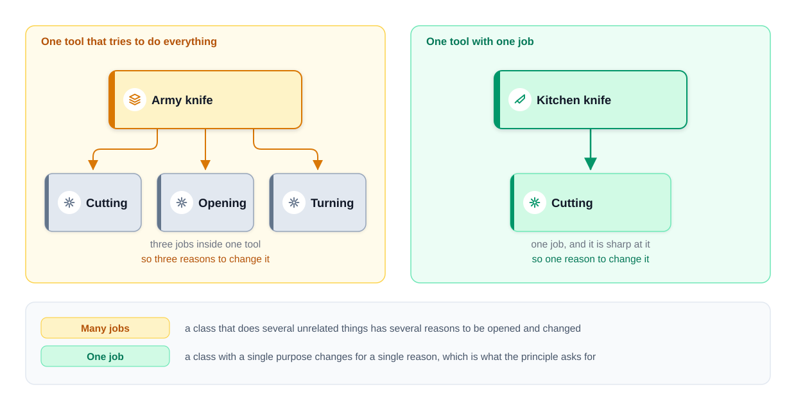
*Figure — an army knife with three jobs (three reasons to change) next to a knife with one job (course diagram)*

The army knife is the SRP-breaking class: three jobs, three reasons to change. "One job" is applied at every size — a **method** performs one action, a **class** serves one purpose, a **module** covers one area — but be precise: Martin's SRP is about **classes and modules** and their reasons to change; "a function should do one thing" is a separate (good) rule from *Clean Code*. Both push the same way; only the first is SRP.

### The problem it solves

When one class serves several groups, every edit for one ships inside code the others rely on — a payroll tweak can break an operations report — and unrelated logic is mixed, so finding the right place is slow. One responsibility per class means you know which class to open.

### What counts as one responsibility?

"Do one thing" has no size: is checking the email part of "register a user", or its own job? The **actor** view gives a yardstick: a reason to change comes from someone, so ask **who can send me a change request for this code?** Two groups → two responsibilities, however small the class.

`Employee`: every method is "about employees", so the "one thing" test passes. Now ask who can demand a change:

| Method | Who asks for the change | Example request |
|---|---|---|
| `calculatePay` | Finance | "Overtime starts after 38 hours, not 40." |
| `reportHours` | Operations | "Show the week-ending date in the report." |
| `save` | Database team | "Move from SQL (table database) to a document store (stores JSON-like documents)." |

Three owners, three independent reasons. A finance overtime change re-ships the report and storage code; if it breaks the report layout, operations pays for a decision it had no part in.


*Figure — finance, operations and the database team all reach into one Employee class; splitting by actor gives each group its own class (course diagram)*

Martin's sharper version (*Clean Architecture*): `calculatePay` and `reportHours` share a private helper `regularHours()` because the calculations match today. Finance changes it; the operations report silently shows wrong numbers. It looked like good reuse, but the two uses belonged to different actors — **accidental duplication**: code that looks the same but changes for different reasons should not be merged.

### How it works

1. List the methods. 2. Name **who** would ask each to change. 3. Group methods by actor. 4. Move each group into its own class named after its job. 5. Keep plain data in a simple data class (a Java `record`: a compact class holding a fixed set of fields). 6. Verify with the three checks below.

### Java example: splitting `Employee` by actor

```java
// File: code/lld/ch04/srp/before/Employee.java — VIOLATION: three actors share one class
public class Employee {
    private final String name;
    private final int hoursWorked;
    private final BigDecimal hourlyRate; // money: BigDecimal, never double

    // Actor 1: Finance -- "overtime should start after 38 hours, not 40"
    public BigDecimal calculatePay() {
        int overtime = Math.max(0, hoursWorked - 40);
        int normal = hoursWorked - overtime;
        BigDecimal normalPay = hourlyRate.multiply(BigDecimal.valueOf(normal));
        BigDecimal overtimePay = hourlyRate.multiply(new BigDecimal("1.5"))
                .multiply(BigDecimal.valueOf(overtime));
        return normalPay.add(overtimePay).setScale(2, RoundingMode.HALF_EVEN);
    }
    // Actor 2: Operations -- "show the week-ending date in the report"
    public String reportHours() { return name + " worked " + hoursWorked + " hours"; }
    // Actor 3: Database team -- "move from SQL to a document store"
    public void save() { System.out.println("INSERT INTO employees VALUES ('" + name + "')"); }
}

// File: code/lld/ch04/srp/after/ — data in a record, one class per actor
public record Employee(String name, int hoursWorked, BigDecimal hourlyRate) { }

public class PayCalculator {                                 // only Finance
    private static final int OVERTIME_THRESHOLD = 40;
    private static final BigDecimal OVERTIME_MULTIPLIER = new BigDecimal("1.5");
    public BigDecimal calculatePay(Employee e) { /* same formula, using the named constants */ }
}
public class HoursReport {                                   // only Operations
    public String format(Employee e) { return e.name() + " worked " + e.hoursWorked() + " hours"; }
}
public class EmployeeRepository {                            // only the database team
    public void save(Employee e) { System.out.println("INSERT INTO employees VALUES ('" + e.name() + "')"); }
}

// File: code/lld/ch04/srp/Main.java — runs both versions for Ada, 45 hours at 20.00, printing pay, report, save
```

Output:

```text
--- Before: one class, three actors ---
Pay: 950.00
Ada worked 45 hours
INSERT INTO employees VALUES ('Ada')
--- After: split by actor ---
Pay: 950.00
Ada worked 45 hours
INSERT INTO employees VALUES ('Ada')
```

- `Employee` is a `record` — an immutable (unchangeable after creation) data carrier; no rule lives there, so no actor edits it for a rule change.
- `PayCalculator` belongs to finance; threshold and multiplier are named constants, so the next finance request is a one-line change in one class. `HoursReport` → operations; `EmployeeRepository` → database team.
- Output is **identical** before and after: behaviour did not change, only who must be consulted before an edit.

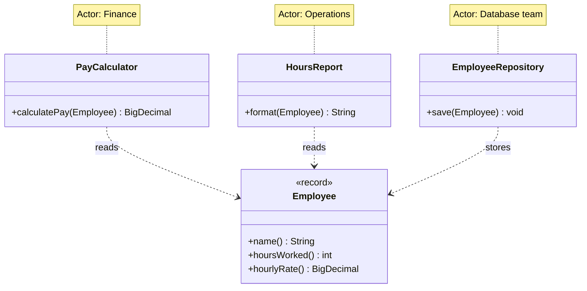

### Where splitting goes wrong

Badly applied SRP is **worse** than none: a big class chopped by verb (one class per method or step) without asking who owns what gives tiny classes that must always be edited together, spreading each change over half a dozen files. Three checks:

1. **Do the pieces change together?** Read the version-control log (history kept by a tool such as Git; each **commit** is one saved change): classes in nearly every commit together were one responsibility cut in two.
2. **Does each new class's name stand on its own?** `EmployeePayCalculator` describes a job; `EmployeeHelper`/`EmployeeUtils` describe nothing.
3. **Could it be used elsewhere?** A pay calculator could serve a payroll export, a contractor quote, or a unit test (a small automated test of one class alone); no imaginable second caller → question the split.

**Splitting does not automatically reduce dependencies**: the two classes still call each other, and if the extracted one was shaped around its origin's exact needs, changes drag both along. The split is step one; step two is what each may know about the other — **cohesion** (4.3) and **coupling** (4.4). SRP usually helps both but promises neither.

### Why SRP is important

Simpler maintenance (one job: easy to understand, debug, change); reuse; scales with the codebase (features add classes instead of bloating old ones); **high cohesion**; and it **opens the door to low coupling without finishing the job** — separation gives a seam (a boundary where one side can be swapped without editing the other), but coupling drops only when the dependency across it points at an abstraction (4.4).

### Trade-offs

| You gain | You pay |
|---|---|
| A change requested by one group touches only that group's code | More classes and files to navigate |
| Smaller classes are easier to test in isolation | The caller now wires several objects together |
| Clear ownership (who reviews what) | Risk of over-splitting into classes that always change together |

**When not:** when you cannot name two different actors (then you do not know where the seam is); short-lived code like a one-off script; pieces that always change together anyway.

### Common mistakes

- **Splitting by counting methods or verbs** instead of by actor; **Helper/Utils classes** that exist only because something had to move somewhere.
- **Merging "duplicate" code belonging to different actors** (the `regularHours()` trap).
- **"SRP means one method"** — ten methods can be one responsibility; **confusing SRP with "a function should do one thing"** (*Clean Code*; SRP is about reasons to change).

### Code smells that point to SRP (from *Refactoring*)

A **code smell** is a surface sign of a probable design problem; *Refactoring* is Martin Fowler's book naming common smells and step-by-step fixes (refactorings).

- **Divergent Change** — one class edited for many kinds of reasons: SRP broken.
- **Large Class** — too many fields and methods, often several jobs.
- **Shotgun Surgery** — one change forces small edits in many classes: often **over-splitting**, the opposite mistake.
- Usual fix: **Extract Class** (and **Move Function**/**Move Field**).

### Real-world examples

- **Spring layers** (Spring: a popular Java framework): `@Controller` handles HTTP (the web's request/response protocol, see [System Design Fundamentals](../../../system-design-patterns/modules/00-system-design-fundamentals/README.md)), `@Service` business rules, `@Repository` persistence (saving data permanently, usually in a database) — each answering a different kind of change.
- **JDK:** `java.time.format.DateTimeFormatter` formats/parses; `LocalDate` holds the date — formatting changes never touch the value type.
- **Logging frameworks** (Logback, Log4j 2) split *logger* (what), *appender* (where) and *layout* (how it looks): a new format does not touch destination code.

### In the interview

**30-second answer:** "SRP says a class should have one reason to change. The sharp version is: one actor, one group of people who can request changes. I find the actors by asking who would ask for each method to change. If finance, operations and the DBAs (database administrators) can all ask for edits to `Employee`, I split it into `PayCalculator`, `HoursReport` and `EmployeeRepository`, and keep `Employee` as data. The cost is more classes and some wiring, so I only split when I can name the different groups."

- *"Would you always split?"* — No. If the halves always change together, I've made two files for nothing; I split when two different people can ask for two different changes.
- *"How do you know you split too far?"* — The pieces share commits, their names only make sense together (`XHelper`), and nothing else could use them.
- *"Is SRP about methods?"* — It applies to methods, classes and modules, but the test is reasons to change, not method count.

### Self-check

1. **Q:** An "actor" in SRP? **A:** A person or group who can request a change, e.g. finance or the database team.
2. **Q:** A `ReportService` formats a report and emails it — SRP problem? **A:** Yes, if different people own wording and delivery: they change for different reasons.
3. **Q:** The three checks for a good split? **A:** Change together? Names stand alone? Usable elsewhere?
4. **Q:** Does splitting always lower coupling? **A:** No. If the new class names a concrete collaborator the dependency just moved; point it at an abstraction.

### TL;DR

One class, one actor. Find the actors, split along them, keep data in a record, check the split, and do not split what always changes together.

---

## 4.3 Cohesion

### What it is

**Cohesion** is how closely the contents of one class (module, method) belong together. **High**: every method works toward one purpose. **Low**: unrelated jobs bundled together. Analogy: a **garbage dump** (plastic, paper, food in one pile) vs **sorted bins**, one job each.


*Figure — one mixed bin (low cohesion) next to one bin per material (high cohesion) (course diagram)*

### The problem it solves

In a low-cohesion class, changing one job means opening, reading and redeploying (releasing to production again) a class owning others. It also works in reverse: code for **one** job **scattered** over classes (`addUser` here, `deleteUser` there) must be hunted down for each change. Both are cohesion problems — mixing unrelated things, or separating related ones.

### The classic types of cohesion

Structured-design authors (Larry Constantine, Ed Yourdon, Glenford Myers, 1970s) ranked cohesion worst to best:

| Type (worst → best) | What groups the code | Java-flavoured example |
|---|---|---|
| **Coincidental** | Nothing, it just ended up together | `Utils` with `formatDate`, `sendEmail`, `parseCsv` |
| **Logical** | Same category, chosen by a flag | `handle(type)` with a big `switch` over unrelated actions |
| **Temporal** | Things that run at the same time | `startup()` that opens the DB, warms caches (fills fast temporary copies of data) and prints a banner |
| **Procedural** | Steps that follow an order | A method that validates, then logs, then retries |
| **Communicational** | Work on the same data | `ReportBuilder` methods that all read the same `Order` list |
| **Sequential** | Output of one step is input to the next | `parse → validate → transform` pipeline in one class |
| **Functional** (best) | Everything contributes to one well-defined task | `PayCalculator` |

No need to memorise: aim for **functional**, recognise **coincidental** (the "Utils" class) as a warning.

### How it works

Check which fields each method uses; if methods fall into groups using **different** fields for **different** purposes, cohesion is low — move each group to its own class. If one job is scattered over classes, gather it into one.

### Java example

```java
// File: code/lld/ch04/cohesion/before/UserManager.java — LOW cohesion: two disjoint groups
public class UserManager {
    private final List<String> users = new ArrayList<>();       // used by addUser/deleteUser
    private final List<String> auditLines = new ArrayList<>();  // used by writeToFile/readFromFile
    public void addUser(String user)    { users.add(user);    System.out.println("user added: " + user); }
    public void deleteUser(String user) { users.remove(user); System.out.println("user deleted: " + user); }
    // --- file work, unrelated to the two methods above ---
    public void writeToFile(String line) {
        auditLines.add(line);
        System.out.println("wrote a line to the audit file: " + line);
    }
    public List<String> readFromFile() {
        System.out.println("read " + auditLines.size() + " line(s) back from the audit file");
        return List.copyOf(auditLines);
    }
}

// File: code/lld/ch04/cohesion/after/ — HIGH cohesion: the same methods split into
//   UserManager (users; addUser, deleteUser) and AuditFile (lines; writeLine, readAll), same messages.
// Main runs: add "ada", write "created ada", delete "ada", read back — once per version.
```

Output:

```text
--- Before: one class, two unrelated jobs ---
user added: ada
wrote a line to the audit file: created ada
user deleted: ada
read 1 line(s) back from the audit file
--- After: two classes, one job each ---
user added: ada
wrote a line to the audit file: created ada
user deleted: ada
read 1 line(s) back from the audit file
```

Identical output; the difference is structural — a new audit-log format edits `AuditFile` alone. **Cost:** the caller creates and holds two objects, worth it once the jobs change for different reasons.

**Cohesion and SRP:** low cohesion usually means several unrelated jobs (breaks SRP); high cohesion means one job (what SRP asks), so aiming for it tends to give SRP for free.

### Trade-offs

| High cohesion gains | Costs |
|---|---|
| Easy to name, read and test each class | More classes to wire |
| A change lands in one class | Callers may hold several objects |

**When not:** do not split a functionally cohesive class just to make it smaller; five tiny classes can be harder to follow than one clear one.

### Common mistakes

- Calling every mixed class a "coupling problem": one class mixing jobs is a **cohesion** problem; coupling needs two classes.
- A `Utils` dumping ground (coincidental cohesion).

**Real-world:** `java.lang.Math` — static math functions, functional cohesion around "numeric calculations"; `java.util.Collections` is looser (sorting, searching, wrapping, synchronising) — still "operations on collections", but showing how a utility class drifts toward logical cohesion.

### In the interview

**30-second answer:** "Cohesion is how much the things inside one class belong together. I check which fields each method uses. If the methods split into two groups that touch different fields for different reasons, the class has low cohesion and I split it. High cohesion is basically SRP seen from inside the class."

- *"Is a big class always low-cohesion?"* — No; if every method serves one task it is cohesive even if large. Size is a hint, not the measure.

### Self-check

1. **Q:** Worst kind of cohesion? **A:** Coincidental: grouped for no reason, like `Utils`.
2. **Q:** "The code for one job is spread over three classes" — cohesion problem? **A:** Yes; related code should live together.

### TL;DR

Cohesion = do the parts of this class belong together? One purpose per class; split disjoint groups; gather scattered pieces.

---

## 4.4 Coupling

### What it is

**Coupling** is how much one class depends on another. It describes a pair: a lone class cannot be "tightly coupled" (nothing else to depend on).

- **Low (loose)**: change, replace or test one class without changing the other.
- **High (tight)**: a change to one forces a change to the other.

**Analogy: TV and remote.** A remote for one specific TV, and a TV accepting only that remote, are tightly coupled — replace one, replace both. A universal remote and a TV accepting any remote follow a shared standard (the infrared signal) and swap independently.

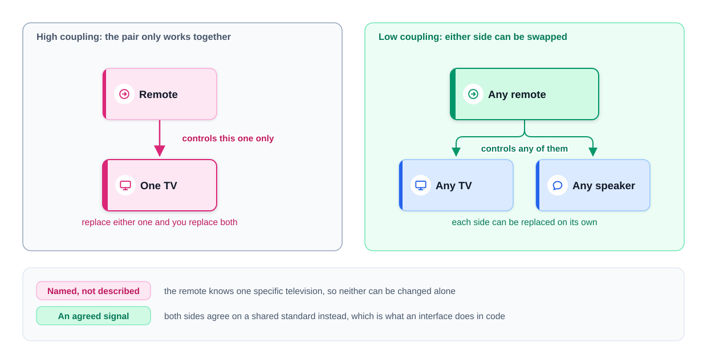
*Figure — a remote tied to one TV (high coupling) vs any remote working with any device through an agreed signal (low coupling) (course diagram)*

The "agreed signal" is exactly what an **interface** does: both sides agree on a contract instead of knowing each other.

### The problem it solves

With tight coupling you cannot swap an implementation (MySQL → Postgres, two popular SQL databases) without editing the caller; cannot unit-test the caller without the real dependency (a running database); and a change in how the dependency is **constructed** ripples into every class that builds it.

### The classic types of coupling

From structured design, worst to best:

| Type (worst → best) | What A knows about B | Java-flavoured example |
|---|---|---|
| **Content** | A reaches into B's internals | Reflection (Java's ability to inspect and change classes while running) that sets B's private field |
| **Common** | A and B share global mutable data | Both read/write a `public static Map` |
| **External** | Both depend on an external format or device | Both parse the same hand-rolled file format |
| **Control** | A passes a flag telling B *how* to work | `print(doc, boolean asPdf)` |
| **Stamp** | A passes a whole structure when B needs one field | `sendInvoice(Customer c)` that only reads `c.email()` |
| **Data** | A passes only the values B needs | `sendInvoice(String email, Money total)` |
| **Message** (lowest) | A sends a message through an interface | `notifier.send(message)` on an interface |

Practical OO goal: **depend on interfaces, pass only what is needed, never share mutable globals.**

### How it works

1. Find where A **names** B (a field type, `new B()`, a static call `B.x()`).
2. Ask: does A need *this particular* B, or *something that does the job*?
3. If the latter, describe the job as an interface; let A accept any implementation, usually through its constructor.
4. Let the caller (or the entry point, the `main` method where the program starts) choose the implementation.

### Java example: three steps with `Student`

```java
// File: code/lld/ch04/coupling/start/Student.java — ONE class, two jobs: a COHESION problem (nothing to couple to yet)
public void save() {                                  // Student holds the data AND knows how to store it
    System.out.println("Connecting to MySQL...");
    System.out.println("Saving student with ID: " + studentId);
}

// File: code/lld/ch04/coupling/extracted/Student.java — Step 1: cohesion fixed, but TIGHT coupling
private final MySqlDatabase database = new MySqlDatabase(); // hard-wired; MySqlDatabase.saveStudent prints the same lines
public void save() { database.saveStudent(studentId); }

// File: code/lld/ch04/coupling/decoupled/ — Step 2: depend on an interface -> LOOSE coupling
public interface StudentRepository { void save(String studentId); }   // what Student needs, as a contract
// MySqlStudentRepository.save prints "Saving student <id> to MySQL";
// InMemoryStudentRepository keeps ids in a list, prints "Keeping student <id> in memory for a test", saved() returns them
public class Student {
    private final String studentId;
    private final StudentRepository repository;
    public Student(String studentId, StudentRepository repository) {
        this.studentId = studentId;
        this.repository = Objects.requireNonNull(repository);
    }
    public void save() { repository.save(studentId); }
}

// File: code/lld/ch04/coupling/Main.java (step 2 part)
new Student("S-1024", new MySqlStudentRepository()).save();
var fake = new InMemoryStudentRepository();
new Student("S-2048", fake).save();
System.out.println("test double recorded: " + fake.saved());
```

Output:

```text
--- Start: one class holds data and SQL ---
Connecting to MySQL...
Saving student with ID: S-1024
--- Step 1: extracted, but tightly coupled to MySqlDatabase ---
Connecting to MySQL...
Saving student with ID: S-1024
--- Step 2: depends on the StudentRepository interface ---
Saving student S-1024 to MySQL
Keeping student S-2048 in memory for a test
test double recorded: [S-2048]
```

After step 1, three costs: storing anywhere else edits `Student`; every test needs a live MySQL server; if `MySqlDatabase` gains constructor arguments, `Student` changes too. The extraction moved the code but `Student` **depends** on it as much as before.


*Figure — the three steps: one class with two jobs, an extracted but tightly coupled class, and a class that depends on an interface (course diagram)*

In the last panel `Student` names only `StudentRepository`, a one-method contract, and the concrete repositories point *toward* it: Postgres is a new repository class handed in by the caller, and a unit test hands in the in-memory one. This is **depend on abstractions, not concrete classes** — the D in SOLID (4.10), the standard cure for tight coupling.

**Coupling and SRP:** separating the jobs (SRP) fixed cohesion but left `Student` welded to `MySqlDatabase`; aiming the dependency at an interface fixed coupling, a step SRP alone never requires. So SRP *usually* reduces coupling (a single-job class needs fewer collaborators) without *guaranteeing* it — inspect dependencies after each split.

### Trade-offs

| Loose coupling gains | Costs |
|---|---|
| Swap implementations without editing callers | An extra interface and a constructor parameter |
| Unit tests with in-memory fakes (stand-ins keeping data in a list instead of a database) | Someone must do the wiring (the entry point or a framework) |
| Changes stop rippling | "Go to definition" lands on an interface, one more hop to the real code |

**When not:** no interface in front of a **stable** class that never varies or needs faking (`String`, `LocalDate`, a pure calculation) — coupling to stable things is harmless; one implementation and no test double (fake stand-in used in tests) is usually just an extra file.

### Common mistakes

- "I extracted a class, so coupling is lower" — only depending on an abstraction lowers it.
- `new ConcreteThing()` hidden in a constructor — still hard-wired.
- Passing whole objects when one field is needed (stamp coupling).

**Real-world:** **JDBC** (Java Database Connectivity): code uses the interfaces `java.sql.Connection`, `Statement`, `ResultSet`; the MySQL or Postgres driver (library speaking one database's protocol) implements them. **SLF4J** (a logging facade — one front for several libraries): code uses `org.slf4j.Logger`; Logback or Log4j is plugged in at deployment (when installed and started). **USB, HTTP, SQL** are themselves "agreed signals".

### In the interview

**30-second answer:** "Coupling is how much one class depends on another. I check where a class names a concrete collaborator. If it only needs something that does the job, I describe the job as an interface and pass the implementation in. That lets me swap MySQL for Postgres and test with an in-memory fake. I do not add interfaces in front of stable things like `String`."

- *"Can SRP increase coupling?"* — Yes: extract a class built around the old class's exact needs and the two are tightly bound. Check dependencies after every split.

### Self-check

1. **Q:** Can a single class be "tightly coupled"? **A:** Not to anything inside itself; coupling is between two things. One class with two jobs has a cohesion problem.
2. **Q:** `Student` does `new MySqlDatabase()` in its constructor — tight or loose? **A:** Tight: it names and creates a concrete class.
3. **Q:** "Control coupling"? **A:** Passing a flag telling the other code how to behave, e.g. `print(doc, asPdf)`.

### TL;DR

Coupling = how much A must know about B. Loosen it by depending on an interface and passing the implementation in. Extracting a class alone is not enough.

---

## 4.5 Separation of Concerns (SoC)

### What it is

**Separation of Concerns**: split a program into parts that each handle one **concern** — one area of the work (storing data; deciding whether an email is acceptable; drawing the screen). Term from Edsger Dijkstra (1974). Analogy: in a restaurant the kitchen cooks, waiters serve, the cashier takes payment; a new menu does not change payment.

### The problem it solves

Mixed concerns force you to read and edit code about other concerns for each change; separated, each change lands in one module. Benefits: **modularity** (each part one area), **maintainability** (changes rarely affect others), **reusability** (well-defined modules reused), **testability** (test one concern with the others replaced by stand-ins).

### How it works

1. List the feature's concerns (registration: storage, business rules). 2. Give each its own module. 3. Let modules talk only through small, clear methods. 4. Test it: for each likely requirement change, **count the modules you would edit** — ideally one.

### Java example: user registration

**Storage** keeps users and never judges validity; **business rules** decide what is acceptable and ask storage to save, without knowing how it works.

```java
// File: code/lld/ch04/soc/UserStore.java — storage concern only
public record User(String username, String email) { }
private final List<User> users = new ArrayList<>();
public void addUser(String username, String email) {
    users.add(new User(username, email));
    System.out.println("Stored user: " + username);
}
// count() returns users.size()

// File: code/lld/ch04/soc/UserService.java — business-rules concern only
boolean isValidUsername(String username) { return username.length() >= 3; }
boolean isValidEmail(String email) { return email.contains("@") && email.contains("."); }
public boolean registerUser(String username, String email) {
    if (!isValidUsername(username)) { System.out.println("Rejected: " + username + " is too short"); return false; }
    if (!isValidEmail(email)) { System.out.println("Rejected: " + email + " is not an email address"); return false; }
    store.addUser(username, email);
    return true;
}

// File: code/lld/ch04/soc/Main.java
UserStore store = new UserStore();
UserService service = new UserService(store);
service.registerUser("ada", "ada@example.com");
service.registerUser("jo", "jo@example.com");
service.registerUser("grace", "grace-at-example");
System.out.println("Users in store: " + store.count());
```

Output:

```text
Stored user: ada
Rejected: jo is too short
Rejected: grace-at-example is not an email address
Users in store: 1
```

Every accept/reject decision was `UserService`'s, which never touched the list; `UserStore` kept whatever it was handed.


*Figure — UserService decides what is acceptable and asks UserStore to save it; each change lands in one module (course diagram)*

| Change | Module you open |
|---|---|
| Move from an in-memory list to a real database | `UserStore` only |
| Require usernames of at least eight characters | `UserService` only |
| Test the rules without a database | Pass `UserService` a stand-in store |

(In a bigger system `UserStore` would also sit behind an interface — the 4.4 coupling fix.)

**SoC and SRP:** the same instinct at different scales — SRP for a class, SoC for modules, layers and subsystems; single-responsibility classes are one route to separated concerns.

### Trade-offs

| Gains | Costs |
|---|---|
| Changes stay local | More modules and boundaries to design |
| Each concern tested alone | Cross-cutting concerns (logging, security, transactions — groups of database changes that succeed or fail together) still touch many modules; they need special tools such as aspects (code woven automatically around many methods) or decorators (wrappers that add behaviour) |

**When not:** a 50-line script needs no layers; separate concerns when they change for different reasons or at different speeds.

### Common mistakes

- Validation quietly inside the storage class ("the DAO also checks the email"; a DAO, Data Access Object, reads and writes one kind of data in the database).
- Layers that exist on paper but call each other in every direction.

**Real-world:** **MVC** (Model–View–Controller: model = data and rules, view = display, controller = input), followed by Spring MVC and most web frameworks; **HTML / CSS / JavaScript** — structure, style, behaviour in three languages; **layered architecture** controller → service → repository; **Spring `@Transactional`** separates transaction handling (cross-cutting) from business code via a proxy (a stand-in wrapping the real object, adding behaviour before and after each call).

### In the interview

**30-second answer:** "Separation of concerns means each module handles one area of the work, like storage vs business rules. My test is: when a requirement changes, how many modules do I open? Ideally one. It is SRP at module size."

### Self-check

1. **Q:** A "concern"? **A:** One area of the work: storage, validation, presentation.
2. **Q:** SoC vs SRP? **A:** Mostly size: SRP a class, SoC modules and layers.

### TL;DR

One module per area of work; measure it by how many modules a change forces you to open.

---

## 4.6 SRP vs cohesion vs coupling vs SoC — one table

| Idea | Question it asks | Scope | How it relates to SRP |
|---|---|---|---|
| **SRP** | How many actors can ask this class to change? | Class / module | — |
| **Cohesion** | Do the parts of this class belong together? | Inside one unit | Applying SRP usually raises cohesion, because one job means related parts. |
| **Coupling** | How much does A depend on B? | Between two units | SRP tends to lower coupling but does not guarantee it; you still need to depend on abstractions. |
| **SoC** | Is each area of work in its own module? | Modules, layers | SRP applied to every class is one way to achieve SoC. |

The textbook goal, **"high cohesion, low coupling"**: SRP gets the first half; depending on abstractions (DIP) the second.

---
## 4.7 Open/Closed Principle (OCP)

### What it is

**Software entities (classes, modules, functions) should be open for extension but closed for modification**: add new behaviour **by adding code**, without editing working code.

- **Closed for modification**: once written and tested, a class need not be opened for the next variation — every edit risks breaking it.
- **Open for extension**: new behaviour arrives as new parts, via **interfaces**, **polymorphism** (one call, many implementations) or **inheritance**.

**Origins.** Bertrand Meyer, 1988 (*Object-Oriented Software Construction*): in **Meyer's OCP** a class is *closed* once compiled, published and used (changed only for bug fixes) and *open* because a new class can **inherit** from it and add or redefine features — extension by implementation inheritance. Robert C. Martin's 1996 article gave the **polymorphic OCP**: stable code depends on an **abstract interface**; new behaviour arrives as swappable implementations. The polymorphic version is what people usually mean today and what this chapter uses.

**Analogy: a game console.** You add a racing wheel, motion controller, VR headset; nobody rewires the console. It is **closed** (internals sealed) and **open** (a standard port for accessories).

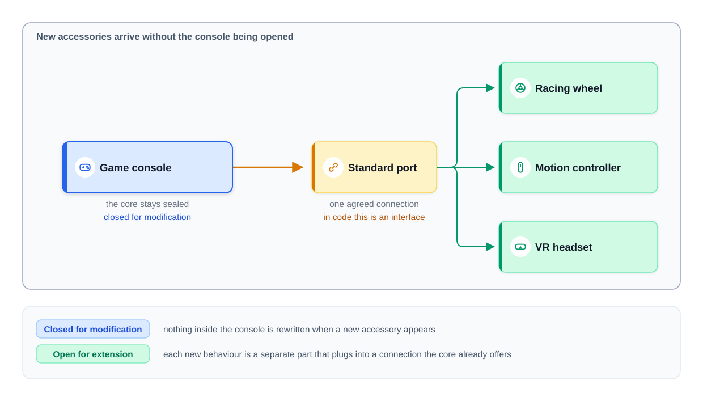
*Figure — new accessories plug into a standard port; the console itself is never opened (course diagram)*

The **standard port** is the interface; accessories are classes implementing it.

### The problem it solves

The textbook symptom is a growing `if/else` or `switch` on a type code: each new case edits a tested method and can break the others, and the same `switch` often appears in several places, one copy missed. **Quick test:** *can I add the next case without opening this file?* If not, the class is not closed against that kind of change.

### How it works

1. Wait until the variation has happened (at least a second case). 2. Identify **the part that varies** (the invoice format). 3. Describe it as an interface. 4. Move each variant into its own implementing class. 5. Make the stable class **delegate** (hand the work over) instead of branching. 6. Add the next variant as a new class; nothing existing opened. 7. Choose the variant in one place at the program's edge (entry point, a factory — a method or class whose job is creating objects — a map, or configuration).

### Java example: invoice formats

**Before.** With one format there was nothing to fix (OCP matters only for code receiving variations). Then sales wants **international invoices**, and the quick route is a type parameter and a branch:

```java
// File: code/lld/ch04/ocp/before/Invoice.java — VIOLATION: every new type opens this tested method
public void generate(String invoiceType) {
    if (invoiceType.equals("basic")) {
        System.out.println("Generating basic invoice for amount: " + amount);
    } else if (invoiceType.equals("international")) {
        System.out.println("Generating international invoice for amount: " + amount);
    } else {
        throw new IllegalArgumentException("Unknown invoice type: " + invoiceType);
    }
}
public void applyDiscount() { System.out.println("Applying discount on invoice: " + amount); }
```

Doing two jobs would be an SRP complaint; the OCP complaint is that **each new type edits code that already works**.

**After.** (1) The varying part becomes an interface; (2) each format gets a class — named *generators*, since they *produce* invoices (`BasicInvoice` would falsely suggest a subtype); (3) `Invoice` delegates; (4) a third format costs one class plus one line where formats are chosen.

```java
// File: code/lld/ch04/ocp/after/InvoiceGenerator.java — Step 1
@FunctionalInterface
public interface InvoiceGenerator { void generate(BigDecimal amount); }

// Step 2: BasicInvoiceGenerator prints "Generating basic invoice for amount: " + amount;
// InternationalInvoiceGenerator prints the international line + "  including customs declaration and currency conversion"
// File: code/lld/ch04/ocp/after/DetailedInvoiceGenerator.java — Step 4: the ONLY new code for a third format
public class DetailedInvoiceGenerator implements InvoiceGenerator {
    @Override public void generate(BigDecimal amount) {
        System.out.println("Generating detailed invoice for amount: " + amount);
        System.out.println("  line items, tax breakdown and payment terms");
    }
}

// File: code/lld/ch04/ocp/after/Invoice.java — Step 3: delegates; knows nothing of how many formats exist
public class Invoice {
    private final BigDecimal amount;
    private final InvoiceGenerator generator;              // both requireNonNull in the constructor
    public void generate() { generator.generate(amount); } // no branching
    // Still closed? No -- a new discount rule would still edit this class.
    // That is fine until discounts actually start to vary.
    public void applyDiscount() { System.out.println("Applying discount on invoice: " + amount); }
}

// File: code/lld/ch04/ocp/Main.java — amount 120.00; old.generate("basic"/"international") first, then:
List<InvoiceGenerator> generators = List.of(
        new BasicInvoiceGenerator(),
        new InternationalInvoiceGenerator(),
        new DetailedInvoiceGenerator(),
        // A lambda is also an extension: no new file, no edited file.
        a -> System.out.println("Generating pro-forma invoice for amount: " + a));
for (InvoiceGenerator g : generators) new Invoice(amount, g).generate();
```

Output:

```text
--- Before: branch per type ---
Generating basic invoice for amount: 120.00
Generating international invoice for amount: 120.00
--- After: one class per format ---
Generating basic invoice for amount: 120.00
Generating international invoice for amount: 120.00
  including customs declaration and currency conversion
Generating detailed invoice for amount: 120.00
  line items, tax breakdown and payment terms
Generating pro-forma invoice for amount: 120.00
```

`Invoice` has **no branch**; format three touched no existing class; and since `InvoiceGenerator` is a `@FunctionalInterface` (exactly one abstract method), a **lambda** (a short inline unnamed function, `a -> ...`) is also an extension — OCP with zero new files.

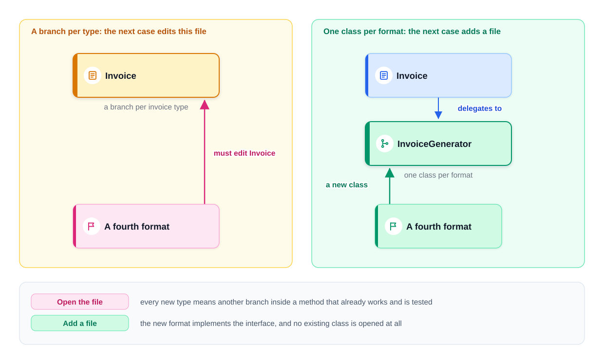
*Figure — a branch per type forces an edit to Invoice; one class per format lets a new format be added as a file (course diagram)*

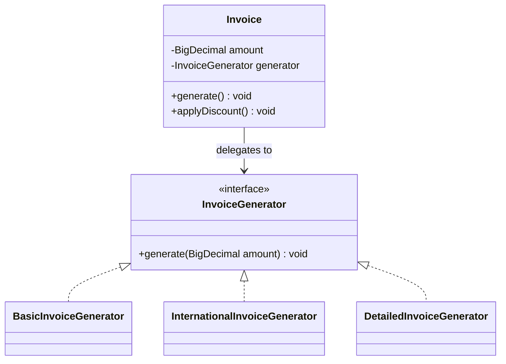

This shape — a context object holding an interface-typed field with interchangeable implementations — is the **Strategy pattern** (a named reusable design; Chapters 8–11): OCP applied to an algorithm that varies.

### Why not just subclass `Invoice`?

`class InternationalInvoice extends Invoice` overriding `generate()` is also OCP-compliant (Meyer's original style) and fine in a small program. Delegation wins as the system grows:

- **A second dimension of change.** Format **and** currency: subclassing needs a class per pairing (3 formats × 4 currencies = 12); delegation combines two independent objects (3 + 4 = 7).
- **Deciding at run time.** An object's class is fixed at `new`; a generator can be picked once the customer's country is known, even replaced later.

(*Head First Design Patterns* calls this "favour composition over inheritance".)

### What is still not closed

Only *generation* was opened up; a new discount kind still edits `Invoice`, and that is fine. **"Closed" is never absolute: a class is closed against a specific kind of change**, normally one already seen. Martin calls this **strategic closure**: no program can be closed against every change, so the designer chooses which, guided by experience.

### Approaches to OCP

| Approach | How it extends | Pattern / Java feature | Good when |
|---|---|---|---|
| **Interface + delegation** | New class implements the interface | Strategy, `Comparator` | The algorithm varies, choose at run time |
| **Inheritance + overriding** | Subclass overrides a hook method (an overridable step the parent calls) | Template Method, abstract classes | Fixed skeleton, a few steps vary |
| **Wrapping** | New class wraps the old and adds behaviour | Decorator (`BufferedInputStream`) | Add features around existing behaviour |
| **Listening** | New subscriber registers | Observer, event listeners | New reactions to existing events |
| **Plug-ins / registry** | New implementation registers itself in a map or via `ServiceLoader` (Java's built-in way to discover implementations at start-up) | Plug-in architecture | Third parties add features |
| **Functions** | Pass a lambda | `java.util.function`, `@FunctionalInterface` | Small, one-method variations |
| **Data / configuration** | New entry in a table or config file | Rules engines, feature flags (on/off switches kept in configuration) | Variations that are just different numbers |

The `switch` does not always vanish: it moves to **one** place at the edge — a factory or a `Map<String, InvoiceGenerator>` — instead of repeating in business logic.

**Why it matters:** **extensibility** (features without touching the tested core); **faster testing** (test the new class; core tests stay valid); **fewer regressions** (old features breaking after a change); **adaptability** (new requirements without rewrites).

### Caution: do not over-engineer

- **Start simple:** write the `if` first; introduce the interface when the second or third case actually arrives (the "rule of three").
- **Balance:** too many abstraction layers make code harder to read, defeating the purpose.
- **Real needs only:** extension points for futures that never come are waste — *Refactoring*'s **Speculative Generality** smell.

**OCP and SRP** reinforce each other: OCP pulls changing parts away from the stable core, each into a single-job class (SRP). In practice SRP comes first — the extension point stays hidden until the class is down to one job.

### Trade-offs

| You gain | You pay |
|---|---|
| New variants without editing old code | An interface plus one class per variant |
| Each variant tested on its own | Behaviour is spread over files; reading the whole flow takes more hops |
| Variants selectable at run time | Someone must choose the variant (factory, map, DI, i.e. dependency injection, Section 4.10) |

**When not:** nothing has varied yet; the "variants" are just different numbers (use data); the set of cases is fixed, small and will not grow (the two values of a boolean). For a fixed set, Java 21's **sealed interfaces with pattern-matching `switch`** (a sealed interface lists the only types allowed to implement it, so a `switch` can check all are covered) fit well: the compiler checks every case — the opposite trade (easy to add operations, hard to add types).

### Common mistakes

- "OCP means never edit a file" — bug fixes, refactoring and changes to the extension point itself all edit.
- Plug-in systems for one implementation; a `switch` in business logic replaced by a `switch` in five factories.

**Smells and refactorings:** **Repeated Switches** (*Switch Statements* in *Refactoring*'s first edition); fixes **Replace Conditional with Polymorphism**, **Replace Type Code with Subclasses**.

**Real-world:** `list.sort(comparator)` never changes — pass a new **`Comparator`**; **Java I/O decorators** — `new BufferedInputStream(new FileInputStream(f))` adds buffering without editing `FileInputStream`; **Servlet filters / Spring `HandlerInterceptor`** (code running before and after every web request) — new cross-cutting behaviour is a filter registered in a chain; **JDBC drivers** via `ServiceLoader` — a new database is a driver JAR (zipped bundle of compiled classes), not an edit to `DriverManager`; **IDE plug-ins** (IntelliJ, VS Code) and **browser extensions** — closed core, plug-in API as the port.

### In the interview

**30-second answer:** "OCP says you should be able to add the next variation by adding code, not editing working code. When I see a `switch` over a type that keeps growing, I put the varying behaviour behind an interface, one class per variant, and the stable class delegates to it. That is Strategy. I only do it once the variation has actually appeared, and I say that a class is closed against a specific kind of change, not against everything."

- *"Does OCP mean you never edit a class?"* — No: the next variation of a known kind is an addition; bug fixes and refactoring still edit.
- *"Inheritance or delegation?"* — Both satisfy OCP; delegation handles several axes of variation and run-time choice better.
- *"Interface for pricing up front?"* — Only if pricing has varied or clearly will; otherwise leave the `if` and refactor at the second case.
- *"Trucks are charged a different rate."* — A design that answers "add a class" beats "add a branch in this switch".

### Self-check

1. **Q:** "Closed for modification"? **A:** Adding the next variation does not edit tested code.
2. **Q:** After the refactor, is `Invoice` closed against new discount rules? **A:** No, only new formats — fine until discounts vary.
3. **Q:** "OCP for an algorithm"? **A:** Strategy.
4. **Q:** Quick OCP test? **A:** "To add the next case, must I open this file?"

### TL;DR

Put the varying part behind an interface, add variants as new classes, choose them at the edge — when variation is real. Closure is always against a specific kind of change.

---

## 4.8 Liskov Substitution Principle (LSP)

### What it is

**Objects of a subtype must be usable wherever objects of the parent type are expected, without making the program incorrect.** Barbara Liskov introduced the idea in a 1987 keynote; with Jeannette Wing she defined it precisely (1994) as *behavioural subtyping*. Martin's short form: **subtypes must be substitutable for their base types.** "Substitutable" means more than "it compiles": code written against the parent must still get **correct results** with a child.

**Analogy:** a hire-car firm promises "a car that takes petrol"; hand over an electric car and the promise is broken at the petrol station, though an electric car is certainly a car.

### The problem it solves

Polymorphism works only if callers can trust the base type. If a subclass secretly behaves differently, every caller must check which one it got (`instanceof`), and the benefit of polymorphism — and of OCP — is gone.

### Example 1: `Car` and `ElectricCar`

```java
// File: code/lld/ch04/lsp/car/before/ — Car prints "Car is starting/stopping/refueling"
public class Car {
    public void start()  { System.out.println("Car is starting"); }
    public void stop()   { System.out.println("Car is stopping"); }
    /** Names a MECHANISM (liquid fuel) instead of a goal. */
    public void refuel() { System.out.println("Car is refueling"); }
}
/** VIOLATION: inherits a promise (refuel) it cannot keep. */
public class ElectricCar extends Car {
    @Override public void refuel() { throw new UnsupportedOperationException("Electric cars don't need refueling"); }
    public void recharge() { System.out.println("Electric car is recharging"); }
}
```

Code that *knows* it holds an `ElectricCar` calls `recharge()` and never notices — but `refuel()` is still on the object's public face. LSP is tested by code that does **not** know the subclass: `service(Car car)` in `Main` calls `start`, `refuel`, `stop` on any `Car`, and crashes for an electric one.


*Figure — what Car promises every caller, and the unusable refuel() that ElectricCar is left holding (course diagram)*

**Name the real mistake.** "`ElectricCar` should not extend `Car`" is half the diagnosis. The root cause: `refuel()` describes a **mechanism** (pouring in liquid fuel) only some vehicles use. A base-class method should describe the shared **goal**: every vehicle takes on energy, so `replenishEnergy()`.

**The fix: raise a general parent.** `Vehicle` declares the goal; `Car` and `ElectricCar` both extend it and **neither extends the other**:

```java
// File: code/lld/ch04/lsp/car/after/ — the base type promises the GOAL, not one mechanism
public abstract class Vehicle {
    public void start() { System.out.println(getClass().getSimpleName() + " is starting"); }
    public void stop()  { System.out.println(getClass().getSimpleName() + " is stopping"); }
    public abstract void replenishEnergy();
}
public class Car extends Vehicle {
    @Override public void replenishEnergy() { System.out.println("Car is pumping gasoline"); }
}
public class ElectricCar extends Vehicle {           // a sibling of Car, not a child
    @Override public void replenishEnergy() { System.out.println("Electric car is charging its battery"); }
}
```

- **The easy workaround is still wrong.** Keeping `refuel()` and having `ElectricCar.refuel()` secretly charge removes the exception, but the name keeps lying about half the fleet; renaming fixes the promise itself.
- **Why not just add `recharge()`?** Code typed as `Vehicle` cannot call it; callers may depend only on what the base type declares.
- **Substitution is child → parent, never between siblings.** `Car` and `ElectricCar` each replace a `Vehicle`; neither replaces the other.

**When to break a hierarchy:** a subclass **cannot implement** a parent method (throws or does nothing); a base method describes a **mechanism**, not a goal; callers **test the type** (`if (v instanceof ElectricCar)`) — the base promises too little or the wrong thing; subclasses share almost nothing, so the parent invents a relationship. Usual fixes: **raise a general parent** (above) or **move the varying behaviour out of the hierarchy** with composition (next).

### Example 2: birds, and composition instead of inheritance

`fly()` on `Bird` makes penguins inherit and reject it. The fault is `Bird`'s promise, not the penguin (*Refactoring*: a subclass not wanting what it inherits is the **Refused Bequest** smell).

- **Inheritance is is-a**: `Sparrow extends Bird` receives **every** `Bird` method, suitable or not.
- **Composition is has-a**: `Bird` holds a `MovementStyle` field and calls it, inheriting nothing from it.

Fix: make "how a bird moves" its own small type, given via the constructor — **no bird subclasses** at all.

```java
// File: code/lld/ch04/lsp/birds/inheritance/ — Bird.fly() prints getClass().getSimpleName() + " is flying";
// Sparrow extends Bird { }  Penguin overrides fly() to throw UnsupportedOperationException("Penguins can't fly")

// File: code/lld/ch04/lsp/birds/composition/
@FunctionalInterface
public interface MovementStyle { void move(String birdName); }      // the behaviour that varies
// Flying -> "<name> is flying through the air"; Swimming -> "... swimming through the water";
// Running -> "... running along the ground"
public final class Bird {                     // a bird HAS-A movement style; nothing inherited, nothing refused
    private final String name;
    private MovementStyle movement;           // requireNonNull in constructor and changeMovement
    public void eat() { System.out.println(name + " is eating"); }
    public void travel() { movement.move(name); }                               // tell, don't ask
    public void changeMovement(MovementStyle movement) { this.movement = Objects.requireNonNull(movement); }  // e.g. an injured bird
}
```

`Bird` now promises only what every bird can do (`eat()`, `travel()`), so nothing must be refused; flight is an optional object some birds get. The ostrich took one new movement style, not an `Ostrich` subclass with a meaningless `fly()`; and the style can be replaced at run time (`changeMovement`).

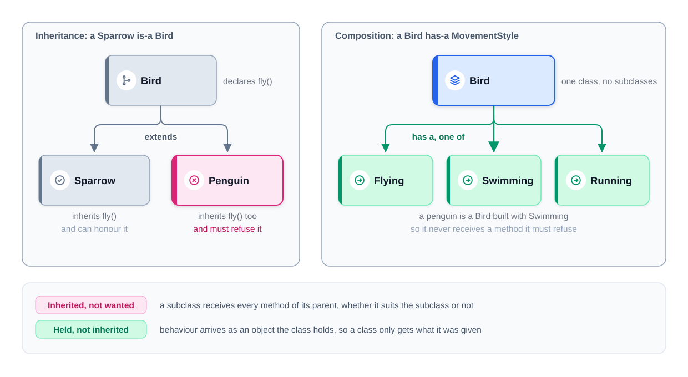
*Figure — inheritance (Penguin inherits fly() and refuses it) vs composition (a Bird has a MovementStyle) (course diagram)*

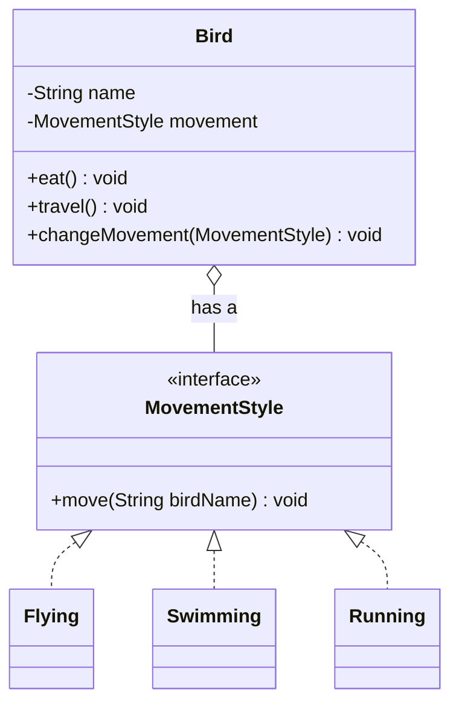

| | Inheritance | Composition |
|---|---|---|
| Kind of link | Penguin **is a** Bird | Bird **has a** MovementStyle |
| In code | `class Penguin extends Bird` | `Bird` holds a `MovementStyle` field |
| What it gets | all of the parent's methods | just the object handed to it |
| To change behaviour | add another subclass | supply another object |
| Change while running? | no, fixed at creation | yes, replace the field |
| LSP risk | high: inherited methods may not suit | low: nothing is inherited |

**When to use which:** **inheritance** when the child genuinely is a kind of the parent *and* keeps every inherited promise; **composition** when what differs is a behaviour, or the moment a subclass rejects something it inherited — an override that throws, silently does nothing, or carries a "never call this on X" comment should become a separate object.

### Tell, Don't Ask

The composition design follows a guideline popularised by Andy Hunt and Dave Thomas (*The Pragmatic Programmer*): **tell an object what to do; do not ask about its state and decide for it.**

```java
// Asking: the caller inspects the object and makes the decision.
if (bird instanceof Penguin) { swim(bird); } else { fly(bird); }

// Telling: the caller states the goal, the object decides how.
bird.travel();
```

Asking code must know every subtype, breaking OCP and hiding LSP problems behind `instanceof`; telling code works with any substitute. A caller needing `instanceof` on a base type strongly hints the base type promises the wrong thing.

### The rules a subclass must follow

Exceptions are easy to spot; the harmful violations **quietly produce a wrong result and keep running**.

**`Square extends Rectangle`.** Every square is a rectangle in geometry; to stay square, `Square` couples its sides (setting width sets height). Nothing throws, yet a method for `Rectangle` setting width 5 and height 4 expects area 20 and gets 16 — in production, a wrong bill or inventory figure nobody notices for weeks. `Rectangle` implied, never stated, that **width and height change independently**; its two setters invited callers to rely on it. A square is a rectangle mathematically but **not a valid subtype of this `Rectangle` class**. **Base inheritance on the promises written in the code, not on real-world classification.**

A subclass may do the job *differently*, but may not **require more** from callers, **give them less**, or **break an assumption they depend on**. The vocabulary is Bertrand Meyer's **Design by Contract**: **preconditions** (what the caller must provide), **postconditions** (what the method guarantees afterwards), **invariants** (what is always true of the object).

**Rule 1 — Preconditions may not be strengthened.** An override may accept *wider* input, never narrower. `Discount` accepts any amount ≥ 0; `SmallOrderDiscount` refuses ≥ 100, so a caller passing 250 (allowed by the parent) fails — and would have to discover which discount it got, the very check substitution should make unnecessary.

**Rule 2 — Postconditions may not be weakened.** An override may guarantee *more*, never less. `Account.withdraw` guarantees balance ≥ 0; `OverdraftAccount` lets it go negative — a fine banking feature, but a broken guarantee: callers relying on "balance ≥ 0" are silently wrong (a payment job keeps paying suppliers from an overdrawn account). An overdraft account can be a good class, just not a subtype of one promising a non-negative balance.

**Rule 3 — Invariants must be preserved.** An invariant holds throughout the object's life; `Square` broke "width and height are independent". (Equally a weakened postcondition — `Rectangle.setWidth` implicitly guarantees "height unchanged" and `Square.setWidth` drops it; Martin describes it that way; same conclusion.) Hardest rule, since invariants are rarely written down: a subclass inherits every promise, documented or not.

**Rule 4 — No new exceptions callers cannot handle.** Only the parent's declared exceptions (or subtypes); a new type reaches callers with no `catch`. `ElectricCar.refuel()` broke it — and compiled, because Java enforces this only for **checked** exceptions and `UnsupportedOperationException` is unchecked. Most visible, least harmful: the failure is immediate and loud.

**Rule 5 — The history constraint** (Liskov and Wing): **a subtype must not allow state changes the parent does not allow.** `Price` promises its value never changes; `AdjustablePrice` adds `adjust()` — each call looks innocent, but a caller who captured a quote of 100 is charged 120 on "the same" price. That is why immutable classes like `String` and `Integer` are `final`: a mutable subclass could break the immutability callers rely on.

```java
// File: code/lld/ch04/lsp/rules/ (essentials)
public class Discount {          // precondition: amount >= 0; postcondition: 90% of amount
    public BigDecimal apply(BigDecimal amount) {
        if (amount.signum() < 0) throw new IllegalArgumentException("amount must be >= 0");
        return amount.multiply(new BigDecimal("0.90")).setScale(2, RoundingMode.HALF_EVEN);
    }
}
public class SmallOrderDiscount extends Discount {   // RULE 1 BROKEN: demands MORE
    @Override public BigDecimal apply(BigDecimal amount) {
        if (amount.compareTo(new BigDecimal("100")) >= 0) throw new IllegalArgumentException("only for orders under 100");
        return super.apply(amount);
    }
}
public class Account {           // postcondition: balance never negative
    protected BigDecimal balance;
    public BigDecimal withdraw(BigDecimal amount) {
        if (amount.compareTo(balance) <= 0) balance = balance.subtract(amount);
        return balance;
    }
}
public class OverdraftAccount extends Account {      // RULE 2 BROKEN: promises LESS; nothing throws
    @Override public BigDecimal withdraw(BigDecimal amount) { balance = balance.subtract(amount); return balance; }
}
public class Rectangle {         // unwritten invariant: width and height set independently
    protected int width, height;
    public void setWidth(int width)   { this.width = width; }
    public void setHeight(int height) { this.height = height; }
    public int area() { return width * height; }
}
public class Square extends Rectangle {              // RULE 3 BROKEN: couples the setters, silent wrong answer
    @Override public void setWidth(int width)   { this.width = width;  this.height = width; }
    @Override public void setHeight(int height) { this.width = height; this.height = height; }
}
public class Price {             // history contract: never changes after creation (private final value)
    public BigDecimal value() { return value; }
}
public class AdjustablePrice extends Price {         // HISTORY CONSTRAINT BROKEN: adds a mutator
    private BigDecimal current;
    @Override public BigDecimal value() { return current; }
    public void adjust(BigDecimal newValue) { this.current = newValue; }
}
```

**Why it matters so much:** code written against a base type cannot protect itself — it cannot see, and should not need to see, which subclass it got. Only the subclass author can keep the contract.

**The fix for Rectangle/Square:** share no mutable promise one cannot keep. Make both **immutable** behind a common interface promising only what both can do (`area()`); "resizing" returns a new object, so no setter can break an invariant. Java 21 `record`s and a `sealed` interface:

```java
// File: code/lld/ch04/lsp/shapes/
public sealed interface Shape permits Rect, Sq { int area(); }
public record Rect(int width, int height) implements Shape {
    public Rect withWidth(int w) { return new Rect(w, height); }   // "resizing" = a new object
    @Override public int area() { return width * height; }
}
public record Sq(int side) implements Shape { @Override public int area() { return side * side; } }
```

The driver runs every example through client methods that know **only the base type**:

```java
// File: code/lld/ch04/lsp/Main.java (client methods; main calls each with parent and child, under === headers)
static void service(lld.ch04.lsp.car.before.Car car) { car.start(); car.refuel(); car.stop(); }
static void takeATrip(Vehicle v) { v.start(); v.replenishEnergy(); v.stop(); }
static void checkout(Discount d, BigDecimal amount) {             // called with 250.00
    try { System.out.println("  Charged: " + d.apply(amount)); }
    catch (IllegalArgumentException e) { System.out.println("  Broke on a valid amount: " + e.getMessage()); }
}
static void paySupplier(Account account, BigDecimal amount, String label) {   // balance 50.00, pay 80.00
    BigDecimal balance = account.withdraw(amount);
    System.out.println("  " + label + " balance after payment: " + balance
            + (balance.signum() < 0 ? "   <-- the caller never expected this" : ""));
}
/** A contract test written against Rectangle -- run it for every subclass. */
static void resizeAndCheck(Rectangle r, String label) {
    r.setWidth(5);
    r.setHeight(4);
    System.out.println("  " + label + " expected area 20, got " + r.area());
}
static void quoteThenCharge(Price p, Runnable somethingElseHappens) {   // sneaky.adjust(120.00) for AdjustablePrice
    BigDecimal quoted = p.value();
    somethingElseHappens.run();
    System.out.println("  quoted " + quoted + ", charged " + p.value());
}
// 7: prints each of new Rect(5, 4), new Sq(4), new Rect(2, 3).withWidth(5) with "area="
// 8: old Sparrow/Penguin fly() (catching the refusal); then Birds Sparrow(Flying), Penguin(Swimming),
//    Ostrich(Running) travel(); then sparrow.changeMovement(new Running()); sparrow.travel();
```

Output:

```text
=== 1. Car / ElectricCar (exception rule) ===
Car is starting
Car is refueling
Car is stopping
Car is starting
  substitution broke: Electric cars don't need refueling
=== 2. Fixed hierarchy: Vehicle -> Car | ElectricCar ===
Car is starting
Car is pumping gasoline
Car is stopping
ElectricCar is starting
Electric car is charging its battery
ElectricCar is stopping
=== 3. Precondition strengthened ===
  Charged: 225.00
  Broke on a valid amount: only for orders under 100
=== 4. Postcondition weakened ===
  Account:          balance after payment: 50.00
  OverdraftAccount: balance after payment: -30.00   <-- the caller never expected this
=== 5. Invariant broken (Rectangle / Square) ===
  Rectangle: expected area 20, got 20
  Square:    expected area 20, got 16
=== 6. History constraint broken ===
  quoted 100.00, charged 100.00
  quoted 100.00, charged 120.00
=== 7. Fix for shapes: no shared mutable promise ===
  Rect[width=5, height=4] area=20
  Sq[side=4] area=16
  Rect[width=5, height=3] area=15
=== 8. Birds: inheritance vs composition ===
Sparrow is flying
  Substitution broke: Penguins can't fly
Sparrow is flying through the air
Penguin is swimming through the water
Ostrich is running along the ground
Sparrow is running along the ground
```


*Figure — preconditions and postconditions: accepting more or promising more is safe; accepting less or promising less breaks callers (course diagram)*

**Widen, never narrow:** a subclass may ask less of callers and offer them more. (The figure's parent `Discount` accepts positive amounts and the safe subclass also zero; here the parent already accepts zero — same direction. Its "promises more" account keeps the balance above a fee, stronger than "never negative".)

| Rule | The subclass may not… | How it usually shows up |
|---|---|---|
| Preconditions | demand more from the caller | valid input is rejected |
| Postconditions | guarantee less to the caller | a returned value breaks a caller's assumption |
| Invariants | break a rule that always held | a silently wrong result (the square) |
| Exceptions | throw something new | a crash in code with no matching `catch` |
| History | allow state changes the parent forbids | a "fixed" value changes between two reads |

**Signature rules (compiler-checked).** Behavioural subtyping also has type rules: parameters may be *wider* (contravariant), return types *narrower* (covariant), exceptions only *narrower*. Java enforces a version: an override may return a **subtype** (covariant returns); may **not** declare new or broader **checked** exceptions; may **not** reduce visibility; parameter types must match exactly (otherwise it is an **overload** — `@Override` catches this). Java checks none of the **behavioural** rules: unchecked exceptions, weakened postconditions and broken invariants all compile. That part is on you.

### How to check a subclass

1. **List the parent's promises first** — promises, not signatures ("the balance never drops below zero", "width and height change independently"); most violations slip in because the promise was never stated.
2. **Write one test against the parent type and run it for every subclass.** `resizeAndCheck(Rectangle)` never mentions `Square`, yet `Square` fails it; any subclass failing a base-type test violates LSP, however reasonable its code looks. (In JUnit, Java's standard testing library, an *abstract contract test* each subclass's test class extends.)

**Why LSP matters:** prevents fragile code (no surprised callers); keeps polymorphism usable (new subclasses without `instanceof` — what makes OCP work); correctness (right results, not just no crash); safe reuse of base types.

### Trade-offs

| Following LSP gains | Costs |
|---|---|
| Callers trust the base type; no type checks | You must think about and document contracts |
| New subclasses are safe to add | Some "natural" hierarchies (Square/Rectangle) must be abandoned |
| Composition gives run-time flexibility | More small objects; behaviour is spread out |

**When not:** LSP is not optional where you use polymorphism — what you can skip is inheritance: a subclass that cannot keep the parent's promises should **not be a subclass**.

### Common mistakes

- Modelling the real world ("a square is a rectangle", "a penguin is a bird") instead of the code's promises.
- "Fixing" a violation by making the method silently do nothing — a loud failure becomes a quiet wrong result.
- Thinking LSP is only about exceptions; the silent rules (postconditions, invariants, history) are more dangerous.
- Believing siblings must substitute for each other; substitution is only child → parent.

**Refactorings:** smell **Refused Bequest**; fixes **Replace Subclass with Delegate**, **Replace Superclass with Delegate** (composition), **Extract Superclass** (raise a general parent), **Push Down Method** (move a method only some subclasses support out of the parent).

### Real-world examples

- **`java.sql.Date extends java.util.Date`**: time methods like `getHours()` throw `IllegalArgumentException` (an SQL date has no time), breaking code written for `java.util.Date`.
- **`java.sql.Timestamp`**: its Javadoc (official docs generated from code comments) warns its `equals` is not symmetric with `java.util.Date.equals` and calls the inheritance implementation, not type, inheritance — a textbook LSP warning in the JDK.
- **`java.util.Stack extends Vector`**: inherits `insertElementAt` and `get(int)`, letting callers break stack order; the Javadoc now recommends `Deque` (a double-ended queue adding/removing only at its ends).
- **`List.of(...)` / `Collections.unmodifiableList(...)`** throw `UnsupportedOperationException` from `add`. `List` marks `add` an *optional operation*, so it is in the contract — but a known compromise: a caller holding a `List` cannot know whether `add` works.

### In the interview

**30-second answer:** "LSP says a subclass must work anywhere its parent is expected, giving correct results, not just no crash. Concretely: it cannot demand more input, promise less output, break an invariant, throw new exceptions, or allow state changes the parent forbids. Square extending a mutable Rectangle is the classic silent break: set width 5 and height 4 and you get 16. I test it by writing one test against the base type and running it for every subclass. When a subclass must refuse a method, I either raise a better parent or move the behaviour into a composed object."

- *"An LSP violation you've seen?"* — Rectangle/Square, or `java.sql.Date` throwing from `getHours()`; then the rule: demand no more, promise no less, keep the invariants.
- *"Composition over inheritance, always?"* — No; inheritance is fine when the child honours every parent method. A subclass refusing an inherited method is the signal to switch.
- *"Is `ElectricCar` a substitute for `Car` after your fix?"* — No, nor should it be: both substitute for `Vehicle`; siblings do not substitute.

### Self-check

1. **Q:** A subclass accepts **fewer** inputs. Which rule? **A:** Preconditions strengthened (rule 1).
2. **Q:** Why is Square/Rectangle more dangerous than `ElectricCar.refuel()` throwing? **A:** A silent wrong answer; the exception fails loudly and is found at once.
3. **Q:** The history constraint? **A:** A subtype must not allow state changes the parent does not, e.g. a mutable subclass of an immutable class.
4. **Q:** What does `@Override` protect you from? **A:** Accidentally overloading (different parameter type) instead of overriding.
5. **Q:** "Tell, Don't Ask"? **A:** Tell an object to do the job (`bird.travel()`) instead of inspecting its type/state and deciding for it.

### TL;DR

A subclass keeps every parent promise: accepts at least as much, delivers at least as much, keeps invariants and history, throws nothing new. Inheritance follows promises, not real-world categories. When a subclass must refuse something, raise a better parent or compose.

---
## 4.9 Interface Segregation Principle (ISP)

### What it is

**Clients should not be forced to depend on methods they do not use.** Instead of one large general interface, offer smaller ones shaped around what each kind of caller needs.

**Origin.** Martin met the problem consulting for Xerox: one big `Job` class served every printer-system task (printing, stapling...), so a change for one task forced every other task's code to be rebuilt. Splitting its services into one interface per kind of client fixed it.

**Analogy:** handing every restaurant guest the 40-page menu (wine list, kids' menu, catering prices) when someone wants only coffee — a coffee card is enough.

A **fat interface** has many methods, usually grown one feature at a time; a **role interface** is a small interface for the role an object plays for one kind of caller.

### The problem it solves

- Implementers must write methods they cannot honour, so they throw or do nothing (also breaking LSP).
- Callers depend on methods they never call, so changes to those still reach them (recompile, redeploy, retest).
- Test doubles get long: a fake must implement every method.

### Example: a bloated `Printer` interface

```java
// File: code/lld/ch04/isp/fat/Printer.java — FAT: everything any printer might do
public interface Printer {
    void printDocument(String doc);
    void scanDocument(String doc);
    void faxDocument(String doc);
    void stapleDocument(String doc);
}
// File: code/lld/ch04/isp/fat/BasicPrinter.java — VIOLATION: forced to "implement" three methods it can only refuse
@Override public void printDocument(String doc) { System.out.println("BasicPrinter printing " + doc); }
@Override public void scanDocument(String doc)  { throw new UnsupportedOperationException("BasicPrinter cannot scan"); }
// faxDocument and stapleDocument throw likewise ("cannot fax", "cannot staple").
// AdvancedPrinter really does all four ("AdvancedPrinter printing/scanning/faxing/stapling " + doc): the wide interface is honest for it.
```

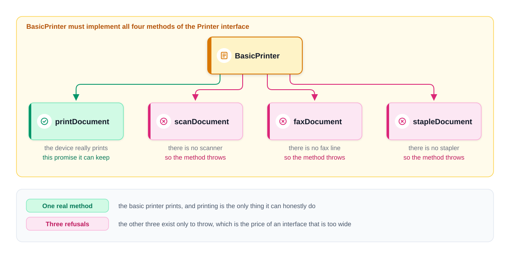
*Figure — BasicPrinter keeps one real method and three that exist only to throw (course diagram)*


*Figure — one interface, two devices: it fits the larger device and punishes the smaller one (course diagram)*

ISP in one picture: the simplest device carries the heaviest burden. Split the interface by what each caller uses.

### Restructuring: first attempt, one interface per capability

Split into `Printer`, `Scanner`, `Fax`, `Stapler` (one method each); `BasicPrinter implements Printer`; `AdvancedPrinter implements Printer, Scanner, Fax, Stapler`. Nobody implements what it cannot do. This satisfies ISP and shows the mechanics — but **one interface per method is not the goal**: if every scanner also faxes and every caller uses both, separate interfaces add names and remove no dependency.

### How small should an interface be?

**Group by caller, not by method: an interface carries the methods one kind of caller needs.** Right-sized when both answers are "no":

1. **Is any implementer forced to supply a method it cannot honour?** Yes → too wide.
2. **Does any caller depend on methods it never calls?** Yes → too wide for that caller.

One method or six — the count was never the measure.

**What over-splitting costs.** A caller that scans, prints and staples needs three parameters, and its creator hands over **one device three times**:

```java
// File: code/lld/ch04/isp/split/OfficeWorkflow.java — OVER-SPLIT: three dependencies, nothing gained
public OfficeWorkflow(Printer printer, Scanner scanner, Stapler stapler) { ... }
public void run(String doc) {
    scanner.scanDocument(doc);
    printer.printDocument(doc);
    stapler.stapleDocument(doc);
}
```

Technically ISP-compliant, but `OfficeWorkflow` calls all three, so the split removed no dependency — it added two type names and two parameters.

**Grouping by role.** `OfficeWorkflow` wants one device that scans, prints and staples: one role, `DocumentProcessor`. `PrintQueue` only prints: role `Printer`. Two interfaces are justified because a `BasicPrinter` can play the second role but not the first; `DocumentProcessor extends Printer`, so any processor also fits a print queue.

```java
// File: code/lld/ch04/isp/roles/
public interface Printer { void printDocument(String doc); }                 // callers that only print
public interface DocumentProcessor extends Printer {                         // callers that scan, print AND staple
    void scanDocument(String doc);
    void stapleDocument(String doc);
}
// BasicPrinter implements Printer ("Basic printer printing " + doc);
// OfficeDevice implements DocumentProcessor ("Printing " / "Scanning " / "Stapling " + doc)
public class PrintQueue {                        // depends on printing only, so a basic printer is enough
    private final Printer printer;
    public void submit(String doc) { printer.printDocument(doc); }
}
public class OfficeWorkflow {                    // one dependency: one role covers everything it needs
    private final DocumentProcessor processor;
    public void run(String doc) {
        processor.scanDocument(doc);
        processor.printDocument(doc);
        processor.stapleDocument(doc);
    }
}

// File: code/lld/ch04/isp/Main.java (abridged)
// 1: for fat AdvancedPrinter and BasicPrinter: printDocument("report.pdf"), then scanDocument (catching
//    the refusal as "  forced to implement: ...")
// 2: split BasicPrinter prints memo.pdf; AdvancedPrinter adv faxes memo.pdf; then
new lld.ch04.isp.split.OfficeWorkflow(adv, adv, adv).run("contract.pdf");   // same object three times
// 3: role interfaces
new PrintQueue(new BasicPrinter()).submit("receipt.pdf");
new PrintQueue(new OfficeDevice()).submit("receipt.pdf"); // bigger device fits the small role
new OfficeWorkflow(new OfficeDevice()).run("contract.pdf");
```

Output:

```text
=== 1. Fat interface ===
AdvancedPrinter printing report.pdf
AdvancedPrinter scanning report.pdf
BasicPrinter printing report.pdf
  forced to implement: BasicPrinter cannot scan
=== 2. One interface per method ===
BasicPrinter printing memo.pdf
AdvancedPrinter faxing memo.pdf
AdvancedPrinter scanning contract.pdf
AdvancedPrinter printing contract.pdf
AdvancedPrinter stapling contract.pdf
=== 3. Role interfaces (grouped by caller) ===
Basic printer printing receipt.pdf
Printing receipt.pdf
Scanning contract.pdf
Printing contract.pdf
Stapling contract.pdf
```


*Figure — split too far (three interfaces, the same device passed three times) vs split by caller (one role per kind of caller) (course diagram)*

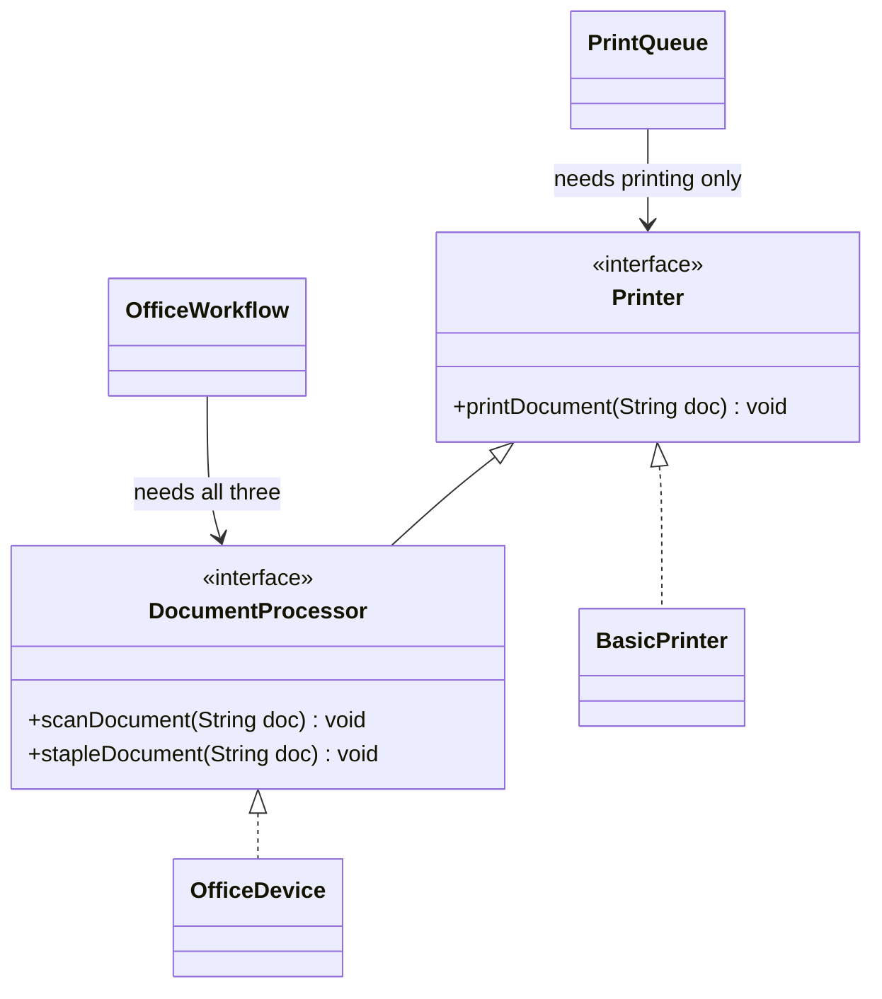

| | Four interfaces, one method each | Two role interfaces |
|---|---|---|
| Implementer forced to supply what it cannot do? | No | No |
| Caller depending on unused methods? | No | No |
| Dependencies for `OfficeWorkflow` | 3 | 1 |
| Names to learn | 4 | 2 |

Both satisfy ISP; the role-based one is leaner because its interfaces follow callers, not methods.

**Rule of thumb:** split only when you can **point to the caller** that needs the smaller piece (otherwise it is speculation); conversely, two interfaces always implemented by the same classes and consumed by the same callers should probably merge.

**Languages without an `interface` keyword** (Python, JavaScript): the interface is invisible but real — **the set of methods a caller actually calls**. Handing a 20-method object to a function that calls one creates the same needless dependency, unflagged by any compiler. Tests hide it further: Java forces a long stub (a fake with every method filled in) for a wide interface, whereas Python lets you pass a one-method object — convenient, but masking the problem. So check deliberately what a function calls on its argument. Python's `abc` module and `typing.Protocol` (its two ways to declare an interface) can write the role down; for a one-place role a comment listing needed methods often suffices.

### Five signals of an ISP violation

**1. Low cohesion in the interface** — unrelated method groups.

```java
interface MediaDevice { void playAudio(); void playVideo(); void recordVideo(); }
// A Speaker can only playAudio(); playVideo() and recordVideo() must throw.
```

**2. A fat interface** — a long list grown feature by feature; mechanism-named methods are a tell that some implementer won't use them.

```java
interface PaymentProcessor { void processCreditCard(BigDecimal a); void processPayPal(BigDecimal a); void processBankTransfer(BigDecimal a); }
// A shop that only takes PayPal must still supply the other two.
// Better: interface PaymentMethod { void pay(BigDecimal amount); } with one class per method.
```

**3. Empty or throwing methods** — the clearest signal: the interface asks for what the class cannot provide.

```java
interface Vehicle { void drive(); void fly(); void sail(); }
// A Car drives; fly() and sail() throw UnsupportedOperationException.
```

**4. One interface serving several kinds of client** — it describes a category ("everything an employee can do"), so every role implements the union of all roles.

```java
interface Employee { void calculateSalary(); void handleCustomerQueries(); void manageTeam(); }
// A support agent handles queries; the other two methods must throw.
```

**5. Tests needing long stand-ins** — a fake must implement every method even if one is exercised; dozens of empty bodies for one call mean the interface is too wide **for that caller**. It measures the distance between what a caller uses and what it must depend on.

| Signal | When it shows up | Typical cause |
|---|---|---|
| Low cohesion | Reading the interface | Groups of unrelated methods should be split into their own interfaces |
| Fat interface | Reading the interface | It grew feature by feature and was never split |
| Empty / throwing methods | Reading an implementer | The implementer was forced to accept what it cannot do |
| One interface, many roles | Comparing implementers | It describes a category, not a caller's needs |
| Long test stand-ins | Writing a test | Callers are tied to much more than they actually call |

### How it works (step by step)

1. For each caller, list the methods it actually calls. 2. Group callers with the same list: each group is a **role**. 3. One interface per role (interfaces may extend each other, like `DocumentProcessor extends Printer`). 4. Each class implements every role it can honestly fill. 5. Change each caller's parameter type to the narrowest role it needs.

**Why it matters:** no bloated classes forced to implement unneeded methods; maintainability (a change to one role does not ripple to another's callers); flexibility (small roles are easy to implement anew); simpler tests (fakes implement one or two methods); clearer design (each interface documents one relationship).

**Relation to the others:** **SRP** — ISP is SRP for interfaces; **OCP** — new capabilities arrive as new small interfaces, not edits to a big one; **LSP** — small-interface implementers can honour every method, while a fat interface **forces** LSP violations (the throwing `BasicPrinter`); **DIP** — high-level code depends on the smallest abstraction it needs.

### Trade-offs

| Small role interfaces gain | Costs |
|---|---|
| No forced, throwing methods | More interface names |
| Callers insulated from unrelated changes | Over-splitting adds wiring with no benefit |
| Tiny test doubles; lambdas for one-method roles | Harder to see "everything this device can do" in one place |

**When not:** every implementer supports every method and every caller uses them all (already right-sized); you cannot name the caller wanting the smaller piece.

### Common mistakes

- **One interface per method everywhere** — the commonest mistake after learning ISP. A fat interface at least shows its cost; hundreds of tiny ones cost slowly, in names and wiring, and are harder to undo.
- Splitting by the implementer's features instead of the caller's needs.
- Keeping the fat interface and adding an "adapter" base class with empty methods (like AWT's `MouseAdapter`; AWT is Java's original desktop UI toolkit): convenient, but a symptom.

### Real-world examples

- **Java's tiny role interfaces**: `Runnable`, `Comparable`, `AutoCloseable`, `Iterable`, `CharSequence`, all of `java.util.function`; `try-with-resources` needs only `AutoCloseable`, not "a file".
- **AWT `MouseListener`** has five methods though most listeners need one, hence `MouseAdapter`'s empty bodies; later APIs (JavaFX event handlers) use one-method handlers.
- **Collections**: `List.of(...)` and unmodifiable views throw on `add` because `Collection` bundles reading and writing; Kotlin (another JVM language) separates `List` (read) and `MutableList` (write).
- **Spring Data** (generates repository code): `CrudRepository`, `PagingAndSortingRepository` and the bare `Repository` marker expose only the operations needed.

### In the interview

**30-second answer:** "ISP says no caller should depend on methods it does not use. The symptom is a class implementing an interface method by throwing, or a test fake full of empty methods. I split interfaces by caller: one role interface per kind of caller, not one per method. For printers, a print queue needs `Printer`, an office workflow needs `DocumentProcessor`. I split only when I can name the caller that wants the smaller piece."

- *"SRP vs ISP?"* — SRP protects the **class** (one reason to change); ISP protects the **caller** (no unused dependencies). SRP splits classes, ISP interfaces; either can break without the other.
- *"How small is too small?"* — When a caller takes several interfaces that are always the same object: always implemented and used together means one interface.

### Self-check

1. **Q:** The two right-size questions? **A:** Is any implementer forced to supply what it cannot do? Does any caller depend on methods it never calls?
2. **Q:** Three ISP signals? **A:** Throwing/empty methods, a fat interface with mechanism-named methods, long test stand-ins (also: low cohesion, one interface for several roles).
3. **Q:** Why didn't four interfaces help `OfficeWorkflow`? **A:** It uses all three methods, so no dependency was removed; only names and parameters were added.

### TL;DR

One interface per kind of caller. Throwing methods and long fakes mean too wide; the same object passed three times means too thin.

---

## 4.10 Dependency Inversion Principle (DIP)

### What it is

Martin's two statements, paraphrased:

1. **High-level modules should not depend on low-level modules. Both should depend on abstractions.**
2. **Abstractions should not depend on details. Details should depend on abstractions.**

A **high-level module** holds business policy — *what* the application does ("notify the user when an order ships"); a **low-level module** a technical detail — *how* (SMTP email, SMTP being the mail-sending protocol; an SMS gateway; MySQL); the **abstraction** is the interface between.

**Why "inversion"?** In traditional layering, high-level code calls low-level code **and** its source depends on it (`import com.mail.SmtpClient`). DIP keeps the call direction (policy still calls the detail at run time) but **reverses the source-code dependency**: the detail imports and implements an interface belonging to the policy.

**Analogy: a wall socket.** A lamp plugs into a standard socket, not the power station; the building wiring (the detail) is also built to the standard; either side is replaceable.

### The problem it solves

Business logic tied to one vendor or technology (email → SMS edits business code); untestable without the real infrastructure (servers and services the program runs on: mail server, database); low-level library changes rippling up into policy.

### Example: notifications

**Before.** High-level `NotificationService` creates and names low-level `EmailService`:

```java
// File: code/lld/ch04/dip/before/ — EmailService.sendEmail prints "Sending email: " + message
/** VIOLATION: high-level policy creates and names a low-level detail. */
public class NotificationService {
    private final EmailService emailService = new EmailService();
    public void notifyUser(String message) { emailService.sendEmail(message); }
}
```

Tightly coupled: SMS or push means editing `NotificationService`.

**After, in four steps:** (1) **introduce an abstraction**, `NotificationSender`; (2) **low-level modules implement it** (`EmailSender`, `SmsSender`) — details depend on the abstraction; (3) **the high-level module depends only on it**, via its constructor; (4) **test** with different senders, including a recording fake.

Note the packages: the interface lives in `app`, **next to the policy using it**, not in `infra` with the implementations. The most-missed part of DIP: **the high-level side owns the abstraction**, shaped by what the policy needs, not by what email offers. `app` imports nothing from `infra`; `infra` imports `app`.

```java
// File: code/lld/ch04/dip/app/NotificationSender.java — the abstraction lives with the policy (app)
public interface NotificationSender { void send(String recipient, String message); }

// File: code/lld/ch04/dip/app/NotificationService.java — imports nothing from infra
public class NotificationService {
    private final NotificationSender sender;
    public NotificationService(NotificationSender sender) { this.sender = Objects.requireNonNull(sender); } // constructor injection
    public void notifyUser(String userId, String message) {
        if (message.isBlank()) throw new IllegalArgumentException("empty notification");
        sender.send(userId, message);
    }
}

// File: code/lld/ch04/dip/infra/EmailSender.java — the detail depends on the abstraction (arrow points UP into app)
public class EmailSender implements NotificationSender {
    @Override public void send(String recipient, String message) { System.out.println("[email -> " + recipient + "] " + message); }
}
// SmsSender prints "[sms -> recipient] message"; RecordingSender (a test double: no mail server needed)
// stores recipient + ":" + message in a list returned by sent()
```

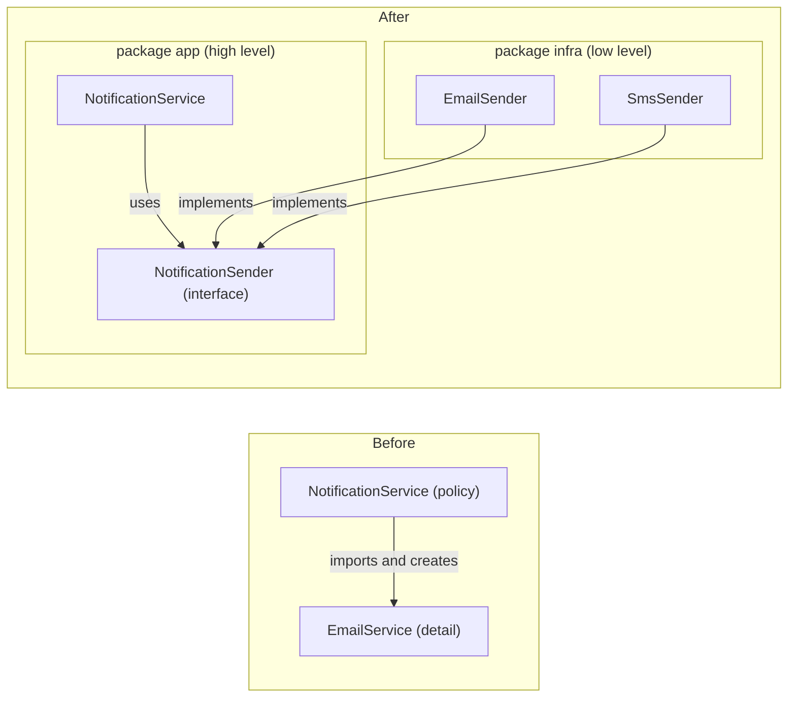

In "After", every inter-package arrow points **from the detail into the policy** — the inversion.

### DIP in practice: four real-world techniques

**1. Dependency Injection (DI)** — give a class its dependencies from outside instead of letting it create them:

| Kind | How | Use when |
|---|---|---|
| **Constructor injection** | Pass dependencies to the constructor | Default choice: required dependencies, immutable fields, obvious in the signature |
| **Setter injection** | Call `setX(...)` after construction | Optional dependencies with a sensible default |
| **Method (parameter) injection** | Pass the dependency to the one method that needs it | It varies per call (e.g. if the format changed on every call, `invoice.generate(generator)` instead of the constructor injection used in 4.7) |

Typical web case: a `DataService` receives a `DataRepository` interface in its constructor instead of building a MySQL repository, so another database means passing a different implementation, no edit. The class doing all the `new`-ing is the **composition root** — here each `Main`, the one place knowing the concrete classes.

**2. Service Locator** — a central registry hands out services by name or type; the high-level class depends on a `Locator` abstraction and asks it at run time.

```java
// File: code/lld/ch04/dip/locator/ — PaymentService { void processPayment(BigDecimal amount); }
// PayPalService prints "Processing payment via PayPal: $" + amount
public interface Locator { PaymentService paymentService(String name); }   // high level depends on this
public class ServiceLocator implements Locator {                           // central registry
    private final Map<String, PaymentService> services = new ConcurrentHashMap<>();
    public void register(String name, PaymentService service) { services.put(name, service); }
    @Override public PaymentService paymentService(String name) {
        PaymentService s = services.get(name);
        if (s == null) throw new NoSuchElementException("No payment service named " + name);
        return s;
    }
}
public class CheckoutFlow {          // asks at run time: its real dependency (PaymentService) is hidden inside
    private final Locator locator;
    public void pay(String serviceName, BigDecimal amount) { locator.paymentService(serviceName).processPayment(amount); }
}
```

This follows DIP: `CheckoutFlow` names no concrete payment class and gets the `Locator` *interface* via its constructor, so even the registry is replaceable (e.g. a test locator). But note the criticism (Martin Fowler compares the approaches; Mark Seemann calls Service Locator an anti-pattern — a common solution causing more problems than it solves): **real** dependencies hide inside method bodies, invisible from the constructor, and a missing registration fails only at run time. Prefer constructor injection; use a locator mainly at framework boundaries.

**3. Inversion of Control (IoC) containers** — frameworks like **Spring** (Java) and **.NET**'s built-in container (Microsoft's platform) create objects and inject dependencies. In Spring a single-constructor class is injected automatically (`@Autowired`, an annotation marking where Spring injects, is optional for a single constructor since Spring 4.3; a **bean** is a Spring-managed object; the **classpath** is where Java looks for classes and libraries):

```java
// Spring version -- NOT part of this chapter's compiled code (needs Spring on the classpath).
@Service
public class OrderService {
    private final PaymentService payments;          // an interface
    public OrderService(PaymentService payments) {  // Spring finds the one PaymentService bean
        this.payments = payments;
    }
    public void placeOrder(BigDecimal amount) { payments.processPayment(amount); }
}
```

Without Spring it is one line in `main`: `new OrderService(new StripePayments())`. **The framework is a wiring convenience, not the principle**: `OrderService` was inverted the moment it accepted an abstraction.

**4. Plug-in architecture** — the core defines an abstraction; plug-ins implement it and install without changing the core (a media player's `AudioDecoder`; MP3 and FLAC as plug-ins).

```java
// File: code/lld/ch04/dip/plugin/ — contract owned by the core
public interface AudioDecoder { String extension(); void decode(String fileName); }
// Mp3Decoder ("mp3", prints "Decoding MP3 file: ..."), FlacDecoder ("flac", "Decoding FLAC file: ...")
public class MediaPlayer {           // the core: never edited for new formats
    private final Map<String, AudioDecoder> decoders = new HashMap<>();
    public void install(AudioDecoder decoder) { decoders.put(decoder.extension(), decoder); }
    public void play(String fileName) {
        String ext = fileName.substring(fileName.lastIndexOf('.') + 1);
        AudioDecoder decoder = decoders.get(ext);
        if (decoder == null) { System.out.println("No plug-in installed for ." + ext); return; }
        decoder.decode(fileName);
        System.out.println("Playing audio...");
    }
}

// File: code/lld/ch04/dip/Main.java — the COMPOSITION ROOT (abridged)
new lld.ch04.dip.before.NotificationService().notifyUser("Your order shipped");
new NotificationService(new EmailSender()).notifyUser("u-42", "Your order shipped");
new NotificationService(new SmsSender()).notifyUser("u-42", "Your order shipped");
var recorder = new RecordingSender();
new NotificationService(recorder).notifyUser("u-7", "Test message");    // then prints recorder.sent()
locator.register("PayPal", new PayPalService());
new CheckoutFlow(locator).pay("PayPal", new BigDecimal("100.00"));
// player installs Mp3Decoder and FlacDecoder, then plays song.mp3, concert.flac, voice.ogg
```

Output:

```text
=== 1. Before: NotificationService builds EmailService itself ===
Sending email: Your order shipped
=== 2. After: inject any NotificationSender ===
[email -> u-42] Your order shipped
[sms -> u-42] Your order shipped
test double captured: [u-7:Test message]
=== 3. Service locator ===
Processing payment via PayPal: $100.00
=== 4. Plug-in architecture ===
Decoding MP3 file: song.mp3
Playing audio...
Decoding FLAC file: concert.flac
Playing audio...
No plug-in installed for .ogg
```

**DI vs plug-in architecture:** both hand an implementation to a core, at different scales. **DI** is small-scale — how one class gets its collaborators. **Plug-in architecture** is system-level extensibility — whole modules, often from other teams, added independently and frequently discovered at run time (Java's `ServiceLoader`, OSGi — a Java module system built for plug-ins, IDE plug-in APIs).

### DIP vs DI vs IoC — do not mix them up

| Term | What it is | Kind | Example |
|---|---|---|---|
| **Dependency Inversion (DIP)** | Depend on abstractions; the policy owns the abstraction | A **principle** (what good structure looks like) | `NotificationService` depends on `NotificationSender` |
| **Dependency Injection (DI)** | Pass dependencies in from outside instead of creating them | A **technique** (one way to achieve DIP) | `new NotificationService(new SmsSender())` |
| **Inversion of Control (IoC)** | The framework calls your code, not the other way round ("don't call us, we'll call you" — the Hollywood Principle) | A broad **idea**; DI is one form of it | Spring creating beans; a servlet container (a Java web server such as Tomcat) calling `doGet`; JUnit calling your `@Test` methods |
| **IoC container** | A framework that performs DI for you | A **tool** | Spring `ApplicationContext`, Google Guice (a lightweight DI library) |

They differ: **injection without inversion** — `new OrderService(new MySqlDatabase())` with a concrete `MySqlDatabase` parameter type is injected, yet the policy still depends on a detail; **inversion without a framework** — everything in this chapter: constructor + interface + a wiring `main`.

### Stable vs volatile dependencies

DIP targets **volatile** dependencies — things that change often or that you want to fake (databases, networks, clocks, third-party APIs i.e. other companies' services, varying business rules). Depending directly on **stable** concrete classes is fine: `String`, `List`, `LocalDate`, `Math`; nobody wraps `String` in an interface. (Head First's DIP guidelines, like "no variable should hold a reference to a concrete class", are admitted ideals you will break; stable vs volatile is how you decide when.)

**Why it matters:** flexibility (swap implementations without touching business logic); maintainability (detail changes stay in the detail); testability (pass fakes and mocks — fakes that also record how they were called; no real database or mail server in unit tests).

**Relation to the others:** **SRP** — injected collaborators keep each class on its job; creating and configuring dependencies becomes the composition root's job; **OCP** — new implementations extend abstraction-dependent code without edits; **LSP** — every implementation must be a proper substitute, or injection is dangerous; **ISP** — the policy's abstraction should be the **smallest** role it needs.

### How it works (step by step)

1. Find a high-level class naming or creating a volatile low-level class. 2. Write what it **needs**, in its own words (`send(recipient, message)`). 3. Make that an interface **in the high-level package**. 4. Make the low-level class implement it. 5. Inject the implementation (constructor by default). 6. Move all `new` calls for concrete classes to the composition root (`main`, a factory, or a DI container).

### Trade-offs

| You gain | You pay |
|---|---|
| Policy independent of technology | An interface per volatile dependency |
| Easy unit tests with fakes | Wiring code (or a framework and its learning curve) |
| Swappable implementations | Indirection: "go to implementation" takes an extra hop |

**When not:** stable classes (`String`, collections, value objects); an interface with exactly one implementation forever and no test double; tiny scripts.

### Common mistakes

- The interface in the **low-level** package (`mysql.MySqlRepository` and `mysql.Repository`): the policy still depends on the detail's package.
- An interface shaped by one vendor's API (`sendSmtpMessage(...)`) rather than the policy's need (`send(...)`), so changing vendors changes the interface.
- Breaking the **second** clause ("abstractions should not depend on details"): methods returning `java.sql.ResultSet` or throwing `javax.mail.MessagingException` drag detail types into the policy; use the policy's own types (`Optional<Order>`, a box that may hold an order; a domain exception, an error type named in business terms).
- "We use Spring, so we follow DIP" — Spring injects concrete classes just as happily.
- `new ConcreteThing()` inside a class "just this once".

### Real-world examples

- **JDBC**: code depends on `java.sql.Connection` / `DataSource`; MySQL, PostgreSQL, Oracle drivers implement them; `DriverManager` finds drivers via `ServiceLoader`.
- **SLF4J**: the app depends on the logging facade; Logback or Log4j 2 is the plugged-in detail.
- **Spring** and **Jakarta EE CDI** (enterprise Java's built-in injection): IoC containers doing constructor injection.
- **JPA** (Java's standard object-to-SQL API): code uses `EntityManager`; Hibernate or EclipseLink implements it.
- **Hexagonal architecture (ports and adapters)**: the core defines *ports* (interfaces); *adapters* for HTTP, databases and queues (message queues, see [System Design Fundamentals](../../../system-design-patterns/modules/00-system-design-fundamentals/README.md)) implement them — DIP applied to a whole service.

### In the interview

**30-second answer:** "DIP says business logic should not depend on technical details; both depend on an abstraction, and the business side owns that abstraction. So `NotificationService` depends on a `NotificationSender` interface in its own package, and email and SMS senders implement it. I inject the implementation through the constructor and wire everything in `main`. That makes the service testable with a fake and lets me swap providers. DI is the technique; DIP is the principle; Spring is just a tool that does the wiring."

- *"Dependency inversion vs dependency injection?"* — Inversion is the principle (depend on abstractions); injection one technique (pass dependencies in). Injecting a concrete class is injection without inversion.
- *"Who owns the interface?"* — The high-level module that uses it.
- *"Is Service Locator OK?"* — It satisfies DIP but hides dependencies and fails late; I prefer constructor injection.

### Self-check

1. **Q:** What is "inverted"? **A:** The source-code dependency: the detail implements an abstraction owned by the policy, instead of the policy importing the detail.
2. **Q:** `new OrderService(new MySqlDatabase())` with a `MySqlDatabase` parameter — DIP? **A:** No; injection of a concrete class, the policy still depends on the detail.
3. **Q:** A composition root? **A:** The one place (usually `main` or container config) where concrete classes are created and wired.
4. **Q:** Put `String` behind an interface? **A:** No; it is stable — DIP is for volatile dependencies.

### TL;DR

Business code depends on interfaces it owns; details implement them; `main` (or a container) wires them. DI is the how, DIP the why, IoC containers the tool.

---

## 4.11 Refactoring one class through all five principles

In real code the principles seldom appear one at a time; they come **in a fixed sequence**, each exposing the need for the next. Here one order-checkout class — it validates, prices, saves and emails, quietly grown over two years — is refactored five times.


*Figure — one checkout class, five steps: SRP, OCP, LSP, ISP, DIP, each creating the situation the next addresses (course diagram)*

### Step 0: the starting class

It runs correctly, yet each principle objects to something.

```java
// File: code/lld/ch04/checkout/step0/ — record CustomerOrder(String orderId, String customerType, BigDecimal amount, String email)
public class OrderService {          // STEP 0 -- the class that grew quietly for two years. It works.
    public void process(CustomerOrder order) {
        // 1. Validation  (business-rules owner)
        if (order.amount().signum() <= 0) { System.out.println("Rejected: amount must be positive"); return; }
        // 2. Pricing, one branch per customer type  (finance)
        BigDecimal total = order.amount();
        if (order.customerType().equals("member")) total = total.multiply(new BigDecimal("0.90"));
        else if (order.customerType().equals("staff")) total = total.multiply(new BigDecimal("0.70"));
        total = total.setScale(2, RoundingMode.HALF_EVEN); // money: always 2 decimals
        // 3. Storage  (database team)
        System.out.println("INSERT INTO orders VALUES ('" + order.orderId() + "', " + total + ")");
        // 4. Telling the customer  (marketing)
        System.out.println("Emailing " + order.email() + ": your order total is " + total);
    }
}
```

### Step 1: Single Responsibility — split by actor

| Section of `process` | Requested by |
|---|---|
| Validation | The business-rules owner |
| Pricing | Finance |
| The `INSERT` statement | The database team |
| The email wording | Marketing |

Four groups, one method: rewording the email redeploys pricing. Split by actor into `OrderValidator` (`isValid`: amount > 0), `PriceCalculator`, `OrderRepository` (`save` prints the `INSERT`) and `Notifier` (`send` prints the email):

```java
// File: code/lld/ch04/checkout/step1/PriceCalculator.java — actor: finance. SRP met, but the branch remains -> OCP next
public BigDecimal total(CustomerOrder order) {
    BigDecimal total = switch (order.customerType()) {
        case "member" -> order.amount().multiply(new BigDecimal("0.90"));
        case "staff" -> order.amount().multiply(new BigDecimal("0.70"));
        default -> order.amount();
    };
    return total.setScale(2, RoundingMode.HALF_EVEN);
}
// File: code/lld/ch04/checkout/step1/Checkout.java — coordinates the four; still news them up itself
private final OrderValidator validator = new OrderValidator();   // likewise calculator, repository, notifier
public void process(CustomerOrder order) {
    if (!validator.isValid(order)) { System.out.println("Rejected: amount must be positive"); return; }
    BigDecimal total = calculator.total(order);
    repository.save(order, total);
    notifier.send(order, total);
}
```

### Step 2: Open/Closed — one class per pricing rule

The branch on customer type survived the split, so a "student" rate would edit working code. Each rate gets a class behind `PricingRule`; from here the order carries no type string — the caller picks the rule:

```java
// File: code/lld/ch04/checkout/Order.java
public record Order(String orderId, BigDecimal amount, String email) { }

// File: code/lld/ch04/checkout/pricing/PricingRule.java
/**
 * STEP 2 (OCP): one class per rate; a new rate is a new class.
 * CONTRACT every implementation must keep (STEP 3, LSP):
 *   precondition : amount >= 0
 *   postcondition: result >= 0, rounded to 2 decimals   (a total is never negative)
 */
@FunctionalInterface
public interface PricingRule { BigDecimal apply(BigDecimal amount); }
// RegularPrice: amount.setScale(2, HALF_EVEN); MemberDiscount: x 0.90; StaffDiscount: x 0.70 (each rounded HALF_EVEN)

// File: code/lld/ch04/checkout/step2/PriceCalculator.java — no branch; never learns how many rates exist
public BigDecimal total(Order order, PricingRule rule) { return rule.apply(order.amount()); }
```

A student rate is now one new class, no edits.

### Step 3: Liskov Substitution — every rule keeps the promise

Several implementations of one interface raise the question whether each truly substitutes. Finance wants a **fixed** discount of 20; a naive version turns a 10 order into **−10** with no exception — saved, and perhaps later credited to a customer who never paid it. This is 4.8's postcondition/invariant rule: every pricing rule must guarantee **a never-negative total**. Fix: state the promise (in the `PricingRule` Javadoc), honour it in every rule, and verify with one contract test over every implementation:

```java
// File: code/lld/ch04/checkout/pricing/CarelessFixedDiscount.java — LSP VIOLATION kept for the demo
@Override public BigDecimal apply(BigDecimal amount) { return amount.subtract(off).setScale(2, RoundingMode.HALF_EVEN); }

// File: code/lld/ch04/checkout/pricing/FixedDiscount.java — STEP 3 fix (constructor rejects off < 0)
@Override public BigDecimal apply(BigDecimal amount) {
    return amount.subtract(off).max(BigDecimal.ZERO).setScale(2, RoundingMode.HALF_EVEN);
}

// File: code/lld/ch04/checkout/step3/PricingRuleContract.java — ONE test against the interface, run for EVERY implementation
private static final List<BigDecimal> SAMPLE_AMOUNTS = List.of(
        new BigDecimal("0.00"), new BigDecimal("10.00"), new BigDecimal("100.00"), new BigDecimal("250.00"));
public static boolean holds(PricingRule rule) {
    for (BigDecimal amount : SAMPLE_AMOUNTS) {
        BigDecimal total = rule.apply(amount);
        if (total.signum() < 0) {
            System.out.println("  " + rule.getClass().getSimpleName() + " broke the contract: apply(" + amount + ") = " + total);
            return false;
        }
    }
    System.out.println("  " + rule.getClass().getSimpleName() + " keeps the contract");
    return true;
}
```

### Step 4: Interface Segregation — the checkout needs a save method, not a repository

Repositories accumulate methods (`save`, `findById`, `delete`, `listAll`) as other parts ask, but the checkout only **saves**; typed against the full repository, each new reporting query is one more method it depends on without calling. So describe the **role** it needs — an order saver, one method wide — and let the real repository play that role and others:

```java
// File: code/lld/ch04/checkout/fin/
@FunctionalInterface public interface OrderSaver { void save(Order order, BigDecimal total); }  // owned by the checkout
public interface OrderFinder { Optional<Order> findById(String orderId); List<Order> listAll(); } // reporting role; checkout never sees it
@FunctionalInterface public interface OrderNotifier { void send(Order order, BigDecimal total); }
public class SqlOrderRepository implements OrderSaver, OrderFinder {   // grows, but plays two separate roles
    private final List<Order> table = new ArrayList<>();                // stands in for a real DB table
    @Override public void save(Order order, BigDecimal total) {
        table.add(order);
        System.out.println("  INSERT INTO orders VALUES ('" + order.orderId() + "', " + total + ")");
    }
    // findById filters table by id; listAll copies it
}
```

### Step 5: Dependency Inversion — the entry point decides

The step-1 `Checkout` constructs its collaborators, so it names concrete classes (SQL repository, email notifier) and cannot run in a test without a database and mail server. Pass the abstractions in; the checkout names no concrete class and the entry point chooses:

```java
// File: code/lld/ch04/checkout/fin/ — InMemoryOrders implements OrderSaver (one method, because the role is
// one method wide): stores orderId + "=" + total, prints "  kept <id> in memory", saved() returns them.
// EmailNotifier prints "  emailing <email>: total <total>"; SilentNotifier prints "  (test run, no email sent)".

// File: code/lld/ch04/checkout/fin/Checkout.java — STEP 5 (DIP): every volatile collaborator arrives from outside
public class Checkout {
    private final PricingRule rule;
    private final OrderSaver orders;
    private final OrderNotifier notifier;          // all three requireNonNull in the constructor
    public Checkout(PricingRule rule, OrderSaver orders, OrderNotifier notifier) { ... }
    public boolean process(Order order) {
        // Validation has not varied yet, so it stays a plain check (see "What we did not do").
        if (order.amount().signum() <= 0) { System.out.println("  rejected: amount must be positive"); return false; }
        BigDecimal total = rule.apply(order.amount());
        orders.save(order, total);
        notifier.send(order, total);
        return true;
    }
}

// File: code/lld/ch04/checkout/Main.java (abridged; TWENTY = 20.00)
// Step 0: legacy OrderService on A-1 "regular" 100.00 and A-2 "staff" 100.00; Step 1: step-1 Checkout on A-2
// Step 2: calc.total(A-3 100.00, r) for RegularPrice, MemberDiscount, StaffDiscount
// Step 3: careless and correct FixedDiscount(TWENTY) on A-4 10.00; then PricingRuleContract.holds over
//         Regular, Member, Staff, FixedDiscount(TWENTY), CarelessFixedDiscount(TWENTY), printing the passing count
var a9 = new Order("A-9", new BigDecimal("200.00"), "ada@example.com");
var db = new SqlOrderRepository();
new Checkout(new MemberDiscount(), db, new EmailNotifier()).process(a9);          // production wiring
System.out.println("  reporting side can still find it: " + db.findById("A-9").isPresent());
var fake = new InMemoryOrders();
new Checkout(new MemberDiscount(), fake, new SilentNotifier()).process(a9);       // test wiring, same class
System.out.println("  test double recorded " + fake.saved());
new Checkout(amount -> amount, (o, t) -> System.out.println("  saved " + o.orderId()),
        (o, t) -> System.out.println("  notified " + o.email())).process(a9);    // lambda wiring
new Checkout(new RegularPrice(), fake, new SilentNotifier())
        .process(new Order("A-10", BigDecimal.ZERO, "x@example.com"));
```

Output:

```text
=== Step 0: the original class ===
INSERT INTO orders VALUES ('A-1', 100.00)
Emailing ada@example.com: your order total is 100.00
INSERT INTO orders VALUES ('A-2', 70.00)
Emailing grace@example.com: your order total is 70.00
=== Step 1: SRP -- split by actor (same output) ===
INSERT INTO orders VALUES ('A-2', 70.00)
Emailing grace@example.com: your order total is 70.00
=== Step 2: OCP -- one class per pricing rule ===
  RegularPrice -> 100.00
  MemberDiscount -> 90.00
  StaffDiscount -> 70.00
=== Step 3: LSP -- every rule must keep 'total >= 0' ===
  careless FixedDiscount(20) on 10 -> -10.00
  correct  FixedDiscount(20) on 10 -> 0.00
  RegularPrice keeps the contract
  MemberDiscount keeps the contract
  StaffDiscount keeps the contract
  FixedDiscount keeps the contract
  CarelessFixedDiscount broke the contract: apply(0.00) = -20.00
  4/5 rules are safe substitutes
=== Steps 4+5: ISP + DIP -- same Checkout, two wirings ===
Production wiring:
  INSERT INTO orders VALUES ('A-9', 180.00)
  emailing ada@example.com: total 180.00
  reporting side can still find it: true
Test wiring, same Checkout class:
  kept A-9 in memory
  (test run, no email sent)
  test double recorded [A-9=180.00]
Lambda wiring (roles are functional interfaces):
  saved A-9
  notified ada@example.com
  rejected: amount must be positive
```

One unmodified `Checkout` ran against production collaborators, test doubles and lambdas, **without being edited or subclassed** — what the five steps bought.


### Reading the five steps back

| Step | The question it asked | What changed |
|---|---|---|
| SRP | Who might request changes here? | The single class split into four, one per actor |
| OCP | What breaks when a new case shows up? | Each pricing branch turned into its own class |
| LSP | Does each rule work when called through the interface? | All rules guarantee the total never drops below zero |
| ISP | Is the caller tied to more than it calls? | Checkout depends on one save method rather than a whole repository |
| DIP | Who decides which concrete class is used? | The entry point decides, not the checkout |

**The sequence has a reason:** SRP first, because the varying point stays hidden until each class has one job; OCP then introduces an interface; LSP matters once it has a second implementation; ISP when new callers (reporting) appear; DIP last, because inversion needs abstractions to point at. Each step sets up the next — why the five are learned as a group.

### What we did not do

- **Not every principle on every class:** `Order` stays a plain record without an interface — nothing made it vary.
- **Not closed against every change:** a new validation rule still edits `Checkout`, fine while validation is stable; the third validation request is the day it gets pricing's treatment.
- **Not everything injected:** `Order` and `BigDecimal` arithmetic are stable, used directly.

Pre-emptively applying all five everywhere turns a small clear program into a confusing one. **Each step was triggered by an actual change request, never by a checklist.**

### Self-check

1. **Q:** Why SRP before OCP here? **A:** Until pricing had its own class, the varying part (the type branch) was buried in a four-job method.
2. **Q:** Step 3's contract? **A:** Every `PricingRule` returns ≥ 0 for any amount ≥ 0.
3. **Q:** Why is `OrderSaver` one method wide? **A:** The checkout only saves; the full repository would tie it to reporting methods it never calls.
4. **Q:** Proof the design worked? **A:** One `Checkout` ran under three wirings (production, test doubles, lambdas) unedited.

### TL;DR

SRP → OCP → LSP → ISP → DIP, each triggered by a real change. Proof: one class, several wirings, zero edits.

---

## 4.12 SOLID and design patterns

Most classic patterns (Chapters 8–11) exist because of these principles: **the principles say what good structure looks like; the patterns are named, reusable ways to produce it.**

| Pattern | Principle(s) it serves | How |
|---|---|---|
| **Strategy** | OCP, DIP | A varying algorithm behind an interface (`InvoiceGenerator`, `PricingRule`) |
| **Template Method** | OCP | A fixed skeleton in a base class; subclasses fill in hook steps |
| **Decorator** | OCP, SRP | Adds behaviour by wrapping, without modifying the original class |
| **Adapter** | DIP, ISP | Lets a caller keep depending on the interface it already owns while a foreign class is plugged in |
| **Factory Method / Abstract Factory** | DIP, OCP | Keeps callers away from concrete constructors; the `switch` lives in one place |
| **Observer** | OCP, DIP | New reactions are new subscribers; the subject depends only on a listener interface |
| **Composite** | LSP, OCP | Leaves and groups share one interface, so callers treat them the same |
| **Proxy** | SRP, OCP | Adds access control, caching or laziness (creating things only when first needed) in a separate class |
| **Command** | SRP, OCP | Each request is its own object; new commands are new classes |
| **Visitor** | OCP (for operations) | Easy to add operations, hard to add element types: OCP along a different axis |
| **Null Object** | LSP | A do-nothing implementation that still keeps the contract, instead of `null` checks |

*Head First Design Patterns* states several as "OO design principles": **encapsulate what varies**, **favour composition over inheritance**, **program to an interface, not an implementation**, **classes should be open for extension but closed for modification** (Decorator chapter), **depend upon abstractions, do not depend upon concrete classes** (Factory chapter's DIP), **a class should have only one reason to change** (Iterator/Composite chapter). *Clean Code* covers SRP and "organising for change" in its classes chapter; "isolating from change" is DIP by another name.

---

## 4.13 SOLID in the design interview

### Keeping the design honest: five checks over your class diagram

In an OOD round SOLID is most useful as **five quick checks over the diagram you just drew** (about five minutes): an "and" in a class's one-sentence responsibility (S), a `switch` over a type (O), a subclass refusing a parent method — re-read inheritance arrows at the end, they get added late (L), empty method bodies in a wide interface (I), a high-level class naming a low-level one, e.g. `ParkingLot` constructing a `CreditCardTransaction` (D). Calibration: **two findings is a good pass, five means rework, zero means you did not look**; S and O earn most credit, and SOLID is a set of checks, not a score — no single-implementer interfaces, no splitting beyond the one-sentence test. The full checklist, the signal figure and a worked parking-lot pass are in [§1.8](../01-lld-interview-approach/README.md#18-keeping-the-design-honest-with-solid).

### Naming a design problem out loud

Interviewers rarely ask for OCP's definition. They ask for a parking lot, a rate limiter (caps requests per time window) or a file store and judge whether you can **explain the reasons behind your design's shape** — separating memorised acronyms from use. Weighed most important first:

1. **Can you spot and name a problem in the code in front of you** — an ever-growing `if/else` on a type field — in one crisp sentence?
2. **Can you defend a choice?** "SOLID says so" earns nothing; "pricing rules change every quarter and I don't want each change to reopen the checkout" earns a lot.
3. **Do you know when to hold back?** The senior marker: adding abstractions is easy; choosing which to skip is rarer.

**A sentence pattern that works — three things, in order:** (1) **what you see** — a specific fact about the code; (2) **what it will cost** — the future change it makes painful; (3) **what you would do, and what that costs you** — the part most people omit, and what makes an answer sound experienced rather than memorised.

*Example: a `ReportGenerator` that formats a report, writes it to disk and emails it.*

- Weak: "It breaks SRP since it does three things; I'd make three classes." Correct, but sounds like last night's reading.
- Strong: "Three different owners can request changes here: marketing controls the wording, the platform team controls where files land, and the email owners control delivery. That means a copy edit redeploys the file-writing code. I'd pull formatting apart from delivery, likely into a formatter and a sink (the destination the output is sent to). It costs me two more classes and a little wiring, which pays off because the wording changes frequently." Actors, pain, fix, price, and a decision.

**Observation before principle.** "`Reporting` implements nine methods but calls only two of them, which is an interface segregation problem" shows you noticed something; opening "This violates ISP because…" sounds like hunting for a place to use the acronym. Still name the principle at the end — it hands the interviewer a label for the write-up.

**"Would you always do that?"** checks you know your suggestion's price; rarely a trap, and the answer is almost never "yes":

- *Splitting classes:* "No. If the two parts would always be edited together, I've just created an extra file. I split when two different people would ask for two different changes."
- *Extension points:* "No. I keep the `if/else` until a second or third case actually appears. An extension point built in advance is usually wasted effort and makes the code harder to follow in the meantime."
- *Interfaces:* "Only where behaviour varies or a test needs a substitute. An interface with a single implementation and no fake is just one more file."

Treating a principle as unconditional is the quickest way to show you have never applied it.

**Three things that cost marks:** **reciting definitions** untied to the whiteboard code; **applying everything at once** (five interfaces for a forty-line problem looks inexperienced — real systems earn their abstractions); **naming the wrong principle confidently** (mixing up cohesion and coupling reveals second-hand vocabulary; when unsure, describe in plain words — an accurate unnamed description beats a wrong name).

**A one-minute drill** for any class you own: (1) Who can ask me to change it, and which parts belong to whom? (2) What is the likely next feature, and would I edit this class for it? (3) Which dependencies could I not replace in a test, and does it matter? Practising on your own code beats rereading definitions; the interview asks it of code you have never seen.

> **In the interview:** describe before you label, and end every recommendation with its cost, for example: "I'd move delivery into its own class; that costs a file and some wiring, and in return a wording change no longer touches file handling."

---

## 4.14 Common questions about SOLID (with short answers)

Give the two-line version and stop; expand only if asked — long unprompted definitions eat design time.

**1. SRP vs ISP?** *Whom* each guards: **SRP the class** doing the work (more than one reason to change?), **ISP the caller** at a boundary (depends on methods it never calls?). `Printer` with `print`/`scan`/`fax` is ISP for a basic printer; a `ReportService` that formats and emails is SRP with no interface in sight. SRP splits classes, ISP splits interfaces; either breaks without the other.

**2. When would you not apply these principles?** Have a concrete answer — it separates candidates: nothing has varied yet (an extension point for a case that never arrives adds indirection for nothing); small or throwaway code; an arbitrary split (you cannot name the two groups requesting changes); hurting readability (five four-line files vs one twenty-line file). *Framing:* each principle buys **flexibility later** with **simplicity now**; if "later" never comes, the price was wasted.

**3. Is SOLID still relevant, given the criticism?** Yes, and knowing the criticism helps. The principles came from large OO systems and are often taught as absolutes to people building small ones, yielding layers of single-implementation interfaces; some argue plainer advice (small functions, explicit dependencies) captures most of the benefit. What outlasts it is the **vocabulary and the diagnosis** — a compact way to explain why code will resist change, in any language or paradigm. *Short:* valuable as diagnostics, misleading as rules.

**4. Dependency inversion vs dependency injection?** Inversion is the **principle** (depend on abstractions); injection one **technique** (supply dependencies from outside). Injecting a concrete class is injection without inversion; a hand-written constructor with no framework is inversion without a container; Spring only automates wiring (4.10).

**5. An LSP violation?** Prefer one from your work; else Square/Rectangle, explaining the rule, not just the story: `Rectangle` lets callers set width and height separately, `Square` cannot, so `Rectangle` code computes a wrong area silently. A subclass must not require more, guarantee less, or break an assumption; an exception is merely the most obvious break.

**6. Does OCP mean never editing a file?** No: one more variation *of a supported kind* is added without touching existing code; bug fixes, refactorings and extension-point changes still edit. Closure is relative to a kind of change (4.7's invoice: closed to formats, open to discount rules — the right trade then).

**7. Composition over inheritance, always?** A guideline: inherit when the child truly is a kind of the parent and keeps every promise; compose when behaviour differs or a subclass would reject an inherited method (an override that throws, does nothing, or says "don't call this on X").

**8. How do the principles relate to patterns?** Many patterns are the principles made concrete: **Strategy** = OCP for a varying algorithm; **Adapter** keeps a caller on the interface it knows; **Decorator** adds behaviour without editing the wrapped class; **Factory** hides concrete constructors (DIP). See 4.12.

**9. Which principle is violated most often?** Two defensible answers: **SRP**, because classes grow by small, sensible-looking additions (nobody sets out to write a two-thousand-line service); and **ISP in reverse** (over-splitting) — an interface per method, meeting the rule's wording while adding names and removing no dependency. Citing the second shows you have watched the principles misused, not just ignored.

> **Interview tip:** if invited deeper, expand "when would you not apply this?" and "dependency inversion vs dependency injection" — most candidates stay vague on both. The strongest SOLID answers **admit a limit**: saying where a principle stops paying off is what sounds like real maintenance experience.

---

## 4.15 Over-engineering: the warnings in one place

| Warning sign | Principle misapplied | What to do instead |
|---|---|---|
| Classes named `XHelper`, `XUtils`, `XManager2` after a split | SRP | Split by actor; each new class needs a name that stands alone |
| Six small classes that always change in the same commit | SRP (over-split) — *Shotgun Surgery* | Merge them back |
| An interface + factory + registry for a single implementation | OCP — *Speculative Generality* | Write the `if`; refactor at the second or third case (rule of three) |
| A subclass that "works" by silently doing nothing | LSP | Raise a better parent or use composition |
| One interface per method; the same object passed three times | ISP (over-split) | Group by caller into role interfaces |
| An interface in front of `String`-like stable classes | DIP | Invert only volatile dependencies |
| A DI container for a 200-line program | DIP | Wire by hand in `main` |

**YAGNI** ("You Aren't Gonna Need It", from Extreme Programming — an agile method of small frequent releases and heavy testing) is the counterweight to all of SOLID: build nothing for requirements you do not have. SOLID says **what** a good seam looks like; YAGNI says **when** to cut it: when a real change asks.

---

## Chapter self-check

1. **Q:** Each principle in one line? **A:** SRP: one reason (actor) to change. OCP: add behaviour by adding code, not editing. LSP: subtypes substitutable for their base types. ISP: no caller depends on methods it does not use. DIP: policy and details both depend on abstractions owned by the policy.
2. **Q:** A `switch (vehicleType)` computing parking fees? **A:** OCP: fees behind a `ParkingRate` interface, one class per rate (Strategy), chosen at the edge.
3. **Q:** `ReadOnlyList extends ArrayList` throwing on `add`? **A:** LSP (new exception / refused bequest); prefer composition or a read-only interface.
4. **Q:** `Robot` implements `Worker` with `work()` and `eat()`? **A:** ISP: the robot must implement `eat()`; split into `Workable` and `Eater` roles by caller.
5. **Q:** `OrderService` has `private final MySqlOrderDao dao = new MySqlOrderDao();` — two problems? **A:** Tight coupling / DIP violation (names and creates a volatile detail) and untestable without MySQL; inject an `OrderSaver` interface owned by the service.
6. **Q:** Why is Square/Rectangle worse than `Penguin.fly()` throwing? **A:** It is silent: the program continues with a wrong result.
7. **Q:** Coupling vs cohesion? **A:** Cohesion: how well one class's insides belong together; coupling: how much one class depends on another.
8. **Q:** Usual order during a refactor, and why? **A:** SRP → OCP → LSP → ISP → DIP; each creates the situation the next addresses.
9. **Q:** DIP vs DI vs IoC? **A:** Principle (depend on abstractions); technique (pass dependencies in); broader idea that a framework calls your code — IoC containers perform DI.
10. **Q:** When not to add an interface? **A:** One implementation, no test double, nothing varied; or a stable dependency.

## TL;DR

- **SOLID** = five names for the ways code becomes painful to change. Use them to diagnose, not as a checklist.
- **SRP**: one actor per class. Split by *who asks for changes*, not by method count. High cohesion inside, and check coupling after every split.
- **OCP**: put the part that *has* varied behind an interface; add variants as classes (Strategy). A class is closed against a specific kind of change.
- **LSP**: a subclass must accept at least as much, promise at least as much, keep invariants and history, and throw nothing new. Inheritance follows promises, not real-world categories. Prefer composition when a subclass would refuse a method.
- **ISP**: one role interface per kind of caller. Throwing methods mean too wide; the same object passed three times means too thin.
- **DIP**: policy owns the abstraction; details implement it; `main` wires them. DI is the technique, IoC containers are the tool.
- **Order**: SRP → OCP → LSP → ISP → DIP, each triggered by a real change.
- **In the interview**: observation → cost → fix → price of the fix. Always know when *not* to apply a principle.
