# Chapter 4 — SOLID Principles (Study Edition)

> **Study Edition.** Every topic of Chapter 4, without the padding. Code blocks are excerpts from the real files (`// ...` marks trimmed parts); full listings, outputs and longer discussion are in the Full Edition (`README.md`).
>
> **What you will learn.** The five SOLID principles, one at a time and then together, plus the ideas beneath them: **cohesion**, **coupling** and **separation of concerns**. Read the principles in order; 4.11 (one class through all five) is the best interview rehearsal.

**Run the code** (from `chapters/04-solid-principles/code/`):

```bash
javac --release 21 -d /tmp/lld_04 $(find . -name '*.java')
java -cp /tmp/lld_04 lld.ch04.srp.Main        # also: cohesion, coupling, soc, ocp, lsp, isp, dip, checkout
```

Packages: `srp` (Employee split by actor), `cohesion`, `coupling` (three steps), `soc` (rules vs storage), `ocp` (invoice formats), `lsp` (cars, contract rules, birds), `isp` (printers, over-splitting, roles), `dip` (notifications, DI, locator, plug-ins), `checkout` (one class through all five).

**Money.** All amounts are `BigDecimal` built from strings, and anything multiplied by a rate is rounded with `setScale(2, RoundingMode.HALF_EVEN)`. Never `double` (`0.1 + 0.2` prints `0.30000000000000004`). `BigDecimal.equals` compares scale (`2.0` ≠ `2.00`), so compare with `compareTo` or `signum()`.

---

## 4.1 What SOLID is and why you should learn it

### What it is

| Letter | Principle | The one-line rule |
|---|---|---|
| **S** | Single Responsibility (SRP) | A class should have one reason to change. |
| **O** | Open/Closed (OCP) | Add new behaviour by adding code, not by editing working code. |
| **L** | Liskov Substitution (LSP) | A subtype must be usable anywhere its parent type is expected. |
| **I** | Interface Segregation (ISP) | No client should be forced to depend on methods it does not use. |
| **D** | Dependency Inversion (DIP) | Depend on abstractions, not on concrete details. |

Terms: a **module** is a unit bigger than a class (package, library, service); a **client** is code that uses other code; an **abstraction** is an interface or abstract class (*what*, not *how*); a **concrete class** is one you can `new`.

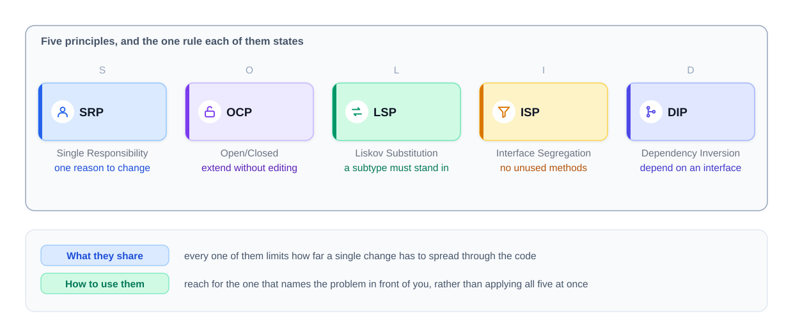
*Figure — the five principles and the single rule each one states (course diagram)*

The common thread: each principle **limits how far one change spreads**. Martin collected them around 2000; Feathers coined the acronym; OCP is Meyer's (1988), LSP is Liskov's (1987).

### The problem it solves

Code keeps changing; without guidelines classes grow until one edit breaks three features. SOLID gives cleaner, more flexible, reusable code with fewer bugs — and **a shared vocabulary** ("this breaks ISP") so design debates are settled by argument, not taste.

### How to use SOLID (the honest version)

Treat each principle as a **name for a problem**; when code hurts to change, find the name; apply the fix **when a real change asks for it**; always state the cost. Applied blindly, SOLID yields a maze of one-implementation interfaces.

### TL;DR

Five guidelines that keep one change from spreading. Diagnose with them, apply on real change, state the cost.

---

## 4.2 Single Responsibility Principle (SRP)

### What it is

**A class should have only one reason to change** — sharpened in *Clean Architecture* to **one, and only one, actor** (a person or group who can request a change). Analogy: a Swiss army knife has three jobs, so three reasons to change; a kitchen knife has one. Note: SRP is about classes/modules; "a function should do one thing" is a separate *Clean Code* rule.

### The problem it solves

When one class serves several groups, every edit for one group ships inside code the others rely on: a payroll tweak can break an operations report.

### What counts as one responsibility?

"One thing" has no yardstick; the **actor** test does: *who can send a change request for this code?*

| Method | Who asks for the change | Example request |
|---|---|---|
| `calculatePay` | Finance | "Overtime starts after 38 hours, not 40." |
| `reportHours` | Operations | "Show the week-ending date." |
| `save` | Database team | "Move from SQL to a document store." |

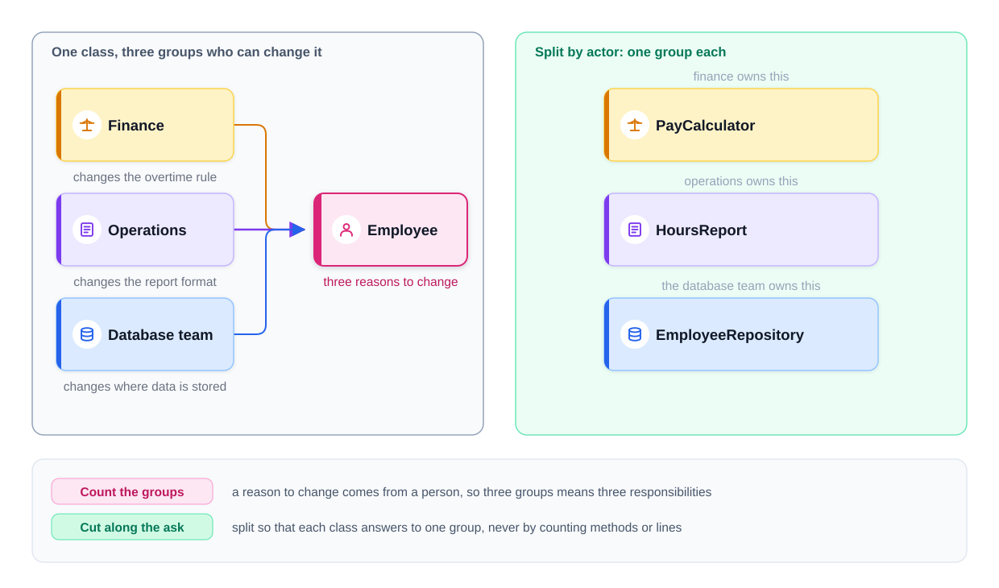
*Figure — finance, operations and the database team all reach into one Employee class; splitting by actor gives each group its own class (course diagram)*

Martin's trap: `calculatePay` and `reportHours` share a helper `regularHours()`; finance changes it and the operations report silently breaks. **Accidental duplication** — code that looks the same but changes for different reasons must not be merged.

### How it works

List methods → name who would change each → group by actor → one class per group, named after its job → plain data in a `record` → run the three checks below.

### Java example: splitting `Employee` by actor

Before, `Employee` holds `calculatePay()`, `reportHours()` and `save()`. After:

```java
// File: code/lld/ch04/srp/after/Employee.java
public record Employee(String name, int hoursWorked, BigDecimal hourlyRate) { }

// File: code/lld/ch04/srp/after/PayCalculator.java
/** Only Finance asks for changes to this class. */
public class PayCalculator {
    private static final int OVERTIME_THRESHOLD = 40;
    private static final BigDecimal OVERTIME_MULTIPLIER = new BigDecimal("1.5");

    public BigDecimal calculatePay(Employee e) {
        int overtime = Math.max(0, e.hoursWorked() - OVERTIME_THRESHOLD);
        int normal = e.hoursWorked() - overtime;
        BigDecimal normalPay = e.hourlyRate().multiply(BigDecimal.valueOf(normal));
        BigDecimal overtimePay = e.hourlyRate().multiply(OVERTIME_MULTIPLIER)
                .multiply(BigDecimal.valueOf(overtime));
        return normalPay.add(overtimePay).setScale(2, RoundingMode.HALF_EVEN); // cents
    }
}
// HoursReport.format(Employee)        -- Operations
// EmployeeRepository.save(Employee)   -- Database team
```

Full runnable code: code/lld/ch04/srp/ (`before/`, `after/`) (see the Full Edition).

Output is identical before and after (`Pay: 950.00`); what changed is who must be consulted before an edit.

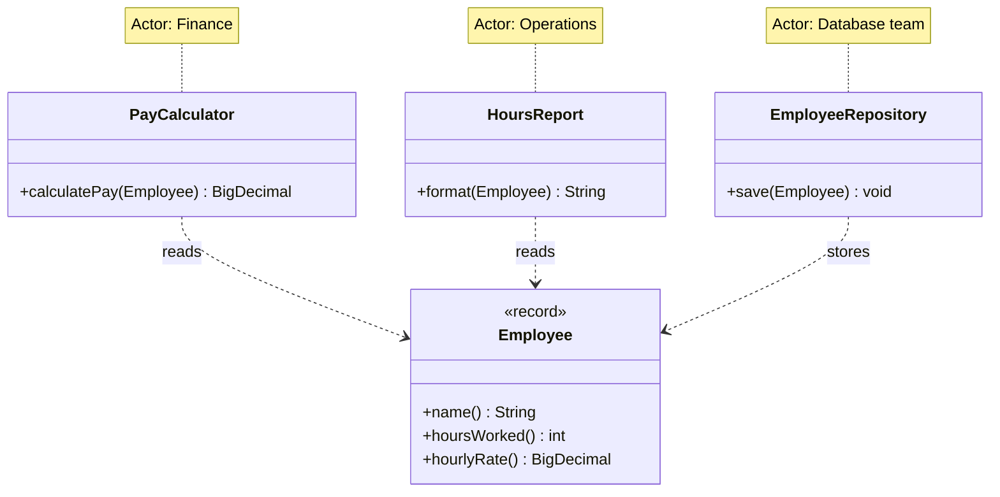

### Where splitting goes wrong

Chopping by verb gives tiny classes always edited together — worse than no SRP. Three checks: (1) **Do the pieces change together?** (same commits = one responsibility); (2) **Does each name stand alone?** (`PayCalculator` yes, `EmployeeHelper` no); (3) **Could it be used elsewhere?** Also, **splitting doesn't automatically reduce dependencies** — deciding what each piece may know of the other is cohesion (4.3) and coupling (4.4).

### Why SRP is important

Simpler maintenance, reuse, growth by adding classes, high cohesion — and a seam that *enables* low coupling (only an abstraction across it finishes the job).

### Trade-offs

| You gain | You pay |
|---|---|
| One group's change touches only its code | More classes and files |
| Small classes, easy tests, clear ownership | Wiring; risk of over-splitting |

### When not to use it

You can't name two actors; short-lived scripts; pieces that always change together.

### Common mistakes

Splitting by method count or verbs; `Helper`/`Utils` classes; merging "duplicates" owned by different actors; thinking SRP means "one method"; confusing it with "a function does one thing".

### Code smells that point to SRP (from *Refactoring*)

**Divergent Change** (SRP broken), **Large Class**, and **Shotgun Surgery** (often from *over*-splitting). Fix: **Extract Class**, **Move Function/Field**.

### Real-world examples

Spring `@Controller`/`@Service`/`@Repository`; `DateTimeFormatter` vs `LocalDate`; Logback/Log4j 2 logger, appender and layout.

### In the interview

**30-second answer:** "One reason to change — really, one actor. I ask who would request changes to each method. If finance, operations and the DBAs can all edit `Employee`, I split it into `PayCalculator`, `HoursReport` and `EmployeeRepository` and keep `Employee` as data. It costs classes and wiring, so I only split when I can name the groups."

*"Would you always split?"* — No; if the halves always change together I've made two files for nothing.

### Self-check

1. **Q:** What is an actor? **A:** A person or group who can request a change.
2. **Q:** The three checks for a good split? **A:** Change together? Name stands alone? Usable elsewhere?
3. **Q:** Does splitting always lower coupling? **A:** No — the dependency must point at an abstraction.

### TL;DR

One class, one actor. Split along actors, keep data in a record, don't split what always changes together.

---

## 4.3 Cohesion

### What it is

How closely the contents of one class belong together. **High**: every method serves one purpose. **Low**: unrelated jobs bundled.

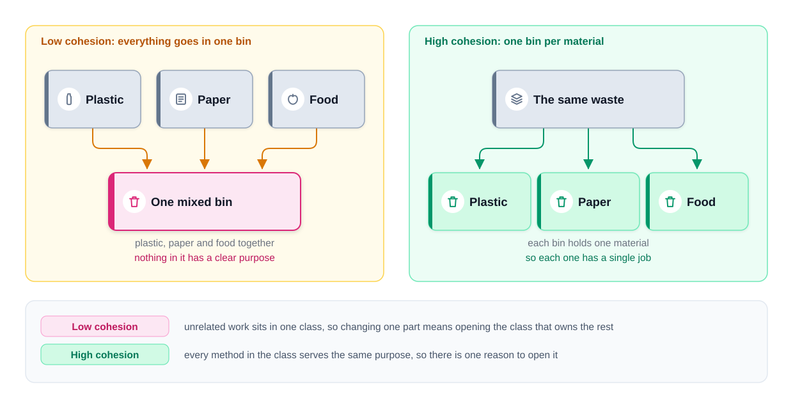
*Figure — one mixed bin (low cohesion) next to one bin per material (high cohesion) (course diagram)*

### The problem it solves

Both directions hurt: unrelated jobs in one class (edit one, redeploy all), and one job **scattered** across classes (hunt for every piece).

### The classic types of cohesion

Constantine, Yourdon, Myers (1970s), worst → best:

| Type | What groups the code | Example |
|---|---|---|
| **Coincidental** | Nothing | `Utils` with `formatDate`, `sendEmail`, `parseCsv` |
| **Logical** | Category chosen by a flag | `handle(type)` with a big `switch` |
| **Temporal** | Run at the same time | `startup()` opens DB, warms caches, prints banner |
| **Procedural** | Steps in order | validate, log, retry |
| **Communicational** | Same data | `ReportBuilder` methods on one `Order` list |
| **Sequential** | Output feeds next step | `parse → validate → transform` |
| **Functional** (best) | One well-defined task | `PayCalculator` |

Aim for functional; treat coincidental (the `Utils` class) as a warning.

### How it works

Check which fields each method uses; disjoint groups for different purposes → split them; gather scattered pieces of one job.

### Java example

`UserManager` mixed user bookkeeping (`users`) with audit-file work (`auditLines`). After the split:

```java
// File: code/lld/ch04/cohesion/after/AuditFile.java
/** HIGH cohesion: only audit-log work lives here. */
public class AuditFile {
    private final List<String> lines = new ArrayList<>();

    public void writeLine(String line) {
        // ...
    }

    public List<String> readAll() {
        // ...
    }
}
// after/UserManager keeps only users: addUser, deleteUser
```

Full runnable code: code/lld/ch04/cohesion/ (`before/`, `after/`) (see the Full Edition).

Same output; a new audit format now edits only `AuditFile`. Cost: the caller holds two objects.

### Cohesion and SRP

High cohesion = one job = SRP. Aim for cohesion and SRP tends to follow.

### Trade-offs

Gain: easy to name, read, test; changes land in one class. Cost: more classes to wire.

### When not to use it

Don't split an already functionally cohesive class just to shrink it.

### Common mistakes

Calling one mixed class a "coupling problem" (coupling needs two classes); `Utils` dumping grounds.

### Real-world examples

`java.lang.Math` (functional); `java.util.Collections` (drifting toward logical).

### In the interview

**30-second answer:** "Cohesion is how much the things inside one class belong together. Two method groups touching different fields for different reasons mean low cohesion, so I split. It's SRP seen from inside the class." A big class can still be cohesive — size is a hint, not the measure.

### Self-check

1. **Q:** Worst kind? **A:** Coincidental.
2. **Q:** One job spread over three classes — cohesion problem? **A:** Yes.

### TL;DR

One purpose per class; split disjoint groups; gather scattered pieces.

---

## 4.4 Coupling

### What it is

How much one class depends on another — always a **pair**. **Loose**: change, replace or test one without the other. **Tight**: changing one forces changing the other. Analogy: a remote for one TV vs a universal remote using an agreed signal — the signal is the **interface**.

### The problem it solves

Tight coupling blocks swapping (MySQL → Postgres), blocks unit tests without the real dependency, and spreads changes in how the dependency is constructed.

### The classic types of coupling

Worst → best:

| Type | What A knows about B | Example |
|---|---|---|
| **Content** | B's internals | Reflection setting a private field |
| **Common** | Shared mutable globals | Both use a `public static Map` |
| **External** | A shared external format | Both parse one hand-rolled file format |
| **Control** | A flag telling B *how* | `print(doc, boolean asPdf)` |
| **Stamp** | Whole structure for one field | `sendInvoice(Customer c)` reads `c.email()` |
| **Data** | Only needed values | `sendInvoice(String email, Money total)` |
| **Message** (lowest) | A message through an interface | `notifier.send(message)` |

Goal: **depend on interfaces, pass only what's needed, never share mutable globals.**

### How it works

Find where A **names** B (field type, `new B()`, `B.x()`); if A only needs *something that does the job*, describe the job as an interface, accept it in A's constructor, let the entry point choose.

### Java example: three steps with `Student`

**Start:** `Student` holds data and talks to MySQL (a cohesion problem). **Step 1:** extract `MySqlDatabase` — cohesion fixed, coupling **tight** (`private final MySqlDatabase database = new MySqlDatabase(); // hard-wired`). **Step 2:** depend on an interface:

```java
// File: code/lld/ch04/coupling/decoupled/Student.java
/** Step 2: Student names no database at all -> LOOSE coupling. */
public class Student {
    private final String studentId;
    private final StudentRepository repository;

    public Student(String studentId, StudentRepository repository) {
        this.studentId = studentId;
        this.repository = Objects.requireNonNull(repository);
    }

    public void save() {
        repository.save(studentId);
    }
}
// StudentRepository { void save(String studentId); }
// implemented by MySqlStudentRepository and InMemoryStudentRepository (test double)
```

Full runnable code: code/lld/ch04/coupling/ (`start/`, `extracted/`, `decoupled/`) (see the Full Edition).

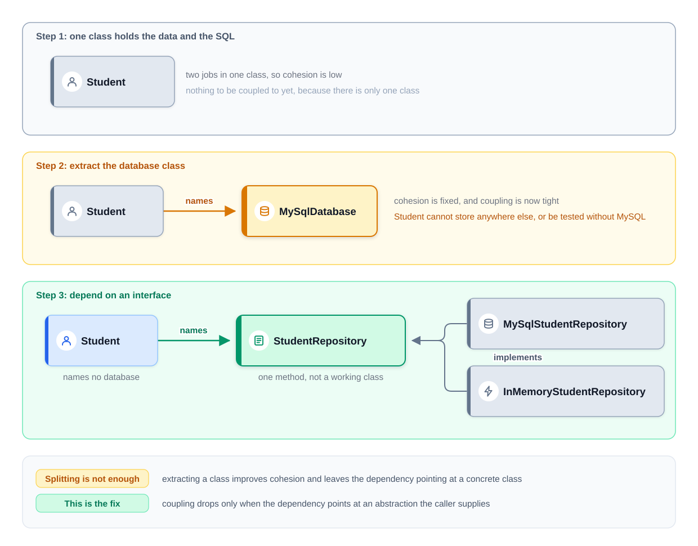
*Figure — the three steps: one class with two jobs, an extracted but tightly coupled class, and a class that depends on an interface (course diagram)*

Postgres is now a new class passed in; a test passes the in-memory one. This is DIP (4.10), the standard cure for tight coupling.

### Coupling and SRP

SRP fixed cohesion but left `Student` welded to MySQL; pointing the dependency at an interface fixed coupling. SRP *usually* lowers coupling, never *guarantees* it.

### Trade-offs

| Loose coupling gains | Costs |
|---|---|
| Swap implementations; fakes in tests; no ripple | Extra interface and parameter; someone must wire it; one more hop to the real code |

### When not to use it

Not for **stable** classes (`String`, `LocalDate`, pure calculations); a one-implementation interface with no fake is just a file.

### Common mistakes

"I extracted a class so coupling is lower"; hiding `new ConcreteThing()` in a constructor; stamp coupling.

### Real-world examples

JDBC interfaces with vendor drivers; SLF4J; USB/HTTP/SQL as agreed signals.

### In the interview

**30-second answer:** "Coupling is how much one class depends on another. Where a class names a concrete collaborator but only needs the job done, I make the job an interface and pass the implementation in — swap MySQL for Postgres, test with a fake. Not for stable things like `String`." Can SRP increase coupling? Yes, if the extracted class is built around its parent's exact needs.

### Self-check

1. **Q:** Can one class be tightly coupled? **A:** Not to itself; two jobs in one class is cohesion.
2. **Q:** Control coupling? **A:** A flag telling the other code how to behave.

### TL;DR

Depend on an interface and pass the implementation in; extracting a class alone isn't enough.

---

## 4.5 Separation of Concerns (SoC)

### What it is

Split a program so each part handles one **concern** (storage, validation, display). Dijkstra, 1974. Analogy: kitchen, waiters and cashier — a new menu doesn't change payment.

### The problem it solves

Mixed concerns force edits in unrelated code. Separation gives modularity, maintainability, reusability, testability.

### How it works

List concerns, one module each, small clear methods between them; **test: count the modules a likely change opens — ideally one.**

### Java example: user registration

`UserStore` stores without judging; `UserService` decides and asks storage to save:

```java
// File: code/lld/ch04/soc/UserService.java
    public boolean registerUser(String username, String email) {
        if (!isValidUsername(username)) {
            System.out.println("Rejected: " + username + " is too short");
            return false;
        }
        if (!isValidEmail(email)) {
            System.out.println("Rejected: " + email + " is not an email address");
            return false;
        }
        store.addUser(username, email);
        return true;
    }
```

Full runnable code: code/lld/ch04/soc/ (see the Full Edition).

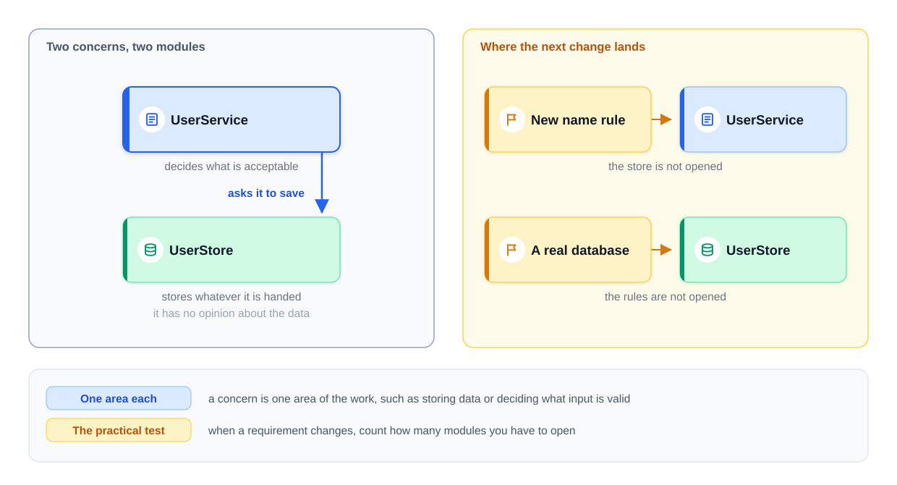
*Figure — UserService decides what is acceptable and asks UserStore to save it; each change lands in one module (course diagram)*

| Change | Module you open |
|---|---|
| In-memory list → database | `UserStore` only |
| Usernames ≥ 8 characters | `UserService` only |
| Test rules without a DB | Give `UserService` a stand-in store |

### SoC and SRP

Same instinct at different scale: SRP for a class, SoC for modules and layers.

### Trade-offs

Gain: local changes, isolated tests. Cost: more boundaries; cross-cutting concerns (logging, security, transactions) still span modules and need aspects or decorators.

### When not to use it

A 50-line script. Separate concerns that change for different reasons or speeds.

### Common mistakes

Validation hidden in the DAO; layers calling each other in every direction.

### Real-world examples

MVC; HTML/CSS/JS; controller → service → repository; Spring `@Transactional` proxies.

### In the interview

**30-second answer:** "Each module handles one area of work. My test: how many modules does a requirement change open? Ideally one. It's SRP at module size."

### Self-check

1. **Q:** SoC vs SRP? **A:** Mostly size — class vs modules/layers.

### TL;DR

One module per area of work; measured by modules opened per change.

---

## 4.6 SRP vs cohesion vs coupling vs SoC — one table

| Idea | Question it asks | Scope | Relation to SRP |
|---|---|---|---|
| **SRP** | How many actors can ask this class to change? | Class/module | — |
| **Cohesion** | Do the parts belong together? | Inside one unit | SRP usually raises it |
| **Coupling** | How much does A depend on B? | Between two units | SRP tends to lower it; needs abstractions |
| **SoC** | Is each area of work in its own module? | Modules, layers | SRP everywhere is one route to it |

**"High cohesion, low coupling":** SRP gets the first half, DIP the second.

---

## 4.7 Open/Closed Principle (OCP)

### What it is

**Open for extension, closed for modification:** add behaviour by adding code, not editing working code. **Meyer's OCP** (1988): a published class is closed and extended by **inheritance**. **Martin's polymorphic OCP** (1996): stable code depends on an **interface**; new behaviour arrives as new implementations — the version used today. Analogy: a console gains a racing wheel through a standard port without being opened.

### The problem it solves

A growing `if/else`/`switch` on a type code: each case edits tested code, often in several copies. **Quick test:** *can I add the next case without opening this file?*

### How it works

Wait for a real second case → identify the part that varies → make it an interface → one class per variant → the stable class **delegates** → new variants are new classes → choose the variant once, at the edge (entry point, factory, map, config).

### Java example: invoice formats

Before: `generate(String invoiceType)` branches on `"basic"` / `"international"` and throws for unknown types — each new type edits working code. After:

```java
// File: code/lld/ch04/ocp/after/InvoiceGenerator.java
@FunctionalInterface
public interface InvoiceGenerator {
    void generate(BigDecimal amount);
}

// File: code/lld/ch04/ocp/after/Invoice.java
public class Invoice {
    private final BigDecimal amount;
    private final InvoiceGenerator generator;
    // ...
    public void generate() {
        generator.generate(amount); // no branching
    }

    // Still closed? No -- a new discount rule would still edit this class.
    // That is fine until discounts actually start to vary.
    public void applyDiscount() {
        // ...
    }
}
// BasicInvoiceGenerator, InternationalInvoiceGenerator, and the ONLY new code
// for format three: DetailedInvoiceGenerator
```

Full runnable code: code/lld/ch04/ocp/ (`before/`, `after/`) (see the Full Edition).

The classes are named *generators* (not `BasicInvoice`, which would imply a subtype). As a `@FunctionalInterface`, a **lambda** is also an extension — OCP with zero new files.

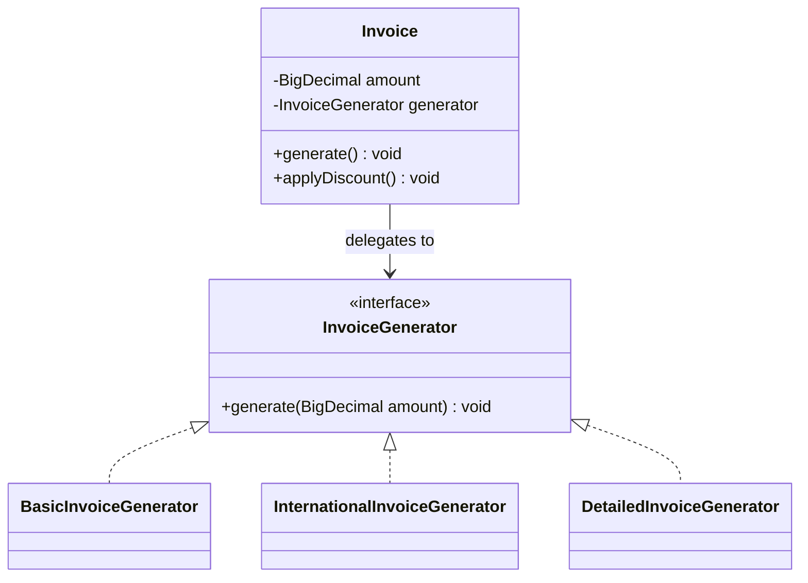

This shape is the **Strategy pattern** — OCP for a varying algorithm.

### Why not just subclass `Invoice`?

Subclassing is also OCP (Meyer's style) and fine when small. Delegation wins with **a second dimension** (3 formats × 4 currencies = 12 subclasses vs 3 + 4 = 7 classes) and **run-time choice** (pick or replace the generator once the country is known).

### What is still not closed

`applyDiscount` still edits `Invoice` — fine. **A class is closed against a specific kind of change**, one you've seen happen. Martin: **strategic closure**.

### Approaches to OCP

| Approach | Pattern / Java feature | Good when |
|---|---|---|
| Interface + delegation | Strategy, `Comparator` | Algorithm varies, chosen at run time |
| Inheritance + overriding | Template Method | Fixed skeleton, a few steps vary |
| Wrapping | Decorator (`BufferedInputStream`) | Add features around behaviour |
| Listening | Observer | New reactions to events |
| Plug-ins / registry | map, `ServiceLoader` | Third parties add features |
| Functions | lambdas, `java.util.function` | Small one-method variations |
| Data / configuration | rules engines, feature flags | Variants are just numbers |

The `switch` often survives — moved to **one** place at the edge (a factory or `Map<String, InvoiceGenerator>`).

### Importance of OCP

Extend without touching the tested core; test only the new class; fewer regressions; adaptability.

### Caution: do not over-engineer

Write the `if` first; add the interface at the second or third case (**rule of three**). Unused extension points are **Speculative Generality**.

### How OCP relates to SRP

Changing parts end up in single-job classes; SRP usually comes first because the extension point stays hidden until the class has one job.

### Trade-offs

| You gain | You pay |
|---|---|
| New variants without editing; each tested alone; run-time choice | Interface + class per variant; flow spread over files; someone must choose the variant |

### When not to use it

Nothing has varied; variants are just numbers; the set is small and fixed — there Java 21 **sealed interfaces + pattern-matching `switch`** fit (compiler checks every case; easy to add operations, hard to add types).

### Common mistakes

"Never edit a file" (bug fixes and refactoring still edit); plug-in systems for one implementation; moving one `switch` into five factories.

### Refactorings and smells

Smell **Repeated Switches**; fixes **Replace Conditional with Polymorphism**, **Replace Type Code with Subclasses**.

### Real-world examples

`list.sort(comparator)`; Java I/O decorators; servlet filters / `HandlerInterceptor`; JDBC drivers via `ServiceLoader`; IDE and browser plug-ins.

### In the interview

**30-second answer:** "I should add the next variation by adding code. When a `switch` over a type keeps growing, I put the varying behaviour behind an interface, one class per variant, and the stable class delegates — Strategy. Only once the variation is real, and closure is against a specific kind of change." Late requirement ("trucks pay a different rate"): "add a class" beats "add a branch".

### Self-check

1. **Q:** Is `Invoice` closed against new discounts? **A:** No, only formats — fine until discounts vary.
2. **Q:** Which pattern is OCP for an algorithm? **A:** Strategy.
3. **Q:** Quick OCP test? **A:** "To add the next case, must I open this file?"

### TL;DR

Varying part behind an interface, variants as classes, chosen at the edge — once variation is real.

---

## 4.8 Liskov Substitution Principle (LSP)

### What it is

**A subtype must be usable wherever its parent is expected without making the program incorrect** (Liskov 1987; with Wing 1994, *behavioural subtyping*). "Substitutable" means **correct results**, not "it compiles". Analogy: promised "a car that takes petrol", handed an electric car.

### The problem it solves

If a subclass secretly behaves differently, callers must check `instanceof` — polymorphism and OCP are lost.

### Example 1: `Car` and `ElectricCar`

```java
// File: code/lld/ch04/lsp/car/before/ElectricCar.java
/** VIOLATION: inherits a promise (refuel) it cannot keep. */
public class ElectricCar extends Car {
    @Override
    public void refuel() {
        throw new UnsupportedOperationException("Electric cars don't need refueling");
    }
    // ... plus its own recharge()
}
```

LSP is tested by code that **doesn't know** the subclass: `service(Car car)` calls `start`, `refuel`, `stop` and crashes.

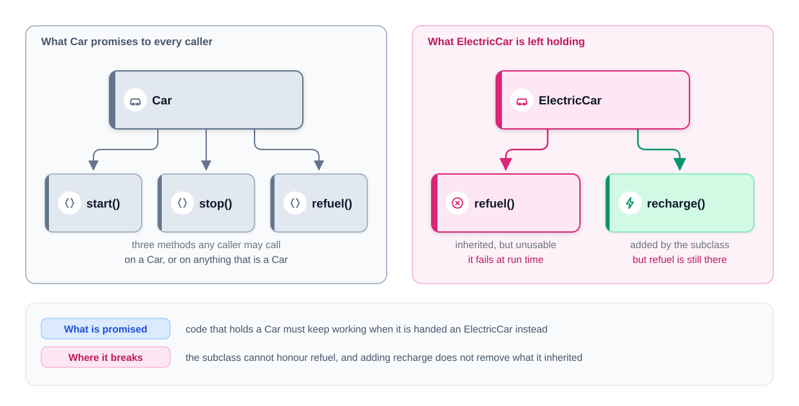
*Figure — what Car promises every caller, and the unusable refuel() that ElectricCar is left holding (course diagram)*

Root cause: `refuel()` names a **mechanism**, not the shared **goal**. **Raise a general parent** — `abstract class Vehicle { start(); stop(); abstract replenishEnergy(); }` — with `Car` and `ElectricCar` as **siblings**. Secretly charging inside `refuel()` would keep a lying name; adding only `recharge()` is invisible to `Vehicle` callers; and substitution is **child → parent, never between siblings**.

Break a hierarchy when a subclass can't implement a parent method, a base method names a mechanism, callers test the type, or subclasses share almost nothing. Fix: raise a parent, or move the varying behaviour out with composition.

### Example 2: birds, and composition instead of inheritance

`fly()` on `Bird` forces `Penguin` to throw (**Refused Bequest**). Inheritance is **is-a** (gets every method); composition is **has-a**. Fix: no bird subclasses — each `Bird` gets a `MovementStyle`:

```java
// File: code/lld/ch04/lsp/birds/composition/Bird.java
/** A bird HAS-A movement style. No subclasses, so nothing is inherited and refused. */
public final class Bird {
    private final String name;
    private MovementStyle movement;
    // ...
    /** Tell, don't ask: callers say "travel", the bird decides how. */
    public void travel() {
        movement.move(name);
    }

    /** Composition can change behaviour at run time (e.g. an injured bird). */
    public void changeMovement(MovementStyle movement) {
        this.movement = Objects.requireNonNull(movement);
    }
}
// MovementStyle { void move(String birdName); } -> Flying, Swimming, Running
```

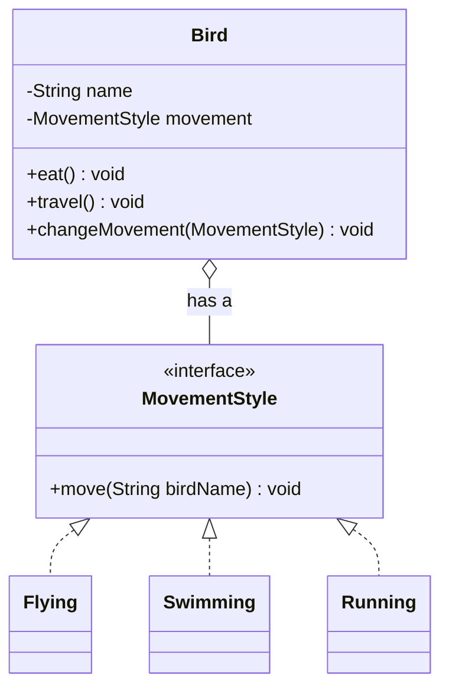

| | Inheritance | Composition |
|---|---|---|
| Link | Penguin **is a** Bird | Bird **has a** MovementStyle |
| Change behaviour | add a subclass | supply another object |
| At run time? | no | yes |
| LSP risk | high | low |

Inherit when the child truly keeps every promise; compose when behaviour varies or a subclass rejects something (throws, does nothing, "never call this on X").

### Tell, Don't Ask

(Hunt & Thomas) **Tell an object what to do; don't inspect it and decide for it.** `if (bird instanceof Penguin) { swim(bird); } else { fly(bird); }` must know every subtype; `bird.travel()` works with any substitute. `instanceof` on a base type hints the base promises the wrong thing.

### The rules a subclass must follow

The dangerous violations are **silent**. `Square extends Rectangle` couples the setters: set width 5, height 4, expect 20, get **16**. `Rectangle`'s unwritten promise was *width and height change independently*. **Base inheritance on the promises in code, not on real-world classification.**

A subclass may not **require more**, **give less**, or **break an assumption** (Meyer's Design by Contract: preconditions, postconditions, invariants):

1. **Preconditions may not be strengthened** — `SmallOrderDiscount` rejects amounts ≥ 100 that `Discount` accepts.
2. **Postconditions may not be weakened** — `OverdraftAccount.withdraw` lets the balance go negative where `Account` guaranteed ≥ 0.
3. **Invariants must be preserved** — `Square` (also describable as a weakened `setWidth` postcondition). Hardest: invariants are rarely written down.
4. **No new exceptions** — `ElectricCar.refuel()`. Java checks only **checked** exceptions. Loudest, least harmful.
5. **History constraint** (Liskov & Wing) — no state changes the parent forbids: `AdjustablePrice extends Price` adds `adjust()`, so a quote of 100 is charged 120. Why `String`/`Integer` are `final`.

```java
// File: code/lld/ch04/lsp/rules/Square.java
/** RULE 3 BROKEN: to stay square it couples the two setters -- a silent wrong answer. */
public class Square extends Rectangle {
    // ...
    @Override
    public void setWidth(int width) {
        this.width = width;
        this.height = width;
    }
    // ...
}
```

The fix: no shared mutable promise — immutable shapes that promise only `area()`:

```java
// File: code/lld/ch04/lsp/shapes/Shape.java
public sealed interface Shape permits Rect, Sq {
    int area();
}

// File: code/lld/ch04/lsp/shapes/Rect.java
public record Rect(int width, int height) implements Shape {
    public Rect withWidth(int w) {
        return new Rect(w, height);
    }
    // ...
}
```

Full runnable code: code/lld/ch04/lsp/ (`car/before/`, `car/after/`, `birds/inheritance/`, `birds/composition/`, `rules/`, `shapes/`) (see the Full Edition).

```text
  OverdraftAccount: balance after payment: -30.00   <-- the caller never expected this
  Square:    expected area 20, got 16
  quoted 100.00, charged 120.00
```

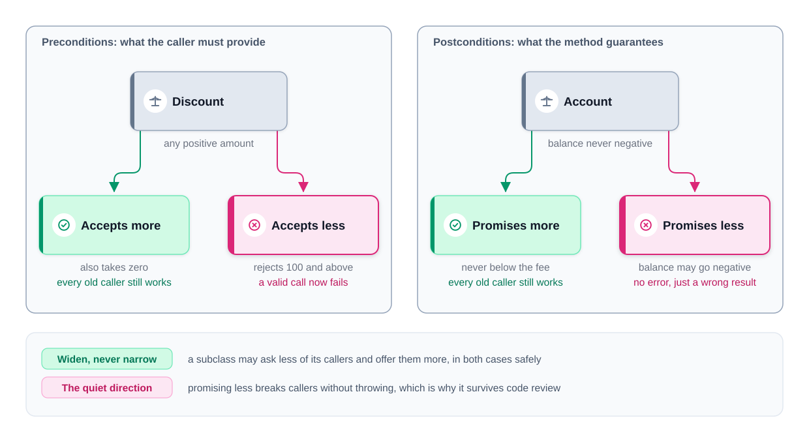
*Figure — preconditions and postconditions: accepting more or promising more is safe; accepting less or promising less breaks callers (course diagram)*

| Rule | The subclass may not… | Usually shows up as |
|---|---|---|
| Preconditions | demand more | valid input rejected |
| Postconditions | guarantee less | a returned value breaks an assumption |
| Invariants | break a rule that always held | a silently wrong result |
| Exceptions | throw something new | crash with no matching `catch` |
| History | allow changes the parent forbids | a "fixed" value changes between reads |

**Signature rules** (Java checks these): covariant returns allowed; no new/broader checked exceptions; no reduced visibility; parameter types must match exactly (else it's an **overload** — use `@Override`). Java checks **none** of the behavioural rules.

### How to check a subclass

1. List the parent's **promises** (not signatures) first. 2. **Write one test against the parent type and run it for every subclass** (`resizeAndCheck(Rectangle)` fails for `Square`) — an abstract contract test in JUnit.

### Why LSP is important

No fragile surprises; polymorphism without `instanceof` (what makes OCP work); correct results; safe reuse.

### Trade-offs

Gain: callers trust the base type; safe new subclasses; run-time flexibility via composition. Cost: contracts to think through and document; "natural" hierarchies abandoned; more small objects.

### When not to use it

LSP is never optional with polymorphism; what you can skip is inheritance — if a subclass can't keep the promises, don't make it one.

### Common mistakes

Modelling the real world; "fixing" by silently doing nothing; thinking LSP is only about exceptions; expecting siblings to substitute.

### Refactorings and smells

**Refused Bequest** → Replace Subclass/Superclass with Delegate, Extract Superclass, Push Down Method.

### Real-world examples

`java.sql.Date` (`getHours()` throws); `java.sql.Timestamp` (asymmetric `equals`, "implementation inheritance"); `Stack extends Vector` (use `Deque`); `List.of(...).add` throws (an "optional operation").

### In the interview

**30-second answer:** "A subclass must work anywhere its parent is expected with correct results. It can't demand more, promise less, break invariants, throw new exceptions or allow forbidden state changes. Mutable Square/Rectangle is the classic silent break. I test with one base-type test for every subclass; when a subclass must refuse a method, I raise a better parent or compose."

*"Is `ElectricCar` a substitute for `Car` after the fix?"* — No, nor should it be; both substitute for `Vehicle`.

### Self-check

1. **Q:** Subclass accepts fewer inputs — which rule? **A:** Preconditions strengthened.
2. **Q:** Why is Square worse than `refuel()` throwing? **A:** Silent wrong answer vs loud failure.
3. **Q:** History constraint? **A:** No state changes the parent forbids.

### TL;DR

Accept at least as much, deliver at least as much, keep invariants and history, throw nothing new. Inherit by promises; otherwise raise a parent or compose.

---

## 4.9 Interface Segregation Principle (ISP)

### What it is

**Clients should not be forced to depend on methods they do not use.** Origin: Martin at Xerox, where one `Job` class used by every task meant any change rebuilt all tasks. A **fat interface** grew feature by feature; a **role interface** describes one kind of caller's needs. Analogy: the 40-page menu for someone who wants coffee.

### The problem it solves

Implementers must throw or no-op (also an LSP break); callers depend on methods they never call; test fakes grow long.

### Example: a bloated `Printer` interface

```java
// File: code/lld/ch04/isp/fat/BasicPrinter.java
/** VIOLATION: forced to "implement" three methods it can only refuse. */
public class BasicPrinter implements Printer {
    // ...
    @Override
    public void scanDocument(String doc) {
        throw new UnsupportedOperationException("BasicPrinter cannot scan");
    }
    // ... faxDocument and stapleDocument throw too
}
```

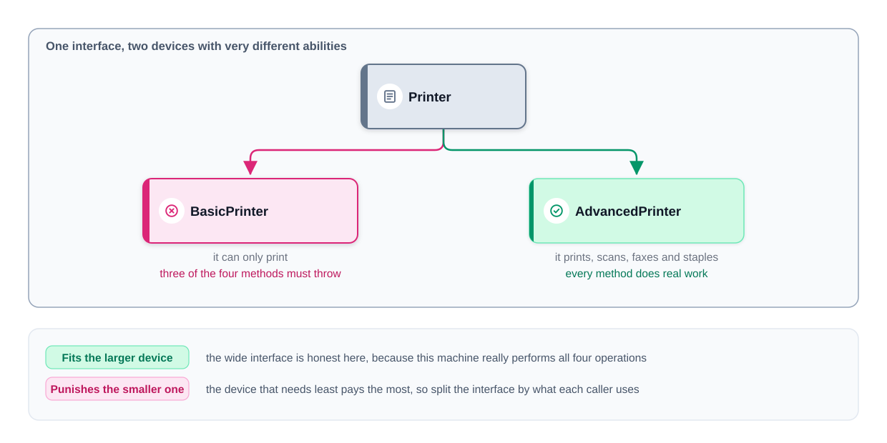
*Figure — one interface, two devices: it fits the larger device and punishes the smaller one (course diagram)*

### Restructuring: first attempt, one interface per capability

`Printer`, `Scanner`, `Fax`, `Stapler`; `BasicPrinter` implements one, `AdvancedPrinter` all four. Valid ISP — but **one interface per method is not the goal**.

### How small should an interface be?

**Group by caller, not by method.** Right size when both are "no": *is any implementer forced to supply what it can't honour?* and *does any caller depend on methods it never calls?*

Over-splitting cost: `OfficeWorkflow` (scan, print, staple) takes three parameters and gets **the same device three times** — `new OfficeWorkflow(adv, adv, adv)`. Grouping by role instead:

```java
// File: code/lld/ch04/isp/roles/DocumentProcessor.java
/** Role interface for callers that scan, print AND staple (e.g. OfficeWorkflow). */
public interface DocumentProcessor extends Printer {
    void scanDocument(String doc);

    void stapleDocument(String doc);
}
// OfficeWorkflow(DocumentProcessor) -- one dependency
// PrintQueue(Printer)               -- a BasicPrinter is enough
```

Full runnable code: code/lld/ch04/isp/ (`fat/`, `split/`, `roles/`) (see the Full Edition).

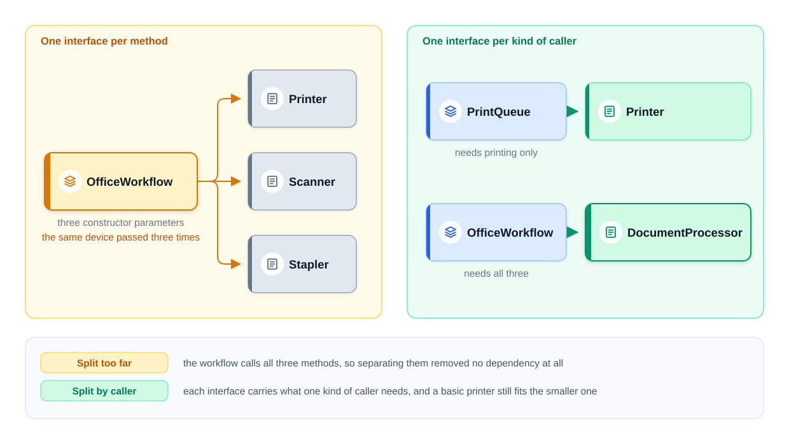
*Figure — split too far (three interfaces, the same device passed three times) vs split by caller (one role per kind of caller) (course diagram)*

| | Four one-method interfaces | Two role interfaces |
|---|---|---|
| Forced/unused methods? | No | No |
| Dependencies for `OfficeWorkflow` | 3 | 1 |
| Names to learn | 4 | 2 |

**Rule of thumb:** split only when you can **point to the caller** needing the smaller piece; merge interfaces always implemented and used together. In Python/JavaScript the interface is **the set of methods a caller actually calls** — the same needless dependency exists, just unchecked (`typing.Protocol`/`abc` can document it).

### Five signals of an ISP violation

| Signal | When it shows up | Example |
|---|---|---|
| Low cohesion in the interface | Reading it | `MediaDevice { playAudio; playVideo; recordVideo }` for a speaker |
| Fat interface, mechanism names | Reading it | `processCreditCard/PayPal/BankTransfer` → `PaymentMethod.pay(amount)` |
| Empty / throwing methods | Reading an implementer | `Vehicle { drive; fly; sail }` for a car |
| One interface, many roles | Comparing implementers | `Employee { calculateSalary; handleCustomerQueries; manageTeam }` |
| Long test stand-ins | Writing a test | dozens of empty bodies for one call |

### How it works (step by step)

List each caller's used methods → identical lists form a **role** → one interface per role (may extend each other) → classes implement every role they can honestly fill → each caller takes the narrowest role.

### Importance of ISP

No bloated implementers, no ripple across roles, simpler tests, clearer design.

### How ISP relates to the other principles

SRP for interfaces; OCP via new small interfaces; fat interfaces **force** LSP violations; DIP should depend on the smallest role.

### Trade-offs

Gain: no throwing methods, insulated callers, tiny fakes (lambdas for one-method roles). Cost: more names; over-splitting adds wiring; harder to see a device's full ability in one place.

### When not to use it

Every implementer supports everything and every caller uses it all; or you can't name the caller that wants less.

### Common mistakes

**One interface per method everywhere** (most common after learning ISP); splitting by implementer features; fat interface + empty adapter class (AWT `MouseAdapter`).

### Real-world examples

`Runnable`, `Comparable`, `AutoCloseable`, `Iterable`, `java.util.function`; `MouseListener`/`MouseAdapter`; Kotlin `List` vs `MutableList`; Spring Data `Repository`/`CrudRepository`/`PagingAndSortingRepository`.

### In the interview

**30-second answer:** "No caller should depend on methods it doesn't use. Symptoms: throwing implementations, fakes full of empty methods. I split by caller — one role per kind of caller, not per method — and only when I can name that caller." *SRP vs ISP?* SRP protects the class, ISP protects the caller.

### Self-check

1. **Q:** The two sizing questions? **A:** Forced-to-supply? Depends-on-unused?
2. **Q:** Why didn't four interfaces help `OfficeWorkflow`? **A:** It uses all three methods; no dependency was removed.

### TL;DR

One interface per kind of caller. Throwing methods = too wide; same object passed thrice = too thin.

---

## 4.10 Dependency Inversion Principle (DIP)

### What it is

1. **High-level modules should not depend on low-level modules; both depend on abstractions.**
2. **Abstractions should not depend on details; details depend on abstractions.**

High level = policy (*what*); low level = detail (*how*: SMTP, MySQL). **Inversion:** the call still goes policy → detail, but the **source-code dependency is reversed** — the detail implements an interface owned by the policy. Analogy: a lamp and a wall socket.

### The problem it solves

Policy tied to a vendor; untestable without infrastructure; library changes ripple up.

### Example: notifications

Before: `NotificationService` does `new EmailService()`. After: an interface **in the policy's package** (`app`, not `infra`) — **the high-level side owns the abstraction**:

```java
// File: code/lld/ch04/dip/app/NotificationService.java
/** High-level policy: depends only on an abstraction it owns. Imports nothing from infra. */
public class NotificationService {
    private final NotificationSender sender;

    public NotificationService(NotificationSender sender) { // constructor injection
        this.sender = Objects.requireNonNull(sender);
    }

    public void notifyUser(String userId, String message) {
        if (message.isBlank()) {
            throw new IllegalArgumentException("empty notification");
        }
        sender.send(userId, message);
    }
}
// app.NotificationSender { void send(String recipient, String message); }
// infra: EmailSender, SmsSender, RecordingSender (test double) implement it
```

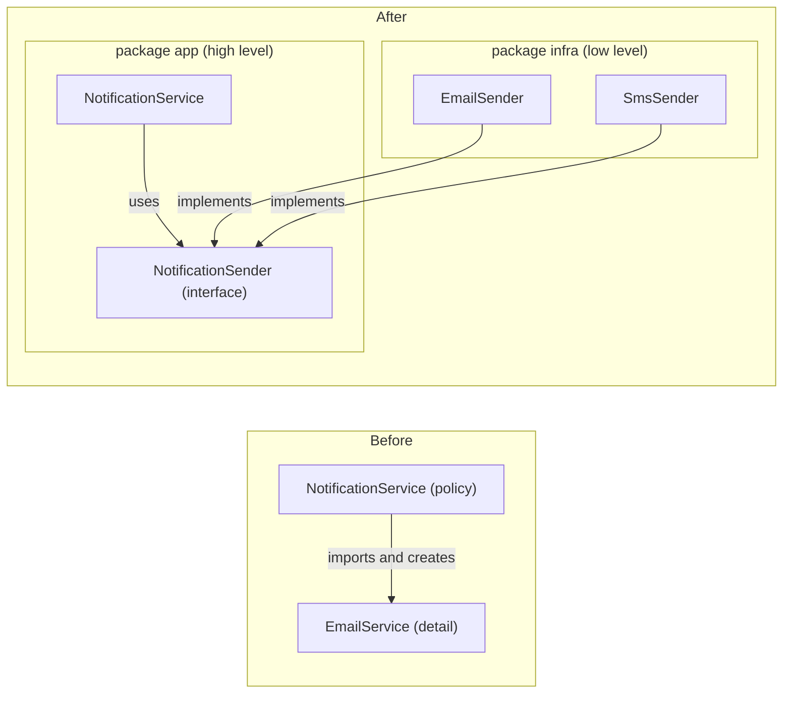

### DIP in practice: four real-world techniques

**1. Dependency Injection** — **constructor** (default; required, immutable), **setter** (optional with default), **method** (varies per call). The one place that does all the `new`-ing is the **composition root** (each `Main`).

**2. Service Locator** — a registry hands out services; `CheckoutFlow` depends on a `Locator` interface: `locator.paymentService(serviceName).processPayment(amount)`. It satisfies DIP, but hides real dependencies and fails late on a missing registration (Seemann: an anti-pattern). Prefer constructor injection.

**3. IoC containers** — Spring injects a single constructor automatically (`@Autowired` optional since 4.3). Without Spring: `new OrderService(new StripePayments())`. **The framework is a wiring convenience, not the principle.**

**4. Plug-in architecture** — the core owns the contract; plug-ins implement it:

```java
// File: code/lld/ch04/dip/plugin/MediaPlayer.java
/** The core. New formats arrive as plug-ins; this class is never edited for them. */
public class MediaPlayer {
    private final Map<String, AudioDecoder> decoders = new HashMap<>();

    public void install(AudioDecoder decoder) {
        decoders.put(decoder.extension(), decoder);
    }
    // ... play(fileName) looks up the decoder by extension
}
```

Full runnable code: code/lld/ch04/dip/ (`before/`, `app/`, `infra/`, `locator/`, `plugin/`) (see the Full Edition).

DI is small-scale (how one class gets collaborators); plug-ins are system-level (whole modules discovered at run time: `ServiceLoader`, OSGi).

### DIP vs DI vs IoC — do not mix them up

| Term | Kind | Example |
|---|---|---|
| **DIP** — depend on abstractions the policy owns | Principle | `NotificationService` → `NotificationSender` |
| **DI** — pass dependencies in | Technique | `new NotificationService(new SmsSender())` |
| **IoC** — the framework calls you (Hollywood Principle) | Broad idea; DI is one form | Spring beans, servlet `doGet`, JUnit `@Test` |
| **IoC container** | Tool | Spring `ApplicationContext`, Guice |

Injection without inversion: a `MySqlDatabase`-typed parameter. Inversion without a framework: this whole chapter.

### Stable vs volatile dependencies

Invert **volatile** dependencies (DBs, networks, clocks, third-party APIs, varying rules); use **stable** ones (`String`, `List`, `LocalDate`) directly.

### Importance of DIP

Swappable implementations, detail changes stay in the detail, fakes instead of real infrastructure.

### How DIP relates to the other principles

SRP (wiring moves to the composition root); OCP (new implementations without edits); LSP (implementations must be proper substitutes); ISP (own the smallest role).

### How it works (step by step)

Find policy naming a volatile detail → write its **need** in its own words → make it an interface **in the high-level package** → detail implements it → inject (constructor) → move concrete `new`s to the composition root.

### Trade-offs

Gain: technology-independent policy, easy tests, swappable parts. Cost: an interface per volatile dependency, wiring code, an extra hop.

### When not to use it

Stable classes; a single implementation forever with no fake; tiny scripts.

### Common mistakes

Interface in the low-level package; interface shaped by a vendor API (`sendSmtpMessage`); breaking clause 2 (returning `ResultSet`, throwing `MessagingException` — use domain types); "we use Spring so we follow DIP"; `new ConcreteThing()` "just this once".

### Real-world examples

JDBC + `ServiceLoader`; SLF4J; Spring / Jakarta CDI; JPA `EntityManager`; **hexagonal architecture** (ports and adapters — DIP for a whole service).

### In the interview

**30-second answer:** "Business logic depends on an abstraction it owns, not on technical details. `NotificationService` depends on a `NotificationSender` in its own package; email and SMS implement it; I inject via the constructor and wire in `main`, so it's testable with a fake. DI is the technique, DIP the principle, Spring a wiring tool." *Who owns the interface?* The high-level module.

### Self-check

1. **Q:** What is inverted? **A:** The source-code dependency.
2. **Q:** Composition root? **A:** The one place concrete classes are created and wired.
3. **Q:** `String` behind an interface? **A:** No — it's stable.

### TL;DR

Policy owns the interfaces; details implement them; `main` wires them.

---

## 4.11 Refactoring one class through all five principles

The principles usually appear **in sequence**, each exposing the next. One checkout class that validates, prices, saves and emails is refactored five times.

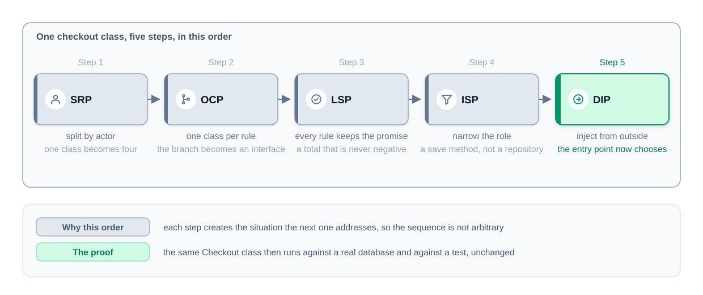
*Figure — one checkout class, five steps: SRP, OCP, LSP, ISP, DIP, each creating the situation the next addresses (course diagram)*

### Step 0: the starting class

`OrderService.process(CustomerOrder)` does it all: rejects non-positive amounts (business-rules owner), branches on `customerType` for `"member"` (0.90) and `"staff"` (0.70) (finance), prints an `INSERT` (database team), and emails the total (marketing). It works — and every principle objects. (Code: `code/lld/ch04/checkout/step0/`.)

### Step 1: Single Responsibility — split by actor

Four actors → `OrderValidator`, `PriceCalculator`, `OrderRepository`, `Notifier`, coordinated by a `Checkout` that still `new`s them itself. The customer-type `switch` survives inside `PriceCalculator` (`code/lld/ch04/checkout/step1/`).

### Step 2: Open/Closed — one class per pricing rule

```java
// File: code/lld/ch04/checkout/pricing/PricingRule.java
/**
 * STEP 2 (OCP): one class per rate; a new rate is a new class.
 * CONTRACT every implementation must keep (STEP 3, LSP):
 *   precondition : amount >= 0
 *   postcondition: result >= 0, rounded to 2 decimals   (a total is never negative)
 */
@FunctionalInterface
public interface PricingRule {
    BigDecimal apply(BigDecimal amount);
}
// RegularPrice, MemberDiscount, StaffDiscount; Order no longer carries a type string
```

`step2.PriceCalculator.total(order, rule)` is now just `rule.apply(order.amount())` — no branch (`code/lld/ch04/checkout/step2/`).

### Step 3: Liskov Substitution — every rule keeps the promise

A careless fixed discount of 20 turns a 10 order into **−10**, silently saved. Every rule must return a total **never below zero**; one contract test (`PricingRuleContract.holds`, in `code/lld/ch04/checkout/step3/`) runs against every implementation:

```java
// File: code/lld/ch04/checkout/pricing/FixedDiscount.java
    @Override
    public BigDecimal apply(BigDecimal amount) {
        return amount.subtract(off).max(BigDecimal.ZERO).setScale(2, RoundingMode.HALF_EVEN);
    }
```

### Step 4: Interface Segregation — the checkout needs a save method, not a repository

The repository grows (`save`, `findById`, `listAll`) but the checkout only saves, so it depends on a one-method role, `OrderSaver`; reporting uses `OrderFinder`; `SqlOrderRepository` implements both.

### Step 5: Dependency Inversion — the entry point decides

```java
// File: code/lld/ch04/checkout/fin/Checkout.java
public class Checkout {
    private final PricingRule rule;
    private final OrderSaver orders;
    private final OrderNotifier notifier;
    // ... constructor takes all three (requireNonNull)
    public boolean process(Order order) {
        // Validation has not varied yet, so it stays a plain check (see "What we did not do").
        if (order.amount().signum() <= 0) {
            System.out.println("  rejected: amount must be positive");
            return false;
        }
        BigDecimal total = rule.apply(order.amount());
        orders.save(order, total);
        notifier.send(order, total);
        return true;
    }
}
```

Full runnable code: code/lld/ch04/checkout/ (`step0/`–`step3/`, `pricing/`, `fin/`) (see the Full Edition).

```text
  CarelessFixedDiscount broke the contract: apply(0.00) = -20.00
  4/5 rules are safe substitutes
Production wiring:
  INSERT INTO orders VALUES ('A-9', 180.00)
Test wiring, same Checkout class:
  kept A-9 in memory
```

One unmodified `Checkout` ran with production collaborators, test doubles (`InMemoryOrders`, `SilentNotifier`) and lambdas — **never edited or subclassed**.

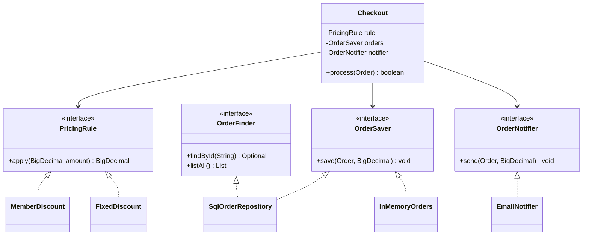

### Reading the five steps back

| Step | The question it asked | What changed |
|---|---|---|
| SRP | Who might request changes? | One class → four, one per actor |
| OCP | What breaks when a new case appears? | Each pricing branch → a class |
| LSP | Does each rule work through the interface? | All rules guarantee total ≥ 0 |
| ISP | Is the caller tied to more than it calls? | Checkout needs one save method |
| DIP | Who picks the concrete class? | The entry point |

The order has a reason: the varying part stays hidden until each class has one job; LSP matters at the second implementation; ISP when new callers appear; DIP needs abstractions to point at.

### What we did not do

`Order` stays a plain record; validation still edits `Checkout` (until a third rule is asked for); stable `BigDecimal` math isn't injected. **Every step was triggered by a real change request, not a checklist.**

### Self-check

1. **Q:** Why SRP before OCP? **A:** The varying branch was buried in a four-job method.
2. **Q:** Step 3's contract? **A:** Any amount ≥ 0 gives a total ≥ 0.
3. **Q:** Proof it worked? **A:** One `Checkout`, three wirings, zero edits.

### TL;DR

SRP → OCP → LSP → ISP → DIP, each triggered by a real change.

---

## 4.12 SOLID and design patterns

**Principles say what good structure looks like; patterns are named recipes for it.**

| Pattern | Principle(s) | How |
|---|---|---|
| Strategy | OCP, DIP | Varying algorithm behind an interface |
| Template Method | OCP | Fixed skeleton, hook steps |
| Decorator | OCP, SRP | Behaviour added by wrapping |
| Adapter | DIP, ISP | Caller keeps its own interface |
| Factory Method / Abstract Factory | DIP, OCP | Concrete constructors in one place |
| Observer | OCP, DIP | New reactions = new subscribers |
| Composite | LSP, OCP | Leaves and groups share one interface |
| Proxy | SRP, OCP | Access control/caching in a separate class |
| Command | SRP, OCP | Each request an object |
| Visitor | OCP (operations) | Easy to add operations, hard to add types |
| Null Object | LSP | Do-nothing implementation that keeps the contract |

*Head First* states the same ideas (encapsulate what varies, composition over inheritance, program to an interface, …); *Clean Code*'s "isolating from change" is DIP.

---

## 4.13 SOLID in the design interview

### Keeping the design honest: five checks over your class diagram

Run five quick checks (~5 minutes) over the diagram you drew: **SRP** (one-sentence job; an "and" means two), **OCP** (a `switch` over a type?), **LSP** (would any inherited method throw or refuse? recheck late-added arrows), **ISP** (empty methods in big interfaces?), **DIP** (does `ParkingLot` construct a `CreditCardTransaction`? depend on `Payment`).


*Figure — each check and the signal that it failed: an "and" in the sentence, a switch over a type, a refused parent method, an empty method body, a high-level class naming a low-level one (course diagram)*

**Two findings out of five is a good pass; five means rework; zero means you didn't look.** SRP and OCP earn most credit. Example (parking lot): SRP — `ParkingLot` issues tickets *and* finds spots; LSP — five spot subclasses with no behaviour collapse into one class with a `type` field; OCP, ISP, DIP pass. Don't add one-implementation interfaces or split beyond what a reader can hold.

### Naming a design problem out loud

Interviewers weigh: spotting and naming a problem; defending a choice ("pricing changes every quarter" beats "SOLID says so"); knowing when to hold back. **Pattern:** *what you see → what it will cost → what you'd do and what that costs.* Say the observation before the principle's name. To "would you always do that?", the honest answer is almost never "yes". Lose marks by reciting definitions, applying everything at once, or confidently naming the wrong principle. **Drill:** who can ask me to change this class? what's the next feature? which dependencies can't I fake?

---

## 4.14 Common questions about SOLID (with short answers)

1. **SRP vs ISP?** SRP guards the class (reasons to change); ISP guards the caller (unused methods).
2. **When not to apply?** Nothing has varied; throwaway code; arbitrary splits; hurts readability. Flexibility later is bought with simplicity now.
3. **Still relevant?** As diagnostic vocabulary, not absolute rules.
4. **Inversion vs injection?** Principle vs technique; a concrete parameter is injection without inversion.
5. **LSP example?** Square/Rectangle, plus the rule: demand no more, guarantee no less.
6. **OCP forbids editing?** No; closure is against a kind of change.
7. **Composition always?** No; when behaviour varies or a subclass would refuse a method.
8. **Principles vs patterns?** Patterns are principles made concrete.
9. **Most violated?** SRP (accumulation), or ISP in reverse (an interface per method).

> **Interview tip:** expand on "when not to apply" and "inversion vs injection"; strong answers always **admit a limit**.

---

## 4.15 Over-engineering: the warnings in one place

| Warning sign | Misapplied | Instead |
|---|---|---|
| `XHelper`/`XUtils` after a split | SRP | Split by actor |
| Small classes always in the same commit | SRP — *Shotgun Surgery* | Merge back |
| Interface + factory + registry for one implementation | OCP — *Speculative Generality* | Write the `if`; rule of three |
| Subclass that silently does nothing | LSP | Better parent or composition |
| One interface per method; same object thrice | ISP | Group by caller |
| Interface in front of `String`-like classes | DIP | Invert only volatile deps |
| DI container for 200 lines | DIP | Wire in `main` |

**YAGNI** is the counterweight: SOLID says **what** a good seam looks like; YAGNI says **when** to cut it.

---

## Chapter self-check

1. **Q:** `switch (vehicleType)` computing fees? **A:** OCP — `ParkingRate` interface, one class per rate.
2. **Q:** `ReadOnlyList extends ArrayList` throws on `add`? **A:** LSP; compose or use a read-only interface.
3. **Q:** `Robot` implements `Worker { work(); eat(); }`? **A:** ISP; split by caller into `Workable`/`Eater`.
4. **Q:** `private final MySqlOrderDao dao = new MySqlOrderDao();`? **A:** DIP violation, untestable; inject an `OrderSaver` the service owns.
5. **Q:** DIP vs DI vs IoC? **A:** Principle; technique; broad idea (containers perform DI).

## TL;DR

- **SOLID** names the ways code becomes painful to change — diagnose, don't checklist.
- **SRP** one actor per class; **OCP** varying part behind an interface; **LSP** keep every promise, compose when a subclass would refuse; **ISP** one role per kind of caller; **DIP** policy owns the abstraction, `main` wires.
- **Order**: SRP → OCP → LSP → ISP → DIP, each triggered by a real change.
- **Interview**: observation → cost → fix → price of the fix; know when *not* to apply a principle.
