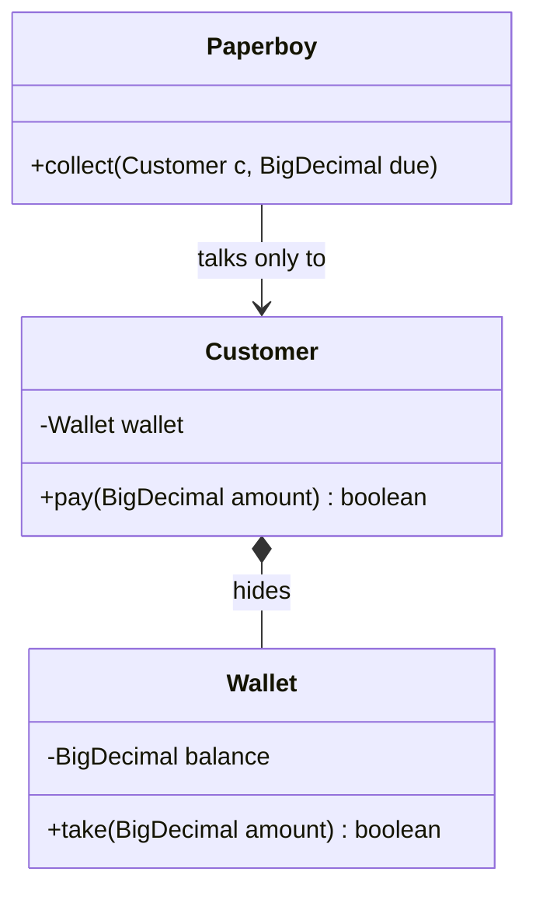
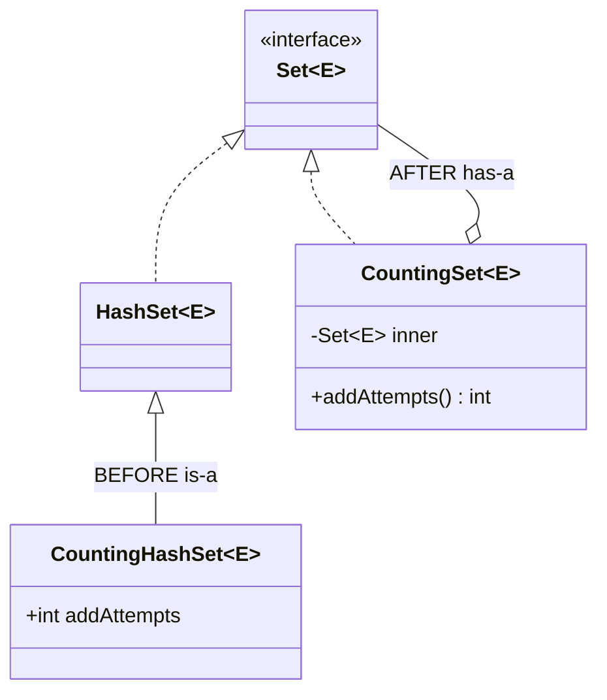
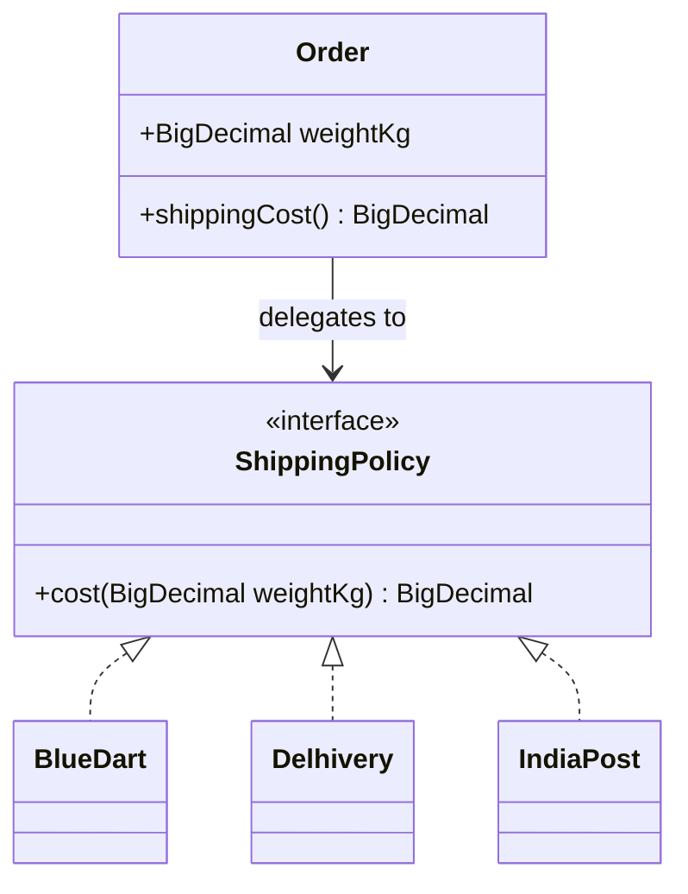
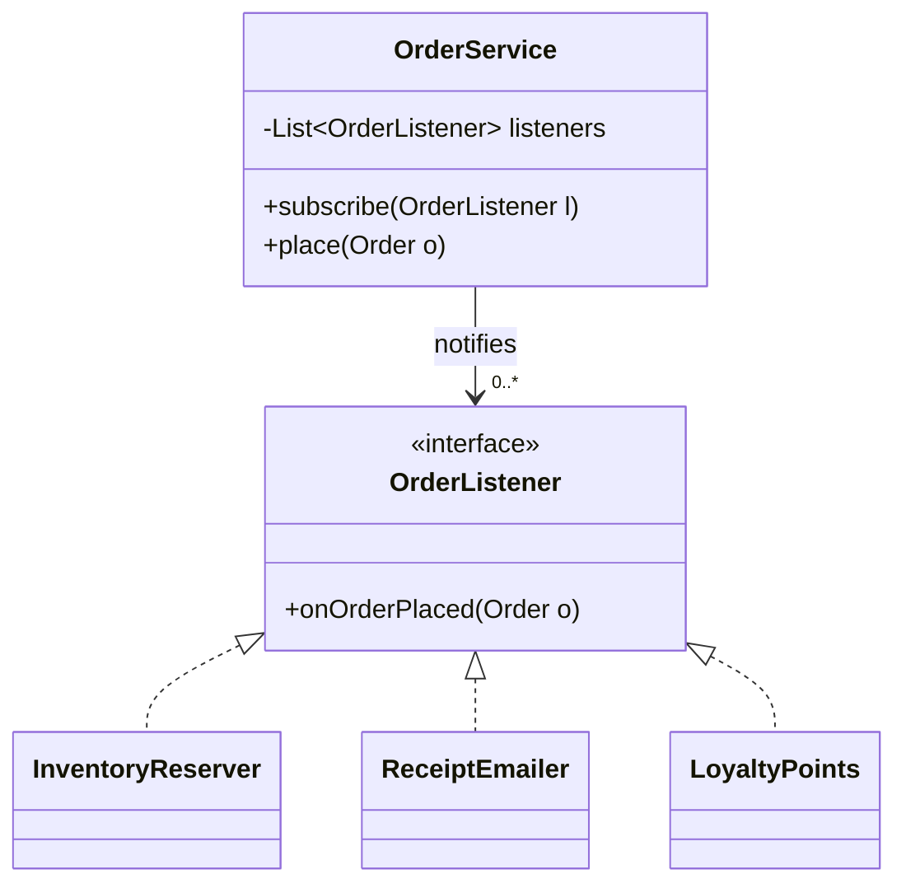
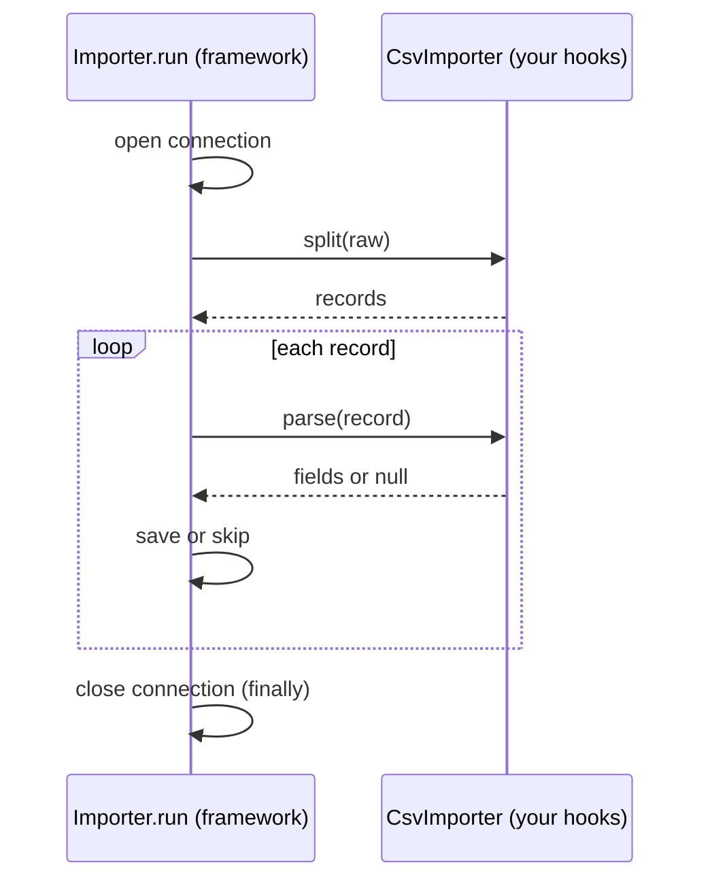
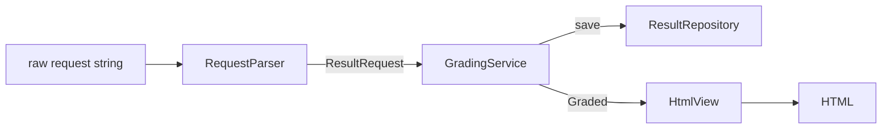
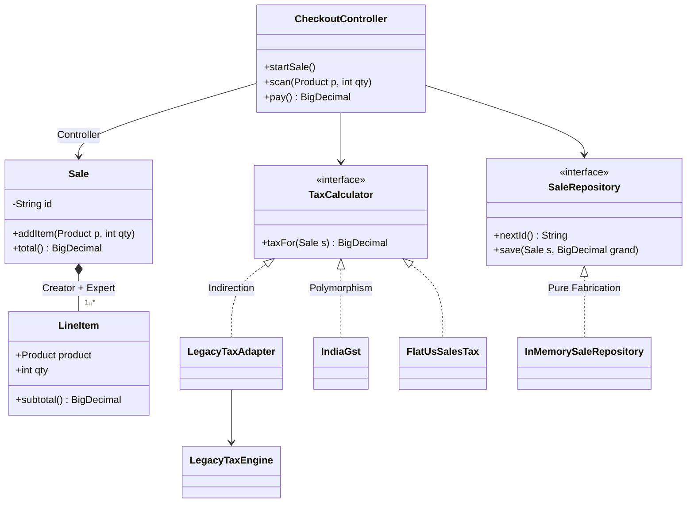
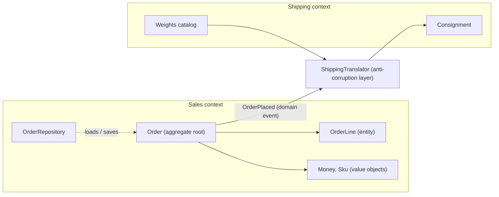
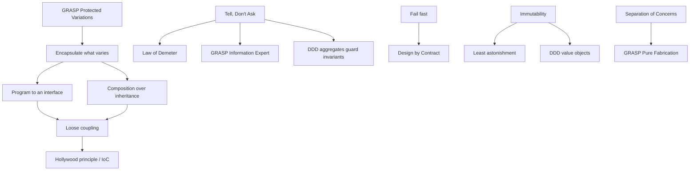

# Chapter 5 — More Design Principles

SOLID (Chapter 4) is only five of the rules good designers use. This chapter covers the rest of the everyday toolkit: rules of thumb (DRY, KISS, YAGNI); rules about how objects talk (Law of Demeter, Tell-Don't-Ask, loose coupling, the Hollywood Principle); the object-oriented principles that *Head First Design Patterns* and the Gang of Four book (*Design Patterns*, 1994, by Gamma, Helm, Johnson and Vlissides — "GoF") build every pattern on (encapsulate what varies, favour composition, program to an interface); correctness rules (fail fast, immutability, Design by Contract); **GRASP** — nine guidelines for deciding *which class should do what*; and the essentials of **Domain-Driven Design**, which decides *which classes exist and where their boundaries are* by starting from the business.

**Key terms used throughout (defined once here):**

| Term | Meaning |
|---|---|
| **Coupling** | How much one class depends on (knows about) another. High coupling = a change in one forces changes in the other. |
| **Cohesion** | How closely the things inside one class belong together. High cohesion = the class does one focused job. |
| **Abstraction** | A simplified view (usually an interface or abstract class) that hides details that callers do not need. |
| **Encapsulation** | Keeping an object's data private and letting other code change it only through the object's methods. |
| **Invariant** | A fact about an object that must always be true (e.g. "balance is never negative"). |
| **Side effect** | Anything a method changes besides returning a value: fields, files, the database, the screen. |
| **Responsibility** | Something a class *knows* (its data) or *does* (its behaviour). |

**Chapter map**

| # | Principle | One-line idea | Comes from |
|---|---|---|---|
| 1 | DRY | Each piece of knowledge has one authoritative home | Hunt & Thomas, *The Pragmatic Programmer* (1999) |
| 2 | KISS | Choose the simplest design that works | US Navy (1960); popularised by Kelly Johnson, Lockheed Skunk Works |
| 3 | YAGNI | Don't build features before they are needed | Extreme Programming, late 1990s (usually credited to Ron Jeffries) |
| 4 | Law of Demeter | Only talk to your immediate friends | Ian Holland / Karl Lieberherr, Demeter project, Northeastern University (1987) |
| 5 | Tell, Don't Ask | Tell objects what to do; don't pull their data out and decide for them | Andy Hunt & Dave Thomas (Pragmatic Programmers), building on Alec Sharp's *Smalltalk by Example* (1997); explained by Martin Fowler |
| 6 | Composition over inheritance | Prefer "has-a" to "is-a" for reuse | GoF book (1994), *Effective Java* (Joshua Bloch) |
| 7 | Program to an interface | Depend on supertypes, not concrete classes | GoF book |
| 8 | Encapsulate what varies | Isolate the part that changes | GoF book, *Head First Design Patterns* |
| 9 | Loose coupling | Interacting objects should know little about each other | *Head First Design Patterns* |
| 10 | Hollywood Principle / IoC | "Don't call us, we'll call you" | *Head First*; frameworks, IoC containers |
| 11 | Separation of Concerns | Each part of the program handles one concern | Edsger Dijkstra (1974) |
| 12 | Least Astonishment | Behave the way readers expect | User-interface and programming-language design folklore (no single author) |
| 13 | Fail fast | Detect problems early and loudly | Popularised by Jim Shore's "Fail Fast" article, *IEEE Software* (2004) |
| 14 | Immutability | Objects that never change after creation | *Effective Java* ("minimize mutability") |
| 15 | Design by Contract | Preconditions, postconditions, invariants | Bertrand Meyer, Eiffel language (term coined 1986) |
| 16 | GRASP (9 patterns) | Guidelines for assigning responsibilities | Craig Larman, *Applying UML and Patterns* (1st ed. 1997; today's nine from the 2nd ed. 2001) |
| 17 | Domain-Driven Design essentials | Model the business: bounded contexts, entities vs value objects, aggregates, domain events, repositories | Eric Evans, *Domain-Driven Design* (2003); Vaughn Vernon, *Implementing Domain-Driven Design* (2013) |

> **How to read each section.** What it is → problem → how to apply → Java *before/after* → trade-offs → when not to use → mistakes → real-world examples → interview answer → self-check → TL;DR. Listings show only the essential lines; the full runnable program is `code/lld/ch05/<topic>/Main.java` (compiled with `javac --release 21`, the Java compiler targeting Java 21), and each "Output" block is the real output of that full program.

---

## 1. DRY — Don't Repeat Yourself

### What it is
**DRY** says: every piece of *knowledge* in a system — a business rule, a formula, a validation, a constant — should have **a single, unambiguous, authoritative representation**. Everything else refers to that place. From Andy Hunt and Dave Thomas's *The Pragmatic Programmer* (1999).

*Analogy:* a company keeps one master price list; if each shop kept a hand-written copy, a price change would reach some shops and not others.

DRY is about **knowledge**, not lines of text that happen to look the same. Two identical-looking snippets that represent *different* rules (which may change for different reasons) are *not* a DRY violation.

### The problem it solves
Copies of a rule eventually **drift**: someone updates one and forgets the others, and the system gives two answers to the same question — a bug that is hard to spot because each copy looks reasonable alone. Duplication also multiplies the effort of every change.

### How it works
1. Notice a rule that appears in more than one place (a regex — a text pattern such as "something@something" — a tax rate, a status check, a SQL fragment; SQL is the query language of relational databases).
2. Ask: *"If this rule changes, must all copies change together?"* If yes, it is one piece of knowledge.
3. Give it one home: a constant, a method, a value object, an enum, a config entry or a shared module, and replace every copy with a reference to it.
4. Apply the **Rule of Three** for code-level duplication (credited to Don Roberts, popularised by Martin Fowler's *Refactoring* — refactoring means improving structure without changing behaviour, Chapter 7): write it once; tolerate the second copy; extract on the third.

### Java example — before/after
Two services each carry their own copy of "what a valid email is" and "what the tax is", and the copies have drifted. The *after* puts the email rule in an `EmailAddress` value object (a small immutable type — its value never changes after creation — whose constructor validates it) and the tax rule in `TaxPolicy`. Full program: `code/lld/ch05/dry/Main.java`.

```java
// BEFORE: the same rule written twice; the copies have drifted
class SignupService {
    boolean signup(String email) {
        return email != null && email.contains("@");          // copy #1 (someone relaxed it later)
    }
    BigDecimal priceWithTax(BigDecimal price) {
        return price.multiply(new BigDecimal("1.18")).setScale(2, RoundingMode.HALF_UP); // 18% hard-coded
    }
}
class ProfileService {
    boolean changeEmail(String email) {
        return email != null && email.matches("[^@\\s]+@[^@\\s]+\\.[a-z]{2,}");   // copy #2 (the stricter original)
    }
    // ...priceWithTax with 1.18 hard-coded again
}

// AFTER: each rule has a single, authoritative home
record EmailAddress(String value) {                 // the ONLY definition of "valid email"
    private static final Pattern FORMAT = Pattern.compile("[^@\\s]+@[^@\\s]+\\.[a-z]{2,}");
    EmailAddress {
        if (value == null || !FORMAT.matcher(value).matches())
            throw new IllegalArgumentException("invalid email: " + value);
    }
}
static final class TaxPolicy {                      // the ONLY definition of the tax rule
    private static final BigDecimal RATE = new BigDecimal("0.18");
    static BigDecimal withTax(BigDecimal price) {
        return price.add(price.multiply(RATE)).setScale(2, RoundingMode.HALF_UP);
    }
}
// both services now do: new EmailAddress(rawEmail).value()
```

Output:

```text
== BEFORE ==
signup accepts 'bob@localhost'? true
profile accepts 'bob@localhost'? false   <-- same rule, two answers
== AFTER ==
signed up bob@example.com
email changed to bob@example.com
signup rejected: invalid email: bob@localhost
profile rejected: invalid email: bob@localhost
price 100.00 with tax = 118.00
```

`EmailAddress` is a Java **record** (a compact, immutable data class); its *compact constructor* (a record constructor without a parameter list, used to check or normalise the values) runs the check, so an invalid email cannot exist as an `EmailAddress`. Changing GST from 18% means editing one line of `TaxPolicy`.

### Trade-offs

| Benefit | Cost |
|---|---|
| One change point per rule; no drift | A shared abstraction couples its users together |
| Less code to read and test | A premature or wrong abstraction is worse than duplication |
| Rules get a name (self-documenting) | Extra indirection to find the real code |

### When not to use it
- Snippets alike **by coincidence** that will evolve separately ("max username length 30" and "max tag length 30") — merging creates false coupling.
- Across **microservices** (an application split into small, independently deployed services talking over the network): a shared domain library couples their release cycles; some duplication is the lesser evil.
- In tests, a little repetition often makes each test readable on its own (DAMP — "descriptive and meaningful phrases").

### Common mistakes
- Treating DRY as "never two similar lines" and building one monster function with flags for every caller.
- Extracting after the first repetition, before you understand what really varies.
- Forgetting non-code duplication: the same rule in code *and* a database constraint *and* docs.

### Real-world examples
- **Spring's `@Value` / `application.yml`** (Spring: the dominant Java server framework; `@Value`: an *annotation*, a `@` tag tools read): config lives in one file, injected where needed.
- **Database normalisation** is DRY for data: an address is stored once and referenced by key.
- **Bean Validation (`jakarta.validation`)** annotations such as `@Email` define a rule once for REST input (web-API requests), forms and persistence (saving data, usually to a database).
- **OpenAPI / Protobuf schemas** (machine-readable API descriptions — HTTP/JSON and Google's binary format) generate client and server code from one contract.

### In the interview
**30-second answer:** "DRY means each piece of knowledge has one authoritative representation. It is about rules, not identical-looking text. I extract a rule when copies must change together — e.g. validation into a value object — and use the Rule of Three so I don't abstract too early."

**Follow-ups:**
- *Q: Is duplicated code always a DRY violation?* A: No. If the copies represent different rules that change for different reasons, merging them adds wrong coupling.
- *Q: DRY vs. SRP?* A: They cooperate (SRP, Chapter 4: one reason to change per class). DRY gives each rule one home; SRP makes sure that home has one reason to change.
- *Q: How do you spot duplicated knowledge?* A: "If this business rule changes, how many files do I edit?" More than one is a smell.

### Self-check
1. Q: What exactly must not be repeated? → A: Knowledge (rules, formulas, decisions), not merely similar-looking lines.
2. Q: What bug does duplication cause? → A: Drift — copies change independently and start disagreeing.

### TL;DR
One rule, one home. Extract when copies must change together; leave coincidental look-alikes alone.

---

## 2. KISS — Keep It Simple, Stupid

### What it is
**KISS**: most systems work best when kept simple. The phrase was used by the US Navy around 1960 and is associated with Kelly Johnson, lead engineer of Lockheed's Skunk Works, who wanted jets a mechanic could repair in the field with basic tools. Choose the plainest design that fully solves the real problem. *Simple* means easy to understand and change — not necessarily fewest lines.

### The problem it solves
Engineers love clever solutions: home-made frameworks, deep inheritance trees, generic engines configured by lambdas (short inline functions such as `x -> x * 2`). Every moving part must be read, tested, debugged and explained. **Accidental complexity** (complexity our solution adds, as opposed to what the problem truly has) is the biggest source of bugs and slow delivery.

### How it works
1. State the actual requirement in one sentence.
2. Write the most direct solution using standard language features and libraries.
3. Ask: "Could a new team member understand this in two minutes?"
4. Add structure (patterns, abstractions) only when a concrete need — a second variant, a test seam, a real performance issue — shows up; delete cleverness that no longer earns its keep.

### Java example — before/after
Three fixed customer tiers get three fixed discounts. The *before* builds a priority-sorted rule engine of predicates and functions; the *after* is a `switch` *expression* over an enum (a type with a fixed list of named constants). With no `default`, it must cover every constant, so adding a tier fails to compile until handled (old-style `switch` *statements* are not checked this way). Money is `BigDecimal` (exact decimal), never `double` (binary floating point cannot represent most decimal amounts exactly). Full program: `code/lld/ch05/kiss/Main.java`.

```java
// BEFORE: a home-made "rule engine" for three fixed discounts
record Rule(int priority, Predicate<Tier> when, Function<BigDecimal, BigDecimal> apply) {}
static class DiscountRuleEngine {
    private final List<Rule> rules = new ArrayList<>();
    DiscountRuleEngine register(int priority, Predicate<Tier> when, Function<BigDecimal, BigDecimal> apply) {
        rules.add(new Rule(priority, when, apply));
        rules.sort(Comparator.comparingInt(Rule::priority).reversed());
        return this;
    }
    BigDecimal evaluate(Tier tier, BigDecimal amount) {
        return rules.stream().filter(r -> r.when().test(tier)).findFirst()
                .map(r -> r.apply().apply(amount)).orElse(amount);
    }
}

// AFTER: a plain switch expression; the compiler checks every tier is handled
static BigDecimal discounted(Tier tier, BigDecimal amount) {
    return switch (tier) {
        case GOLD -> times(amount, GOLD_FACTOR);       // 0.80
        case SILVER -> times(amount, SILVER_FACTOR);   // 0.90
        case REGULAR -> amount;
    };
}
```

Output:

```text
== BEFORE (rule engine) ==
REGULAR -> 100.00
SILVER  -> 90.00
GOLD    -> 80.00
== AFTER (switch) ==
REGULAR -> 100.00
SILVER  -> 90.00
GOLD    -> 80.00
```

Same results, but the *after* has no ordering bugs (a forgotten priority silently changes the engine's behaviour), no mutable list, and reads like the business rule.

### Trade-offs

| Simple design | "Flexible" complex design |
|---|---|
| Fast to read, change, test | Handles hypothetical cases |
| May need refactoring when real variation arrives | Costs you every day, even if variation never arrives |
| Uses standard, well-known constructs | Custom mechanisms need docs and training |

### When not to use it
KISS is no excuse to ignore real complexity. A payment system *needs* idempotency (repeating a request — say after a timeout — has the same effect as doing it once, so nobody is charged twice; see [System Design Fundamentals](../../../system-design-patterns/modules/00-system-design-fundamentals/README.md)), retries and auditing; leaving them out is incompleteness, not simplicity. And when a rule engine really is the requirement (business users edit rules at runtime), build or buy one.

### Common mistakes
- Confusing *simple* with *short*: a one-line stream with five nested lambdas can be harder to read than a loop.
- Using KISS to justify skipping tests, error handling or validation.
- Copy-pasting instead of simplifying (violates DRY).

### Real-world examples
- **Unix philosophy** — small tools that do one thing and compose through pipes (`|`).
- **Go language design** deliberately left out many features.
- **`java.util.Optional`** was kept small (no `Serializable`, not meant as a field type) to steer people to its one purpose: return values that might be absent.

### In the interview
**30-second answer:** "KISS means the simplest design that fully meets the requirements. I start with a straightforward model and introduce patterns only when a requirement demands variation or extension — and I say why."

**Follow-ups:**
- *Q: Isn't a design pattern always better?* A: No. A pattern adds classes and indirection; it pays only if it solves a problem you actually have.
- *Q: KISS vs YAGNI?* A: KISS is about *how* you build (simplest form); YAGNI is about *what* you build (only needed features).

### Self-check
1. Q: Why did the `switch` version win? → A: Same behaviour, fewer moving parts, compiler-checked exhaustiveness.

### TL;DR
Solve the real problem in the plainest way; add machinery only when a real need appears.

---

## 3. YAGNI — You Aren't Gonna Need It

### What it is
**YAGNI**: don't build a capability until you actually need it. It comes from Extreme Programming (XP), Kent Beck's agile method (short cycles, frequent feedback) of the late 1990s; the slogan is usually credited to XP co-founder Ron Jeffries. The opposite habit — hooks, options and layers "just in case" — is **speculative generality**, a **code smell** (a visible sign of a deeper design problem) in Fowler's *Refactoring*.

### The problem it solves
Early features cost four times: building, maintaining/testing, the complexity they add around them, and being wrong (the real requirement usually differs from the guess, so the code is rewritten anyway).

### How it works
1. Implement the requirements/user stories you have **now** (a *user story* is a short feature request from the user's view: "As a shopper I can …").
2. Keep the code clean and tested so it is cheap to change later — YAGNI depends on easy refactoring.
3. Extend the design when a new requirement actually arrives; delete unused options, parameters and classes you find.

### Java example — before/after
Requirement: *export orders as CSV* (comma-separated values). The *before* builds a universal exporter with five formats, encodings and compression, four of which throw `UnsupportedOperationException`. The *after* is one method. Full program: `code/lld/ch05/yagni/Main.java`.

```java
// BEFORE: speculative generality
enum Format { CSV, PDF, XML, EXCEL, YAML }
interface ReportExporter {
    String export(List<Order> orders, Format format, String encoding, boolean compress);
}
// UniversalExporter.export(...):
//   if (compress) throw new UnsupportedOperationException("compression not implemented yet");
//   case CSV -> ...join rows...;  case PDF, XML, EXCEL, YAML -> throw new UnsupportedOperationException(format + " not implemented yet");

// AFTER: exactly what is needed today
static String toCsv(List<Order> orders) {
    return orders.stream()
            .map(o -> String.join(",", o.id(), o.customer(), o.total().toPlainString()))
            .collect(Collectors.joining("\n", "id,customer,total\n", ""));
}
```

Output:

```text
== BEFORE ==
id,customer,total
o1,asha,250.00
o2,ravi,99.50
dead option: PDF not implemented yet
== AFTER ==
id,customer,total
o1,asha,250.00
o2,ravi,99.50
```

Every caller of the *before* API (Application Programming Interface — the methods and types other code calls) passes three meaningless arguments, and readers can't tell which formats work.

### Trade-offs

| YAGNI | Build ahead |
|---|---|
| Less code, faster delivery | Might save time if the guess is right |
| Design fits real needs | Guesses are usually wrong in detail |
| Needs good tests + refactoring discipline | Leaves dead options that confuse readers |

### When not to use it
- **Hard-to-change decisions** — public API formats, database schemas (table/column structure) holding huge data, security, data-retention laws. Think ahead there.
- Known architectural requirements (e.g. "must scale to 10k requests/s" — a *throughput* target) are requirements, not speculation.

### Common mistakes
- Using YAGNI as an excuse for messy code.
- Ignoring a requirement the interviewer *did* mention because "YAGNI".
- `interface` + `Impl` pairs for every class "in case we swap it" — add the interface when a second implementation or a test seam (a place where a test can swap in a fake collaborator) is needed.

### Real-world examples
- **Minimum Viable Product (MVP)** thinking is YAGNI at the product level.
- **Feature flags** (config switches that enable a code path without redeploying; e.g. LaunchDarkly, Unleash) let teams ship only what is needed now.
- XP and many agile teams plan per iteration so only near-term work is built.

### In the interview
**30-second answer:** "YAGNI means I build what today's requirements need and keep the design easy to extend. In an LLD (low-level design — classes, interfaces and their interactions) interview I add an extension point like a `PaymentStrategy` interface only if the interviewer hinted at multiple variants; otherwise I mention it verbally."

**Follow-ups:**
- *Q: Doesn't YAGNI conflict with OCP?* A: Not really. OCP (Chapter 4: open for extension, closed for modification) applies where variation is known or likely; YAGNI stops you inventing variation that isn't there.
- *Q: What makes YAGNI safe?* A: A good test suite and clean code, so adding the feature later is cheap.

### Self-check
1. Q: Name the smell YAGNI prevents. → A: Speculative generality.
2. Q: When should you design ahead anyway? → A: For expensive-to-reverse decisions (public APIs, schemas, security).

### TL;DR
Build for today's requirements with clean, changeable code; tomorrow's features get built tomorrow.

---

## 4. Law of Demeter (Principle of Least Knowledge)

### What it is
The **Law of Demeter (LoD)**, or **Principle of Least Knowledge**: a method should only talk to its **immediate friends**, not to strangers reached through other objects. A method `m` of object `O` should only call methods on:
1. `O` itself (`this`);
2. objects passed to `m` as parameters;
3. objects `m` creates;
4. `O`'s own fields (its direct components).

(The original formulation by Ian Holland and Karl Lieberherr, Northeastern University, 1987, also allows global objects accessible to `O`.) Slogan: **"use only one dot"** — `a.getB().getC().doIt()` is a **train wreck** (a chain of calls like connected railway cars).

*Analogy:* a paperboy asks the customer to pay; he doesn't reach into the customer's pocket for the wallet.

### The problem it solves
A train wreck couples the caller to the **whole chain's structure**. In `customer.getWallet().getBalance()` the paperboy depends on `Customer` *and* `Wallet`; if the customer starts paying by UPI (India's instant mobile bank payment) the paperboy breaks.

### How it works
1. Spot a chain that navigates through other objects' internals.
2. Ask what the caller really wants ("get paid", not "get the wallet").
3. Add a method on the first object that does that job (`customer.pay(amount)`), delegating internally, and keep the internal object private.



### Java example — before/after
Full program: `code/lld/ch05/demeter/Main.java`.

```java
// BEFORE: paperboy -> customer -> wallet -> balance (a train wreck)
void collect(Customer c, BigDecimal due) {
    // knows Customer has a Wallet, knows Wallet has a balance, changes it directly
    if (c.getWallet().getBalance().compareTo(due) >= 0) {
        c.getWallet().setBalance(c.getWallet().getBalance().subtract(due));
        collected = collected.add(due);
        System.out.println("collected " + due + " from " + c.getName());
    } else System.out.println(c.getName() + " cannot pay");
}

// AFTER: the paperboy asks the customer (a direct friend) to pay
static class Wallet {
    private BigDecimal balance;
    boolean take(BigDecimal amount) {
        if (amount.compareTo(balance) > 0) return false;
        balance = balance.subtract(amount);
        return true;
    }
}
static class Customer {
    private final Wallet wallet;          // private detail -- could become a card or UPI tomorrow
    boolean pay(BigDecimal amount) { return wallet.take(amount); }   // Customer decides HOW to pay
}
void collect(Customer c, BigDecimal due) {
    if (c.pay(due)) { collected = collected.add(due); /* print */ }  // talk only to a parameter: allowed
    else System.out.println(c.name() + " cannot pay");
}

// Chained calls on a fluent API / stream are NOT violations: each call returns the same kind of thing
long longNames = List.of("Meera", "Kabir", "Jo").stream().filter(n -> n.length() > 2).count();
```

Output:

```text
== BEFORE ==
collected 4.00 from Meera
Kabir cannot pay
== AFTER ==
collected 4.00 from Meera
Kabir cannot pay
total collected = 4.00
stream chain is fine: 2 long names
```

*After*, `Paperboy` knows only `Customer.pay`, and `Customer` is free to change how it pays.

### Trade-offs

| Following LoD | Ignoring LoD |
|---|---|
| Changes to internals stay local | Structural changes ripple to callers |
| Easier mocking (mock = fake object used in tests) — one collaborator | Tests must build whole object graphs |
| May add small **wrapper/delegate methods**; too many bloat the middle class | No extra methods |

### When not to use it
- **Fluent interfaces and builders** (methods return an object so calls chain; a builder assembles an object step by step — `StringBuilder.append(..).append(..)`, `stream().filter().map()`) return the same object or a sibling abstraction — *not* violations.
- **Data structures / DTOs** (Data Transfer Objects — plain data, no behaviour, Chapter 6) are meant to expose data; `order.shippingAddress().city()` on a record is fine.
- Don't mechanically add dozens of pass-through methods — that is the **Middle Man** smell; rethink responsibilities instead.

### Common mistakes
- Counting dots instead of thinking about *knowledge*: splitting a chain into temps (`var w = c.getWallet(); w.getBalance()`) still violates the law.
- Adding getters for everything, which invites train wrecks.

### Real-world examples
- *Head First Design Patterns* presents it ("talk only to your immediate friends") in the Facade chapter — a **Facade** (one simple class in front of a group of complex ones) reduces how many classes a client talks to.
- **Spring Data** repositories (objects that load/save domain objects and hide the database): services call `orderRepository.findByCustomerId(id)`, not `entityManager.getSession().getConnection()...`.
- `java.nio.file.Files.readString(path)` hides channels, buffers and decoders behind one call.

### In the interview
**30-second answer:** "The Law of Demeter says a method should only call methods on itself, its parameters, objects it creates and its own fields. Chains like `a.getB().getC()` couple the caller to internal structure; I replace them with a method that expresses intent — `customer.pay()` instead of reaching for the wallet."

**Follow-ups:**
- *Q: Is `list.stream().map(...).collect(...)` a violation?* A: No — each call returns a stream (a pipeline processing elements step by step) meant for chaining; you aren't navigating internals.
- *Q: Cost of following it strictly?* A: Wrapper methods pile up (Middle Man). Balance by moving behaviour to where the data is (Tell-Don't-Ask).

### Self-check
1. Q: List the four "friends" of a method. → A: `this`, parameters, objects it creates, its own fields.
2. Q: Do records/DTOs have to obey it? → A: Not really; they are data structures meant to expose data.

### TL;DR
Only talk to your friends. Replace `a.getB().getC().do()` with a method on `a` that says what you want.

---

## 5. Tell, Don't Ask

### What it is
**Tell, Don't Ask (TDA)**: instead of *asking* an object for its data and deciding for it, *tell* the object what you want and let it decide using its own data. Behaviour lives with the data it needs. Popularised by Andy Hunt and Dave Thomas, building on Alec Sharp's observation in *Smalltalk by Example* (1997) that procedural code (functions acting on separate data) fetches data and then decides, while object-oriented code tells objects to act.

*Analogy:* you tell a taxi driver "take me to the airport"; you don't ask for the steering angle every second and decide the turns yourself.

### The problem it solves
With ask-then-act (`if (acc.getBalance() >= x) acc.setBalance(acc.getBalance() - x)`) the business rule is spread over every caller. One caller forgets part of it ("frozen accounts can't withdraw") and the object's **invariant** breaks. The object becomes a passive data bag — the **Anemic Domain Model** anti-pattern.

### How it works
1. Look for code that reads an object's fields, decides, then writes back.
2. Move that decision into a method on the object (`withdraw(amount)`) that rejects illegal requests (exceptions or result types).
3. Remove setters (`setBalance(x)`) that are no longer needed.

### Java example — before/after
Full program: `code/lld/ch05/telldontask/Main.java`.

```java
// BEFORE: callers ask for state and decide themselves (Account has getBalance/setBalance/isFrozen/setFrozen)
static void atmWithdraw(Account a, long amt) {   // ATM remembered the "frozen" rule...
    if (!a.isFrozen() && a.getBalance() >= amt) a.setBalance(a.getBalance() - amt);
}
static void appWithdraw(Account a, long amt) {   // ...the mobile app forgot it
    if (a.getBalance() >= amt) a.setBalance(a.getBalance() - amt);
}

// AFTER: the rule lives with the data it protects
static final class Account {
    private long balancePaise;
    private boolean frozen;
    void freeze() { frozen = true; }
    void withdraw(long amt) {
        if (amt <= 0) throw new IllegalArgumentException("amount must be positive");
        if (frozen) throw new IllegalStateException("account is frozen");
        if (amt > balancePaise) throw new IllegalStateException("insufficient funds");
        balancePaise -= amt;
    }
    long balance() { return balancePaise; }   // queries are fine for display -- just don't decide outside
}
```

Output:

```text
== BEFORE ==
after ATM on frozen account: 1000
after APP on frozen account: 700   <-- rule bypassed
== AFTER ==
withdrew 300, balance 700
rejected: account is frozen
balance still 700
```

`withdraw` is now the only way to take money, so the rule cannot be bypassed.

### Trade-offs

| Tell | Ask |
|---|---|
| Invariants protected in one place | Rules duplicated across callers |
| Richer, more expressive objects | Simple data objects |
| Risk: object grows too many responsibilities | Fine for pure data (DTOs, reports) |

### When not to use it
- **Queries for display or reporting** — asking for a balance to show it is fine; the rule is about *deciding* outside.
- When the decision genuinely belongs to another object combining data from several sources (that object is the Information Expert — see GRASP).

### Common mistakes
- Adding a getter "just for this one check" — that is where the rule starts leaking.
- Pushing *every* behaviour into the entity, including emails and database calls (breaks SRP; use services for cross-cutting work).

### Real-world examples
- `List.removeIf(predicate)` — tell the list what to remove instead of iterating and removing.
- `Map.computeIfAbsent`, `Map.merge` — tell the map the update; it handles the check-then-act.
- `AtomicInteger.incrementAndGet()` — the object does the read-modify-write atomically (as one indivisible step); asking then setting would be a **race condition** (a result that depends on the timing of two *threads* — concurrent paths of execution — touching the same data).

### In the interview
**30-second answer:** "Tell, Don't Ask means sending commands to the object that owns the data, e.g. `account.withdraw(100)`, rather than reading its balance and setting a new one. It keeps invariants in one place and avoids anemic models."

**Follow-ups:**
- *Q: Relation to the Law of Demeter?* A: Both push behaviour to where the data is; LoD is about *who* you talk to, TDA about *what* you ask for.
- *Q: Concurrency angle?* A: Ask-then-act across two calls is a check-then-act race; a single `withdraw` can be made atomic.

### Self-check
1. Q: What anti-pattern does TDA fight? → A: The Anemic Domain Model (data bags with logic outside).
2. Q: Are getters forbidden? → A: No; they're fine for display. Avoid deciding outside the object.

### TL;DR
Don't pull data out to make the object's decisions — tell the object what you want.

---

## 6. Composition over Inheritance

### What it is
**Favour object composition over class inheritance** (GoF). *Inheritance* ("is-a") reuses code by subclassing. *Composition* ("has-a") reuses code by holding a reference to another object and **delegating** (forwarding) calls to it.

### The problem it solves
Inheritance is the tightest coupling in OOP:
- **Fragile base class problem** — a subclass breaks when the parent's *internal* implementation changes, even if its public API is unchanged (the subclass depends on details like "does `addAll` call `add`?").
- **Fixed at compile time** — you cannot change the parent at runtime.
- **Class explosion** — combining features by subclassing (`LoggingCachingBufferedStream`) multiplies classes.
- It exposes all parent methods, even those meaningless for the child.

### How it works
1. Instead of `class B extends A`, give `B` a private field of type `A` (preferably an interface type), received through the constructor so any implementation can be plugged in.
2. Implement `B`'s methods by adding your behaviour and **forwarding** to the wrapped object.
3. Keep inheritance for genuine "is-a" relationships where the subclass is substitutable (Liskov, Chapter 4) and the parent was **designed for extension** (documented hooks, often abstract).



### Java example — before/after
Count how many elements were ever added to a set — the classic trap from *Effective Java*. Full program: `code/lld/ch05/composition/Main.java`.

```java
// BEFORE: inherit from HashSet to count insert attempts
static class CountingHashSet<E> extends HashSet<E> {
    int addAttempts;
    @Override public boolean add(E e) { addAttempts++; return super.add(e); }
    @Override public boolean addAll(Collection<? extends E> c) {
        addAttempts += c.size();
        return super.addAll(c);   // HashSet's inherited addAll calls add() for each element -> counted twice!
    }
}

// AFTER: wrap ANY Set and forward calls (a decorator)
static final class CountingSet<E> extends AbstractSet<E> {
    private final Set<E> inner;   // "has-a", not "is-a"
    private int addAttempts;
    CountingSet(Set<E> inner) { this.inner = inner; }
    @Override public boolean add(E e) { addAttempts++; return inner.add(e); }
    @Override public boolean addAll(Collection<? extends E> c) { addAttempts += c.size(); return inner.addAll(c); }
    @Override public boolean contains(Object o) { return inner.contains(o); }   // keep the inner set's O(1)/O(log n) lookup
    @Override public boolean remove(Object o) { return inner.remove(o); }
    @Override public Iterator<E> iterator() { return inner.iterator(); }
    @Override public int size() { return inner.size(); }
    int addAttempts() { return addAttempts; }
}
// main also wraps a TreeSet chosen at runtime: new CountingSet<>(new TreeSet<>())
```

Output:

```text
BEFORE: added 3 items, counter says 6
AFTER : added 3 items, counter says 3
AFTER over a TreeSet: [blue, green, red] attempts=3
```

**Why 6:** `HashSet` inherits `AbstractCollection.addAll`, which calls *our overridden* `add` per element — we depended on undocumented "self-use", the fragile base class problem. The wrapper's inner calls never reach our counter. It forwards `contains` and `remove` because `AbstractSet` would otherwise scan the iterator (which walks a collection one element at a time) — O(n), time growing with the number of elements *n* (*Big-O notation*) — instead of the inner set's fast lookup.

### Trade-offs

| Composition | Inheritance |
|---|---|
| Loose coupling to the public API only | Coupled to parent internals |
| Swap behaviour at runtime | Fixed at compile time |
| Combine behaviours freely (decorators) | Class explosion for combinations |
| More boilerplate (forwarding methods) | Free reuse of all parent methods |
| No automatic polymorphism (one variable working with many types) — need an interface | Subclass is automatically a subtype |

### When not to use it
- True "is-a" hierarchies with a base **designed for extension**: extending `AbstractList` (implement `get` and `size`) or a Template Method base (Hollywood Principle, below).
- Sealed hierarchies (a `sealed` type lists exactly which subtypes may exist) modelling a closed set of variants (`sealed interface Shape permits Circle, Square`).
- When you control both classes, in the same package, evolving together.

### Common mistakes
- Inheriting just to reuse helpers ("`OrderService extends BaseDao`").
- Composition without an interface — then you can't substitute implementations.
- Exposing the wrapped object with a getter, defeating encapsulation.

### Real-world examples
- **JDK mistakes admitted by its authors** (*Effective Java*): `java.util.Stack extends Vector` (a stack that lets you insert in the middle) and `java.util.Properties extends Hashtable` (accepts non-String values).
- **`java.io` streams** — `new BufferedInputStream(new FileInputStream(f))` composes behaviour (Decorator, Chapter 9).
- **`Collections.unmodifiableList(list)` / `synchronizedList(list)`** wrap a list instead of subclassing each list type.
- **Game engines (Unity)** use Entity–Component: a game object *has* components (physics, renderer) instead of deep inheritance.

### In the interview
**30-second answer:** "Inheritance couples a subclass to its parent's implementation, is fixed at compile time and explodes combinatorially. Composition holds a reference to an interface and delegates, so behaviour can be swapped at runtime. I use inheritance only for true is-a relationships with classes designed for extension."

**Follow-ups:**
- *Q: Which patterns are built on composition?* A: Strategy, Decorator, Composite, State, Bridge, Proxy, Adapter (object form) — most GoF patterns.
- *Q: A concrete inheritance failure?* A: The counting `HashSet` above, or `Stack extends Vector` exposing `insertElementAt`.
- *Q: When is inheritance OK?* A: When substitutable (LSP holds) and the parent documents its self-use or provides abstract hooks.

### Self-check
1. Q: What is the fragile base class problem? → A: Subclasses breaking because the parent's internal implementation changed.
2. Q: Why did `CountingHashSet` count 6? → A: The inherited `addAll` calls the overridden `add`.

### TL;DR
Reuse by holding and delegating ("has-a"); reserve "is-a" for real substitutable subtypes designed for extension.

---

## 7. Program to an Interface, Not an Implementation

### What it is
Declare variables, fields, parameters and return types using the **most general supertype** that offers what you need (an interface or abstract class), not a concrete class. "Interface" here means *supertype*, not only the Java `interface` keyword.

### The problem it solves
Code written against a concrete class (`ArrayList`, `MySqlUserStore`) works only with that class: you can't test it without the real thing (a MySQL server), swap implementations or reuse it, and changing the implementation edits every caller.

### How it works
1. Identify the **role** a collaborator plays ("stores users", "a collection of names") and express it as an interface with only the needed methods (`UserRepository.findById`).
2. Type fields/parameters by that interface (`List<String>`, `Collection<String>`, `UserRepository`).
3. Create concrete objects only at the edges — `main`, a factory (an object/method whose job is creating objects) or a DI container (e.g. Spring's, which builds objects and wires their dependencies) — and pass them in (**Dependency Injection**: giving an object its collaborators from outside instead of letting it `new` them).
4. Accept the widest parameter type you can (`Collection` beats `List` beats `ArrayList`); return an interface specific enough to be useful.

### Java example — before/after
Full program: `code/lld/ch05/interfaces/Main.java`.

```java
// BEFORE: every signature names a concrete class
static class GreetingService {
    private final MySqlUserStore store = new MySqlUserStore();   // hard-wired; needs a real MySQL server
    String greet(String id) { return "Hello, " + store.load(id).name(); }
}
static int countLongNames(ArrayList<String> names) { ... }    // only accepts ArrayList

// AFTER: depend on the supertype; pick the implementation at the edge
interface UserRepository { Optional<User> findById(String id); }
static final class InMemoryUserRepository implements UserRepository { /* HashMap-backed */ }

static final class GreetingService {
    private final UserRepository users;                  // any implementation
    GreetingService(UserRepository users) { this.users = users; }
    String greet(String id) {
        return users.findById(id).map(u -> "Hello, " + u.name()).orElse("Hello, stranger");
    }
}
static int countLongNames(Collection<String> names) {   // works for List, Set, Queue...
    return (int) names.stream().filter(s -> s.length() > 4).count();
}
```

Output:

```text
== BEFORE ==
cannot even run it: no MySQL server on this laptop
long names in ArrayList: 2
== AFTER ==
Hello, Asha
Hello, stranger
long names in List:    2
long names in TreeSet: 2
```

The *before* cannot even run on a laptop, and `countLongNames(new TreeSet<>(...))` would not compile; the *after* runs with an in-memory repository and accepts any collection.

### Trade-offs

| Interface-typed | Concrete-typed |
|---|---|
| Swappable, testable (fakes/mocks) | Simple, one less type |
| Callers can't use implementation-only methods | Access to everything (e.g. `ArrayList.trimToSize`) |
| Extra interface to maintain | Changes ripple to callers |

### When not to use it
- **Value types / data classes** (`String`, `LocalDate`, records).
- A class with exactly one implementation and no test-seam need — `FooService` + `FooServiceImpl` everywhere is ceremony (YAGNI). Add the interface when a second implementation or a test double (fake, stub or mock) appears.
- When you need implementation-specific behaviour (e.g. `LinkedHashMap` access order for an LRU cache — a *cache* keeps recently used data at hand; LRU evicts the Least Recently Used entry) — then declare that type.

### Common mistakes
- Interfaces mirroring a class one-to-one with 30 methods (violates Interface Segregation, Chapter 4).
- Declaring `List` but casting to `ArrayList` inside.
- Still calling `new ConcreteThing()` inside the class that uses the interface — typed abstractly but still hard-wired.

### Real-world examples
- **Java Collections Framework**: code uses `List`, `Map`, `Set`; `Collections.sort(List)` works on any list.
- **JDBC** (Java Database Connectivity, the standard SQL-database API): code uses the `Connection`, `PreparedStatement`, `ResultSet` interfaces; the driver (MySQL, PostgreSQL) implements them.
- **SLF4J** (a logging *facade* — one API in front of many logging libraries): code logs via `org.slf4j.Logger`; Logback or Log4j2 is plugged in at deployment.
- **Spring** injects beans (container-managed objects) by interface type (`@Autowired PaymentGateway gateway`).

### In the interview
**30-second answer:** "I type dependencies by roles — interfaces — and inject concrete implementations from outside. That lets me swap implementations, e.g. an in-memory repository for tests, and keeps callers stable. It's the practical form of the Dependency Inversion Principle."

**Follow-ups:**
- *Q: Relationship to DIP?* A: DIP says high-level modules depend on abstractions; programming to an interface is how you do it at each variable/field.
- *Q: Should every class have an interface?* A: No — only roles with multiple implementations or a need for test doubles.

### Self-check
1. Q: Where should `new ConcreteClass()` appear? → A: At the edges: `main`, factories, DI configuration.

### TL;DR
Depend on roles (`List`, `UserRepository`), not on concrete classes; choose the concrete class once, at the edge.

---

## 8. Encapsulate What Varies

### What it is
Find the parts of your application that **change** (or differ between cases) and **separate them** from the parts that stay the same, behind their own abstraction. *Head First Design Patterns* calls this the first design principle; the GoF book says "encapsulate the concept that varies".

*Analogy:* a camera body stays the same while you swap lenses; the lens mount is the stable interface.

### The problem it solves
A volatile rule (shipping prices, tax, discounts, file formats) written inline in a stable class means every rule change edits and re-tests that class, risking unrelated behaviour. `if/else` or `switch` chains on a "type" string grow forever (violating OCP).

### How it works
1. Ask: "Which parts changed in the last few releases, or differ per customer/region/type?"
2. Extract that part behind an interface (or a functional interface — exactly one abstract method, so a lambda can implement it).
3. Give the stable class a field of that type and delegate to it; add new variants as new implementations.

Almost every design pattern (a named, reusable solution to a recurring design problem; Chapters 8–11) applies this principle: Strategy (varying algorithm), State (state-dependent behaviour), Factory (creation), Observer (set of listeners), Template Method (steps).



### Java example — before/after
`linear(base, perKg, weight)` returns base + perKg × weight as a `BigDecimal`. Full program: `code/lld/ch05/encapsulatevaries/Main.java`.

```java
// BEFORE: the changing part is tangled into a stable class
BigDecimal shippingCost() {
    // every new carrier or price change edits Order -- a class that should be stable
    if (carrier.equals("BLUEDART")) return linear("50", "20", weightKg);
    else if (carrier.equals("DELHIVERY")) return linear("40", "25", weightKg);
    else if (carrier.equals("INDIA_POST")) return linear("30", "10", weightKg);
    throw new IllegalArgumentException("unknown carrier " + carrier);
}

// AFTER: the varying part is a separate, swappable object
@FunctionalInterface
interface ShippingPolicy { BigDecimal cost(BigDecimal weightKg); }

static final Map<String, ShippingPolicy> POLICIES = Map.of(
        "BLUEDART", w -> linear("50", "20", w),
        "DELHIVERY", w -> linear("40", "25", w),
        "INDIA_POST", w -> linear("30", "10", w));

record Order(BigDecimal weightKg, ShippingPolicy shipping) {
    BigDecimal shippingCost() { return shipping.cost(weightKg); }
}
// a brand-new flat-rate promo, zero edits to Order: new Order(twoKg, w -> new BigDecimal("0.00"))
```

Output:

```text
== BEFORE ==
BLUEDART   90.00
DELHIVERY  90.00
INDIA_POST 50.00
== AFTER ==
BLUEDART   90.00
DELHIVERY  90.00
INDIA_POST 50.00
PROMO      0.00
```

The diagram draws named classes for clarity; the code uses lambdas implementing the same interface.

### Trade-offs

| Encapsulated | Inline |
|---|---|
| New variants without touching stable code | Everything in one place, easy to see |
| Each variant testable alone | Simple for 2 variants that never change |
| More types / indirection | Grows into long conditionals |

### When not to use it
When the "varying" thing has never varied and shows no sign it will (YAGNI). Two fixed branches are fine inline; extract when the third arrives or change becomes frequent.

### Common mistakes
- Guessing the wrong axis of variation (extracting something stable while the volatile part stays inline).
- Leaving the `switch` on type in client code after introducing the strategy (just moving the conditional).

### Real-world examples
- `java.util.Comparator` — sorting is stable, comparison varies.
- `ThreadPoolExecutor` takes a `RejectedExecutionHandler` (what to do when full) and a `ThreadFactory` (how threads are made).
- **Payment gateways** (Razorpay, Stripe, PayPal) behind one `PaymentGateway` interface.

### In the interview
**30-second answer:** "I identify what is likely to change — pricing, payment method — and hide it behind an interface so core classes stay closed to modification. It's the principle behind Strategy, State and most other patterns."

**Follow-ups:**
- *Q: How do you know what varies?* A: From requirements ("multiple payment methods"), history (what changed often), and the interviewer's hints.
- *Q: Relation to OCP?* A: Encapsulating the variation is how a class becomes open for extension and closed for modification.

### Self-check
1. Q: What smell signals missing encapsulation? → A: A growing `if/else`/`switch` on a type code.

### TL;DR
Separate what changes from what stays the same; put the changing part behind an interface.

---

## 9. Strive for Loosely Coupled Designs

### What it is
**Loose coupling**: objects that interact know as little as possible about each other — ideally only a small interface (*Head First Design Patterns*: "strive for loosely coupled designs between objects that interact").

### The problem it solves
In a **tightly coupled** design a class creates and calls many concrete collaborators directly. Any change to a collaborator edits that class; you can't reuse it without dragging its dependencies along, or test it in isolation.

### How it works
1. Depend on **interfaces**, and **inject** dependencies instead of creating them inside.
2. Communicate through **events or messages** when the sender shouldn't know the receivers (Observer / publish-subscribe — senders publish, any number of subscribers receive, neither knows the other).
3. Keep interfaces **narrow** (one method is ideal for listeners).
4. Pass data as immutable values (records) rather than shared mutable objects.

The classic coupling types, tightest to loosest — content → common → external → control → stamp → data → message — are tabulated with examples in [§4.4 Coupling](../04-solid-principles/README.md#44-coupling).



### Java example — before/after
Full program: `code/lld/ch05/loosecoupling/Main.java`.

```java
// BEFORE: OrderService knows every class that cares about an order
static class OrderService {
    private final EmailSender email = new EmailSender();   // concrete, created inside
    private final Inventory inventory = new Inventory();
    private final Analytics analytics = new Analytics();
    void place(Order o) {
        System.out.println("placed " + o.id());
        inventory.reserve(o);
        email.sendReceipt(o);
        analytics.track(o);          // adding "loyalty points" means editing this class
    }
}

// AFTER: OrderService only knows a tiny listener interface
@FunctionalInterface
interface OrderListener { void onOrderPlaced(Order o); }

static final class OrderService {
    private final List<OrderListener> listeners = new CopyOnWriteArrayList<>();
    void subscribe(OrderListener l) { listeners.add(l); }
    void place(Order o) {
        System.out.println("placed " + o.id());
        listeners.forEach(l -> l.onOrderPlaced(o));   // doesn't know who listens or what they do
    }
}
// main subscribes reserve / email / track lambdas, then a NEW one with no edits:
// service.subscribe(o -> System.out.println("  +" + o.items() * 10 + " loyalty points"));
```

Output:

```text
== BEFORE ==
placed o-1
  reserve 2 items
  email receipt to asha@example.com
  track order o-1
== AFTER ==
placed o-2
  reserve 3 items
  email receipt to ravi@example.com
  track order o-2
  +30 loyalty points
```

`CopyOnWriteArrayList` (a thread-safe list that copies its array on every write) lets listeners subscribe safely even while notifications run on other threads.

### Trade-offs

| Loose | Tight |
|---|---|
| Change and test parts independently | Easy to follow control flow |
| Add features by adding listeners | Direct calls are faster to trace in a debugger |
| Flow is less visible ("who handles this event?") | Every change edits the central class |
| Error handling/ordering between listeners must be designed | Order is explicit |

### When not to use it
- Inside a small, cohesive module whose classes always change together — decoupling adds ceremony.
- When order and atomicity (all steps or none) are critical (debit then credit in a transfer) — explicit orchestration is clearer and safer than fire-and-forget events.

### Common mistakes
- A global event bus (one shared channel everyone publishes to and listens on) for everything, making the flow impossible to follow.
- Hidden coupling via shared mutable static state.
- Listeners that throw and stop the others (decide a policy: catch and log per listener).

### Real-world examples
- **Swing / JavaFX / Android** listeners (`ActionListener`, `OnClickListener`).
- **Spring `ApplicationEventPublisher`** and `@EventListener`.
- **Apache Kafka** (a distributed *message broker*: producers append to named *topics*; *consumer groups* read at their own pace; see [System Design Fundamentals](../../../system-design-patterns/modules/00-system-design-fundamentals/README.md)) — an order service publishes `OrderPlaced`, and inventory, notifications and analytics consume independently.

### In the interview
**30-second answer:** "Loose coupling means collaborators know only small interfaces about each other. I achieve it with interfaces, dependency injection and events — the order service just publishes 'order placed' and new features subscribe without touching it."

**Follow-ups:**
- *Q: Coupling vs cohesion?* A: Coupling is between modules (want low); cohesion is within a module (want high).
- *Q: Downside of event-driven decoupling?* A: Harder to trace flows, ordering and failure handling; needs good logging and clear contracts.

### Self-check
1. Q: Two techniques for loose coupling? → A: Depend on interfaces; inject dependencies (also: events, narrow interfaces).

### TL;DR
Let interacting objects share only small interfaces; inject them and use events so parts change independently.

---

## 10. The Hollywood Principle (Inversion of Control)

### What it is
**"Don't call us, we'll call you."** High-level components (a framework or base class) control the flow and **call** low-level components at the right moments; low-level components **hook in** but never call the high-level ones directly. This reversal of who-calls-whom is **Inversion of Control (IoC)**. **Library vs framework:** you call a library; a framework calls you.

### The problem it solves
Without it, every component drives the whole process itself: re-implements the algorithm's skeleton, decides the order of steps and calls shared services directly. Result: duplicated control flow, forgotten steps (like closing a database connection — the open session with a database) and **dependency rot** — high- and low-level components depending on each other in tangled ways.

### How it works
Ways to invert control:
1. **Template Method** — a base class defines a `final` algorithm and calls abstract "hook" methods that subclasses fill in.
2. **Callbacks / listeners** — you register a function; the system calls it on an event (Observer).
3. **Dependency Injection** — a container creates your objects and passes them their dependencies; your class never looks them up.
4. **Lifecycle management** — a container starts/stops your components (`@PostConstruct`, servlet `init`/`destroy`; a *servlet* is a Java class handling web requests inside a server such as Tomcat).



### Java example — before/after
Full program: `code/lld/ch05/hollywood/Main.java`.

```java
// BEFORE: each importer re-implements the whole flow and drives it itself
void run(String raw) {
    System.out.println("  open connection");               // step order copied into every importer
    for (String row : raw.split(";")) { /* parse, skip bad row, save */ }
    // forgot to close the connection -- nothing forced it
}

// AFTER: Template Method -- the framework calls you
abstract static class Importer {
    public final void run(String raw) {                    // final = subclasses cannot reorder or skip steps
        System.out.println("  open connection");
        try {
            for (String record : split(raw)) {
                String[] fields = parse(record);
                if (fields == null) { System.out.println("  skip bad record '" + record + "'"); continue; }
                System.out.println("  save " + fields[0] + "=" + fields[1]);
            }
        } finally {
            System.out.println("  close connection");       // guaranteed by the framework
        }
    }
    protected abstract List<String> split(String raw);       // hooks: WE call YOU
    protected abstract String[] parse(String record);
}
static final class CsvImporter extends Importer {
    @Override protected List<String> split(String raw) { return List.of(raw.split(";")); }
    @Override protected String[] parse(String r) { String[] f = r.split(","); return f.length == 2 ? f : null; }
}
// KeyValueImporter: split on "\n", parse on "="

// A tiny IoC "container": components register, the container decides when to start/stop them
interface Lifecycle { void start(); void stop(); }
static final class Container {
    private final List<Lifecycle> components = new ArrayList<>();
    void register(Lifecycle c) { components.add(c); }
    void boot() { components.forEach(Lifecycle::start); }
    void shutdown() { components.reversed().forEach(Lifecycle::stop); }  // reverse order, like Spring
}
```

Output:

```text
== BEFORE ==
  open connection
  save a=1
  save b=2
  skip bad row 'oops'
== AFTER ==
  open connection
  save a=1
  save b=2
  skip bad record 'oops'
  close connection
  open connection
  save x=9
  save y=8
  close connection
  start database
  start cache
  start web
  stop web
  stop cache
  stop database
```

Subclasses supply only `split` and `parse`; the framework guarantees the close. The container applies IoC to lifecycles: components are started in order and stopped in reverse (as Spring destroys singletons — single-instance objects).

### Trade-offs

| IoC | Direct control |
|---|---|
| Framework guarantees flow, ordering, cleanup | You see the whole flow in your code |
| Less duplication across components | Duplicated skeletons |
| "Magic": harder to debug who calls what | Explicit, simple for tiny programs |
| Components tied to the framework's hooks | Independent |

### When not to use it
Small scripts or one-off logic with no repeated skeleton — a framework or template adds indirection with nothing to share.

### Common mistakes
- Low-level hooks calling back up into the framework (e.g. a subclass calling `run()` recursively).
- Forgetting `final` on the template method, so subclasses override the skeleton.
- Confusing IoC (the general idea) with DI (one specific form).

### Real-world examples
- **JUnit** (the standard Java unit-test framework) discovers and calls your `@Test` methods.
- **Servlets**: the container calls `doGet`/`doPost` (HTTP GET/POST handlers); **Spring MVC** calls your `@GetMapping` methods.
- **Spring IoC container** creates beans, injects dependencies, calls `@PostConstruct`/`@PreDestroy`.
- **Android** calls `Activity.onCreate`, `onResume`, `onDestroy`.
- **`java.util.AbstractList`** — you implement `get` and `size`; it implements iteration, `indexOf`, `equals` by calling them.
- **Spring `JdbcTemplate`** runs the connection/statement/cleanup skeleton and calls your `RowMapper`.

### In the interview
**30-second answer:** "The Hollywood Principle — 'don't call us, we'll call you' — means the high-level component controls the flow and calls low-level hooks. It's what separates a framework from a library. Template Method, callbacks and dependency injection all apply it, and it stops low-level parts from depending on high-level ones."

**Follow-ups:**
- *Q: IoC vs DI?* A: IoC is the general reversal of control; DI is IoC applied to obtaining dependencies (given to you, not looked up).
- *Q: Hollywood vs Dependency Inversion?* A: DIP is about depending on abstractions; Hollywood is about who calls whom. They often appear together.

### Self-check
1. Q: Why make the template method `final`? → A: So subclasses cannot reorder or skip steps.

### TL;DR
Let the framework own the flow and call your hooks; low-level parts plug in and never call up.

---

## 11. Separation of Concerns (SoC)

### What it is
A **concern** is one aspect of what a program does: input, business rules, storage, presentation, security, logging. **Separation of Concerns** means each part of the program deals with one concern, so it can be understood, changed and tested alone. Dijkstra coined the phrase in "On the role of scientific thought" (1974, EWD 447). The basics — benefits, the "count the modules a change touches" test, SoC vs SRP — are in [§4.5](../04-solid-principles/README.md#45-separation-of-concerns-soc); here is what adds to it.

SoC is the **big-picture** version of SRP and applies at every level: functions, classes, layers (MVC — Model–View–Controller: data/rules, display, input handling; or controller/service/repository: web requests, business rules, database), services and even languages (HTML structure, CSS style, JS behaviour).

### The problem it solves
Mixed concerns (*spaghetti code*): you can't change the HTML without risking the grading rule, test the rule without parsing strings, or switch storage without touching presentation.

### How it works
1. List the concerns in the feature and give each its own unit (function → class → layer), with typed inputs/outputs, not raw strings.
2. Let data flow one way: parse → apply rules → store → present; lower layers don't know higher ones (the service doesn't know HTML).
3. Handle **cross-cutting concerns** (logging, security, transactions — groups of database changes that succeed or fail as one) with dedicated mechanisms — filters, decorators, proxies (stand-ins that intercept calls) or aspects (AOP, aspect-oriented programming: code written once and applied around many methods) — not sprinkled everywhere (Chapter 6, *Systems*).



### Java example — before/after
Full program: `code/lld/ch05/soc/Main.java`.

```java
// BEFORE: one method does input parsing, rules, persistence AND HTML
static String handle(String request) {                    // "name=Asha&marks=87"
    // ...split on & and =, pick out name and marks...
    if (marks < 0 || marks > 100) return "<p style='color:red'>bad marks</p>";
    String grade = marks >= 90 ? "A" : marks >= 75 ? "B" : marks >= 50 ? "C" : "F";
    DB.put(name, marks);
    return "<p>" + name + " got " + grade + "</p>";
}

// AFTER: each concern is a separate class with one job
record ResultRequest(String name, int marks) {}
record Graded(String name, int marks, String grade) {}
static final class RequestParser { ResultRequest parse(String raw) { ... } }   // 1: raw input -> typed request
static final class GradingService {                                           // 2: rules only, no HTML/storage
    private final ResultRepository repo;
    Graded record(ResultRequest r) {
        if (r.marks() < 0 || r.marks() > 100) throw new IllegalArgumentException("marks must be 0..100");
        String grade = r.marks() >= 90 ? "A" : r.marks() >= 75 ? "B" : r.marks() >= 50 ? "C" : "F";
        repo.save(r.name(), r.marks());
        return new Graded(r.name(), r.marks(), grade);
    }
}
interface ResultRepository { void save(String name, int marks); int count(); }  // 3: storage
static final class HtmlView {                                                 // 4: presentation (swap for JSON freely)
    String render(Graded g) { return "<p>" + g.name() + " got " + g.grade() + "</p>"; }
    String error(String msg) { return "<p style='color:red'>" + msg + "</p>"; }
}
```

Output:

```text
== BEFORE ==
<p>Asha got B</p>
<p style='color:red'>bad marks</p>
== AFTER ==
<p>Asha got B</p>
<p style='color:red'>marks must be 0..100</p>
rows stored: 1
```

### Trade-offs

| Separated | Mixed |
|---|---|
| Change one concern safely | Quick to write for a one-off |
| Parallel team work (UI vs backend) | Everything visible in one place |
| More types and wiring | Tangled, hard to test |

### When not to use it
Tiny throwaway scripts. Also avoid over-layering (five layers that just pass data through — "lasagna code").

### Common mistakes
- Business rules leaking into controllers or SQL.
- Separating by *technical type* only (all DTOs in one package) while one feature's logic is scattered — prefer cohesive feature packages.

### Real-world examples
- **MVC** in Spring MVC, Rails, ASP.NET; **HTML / CSS / JavaScript** on the web.
- **TCP/IP network layers** (the internet's protocol stack: physical links, IP addressing, TCP's reliable delivery, HTTP): each layer handles one concern and talks only to its neighbours.
- **Spring AOP / servlet filters** separate security, transactions and logging from business code.

### In the interview
**30-second answer:** "Separation of Concerns means each module handles one aspect — parsing, rules, storage, presentation — so each can change and be tested independently. In LLD I show it as layers: controller, service, repository, with domain objects in the middle."

**Follow-ups:**
- *Q: SoC vs SRP?* A: SRP is SoC applied to a single class — one reason to change.
- *Q: What is a cross-cutting concern?* A: One that touches many modules (logging, auth, transactions); handled by AOP, proxies, decorators or filters.

### Self-check
1. Q: Name four concerns in a typical web request. → A: Parsing input, business rules, persistence, presentation.

### TL;DR
Give each concern its own home and let them communicate through clear, typed interfaces.

---

## 12. Principle of Least Astonishment (POLA)

### What it is
Also the **Principle of Least Surprise**: a component should behave the way most users *expect* from its name, signature and context. If a behaviour would surprise a reasonable reader, change the behaviour or the name.

### The problem it solves
Surprising code causes bugs even when it "works as designed", because callers act on expectations. Typical surprises: query-named methods that change state; methods that mutate and return `this` so aliases (other variables pointing to the same object) change; inconsistent naming (`size()` vs `length()` vs `count()` in one API); 0- vs 1-based confusion; silently swallowed errors.

### How it works
1. Make names tell the truth: `find` / `get` / `is` must not modify state; if it creates, say so (`getOrCreate`).
2. Follow platform conventions (the `equals`/`hashCode` contract — equal objects must return the same *hash code*, the number hash collections like `HashMap` use to locate them; Java naming; `close()` via `AutoCloseable`), and be consistent within your API — same word for same concept.
3. Prefer immutable results and no hidden side effects.
4. Signal "maybe absent" in the type (`Optional`, a box holding a value or empty), not with a surprise `null` or magic value.
5. Document any unavoidable surprise prominently.

### Java example — before/after
Full program: `code/lld/ch05/leastastonishment/Main.java`.

```java
// BEFORE: surprising behaviour hidden behind innocent names
static class Money {
    long paise;
    Money add(Money other) { this.paise += other.paise; return this; }   // looks pure, actually mutates
}
static class UserDirectory {
    final Map<String, String> users = new HashMap<>();
    String findUser(String id) {                       // "find" silently CREATES a user
        return users.computeIfAbsent(id, k -> "new-user-" + k);
    }
}

// AFTER: names tell the truth; no hidden side effects
record Money(long paise) {
    Money plus(Money other) { return new Money(paise + other.paise); }   // returns a NEW value
}
static class UserDirectory {
    private final Map<String, String> users = new HashMap<>();
    Optional<String> findUser(String id) { return Optional.ofNullable(users.get(id)); }
    String getOrCreateUser(String id) { return users.computeIfAbsent(id, k -> "new-user-" + k); }
}
// main also probes two real JDK surprises: BigDecimal equals/compareTo, and Arrays.asList(...).add
```

Output:

```text
== BEFORE ==
price=Rs 110.00 withTip=Rs 110.00   <-- price changed too!
users after a *find*: 1
== AFTER ==
price=Rs 100.00 withTip=Rs 110.00
find ghost -> Optional.empty, users=0
getOrCreate ghost -> new-user-ghost, users=1
== Real JDK surprises (good to know) ==
new BigDecimal("2.0").equals(new BigDecimal("2.00")) = false
new BigDecimal("2.0").compareTo(new BigDecimal("2.00")) = 0
Arrays.asList(...).add -> UnsupportedOperationException (fixed-size list)
```

The last block is real JDK behaviour and a classic gotcha: `BigDecimal.equals` compares scale too (`2.0` ≠ `2.00`) — use `compareTo` for numeric equality; `Arrays.asList` returns a fixed-size list backed by the array — use `new ArrayList<>(Arrays.asList(...))` if you need to grow it, `List.of(...)` if not.

### Trade-offs
Following POLA sometimes means a longer name (`getOrCreateUser`) or an extra method — cheap compared to the bugs surprises cause. The only tension: "expected" depends on the audience, so follow *your* platform's and team's conventions.

### When not to use it
Surprising users is never good. But don't twist a design to match a *wrong* expectation; fix the name so expectations become correct.

### Common mistakes
- Getters with side effects (lazy creation, logging to DB, incrementing counters).
- Overloading `equals` (writing `equals(Money m)`) instead of overriding `equals(Object o)` — collections silently ignore it.
- Behaviour that changes based on a hidden global flag.

### Real-world examples
- **java.time** was designed to fix the surprises of `java.util.Date`/`Calendar` (mutable dates, months numbered 0–11).
- `java.net.URL.equals` may perform DNS resolution (a network lookup turning a host name into an IP address) — documented, but a notorious surprise; `java.net.URI` is preferred as a map key.
- **Unix `rm`** has no undo; tools like `trash` reduce astonishment for new users.
- UI design: "Save" always in the same place; "Cancel" never saves.

### In the interview
**30-second answer:** "Least astonishment means an API does what its name and conventions suggest. Queries don't mutate, creation is named explicitly, absence is typed with Optional, value objects are immutable. Surprises like `BigDecimal.equals` considering scale are exactly what we try not to create."

**Follow-ups:**
- *Q: Example of violating it in Java?* A: A `get` method that lazily writes to the database, or `Money.add` mutating `this`.
- *Q: How does CQS help?* A: Command-Query Separation (Chapter 6) makes it obvious which methods change state.

### Self-check
1. Q: What should `findUser` do if the user doesn't exist? → A: Return an empty `Optional` (or throw a documented exception), never silently create one.
2. Q: Why is `a.add(b)` returning a mutated `this` surprising? → A: Other references to `a` change unexpectedly (aliasing).

### TL;DR
Do what the name promises and nothing more; follow conventions; make absence and side effects visible.

---

## 13. Fail Fast

### What it is
A **fail-fast** system detects an invalid state or input **immediately**, where it arises, and stops with a clear error — rather than carrying on and failing mysteriously later (**fail slow / fail silently**).

*Analogy:* a smoke alarm that beeps at the first smoke, not after the house is on fire.

### The problem it solves
Accept a `null` endpoint (a service URL) or negative retry count in a constructor and the crash comes hours later in unrelated code, with a stack trace (the active method calls at the error) pointing to the symptom, not the cause — possibly after bad data was saved. The longer the gap between cause and failure, the costlier the bug.

### How it works
1. **Validate at boundaries**: constructors, public method entry, API/controller input, configuration load at startup (fail at **startup** for misconfiguration, not on the first request).
2. Use **guard clauses** (checks at the top of a method that throw or return immediately on bad input) — `Objects.requireNonNull`, `if (bad) throw new IllegalArgumentException(...)` — with a helpful message (what was wrong, what value, what was expected).
3. Make invalid objects **unconstructable** (validation in constructor/factory + immutability).
4. Don't swallow exceptions (`catch (Exception e) {}`).

**Fail fast vs fail safe:** *fail-safe* means a failure leaves the system in a safe state (a lift's brakes engage on power loss). Interview literature (not the JDK docs, which say "snapshot" or "weakly consistent") also calls **iterators** "fail-safe" when they never throw `ConcurrentModificationException` — `CopyOnWriteArrayList` iterates over a snapshot, `ConcurrentHashMap` iterators are weakly consistent — unlike *fail-fast* iterators (e.g. `ArrayList`) that throw it when the collection is structurally modified during iteration. The JDK documents fail-fast iterators as **best-effort** — never rely on them for correctness.

### Java example — before/after
Full program: `code/lld/ch05/failfast/Main.java`.

```java
// BEFORE: garbage is accepted and blows up far away, much later
RetryConfig(String endpoint, int maxAttempts, Duration backoff) {
    this.endpoint = endpoint; this.maxAttempts = maxAttempts; this.backoff = backoff;  // no checks
}
// hours later, deep inside business code: c.endpoint.toUpperCase() ... c.backoff.toMillis() -> NPE

// AFTER: validate at the boundary -- the object can never exist in a bad state
record RetryConfig(String endpoint, int maxAttempts, Duration backoff) {
    RetryConfig {
        Objects.requireNonNull(endpoint, "endpoint");
        Objects.requireNonNull(backoff, "backoff");
        if (maxAttempts < 1) throw new IllegalArgumentException("maxAttempts must be >= 1, was " + maxAttempts);
        if (backoff.isNegative()) throw new IllegalArgumentException("backoff must not be negative");
    }
}

// JDK fail-fast iterator, and the safe alternative
List<String> list = new ArrayList<>(List.of("a", "b", "c"));
try {
    for (String s : list) if (s.equals("a")) list.remove(s);   // structural change during iteration
} catch (ConcurrentModificationException e) { /* print */ }
list.removeIf(s -> s.equals("b"));                              // the safe way
```

Output:

```text
== BEFORE ==
config created, nothing complained...
much later: NullPointerException far from the real mistake
== AFTER ==
rejected at construction: endpoint
rejected at construction: maxAttempts must be >= 1, was 0
ok: RetryConfig[endpoint=https://pay, maxAttempts=3, backoff=PT0.1S]
== JDK fail-fast iterator ==
ArrayList iterator threw ConcurrentModificationException
after removeIf: [c]
```

`list.remove("a")` itself succeeded before the iterator noticed the change on its next step, which is why only `"b"` was left for `removeIf` to delete.

### Trade-offs

| Fail fast | Fail slow / silently |
|---|---|
| Bugs found early, near their cause | System "keeps running" |
| Clear diagnostics | Data corruption, confusing symptoms |
| Some upfront validation code | Less code, more debugging |
| May stop a whole process for a minor issue | — |

### When not to use it
Fail fast *inside* a component, but design **resilience at system boundaries**: a UI shouldn't crash because one widget failed; a batch job (processing many records in one run) may skip and log a bad record rather than abort millions. Detect early, decide deliberately (reject, retry, degrade), never ignore.

### Common mistakes
- Catching and ignoring exceptions, or returning `null` / `-1` on error.
- Validating deep inside business logic instead of at entry.
- Using `assert` for argument validation in public methods — Java assertions are **disabled by default** (enabled with `-ea`), so they can't be the only guard.

### Real-world examples
- `Objects.requireNonNull`; `List.of(null)` throws `NullPointerException` immediately.
- **Spring Boot** (Spring's ready-made application setup) fails at startup if a required bean or property is missing; `@Validated` configuration properties fail on bad values.
- **Circuit breakers** (a wrapper around remote calls that "trips" after repeated failures and rejects calls for a while; Resilience4j, earlier Netflix Hystrix, now in maintenance mode): when a downstream service (one you call) is unhealthy, calls fail immediately instead of waiting for timeouts.
- **Erlang/OTP "let it crash"**: processes fail fast and supervisors restart them.
- **CI pipelines** (Continuous Integration: automated build-and-test on every change) stop on the first failing stage.

### In the interview
**30-second answer:** "Fail fast means validating at the boundary and throwing a clear error immediately, so the failure is close to its cause. I put guard clauses in constructors and public methods so invalid objects can't exist. At system level, circuit breakers fail fast to avoid piling up on slow dependencies."

**Follow-ups:**
- *Q: Fail-fast vs fail-safe iterators?* A: Fail-fast (`ArrayList`, `HashMap`) throw `ConcurrentModificationException` on structural change during iteration (best-effort); snapshot/weakly consistent ones (`CopyOnWriteArrayList`, `ConcurrentHashMap`) never do.
- *Q: Isn't crashing bad for users?* A: Fail fast inside; handle gracefully at the edge (show an error, retry, degrade).

### Self-check
1. Q: Where should validation go? → A: At boundaries: constructors, public method entry, startup config, API input.
2. Q: Why not rely on `assert` for public argument checks? → A: Assertions are disabled by default at runtime.

### TL;DR
Check early, throw clearly, never swallow; make invalid states impossible to construct.

---

## 14. Immutability

### What it is
An **immutable object** cannot change its observable state after construction; to "change" it you create a new object. `String`, `Integer`, `LocalDate`, `BigDecimal` and records with immutable components are examples.

### The problem it solves
Mutable shared objects cause:
- **Aliasing bugs** — two references to one object; one changes it, the other is surprised.
- **Broken invariants** — a setter leaves the object half-valid.
- **Thread-safety problems** — concurrent reads and writes need locks (letting only one thread at a time run protected code).
- **Hash-collection bugs** — changing a field used by `hashCode` after putting the object in a `HashSet` makes it "disappear".

Immutable objects are **inherently thread-safe** (shared freely without locks), cacheable, safe as map keys and easy to reason about.

### How it works
*Effective Java*'s "Minimize mutability" (Joshua Bloch) gives five rules:
1. No methods that modify state (no setters, no mutators).
2. The class can't be extended (`final` class, or private constructors + static factories such as `of(...)`). Records are implicitly final.
3. All fields `final`.
4. All fields `private`.
5. Exclusive access to mutable components: **defensively copy** mutable inputs in the constructor (`List.copyOf`) and never hand out references to mutable internals (return copies or unmodifiable views).

A common extra: "wither" methods returning a new instance with one thing changed (`withStart`, `plusCity`).

**Unmodifiable vs immutable:** `Collections.unmodifiableList(list)` is a read-only *view* — changes to the original list show through. `List.copyOf` / `List.of` create an independent unmodifiable list. Records are **shallowly** immutable: a `List` component may still be mutable unless copied.

### Java example — before/after
Full program: `code/lld/ch05/immutability/Main.java`.

```java
// BEFORE: a mutable class that leaks its internals
static class Itinerary {
    private final List<String> cities;               // 'final' reference, but the LIST is mutable
    private LocalDate start;
    Itinerary(List<String> cities, LocalDate start) { this.cities = cities; this.start = start; }
    List<String> getCities() { return cities; }      // hands out the internal list
    void setStart(LocalDate d) { start = d; }
}

// AFTER: final fields, defensive copies, "wither" methods
record Itinerary(List<String> cities, LocalDate start) {   // shallowly immutable; List.copyOf fixes the list
    Itinerary {
        cities = List.copyOf(cities);   // copy in: caller's later edits cannot reach us
    }
    Itinerary withStart(LocalDate newStart) { return new Itinerary(cities, newStart); }
    Itinerary plusCity(String c) {
        List<String> next = new ArrayList<>(cities);
        next.add(c);
        return new Itinerary(next, start);
    }
}
// main: the caller edits its input list and clears getCities(); then t2 = t1.plusCity("Jaipur").withStart(...)
```

Output:

```text
== BEFORE ==
shared trip is now: 2026-10-01 []   <-- changed by outsiders
== AFTER ==
cannot clear: unmodifiable
t1 = Itinerary[cities=[Delhi, Agra], start=2026-10-01]
t2 = Itinerary[cities=[Delhi, Agra, Jaipur], start=2026-11-05]
== JDK immutables ==
hello / HELLO ; 2026-01-31 plusMonths(1) = 2026-02-28 (d unchanged: 2026-01-31)
```

`final List` only stops the *reference* changing — outsiders both added to and cleared the list. In *after*, the accessor returns an unmodifiable list and "changes" produce new values while `t1` stays intact. `LocalDate.plusMonths` returns a new date (clamping Jan 31 + 1 month to Feb 28).

### Trade-offs

| Immutable | Mutable |
|---|---|
| Thread-safe, no locks | Needs synchronisation when shared |
| Safe map keys, cacheable, easy reasoning | In-place updates, no allocation |
| Allocation for every "change" (usually cheap on modern JVMs — Java Virtual Machines) | Aliasing and invariant bugs |
| Large objects: copying cost (use builders or persistent data structures, which share unchanged parts between versions) | — |

### When not to use it
- Hot loops building big results — use a local mutable builder (`StringBuilder`, then `toString()`) and expose the immutable result.
- Entities whose identity persists while state changes (a `BankAccount` balance) — keep them mutable but encapsulated; make their *values* (Money, Address) immutable.
- ORM entities (Object-Relational Mapping maps classes to tables; JPA is Java's standard ORM API) usually need no-arg constructors and setters.

### Common mistakes
- Thinking `final` fields make an object immutable (not if a field refers to a mutable object).
- Returning the internal list from a getter.
- `Collections.unmodifiableList` over a list the caller still holds.
- Letting `this` escape during construction (e.g. registering a listener in the constructor) — other threads may see a half-built object.

### Real-world examples
- `String`, wrapper types, `BigDecimal`, `java.time.*`, `List.of`, `Map.of`, records.
- **Git commits** are immutable snapshots identified by hash (an ID computed from the content).
- **Kafka log records** are immutable once appended.
- **Redux / React state** is treated as immutable, so change detection is a cheap reference check.

### In the interview
**30-second answer:** "Immutable objects never change after creation: final class, private final fields, no setters, defensive copies in and out. They're thread-safe without locks and safe as map keys. I make value objects like Money, Address and configuration immutable, and keep mutable state encapsulated inside entities."

**Follow-ups:**
- *Q: Are records immutable?* A: Shallowly — fields are final, but a mutable component (like an `ArrayList`) must be defensively copied.
- *Q: `unmodifiableList` vs `List.copyOf`?* A: The first is a live read-only view; the second an independent unmodifiable copy.
- *Q: Why must immutable classes be final?* A: A subclass could add mutable state or override methods to break the guarantees.

### Self-check
1. Q: Does `private final List<String> items` make a class immutable? → A: No; the list itself can still be modified.
2. Q: Why are immutable objects thread-safe? → A: No thread can modify them, so there are no data races on their state (given safe construction).

### TL;DR
No setters, final everything, copy mutable inputs and outputs; "changing" means creating a new value.

---

## 15. Design by Contract (DbC)

### What it is
**Design by Contract** (Bertrand Meyer, Eiffel) treats a method as a contract between a **client** (caller) and a **supplier** (the method):
- **Precondition** — what must be true *before* the call; the caller's obligation (`pop` requires a non-empty stack).
- **Postcondition** — what the method guarantees *after* the call if the precondition held; the supplier's obligation (after `push(x)`, size grew by one and the top is `x`).
- **Class invariant** — what is always true about every object between public calls (`0 ≤ size ≤ capacity`).

*Analogy:* a courier contract — you pack and pay (precondition); delivery in 2 days (postcondition); the parcel is never opened in transit (invariant).

### The problem it solves
Without explicit contracts each side guesses: the caller doesn't know what inputs are allowed; the method either checks everything defensively (duplicated checks everywhere) or nothing (silent corruption). Errors show up as ambiguous return values (`-1`) or lost data.

### How it works
1. For each public method, write down the precondition, postcondition and class invariant (at least in Javadoc — the `/** ... */` comments that generate API docs).
2. Check preconditions at entry and throw a clear exception (`IllegalArgumentException`, `IllegalStateException`); check postconditions and invariants during development/testing (assertions or internal checks).
3. Give callers **query methods** to check preconditions themselves (`isEmpty()`, `isFull()`).
4. With inheritance, obey the **contract rules of subtyping** (what the Liskov Substitution Principle formalises): a subclass may **weaken** (accept more) preconditions and **strengthen** (promise more) postconditions, never the reverse, and must preserve the invariant.

### Java example — before/after
Full program: `code/lld/ch05/contract/Main.java`.

```java
// BEFORE: no stated contract; misuse silently corrupts state
void push(int x) { if (size < items.length) items[size++] = x; }   // silently drops when full
int pop() { return size > 0 ? items[--size] : -1; }               // -1: is that data or an error?

// AFTER: every public method states and checks its contract
/** pre: !isFull(). post: size() == old size + 1 and peek() == x. */
void push(int x) {
    require(!isFull(), "push requires !isFull()");
    int oldSize = size;
    items[size++] = x;
    ensure(size == oldSize + 1 && peek() == x, "push postcondition");
    checkInvariant();
}
/** pre: !isEmpty(). post: size() == old size - 1. */
int pop() {
    require(!isEmpty(), "pop requires !isEmpty()");
    int oldSize = size;
    int top = items[--size];
    ensure(size == oldSize - 1, "pop postcondition");
    checkInvariant();
    return top;
}
boolean isEmpty() { return size == 0; }
boolean isFull() { return size == items.length; }
// invariant: 0 <= size <= capacity (constructor also requires capacity > 0)
private void checkInvariant() { if (size < 0 || size > items.length) throw new AssertionError("invariant broken"); }
private static void require(boolean ok, String what) { if (!ok) throw new IllegalStateException("precondition failed: " + what); }
private static void ensure(boolean ok, String what) { if (!ok) throw new AssertionError("postcondition failed: " + what); }
```

Output:

```text
== BEFORE ==
pop=2 pop=1 pop=-1   <-- 3 lost, -1 ambiguous
== AFTER ==
stack [1, 2] full=true
precondition failed: push requires !isFull()
pop=2 pop=1
precondition failed: pop requires !isEmpty()
```

### Trade-offs

| Explicit contracts | Implicit |
|---|---|
| Clear responsibilities, precise errors | Less code |
| Documentation that can be executed | Ambiguity, defensive checks everywhere |
| Runtime cost of checks (can be disabled for postconditions/invariants in production) | Silent corruption |

### When not to use it
Full postcondition/invariant checking in performance-critical inner loops — keep precondition checks on public APIs and move expensive postcondition checks into tests or `assert` statements.

### Common mistakes
- Using `assert` for public preconditions (disabled by default).
- Subclasses strengthening preconditions (a `SavingsAccount.withdraw` rejecting amounts the base `Account.withdraw` contract allowed) — an LSP violation. (`Square extends Rectangle` is the mirror case: `Square.setWidth` breaks the *postcondition* that height stays unchanged.)
- Returning special values instead of stating a precondition.

### Real-world examples
- **Java's API docs** are contracts: `List.get(int)` throws `IndexOutOfBoundsException` if out of range; `Comparable.compareTo` and `Object.equals`/`hashCode` specify contracts every implementation must honour (equal objects → equal hash codes).
- **Guava `Preconditions.checkArgument/checkState`** and Spring's `Assert` are precondition helpers; **Kotlin `require()` / `check()`** mirror preconditions and state checks.
- **Eiffel** builds in `require`, `ensure` and `invariant`; **Ada 2012** has `Pre`/`Post` aspects.

### In the interview
**30-second answer:** "Design by Contract defines preconditions the caller must satisfy, postconditions the method guarantees, and invariants always true for the object. I enforce preconditions with guard clauses, expose query methods like `isEmpty`, and remember subclasses can only weaken preconditions and strengthen postconditions — that's LSP."

**Follow-ups:**
- *Q: DbC vs defensive programming?* A: Defensive programming checks everything everywhere; DbC assigns each check to one party — preconditions to the caller (verified at entry), postconditions to the supplier.
- *Q: Which exceptions fit?* A: `IllegalArgumentException` for bad arguments, `IllegalStateException` when the object's state forbids the call, `NullPointerException` for nulls (via `requireNonNull`).

### Self-check
1. Q: What can a subclass do to preconditions? → A: Weaken (accept more), never strengthen.

### TL;DR
State and enforce who promises what: preconditions (caller), postconditions (method), invariants (always).

---

## 16. GRASP — General Responsibility Assignment Software Patterns

### What it is
**GRASP** is Craig Larman's set of nine patterns (many say principles or guidelines), from *Applying UML and Patterns* (UML, the Unified Modeling Language, is the standard diagram notation), for the most frequent question in object design: **"Which class should be responsible for this?"** A *responsibility* is *knowing* something (data, related objects, derived values) or *doing* something (computing, creating, coordinating). GRASP is a thinking aid — a vocabulary for justifying design decisions — not code templates.

*History note:* in the 1st edition (1997) the ninth item was "Don't Talk to Strangers" (the Law of Demeter); the 2nd edition (2001) replaced it with the more general **Protected Variations**.

| # | GRASP guideline | Question it answers | Short answer |
|---|---|---|---|
| 1 | Information Expert | Who does this job? | The class that has the information needed |
| 2 | Creator | Who creates an object A? | A class that contains, records, closely uses or has the data to initialise A |
| 3 | Controller | Who first handles a system event from the UI? | A non-UI object representing the use case (one user goal, e.g. checkout) or the whole system |
| 4 | Low Coupling | How do we reduce the impact of change? | Assign responsibilities to keep dependencies few |
| 5 | High Cohesion | How do we keep classes focused and understandable? | Assign responsibilities so each class does related work |
| 6 | Polymorphism | How do we handle behaviour that varies by type? | Give each type its own implementation of a shared operation |
| 7 | Pure Fabrication | What if no domain class fits without hurting cohesion/coupling? | Invent a helper class (e.g. a repository) |
| 8 | Indirection | How do we avoid direct coupling between two things? | Put an intermediate object between them |
| 9 | Protected Variations | How do we shield elements from changes in others? | Wrap points of instability behind a stable interface |

*Analogy:* staffing a hospital. Whoever has the patient's chart writes the summary (Expert); the maternity ward registers newborns (Creator); the front desk routes visitors (Controller); nobody needs to know everyone (Low Coupling); each department has a focused speciality (High Cohesion).

### The problem it solves
Beginners end up with one "god" class (knows and does far too much — often the UI screen or a `Manager`) plus anemic data classes, or logic spread randomly. GRASP gives repeatable reasons for each placement — and concrete interview explanations.

### How it works
For each system event/use case (`scan item`, `pay`) choose a **Controller**; give each thing to be *known* or *computed* to its **Information Expert** and each object to be *created* to its **Creator**; use **Polymorphism** where behaviour varies by type and **Protected Variations** via **Indirection** (an interface or adapter — a class converting one interface into the one your code expects) where something external or unstable touches you; create a **Pure Fabrication** when no domain object is a good home (persistence, I/O — files, network). Judge every choice by **Low Coupling** and **High Cohesion** (the evaluative forces).

### Java example — before/after (all nine in one checkout)
The *before* is a UI `CheckoutScreen` that creates line items, reaches into them to total the sale, hard-codes tax rules and builds SQL. The *after* assigns each responsibility by GRASP. Full program: `code/lld/ch05/grasp/Main.java`.

```java
// BEFORE: a "god" screen class does everything
void onScan(Product p, int qty) {
    LineItem li = new LineItem();               // UI creates domain parts
    li.product = p; li.qty = qty;
    sale.items.add(li);
}
void onPayClicked(String region) {
    BigDecimal total = BigDecimal.ZERO;         // UI reaches into Sale -> LineItem -> Product
    for (LineItem li : sale.items) total = total.add(li.product.price().multiply(BigDecimal.valueOf(li.qty)));
    BigDecimal tax = region.equals("IN") ? total.multiply(new BigDecimal("0.18"))   // vendor rule inline
            : total.multiply(new BigDecimal("0.07"));
    sqlLog.add("INSERT INTO sales VALUES(" + total.add(tax) + ")");
}

// AFTER: responsibilities assigned with GRASP
record LineItem(Product product, int qty) {                        // INFORMATION EXPERT for its subtotal
    BigDecimal subtotal() { return product.price().multiply(BigDecimal.valueOf(qty)); }
}
static final class Sale {                                          // EXPERT for total + CREATOR of LineItems; HIGH COHESION
    private final List<LineItem> items = new ArrayList<>();
    void addItem(Product p, int qty) { items.add(new LineItem(p, qty)); }
    BigDecimal total() { return items.stream().map(LineItem::subtotal).reduce(BigDecimal.ZERO, BigDecimal::add); }
}
interface TaxCalculator { BigDecimal taxFor(Sale sale); }          // PROTECTED VARIATIONS
static final class IndiaGst implements TaxCalculator {             // POLYMORPHISM (also FlatUsSalesTax at 0.07)
    public BigDecimal taxFor(Sale s) { return s.total().multiply(new BigDecimal("0.18")); }
}
static final class LegacyTaxAdapter implements TaxCalculator {     // INDIRECTION around a vendor engine we don't control
    private final LegacyTaxEngine engine; private final String country;   // engine returns tax as a double, in cents
    public BigDecimal taxFor(Sale s) {   // converts to/from the vendor's types at the boundary only
        long cents = s.total().movePointRight(2).longValueExact();
        return BigDecimal.valueOf(Math.round(engine.computeTaxCents(cents, country))).movePointLeft(2);
    }
}
interface SaleRepository { String nextId(); void save(Sale sale, BigDecimal grandTotal); int count(); } // PURE FABRICATION
static final class CheckoutController {                            // CONTROLLER; LOW COUPLING: depends on interfaces
    private final TaxCalculator tax; private final SaleRepository repo;
    private Sale current;
    void startSale() { current = new Sale(repo.nextId()); }
    void scan(Product p, int qty) { current.addItem(p, qty); }
    BigDecimal pay() {
        BigDecimal grand = current.total().add(tax.taxFor(current)).setScale(2, RoundingMode.HALF_UP);
        repo.save(current, grand);
        return grand;
    }
}
```

Output (tea ₹120 × 2 + cup ₹80; the legacy engine taxes "GB" at 20%):

```text
== BEFORE ==
screen shows total 377.60
sql: [INSERT INTO sales VALUES(377.6000)]
== AFTER ==
IndiaGst -> grand total 377.60
FlatUsSalesTax -> grand total 342.40
LegacyTaxAdapter -> grand total 384.00
sales saved: 3
```



At runtime: the UI calls `scan` → controller → `Sale.addItem` (creates the `LineItem`); `pay` → `Sale.total()` (Expert) → `TaxCalculator.taxFor` (Polymorphism) → `SaleRepository.save` (Pure Fabrication). Each guideline in brief:

---

## 16.1 Information Expert

### What it is
Give a responsibility to the class that **has the information** needed. `LineItem` knows price and quantity → `subtotal()`; `Sale` knows its line items → `total()`.

### The problem it solves
Prevents "manager" classes that pull data out of others to compute things (the *Feature Envy* smell), duplicating logic and coupling to everyone's internals.

### How it works
State the responsibility ("compute sale total") → what information is needed (line subtotals) → who holds it (Sale holds items; each LineItem holds price × qty). Partial experts cooperate.

### Trade-offs
Keeps behaviour with data (Tell-Don't-Ask), but applied blindly it hurts cohesion: `Sale` has the data to save itself, yet SQL in `Sale` mixes concerns — hence Pure Fabrication.

### When not to use it
When it would put technical concerns (persistence, UI, network) into domain objects.

### Common mistakes
Computing everything in a service with getters; or the opposite, an entity that saves/prints/emails itself.

### Real-world examples
`String.length()`, `List.size()`, `LocalDate.isLeapYear()`; in a Swiggy/Zomato-style cart, `Cart` computes its own item total.

### In the interview
"`total()` lives on `Order` because it owns the line items — Information Expert." *Follow-up: when does Expert conflict with other principles?* When it would add persistence or UI to a domain class; then use Pure Fabrication.

### Self-check
Q: Who computes a line item's subtotal? → A: `LineItem` — it has price and quantity.

### TL;DR
The one with the data does the work.

---

## 16.2 Creator

### What it is
Class **B** should create instances of **A** if B *contains* or aggregates A, *records* A, *closely uses* A, or *has the initialising data* for A. Here `Sale` creates `LineItem`s.

### The problem it solves
Who calls `new`? Random placement spreads coupling to A's constructor; a class already related to A adds no new coupling.

### How it works
Prefer the class that aggregates/contains A (strongest reason); otherwise one that records or closely uses it, or has its initial data. If creation is complex or varies (families, pooling, choosing a subclass), use a **Factory** or **Builder** (Chapter 8).

### Trade-offs
Simple and low-coupling for plain objects.

### When not to use it
Complex or conditional creation → Factory/Builder; framework-managed objects → DI container.

### Common mistakes
UI or controller code doing `new LineItem(...)` and pushing it into the sale's list (the *before* code).

### Real-world examples
`HashMap` creating its own node objects for its entries; a `Document` creating its `Paragraph`s; an `ExecutorService` creating `Thread`s through its `ThreadFactory` (a factory, because creation varies).

### In the interview
"`Sale.addItem(product, qty)` creates the `LineItem` because the sale contains them — Creator." *Follow-up: Creator vs Factory?* Creator picks an existing class already related to A (no new coupling); a Factory is a Pure Fabrication added when creation is complex or must choose among subclasses.

### Self-check
Q: Strongest reason for B to create A? → A: B contains/aggregates A.

### TL;DR
The container (or the one with the initial data) creates.

---

## 16.3 Controller

### What it is
The first object **beyond the UI layer** that receives and coordinates a **system operation** (an event from an actor — a person or external system — such as "scan item" or "pay"). Two kinds: a **facade controller** for the whole system/device (`Register`, `ParkingLotSystem`) or a **use-case controller** for one scenario (`CheckoutController`, `BookTicketHandler`).

### The problem it solves
Keeps business logic out of UI classes, so the same logic works from a web page, a mobile app or a test.

### How it works
List system events from use cases; assign each to a controller; the controller **delegates** — it coordinates, it doesn't do the domain work.

### Trade-offs
Clean UI/domain separation, but a controller doing real work becomes **bloated** (low cohesion) — split into use-case controllers and push work to experts.

### When not to use it
Very small programs with trivial UI and logic.

### Common mistakes
Fat controllers with pricing, validation and SQL; controllers that are UI classes (a Swing `JFrame` computing totals).

### Real-world examples
Spring `@RestController` → `@Service` (the service often plays GRASP Controller); `DispatcherServlet` is a front controller (one entry point routing every web request); in an Uber-like app, `TripService.requestRide()` handles "request ride".

### In the interview
"`ParkingLotController.park(vehicle)` receives the system event and delegates to `ParkingFloor` and `SpotAllocator` — Controller, kept thin." *Follow-up: facade or use-case controller?* A facade controller is fine while there are few system events; when bloated, split into use-case controllers.

### Self-check
Q: Should a controller calculate tax? → A: No — it delegates to the expert or a tax strategy.

### TL;DR
A thin non-UI coordinator receives each system event and delegates.

---

## 16.4 Low Coupling

### What it is
An **evaluative** guideline: among choices, prefer the one with **fewer dependencies between classes**. The controller depends only on interfaces (`TaxCalculator`, `SaleRepository`), not vendors or databases.

### The problem it solves
High coupling: changes ripple, classes can't be reused alone, and understanding one requires understanding many.

### How it works
Compare alternatives by who knows about whom; prefer interfaces, fewer collaborators, one-directional dependencies, no cycles; use DI.

### Trade-offs
Striving for zero coupling produces bloated indirection.

### When not to use it
Coupling to *stable* things (JDK, `String`, `List`) is harmless — decouple from unstable or external dependencies.

### Common mistakes
Circular package dependencies; UI knowing the database; everything depending on a god class.

### Real-world examples
Microservices communicating over well-defined APIs/events; JDBC drivers hidden behind interfaces.

### In the interview
"My service depends on `PaymentGateway`, not on Stripe's SDK (Software Development Kit — the vendor's client library), so switching provider touches one adapter." *Follow-up: can coupling be zero?* No — objects must collaborate. Aim for few dependencies, on stable abstractions, without cycles.

### Self-check
Q: Is depending on `java.util.List` bad coupling? → A: No — it is stable.

### TL;DR
Choose the design with fewer, more stable dependencies.

---

## 16.5 High Cohesion

### What it is
The other **evaluative** guideline: keep each class's responsibilities **focused and related**. `Sale` does sale maths; persistence is in the repository; tax in the calculator.

### The problem it solves
Low-cohesion classes (`Utils`, `Manager`, a do-everything screen) are hard to understand, reuse and change, and change for many reasons (violating SRP).

### How it works
When adding a responsibility, ask "is this related to what the class already does?" If not, place it elsewhere or create a class. Larman's four levels, worst to best: *very low* (one class responsible for many things in very different areas) → *low* (one class alone doing a big, complex job in one area) → *moderate* (a few light responsibilities in different areas, related to the class concept but not to each other) → *high* (a moderate number of related responsibilities in one area, collaborating with others for the rest — the goal).

### Trade-offs
More, smaller files, each simple. Coupling and cohesion usually improve together.

### When not to use it
Rarely; grouping for performance (a remote API returning coarse-grained data) may lower cohesion on purpose.

### Common mistakes
"Helper"/"Utils" dumping grounds; entities that also send emails.

### Real-world examples
`java.time.LocalDate` (dates only), `java.util.regex.Pattern` (regex only); Spring Data repositories (persistence only).

### In the interview
"I split `BookingService` into seat locking, pricing and payment so each class has one focused job." *Follow-up: how do cohesion and coupling interact?* Moving unrelated work out of a class raises its cohesion and removes the dependencies that work dragged in.

### Self-check
Q: A common low-cohesion smell? → A: A `Utils`/`Manager` class with unrelated methods.

### TL;DR
Each class does one related set of things.

---

## 16.6 Polymorphism

### What it is
When behaviour **varies by type**, give each type its own implementation of a shared operation instead of branching with `if/else`/`switch`. `IndiaGst`, `FlatUsSalesTax` and `LegacyTaxAdapter` each implement `taxFor`.

### The problem it solves
Type-checking conditionals repeated across the code; adding a type means editing every branch (violates OCP).

### How it works
Identify the varying operation (`taxFor`) → declare it on an interface/abstract class → implement per variant → callers invoke it without knowing the concrete type.

### Trade-offs
Easy to add types; harder to add operations across all types (touch every class — Visitor, Chapter 11, flips this).

### When not to use it
For closed sets of types where you often add *operations*, a `switch` over a `sealed` hierarchy (Java 21 pattern matching — a `switch` that tests an object's type and unpacks it in one step) can be clearer.

### Common mistakes
Polymorphic classes for variation that doesn't exist (YAGNI); `instanceof` chains after introducing the interface.

### Real-world examples
`Comparator` implementations, `InputStream` subclasses, `Runnable`/`Callable`, checkout payment methods (card, UPI, wallet).

### In the interview
"Instead of `if (vehicle instanceof Car)`, each `Vehicle` answers `requiredSpotSize()` — Polymorphism." *Follow-up: a new operation across all types?* It touches every class; if frequent, use a `sealed` hierarchy with pattern-matching `switch`, or Visitor.

### Self-check
Q: Which change does polymorphism make easy? → A: Adding a new type/variant.

### TL;DR
Let each type implement the varying behaviour; don't switch on types.

---

## 16.7 Pure Fabrication

### What it is
A class that **doesn't represent a domain concept**, invented to keep high cohesion and low coupling when Information Expert would give a bad result. The shop has no "repository", but SQL in `Sale` would ruin cohesion — so `SaleRepository`.

### The problem it solves
Persistence, logging, ID generation and messaging don't fit any domain class without dragging technical concerns into it.

### How it works
Notice the Expert choice would make a domain class do technical work → create a focused, reusable service class named for the job (`SaleRepository`, `NotificationSender`, `IdGenerator`).

### Trade-offs
Great for cohesion and reuse; overuse produces an anemic domain.

### When not to use it
When a real domain object is a natural home — prefer the Expert first.

### Common mistakes
Moving domain logic (pricing, rules) into fabricated "Manager" services.

### Real-world examples
DAOs (Data Access Objects — classes hiding database queries)/repositories, `ObjectMapper` (Jackson, the common Java JSON library), `Clock` providers, infrastructure `@Service` classes; most GoF helper objects (Strategy, Adapter, Factory objects).

### In the interview
"`TicketRepository` isn't a domain thing — it's a pure fabrication that keeps persistence out of `Ticket`." *Follow-up: risk of too many?* An anemic domain, all behaviour in "services". Keep rules on domain objects; fabricate only for technical or cross-cutting work.

### Self-check
Q: Is `Sale` a pure fabrication? → A: No — it's a domain concept. `SaleRepository` is.

### TL;DR
Invent a helper class when no domain class is a clean home.

---

## 16.8 Indirection

### What it is
Assign a responsibility to an **intermediate object** that mediates between two components so they aren't directly coupled. `LegacyTaxAdapter` sits between `CheckoutController` and the vendor's `LegacyTaxEngine`.

### The problem it solves
Direct dependencies on external or volatile components (vendor SDKs, hardware, other subsystems).

### How it works
Introduce an interface plus an adapter, facade, mediator (a hub objects talk through instead of to each other) or proxy; the two sides talk through it.

### Trade-offs
Decoupling vs an extra hop (small performance cost, one more class). The saying usually attributed to David Wheeler — any problem in computer science can be solved by another level of indirection — has the retort "except the problem of too many levels of indirection".

### When not to use it
Between stable, cohesive classes that always change together.

### Common mistakes
Pass-through layers that add nothing.

### Real-world examples
Adapter/Facade/Mediator/Proxy; JDBC's `DriverManager`; API gateways (a single front door routing client calls to many services); message brokers between producers and consumers.

### In the interview
"I don't call the SMS vendor directly — an `SmsSender` interface with a `TwilioSmsSender` adapter provides indirection." *Follow-up: Indirection vs Protected Variations?* Indirection is the mechanism (an intermediate object); Protected Variations is the goal (shield the system from a point of change).

### Self-check
Q: Which GoF patterns are forms of indirection? → A: Adapter, Facade, Mediator, Proxy (and Bridge).

### TL;DR
Put a middleman between things that shouldn't know each other.

---

## 16.9 Protected Variations

### What it is
Identify **points of predicted variation or instability** and wrap them with a **stable interface**, so variation doesn't ripple. `TaxCalculator` protects checkout from tax-rule and vendor changes. Larman notes it is essentially David Parnas's *information hiding* (keeping changeable design decisions hidden inside one module) and Meyer's Open/Closed Principle stated as a responsibility guideline (close to "encapsulate what varies"); the Law of Demeter — the 1st edition's "Don't Talk to Strangers" — is one mechanism for it.

### The problem it solves
A change in one place (a vendor, a regulation, a format) forcing edits throughout the system.

### How it works
Find variation points (external systems, changing rules, platforms) → define a stable interface around each → put variants behind it (Polymorphism, Indirection, data-driven config).

### Trade-offs
Protection costs; protecting what never varies is speculative generality.

### When not to use it
Stable, unlikely-to-change code (YAGNI) — protect only *predicted* variation.

### Common mistakes
Leaky interfaces exposing vendor types (returning a `StripeCharge` from `PaymentGateway`).

### Real-world examples
JDBC, JPA, SLF4J, Java's `ServiceLoader` for pluggable providers; the `java.nio.file.FileSystem` abstraction.

### In the interview
"Payment providers are a variation point, so `PaymentGateway` is my protected variation — the booking flow never sees provider details." *Follow-up: which points to protect?* Predicted ones — vendors, regulations, formats, platforms — not every class.

### Self-check
Q: SOLID principle closest to Protected Variations? → A: Open/Closed (also Dependency Inversion).

### TL;DR
Wrap what's unstable behind a stable interface.

---

### GRASP in the interview (whole set)
**30-second answer:** "GRASP is Larman's nine guidelines for assigning responsibilities. Information Expert and Creator place most behaviour, a thin Controller takes system events, Polymorphism and Protected Variations handle what varies, Indirection and Pure Fabrication keep technical concerns out of the domain, and I judge every choice by Low Coupling and High Cohesion."

**Follow-ups:**
- *Q: GRASP vs GoF patterns?* A: GRASP is more fundamental: Strategy (Polymorphism + Protected Variations), Adapter (Indirection) and Repository (Pure Fabrication) are specific applications.
- *Q: Which two GRASP items are evaluative rather than assignment rules?* A: Low Coupling and High Cohesion — used to compare alternatives.
- *Q: Expert says `Sale` should save itself — why not?* A: It hurts cohesion and couples the domain to storage; use a Pure Fabrication (repository).

### Self-check (GRASP)
1. Q: Who handles the "pay" button event after the UI? → A: A Controller (use-case or facade).
2. Q: Which guideline justifies an adapter around a vendor library? → A: Indirection (serving Protected Variations).
3. Q: Which guideline covers inventing `IdGenerator`? → A: Pure Fabrication.

### TL;DR
Put work where the data is, let containers create, keep controllers thin, vary by polymorphism behind stable interfaces, invent helpers when needed — and judge it all by coupling and cohesion.

---

## 17. Domain-Driven Design (DDD) Essentials

### What it is
**Domain-Driven Design**, named by Eric Evans in *Domain-Driven Design: Tackling Complexity in the Heart of Software* (2003), builds software whose code mirrors the business it serves. The **domain** is the subject area — lending, shipping, grocery retail. Two halves:

- **Strategic design** — splitting a large business into parts, each with its own model: **ubiquitous language**, **bounded contexts**, **context maps**, the **anti-corruption layer**.
- **Tactical design** — building blocks *inside* one part: **entities**, **value objects**, **aggregates**, **domain events**, **repositories**, plus domain services and factories.

DDD decides **which classes to have and where their boundaries are**, starting from the business rather than the database.

*Analogy:* in a hospital, "patient" means insurance and appointments at reception, blood type and allergies in theatre, amounts owed in billing. Each department (a bounded context) keeps its own file and vocabulary and exchanges only what it needs.

**Key terms (defined once):**

| Term | Meaning |
|---|---|
| **Ubiquitous language** | The shared vocabulary domain experts and developers both use — in conversation, documents *and code*. If the business says "place an order", the method is `place()`, not `setStatus(2)`. |
| **Bounded context** | A boundary inside which one model and one language apply consistently. The same word may mean something else in another context (a Sales "order" vs a Shipping "consignment"). Often one team and one service. |
| **Context map** | A picture of the bounded contexts and how they relate (who depends on whom, who translates). |
| **Anti-corruption layer (ACL)** | A translation layer at a context's border that converts another context's (or a legacy — old, still-running — system's) model into yours, so theirs cannot leak in. |
| **Entity** | An object defined by its **identity**, which stays the same while attributes change (`Order` 1001 is the same order after items are added). Equality = same id. |
| **Value object** | An object defined only by its **attributes**, no identity; immutable; interchangeable when equal (`Money(₹350)`, an `Address`, a `DateRange`). Equality = same values. |
| **Aggregate** | A cluster of entities and value objects treated as **one unit for changes**, with one entity as its **aggregate root** — the only object outsiders may hold or call. The root enforces the cluster's invariants. |
| **Domain event** | A record of something the business cares about that happened, named in the past tense (`OrderPlaced`, `PaymentFailed`). Other parts react to it. |
| **Repository** | A collection-like interface for loading and saving **aggregates** — one per aggregate root (`OrderRepository`, never `OrderLineRepository`: outsiders reach an `OrderLine` only through its `Order`) — hiding the database (Chapter 11, §11.7.3). |
| **Domain service** | A domain operation that belongs to no single entity (e.g. "transfer money between two accounts"). Stateless. |

### The problem it solves
Business systems fail less from bad algorithms than from **muddled models**:

- **One model for everything** — a single `Customer` or `Product` class grows fields for every department until nobody can change it safely (a "big ball of mud").
- **Translation errors** — developers say `status=3`, the business says "on hold"; requirements get lost between vocabularies.
- **Anemic domain model** (Fowler's term) — data bags with getters/setters, every rule in services; rules duplicate and anyone can create invalid objects (Tell, Don't Ask violated at scale).
- **No consistency boundary** — without aggregates, any code updates any object, locking and transactions sprawl, and invariants ("an order's total never exceeds the credit limit") are checked on some paths only.
- **Tight coupling between teams** — if Shipping reads Sales' tables, Sales cannot change its schema.

### How it works

**Strategic design — split by meaning, not by table**

1. **Talk to domain experts and write down the language.** Nouns become candidate entities/value objects, verbs become methods, "when X happens" becomes a domain event.
2. **Draw the bounded contexts.** Where the same word starts meaning different things, there is a boundary. E-commerce: *Catalog* (descriptions, images), *Sales* (orders, prices, promotions), *Payments*, *Shipping* (parcels, weights, carriers), *Support*.
3. **Decide how contexts talk (the context map):** one side publishes events or an API and the other consumes it; a **shared kernel** (a small library both own — use sparingly); **conformist** (simply accept the other model); **anti-corruption layer** (translate — the safest choice against a legacy or third-party system).
4. **Map contexts to teams and services.** A bounded context is the most natural microservice boundary, which is why DDD is the usual starting point for splitting a monolith (one application built and deployed as a unit) — see the [Strangler Fig notes](../../../microservices-patterns/chapters/02-strangler-fig/README.md).

**Tactical design — building blocks inside one context**

- **Prefer value objects.** Wrap primitives (raw built-in types like `double`, `String`) that carry rules: `Money` (amount + currency, no negatives), `Email`, `Quantity`, `DateRange`. They are immutable (§14), validate themselves (§13) and make signatures honest (`transfer(Money)`, not `transfer(double)`).
- **Entities** get an id value object (`OrderId`) and ubiquitous-language methods that protect their invariants.
- **Aggregate design rules** (Vaughn Vernon, *Implementing Domain-Driven Design*, 2013):
  1. Protect **true invariants** — what must be consistent *immediately* — inside the boundary.
  2. Keep aggregates **small** (often the root plus a few value objects or child entities).
  3. **Reference other aggregates by id** (`CustomerId`, not `Customer`).
  4. **Change one aggregate per transaction**; keep others in step via domain events (**eventual consistency** — they catch up shortly after; see [System Design Fundamentals](../../../system-design-patterns/modules/00-system-design-fundamentals/README.md)).
- **Domain events** are raised inside the aggregate on a state change and published **after** the change is saved — reliably via the **transactional outbox**: write the event to an outbox table in the same transaction as the aggregate; a relay publishes it (see the [Saga](../../../microservices-patterns/chapters/10-saga/README.md) and [Event-Driven Architecture](../../../microservices-patterns/chapters/11-event-driven/README.md) notes).
- **Application services** (a thin layer above the domain) load an aggregate, call one domain method, save it — they orchestrate, the aggregate decides (GRASP Controller, §16.3).
- **Reads can use a different model.** When screens need data joined across aggregates, a separate read model fed by events is often simpler — **CQRS** (Command Query Responsibility Segregation; see the [CQRS notes](../../../microservices-patterns/chapters/12-cqrs/README.md)); storing the events themselves as the source of truth is **Event Sourcing** (Chapter 11, §11.7.6).



### Java example — before/after
Full program: `code/lld/ch05/ddd/Main.java`.

```java
// BEFORE: an anemic model -- data bags with public fields, rules in a service
static class OrderLine { public String sku; public int qty; public double price; }
static class Order { public List<OrderLine> lines = new ArrayList<>(); public String status = "NEW"; public double total; }
// OrderService.addLine(...) is the only place that "knows" the rules... in theory;
// main sets status = "SHIPPED", then adds a line with qty -5 directly -- nothing stops it

// AFTER: the rules live inside the model, in the business's own words
record Money(long paise) {                                   // value object: immutable, equal by value, self-validating
    Money { if (paise < 0) throw new IllegalArgumentException("Money cannot be negative"); }
    static Money rupees(long r) { return new Money(r * 100); }
    Money plus(Money o) { return new Money(paise + o.paise); }
    Money times(int n) { return new Money(paise * n); }
}
record OrderId(String value) { }
record CustomerId(String value) { }                          // another aggregate is referenced by ID, not by object
sealed interface DomainEvent permits OrderPlaced, OrderCancelled { }
record OrderPlaced(OrderId orderId, CustomerId customer, Map<Sku, Integer> quantities, Money total) implements DomainEvent { }
record OrderCancelled(OrderId orderId, String reason) implements DomainEvent { }

static final class Order {                                   // aggregate root: the only door into the cluster
    static final int MAX_UNITS_PER_SKU = 10;
    private final OrderId id;
    private final CustomerId customer;
    private final List<OrderLine> lines = new ArrayList<>(); // OrderLine: entity, lineNo unique within its Order
    private final List<DomainEvent> events = new ArrayList<>();
    private OrderStatus status = OrderStatus.DRAFT;

    void addItem(Sku sku, Money unitPrice, int quantity) {
        requireDraft("add items");
        if (quantity <= 0) throw new IllegalArgumentException("Quantity must be positive");
        int already = lines.stream().filter(l -> l.sku.equals(sku)).mapToInt(l -> l.quantity).sum();
        if (already + quantity > MAX_UNITS_PER_SKU)
            throw new IllegalStateException("At most " + MAX_UNITS_PER_SKU + " units of " + sku.code() + " per order");
        lines.add(new OrderLine(lines.size() + 1, sku, unitPrice, quantity));
    }
    Money total() { return lines.stream().map(OrderLine::subtotal).reduce(new Money(0), Money::plus); }
    void place() {                                           // ubiquitous language, not setStatus("PLACED")
        requireDraft("place");
        if (lines.isEmpty()) throw new IllegalStateException("Cannot place an empty order");
        status = OrderStatus.PLACED;
        Map<Sku, Integer> q = new HashMap<>();
        lines.forEach(l -> q.merge(l.sku, l.quantity, Integer::sum));
        events.add(new OrderPlaced(id, customer, Map.copyOf(q), total()));
    }
    void cancel(String reason) {
        if (status == OrderStatus.CANCELLED) return;          // idempotent
        status = OrderStatus.CANCELLED;
        events.add(new OrderCancelled(id, reason));
    }
    private void requireDraft(String action) {
        if (status != OrderStatus.DRAFT) throw new IllegalStateException("Cannot " + action + ": order is " + status);
    }
    List<DomainEvent> pullEvents() { List<DomainEvent> e = List.copyOf(events); events.clear(); return e; }
    @Override public boolean equals(Object o) { return o instanceof Order other && other.id.equals(id); } // entity: by identity
}

interface OrderRepository { Optional<Order> byId(OrderId id); void save(Order order); }  // per AGGREGATE ROOT
// InMemoryOrderRepository.save(): store the order, THEN publish order.pullEvents() to subscribers
// (in production: an outbox table in the same transaction)

// A second bounded context: Shipping has its OWN model and words
record Consignment(String reference, int parcels, int weightGrams) { }
static final class ShippingTranslator implements Consumer<DomainEvent> {   // anti-corruption layer
    private final Map<String, Integer> gramsPerItem;          // Shipping's own catalog: weight, not price
    @Override public void accept(DomainEvent e) {
        if (e instanceof OrderPlaced p) {
            int grams = p.quantities().entrySet().stream()
                    .mapToInt(en -> gramsPerItem.getOrDefault(en.getKey().code(), 500) * en.getValue()).sum();
            Consignment c = new Consignment("SO-" + p.orderId().value(), (grams + 9_999) / 10_000, grams);
            // record and print "shipping context: created ..."
        } else if (e instanceof OrderCancelled c) { /* print "stop consignment ..." */ }
    }
}
```

Output:

```text
== BEFORE: anemic model ==
total=0.30000000000000004 status=SHIPPED lines=3 (a line was added after shipping, with qty -5)
== AFTER: aggregate + value objects + events ==
rejected: At most 10 units of TEA-250 per order
total Rs 709.50 (money in paise: 0.1 + 0.2 problems cannot happen)
   shipping context: created Consignment[reference=SO-1001, parcels=1, weightGrams=920]
   event published: OrderPlaced
rejected: Cannot add items: order is PLACED
== identity vs value equality ==
Money(100) equals Money(100)? true   (value object)
two Order objects with id 1001 equal? true   (entity: identity decides)
loaded from repository: PLACED
   shipping context: stop consignment SO-1001 (customer request)
   event published: OrderCancelled
```

*Before*, `double` money prints `0.30000000000000004` and nothing stops a −5 line *after* "shipping". *After*, `Money` holds paise (1/100 rupee) in a `long`, the root refuses changes once placed or beyond 10 units per SKU (Stock Keeping Unit — a product's unique code), and Shipping never sees Sales' `Order` — its translator builds a `Consignment` from the event using Shipping's own concepts (weight, parcels).

### Trade-offs

| DDD brings | DDD costs |
|---|---|
| Code that reads like the business; rules in one place | Time with domain experts; learning the vocabulary |
| Clear boundaries for teams and services | More types (value objects, events, translators) |
| Aggregates give a clear transaction and locking unit | Eventual consistency between aggregates must be designed and explained |
| Models can change independently per context | Translation code at every context border |
| Rich model is easy to unit-test (one class in isolation) without a database | ORMs sometimes fight rich models (private setters, value object mapping) |

### When not to use it
- **CRUD-shaped apps** (Create, Read, Update, Delete — forms over tables, an admin panel) with few rules — a simple layered design is enough; tactical DDD would be ceremony (KISS, YAGNI).
- **Small teams with one small model** — strategic splitting pays off with several teams or sub-domains.
- **Technical problems** (a compiler, a video encoder) whose complexity is algorithmic, not business rules.
- Still worth borrowing: **value objects** and **ubiquitous naming** cost little and help everywhere.

### Common mistakes
- **Anemic aggregates** — public setters and "services" holding the rules: the *before* code with DDD names.
- **Huge aggregates** ("Customer" containing all orders, addresses, payments) — every change locks everything.
- **One repository per table** instead of per aggregate root.
- **Publishing events before the transaction commits** — consumers react to changes that may be rolled back (undone rather than committed); use an outbox.
- **Sharing one domain model across services** "to avoid duplication" — couples the teams; DRY applies *within* a context, not across.
- **Treating DDD as folders** (`entities/`, `valueobjects/`) rather than modelling with domain experts.
- **Primitives for domain concepts** (`String email`, `double price`) — "primitive obsession" (Chapter 7).

### Real-world examples
- **Microservice boundaries** along bounded contexts (orders, payments, shipping, catalog) — default advice in Sam Newman's *Building Microservices* and Microsoft's .NET microservices guide (reference app *eShopOnContainers* uses DDD aggregates and events).
- **Payments**: a `Payment` aggregate with an `Amount` value object and events `PaymentAuthorized`, `PaymentCaptured`, `PaymentRefunded`, consumed by ledger and notification contexts.
- **Java**: `java.time` types and `BigDecimal` are value objects in all but name; Axon (used in the CQRS notes) is built around aggregates and events.
- In this book: the grocery POS (point-of-sale, Chapter 19) has `Money`/tender value types and a `Sale` guarding its states; the shipping locker (Chapter 14, §14.7) separates `Compartment` (reusable door) from `Booking` (one parcel's lifecycle).

### In the interview
**30-second answer:** "DDD models software on the business. Strategically, I split the domain into bounded contexts — own model and ubiquitous language each, like Sales and Shipping — connected by events or APIs, with an anti-corruption layer at the border. Tactically: entities for identity, immutable value objects like Money, small aggregates whose root enforces invariants; one aggregate per transaction, others follow via domain events, one repository per aggregate root."

**Follow-ups:**
- *Q: Entity or value object?* A: Do you track it over time by identity? An `Order` yes (id 1001 stays 1001); an `Address` or `Money` no — you replace it.
- *Q: How big should an aggregate be?* A: As small as the invariants allow; reference others by id; use events for rules that can be eventually consistent.
- *Q: Bounded contexts vs microservices?* A: A context is a good service boundary (often one service per context), but can also be a module in a monolith.
- *Q: Keeping two aggregates consistent?* A: Change one per transaction, publish a domain event via an outbox, let a handler (or a saga — a chain of local transactions with compensating "undo" steps) update the other.

### Self-check
1. Q: Two `Money(₹100)` objects — equal? Two customers named "Asha Rao"? → A: Money yes (value object); customers only with the same id (entities).
2. Q: Why must outsiders not hold an `OrderLine`? → A: They could change it without the `Order` root checking invariants.
3. Q: Why `CustomerId` instead of `Customer` inside `Order`? → A: Keeps aggregates small and independent; no loading or locking the customer to change an order.

### TL;DR
Speak the business's language in code; split the domain into bounded contexts with their own models and translate at the borders; inside one context use entities (identity), immutable value objects (values), small aggregates whose root guards the invariants, domain events for what happens later, and one repository per aggregate root.

---

## Chapter summary — how the principles fit together



| Principle | Main goal | Typical smell it fixes | Key Java tool |
|---|---|---|---|
| DRY | One home per rule | Duplicated rules drifting | Value objects, constants, methods |
| KISS | Simplicity | Over-engineering | Plain code, `switch` expressions |
| YAGNI | Build only what's needed | Speculative generality | Delete unused code |
| Law of Demeter | Hide structure | Train wrecks | Intent-revealing delegate methods |
| Tell, Don't Ask | Behaviour with data | Anemic model, feature envy | Command methods on the owner |
| Composition over inheritance | Flexible reuse | Fragile base class | Forwarding/decorators |
| Program to an interface | Substitutability | Hard-wired concrete deps | Interfaces + DI |
| Encapsulate what varies | Isolate change | Growing type-switches | Strategy, lambdas |
| Loose coupling | Independent change | God orchestrators | Observer, events, DI |
| Hollywood / IoC | Framework owns flow | Duplicated skeletons | Template Method, callbacks, DI |
| Separation of Concerns | One concern per unit | Spaghetti code | Layers, MVC |
| Least Astonishment | Predictability | Hidden side effects | Honest names, `Optional` |
| Fail fast | Early, clear errors | Distant NPEs (NullPointerExceptions) | Guard clauses, `requireNonNull` |
| Immutability | Safe sharing | Aliasing, races | Records, `List.copyOf` |
| Design by Contract | Clear obligations | Magic error values | Pre/postconditions, invariants |
| GRASP | Place responsibilities | God classes | Expert, Creator, Controller, ... |
| DDD | Model the business; clear boundaries | Anemic model, big ball of mud, primitive obsession | Records as value objects, aggregate roots, domain events, repositories |

**Tensions to remember (and mention in interviews):**
- DRY vs loose coupling — sharing code couples its users; sometimes duplicate across boundaries.
- YAGNI vs Encapsulate-what-varies/OCP — only abstract variation that is real or clearly predicted.
- Law of Demeter vs cohesion — too many delegate methods create a Middle Man; move behaviour instead.
- Information Expert vs Separation of Concerns — domain objects compute, fabrications persist.
- DRY vs bounded contexts — share nothing but events and ids across contexts; a little duplication beats a shared model that couples teams.

### Chapter self-check
1. Q: Which principle is violated by `order.getCustomer().getAddress().getCity()` inside a service that then decides shipping? → A: Law of Demeter (and Tell-Don't-Ask); move the decision to where the data is or ask `order.shippingZone()`.
2. Q: A `find` method that inserts a row violates? → A: Least Astonishment (and Command-Query Separation).
3. Q: A `HashSet` subclass double-counts in `addAll` — which principle? → A: Composition over inheritance (fragile base class).
4. Q: What makes a record *truly* immutable when it holds a list? → A: Defensively copy it with `List.copyOf` in the compact constructor.
5. Q: In DDD, why is `Money` a value object but `Order` an entity? → A: Money is defined by its amount and currency and is replaced, not changed; an order keeps its identity while its lines and status change.

### TL;DR (chapter)
One home per rule; simplest design for today's needs; behaviour with its data, talking only to friends; small interfaces, composition and IoC; separate concerns; no surprises; fail early; immutable values; explicit contracts; GRASP decides who does what, DDD decides which classes exist.
