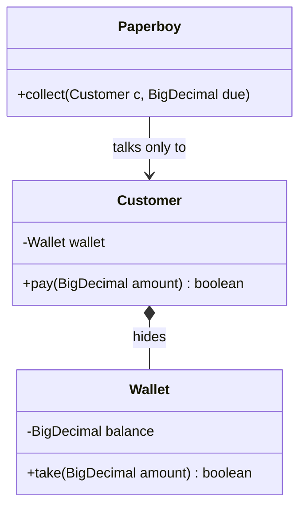
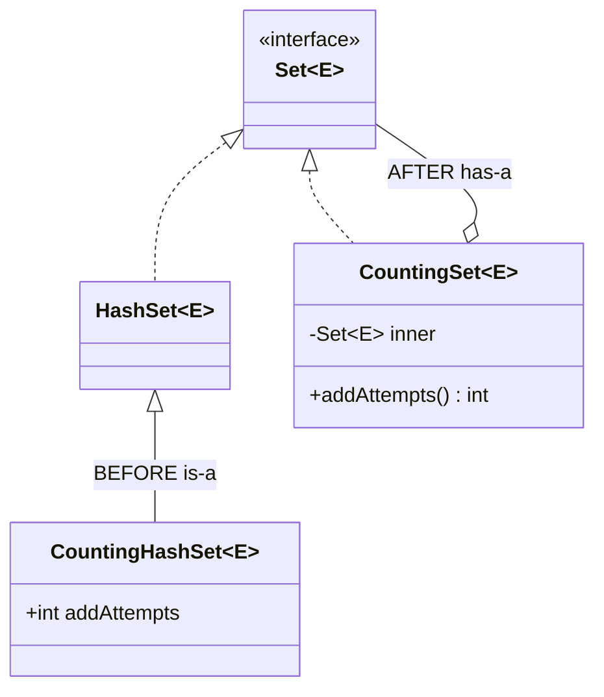
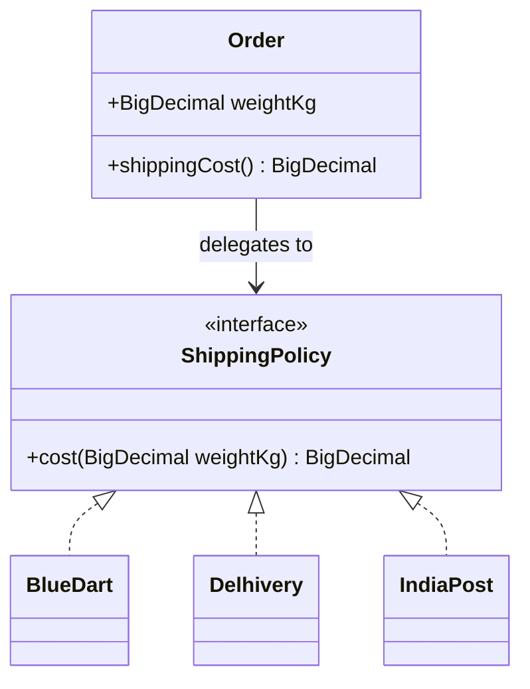
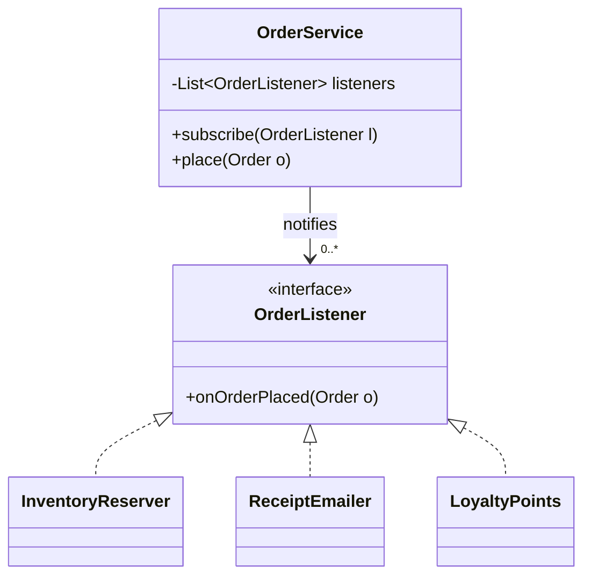
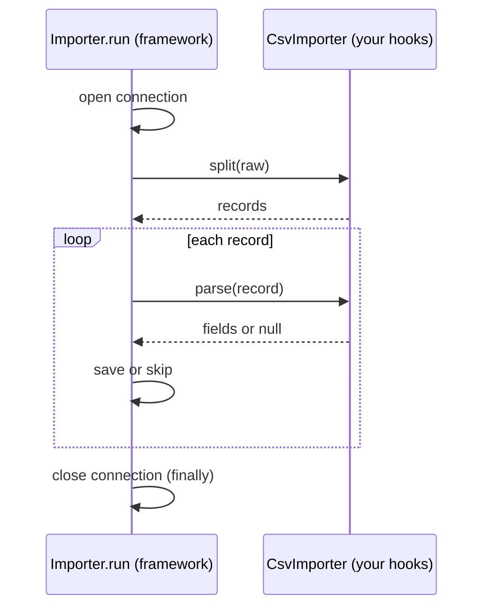
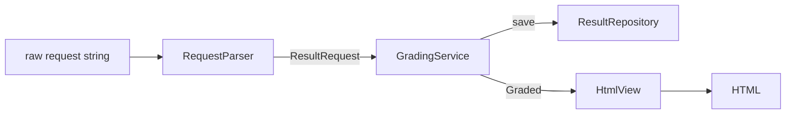
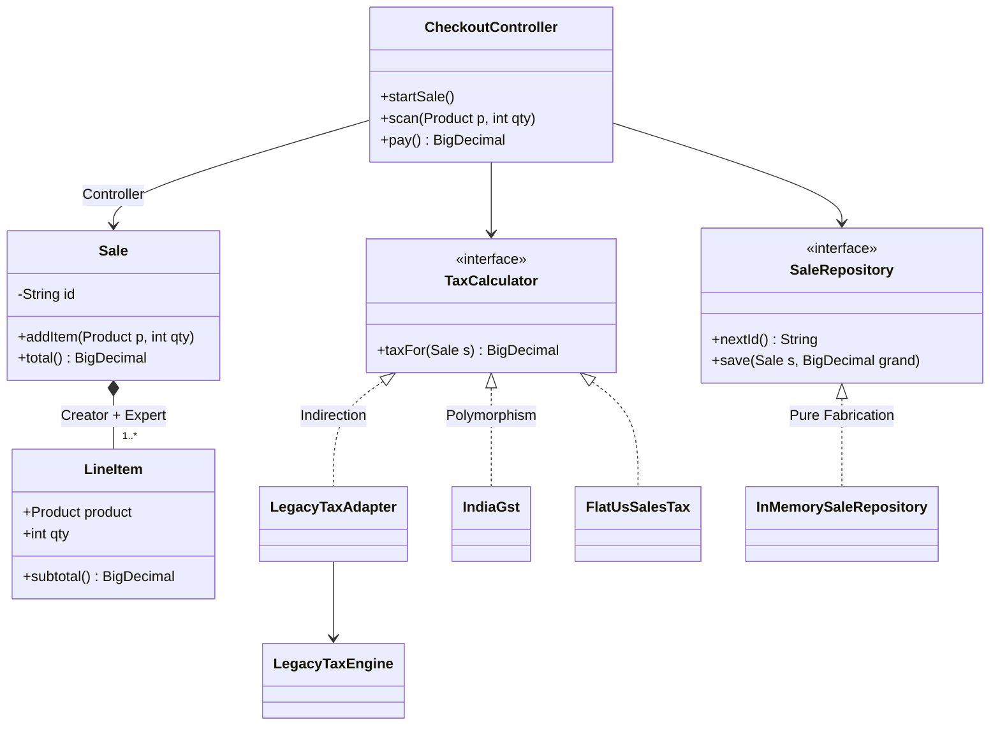
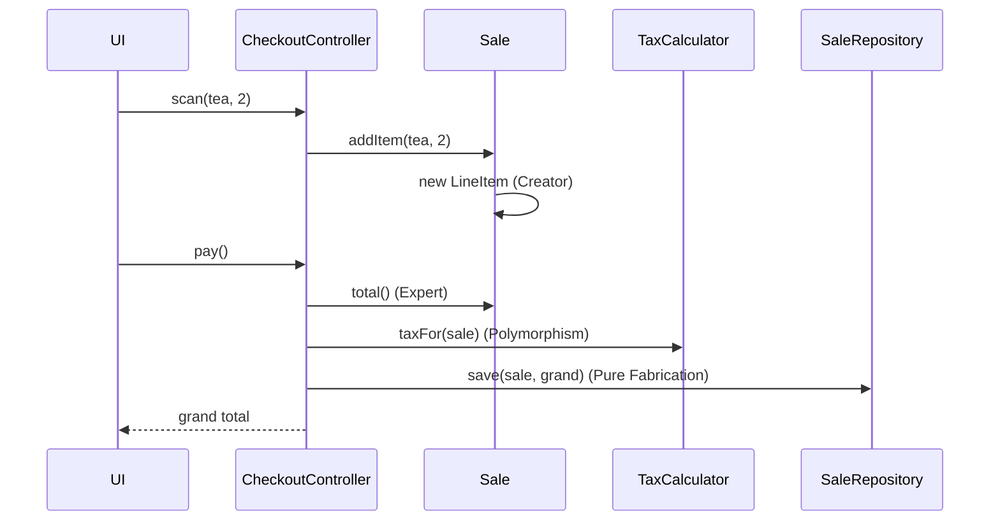
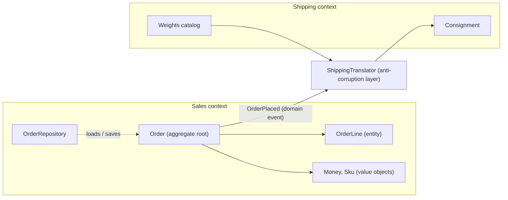
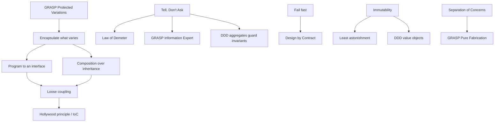

# Chapter 5 — More Design Principles

SOLID (Chapter 4) is only five of the rules good designers use. This chapter covers the rest of the everyday toolkit: short rules of thumb (DRY, KISS, YAGNI), rules about how objects talk to each other (Law of Demeter, Tell-Don't-Ask, loose coupling, the Hollywood Principle), the object-oriented principles that *Head First Design Patterns* and the Gang of Four book build every pattern on (encapsulate what varies, favour composition, program to an interface), rules about correctness (fail fast, immutability, Design by Contract) **GRASP** — nine guidelines for deciding *which class should do what* — and, finally, the essentials of **Domain-Driven Design**, which decides *which classes exist and where their boundaries are* by starting from the business.

**Key terms used throughout (defined once here):**

| Term | Meaning |
|---|---|
| **Coupling** | How much one class depends on (knows about) another. High coupling = a change in one forces changes in the other. |
| **Cohesion** | How closely the things inside one class belong together. High cohesion = the class does one focused job. |
| **Abstraction** | A simplified view (usually an interface or abstract class) that hides details that callers do not need. |
| **Encapsulation** | Keeping an object's data private and letting other code change it only through the object's methods. |
| **Invariant** | A fact about an object that must always be true (e.g. "balance is never negative"). |
| **Side effect** | Anything a method changes besides returning a value: fields, files, the database, the screen. |
| **Responsibility** | Something a class *knows* (its data) or *does* (its behaviour). |

**Chapter map**

| # | Principle | One-line idea | Comes from |
|---|---|---|---|
| 1 | DRY | Each piece of knowledge has one authoritative home | Hunt & Thomas, *The Pragmatic Programmer* (1999) |
| 2 | KISS | Choose the simplest design that works | US Navy (1960); popularised by Kelly Johnson, Lockheed Skunk Works |
| 3 | YAGNI | Don't build features before they are needed | Extreme Programming, late 1990s (usually credited to Ron Jeffries) |
| 4 | Law of Demeter | Only talk to your immediate friends | Ian Holland / Karl Lieberherr, Demeter project, Northeastern University (1987) |
| 5 | Tell, Don't Ask | Tell objects what to do; don't pull their data out and decide for them | Andy Hunt & Dave Thomas (Pragmatic Programmers), building on Alec Sharp's *Smalltalk by Example* (1997); explained by Martin Fowler |
| 6 | Composition over inheritance | Prefer "has-a" to "is-a" for reuse | GoF book (1994), *Effective Java* (Joshua Bloch) |
| 7 | Program to an interface | Depend on supertypes, not concrete classes | GoF book |
| 8 | Encapsulate what varies | Isolate the part that changes | GoF book, *Head First Design Patterns* |
| 9 | Loose coupling | Interacting objects should know little about each other | *Head First Design Patterns* |
| 10 | Hollywood Principle / IoC | "Don't call us, we'll call you" | *Head First*; frameworks, IoC containers |
| 11 | Separation of Concerns | Each part of the program handles one concern | Edsger Dijkstra (1974) |
| 12 | Least Astonishment | Behave the way readers expect | User-interface and programming-language design folklore (no single author) |
| 13 | Fail fast | Detect problems early and loudly | Popularised by Jim Shore's "Fail Fast" article, *IEEE Software* (2004) |
| 14 | Immutability | Objects that never change after creation | *Effective Java* ("minimize mutability") |
| 15 | Design by Contract | Preconditions, postconditions, invariants | Bertrand Meyer, Eiffel language (term coined 1986) |
| 16 | GRASP (9 patterns) | Guidelines for assigning responsibilities | Craig Larman, *Applying UML and Patterns* (1st ed. 1997; today's nine from the 2nd ed. 2001) |
| 17 | Domain-Driven Design essentials | Model the business: bounded contexts, entities vs value objects, aggregates, domain events, repositories | Eric Evans, *Domain-Driven Design* (2003); Vaughn Vernon, *Implementing Domain-Driven Design* (2013) |

> **How to read each section.** Every principle follows the same path: what it is → the problem → how to apply it → a Java *before/after* program you can run → trade-offs → when not to use it → mistakes → real-world examples → interview answer → self-check → TL;DR. All code lives in `code/lld/ch05/<topic>/Main.java` and was compiled with `javac --release 21` and run; the output shown is the real output.

---

## 1. DRY — Don't Repeat Yourself

### What it is
**DRY** says: every piece of *knowledge* in a system — a business rule, a formula, a validation, a constant — should have **a single, unambiguous, authoritative representation** — one place where it is defined. Everything else refers to that place. The principle comes from Andy Hunt and Dave Thomas's *The Pragmatic Programmer* (1999).

*Analogy:* a company keeps one master price list. Shops look prices up from it. If each shop kept its own hand-written copy, a price change would reach some shops and not others.

Important: DRY is about **knowledge**, not about lines of text that happen to look the same. Two pieces of code that look identical but represent *different* rules (which may change for different reasons) are *not* a DRY violation.

### The problem it solves
When a rule is copied into several places, the copies eventually **drift**: someone updates one copy and forgets the others. The system then gives two different answers to the same question — a bug that is hard to spot because each copy looks reasonable on its own. Duplication also multiplies the effort of every change.

### How it works
1. Notice a rule that appears in more than one place (a regex, a tax rate, a status check, a SQL fragment).
2. Ask: *"If this rule changes, must all copies change together?"* If yes, it is one piece of knowledge.
3. Give it one home: a constant, a method, a value object, an enum, a config entry or a shared module.
4. Replace every copy with a reference to that home.
5. Apply the **Rule of Three** for code-level duplication (a heuristic credited to Don Roberts and popularised by Martin Fowler's *Refactoring*): the first time, just write it; the second time, notice the duplication but tolerate it; the third time, extract.

### Java example — before/after
The *before* has two services that each carry their own copy of "what a valid email is" and "what the tax is". The copies have already drifted. The *after* puts the email rule inside an `EmailAddress` value object (a small immutable type whose constructor validates its value) and the tax rule inside `TaxPolicy`.

```java
// File: lld/ch05/dry/Main.java
package lld.ch05.dry;

import java.math.BigDecimal;
import java.math.RoundingMode;
import java.util.regex.Pattern;

/** DRY: one piece of knowledge (what a valid email is, what the tax rate is) lives in ONE place. */
public class Main {

    // ---------------- BEFORE: the same rule is written twice and the copies have drifted ----------------
    static class Before {
        static class SignupService {
            boolean signup(String email) {
                // copy #1 of the rule (someone relaxed it later)
                return email != null && email.contains("@");
            }
            BigDecimal priceWithTax(BigDecimal price) {
                return price.multiply(new BigDecimal("1.18")).setScale(2, RoundingMode.HALF_UP); // 18% hard-coded
            }
        }
        static class ProfileService {
            boolean changeEmail(String email) {
                // copy #2 of the rule (the stricter original)
                return email != null && email.matches("[^@\\s]+@[^@\\s]+\\.[a-z]{2,}");
            }
            BigDecimal priceWithTax(BigDecimal price) {
                return price.multiply(new BigDecimal("1.18")).setScale(2, RoundingMode.HALF_UP); // 18% again
            }
        }
    }

    // ---------------- AFTER: each rule has a single, authoritative home ----------------
    static class After {
        /** The ONLY definition of "valid email" in the system. */
        record EmailAddress(String value) {
            private static final Pattern FORMAT = Pattern.compile("[^@\\s]+@[^@\\s]+\\.[a-z]{2,}");
            EmailAddress {
                if (value == null || !FORMAT.matcher(value).matches())
                    throw new IllegalArgumentException("invalid email: " + value);
            }
        }

        /** The ONLY definition of the tax rule. */
        static final class TaxPolicy {
            private static final BigDecimal RATE = new BigDecimal("0.18");
            private TaxPolicy() {}
            static BigDecimal withTax(BigDecimal price) {
                return price.add(price.multiply(RATE)).setScale(2, RoundingMode.HALF_UP);
            }
        }

        static class SignupService {
            String signup(String rawEmail) { return "signed up " + new EmailAddress(rawEmail).value(); }
        }
        static class ProfileService {
            String changeEmail(String rawEmail) { return "email changed to " + new EmailAddress(rawEmail).value(); }
        }
    }

    public static void main(String[] args) {
        System.out.println("== BEFORE ==");
        var signup = new Before.SignupService();
        var profile = new Before.ProfileService();
        String sloppy = "bob@localhost";
        System.out.println("signup accepts '" + sloppy + "'? " + signup.signup(sloppy));
        System.out.println("profile accepts '" + sloppy + "'? " + profile.changeEmail(sloppy) + "   <-- same rule, two answers");

        System.out.println("== AFTER ==");
        var s = new After.SignupService();
        var p = new After.ProfileService();
        System.out.println(s.signup("bob@example.com"));
        System.out.println(p.changeEmail("bob@example.com"));
        for (String candidate : new String[]{sloppy}) {
            try { s.signup(candidate); } catch (IllegalArgumentException e) { System.out.println("signup rejected: " + e.getMessage()); }
            try { p.changeEmail(candidate); } catch (IllegalArgumentException e) { System.out.println("profile rejected: " + e.getMessage()); }
        }
        System.out.println("price 100.00 with tax = " + After.TaxPolicy.withTax(new BigDecimal("100.00")));
    }
}
```

Output:

```text
== BEFORE ==
signup accepts 'bob@localhost'? true
profile accepts 'bob@localhost'? false   <-- same rule, two answers
== AFTER ==
signed up bob@example.com
email changed to bob@example.com
signup rejected: invalid email: bob@localhost
profile rejected: invalid email: bob@localhost
price 100.00 with tax = 118.00
```

**What each part does:**
- `Before.SignupService` and `Before.ProfileService` each re-implement the email rule; the output shows them disagreeing about `bob@localhost`.
- `After.EmailAddress` is a Java **record** (a compact, immutable data class). Its *compact constructor* runs the check, so an invalid email simply cannot exist as an `EmailAddress`.
- `After.TaxPolicy` holds the rate in one private constant; changing GST from 18% means editing one line.

### Trade-offs

| Benefit | Cost |
|---|---|
| One change point per rule; no drift | A shared abstraction couples its users together |
| Less code to read and test | A premature or wrong abstraction is worse than duplication |
| Rules get a name (self-documenting) | Extra indirection to find the real code |

### When not to use it
- When two snippets look alike **by coincidence** and will evolve separately (e.g. "max username length 30" and "max tag length 30"). Merging them creates false coupling.
- Across service boundaries in microservices: sharing a domain library between independently deployed services can couple their release cycles. Some duplication is the lesser evil.
- In tests, a little repetition often makes each test easier to read on its own (this is sometimes called DAMP — "descriptive and meaningful phrases").

### Common mistakes
- Treating DRY as "never have two similar lines" and building one monster function with flags for every caller.
- Extracting after the first repetition, before you understand what really varies.
- Forgetting non-code duplication: the same rule in code *and* in a database constraint *and* in docs.

### Real-world examples
- **Spring's `@Value` / `application.yml`**: configuration values live in one file and are injected wherever needed.
- **Database normalisation** is DRY for data: a customer's address is stored once and referenced by key.
- **Bean Validation (`jakarta.validation`) annotations** such as `@Email` on a field define the rule once and reuse it for REST input, forms and persistence.
- **OpenAPI / Protobuf schemas** generate client and server code from one contract, so the message format is not hand-copied.

### In the interview
**30-second answer:** "DRY means each piece of knowledge has one authoritative representation. It is about rules, not about identical-looking text. I extract a rule when copies must change together — for example, validation into a value object — and I use the Rule of Three so I don't abstract too early."

**Follow-ups:**
- *Q: Is duplicated code always a DRY violation?* A: No. If the two copies represent different rules that change for different reasons, merging them adds wrong coupling.
- *Q: DRY vs. SRP?* A: They cooperate. DRY gives each rule one home; SRP makes sure that home has only one reason to change.
- *Q: How do you spot duplication of knowledge?* A: Ask "if this business rule changes, how many files do I edit?" More than one is a smell.

### Self-check
1. Q: What exactly must not be repeated? → A: Knowledge (rules, formulas, decisions), not merely similar-looking lines.
2. Q: What is the Rule of Three? → A: Tolerate a second copy; extract a shared abstraction when a third appears.
3. Q: What bug does duplication cause? → A: Drift — copies change independently and start disagreeing.

### TL;DR
One rule, one home. Extract when copies must change together; leave coincidental look-alikes alone.

---

## 2. KISS — Keep It Simple, Stupid

### What it is
**KISS** says most systems work best when they are kept simple. The phrase was used by the US Navy around 1960 and is associated with Kelly Johnson, lead engineer of Lockheed's Skunk Works, who wanted jet aircraft a mechanic could repair in the field with basic tools. Choose the plainest design that fully solves the real problem. *Simple* means easy to understand and change — not necessarily the fewest lines.

*Analogy:* to hang one picture you use a nail, not a motorised track system with remote control.

### The problem it solves
Engineers love clever solutions: home-made frameworks, deep inheritance trees, generic engines configured by lambdas. Every extra moving part must be read, tested, debugged and explained to new team members. Accidental complexity (complexity we add, as opposed to complexity the problem truly has) is the biggest source of bugs and slow delivery.

### How it works
1. State the actual requirement in one sentence.
2. Write the most direct solution using standard language features and libraries.
3. Ask: "Could a new team member understand this in two minutes?"
4. Add structure (patterns, abstractions) only when a concrete need — a second variant, a test seam, a real performance issue — shows up.
5. Delete cleverness that no longer earns its keep.

### Java example — before/after
Three fixed customer tiers get three fixed discounts. The *before* builds a priority-sorted rule engine of predicates and functions. The *after* is a `switch` expression, which the compiler also checks for completeness: a `switch` *expression* over an enum with no `default` must cover every constant, so adding a new tier makes it fail to compile until you handle the new case. (Old-style `switch` *statements* are not checked this way.) Money is `BigDecimal`, never `double` (binary floating point cannot represent most decimal amounts exactly).

```java
// File: lld/ch05/kiss/Main.java
package lld.ch05.kiss;

import java.math.BigDecimal;
import java.math.RoundingMode;
import java.util.ArrayList;
import java.util.Comparator;
import java.util.List;
import java.util.function.Function;
import java.util.function.Predicate;

/** KISS: the simplest design that fully solves today's problem wins. Money is BigDecimal, never double. */
public class Main {

    enum Tier { REGULAR, SILVER, GOLD }

    static final BigDecimal SILVER_FACTOR = new BigDecimal("0.90");
    static final BigDecimal GOLD_FACTOR = new BigDecimal("0.80");

    static BigDecimal times(BigDecimal amount, BigDecimal factor) {
        return amount.multiply(factor).setScale(2, RoundingMode.HALF_UP);
    }

    // ---------------- BEFORE: a home-made "rule engine" for three fixed discounts ----------------
    static class Before {
        record Rule(int priority, Predicate<Tier> when, Function<BigDecimal, BigDecimal> apply) {}

        static class DiscountRuleEngine {
            private final List<Rule> rules = new ArrayList<>();
            DiscountRuleEngine register(int priority, Predicate<Tier> when, Function<BigDecimal, BigDecimal> apply) {
                rules.add(new Rule(priority, when, apply));
                rules.sort(Comparator.comparingInt(Rule::priority).reversed());
                return this;
            }
            BigDecimal evaluate(Tier tier, BigDecimal amount) {
                return rules.stream().filter(r -> r.when().test(tier)).findFirst()
                        .map(r -> r.apply().apply(amount)).orElse(amount);
            }
        }

        static DiscountRuleEngine build() {
            return new DiscountRuleEngine()
                    .register(10, t -> t == Tier.GOLD, a -> times(a, GOLD_FACTOR))
                    .register(5, t -> t == Tier.SILVER, a -> times(a, SILVER_FACTOR))
                    .register(0, t -> true, a -> a);
        }
    }

    // ---------------- AFTER: a plain switch expression; the compiler checks every tier is handled ----------------
    static class After {
        static BigDecimal discounted(Tier tier, BigDecimal amount) {
            return switch (tier) {
                case GOLD -> times(amount, GOLD_FACTOR);
                case SILVER -> times(amount, SILVER_FACTOR);
                case REGULAR -> amount;
            };
        }
    }

    public static void main(String[] args) {
        BigDecimal price = new BigDecimal("100.00");
        var engine = Before.build();
        System.out.println("== BEFORE (rule engine) ==");
        for (Tier t : Tier.values()) System.out.printf("%-7s -> %s%n", t, engine.evaluate(t, price));
        System.out.println("== AFTER (switch) ==");
        for (Tier t : Tier.values()) System.out.printf("%-7s -> %s%n", t, After.discounted(t, price));
    }
}
```

Output:

```text
== BEFORE (rule engine) ==
REGULAR -> 100.00
SILVER  -> 90.00
GOLD    -> 80.00
== AFTER (switch) ==
REGULAR -> 100.00
SILVER  -> 90.00
GOLD    -> 80.00
```

Both produce identical results, but the *after* has no ordering bugs to worry about (in the engine, forgetting a priority would silently change behaviour), no mutable list, and reads like the business rule.

### Trade-offs

| Simple design | "Flexible" complex design |
|---|---|
| Fast to read, change, test | Handles hypothetical cases |
| May need refactoring when real variation arrives | Costs you every day, even if variation never arrives |
| Uses standard, well-known constructs | Custom mechanisms need docs and training |

### When not to use it
KISS is never "wrong", but it is not an excuse to ignore the real complexity of the problem. A payment system *needs* idempotency, retries and auditing; leaving them out is not simplicity, it is incompleteness. Also, when a rule-engine really is the requirement (business users edit rules at runtime), build or buy one.

### Common mistakes
- Confusing *simple* with *easy* or *short*: a one-line stream with five nested lambdas may be shorter but harder to read than a loop.
- Using KISS to justify skipping tests, error handling or validation.
- Copy-pasting instead of simplifying (that violates DRY).

### Real-world examples
- **Unix philosophy** — small tools that do one thing and compose through pipes.
- **Go language design** deliberately left out many features to keep the language simple.
- **`java.util.Optional`** was intentionally kept small (no `Serializable`, not meant as a field type) to steer people toward its one purpose: return values that might be absent.

### In the interview
**30-second answer:** "KISS means picking the simplest design that fully meets the requirements. In an interview I start with a straightforward model and only introduce patterns when a requirement demands variation or extension — and I say why."

**Follow-ups:**
- *Q: Isn't a design pattern always better?* A: No. A pattern adds classes and indirection; it's worth it only if it solves a problem you actually have.
- *Q: How do KISS and YAGNI differ?* A: KISS is about *how* you build (the simplest form); YAGNI is about *what* you build (only needed features).

### Self-check
1. Q: What is accidental complexity? → A: Complexity introduced by our solution rather than required by the problem.
2. Q: Why did the `switch` version win? → A: Same behaviour, fewer moving parts, compiler-checked exhaustiveness.

### TL;DR
Solve the real problem in the plainest way; add machinery only when a real need appears.

---

## 3. YAGNI — You Aren't Gonna Need It

### What it is
**YAGNI** says: do not build a capability until you actually need it. It comes from Extreme Programming (XP), the agile method created by Kent Beck in the late 1990s; the slogan is usually credited to XP co-founder Ron Jeffries. The opposite habit — building hooks, options and layers "just in case" — is called **speculative generality**, a code smell in Martin Fowler's *Refactoring*.

*Analogy:* you don't buy a 7-seater car because you *might* have five children one day.

### The problem it solves
Features built early cost four times: the time to build them, the time to maintain and test them, the complexity they add to everything around them, and the cost of being wrong (the real future requirement usually looks different from the guess, so the speculative code must be rewritten anyway).

### How it works
1. Implement the stories/requirements you have **now**.
2. Keep the code clean (tested, well-factored) so that it is cheap to change later — YAGNI depends on refactoring being easy.
3. When a new requirement actually arrives, extend the design then.
4. Delete unused options, parameters and classes you discover.

### Java example — before/after
The requirement: *export orders as CSV*. The *before* builds a universal exporter with five formats, encodings and compression — four formats and compression throw `UnsupportedOperationException`. The *after* is one method.

```java
// File: lld/ch05/yagni/Main.java
package lld.ch05.yagni;

import java.math.BigDecimal;
import java.util.List;
import java.util.stream.Collectors;

/** YAGNI: build what the current requirement needs ("export orders as CSV"), not what might be asked one day. */
public class Main {

    record Order(String id, String customer, BigDecimal total) {}   // money as BigDecimal, never double

    // ---------------- BEFORE: speculative generality ----------------
    static class Before {
        enum Format { CSV, PDF, XML, EXCEL, YAML }

        /** Five formats, pluggable encodings, compression... only CSV was requested. */
        interface ReportExporter {
            String export(List<Order> orders, Format format, String encoding, boolean compress);
        }

        static class UniversalExporter implements ReportExporter {
            @Override
            public String export(List<Order> orders, Format format, String encoding, boolean compress) {
                if (compress) throw new UnsupportedOperationException("compression not implemented yet");
                return switch (format) {
                    case CSV -> orders.stream().map(o -> o.id() + "," + o.customer() + "," + o.total().toPlainString())
                            .collect(Collectors.joining("\n", "id,customer,total\n", ""));
                    case PDF, XML, EXCEL, YAML -> throw new UnsupportedOperationException(format + " not implemented yet");
                };
            }
        }
    }

    // ---------------- AFTER: exactly what is needed today ----------------
    static class After {
        static String toCsv(List<Order> orders) {
            return orders.stream()
                    .map(o -> String.join(",", o.id(), o.customer(), o.total().toPlainString()))
                    .collect(Collectors.joining("\n", "id,customer,total\n", ""));
        }
    }

    public static void main(String[] args) {
        List<Order> orders = List.of(new Order("o1", "asha", new BigDecimal("250.00")),
                                     new Order("o2", "ravi", new BigDecimal("99.50")));
        System.out.println("== BEFORE ==");
        var exporter = new Before.UniversalExporter();
        System.out.println(exporter.export(orders, Before.Format.CSV, "UTF-8", false));
        try {
            exporter.export(orders, Before.Format.PDF, "UTF-8", false);
        } catch (UnsupportedOperationException e) {
            System.out.println("dead option: " + e.getMessage());
        }
        System.out.println("== AFTER ==");
        System.out.println(After.toCsv(orders));
    }
}
```

Output:

```text
== BEFORE ==
id,customer,total
o1,asha,250.00
o2,ravi,99.50
dead option: PDF not implemented yet
== AFTER ==
id,customer,total
o1,asha,250.00
o2,ravi,99.50
```

Every caller of the *before* API must pass three meaningless arguments, and every reader wonders which formats really work.

### Trade-offs

| YAGNI | Build ahead |
|---|---|
| Less code, faster delivery | Might save time if the guess is right |
| Design fits real needs | Guesses are usually wrong in detail |
| Needs good tests + refactoring discipline | Leaves dead options that confuse readers |

### When not to use it
- **Hard-to-change decisions** — public API formats, database schemas with huge data, security, data retention laws. Think ahead there because changing later is very expensive.
- Architectural qualities that are known requirements (e.g. "must scale to 10k requests/s") are not speculation; they are requirements.

### Common mistakes
- Using YAGNI as an excuse for messy code ("we'll never need clean code").
- Ignoring a requirement the interviewer *did* mention because "YAGNI".
- Adding `interface` + `Impl` pairs for every class "in case we swap it" — only add the interface when there is a second implementation or a test seam need.

### Real-world examples
- **Minimum Viable Product (MVP)** thinking in startups is YAGNI at the product level.
- **Feature flags** (e.g. LaunchDarkly, Unleash) let teams ship only what is needed now and turn on more later, rather than building every variant up front.
- XP teams (and many agile teams) plan per iteration so that only near-term work is built.

### In the interview
**30-second answer:** "YAGNI means I build what the requirements need today and keep the design easy to extend. In an LLD interview I'll mention an extension point — say a `PaymentStrategy` interface — only if the interviewer hinted at multiple variants; otherwise I note it verbally as a possible extension."

**Follow-ups:**
- *Q: Doesn't YAGNI conflict with OCP?* A: Not really. OCP is applied where variation is known or likely; YAGNI stops you from inventing variation that isn't there.
- *Q: What makes YAGNI safe?* A: A good test suite and clean code, so adding the feature later is cheap.

### Self-check
1. Q: Name the smell YAGNI prevents. → A: Speculative generality.
2. Q: When should you design ahead anyway? → A: For expensive-to-reverse decisions (public APIs, schemas, security).

### TL;DR
Build for today's requirements with clean, changeable code; tomorrow's features get built tomorrow.

---

## 4. Law of Demeter (Principle of Least Knowledge)

### What it is
The **Law of Demeter (LoD)**, also called the **Principle of Least Knowledge**, says a method should only talk to its **immediate friends**, not to strangers it reaches through other objects. Formally, a method `m` of object `O` should only call methods on:
1. `O` itself (`this`);
2. objects passed to `m` as parameters;
3. objects `m` creates;
4. `O`'s own fields (its direct components).

(The original formulation by Ian Holland and Karl Lieberherr at Northeastern University, 1987, also allows global objects accessible to `O`; modern summaries usually list the four above.)

The famous slogan: **"use only one dot"** — e.g. `a.getB().getC().doIt()` is a **train wreck** (a chain of calls that looks like connected railway cars).

*Analogy:* when a paperboy collects money, he asks the customer to pay. He doesn't reach into the customer's pocket, pull out the wallet and take the cash himself.

### The problem it solves
A train wreck couples the caller to the **whole chain's structure**. In `customer.getWallet().getBalance()`, the paperboy now depends on `Customer` *and* `Wallet`. If the customer starts paying by UPI instead of a wallet, the paperboy breaks. Knowledge of internal structure leaks everywhere.

### How it works
1. Spot a chain that navigates through other objects' internals.
2. Ask: *what does the caller really want?* ("get paid", not "get the wallet").
3. Add a method on the first object that does that job (`customer.pay(amount)`), delegating internally.
4. Keep the internal object private.



### Java example — before/after
```java
// File: lld/ch05/demeter/Main.java
package lld.ch05.demeter;

import java.math.BigDecimal;
import java.util.List;

/** Law of Demeter ("only talk to your immediate friends"): the paperboy should not reach into the customer's wallet. */
public class Main {

    // ---------------- BEFORE: a train wreck -- paperboy -> customer -> wallet -> balance ----------------
    static class Before {
        static class Wallet {
            private BigDecimal balance;
            Wallet(BigDecimal balance) { this.balance = balance; }
            BigDecimal getBalance() { return balance; }
            void setBalance(BigDecimal b) { balance = b; }
        }
        static class Customer {
            private final String name;
            private final Wallet wallet;
            Customer(String name, Wallet wallet) { this.name = name; this.wallet = wallet; }
            String getName() { return name; }
            Wallet getWallet() { return wallet; }
        }
        static class Paperboy {
            BigDecimal collected = BigDecimal.ZERO;
            void collect(Customer c, BigDecimal due) {
                // knows Customer has a Wallet, knows Wallet has a balance, changes it directly
                if (c.getWallet().getBalance().compareTo(due) >= 0) {
                    c.getWallet().setBalance(c.getWallet().getBalance().subtract(due));
                    collected = collected.add(due);
                    System.out.println("collected " + due + " from " + c.getName());
                } else {
                    System.out.println(c.getName() + " cannot pay");
                }
            }
        }
    }

    // ---------------- AFTER: the paperboy asks the customer (a direct friend) to pay ----------------
    static class After {
        static class Wallet {
            private BigDecimal balance;
            Wallet(BigDecimal balance) { this.balance = balance; }
            boolean take(BigDecimal amount) {
                if (amount.compareTo(balance) > 0) return false;
                balance = balance.subtract(amount);
                return true;
            }
        }
        static class Customer {
            private final String name;
            private final Wallet wallet;   // private detail -- could become a card or UPI tomorrow
            Customer(String name, Wallet wallet) { this.name = name; this.wallet = wallet; }
            String name() { return name; }
            /** Customer decides HOW to pay. */
            boolean pay(BigDecimal amount) { return wallet.take(amount); }
        }
        static class Paperboy {
            BigDecimal collected = BigDecimal.ZERO;
            void collect(Customer c, BigDecimal due) {
                if (c.pay(due)) {                      // talk only to a parameter: allowed
                    collected = collected.add(due);
                    System.out.println("collected " + due + " from " + c.name());
                } else {
                    System.out.println(c.name() + " cannot pay");
                }
            }
        }
    }

    public static void main(String[] args) {
        BigDecimal due = new BigDecimal("4.00");
        System.out.println("== BEFORE ==");
        var boy1 = new Before.Paperboy();
        boy1.collect(new Before.Customer("Meera", new Before.Wallet(new BigDecimal("10.00"))), due);
        boy1.collect(new Before.Customer("Kabir", new Before.Wallet(new BigDecimal("2.00"))), due);

        System.out.println("== AFTER ==");
        var boy2 = new After.Paperboy();
        boy2.collect(new After.Customer("Meera", new After.Wallet(new BigDecimal("10.00"))), due);
        boy2.collect(new After.Customer("Kabir", new After.Wallet(new BigDecimal("2.00"))), due);
        System.out.println("total collected = " + boy2.collected);

        // Chained calls on a fluent API / stream are NOT Demeter violations: each call returns the same kind of thing.
        long longNames = List.of("Meera", "Kabir", "Jo").stream().filter(n -> n.length() > 2).count();
        System.out.println("stream chain is fine: " + longNames + " long names");
    }
}
```

Output:

```text
== BEFORE ==
collected 4.00 from Meera
Kabir cannot pay
== AFTER ==
collected 4.00 from Meera
Kabir cannot pay
total collected = 4.00
stream chain is fine: 2 long names
```

**What changed:** in *before*, `Paperboy` knows three classes and even sets the balance directly. In *after*, `Paperboy` knows only `Customer.pay`, and `Customer` is free to change how it pays.

### Trade-offs

| Following LoD | Ignoring LoD |
|---|---|
| Changes to internals stay local | Structural changes ripple to callers |
| Easier mocking (one collaborator) | Tests must build whole object graphs |
| May add small **wrapper/delegate methods** | No extra methods |
| Too many wrappers can bloat the middle class | — |

### When not to use it
- **Fluent interfaces and builders** (`StringBuilder.append(..).append(..)`, `stream().filter().map()`) return the same object or a sibling of the same abstraction — they are *not* violations.
- **Data structures / DTOs** (plain data with no behaviour, see Chapter 6) are meant to expose their data; `order.shippingAddress().city()` on a record is fine.
- Don't mechanically add dozens of pass-through methods — that is the **Middle Man** smell. Rethink responsibilities instead.

### Common mistakes
- Counting dots instead of thinking about *knowledge*: splitting a chain into temp variables (`var w = c.getWallet(); w.getBalance()`) still violates the law.
- Adding getters for everything, which invites train wrecks.

### Real-world examples
- *Head First Design Patterns* presents it as "talk only to your immediate friends" in the Facade chapter — a **Facade** reduces how many classes a client talks to.
- **Spring Data** repositories: services call `orderRepository.findByCustomerId(id)` rather than navigating `entityManager.getSession().getConnection()...`.
- `java.nio.file.Files.readString(path)` hides channels, buffers and decoders behind a single call.

### In the interview
**30-second answer:** "The Law of Demeter says a method should only call methods on itself, its parameters, objects it creates and its own fields. Long chains like `a.getB().getC()` couple the caller to internal structure. I fix them by adding a method that expresses intent — `customer.pay()` instead of reaching for the wallet."

**Follow-ups:**
- *Q: Is `list.stream().map(...).collect(...)` a violation?* A: No — each call returns a stream/collection abstraction meant for chaining; you're not navigating an object's internals.
- *Q: What's the cost of following it strictly?* A: Wrapper methods can pile up (Middle Man). Balance by moving behaviour to where the data is (Tell-Don't-Ask).

### Self-check
1. Q: List the four "friends" of a method. → A: `this`, parameters, objects it creates, its own fields.
2. Q: What is a train wreck? → A: A chain of getters navigating through several objects.
3. Q: Do records/DTOs have to obey it? → A: Not really; they are data structures meant to expose data.

### TL;DR
Only talk to your friends. Replace `a.getB().getC().do()` with a method on `a` that says what you want.

---

## 5. Tell, Don't Ask

### What it is
**Tell, Don't Ask (TDA)** says: instead of *asking* an object for its data and then making a decision for it, *tell* the object what you want and let it decide using its own data. Behaviour should live with the data it needs. The idea was popularised by Andy Hunt and Dave Thomas (the Pragmatic Programmers), who built on Alec Sharp's observation in *Smalltalk by Example* (1997) that procedural code fetches data and then decides, while object-oriented code tells objects to act.

*Analogy:* you tell a taxi driver "take me to the airport". You don't ask for the steering wheel angle and the speed every second and decide the turns yourself.

### The problem it solves
When callers ask-then-act (`if (acc.getBalance() >= x) acc.setBalance(acc.getBalance() - x)`), the business rule is spread over every caller. Soon one caller forgets part of the rule (e.g. "frozen accounts can't withdraw") and the object's **invariant** breaks. The object becomes a passive data bag — the **Anemic Domain Model** anti-pattern.

### How it works
1. Look for code that reads an object's fields, decides something, then writes back.
2. Move that decision into a method on the object (`withdraw(amount)`).
3. Make the object reject illegal requests (exceptions or result types).
4. Remove setters that are no longer needed.

### Java example — before/after
```java
// File: lld/ch05/telldontask/Main.java
package lld.ch05.telldontask;

/** Tell, Don't Ask: tell an object what you want; don't pull its data out, decide, and push data back in. */
public class Main {

    // ---------------- BEFORE: callers ask for state and make the decision themselves ----------------
    static class Before {
        static class Account {
            private long balancePaise;
            private boolean frozen;
            Account(long balance) { this.balancePaise = balance; }
            long getBalance() { return balancePaise; }
            void setBalance(long b) { balancePaise = b; }
            boolean isFrozen() { return frozen; }
            void setFrozen(boolean f) { frozen = f; }
        }
        // ATM remembered the "frozen" rule...
        static void atmWithdraw(Account a, long amt) {
            if (!a.isFrozen() && a.getBalance() >= amt) a.setBalance(a.getBalance() - amt);
        }
        // ...the mobile app forgot it. The business rule is scattered and now inconsistent.
        static void appWithdraw(Account a, long amt) {
            if (a.getBalance() >= amt) a.setBalance(a.getBalance() - amt);
        }
    }

    // ---------------- AFTER: the rule lives with the data it protects ----------------
    static class After {
        static final class Account {
            private long balancePaise;
            private boolean frozen;
            Account(long balance) { this.balancePaise = balance; }
            void freeze() { frozen = true; }
            void withdraw(long amt) {
                if (amt <= 0) throw new IllegalArgumentException("amount must be positive");
                if (frozen) throw new IllegalStateException("account is frozen");
                if (amt > balancePaise) throw new IllegalStateException("insufficient funds");
                balancePaise -= amt;
            }
            long balance() { return balancePaise; }   // queries are fine for display -- just don't decide outside
        }
    }

    public static void main(String[] args) {
        System.out.println("== BEFORE ==");
        var a = new Before.Account(1_000);
        a.setFrozen(true);
        Before.atmWithdraw(a, 300);
        System.out.println("after ATM on frozen account: " + a.getBalance());
        Before.appWithdraw(a, 300);
        System.out.println("after APP on frozen account: " + a.getBalance() + "   <-- rule bypassed");

        System.out.println("== AFTER ==");
        var b = new After.Account(1_000);
        b.withdraw(300);
        System.out.println("withdrew 300, balance " + b.balance());
        b.freeze();
        try { b.withdraw(300); } catch (IllegalStateException e) { System.out.println("rejected: " + e.getMessage()); }
        System.out.println("balance still " + b.balance());
    }
}
```

Output:

```text
== BEFORE ==
after ATM on frozen account: 1000
after APP on frozen account: 700   <-- rule bypassed
== AFTER ==
withdrew 300, balance 700
rejected: account is frozen
balance still 700
```

In *before*, the ATM and the app each reimplement the rule and the app forgets `frozen`. In *after*, `withdraw` is the only way to take money, so the rule cannot be bypassed.

### Trade-offs

| Tell | Ask |
|---|---|
| Invariants protected in one place | Rules duplicated across callers |
| Richer, more expressive objects | Simple data objects |
| Risk: object grows too many responsibilities | Fine for pure data (DTOs, reports) |

### When not to use it
- For **queries whose purpose is display or reporting** — asking for a balance to show it on screen is fine. The rule is about *deciding* outside.
- When the decision genuinely belongs to another object that combines data from several sources (then that other object is the Information Expert — see GRASP).

### Common mistakes
- Adding a getter "just for this one check" — that is where the rule starts leaking.
- Pushing *every* behaviour into the entity, including emails and database calls (breaks SRP; use services for cross-cutting work).

### Real-world examples
- `java.util.List.removeIf(predicate)` — you tell the list what to remove instead of iterating and removing yourself.
- `Map.computeIfAbsent`, `Map.merge` — tell the map the update you want; it handles the check-then-act.
- `AtomicInteger.incrementAndGet()` — the object performs the read-modify-write atomically; asking then setting would be a race condition.

### In the interview
**30-second answer:** "Tell, Don't Ask means sending commands to the object that owns the data, e.g. `account.withdraw(100)`, rather than reading its balance and setting a new one. It keeps invariants in one place and avoids anemic models."

**Follow-ups:**
- *Q: How is it related to the Law of Demeter?* A: Both push behaviour to where the data is; LoD focuses on *who* you talk to, TDA on *what* you ask for.
- *Q: Concurrency angle?* A: Ask-then-act across two calls is a check-then-act race; a single `withdraw` method can be made atomic.

### Self-check
1. Q: What anti-pattern does TDA fight? → A: The Anemic Domain Model (data bags with logic outside).
2. Q: Are getters forbidden? → A: No; they're fine for display. Avoid deciding outside the object.

### TL;DR
Don't pull data out to make the object's decisions — tell the object what you want.

---

## 6. Composition over Inheritance

### What it is
**Favour object composition over class inheritance** (from the GoF book). *Inheritance* ("is-a") reuses code by making a subclass of another class. *Composition* ("has-a") reuses code by holding a reference to another object and **delegating** (forwarding) calls to it.

*Analogy:* a car *has* an engine. You can swap a petrol engine for an electric one. If "car" *inherited from* "petrol engine", you could never swap it.

### The problem it solves
Inheritance is the tightest coupling in object-oriented programming:
- **Fragile base class problem** — a subclass can break when the parent's *internal* implementation changes, even if the parent's public API is unchanged. The subclass depends on details like "does `addAll` call `add`?".
- **Fixed at compile time** — you cannot change the parent at runtime.
- **Class explosion** — combining features by subclassing (`LoggingCachingBufferedStream`) multiplies classes.
- It exposes all parent methods, even those that make no sense for the child.

### How it works
1. Instead of `class B extends A`, give `B` a private field of type `A` (preferably an interface type).
2. Implement `B`'s methods by adding your behaviour and **forwarding** to the wrapped object.
3. Receive the wrapped object through the constructor, so any implementation can be plugged in.
4. Keep inheritance for genuine "is-a" relationships where the subclass truly is substitutable (Liskov Substitution, Chapter 4) and the parent was **designed for extension** (documented hooks, often abstract).



### Java example — before/after
We want to count how many elements were ever added to a set. This is the classic trap described in *Effective Java*.

```java
// File: lld/ch05/composition/Main.java
package lld.ch05.composition;

import java.util.Collection;
import java.util.HashSet;
import java.util.Iterator;
import java.util.List;
import java.util.Set;
import java.util.AbstractSet;

/** Composition over inheritance: extending a concrete class couples you to its private implementation details. */
public class Main {

    // ---------------- BEFORE: inherit from HashSet to count insert attempts ----------------
    static class Before {
        @SuppressWarnings("serial")
        static class CountingHashSet<E> extends HashSet<E> {
            int addAttempts;
            @Override public boolean add(E e) { addAttempts++; return super.add(e); }
            @Override public boolean addAll(Collection<? extends E> c) {
                addAttempts += c.size();
                return super.addAll(c);   // HashSet's inherited addAll calls add() for each element -> counted twice!
            }
        }
    }

    // ---------------- AFTER: wrap ANY Set and forward calls (a decorator) ----------------
    static class After {
        static final class CountingSet<E> extends AbstractSet<E> {
            private final Set<E> inner;   // "has-a", not "is-a"
            private int addAttempts;
            CountingSet(Set<E> inner) { this.inner = inner; }
            @Override public boolean add(E e) { addAttempts++; return inner.add(e); }
            @Override public boolean addAll(Collection<? extends E> c) { addAttempts += c.size(); return inner.addAll(c); }
            @Override public boolean contains(Object o) { return inner.contains(o); }   // keep the inner set's O(1)/O(log n) lookup
            @Override public boolean remove(Object o) { return inner.remove(o); }
            @Override public Iterator<E> iterator() { return inner.iterator(); }
            @Override public int size() { return inner.size(); }
            int addAttempts() { return addAttempts; }
        }
    }

    public static void main(String[] args) {
        List<String> words = List.of("red", "green", "blue");

        var before = new Before.CountingHashSet<String>();
        before.addAll(words);
        System.out.println("BEFORE: added 3 items, counter says " + before.addAttempts);

        var after = new After.CountingSet<String>(new HashSet<>());
        after.addAll(words);
        System.out.println("AFTER : added 3 items, counter says " + after.addAttempts());

        // Bonus: composition works with any Set implementation, chosen at runtime.
        var sorted = new After.CountingSet<String>(new java.util.TreeSet<>());
        sorted.addAll(words);
        System.out.println("AFTER over a TreeSet: " + sorted + " attempts=" + sorted.addAttempts());
    }
}
```

Output:

```text
BEFORE: added 3 items, counter says 6
AFTER : added 3 items, counter says 3
AFTER over a TreeSet: [blue, green, red] attempts=3
```

**Why the *before* prints 6:** `HashSet` does not override `addAll`; it inherits `AbstractCollection.addAll`, which loops and calls `add` for every element. Our `addAll` adds 3, then the parent's loop calls *our overridden* `add` three more times. We depended on an implementation detail ("self-use") that `HashSet` does not promise to keep — the fragile base class problem. The *after* wraps any `Set` and forwards; the inner set's internal calls never reach our counter. It also forwards `contains` and `remove`: `AbstractSet` would otherwise implement them by scanning the iterator (O(n)) instead of using the inner set's fast lookup. It also works with a `TreeSet` chosen at runtime.

### Trade-offs

| Composition | Inheritance |
|---|---|
| Loose coupling to the public API only | Coupled to parent internals |
| Swap behaviour at runtime | Fixed at compile time |
| Combine behaviours freely (decorators) | Class explosion for combinations |
| More boilerplate (forwarding methods) | Free reuse of all parent methods |
| No automatic polymorphism — need an interface | Subclass is automatically a subtype |

### When not to use it
- True "is-a" hierarchies with a base class **designed for extension**: e.g. extending `AbstractList` (implement `get` and `size`) or a Template Method base (see Hollywood Principle below).
- Sealed type hierarchies modelling a closed set of variants (`sealed interface Shape permits Circle, Square`).
- When you control both classes and they are in the same package and evolve together.

### Common mistakes
- Inheriting just to reuse a few helper methods ("`OrderService extends BaseDao`").
- Composition without an interface — then you can't substitute implementations.
- Exposing the wrapped object with a getter, defeating encapsulation.

### Real-world examples
- **JDK mistakes admitted by its own authors:** `java.util.Stack extends Vector` (so a stack lets you insert in the middle) and `java.util.Properties extends Hashtable` (so you can put non-String values). *Effective Java* cites both.
- **`java.io` streams** — `new BufferedInputStream(new FileInputStream(f))` composes behaviour (Decorator pattern, Chapter 9).
- **`Collections.unmodifiableList(list)` / `synchronizedList(list)`** wrap a list instead of subclassing each list type.
- **Game engines (Unity)** use an Entity–Component model: a game object *has* components (physics, renderer) instead of deep inheritance trees.

### In the interview
**30-second answer:** "Inheritance couples a subclass to its parent's implementation, is fixed at compile time and explodes combinatorially. Composition holds a reference to an interface and delegates, so behaviour can be swapped at runtime. I use inheritance only for true is-a relationships with classes designed for extension."

**Follow-ups:**
- *Q: Which patterns are built on composition?* A: Strategy, Decorator, Composite, State, Bridge, Proxy, Adapter (object form) — most GoF patterns.
- *Q: Give a concrete inheritance failure.* A: The counting `HashSet` above, or `Stack extends Vector` exposing `insertElementAt`.
- *Q: When is inheritance OK?* A: When substitutable (LSP holds) and the parent documents its self-use or provides abstract hooks.

### Self-check
1. Q: What is the fragile base class problem? → A: Subclasses breaking because the parent's internal implementation changed.
2. Q: What does "forwarding" mean? → A: The wrapper's method calls the same method on the wrapped object.
3. Q: Why did `CountingHashSet` count 6? → A: The inherited `addAll` calls the overridden `add`.

### TL;DR
Reuse by holding and delegating ("has-a"); reserve "is-a" for real substitutable subtypes designed for extension.

---

## 7. Program to an Interface, Not an Implementation

### What it is
Declare variables, fields, parameters and return types using the **most general supertype** that offers what you need (an interface or abstract class), not a concrete class. "Interface" here means *supertype*, not only the Java `interface` keyword.

*Analogy:* a phone charger is designed for the USB-C *standard*, not for one specific phone model. Any USB-C phone works.

### The problem it solves
Code written against a concrete class (`ArrayList`, `MySqlUserStore`) can only ever work with that class. You cannot test it without the real thing (e.g. a MySQL server), cannot swap implementations and cannot reuse it with other types. Changing the implementation means editing every caller.

### How it works
1. Identify the **role** a collaborator plays ("stores users", "a collection of names").
2. Express the role as an interface with only the needed methods (`UserRepository.findById`).
3. Type fields/parameters by that interface (`List<String>`, `Collection<String>`, `UserRepository`).
4. Create concrete objects only at the edges — in `main`, a factory, or a DI container — and pass them in (**Dependency Injection**: giving an object its collaborators from outside instead of letting it `new` them).
5. For parameters, accept the widest type you can (`Collection` beats `List` beats `ArrayList`); for return types, return an interface but a specific enough one to be useful.

### Java example — before/after
```java
// File: lld/ch05/interfaces/Main.java
package lld.ch05.interfaces;

import java.util.ArrayList;
import java.util.Collection;
import java.util.HashMap;
import java.util.List;
import java.util.Map;
import java.util.Optional;
import java.util.TreeSet;

/** Program to an interface (a supertype), not an implementation. */
public class Main {

    record User(String id, String name) {}

    // ---------------- BEFORE: every signature names a concrete class ----------------
    static class Before {
        /** Pretend this talks to a real MySQL server -- impossible to use in a unit test. */
        static class MySqlUserStore {
            User load(String id) { throw new IllegalStateException("no MySQL server on this laptop"); }
        }
        static class GreetingService {
            private final MySqlUserStore store = new MySqlUserStore();   // hard-wired concrete dependency
            String greet(String id) { return "Hello, " + store.load(id).name(); }
        }
        static int countLongNames(ArrayList<String> names) {         // only accepts ArrayList
            int n = 0;
            for (String s : names) if (s.length() > 4) n++;
            return n;
        }
    }

    // ---------------- AFTER: depend on the supertype; pick the implementation at the edge ----------------
    static class After {
        interface UserRepository { Optional<User> findById(String id); }

        static final class InMemoryUserRepository implements UserRepository {
            private final Map<String, User> data = new HashMap<>();
            InMemoryUserRepository save(User u) { data.put(u.id(), u); return this; }
            @Override public Optional<User> findById(String id) { return Optional.ofNullable(data.get(id)); }
        }

        static final class GreetingService {
            private final UserRepository users;                  // any implementation
            GreetingService(UserRepository users) { this.users = users; }
            String greet(String id) {
                return users.findById(id).map(u -> "Hello, " + u.name()).orElse("Hello, stranger");
            }
        }

        static int countLongNames(Collection<String> names) {   // works for List, Set, Queue...
            return (int) names.stream().filter(s -> s.length() > 4).count();
        }
    }

    public static void main(String[] args) {
        System.out.println("== BEFORE ==");
        try {
            System.out.println(new Before.GreetingService().greet("u1"));
        } catch (IllegalStateException e) {
            System.out.println("cannot even run it: " + e.getMessage());
        }
        System.out.println("long names in ArrayList: " + Before.countLongNames(new ArrayList<>(List.of("Anand", "Li", "Priya"))));
        // Before.countLongNames(new TreeSet<>(...)) would not compile.

        System.out.println("== AFTER ==");
        After.UserRepository repo = new After.InMemoryUserRepository().save(new User("u1", "Asha"));
        var service = new After.GreetingService(repo);
        System.out.println(service.greet("u1"));
        System.out.println(service.greet("u2"));
        System.out.println("long names in List:    " + After.countLongNames(List.of("Anand", "Li", "Priya")));
        System.out.println("long names in TreeSet: " + After.countLongNames(new TreeSet<>(List.of("Anand", "Li", "Priya"))));
    }
}
```

Output:

```text
== BEFORE ==
cannot even run it: no MySQL server on this laptop
long names in ArrayList: 2
== AFTER ==
Hello, Asha
Hello, stranger
long names in List:    2
long names in TreeSet: 2
```

The *before* service creates its own `MySqlUserStore`, so it cannot even run on a laptop, and `countLongNames` accepts only `ArrayList`. The *after* depends on `UserRepository` and `Collection`; an in-memory implementation makes it runnable and testable, and any collection works.

### Trade-offs

| Interface-typed | Concrete-typed |
|---|---|
| Swappable, testable (fakes/mocks) | Simple, one less type |
| Callers can't use implementation-only methods | Access to everything (e.g. `ArrayList.trimToSize`) |
| Extra interface to maintain | Changes ripple to callers |

### When not to use it
- **Value types / data classes** (`String`, `LocalDate`, records) — no need for an interface.
- A class with exactly one implementation and no testing seam need — creating `FooService` + `FooServiceImpl` for everything is ceremony (see YAGNI). Add the interface when the second implementation or test double appears.
- When you truly need implementation-specific behaviour (e.g. `LinkedHashMap` access order for an LRU cache — then declare it as such).

### Common mistakes
- Interfaces that mirror a class one-to-one with 30 methods (violates Interface Segregation, Chapter 4).
- Declaring `List` but then casting to `ArrayList` inside.
- Still calling `new ConcreteThing()` inside the class that uses the interface — the dependency is typed abstractly but still hard-wired.

### Real-world examples
- **Java Collections Framework**: code uses `List`, `Map`, `Set`; `Collections.sort(List)` works on any list.
- **JDBC**: your code uses `java.sql.Connection`, `PreparedStatement`, `ResultSet` interfaces; the driver (MySQL, PostgreSQL) supplies the implementation.
- **SLF4J**: code logs through the `org.slf4j.Logger` interface; Logback or Log4j2 is plugged in at deployment.
- **Spring** injects beans by interface type (`@Autowired PaymentGateway gateway`).

### In the interview
**30-second answer:** "I type dependencies by roles — interfaces — and inject concrete implementations from the outside. It lets me swap implementations, e.g. an in-memory repository for tests, and keeps callers stable when implementations change. It's the practical form of the Dependency Inversion Principle."

**Follow-ups:**
- *Q: Relationship to DIP?* A: DIP says high-level modules depend on abstractions; programming to an interface is how you do it at each variable/field.
- *Q: Should every class have an interface?* A: No — only roles with multiple implementations or a need for test doubles.

### Self-check
1. Q: What does "interface" mean in this principle? → A: Any supertype (interface or abstract class).
2. Q: Where should `new ConcreteClass()` appear? → A: At the edges: `main`, factories, DI configuration.

### TL;DR
Depend on roles (`List`, `UserRepository`), not on concrete classes; choose the concrete class once, at the edge.

---

## 8. Encapsulate What Varies

### What it is
Find the parts of your application that **change** (or differ between cases) and **separate them** from the parts that stay the same. Put the varying part behind its own abstraction so it can change without touching stable code. *Head First Design Patterns* calls this the first design principle; the GoF book phrases it as "encapsulate the concept that varies".

*Analogy:* a camera body stays the same while you swap lenses. The lens mount is the stable interface; lenses are the varying part.

### The problem it solves
When a volatile rule (shipping prices, tax, discounts, file formats) is written inline in a stable class, every change to the rule edits that class, re-tests it and risks breaking unrelated behaviour. Long `if/else` or `switch` chains on a "type" string grow forever (violating the Open/Closed Principle).

### How it works
1. Ask: "Which parts of this class changed in the last few releases, or differ per customer/region/type?"
2. Extract that part behind an interface (or a functional interface / lambda).
3. Give the stable class a field of that interface type and delegate to it.
4. Add new variants as new implementations; the stable class does not change.

Almost every design pattern is an application of this principle: Strategy (varying algorithm), State (varying state-dependent behaviour), Factory (varying creation), Observer (varying set of listeners), Template Method (varying steps).



### Java example — before/after
```java
// File: lld/ch05/encapsulatevaries/Main.java
package lld.ch05.encapsulatevaries;

import java.math.BigDecimal;
import java.math.RoundingMode;
import java.util.Map;

/** Encapsulate what varies: find the part that keeps changing (shipping rules) and put it behind its own abstraction. */
public class Main {

    /** Rupee amount = base + perKg * weight, exact decimal arithmetic (money is never a double). */
    static BigDecimal linear(String base, String perKg, BigDecimal weightKg) {
        return new BigDecimal(base).add(new BigDecimal(perKg).multiply(weightKg)).setScale(2, RoundingMode.HALF_UP);
    }

    // ---------------- BEFORE: the changing part is tangled into a stable class ----------------
    static class Before {
        static class Order {
            final BigDecimal weightKg;
            final String carrier;
            Order(BigDecimal weightKg, String carrier) { this.weightKg = weightKg; this.carrier = carrier; }

            BigDecimal shippingCost() {
                // every new carrier or price change edits Order -- a class that should be stable
                if (carrier.equals("BLUEDART")) return linear("50", "20", weightKg);
                else if (carrier.equals("DELHIVERY")) return linear("40", "25", weightKg);
                else if (carrier.equals("INDIA_POST")) return linear("30", "10", weightKg);
                throw new IllegalArgumentException("unknown carrier " + carrier);
            }
        }
    }

    // ---------------- AFTER: the varying part is a separate, swappable object ----------------
    static class After {
        @FunctionalInterface
        interface ShippingPolicy { BigDecimal cost(BigDecimal weightKg); }

        /** Stable catalogue of today's policies. Adding one = adding one entry; Order never changes. */
        static final Map<String, ShippingPolicy> POLICIES = Map.of(
                "BLUEDART", w -> linear("50", "20", w),
                "DELHIVERY", w -> linear("40", "25", w),
                "INDIA_POST", w -> linear("30", "10", w));

        record Order(BigDecimal weightKg, ShippingPolicy shipping) {
            BigDecimal shippingCost() { return shipping.cost(weightKg); }
        }
    }

    public static void main(String[] args) {
        BigDecimal twoKg = new BigDecimal("2");
        System.out.println("== BEFORE ==");
        for (String c : new String[]{"BLUEDART", "DELHIVERY", "INDIA_POST"})
            System.out.printf("%-10s %s%n", c, new Before.Order(twoKg, c).shippingCost());

        System.out.println("== AFTER ==");
        for (String c : new String[]{"BLUEDART", "DELHIVERY", "INDIA_POST"})
            System.out.printf("%-10s %s%n", c, new After.Order(twoKg, After.POLICIES.get(c)).shippingCost());
        // A brand new flat-rate promo, with zero edits to Order:
        System.out.printf("%-10s %s%n", "PROMO", new After.Order(twoKg, w -> new BigDecimal("0.00")).shippingCost());
    }
}
```

Output:

```text
== BEFORE ==
BLUEDART   90.00
DELHIVERY  90.00
INDIA_POST 50.00
== AFTER ==
BLUEDART   90.00
DELHIVERY  90.00
INDIA_POST 50.00
PROMO      0.00
```

In *after*, `Order` never changes when a carrier is added or re-priced; a brand-new policy (the promo) was added with zero edits to `Order`. The diagram draws named classes for clarity; the code uses lambdas implementing the same interface.

### Trade-offs

| Encapsulated | Inline |
|---|---|
| New variants without touching stable code | Everything in one place, easy to see |
| Each variant testable alone | Simple for 2 variants that never change |
| More types / indirection | Grows into long conditionals |

### When not to use it
When the "varying" thing has never varied and there is no sign it will (YAGNI). Two fixed branches are fine inline; extract when the third arrives or change becomes frequent.

### Common mistakes
- Guessing the wrong axis of variation (extracting something that never changes while the real volatile part stays inline).
- Leaving the `switch` on type in the client code after introducing the strategy (just moving the conditional).

### Real-world examples
- `java.util.Comparator` — sorting algorithm stable, comparison varies.
- `java.util.concurrent.ThreadPoolExecutor` takes a `RejectedExecutionHandler` (what to do when full varies) and a `ThreadFactory` (how threads are made varies).
- **Payment gateways** in e-commerce apps (Razorpay, Stripe, PayPal) behind one `PaymentGateway` interface.

### In the interview
**30-second answer:** "I identify what is likely to change — say pricing or payment method — and hide it behind an interface so the core classes stay closed to modification. It's the principle behind Strategy, State and most other patterns."

**Follow-ups:**
- *Q: How do you know what varies?* A: From requirements ("multiple payment methods"), from history (what changed often), and from the interviewer's hints.
- *Q: Relation to OCP?* A: Encapsulating the variation is how you make a class open for extension and closed for modification.

### Self-check
1. Q: Which pattern encapsulates a varying algorithm? → A: Strategy.
2. Q: What code smell signals a missing encapsulation? → A: A growing `if/else`/`switch` on a type code.

### TL;DR
Separate what changes from what stays the same; put the changing part behind an interface.

---

## 9. Strive for Loosely Coupled Designs

### What it is
**Loose coupling** means objects that interact know as little as possible about each other — ideally only a small interface. *Head First Design Patterns* states it as: strive for loosely coupled designs between objects that interact.

*Analogy:* a radio station broadcasts; it doesn't know who is listening or what brand of radio they own. Listeners tune in or out freely.

### The problem it solves
In a **tightly coupled** design, a class creates and calls many concrete collaborators directly. Adding, removing or changing any collaborator edits that class. You can't reuse it without dragging all its dependencies along, and you can't test it in isolation.

### How it works
1. Depend on **interfaces**, not concrete classes.
2. **Inject** dependencies instead of creating them inside.
3. Communicate through **events or messages** when the sender shouldn't know the receivers (Observer / publish-subscribe).
4. Keep interfaces **narrow** (a single method is ideal for listeners).
5. Pass data as immutable values (records) rather than shared mutable objects.

Kinds of coupling from tightest to loosest (a common classification): *content* (reaching into another's internals) → *common* (shared global data) → *external* (sharing an externally imposed format, protocol or device interface) → *control* (passing flags that steer the other's logic) → *stamp* (passing a big structure when only part is needed) → *data* (passing only needed values) → *message* (communicating only through messages/events).



### Java example — before/after
```java
// File: lld/ch05/loosecoupling/Main.java
package lld.ch05.loosecoupling;

import java.util.List;
import java.util.concurrent.CopyOnWriteArrayList;

/** Strive for loosely coupled designs between objects that interact. */
public class Main {

    record Order(String id, String email, int items) {}

    // ---------------- BEFORE: OrderService knows every class that cares about an order ----------------
    static class Before {
        static class EmailSender { void sendReceipt(Order o) { System.out.println("  email receipt to " + o.email()); } }
        static class Inventory { void reserve(Order o) { System.out.println("  reserve " + o.items() + " items"); } }
        static class Analytics { void track(Order o) { System.out.println("  track order " + o.id()); } }

        static class OrderService {
            private final EmailSender email = new EmailSender();   // concrete, created inside
            private final Inventory inventory = new Inventory();
            private final Analytics analytics = new Analytics();
            void place(Order o) {
                System.out.println("placed " + o.id());
                inventory.reserve(o);
                email.sendReceipt(o);
                analytics.track(o);          // adding "loyalty points" means editing this class
            }
        }
    }

    // ---------------- AFTER: OrderService only knows a tiny listener interface ----------------
    static class After {
        @FunctionalInterface
        interface OrderListener { void onOrderPlaced(Order o); }

        static final class OrderService {
            private final List<OrderListener> listeners = new CopyOnWriteArrayList<>();
            void subscribe(OrderListener l) { listeners.add(l); }
            void place(Order o) {
                System.out.println("placed " + o.id());
                listeners.forEach(l -> l.onOrderPlaced(o));   // doesn't know who listens or what they do
            }
        }
    }

    public static void main(String[] args) {
        System.out.println("== BEFORE ==");
        new Before.OrderService().place(new Order("o-1", "asha@example.com", 2));

        System.out.println("== AFTER ==");
        var service = new After.OrderService();
        service.subscribe(o -> System.out.println("  reserve " + o.items() + " items"));
        service.subscribe(o -> System.out.println("  email receipt to " + o.email()));
        service.subscribe(o -> System.out.println("  track order " + o.id()));
        service.subscribe(o -> System.out.println("  +" + o.items() * 10 + " loyalty points"));  // new, no edits
        service.place(new Order("o-2", "ravi@example.com", 3));
    }
}
```

Output:

```text
== BEFORE ==
placed o-1
  reserve 2 items
  email receipt to asha@example.com
  track order o-1
== AFTER ==
placed o-2
  reserve 3 items
  email receipt to ravi@example.com
  track order o-2
  +30 loyalty points
```

The *after* `OrderService` depends on one tiny interface. Adding "loyalty points" needed zero edits to it. A `CopyOnWriteArrayList` is used so listeners can subscribe safely even while notifications run on other threads.

### Trade-offs

| Loose | Tight |
|---|---|
| Change and test parts independently | Easy to follow control flow |
| Add features by adding listeners | Direct calls are faster to trace in a debugger |
| Flow is less visible ("who handles this event?") | Every change edits the central class |
| Error handling/ordering between listeners must be designed | Order is explicit |

### When not to use it
- Inside a small, cohesive module where classes always change together — decoupling them adds ceremony.
- When the order and atomicity of steps is critical (e.g. debit then credit in a transfer) — explicit orchestration is clearer and safer than fire-and-forget events.

### Common mistakes
- "Decoupling" with a global event bus for everything, making the flow impossible to follow.
- Hidden coupling via shared mutable static state.
- Listeners that throw and stop the other listeners from running (decide a policy: catch and log per listener).

### Real-world examples
- **Swing / JavaFX / Android** event listeners (`ActionListener`, `OnClickListener`).
- **Spring `ApplicationEventPublisher`** and `@EventListener`.
- **Apache Kafka** — producers write to topics without knowing which consumer groups read them; an order service at an e-commerce company publishes `OrderPlaced`, and inventory, notifications and analytics each consume independently.

### In the interview
**30-second answer:** "Loose coupling means collaborators know only small interfaces about each other. I achieve it with interfaces, dependency injection and events. In the order example, the order service just publishes 'order placed' and new features subscribe without touching it."

**Follow-ups:**
- *Q: Coupling vs cohesion?* A: Coupling is between modules (want low); cohesion is within a module (want high).
- *Q: Downside of event-driven decoupling?* A: Harder to trace flows, ordering and failure handling; needs good logging and clear contracts.

### Self-check
1. Q: Which pattern is the classic loose-coupling tool for one-to-many notifications? → A: Observer.
2. Q: Name two techniques for loose coupling. → A: Depend on interfaces; inject dependencies (also: events, narrow interfaces).

### TL;DR
Let interacting objects share only small interfaces; inject them and use events so parts change independently.

---

## 10. The Hollywood Principle (Inversion of Control)

### What it is
**"Don't call us, we'll call you."** High-level components (a framework or base class) control the flow and **call** low-level components at the right moments. Low-level components **hook into** the system but never call the high-level components directly. This reversal of who-calls-whom is called **Inversion of Control (IoC)**.

*Analogy:* actors audition and leave their number; the studio calls them when there's a role. Actors don't phone the studio every hour.

**Library vs framework:** you call a library; a framework calls you. That is IoC.

### The problem it solves
Without it, every component drives the whole process itself: it re-implements the algorithm's skeleton, decides the order of steps and calls shared services directly. You get duplicated control flow, forgotten steps (like closing a connection) and **dependency rot** — high-level and low-level components depending on each other in tangled ways.

### How it works
There are several ways to invert control:
1. **Template Method** — a base class defines a `final` algorithm and calls abstract "hook" methods that subclasses fill in.
2. **Callbacks / listeners** — you register a function; the system calls it on an event (Observer).
3. **Dependency Injection** — a container creates your objects and passes them their dependencies; your class never looks them up.
4. **Lifecycle management** — a container starts/stops your components (`@PostConstruct`, servlet `init`/`destroy`).



### Java example — before/after
```java
// File: lld/ch05/hollywood/Main.java
package lld.ch05.hollywood;

import java.util.ArrayList;
import java.util.List;

/** Hollywood Principle: "Don't call us, we'll call you." The high-level framework owns the flow and calls your hooks. */
public class Main {

    // ---------------- BEFORE: each importer re-implements the whole flow and drives it itself ----------------
    static class Before {
        static class CsvImporter {
            void run(String raw) {
                System.out.println("  open connection");               // step order copied into every importer
                for (String row : raw.split(";")) {
                    String[] f = row.split(",");
                    if (f.length != 2) { System.out.println("  skip bad row '" + row + "'"); continue; }
                    System.out.println("  save " + f[0] + "=" + f[1]);
                }
                // forgot to close the connection -- nothing forced it
            }
        }
    }

    // ---------------- AFTER: Template Method -- the framework calls you ----------------
    static class After {
        abstract static class Importer {
            /** The fixed algorithm. final = subclasses cannot reorder or skip steps. */
            public final void run(String raw) {
                System.out.println("  open connection");
                try {
                    for (String record : split(raw)) {
                        String[] fields = parse(record);
                        if (fields == null) { System.out.println("  skip bad record '" + record + "'"); continue; }
                        System.out.println("  save " + fields[0] + "=" + fields[1]);
                    }
                } finally {
                    System.out.println("  close connection");       // guaranteed by the framework
                }
            }
            protected abstract List<String> split(String raw);       // hooks: WE call YOU
            protected abstract String[] parse(String record);
        }

        static final class CsvImporter extends Importer {
            @Override protected List<String> split(String raw) { return List.of(raw.split(";")); }
            @Override protected String[] parse(String r) { String[] f = r.split(","); return f.length == 2 ? f : null; }
        }
        static final class KeyValueImporter extends Importer {
            @Override protected List<String> split(String raw) { return List.of(raw.split("\n")); }
            @Override protected String[] parse(String r) { String[] f = r.split("="); return f.length == 2 ? f : null; }
        }

        /** A tiny IoC "container": components register, the container decides when to start/stop them. */
        interface Lifecycle { void start(); void stop(); }
        static final class Container {
            private final List<Lifecycle> components = new ArrayList<>();
            void register(Lifecycle c) { components.add(c); }
            void boot() { components.forEach(Lifecycle::start); }
            void shutdown() { components.reversed().forEach(Lifecycle::stop); }  // reverse order, like Spring
        }
    }

    public static void main(String[] args) {
        System.out.println("== BEFORE ==");
        new Before.CsvImporter().run("a,1;b,2;oops");
        System.out.println("== AFTER ==");
        new After.CsvImporter().run("a,1;b,2;oops");
        new After.KeyValueImporter().run("x=9\ny=8");

        var container = new After.Container();
        for (String name : List.of("database", "cache", "web")) {
            container.register(new After.Lifecycle() {
                public void start() { System.out.println("  start " + name); }
                public void stop() { System.out.println("  stop " + name); }
            });
        }
        container.boot();
        container.shutdown();
    }
}
```

Output:

```text
== BEFORE ==
  open connection
  save a=1
  save b=2
  skip bad row 'oops'
== AFTER ==
  open connection
  save a=1
  save b=2
  skip bad record 'oops'
  close connection
  open connection
  save x=9
  save y=8
  close connection
  start database
  start cache
  start web
  stop web
  stop cache
  stop database
```

The *before* importer drives the flow and forgot to close the connection. In *after*, `Importer.run` is `final`: subclasses only supply `split` and `parse`, and the framework guarantees the close. The tiny `Container` shows IoC for lifecycles: components never start themselves; the container starts them in order and stops them in reverse order (the same idea Spring uses when destroying singletons).

### Trade-offs

| IoC | Direct control |
|---|---|
| Framework guarantees flow, ordering, cleanup | You see the whole flow in your code |
| Less duplication across components | Duplicated skeletons |
| "Magic": harder to debug who calls what | Explicit, simple for tiny programs |
| Components tied to the framework's hooks | Independent |

### When not to use it
For small scripts or one-off logic where there is no repeated skeleton — a framework or template adds indirection with nothing to share.

### Common mistakes
- Letting low-level hooks call back up into the framework (e.g. a subclass calling `run()` recursively).
- Forgetting `final` on the template method, so subclasses override the skeleton.
- Confusing IoC (the general idea) with DI (one specific form of it).

### Real-world examples
- **JUnit** discovers and calls your `@Test` methods; you never call them.
- **Servlets**: the container calls `doGet`/`doPost`; **Spring MVC** calls your `@GetMapping` methods.
- **Spring IoC container** creates beans, injects dependencies and calls `@PostConstruct`/`@PreDestroy`.
- **Android** calls `Activity.onCreate`, `onResume`, `onDestroy`.
- **`java.util.AbstractList`** — you implement `get` and `size`; the base class implements iteration, `indexOf`, `equals` by calling your methods.
- **Spring `JdbcTemplate`** runs the connection/statement/cleanup skeleton and calls your `RowMapper`.

### In the interview
**30-second answer:** "The Hollywood Principle — 'don't call us, we'll call you' — means the high-level component controls the flow and calls low-level hooks. It's what separates a framework from a library. Template Method, callbacks and dependency injection are all ways to apply it, and it prevents low-level parts from depending on high-level ones."

**Follow-ups:**
- *Q: IoC vs DI?* A: IoC is the general reversal of control; DI is IoC applied to obtaining dependencies (they're given to you rather than looked up).
- *Q: Hollywood vs Dependency Inversion?* A: DIP is about depending on abstractions; Hollywood is about who calls whom. They often appear together.

### Self-check
1. Q: In Template Method, who calls whom? → A: The base class's template method calls the subclass hooks.
2. Q: Why make the template method `final`? → A: So subclasses cannot reorder or skip steps.
3. Q: Library or framework: which one calls your code? → A: Framework.

### TL;DR
Let the framework own the flow and call your hooks; low-level parts plug in and never call up.

---

## 11. Separation of Concerns (SoC)

### What it is
A **concern** is one aspect of what a program does: reading input, business rules, storage, presentation, security, logging. **Separation of Concerns** means each part of the program deals with one concern, so you can think about, change and test it without thinking about the others. Edsger Dijkstra coined the phrase in his 1974 essay "On the role of scientific thought" (EWD 447).

*Analogy:* in a restaurant the waiter takes orders, the chef cooks, the cashier bills. If one person did all three at once, every change (a new menu, a new payment method) would disrupt everything.

SoC is the **big-picture** version of the Single Responsibility Principle: SRP is about one class; SoC applies at every level — functions, classes, layers (MVC, controller/service/repository), services and even languages (HTML for structure, CSS for style, JS for behaviour).

### The problem it solves
Mixed concerns create code where you can't change the HTML without risking the grading rule, can't test the rule without parsing strings, and can't switch storage without editing presentation. Everything is tangled — *spaghetti code*.

### How it works
1. List the concerns in the feature (input parsing, validation/rules, persistence, output format).
2. Give each its own unit (function → class → layer), with clear inputs and outputs (typed objects, not raw strings).
3. Let data flow in one direction: parse → apply rules → store → present.
4. Make lower layers not know about higher ones (the service doesn't know about HTML).
5. Handle **cross-cutting concerns** (logging, security, transactions) with dedicated mechanisms — filters, decorators, proxies or aspects — rather than sprinkling them everywhere (see Chapter 6, *Systems*).



### Java example — before/after
```java
// File: lld/ch05/soc/Main.java
package lld.ch05.soc;

import java.util.HashMap;
import java.util.Map;

/** Separation of Concerns: parsing, business rules, storage and presentation each live in their own place. */
public class Main {

    // ---------------- BEFORE: one method does input parsing, rules, persistence AND HTML ----------------
    static class Before {
        static final Map<String, Integer> DB = new HashMap<>();
        static String handle(String request) {                    // "name=Asha&marks=87"
            String name = null; int marks = -1;
            for (String kv : request.split("&")) {
                String[] p = kv.split("=");
                if (p[0].equals("name")) name = p[1];
                if (p[0].equals("marks")) marks = Integer.parseInt(p[1]);
            }
            if (marks < 0 || marks > 100) return "<p style='color:red'>bad marks</p>";
            String grade = marks >= 90 ? "A" : marks >= 75 ? "B" : marks >= 50 ? "C" : "F";
            DB.put(name, marks);
            return "<p>" + name + " got " + grade + "</p>";
        }
    }

    // ---------------- AFTER: each concern is a separate class with one job ----------------
    static class After {
        record ResultRequest(String name, int marks) {}
        record Graded(String name, int marks, String grade) {}

        /** Concern 1: turn raw input into a typed request. */
        static final class RequestParser {
            ResultRequest parse(String raw) {
                Map<String, String> m = new HashMap<>();
                for (String kv : raw.split("&")) { String[] p = kv.split("=", 2); m.put(p[0], p[1]); }
                return new ResultRequest(m.get("name"), Integer.parseInt(m.get("marks")));
            }
        }
        /** Concern 2: business rules only. No HTML, no storage. */
        static final class GradingService {
            private final ResultRepository repo;
            GradingService(ResultRepository repo) { this.repo = repo; }
            Graded record(ResultRequest r) {
                if (r.marks() < 0 || r.marks() > 100) throw new IllegalArgumentException("marks must be 0..100");
                String grade = r.marks() >= 90 ? "A" : r.marks() >= 75 ? "B" : r.marks() >= 50 ? "C" : "F";
                repo.save(r.name(), r.marks());
                return new Graded(r.name(), r.marks(), grade);
            }
        }
        /** Concern 3: storage. */
        interface ResultRepository { void save(String name, int marks); int count(); }
        static final class InMemoryResultRepository implements ResultRepository {
            private final Map<String, Integer> rows = new HashMap<>();
            public void save(String name, int marks) { rows.put(name, marks); }
            public int count() { return rows.size(); }
        }
        /** Concern 4: presentation. Could be swapped for JSON without touching rules. */
        static final class HtmlView {
            String render(Graded g) { return "<p>" + g.name() + " got " + g.grade() + "</p>"; }
            String error(String msg) { return "<p style='color:red'>" + msg + "</p>"; }
        }
    }

    public static void main(String[] args) {
        System.out.println("== BEFORE ==");
        System.out.println(Before.handle("name=Asha&marks=87"));
        System.out.println(Before.handle("name=Ravi&marks=140"));

        System.out.println("== AFTER ==");
        var repo = new After.InMemoryResultRepository();
        var parser = new After.RequestParser();
        var service = new After.GradingService(repo);
        var view = new After.HtmlView();
        for (String raw : new String[]{"name=Asha&marks=87", "name=Ravi&marks=140"}) {
            try {
                System.out.println(view.render(service.record(parser.parse(raw))));
            } catch (IllegalArgumentException e) {
                System.out.println(view.error(e.getMessage()));
            }
        }
        System.out.println("rows stored: " + repo.count());
    }
}
```

Output:

```text
== BEFORE ==
<p>Asha got B</p>
<p style='color:red'>bad marks</p>
== AFTER ==
<p>Asha got B</p>
<p style='color:red'>marks must be 0..100</p>
rows stored: 1
```

Each *after* class can now be tested alone: `GradingService` with an in-memory repository and no strings to parse; `HtmlView` could be replaced with a JSON view without touching the rules.

### Trade-offs

| Separated | Mixed |
|---|---|
| Change one concern safely | Quick to write for a one-off |
| Parallel team work (UI vs backend) | Everything visible in one place |
| More types and wiring | Tangled, hard to test |

### When not to use it
Tiny throwaway scripts. Also avoid over-layering (five layers that just pass data through — "lasagna code").

### Common mistakes
- Business rules leaking into controllers or SQL.
- Separating by *technical type* only (all DTOs in one package) while one feature's logic is scattered — prefer separating by concern and cohesive feature packages.

### Real-world examples
- **MVC** (Model–View–Controller) in Spring MVC, Rails, ASP.NET.
- **HTML / CSS / JavaScript** separation on the web.
- **TCP/IP network layers**: each layer handles one concern and talks only to its neighbours.
- **Spring AOP / servlet filters** separate cross-cutting concerns (security, transactions, logging) from business code.

### In the interview
**30-second answer:** "Separation of Concerns means each module handles one aspect — parsing, rules, storage, presentation — so each can change and be tested independently. In LLD I show it as layers: controller, service, repository, with domain objects in the middle."

**Follow-ups:**
- *Q: SoC vs SRP?* A: SRP is SoC applied to a single class — one reason to change.
- *Q: What is a cross-cutting concern?* A: A concern that touches many modules (logging, auth, transactions); handled by AOP, proxies, decorators or filters.

### Self-check
1. Q: Name four concerns in a typical web request. → A: Parsing input, business rules, persistence, presentation.
2. Q: Who coined the term? → A: Edsger Dijkstra (1974).

### TL;DR
Give each concern its own home and let them communicate through clear, typed interfaces.

---

## 12. Principle of Least Astonishment (POLA)

### What it is
Also called the **Principle of Least Surprise**: a component should behave the way most of its users *expect* from its name, signature and context. If a behaviour would surprise a reasonable reader, change the behaviour or the name.

*Analogy:* a light switch that also locks the front door would be "correct" according to its designer, but it surprises everybody.

### The problem it solves
Surprising code causes bugs even when it "works as designed", because callers use it based on expectations. Typical surprises: methods named like queries that change state, methods that mutate and return `this` so aliases change, inconsistent naming (`size()` vs `length()` vs `count()` in one API), 0-based vs 1-based confusion, and silently swallowed errors.

### How it works
1. Make names tell the truth: `find` / `get` / `is` must not modify state; if it creates, say so (`getOrCreate`).
2. Follow language and platform conventions (`equals`/`hashCode` contract, Java naming, `close()` via `AutoCloseable`).
3. Be consistent within your API — same word for same concept.
4. Prefer immutable results and no hidden side effects.
5. Signal "maybe absent" in the type (`Optional`), not with a surprise `null` or a magic value.
6. Document any unavoidable surprise prominently.

### Java example — before/after
```java
// File: lld/ch05/leastastonishment/Main.java
package lld.ch05.leastastonishment;

import java.math.BigDecimal;
import java.util.Arrays;
import java.util.HashMap;
import java.util.List;
import java.util.Map;
import java.util.Optional;

/** Principle of Least Astonishment: code should behave the way its name and its readers expect. */
public class Main {

    // ---------------- BEFORE: surprising behaviour hidden behind innocent names ----------------
    static class Before {
        static class Money {
            long paise;
            Money(long paise) { this.paise = paise; }
            Money add(Money other) { this.paise += other.paise; return this; }   // looks pure, actually mutates
            @Override public String toString() { return "Rs " + BigDecimal.valueOf(paise, 2); }   // exact, no double
        }
        static class UserDirectory {
            final Map<String, String> users = new HashMap<>();
            String findUser(String id) {                       // "find" silently CREATES a user
                return users.computeIfAbsent(id, k -> "new-user-" + k);
            }
        }
    }

    // ---------------- AFTER: names tell the truth; no hidden side effects ----------------
    static class After {
        record Money(long paise) {
            Money plus(Money other) { return new Money(paise + other.paise); }   // returns a NEW value
            @Override public String toString() { return "Rs " + BigDecimal.valueOf(paise, 2); }   // exact, no double
        }
        static class UserDirectory {
            private final Map<String, String> users = new HashMap<>();
            Optional<String> findUser(String id) { return Optional.ofNullable(users.get(id)); }
            String getOrCreateUser(String id) { return users.computeIfAbsent(id, k -> "new-user-" + k); }
            int size() { return users.size(); }
        }
    }

    public static void main(String[] args) {
        System.out.println("== BEFORE ==");
        var price = new Before.Money(10_000);
        var withTip = price.add(new Before.Money(1_000));
        System.out.println("price=" + price + " withTip=" + withTip + "   <-- price changed too!");
        var dir = new Before.UserDirectory();
        dir.findUser("ghost");
        System.out.println("users after a *find*: " + dir.users.size());

        System.out.println("== AFTER ==");
        var p = new After.Money(10_000);
        var t = p.plus(new After.Money(1_000));
        System.out.println("price=" + p + " withTip=" + t);
        var d = new After.UserDirectory();
        System.out.println("find ghost -> " + d.findUser("ghost") + ", users=" + d.size());
        System.out.println("getOrCreate ghost -> " + d.getOrCreateUser("ghost") + ", users=" + d.size());

        System.out.println("== Real JDK surprises (good to know) ==");
        System.out.println("new BigDecimal(\"2.0\").equals(new BigDecimal(\"2.00\")) = "
                + new BigDecimal("2.0").equals(new BigDecimal("2.00")));
        System.out.println("new BigDecimal(\"2.0\").compareTo(new BigDecimal(\"2.00\")) = "
                + new BigDecimal("2.0").compareTo(new BigDecimal("2.00")));
        List<String> fixed = Arrays.asList("a", "b");
        try { fixed.add("c"); } catch (UnsupportedOperationException e) {
            System.out.println("Arrays.asList(...).add -> UnsupportedOperationException (fixed-size list)");
        }
    }
}
```

Output:

```text
== BEFORE ==
price=Rs 110.00 withTip=Rs 110.00   <-- price changed too!
users after a *find*: 1
== AFTER ==
price=Rs 100.00 withTip=Rs 110.00
find ghost -> Optional.empty, users=0
getOrCreate ghost -> new-user-ghost, users=1
== Real JDK surprises (good to know) ==
new BigDecimal("2.0").equals(new BigDecimal("2.00")) = false
new BigDecimal("2.0").compareTo(new BigDecimal("2.00")) = 0
Arrays.asList(...).add -> UnsupportedOperationException (fixed-size list)
```

The last block shows *real* JDK behaviour that surprises many developers: `BigDecimal.equals` compares scale as well as value (`2.0` ≠ `2.00`), while `compareTo` says they are equal; and `Arrays.asList` returns a fixed-size list backed by the array. These are documented, but they are classic interview gotchas — use `compareTo` for numeric equality and `new ArrayList<>(Arrays.asList(...))` or `List.of(...)` depending on whether you need mutability.

### Trade-offs
Following POLA sometimes means a longer name (`getOrCreateUser`) or an extra method. That's cheap compared to the bugs surprises cause. The only real tension: what's "expected" depends on the audience — follow the conventions of *your* platform and team.

### When not to use it
There's no case where surprising users is good. But don't twist a design to match a *wrong* expectation; instead, fix the name so expectations become correct.

### Common mistakes
- Getters with side effects (lazy creation, logging to DB, incrementing counters).
- Overloading `equals` (writing `equals(Money m)`) instead of overriding `equals(Object o)` — the collection classes silently ignore it.
- Methods whose behaviour changes based on a hidden global flag.

### Real-world examples
- **java.time** was designed to fix the surprises of `java.util.Date`/`Calendar` (mutable dates, months numbered 0–11).
- `java.net.URL.equals` may perform DNS resolution (documented) — a notorious surprise; `java.net.URI` is usually preferred as a map key.
- **Unix `rm`** has no undo; tools like `trash` exist to reduce astonishment for new users.
- UI design: "Save" always in the same place; "Cancel" never saves.

### In the interview
**30-second answer:** "Least astonishment means an API should do what its name and conventions suggest. Queries don't mutate, creation is named explicitly, absence is typed with Optional, and value objects are immutable. Surprises like `BigDecimal.equals` considering scale are exactly what we try not to create."

**Follow-ups:**
- *Q: Example of violating it in Java?* A: A `get` method that lazily writes to the database, or `Money.add` mutating `this`.
- *Q: How does CQS help?* A: Command-Query Separation (Chapter 6) makes it obvious which methods change state.

### Self-check
1. Q: What should `findUser` do if the user doesn't exist? → A: Return an empty `Optional` (or throw a documented exception), never silently create one.
2. Q: Why is `a.add(b)` returning a mutated `this` surprising? → A: Other references to `a` change unexpectedly (aliasing).

### TL;DR
Do what the name promises and nothing more; follow conventions; make absence and side effects visible.

---

## 13. Fail Fast

### What it is
A **fail-fast** system detects an invalid state or input **immediately**, at the point where it arises, and stops with a clear error — rather than carrying on and failing mysteriously later (**fail slow / fail silently**).

*Analogy:* a smoke alarm that beeps at the first smoke, not after the house is on fire.

### The problem it solves
If a `null` endpoint or a negative retry count is accepted in a constructor, the crash happens hours later, deep in unrelated code, with a stack trace that points to the symptom, not the cause. Bad data may also be saved and corrupt other data before anyone notices. The longer the gap between cause and failure, the more expensive the bug.

### How it works
1. **Validate at boundaries**: constructors, public method entry, API/controller input, configuration load at startup.
2. Use **guard clauses** — `Objects.requireNonNull`, `if (bad) throw new IllegalArgumentException(...)` at the top of the method.
3. Throw specific exceptions with a helpful message (what was wrong, what value, what was expected).
4. Make invalid objects **unconstructable** (validation in constructor/factory + immutability).
5. Fail at **startup** for misconfiguration rather than on the first request.
6. Don't swallow exceptions (`catch (Exception e) {}`).

**Fail fast vs fail safe:** *fail-safe* means a failure leaves the system in a safe state (e.g. a lift's brakes engage on power loss). Interview literature (not the JDK documentation, which says "snapshot" or "weakly consistent") also calls **iterators** "fail-safe" when they never throw `ConcurrentModificationException` — `CopyOnWriteArrayList` iterates over a snapshot, `ConcurrentHashMap` iterators are weakly consistent — in contrast to *fail-fast* iterators (e.g. `ArrayList`) that throw `ConcurrentModificationException` when the collection is structurally modified during iteration. Note the JDK documents fail-fast iterators as **best-effort** — you must not rely on them for correctness.

### Java example — before/after
```java
// File: lld/ch05/failfast/Main.java
package lld.ch05.failfast;

import java.time.Duration;
import java.util.ArrayList;
import java.util.ConcurrentModificationException;
import java.util.List;
import java.util.Objects;

/** Fail fast: detect a bad state at the earliest point, loudly, close to its cause. */
public class Main {

    // ---------------- BEFORE: garbage is accepted and blows up far away, much later ----------------
    static class Before {
        static class RetryConfig {
            final String endpoint; final int maxAttempts; final Duration backoff;
            RetryConfig(String endpoint, int maxAttempts, Duration backoff) {
                this.endpoint = endpoint; this.maxAttempts = maxAttempts; this.backoff = backoff;  // no checks
            }
        }
        static String callWithRetry(RetryConfig c) {
            // Hours later, deep inside business code:
            return "calling " + c.endpoint.toUpperCase() + " up to " + c.maxAttempts + " times, backoff "
                    + c.backoff.toMillis() + "ms";
        }
    }

    // ---------------- AFTER: validate at the boundary -- the object can never exist in a bad state ----------------
    static class After {
        record RetryConfig(String endpoint, int maxAttempts, Duration backoff) {
            RetryConfig {
                Objects.requireNonNull(endpoint, "endpoint");
                Objects.requireNonNull(backoff, "backoff");
                if (maxAttempts < 1) throw new IllegalArgumentException("maxAttempts must be >= 1, was " + maxAttempts);
                if (backoff.isNegative()) throw new IllegalArgumentException("backoff must not be negative");
            }
        }
    }

    public static void main(String[] args) {
        System.out.println("== BEFORE ==");
        var bad = new Before.RetryConfig(null, 0, null);   // constructed "successfully"
        System.out.println("config created, nothing complained...");
        try { Before.callWithRetry(bad); }
        catch (NullPointerException e) { System.out.println("much later: NullPointerException far from the real mistake"); }

        System.out.println("== AFTER ==");
        try { new After.RetryConfig(null, 3, Duration.ofMillis(100)); }
        catch (NullPointerException e) { System.out.println("rejected at construction: " + e.getMessage()); }
        try { new After.RetryConfig("https://pay", 0, Duration.ofMillis(100)); }
        catch (IllegalArgumentException e) { System.out.println("rejected at construction: " + e.getMessage()); }
        System.out.println("ok: " + new After.RetryConfig("https://pay", 3, Duration.ofMillis(100)));

        System.out.println("== JDK fail-fast iterator ==");
        List<String> list = new ArrayList<>(List.of("a", "b", "c"));
        try {
            for (String s : list) if (s.equals("a")) list.remove(s);   // structural change during iteration
        } catch (ConcurrentModificationException e) {
            System.out.println("ArrayList iterator threw ConcurrentModificationException");
        }
        list.removeIf(s -> s.equals("b"));                              // the safe way
        System.out.println("after removeIf: " + list);
    }
}
```

Output:

```text
== BEFORE ==
config created, nothing complained...
much later: NullPointerException far from the real mistake
== AFTER ==
rejected at construction: endpoint
rejected at construction: maxAttempts must be >= 1, was 0
ok: RetryConfig[endpoint=https://pay, maxAttempts=3, backoff=PT0.1S]
== JDK fail-fast iterator ==
ArrayList iterator threw ConcurrentModificationException
after removeIf: [c]
```

`RetryConfig` in *after* cannot exist with bad values; the error message names exactly what's wrong. The last block shows the JDK's own fail-fast iterator and the safe alternative `removeIf`. (Note: `list.remove("a")` itself succeeded before the iterator noticed the change on its next step, which is why only `"b"` was left for `removeIf` to delete.)

### Trade-offs

| Fail fast | Fail slow / silently |
|---|---|
| Bugs found early, near their cause | System "keeps running" |
| Clear diagnostics | Data corruption, confusing symptoms |
| Some upfront validation code | Less code, more debugging |
| May stop a whole process for a minor issue | — |

### When not to use it
Fail fast *inside* a component, but think about **resilience at system boundaries**: a UI shouldn't crash because one widget failed to load, and a batch job may skip and log a bad record rather than abort millions of good ones. The rule is: detect early, then decide deliberately how to handle (reject, retry, degrade) — never ignore.

### Common mistakes
- Catching and ignoring exceptions, or returning `null` / `-1` on error.
- Validating deep inside business logic instead of at entry.
- Using `assert` for argument validation in public methods — Java assertions are **disabled by default** (enabled with `-ea`), so they can't be the only guard.

### Real-world examples
- `Objects.requireNonNull`, `List.of(null)` throws `NullPointerException` immediately.
- **Spring Boot** fails at startup if a required bean or property is missing, and `@Validated` configuration properties fail on bad values.
- **Circuit breakers** (Resilience4j; earlier Netflix Hystrix, now in maintenance mode) fail fast: when a downstream service is unhealthy, calls are rejected immediately instead of waiting for timeouts.
- **Erlang/OTP "let it crash"**: processes fail fast and supervisors restart them.
- **CI pipelines** stop on the first failing stage.

### In the interview
**30-second answer:** "Fail fast means validating at the boundary and throwing a clear error immediately, so the failure is close to its cause. In LLD I put guard clauses in constructors and public methods so invalid objects can't exist. At the system level, circuit breakers fail fast to avoid piling up on slow dependencies."

**Follow-ups:**
- *Q: Fail-fast vs fail-safe iterators?* A: Fail-fast (`ArrayList`, `HashMap`) throw `ConcurrentModificationException` on structural modification during iteration (best-effort); fail-safe/weakly consistent ones (`CopyOnWriteArrayList`, `ConcurrentHashMap`) iterate over a snapshot or tolerate concurrent changes and never throw it.
- *Q: Isn't crashing bad for users?* A: Fail fast inside; handle gracefully at the edge (show an error, retry, degrade).

### Self-check
1. Q: Where should validation go? → A: At boundaries: constructors, public method entry, startup config, API input.
2. Q: Why not rely on `assert` for public argument checks? → A: Assertions are disabled by default at runtime.

### TL;DR
Check early, throw clearly, never swallow; make invalid states impossible to construct.

---

## 14. Immutability

### What it is
An **immutable object** cannot change its observable state after it is constructed. To "change" it, you create a new object. `String`, `Integer`, `LocalDate`, `BigDecimal` and records with immutable components are examples.

*Analogy:* a printed receipt. If the amount is wrong, you print a new receipt; you don't edit the old one in everyone's hands.

### The problem it solves
Mutable shared objects cause:
- **Aliasing bugs** — two references to the same object; one changes it, the other is surprised.
- **Broken invariants** — someone calls a setter and leaves the object half-valid.
- **Thread-safety problems** — concurrent reads and writes need locks.
- **Hash-based collection bugs** — changing a field used by `hashCode` after putting the object in a `HashSet` makes it "disappear".

Immutable objects are **inherently thread-safe** (can be shared freely without locks), can be cached and reused, are safe as map keys, and are easy to reason about.

### How it works
The five rules from *Effective Java*'s item "Minimize mutability" (Joshua Bloch):
1. Don't provide methods that modify the object's state (no setters, no mutators).
2. Ensure the class can't be extended (`final` class, or private constructors + static factories). Records are implicitly final.
3. Make all fields `final`.
4. Make all fields `private`.
5. Ensure exclusive access to any mutable components: **defensively copy** mutable inputs in the constructor (`List.copyOf`) and never hand out references to mutable internals (return copies or unmodifiable views).

A common extra convenience: "wither" methods that return a new instance with one thing changed (`withStart`, `plusCity`).

**Unmodifiable vs immutable:** `Collections.unmodifiableList(list)` is a read-only *view* — if someone still holds the original list and changes it, the view shows the change. `List.copyOf` / `List.of` create an independent unmodifiable list. Records are **shallowly** immutable: a `List` component could still be mutable unless you copy it.

### Java example — before/after
```java
// File: lld/ch05/immutability/Main.java
package lld.ch05.immutability;

import java.time.LocalDate;
import java.util.ArrayList;
import java.util.List;

/** Immutability: once created, an object's observable state never changes. */
public class Main {

    // ---------------- BEFORE: a mutable class that leaks its internals ----------------
    static class Before {
        static class Itinerary {
            private final List<String> cities;               // 'final' reference, but the LIST is mutable
            private LocalDate start;
            Itinerary(List<String> cities, LocalDate start) { this.cities = cities; this.start = start; }
            List<String> getCities() { return cities; }      // hands out the internal list
            void setStart(LocalDate d) { start = d; }
            @Override public String toString() { return start + " " + cities; }
        }
    }

    // ---------------- AFTER: final class, final fields, defensive copies, "wither" methods ----------------
    static class After {
        /** A record is shallowly immutable; List.copyOf makes the list part immutable too. */
        record Itinerary(List<String> cities, LocalDate start) {
            Itinerary {
                cities = List.copyOf(cities);   // copy in: caller's later edits cannot reach us
            }
            Itinerary withStart(LocalDate newStart) { return new Itinerary(cities, newStart); }
            Itinerary plusCity(String c) {
                List<String> next = new ArrayList<>(cities);
                next.add(c);
                return new Itinerary(next, start);
            }
        }
    }

    public static void main(String[] args) {
        System.out.println("== BEFORE ==");
        List<String> input = new ArrayList<>(List.of("Delhi", "Agra"));
        var trip = new Before.Itinerary(input, LocalDate.of(2026, 10, 1));
        input.add("Jaipur");                          // caller edits its own list...
        trip.getCities().clear();                     // ...another caller wipes ours
        System.out.println("shared trip is now: " + trip + "   <-- changed by outsiders");

        System.out.println("== AFTER ==");
        List<String> input2 = new ArrayList<>(List.of("Delhi", "Agra"));
        var t1 = new After.Itinerary(input2, LocalDate.of(2026, 10, 1));
        input2.add("Jaipur");
        try { t1.cities().clear(); } catch (UnsupportedOperationException e) { System.out.println("cannot clear: unmodifiable"); }
        var t2 = t1.plusCity("Jaipur").withStart(LocalDate.of(2026, 11, 5));
        System.out.println("t1 = " + t1);
        System.out.println("t2 = " + t2);

        System.out.println("== JDK immutables ==");
        String s = "hello";
        String upper = s.toUpperCase();
        LocalDate d = LocalDate.of(2026, 1, 31);
        System.out.println(s + " / " + upper + " ; " + d + " plusMonths(1) = " + d.plusMonths(1) + " (d unchanged: " + d + ")");
    }
}
```

Output:

```text
== BEFORE ==
shared trip is now: 2026-10-01 []   <-- changed by outsiders
== AFTER ==
cannot clear: unmodifiable
t1 = Itinerary[cities=[Delhi, Agra], start=2026-10-01]
t2 = Itinerary[cities=[Delhi, Agra, Jaipur], start=2026-11-05]
== JDK immutables ==
hello / HELLO ; 2026-01-31 plusMonths(1) = 2026-02-28 (d unchanged: 2026-01-31)
```

In *before*, `final List` only stops the *reference* from changing; outsiders both added to and cleared the list. In *after*, the compact constructor copies the list, the accessor returns an unmodifiable list, and "changes" produce new `Itinerary` values while `t1` stays intact. The JDK line shows `LocalDate.plusMonths` returning a new date (and clamping Jan 31 + 1 month to Feb 28).

### Trade-offs

| Immutable | Mutable |
|---|---|
| Thread-safe, no locks | Needs synchronisation when shared |
| Safe map keys, cacheable, easy reasoning | In-place updates, no allocation |
| Allocation for every "change" (usually cheap on modern JVMs) | Aliasing and invariant bugs |
| Large objects: copying cost (use builders or persistent data structures) | — |

### When not to use it
- Hot loops building big results — use a mutable builder locally (`StringBuilder`, then `toString()`), and expose the immutable result.
- Entities whose identity persists while state changes (a `BankAccount` balance) — keep them mutable but encapsulated; make their *values* (Money, Address) immutable.
- ORM entities (JPA) usually need no-arg constructors and setters.

### Common mistakes
- Thinking `final` fields make an object immutable (not if the field refers to a mutable object).
- Returning the internal list from a getter.
- Using `Collections.unmodifiableList` over a list the caller still holds.
- Letting `this` escape during construction (e.g. registering a listener in the constructor) — other threads may see a half-built object.

### Real-world examples
- `String`, wrapper types, `BigDecimal`, `java.time.*`, `List.of`, `Map.of`, records.
- **Git commits** are immutable snapshots identified by hash.
- **Kafka log records** are immutable once appended.
- **Redux / React state** is treated as immutable; updates produce new state objects so change detection is a cheap reference check.

### In the interview
**30-second answer:** "Immutable objects never change after creation: final class, private final fields, no setters, defensive copies in and out. They're thread-safe without locks and safe as map keys. In designs I make value objects like Money, Address and configuration immutable, and keep mutable state encapsulated inside entities."

**Follow-ups:**
- *Q: Are records immutable?* A: Shallowly — fields are final, but a mutable component (like an `ArrayList`) must be defensively copied.
- *Q: `unmodifiableList` vs `List.copyOf`?* A: The first is a live read-only view; the second is an independent unmodifiable copy.
- *Q: Why must immutable classes be final?* A: A subclass could add mutable state or override methods to break the guarantees.

### Self-check
1. Q: Does `private final List<String> items` make a class immutable? → A: No; the list itself can still be modified.
2. Q: What is a "wither" method? → A: A method returning a new instance with one field changed.
3. Q: Why are immutable objects thread-safe? → A: No thread can modify them, so there are no data races on their state (given safe construction).

### TL;DR
No setters, final everything, copy mutable inputs and outputs; "changing" means creating a new value.

---

## 15. Design by Contract (DbC)

### What it is
**Design by Contract**, from Bertrand Meyer and the Eiffel language, treats a method like a business contract between a **client** (caller) and a **supplier** (the method):
- **Precondition** — what must be true *before* the call. The caller's obligation. (e.g. `pop` requires a non-empty stack.)
- **Postcondition** — what the method guarantees *after* the call if the precondition held. The supplier's obligation. (e.g. after `push(x)`, size grew by one and the top is `x`.)
- **Class invariant** — what is always true about every object between public calls. (e.g. `0 ≤ size ≤ capacity`.)

*Analogy:* a courier contract: you must pack the parcel and pay (precondition); they promise delivery within 2 days (postcondition); the parcel is never opened in transit (invariant).

### The problem it solves
Without explicit contracts, each side guesses: the caller doesn't know what inputs are allowed; the method either checks everything defensively (duplicated checks everywhere) or checks nothing and silently corrupts state. Errors show up as ambiguous return values (`-1`) or lost data.

### How it works
1. For each public method, write down the precondition, postcondition and the class invariant (in Javadoc at least).
2. Check preconditions at entry and throw a clear exception when violated (`IllegalArgumentException`, `IllegalStateException`).
3. Check postconditions and invariants during development/testing (assertions or internal checks).
4. Give callers **query methods** to check preconditions themselves (`isEmpty()`, `isFull()`), so they can avoid violations.
5. With inheritance, obey the **contract rules of subtyping** (which is what the Liskov Substitution Principle formalises): a subclass may **weaken** (accept more) preconditions and **strengthen** (promise more) postconditions, never the reverse, and must preserve the invariant.

### Java example — before/after
```java
// File: lld/ch05/contract/Main.java
package lld.ch05.contract;

import java.util.Arrays;

/** Design by Contract: preconditions (caller's duty), postconditions (method's promise), invariants (always true). */
public class Main {

    // ---------------- BEFORE: no stated contract; misuse silently corrupts state ----------------
    static class Before {
        static class BoundedStack {
            private final int[] items;
            private int size;
            BoundedStack(int capacity) { items = new int[Math.max(capacity, 0)]; }
            void push(int x) { if (size < items.length) items[size++] = x; }        // silently drops when full
            int pop() { return size > 0 ? items[--size] : -1; }                    // -1: is that data or an error?
        }
    }

    // ---------------- AFTER: every public method states and checks its contract ----------------
    static class After {
        static final class BoundedStack {
            private final int[] items;
            private int size;

            BoundedStack(int capacity) {
                require(capacity > 0, "capacity > 0");
                items = new int[capacity];
                checkInvariant();
            }
            /** pre: !isFull(). post: size() == old size + 1 and peek() == x. */
            void push(int x) {
                require(!isFull(), "push requires !isFull()");
                int oldSize = size;
                items[size++] = x;
                ensure(size == oldSize + 1 && peek() == x, "push postcondition");
                checkInvariant();
            }
            /** pre: !isEmpty(). post: size() == old size - 1. */
            int pop() {
                require(!isEmpty(), "pop requires !isEmpty()");
                int oldSize = size;
                int top = items[--size];
                ensure(size == oldSize - 1, "pop postcondition");
                checkInvariant();
                return top;
            }
            int peek() { require(!isEmpty(), "peek requires !isEmpty()"); return items[size - 1]; }
            boolean isEmpty() { return size == 0; }
            boolean isFull() { return size == items.length; }
            int size() { return size; }
            @Override public String toString() { return Arrays.toString(Arrays.copyOf(items, size)); }

            // invariant: 0 <= size <= capacity
            private void checkInvariant() { if (size < 0 || size > items.length) throw new AssertionError("invariant broken"); }
            private static void require(boolean ok, String what) { if (!ok) throw new IllegalStateException("precondition failed: " + what); }
            private static void ensure(boolean ok, String what) { if (!ok) throw new AssertionError("postcondition failed: " + what); }
        }
    }

    public static void main(String[] args) {
        System.out.println("== BEFORE ==");
        var s = new Before.BoundedStack(2);
        s.push(1); s.push(2); s.push(3);                            // 3 vanishes
        System.out.println("pop=" + s.pop() + " pop=" + s.pop() + " pop=" + s.pop() + "   <-- 3 lost, -1 ambiguous");

        System.out.println("== AFTER ==");
        var t = new After.BoundedStack(2);
        t.push(1); t.push(2);
        System.out.println("stack " + t + " full=" + t.isFull());
        try { t.push(3); } catch (IllegalStateException e) { System.out.println(e.getMessage()); }
        System.out.println("pop=" + t.pop() + " pop=" + t.pop());
        try { t.pop(); } catch (IllegalStateException e) { System.out.println(e.getMessage()); }
    }
}
```

Output:

```text
== BEFORE ==
pop=2 pop=1 pop=-1   <-- 3 lost, -1 ambiguous
== AFTER ==
stack [1, 2] full=true
precondition failed: push requires !isFull()
pop=2 pop=1
precondition failed: pop requires !isEmpty()
```

The *before* stack silently drops pushes when full and returns `-1` when empty (is `-1` a value or an error?). The *after* stack documents and enforces its contract: violations are reported immediately and precisely, and callers can check `isFull()`/`isEmpty()` first.

### Trade-offs

| Explicit contracts | Implicit |
|---|---|
| Clear responsibilities, precise errors | Less code |
| Documentation that can be executed | Ambiguity, defensive checks everywhere |
| Runtime cost of checks (can be disabled for postconditions/invariants in production) | Silent corruption |

### When not to use it
Full postcondition/invariant checking in performance-critical inner loops — keep precondition checks on public APIs, and move expensive postcondition checks into tests or `assert` statements.

### Common mistakes
- Using `assert` for public preconditions (disabled by default).
- Subclasses strengthening preconditions (e.g. a `SavingsAccount.withdraw` that rejects amounts the base `Account.withdraw` contract allowed) — an LSP violation. (The classic `Square extends Rectangle` problem is the mirror case: `Square.setWidth` breaks the *postcondition* that the height stays unchanged.)
- Returning special values instead of stating a precondition.

### Real-world examples
- **Java's own API docs** are contracts: `List.get(int)` states it throws `IndexOutOfBoundsException` if the index is out of range; `Comparable.compareTo` and `Object.equals`/`hashCode` specify contracts every implementation must honour (e.g. equal objects must have equal hash codes).
- **Guava `Preconditions.checkArgument/checkState`** and Spring's `Assert` utilities are precondition helpers.
- **Kotlin `require()` / `check()`** mirror preconditions and state checks.
- **Eiffel** has `require`, `ensure` and `invariant` built into the language; **Ada 2012** has `Pre`/`Post` aspects.

### In the interview
**30-second answer:** "Design by Contract defines preconditions the caller must satisfy, postconditions the method guarantees, and invariants always true for the object. I enforce preconditions with guard clauses, expose query methods like `isEmpty`, and remember that subclasses can only weaken preconditions and strengthen postconditions — that's LSP."

**Follow-ups:**
- *Q: DbC vs defensive programming?* A: Defensive programming checks everything everywhere; DbC assigns each check to one party — preconditions to the caller (verified at entry), postconditions to the supplier.
- *Q: Which exceptions fit?* A: `IllegalArgumentException` for bad arguments, `IllegalStateException` when the object's state forbids the call, `NullPointerException` for nulls (via `requireNonNull`).

### Self-check
1. Q: Whose duty is a precondition? → A: The caller's.
2. Q: What can a subclass do to preconditions? → A: Weaken (accept more), never strengthen.
3. Q: State the invariant of a bounded stack. → A: `0 ≤ size ≤ capacity`.

### TL;DR
State and enforce who promises what: preconditions (caller), postconditions (method), invariants (always).

---

## 16. GRASP — General Responsibility Assignment Software Patterns

### What it is
**GRASP** is a set of nine patterns (Larman calls them patterns; many people say principles or guidelines) by Craig Larman, from *Applying UML and Patterns*, for the most frequent question in object design: **"Which class should be responsible for this?"** A *responsibility* is either *knowing* something (data, related objects, derived values) or *doing* something (computing, creating, coordinating). GRASP is a thinking aid — a vocabulary for justifying design decisions — rather than a set of code templates.

*History note:* GRASP first appeared in the book's 1st edition (1997), where the ninth item was "Don't Talk to Strangers" (the Law of Demeter). From the 2nd edition (2001) it was replaced by the more general **Protected Variations**, giving the nine listed below.

| # | GRASP guideline | Question it answers | Short answer |
|---|---|---|---|
| 1 | Information Expert | Who does this job? | The class that has the information needed |
| 2 | Creator | Who creates an object A? | A class that contains, records, closely uses or has the data to initialise A |
| 3 | Controller | Who first handles a system event from the UI? | A non-UI object representing the use case or the whole system |
| 4 | Low Coupling | How do we reduce the impact of change? | Assign responsibilities to keep dependencies few |
| 5 | High Cohesion | How do we keep classes focused and understandable? | Assign responsibilities so each class does related work |
| 6 | Polymorphism | How do we handle behaviour that varies by type? | Give each type its own implementation of a shared operation |
| 7 | Pure Fabrication | What if no domain class fits without hurting cohesion/coupling? | Invent a helper class (e.g. a repository) |
| 8 | Indirection | How do we avoid direct coupling between two things? | Put an intermediate object between them |
| 9 | Protected Variations | How do we shield elements from changes in others? | Wrap points of instability behind a stable interface |

*Analogy:* staffing a hospital. The person who has the patient's chart (Expert) writes the summary; the maternity ward registers newborns (Creator); the front desk routes every visitor to the right department (Controller); nobody needs to know everyone (Low Coupling); each department has a focused speciality (High Cohesion).

### The problem it solves
Beginners often end up with one "god" class (the UI screen or a `Manager`) that knows everything, and many anemic data classes. Or they spread logic randomly so that no one knows where anything lives. GRASP gives repeatable reasons for placing each responsibility, which also makes your interview explanations concrete ("I put `total()` on `Sale` because it's the Information Expert").

### How it works
1. List the system events/use cases (e.g. `scan item`, `pay`).
2. For each event, choose a **Controller** to receive it.
3. For each thing that must be *known* or *computed*, find the **Information Expert**.
4. For each object that must be *created*, find the **Creator**.
5. Check **Low Coupling** and **High Cohesion** as evaluative forces; if a choice hurts them, reconsider.
6. Where behaviour varies by type, use **Polymorphism**; where an external or unstable thing touches you, use **Protected Variations** via **Indirection** (an interface or adapter).
7. When no domain object is a good home (persistence, I/O), create a **Pure Fabrication**.

### Java example — before/after (all nine in one checkout)
The *before* is a UI `CheckoutScreen` that creates line items, reaches into them to total the sale, hard-codes tax rules and builds SQL. The *after* assigns each responsibility using GRASP; each class's Javadoc names the guideline it illustrates.

```java
// File: lld/ch05/grasp/Main.java
package lld.ch05.grasp;

import java.math.BigDecimal;
import java.math.RoundingMode;
import java.util.ArrayList;
import java.util.HashMap;
import java.util.List;
import java.util.Map;

/**
 * GRASP on a tiny checkout: who should do what?
 * Information Expert, Creator, Controller, Low Coupling, High Cohesion,
 * Polymorphism, Pure Fabrication, Indirection, Protected Variations.
 */
public class Main {

    record Product(String sku, String name, BigDecimal price) {}

    // ---------------- BEFORE: a "god" screen class does everything ----------------
    static class Before {
        static class LineItem { Product product; int qty; }
        static class Sale { List<LineItem> items = new ArrayList<>(); }

        /** UI class that computes totals, calls the tax vendor directly and builds SQL. */
        static class CheckoutScreen {
            final Sale sale = new Sale();
            final List<String> sqlLog = new ArrayList<>();
            void onScan(Product p, int qty) {
                LineItem li = new LineItem();               // UI creates domain parts
                li.product = p; li.qty = qty;
                sale.items.add(li);
            }
            void onPayClicked(String region) {
                BigDecimal total = BigDecimal.ZERO;         // UI reaches into Sale -> LineItem -> Product
                for (LineItem li : sale.items) total = total.add(li.product.price().multiply(BigDecimal.valueOf(li.qty)));
                BigDecimal tax = region.equals("IN") ? total.multiply(new BigDecimal("0.18"))   // vendor rule inline
                        : total.multiply(new BigDecimal("0.07"));
                sqlLog.add("INSERT INTO sales VALUES(" + total.add(tax) + ")");
                System.out.println("screen shows total " + total.add(tax).setScale(2, RoundingMode.HALF_UP));
            }
        }
    }

    // ---------------- AFTER: responsibilities assigned with GRASP ----------------
    static class After {

        /** INFORMATION EXPERT: a line item knows its product and quantity, so it computes its own subtotal. */
        record LineItem(Product product, int qty) {
            BigDecimal subtotal() { return product.price().multiply(BigDecimal.valueOf(qty)); }
        }

        /** EXPERT for the total + CREATOR of LineItems (a Sale contains/aggregates them). HIGH COHESION: only sale logic. */
        static final class Sale {
            private final String id;
            private final List<LineItem> items = new ArrayList<>();
            Sale(String id) { this.id = id; }
            void addItem(Product p, int qty) { items.add(new LineItem(p, qty)); }        // Creator
            BigDecimal total() { return items.stream().map(LineItem::subtotal).reduce(BigDecimal.ZERO, BigDecimal::add); }
            String id() { return id; }
            List<LineItem> items() { return List.copyOf(items); }
        }

        /** PROTECTED VARIATIONS: tax rules vary by region/vendor -> hide them behind a stable interface. */
        interface TaxCalculator { BigDecimal taxFor(Sale sale); }

        /** POLYMORPHISM: each variant is its own type; no if/else on region in the domain. */
        static final class IndiaGst implements TaxCalculator {
            public BigDecimal taxFor(Sale s) { return s.total().multiply(new BigDecimal("0.18")); }
        }
        static final class FlatUsSalesTax implements TaxCalculator {
            public BigDecimal taxFor(Sale s) { return s.total().multiply(new BigDecimal("0.07")); }
        }

        /** A third-party library with its own, awkward API (we don't control it): it even returns tax as a double. */
        static final class LegacyTaxEngine {
            double computeTaxCents(long amountCents, String countryCode) { return amountCents * ("GB".equals(countryCode) ? 0.20 : 0.0); }
        }
        /** INDIRECTION: an adapter sits between our domain and the vendor, so neither knows the other. */
        static final class LegacyTaxAdapter implements TaxCalculator {
            private final LegacyTaxEngine engine; private final String country;
            LegacyTaxAdapter(LegacyTaxEngine engine, String country) { this.engine = engine; this.country = country; }
            public BigDecimal taxFor(Sale s) {   // converts to/from the vendor's types at the boundary only
                long cents = s.total().movePointRight(2).longValueExact();
                return BigDecimal.valueOf(Math.round(engine.computeTaxCents(cents, country))).movePointLeft(2);   // whole cents
            }
        }

        /** PURE FABRICATION: not a domain concept -- invented to keep persistence out of Sale (cohesion + coupling). */
        interface SaleRepository { String nextId(); void save(Sale sale, BigDecimal grandTotal); int count(); }
        static final class InMemorySaleRepository implements SaleRepository {
            private final Map<String, BigDecimal> rows = new HashMap<>();
            private int seq;
            public String nextId() { return "S" + (++seq); }
            public void save(Sale s, BigDecimal g) { rows.put(s.id(), g); }
            public int count() { return rows.size(); }
        }

        /** CONTROLLER: the first non-UI object that receives system events (scan, pay) and delegates. LOW COUPLING: depends on interfaces. */
        static final class CheckoutController {
            private final TaxCalculator tax; private final SaleRepository repo;
            private Sale current;
            CheckoutController(TaxCalculator tax, SaleRepository repo) { this.tax = tax; this.repo = repo; }
            void startSale() { current = new Sale(repo.nextId()); }
            void scan(Product p, int qty) { current.addItem(p, qty); }
            BigDecimal pay() {
                BigDecimal grand = current.total().add(tax.taxFor(current)).setScale(2, RoundingMode.HALF_UP);
                repo.save(current, grand);
                return grand;
            }
        }
    }

    public static void main(String[] args) {
        Product tea = new Product("T1", "Tea", new BigDecimal("120.00"));
        Product cup = new Product("C1", "Cup", new BigDecimal("80.00"));

        System.out.println("== BEFORE ==");
        var screen = new Before.CheckoutScreen();
        screen.onScan(tea, 2); screen.onScan(cup, 1);
        screen.onPayClicked("IN");
        System.out.println("sql: " + screen.sqlLog);

        System.out.println("== AFTER ==");
        var repo = new After.InMemorySaleRepository();
        for (After.TaxCalculator calc : List.of(new After.IndiaGst(), new After.FlatUsSalesTax(),
                new After.LegacyTaxAdapter(new After.LegacyTaxEngine(), "GB"))) {
            var controller = new After.CheckoutController(calc, repo);
            controller.startSale();
            controller.scan(tea, 2);
            controller.scan(cup, 1);
            System.out.println(calc.getClass().getSimpleName() + " -> grand total " + controller.pay());
        }
        System.out.println("sales saved: " + repo.count());
    }
}
```

Output:

```text
== BEFORE ==
screen shows total 377.60
sql: [INSERT INTO sales VALUES(377.6000)]
== AFTER ==
IndiaGst -> grand total 377.60
FlatUsSalesTax -> grand total 342.40
LegacyTaxAdapter -> grand total 384.00
sales saved: 3
```





The rest of this section explains each guideline in the book's standard format.

---

## 16.1 Information Expert

### What it is
Give a responsibility to the class that **has the information** needed to fulfil it. `LineItem` knows price and quantity → it computes `subtotal()`. `Sale` knows its line items → it computes `total()`.

### The problem it solves
Prevents "manager" classes that pull data out of other objects to compute things (the *Feature Envy* smell), which duplicates logic and couples the manager to everyone's internals.

### How it works
1. State the responsibility ("compute sale total").
2. Ask what information is needed (line item subtotals).
3. Find who holds it (Sale holds line items; each LineItem holds price × qty).
4. Split the work along those lines — partial experts cooperate.

### Trade-offs
Keeps behaviour with data (Tell-Don't-Ask). But blindly applying it can hurt cohesion: `Sale` has the data to save itself, yet putting SQL into `Sale` mixes concerns — that's why Pure Fabrication exists.

### When not to use it
When following it would put technical concerns (persistence, UI, network) into domain objects.

### Common mistakes
Computing everything in a service with getters; or the opposite, making an entity save/print/email itself.

### Real-world examples
`String.length()`, `List.size()`, `LocalDate.isLeapYear()` — the object with the data answers. In a Swiggy/Zomato-style cart, the `Cart` computes its own item total.

### In the interview
"`total()` lives on `Order` because it owns the line items — Information Expert. Each `LineItem` computes its own subtotal."
*Follow-up: when does Expert conflict with other principles?* When it would add persistence or UI to a domain class; then use Pure Fabrication.

### Self-check
Q: Who should compute a line item's subtotal? → A: `LineItem` — it has price and quantity.

### TL;DR
The one with the data does the work.

---

## 16.2 Creator

### What it is
Class **B** should create instances of class **A** if one or more is true: B *contains* or aggregates A; B *records* A; B *closely uses* A; B *has the initialising data* for A. Here `Sale` creates `LineItem`s.

### The problem it solves
Who calls `new`? Random placement spreads coupling to A's constructor everywhere. Choosing a class that already relates to A adds no new coupling.

### How it works
1. Find the class that aggregates/contains A (strongest reason).
2. Otherwise one that records or closely uses it, or has its initial data.
3. If creation is complex or varies (families, pooling, choosing a subclass), use a **Factory** or **Builder** instead (Chapter 8).

### Trade-offs
Simple and low-coupling for plain objects; not suitable when creation logic is complex or conditional.

### When not to use it
Complex creation → Factory/Builder; framework-managed objects → DI container.

### Common mistakes
UI or controller code doing `new LineItem(...)` and pushing it into the sale's list (the *before* code).

### Real-world examples
`HashMap` creating its own internal node objects for the entries it contains; a `Document` creating its `Paragraph`s; `Thread` objects created by an `ExecutorService` through its `ThreadFactory` (a factory, because creation varies).

### In the interview
"`Sale.addItem(product, qty)` creates the `LineItem` because the sale contains them — GRASP Creator. If creation got complex I'd move it to a factory."
*Follow-up: Creator vs Factory?* Creator picks an existing class that already relates to A (no new coupling); a Factory is a Pure Fabrication you add when creation is complex or must choose among subclasses.

### Self-check
Q: Strongest reason for B to create A? → A: B contains/aggregates A.

### TL;DR
The container (or the one with the initial data) creates.

---

## 16.3 Controller

### What it is
The first object **beyond the UI layer** that receives and coordinates a **system operation** (an event from an actor such as "scan item" or "pay"). Two kinds: a **facade controller** representing the whole system/device (e.g. `Register`, `ParkingLotSystem`) or a **use-case controller** for one scenario (e.g. `CheckoutController`, `BookTicketHandler`).

### The problem it solves
Keeps business logic out of UI classes, so the same logic works from a web page, a mobile app or a test, and the UI can change freely.

### How it works
1. List system events from use cases.
2. Assign each to a controller that represents the system or the use case.
3. The controller **delegates** — it coordinates, it doesn't do the domain work itself.

### Trade-offs
Clean UI/domain separation; but a controller that does real work becomes **bloated** (low cohesion, many responsibilities) — split into use-case controllers and push work to experts.

### When not to use it
Very small programs where the UI and logic are trivial.

### Common mistakes
Fat controllers containing pricing, validation and SQL. Controllers that are UI classes (e.g. a Swing `JFrame` computing totals).

### Real-world examples
Spring `@RestController` → `@Service` (the service often plays GRASP Controller for a use case); `DispatcherServlet` is a front controller; in an Uber-like app a `TripService.requestRide()` handles the rider's "request ride" event.

### In the interview
"`ParkingLotController.park(vehicle)` receives the system event and delegates to `ParkingFloor` and `SpotAllocator` — GRASP Controller, kept thin."
*Follow-up: facade or use-case controller?* A facade controller (one per system) is fine while there are few system events; when it grows bloated, split into use-case controllers (one per scenario).

### Self-check
Q: Should a controller calculate tax? → A: No — it delegates to the expert or a tax strategy.

### TL;DR
A thin non-UI coordinator receives each system event and delegates.

---

## 16.4 Low Coupling

### What it is
An **evaluative** guideline: among design choices, prefer the one that keeps **dependencies between classes low**. Here the controller depends only on interfaces (`TaxCalculator`, `SaleRepository`), not on vendors or databases.

### The problem it solves
High coupling means changes ripple, classes can't be reused alone, and understanding one class requires understanding many.

### How it works
Compare alternatives by counting and weighing dependencies: who knows about whom? Prefer interfaces, fewer collaborators, one-directional dependencies, no cycles. Use DI.

### Trade-offs
Coupling to *stable* things (JDK, `String`, `List`) is harmless. Striving for zero coupling produces bloated indirection.

### When not to use it
Don't decouple from stable, standard libraries — focus on unstable or external dependencies.

### Common mistakes
Circular dependencies between packages; UI knowing the database; everything depending on a god class.

### Real-world examples
Microservices communicating over well-defined APIs/events; JDBC drivers decoupled from application code by interfaces.

### In the interview
"My service depends on `PaymentGateway`, not on Stripe's SDK, so switching provider touches one adapter."
*Follow-up: can coupling ever be zero?* No — objects must collaborate. Aim for few dependencies, pointing at stable abstractions, with no cycles.

### Self-check
Q: Is depending on `java.util.List` bad coupling? → A: No — it is stable.

### TL;DR
Choose the design with fewer, more stable dependencies.

---

## 16.5 High Cohesion

### What it is
The other **evaluative** guideline: keep each class's responsibilities **focused and related**, so it's easy to understand and maintain. `Sale` does sale maths; persistence is in the repository; tax is in the calculator.

### The problem it solves
Low-cohesion classes (e.g. `Utils`, `Manager`, a screen doing everything) are hard to understand, reuse and change; they change for many reasons (violating SRP).

### How it works
When adding a responsibility, ask "is this related to what the class already does?" If not, place it elsewhere or create a new class. Larman describes four levels, from worst to best: *very low* (one class responsible for many things in very different areas) → *low* (one class alone responsible for a big, complex job in one area) → *moderate* (a few light responsibilities in different areas that relate to the class concept but not to each other) → *high* (a moderate number of related responsibilities in one area, collaborating with other objects for the rest — the goal).

### Trade-offs
Many small focused classes vs a few big ones — more files, but each is simple. Coupling and cohesion usually improve together.

### When not to use it
Rarely; sometimes grouping for performance (e.g. a remote API returning coarse-grained data) lowers cohesion on purpose.

### Common mistakes
"Helper" and "Utils" dumping grounds; entities that also send emails.

### Real-world examples
`java.time.LocalDate` (dates only), `java.util.regex.Pattern` (regex only). Spring Data repositories focus purely on persistence.

### In the interview
"I split `BookingService` into seat locking, pricing and payment so each class has one focused job — high cohesion."
*Follow-up: how do cohesion and coupling interact?* They usually improve together: moving unrelated work out of a class raises its cohesion and removes the dependencies that work dragged in.

### Self-check
Q: Name a common low-cohesion smell. → A: A `Utils`/`Manager` class with unrelated methods.

### TL;DR
Each class does one related set of things.

---

## 16.6 Polymorphism

### What it is
When behaviour **varies by type**, give each type its own implementation of a shared operation (an interface method), instead of branching on the type with `if/else` or `switch`. `IndiaGst`, `FlatUsSalesTax` and `LegacyTaxAdapter` each implement `taxFor`.

### The problem it solves
Type-checking conditionals repeated across the code; adding a type means finding and editing every branch (violates OCP).

### How it works
1. Identify the operation that varies (`taxFor`).
2. Declare it on an interface/abstract class.
3. Implement it per variant.
4. Callers invoke it without knowing the concrete type.

### Trade-offs
Easy to add new types; harder to add new operations across all types (you must touch each class — the Visitor pattern, Chapter 11, flips this trade-off).

### When not to use it
For closed sets of types where you often add *operations*, a `switch` over a `sealed` hierarchy (Java 21 pattern matching) can be clearer.

### Common mistakes
Creating polymorphic classes for variation that doesn't exist (YAGNI); `instanceof` chains after introducing the interface.

### Real-world examples
`Comparator` implementations, `InputStream` subclasses, `Runnable`/`Callable`, payment methods in any checkout (card, UPI, wallet).

### In the interview
"Instead of `if (vehicle instanceof Car)`, each `Vehicle` type answers `requiredSpotSize()` — GRASP Polymorphism."
*Follow-up: what if I need a new operation across all types?* Adding it touches every class; if that happens often, consider a `sealed` hierarchy with pattern-matching `switch`, or the Visitor pattern.

### Self-check
Q: Which kind of change does polymorphism make easy? → A: Adding a new type/variant.

### TL;DR
Let each type implement the varying behaviour; don't switch on types.

---

## 16.7 Pure Fabrication

### What it is
A class that **doesn't represent a real-world domain concept**, invented purely to keep high cohesion and low coupling when Information Expert would give a bad result. `SaleRepository` is a fabrication: the shop has no "repository", but putting SQL into `Sale` would ruin cohesion.

### The problem it solves
Some responsibilities (persistence, logging, ID generation, messaging) don't fit any domain class without dragging technical concerns into it.

### How it works
1. Notice the Expert choice would make a domain class do technical work.
2. Create a service class whose name describes the job (`SaleRepository`, `NotificationSender`, `IdGenerator`).
3. Keep it focused and reusable.

### Trade-offs
Great for cohesion/reuse; overusing it produces an anemic domain where all behaviour sits in "services".

### When not to use it
When a real domain object is a natural home — prefer the Expert first.

### Common mistakes
Moving domain logic (pricing, rules) into fabricated "Manager" services.

### Real-world examples
DAOs/repositories, `ObjectMapper` (Jackson), `Clock` providers, Spring `@Service` classes for infrastructure, most GoF helper objects (Strategy, Adapter, Factory objects are fabrications).

### In the interview
"`TicketRepository` isn't a domain thing — it's a pure fabrication that keeps persistence out of `Ticket`."
*Follow-up: risk of too many fabrications?* An anemic domain: all rules drift into "service" classes. Keep domain rules on domain objects (Expert) and fabricate only for technical or cross-cutting work.

### Self-check
Q: Is `Sale` a pure fabrication? → A: No — it's a domain concept. `SaleRepository` is.

### TL;DR
Invent a helper class when no domain class is a clean home.

---

## 16.8 Indirection

### What it is
Assign a responsibility to an **intermediate object** that mediates between two components so they aren't directly coupled. `LegacyTaxAdapter` sits between our `CheckoutController` and the vendor's `LegacyTaxEngine`.

### The problem it solves
Direct dependencies on external or volatile components (vendor SDKs, hardware, other subsystems).

### How it works
Introduce an interface plus an adapter, a facade, a mediator or a proxy; the two sides talk through it.

### Trade-offs
Decoupling vs an extra hop (small performance cost and one more class to read). A famous saying, usually attributed to David Wheeler, is that any problem in computer science can be solved by another level of indirection; the usual retort is "except the problem of too many levels of indirection".

### When not to use it
Between stable, cohesive classes that always change together.

### Common mistakes
Layers that add nothing (pure pass-through), making navigation painful.

### Real-world examples
Adapter/Facade/Mediator/Proxy patterns; JDBC's `DriverManager`; API gateways in microservices; message brokers between producers and consumers.

### In the interview
"I don't call the SMS vendor directly — an `SmsSender` interface with a `TwilioSmsSender` adapter provides indirection."
*Follow-up: Indirection vs Protected Variations?* Indirection is the mechanism (an intermediate object); Protected Variations is the goal (shield the rest of the system from a point of change). Indirection is one common way to achieve it.

### Self-check
Q: Which GoF patterns are forms of indirection? → A: Adapter, Facade, Mediator, Proxy (and Bridge).

### TL;DR
Put a middleman between things that shouldn't know each other.

---

## 16.9 Protected Variations

### What it is
Identify **points of predicted variation or instability** and wrap them with a **stable interface**, so variation doesn't ripple to other elements. `TaxCalculator` protects the checkout from tax-rule and vendor changes. Larman notes it is essentially David Parnas's *information hiding* and Meyer's Open/Closed Principle stated as a responsibility guideline (and close to "encapsulate what varies"); the Law of Demeter — GRASP's "Don't Talk to Strangers" in the 1st edition — is one mechanism for it.

### The problem it solves
Changes in one place (a vendor, a regulation, a format) forcing edits throughout the system.

### How it works
1. Find variation points (external systems, rules that change, platforms).
2. Define a stable interface around each.
3. Put variants behind it (Polymorphism, Indirection, data-driven config).

### Trade-offs
Protection has a cost; over-protecting things that never vary ("speculative generality") adds complexity. Protect *predicted* variation.

### When not to use it
Stable, unlikely-to-change code (YAGNI).

### Common mistakes
Leaky interfaces that expose vendor-specific types (e.g. returning a `StripeCharge` from `PaymentGateway`).

### Real-world examples
JDBC, JPA, SLF4J, Java's `ServiceLoader` for pluggable providers; `java.nio.file.FileSystem` abstraction for different file systems.

### In the interview
"Payment providers are a variation point, so `PaymentGateway` is my protected variation — the booking flow never sees provider details."
*Follow-up: which variation points should you protect?* Predicted ones — external vendors, regulations, formats, platforms — not every class (that is speculative generality).

### Self-check
Q: Which SOLID principle is closest to Protected Variations? → A: Open/Closed (also Dependency Inversion).

### TL;DR
Wrap what's unstable behind a stable interface.

---

### GRASP in the interview (whole set)
**30-second answer:** "GRASP is Larman's set of nine guidelines for assigning responsibilities. I use Information Expert and Creator to place most behaviour, a thin Controller for system events, Polymorphism and Protected Variations for things that vary, Indirection and Pure Fabrication to keep technical concerns out of the domain, and I judge every choice by Low Coupling and High Cohesion."

**Follow-ups:**
- *Q: How does GRASP relate to GoF patterns?* A: GRASP is more fundamental: patterns like Strategy (Polymorphism + Protected Variations), Adapter (Indirection) and Repository (Pure Fabrication) are specific applications.
- *Q: Which two GRASP items are evaluative rather than assignment rules?* A: Low Coupling and High Cohesion — you use them to compare alternatives.
- *Q: Expert says `Sale` should save itself — why not?* A: It hurts cohesion and couples the domain to storage; use a Pure Fabrication (repository).

### Self-check (GRASP)
1. Q: Who handles the "pay" button event after the UI? → A: A Controller (use-case or facade).
2. Q: Which guideline justifies an adapter around a vendor library? → A: Indirection (serving Protected Variations).
3. Q: Name the guideline for inventing `IdGenerator`. → A: Pure Fabrication.

### TL;DR
Put work where the data is, let containers create, keep controllers thin, vary by polymorphism behind stable interfaces, invent helpers when needed — and judge it all by coupling and cohesion.

---

## 17. Domain-Driven Design (DDD) Essentials

### What it is
**Domain-Driven Design** is an approach, named by Eric Evans in *Domain-Driven Design: Tackling Complexity in the Heart of Software* (2003), for building software whose code mirrors the business it serves. The **domain** is the subject area the software is about — lending, shipping, grocery retail. DDD has two halves:

- **Strategic design** — how to split a large business into parts, each with its own model: **ubiquitous language**, **bounded contexts**, **context maps** and the **anti-corruption layer**.
- **Tactical design** — the building blocks *inside* one part: **entities**, **value objects**, **aggregates**, **domain events**, **repositories**, plus domain services and factories.

The principles earlier in this chapter tell you how to shape classes; DDD tells you **which classes to have and where their boundaries are**, starting from the business rather than the database.

*Analogy:* a hospital. The word "patient" means one thing at the reception desk (name, insurance, appointment), another in the operating theatre (blood type, allergies, vitals) and another in billing (procedures, amounts owed). Each department keeps its own file with its own vocabulary; they exchange only what they need. Forcing one giant "Patient" form on all three would please nobody. Each department is a bounded context.

**Key terms (defined once):**

| Term | Meaning |
|---|---|
| **Ubiquitous language** | The shared vocabulary that domain experts and developers both use — in conversation, in documents *and in the code*. If the business says "place an order", the method is `place()`, not `setStatus(2)`. |
| **Bounded context** | A boundary inside which one model and one language apply consistently. The same word may mean something different in another context (a Sales "order" vs a Shipping "consignment"). Often one team and one service. |
| **Context map** | A picture of the bounded contexts and how they relate (who depends on whom, who translates). |
| **Anti-corruption layer (ACL)** | A translation layer at a context's border that converts another context's (or a legacy system's) model into yours, so theirs cannot leak in. |
| **Entity** | An object defined by its **identity**, which stays the same while its attributes change (an `Order` with id 1001 is the same order after items are added). Equality = same id. |
| **Value object** | An object defined only by its **attributes**, with no identity; immutable; interchangeable when equal (`Money(₹350)`, an `Address`, a `DateRange`). Equality = same values. |
| **Aggregate** | A cluster of entities and value objects treated as **one unit for changes**, with one entity as its **aggregate root** — the only object outsiders may hold or call. The root enforces the cluster's invariants. |
| **Domain event** | A record of something that happened that the business cares about, named in the past tense (`OrderPlaced`, `PaymentFailed`). Other parts react to it. |
| **Repository** | A collection-like interface for loading and saving **aggregates** (one repository per aggregate root), hiding the database (Chapter 11, §11.7.3). |
| **Domain service** | An operation that belongs to the domain but not naturally to one entity (e.g. "transfer money between two accounts"). Stateless. |

### The problem it solves
Big business systems fail less from bad algorithms than from **muddled models**:

- **One model for everything.** A single `Customer` or `Product` class grows fields for every department until nobody can change it safely (a "big ball of mud").
- **Translation errors.** Developers call it `status=3`, the business calls it "on hold"; requirements get lost between the two vocabularies.
- **Anemic domain model** (Martin Fowler's term): classes are data bags with getters and setters, and every rule lives in services. Rules get duplicated, and anyone can put an object into an invalid state (Tell, Don't Ask — section 5 — violated at scale).
- **No consistency boundary.** Without aggregates, code updates any object anywhere, locking and transactions sprawl, and invariants ("an order's total never exceeds the credit limit") are checked in some paths but not others.
- **Tight coupling between teams.** If Shipping reads Sales' tables directly, Sales cannot change its schema without breaking Shipping.

### How it works

**Strategic design — split by meaning, not by table**

1. **Talk to domain experts and write down the language.** Nouns become candidate entities and value objects, verbs become methods, "when X happens" becomes a domain event.
2. **Draw the bounded contexts.** Where the same word starts meaning different things, you have a boundary. In an e-commerce business: *Catalog* (product descriptions, images), *Sales* (orders, prices, promotions), *Payments*, *Shipping* (parcels, weights, carriers), *Support*.
3. **Decide how contexts talk (the context map).** The common relationships: one side publishes events or an API and the other consumes it; a **shared kernel** (a small shared library both own — use sparingly); **conformist** (you simply accept the other model); and the **anti-corruption layer** (you translate the other model into yours — the safest choice against a legacy or third-party system).
4. **Map contexts to teams and services.** A bounded context is the most natural boundary for a microservice; that is why DDD is the usual starting point for splitting a monolith (see the [Strangler Fig notes](../../../microservices-patterns/02-strangler-fig.md) for migrating piece by piece).

**Tactical design — the building blocks inside one context**

- **Prefer value objects.** Wrap primitives that carry rules: `Money` (amount + currency, no negatives), `Email`, `Quantity`, `DateRange`. They are immutable (section 14), validate themselves (Fail fast, section 13) and make method signatures honest (`transfer(Money)` instead of `transfer(double)`).
- **Entities have identity and a lifecycle.** Give them an id value object (`OrderId`), and methods named in the ubiquitous language that protect their invariants.
- **Aggregate design rules** (from Vaughn Vernon's *Implementing Domain-Driven Design*, 2013):
  1. Protect **true invariants** inside the aggregate boundary — the things that must be consistent *immediately*.
  2. Keep aggregates **small** (often the root plus a few value objects or child entities).
  3. **Reference other aggregates by id**, not by object (`CustomerId`, not `Customer`).
  4. **Change one aggregate per transaction**; keep other aggregates in step through domain events (**eventual consistency**).
- **Domain events** are raised inside the aggregate when a state change happens, and published **after** the change is saved. In a database-backed system the reliable way is the **transactional outbox**: write the event to an outbox table in the same transaction as the aggregate, and let a relay publish it (see the [Saga notes](../../../microservices-patterns/10-saga.md) and [Event-Driven Architecture notes](../../../microservices-patterns/11-event-driven.md)).
- **Repositories** exist only for aggregate roots (`OrderRepository`, never `OrderLineRepository`), because outsiders may only reach an `OrderLine` through its `Order`.
- **Application services** (a thin layer above the domain) load an aggregate from its repository, call one domain method, save it — they orchestrate, the aggregate decides (GRASP Controller, section 16.3).
- **Reads can use a different model.** When screens need data joined across aggregates, a separate read model fed by domain events is often simpler — that is **CQRS** (see the [CQRS notes](../../../microservices-patterns/12-cqrs.md)); storing the events themselves as the source of truth is **Event Sourcing** (Chapter 11, §11.7.6).



### Java example — before/after
```java
// File: lld/ch05/ddd/Main.java
package lld.ch05.ddd;

import java.util.ArrayList;
import java.util.HashMap;
import java.util.List;
import java.util.Map;
import java.util.Objects;
import java.util.Optional;
import java.util.function.Consumer;

/** Domain-Driven Design, tactical building blocks: value objects, entities, an aggregate, domain events, a repository, and two bounded contexts. */
public class Main {

    // ---------------- BEFORE: an anemic model — data bags with setters, rules scattered in services ----------------
    static class Before {
        static class OrderLine { public String sku; public int qty; public double price; }
        static class Order {
            public List<OrderLine> lines = new ArrayList<>();
            public String status = "NEW";
            public double total;
        }
        static class OrderService {                       // the only place that "knows" the rules... in theory
            void addLine(Order o, String sku, int qty, double price) {
                OrderLine l = new OrderLine(); l.sku = sku; l.qty = qty; l.price = price;
                o.lines.add(l);
                o.total += qty * price;
            }
        }
    }

    // ---------------- AFTER: the rules live inside the model, in the business's own words ----------------
    static class After {
        /** Value object: no identity, immutable, equal when all fields are equal, validates itself. */
        record Money(long paise) {
            Money { if (paise < 0) throw new IllegalArgumentException("Money cannot be negative"); }
            static Money rupees(long r) { return new Money(r * 100); }
            Money plus(Money o) { return new Money(paise + o.paise); }
            Money times(int n) { return new Money(paise * n); }
            @Override public String toString() { return "Rs %d.%02d".formatted(paise / 100, paise % 100); }
        }
        record OrderId(String value) { }
        record CustomerId(String value) { }                // another aggregate is referenced by ID, not by object
        record Sku(String code) { }

        /** Domain events: facts, named in the past tense, that other parts of the system react to. */
        sealed interface DomainEvent permits OrderPlaced, OrderCancelled { }
        record OrderPlaced(OrderId orderId, CustomerId customer, Map<Sku, Integer> quantities, Money total) implements DomainEvent { }
        record OrderCancelled(OrderId orderId, String reason) implements DomainEvent { }

        enum OrderStatus { DRAFT, PLACED, CANCELLED }

        /** Entity inside the aggregate: identity (lineNo) that is unique only within its Order. */
        static final class OrderLine {
            final int lineNo; final Sku sku; final Money unitPrice; private int quantity;
            OrderLine(int lineNo, Sku sku, Money unitPrice, int quantity) {
                this.lineNo = lineNo; this.sku = sku; this.unitPrice = unitPrice; this.quantity = quantity;
            }
            Money subtotal() { return unitPrice.times(quantity); }
        }

        /** Aggregate root: the only door into the cluster. Every invariant is checked here, in one place. */
        static final class Order {
            static final int MAX_UNITS_PER_SKU = 10;
            private final OrderId id;
            private final CustomerId customer;
            private final List<OrderLine> lines = new ArrayList<>();
            private final List<DomainEvent> events = new ArrayList<>();
            private OrderStatus status = OrderStatus.DRAFT;

            Order(OrderId id, CustomerId customer) { this.id = id; this.customer = customer; }

            OrderId id() { return id; }
            OrderStatus status() { return status; }

            void addItem(Sku sku, Money unitPrice, int quantity) {
                requireDraft("add items");
                if (quantity <= 0) throw new IllegalArgumentException("Quantity must be positive");
                int already = lines.stream().filter(l -> l.sku.equals(sku)).mapToInt(l -> l.quantity).sum();
                if (already + quantity > MAX_UNITS_PER_SKU)
                    throw new IllegalStateException("At most " + MAX_UNITS_PER_SKU + " units of " + sku.code() + " per order");
                lines.add(new OrderLine(lines.size() + 1, sku, unitPrice, quantity));
            }

            Money total() { return lines.stream().map(OrderLine::subtotal).reduce(new Money(0), Money::plus); }

            /** Ubiquitous language: "place" an order, not setStatus("PLACED"). */
            void place() {
                requireDraft("place");
                if (lines.isEmpty()) throw new IllegalStateException("Cannot place an empty order");
                status = OrderStatus.PLACED;
                Map<Sku, Integer> q = new HashMap<>();
                lines.forEach(l -> q.merge(l.sku, l.quantity, Integer::sum));
                events.add(new OrderPlaced(id, customer, Map.copyOf(q), total()));
            }

            void cancel(String reason) {
                if (status == OrderStatus.CANCELLED) return;              // idempotent
                status = OrderStatus.CANCELLED;
                events.add(new OrderCancelled(id, reason));
            }

            List<DomainEvent> pullEvents() { List<DomainEvent> e = List.copyOf(events); events.clear(); return e; }

            private void requireDraft(String action) {
                if (status != OrderStatus.DRAFT) throw new IllegalStateException("Cannot " + action + ": order is " + status);
            }

            @Override public boolean equals(Object o) { return o instanceof Order other && other.id.equals(id); } // entity: by identity
            @Override public int hashCode() { return Objects.hash(id); }
        }

        /** Repository: a collection-like interface per AGGREGATE ROOT (no OrderLineRepository). */
        interface OrderRepository {
            Optional<Order> byId(OrderId id);
            void save(Order order);
        }

        /** Saves the aggregate, then publishes its events (in production: outbox table in the same transaction). */
        static final class InMemoryOrderRepository implements OrderRepository {
            private final Map<OrderId, Order> store = new HashMap<>();
            private final List<Consumer<DomainEvent>> subscribers = new ArrayList<>();
            void subscribe(Consumer<DomainEvent> s) { subscribers.add(s); }
            @Override public Optional<Order> byId(OrderId id) { return Optional.ofNullable(store.get(id)); }
            @Override public void save(Order order) {
                store.put(order.id(), order);
                for (DomainEvent e : order.pullEvents()) subscribers.forEach(s -> s.accept(e));
            }
        }

        // ---- A second bounded context: Shipping has its OWN model and words ("consignment", weight), not Sales' Order ----
        record Consignment(String reference, int parcels, int weightGrams) { }

        /** Anti-corruption layer: translates a Sales event into Shipping's language, so Sales can change freely. */
        static final class ShippingTranslator implements Consumer<DomainEvent> {
            private final Map<String, Integer> gramsPerItem;          // Shipping's own catalog: weight, not price
            final List<Consignment> created = new ArrayList<>();
            ShippingTranslator(Map<String, Integer> gramsPerItem) { this.gramsPerItem = gramsPerItem; }
            @Override public void accept(DomainEvent e) {
                if (e instanceof OrderPlaced p) {
                    int grams = p.quantities().entrySet().stream()
                            .mapToInt(en -> gramsPerItem.getOrDefault(en.getKey().code(), 500) * en.getValue()).sum();
                    Consignment c = new Consignment("SO-" + p.orderId().value(), (grams + 9_999) / 10_000, grams);
                    created.add(c);
                    System.out.println("   shipping context: created " + c);
                } else if (e instanceof OrderCancelled c) {
                    System.out.println("   shipping context: stop consignment SO-" + c.orderId().value() + " (" + c.reason() + ")");
                }
            }
        }
    }

    public static void main(String[] args) {
        System.out.println("== BEFORE: anemic model ==");
        var svc = new Before.OrderService();
        var o = new Before.Order();
        svc.addLine(o, "TEA-250", 1, 0.1);
        svc.addLine(o, "MUG-01", 1, 0.2);
        o.status = "SHIPPED";
        o.lines.add(new Before.OrderLine());                  // bypasses the service: nothing stops it
        o.lines.get(2).qty = -5;
        System.out.println("total=" + o.total + " status=" + o.status + " lines=" + o.lines.size() + " (a line was added after shipping, with qty -5)");

        System.out.println("== AFTER: aggregate + value objects + events ==");
        var repo = new After.InMemoryOrderRepository();
        var shipping = new After.ShippingTranslator(Map.of("TEA-250", 260, "MUG-01", 400));
        repo.subscribe(shipping);
        repo.subscribe(e -> System.out.println("   event published: " + e.getClass().getSimpleName()));

        var order = new After.Order(new After.OrderId("1001"), new After.CustomerId("C-42"));
        order.addItem(new After.Sku("TEA-250"), After.Money.rupees(180), 2);
        order.addItem(new After.Sku("MUG-01"), new After.Money(34950), 1);
        try { order.addItem(new After.Sku("TEA-250"), After.Money.rupees(180), 9); }
        catch (IllegalStateException e) { System.out.println("rejected: " + e.getMessage()); }
        System.out.println("total " + order.total() + " (money in paise: 0.1 + 0.2 problems cannot happen)");
        order.place();
        repo.save(order);
        try { order.addItem(new After.Sku("MUG-01"), new After.Money(34950), 1); }
        catch (IllegalStateException e) { System.out.println("rejected: " + e.getMessage()); }

        System.out.println("== identity vs value equality ==");
        System.out.println("Money(100) equals Money(100)? " + new After.Money(100).equals(new After.Money(100)) + "   (value object)");
        var sameId = new After.Order(new After.OrderId("1001"), new After.CustomerId("someone-else"));
        System.out.println("two Order objects with id 1001 equal? " + order.equals(sameId) + "   (entity: identity decides)");
        System.out.println("loaded from repository: " + repo.byId(new After.OrderId("1001")).map(After.Order::status).orElseThrow());
        order.cancel("customer request");
        repo.save(order);
    }
}
```

Output:

```text
== BEFORE: anemic model ==
total=0.30000000000000004 status=SHIPPED lines=3 (a line was added after shipping, with qty -5)
== AFTER: aggregate + value objects + events ==
rejected: At most 10 units of TEA-250 per order
total Rs 709.50 (money in paise: 0.1 + 0.2 problems cannot happen)
   shipping context: created Consignment[reference=SO-1001, parcels=1, weightGrams=920]
   event published: OrderPlaced
rejected: Cannot add items: order is PLACED
== identity vs value equality ==
Money(100) equals Money(100)? true   (value object)
two Order objects with id 1001 equal? true   (entity: identity decides)
loaded from repository: PLACED
   shipping context: stop consignment SO-1001 (customer request)
   event published: OrderCancelled
```

*Before*, the order is a bag of public fields: `double` money prints `0.30000000000000004`, the status is a free-form string, and code outside the service added a line with quantity −5 *after* the order "shipped" — nothing could stop it. *After*, `Money` is a value object (paise in a `long`, never negative, equal by value), `Order` is the aggregate root that owns its `OrderLine` entities and refuses changes once placed or beyond 10 units per SKU, `place()` speaks the business language and records an `OrderPlaced` event, and the repository publishes events only after saving. The Shipping context never sees Sales' `Order`: its translator turns the event into a `Consignment` with Shipping's own concepts (weight, parcels), using Shipping's own weight catalog. Two `Order` objects with the same id are equal (entity), two `Money(100)` values are equal (value object).

### Trade-offs

| DDD brings | DDD costs |
|---|---|
| Code that reads like the business; rules in one place | Time with domain experts; learning the vocabulary |
| Clear boundaries for teams and services | More types (value objects, events, translators) |
| Aggregates give a clear transaction and locking unit | Eventual consistency between aggregates must be designed and explained |
| Models can change independently per context | Translation code at every context border |
| Rich model is easy to unit-test without a database | ORMs sometimes fight rich models (private setters, value object mapping) |

### When not to use it
- **CRUD-shaped apps** (forms over tables, an admin panel) with few rules — a simple layered design is enough; tactical DDD would be ceremony (KISS, YAGNI).
- **Small teams with one small model** — strategic splitting pays off when there are several teams or sub-domains.
- **Technical problems** (a compiler, a video encoder) where the complexity is algorithmic, not in business rules.
- Still worth borrowing even then: **value objects** and **ubiquitous naming** cost little and help everywhere.

### Common mistakes
- **Anemic aggregates** — entities with public setters and "services" holding the rules. That is the *before* code with DDD names on it.
- **Huge aggregates** ("Customer" containing all orders, addresses and payments) — every change locks everything; keep aggregates small and reference others by id.
- **One repository per table** instead of per aggregate root.
- **Publishing events before the transaction commits** — consumers react to changes that may be rolled back; use an outbox.
- **Sharing one domain model across services** "to avoid duplication" — it couples the teams; duplicate the small bits each context needs (DRY applies *within* a context, not across).
- **Treating DDD as folders** (`entities/`, `valueobjects/`) rather than as modelling with domain experts.
- Using **primitives for domain concepts** (`String email`, `double price`) — "primitive obsession" (Chapter 7).

### Real-world examples
- **Microservice boundaries** at many companies are drawn along bounded contexts (orders, payments, shipping, catalog) — the default advice in Sam Newman's *Building Microservices* and in Microsoft's .NET microservices architecture guide, which uses DDD aggregates and domain events in its reference application *eShopOnContainers*.
- **Payments**: a `Payment` aggregate with an `Amount` value object and events such as `PaymentAuthorized`, `PaymentCaptured`, `PaymentRefunded`, consumed by ledger and notification contexts.
- **Java libraries**: `java.time` types (`LocalDate`, `Duration`) and `BigDecimal` are value objects in all but name; frameworks such as Axon (used in the CQRS notes' example) are built around aggregates and events.
- In this book: the grocery POS (Chapter 19) keeps `Money` and tenders as value types and a `Sale` that guards its own states; the shipping locker (Chapter 14, §14.7) separates `Compartment` (reusable door) from `Booking` (one parcel's lifecycle).

### In the interview
**30-second answer:** "DDD models the software on the business. Strategically, I split the domain into bounded contexts — each with its own model and ubiquitous language, like Sales and Shipping — and connect them through events or APIs, translating at the border with an anti-corruption layer. Tactically, inside a context I use entities for things with identity, immutable value objects for things like Money, and small aggregates whose root enforces the invariants; one aggregate changes per transaction, others follow through domain events, and each aggregate root has a repository."

**Follow-ups:**
- *Q: Entity or value object — how do you decide?* A: Ask whether you track it over time by identity. An `Order` is (id 1001 stays 1001); an `Address` or `Money` is not — you replace it with a new value.
- *Q: How big should an aggregate be?* A: As small as the invariants allow; reference other aggregates by id and use events for rules that can be eventually consistent.
- *Q: How do bounded contexts relate to microservices?* A: A context is a good candidate boundary for a service (often one service per context), but a context can also be a module inside a monolith.
- *Q: How do you keep two aggregates consistent?* A: Change one per transaction, publish a domain event via an outbox, let a handler (or a saga, for multi-step processes) update the other.

### Self-check
1. Q: Two `Money(₹100)` objects — equal? Two customers named "Asha Rao" — equal? → A: Money yes (value object); customers only if they have the same id (entities).
2. Q: Why must outsiders not hold a reference to an `OrderLine`? → A: They could change it without the `Order` root checking its invariants.
3. Q: Why reference `CustomerId` instead of `Customer` inside `Order`? → A: Keeps aggregates small and independent; avoids loading or locking the customer when changing an order.
4. Q: What is an anti-corruption layer for? → A: Translating another context's or a legacy system's model into ours so its concepts don't leak in.
5. Q: When do you publish a domain event? → A: After the aggregate's change is committed — reliably via a transactional outbox.

### TL;DR
Speak the business's language in code; split the domain into bounded contexts with their own models and translate at the borders; inside one context use entities (identity), immutable value objects (values), small aggregates whose root guards the invariants, domain events for everything that can happen later, and one repository per aggregate root.

---

## Chapter summary — how the principles fit together



| Principle | Main goal | Typical smell it fixes | Key Java tool |
|---|---|---|---|
| DRY | One home per rule | Duplicated rules drifting | Value objects, constants, methods |
| KISS | Simplicity | Over-engineering | Plain code, `switch` expressions |
| YAGNI | Build only what's needed | Speculative generality | Delete unused code |
| Law of Demeter | Hide structure | Train wrecks | Intent-revealing delegate methods |
| Tell, Don't Ask | Behaviour with data | Anemic model, feature envy | Command methods on the owner |
| Composition over inheritance | Flexible reuse | Fragile base class | Forwarding/decorators |
| Program to an interface | Substitutability | Hard-wired concrete deps | Interfaces + DI |
| Encapsulate what varies | Isolate change | Growing type-switches | Strategy, lambdas |
| Loose coupling | Independent change | God orchestrators | Observer, events, DI |
| Hollywood / IoC | Framework owns flow | Duplicated skeletons | Template Method, callbacks, DI |
| Separation of Concerns | One concern per unit | Spaghetti code | Layers, MVC |
| Least Astonishment | Predictability | Hidden side effects | Honest names, `Optional` |
| Fail fast | Early, clear errors | Distant NPEs | Guard clauses, `requireNonNull` |
| Immutability | Safe sharing | Aliasing, races | Records, `List.copyOf` |
| Design by Contract | Clear obligations | Magic error values | Pre/postconditions, invariants |
| GRASP | Place responsibilities | God classes | Expert, Creator, Controller, ... |
| DDD | Model the business; clear boundaries | Anemic model, big ball of mud, primitive obsession | Records as value objects, aggregate roots, domain events, repositories |

**Tensions to remember (and mention in interviews):**
- DRY vs loose coupling — sharing code couples its users; sometimes duplicate across boundaries.
- YAGNI vs Encapsulate-what-varies/OCP — only abstract variation that is real or clearly predicted.
- Law of Demeter vs cohesion — too many delegate methods create a Middle Man; move behaviour instead.
- Information Expert vs Separation of Concerns — domain objects compute, fabrications persist.
- DRY vs bounded contexts — share nothing but events and ids across contexts; a little duplication beats a shared model that couples teams.

### Chapter self-check
1. Q: Which principle is violated by `order.getCustomer().getAddress().getCity()` inside a service that then decides shipping? → A: Law of Demeter (and Tell-Don't-Ask); move the decision to where the data is or ask `order.shippingZone()`.
2. Q: A `find` method that inserts a row violates? → A: Least Astonishment (and Command-Query Separation).
3. Q: A `HashSet` subclass double-counts in `addAll` — which principle? → A: Composition over inheritance (fragile base class).
4. Q: Which GRASP guideline says "put `total()` on `Order`"? → A: Information Expert.
5. Q: What makes a record *truly* immutable when it holds a list? → A: Defensively copy it with `List.copyOf` in the compact constructor.
6. Q: In DDD, why is `Money` a value object but `Order` an entity? → A: Money is defined by its amount and currency and is replaced, not changed; an order keeps its identity while its lines and status change.

### TL;DR (chapter)
Keep rules in one place, keep things simple, build only what's needed, let objects own their behaviour and talk only to friends, depend on small interfaces and compose, let frameworks call you, separate concerns, don't surprise people, fail early, prefer immutable values, state your contracts, use GRASP to decide who does what — and let DDD's bounded contexts, aggregates and value objects decide which classes exist.
