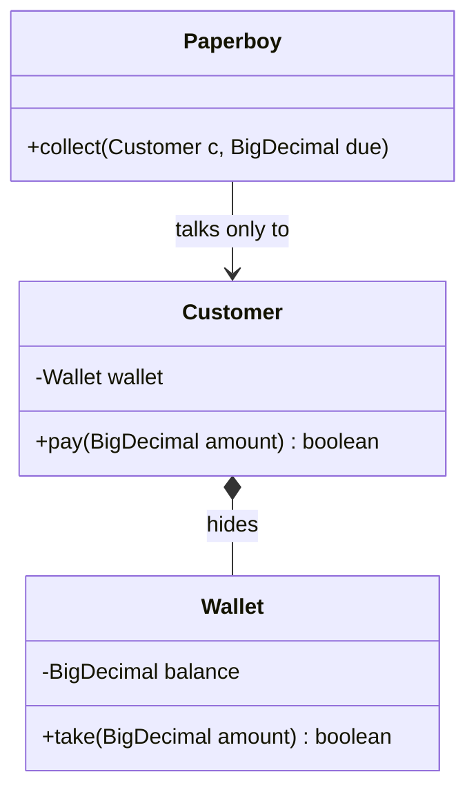
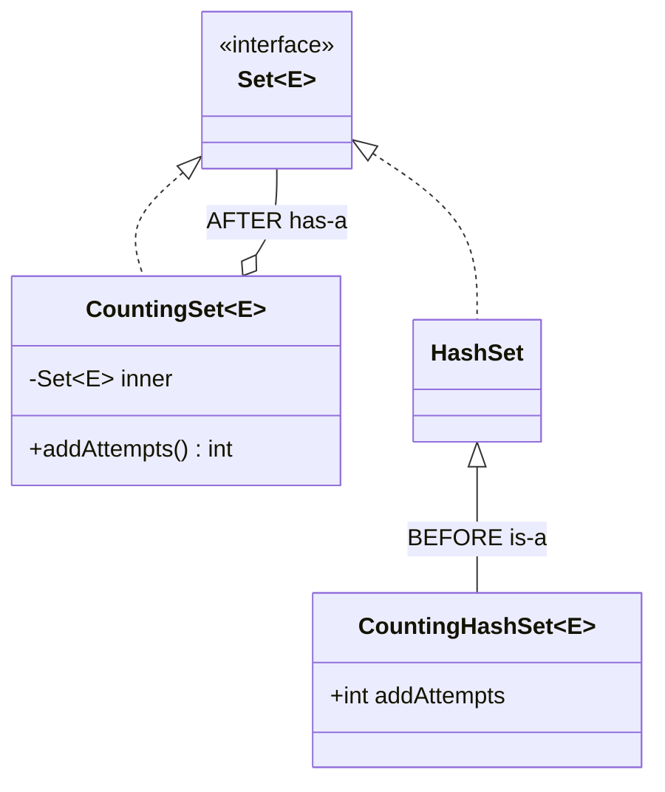
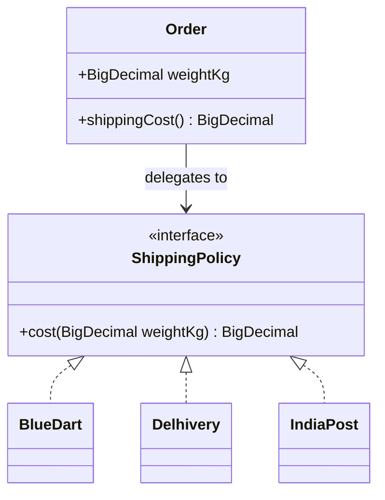
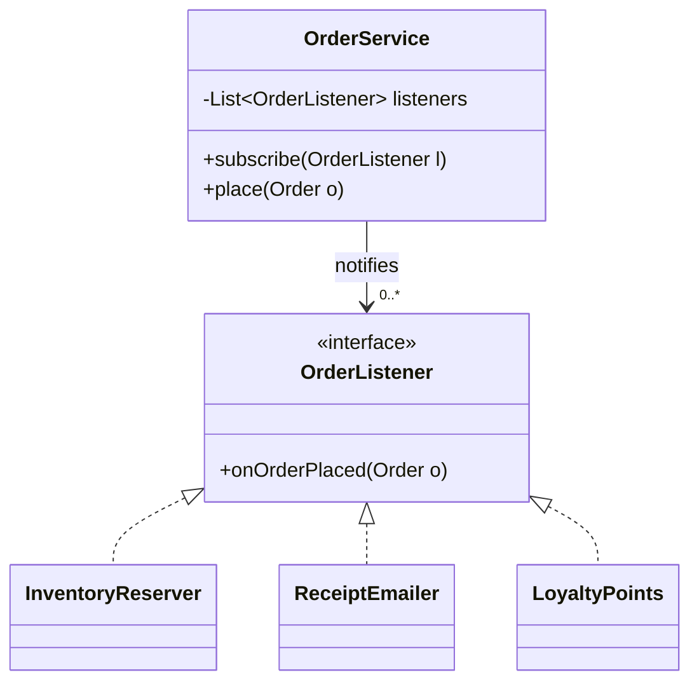
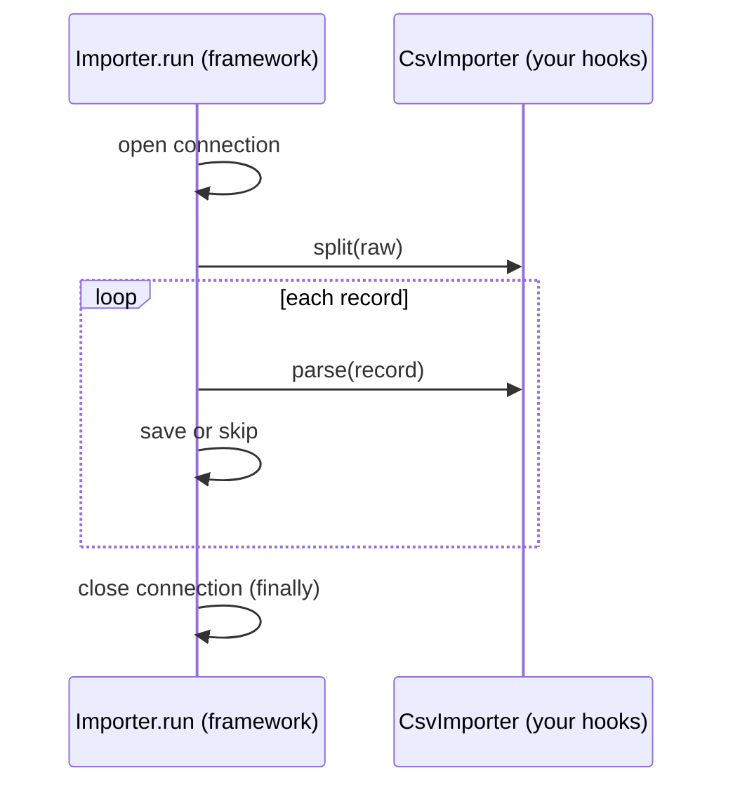
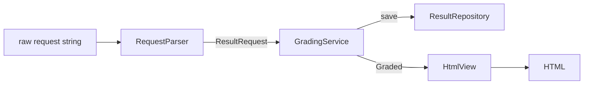
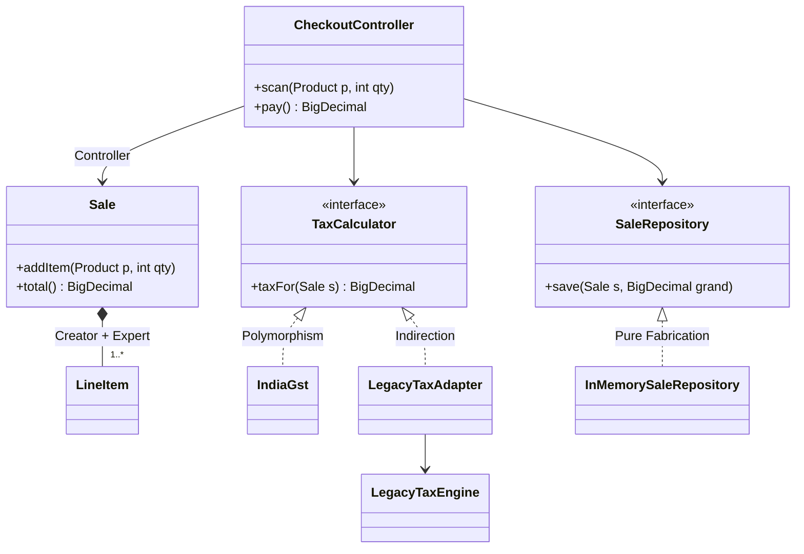
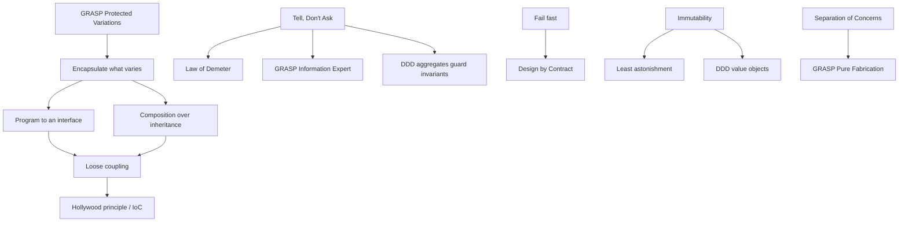

# Chapter 5 — More Design Principles (Study Edition)

> **Study Edition.** Every principle of Chapter 5, without the padding. Code blocks are excerpts from the real files (`// ...` marks trimmed parts); full listings and outputs are in the Full Edition (`README.md`). Each topic is one `code/lld/ch05/<topic>/Main.java` with nested `Before` and `After` classes (`javac --release 21`).

SOLID is only five rules. This chapter adds rules of thumb (DRY, KISS, YAGNI), how objects talk (Demeter, Tell-Don't-Ask, loose coupling, Hollywood), the GoF/*Head First* OO principles (encapsulate what varies, composition, program to an interface), correctness (fail fast, immutability, Design by Contract), **GRASP** — nine guidelines for *which class does what* — and **Domain-Driven Design** essentials (*which classes exist and where the boundaries are*).

**Key terms.** **Coupling** — how much one class depends on another. **Cohesion** — how closely a class's contents belong together. **Abstraction** — a simplified view (interface/abstract class) hiding details. **Encapsulation** — private data changed only through methods. **Invariant** — a fact that must always hold ("balance never negative"). **Side effect** — anything a method changes besides its return value. **Responsibility** — something a class *knows* or *does*.

**Chapter map**

| # | Principle | One-line idea | Comes from |
|---|---|---|---|
| 1 | DRY | One home per piece of knowledge | Hunt & Thomas (1999) |
| 2 | KISS | Simplest design that works | US Navy (1960), Kelly Johnson |
| 3 | YAGNI | Don't build before it's needed | Extreme Programming (Ron Jeffries) |
| 4 | Law of Demeter | Talk only to immediate friends | Holland / Lieberherr (1987) |
| 5 | Tell, Don't Ask | Tell objects what to do | Hunt & Thomas, after Alec Sharp (1997) |
| 6 | Composition over inheritance | Prefer has-a for reuse | GoF (1994), *Effective Java* |
| 7 | Program to an interface | Depend on supertypes | GoF |
| 8 | Encapsulate what varies | Isolate the changing part | GoF, *Head First* |
| 9 | Loose coupling | Interacting objects know little | *Head First* |
| 10 | Hollywood / IoC | "Don't call us, we'll call you" | *Head First*; frameworks |
| 11 | Separation of Concerns | One concern per part | Dijkstra (1974) |
| 12 | Least Astonishment | Behave as readers expect | Design folklore |
| 13 | Fail fast | Detect problems early, loudly | Jim Shore (2004) |
| 14 | Immutability | Never change after creation | *Effective Java* |
| 15 | Design by Contract | Pre/postconditions, invariants | Bertrand Meyer, Eiffel (1986) |
| 16 | GRASP (9) | Assigning responsibilities | Craig Larman (1997; nine from 2001) |
| 17 | Domain-Driven Design | Bounded contexts, entities vs value objects, aggregates, events | Eric Evans (2003); Vaughn Vernon (2013) |

---

## 1. DRY — Don't Repeat Yourself

### What it is
Every piece of **knowledge** (rule, formula, validation, constant) has **one authoritative representation**. Analogy: one master price list. DRY is about knowledge, not look-alike text: identical code representing *different* rules is not a violation.

### The problem it solves
Copies **drift** — one is updated, the others aren't — and the system gives two answers to one question.

### How it works
Ask "must all copies change together?" If yes, give the rule one home (constant, method, value object, enum, config) and reference it. **Rule of Three** (Don Roberts, via Fowler): tolerate the second copy, extract at the third.

### Java example — before/after
Before, two services disagree about `bob@localhost`. After:

```java
// File: code/lld/ch05/dry/Main.java
        /** The ONLY definition of "valid email" in the system. */
        record EmailAddress(String value) {
            private static final Pattern FORMAT = Pattern.compile("[^@\\s]+@[^@\\s]+\\.[a-z]{2,}");
            EmailAddress {
                if (value == null || !FORMAT.matcher(value).matches())
                    throw new IllegalArgumentException("invalid email: " + value);
            }
        }
        // ... TaxPolicy holds the 18% RATE in one private constant
```

Full runnable code: code/lld/ch05/dry/ (see the Full Edition). The compact constructor makes an invalid `EmailAddress` impossible.

### Trade-offs
Gain: one change point, no drift, named rules. Cost: a shared abstraction couples its users; a wrong abstraction is worse than duplication.

### When not to use it
Coincidental look-alikes ("max username 30" vs "max tag 30"); across microservices (shared libraries couple releases); tests (DAMP readability).

### Common mistakes
Monster functions with flags; extracting after one repeat; forgetting duplication across code, DB constraints and docs.

### Real-world examples
Spring `@Value`; database normalisation; Bean Validation `@Email`; OpenAPI/Protobuf codegen.

### In the interview
**30-second answer:** "One authoritative home per rule — rules, not look-alike text. I extract when copies must change together, e.g. validation into a value object, using the Rule of Three." *Always a violation?* No — different rules stay apart.

### Self-check
Q: What bug does duplication cause? → A: Drift.

### TL;DR
One rule, one home; leave coincidental look-alikes alone.

---

## 2. KISS — Keep It Simple, Stupid

### What it is
The plainest design that fully solves the real problem (US Navy c. 1960; Kelly Johnson's field-repairable jets). *Simple* = easy to understand and change, not fewest lines.

### The problem it solves
**Accidental complexity** — added by us, not the problem — is the biggest source of bugs and slow delivery.

### How it works
State the requirement in one sentence → most direct solution with standard features → "can a newcomer get it in two minutes?" → add structure only for a concrete need.

### Java example — before/after
Three fixed tiers. Before: a priority-sorted rule engine of predicates. After:

```java
// File: code/lld/ch05/kiss/Main.java
            return switch (tier) {
                case GOLD -> times(amount, GOLD_FACTOR);
                case SILVER -> times(amount, SILVER_FACTOR);
                case REGULAR -> amount;
            };
```

Full runnable code: code/lld/ch05/kiss/ (see the Full Edition). A `switch` *expression* over an enum without `default` must cover every constant, so a new tier won't compile until handled.

### Trade-offs
Simple: fast to read and test, standard constructs, may need refactoring when variation arrives. "Flexible": handles hypotheticals but costs every day and needs docs.

### When not to use it
Not an excuse to drop real complexity (payments *need* idempotency, retries, auditing); if users edit rules at run time, a rule engine *is* the requirement.

### Common mistakes
Simple ≠ short (five nested lambdas); skipping tests or validation; copy-paste instead of simplifying.

### Real-world examples
Unix philosophy; Go's small feature set; `Optional` kept small.

### In the interview
**30-second answer:** "Simplest design that meets the requirements; patterns only when a requirement demands them." *KISS vs YAGNI?* *How* you build vs *what* you build.

### Self-check
Q: Accidental complexity? → A: Complexity from our solution, not the problem.

### TL;DR
Solve the real problem plainly.

---

## 3. YAGNI — You Aren't Gonna Need It

### What it is
Don't build a capability until you need it (XP, Ron Jeffries). The opposite is **speculative generality**.

### The problem it solves
Early features cost four times: building, maintaining, surrounding complexity, and being wrong.

### How it works
Build today's requirements; keep code clean and tested so later change is cheap; extend when the need arrives; delete unused options.

### Java example — before/after
Requirement: CSV export. Before: `export(orders, format, encoding, compress)` where four of five formats throw `UnsupportedOperationException`. After:

```java
// File: code/lld/ch05/yagni/Main.java
        static String toCsv(List<Order> orders) {
            return orders.stream()
                    .map(o -> String.join(",", o.id(), o.customer(), o.total().toPlainString()))
                    .collect(Collectors.joining("\n", "id,customer,total\n", ""));
        }
```

Full runnable code: code/lld/ch05/yagni/ (see the Full Edition).

### Trade-offs
YAGNI: less code, design fits real needs, requires test and refactoring discipline. Building ahead: pays only if the guess is right; leaves dead options.

### When not to use it
Hard-to-reverse decisions (public APIs, big schemas, security, retention laws); known quality requirements are requirements.

### Common mistakes
Excuse for messy code; ignoring a stated requirement; `interface` + `Impl` everywhere.

### Real-world examples
MVPs; feature flags (LaunchDarkly, Unleash); iteration planning.

### In the interview
**30-second answer:** "I build today's needs and keep the design easy to extend; I add `PaymentStrategy` only if variants were hinted." *Conflict with OCP?* No — OCP where variation is known; YAGNI stops invented variation.

### Self-check
Q: When design ahead anyway? → A: Expensive-to-reverse decisions.

### TL;DR
Build for today with clean, changeable code.

---

## 4. Law of Demeter (Principle of Least Knowledge)

### What it is
A method `m` of `O` calls only: `O` itself, `m`'s parameters, objects `m` creates, `O`'s own fields (Holland & Lieberherr, 1987; originally also globals). **"Use only one dot"** — `a.getB().getC().doIt()` is a **train wreck**. Analogy: the paperboy asks the customer to pay rather than taking their wallet.

### The problem it solves
Chains couple the caller to the whole structure: switch the customer from wallet to UPI and the paperboy breaks.

### How it works
Ask what the caller really wants → add that method on the first object (`customer.pay(amount)`) → keep internals private.



### Java example — before/after
Before: `c.getWallet().setBalance(c.getWallet().getBalance().subtract(due))`. After:

```java
// File: code/lld/ch05/demeter/Main.java
            /** Customer decides HOW to pay. */
            boolean pay(BigDecimal amount) { return wallet.take(amount); }
        // ...
                if (c.pay(due)) {                      // talk only to a parameter: allowed
```

Full runnable code: code/lld/ch05/demeter/ (see the Full Edition). Stream chains aren't violations — each call returns the same kind of thing.

### Trade-offs
Following: internal changes stay local, one collaborator to mock, but wrapper methods accumulate. Ignoring: structural changes ripple and tests build object graphs.

### When not to use it
Fluent APIs, builders, streams; DTOs/records (`order.shippingAddress().city()`); not dozens of pass-throughs (**Middle Man**).

### Common mistakes
Counting dots, not knowledge (temp variables still violate it); getters for everything.

### Real-world examples
Facade (*Head First*); Spring Data `findByCustomerId`; `Files.readString(path)`.

### In the interview
**30-second answer:** "A method calls only itself, parameters, objects it creates and its fields. For `a.getB().getC()` I add an intent method — `customer.pay()`." *Streams?* Not a violation.

### Self-check
Q: The four friends? → A: `this`, parameters, created objects, own fields.

### TL;DR
Only talk to friends.

---

## 5. Tell, Don't Ask

### What it is
Don't pull data out and decide for an object — **tell** it what you want (Hunt & Thomas, after Sharp). Analogy: tell the taxi "airport".

### The problem it solves
Ask-then-act spreads rules across callers; one forgets part ("frozen accounts can't withdraw"), the invariant breaks, and the object becomes an **Anemic Domain Model**.

### How it works
Find read-decide-write code → move the decision into a method → reject illegal requests → remove setters.

### Java example — before/after
Before, the ATM checks `isFrozen()`; the app forgets. After:

```java
// File: code/lld/ch05/telldontask/Main.java
            void withdraw(long amt) {
                if (amt <= 0) throw new IllegalArgumentException("amount must be positive");
                if (frozen) throw new IllegalStateException("account is frozen");
                if (amt > balancePaise) throw new IllegalStateException("insufficient funds");
                balancePaise -= amt;
            }
```

Full runnable code: code/lld/ch05/telldontask/ (see the Full Edition).

### Trade-offs
Tell: invariants in one place, richer objects, risk of bloated objects. Ask: duplicated rules; fine for pure data.

### When not to use it
Display/reporting queries; decisions combining several objects' data (Information Expert elsewhere).

### Common mistakes
A getter "just for this check"; emails and DB calls inside entities.

### Real-world examples
`List.removeIf`; `Map.computeIfAbsent`/`merge`; `AtomicInteger.incrementAndGet()`.

### In the interview
**30-second answer:** "`account.withdraw(100)`, not read-then-set the balance — invariants stay in one place." *Concurrency?* Ask-then-act is a check-then-act race; one method can be atomic.

### Self-check
Q: Anti-pattern it fights? → A: Anemic Domain Model.

### TL;DR
Tell the object what you want.

---

## 6. Composition over Inheritance

### What it is
**Favour composition over class inheritance** (GoF). Is-a reuses by subclassing; has-a holds a reference and **delegates**. Analogy: a car *has* a swappable engine.

### The problem it solves
Inheritance is the tightest coupling: **fragile base class** (breaks when parent internals change), fixed at compile time, **class explosion**, every parent method exposed.

### How it works
Replace `extends A` with a private interface-typed field, forward calls, inject via constructor; inherit only for substitutable is-a with parents **designed for extension**.



### Java example — before/after
The *Effective Java* trap:

```java
// File: code/lld/ch05/composition/Main.java
            @Override public boolean addAll(Collection<? extends E> c) {
                addAttempts += c.size();
                return super.addAll(c);   // HashSet's inherited addAll calls add() for each element -> counted twice!
            }
    // ...
        static final class CountingSet<E> extends AbstractSet<E> {
            private final Set<E> inner;   // "has-a", not "is-a"
            // ...
            @Override public boolean addAll(Collection<? extends E> c) { addAttempts += c.size(); return inner.addAll(c); }
```

Full runnable code: code/lld/ch05/composition/ (see the Full Edition).

```text
BEFORE: added 3 items, counter says 6
AFTER : added 3 items, counter says 3
```

`HashSet` inherits `AbstractCollection.addAll`, which calls our overridden `add` — an unpromised "self-use" detail. The wrapper also forwards `contains`/`remove` (else `AbstractSet` scans, O(n)) and works over a `TreeSet` chosen at run time.

### Trade-offs

| Composition | Inheritance |
|---|---|
| Coupled to public API; swap at run time; combine freely | Coupled to internals; fixed; class explosion |
| Forwarding boilerplate; needs an interface for polymorphism | Free reuse; automatically a subtype |

### When not to use it
True is-a with a base designed for extension (`AbstractList`, Template Method); sealed closed variants; classes that evolve together.

### Common mistakes
`OrderService extends BaseDao`; composition without an interface; exposing the wrapped object.

### Real-world examples
`Stack extends Vector`, `Properties extends Hashtable` (admitted JDK mistakes); `BufferedInputStream`; `Collections.unmodifiableList`; Unity's Entity–Component model.

### In the interview
**30-second answer:** "Inheritance couples to parent internals, is fixed and explodes combinatorially; composition delegates to an interface, swappable at run time. Inherit only for true is-a designed for extension." *Composition-based patterns?* Strategy, Decorator, Composite, State, Bridge, Proxy, object Adapter.

### Self-check
Q: Why 6? → A: Inherited `addAll` calls the overridden `add`.

### TL;DR
Reuse by has-a; is-a only for substitutable subtypes designed for extension.

---

## 7. Program to an Interface, Not an Implementation

### What it is
Type variables, fields, parameters and returns by the **most general supertype** you need ("interface" = any supertype). Analogy: a charger built for the USB-C standard.

### The problem it solves
Code typed on `ArrayList` or `MySqlUserStore` is untestable without the real thing and not swappable.

### How it works
Name the role → interface with only needed methods → type by it → create concrete objects at the edges and inject them (**DI**) → widest parameter type (`Collection` > `List` > `ArrayList`).

### Java example — before/after
Before, `GreetingService` does `new MySqlUserStore()` (can't run on a laptop) and `countLongNames` takes `ArrayList`. After:

```java
// File: code/lld/ch05/interfaces/Main.java
        interface UserRepository { Optional<User> findById(String id); }
        // ...
            private final UserRepository users;                  // any implementation
            GreetingService(UserRepository users) { this.users = users; }
        // ...
        static int countLongNames(Collection<String> names) {   // works for List, Set, Queue...
```

Full runnable code: code/lld/ch05/interfaces/ (see the Full Edition).

### Trade-offs
Interface-typed: swappable, testable, but no implementation-only methods and one more type. Concrete-typed: simple, but changes ripple.

### When not to use it
Value types; one implementation with no test seam (`FooServiceImpl` ceremony); genuinely specific needs (`LinkedHashMap` access order for LRU).

### Common mistakes
30-method mirror interfaces (ISP); declaring `List` then casting; still `new`-ing inside.

### Real-world examples
Collections Framework; JDBC; SLF4J; Spring injection by interface.

### In the interview
**30-second answer:** "I type dependencies by roles and inject implementations — in-memory for tests. It's DIP in everyday form." *Every class an interface?* No.

### Self-check
Q: Where does `new ConcreteClass()` go? → A: The edges: `main`, factories, DI config.

### TL;DR
Depend on roles; pick the concrete class once, at the edge.

---

## 8. Encapsulate What Varies

### What it is
Separate what **changes** from what stays the same; put the varying part behind an abstraction (*Head First*'s first principle). Analogy: camera body, swappable lenses.

### The problem it solves
Volatile rules inline force edits to stable classes; type `switch`es grow forever (OCP broken).

### How it works
Find what changed recently or differs per customer/region → extract behind an interface/lambda → delegate → add variants. Behind Strategy, State, Factory, Observer, Template Method.



### Java example — before/after
Before, `Order.shippingCost()` branches on carrier strings. After:

```java
// File: code/lld/ch05/encapsulatevaries/Main.java
        interface ShippingPolicy { BigDecimal cost(BigDecimal weightKg); }

        /** Stable catalogue of today's policies. Adding one = adding one entry; Order never changes. */
        static final Map<String, ShippingPolicy> POLICIES = Map.of(
                "BLUEDART", w -> linear("50", "20", w),
                "DELHIVERY", w -> linear("40", "25", w),
                "INDIA_POST", w -> linear("30", "10", w));

        record Order(BigDecimal weightKg, ShippingPolicy shipping) {
            BigDecimal shippingCost() { return shipping.cost(weightKg); }
        }
```

Full runnable code: code/lld/ch05/encapsulatevaries/ (see the Full Edition). A promo policy was added with zero edits to `Order`.

### Trade-offs
Encapsulated: new variants without touching stable code, each testable; more indirection. Inline: all visible, fine for two fixed variants, grows into long conditionals.

### When not to use it
It has never varied (YAGNI); extract at the third variant.

### Common mistakes
Wrong axis of variation; leaving the type `switch` in the client.

### Real-world examples
`Comparator`; `ThreadPoolExecutor`'s `RejectedExecutionHandler`/`ThreadFactory`; payment gateways.

### In the interview
**30-second answer:** "I hide what's likely to change — pricing, payment method — behind an interface; it's behind Strategy and State." *How do you know what varies?* Requirements, history, the interviewer's hints.

### Self-check
Q: Smell of missing encapsulation? → A: A growing type `switch`.

### TL;DR
Put the changing part behind an interface.

---

## 9. Strive for Loosely Coupled Designs

### What it is
Interacting objects know as little as possible about each other — ideally a small interface (*Head First*). Analogy: a radio station doesn't know its listeners.

### The problem it solves
A class that creates and calls many concrete collaborators is edited for every change, not reusable, not testable alone.

### How it works
Interfaces; injection; **events** when the sender shouldn't know receivers (Observer); narrow interfaces; immutable values. Coupling, tightest → loosest: content → common → external → control → stamp → data → message.



### Java example — before/after
Before, `OrderService` creates `EmailSender`, `Inventory`, `Analytics`. After:

```java
// File: code/lld/ch05/loosecoupling/Main.java
            private final List<OrderListener> listeners = new CopyOnWriteArrayList<>();
            void subscribe(OrderListener l) { listeners.add(l); }
            void place(Order o) {
                System.out.println("placed " + o.id());
                listeners.forEach(l -> l.onOrderPlaced(o));   // doesn't know who listens or what they do
            }
```

Full runnable code: code/lld/ch05/loosecoupling/ (see the Full Edition). Loyalty points became one more `subscribe`; `CopyOnWriteArrayList` allows safe subscription during notification.

### Trade-offs

| Loose | Tight |
|---|---|
| Independent change and tests; features = listeners | Flow easy to follow and debug |
| "Who handles this?"; listener order and errors need design | Every change edits the central class |

### When not to use it
Small cohesive modules; ordered, atomic steps (debit then credit) — orchestrate explicitly.

### Common mistakes
A global event bus for everything; shared static state; one throwing listener stopping the rest.

### Real-world examples
UI listeners; Spring `@EventListener`; Kafka (`OrderPlaced` consumed independently by inventory, notifications, analytics).

### In the interview
**30-second answer:** "Collaborators share only small interfaces — interfaces, DI, events; the order service publishes 'order placed' and features subscribe." *Downside?* Harder to trace flow, ordering, failures.

### Self-check
Q: Classic one-to-many pattern? → A: Observer.

### TL;DR
Small interfaces, injection and events.

---

## 10. The Hollywood Principle (Inversion of Control)

### What it is
**"Don't call us, we'll call you."** High-level components own the flow and call low-level hooks, which never call up — **Inversion of Control**. **You call a library; a framework calls you.**

### The problem it solves
Each component re-implements the skeleton, forgets steps (closing connections), and levels depend on each other (**dependency rot**).

### How it works
**Template Method** (`final` algorithm, abstract hooks); **callbacks**; **DI**; **lifecycle management** (`@PostConstruct`, servlet `init`/`destroy`).



### Java example — before/after
Before, `CsvImporter.run` drives everything and forgets to close. After:

```java
// File: code/lld/ch05/hollywood/Main.java
            /** The fixed algorithm. final = subclasses cannot reorder or skip steps. */
            public final void run(String raw) {
                System.out.println("  open connection");
                try {
                    // ... for each record from split(raw): parse, then save or skip
                } finally {
                    System.out.println("  close connection");       // guaranteed by the framework
                }
            }
            protected abstract List<String> split(String raw);       // hooks: WE call YOU
            protected abstract String[] parse(String record);
```

Full runnable code: code/lld/ch05/hollywood/ (see the Full Edition). A tiny `Container` also starts `Lifecycle` components in order and stops them in reverse (as Spring does).

### Trade-offs
IoC: guaranteed flow, ordering and cleanup, no duplicated skeletons; but "magic", harder to debug, tied to hooks. Direct control: visible flow, duplicated skeletons.

### When not to use it
Small scripts with no repeated skeleton.

### Common mistakes
Hooks calling back up; template method not `final`; confusing IoC (idea) with DI (one form).

### Real-world examples
JUnit `@Test`; servlets/Spring MVC; Spring lifecycles; Android `onCreate`; `AbstractList`; `JdbcTemplate` + `RowMapper`.

### In the interview
**30-second answer:** "The high-level component controls flow and calls hooks — what separates a framework from a library; Template Method, callbacks and DI are forms." *vs DIP?* DIP: depend on abstractions; Hollywood: who calls whom.

### Self-check
Q: Why `final` template method? → A: Subclasses can't reorder or skip steps.

### TL;DR
The framework owns the flow and calls your hooks.

---

## 11. Separation of Concerns (SoC)

### What it is
A **concern** is one aspect (input, rules, storage, presentation, security, logging); each part handles one (Dijkstra, 1974, EWD 447). Big-picture SRP, at every level: functions, classes, layers (MVC), services, languages (HTML/CSS/JS).

### The problem it solves
Spaghetti: can't change HTML without risking the grading rule; can't test the rule without parsing strings.

### How it works
One unit per concern with typed inputs/outputs; data flows one way (parse → rules → store → present); lower layers don't know higher ones; **cross-cutting concerns** via filters, decorators, proxies, aspects.



### Java example — before/after
Before, one `handle(String request)` parses, grades, stores and returns HTML. After, the rules class:

```java
// File: code/lld/ch05/soc/Main.java
        /** Concern 2: business rules only. No HTML, no storage. */
        static final class GradingService {
            // ...
            Graded record(ResultRequest r) {
                if (r.marks() < 0 || r.marks() > 100) throw new IllegalArgumentException("marks must be 0..100");
                String grade = r.marks() >= 90 ? "A" : r.marks() >= 75 ? "B" : r.marks() >= 50 ? "C" : "F";
                repo.save(r.name(), r.marks());
                return new Graded(r.name(), r.marks(), grade);
            }
        }
```

Full runnable code: code/lld/ch05/soc/ (see the Full Edition). `RequestParser`, `ResultRepository` and `HtmlView` hold the other concerns; a JSON view would not touch rules.

### Trade-offs
Separated: safe changes, parallel team work, more types. Mixed: quick one-offs, tangled and hard to test.

### When not to use it
Throwaway scripts; avoid "lasagna code" (layers that only pass data through).

### Common mistakes
Rules in controllers or SQL; separating only by technical type while a feature is scattered.

### Real-world examples
MVC; HTML/CSS/JS; TCP/IP layers; Spring AOP, servlet filters.

### In the interview
**30-second answer:** "Each module handles one aspect so each changes and tests alone — controller, service, repository, domain in the middle." *Cross-cutting?* Logging, auth, transactions via AOP/proxies/filters.

### Self-check
Q: Four concerns of a web request? → A: Parsing, rules, persistence, presentation.

### TL;DR
Each concern its own home.

---

## 12. Principle of Least Astonishment (POLA)

### What it is
A component behaves as users expect from its name, signature and context; if not, change the behaviour or the name. Analogy: a light switch that also locks the door.

### The problem it solves
Surprises cause bugs even when code "works": mutating queries, mutate-and-return-`this` aliasing, inconsistent names, 0/1-based confusion, swallowed errors.

### How it works
Truthful names (`find` doesn't modify; `getOrCreate` if it creates); platform conventions; consistency; immutable results; `Optional` for absence; document unavoidable surprises.

### Java example — before/after
Before, `Money.add` mutates `this` and `findUser` silently creates users. After:

```java
// File: code/lld/ch05/leastastonishment/Main.java
            Money plus(Money other) { return new Money(paise + other.paise); }   // returns a NEW value
        // ...
            Optional<String> findUser(String id) { return Optional.ofNullable(users.get(id)); }
            String getOrCreateUser(String id) { return users.computeIfAbsent(id, k -> "new-user-" + k); }
```

Full runnable code: code/lld/ch05/leastastonishment/ (see the Full Edition).

```text
new BigDecimal("2.0").equals(new BigDecimal("2.00")) = false
new BigDecimal("2.0").compareTo(new BigDecimal("2.00")) = 0
Arrays.asList(...).add -> UnsupportedOperationException (fixed-size list)
```

JDK gotchas: use `compareTo` for numeric equality; `Arrays.asList` is fixed-size.

### Trade-offs
A longer name or extra method is cheap next to surprise bugs; "expected" depends on your platform's conventions.

### When not to use it
Never surprise on purpose, but fix a name rather than bend to a wrong expectation.

### Common mistakes
Getters with side effects; overloading `equals(Money)` instead of overriding `equals(Object)`; hidden global flags.

### Real-world examples
`java.time` fixing `Date`/`Calendar`; `URL.equals` doing DNS (prefer `URI`); `rm` without undo; "Cancel" never saves.

### In the interview
**30-second answer:** "Queries don't mutate, creation is named, absence is `Optional`, values immutable." *CQS?* Command-Query Separation (Chapter 6) makes state changes obvious.

### Self-check
Q: `findUser` on a missing user? → A: Empty `Optional`, never silent creation.

### TL;DR
Do what the name promises and nothing more.

---

## 13. Fail Fast

### What it is
Detect invalid state or input **where it arises** and stop with a clear error. Analogy: a smoke alarm at the first smoke.

### The problem it solves
A `null` accepted in a constructor crashes hours later, pointing at the symptom; bad data may be saved first.

### How it works
Validate at boundaries (constructors, public entry, API input, startup config); guard clauses (`requireNonNull`, `IllegalArgumentException`); specific messages; invalid objects **unconstructable**; never swallow exceptions.

**Fail fast vs fail safe:** fail-*safe* = failure leaves a safe state. Interview literature (not the JDK, which says "snapshot"/"weakly consistent") calls `CopyOnWriteArrayList`/`ConcurrentHashMap` iterators "fail-safe" (never throw `ConcurrentModificationException`); **fail-fast** iterators (`ArrayList`) throw on structural modification during iteration — **best-effort** only.

### Java example — before/after
Before, `new RetryConfig(null, 0, null)` succeeds and an NPE appears far away. After:

```java
// File: code/lld/ch05/failfast/Main.java
        record RetryConfig(String endpoint, int maxAttempts, Duration backoff) {
            RetryConfig {
                Objects.requireNonNull(endpoint, "endpoint");
                Objects.requireNonNull(backoff, "backoff");
                if (maxAttempts < 1) throw new IllegalArgumentException("maxAttempts must be >= 1, was " + maxAttempts);
                if (backoff.isNegative()) throw new IllegalArgumentException("backoff must not be negative");
            }
        }
```

Full runnable code: code/lld/ch05/failfast/ (see the Full Edition). The demo also triggers an `ArrayList` `ConcurrentModificationException` and shows the safe `removeIf`.

### Trade-offs
Fail fast: bugs near their cause, clear diagnostics, upfront validation, may stop a process for a minor issue. Fail slow: "keeps running", corruption, confusing symptoms.

### When not to use it
Fail fast inside components, but be resilient at edges (a widget failure shouldn't crash the UI; a batch job may skip and log). Detect early, then handle deliberately.

### Common mistakes
Swallowing exceptions or returning `null`/`-1`; validating deep inside; `assert` for public arguments (disabled by default).

### Real-world examples
`List.of(null)`; Spring Boot startup checks; circuit breakers (Resilience4j); Erlang "let it crash"; CI stopping at first failure.

### In the interview
**30-second answer:** "Validate at the boundary and throw clearly, near the cause — guard clauses so invalid objects can't exist; at system level, circuit breakers." *Bad for users?* Fail fast inside; degrade gracefully at the edge.

### Self-check
Q: Why not `assert` for public checks? → A: Disabled by default.

### TL;DR
Check early, throw clearly, never swallow.

---

## 14. Immutability

### What it is
An object whose observable state can't change after construction; "changing" creates a new one (`String`, `LocalDate`, `BigDecimal`, records of immutables). Analogy: reprint a receipt, don't edit it.

### The problem it solves
**Aliasing bugs**, **broken invariants**, **thread-safety problems**, **hash-collection bugs**. Immutables are inherently thread-safe, cacheable, safe keys.

### How it works
*Effective Java*: no mutators; not extendable (`final`; records are); all fields `final` and `private`; **defensive copies** of mutable components in and out. Plus "withers". `Collections.unmodifiableList` is a live *view*; `List.copyOf`/`List.of` are independent. Records are **shallowly** immutable.

### Java example — before/after
Before, `Itinerary` keeps and returns the caller's list — outsiders clear it. After:

```java
// File: code/lld/ch05/immutability/Main.java
        record Itinerary(List<String> cities, LocalDate start) {
            Itinerary {
                cities = List.copyOf(cities);   // copy in: caller's later edits cannot reach us
            }
            Itinerary withStart(LocalDate newStart) { return new Itinerary(cities, newStart); }
            // ... plusCity(c) copies, adds, returns a new Itinerary
        }
```

Full runnable code: code/lld/ch05/immutability/ (see the Full Edition). `t1.cities().clear()` throws; `plusCity(...).withStart(...)` yields a new `t2`. `LocalDate.of(2026,1,31).plusMonths(1)` returns Feb 28.

### Trade-offs
Immutable: thread-safe, safe keys, cacheable; an allocation per change (usually cheap), copying large objects. Mutable: in-place updates, needs synchronisation, aliasing bugs.

### When not to use it
Hot loops (local `StringBuilder`, expose the immutable result); entities with changing state (encapsulate; make their values immutable); JPA entities.

### Common mistakes
`final` field ≠ immutable; returning the internal list; `unmodifiableList` over a caller-held list; `this` escaping the constructor.

### Real-world examples
`List.of`, `Map.of`, records; Git commits; Kafka records; Redux/React state.

### In the interview
**30-second answer:** "Final class, private final fields, no setters, defensive copies — thread-safe without locks, safe as keys. Value objects immutable; entity state encapsulated." *Records?* Shallowly immutable.

### Self-check
Q: `unmodifiableList` vs `List.copyOf`? → A: Live view vs independent copy.

### TL;DR
No setters, final everything, copy in and out.

---

## 15. Design by Contract (DbC)

### What it is
(Meyer, Eiffel) **Precondition** — caller's duty (`pop` needs a non-empty stack); **postcondition** — method's guarantee (after `push(x)` size +1, top `x`); **class invariant** — always true between calls (`0 ≤ size ≤ capacity`).

### The problem it solves
Without contracts, duplicated defensive checks or none, ambiguous returns (`-1`), lost data.

### How it works
Document the contract → check preconditions at entry (`IllegalArgumentException`/`IllegalStateException`) → check postconditions/invariants in dev/tests → offer queries (`isEmpty()`, `isFull()`) → subclasses may **weaken** preconditions and **strengthen** postconditions, keeping the invariant (LSP).

### Java example — before/after
Before, a full stack drops pushes and an empty one returns `-1`. After:

```java
// File: code/lld/ch05/contract/Main.java
            /** pre: !isFull(). post: size() == old size + 1 and peek() == x. */
            void push(int x) {
                require(!isFull(), "push requires !isFull()");
                int oldSize = size;
                items[size++] = x;
                ensure(size == oldSize + 1 && peek() == x, "push postcondition");
                checkInvariant();
            }
```

Full runnable code: code/lld/ch05/contract/ (see the Full Edition). Output: `precondition failed: push requires !isFull()`.

### Trade-offs
Explicit: clear duties, precise errors, executable docs; runtime cost (postcondition/invariant checks can be off in production). Implicit: less code, ambiguity, silent corruption.

### When not to use it
Full checks in hot loops — keep preconditions on public APIs, move expensive checks to tests or `assert`.

### Common mistakes
`assert` for public preconditions; subclasses strengthening preconditions (`SavingsAccount.withdraw`; `Square.setWidth` is the postcondition mirror); special return values.

### Real-world examples
Java API docs (`List.get`, `equals`/`hashCode`); Guava `Preconditions`, Spring `Assert`; Kotlin `require()`/`check()`; Eiffel, Ada 2012.

### In the interview
**30-second answer:** "Preconditions for the caller, postconditions guaranteed, invariants always true; guard clauses and query methods; subclasses weaken pre, strengthen post — LSP." *vs defensive programming?* DbC assigns each check to one party.

### Self-check
Q: Whose duty is a precondition? → A: The caller's.

### TL;DR
State and enforce who promises what.

---

## 16. GRASP — General Responsibility Assignment Software Patterns

### What it is
Craig Larman's nine patterns for **"which class should be responsible for this?"** (knowing or doing) — a vocabulary for justifying decisions, not code templates. (The 1997 edition's ninth was "Don't Talk to Strangers"; 2001 replaced it with **Protected Variations**.)

| # | Guideline | Question | Short answer |
|---|---|---|---|
| 1 | Information Expert | Who does this job? | The class with the information |
| 2 | Creator | Who creates A? | One that contains, records, closely uses or initialises A |
| 3 | Controller | Who first handles a UI event? | A non-UI use-case or system object |
| 4 | Low Coupling | Reduce impact of change? | Few dependencies |
| 5 | High Cohesion | Keep classes focused? | Related work per class |
| 6 | Polymorphism | Behaviour varies by type? | Each type implements the operation |
| 7 | Pure Fabrication | No domain class fits? | Invent a helper (repository) |
| 8 | Indirection | Avoid direct coupling? | An intermediate object |
| 9 | Protected Variations | Shield from change? | Stable interface around instability |

### The problem it solves
A god UI/`Manager` class plus anemic data, or logic scattered at random; GRASP gives explainable reasons ("`total()` is on `Sale` — Expert").

### How it works
List system events → **Controller** each → **Expert** for what's known/computed → **Creator** for each object → judge by **coupling/cohesion** → **Polymorphism** for type variation, **Protected Variations** via **Indirection** for instability → **Pure Fabrication** where no domain object fits.

### Java example — before/after (all nine in one checkout)
Before, `CheckoutScreen` creates items, totals them, hard-codes regional tax and builds SQL. After (each Javadoc names its guideline):

```java
// File: code/lld/ch05/grasp/Main.java
        /** INFORMATION EXPERT: a line item knows its product and quantity, so it computes its own subtotal. */
        record LineItem(Product product, int qty) {
            BigDecimal subtotal() { return product.price().multiply(BigDecimal.valueOf(qty)); }
        }
        // ...
            void addItem(Product p, int qty) { items.add(new LineItem(p, qty)); }        // Creator
        // ...
        /** PROTECTED VARIATIONS: tax rules vary by region/vendor -> hide them behind a stable interface. */
        interface TaxCalculator { BigDecimal taxFor(Sale sale); }
        // ... IndiaGst, FlatUsSalesTax (POLYMORPHISM); LegacyTaxAdapter (INDIRECTION); SaleRepository (PURE FABRICATION)
            BigDecimal pay() {
                BigDecimal grand = current.total().add(tax.taxFor(current)).setScale(2, RoundingMode.HALF_UP);
                repo.save(current, grand);
                return grand;
            }
```

Full runnable code: code/lld/ch05/grasp/ (see the Full Edition). Grand totals: `IndiaGst` 377.60, `FlatUsSalesTax` 342.40, `LegacyTaxAdapter` 384.00.



---

## 16.1 Information Expert

### What it is
The class that **has the information** does the job: `LineItem.subtotal()`, `Sale.total()`.
### The problem it solves
Managers pulling data out (*Feature Envy*).
### How it works
Job → needed information → who holds it → partial experts cooperate.
### Trade-offs
Behaviour with data; blindly applied, puts SQL in `Sale`.
### When not to use it
When it adds persistence, UI or network work to domain objects.
### Common mistakes
Everything in services via getters; entities that save or email themselves.
### Real-world examples
`String.length()`, `LocalDate.isLeapYear()`; a `Cart` totalling itself.
### In the interview
"`total()` is on `Order` because it owns the line items."
### Self-check
Q: Who computes a line's subtotal? → A: `LineItem`.
### TL;DR
The one with the data does the work.

---

## 16.2 Creator

### What it is
B creates A if B *contains*, *records*, *closely uses* or *has initialising data* for A: `Sale` creates `LineItem`s.
### The problem it solves
Random `new` spreads coupling to A's constructor.
### How it works
Prefer the container; complex or varying creation → Factory/Builder (Chapter 8).
### Trade-offs
Low-coupling for plain objects; unsuitable for complex creation.
### When not to use it
Complex creation; DI-managed objects.
### Common mistakes
UI code doing `new LineItem(...)`.
### Real-world examples
`HashMap` nodes; `Document` → `Paragraph`; `ExecutorService` via `ThreadFactory`.
### In the interview
"`Sale.addItem` creates the item because the sale contains it." *vs Factory?* A Factory is a Pure Fabrication for complex creation.
### Self-check
Q: Strongest reason to create? → A: Containment.
### TL;DR
The container creates.

---

## 16.3 Controller

### What it is
The first **non-UI** object receiving a **system operation**: **facade** (`Register`, `ParkingLotSystem`) or **use-case** (`CheckoutController`) controller.
### The problem it solves
Keeps logic out of UI so web, mobile and tests share it.
### How it works
Assign each system event to a controller that **delegates**.
### Trade-offs
Clean split; a controller doing real work gets **bloated** — split by use case.
### When not to use it
Trivial programs.
### Common mistakes
Fat controllers with pricing and SQL; a `JFrame` computing totals.
### Real-world examples
`@RestController` → `@Service`; `DispatcherServlet`; `TripService.requestRide()`.
### In the interview
"`ParkingLotController.park()` receives the event and delegates."
### Self-check
Q: Should it calculate tax? → A: No; it delegates.
### TL;DR
A thin coordinator per system event.

---

## 16.4 Low Coupling

### What it is
**Evaluative**: prefer fewer dependencies; the controller knows only `TaxCalculator` and `SaleRepository`.
### The problem it solves
Rippling changes, no reuse.
### How it works
Compare alternatives: interfaces, fewer collaborators, one direction, no cycles, DI.
### Trade-offs
Stable dependencies (JDK) are harmless; chasing zero bloats indirection.
### When not to use it
Don't decouple from standard libraries.
### Common mistakes
Package cycles; UI knowing the DB.
### Real-world examples
Microservices over APIs; JDBC drivers.
### In the interview
"I depend on `PaymentGateway`, not Stripe's SDK." *Zero coupling?* Impossible.
### Self-check
Q: Is `java.util.List` bad coupling? → A: No; it's stable.
### TL;DR
Fewer, more stable dependencies.

---

## 16.5 High Cohesion

### What it is
**Evaluative**: each class's responsibilities focused and related.
### The problem it solves
`Utils`/`Manager` classes changing for many reasons.
### How it works
"Is this related to what the class does?" Larman's levels: *very low* (many different areas) → *low* (one big complex job) → *moderate* (light unrelated jobs) → *high* (related jobs, collaborating for the rest — the goal).
### Trade-offs
More, simpler files; improves alongside coupling.
### When not to use it
Rarely — coarse-grained remote APIs, on purpose.
### Common mistakes
Utils dumping grounds; entities sending emails.
### Real-world examples
`LocalDate`, `Pattern`, Spring Data repositories.
### In the interview
"I split `BookingService` into seat locking, pricing, payment."
### Self-check
Q: A low-cohesion smell? → A: A `Utils`/`Manager` class.
### TL;DR
One related set of things per class.

---

## 16.6 Polymorphism

### What it is
When behaviour **varies by type**, each type implements a shared operation (`taxFor`), no type `switch`.
### The problem it solves
Repeated type checks; new types edit every branch.
### How it works
Declare the varying operation on an interface; implement per variant.
### Trade-offs
Easy to add types, hard to add operations (Visitor, Chapter 11, flips it).
### When not to use it
Closed type sets gaining operations — `sealed` + pattern-matching `switch`.
### Common mistakes
Variation that doesn't exist; leftover `instanceof` chains.
### Real-world examples
`Comparator`, `InputStream`, `Runnable`/`Callable`, card/UPI/wallet payments.
### In the interview
"Each `Vehicle` answers `requiredSpotSize()`."
### Self-check
Q: Which change is easy? → A: Adding a type.
### TL;DR
Each type implements the varying behaviour.

---

## 16.7 Pure Fabrication

### What it is
A **non-domain** class invented to keep cohesion high and coupling low: `SaleRepository`.
### The problem it solves
Persistence, logging, IDs fit no domain class cleanly.
### How it works
When Expert drags technical work into a domain class, create a focused service (`IdGenerator`).
### Trade-offs
Good cohesion and reuse; overuse makes an anemic domain.
### When not to use it
A domain object is a natural home — Expert first.
### Common mistakes
Domain rules in "Manager" services.
### Real-world examples
DAOs, Jackson `ObjectMapper`, `Clock`, Strategy/Adapter/Factory objects.
### In the interview
"`TicketRepository` keeps persistence out of `Ticket`."
### Self-check
Q: Is `Sale` a fabrication? → A: No; `SaleRepository` is.
### TL;DR
Invent a helper when no domain class fits.

---

## 16.8 Indirection

### What it is
An **intermediate object** so two components aren't directly coupled: `LegacyTaxAdapter` before `LegacyTaxEngine`.
### The problem it solves
Direct dependencies on external or volatile parts.
### How it works
Interface plus adapter, facade, mediator or proxy.
### Trade-offs
Decoupling vs an extra hop (Wheeler's "another level of indirection" — except too many levels).
### When not to use it
Stable classes that change together.
### Common mistakes
Pure pass-through layers.
### Real-world examples
Adapter/Facade/Mediator/Proxy; `DriverManager`; API gateways; brokers.
### In the interview
"`SmsSender` with a `TwilioSmsSender` adapter." *vs PV?* Indirection is the mechanism, PV the goal.
### Self-check
Q: GoF forms? → A: Adapter, Facade, Mediator, Proxy (and Bridge).
### TL;DR
A middleman between strangers.

---

## 16.9 Protected Variations

### What it is
Wrap **predicted variation** in a **stable interface** (`TaxCalculator`). Larman: Parnas's *information hiding* and OCP as a responsibility rule; Demeter is one mechanism.
### The problem it solves
One vendor/regulation/format change forcing edits everywhere.
### How it works
Find variation points → stable interface → variants behind it.
### Trade-offs
Protection costs; protect only predicted variation.
### When not to use it
Stable code (YAGNI).
### Common mistakes
Leaky interfaces (`StripeCharge` from `PaymentGateway`).
### Real-world examples
JDBC, JPA, SLF4J, `ServiceLoader`, `FileSystem`.
### In the interview
"Payment providers vary, so `PaymentGateway` is my protected variation."
### Self-check
Q: Closest SOLID principle? → A: OCP (also DIP).
### TL;DR
Wrap what's unstable behind a stable interface.

---

### GRASP in the interview (whole set)
**30-second answer:** "Expert and Creator place most behaviour, a thin Controller takes system events, Polymorphism and Protected Variations handle variation, Indirection and Pure Fabrication keep technical concerns out of the domain, and Low Coupling/High Cohesion judge every choice." *vs GoF?* Strategy = Polymorphism + PV; Adapter = Indirection; Repository = Pure Fabrication.

### Self-check (GRASP)
1. Q: Which two are evaluative? → A: Low Coupling, High Cohesion.
2. Q: Guideline for inventing `IdGenerator`? → A: Pure Fabrication.

### TL;DR
Work where the data is, containers create, thin controllers, polymorphism behind stable interfaces, fabricate when needed.

---

## 17. Domain-Driven Design (DDD) Essentials

### What it is
Eric Evans's approach (*Domain-Driven Design*, 2003) for making code mirror the business (the **domain**). **Strategic design** splits a large business into **bounded contexts**, each with its own model and **ubiquitous language**; **tactical design** gives the building blocks inside one context: **entities**, **value objects**, **aggregates**, **domain events**, **repositories** (plus domain services). The other principles shape classes; DDD decides *which classes exist and where the boundaries are*. Analogy: "patient" means different things at a hospital's reception, operating theatre and billing — each department is a bounded context with its own file.

| Term | Meaning |
|---|---|
| **Ubiquitous language** | One shared vocabulary for experts and code: `place()`, not `setStatus(2)`. |
| **Bounded context** | Boundary where one model and language hold (Sales "order" vs Shipping "consignment"); often one team/service. |
| **Context map / ACL** | How contexts relate; an **anti-corruption layer** translates another (or legacy) model into yours. |
| **Entity** | Defined by **identity** that survives changes; equality by id. |
| **Value object** | Defined by **values**; immutable; equality by value (`Money`, `Address`). |
| **Aggregate / root** | Cluster changed as one unit; only the **root** is reachable from outside and guards invariants. |
| **Domain event** | Past-tense business fact (`OrderPlaced`) others react to. |
| **Repository** | Collection-like load/save **per aggregate root** (Chapter 11, §11.7.3). |

### The problem it solves
One model for every department (big ball of mud); developer vs business vocabulary drift; **anemic models** (data bags + rules in services — Tell, Don't Ask violated at scale); no consistency boundary, so invariants are checked in some paths only; teams coupled through each other's tables.

### How it works
**Strategic:** learn the language with domain experts → draw contexts where words change meaning (Catalog, Sales, Payments, Shipping) → choose relationships (published events/API, shared kernel sparingly, conformist, **ACL** for legacy/third party) → map contexts to teams and services (see the [Strangler Fig notes](../../../microservices-patterns/02-strangler-fig.md) for splitting a monolith).

**Tactical:** prefer **value objects** over primitives (immutable, self-validating); entities get an id value object and intention-revealing methods. **Aggregate rules** (Vaughn Vernon, 2013): protect true invariants inside; keep aggregates **small**; **reference other aggregates by id**; **one aggregate per transaction**, others follow via events (eventual consistency). Publish events **after commit** via a transactional outbox (see [Saga](../../../microservices-patterns/10-saga.md), [Event-Driven](../../../microservices-patterns/11-event-driven.md)). Repositories only for roots. Application services load → call one method → save. Separate read models = **CQRS** ([notes](../../../microservices-patterns/12-cqrs.md)); events as the source of truth = Event Sourcing (§11.7.6).

### Java example — before/after
Before: public fields, `double` total, string status — a line with qty −5 is added after "SHIPPED". After:

```java
// File: code/lld/ch05/ddd/Main.java
        record Money(long paise) {
            Money { if (paise < 0) throw new IllegalArgumentException("Money cannot be negative"); }
            // ... rupees(), plus(), times()
        }
        static final class Order {                               // aggregate root
            // ... id, customer (CustomerId, not Customer), lines, events, status
            void addItem(Sku sku, Money unitPrice, int quantity) {
                requireDraft("add items");
                // ... at most 10 units per SKU, then add an OrderLine entity
            }
            void place() {
                requireDraft("place");
                if (lines.isEmpty()) throw new IllegalStateException("Cannot place an empty order");
                status = OrderStatus.PLACED;
                // ... events.add(new OrderPlaced(id, customer, quantities, total()))
            }
            @Override public boolean equals(Object o) { return o instanceof Order other && other.id.equals(id); } // entity: by identity
        }
        // ... InMemoryOrderRepository.save(order): store, then publish order.pullEvents()
        // ... ShippingTranslator (ACL): OrderPlaced -> Consignment(reference, parcels, weightGrams)
```

Full runnable code: code/lld/ch05/ddd/ (see the Full Edition).

```text
total=0.30000000000000004 status=SHIPPED lines=3 (a line was added after shipping, with qty -5)
rejected: At most 10 units of TEA-250 per order
   shipping context: created Consignment[reference=SO-1001, parcels=1, weightGrams=920]
rejected: Cannot add items: order is PLACED
two Order objects with id 1001 equal? true   (entity: identity decides)
```

### Trade-offs
Business-shaped code, clear team/service boundaries, clear transaction unit, testable rich models — versus expert time, more types, eventual consistency to design, translation at borders, ORM friction.

### When not to use it
CRUD/admin apps, one small team with one small model, algorithm-heavy technical problems. Value objects and ubiquitous names are still worth borrowing.

### Common mistakes
Anemic aggregates with setters; huge aggregates; one repository per table; publishing events before commit; one shared model across services; DDD as folder names; primitive obsession.

### Real-world examples
Microservices split by bounded context (Sam Newman's *Building Microservices*; Microsoft's eShopOnContainers uses aggregates and domain events); `java.time` and `BigDecimal` as value objects; Axon aggregates (CQRS notes); in this book, the grocery POS (Ch 19) and shipping locker (§14.7).

### In the interview
**30-second answer:** "Bounded contexts with their own language, connected by events or APIs and translated at the border; inside, entities for identity, immutable value objects like Money, small aggregates whose root guards invariants, one aggregate per transaction, domain events for the rest, one repository per root." *Keep two aggregates consistent?* Event via outbox → handler or saga.

### Self-check
1. Q: Entity or value object? → A: Tracked over time by identity → entity; replaced when changed → value object.
2. Q: Why `CustomerId` inside `Order`? → A: Small, independent aggregates; no loading/locking the customer.
3. Q: ACL? → A: Translates a foreign model into ours at the border.

### TL;DR
Speak the business's language; bounded contexts with their own models; entities, value objects, small aggregates guarding invariants, domain events, repositories per root.

---

## Chapter summary — how the principles fit together



| Principle | Main goal | Smell it fixes | Key tool |
|---|---|---|---|
| DRY | One home per rule | Drifting duplicates | Value objects |
| KISS | Simplicity | Over-engineering | `switch` expressions |
| YAGNI | Only what's needed | Speculative generality | Delete unused code |
| Demeter | Hide structure | Train wrecks | Intent methods |
| Tell, Don't Ask | Behaviour with data | Anemic model | Command methods |
| Composition | Flexible reuse | Fragile base class | Forwarding |
| Program to interface | Substitutability | Hard-wired deps | Interfaces + DI |
| Encapsulate varies | Isolate change | Type switches | Strategy, lambdas |
| Loose coupling | Independent change | God orchestrators | Observer, events |
| Hollywood / IoC | Framework owns flow | Duplicated skeletons | Template Method |
| SoC | One concern per unit | Spaghetti | Layers, MVC |
| POLA | Predictability | Hidden side effects | Honest names, `Optional` |
| Fail fast | Early errors | Distant NPEs | Guard clauses |
| Immutability | Safe sharing | Aliasing, races | Records, `List.copyOf` |
| DbC | Clear obligations | Magic error values | Pre/postconditions |
| GRASP | Place responsibilities | God classes | Expert, Creator… |
| DDD | Model the business | Anemic model, big ball of mud | Value objects, aggregate roots, events |

**Tensions:** DRY vs loose coupling; YAGNI vs encapsulate-what-varies/OCP; Demeter vs cohesion (Middle Man); Information Expert vs SoC (domain computes, fabrications persist); DRY vs bounded contexts (share events and ids, not models).

### Chapter self-check
1. Q: `order.getCustomer().getAddress().getCity()` in a shipping service? → A: Demeter (and TDA); ask `order.shippingZone()`.
2. Q: A `find` that inserts a row? → A: Least Astonishment (and CQS).
3. Q: A record holding a list — truly immutable how? → A: `List.copyOf` in the compact constructor.
4. Q: DDD: why is `Money` a value object but `Order` an entity? → A: Money is defined by its values and replaced; an order keeps its identity while it changes.

### TL;DR (chapter)
One home per rule, keep it simple, build only what's needed, let objects own behaviour, depend on small interfaces and compose, let frameworks call you, separate concerns, don't surprise, fail early, prefer immutable values, state contracts, use GRASP to decide who does what — and DDD to decide which classes exist.
