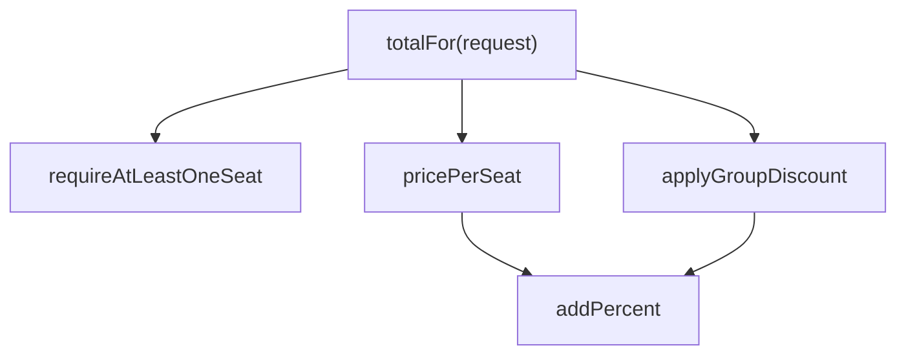
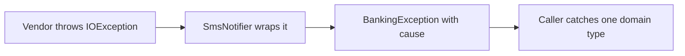
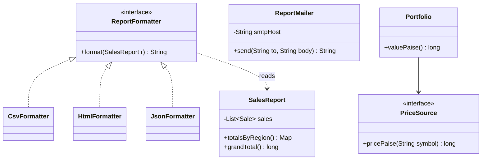
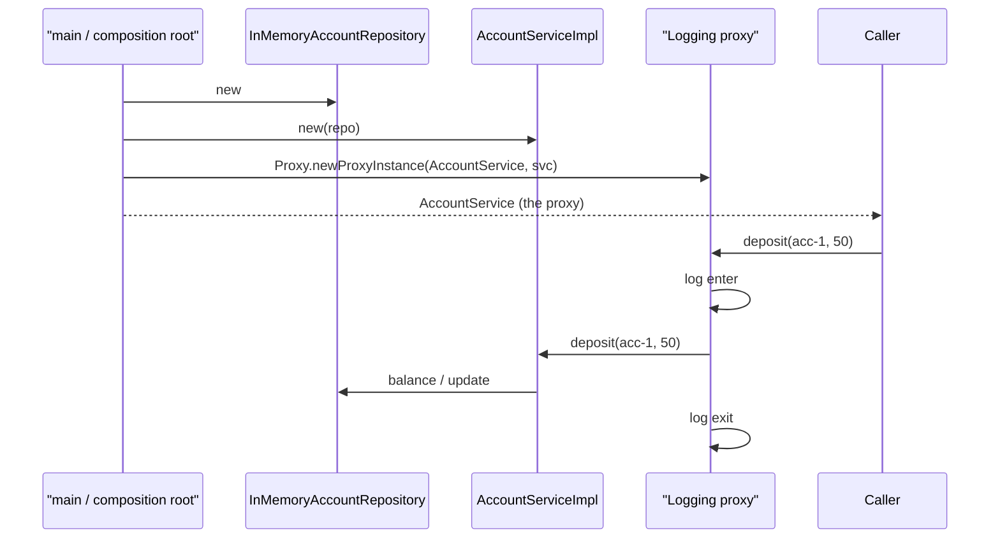
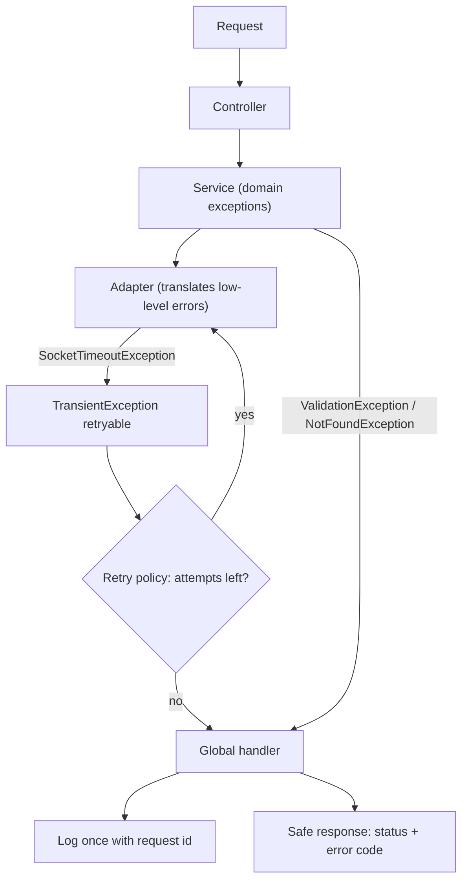
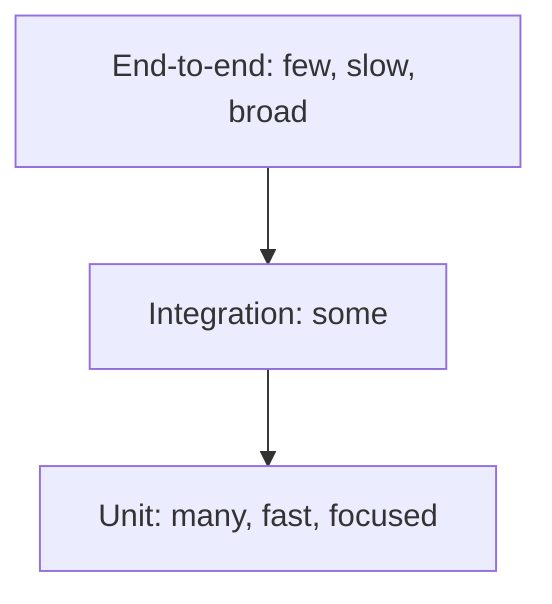

# Chapter 6 — Clean Code

Design principles (Chapters 4–5) decide *which classes exist and how they relate*. **Clean code** is about what happens *inside* those classes: names, functions, comments, error handling, tests. In machine-coding rounds (build a small working program in about 60–120 minutes), interviewers read your code line by line — clean code often separates "hire" from "no hire" when two candidates reach similar designs.

This chapter covers every major topic of Robert C. Martin's *Clean Code* (2008) in the book's order (Chapters 1–17; the case studies, Chapters 14–16, are summarised in §13), in our own words with runnable Java 21 before/after programs. It ends with three practical topics: a **code review checklist**, an **error-handling strategy** for real services and **testing strategies** (unit vs integration tests, test doubles, mocks). Listings show the essential lines; the full program for each topic is in `code/lld/ch06/<topic>/`, and each "Output" block is that full program's real output.

**Key terms (defined once here):**

| Term | Meaning |
|---|---|
| **Clean code** | Code that is easy to read, understand and change by someone other than its author. It does one thing well, has tests, and has no surprises. |
| **Code smell** | A surface symptom that *usually* signals a deeper design problem (e.g. a 200-line method). Not a bug by itself. |
| **Refactoring** | Changing the internal structure of code without changing its observable behaviour (Chapter 7). |
| **Level of abstraction** | How "high-level" a statement is. `processPayroll()` is high; `sb.append(',')` is low. |
| **Side effect** | Any change a function makes besides returning a value (fields, files, globals, output). |
| **Test double** | Any object that stands in for a real dependency during a test (dummy, stub, spy, mock, fake). |
| **TDD** | Test-Driven Development: write a failing test, make it pass, refactor — in very short cycles. |

## What is clean code, and why bother?

### What it is
Well-known programmers describe clean code similarly: it reads like well-written prose, does one thing, is elegant and efficient, has tests, contains no duplication, expresses its intent, and looks written by someone who **cares**. Working definition: *code whose intent is obvious to the next reader, and which is easy to change safely.*

*Analogy:* a well-organised kitchen — anyone can walk in and cook. A messy kitchen "works" for its owner until someone else has to cook in it.

### The problem it solves
Messy code slows teams more and more until productivity approaches zero and the team asks for a "grand redesign" that often reproduces the mess. We read code far more than we write it (often quoted as more than 10:1), so readable code makes writing faster too. "I'll clean it up later" rarely happens — *later equals never* (LeBlanc's law).

### How it works
1. Treat readability as a first-class requirement.
2. Follow the **Boy Scout Rule**: *always leave the code a little cleaner than you found it* — rename a variable, split a long function, delete a dead comment each time you touch a file.
3. Write tests so you can clean without fear.
4. Clean in small steps (successive refinement): make it work, then make it right. Never ship "it works, but it's a mess".

### Trade-offs
Clean code takes slightly longer the first time and saves time on every later read and change; throwaway scripts shift the balance.

### When not to use it
Unreadable code is never a goal, but avoid **gold-plating** — endlessly polishing code that is already clear and not changing.

### Common mistakes
- Thinking "working" means "done".
- Blaming deadlines: going fast by making a mess is an illusion; the mess slows you down immediately.
- Big-bang rewrites instead of continuous small improvements.

### Real-world examples
- **Google's code review culture** requires reviewer approval for readability, with a per-language "readability" certification.
- **Linters and formatters** (tools that flag suspicious code or rewrite its layout) running in CI — Continuous Integration, a server that builds and tests every change — (Checkstyle, SpotBugs, SonarQube, google-java-format) enforce parts of clean code automatically.

### In the interview
**30-second answer:** "Clean code is code whose intent is obvious and which is cheap to change. In a machine-coding round I use intention-revealing names, small single-purpose functions, clear exceptions instead of error codes, immutable value objects (small objects like `Money` that never change after creation) and a few tests — and I leave time to refactor once it works."

### Self-check
1. Q: What is the Boy Scout Rule? → A: Leave the code a little cleaner than you found it.
2. Q: Why does readability matter more than writing speed? → A: Code is read far more often than it is written.

### TL;DR
Clean code = obvious intent + safe to change. Clean a little every time you touch code.

---

## 1. Meaningful Names

### What it is
A good name answers three questions: **why does it exist, what does it do, how is it used**. If a name needs a comment to explain it, it isn't good enough.

*Analogy:* moving boxes labelled "Kitchen — glasses — fragile" vs "Box 7".

### The problem it solves
Bad names force readers to keep a **mental map** ("`d` is elapsed days, `i1` is status, 4 means done"). Every reader pays that cost every time, and misunderstanding causes bugs.

### How it works — the rules

| Rule | Bad | Good |
|---|---|---|
| **Reveal intention** | `int d;` | `int elapsedTimeInDays;` |
| **Avoid disinformation** (names that suggest something false) | `accountList` for a `Set`; `l`/`O` that look like 1/0 | `accounts` |
| **Make meaningful distinctions** — no number series or noise words | `a1, a2`; `ProductInfo` vs `ProductData`; `nameString` | `source, destination`; one `Product` |
| **Use pronounceable names** | `crtdTs` | `createdAt` |
| **Use searchable names** — avoid single letters and bare numbers except tiny local scopes | `7`, `e` | `MAX_LOGIN_ATTEMPTS`, `employee` |
| **Avoid encodings** — no Hungarian notation (type codes in names), no `m_` prefixes, no `I` prefix on interfaces | `strName`, `m_desc`, `IShapeFactory` | `name`, `description`, `ShapeFactory` (+ `ShapeFactoryImpl` or better, a specific name) |
| **Avoid mental mapping** | `r` for "lower-cased URL without host" | `normalizedPath` |
| **Class names = nouns** | `Manager`, `Processor`, `Data`, `Info` (vague) | `Customer`, `Invoice`, `AddressParser` |
| **Method names = verbs**; accessors `get`/`is`/`has` | `data()` | `postPayment()`, `isPosted()` |
| **Prefer named static factories** (static creation methods like `of...`) to overloaded constructors (several constructors with different parameter lists) | `new Money(23)` (rupees? paise, 1/100 of a rupee?) | `Money.ofRupees(23)` |
| **Don't be cute** | `yeetAll()`, `nuke()` | `deleteAll()`, `terminate()` |
| **One word per concept** | `fetch`/`retrieve`/`get` in sibling classes | pick one, e.g. `get` |
| **Don't pun** (same word, different meaning) | `add` for both "sum" and "append to collection" | `append`, `insert` |
| **Use solution-domain names** for technical concepts | — | `OrderRepository`, `RetryPolicy`, `EventQueue` (programmers know these) |
| **Use problem-domain names** for business concepts | — | `Premium`, `Policy`, `Claim` |
| **Add meaningful context** | lone `state` | `shippingState` or better, an `Address` class with `state` |
| **Don't add gratuitous context** | `AcmeShopCustomerAddress` in an app called "Acme Shop" | `Address` |

Rule of thumb: the **longer the scope, the longer the name** — `i` is fine for a 3-line loop; a field used across a class deserves a full name.

### Java example — before/after
Full program: `code/lld/ch06/names/Main.java`.

```java
// BEFORE
static class DtaRcrd102 { String strNm; int i1; int i2; boolean flg; }   // unpronounceable, encoded, meaningless
static class Mgr {                                  // vague noun
    List<DtaRcrd102> lst = new ArrayList<>();       // "lst" of what?
    List<DtaRcrd102> getThem() {                    // what is 4? what is 18000? why flg?
        List<DtaRcrd102> l1 = new ArrayList<>();
        for (DtaRcrd102 x : lst) if (x.i1 == 4 && x.i2 > 18000 && !x.flg) l1.add(x);
        return l1;
    }
    int d;                                          // elapsed time in days? seconds? since what?
}

// AFTER
enum TaskStatus { OPEN, IN_PROGRESS, BLOCKED, DONE }
record Task(String title, TaskStatus status, Duration timeSpent, boolean archived) {
    boolean isCompleted() { return status == TaskStatus.DONE; }           // boolean method reads as a question
    boolean tookLongerThan(Duration limit) { return timeSpent.compareTo(limit) > 0; }
}
static final class TaskBoard {
    private static final Duration LONG_RUNNING = Duration.ofHours(5);  // named constant, not a magic number
    private final List<Task> tasks = new ArrayList<>();
    void add(Task task) { tasks.add(task); }                             // method name = verb
    List<Task> findCompletedLongRunningTasks() {                         // says exactly what it returns
        List<Task> result = new ArrayList<>();
        for (Task task : tasks)
            if (task.isCompleted() && task.tookLongerThan(LONG_RUNNING) && !task.archived()) result.add(task);
        return result;
    }
}
record Temperature(double kelvin) {                 // named static factories beat overloaded constructors
    static Temperature ofCelsius(double c) { return new Temperature(c + 273.15); }
    static Temperature ofFahrenheit(double f) { return new Temperature((f - 32) * 5 / 9 + 273.15); }
}
```

Output:

```text
BEFORE getThem(): 1 record(s) -- but what are they?
AFTER findCompletedLongRunningTasks(): [Task[title=Deploy, status=DONE, timeSpent=PT6H, archived=false]]
Temperature.ofCelsius(25) = 298.15 K, ofFahrenheit(212) = 373.15 K
```

*After*, the rule reads aloud: "completed tasks that took longer than five hours and aren't archived" — magic numbers (unexplained literals) became a named constant, a status code an enum, and `Temperature.ofCelsius(25)` is unambiguous where `new Temperature(25)` is not.

### Trade-offs
Longer names cost a few keystrokes (IDEs — Integrated Development Environments such as IntelliJ IDEA — autocomplete them). Very long names can hint the function does too much — split it rather than abbreviate.

### When not to use it
Conventional short names are fine where universally understood: `i`/`j` in tiny loops, `e` for a caught exception, `x`/`y` for coordinates, `T`/`K`/`V` for generics (type parameters, as in `List<T>`, letting one class work with many types).

### Common mistakes
- Not renaming because "everyone knows what `tmp2` means" — renaming is cheap.
- Abbreviations only the author understands (`calcAmtPrc`).
- Inconsistent vocabulary (`customer`, `client`, `user` for one concept).

### Real-world examples
- JDK naming: `isEmpty()`, `getOrDefault()`, `computeIfAbsent()`, `List.of()`, `Path.of()`, `Duration.ofMinutes()` — verbs for methods, named static factories.
- **Google Java Style Guide** and Oracle's conventions standardise casing (`UpperCamelCase` classes, `lowerCamelCase` methods, `UPPER_SNAKE_CASE` constants).

### In the interview
**30-second answer:** "I name things so the code reads like the requirement: nouns for classes, verbs for methods, booleans as questions, named constants instead of magic numbers, enums instead of status codes, and one consistent word per concept."

**Follow-ups:**
- *Q: Should interfaces start with `I`?* A: Not in Java convention; name the role (`PaymentGateway`) and give implementations specific names (`RazorpayGateway`).
- *Q: When is a short name okay?* A: When the scope is tiny and the meaning conventional (`i` in a short loop).

### Self-check
1. Q: What's wrong with `ProductInfo` and `ProductData` in one codebase? → A: Noise words; no meaningful distinction.
2. Q: What's a pun in naming? → A: Using one word for two different meanings.

### TL;DR
Names should reveal intent, be pronounceable and searchable, use one word per concept, and let the code read like the requirement.

---

## 2. Functions

### What it is
Clean functions are **small**, **do one thing**, stay at **one level of abstraction**, take **few arguments**, have **no hidden side effects**, and either **do something or answer something** — never both.

### The problem it solves
Long functions mix levels of detail, hide bugs, and can't be reused, named well or tested in pieces; flag/output arguments, hidden side effects and error codes each burden callers.

### How it works — the rules
1. **Small, then smaller.** Functions should hardly ever reach 20 lines; the book praises two-to-four-line functions. Blocks inside `if`/`else`/`while` should ideally be one line — a call to a well-named function. Indentation should rarely exceed one or two levels.
2. **Do one thing.** A function does one thing if you can't extract another function from it with a name that isn't just a restatement of its body. "Sections" (declarations, initialisation, processing) mean several things.
3. **One level of abstraction per function.** Don't mix `getHtml()` (high) with `.append("\n")` (low).
4. **The Stepdown Rule.** Code reads top-down like a narrative: each function is followed by those it calls, one level lower. "To do X, we do A, then B. To do A, we …".
5. **Switch statements** on a type code tend to repeat and grow. Tolerate one only if it appears **once**, buried in a low-level class (e.g. a factory — a class/method whose job is creating objects — that creates polymorphic objects, i.e. objects of different classes used through one interface). Otherwise replace it with polymorphism (or enum data/behaviour).
6. **Use descriptive names.** A long descriptive name beats a short enigmatic one and a long comment; small functions are easier to name.
7. **Arguments: fewer is better.** Zero (niladic) is ideal, then one (monadic), two (dyadic); avoid three (triadic); more (polyadic) needs very special justification — and shouldn't be used anyway. Each argument hurts readability and multiplies test cases.
   - Common one-argument forms: a question (`isValid(email)`), a transformation (`Path resolve(name)`), an event (`onLoginFailed(attempts)`) — make the kind obvious.
   - **Flag arguments** (`render(true)`) announce the function does two things. Split it or pass an enum.
   - **Argument objects**: wrap arguments that travel together (`book(BookingRequest request)` instead of `book(show, seatType, count, day)`).
   - **Argument lists** (varargs — `Object... args`, any number of values) count as one argument (`String.format(fmt, args...)`).
   - **Verbs and keywords**: encode argument roles in the name (`copyFromTo(source, target)`, `renameFileTo(newName)`).
8. **Have no side effects.** `checkPassword` must not also initialise the session (the server-side record of a logged-in user). Hidden side effects create **temporal coupling** (works only if called at the right time). If necessary, put the side effect in the name — or better, separate it.
9. **Avoid output arguments.** `addSignature(letter)` — signature *to* the letter, or letter *to* something? Prefer `letter.addSignature()` (change the owning object's state).
10. **Command-Query Separation (CQS).** A function either *changes state* (command, returns `void`) or *returns information* (query, no state change), not both. `if (enable("darkMode"))` — asking, or enabling?
11. **Prefer exceptions to error codes.** Codes force `if` checks at every call site and deep nesting; exceptions separate the happy path (the normal, no-error flow) from error handling.
12. **Extract try/catch blocks** into their own functions — "error handling is one thing": `try` is the function's first word and nothing follows the `catch`/`finally`.
13. **Avoid an "error code magnet"** — a central `enum Error` everything imports forces recompiles and discourages new codes; new exception subclasses touch no existing code.
14. **Don't Repeat Yourself** — duplication is the root of much evil (Chapter 5).
15. **Structured programming** (Dijkstra's one-entry, one-exit: one `return`, no `break`/`continue`, never `goto`) matters mostly for large functions; small ones may use an occasional early `return`, `break` or `continue` for clarity (never `goto`).
16. **How to get there:** nobody writes clean functions first time. Write a working draft with tests, then refine — split, rename, remove duplication — keeping the tests green (all passing).



### Java example — before/after
Full program: `code/lld/ch06/functions/Main.java`.

```java
// BEFORE: returns total in rupees, or -1 for bad input; validation, pricing, discounts, logging, session -- all in one
static int book(String seatType, int count, boolean weekend, List<String> log) {   // flag arg + output arg
    if (count <= 0) return -1;                                                   // error code
    int price;
    switch (seatType) {                                                          // switch on a type code
        case "SILVER": price = 150; break;
        case "GOLD": price = 250; break;
        case "RECLINER": price = 450; break;
        default: return -1;
    }
    if (weekend) price = price + price * 20 / 100;
    int total = price * count;
    if (count >= 4) total = total - total * 10 / 100;
    log.add("booked " + count + " " + seatType);                                 // mutates the caller's list
    SESSION.put("lastTotal", total);                                             // hidden side effect
    return total;
}

// AFTER
enum SeatType {                          // the type-code switch becomes data; parsing happens once, at the boundary
    SILVER(150), GOLD(250), RECLINER(450);
    final int basePrice;
    static SeatType parse(String raw) {
        try { return valueOf(raw); }
        catch (IllegalArgumentException e) { throw new InvalidBookingException("unknown seat type '" + raw + "'"); }
    }
}
enum DayType { WEEKDAY(0), WEEKEND(20); final int surchargePercent; }   // replaces the boolean flag
record BookingRequest(SeatType seat, int seats, DayType day) {}          // argument object

static final class TicketPricer {        // stepdown rule: each function one level more detailed than the one above
    private static final int GROUP_SIZE = 4;
    private static final int GROUP_DISCOUNT_PERCENT = 10;
    int totalFor(BookingRequest request) {                        // level 1: the story
        requireAtLeastOneSeat(request);
        int total = pricePerSeat(request) * request.seats();
        return applyGroupDiscount(total, request.seats());
    }
    private void requireAtLeastOneSeat(BookingRequest r) {        // level 2: the details
        if (r.seats() <= 0) throw new InvalidBookingException("seats must be positive, was " + r.seats());
    }
    private int pricePerSeat(BookingRequest r) { return addPercent(r.seat().basePrice, r.day().surchargePercent); }
    private int applyGroupDiscount(int total, int seats) {
        return seats >= GROUP_SIZE ? addPercent(total, -GROUP_DISCOUNT_PERCENT) : total;
    }
    private static int addPercent(int amount, int percent) { return amount + amount * percent / 100; }  // level 3
}

static final class BookingService {      // CQS: book() changes state, returns nothing; history() answers, changes nothing
    private final TicketPricer pricer = new TicketPricer();
    private final List<String> history = new ArrayList<>();
    void book(BookingRequest request) {
        int total = pricer.totalFor(request);
        history.add(request.seats() + " x " + request.seat() + " on " + request.day() + " = Rs " + total);
    }
    List<String> history() { return List.copyOf(history); }
}

static String bookFromForm(BookingService service, String seat, int seats, DayType day) {  // error handling is "one thing"
    try { service.book(new BookingRequest(SeatType.parse(seat), seats, day)); return "OK"; }
    catch (InvalidBookingException e) { return "Sorry: " + e.getMessage(); }
}
```

Output:

```text
== BEFORE ==
total=1080 log=[booked 4 GOLD] session={lastTotal=1080}
bad seat returns -1 -- caller must remember to check for -1
== AFTER ==
OK
OK
Sorry: unknown seat type 'PLATINUM'
Sorry: seats must be positive, was 0
  history: 4 x GOLD on WEEKEND = Rs 1080
  history: 2 x SILVER on WEEKDAY = Rs 300
```

**What changed:** the **boolean flag** became `DayType` (call sites read `DayType.WEEKEND`, not `true`); the **type-code switch** became data on `SeatType`; **error codes** (`-1`) became `InvalidBookingException` with a precise message; the **output argument** (`log`) and **hidden side effect** (`SESSION`) became explicit state owned by `BookingService`; `book`/`history` follow **CQS** (many real APIs pragmatically let a command return the created ID — a widely accepted exception).

### Trade-offs

| Many small functions | Few large functions |
|---|---|
| Each is nameable, testable, reusable | Everything visible in one place |
| Need good names to navigate | Hard to understand, test, change |
| Too-tiny splitting can scatter logic | Mixed abstraction levels |

### When not to use it
Don't split a genuinely simple 8-line function into 8 one-liners to hit a number; the goal is clarity. Size is almost never a real performance excuse in Java: the JIT (the Just-In-Time compiler inside the JVM — Java Virtual Machine — which turns hot bytecode into machine code at runtime) inlines small methods (copies their body into the caller) for you.

### Common mistakes
- Boolean parameters in public APIs.
- Getters that change state (breaking CQS and least astonishment).
- Catching exceptions deep inside and returning `null`.
- Functions whose name says one thing and body does three.

### Real-world examples
- `Collections.sort(list)`, `list.sort(comparator)` — command methods return `void`.
- `Iterator.next()` (an `Iterator` walks a collection one element at a time) is a well-known pragmatic CQS exception (advances *and* returns); `Queue.poll()` likewise. Know them; don't design new APIs that way without reason.
- `Files.readString`, `Files.writeString` — tiny, single-purpose APIs.

### In the interview
**30-second answer:** "I keep functions small and single-purpose, at one level of abstraction, top-down by the stepdown rule. I avoid flag arguments with enums or separate methods, keep argument counts low with parameter objects, separate commands from queries, and throw descriptive exceptions instead of returning error codes."

**Follow-ups:**
- *Q: How small is small?* A: One clear name and one level of abstraction — often under ~20 lines, frequently 3–10.
- *Q: What's wrong with `boolean` parameters?* A: The call site is unreadable and the function does two things.
- *Q: What's CQS?* A: Commands change state and return nothing; queries return data and change nothing.

### Self-check
1. Q: How do you know a function does "one thing"? → A: You can't extract another meaningful function from it that isn't a mere restatement.
2. Q: When is a `switch` acceptable? → A: Once, buried in a factory/low level, never repeated.

### TL;DR
Small, one thing, one level, top-down, ≤2–3 args, no flags, no hidden side effects, commands or queries, exceptions not codes.

---

## 3. Comments

### What it is
Comments are at best a necessary evil, making up for our failure to express ourselves in code. Code changes; comments often don't, so they drift and **lie** — only the code is truly accurate. So **explain yourself in code first** and keep only comments that code *cannot* express.

### The problem it solves
Comments as a crutch for unclear code, redundant comments, and outdated comments that mislead.

### How it works
Replace a comment with a well-named function or variable whenever possible:
```text
// free shipping if the order is big enough and domestic
if (order.total() >= 499 && !order.isInternational())
```
becomes `if (order.qualifiesForFreeShipping())` — no comment needed.

**Good comments** (keep these):

| Kind | Example |
|---|---|
| **Legal** | Copyright/licence header |
| **Informative** | What a regex (text-matching pattern) matches, the format of a returned string |
| **Explanation of intent** | *Why* a decision was made ("we copy because callers may pass an unmodifiable list") |
| **Clarification** | Translating an obscure argument or return value from a library you can't change |
| **Warning of consequences** | "Not thread-safe" (unsafe from several threads at once), "takes 10 minutes to run", "billed per call" |
| **TODO** | Work that should be done but can't be now — with an owner; review them regularly |
| **Amplification** | Stressing the importance of something that looks trivial ("the trim is critical: …") |
| **Javadoc in public APIs** | Contracts callers depend on: params, return, exceptions |

**Bad comments** (remove or replace):

| Kind | What it looks like |
|---|---|
| Mumbling | A vague comment only the author understands |
| Redundant | `i++; // increment i` |
| Misleading | Subtly inaccurate description |
| Mandated | Javadoc on every function "because the rule says so" (`@param a the a`) |
| Journal | Change logs at the top of the file — version control (e.g. Git, which records every change) does this |
| Noise | `/** Default constructor. */` |
| Scary noise | Copy-pasted Javadoc noise with errors |
| Comment instead of a function/variable | Explaining an expression that could be named |
| Position markers | `// ////////// Actions //////////` banners |
| Closing-brace comments | `} // end while` — make the function shorter instead |
| Attributions and bylines | `/* Added by Rick */` — version control knows |
| **Commented-out code** | Others are afraid to delete it; it rots. Delete it — git remembers |
| HTML comments | Markup inside comments, unreadable in the editor |
| Nonlocal information | Commenting a system-wide default next to an unrelated function |
| Too much information | Historical discussions, RFC (internet standards document) excerpts |
| Inobvious connection | A comment that itself needs explaining |
| Function headers | Short, well-named functions don't need them |
| Javadoc in non-public code | Formal docs for internal code is usually noise |

### Java example — before/after
Full program: `code/lld/ch06/comments/Main.java` (it opens with a GOOD legal comment: a copyright/Apache-licence header).

```java
// BEFORE: comments used to excuse unclear code
// Changes:
//   2019-03-01 RK: created
//   2021-07-12 AB: fixed bug                                   <-- BAD: journal comment (git does this)
/**
 * The eligible method.
 * @param a the a                                                <-- BAD: noise / mandated Javadoc
 * @return the boolean
 */
static boolean eligible(Applicant a) {
    // check if applicant is eligible for a premium loan         <-- BAD: comment instead of a good name
    if (a.age() >= 21 && a.age() <= 60 && a.creditScore() > 750 && !a.hasDefaulted()
            && a.monthlyIncomePaise() >= 5_000_000) {
        return true;   // return true                            <-- BAD: redundant
    }
    // if (a.age() > 65) return false;                           <-- BAD: commented-out code
    return false;
} // end eligible                                                <-- BAD: closing-brace comment

// AFTER: the code explains itself; comments add what code can't
private static final int MIN_AGE = 21, MAX_AGE = 60;
private static final int GOOD_CREDIT_SCORE = 750;
private static final long MIN_MONTHLY_INCOME_PAISE = 5_000_000;   // Rs 50,000

static boolean isEligibleForPremiumLoan(Applicant a) {
    return isWorkingAge(a) && hasGoodCredit(a) && earnsEnough(a);
}
private static boolean isWorkingAge(Applicant a) { return a.age() >= MIN_AGE && a.age() <= MAX_AGE; }
private static boolean hasGoodCredit(Applicant a) { return a.creditScore() > GOOD_CREDIT_SCORE && !a.hasDefaulted(); }
private static boolean earnsEnough(Applicant a) { return a.monthlyIncomePaise() >= MIN_MONTHLY_INCOME_PAISE; }

// GOOD: informative comment -- clarifies what a regex matches (format: 10-character PAN, e.g. ABCDE1234F)
private static final Pattern PAN_FORMAT = Pattern.compile("[A-Z]{5}[0-9]{4}[A-Z]");

/**
 * GOOD: Javadoc on a public API -- states the contract callers rely on.
 * @param scores credit scores in the range 300..900
 * @return the median score; for an even count, the lower of the two middle values
 * @throws IllegalArgumentException if {@code scores} is empty
 */
static int medianScore(List<Integer> scores) {
    if (scores.isEmpty()) throw new IllegalArgumentException("no scores");
    // GOOD: explanation of intent -- we copy because callers may pass an unmodifiable list, and sorting in place would fail
    List<Integer> sorted = scores.stream().sorted().toList();
    return sorted.get((sorted.size() - 1) / 2);
}

// GOOD: warning of consequences -- this call hits the credit bureau and is billed per request.
// TODO(loans-team): cache bureau responses for 24h once the bureau contract allows it.   <-- GOOD: TODO
static int fetchBureauScore(String pan) { return 780; }
```

Output:

```text
BEFORE eligible(asha)=true, eligible(ravi)=false
AFTER  isEligibleForPremiumLoan(asha)=true, (ravi)=false
looksLikePan(ABCDE1234F)=true
medianScore([700, 820, 650, 900])=700
bureau score=780
```

### Trade-offs
Comments are cheap to write and expensive to maintain: a few precise "why" comments are valuable; many "what" comments are a liability.

### When not to use it
"No comments" is not the goal. Public libraries need Javadoc; complex algorithms (a published paper's method, a tricky concurrency protocol) deserve a comment explaining the approach and why.

### Common mistakes
- Updating code but not the comment next to it.
- Keeping commented-out code "just in case".
- Comments as a to-do list no one reviews.

### Real-world examples
- The **JDK's Javadoc** is model contract documentation (`HashMap`: iteration order not guaranteed; `ConcurrentHashMap`: weakly consistent iterators).
- **SonarQube** (a code-scanning server) flags commented-out code; many teams' linters reject a `TODO` without a ticket reference (an issue-tracker ID).

### In the interview
**30-second answer:** "I prefer expressive code over comments: named functions and constants replace most 'what' comments. I keep comments for why, warnings, legal headers, TODOs with owners and public API contracts, and I delete commented-out code because version control remembers it."

### Self-check
1. Q: Name three good kinds of comment. → A: Legal, explanation of intent, warning of consequences (also informative, TODO, amplification, public Javadoc).
2. Q: Why do comments lie? → A: Code changes and comments aren't updated.

### TL;DR
Say it in code; comment only the *why*, warnings, legal text and public contracts; delete dead comments and commented-out code.

---

## 4. Formatting

### What it is
Formatting is **communication**: layout tells the reader what belongs together and what matters most. A team agrees one set of rules and applies them automatically everywhere.

### The problem it solves
Random or cramped layout makes readers decode structure before logic and produces noisy diffs (line-by-line views of a change) in review (§15).

### How it works
**Vertical formatting** (top-to-bottom):
1. **File size** — small files are easier to understand; many well-known Java projects keep most files around 200 lines, very few over 500.
2. **Newspaper metaphor** — class name and top of file give the high-level picture; detail increases downward.
3. **Vertical openness** — blank lines separate distinct concepts (package, imports, each method).
4. **Vertical density** — tightly related lines appear together, without blank lines or useless comments between them.
5. **Vertical distance** — keep related concepts close: local variables near first use; instance variables in one well-known place (Java: top of the class); **dependent functions** with the caller *above* the callee, close by; **conceptual affinity** — similar functions (overloads, related operations) near each other.
6. **Vertical ordering** — high-level functions first, details later (the stepdown rule).

**Horizontal formatting** (left-to-right):
1. **Line width** — short enough to read without scrolling. Martin uses 120 characters; Google's Java style uses 100.
2. **Horizontal openness and density** — spaces around assignment operators and between arguments; none between a function name and its `(`; spacing can show precedence.
3. **No horizontal alignment** of declarations in columns — it draws the eye to the wrong thing (types vs names) and breaks with every rename.
4. **Indentation** shows scope hierarchy; don't collapse a short `if`/loop body onto one line if that hides structure.
5. **Dummy scopes** — make an empty `while`/`for` body visible (semicolon on its own line or `{}`); a trailing `;` is easy to miss.

**Team rules** — a codebase should look like one person wrote it. Encode the rules in an automatic formatter (IDE settings, `google-java-format`, Spotless, Checkstyle) and let CI enforce them.

### Java example — before/after
Full program: `code/lld/ch06/formatting/Main.java`.

```java
// BEFORE: cramped, random order, aligned columns, no vertical openness
static class Playlist{private int cursor;
    private String helper(int i){return songs.get(i).toUpperCase();}
    public String next(){if(songs.isEmpty())return null;String s=helper(cursor);cursor=(cursor+1)%songs.size();return s;}
    private final List<String>   songs   =   new ArrayList<>();
    private final String         name;
    public void add(String s){songs.add(s);}Playlist(String n){name=n;}
    public String name(){return name;}}

// AFTER: newspaper order -- headline first, details below
/** A looping playlist. (Headline: the class name and this one line tell you what it is.) */
static final class Playlist {
    // 1. Fields at the top, together (vertical density for closely related lines).
    private final String name;
    private final List<String> songs = new ArrayList<>();
    private int cursor;

    // 2. Constructor next.
    Playlist(String name) {
        this.name = name;
    }

    // 3. Public API -- each concept separated by a blank line (vertical openness).
    public String name() {
        return name;
    }

    public void add(String song) {
        songs.add(song);
    }

    public String next() {
        if (songs.isEmpty()) {
            return null;
        }
        String song = displayTitle(cursor);    // caller ABOVE callee (dependent functions close together)
        cursor = (cursor + 1) % songs.size();
        return song;
    }

    // 4. Private helpers just below the functions that use them.
    private String displayTitle(int index) {
        return songs.get(index).toUpperCase();
    }
}
```

Output:

```text
BEFORE Road trip: KESARIYA YELLOW TUM HI HO KESARIYA
AFTER  Road trip: KESARIYA YELLOW TUM HI HO KESARIYA
Same behaviour -- formatting only changes how fast a human understands it.
```

### Trade-offs
Almost none — formatting is cheap when automated; the only cost is agreeing on the rules once.

### When not to use it
Generated code (e.g. from Protobuf, whose compiler writes message classes for you) needs no hand formatting; exclude it from formatters.

### Common mistakes
- Mixing formatting and logic changes in one commit (a saved, described change in version control) — unreadable diffs.
- Personal styles inside a team codebase.
- Aligning declarations in columns.

### Real-world examples
- **google-java-format**, **Spotless** (Gradle/Maven — Java build tools), **Prettier** (JS), **gofmt** (formats all Go code identically — style debates disappear), **Black** (Python).
- **EditorConfig** files share indentation settings across editors.

### In the interview
**30-second answer:** "Formatting communicates structure. I keep related lines together, separate concepts with blank lines, put callers above callees, fields at the top, and let an automatic formatter enforce one team style."

### Self-check
1. Q: What is the newspaper metaphor? → A: High-level summary at the top, increasing detail below.
2. Q: Where should a private helper go? → A: Just below the function that calls it.

### TL;DR
Format for the reader: headline first, related things close, concepts separated, one automated team style.

---

## 5. Objects and Data Structures

### What it is
Two fundamentally different kinds of types:
- An **object** *hides* its data behind abstractions and *exposes behaviour*. Example: an `Order` with `isMetroDelivery()`.
- A **data structure** *exposes* its data and has *no meaningful behaviour*. Example: a record `Address(city, pincode)`, a DTO (Data Transfer Object — a plain data carrier).

**Data abstraction** is not just getters and setters on private fields: it means exposing abstract interfaces that manipulate the *essence* of the data without revealing its representation (`fuelPercentRemaining()` rather than `getFuelTankCapacityInLitres()` and `getLitresOfFuel()`).

*Analogy:* a vending machine (object) — press buttons, get results, never touch the coin box; a spreadsheet (data structure) — all values visible, formulas elsewhere.

### The problem it solves
Confusing the two creates **hybrids** — public fields *and* significant behaviour — where both new functions and new types are hard. The difference tells you which design suits your likely changes.

### How it works — the data/object anti-symmetry

| | Procedural code (data structures + functions) | OO code (objects) |
|---|---|---|
| Add a new **function** (e.g. `perimeter`) | **Easy**: add one function; data types untouched | **Hard**: add a method to every class |
| Add a new **type** (e.g. `Triangle`) | **Hard**: edit every function | **Easy**: add one class; existing code untouched |

So *everything is an object* is a myth: expect **new types** → objects and polymorphism; expect **new operations** over stable types → data structures with functions (or the Visitor pattern, Chapter 11, which adds operations without editing the classes). Java 21's `sealed` interfaces (listing exactly which classes may implement them) with records and pattern-matching `switch` (branching on an object's type) make the procedural style safe: the compiler reports a `switch` that misses a type.

**The Law of Demeter** (Chapter 5, §4) applies to objects: don't navigate an object's internals (`order.getCustomer().getAddress().city()` — a **train wreck**). It does *not* strictly apply to data structures, whose job is to expose data. For objects, **hide structure**: ask the object to do the job (`order.isMetroDelivery()`).

**DTOs** are the purest data structure — public (or record) fields, no behaviour — moving data across boundaries: database rows, JSON (plain-text key–value) bodies, messages. The *bean* form (private fields + getters/setters) adds no real encapsulation but some frameworks require it.

**Active Record:** a DTO that also has navigation methods like `save()` and `find()` and maps to one database row (Rails' ActiveRecord, some Java ORMs — Object-Relational Mappers, mapping classes to tables). Common mistake: putting business rules into active records, making hybrids; keep rules in separate objects that *use* the active record.

### Java example — before/after
Full program: `code/lld/ch06/objects/Main.java`.

```java
// STYLE 1: data structures + procedures
sealed interface Shape permits Square, Circle {}
record Square(double side) implements Shape {}
record Circle(double radius) implements Shape {}
static final class Geometry {            // all behaviour here: perimeter() was easy; a Triangle means editing every method
    static double area(Shape s) {
        return switch (s) {
            case Square sq -> sq.side() * sq.side();
            case Circle c -> Math.PI * c.radius() * c.radius();
        };
    }
    static double perimeter(Shape s) {   // NEW FUNCTION: easy -- no shape class changes
        return switch (s) {
            case Square sq -> 4 * sq.side();
            case Circle c -> 2 * Math.PI * c.radius();
        };
    }
}

// STYLE 2: objects (polymorphic)
interface Shape { double area(); }
record Square(double side) implements Shape { public double area() { return side * side; } }
record Circle(double radius) implements Shape { public double area() { return Math.PI * radius * radius; } }
record Triangle(double base, double height) implements Shape {   // NEW TYPE: easy -- nothing else changes
    public double area() { return 0.5 * base * height; }
}   // ...but adding perimeter() would mean editing Shape and EVERY implementation

// Hiding structure (Law of Demeter)
static boolean isMetroDelivery(Order o) {   // BEFORE: train wreck
    return List.of("Mumbai", "Delhi", "Pune").contains(o.getCustomer().getAddress().city());
}
record Address(String city, String pincode) {                    // AFTER: a data structure -- exposing data is its job
    boolean isMetro() { return List.of("Mumbai", "Delhi", "Pune").contains(city); }
}
static final class Order {                                         // an object: hides its structure
    private final Address shipTo;
    boolean isMetroDelivery() { return shipTo.isMetro(); }         // tell the order what you need
}

record OrderDto(String orderId, String city, long totalPaise) {}  // DTO: public data, no behaviour (e.g. a REST response)
```

Output:

```text
procedural Square[side=2.0]       area=4.00 perimeter=8.00
procedural Circle[radius=1.0]     area=3.14 perimeter=6.28
object     Square[side=2.0]       area=4.00
object     Circle[radius=1.0]     area=3.14
object     Triangle[base=3.0, height=4.0] area=6.00
BEFORE train wreck says metro? true
AFTER  order.isMetroDelivery()? true
DTO: OrderDto[orderId=o-9, city=Pune, totalPaise=45000]
```

### Trade-offs
The anti-symmetry table above: choose by which change you expect more.

### When not to use it
Don't force behaviour into DTOs that cross process boundaries (between separately running programs, e.g. over the network) — keep them dumb and version them carefully.

### Common mistakes
- Getters and setters for every private field by reflex (that's not encapsulation).
- Hybrids: public mutable fields plus business methods.
- Business logic inside JPA (Java's standard ORM API) entities that also serve as API response bodies.

### Real-world examples
- Records are Java's official data carriers; `java.awt.Point` has public fields (a data structure).
- `java.time.LocalDate` is an object: you call `plusDays`, `isLeapYear`, never see its fields.
- DTOs in Spring REST controllers (`@RequestBody CreateOrderRequest`); Rails ActiveRecord / Spring Data JPA entities.

### In the interview
**30-second answer:** "Objects hide data and expose behaviour; data structures expose data with no behaviour. OO makes adding types easy and functions hard; procedural does the opposite. I use records for DTOs and value data, rich objects for domain logic, and avoid hybrids and train wrecks."

**Follow-ups:**
- *Q: Is `a.getB().getC()` always wrong?* A: For objects, yes (Demeter). For pure data structures like records it's acceptable.
- *Q: Which pattern lets OO code add operations easily?* A: Visitor (Chapter 11), at the cost of making new types harder.

### Self-check
1. Q: What is a hybrid? → A: A type with both exposed data and significant behaviour — to be avoided.
2. Q: What's an Active Record? → A: A DTO with persistence/navigation methods mapped to a DB row.

### TL;DR
Objects hide data and expose behaviour; data structures expose data. Pick based on whether you'll add types or operations. No hybrids, no train wrecks through objects.

---

## 6. Error Handling

### What it is
Error handling is important, but if it **obscures the logic** it's wrong. Clean error handling keeps the happy path readable and makes failures explicit, informative and hard to ignore.

### The problem it solves
Error codes clutter every caller with `if` checks and are easy to forget; `null` returns cause `NullPointerException`s far away; checked exceptions (which the compiler forces every caller to catch or declare) from low-level libraries leak into every signature; vague messages slow debugging.

### How it works — the rules
1. **Use exceptions rather than return codes** — caller logic stays clean; errors can't be silently ignored.
2. **Write your `try-catch-finally` first** when code can throw. The `try` block is like a transaction (all-or-nothing): whatever happens inside, the `catch` must leave the program consistent. In Java, prefer **try-with-resources** for anything `AutoCloseable` (anything with `close()`, such as a file or connection) — it is closed even if an exception is thrown.
3. **Use unchecked exceptions.** Checked exceptions violate the Open/Closed Principle: a new checked exception low down forces every method between it and the handler to change its signature. C#, Kotlin, Python and Scala have none. Use checked exceptions only when a caller can and must realistically recover (rare, deliberate).
4. **Provide context** — what failed, with which values, why (`account 'B' has 100 but 900 was requested`); keep the original exception as the **cause** when wrapping.
5. **Define exception classes by the caller's needs** — how will it *catch* them? Often one type per area is enough. **Wrap third-party APIs** so their exceptions become yours, minimising vendor dependency and easing library swaps.
6. **Define the normal flow — the Special Case pattern** (Martin Fowler): for an expected "absence", return an object that handles it (`NoMembership` with 0 points, `GuestCustomer`, an empty list) instead of throwing or returning `null`; callers need no special handling.
7. **Don't return `null`.** Return an empty collection, `Optional` (holds a value or is empty), a special-case object, or throw. Every `null` return is a future `NullPointerException`.
8. **Don't pass `null`.** Unless an API expects it, reject `null` arguments immediately (`Objects.requireNonNull`) — fail fast (Chapter 5).



### Java example — before/after
Full program: `code/lld/ch06/errors/Main.java`.

```java
// BEFORE
static final int OK = 0, E_NO_ACCOUNT = 1, E_NO_MONEY = 2;
static int transfer(String from, String to, long amount) {        // caller must check an int
    Long f = BALANCES.get(from), t = BALANCES.get(to);
    if (f == null || t == null) return E_NO_ACCOUNT;               // which one? no context
    if (f < amount) return E_NO_MONEY;                             // how much was missing?
    BALANCES.put(from, f - amount); BALANCES.put(to, t + amount);
    return OK;
}
static List<String> history(String id) { return null; }          // "no history" = null
static Integer loyaltyPoints(String id) { return POINTS.get(id); } // null for non-members

// AFTER: unchecked, domain-specific, with context -- defined by what the CALLER needs to handle
static class BankingException extends RuntimeException { /* (msg) and (msg, cause) constructors */ }
static final class AccountNotFoundException extends BankingException {
    AccountNotFoundException(String id) { super("account '" + id + "' does not exist"); }
}
static final class InsufficientFundsException extends BankingException {
    InsufficientFundsException(String id, long requested, long available) {
        super("account '" + id + "' has " + available + " but " + requested + " was requested");
    }
}
// SPECIAL CASE: "no loyalty membership" is an object -- callers need no null check
interface Loyalty { int points(); String tier(); }
record Member(int points) implements Loyalty { public String tier() { return points >= 100 ? "GOLD" : "SILVER"; } }
enum NoMembership implements Loyalty { INSTANCE; public int points() { return 0; } public String tier() { return "NONE"; } }

static final class SmsNotifier {        // wrapper around a vendor client that throws checked IOException
    private final VendorSmsClient client = new VendorSmsClient();
    void send(String phone, String text) {
        try { client.push(phone, text); }
        catch (IOException e) { throw new BankingException("could not send SMS to " + phone, e); }   // cause kept
    }
}

// in Bank:
void transfer(String from, String to, long amount) {
    Objects.requireNonNull(from, "from"); Objects.requireNonNull(to, "to");     // don't accept null
    long available = balanceOf(from);
    balanceOf(to);                                                              // validates 'to' exists
    if (available < amount) throw new InsufficientFundsException(from, amount, available);
    balances.merge(from, -amount, Long::sum);
    balances.merge(to, amount, Long::sum);
}
List<String> history(String id) { return List.of(); }                          // empty, never null
Optional<Long> findBalance(String id) { return Optional.ofNullable(balances.get(id)); }
Loyalty loyaltyOf(String id) {
    Integer p = points.get(id);
    return p == null ? NoMembership.INSTANCE : new Member(p);
}

// "Write the try first": main writes to an AutoCloseable AuditFile inside try-with-resources and throws --
// the output shows the file closed before the catch runs
```

Output:

```text
== BEFORE ==
transfer returned 1 (which account? caller has to decode)
history(): NullPointerException -- someone forgot the null check
loyaltyPoints(B): NullPointerException on unboxing
== AFTER ==
transfer failed: account 'Z' does not exist
transfer failed: account 'B' has 100 but 900 was requested
transfer A->B of 200 ok; A=300 B=300
history(A) size = 0
findBalance(Z) = Optional.empty
loyalty A: 40 pts, tier SILVER
loyalty B: 0 pts, tier NONE
could not send SMS to 000123 (cause: socket timeout to sms-gw-3)
  audit file opened
  audit: transfer A->B 200
  audit file closed
  caught: simulated crash -- file was still closed first
```

The *before* `loyaltyPoints` crashes on auto-unboxing (Java's automatic `Integer` → `int` conversion, which throws on `null`).

### Trade-offs

| Choice | Pro | Con |
|---|---|---|
| Unchecked exceptions | Clean signatures, OCP-friendly | Compiler doesn't remind callers; document them |
| Checked exceptions | Compiler-enforced handling | Signature ripple; often caught and swallowed |
| `Optional` return | Absence visible in the type | Not for fields/parameters; small allocation |
| Special Case object | No checks at all in callers | Can hide a real problem if absence *should* be noticed |
| Result/Either type (holds either a success value or an error) | Expected failures as values, composable | More verbose in Java (see Error-handling strategy) |

### When not to use it
Exceptions are for errors, not normal control flow (don't throw to exit a loop). For *expected, frequent* outcomes (validating user input rows), returning a result value can be cleaner (§16).

### Common mistakes
- `catch (Exception e) {}` — swallowing.
- Logging and rethrowing at every layer (the same error logged 5 times).
- Losing the cause when wrapping (`new MyException(e.getMessage())` instead of `new MyException(msg, e)`).
- Returning `null` from collection-returning methods.

### Real-world examples
- **Spring's `DataAccessException`** hierarchy translates vendor-specific `SQLException`s into unchecked, meaningful exceptions (e.g. `DuplicateKeyException`) — "wrap third-party APIs, define exceptions by caller's needs".
- `Collections.emptyList()`, `Optional.empty()` — "don't return null"; `Objects.requireNonNull` — "don't pass null".
- `UncheckedIOException` (Java 8) wraps `IOException` for lambdas/streams, whose standard functional interfaces cannot throw checked exceptions.

### In the interview
**30-second answer:** "I throw unchecked, domain-specific exceptions with context instead of returning codes or null. I wrap third-party exceptions at the boundary, return empty collections or Optional for absence, use a special-case object when absence is normal, validate nulls at entry, and use try-with-resources for cleanup."

**Follow-ups:**
- *Q: Checked vs unchecked?* A: Checked forces handling but ripples through signatures and breaks OCP; I default to unchecked and reserve checked for recoverable conditions callers must handle.

### Self-check
1. Q: Why are error codes bad? → A: They clutter callers, are easy to ignore, and lack context.
2. Q: Why keep the cause when wrapping? → A: So the original stack trace and message aren't lost.

### TL;DR
Exceptions not codes; unchecked with context; wrap vendors; special cases, empty collections or Optional instead of null; never pass null; always clean up.

---

## 7. Boundaries

### What it is
A **boundary** is where your code meets code you don't control: third-party libraries, frameworks, other teams' services, even very general JDK types like `Map`. Clean boundaries keep foreign code at the edge, behind interfaces shaped for *your* needs.

### The problem it solves
Providers want broad APIs; users want focused ones. A raw `Map<String, Session>` passed around lets any code `clear()` it or insert wrong values, forces everyone to know the key format, and breaks every usage site when the API changes.

### How it works
1. **Wrap boundary types.** Don't pass `Map`, vendor clients or framework types around; hide them in a class exposing only what your app needs (`SessionRegistry.open/activeSession/close`), keeping the boundary type **private** or at least out of public APIs — so a vendor change touches one place.
2. **Write learning tests.** When adopting a library, write small tests that call its API the way you intend to use it. They document your understanding, cost nothing extra (you had to learn the API anyway), and — re-run on each upgrade — reveal behaviour changes immediately.
3. **Use code that does not exist yet.** When another team's API isn't ready, define the interface *you wish you had* (`FraudCheck`), code and test against a fake, and later write an **Adapter** (Chapter 9) to the real API. This also gives a clean seam (a place where a test can plug in a substitute).

### Java example — before/after
Full program: `code/lld/ch06/boundaries/Main.java` (the learning tests run on the chapter's `MiniTest` runner, §8).

```java
// BEFORE: a raw Map passed all over the codebase -- anyone can clear() it, put(null, ...), and must know the key format
static void loginHandler(Map<String, Session> sessions, String token, String user) {
    sessions.put(token, new Session(user, Instant.parse("2026-09-28T12:00:00Z")));
}
static void buggyAdminTool(Map<String, Session> sessions) { sessions.clear(); }   // oops: everyone logged out

// AFTER: the Map is hidden behind an interface shaped for OUR needs
static final class SessionRegistry {
    private final Map<String, Session> byToken = new ConcurrentHashMap<>();   // boundary type stays private
    void open(String token, Session session) { byToken.put(token, session); }
    Optional<Session> activeSession(String token, Instant now) {
        return Optional.ofNullable(byToken.get(token)).filter(s -> now.isBefore(s.expiresAt()));
    }
    void close(String token) { byToken.remove(token); }
}

// The fraud team's API isn't written yet: define the interface WE want, use a fake until an Adapter wraps the real one
interface FraudCheck { boolean isSuspicious(String userId, long amountPaise); }
static final class FakeFraudCheck implements FraudCheck {
    public boolean isSuspicious(String userId, long amountPaise) { return amountPaise > 10_000_000; }
}

// LEARNING TESTS: executable notes about how third-party (here: JDK) APIs really behave
@Test void hashmap_allows_one_null_key() { Map<String, Integer> m = new HashMap<>(); m.put(null, 1); assertEquals(1, m.get(null)); }
@Test void concurrenthashmap_rejects_null_keys() {
    assertThrows(NullPointerException.class, () -> new ConcurrentHashMap<String, Integer>().put(null, 1));
}
@Test void map_of_rejects_duplicate_keys() { assertThrows(IllegalArgumentException.class, () -> Map.of("k", 1, "k", 2)); }
@Test void string_split_drops_trailing_empty_strings() {
    assertEquals(2, "a,b,,".split(",").length);
    assertEquals(4, "a,b,,".split(",", -1).length);
}
```

Output:

```text
== BEFORE ==
sessions after admin tool: 0  <-- nothing stopped the clear()
== AFTER ==
active at 11:00? true
active at 13:00? false
fraud(asha, Rs 2,00,000)? true
== Learning tests ==
JdkLearningTest
  PASS  concurrenthashmap rejects null keys
  PASS  hashmap allows one null key
  PASS  map of rejects duplicate keys
  PASS  string split drops trailing empty strings
4 passed, 0 failed
```

`SessionRegistry` also puts the "not expired" rule in one place. The learning tests pin down surprising but real API facts: `HashMap` allows one `null` key, `ConcurrentHashMap` rejects it, `Map.of` rejects duplicate keys, `String.split` drops trailing empty strings unless given a negative limit.

### Trade-offs
Wrapping costs a class and some delegation; it pays off whenever the boundary type is used in more than one place or might change.

### When not to use it
Stable, universal types used locally (a `Map` inside one method) are fine. The rule is about *passing* boundary types around your system.

### Common mistakes
- Returning vendor types from your interfaces (`PaymentGateway.charge()` returning a `StripeCharge`) — leaks the vendor.
- Skipping learning tests and discovering library behaviour in production (the live system users use).

### Real-world examples
- **Anti-Corruption Layer** (Domain-Driven Design, Chapter 5 §17): a translation layer between your model and a legacy/external system's model.
- **SLF4J** (Simple Logging Facade for Java) wraps the real logging library; **Spring's `RestClient`/`WebClient`** let you swap the HTTP engine.
- Contract tests (e.g. Pact) between microservices are a team-level version of learning tests.

### In the interview
**30-second answer:** "I keep third-party code at the edges: wrap it behind an interface shaped for my domain, don't pass raw library types around, write learning tests when adopting a library, and if a dependency doesn't exist yet I define the interface I need and use a fake until an adapter can bridge to the real API."

### Self-check
1. Q: What is a learning test? → A: A test that exercises a third-party API to learn and pin down its behaviour.
2. Q: How do you handle an API that isn't built yet? → A: Define your own interface, use a fake, adapt later.

### TL;DR
Keep foreign code at the edge behind your own interfaces; learn it with tests; adapt, don't leak.

---

## 8. Unit Tests

### What it is
Unit tests are small, automated tests of one unit of behaviour (usually a class or a few collaborating objects) in isolation. *Clean Code* argues test code is **as important as production code**: it must be clean, because it's what lets you change production code without fear.

### The problem it solves
Without tests, people stop cleaning and the design rots. *Dirty* tests break with every change, are abandoned, and then production code rots too.

### How it works

**The three laws of TDD** (they lock you into a cycle perhaps thirty seconds long, tests just a few seconds ahead of production code):
1. You may not write production code until you have written a failing unit test.
2. You may not write more of a unit test than is sufficient to fail (and not compiling counts as failing).
3. You may not write more production code than is sufficient to pass the currently failing test.

A related, coarser description (Kent Beck's TDD, not these three laws) is **Red → Green → Refactor**: failing test (red), simplest pass (green), then clean up code and tests (refactor).

**Keep tests clean** — they enable the "-ilities": code stays flexible, maintainable and reusable because you can change anything while the tests pass.

**Clean tests are readable tests:**
- **Build–Operate–Check** (also **Arrange–Act–Assert** or **Given–When–Then**): build the test data, operate on it, check the results.
- A small **domain-specific testing language**: helpers like `cart("TEA", 3)` and `checkoutWith(coupons, audit)` hide setup noise.
- **Dual standard:** test code must be clean and readable but need not be as efficient as production code (building strings for assertions is fine).

**One assert per test?** Minimise asserts, but more importantly have **one concept per test**; several asserts checking one concept are fine.

**F.I.R.S.T.** — clean tests are:

| Letter | Meaning | How our code does it |
|---|---|---|
| **F**ast | Run in milliseconds so you run them constantly | In-memory doubles, no network/DB |
| **I**ndependent | No test depends on another or on order | `MiniTest` creates a fresh instance per test |
| **R**epeatable | Same result in any environment, any time | Fixed `Clock` instead of `now()` |
| **S**elf-validating | Pass/fail automatically, no reading logs | Assertions, not `println` |
| **T**imely | Written just before (or with) the production code | TDD cycle |

### Java example — a JUnit-free runner, clean tests and a dirty one
Instead of JUnit (the standard Java test framework), a tiny framework — a `@Test` annotation plus `MiniTest`, about 60 lines — uses reflection (inspecting classes and calling methods by name at runtime) to find `@Test` methods, runs each on a **fresh instance** of the test class (Independent) and reports PASS/FAIL/ERROR itself (Self-validating). The production class `Checkout` has four collaborators behind interfaces, so tests can replace them with doubles. All files: `code/lld/ch06/testing/` (`Checkout`, `MiniTest`, `Test`, `BeforeStyleTest`, `CheckoutTest`, `CheckoutIntegrationTest`, and `Main`, which runs all three test classes).

```java
// Checkout.java (production code under test)
public interface PriceCatalog { long pricePaise(String sku); }
public interface CouponRepository { Optional<Coupon> find(String code); }
public interface ReceiptSender { void send(Receipt receipt); }
public interface AuditLog { void record(String event); }
static final long HIGH_VALUE_PAISE = 1_000_000;   // Rs 10,000

/** Query: computes the total, changes nothing. couponCode may be null = "no coupon" -- documented in the
 *  contract ("don't pass null" allows null only where an API explicitly expects it). */
public long quote(List<Line> lines, String couponCode) {
    long subtotal = lines.stream().mapToLong(l -> catalog.pricePaise(l.sku()) * l.qty()).sum();
    return subtotal - discount(subtotal, couponCode);
}
/** Command: charges, sends the receipt, audits big orders. */
public Receipt checkout(List<Line> lines, String couponCode, String email) {
    if (lines.isEmpty()) throw new IllegalArgumentException("cart is empty");
    Receipt receipt = new Receipt(email, quote(lines, couponCode));
    sender.send(receipt);
    if (receipt.totalPaise() >= HIGH_VALUE_PAISE) audit.record("high-value order for " + email);
    return receipt;
}
private long discount(long subtotal, String couponCode) {
    if (couponCode == null) return 0;
    return coupons.find(couponCode)
            .filter(c -> !LocalDate.now(clock).isAfter(c.expiresOn()))   // injected Clock -> Repeatable
            .map(c -> subtotal * c.percentOff() / 100)
            .orElse(0L);
}
// plus simple real implementations for the integration test: InMemoryCatalog, InMemoryCoupons, OutboxSender

// BeforeStyleTest.java -- how NOT to write tests: test1() quotes twice and checks out once (several concepts),
// builds Checkout with Clock.systemDefaultZone() (not Repeatable), and only PRINTS a, b and r for a human
// to judge (not Self-validating) -- cryptic name, magic numbers

// CheckoutTest.java -- clean UNIT tests; the five kinds of test double:
static final class DummyAuditLog implements Checkout.AuditLog {       // DUMMY: fills a parameter, must never be used
    public void record(String event) { throw new AssertionError("dummy must not be called"); }
}
static final class StubCatalog implements Checkout.PriceCatalog { /* STUB: canned prices from a Map */ }
static final class FakeCoupons implements Checkout.CouponRepository { /* FAKE: working in-memory list */ }
static final class SpySender implements Checkout.ReceiptSender {       // SPY: records calls for later inspection
    final List<Checkout.Receipt> sent = new ArrayList<>();
    public void send(Checkout.Receipt r) { sent.add(r); }
}
static final class MockAuditLog implements Checkout.AuditLog {         // MOCK: pre-programmed expectations, verifies itself
    private final List<String> expected = new ArrayList<>(), actual = new ArrayList<>();
    MockAuditLog expect(String event) { expected.add(event); return this; }
    public void record(String event) { actual.add(event); }
    void verify() { assertEquals(expected, actual); }
}
// fixture helpers: FIXED_CLOCK = Clock.fixed(2026-09-28T10:00Z); checkoutWith(coupons, audit); cart("TEA", 3, ...)

@Test void quote_sums_price_times_quantity() {
    Checkout checkout = checkoutWith(new FakeCoupons(), new DummyAuditLog());   // Given
    long total = checkout.quote(cart("TEA", 3), null);                         // When
    assertEquals(36_000L, total);                                               // Then
}
@Test void expired_coupon_is_ignored() {
    var coupons = new FakeCoupons().add(new Checkout.Coupon("OLD", 50, TODAY.minusDays(1)));
    assertEquals(12_000L, checkoutWith(coupons, new DummyAuditLog()).quote(cart("TEA", 1), "OLD"));
}
@Test void checkout_sends_exactly_one_receipt() {
    checkoutWith(new FakeCoupons(), new DummyAuditLog()).checkout(cart("TEA", 1), null, "asha@example.com");
    assertEquals(List.of(new Checkout.Receipt("asha@example.com", 12_000L)), sender.sent);   // inspect the spy
}
@Test void high_value_order_is_audited() {
    var audit = new MockAuditLog().expect("high-value order for ravi@example.com");
    checkoutWith(new FakeCoupons(), audit).checkout(cart("TV", 1), null, "ravi@example.com");
    audit.verify();                                                             // the mock checks itself
}
// also: valid_coupon_takes_percentage_off, empty_cart_is_rejected (assertThrows + "nothing must be sent")

// CheckoutIntegrationTest.java -- real in-memory components wired together, no doubles for our own code:
// TEA 120 x 2 + CUP 80 with a 25% WELCOME coupon -> one Receipt of 24_000 paise lands in the OutboxSender
```

Output:

```text
BeforeStyleTest
        a=36000 b=36000 r=Receipt[email=z, totalPaise=12000]  (is this right? someone must check by eye)
  PASS  test1
CheckoutTest
  PASS  checkout sends exactly one receipt
  PASS  empty cart is rejected
  PASS  expired coupon is ignored
  PASS  high value order is audited
  PASS  quote sums price times quantity
  PASS  valid coupon takes percentage off
CheckoutIntegrationTest
  PASS  full checkout flow with real components
TOTAL: 8 passed, 0 failed
```

`test1` "passes" but proves nothing. Each `CheckoutTest` method checks **one concept**, is named as a behaviour specification (`expired_coupon_is_ignored`), and uses Given/When/Then, a fixed clock and self-validating assertions (§17 covers unit vs integration testing and the five doubles).

### Trade-offs

| Well-tested code | Untested code |
|---|---|
| Fearless refactoring | Fear of change → rot |
| Tests are executable documentation | Knowledge in people's heads |
| Test code must be maintained too | Faster to write the first time |

### When not to use it
TDD is less useful for exploratory spikes (quick experiments — throw them away) and pure UI layout. Don't unit-test trivial getters or framework code you don't own (use learning tests).

### Common mistakes
- Testing implementation details (private methods, exact call order) so tests break on every refactor.
- Shared mutable fixtures (data set up before tests) that make tests order-dependent.
- `Thread.sleep` or the real clock/network in unit tests.
- Test names like `test1`, `testCheckout`.

### Real-world examples
- **JUnit 5** (`@Test`, `@BeforeEach`, `assertThrows`, `@DisplayName`), **AssertJ** fluent assertions, **Mockito** doubles.
- JUnit 5's default lifecycle creates a **new test-class instance per test method** — the same independence choice `MiniTest` makes.
- **`java.time.Clock`** exists partly so time-dependent code can be tested with `Clock.fixed(...)`.

### In the interview
**30-second answer:** "I write small, fast, independent tests — one concept each, named as behaviour, Given/When/Then. I inject collaborators behind interfaces so I can use stubs, fakes or mocks, and inject a `Clock` for time. In a machine-coding round I at least write a `main` exercising key flows, plus a few unit tests for core logic if time allows."

**Follow-ups:**
- *Q: The three laws of TDD?* A: No production code without a failing test; only enough test to fail; only enough code to pass.
- *Q: One assert per test?* A: The real rule is one concept per test; several asserts on one concept are fine.

### Self-check
1. Q: What's wrong with printing results in a test? → A: Not self-validating — a human has to check.
2. Q: How do you make a time-based test repeatable? → A: Inject a `Clock` and use `Clock.fixed` in tests.

### TL;DR
Tests are first-class code: TDD cycle, one concept per test, readable Given/When/Then, and F.I.R.S.T.

---

## 9. Classes

### What it is
Clean classes follow the standard **organisation**, are **small** (measured in responsibilities, not lines), have **one reason to change** (SRP), are **cohesive**, and are **organised for change** so new features mean new classes rather than edits to old ones.

### The problem it solves
"God" classes change for many reasons, and every change risks unrelated features; a growing `if/else` over formats reopens the same class repeatedly.

### How it works
1. **Class organisation** (Java convention): public static constants → private static variables → private instance variables → public functions → private helpers right after the public function that uses them (stepdown rule). Public instance variables are rarely justified.
2. **Encapsulation**: fields and helpers private. Loosening to package-private/protected (visible within the package, or also to subclasses) *for tests* is a last resort.
3. **Small by responsibilities.** If you can't name it concisely, the name needs *Manager*, *Processor*, *Super*, or the description needs "and"/"or"/"but", it does too much; you should describe it in about 25 words.
4. **Single Responsibility Principle**: **one reason to change** (Chapter 4). Many small classes beat a few large ones — the same total code, better organised, like tools in labelled drawers rather than one big box.
5. **Cohesion**: maximal when every method uses every instance variable. When a subset of methods uses a subset of fields, that subset wants to be its own class — **maintaining cohesion results in many small classes**.
6. **Organise for change**: if a feature means *opening* a class (another branch in `render()`), split so new features are new classes (Open/Closed) — each report format became its own `ReportFormatter`.
7. **Isolate from change**: depend on abstractions, not volatile concrete details. `Portfolio` depends on `PriceSource`, not a live stock-exchange client, so it can be tested with fixed prices (Dependency Inversion).



### Java example — before/after
Full program: `code/lld/ch06/classes/Main.java`.

```java
// BEFORE: one class, many reasons to change
static class ReportManager {
    private final List<Sale> sales;
    private String smtpHost = "smtp.example.com";          // email concern
    private String outputFormat = "CSV";                   // formatting concern
    Map<String, Long> totalsByRegion() { ... }             // business concern
    String render() {                                      // grows a new branch for every format
        if (outputFormat.equals("CSV")) { /* build "region,total" lines */ }
        else if (outputFormat.equals("HTML")) { /* build <table> rows */ }
        throw new IllegalStateException("unknown format");
    }
    String email(String to) { return "SMTP " + smtpHost + " -> " + to + ": " + render(); }
}

// AFTER
static final class SalesReport {   // cohesive: every method uses `sales`; one reason to change (business rules)
    private final List<Sale> sales;
    SalesReport(List<Sale> sales) { this.sales = List.copyOf(sales); }
    Map<String, Long> totalsByRegion() {
        return sales.stream().collect(Collectors.groupingBy(Sale::region, java.util.TreeMap::new,
                Collectors.summingLong(Sale::amountPaise)));
    }
    long grandTotal() { return sales.stream().mapToLong(Sale::amountPaise).sum(); }
}
interface ReportFormatter { String format(SalesReport report); }   // a new format is a NEW class (OCP)
// CsvFormatter and HtmlFormatter implement it with the old branches' code
static final class JsonFormatter implements ReportFormatter {      // added later, nothing else edited
    public String format(SalesReport r) {
        return r.totalsByRegion().entrySet().stream()
                .map(e -> "\"" + e.getKey() + "\":" + e.getValue())
                .collect(Collectors.joining(",", "{", "}"));
    }
}
static final class ReportMailer {                                  // separate reason to change: delivery
    private final String smtpHost;
    String send(String to, String body) { return "SMTP " + smtpHost + " -> " + to + ": " + body; }
}
interface PriceSource { long pricePaise(String symbol); }          // isolating from change
static final class Portfolio {
    private final PriceSource prices;
    private final Map<String, Integer> holdings;
    long valuePaise() {
        return holdings.entrySet().stream().mapToLong(h -> prices.pricePaise(h.getKey()) * h.getValue()).sum();
    }
}
// main: PriceSource fixedPrices = symbol -> Map.of("INFY", 150_000L, "TCS", 400_000L).get(symbol);  // test-friendly stub
```

Output:

```text
== BEFORE ==
region,total North,6000 South,7000
SMTP smtp.example.com -> boss@example.com: <table><tr><td>North</td><td>6000</td></tr><tr><td>South</td><td>7000</td></tr></table>
== AFTER ==
CsvFormatter: region,total North,6000 South,7000
HtmlFormatter: <table><tr><td>North</td><td>6000</td></tr><tr><td>South</td><td>7000</td></tr></table>
JsonFormatter: {"North":6000,"South":7000}
SMTP smtp.example.com -> boss@example.com: {"North":6000,"South":7000}
portfolio value (paise) = 2300000
```

`ReportManager` had three reasons to change (business totals, output format, email delivery); after the split, `JsonFormatter` arrived without editing any class.

### Trade-offs

| Many small classes | Few big classes |
|---|---|
| Each is easy to understand and test | Fewer files to navigate |
| Changes are localised | Every change touches the same class |
| Need good names and packages to navigate | Merge conflicts (clashing edits to the same lines), fear of change |

### When not to use it
Don't split a small cohesive class into micro-classes that always change together — that's fragmentation, not SRP.

### Common mistakes
- `*Manager`, `*Helper`, `*Utils` classes collecting unrelated methods.
- Splitting by *technical layer* only, leaving a god service.
- Making everything `public` "for tests".

### Real-world examples
- `java.time` splits responsibilities across `LocalDate`, `LocalTime`, `ZonedDateTime`, `Duration`, `Period`, `DateTimeFormatter` — unlike the old `java.util.Date`/`Calendar`, which mixed many concerns.
- Spring's `JdbcTemplate` delegates row mapping to `RowMapper` and parameter setting to `PreparedStatementSetter`.

### In the interview
**30-second answer:** "I keep classes small by responsibility — one reason to change — and highly cohesive, so methods use most of the fields. When a feature would add another branch to an existing class, I split so the new feature is a new class, and I depend on interfaces to isolate volatile details."

### Self-check
1. Q: How do you measure a class's size? → A: By its responsibilities, not lines.
2. Q: What is maximal cohesion? → A: Every method uses every instance variable.

### TL;DR
Small (one responsibility), cohesive, open for extension, dependent on abstractions.

---

## 10. Systems

### What it is
At system level, clean code means **separating the startup process (constructing and wiring objects) from the runtime logic that uses them**, using **Dependency Injection**, handling **cross-cutting concerns** in one place, and letting the architecture **grow incrementally**.

*Analogy:* a city — nobody designs every street up front; water, power and traffic are separate systems with clear interfaces that grow over time.

### The problem it solves
Objects that create their own dependencies (`if (service == null) service = new MyServiceImpl(...)` — lazy initialisation, creating on first need) are hard-wired to concrete classes, untestable in isolation, and mix construction with use (violating SRP). Logging, security and transactions copied into every method make business code noisy and inconsistent.

### How it works
1. **Separate construction from use.**
   - **Separation of `main`**: build all objects in `main` (or a startup module — the **composition root**) and pass them to the application, which knows nothing about how they were built; dependencies point from `main` toward the application, never back.
   - **Factories**: when the *application* must decide *when* to create something (a `LineItem` per scan), give it an **Abstract Factory** interface (whose methods create objects, so the caller never names concrete classes); the concrete factory stays on the `main` side.
   - **Dependency Injection (DI)**: an object receives its dependencies (constructor, setter or method parameter) instead of creating or looking them up — Inversion of Control (outside code, often a framework, creates objects and drives the flow) applied to dependencies. Prefer constructor injection: explicit, final, complete after construction.
2. **Scale up incrementally.** Well-separated concerns let the architecture grow (e.g. from a module of a monolith — one application deployed as a unit — to a separate service) without a rewrite.
3. **Cross-cutting concerns** (persistence, transactions, security, logging, caching — keeping recent results in fast storage; see [System Design Fundamentals](../../../system-design-patterns/modules/00-system-design-fundamentals/README.md)) are handled modularly:
   - **Java dynamic proxies** (`java.lang.reflect.Proxy`) wrap an interface and intercept every call — shown below.
   - **Pure-Java AOP frameworks** (AOP = aspect-oriented programming: a concern written once, as an *aspect*, applied to many methods; e.g. Spring AOP) generate proxies from annotations/config (`@Transactional`, `@Cacheable`, `@PreAuthorize`).
   - **AspectJ** — a full aspect-oriented language extension that weaves advice (the aspect's code) into bytecode (compiled Java classes the JVM runs).
   - **Decorators** and **servlet filters / interceptors** (code run before/after every web request) for simpler cases.
4. **Test-drive the architecture**: with logic in POJOs (Plain Old Java Objects, no framework dependencies) and concerns decoupled, start simple and evolve.
5. **Optimise decision making**: decide at the last responsible moment, when you know most — modularity allows it.
6. **Use standards wisely** — only with demonstrable value (heavyweight standards can bury simple logic).
7. **Systems need domain-specific languages**: a good DSL (a mini-language for one problem) or fluent API (methods that chain into readable sentences) lets code read like the domain (a test-fixture builder, a routing DSL).



### Java example — before/after
Full program: `code/lld/ch06/systems/Main.java`.

```java
// BEFORE: the service builds its own dependency (lazy init) and mixes in logging
private AccountRepository repo() {
    if (repo == null) repo = new InMemoryAccountRepository();   // construction mixed with use; hard-coded impl
    return repo;
}
public void deposit(String id, long amount) {
    System.out.println("  LOG enter deposit " + id);          // cross-cutting code, copied into every method
    if (amount <= 0) throw new IllegalArgumentException("amount must be positive");
    repo().update(id, repo().balance(id) + amount);
    System.out.println("  LOG exit deposit");
}

// AFTER: pure business logic; dependency injected through the constructor; no logging code
static final class AccountServiceImpl implements AccountService {
    private final AccountRepository repo;
    AccountServiceImpl(AccountRepository repo) { this.repo = repo; }
    public long balance(String id) { return repo.balance(id); }
    public void deposit(String id, long amount) {
        if (amount <= 0) throw new IllegalArgumentException("amount must be positive");
        repo.update(id, repo.balance(id) + amount);
    }
}
// Cross-cutting concern written ONCE, applied to any interface via a JDK dynamic proxy (how Spring AOP works for interfaces)
static <T> T withLogging(Class<T> type, T target) {
    InvocationHandler handler = (proxy, method, args) -> {
        System.out.println("  LOG -> " + method.getName() + "(" + /* args joined */ ")");
        try {
            Object result = method.invoke(target, args);
            System.out.println("  LOG <- " + method.getName() + (result == null ? "" : " = " + result));
            return result;
        } catch (InvocationTargetException e) {
            System.out.println("  LOG !! " + method.getName() + " threw " + e.getCause().getMessage());
            throw e.getCause();                         // rethrow the real exception, not the reflection wrapper
        }
    };
    return (T) Proxy.newProxyInstance(type.getClassLoader(), new Class<?>[]{type}, handler);
}
// Composition root: the ONLY place that knows concrete classes and wires them together
static AccountService buildApplication() {
    AccountRepository repo = new InMemoryAccountRepository();
    AccountService core = new AccountServiceImpl(repo);
    return withLogging(AccountService.class, core);
}
// a unit test can wire the core differently: new AccountServiceImpl(new InMemoryAccountRepository())
```

Output:

```text
== BEFORE ==
  LOG enter deposit acc-1
  LOG exit deposit
  LOG enter balance acc-1
  LOG exit balance = 150
balance = 150
== AFTER ==
  LOG -> deposit(acc-1, 50)
  LOG <- deposit
  LOG -> balance(acc-1)
  LOG <- balance = 150
  LOG -> deposit(acc-1, -5)
  LOG !! deposit threw amount must be positive
caller sees: amount must be positive
test double wiring works: 101
```

### Trade-offs

| DI + composition root + proxies | Self-constructing objects |
|---|---|
| Testable, swappable, one place for wiring | Simple for tiny programs |
| Cross-cutting code in one place | Duplicated, inconsistent concerns |
| "Magic" with frameworks; proxies only intercept calls *through* the proxy | Explicit and visible |

A real Spring gotcha from the proxy mechanism: calling a `@Transactional` method *from another method of the same bean* (a Spring-managed object) — self-invocation — bypasses the proxy, so no transaction starts.

### When not to use it
Small scripts and interview programs don't need a DI framework — manual constructor injection in `main` is enough (and what interviewers expect).

### Common mistakes
- Service Locator calls (a global registry code asks for dependencies: `Registry.get(Foo.class)`) scattered in business code — hides dependencies.
- Field injection with `@Autowired` on private fields — hides dependencies, blocks immutability; prefer constructor injection.
- Business logic depending on framework annotations everywhere.

### Real-world examples
- **Spring IoC container / Spring Boot**, **Google Guice**, **Dagger** (compile-time DI, common on Android), **Jakarta CDI**.
- **Spring AOP** implements `@Transactional`, `@Cacheable`, `@Async` via JDK dynamic proxies (interfaces) or CGLIB subclass proxies (generated subclasses wrapping the real class).
- Servlet filters and Spring `HandlerInterceptor`s for authentication and request logging.

### In the interview
**30-second answer:** "I separate construction from use: a composition root in `main` builds and wires everything, and classes receive dependencies through constructors. Cross-cutting concerns like logging or transactions go in one place — a decorator, proxy or aspect — not in every method. That keeps the domain in plain, testable objects."

**Follow-ups:**
- *Q: DI vs Service Locator?* A: DI pushes dependencies in (explicit in the constructor); a locator pulls them (hidden, harder to test).
- *Q: How does Spring implement `@Transactional`?* A: A proxy around the bean begins/commits/rolls back around the method call.

### Self-check
1. Q: What is the composition root? → A: The one place (near `main`) where objects are constructed and wired.
2. Q: Three ways to handle cross-cutting concerns in Java? → A: Dynamic proxies, AOP frameworks/AspectJ, decorators (also filters/interceptors).

### TL;DR
Build objects in one place and inject them; put cross-cutting concerns in proxies/aspects; grow the architecture incrementally.

---

## 11. Emergence — Kent Beck's Four Rules of Simple Design

### What it is
Good design can **emerge** from four rules. In priority order, a design is simple if it:
1. **Runs all the tests** (passes them).
2. **Contains no duplication.**
3. **Expresses the intent of the programmer.**
4. **Minimises the number of classes and methods.**

(*Clean Code*'s Chapter 12, by Jeff Langr, uses this order. **Kent Beck's own usual wording and order** — summarised in Martin Fowler's "BeckDesignRules" — is **1. Passes the tests, 2. Reveals intention, 3. No duplication, 4. Fewest elements.** Fowler notes people swap the middle two and it rarely matters because they reinforce each other; rules 1 and 4 are always first and last. In an interview, quote Beck's order and mention *Clean Code* swaps 2 and 3.)

### The problem it solves
They give an ordered checklist that consistently pushes code toward SRP, DIP and good structure.

### How it works
1. **Runs all the tests** — an unverifiable system shouldn't ship. Testability pushes toward small, single-purpose, loosely coupled classes (DI and interfaces), so rule 1 alone drives much good design.
2. **Refactor, guided by rules 2–4**, every few lines:
   - **No duplication** — duplicate lines *and* duplicate implementation (`isEmpty()` could be `size() == 0`). Extract methods; use **Template Method** for higher-level duplication (a shared algorithm with varying steps).
   - **Expressive** — good names, small functions and classes, standard pattern names (`...Command`, `...Visitor`), tests as documentation. Most importantly: *care*.
   - **Minimal classes and methods** — no interface for every class, no dogmatic splitting of fields from behaviour. Lowest priority: SRP and no-duplication win conflicts.

### Java example — before/after
Full program: `code/lld/ch06/emergence/Main.java`.

```java
// BEFORE: duplicated algorithm, magic numbers, needless layers
interface LeaveCalcStrategyProvider { LeaveCalc get(); }             // extra element with no purpose
static class LeaveCalc {
    int calcIN(Employee e) {                                          // unclear name
        if (e.onProbation()) return 0;
        int d = e.monthsWorked() * 18 / 12;                           // 18 per year? magic
        if (d > 45) d = 45;                                           // 45 cap? magic
        return d;
    }
    int calcUS(Employee e) { /* the same algorithm, copied, with 15 and 30 */ }
}

// AFTER: one algorithm (Template Method), named rules, only needed elements
abstract static class LeavePolicy {
    final int earnedLeaveDays(Employee e) {             // the shared algorithm, written once (rule 2)
        if (e.onProbation()) return 0;
        return Math.min(daysPerYear() * e.monthsWorked() / 12, maxCarryForwardDays());
    }
    protected abstract int daysPerYear();              // what varies, with intention-revealing names (rule 3)
    protected abstract int maxCarryForwardDays();
}
static final class IndiaLeavePolicy extends LeavePolicy {
    protected int daysPerYear() { return 18; }
    protected int maxCarryForwardDays() { return 45; }
}
// UsLeavePolicy: 15 and 30

// Rule 1 first: the refactoring is only safe because these tests pass before AND after
@Test void india_policy_matches_old_behaviour() {
    var old = new Before.LeaveCalc();
    var policy = new After.IndiaLeavePolicy();
    for (Employee e : new Employee[]{veteran, newHire, probationer})
        MiniTest.assertEquals(old.calcIN(e), policy.earnedLeaveDays(e));
}
// also: us_policy_matches_old_behaviour, carry_forward_is_capped, probationers_earn_nothing
```

Output:

```text
LeavePolicyTest
  PASS  carry forward is capped
  PASS  india policy matches old behaviour
  PASS  probationers earn nothing
  PASS  us policy matches old behaviour
4 passed, 0 failed
Asha: India 45 days, US 30 days
Ravi: India 12 days, US 10 days
```

Tests (rule 1) prove behaviour is unchanged; duplicate algorithms became one Template Method (rule 2); magic numbers became `daysPerYear()`/`maxCarryForwardDays()` (rule 3); the purposeless `LeaveCalcStrategyProvider` was dropped (rule 4).

### Trade-offs
Rules 2–4 can conflict (removing duplication can add a class; expressiveness can add a method). Resolve by priority, or find a design that satisfies both.

### When not to use it
Always applicable — a lightweight mindset, not a process.

### Common mistakes
- Refactoring without tests (breaking rule 1 to satisfy the others).
- Dogmatically minimising classes at the expense of SRP.

### Real-world examples
Extreme Programming teams apply these rules continuously. The Template Method refactoring above mirrors how `java.util.AbstractList` removes duplication across list implementations.

### In the interview
**30-second answer:** "Kent Beck's rules of simple design, in priority order: passes the tests, reveals intention, no duplication, fewest elements (*Clean Code* lists no-duplication before intention; the two reinforce each other). I get the core working with a quick test or demo, then refactor out duplication and improve names, and don't add classes that don't earn their place."

### Self-check
1. Q: Which rule comes first and why? → A: Runs all the tests — without them you can't refactor safely, and testability itself improves design.
2. Q: Which rule has the lowest priority? → A: Minimal classes and methods.

### TL;DR
Tests pass → no duplication → clear intent → nothing extra.

---

## 12. Concurrency

### What it is
Concurrency — several tasks in progress at once, usually on separate *threads* (independent paths of execution within one program) — is a **decoupling strategy**: it separates *what* gets done from *when*. It can improve throughput (work completed per second; see [System Design Fundamentals](../../../system-design-patterns/modules/00-system-design-fundamentals/README.md)) and structure, but is hard to get right. Clean concurrency keeps concurrency code small, separate and built on well-tested library tools. Chapters 12–13 cover concurrency in depth; this section is *Clean Code*'s view.

### The problem it solves
Myths cause bugs: *concurrency always improves performance* (only with waiting or multiple cores — CPU units each running a thread at once — to exploit); *design doesn't change* (it does); *a web-server container means I needn't understand it* (requests still share state). Concurrency adds overhead, its bugs are often unrepeatable, and it needs a different design strategy.

### How it works — defence principles
1. **Single Responsibility**: keep concurrency code separate — below, `countWords` is pure logic and the executor code (running tasks on a pool of reusable threads) is apart.
2. **Limit the scope of shared data**: encapsulate it, minimise the places touching it, guard critical sections (code touching shared data that one thread at a time must run, usually enforced with a *lock*).
3. **Use copies of data**: share immutable objects, or give each thread its own copy and merge at the end.
4. **Threads as independent as possible**: each processes its own data (like each request's local variables).
5. **Know your library**: thread-safe collections (`ConcurrentHashMap`), executors (`ExecutorService`), non-blocking atomics (`AtomicInteger`, `LongAdder` — single indivisible updates without locks), synchronisers (`CountDownLatch`, `Semaphore`, `CyclicBarrier`) — not hand-made `wait/notify`.
6. **Know your execution models** (Chapter 13): **producer–consumer** (bounded queue between producers and consumers), **readers–writers** (many readers, exclusive writers; balance throughput vs starvation), **dining philosophers** (competing for multiple resources → deadlock, livelock, starvation).
7. **Beware dependencies between synchronised methods** (`synchronized` — one thread at a time per object) on one shared object: if you must call several, use client-based locking, server-based locking (one method doing it all under its lock) or an adapted server.
8. **Keep synchronised sections small** — locks cause contention (threads queuing for one lock); lock as little as possible, correctness first.
9. **Correct shutdown is hard** — plan graceful shutdown (let running tasks finish) from the start (`shutdown()` + `awaitTermination()`, then `shutdownNow()`); beware threads waiting for signals that never come.
10. **Testing threaded code:** treat one-off failures as likely threading bugs (not "cosmic rays"); get non-threaded code working first; make it **pluggable** (1, 2, many threads) and **tunable** (configurable counts); run **more threads than processors**, on different platforms; **instrument** code to force failures ("jiggling" — inserted yields/sleeps that change interleavings, the order threads' steps mix; tools like jcstress).

Key vocabulary: **bound resources** (fixed-size resources like connection pools — reusable sets of open database connections), **mutual exclusion** (one thread at a time per resource), **starvation** (a thread never gets its turn), **deadlock** (threads wait for each other forever), **livelock** (threads keep reacting to each other without progress). *Clean Code*'s **Appendix A, "Concurrency II"**, goes deeper: client- vs server-based locking, deadlock's four conditions and how to break them, testing multithreaded code.

### Java example — before/after
Full program: `code/lld/ch06/concurrency/Main.java`.

```java
static Map<String, Integer> countWords(String page) {     // pure logic -- testable without threads
    Map<String, Integer> counts = new HashMap<>();
    for (String w : page.split(" ")) counts.merge(w, 1, Integer::sum);
    return counts;
}

// BEFORE: 4 threads share an unsynchronised counter
static int theCount = 0;                                      // shared mutable state, no synchronisation
// each thread: for every word w in PAGES (repeated): if (w.equals("the")) theCount++;   // read-modify-write race
// (sharing a plain HashMap this way is even worse: concurrent resizes can corrupt it)

// AFTER: each task works on its OWN data; results are combined once, at the end
static Map<String, Integer> run(int repeats, int threads) throws Exception {
    ExecutorService pool = Executors.newFixedThreadPool(threads);   // know your library
    try {
        List<Callable<Map<String, Integer>>> tasks = new java.util.ArrayList<>();
        for (int t = 0; t < threads; t++) {
            tasks.add(() -> {
                Map<String, Integer> local = new HashMap<>();       // thread-confined: no sharing, no locks
                for (int r = 0; r < repeats; r++)
                    for (String page : PAGES) countWords(page).forEach((w, c) -> local.merge(w, c, Integer::sum));
                return local;
            });
        }
        Map<String, Integer> total = new HashMap<>();              // combined by ONE thread
        for (Future<Map<String, Integer>> f : pool.invokeAll(tasks))
            f.get().forEach((w, c) -> total.merge(w, c, Integer::sum));   // Future.get() safely hands over each result
        return Map.copyOf(total);                                           // publish an immutable copy
    } finally {
        pool.shutdown();                                                    // clean shutdown is part of the design
        if (!pool.awaitTermination(5, TimeUnit.SECONDS)) pool.shutdownNow();
    }
}
// main runs the AFTER with 1, 4 and 16 threads -- more threads than cores is a good stress test
```

Output:

```text
pure logic: {cat=1, mat=1, on=1, sat=1, the=2}
== BEFORE (racy; the number varies from run to run) ==
count(the) = 182526 expected 320000 -> lost 137474 updates
== AFTER (deterministic) ==
1 thread(s): count(the) = 80000 expected 80000
4 thread(s): count(the) = 320000 expected 320000
16 thread(s): count(the) = 1280000 expected 1280000
```

`theCount++` is a read-modify-write, so concurrent increments overwrite each other and updates are **lost** — the count varies per run, and a rare run may even be correct, which is why such bugs escape testing. In *after*, `Future.get()` (a `Future` is a handle to a task's later result) guarantees each result is safely visible to the merging thread.

### Trade-offs

| Confinement + merge (after) | Shared state + locks |
|---|---|
| No locks, no races, scales well | Simple mental model for small cases |
| Extra memory for per-thread copies | Contention, deadlock risk |
| Needs a merge step | Every access must be correctly synchronised |

### When not to use it
Don't add concurrency without a measured need; one thread is simpler and often fast enough. Prefer higher-level tools — parallel streams for pure CPU work; Java 21 virtual threads (lightweight JVM-managed threads, cheap enough for one per task) for many blocking I/O tasks (input/output where the thread just waits, e.g. a network call) — over manual thread management.

### Common mistakes
- Sharing a `HashMap`/`ArrayList` between threads without synchronisation.
- Check-then-act races (`if (!map.containsKey(k)) map.put(k, v)`) — use `putIfAbsent`/`computeIfAbsent`.
- Forgetting to shut down executors (the JVM may not exit).
- Holding locks while calling unknown code (callbacks — functions passed in to be called later) → deadlock risk.

### Real-world examples
- **`java.util.concurrent`** (Doug Lea): `ExecutorService`, `ConcurrentHashMap`, `CompletableFuture`, `ForkJoinPool` (work-stealing — idle threads take queued tasks from busy ones; used by parallel streams).
- **Map-reduce / Hadoop / Spark** (split big-data jobs across machines): independent workers on partitions + a merge — the same confinement idea at cluster scale.
- **Node.js and Redis** (a JavaScript server runtime, an in-memory data store) use single-threaded event loops (one thread handling ready events in turn) for main processing, avoiding shared-memory races by design.

### In the interview
**30-second answer:** "I keep concurrency separate from business logic, minimise shared mutable state — preferring thread confinement (each piece of data used by one thread), immutable data and merging results — and use `java.util.concurrent` rather than raw threads. I plan shutdown and test with more threads than cores."

**Follow-ups:**
- *Q: Why is `count++` not thread-safe?* A: It's read, add, write — two threads can read the same value and one update is lost. Use `AtomicInteger`/`LongAdder` or a lock.

### Self-check
1. Q: What does concurrency decouple? → A: What gets done from when it gets done.
2. Q: How should you treat a one-off test failure in concurrent code? → A: As a likely real threading bug.

### TL;DR
Separate concurrency code, share as little as possible (copies, immutability, confinement), use the library, keep locks small, plan shutdown, test hard.

---

## 13. Successive Refinement and the Case Studies (Chapters 14–16: how clean code is actually written)

Chapters 14–16 of *Clean Code* are case studies, not new rules: real code cleaned step by step. They show the *process*.

**Chapter 14 — Successive Refinement** refines a command-line argument parser (`Args`) — code reading options typed after a program's name, like `-l -p 8080`. Lessons:
1. **Write it dirty first, then clean it.** A working first draft is normal; *stopping* there is not.
2. **Stop when it starts to rot.** When each new feature (a new argument type) makes the code noticeably messier, stop adding features and restructure.
3. **Refactor in tiny steps with tests**, running them after every small change; "big-bang" restructurings tend to fail.
4. **Use design to absorb variation**: each argument type became its own class behind a common interface (a polymorphic "marshaler"), so new types didn't touch the parser — the same Open/Closed move as the report formatters (§9).
5. **Clean the error handling too** — collect error codes and messages into one exception class.

**Chapter 15 — JUnit Internals** improves `ComparisonCompactor` (by Kent Beck and Erich Gamma), already good and well tested. Lessons (codes refer to the §14 catalogue):
- Remove encoding prefixes on fields (`fExpected` → `expected`) — N6.
- Encapsulate conditionals and prefer positive ones (`if (shouldNotCompact())` → `if (canBeCompacted())`) — G28, G29.
- Rename a function whose name hides a side effect or second job (`compact` that also formats → `formatCompactedComparison`) — N7, G30.
- Make hidden temporal coupling explicit (finding the common suffix depends on first finding the prefix, so make the order visible) — G31.
- Tidy `+1`/`-1` boundary arithmetic into well-named variables — G33.
- Even good code can be left a little cleaner — the Boy Scout Rule.

**Chapter 16 — Refactoring SerialDate** cleans a date class from the open-source (free to use and modify) JCommon library:
1. **First, make it work** — more tests: coverage (the share of lines the tests execute) rose from about 50% to about 92%, exposing real bugs, which were fixed.
2. **Then make it right** — rename (`SerialDate` → `DayDate`), replace integer constants with enums (a `Month` enum; J3), move methods to the classes owning the data (G14/G17), introduce an **Abstract Factory** so the base class no longer knows its concrete subclass (G7), delete dead code, duplication and noise comments (G9, G5, C3).
3. Every step keeps the tests green.

*TL;DR:* make it work, then make it right, in small tested steps — and don't let a mess grow.

---

## 14. Smells and Heuristics (the checklist)

### What it is
*Clean Code* ends with a catalogue of **smells and heuristics** — short rules with codes (C1, G5, N1, …), grouped by area, extending the smells from Fowler's *Refactoring* (Chapter 7). Use it as a review checklist: each item is a *hint* that something could be cleaner, not an absolute law.

### The problem it solves
You must *recognise* problems quickly while reading; a named catalogue gives reviewers a shared vocabulary ("this is G28 — encapsulate that conditional").

### How it works — the catalogue, grouped (names listed; meaning in our words)

**Comments (C)**

| Code | Heuristic | Meaning |
|---|---|---|
| C1 | Inappropriate information | Change history, authors, ticket metadata belong in version control / issue tracker |
| C2 | Obsolete comment | Old, irrelevant or wrong comments — update or delete |
| C3 | Redundant comment | Says what the code already says clearly |
| C4 | Poorly written comment | If worth writing, write it well: brief, correct grammar, precise |
| C5 | Commented-out code | Delete it; version control remembers |

**Environment (E)**

| Code | Heuristic | Meaning |
|---|---|---|
| E1 | Build requires more than one step | Check out, run one command, get a build (compiled, packaged program) |
| E2 | Tests require more than one step | One command (or one click) runs all tests |

**Functions (F)**

| Code | Heuristic | Meaning |
|---|---|---|
| F1 | Too many arguments | Zero best, then one, two, three; more needs strong justification |
| F2 | Output arguments | Surprising; change the owning object's state instead |
| F3 | Flag arguments | A boolean argument means the function does two things |
| F4 | Dead function | Never called? Delete it |

**General (G)** — the largest group, clustered by theme:

*Correctness and safety*

| Code | Heuristic | Meaning |
|---|---|---|
| G2 | Obvious behaviour is unimplemented | Honour the principle of least surprise; implement what users would expect from the name |
| G3 | Incorrect behaviour at the boundaries | Test edge and corner cases (inputs at the limits: empty, zero, maximum); don't rely on intuition |
| G4 | Overridden safeties | Don't turn off compiler warnings, skip failing tests, or ignore errors |
| G21 | Understand the algorithm | Don't fiddle with ifs until tests pass; know *why* it works |
| G26 | Be precise | e.g. don't use floating point (`double`, inexact for decimals) for currency; handle concurrency, nulls and ties deliberately |
| G31 | Hidden temporal couplings | If calls must happen in order, make the order explicit (each step returns what the next needs) |
| G33 | Encapsulate boundary conditions | Put `+1`/`-1` edge logic in one named place (`int lastIndex = size - 1;`) |

*Duplication and dead weight*

| Code | Heuristic | Meaning |
|---|---|---|
| G5 | Duplication | "One of the most important rules" in the book: every duplication is a missed opportunity for abstraction (methods, polymorphism, Template Method, Strategy) |
| G9 | Dead code | Unreachable/unused code — delete |
| G12 | Clutter | Unused variables, empty default constructors, meaningless comments |

*Structure and placement*

| Code | Heuristic | Meaning |
|---|---|---|
| G1 | Multiple languages in one source file | Minimise mixing (e.g. Java + SQL + HTML + JS in one file) |
| G6 | Code at wrong level of abstraction | Keep high-level concepts in base classes/interfaces and details in implementations |
| G7 | Base classes depending on their derivatives | A base class shouldn't know its subclasses |
| G8 | Too much information | Small, focused interfaces; hide data, utilities, constants |
| G10 | Vertical separation | Define variables and private functions close to where they're used |
| G13 | Artificial coupling | Don't put things together that don't depend on each other (e.g. a general enum inside a specific class) |
| G14 | Feature envy | A method more interested in another class's data than its own should move there |
| G17 | Misplaced responsibility | Put code where a reader would expect to find it |
| G18 | Inappropriate static | Make a method static only if it will never need polymorphic behaviour |
| G22 | Make logical dependencies physical | If a module depends on another's assumption, ask it explicitly instead of assuming |
| G35 | Keep configurable data at high levels | Defaults/constants that are configuration belong near the top (e.g. in `main`/config), passed down |
| G36 | Avoid transitive navigation | Law of Demeter — don't write `a.getB().getC()` |

*Readability and intent*

| Code | Heuristic | Meaning |
|---|---|---|
| G11 | Inconsistency | Do similar things the same way throughout |
| G15 | Selector arguments | Arguments (booleans, enums, ints) that select behaviour → split into functions |
| G16 | Obscured intent | Dense, clever expressions and magic hex numbers hide meaning |
| G19 | Use explanatory variables | Break calculations into named intermediate values |
| G20 | Function names should say what they do | `invoice.adjust(5)` — five what? up or down? Name it `applyDiscountPercent(5)` |
| G23 | Prefer polymorphism to if/else or switch/case | "One switch" rule: at most one switch per type selection, used to create polymorphic objects |
| G24 | Follow standard conventions | Team/industry coding standard, applied consistently |
| G25 | Replace magic numbers with named constants | Also applies to magic strings and tokens |
| G27 | Structure over convention | Enforce design decisions with structure (e.g. abstract methods) rather than naming conventions |
| G28 | Encapsulate conditionals | `if (isRefundable(order))` beats `if (order.isDelivered() && order.daysSinceDelivery() <= 7)` |
| G29 | Avoid negative conditionals | `if (user.isActive())` beats `if (!user.isNotActive())` |
| G30 | Functions should do one thing | Split multi-step functions |
| G32 | Don't be arbitrary | Structure code for a reason and let the reason show |
| G34 | Functions should descend only one level of abstraction | Statements in a function sit one level below the function's name |

**Java (J)**

| Code | Heuristic | Meaning |
|---|---|---|
| J1 | Avoid long import lists by using wildcards (`import java.util.*;`) | The book's advice; note many modern style guides (e.g. Google Java Style) forbid wildcard imports — follow your team's standard |
| J2 | Don't inherit constants | Don't implement an interface just to get its constants; use static imports |
| J3 | Constants versus enums | Prefer `enum` (type-safe, can carry data and behaviour) over `public static final int` codes |

**Names (N)**

| Code | Heuristic | Meaning |
|---|---|---|
| N1 | Choose descriptive names | Names make up most of readability |
| N2 | Choose names at the appropriate level of abstraction | Name for the concept, not the implementation (`notify(recipient)`, not `sendSms(phone)` if it may later be email or push) |
| N3 | Use standard nomenclature where possible | Pattern names, domain terms (`...Decorator`, `...Factory`) |
| N4 | Unambiguous names | Name should make the function's work clear |
| N5 | Use long names for long scopes | Short names only in tiny scopes |
| N6 | Avoid encodings | No type/scope prefixes |
| N7 | Names should describe side effects | `getOrCreateUser`, not `getUser`, if it creates |

**Tests (T)**

| Code | Heuristic | Meaning |
|---|---|---|
| T1 | Insufficient tests | Test everything that could break |
| T2 | Use a coverage tool | Find untested lines and branches (e.g. JaCoCo) |
| T3 | Don't skip trivial tests | They're cheap and document behaviour |
| T4 | An ignored test is a question about an ambiguity | `@Disabled` tests mark unclear requirements — resolve them |
| T5 | Test boundary conditions | Off-by-one errors (one too many or too few) live at the edges |
| T6 | Exhaustively test near bugs | Bugs cluster; where you find one, look for more |
| T7 | Patterns of failure are revealing | Which tests fail together often points to the cause |
| T8 | Test coverage patterns can be revealing | Code not executed by passing tests hints at why failures happen |
| T9 | Tests should be fast | Slow tests don't get run |

### Java example — several heuristics on one function
Full program: `code/lld/ch06/smells/Main.java`. `Parcel(weightKg, distanceKm, membership, fragile)` is a record; `Membership` is `NONE` or `PRIME`.

```java
// BEFORE
static double calc(Parcel p, boolean express) {                                   // double for money (G26)
    double c;
    if (!(p.membership() != Membership.PRIME)) c = 0; else c = 40;           // double negative
    if (p.weightKg() > 20 || p.distanceKm() > 1500 && !p.fragile() == false) c += 250;   // what does this mean?
    c += p.weightKg() * 12.5;
    if (express) c = c * 1.5;                                                     // flag argument
    if (express && p.membership() == Membership.PRIME) c = c * 0.9;
    return Math.round(c * 100) / 100.0;
}

// AFTER
enum Speed {                                               // replaces the flag; each speed knows its multiplier
    STANDARD("1.0"), EXPRESS("1.5");
    final BigDecimal multiplier;
    Speed(String m) { multiplier = new BigDecimal(m); }
}
private static final BigDecimal BASE_FEE = new BigDecimal("40");          // rupees, exact decimal (G26)
private static final BigDecimal RATE_PER_KG = new BigDecimal("12.5");
private static final double HEAVY_KG = 20;
private static final int LONG_HAUL_KM = 1500;
private static final BigDecimal SPECIAL_HANDLING_FEE = new BigDecimal("250");
private static final BigDecimal PRIME_EXPRESS_DISCOUNT = new BigDecimal("0.9");

static BigDecimal shippingCost(Parcel p, Speed speed) {
    BigDecimal baseFee = isPrime(p) ? BigDecimal.ZERO : BASE_FEE;
    BigDecimal handlingFee = needsSpecialHandling(p) ? SPECIAL_HANDLING_FEE : BigDecimal.ZERO;
    BigDecimal weightCharge = BigDecimal.valueOf(p.weightKg()).multiply(RATE_PER_KG);   // explanatory variables
    BigDecimal cost = baseFee.add(handlingFee).add(weightCharge).multiply(speed.multiplier);
    if (isPrime(p) && speed == Speed.EXPRESS) cost = cost.multiply(PRIME_EXPRESS_DISCOUNT);
    return cost.setScale(2, RoundingMode.HALF_UP);                           // round once, explicitly, to paise
}
private static boolean isPrime(Parcel p) { return p.membership() == Membership.PRIME; }   // positive conditional
private static boolean needsSpecialHandling(Parcel p) {                                 // encapsulated conditional
    boolean heavy = p.weightKg() > HEAVY_KG;
    boolean fragileLongHaul = p.distanceKm() > LONG_HAUL_KM && p.fragile();
    return heavy || fragileLongHaul;
}
// main compares before vs after for 4 parcels x {standard, express}
```

Output:

```text
Parcel[weightKg=2.0, distanceKm=300, membership=NONE, fragile=false] express=false before=  65.00 after=  65.00 same
Parcel[weightKg=2.0, distanceKm=300, membership=NONE, fragile=false] express=true  before=  97.50 after=  97.50 same
Parcel[weightKg=25.0, distanceKm=100, membership=PRIME, fragile=false] express=false before= 562.50 after= 562.50 same
Parcel[weightKg=25.0, distanceKm=100, membership=PRIME, fragile=false] express=true  before= 759.38 after= 759.38 same
Parcel[weightKg=3.0, distanceKm=2000, membership=NONE, fragile=true] express=false before= 327.50 after= 327.50 same
Parcel[weightKg=3.0, distanceKm=2000, membership=NONE, fragile=true] express=true  before= 491.25 after= 491.25 same
Parcel[weightKg=3.0, distanceKm=2000, membership=PRIME, fragile=false] express=false before=  37.50 after=  37.50 same
Parcel[weightKg=3.0, distanceKm=2000, membership=PRIME, fragile=false] express=true  before=  50.63 after=  50.63 same
```

"same" proves behaviour didn't change. Fixed: double negative (G29), the unreadable `&&`/`||`/`== false` condition (G16, G28 → `needsSpecialHandling`), magic numbers (G25), flag argument (F3 → `Speed`), unnamed intermediates (G19), cryptic `calc` (N1/G20 → `shippingCost`), floating-point money (G26 → `BigDecimal` with one explicit `HALF_UP` rounding to paise). The *before* keeps `double` only to show the smell; never do that in real money code.

### Trade-offs
A checklist can be applied dogmatically. Each item is a heuristic: when two conflict, favour readability and correctness.

### When not to use it
Don't block a critical fix on style nits; log them as follow-ups.

### Common mistakes
- Treating smell counts as a metric to game.
- Following the dated **Java** advice (J1) over your team's style guide.

### Real-world examples
Static analysers (tools that inspect code without running it) encode many of these: **SonarQube** (cognitive complexity — a score for how hard code is to follow, duplicated blocks, commented-out code), **PMD** (unused code, god class), **Checkstyle** (naming, magic numbers), **SpotBugs** (bug patterns), **Error Prone** (Google).

### In the interview
**30-second answer:** "When reviewing I look for duplication, long functions, flag and output arguments, magic numbers, negative or complex conditionals, feature envy, train wrecks, misplaced responsibilities, dead code and weak tests. Most fixes are small refactorings: extract method, introduce constant, replace conditional with polymorphism."

### Self-check
1. Q: Which heuristic does the book call one of its most important rules? → A: G5, Duplication.
2. Q: What does T4 say about a disabled test? → A: It signals an unresolved ambiguity in requirements.

### TL;DR
Use the C/E/F/G/J/N/T catalogue as a shared review vocabulary; fix with small, tested refactorings.

---

## 15. Code Review Checklist (best practices)

### What it is
A **code review** is a peer reading a change before it's merged (combined into the team's main branch), to catch defects, share knowledge and keep the codebase consistent. A checklist makes reviews thorough — and in interviews it's what you run over your own code before saying "done".

### The problem it solves
Unreviewed changes bring bugs, security holes and inconsistent style; unfocused reviews chase nits and miss real issues.

### How it works — the checklist (from most to least important)
1. **Correctness** — does it meet the requirement/ticket? Edge cases (empty, null, zero, max, duplicates, time zones, rounding)? Errors handled — nothing swallowed, meaningful messages, resources closed? Concurrency — shared mutable state guarded, no check-then-act races, thread-safe collections?
2. **Design** — fits the architecture? Right class/layer for each responsibility (SRP, GRASP)? Depends on abstractions (DIP)? Extensible without modification (OCP)? No over-engineering (YAGNI) or duplication (DRY)?
3. **Readability** — intention-revealing names, small functions, no magic numbers or flag arguments; comments explain *why*; no commented-out code.
4. **Tests** — new behaviour covered? Bug fixes include a regression test (one that stops the fixed bug returning)? Tests F.I.R.S.T., one concept each, readable names?
5. **Security** — input validation; no SQL/command injection (user input run as part of a query or shell command; prevented by parameterised queries, which send input separately as plain data); output encoding (escaping data put into HTML so it can't run as script); no secrets or credentials in code or logs; sensitive data (PII — personally identifiable information such as names, phones, emails) masked in logs; authorisation checks (may *this* user do *this*?) on every sensitive operation.
6. **Performance and resources** — N+1 queries (one query for a list, then one per item), repeated work in loops, unbounded collections/caches, missing pagination; timeouts (a maximum wait) on remote calls; streams closed.
7. **Operability** — useful logs at the right level (not too many); metrics (counters and timings for dashboards and alerts) for important events; feature flags (switches that turn a feature on/off without redeploying) for risky changes; backwards compatibility (old clients keep working) of APIs, messages and database migrations (scripted schema changes).
8. **Style and consistency** — ideally automated by formatter/linter so humans focus on the above.

**How to review well (and be reviewed well):**
- Keep changes **small** (a few hundred lines at most); large diffs get rubber-stamped (approved without real reading).
- Author: clear description (what, why, how tested); self-review first.
- Reviewer: be specific and kind; explain *why*; separate must-fix from optional ("nit:"); ask rather than accuse.
- Automate the mechanical (formatting, static analysis, tests in CI) so humans review design and logic.

### Java example
Every before/after in this chapter is a review finding — e.g. `Before.book` in §2: flag argument (F3), error codes, output argument (F2), hidden side effect (`SESSION`), type-code switch (G23), magic numbers (G25).

### Trade-offs
Reviews slow merging slightly but catch defects early, spread knowledge and keep style consistent. Too many reviewers or nit-heavy reviews slow teams without adding quality.

### When not to use it
Emergency hotfixes (urgent fixes deployed straight to production) may be reviewed after merge, but should still be reviewed.

### Common mistakes
- Reviewing only style while missing logic and security bugs.
- Huge pull requests (a pull request is a proposed change submitted for review and merging).
- Personal preferences presented as rules.

### Real-world examples
- **GitHub pull requests / GitLab merge requests / Gerrit** (used by Android and Chromium).
- Google's published engineering practices guide reviewers and authors (design, functionality, complexity, tests, naming, comments, style).
- **CODEOWNERS** files route reviews to responsible teams.

### In the interview
**30-second answer:** "I review for correctness first — requirements, edge cases, errors, concurrency — then design, readability, tests, security and performance, and leave formatting to tools. I keep feedback specific, explain why, and mark nits as optional."

### Self-check
1. Q: What should a reviewer check first? → A: Correctness (including edge cases and error handling).
2. Q: Why keep pull requests small? → A: Large diffs get shallow reviews.

### TL;DR
Correctness → design → readability → tests → security → performance → operability; automate style; keep PRs small and feedback kind.

---

## 16. Error-Handling Strategy (best practices for real services)

### What it is
§6 covered error-handling *rules* in code. An **error-handling strategy** is the *system-wide policy*: which exception types exist, where errors are translated, which are retried, how they're logged, and what callers (users/other services) see.

*Analogy:* hospital triage — every problem is classified, routed to the right place, and recorded once in the patient chart.

### The problem it solves
Without a strategy everyone improvises: `null` returns, checked exceptions, log-and-rethrow at every layer (one error logged five times), stack traces shown to users, and retrying everything — including permanent failures, overloading struggling services.

### How it works

> **Key term — HTTP status codes:** every web-API reply carries a three-digit status. **2xx** = success (200 OK); **4xx** = the *client* sent something wrong (400 bad request, 404 not found, 409 conflict with current state); **5xx** = the *server* failed (500 internal error, 503 service unavailable — often temporary). Retrying usually makes sense only for some 5xx errors and timeouts. See [System Design Fundamentals](../../../system-design-patterns/modules/00-system-design-fundamentals/README.md).

1. **Classify errors:**
   | Class | Examples | Handling |
   |---|---|---|
   | **Validation / client errors** | bad input, missing field | Reject immediately, 4xx, clear message, no retry |
   | **Business rule violations** | insufficient funds, seat already booked | Domain exception or result value, 4xx (e.g. 409 conflict) |
   | **Not found** | unknown id | 404 / empty `Optional` |
   | **Transient infrastructure** | timeouts, 503, connection reset, deadlock victim | Retry with backoff — waiting longer between attempts (only if the operation is **idempotent** — safe to repeat) |
   | **Permanent infrastructure** | auth failure to DB, misconfiguration | Fail fast, alert |
   | **Programming bugs** | NPE, index out of bounds | Don't catch locally; generic 500 at the edge, log with details, fix the bug |
2. **One exception hierarchy** with an error code and a *retryable* flag, so handlers need no `instanceof` chains on vendor exceptions.
3. **Translate at boundaries**: adapters convert low-level exceptions (`SocketTimeoutException`, `SQLException`) into domain/infrastructure exceptions, keeping the cause.
4. **Retry only transient errors**, with a maximum attempt count, **exponential backoff** (each wait doubles: 10 ms, 20 ms, 40 ms…) and **jitter** (randomness so many clients don't retry in sync). Combine with **timeouts** and **circuit breakers** (a guard that stops calling a failing dependency for a while after repeated errors).
5. **Use result values for expected, per-item failures** (validating 10,000 imported rows — collect all errors instead of stopping at the first).
6. **Handle globally at the edge**: one handler maps exceptions to responses (status code, stable error code, safe message) and **logs once** with a correlation/request id (a unique ID stamped on all of one request's log lines). Never leak stack traces or internals to clients.
7. **Keep the system consistent**: transactions or compensating actions (follow-up steps that undo an earlier one, e.g. a refund) so partial failures leave no corrupt state; make handlers idempotent.



### Java example
Full program: `code/lld/ch06/errorstrategy/Main.java`.

```java
// 1. one exception hierarchy with error codes and a retryable flag
enum ErrorCode {
    VALIDATION_FAILED(400), NOT_FOUND(404), CONFLICT(409), DEPENDENCY_UNAVAILABLE(503);
    final int httpStatus;
}
static class AppException extends RuntimeException {
    final ErrorCode code;
    final boolean retryable;
    AppException(ErrorCode code, String message, boolean retryable, Throwable cause) { ... }
}
// ValidationException (VALIDATION_FAILED, not retryable), NotFoundException (NOT_FOUND, not retryable),
// TransientException (DEPENDENCY_UNAVAILABLE, retryable, keeps cause)

// 2. translate at the infrastructure boundary (InventoryClient)
int stockOf(String sku) {
    try { return rawHttpCall(sku); }
    catch (SocketTimeoutException e) { throw new TransientException("inventory service timed out", e); }
}

// 3. retry transient errors only
static <T> T withRetry(Supplier<T> action, int maxAttempts, long initialBackoffMs) {
    long backoff = initialBackoffMs;
    for (int attempt = 1; ; attempt++) {
        try {
            return action.get();
        } catch (AppException e) {
            if (!e.retryable || attempt == maxAttempts) throw e;
            System.out.println("    attempt " + attempt + " failed (" + e.getMessage() + "), retrying in " + backoff + "ms");
            sleep(backoff);
            backoff *= 2;                                   // exponential backoff (add jitter in production)
        }
    }
}

// 4. Result type for expected, per-item failures
sealed interface Result<T> {
    record Ok<T>(T value) implements Result<T> {}
    record Err<T>(String error) implements Result<T> {}
}
// parseRow(line, csv) returns Err for "expected 2 fields", "qty must be positive", "qty '...' is not a number";
// the importer switches on Ok/Err (pattern matching) and collects ALL errors

// 5. global handler at the edge: logs once, hides internals
static <T> Response handle(String requestId, Supplier<T> endpoint, Function<T, String> render) {
    try {
        return new Response(200, render.apply(endpoint.get()));
    } catch (AppException e) {
        System.out.println("    [log once] " + requestId + " " + e.code + ": " + e.getMessage());
        return new Response(e.code.httpStatus, "{\"error\":\"" + e.code + "\",\"message\":\"" + e.getMessage() + "\"}");
    } catch (RuntimeException e) {
        System.out.println("    [log once] " + requestId + " UNEXPECTED " + e);   // full details only in logs
        return new Response(500, "{\"error\":\"INTERNAL\",\"requestId\":\"" + requestId + "\"}");
    }
}
```

Output:

```text
Retry a transient failure, then succeed:
    attempt 1 failed (inventory service timed out), retrying in 10ms
    attempt 2 failed (inventory service timed out), retrying in 20ms
  Response[status=200, body={"stock":7}]
Do NOT retry a permanent failure:
    [log once] req-2 NOT_FOUND: sku X-404 not found
  Response[status=404, body={"error":"NOT_FOUND","message":"sku X-404 not found"}]
Give up after max attempts:
    attempt 1 failed (inventory service timed out), retrying in 10ms
    attempt 2 failed (inventory service timed out), retrying in 20ms
    [log once] req-3 DEPENDENCY_UNAVAILABLE: inventory service timed out
  Response[status=503, body={"error":"DEPENDENCY_UNAVAILABLE","message":"inventory service timed out"}]
Unexpected bug -> generic 500, no internals leaked:
    [log once] req-4 UNEXPECTED java.lang.ArrayIndexOutOfBoundsException: Index 0 out of bounds for length 0
  Response[status=500, body={"error":"INTERNAL","requestId":"req-4"}]
Bulk import: collect ALL row errors instead of stopping at the first:
  imported [Row[line=1, sku=TEA, qty=2], Row[line=5, sku=MUG, qty=1]]
  rejected line 2: expected 2 fields
  rejected line 3: qty 'abc' is not a number
  rejected line 4: qty must be positive
    [log once] req-5 VALIDATION_FAILED: 3 invalid rows
  Response[status=400, body={"error":"VALIDATION_FAILED","message":"3 invalid rows"}]
```

req-2's `NotFoundException` is not retryable, so it fails at once; req-3 gives up after 3 attempts; req-4's bug becomes a generic 500 with only a request id.

### Trade-offs

| Choice | Benefit | Cost |
|---|---|---|
| Retries | Survive blips | Duplicate side effects unless idempotent; can amplify load |
| Global handler | Consistent responses, log once | Must avoid swallowing context |
| Result types | Explicit expected failures | Verbose in Java; mixing with exceptions needs a clear rule |

### When not to use it
Don't retry non-idempotent operations ("charge card") unless you use an **idempotency key** (a unique ID the client sends so the server can recognise and ignore repeats); never retry validation or authorisation failures.

### Common mistakes
- Log-and-rethrow at every layer.
- Catching `Exception` in business code.
- Retrying immediately in a tight loop without backoff.
- Returning 200 with an error body.

### Real-world examples
- **Spring `@ControllerAdvice` + `@ExceptionHandler`** — a global exception-to-response mapper; **RFC 9457 "Problem Details"** (successor of RFC 7807) standardises JSON error bodies, supported by Spring's `ProblemDetail`.
- **Resilience4j** (successor to Netflix Hystrix, now in maintenance mode): retry, circuit breaker, rate limiter (caps calls per second), bulkhead (isolates resources so one failing part can't exhaust them all).
- **AWS SDKs** (Amazon Web Services client libraries) retry throttling ("slow down" responses) and transient errors with exponential backoff and jitter by default.
- **Stripe's API** supports idempotency keys so clients can safely retry payment requests.

### In the interview
**30-second answer:** "I classify errors into validation, business, not-found, transient and bugs; use one exception hierarchy with codes and a retryable flag; translate low-level errors in adapters; retry only transient, idempotent operations with backoff and jitter; and map everything to safe responses in one global handler that logs once with a request id."

**Follow-ups:**
- *Q: Why jitter?* A: Without it, many clients retry at the same moments and overload the recovering service (thundering herd).
- *Q: How do you make payment retries safe?* A: Idempotency keys — the server stores the result per key and returns it for repeats.

### Self-check
1. Q: Which errors should be retried? → A: Transient ones, and only for idempotent operations.
2. Q: Where should errors be logged? → A: Once, at the boundary/global handler (with a correlation id).

### TL;DR
Classify, translate at boundaries, retry only transient + idempotent with backoff, result values for expected failures, one global handler that logs once and hides internals.

---

## 17. Testing Strategies (unit vs integration, test doubles, mocks)

### What it is
A **testing strategy** decides *what kinds* of tests to write, *how many* of each, and *how to isolate* code under test. It builds on §8.

### The problem it solves
Too few tests → bugs reach production. Mostly slow end-to-end tests → slow, flaky (pass or fail with no code change) CI pipelines nobody trusts. Over-mocking → tests that pass while the real system is broken, and break on every refactor.

### How it works

**Kinds of tests:**

| Kind | Scope | Speed | Catches |
|---|---|---|---|
| **Unit** | One class/function, collaborators replaced by doubles | Milliseconds | Logic errors |
| **Integration** | Several real components together (DB, message broker — a server passing messages between services, your modules) | Seconds | Wiring, queries, serialisation (objects to bytes/text and back), config |
| **Contract** | Agreement between a consumer and a provider service | Fast | API mismatches between services |
| **End-to-end (E2E)** | The whole system through its UI/API | Slow | User-journey breakage |
| Others | Performance/load, security, exploratory, property-based, mutation | Varies | Non-functional issues, weak tests |

**The Test Pyramid** (popularised by Mike Cohn): many fast unit tests at the base, fewer integration tests, very few E2E tests at the top. Avoid the "ice-cream cone" (mostly manual/E2E tests).



**Test doubles** (Gerard Meszaros' vocabulary, popularised by Martin Fowler) — all five appear in §8's `CheckoutTest`:

| Double | What it does | In our code |
|---|---|---|
| **Dummy** | Passed to fill a parameter; never used | `DummyAuditLog` (throws if called) |
| **Stub** | Returns canned answers to calls | `StubCatalog` |
| **Spy** | A stub that records calls for later assertions | `SpySender.sent` |
| **Mock** | Pre-programmed with expectations; verifies the interaction itself | `MockAuditLog.expect(...).verify()` |
| **Fake** | A working, simplified implementation | `FakeCoupons`, in-memory repositories |

**State vs behaviour verification:** stubs/fakes support *state verification* (check the result or resulting state); mocks support *behaviour verification* (check the right calls happened). Prefer state verification; use mocks for outgoing side effects you can't otherwise observe (emails sent, audit events).

**What to test:** public behaviour, business rules, edge cases (empty, null, boundaries, duplicates), error paths, and every bug fix (regression tests). Not private methods directly, trivial accessors, or the framework itself.

**Mocking rules of thumb:** don't mock types you don't own (wrap them and mock your wrapper — §7); don't mock value objects; one or two mocks per test at most — needing many means the class has too many dependencies.

**Coverage:** a coverage tool (e.g. JaCoCo) shows untested code; high coverage is *necessary but not sufficient* — mutation testing (e.g. PIT) checks whether tests actually detect changes.

### Java example
See §8 (`lld.ch06.testing`): `CheckoutTest` uses all five doubles for fast unit tests, `CheckoutIntegrationTest` wires real in-memory implementations together, `BeforeStyleTest` shows what to avoid; all eight tests pass.

### Trade-offs

| More unit tests | More integration/E2E tests |
|---|---|
| Fast, precise failure location | Higher confidence the pieces fit |
| May miss wiring/config bugs | Slow, flakier, harder to debug |
| Over-mocking couples tests to implementation | Need environments (DB, containers — isolated runtime packages such as Docker) |

### When not to use it
Don't insist on unit tests for thin glue code that only wires frameworks — an integration test covers it better. Don't write E2E tests for every edge case — push those down to unit tests.

### Common mistakes
- Mocking everything, including value objects and the class under test.
- Flaky tests (time, randomness, order dependence, shared DB state) left unfixed — they destroy trust.
- Testing implementation details (exact internal calls) instead of outcomes.
- No tests for error paths.

### Real-world examples
- **JUnit 5**, **Mockito** (mocks/spies/stubs), **AssertJ**, **Testcontainers** (real PostgreSQL/Kafka in Docker for integration tests), **WireMock** (fake HTTP services), **Pact** (consumer-driven contract tests), **PIT** (mutation testing), **JaCoCo** (coverage).
- Spring Boot test slices (`@WebMvcTest`, `@DataJpaTest`) for focused integration tests.

### In the interview
**30-second answer:** "I follow the test pyramid: many fast unit tests with test doubles, fewer integration tests with real components like the database via Testcontainers, and a handful of end-to-end tests. I prefer state verification with stubs and fakes, use mocks only for outgoing side effects, and never mock types I don't own."

**Follow-ups:**
- *Q: Mock vs stub?* A: A stub supplies canned answers so the test can check state; a mock is set up with expectations and verifies the calls itself.
- *Q: Spy vs mock?* A: A spy records calls for the test to assert afterwards; a mock checks expectations itself.

### Self-check
1. Q: Why a pyramid shape? → A: Lower-level tests are faster, cheaper and more precise; top-level tests are slow and brittle, so keep few.
2. Q: Is 100% coverage proof of good tests? → A: No — it shows code ran, not that assertions would catch bugs (mutation testing checks that).

### TL;DR
Many unit tests, some integration, few E2E; pick the right double (dummy/stub/spy/mock/fake); verify state over interactions; don't mock what you don't own.

---

## Chapter summary

| Topic | Remember this |
|---|---|
| Names | Reveal intent, pronounceable, searchable, one word per concept |
| Functions | Small, one thing, one level, stepdown, ≤2–3 args, no flags, CQS, exceptions |
| Comments | Explain in code; comment only why/warnings/legal/public API |
| Formatting | Newspaper order, related things close, automated team style |
| Objects vs data | Objects hide data; data structures expose it; anti-symmetry decides |
| Error handling | Unchecked exceptions with context, wrap vendors, no null in or out |
| Boundaries | Wrap third-party code; learning tests; define interfaces you need |
| Unit tests | TDD laws, one concept per test, F.I.R.S.T. |
| Classes | Small by responsibility, cohesive, organised for change |
| Systems | Composition root + DI; cross-cutting via proxies/aspects |
| Emergence | Beck: tests pass → reveals intent → no duplication → fewest elements (*Clean Code* swaps the middle two) |
| Concurrency | Separate it, share little, use the library, test hard |
| Smells | C/E/F/G/J/N/T checklist |
| Code review | Correctness → design → readability → tests → security → performance |
| Error strategy | Classify, translate, retry transient, handle globally, log once |
| Testing strategy | Pyramid; right test double; state over behaviour verification |

### Chapter self-check
1. Q: A method `boolean saveAndValidate(Order o, boolean sendEmail)` breaks which rules? → A: Does two things, flag argument (F3), likely violates CQS (returns a boolean while changing state), name reveals multiple responsibilities.
2. Q: What should `findOrders(customerId)` return when there are none? → A: An empty list, never `null`.

### TL;DR (chapter)
Write for the next reader: honest names, tiny single-purpose functions, few "why" comments, consistent layout, clear exceptions instead of codes or nulls, foreign code behind your own interfaces, clean fast tests, small cohesive classes wired from one place, simple design that emerges through refactoring, careful concurrency — and review against a shared checklist.
