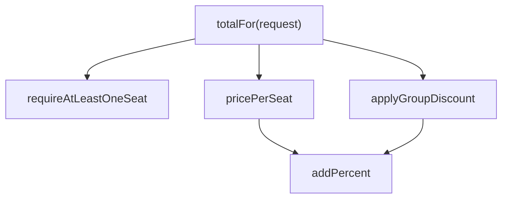
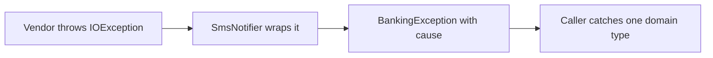
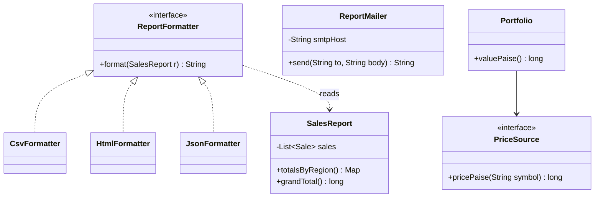
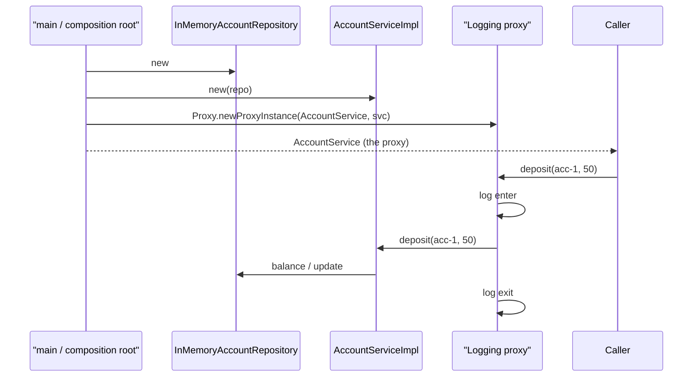
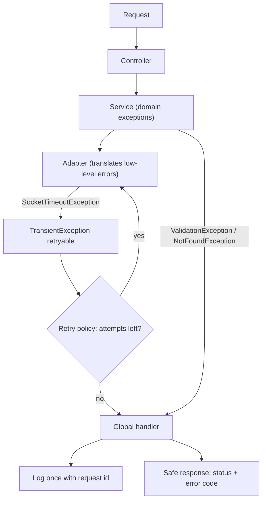
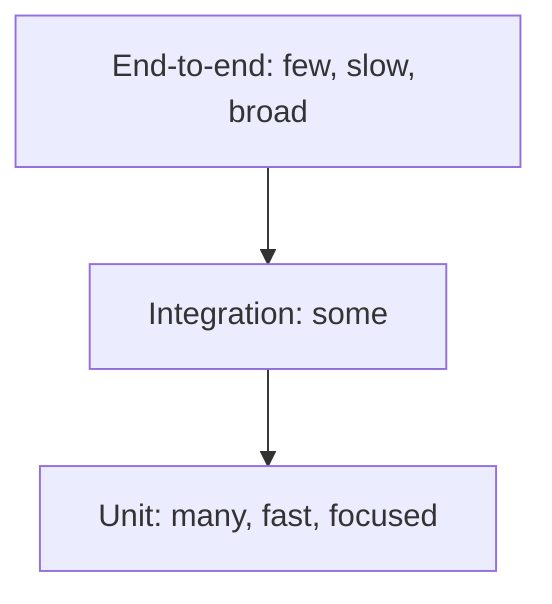

# Chapter 6 — Clean Code

Design principles (Chapters 4–5) decide *which classes exist and how they relate*. **Clean code** is about what happens *inside* those classes: names, functions, comments, error handling, tests. In machine-coding rounds (interview rounds where you build a small, working program in about 60–120 minutes), interviewers read your code line by line — clean code is often what separates "hire" from "no hire" when two candidates reach similar designs.

This chapter covers every major topic of Robert C. Martin's *Clean Code* (2008), in the book's order (Chapters 1–17; the two long case studies, Chapters 15–16, are summarised in §13), explained in our own words with runnable Java 21 before/after programs. It finishes with three practical best-practice topics: a **code review checklist**, an **error-handling strategy** for real services and **testing strategies** (unit vs integration tests, test doubles, mocks).

**Key terms (defined once here):**

| Term | Meaning |
|---|---|
| **Clean code** | Code that is easy to read, understand and change by someone other than its author. It does one thing well, has tests, and has no surprises. |
| **Code smell** | A surface symptom that *usually* signals a deeper design problem (e.g. a 200-line method). Not a bug by itself. |
| **Refactoring** | Changing the internal structure of code without changing its observable behaviour (Chapter 7). |
| **Level of abstraction** | How "high-level" a statement is. `processPayroll()` is high; `sb.append(',')` is low. |
| **Side effect** | Any change a function makes besides returning a value (fields, files, globals, output). |
| **Test double** | Any object that stands in for a real dependency during a test (dummy, stub, spy, mock, fake). |
| **TDD** | Test-Driven Development: write a failing test, make it pass, refactor — in very short cycles. |

## What is clean code, and why bother?

### What it is
Well-known programmers describe clean code in similar ways: it reads like well-written prose, it does one thing, it is elegant and efficient, it has tests, it contains no duplication, it expresses its intent, and it looks like it was written by someone who **cares**. A simple working definition: *code whose intent is obvious to the next reader, and which is easy to change safely.*

*Analogy:* a well-organised kitchen. Anyone can walk in, find the knives, cook, and clean up. A messy kitchen still "works" for its owner — until someone else has to cook in it.

### The problem it solves
Messy code slows teams down more and more over time. Every change takes longer because nobody understands the code, and each change adds more mess. Eventually productivity approaches zero and the team asks for a "grand redesign", which often reproduces the same mess. We read code far more than we write it (the ratio is often quoted as more than 10:1), so making code easy to read makes writing faster too. "I'll clean it up later" rarely happens — *later equals never* (a saying known as LeBlanc's law).

### How it works
1. Treat readability as a first-class requirement, not decoration.
2. Follow the **Boy Scout Rule**: *always leave the code a little cleaner than you found it* — rename one variable, split one long function, delete one dead comment each time you touch a file.
3. Write tests so you can clean without fear.
4. Clean in small steps (successive refinement): first make it work, then make it right. Never ship "it works, but it's a mess".

### Trade-offs
Clean code takes slightly longer *the first time* you write it; it saves time on every later read and change. For truly throwaway code (a one-off script) the balance is different.

### When not to use it
There is no case where unreadable code is a goal. But avoid **gold-plating** — endlessly polishing code that is already clear and not changing.

### Common mistakes
- Thinking "working" means "done".
- Blaming deadlines: going fast by making a mess is an illusion; the mess slows you down immediately.
- Big-bang rewrites instead of continuous small improvements.

### Real-world examples
- **Google's code review culture** requires reviewer approval for readability, and it has a "readability" certification process per language.
- **Linters and formatters** (tools that automatically flag suspicious code or rewrite its layout) running in CI — Continuous Integration, a server that builds and tests every change automatically — (Checkstyle, SpotBugs, SonarQube, google-java-format) enforce parts of clean code automatically.

### In the interview
**30-second answer:** "Clean code is code whose intent is obvious and which is cheap to change. In a machine-coding round I use intention-revealing names, small single-purpose functions, clear exceptions instead of error codes, immutable value objects (small objects such as `Money` that never change after creation) and a few tests — and I leave time to refactor once it works."

### Self-check
1. Q: What is the Boy Scout Rule? → A: Leave the code a little cleaner than you found it.
2. Q: Why does readability matter more than writing speed? → A: Code is read far more often than it is written.

### TL;DR
Clean code = obvious intent + safe to change. Clean a little every time you touch code.

---

## 1. Meaningful Names

### What it is
Names are everywhere — variables, functions, parameters, classes, packages. A good name answers three questions: **why does it exist, what does it do, how is it used**. If a name needs a comment to explain it, the name is not good enough.

*Analogy:* labels on moving boxes. "Kitchen — glasses — fragile" helps; "Box 7" doesn't.

### The problem it solves
Bad names force readers to keep a **mental map** ("`d` is elapsed days, `i1` is status, 4 means done"). Every reader pays that cost every time, and misunderstanding causes bugs.

### How it works — the rules

| Rule | Bad | Good |
|---|---|---|
| **Reveal intention** | `int d;` | `int elapsedTimeInDays;` |
| **Avoid disinformation** (names that suggest something false) | `accountList` for a `Set`; `l`/`O` that look like 1/0 | `accounts` |
| **Make meaningful distinctions** — no number series or noise words | `a1, a2`; `ProductInfo` vs `ProductData`; `nameString` | `source, destination`; one `Product` |
| **Use pronounceable names** | `crtdTs` | `createdAt` |
| **Use searchable names** — avoid single letters and bare numbers except tiny local scopes | `7`, `e` | `MAX_LOGIN_ATTEMPTS`, `employee` |
| **Avoid encodings** — no Hungarian notation (type codes in names), no `m_` prefixes, no `I` prefix on interfaces | `strName`, `m_desc`, `IShapeFactory` | `name`, `description`, `ShapeFactory` (+ `ShapeFactoryImpl` or better, a specific name) |
| **Avoid mental mapping** | `r` for "lower-cased URL without host" | `normalizedPath` |
| **Class names = nouns** | `Manager`, `Processor`, `Data`, `Info` (vague) | `Customer`, `Invoice`, `AddressParser` |
| **Method names = verbs**; accessors `get`/`is`/`has` | `data()` | `postPayment()`, `isPosted()` |
| **Prefer named static factories** (static creation methods like `of...`) to overloaded constructors (several constructors with different parameter lists) | `new Money(23)` (rupees? paise, 1/100 of a rupee?) | `Money.ofRupees(23)` |
| **Don't be cute** | `yeetAll()`, `nuke()` | `deleteAll()`, `terminate()` |
| **One word per concept** | `fetch`/`retrieve`/`get` in sibling classes | pick one, e.g. `get` |
| **Don't pun** (same word, different meaning) | `add` for both "sum" and "append to collection" | `append`, `insert` |
| **Use solution-domain names** for technical concepts | — | `OrderRepository`, `RetryPolicy`, `EventQueue` (programmers know these) |
| **Use problem-domain names** for business concepts | — | `Premium`, `Policy`, `Claim` |
| **Add meaningful context** | lone `state` | `shippingState` or better, an `Address` class with `state` |
| **Don't add gratuitous context** | `AcmeShopCustomerAddress` in an app called "Acme Shop" | `Address` |

Length rule of thumb: the **longer the scope, the longer the name**. `i` is fine for a 3-line loop; a field used across a class deserves a full name.

### Java example — before/after
```java
// File: lld/ch06/names/Main.java
package lld.ch06.names;

import java.time.Duration;
import java.util.ArrayList;
import java.util.List;

/** Meaningful names: the same logic, before and after renaming. */
public class Main {

    // ---------------- BEFORE ----------------
    static class Before {
        static class DtaRcrd102 {                      // unpronounceable, encoded, meaningless
            String strNm; int i1; int i2; boolean flg;
        }
        static class Mgr {                              // vague noun
            List<DtaRcrd102> lst = new ArrayList<>();   // "lst" of what?
            // what is 4? what is 18000? why flg?
            List<DtaRcrd102> getThem() {
                List<DtaRcrd102> l1 = new ArrayList<>();
                for (DtaRcrd102 x : lst) if (x.i1 == 4 && x.i2 > 18000 && !x.flg) l1.add(x);
                return l1;
            }
            int d;                                       // elapsed time in days? seconds? since what?
        }
    }

    // ---------------- AFTER ----------------
    static class After {
        enum TaskStatus { OPEN, IN_PROGRESS, BLOCKED, DONE }

        /** Class name = noun. Field names = what they hold, with units where it matters. */
        record Task(String title, TaskStatus status, Duration timeSpent, boolean archived) {
            boolean isCompleted() { return status == TaskStatus.DONE; }           // boolean method reads as a question
            boolean tookLongerThan(Duration limit) { return timeSpent.compareTo(limit) > 0; }
        }

        static final class TaskBoard {
            private static final Duration LONG_RUNNING = Duration.ofHours(5);  // named constant, not a magic number
            private final List<Task> tasks = new ArrayList<>();
            void add(Task task) { tasks.add(task); }                             // method name = verb
            List<Task> findCompletedLongRunningTasks() {                         // says exactly what it returns
                List<Task> result = new ArrayList<>();
                for (Task task : tasks)
                    if (task.isCompleted() && task.tookLongerThan(LONG_RUNNING) && !task.archived()) result.add(task);
                return result;
            }
        }

        /** Static factory methods with descriptive names beat overloaded constructors. */
        record Temperature(double kelvin) {
            static Temperature ofCelsius(double c) { return new Temperature(c + 273.15); }
            static Temperature ofFahrenheit(double f) { return new Temperature((f - 32) * 5 / 9 + 273.15); }
        }
    }

    public static void main(String[] args) {
        var mgr = new Before.Mgr();
        var r = new Before.DtaRcrd102(); r.strNm = "Deploy"; r.i1 = 4; r.i2 = 20000; mgr.lst.add(r);
        System.out.println("BEFORE getThem(): " + mgr.getThem().size() + " record(s) -- but what are they?");

        var board = new After.TaskBoard();
        board.add(new After.Task("Deploy", After.TaskStatus.DONE, Duration.ofHours(6), false));
        board.add(new After.Task("Write docs", After.TaskStatus.DONE, Duration.ofHours(1), false));
        System.out.println("AFTER findCompletedLongRunningTasks(): " + board.findCompletedLongRunningTasks());
        System.out.printf("Temperature.ofCelsius(25) = %.2f K, ofFahrenheit(212) = %.2f K%n",
                After.Temperature.ofCelsius(25).kelvin(), After.Temperature.ofFahrenheit(212).kelvin());
    }
}
```

Output:

```text
BEFORE getThem(): 1 record(s) -- but what are they?
AFTER findCompletedLongRunningTasks(): [Task[title=Deploy, status=DONE, timeSpent=PT6H, archived=false]]
Temperature.ofCelsius(25) = 298.15 K, ofFahrenheit(212) = 373.15 K
```

The logic is the same shape — filter a list by three conditions — but *after* you can read the rule aloud: "completed tasks that took longer than five hours and aren't archived". Magic numbers (unexplained literal values dropped into code) became a named constant, a status code became an enum (a type with a fixed set of named values), and `Temperature.ofCelsius(25)` is unambiguous where `new Temperature(25)` would not be.

### Trade-offs
Longer names cost a few keystrokes (IDEs — Integrated Development Environments such as IntelliJ IDEA — autocomplete them). Very long names can hint the function does too much — split it rather than abbreviate.

### When not to use it
Conventional short names are fine where universally understood: `i`/`j` loop indexes in tiny loops, `e` for a caught exception, `x`/`y` for coordinates, `T`/`K`/`V` for generics (type parameters, as in `List<T>`, that let one class work with many types).

### Common mistakes
- Renaming is cheap — not doing it because "everyone knows what `tmp2` means".
- Abbreviations only the author understands (`calcAmtPrc`).
- Inconsistent vocabulary across a codebase (`customer`, `client`, `user` for the same concept).

### Real-world examples
- The JDK's naming: `isEmpty()`, `getOrDefault()`, `computeIfAbsent()`, `List.of()`, `Path.of()`, `Duration.ofMinutes()` — verbs for methods, named static factories.
- **Google Java Style Guide** and Oracle's code conventions standardise casing (`UpperCamelCase` classes, `lowerCamelCase` methods, `UPPER_SNAKE_CASE` constants).

### In the interview
**30-second answer:** "I name things so the code reads like the requirement: nouns for classes, verbs for methods, booleans as questions, named constants instead of magic numbers, enums instead of status codes, and one consistent word per concept."

**Follow-ups:**
- *Q: Should interfaces start with `I`?* A: Not in Java convention; name the role (`PaymentGateway`) and give implementations specific names (`RazorpayGateway`).
- *Q: When is a short name okay?* A: When the scope is tiny and the meaning conventional (`i` in a short loop).

### Self-check
1. Q: What's wrong with `ProductInfo` and `ProductData` in one codebase? → A: Noise words; no meaningful distinction.
2. Q: Why prefer `Temperature.ofCelsius(x)` over a constructor? → A: The name says what the argument means.
3. Q: What's a pun in naming? → A: Using one word for two different meanings.

### TL;DR
Names should reveal intent, be pronounceable and searchable, use one word per concept, and let the code read like the requirement.

---

## 2. Functions

### What it is
Functions (methods) are the first line of organisation in any program. Clean functions are **small**, **do one thing**, stay at **one level of abstraction**, take **few arguments**, have **no hidden side effects**, and either **do something or answer something** — never both.

*Analogy:* a recipe with numbered steps ("make the sauce", "boil pasta", "combine") where each step has its own sub-recipe. You'd never write one 400-line paragraph.

### The problem it solves
Long functions mix levels of detail, hide bugs, can't be reused, can't be named well, and can't be tested in pieces. Flag arguments and output arguments confuse callers; hidden side effects create surprising bugs; error codes clutter every caller with `if` checks.

### How it works — the rules
1. **Small, then smaller.** The book says functions should hardly ever reach 20 lines, and praises functions of just two to four lines. Blocks inside `if`/`else`/`while` should ideally be one line — usually a call to a well-named function. Indentation should rarely exceed one or two levels.
2. **Do one thing.** A function does one thing if you can't extract another function from it with a name that isn't just a restatement of its body. If a function has "sections" (declarations, initialisation, processing), it's doing several things.
3. **One level of abstraction per function.** Don't mix `getHtml()` (high) with `.append("\n")` (low) in the same body.
4. **The Stepdown Rule.** Code should read top-down like a narrative: each function is followed by the functions it calls, one level of abstraction lower. "To do X, we do A, then B. To do A, we …".
5. **Switch statements.** A `switch` on a type code tends to be repeated in many places and to grow. Tolerate one only if it appears **once**, is buried in a low-level class (e.g. inside a factory — a class or method whose job is creating objects — that creates polymorphic objects, i.e. objects of different classes used through one shared interface), and is never repeated. Otherwise replace it with polymorphism (or enum data/behaviour).
6. **Use descriptive names.** A long descriptive name beats a short enigmatic one and a long comment. Small functions are easier to name.
7. **Arguments: fewer is better.** Zero (niladic) is ideal, then one (monadic), then two (dyadic); three (triadic) should be avoided where possible; more than three (polyadic) requires very special justification — and then shouldn't be used anyway. Arguments are hard to read and each one multiplies test cases.
   - Common one-argument forms: asking a question (`isValid(email)`), transforming (`Path resolve(name)`), or an event (`onLoginFailed(attempts)`) — make the kind obvious.
   - **Flag arguments** (`render(true)`) are ugly: they announce the function does two things. Split into two functions or pass an enum.
   - **Argument objects**: when several arguments travel together, wrap them (`book(BookingRequest request)` instead of `book(show, seatType, count, day)`).
   - **Argument lists** (varargs — a parameter like `Object... args` that accepts any number of values) count as one argument (`String.format(fmt, args...)`).
   - **Verbs and keywords**: encode argument roles in the name (`copyFromTo(source, target)`, `renameFileTo(newName)`).
8. **Have no side effects.** A function named `checkPassword` must not also initialise the session (the server-side record of a logged-in user). Hidden side effects create **temporal coupling** (it only works if called at the right time). If a side effect is necessary, put it in the name — or better, separate it.
9. **Avoid output arguments.** `addSignature(letter)` — does it add a signature *to* the letter, or the letter *to* something? Prefer `letter.addSignature()` (change the state of the owning object).
10. **Command-Query Separation (CQS).** A function should either *change state* (command, returns `void`) or *return information* (query, no state change), not both. `if (enable("darkMode"))` is confusing: is it asking whether it's enabled, or enabling it?
11. **Prefer exceptions to returning error codes.** Error codes force immediate `if` checks at every call site (each place in the code that calls the function) and deeply nested code; exceptions separate the happy path (the normal, no-error flow) from error handling.
12. **Extract try/catch blocks.** Put the body of a `try` into its own function, so the function that handles errors does *only* error handling ("error handling is one thing": if `try` appears, it should be the first word in the function and nothing should follow the `catch`/`finally` blocks).
13. **Avoid an "error code magnet".** A central `enum Error` that everything imports forces recompiles and discourages new codes; exception subclasses can be added without touching existing code.
14. **Don't Repeat Yourself** — duplication is the root of much evil in software (see Chapter 5).
15. **Structured programming** (Dijkstra's one-entry, one-exit rule: one `return`, no `break`/`continue` in loops, never `goto`) matters mostly for large functions; small functions can use an occasional early `return`, `break` or `continue` when that makes them clearer (but still never `goto`).
16. **How to get there:** nobody writes clean functions the first time. Write a working rough draft with tests, then refine — split, rename, remove duplication — keeping the tests green (green = all tests passing).



### Java example — before/after
```java
// File: lld/ch06/functions/Main.java
package lld.ch06.functions;

import java.util.ArrayList;
import java.util.HashMap;
import java.util.List;
import java.util.Map;

/** Clean functions: small, one thing, one level of abstraction, few args, no flags, no hidden side effects, CQS, exceptions. */
@SuppressWarnings("serial") // the nested exception classes are never serialized
public class Main {

    // ---------------- BEFORE ----------------
    static class Before {
        static final Map<String, Object> SESSION = new HashMap<>();

        /**
         * Returns total in rupees, or -1 for bad input.
         * Does validation, pricing, surcharges, discounts, logging and session updates -- all in one place.
         */
        static int book(String seatType, int count, boolean weekend, List<String> log) {   // flag arg + output arg
            if (count <= 0) return -1;                                                   // error code
            int price;
            switch (seatType) {                                                          // switch on a type code
                case "SILVER": price = 150; break;
                case "GOLD": price = 250; break;
                case "RECLINER": price = 450; break;
                default: return -1;
            }
            if (weekend) price = price + price * 20 / 100;
            int total = price * count;
            if (count >= 4) total = total - total * 10 / 100;
            log.add("booked " + count + " " + seatType);                                 // mutates the caller's list
            SESSION.put("lastTotal", total);                                             // hidden side effect
            return total;
        }
    }

    // ---------------- AFTER ----------------
    static class After {
        /** The type-code switch is replaced by data on the enum; parsing happens once, at the boundary. */
        enum SeatType {
            SILVER(150), GOLD(250), RECLINER(450);
            final int basePrice;
            SeatType(int basePrice) { this.basePrice = basePrice; }
            static SeatType parse(String raw) {
                try { return valueOf(raw); }
                catch (IllegalArgumentException e) { throw new InvalidBookingException("unknown seat type '" + raw + "'"); }
            }
        }
        enum DayType {                         // replaces the boolean flag: callers write DayType.WEEKEND, not 'true'
            WEEKDAY(0), WEEKEND(20);
            final int surchargePercent;
            DayType(int p) { surchargePercent = p; }
        }
        /** Argument object: three related arguments become one concept. */
        record BookingRequest(SeatType seat, int seats, DayType day) {}

        static final class InvalidBookingException extends RuntimeException {
            InvalidBookingException(String message) { super(message); }
        }

        /** Stepdown rule: read top to bottom, each function one level more detailed than the one above. */
        static final class TicketPricer {
            private static final int GROUP_SIZE = 4;
            private static final int GROUP_DISCOUNT_PERCENT = 10;

            int totalFor(BookingRequest request) {                        // level 1: the story
                requireAtLeastOneSeat(request);
                int total = pricePerSeat(request) * request.seats();
                return applyGroupDiscount(total, request.seats());
            }

            private void requireAtLeastOneSeat(BookingRequest r) {        // level 2: the details
                if (r.seats() <= 0) throw new InvalidBookingException("seats must be positive, was " + r.seats());
            }
            private int pricePerSeat(BookingRequest r) {
                return addPercent(r.seat().basePrice, r.day().surchargePercent);
            }
            private int applyGroupDiscount(int total, int seats) {
                return seats >= GROUP_SIZE ? addPercent(total, -GROUP_DISCOUNT_PERCENT) : total;
            }
            private static int addPercent(int amount, int percent) {      // level 3: arithmetic
                return amount + amount * percent / 100;
            }
        }

        /** Command-Query Separation: book() changes state and returns nothing; history() answers and changes nothing. */
        static final class BookingService {
            private final TicketPricer pricer = new TicketPricer();
            private final List<String> history = new ArrayList<>();

            void book(BookingRequest request) {
                int total = pricer.totalFor(request);
                history.add(request.seats() + " x " + request.seat() + " on " + request.day() + " = Rs " + total);
            }
            List<String> history() { return List.copyOf(history); }
        }

        /** Error handling is "one thing": this function only translates failures for the UI. */
        static String bookFromForm(BookingService service, String seat, int seats, DayType day) {
            try {
                service.book(new BookingRequest(SeatType.parse(seat), seats, day));
                return "OK";
            } catch (InvalidBookingException e) {
                return "Sorry: " + e.getMessage();
            }
        }
    }

    public static void main(String[] args) {
        System.out.println("== BEFORE ==");
        List<String> log = new ArrayList<>();
        int result = Before.book("GOLD", 4, true, log);           // what does 'true' mean here?
        System.out.println("total=" + result + " log=" + log + " session=" + Before.SESSION);
        int bad = Before.book("PLATINUM", 2, false, log);
        System.out.println("bad seat returns " + bad + " -- caller must remember to check for -1");

        System.out.println("== AFTER ==");
        var service = new After.BookingService();
        System.out.println(After.bookFromForm(service, "GOLD", 4, After.DayType.WEEKEND));
        System.out.println(After.bookFromForm(service, "SILVER", 2, After.DayType.WEEKDAY));
        System.out.println(After.bookFromForm(service, "PLATINUM", 2, After.DayType.WEEKDAY));
        System.out.println(After.bookFromForm(service, "GOLD", 0, After.DayType.WEEKDAY));
        service.history().forEach(h -> System.out.println("  history: " + h));
    }
}
```

Output:

```text
== BEFORE ==
total=1080 log=[booked 4 GOLD] session={lastTotal=1080}
bad seat returns -1 -- caller must remember to check for -1
== AFTER ==
OK
OK
Sorry: unknown seat type 'PLATINUM'
Sorry: seats must be positive, was 0
  history: 4 x GOLD on WEEKEND = Rs 1080
  history: 2 x SILVER on WEEKDAY = Rs 300
```

**What changed and why:**
- The **boolean flag** `weekend` became `DayType`, so call sites read `DayType.WEEKEND`, not a mysterious `true`.
- The **type-code switch** disappeared: each `SeatType` carries its base price; string parsing happens once at the boundary (`SeatType.parse`).
- The **error codes** (`-1`) became `InvalidBookingException` with a message saying exactly what was wrong.
- The **output argument** (`log`) and the **hidden side effect** (`SESSION`) became explicit state owned by `BookingService`.
- **CQS**: `book` is a command (returns `void`); `history` is a query (returns a copy, changes nothing). (Many real APIs pragmatically let a command return the created ID — that's a widely accepted exception.)
- **Stepdown**: `totalFor` reads as the story; the helpers below it are one level more detailed.
- **Error handling is one thing**: `bookFromForm` only translates failures into a UI message.

### Trade-offs

| Many small functions | Few large functions |
|---|---|
| Each is nameable, testable, reusable | Everything visible in one place |
| Need good names to navigate | Hard to understand, test, change |
| Too-tiny splitting can scatter logic | Mixed abstraction levels |

### When not to use it
Don't split a genuinely simple 8-line function into 8 one-liners just to hit a number; the goal is clarity, not a line count. Performance-critical inner loops rarely need manual inlining (copying a small method's body into its caller) in Java — the JIT (the Just-In-Time compiler inside the JVM, the Java Virtual Machine that runs Java programs, which turns frequently run bytecode into machine code while the program runs) inlines small methods — so size is almost never a real performance excuse.

### Common mistakes
- Boolean parameters in public APIs (the methods and classes other code is meant to call).
- Getters that change state (breaking CQS and least astonishment).
- Catching exceptions deep inside and returning `null`.
- Functions whose name says one thing and body does three.

### Real-world examples
- `java.util.Collections.sort(list)` vs `list.sort(comparator)` — command methods return `void`.
- `Iterator.next()` (an `Iterator` walks through a collection one element at a time) is a well-known pragmatic CQS exception (it both advances and returns); `Queue.poll()` likewise. Know them, but don't design new APIs that way without reason.
- `Files.readString`, `Files.writeString` — tiny, single-purpose APIs.

### In the interview
**30-second answer:** "I keep functions small and single-purpose, at one level of abstraction, top-down by the stepdown rule. I avoid flag arguments with enums or separate methods, keep argument counts low with parameter objects, separate commands from queries, and throw descriptive exceptions instead of returning error codes."

**Follow-ups:**
- *Q: How small is small?* A: Small enough to have one clear name and one level of abstraction — often under ~20 lines, frequently 3–10.
- *Q: What's wrong with `boolean` parameters?* A: The call site is unreadable and the function does two things.
- *Q: What's CQS?* A: Commands change state and return nothing; queries return data and change nothing.

### Self-check
1. Q: How do you know a function does "one thing"? → A: You can't extract another meaningful function from it that isn't a mere restatement.
2. Q: When is a `switch` acceptable? → A: Once, buried in a factory/low level, never repeated.
3. Q: What replaces 4+ related arguments? → A: An argument (parameter) object.

### TL;DR
Small, one thing, one level, top-down, ≤2–3 args, no flags, no hidden side effects, commands or queries, exceptions not codes.

---

## 3. Comments

### What it is
Comments are, at best, a necessary evil: we write them to make up for our failure to express ourselves in code. Code changes; comments often don't, so they drift and **lie**. The only truly accurate description of behaviour is the code itself. So: **explain yourself in code first**, and keep only comments that code *cannot* express.

*Analogy:* a road sign that says "Bridge closed" long after the bridge was reopened is worse than no sign.

### The problem it solves
Comments used as a crutch for unclear code, redundant comments that repeat code, and outdated comments that mislead.

### How it works
Replace a comment with a well-named function or variable whenever possible:
```text
// free shipping if the order is big enough and domestic
if (order.total() >= 499 && !order.isInternational())
```
becomes `if (order.qualifiesForFreeShipping())` — the comment is no longer needed.

**Good comments** (keep these):

| Kind | Example |
|---|---|
| **Legal** | Copyright/licence header |
| **Informative** | What a regex (text-matching pattern) matches, the format of a returned string |
| **Explanation of intent** | *Why* a decision was made ("we copy because callers may pass an unmodifiable list") |
| **Clarification** | Translating an obscure argument or return value from a library you can't change |
| **Warning of consequences** | "Not thread-safe" (unsafe to use from several threads at once), "takes 10 minutes to run", "billed per call" |
| **TODO** | Work that should be done but can't be now — with an owner; review them regularly |
| **Amplification** | Stressing the importance of something that looks trivial ("the trim is critical: …") |
| **Javadoc in public APIs** | Contracts callers depend on: params, return, exceptions |

**Bad comments** (remove or replace):

| Kind | What it looks like |
|---|---|
| Mumbling | A vague comment only the author understands |
| Redundant | `i++; // increment i` |
| Misleading | Subtly inaccurate description |
| Mandated | Javadoc on every function "because the rule says so" (`@param a the a`) |
| Journal | Change logs at the top of the file — version control (a tool such as Git that records every change) does this |
| Noise | `/** Default constructor. */` |
| Scary noise | Copy-pasted Javadoc noise with errors |
| Comment instead of a function/variable | Explaining an expression that could be named |
| Position markers | `// ////////// Actions //////////` banners |
| Closing-brace comments | `} // end while` — make the function shorter instead |
| Attributions and bylines | `/* Added by Rick */` — version control knows |
| **Commented-out code** | Others are afraid to delete it; it rots. Delete it — git remembers |
| HTML comments | Markup inside comments, unreadable in the editor |
| Nonlocal information | Commenting a system-wide default next to an unrelated function |
| Too much information | Historical discussions, RFC (internet standards document) excerpts |
| Inobvious connection | A comment that itself needs explaining |
| Function headers | Short, well-named functions don't need them |
| Javadoc in non-public code | Formal docs for internal code is usually noise |

### Java example — before/after
```java
// File: lld/ch06/comments/Main.java
/*
 * Copyright (c) 2026 Example Corp. Licensed under the Apache License, Version 2.0.   <-- GOOD: legal comment
 */
package lld.ch06.comments;

import java.util.List;
import java.util.regex.Pattern;

/** Comments: explain yourself in code first; keep only comments that code cannot express. */
public class Main {

    record Applicant(String name, int age, int creditScore, long monthlyIncomePaise, boolean hasDefaulted) {}

    // ---------------- BEFORE: comments used to excuse unclear code ----------------
    static class Before {
        // Changes:
        //   2019-03-01 RK: created
        //   2021-07-12 AB: fixed bug                                   <-- BAD: journal comment (git does this)
        /**
         * The eligible method.
         * @param a the a                                                <-- BAD: noise / mandated Javadoc
         * @return the boolean
         */
        static boolean eligible(Applicant a) {
            // check if applicant is eligible for a premium loan         <-- BAD: comment instead of a good name
            if (a.age() >= 21 && a.age() <= 60 && a.creditScore() > 750 && !a.hasDefaulted()
                    && a.monthlyIncomePaise() >= 5_000_000) {
                return true;   // return true                            <-- BAD: redundant
            }
            // if (a.age() > 65) return false;                           <-- BAD: commented-out code
            return false;
        } // end eligible                                                <-- BAD: closing-brace comment
    }

    // ---------------- AFTER: the code explains itself; comments add what code can't ----------------
    static class After {
        private static final int MIN_AGE = 21, MAX_AGE = 60;
        private static final int GOOD_CREDIT_SCORE = 750;
        private static final long MIN_MONTHLY_INCOME_PAISE = 5_000_000;   // Rs 50,000

        static boolean isEligibleForPremiumLoan(Applicant a) {
            return isWorkingAge(a) && hasGoodCredit(a) && earnsEnough(a);
        }
        private static boolean isWorkingAge(Applicant a) { return a.age() >= MIN_AGE && a.age() <= MAX_AGE; }
        private static boolean hasGoodCredit(Applicant a) { return a.creditScore() > GOOD_CREDIT_SCORE && !a.hasDefaulted(); }
        private static boolean earnsEnough(Applicant a) { return a.monthlyIncomePaise() >= MIN_MONTHLY_INCOME_PAISE; }

        // GOOD: informative comment -- clarifies what a regex matches (format: 10-character PAN, e.g. ABCDE1234F)
        private static final Pattern PAN_FORMAT = Pattern.compile("[A-Z]{5}[0-9]{4}[A-Z]");

        static boolean looksLikePan(String s) { return PAN_FORMAT.matcher(s).matches(); }

        /**
         * GOOD: Javadoc on a public API -- states the contract callers rely on.
         * @param scores credit scores in the range 300..900
         * @return the median score; for an even count, the lower of the two middle values
         * @throws IllegalArgumentException if {@code scores} is empty
         */
        static int medianScore(List<Integer> scores) {
            if (scores.isEmpty()) throw new IllegalArgumentException("no scores");
            // GOOD: explanation of intent -- we copy because callers may pass an unmodifiable list, and sorting in place would fail
            List<Integer> sorted = scores.stream().sorted().toList();
            return sorted.get((sorted.size() - 1) / 2);
        }

        // GOOD: warning of consequences -- this call hits the credit bureau and is billed per request.
        // TODO(loans-team): cache bureau responses for 24h once the bureau contract allows it.   <-- GOOD: TODO
        static int fetchBureauScore(String pan) { return 780; }
    }

    public static void main(String[] args) {
        var asha = new Applicant("Asha", 30, 790, 6_000_000, false);
        var ravi = new Applicant("Ravi", 30, 790, 6_000_000, true);
        System.out.println("BEFORE eligible(asha)=" + Before.eligible(asha) + ", eligible(ravi)=" + Before.eligible(ravi));
        System.out.println("AFTER  isEligibleForPremiumLoan(asha)=" + After.isEligibleForPremiumLoan(asha)
                + ", (ravi)=" + After.isEligibleForPremiumLoan(ravi));
        System.out.println("looksLikePan(ABCDE1234F)=" + After.looksLikePan("ABCDE1234F"));
        System.out.println("medianScore([700, 820, 650, 900])=" + After.medianScore(List.of(700, 820, 650, 900)));
        System.out.println("bureau score=" + After.fetchBureauScore("ABCDE1234F"));
    }
}
```

Output:

```text
BEFORE eligible(asha)=true, eligible(ravi)=false
AFTER  isEligibleForPremiumLoan(asha)=true, (ravi)=false
looksLikePan(ABCDE1234F)=true
medianScore([700, 820, 650, 900])=700
bureau score=780
```

In *before*, every comment is a smell: journal, mandated noise, a comment used instead of a name, redundant, commented-out code and a closing-brace marker. In *after*, the long condition became three named predicates and named constants; the remaining comments are the good kinds — legal header, informative (regex format), intent, public-API Javadoc, warning and a TODO with an owner.

### Trade-offs
Comments are cheap to write and expensive to maintain. A few precise "why" comments are valuable; many "what" comments are a liability.

### When not to use it
"No comments" is not the goal. Public libraries need Javadoc; complex algorithms (a published paper's method, a tricky concurrency protocol) deserve a comment explaining the approach and why.

### Common mistakes
- Updating code but not the comment next to it.
- Keeping commented-out code "just in case".
- Using comments as a to-do list that no one ever reviews.

### Real-world examples
- The **JDK's Javadoc** is a model of contract documentation (e.g. `HashMap` explains iteration order is not guaranteed; `ConcurrentHashMap` explains weakly consistent iterators).
- **SonarQube** (a server that scans code for problems) flags commented-out code; many teams' linters reject `TODO` without a ticket reference (an ID in the team's issue tracker).

### In the interview
**30-second answer:** "I prefer expressive code over comments: named functions and constants replace most 'what' comments. I keep comments for why, warnings, legal headers, TODOs with owners and public API contracts, and I delete commented-out code because version control remembers it."

### Self-check
1. Q: Name three good kinds of comment. → A: Legal, explanation of intent, warning of consequences (also informative, TODO, amplification, public Javadoc).
2. Q: What should you do with commented-out code? → A: Delete it.
3. Q: Why do comments lie? → A: Code changes and comments aren't updated.

### TL;DR
Say it in code; comment only the *why*, warnings, legal text and public contracts; delete dead comments and commented-out code.

---

## 4. Formatting

### What it is
Formatting is about **communication**: the layout of code tells the reader what belongs together and what matters most. A team should agree on one set of formatting rules and apply them automatically everywhere.

*Analogy:* a newspaper. The headline tells you the story, the first paragraph gives the summary, details come further down. You can stop reading at any depth and still understand the gist.

### The problem it solves
Inconsistent, cramped or random layout makes readers work to understand structure before they can understand logic. It also produces noisy diffs (the line-by-line view of what changed) in code review (a teammate reading your change before it is accepted; §15).

### How it works
**Vertical formatting** (top-to-bottom):
1. **File size** — small files are easier to understand. Many well-known Java projects keep most files around 200 lines, with very few over 500.
2. **Newspaper metaphor** — the class name and the top of the file give the high-level picture; details increase as you move down.
3. **Vertical openness** — separate distinct concepts (package, imports, each method) with blank lines.
4. **Vertical density** — lines that are tightly related appear together, without blank lines or useless comments between them.
5. **Vertical distance** — keep related concepts close:
   - declare local variables close to their first use;
   - instance variables in one well-known place (Java convention: top of the class);
   - **dependent functions**: the caller sits *above* the callee, close by;
   - **conceptual affinity**: functions that do similar things (overloads, related operations) sit near each other.
6. **Vertical ordering** — high-level functions first, details later (the stepdown rule again).

**Horizontal formatting** (left-to-right):
1. **Line width** — keep lines short enough to read without scrolling. Martin sets his own limit at 120 characters; Google's Java style uses 100.
2. **Horizontal openness and density** — spaces around assignment operators and between arguments; no space between a function name and its `(`; use spacing to show precedence where it helps.
3. **No horizontal alignment** of declarations in columns — it draws the eye to the wrong thing (types vs names) and breaks with every rename.
4. **Indentation** — shows scope hierarchy; never collapse a short `if` or loop body onto one line if it hides structure.
5. **Dummy scopes** — if a `while` or `for` has an empty body, make it visible (put the semicolon on its own line or use `{}`), because a trailing `;` is easy to miss.

**Team rules** — a codebase should look like one person wrote it. Encode the rules in an automatic formatter (IDE settings, `google-java-format`, Spotless, Checkstyle) and let CI enforce them.

### Java example — before/after
```java
// File: lld/ch06/formatting/Main.java
package lld.ch06.formatting;

import java.util.ArrayList;
import java.util.List;

/** Formatting: same code, formatted two ways. The compiler doesn't care; readers do. */
public class Main {

    // ---------------- BEFORE: cramped, random order, aligned columns, no vertical openness ----------------
    static class Before {
        static class Playlist{private int cursor;
            private String helper(int i){return songs.get(i).toUpperCase();}
            public String next(){if(songs.isEmpty())return null;String s=helper(cursor);cursor=(cursor+1)%songs.size();return s;}
            private final List<String>   songs   =   new ArrayList<>();
            private final String         name;
            public void add(String s){songs.add(s);}Playlist(String n){name=n;}
            public String name(){return name;}}
    }

    // ---------------- AFTER: newspaper order -- headline first, details below ----------------
    static class After {
        /** A looping playlist. (Headline: the class name and this one line tell you what it is.) */
        static final class Playlist {
            // 1. Fields at the top, together (vertical density for closely related lines).
            private final String name;
            private final List<String> songs = new ArrayList<>();
            private int cursor;

            // 2. Constructor next.
            Playlist(String name) {
                this.name = name;
            }

            // 3. Public API -- each concept separated by a blank line (vertical openness).
            public String name() {
                return name;
            }

            public void add(String song) {
                songs.add(song);
            }

            public String next() {
                if (songs.isEmpty()) {
                    return null;
                }
                String song = displayTitle(cursor);    // caller ABOVE callee (dependent functions close together)
                cursor = (cursor + 1) % songs.size();
                return song;
            }

            // 4. Private helpers just below the functions that use them.
            private String displayTitle(int index) {
                return songs.get(index).toUpperCase();
            }
        }
    }

    public static void main(String[] args) {
        var before = new Before.Playlist("Road trip");
        var after = new After.Playlist("Road trip");
        for (String s : List.of("Kesariya", "Yellow", "Tum Hi Ho")) { before.add(s); after.add(s); }
        StringBuilder b = new StringBuilder(), a = new StringBuilder();
        for (int i = 0; i < 4; i++) { b.append(before.next()).append(' '); a.append(after.next()).append(' '); }
        System.out.println("BEFORE " + before.name() + ": " + b.toString().trim());
        System.out.println("AFTER  " + after.name() + ": " + a.toString().trim());
        System.out.println("Same behaviour -- formatting only changes how fast a human understands it.");
    }
}
```

Output:

```text
BEFORE Road trip: KESARIYA YELLOW TUM HI HO KESARIYA
AFTER  Road trip: KESARIYA YELLOW TUM HI HO KESARIYA
Same behaviour -- formatting only changes how fast a human understands it.
```

Both classes behave identically. The *after* uses the newspaper order (fields → constructor → public API → private helpers, with each helper right under its caller), blank lines between concepts, no column alignment and consistent indentation.

### Trade-offs
Almost none — formatting is cheap when automated. The only cost is agreeing on the rules once.

### When not to use it
Generated code (e.g. from Protobuf, Google's schema-based message format, whose compiler writes classes for you) doesn't need hand formatting; exclude it from formatters.

### Common mistakes
- Mixing formatting changes with logic changes in the same commit (one saved, described change in version control) — it makes the diffs unreadable.
- Personal styles inside a team codebase.
- Aligning declarations in columns.

### Real-world examples
- **google-java-format**, **Spotless** (Gradle/Maven — Java build tools), **Prettier** (JS), **gofmt** (Go formats all Go code identically — style debates disappear), **Black** (Python).
- **EditorConfig** files share indentation settings across editors.

### In the interview
**30-second answer:** "Formatting communicates structure. I keep related lines together, separate concepts with blank lines, put callers above callees, fields at the top, and let an automatic formatter enforce one team style."

### Self-check
1. Q: What is the newspaper metaphor? → A: High-level summary at the top, increasing detail below.
2. Q: Where should a private helper go? → A: Just below the function that calls it.

### TL;DR
Format for the reader: headline first, related things close, concepts separated, one automated team style.

---

## 5. Objects and Data Structures

### What it is
There are two fundamentally different kinds of types:
- An **object** *hides* its data behind abstractions and *exposes behaviour* (functions that operate on that data). Example: an `Order` with `isMetroDelivery()`.
- A **data structure** *exposes* its data and has *no meaningful behaviour*. Example: a record `Address(city, pincode)`, a DTO (Data Transfer Object — a plain data carrier).

**Data abstraction:** hiding implementation is not just putting getters and setters on private fields. It means exposing abstract interfaces that let users manipulate the *essence* of the data without knowing its representation (e.g. `fuelPercentRemaining()` rather than `getFuelTankCapacityInLitres()` and `getLitresOfFuel()`).

*Analogy:* a vending machine (object) — you press buttons and get results; you can't touch its coin box. A spreadsheet (data structure) — all values are visible; formulas live elsewhere.

### The problem it solves
Confusion between the two creates **hybrids** — half object, half data structure — with public fields *and* significant behaviour. Hybrids get the worst of both worlds: hard to add new functions *and* hard to add new types. Knowing the difference also tells you which design makes your likely changes easy.

### How it works — the data/object anti-symmetry

| | Procedural code (data structures + functions) | OO code (objects) |
|---|---|---|
| Add a new **function** (e.g. `perimeter`) | **Easy**: add one function; data types untouched | **Hard**: add a method to every class |
| Add a new **type** (e.g. `Triangle`) | **Hard**: edit every function | **Easy**: add one class; existing code untouched |

So: *everything is an object* is a myth. When you expect **new types**, choose objects and polymorphism. When you expect **new operations** over a stable set of types, data structures with functions (or the Visitor pattern, Chapter 11, which adds operations to a set of classes without editing them) may be better. Java 21's `sealed` interfaces (which list exactly which classes may implement them) with records and pattern-matching `switch` (a `switch` that branches on an object's type) make the procedural style safe: the compiler tells you if a `switch` misses a type.

**The Law of Demeter** (Chapter 5, §4) applies to objects: a method should not navigate an object's internals (`order.getCustomer().getAddress().city()`), because that exposes their structure — a **train wreck**. It does *not* strictly apply to data structures, whose whole job is to expose data. The fix for objects is to **hide structure**: ask the object to do the job (`order.isMetroDelivery()`).

**Data Transfer Objects (DTOs):** the purest data structure — public (or record) fields, no behaviour. Used to move data across boundaries: database rows, JSON (a plain-text key–value data format) request/response bodies, messages. *Bean* form (private fields + getters/setters) gives no real encapsulation benefit but is required by some frameworks.

**Active Record:** a special DTO that also has navigation methods like `save()` and `find()` and maps to one database row (Rails' ActiveRecord, some Java ORMs — Object-Relational Mappers, libraries that map classes to database tables). Common mistake: putting business rules into active records, making them hybrids. Keep business rules in separate objects that *use* the active record.

### Java example — before/after
```java
// File: lld/ch06/objects/Main.java
package lld.ch06.objects;

import java.util.List;

/**
 * Objects vs data structures.
 * Objects hide data and expose behaviour; data structures expose data and have no behaviour.
 * Data/object anti-symmetry: each makes a different kind of change easy.
 */
public class Main {

    // ---------------- STYLE 1: data structures + procedures (procedural) ----------------
    static class Procedural {
        sealed interface Shape permits Square, Circle {}
        record Square(double side) implements Shape {}
        record Circle(double radius) implements Shape {}

        /** All behaviour lives here. Adding perimeter() = one new method, shapes untouched. Adding Triangle = edit every method. */
        static final class Geometry {
            static double area(Shape s) {
                return switch (s) {
                    case Square sq -> sq.side() * sq.side();
                    case Circle c -> Math.PI * c.radius() * c.radius();
                };
            }
            static double perimeter(Shape s) {                 // NEW FUNCTION: easy -- no shape class changes
                return switch (s) {
                    case Square sq -> 4 * sq.side();
                    case Circle c -> 2 * Math.PI * c.radius();
                };
            }
        }
    }

    // ---------------- STYLE 2: objects (polymorphic) ----------------
    static class ObjectOriented {
        interface Shape { double area(); }
        record Square(double side) implements Shape { public double area() { return side * side; } }
        record Circle(double radius) implements Shape { public double area() { return Math.PI * radius * radius; } }
        record Triangle(double base, double height) implements Shape {   // NEW TYPE: easy -- nothing else changes
            public double area() { return 0.5 * base * height; }
        }
        // ...but adding perimeter() would mean editing Shape and EVERY implementation.
    }

    // ---------------- Hiding structure (Law of Demeter) ----------------
    static class Before {
        record Address(String city, String pincode) {}
        static class Customer { Address address = new Address("Pune", "411001"); Address getAddress() { return address; } }
        static class Order { Customer customer = new Customer(); Customer getCustomer() { return customer; } }
        static boolean isMetroDelivery(Order o) {
            return List.of("Mumbai", "Delhi", "Pune").contains(o.getCustomer().getAddress().city());  // train wreck
        }
    }
    static class After {
        record Address(String city, String pincode) {                    // a data structure: exposing data is its job
            boolean isMetro() { return List.of("Mumbai", "Delhi", "Pune").contains(city); }
        }
        static final class Order {                                         // an object: hides its structure
            private final Address shipTo;
            Order(Address shipTo) { this.shipTo = shipTo; }
            boolean isMetroDelivery() { return shipTo.isMetro(); }        // tell the order what you need
        }
    }

    // ---------------- DTO: pure data for crossing a boundary ----------------
    /** A Data Transfer Object: public data, no behaviour; e.g. JSON returned by a REST endpoint. */
    record OrderDto(String orderId, String city, long totalPaise) {}

    public static void main(String[] args) {
        var shapes = List.<Procedural.Shape>of(new Procedural.Square(2), new Procedural.Circle(1));
        for (var s : shapes)
            System.out.printf("procedural %-22s area=%.2f perimeter=%.2f%n", s, Procedural.Geometry.area(s), Procedural.Geometry.perimeter(s));

        var objects = List.<ObjectOriented.Shape>of(new ObjectOriented.Square(2), new ObjectOriented.Circle(1),
                new ObjectOriented.Triangle(3, 4));
        for (var s : objects) System.out.printf("object     %-22s area=%.2f%n", s, s.area());

        System.out.println("BEFORE train wreck says metro? " + Before.isMetroDelivery(new Before.Order()));
        System.out.println("AFTER  order.isMetroDelivery()? " + new After.Order(new After.Address("Pune", "411001")).isMetroDelivery());
        System.out.println("DTO: " + new OrderDto("o-9", "Pune", 45_000));
    }
}
```

Output:

```text
procedural Square[side=2.0]       area=4.00 perimeter=8.00
procedural Circle[radius=1.0]     area=3.14 perimeter=6.28
object     Square[side=2.0]       area=4.00
object     Circle[radius=1.0]     area=3.14
object     Triangle[base=3.0, height=4.0] area=6.00
BEFORE train wreck says metro? true
AFTER  order.isMetroDelivery()? true
DTO: OrderDto[orderId=o-9, city=Pune, totalPaise=45000]
```

The procedural `Geometry` gained `perimeter()` without touching the shapes; the OO version gained `Triangle` without touching anything. The train wreck `o.getCustomer().getAddress().city()` became `order.isMetroDelivery()`, while the `Address` record (a data structure) freely exposes `city`. `OrderDto` is a pure data carrier.

### Trade-offs
Summarised in the anti-symmetry table above. Choose based on which change you expect more.

### When not to use it
Don't force behaviour into DTOs that cross process boundaries (travel between separately running programs, e.g. over the network) — keep them dumb and version them carefully.

### Common mistakes
- Adding getters and setters for every private field by reflex (that's not encapsulation).
- Hybrids: public mutable fields plus business methods.
- Business logic inside JPA (Java's standard ORM API) entities that also serve as API response bodies.

### Real-world examples
- Records are Java's official data carriers; `java.awt.Point` has public fields (a data structure).
- `java.time.LocalDate` is an object: you call `plusDays`, `isLeapYear`; you never see its internal fields.
- DTOs in Spring (the main Java server framework) REST controllers (classes that handle HTTP API requests) (`@RequestBody CreateOrderRequest`); Rails ActiveRecord / Spring Data JPA entities.

### In the interview
**30-second answer:** "Objects hide data and expose behaviour; data structures expose data with no behaviour. OO makes adding types easy and functions hard; procedural does the opposite. I use records for DTOs and value data, rich objects for domain logic, and avoid hybrids and train wrecks."

**Follow-ups:**
- *Q: Is `a.getB().getC()` always wrong?* A: For objects, yes (Demeter). For pure data structures like records it's acceptable.
- *Q: Which pattern lets OO code add operations easily?* A: Visitor (Chapter 11), at the cost of making new types harder.

### Self-check
1. Q: Which style makes adding a new shape type easy? → A: OO (polymorphic objects).
2. Q: What is a hybrid? → A: A type with both exposed data and significant behaviour — to be avoided.
3. Q: What's an Active Record? → A: A DTO with persistence/navigation methods mapped to a DB row.

### TL;DR
Objects hide data and expose behaviour; data structures expose data. Pick based on whether you'll add types or operations. No hybrids, no train wrecks through objects.

---

## 6. Error Handling

### What it is
Error handling is important, but if it **obscures the logic** it's wrong. Clean error handling keeps the happy path readable and makes failures explicit, informative and hard to ignore.

*Analogy:* a fire exit plan — clearly marked, separate from normal corridors, and never blocking daily traffic.

### The problem it solves
Error codes clutter every caller with `if` checks and are easy to forget; `null` returns cause `NullPointerException`s far away; checked exceptions (ones the Java compiler forces every caller to catch or declare) from low-level libraries leak into every signature; vague messages make debugging slow.

### How it works — the rules
1. **Use exceptions rather than return codes.** The caller's logic stays clean; errors can't be silently ignored.
2. **Write your `try-catch-finally` statement first** when writing code that can throw. The `try` block is like a transaction (a unit of work that either fully happens or is fully undone): whatever happens inside, the `catch` must leave the program consistent. In Java, prefer **try-with-resources** for anything `AutoCloseable` (any class with a `close()` method, such as a file or connection) — the resource is closed even if an exception is thrown.
3. **Use unchecked exceptions.** Checked exceptions violate the Open/Closed Principle: if a low-level method starts throwing a new checked exception, every method between it and the handler must change its signature. Modern languages (C#, Kotlin, Python, Scala) have no checked exceptions. Use checked exceptions only when a caller can and must realistically recover (a rare, deliberate choice).
4. **Provide context with exceptions.** Message should say what failed, with which values, and why (`account 'B' has 100 but 900 was requested`). Keep the original exception as the **cause** when wrapping.
5. **Define exception classes in terms of the caller's needs.** How will the caller *catch* it? Often one exception type (per area) is enough. **Wrap third-party APIs** so their exceptions are translated into yours; this minimises dependency on the vendor and makes swapping libraries easy.
6. **Define the normal flow — the Special Case pattern** (Martin Fowler): instead of throwing or returning `null` for an expected "absence" case, return an object that handles that case (`NoMembership` with 0 points, `GuestCustomer`, an empty list). Callers need no special handling.
7. **Don't return `null`.** Return an empty collection, `Optional` (a container that holds a value or is empty), a special-case object, or throw. Every `null` return is a future `NullPointerException`.
8. **Don't pass `null`.** Unless an API expects it, reject `null` arguments immediately (`Objects.requireNonNull`) — fail fast (Chapter 5).



### Java example — before/after
```java
// File: lld/ch06/errors/Main.java
package lld.ch06.errors;

import java.io.IOException;
import java.util.HashMap;
import java.util.List;
import java.util.Map;
import java.util.Objects;
import java.util.Optional;

/** Error handling: exceptions not codes, unchecked with context, wrap third-party errors, special case, no null. */
@SuppressWarnings("serial") // the nested exception classes are never serialized
public class Main {

    // ---------------- BEFORE ----------------
    static class Before {
        static final int OK = 0, E_NO_ACCOUNT = 1, E_NO_MONEY = 2;
        static final Map<String, Long> BALANCES = new HashMap<>(Map.of("A", 500L, "B", 100L));
        static final Map<String, Integer> POINTS = new HashMap<>(Map.of("A", 40));

        static int transfer(String from, String to, long amount) {        // caller must check an int
            Long f = BALANCES.get(from), t = BALANCES.get(to);
            if (f == null || t == null) return E_NO_ACCOUNT;               // which one? no context
            if (f < amount) return E_NO_MONEY;                             // how much was missing?
            BALANCES.put(from, f - amount); BALANCES.put(to, t + amount);
            return OK;
        }
        static List<String> history(String id) { return null; }          // "no history" = null
        static Integer loyaltyPoints(String id) { return POINTS.get(id); } // null for non-members
    }

    // ---------------- AFTER ----------------
    static class After {
        /** Unchecked, domain-specific, with context. Defined by what the CALLER needs to handle. */
        static class BankingException extends RuntimeException {
            BankingException(String msg) { super(msg); }
            BankingException(String msg, Throwable cause) { super(msg, cause); }
        }
        static final class AccountNotFoundException extends BankingException {
            AccountNotFoundException(String id) { super("account '" + id + "' does not exist"); }
        }
        static final class InsufficientFundsException extends BankingException {
            InsufficientFundsException(String id, long requested, long available) {
                super("account '" + id + "' has " + available + " but " + requested + " was requested");
            }
        }

        /** SPECIAL CASE pattern: an object that represents "no loyalty membership" -- callers need no null check. */
        interface Loyalty { int points(); String tier(); }
        record Member(int points) implements Loyalty { public String tier() { return points >= 100 ? "GOLD" : "SILVER"; } }
        enum NoMembership implements Loyalty { INSTANCE; public int points() { return 0; } public String tier() { return "NONE"; } }

        /** Third-party library that throws its own checked exceptions (we can't change it). */
        static final class VendorSmsClient {
            void push(String phone, String text) throws IOException {
                if (phone.startsWith("000")) throw new IOException("socket timeout to sms-gw-3");
            }
        }
        /** Wrapper: one exception type our code understands; original kept as the cause. */
        static final class SmsNotifier {
            private final VendorSmsClient client = new VendorSmsClient();
            void send(String phone, String text) {
                try { client.push(phone, text); }
                catch (IOException e) { throw new BankingException("could not send SMS to " + phone, e); }
            }
        }

        static final class Bank {
            private final Map<String, Long> balances = new HashMap<>(Map.of("A", 500L, "B", 100L));
            private final Map<String, Integer> points = new HashMap<>(Map.of("A", 40));

            void transfer(String from, String to, long amount) {
                Objects.requireNonNull(from, "from"); Objects.requireNonNull(to, "to");     // don't accept null
                long available = balanceOf(from);
                balanceOf(to);                                                              // validates 'to' exists
                if (available < amount) throw new InsufficientFundsException(from, amount, available);
                balances.merge(from, -amount, Long::sum);
                balances.merge(to, amount, Long::sum);
            }
            long balanceOf(String id) {
                Long b = balances.get(id);
                if (b == null) throw new AccountNotFoundException(id);
                return b;
            }
            List<String> history(String id) { return List.of(); }                          // empty, never null
            Optional<Long> findBalance(String id) { return Optional.ofNullable(balances.get(id)); }
            Loyalty loyaltyOf(String id) {
                Integer p = points.get(id);
                return p == null ? NoMembership.INSTANCE : new Member(p);
            }
        }

        /** "Write the try first": a resource that is always released, via try-with-resources. */
        static final class AuditFile implements AutoCloseable {
            AuditFile() { System.out.println("  audit file opened"); }
            void write(String line) { System.out.println("  audit: " + line); }
            @Override public void close() { System.out.println("  audit file closed"); }
        }
    }

    public static void main(String[] args) {
        System.out.println("== BEFORE ==");
        int code = Before.transfer("A", "Z", 50);
        System.out.println("transfer returned " + code + " (which account? caller has to decode)");
        try {
            System.out.println("history size " + Before.history("A").size());
        } catch (NullPointerException e) { System.out.println("history(): NullPointerException -- someone forgot the null check"); }
        try {
            int pts = Before.loyaltyPoints("B");            // auto-unboxing a null Integer
            System.out.println(pts);
        } catch (NullPointerException e) { System.out.println("loyaltyPoints(B): NullPointerException on unboxing"); }

        System.out.println("== AFTER ==");
        var bank = new After.Bank();
        for (String[] t : new String[][]{{"A", "Z", "50"}, {"B", "A", "900"}, {"A", "B", "200"}}) {
            try {
                bank.transfer(t[0], t[1], Long.parseLong(t[2]));
                System.out.println("transfer " + t[0] + "->" + t[1] + " of " + t[2] + " ok; A=" + bank.balanceOf("A") + " B=" + bank.balanceOf("B"));
            } catch (After.BankingException e) {
                System.out.println("transfer failed: " + e.getMessage());
            }
        }
        System.out.println("history(A) size = " + bank.history("A").size());
        System.out.println("findBalance(Z) = " + bank.findBalance("Z"));
        for (String id : List.of("A", "B")) {
            var l = bank.loyaltyOf(id);                    // no null check needed
            System.out.println("loyalty " + id + ": " + l.points() + " pts, tier " + l.tier());
        }
        try {
            new After.SmsNotifier().send("000123", "hi");
        } catch (After.BankingException e) {
            System.out.println(e.getMessage() + " (cause: " + e.getCause().getMessage() + ")");
        }
        try (var audit = new After.AuditFile()) {
            audit.write("transfer A->B 200");
            throw new IllegalStateException("simulated crash");
        } catch (IllegalStateException e) {
            System.out.println("  caught: " + e.getMessage() + " -- file was still closed first");
        }
    }
}
```

Output:

```text
== BEFORE ==
transfer returned 1 (which account? caller has to decode)
history(): NullPointerException -- someone forgot the null check
loyaltyPoints(B): NullPointerException on unboxing
== AFTER ==
transfer failed: account 'Z' does not exist
transfer failed: account 'B' has 100 but 900 was requested
transfer A->B of 200 ok; A=300 B=300
history(A) size = 0
findBalance(Z) = Optional.empty
loyalty A: 40 pts, tier SILVER
loyalty B: 0 pts, tier NONE
could not send SMS to 000123 (cause: socket timeout to sms-gw-3)
  audit file opened
  audit: transfer A->B 200
  audit file closed
  caught: simulated crash -- file was still closed first
```

**What each part shows:**
- *Before*: `transfer` returns `1` without saying which account; `history` returns `null`; `loyaltyPoints` returns `null` that crashes on auto-unboxing (Java's automatic conversion from `Integer` to `int`, which throws on `null`).
- *After*: an unchecked hierarchy under `BankingException`, messages with context; `history` returns an empty list; `findBalance` returns `Optional`; `loyaltyOf` returns a **special case** (`NoMembership.INSTANCE`) so callers never check for `null`; the vendor's checked `IOException` is **wrapped** with the original as its cause; `try-with-resources` closes the audit file even when an exception is thrown.

### Trade-offs

| Choice | Pro | Con |
|---|---|---|
| Unchecked exceptions | Clean signatures, OCP-friendly | Compiler doesn't remind callers; document them |
| Checked exceptions | Compiler-enforced handling | Signature ripple; often caught and swallowed |
| `Optional` return | Absence visible in the type | Not for fields/parameters; small allocation |
| Special Case object | No checks at all in callers | Can hide a real problem if absence *should* be noticed |
| Result/Either type (holds either a success value or an error) | Expected failures as values, composable | More verbose in Java (see Error-handling strategy) |

### When not to use it
Exceptions are for exceptional or error situations, not normal control flow — e.g. don't throw to exit a loop. For *expected, frequent* outcomes (validation of user input rows), returning a result value can be cleaner (see §16).

### Common mistakes
- `catch (Exception e) {}` — swallowing.
- Logging and rethrowing at every layer (the same error logged 5 times).
- Losing the cause when wrapping (`new MyException(e.getMessage())` instead of `new MyException(msg, e)`).
- Returning `null` from collections-returning methods.

### Real-world examples
- **Spring's `DataAccessException`** hierarchy translates vendor-specific `SQLException`s into unchecked, meaningful exceptions (e.g. `DuplicateKeyException`) — exactly "wrap third-party APIs, define exceptions by caller's needs".
- `Collections.emptyList()`, `Optional.empty()` — JDK support for "don't return null".
- `java.util.Objects.requireNonNull` — "don't pass null".
- `UncheckedIOException` (Java 8) wraps `IOException` for use in lambdas/streams (inline functions and Java's element-processing pipelines, whose standard interfaces cannot throw checked exceptions).

### In the interview
**30-second answer:** "I throw unchecked, domain-specific exceptions with context instead of returning codes or null. I wrap third-party exceptions at the boundary, return empty collections or Optional for absence, use a special-case object when absence is normal, validate nulls at entry, and use try-with-resources for cleanup."

**Follow-ups:**
- *Q: Checked vs unchecked?* A: Checked forces handling but ripples through signatures and breaks OCP; I default to unchecked and reserve checked for recoverable conditions callers must handle.
- *Q: What is the Special Case pattern?* A: A subclass/object representing a special situation (e.g. no membership) that behaves sensibly, so callers need no null checks.

### Self-check
1. Q: Why are error codes bad? → A: They clutter callers, are easy to ignore, and lack context.
2. Q: What should a collection-returning method return when there's nothing? → A: An empty collection.
3. Q: Why keep the cause when wrapping? → A: So the original stack trace and message aren't lost.

### TL;DR
Exceptions not codes; unchecked with context; wrap vendors; special cases, empty collections or Optional instead of null; never pass null; always clean up.

---

## 7. Boundaries

### What it is
A **boundary** is where your code meets code you don't control: third-party libraries, frameworks, other teams' services, even very general JDK types like `Map`. Clean boundaries keep that foreign code at the edge, behind interfaces shaped for *your* needs.

*Analogy:* a power adapter when travelling. Your laptop doesn't care about each country's socket; the adapter handles it.

### The problem it solves
Providers of libraries want broad applicability; users want interfaces focused on their needs. That tension leaks: a raw `Map<String, Session>` passed around lets any code `clear()` it, put wrong values in, and forces everyone to know the key format. When the library's API changes, every usage site breaks.

### How it works
1. **Wrap boundary types.** Don't pass `Map`, vendor clients or framework types around your application. Hide them inside a class that exposes only what your app needs (`SessionRegistry.open/activeSession/close`). Keep the boundary type **private** or at least out of public APIs.
2. **Write learning tests.** When adopting a library, write small tests that call its API the way you intend to use it. They document your understanding, cost nothing extra (you had to learn the API anyway), and — re-run on each upgrade — tell you immediately if the library's behaviour changed.
3. **Use code that does not exist yet.** When another team's API isn't ready, define the interface *you wish you had* (`FraudCheck`), code and test against it with a fake, and later write an **Adapter** (Chapter 9) that bridges it to the real API. This also gives you a clean seam (a place where a test can plug in a substitute) for testing.
4. **Keep boundary knowledge in very few places** so a vendor change touches one adapter.

### Java example — before/after
```java
// File: lld/ch06/boundaries/Main.java
package lld.ch06.boundaries;

import java.time.Instant;
import java.util.HashMap;
import java.util.Map;
import java.util.Optional;
import java.util.concurrent.ConcurrentHashMap;

import lld.ch06.testing.MiniTest;

/** Boundaries: wrap third-party / general-purpose APIs, learn them with tests, and define interfaces for code that doesn't exist yet. */
public class Main {

    record Session(String userId, Instant expiresAt) {}

    // ---------------- BEFORE: a raw Map passed all over the codebase ----------------
    static class Before {
        // Every caller can clear(), put(null, ...), put wrong types... and every caller must know the key format.
        static void loginHandler(Map<String, Session> sessions, String token, String user) {
            sessions.put(token, new Session(user, Instant.parse("2026-09-28T12:00:00Z")));
        }
        static void buggyAdminTool(Map<String, Session> sessions) { sessions.clear(); }   // oops: everyone logged out
    }

    // ---------------- AFTER: the Map is hidden behind an interface shaped for OUR needs ----------------
    static class After {
        static final class SessionRegistry {
            private final Map<String, Session> byToken = new ConcurrentHashMap<>();   // boundary type stays private

            void open(String token, Session session) { byToken.put(token, session); }
            Optional<Session> activeSession(String token, Instant now) {
                return Optional.ofNullable(byToken.get(token)).filter(s -> now.isBefore(s.expiresAt()));
            }
            void close(String token) { byToken.remove(token); }
            int size() { return byToken.size(); }
        }

        /** The fraud team's API isn't written yet: we define the interface WE want and code against it. */
        interface FraudCheck { boolean isSuspicious(String userId, long amountPaise); }

        /** Fake used until the real client exists; later an Adapter will wrap the real API behind the same interface. */
        static final class FakeFraudCheck implements FraudCheck {
            public boolean isSuspicious(String userId, long amountPaise) { return amountPaise > 10_000_000; }
        }
    }

    /** LEARNING TESTS: executable notes about how third-party (here: JDK) APIs really behave. Re-run them on every upgrade. */
    public static class JdkLearningTest {
        @lld.ch06.testing.Test void hashmap_allows_one_null_key() {
            Map<String, Integer> m = new HashMap<>();
            m.put(null, 1);
            MiniTest.assertEquals(1, m.get(null));
        }
        @lld.ch06.testing.Test void concurrenthashmap_rejects_null_keys() {
            MiniTest.assertThrows(NullPointerException.class, () -> new ConcurrentHashMap<String, Integer>().put(null, 1));
        }
        @lld.ch06.testing.Test void map_of_rejects_duplicate_keys() {
            MiniTest.assertThrows(IllegalArgumentException.class, () -> Map.of("k", 1, "k", 2));
        }
        @lld.ch06.testing.Test void string_split_drops_trailing_empty_strings() {
            MiniTest.assertEquals(2, "a,b,,".split(",").length);
            MiniTest.assertEquals(4, "a,b,,".split(",", -1).length);
        }
    }

    public static void main(String[] args) {
        System.out.println("== BEFORE ==");
        Map<String, Session> raw = new HashMap<>();
        Before.loginHandler(raw, "t1", "asha");
        Before.buggyAdminTool(raw);
        System.out.println("sessions after admin tool: " + raw.size() + "  <-- nothing stopped the clear()");

        System.out.println("== AFTER ==");
        var registry = new After.SessionRegistry();
        registry.open("t1", new Session("asha", Instant.parse("2026-09-28T12:00:00Z")));
        System.out.println("active at 11:00? " + registry.activeSession("t1", Instant.parse("2026-09-28T11:00:00Z")).isPresent());
        System.out.println("active at 13:00? " + registry.activeSession("t1", Instant.parse("2026-09-28T13:00:00Z")).isPresent());
        After.FraudCheck fraud = new After.FakeFraudCheck();
        System.out.println("fraud(asha, Rs 2,00,000)? " + fraud.isSuspicious("asha", 20_000_000));

        System.out.println("== Learning tests ==");
        var summary = MiniTest.run(JdkLearningTest.class);
        System.out.println(summary.passed() + " passed, " + summary.failed() + " failed");
    }
}
```

Output:

```text
== BEFORE ==
sessions after admin tool: 0  <-- nothing stopped the clear()
== AFTER ==
active at 11:00? true
active at 13:00? false
fraud(asha, Rs 2,00,000)? true
== Learning tests ==
JdkLearningTest
  PASS  concurrenthashmap rejects null keys
  PASS  hashmap allows one null key
  PASS  map of rejects duplicate keys
  PASS  string split drops trailing empty strings
4 passed, 0 failed
```

- The raw `Map` let an admin tool wipe every session. `SessionRegistry` exposes only open/lookup/close and adds the "not expired" rule in one place.
- `FraudCheck` is the interface we want; `FakeFraudCheck` unblocks us until the real client exists.
- `JdkLearningTest` captures surprising but real API facts (`HashMap` allows one `null` key, `ConcurrentHashMap` rejects it, `Map.of` rejects duplicate keys, `String.split` drops trailing empty strings unless you pass a negative limit).

### Trade-offs
Wrapping costs a class and some delegation. It pays off whenever the boundary type is used in more than one place or might change.

### When not to use it
Don't wrap stable, universal types used locally (a `Map` used inside one method is fine). The rule is about *passing* boundary types around your system.

### Common mistakes
- Returning vendor types from your interfaces (`PaymentGateway.charge()` returning a `StripeCharge`) — leaks the vendor.
- Skipping learning tests and discovering library behaviour in production (the live system that real users use).

### Real-world examples
- **Anti-Corruption Layer** in Domain-Driven Design: a translation layer between your model and a legacy (old, still-in-use)/external system's model.
- **SLF4J** (Simple Logging Facade for Java) wraps the actual logging library; **Spring's `RestClient`/`WebClient`** abstractions let you swap the HTTP engine.
- Contract tests (e.g. Pact) between microservices (small, independently deployed services) are a team-level version of learning tests.

### In the interview
**30-second answer:** "I keep third-party code at the edges: wrap it behind an interface shaped for my domain, don't pass raw library types around, write learning tests when adopting a library, and if a dependency doesn't exist yet I define the interface I need and use a fake until an adapter can bridge to the real API."

### Self-check
1. Q: What is a learning test? → A: A test that exercises a third-party API to learn and pin down its behaviour.
2. Q: How do you handle an API that isn't built yet? → A: Define your own interface, use a fake, adapt later.

### TL;DR
Keep foreign code at the edge behind your own interfaces; learn it with tests; adapt, don't leak.

---

## 8. Unit Tests

### What it is
Unit tests are small, automated tests that check one unit of behaviour (usually a class or a few collaborating objects) in isolation. *Clean Code* argues test code is **as important as production code**: it must be clean, because it's what lets you change production code without fear.

*Analogy:* the safety net under a trapeze artist. Without it, every new move is dangerous; with it, you can try, fall and adjust.

### The problem it solves
Without tests, every change risks breaking something, so people stop cleaning code and the design rots. With *dirty* tests, the tests themselves become a burden: they break with every change, take forever to update, and are eventually abandoned — and then production code rots too.

### How it works

**The three laws of TDD** (the book says they lock you into a cycle perhaps thirty seconds long, with the tests just a few seconds ahead of the production code):
1. You may not write production code until you have written a failing unit test.
2. You may not write more of a unit test than is sufficient to fail (and not compiling counts as failing).
3. You may not write more production code than is sufficient to pass the currently failing test.

A related, coarser description (from Kent Beck's TDD, not from these three laws) is **Red → Green → Refactor**: write a failing test (red), make it pass in the simplest way (green), then clean up both code and tests (refactor).

**Keep tests clean** — they enable the "-ilities": tests make code flexible, maintainable and reusable, because you can change anything as long as the tests pass.

**Clean tests are readable tests:**
- Use the **Build–Operate–Check** pattern (also called **Arrange–Act–Assert** or **Given–When–Then**): build the test data, operate on it, check the results.
- Build a small **domain-specific testing language**: helper functions like `cart("TEA", 3)` and `checkoutWith(coupons, audit)` hide setup noise.
- **Dual standard:** test code must be clean and readable, but it need not be as efficient as production code (e.g. building strings for assertions is fine).

**One assert per test?** The book suggests minimising the number of asserts, and — more importantly — **one concept per test**. Several asserts are fine if they all check the same concept.

**F.I.R.S.T.** — clean tests are:

| Letter | Meaning | How our code does it |
|---|---|---|
| **F**ast | Run in milliseconds so you run them constantly | In-memory doubles, no network/DB |
| **I**ndependent | No test depends on another or on order | `MiniTest` creates a fresh instance per test |
| **R**epeatable | Same result in any environment, any time | Fixed `Clock` instead of `now()` |
| **S**elf-validating | Pass/fail automatically, no reading logs | Assertions, not `println` |
| **T**imely | Written just before (or with) the production code | TDD cycle |

### Java example — a JUnit-free runner, clean tests and a dirty one
Instead of JUnit (the standard Java testing framework), our tiny test framework (`@Test` + `MiniTest`) uses reflection (Java's ability to inspect classes and call methods by name at runtime) to find annotated methods (methods tagged with `@Test`), runs each on a new instance and reports PASS/FAIL. The production class `Checkout` has four collaborators behind interfaces, so tests can replace them with doubles.

```java
// File: lld/ch06/testing/BeforeStyleTest.java
package lld.ch06.testing;

import java.time.Clock;
import java.util.List;
import java.util.Optional;

/**
 * BEFORE: how NOT to write tests. It "passes", but:
 *  - tests several concepts at once, so a failure doesn't say what broke
 *  - uses the real system clock (not Repeatable)
 *  - prints instead of asserting (not Self-validating: a human must read the output)
 *  - cryptic name and magic numbers
 */
public class BeforeStyleTest {
    @Test void test1() {
        var c = new Checkout(sku -> 12_000L, code -> Optional.empty(), r -> {}, e -> {}, Clock.systemDefaultZone());
        long a = c.quote(List.of(new Checkout.Line("X", 3)), null);
        long b = c.quote(List.of(new Checkout.Line("X", 3)), "NOPE");
        var r = c.checkout(List.of(new Checkout.Line("X", 1)), null, "z");
        System.out.println("        a=" + a + " b=" + b + " r=" + r + "  (is this right? someone must check by eye)");
    }
}
```

```java
// File: lld/ch06/testing/Checkout.java
package lld.ch06.testing;

import java.time.Clock;
import java.time.LocalDate;
import java.util.List;
import java.util.Map;
import java.util.Optional;
import java.util.concurrent.ConcurrentHashMap;
import java.util.concurrent.CopyOnWriteArrayList;

/** The production code under test: a small checkout with four collaborators behind interfaces. */
public final class Checkout {

    public record Line(String sku, int qty) {}
    public record Coupon(String code, int percentOff, LocalDate expiresOn) {}
    public record Receipt(String email, long totalPaise) {}

    public interface PriceCatalog { long pricePaise(String sku); }
    public interface CouponRepository { Optional<Coupon> find(String code); }
    public interface ReceiptSender { void send(Receipt receipt); }
    public interface AuditLog { void record(String event); }

    static final long HIGH_VALUE_PAISE = 1_000_000;   // Rs 10,000

    private final PriceCatalog catalog;
    private final CouponRepository coupons;
    private final ReceiptSender sender;
    private final AuditLog audit;
    private final Clock clock;

    public Checkout(PriceCatalog catalog, CouponRepository coupons, ReceiptSender sender, AuditLog audit, Clock clock) {
        this.catalog = catalog; this.coupons = coupons; this.sender = sender; this.audit = audit; this.clock = clock;
    }

    /**
     * Query: computes the total, changes nothing.
     * {@code couponCode} may be {@code null}, meaning "no coupon" -- a documented part of this API's contract
     * (the "don't pass null" rule allows null only where an API explicitly expects it).
     */
    public long quote(List<Line> lines, String couponCode) {
        long subtotal = lines.stream().mapToLong(l -> catalog.pricePaise(l.sku()) * l.qty()).sum();
        return subtotal - discount(subtotal, couponCode);
    }

    /** Command: charges, sends the receipt, audits big orders. {@code couponCode} may be {@code null} (no coupon), as in {@link #quote}. */
    public Receipt checkout(List<Line> lines, String couponCode, String email) {
        if (lines.isEmpty()) throw new IllegalArgumentException("cart is empty");
        Receipt receipt = new Receipt(email, quote(lines, couponCode));
        sender.send(receipt);
        if (receipt.totalPaise() >= HIGH_VALUE_PAISE) audit.record("high-value order for " + email);
        return receipt;
    }

    private long discount(long subtotal, String couponCode) {
        if (couponCode == null) return 0;
        return coupons.find(couponCode)
                .filter(c -> !LocalDate.now(clock).isAfter(c.expiresOn()))
                .map(c -> subtotal * c.percentOff() / 100)
                .orElse(0L);
    }

    // ---------- simple real implementations, used by the integration test ----------
    public static final class InMemoryCatalog implements PriceCatalog {
        private final Map<String, Long> prices = new ConcurrentHashMap<>();
        public InMemoryCatalog put(String sku, long paise) { prices.put(sku, paise); return this; }
        public long pricePaise(String sku) {
            Long p = prices.get(sku);
            if (p == null) throw new IllegalArgumentException("unknown sku " + sku);
            return p;
        }
    }
    public static final class InMemoryCoupons implements CouponRepository {
        private final Map<String, Coupon> byCode = new ConcurrentHashMap<>();
        public InMemoryCoupons save(Coupon c) { byCode.put(c.code(), c); return this; }
        public Optional<Coupon> find(String code) { return Optional.ofNullable(byCode.get(code)); }
    }
    public static final class OutboxSender implements ReceiptSender {
        private final List<Receipt> outbox = new CopyOnWriteArrayList<>();
        public void send(Receipt r) { outbox.add(r); }
        public List<Receipt> outbox() { return List.copyOf(outbox); }
    }
}
```

```java
// File: lld/ch06/testing/CheckoutIntegrationTest.java
package lld.ch06.testing;

import static lld.ch06.testing.MiniTest.assertEquals;

import java.time.Clock;
import java.time.Instant;
import java.time.LocalDate;
import java.time.ZoneOffset;
import java.util.List;

/** INTEGRATION test: real collaborating implementations wired together, no doubles for our own code. */
public class CheckoutIntegrationTest {

    @Test void full_checkout_flow_with_real_components() {
        var catalog = new Checkout.InMemoryCatalog().put("TEA", 12_000).put("CUP", 8_000);
        var coupons = new Checkout.InMemoryCoupons().save(new Checkout.Coupon("WELCOME", 25, LocalDate.of(2030, 1, 1)));
        var outbox = new Checkout.OutboxSender();
        var checkout = new Checkout(catalog, coupons, outbox, event -> {}, Clock.fixed(Instant.parse("2026-09-28T10:00:00Z"), ZoneOffset.UTC));

        checkout.checkout(List.of(new Checkout.Line("TEA", 2), new Checkout.Line("CUP", 1)), "WELCOME", "meera@example.com");

        assertEquals(List.of(new Checkout.Receipt("meera@example.com", 24_000L)), outbox.outbox());
    }
}
```

```java
// File: lld/ch06/testing/CheckoutTest.java
package lld.ch06.testing;

import static lld.ch06.testing.MiniTest.assertEquals;
import static lld.ch06.testing.MiniTest.assertThrows;
import static lld.ch06.testing.MiniTest.assertTrue;

import java.time.Clock;
import java.time.Instant;
import java.time.LocalDate;
import java.time.ZoneOffset;
import java.util.ArrayList;
import java.util.List;
import java.util.Map;
import java.util.Optional;

/** Clean UNIT tests: one concept each, Given/When/Then, every collaborator replaced by a test double. */
public class CheckoutTest {

    // ===== The five kinds of test double =====

    /** DUMMY: passed only to satisfy a parameter list; must never be used. */
    static final class DummyAuditLog implements Checkout.AuditLog {
        public void record(String event) { throw new AssertionError("dummy must not be called"); }
    }
    /** STUB: returns canned answers to the calls made during the test. */
    static final class StubCatalog implements Checkout.PriceCatalog {
        private final Map<String, Long> prices;
        StubCatalog(Map<String, Long> prices) { this.prices = prices; }
        public long pricePaise(String sku) { return prices.get(sku); }
    }
    /** FAKE: a working but simplified implementation (in-memory instead of a database). */
    static final class FakeCoupons implements Checkout.CouponRepository {
        private final List<Checkout.Coupon> rows = new ArrayList<>();
        FakeCoupons add(Checkout.Coupon c) { rows.add(c); return this; }
        public Optional<Checkout.Coupon> find(String code) { return rows.stream().filter(c -> c.code().equals(code)).findFirst(); }
    }
    /** SPY: a stub that also RECORDS how it was called, so the test can inspect it afterwards. */
    static final class SpySender implements Checkout.ReceiptSender {
        final List<Checkout.Receipt> sent = new ArrayList<>();
        public void send(Checkout.Receipt r) { sent.add(r); }
    }
    /** MOCK: pre-programmed with EXPECTATIONS and verifies them itself. */
    static final class MockAuditLog implements Checkout.AuditLog {
        private final List<String> expected = new ArrayList<>();
        private final List<String> actual = new ArrayList<>();
        MockAuditLog expect(String event) { expected.add(event); return this; }
        public void record(String event) { actual.add(event); }
        void verify() { assertEquals(expected, actual); }
    }

    // ===== Fixture helpers (a tiny domain-specific testing language) =====
    private static final LocalDate TODAY = LocalDate.of(2026, 9, 28);
    private static final Clock FIXED_CLOCK = Clock.fixed(Instant.parse("2026-09-28T10:00:00Z"), ZoneOffset.UTC); // Repeatable

    private final StubCatalog catalog = new StubCatalog(Map.of("TEA", 12_000L, "TV", 5_000_000L));
    private final SpySender sender = new SpySender();

    private Checkout checkoutWith(Checkout.CouponRepository coupons, Checkout.AuditLog audit) {
        return new Checkout(catalog, coupons, sender, audit, FIXED_CLOCK);
    }
    private static List<Checkout.Line> cart(Object... skuQtyPairs) {
        List<Checkout.Line> lines = new ArrayList<>();
        for (int i = 0; i < skuQtyPairs.length; i += 2) lines.add(new Checkout.Line((String) skuQtyPairs[i], (Integer) skuQtyPairs[i + 1]));
        return lines;
    }

    // ===== Tests =====
    @Test void quote_sums_price_times_quantity() {
        Checkout checkout = checkoutWith(new FakeCoupons(), new DummyAuditLog());   // Given
        long total = checkout.quote(cart("TEA", 3), null);                         // When
        assertEquals(36_000L, total);                                               // Then
    }

    @Test void valid_coupon_takes_percentage_off() {
        var coupons = new FakeCoupons().add(new Checkout.Coupon("DIWALI10", 10, TODAY));
        long total = checkoutWith(coupons, new DummyAuditLog()).quote(cart("TEA", 10), "DIWALI10");
        assertEquals(108_000L, total);
    }

    @Test void expired_coupon_is_ignored() {
        var coupons = new FakeCoupons().add(new Checkout.Coupon("OLD", 50, TODAY.minusDays(1)));
        long total = checkoutWith(coupons, new DummyAuditLog()).quote(cart("TEA", 1), "OLD");
        assertEquals(12_000L, total);
    }

    @Test void checkout_sends_exactly_one_receipt() {
        checkoutWith(new FakeCoupons(), new DummyAuditLog()).checkout(cart("TEA", 1), null, "asha@example.com");
        assertEquals(List.of(new Checkout.Receipt("asha@example.com", 12_000L)), sender.sent);   // inspect the spy
    }

    @Test void high_value_order_is_audited() {
        var audit = new MockAuditLog().expect("high-value order for ravi@example.com");
        checkoutWith(new FakeCoupons(), audit).checkout(cart("TV", 1), null, "ravi@example.com");
        audit.verify();                                                             // the mock checks itself
    }

    @Test void empty_cart_is_rejected() {
        var checkout = checkoutWith(new FakeCoupons(), new DummyAuditLog());
        var e = assertThrows(IllegalArgumentException.class, () -> checkout.checkout(List.of(), null, "x@example.com"));
        assertTrue(e.getMessage().contains("empty"), "message should explain the problem");
        assertTrue(sender.sent.isEmpty(), "nothing must be sent");
    }
}
```

```java
// File: lld/ch06/testing/Main.java
package lld.ch06.testing;

/** Runs all test classes with the MiniTest runner and prints a summary. */
public class Main {
    public static void main(String[] args) {
        MiniTest.Summary total = new MiniTest.Summary(0, 0);
        for (Class<?> c : new Class<?>[]{BeforeStyleTest.class, CheckoutTest.class, CheckoutIntegrationTest.class}) {
            total = total.plus(MiniTest.run(c));
        }
        System.out.println("TOTAL: " + total.passed() + " passed, " + total.failed() + " failed");
        if (total.failed() > 0) System.exit(1);
    }
}
```

```java
// File: lld/ch06/testing/MiniTest.java
package lld.ch06.testing;

import java.lang.reflect.InvocationTargetException;
import java.lang.reflect.Method;
import java.util.Arrays;
import java.util.Comparator;
import java.util.Objects;

/**
 * A ~60-line, JUnit-free test runner.
 * - finds methods annotated with @Test (reflection)
 * - creates a FRESH instance of the test class for every test (tests stay Independent)
 * - reports PASS / FAIL / ERROR by itself (Self-validating)
 */
public final class MiniTest {
    private MiniTest() {}

    public record Summary(int passed, int failed) {
        public Summary plus(Summary o) { return new Summary(passed + o.passed, failed + o.failed); }
    }

    public static Summary run(Class<?> testClass) {
        System.out.println(testClass.getSimpleName());
        int passed = 0, failed = 0;
        Method[] tests = Arrays.stream(testClass.getDeclaredMethods())
                .filter(m -> m.isAnnotationPresent(Test.class))
                .sorted(Comparator.comparing(Method::getName))      // stable output; tests must not depend on order
                .toArray(Method[]::new);
        for (Method m : tests) {
            String name = m.getName().replace('_', ' ');
            try {
                Object instance = testClass.getDeclaredConstructor().newInstance();
                m.setAccessible(true);
                m.invoke(instance);
                passed++;
                System.out.println("  PASS  " + name);
            } catch (InvocationTargetException e) {
                failed++;
                Throwable cause = e.getCause();
                String kind = cause instanceof AssertionError ? "FAIL " : "ERROR";
                System.out.println("  " + kind + " " + name + " -> " + cause);
            } catch (ReflectiveOperationException e) {
                failed++;
                System.out.println("  ERROR " + name + " -> cannot run: " + e);
            }
        }
        return new Summary(passed, failed);
    }

    // ---------- assertions ----------
    public static void assertEquals(Object expected, Object actual) {
        if (!Objects.equals(expected, actual))
            throw new AssertionError("expected <" + expected + "> but was <" + actual + ">");
    }
    public static void assertTrue(boolean condition, String message) {
        if (!condition) throw new AssertionError(message);
    }
    public static <T extends Throwable> T assertThrows(Class<T> type, Runnable action) {
        try {
            action.run();
        } catch (Throwable t) {
            if (type.isInstance(t)) return type.cast(t);
            throw new AssertionError("expected " + type.getSimpleName() + " but got " + t);
        }
        throw new AssertionError("expected " + type.getSimpleName() + " but nothing was thrown");
    }
}
```

```java
// File: lld/ch06/testing/Test.java
package lld.ch06.testing;

import java.lang.annotation.ElementType;
import java.lang.annotation.Retention;
import java.lang.annotation.RetentionPolicy;
import java.lang.annotation.Target;

/** Marks a method as a test for {@link MiniTest} -- our tiny stand-in for JUnit's @Test. */
@Retention(RetentionPolicy.RUNTIME)
@Target(ElementType.METHOD)
public @interface Test {}
```

Output:

```text
BeforeStyleTest
        a=36000 b=36000 r=Receipt[email=z, totalPaise=12000]  (is this right? someone must check by eye)
  PASS  test1
CheckoutTest
  PASS  checkout sends exactly one receipt
  PASS  empty cart is rejected
  PASS  expired coupon is ignored
  PASS  high value order is audited
  PASS  quote sums price times quantity
  PASS  valid coupon takes percentage off
CheckoutIntegrationTest
  PASS  full checkout flow with real components
TOTAL: 8 passed, 0 failed
```

**Reading the output:** `BeforeStyleTest.test1` "passes" but proves nothing — it checks three concepts, uses the real clock, prints values for a human to judge and has a meaningless name. The `CheckoutTest` methods each check **one concept**, are named as behaviour specifications (`expired_coupon_is_ignored`), use Given/When/Then, a fixed clock and self-validating assertions. `CheckoutIntegrationTest` wires the real in-memory components together (see §17 for unit vs integration testing and the five kinds of test double used here).

### Trade-offs

| Well-tested code | Untested code |
|---|---|
| Fearless refactoring | Fear of change → rot |
| Tests are executable documentation | Knowledge in people's heads |
| Test code must be maintained too | Faster to write the first time |

### When not to use it
TDD is less useful for exploratory spikes (quick experiments to learn something — throw them away afterwards) and for pure UI layout. Don't unit-test trivial getters or framework code you don't own (use learning tests for that instead).

### Common mistakes
- Testing implementation details (private methods, exact call order) so tests break on every refactor.
- Shared mutable fixtures (the data and objects set up before tests) that make tests order-dependent.
- Using `Thread.sleep` or the real clock/network in unit tests.
- Test names like `test1`, `testCheckout`.

### Real-world examples
- **JUnit 5** (`@Test`, `@BeforeEach`, `assertThrows`, `@DisplayName`), **AssertJ** for fluent assertions, **Mockito** for doubles.
- JUnit 5's default lifecycle creates a **new test-class instance per test method** — the same independence choice `MiniTest` makes.
- **`java.time.Clock`** exists partly so time-dependent code can be tested with `Clock.fixed(...)`.

### In the interview
**30-second answer:** "I write small, fast, independent tests — one concept each, named as behaviour, arranged Given/When/Then. I inject collaborators behind interfaces so I can use stubs, fakes or mocks, and inject a `Clock` for time. In a machine-coding round I at least write a `main` that exercises key flows, and a few unit tests for the core logic if time allows."

**Follow-ups:**
- *Q: What are the three laws of TDD?* A: No production code without a failing test; write only enough test to fail; write only enough code to pass.
- *Q: What does F.I.R.S.T. stand for?* A: Fast, Independent, Repeatable, Self-validating, Timely.
- *Q: One assert per test?* A: The real rule is one concept per test; several asserts on one concept are fine.

### Self-check
1. Q: What's wrong with printing results in a test? → A: Not self-validating — a human has to check.
2. Q: How do you make a time-based test repeatable? → A: Inject a `Clock` and use `Clock.fixed` in tests.
3. Q: What is Build–Operate–Check? → A: Arrange data, act on it, assert results (Given/When/Then).

### TL;DR
Tests are first-class code: TDD cycle, one concept per test, readable Given/When/Then, and F.I.R.S.T.

---

## 9. Classes

### What it is
Rules for clean classes: follow the standard **organisation**, keep classes **small** (measured in responsibilities, not lines), give each **one reason to change** (SRP), keep them **cohesive**, and **organise them for change** so new features mean new classes rather than edits to old ones.

*Analogy:* a well-run office has departments with clear jobs. When a new service is added, you open a new desk; you don't make accounting also handle legal.

### The problem it solves
Big "god" classes with many responsibilities are hard to understand, change for many reasons, and every change risks breaking unrelated features. A long list of `if/else` branches for formats or types means reopening the same class repeatedly.

### How it works
1. **Class organisation** (Java convention): public static constants → private static variables → private instance variables → public functions → private helpers right after the public function that uses them (stepdown rule). Public instance variables are rarely justified.
2. **Encapsulation**: keep fields and helpers private. Loosening to package-private/protected (visible only within the same package, or also to subclasses) *for tests* is acceptable as a last resort, but look for another way first.
3. **Classes should be small** — measured by *responsibilities*. The class name should describe them; if you can't name it concisely, or the name needs words like *Manager*, *Processor*, *Super*, or you describe it with "and"/"or"/"but", it does too much. You should be able to describe the class in about 25 words.
4. **Single Responsibility Principle**: a class should have **one reason to change** (Chapter 4). Many small classes are better than a few large ones — the total amount of code is the same; small classes are just better organised, like tools in labelled drawers instead of one big box.
5. **Cohesion**: a class is maximally cohesive if every method uses every instance variable. Aim for high cohesion. When a subset of methods uses a subset of fields, that subset wants to be its own class — **maintaining cohesion results in many small classes**.
6. **Organise for change**: when adding a feature means *opening* a class to edit it (e.g. adding a branch to `render()`), consider splitting so that new features are new classes (Open/Closed Principle). Each report format became its own `ReportFormatter`.
7. **Isolate from change**: depend on abstractions (interfaces) rather than volatile concrete details. `Portfolio` depends on `PriceSource`, not a live stock-exchange client, so it can be tested with fixed prices (Dependency Inversion Principle).



### Java example — before/after
```java
// File: lld/ch06/classes/Main.java
package lld.ch06.classes;

import java.util.List;
import java.util.Map;
import java.util.stream.Collectors;

/** Classes: small (few responsibilities), cohesive, organised for change, isolated from change. */
public class Main {

    record Sale(String region, long amountPaise) {}

    // ---------------- BEFORE: one class, many reasons to change ----------------
    static class Before {
        static class ReportManager {
            private final List<Sale> sales;
            private String smtpHost = "smtp.example.com";          // email concern
            private String outputFormat = "CSV";                   // formatting concern
            ReportManager(List<Sale> sales) { this.sales = sales; }
            void setOutputFormat(String f) { outputFormat = f; }
            Map<String, Long> totalsByRegion() {                   // business concern
                return sales.stream().collect(Collectors.groupingBy(Sale::region, java.util.TreeMap::new,
                        Collectors.summingLong(Sale::amountPaise)));
            }
            String render() {                                      // grows a new branch for every format
                if (outputFormat.equals("CSV")) {
                    StringBuilder sb = new StringBuilder("region,total\n");
                    totalsByRegion().forEach((r, t) -> sb.append(r).append(',').append(t).append('\n'));
                    return sb.toString().trim();
                } else if (outputFormat.equals("HTML")) {
                    StringBuilder sb = new StringBuilder("<table>");
                    totalsByRegion().forEach((r, t) -> sb.append("<tr><td>").append(r).append("</td><td>").append(t).append("</td></tr>"));
                    return sb.append("</table>").toString();
                }
                throw new IllegalStateException("unknown format");
            }
            String email(String to) { return "SMTP " + smtpHost + " -> " + to + ": " + render(); }
        }
    }

    // ---------------- AFTER ----------------
    static class After {
        /** Cohesive: every method uses the same field (sales). One reason to change: the report's business rules. */
        static final class SalesReport {
            private final List<Sale> sales;
            SalesReport(List<Sale> sales) { this.sales = List.copyOf(sales); }
            Map<String, Long> totalsByRegion() {
                return sales.stream().collect(Collectors.groupingBy(Sale::region, java.util.TreeMap::new,
                        Collectors.summingLong(Sale::amountPaise)));
            }
            long grandTotal() { return sales.stream().mapToLong(Sale::amountPaise).sum(); }
        }

        /** Organised for change: a new format is a NEW class; existing formatters are never reopened (OCP). */
        interface ReportFormatter { String format(SalesReport report); }

        static final class CsvFormatter implements ReportFormatter {
            public String format(SalesReport r) {
                StringBuilder sb = new StringBuilder("region,total\n");
                r.totalsByRegion().forEach((region, total) -> sb.append(region).append(',').append(total).append('\n'));
                return sb.toString().trim();
            }
        }
        static final class HtmlFormatter implements ReportFormatter {
            public String format(SalesReport r) {
                StringBuilder sb = new StringBuilder("<table>");
                r.totalsByRegion().forEach((region, total) ->
                        sb.append("<tr><td>").append(region).append("</td><td>").append(total).append("</td></tr>"));
                return sb.append("</table>").toString();
            }
        }
        static final class JsonFormatter implements ReportFormatter {   // added later, nothing else edited
            public String format(SalesReport r) {
                return r.totalsByRegion().entrySet().stream()
                        .map(e -> "\"" + e.getKey() + "\":" + e.getValue())
                        .collect(Collectors.joining(",", "{", "}"));
            }
        }

        /** Separate reason to change: delivery. */
        static final class ReportMailer {
            private final String smtpHost;
            ReportMailer(String smtpHost) { this.smtpHost = smtpHost; }
            String send(String to, String body) { return "SMTP " + smtpHost + " -> " + to + ": " + body; }
        }

        /** Isolating from change: Portfolio depends on an abstraction, not on a live stock-exchange client. */
        interface PriceSource { long pricePaise(String symbol); }
        static final class Portfolio {
            private final PriceSource prices;
            private final Map<String, Integer> holdings;
            Portfolio(PriceSource prices, Map<String, Integer> holdings) { this.prices = prices; this.holdings = Map.copyOf(holdings); }
            long valuePaise() {
                return holdings.entrySet().stream().mapToLong(h -> prices.pricePaise(h.getKey()) * h.getValue()).sum();
            }
        }
    }

    public static void main(String[] args) {
        List<Sale> sales = List.of(new Sale("North", 5_000), new Sale("South", 7_000), new Sale("North", 1_000));

        System.out.println("== BEFORE ==");
        var manager = new Before.ReportManager(sales);
        System.out.println(manager.render().replace('\n', ' '));
        manager.setOutputFormat("HTML");
        System.out.println(manager.email("boss@example.com"));

        System.out.println("== AFTER ==");
        var report = new After.SalesReport(sales);
        for (After.ReportFormatter f : List.of(new After.CsvFormatter(), new After.HtmlFormatter(), new After.JsonFormatter()))
            System.out.println(f.getClass().getSimpleName() + ": " + f.format(report).replace('\n', ' '));
        System.out.println(new After.ReportMailer("smtp.example.com").send("boss@example.com", new After.JsonFormatter().format(report)));

        After.PriceSource fixedPrices = symbol -> Map.of("INFY", 150_000L, "TCS", 400_000L).get(symbol);  // test-friendly stub
        var portfolio = new After.Portfolio(fixedPrices, Map.of("INFY", 10, "TCS", 2));
        System.out.println("portfolio value (paise) = " + portfolio.valuePaise());
    }
}
```

Output:

```text
== BEFORE ==
region,total North,6000 South,7000
SMTP smtp.example.com -> boss@example.com: <table><tr><td>North</td><td>6000</td></tr><tr><td>South</td><td>7000</td></tr></table>
== AFTER ==
CsvFormatter: region,total North,6000 South,7000
HtmlFormatter: <table><tr><td>North</td><td>6000</td></tr><tr><td>South</td><td>7000</td></tr></table>
JsonFormatter: {"North":6000,"South":7000}
SMTP smtp.example.com -> boss@example.com: {"North":6000,"South":7000}
portfolio value (paise) = 2300000
```

`ReportManager` had three reasons to change (business totals, output format, email delivery) and an `if/else` that grows with every format. After the split, `JsonFormatter` was added without editing any existing class, and `Portfolio` is testable because it depends on the `PriceSource` abstraction.

### Trade-offs

| Many small classes | Few big classes |
|---|---|
| Each is easy to understand and test | Fewer files to navigate |
| Changes are localised | Every change touches the same class |
| Need good names and packages to navigate | Merge conflicts (clashing edits to the same lines), fear of change |

### When not to use it
Don't split a small cohesive class into many micro-classes that always change together — that's fragmentation, not SRP.

### Common mistakes
- Classes named `*Manager`, `*Helper`, `*Utils` collecting unrelated methods.
- Splitting by *technical layer* only, leaving a god service.
- Making everything `public` "for tests".

### Real-world examples
- JDK's `java.time` splits responsibilities across `LocalDate`, `LocalTime`, `ZonedDateTime`, `Duration`, `Period`, `DateTimeFormatter` — versus the old `java.util.Date`/`Calendar`, which mixed many concerns.
- Spring's `JdbcTemplate` delegates row mapping to `RowMapper` and parameter setting to `PreparedStatementSetter`.

### In the interview
**30-second answer:** "I keep classes small by responsibility — one reason to change — and highly cohesive, so methods use most of the fields. When a feature would mean adding another branch to an existing class, I split so the new feature is a new class, and I depend on interfaces to isolate volatile details."

### Self-check
1. Q: How do you measure a class's size? → A: By its responsibilities, not lines.
2. Q: What is maximal cohesion? → A: Every method uses every instance variable.
3. Q: What does "organise for change" mean? → A: Structure classes so new features are added as new classes, not edits.

### TL;DR
Small (one responsibility), cohesive, open for extension, dependent on abstractions.

---

## 10. Systems

### What it is
At the system level, clean code means **separating the startup process (constructing and wiring objects) from the runtime logic that uses them**, using **Dependency Injection**, handling **cross-cutting concerns** in one place, and letting the architecture **grow incrementally**.

*Analogy:* building a city. Nobody designs every street up front, and no single person manages everything. Cities work because of abstraction and modularity — water, power, traffic are separate systems with clear interfaces, and they grow over time.

### The problem it solves
When objects create their own dependencies (`if (service == null) service = new MyServiceImpl(...)` — lazy initialisation, i.e. creating something only the first time it is needed, inside business code), the business code is hard-wired to concrete classes, can't be tested in isolation, mixes construction with use, and violates SRP. When logging, security and transactions are copied into every method, every business method becomes noisy and inconsistent.

### How it works
1. **Separate construction from use.**
   - **Separation of `main`**: build all objects in `main` (or a module called at startup — the **composition root**) and pass them to the application. The application knows nothing about how its objects were built; dependencies point from `main` toward the application, never back.
   - **Factories**: when the *application* must decide *when* to create something (e.g. a `LineItem` for each scan), give it an **Abstract Factory** interface (an interface whose methods create objects, so the caller never names the concrete classes); the concrete factory still lives on the `main` side.
   - **Dependency Injection (DI)**: an object receives its dependencies (constructor, setter or method parameter) instead of creating or looking them up. DI is the application of Inversion of Control (outside code, often a framework, takes charge of creating objects and driving the flow instead of your class) to dependency management. Constructor injection is preferred: dependencies are explicit, final, and the object is complete after construction.
2. **Scale up incrementally.** Build today's system well-modularised; well-separated concerns let the architecture grow (e.g. from a monolith — one application deployed as a single unit — module to a separate service) without a rewrite.
3. **Cross-cutting concerns** (persistence, transactions, security, logging, caching — keeping recent results in fast storage for reuse; see [System Design Fundamentals](../../../system-design-patterns/modules/00-system-design-fundamentals/README.md)) cut across many objects. Handle them modularly:
   - **Java dynamic proxies** (`java.lang.reflect.Proxy`) wrap an interface and intercept every call — shown in our code.
   - **Pure-Java AOP frameworks** (AOP = aspect-oriented programming: write a concern such as logging once, as an *aspect*, and apply it to many methods; e.g. Spring AOP) generate proxies for you from annotations (`@`-tags on code)/config (`@Transactional`, `@Cacheable`, `@PreAuthorize`).
   - **AspectJ** — a full aspect-oriented language extension that weaves advice (the aspect's code) into bytecode (the compiled form of Java classes that the JVM runs).
   - Also: **decorators** and **servlet filters / interceptors** (code that runs before/after every web request) for simpler cases.
4. **Test-drive the architecture**: with business logic in plain objects (POJOs — Plain Old Java Objects, with no framework dependencies) and concerns decoupled, you can start simple and evolve the architecture as needs become clear.
5. **Optimise decision making**: postpone decisions until the last responsible moment, when you have the most information; modularity makes postponement possible.
6. **Use standards wisely** — only when they add demonstrable value (heavyweight standards can bury simple logic).
7. **Systems need domain-specific languages**: a good DSL (domain-specific language — a mini-language tailored to one problem) (or fluent API — methods designed to chain into readable sentences) lets code read like the domain (e.g. a test-fixture builder or a routing DSL).



### Java example — before/after
```java
// File: lld/ch06/systems/Main.java
package lld.ch06.systems;

import java.lang.reflect.InvocationHandler;
import java.lang.reflect.InvocationTargetException;
import java.lang.reflect.Proxy;
import java.util.HashMap;
import java.util.Map;

/** Systems: separate construction from use, inject dependencies, handle cross-cutting concerns in one place. */
public class Main {

    interface AccountRepository { long balance(String id); void update(String id, long balance); }
    interface AccountService { long balance(String id); void deposit(String id, long amount); }

    static final class InMemoryAccountRepository implements AccountRepository {
        private final Map<String, Long> rows = new HashMap<>(Map.of("acc-1", 100L));
        public long balance(String id) { return rows.getOrDefault(id, 0L); }
        public void update(String id, long b) { rows.put(id, b); }
    }

    // ---------------- BEFORE: the service builds its own dependency (lazy init) and mixes in logging/timing ----------------
    static class Before {
        static final class AccountServiceImpl implements AccountService {
            private AccountRepository repo;
            private AccountRepository repo() {
                if (repo == null) repo = new InMemoryAccountRepository();   // construction mixed with use; hard-coded impl
                return repo;
            }
            public long balance(String id) {
                System.out.println("  LOG enter balance " + id);          // cross-cutting code copy #1
                long b = repo().balance(id);
                System.out.println("  LOG exit balance = " + b);
                return b;
            }
            public void deposit(String id, long amount) {
                System.out.println("  LOG enter deposit " + id);          // cross-cutting code copy #2
                if (amount <= 0) throw new IllegalArgumentException("amount must be positive");
                repo().update(id, repo().balance(id) + amount);
                System.out.println("  LOG exit deposit");
            }
        }
    }

    // ---------------- AFTER ----------------
    static class After {
        /** Pure business logic. Gets its dependency from outside (constructor injection). No logging code. */
        static final class AccountServiceImpl implements AccountService {
            private final AccountRepository repo;
            AccountServiceImpl(AccountRepository repo) { this.repo = repo; }
            public long balance(String id) { return repo.balance(id); }
            public void deposit(String id, long amount) {
                if (amount <= 0) throw new IllegalArgumentException("amount must be positive");
                repo.update(id, repo.balance(id) + amount);
            }
        }

        /** Cross-cutting concern written ONCE and applied to any interface via a JDK dynamic proxy (how Spring AOP works for interfaces). */
        @SuppressWarnings("unchecked")
        static <T> T withLogging(Class<T> type, T target) {
            InvocationHandler handler = (proxy, method, args) -> {
                String argText = args == null ? "" : String.join(", ", java.util.Arrays.stream(args).map(String::valueOf).toList());
                System.out.println("  LOG -> " + method.getName() + "(" + argText + ")");
                try {
                    Object result = method.invoke(target, args);
                    System.out.println("  LOG <- " + method.getName() + (result == null ? "" : " = " + result));
                    return result;
                } catch (InvocationTargetException e) {
                    System.out.println("  LOG !! " + method.getName() + " threw " + e.getCause().getMessage());
                    throw e.getCause();                         // rethrow the real exception, not the reflection wrapper
                }
            };
            return (T) Proxy.newProxyInstance(type.getClassLoader(), new Class<?>[]{type}, handler);
        }

        /** Composition root: the ONLY place that knows concrete classes and wires them together (the "main" side). */
        static AccountService buildApplication() {
            AccountRepository repo = new InMemoryAccountRepository();
            AccountService core = new AccountServiceImpl(repo);
            return withLogging(AccountService.class, core);
        }
    }

    public static void main(String[] args) {
        System.out.println("== BEFORE ==");
        var before = new Before.AccountServiceImpl();
        before.deposit("acc-1", 50);
        System.out.println("balance = " + before.balance("acc-1"));

        System.out.println("== AFTER ==");
        AccountService service = After.buildApplication();      // construction happens here, once
        service.deposit("acc-1", 50);                            // use happens everywhere else
        service.balance("acc-1");
        try { service.deposit("acc-1", -5); } catch (IllegalArgumentException e) { System.out.println("caller sees: " + e.getMessage()); }

        // In a unit test, construct the core with a different repository -- no logging, no real storage.
        var testService = new After.AccountServiceImpl(new InMemoryAccountRepository());
        testService.deposit("acc-1", 1);
        System.out.println("test double wiring works: " + testService.balance("acc-1"));
    }
}
```

Output:

```text
== BEFORE ==
  LOG enter deposit acc-1
  LOG exit deposit
  LOG enter balance acc-1
  LOG exit balance = 150
balance = 150
== AFTER ==
  LOG -> deposit(acc-1, 50)
  LOG <- deposit
  LOG -> balance(acc-1)
  LOG <- balance = 150
  LOG -> deposit(acc-1, -5)
  LOG !! deposit threw amount must be positive
caller sees: amount must be positive
test double wiring works: 101
```

In *before*, the service builds its own repository and repeats logging in every method. In *after*, `buildApplication()` (the composition root) is the only place that knows concrete classes; `AccountServiceImpl` receives its repository via its constructor; logging is written **once** in an `InvocationHandler` and applied through a JDK dynamic proxy. The last lines show that tests can wire the core differently. The proxy rethrows the *original* exception (`e.getCause()`), not the reflection wrapper.

### Trade-offs

| DI + composition root + proxies | Self-constructing objects |
|---|---|
| Testable, swappable, one place for wiring | Simple for tiny programs |
| Cross-cutting code in one place | Duplicated, inconsistent concerns |
| "Magic" with frameworks; proxies only intercept calls *through* the proxy | Explicit and visible |

A real Spring gotcha that follows from the proxy mechanism: calling a `@Transactional` method *from another method of the same bean* (an object managed by Spring) (self-invocation) bypasses the proxy, so no transaction starts.

### When not to use it
Small scripts and tiny interview programs don't need a DI framework — manual constructor injection in `main` is enough (and is what interviewers expect).

### Common mistakes
- Service Locator (a global registry that code asks for its dependencies) calls (`Registry.get(Foo.class)`) scattered in business code — hides dependencies.
- Field injection with `@Autowired` on private fields — hides dependencies and blocks immutability; prefer constructor injection.
- Business logic depending on framework annotations everywhere.

### Real-world examples
- **Spring IoC container / Spring Boot**, **Google Guice**, **Dagger** (compile-time DI, common on Android), **Jakarta CDI**.
- **Spring AOP** implements `@Transactional`, `@Cacheable`, `@Async` via JDK dynamic proxies (for interfaces) or CGLIB subclass proxies (generated subclasses that wrap the real class).
- Servlet filters and Spring `HandlerInterceptor`s for authentication and request logging.

### In the interview
**30-second answer:** "I separate construction from use: a composition root in `main` builds and wires everything, and classes receive dependencies through constructors. Cross-cutting concerns like logging or transactions go in one place — a decorator, proxy or aspect — not in every method. That keeps the domain in plain, testable objects."

**Follow-ups:**
- *Q: DI vs Service Locator?* A: DI pushes dependencies in (explicit in the constructor); a locator pulls them (hidden, harder to test).
- *Q: How does Spring implement `@Transactional`?* A: With a proxy around the bean that begins/commits/rolls back around the method call.

### Self-check
1. Q: What is the composition root? → A: The one place (near `main`) where objects are constructed and wired.
2. Q: Name three ways to handle cross-cutting concerns in Java. → A: Dynamic proxies, AOP frameworks/AspectJ, decorators (also filters/interceptors).

### TL;DR
Build objects in one place and inject them; put cross-cutting concerns in proxies/aspects; grow the architecture incrementally.

---

## 11. Emergence — Kent Beck's Four Rules of Simple Design

### What it is
Good design can **emerge** from following four simple rules. In priority order, a design is simple if it:
1. **Runs all the tests** (passes them).
2. **Contains no duplication.**
3. **Expresses the intent of the programmer.**
4. **Minimises the number of classes and methods.**

(*Clean Code*'s Chapter 12, written by Jeff Langr, lists them in this order. **Kent Beck's own usual wording and order** — as summarised in Martin Fowler's "BeckDesignRules" article — is: **1. Passes the tests, 2. Reveals intention, 3. No duplication, 4. Fewest elements.** Fowler notes that the middle two are the ones people swap, and that it rarely matters because they reinforce each other. Rules 1 and 4 are always first and last. In an interview, quote Beck's order and mention that *Clean Code* swaps 2 and 3.)

*Analogy:* sculpting — first make sure the statue stands (tests), then remove what's repeated, then refine the expression, then trim anything unnecessary.

### The problem it solves
Design decisions can feel overwhelming. These four rules give a simple, ordered checklist that consistently pushes code toward SRP, DIP and good structure.

### How it works
1. **Runs all the tests** — a system you can't verify shouldn't be deployed. Making code testable pushes you toward small, single-purpose, loosely coupled classes (you need DI and interfaces to test in isolation). So rule 1 alone drives much good design.
2. **Refactor, guided by rules 2–4.** With tests in place, clean up without fear after every few lines:
   - **No duplication** — duplicate lines, and duplicate *implementation* (e.g. `isEmpty()` could be implemented as `size() == 0`). Extract methods, and use patterns like **Template Method** to remove higher-level duplication (the shared algorithm with varying steps).
   - **Expressive** — good names, small functions and classes, standard pattern names in class names (`...Command`, `...Visitor`), well-written tests as documentation. Most importantly: *care*.
   - **Minimal classes and methods** — don't create an interface for every class or split fields from behaviour dogmatically. This rule has the lowest priority: SRP and no-duplication win when they conflict.

### Java example — before/after
```java
// File: lld/ch06/emergence/Main.java
package lld.ch06.emergence;

import lld.ch06.testing.MiniTest;
import lld.ch06.testing.Test;

/**
 * Kent Beck's four rules of simple design, in the priority order Clean Code gives:
 *  1. runs all the tests   2. no duplication   3. expresses intent   4. fewest classes and methods
 */
public class Main {

    record Employee(String name, int monthsWorked, boolean onProbation) {}

    // ---------------- BEFORE: duplicated algorithm, magic numbers, needless layers ----------------
    static class Before {
        interface LeaveCalcStrategyProvider { LeaveCalc get(); }             // extra element with no purpose
        static class LeaveCalc {
            int calcIN(Employee e) {                                          // unclear name
                if (e.onProbation()) return 0;
                int d = e.monthsWorked() * 18 / 12;                           // 18 per year? magic
                if (d > 45) d = 45;                                           // 45 cap? magic
                return d;
            }
            int calcUS(Employee e) {                                          // the same algorithm, copied
                if (e.onProbation()) return 0;
                int d = e.monthsWorked() * 15 / 12;
                if (d > 30) d = 30;
                return d;
            }
        }
    }

    // ---------------- AFTER: one algorithm (Template Method), named rules, only needed elements ----------------
    static class After {
        abstract static class LeavePolicy {
            /** The shared algorithm, written once (rule 2: no duplication). */
            final int earnedLeaveDays(Employee e) {
                if (e.onProbation()) return 0;
                return Math.min(daysPerYear() * e.monthsWorked() / 12, maxCarryForwardDays());
            }
            protected abstract int daysPerYear();              // what varies, with intention-revealing names (rule 3)
            protected abstract int maxCarryForwardDays();
        }
        static final class IndiaLeavePolicy extends LeavePolicy {
            protected int daysPerYear() { return 18; }
            protected int maxCarryForwardDays() { return 45; }
        }
        static final class UsLeavePolicy extends LeavePolicy {
            protected int daysPerYear() { return 15; }
            protected int maxCarryForwardDays() { return 30; }
        }
    }

    /** Rule 1 first: the refactoring is only safe because these tests pass before AND after. */
    public static class LeavePolicyTest {
        private final Employee veteran = new Employee("Asha", 48, false);
        private final Employee newHire = new Employee("Ravi", 8, false);
        private final Employee probationer = new Employee("Kabir", 3, true);

        @Test void india_policy_matches_old_behaviour() {
            var old = new Before.LeaveCalc();
            var policy = new After.IndiaLeavePolicy();
            for (Employee e : new Employee[]{veteran, newHire, probationer})
                MiniTest.assertEquals(old.calcIN(e), policy.earnedLeaveDays(e));
        }
        @Test void us_policy_matches_old_behaviour() {
            var old = new Before.LeaveCalc();
            var policy = new After.UsLeavePolicy();
            for (Employee e : new Employee[]{veteran, newHire, probationer})
                MiniTest.assertEquals(old.calcUS(e), policy.earnedLeaveDays(e));
        }
        @Test void carry_forward_is_capped() {
            MiniTest.assertEquals(45, new After.IndiaLeavePolicy().earnedLeaveDays(veteran));
        }
        @Test void probationers_earn_nothing() {
            MiniTest.assertEquals(0, new After.UsLeavePolicy().earnedLeaveDays(probationer));
        }
    }

    public static void main(String[] args) {
        var summary = MiniTest.run(LeavePolicyTest.class);
        System.out.println(summary.passed() + " passed, " + summary.failed() + " failed");
        var in = new After.IndiaLeavePolicy();
        var us = new After.UsLeavePolicy();
        for (Employee e : new Employee[]{new Employee("Asha", 48, false), new Employee("Ravi", 8, false)})
            System.out.println(e.name() + ": India " + in.earnedLeaveDays(e) + " days, US " + us.earnedLeaveDays(e) + " days");
    }
}
```

Output:

```text
LeavePolicyTest
  PASS  carry forward is capped
  PASS  india policy matches old behaviour
  PASS  probationers earn nothing
  PASS  us policy matches old behaviour
4 passed, 0 failed
Asha: India 45 days, US 30 days
Ravi: India 12 days, US 10 days
```

The tests (rule 1) prove the refactoring kept behaviour identical. Duplicate algorithms became one Template Method (rule 2). Magic numbers became `daysPerYear()`/`maxCarryForwardDays()` (rule 3). The purposeless `LeaveCalcStrategyProvider` interface was dropped (rule 4).

### Trade-offs
Rules 2–4 can pull against each other (removing duplication can add a class; expressiveness can add a method). Resolve by priority, and by looking for a better design that satisfies both.

### When not to use it
Always applicable; it's a lightweight mindset, not a process.

### Common mistakes
- Refactoring without tests (breaking rule 1 to satisfy the others).
- Dogmatically minimising classes at the expense of SRP.

### Real-world examples
Extreme Programming teams apply these rules continuously. The Template Method refactoring in our example mirrors how `java.util.AbstractList` removes duplication across list implementations.

### In the interview
**30-second answer:** "Kent Beck's rules of simple design, in priority order: passes the tests, reveals intention, no duplication, fewest elements. (*Clean Code* lists no-duplication before intention; the middle two reinforce each other.) I get the core working with a quick test or demo, then refactor out duplication and improve names, and I don't add classes that don't earn their place."

### Self-check
1. Q: Which rule comes first and why? → A: Runs all the tests — without them you can't refactor safely, and testability itself improves design.
2. Q: Which rule has the lowest priority? → A: Minimal classes and methods.

### TL;DR
Tests pass → no duplication → clear intent → nothing extra.

---

## 12. Concurrency

### What it is
Concurrency — having several tasks in progress at once, usually on separate *threads* (independent paths of execution inside one program) — is a **decoupling strategy**: it separates *what* gets done from *when* it gets done. It can improve throughput (work completed per second; see [System Design Fundamentals](../../../system-design-patterns/modules/00-system-design-fundamentals/README.md)) and structure, but concurrent code is hard to get right. Clean concurrency means keeping concurrency code small, separate and built on well-tested library tools.

*Analogy:* a restaurant kitchen. Several cooks work at once. It works because each cook has their own station and ingredients; trouble starts when two cooks grab the same pan.

### The problem it solves
Myths lead to bugs: *concurrency always improves performance* (only when there's waiting or multiple cores — CPU units that can each run a thread at the same moment — to exploit), *design doesn't change* (it changes a lot), *understanding concurrency doesn't matter with a container like a web server* (you still share state between requests). In reality, concurrency adds overhead, bugs are often not repeatable, and it requires a different design strategy.

### How it works — defence principles
1. **Single Responsibility**: keep concurrency-related code separate from other code. Our `countWords` is pure single-threaded logic; the executor code (an executor runs tasks on a pool of reusable threads) is separate.
2. **Limit the scope of shared data**: encapsulate it and minimise the places that touch it; guard critical sections (code that touches shared data and must be run by one thread at a time, usually enforced with a *lock*).
3. **Use copies of data**: share immutable objects or give each thread its own copy and merge results at the end.
4. **Threads should be as independent as possible**: each thread processes its own data with no sharing (like each request having its own local variables).
5. **Know your library**: use thread-safe collections (`ConcurrentHashMap`), the executor framework (`ExecutorService`), non-blocking atomics (`AtomicInteger`, `LongAdder` — classes that update a value in one indivisible step without locks), and synchronisers (`CountDownLatch`, `Semaphore`, `CyclicBarrier`) instead of hand-made `wait/notify` code.
6. **Know your execution models** (Chapter 13 covers them in depth): **producer–consumer** (bounded queue between producers and consumers), **readers–writers** (many readers, exclusive writers; balance throughput vs starvation), **dining philosophers** (competing for multiple resources → deadlock, livelock, starvation). *Deadlock*: threads wait for each other forever; *starvation*: a thread never gets its turn.
7. **Beware dependencies between synchronised methods** (`synchronized` methods, which only one thread at a time can run on a given object) on the same shared object: if you must call several, use client-based locking, server-based locking (one method that does it all under its lock) or an adapted server.
8. **Keep synchronised sections small** — locks create contention (threads queuing for the same lock); lock as little code as possible, but correctness first.
9. **Writing correct shutdown code is hard** — plan graceful shutdown (letting running tasks finish before the program stops) from the start (`shutdown()` + `awaitTermination()`, then `shutdownNow()`), beware deadlocks where threads wait for signals that never come.
10. **Testing threaded code:**
    - Treat spurious, one-off failures as potential threading issues — don't dismiss them as "cosmic rays".
    - Get non-threaded code working first.
    - Make threaded code **pluggable** (run with 1, 2, many threads) and **tunable** (thread counts configurable).
    - Run with **more threads than processors** to force more task switching.
    - Run on different platforms.
    - **Instrument** code to try to force failures (hand-coded or automated "jiggling" — inserting yields/sleeps to change interleavings — the order in which different threads' steps happen to mix; tools like jcstress exist for this).

Key vocabulary: **bound resources** (fixed-size resources like connection pools — a reusable set of open database connections), **mutual exclusion** (only one thread at a time may use a resource), **starvation**, **deadlock**, **livelock** (threads keep reacting to each other and make no progress). These are covered in Chapters 12–13. (*Clean Code*'s **Appendix A, "Concurrency II"**, goes deeper into the same ideas: client- vs server-based locking, deadlock's four conditions and how to break them, and testing multithreaded code.)

### Java example — before/after
```java
// File: lld/ch06/concurrency/Main.java
package lld.ch06.concurrency;

import java.util.HashMap;
import java.util.List;
import java.util.Map;
import java.util.concurrent.Callable;
import java.util.concurrent.ExecutorService;
import java.util.concurrent.Executors;
import java.util.concurrent.Future;
import java.util.concurrent.TimeUnit;

/** Clean concurrency: separate concurrency from logic, limit shared data, prefer copies and independence, use the library. */
public class Main {

    static final List<String> PAGES = List.of(
            "the cat sat on the mat", "the dog sat", "a cat and a dog", "the end");

    /** Pure, single-threaded logic -- testable without any threads (SRP: concurrency kept separate). */
    static Map<String, Integer> countWords(String page) {
        Map<String, Integer> counts = new HashMap<>();
        for (String w : page.split(" ")) counts.merge(w, 1, Integer::sum);
        return counts;
    }

    // ---------------- BEFORE: threads share an unsynchronised counter ----------------
    static class Before {
        static int theCount = 0;                                      // shared mutable state, no synchronisation
        static int run(int repeats) throws InterruptedException {
            Thread[] threads = new Thread[4];
            for (int t = 0; t < threads.length; t++) {
                threads[t] = new Thread(() -> {
                    for (int r = 0; r < repeats; r++)
                        for (String page : PAGES)
                            for (String w : page.split(" "))
                                if (w.equals("the")) theCount++;      // read-modify-write race: updates get lost
                });
                threads[t].start();
            }
            for (Thread t : threads) t.join();
            return theCount;
        }
        // (Sharing a plain HashMap this way is even worse: concurrent resizes can corrupt it.)
    }

    // ---------------- AFTER ----------------
    static class After {
        /** Each task works on its OWN data and returns a result; results are combined once, at the end. */
        static Map<String, Integer> run(int repeats, int threads) throws Exception {
            ExecutorService pool = Executors.newFixedThreadPool(threads);   // know your library
            try {
                List<Callable<Map<String, Integer>>> tasks = new java.util.ArrayList<>();
                for (int t = 0; t < threads; t++) {
                    tasks.add(() -> {
                        Map<String, Integer> local = new HashMap<>();       // thread-confined: no sharing, no locks
                        for (int r = 0; r < repeats; r++)
                            for (String page : PAGES) countWords(page).forEach((w, c) -> local.merge(w, c, Integer::sum));
                        return local;
                    });
                }
                Map<String, Integer> total = new HashMap<>();              // combined by ONE thread: no sharing
                for (Future<Map<String, Integer>> f : pool.invokeAll(tasks))
                    f.get().forEach((w, c) -> total.merge(w, c, Integer::sum));   // Future.get() safely hands over each result
                return Map.copyOf(total);                                           // publish an immutable copy
            } finally {
                pool.shutdown();                                                    // clean shutdown is part of the design
                if (!pool.awaitTermination(5, TimeUnit.SECONDS)) pool.shutdownNow();
            }
        }
    }

    public static void main(String[] args) throws Exception {
        int repeats = 20_000;
        int expectedThe = 4 * repeats * 4;   // "the" appears 4 times per pass over PAGES, 4 threads
        System.out.println("pure logic: " + new java.util.TreeMap<>(countWords("the cat sat on the mat")));

        System.out.println("== BEFORE (racy; the number varies from run to run) ==");
        int racy = Before.run(repeats);
        System.out.println("count(the) = " + racy + " expected " + expectedThe + " -> lost " + (expectedThe - racy) + " updates");

        System.out.println("== AFTER (deterministic) ==");
        for (int threads : new int[]{1, 4, 16}) {                    // more threads than cores is a good stress test
            Map<String, Integer> safe = After.run(repeats, threads);
            System.out.println(threads + " thread(s): count(the) = " + safe.get("the") + " expected " + (4 * repeats * threads));
        }
    }
}
```

Output:

```text
pure logic: {cat=1, mat=1, on=1, sat=1, the=2}
== BEFORE (racy; the number varies from run to run) ==
count(the) = 182526 expected 320000 -> lost 137474 updates
== AFTER (deterministic) ==
1 thread(s): count(the) = 80000 expected 80000
4 thread(s): count(the) = 320000 expected 320000
16 thread(s): count(the) = 1280000 expected 1280000
```

The *before* shares one `int` among four threads; `theCount++` is a read-modify-write, so concurrent increments overwrite each other and updates are **lost** (the exact number varies from run to run — and on rare runs it may even be correct, which is exactly why such bugs escape testing). The *after* follows the principles: pure logic separate from threading; each task owns its data; results are handed back through `Future.get()` (a `Future` is a handle to a result that a task will produce later) (which guarantees the result is safely visible to the caller) and merged by one thread; the final map is an immutable copy; the pool is shut down properly; and it is tested with 1, 4 and 16 threads (more threads than cores).

### Trade-offs

| Confinement + merge (after) | Shared state + locks |
|---|---|
| No locks, no races, scales well | Simple mental model for small cases |
| Extra memory for per-thread copies | Contention, deadlock risk |
| Needs a merge step | Every access must be correctly synchronised |

### When not to use it
Don't add concurrency without a measured need; a single thread is simpler and often fast enough. Prefer higher-level tools (parallel streams for pure CPU work, virtual threads in Java 21 — lightweight threads managed by the JVM, cheap enough to create one per task — for many blocking I/O tasks, i.e. input/output where the thread just waits, such as a network call) over manual thread management.

### Common mistakes
- Sharing a `HashMap`/`ArrayList` between threads without synchronisation.
- Check-then-act races (`if (!map.containsKey(k)) map.put(k, v)`) — use `putIfAbsent`/`computeIfAbsent`.
- Forgetting to shut down executors (the JVM may not exit).
- Holding locks while calling unknown code (callbacks — functions passed in to be called later) → deadlock risk.

### Real-world examples
- **`java.util.concurrent`** (Doug Lea): `ExecutorService`, `ConcurrentHashMap`, `CompletableFuture`, `ForkJoinPool` (work-stealing — idle threads take queued tasks from busy ones; used by parallel streams).
- **Map-reduce / Hadoop / Spark** (frameworks that split big-data jobs across many machines): independent workers on partitions + a merge step — the same confinement idea at cluster scale.
- **Node.js and Redis** (a JavaScript server runtime and an in-memory data store) use single-threaded event loops (one thread that handles ready events one after another) for their main processing, avoiding shared-memory races by design.

### In the interview
**30-second answer:** "I keep concurrency separate from business logic, minimise shared mutable state — preferring thread confinement (each piece of data is used by only one thread), immutable data and merging results — and use `java.util.concurrent` rather than raw threads. I plan shutdown and test with more threads than cores."

**Follow-ups:**
- *Q: Why is `count++` not thread-safe?* A: It's read, add, write — two threads can read the same value and one update is lost. Use `AtomicInteger`/`LongAdder` or a lock.
- *Q: Name three concurrency execution models.* A: Producer–consumer, readers–writers, dining philosophers.

### Self-check
1. Q: What does concurrency decouple? → A: What gets done from when it gets done.
2. Q: How do you avoid sharing data between threads? → A: Give each task its own data (confinement) and merge results, or share only immutable data.
3. Q: How should you treat a one-off test failure in concurrent code? → A: As a likely real threading bug.

### TL;DR
Separate concurrency code, share as little as possible (copies, immutability, confinement), use the library, keep locks small, plan shutdown, test hard.

---

## 13. Successive Refinement and the Case Studies (Chapters 14–16: how clean code is actually written)

Chapters 14–16 of *Clean Code* are long case studies rather than new rules: the author takes real code and cleans it step by step. They matter because they show the *process*.

**Chapter 14 — Successive Refinement** refines a command-line argument parser (`Args`) — code that reads the options typed after a program's name, like `-l -p 8080`. The lessons, in brief:
1. **Write it dirty first, then clean it.** Nobody writes clean code in one pass; a working first draft is normal. What's not acceptable is *stopping* there.
2. **Stop when it starts to rot.** When adding each new feature (a new argument type) makes the code noticeably messier, stop adding features and restructure.
3. **Refactor in tiny steps with tests** — after every small change, run the tests; never leave the system broken for long. Large "big-bang" restructurings tend to fail.
4. **Use design to absorb variation**: in the case study, each argument type became its own class behind a common interface (a polymorphic "marshaler"), so new types didn't touch the parser — the same Open/Closed move as our report formatters.
5. **Clean the error handling too** — collect error codes and messages into one exception class instead of scattering them.

**Chapter 15 — JUnit Internals** critiques a small class from JUnit (`ComparisonCompactor`, by Kent Beck and Erich Gamma), which was already good and well tested, and still improves it. Lessons (codes such as N6 and G28 refer to the smells-and-heuristics catalogue in §14):
- Remove encoding prefixes on fields (`fExpected` → `expected`) — N6.
- Encapsulate conditionals and prefer positive ones (`if (shouldNotCompact())` → `if (canBeCompacted())`) — G28, G29.
- Rename a function whose name hides a side effect or a second job (a `compact` method that also formats → `formatCompactedComparison`) — N7, G30.
- Make hidden temporal coupling explicit (finding the common suffix depends on first finding the common prefix, so make the order visible) — G31.
- Tidy `+1`/`-1` boundary arithmetic into well-named variables — G33.
- The point: even good code can be left a little cleaner — the Boy Scout Rule in action.

**Chapter 16 — Refactoring SerialDate** cleans up a date class from the open-source (published for anyone to use and modify) JCommon library. The process is the lesson:
1. **First, make it work** — write more tests: coverage (the share of code lines the tests actually execute) rose from about 50% to about 92%, and the new tests exposed real bugs, which were fixed.
2. **Then make it right** — rename (`SerialDate` → `DayDate`), replace integer constants with enums (a `Month` enum; J3), move methods to the classes that own the data (G14/G17), introduce an **Abstract Factory** so the base class no longer knows its concrete subclass (G7), and delete dead code, duplication and noise comments (G9, G5, C3).
3. Every step keeps the tests green.

*TL;DR:* make it work, then make it right, in small tested steps — and don't let a mess grow.

---

## 14. Smells and Heuristics (the checklist)

### What it is
*Clean Code* ends with a catalogue of **smells and heuristics** — short rules, each with a code (C1, G5, N1, …), grouped by area. It extends the smells from Fowler's *Refactoring* (Chapter 7). Use it as a review checklist: each item is a *hint* that something could be cleaner, not an absolute law.

### The problem it solves
Knowing principles is not enough; you need to *recognise* problems quickly while reading code. A named catalogue gives you and your reviewers a shared vocabulary ("this is G28 — encapsulate that conditional").

### How it works — the catalogue, grouped (names listed; meaning in our words)

**Comments (C)**

| Code | Heuristic | Meaning |
|---|---|---|
| C1 | Inappropriate information | Change history, authors, ticket metadata belong in version control / issue tracker |
| C2 | Obsolete comment | Old, irrelevant or wrong comments — update or delete |
| C3 | Redundant comment | Says what the code already says clearly |
| C4 | Poorly written comment | If worth writing, write it well: brief, correct grammar, precise |
| C5 | Commented-out code | Delete it; version control remembers |

**Environment (E)**

| Code | Heuristic | Meaning |
|---|---|---|
| E1 | Build requires more than one step | Check out, run one command, get a build (compiled, packaged program) |
| E2 | Tests require more than one step | One command (or one click) runs all tests |

**Functions (F)**

| Code | Heuristic | Meaning |
|---|---|---|
| F1 | Too many arguments | Zero best, then one, two, three; more needs strong justification |
| F2 | Output arguments | Surprising; change the owning object's state instead |
| F3 | Flag arguments | A boolean argument means the function does two things |
| F4 | Dead function | Never called? Delete it |

**General (G)** — the largest group, clustered by theme:

*Correctness and safety*

| Code | Heuristic | Meaning |
|---|---|---|
| G2 | Obvious behaviour is unimplemented | Honour the principle of least surprise; implement what users would expect from the name |
| G3 | Incorrect behaviour at the boundaries | Test edge and corner cases (inputs at the limits: empty, zero, maximum); don't rely on intuition |
| G4 | Overridden safeties | Don't turn off compiler warnings, skip failing tests, or ignore errors |
| G21 | Understand the algorithm | Don't fiddle with ifs until tests pass; know *why* it works |
| G26 | Be precise | e.g. don't use floating point (`double`, inexact for decimals) for currency; handle concurrency, nulls and ties deliberately |
| G31 | Hidden temporal couplings | If calls must happen in order, make the order explicit (each step returns what the next needs) |
| G33 | Encapsulate boundary conditions | Put `+1`/`-1` edge logic in one named place (`int lastIndex = size - 1;`) |

*Duplication and dead weight*

| Code | Heuristic | Meaning |
|---|---|---|
| G5 | Duplication | "One of the most important rules" in the book: every duplication is a missed opportunity for abstraction (methods, polymorphism, Template Method, Strategy) |
| G9 | Dead code | Unreachable/unused code — delete |
| G12 | Clutter | Unused variables, empty default constructors, meaningless comments |

*Structure and placement*

| Code | Heuristic | Meaning |
|---|---|---|
| G1 | Multiple languages in one source file | Minimise mixing (e.g. Java + SQL + HTML + JS in one file) |
| G6 | Code at wrong level of abstraction | Keep high-level concepts in base classes/interfaces and details in implementations |
| G7 | Base classes depending on their derivatives | A base class shouldn't know its subclasses |
| G8 | Too much information | Small, focused interfaces; hide data, utilities, constants |
| G10 | Vertical separation | Define variables and private functions close to where they're used |
| G13 | Artificial coupling | Don't put things together that don't depend on each other (e.g. a general enum inside a specific class) |
| G14 | Feature envy | A method more interested in another class's data than its own should move there |
| G17 | Misplaced responsibility | Put code where a reader would expect to find it |
| G18 | Inappropriate static | Make a method static only if it will never need polymorphic behaviour |
| G22 | Make logical dependencies physical | If a module depends on another's assumption, ask it explicitly instead of assuming |
| G35 | Keep configurable data at high levels | Defaults/constants that are configuration belong near the top (e.g. in `main`/config), passed down |
| G36 | Avoid transitive navigation | Law of Demeter — don't write `a.getB().getC()` |

*Readability and intent*

| Code | Heuristic | Meaning |
|---|---|---|
| G11 | Inconsistency | Do similar things the same way throughout |
| G15 | Selector arguments | Arguments (booleans, enums, ints) that select behaviour → split into functions |
| G16 | Obscured intent | Dense, clever expressions and magic hex numbers hide meaning |
| G19 | Use explanatory variables | Break calculations into named intermediate values |
| G20 | Function names should say what they do | `invoice.adjust(5)` — five what? up or down? Name it `applyDiscountPercent(5)` |
| G23 | Prefer polymorphism to if/else or switch/case | "One switch" rule: at most one switch per type selection, used to create polymorphic objects |
| G24 | Follow standard conventions | Team/industry coding standard, applied consistently |
| G25 | Replace magic numbers with named constants | Also applies to magic strings and tokens |
| G27 | Structure over convention | Enforce design decisions with structure (e.g. abstract methods) rather than naming conventions |
| G28 | Encapsulate conditionals | `if (isRefundable(order))` beats `if (order.isDelivered() && order.daysSinceDelivery() <= 7)` |
| G29 | Avoid negative conditionals | `if (user.isActive())` beats `if (!user.isNotActive())` |
| G30 | Functions should do one thing | Split multi-step functions |
| G32 | Don't be arbitrary | Structure code for a reason and let the reason show |
| G34 | Functions should descend only one level of abstraction | Statements in a function sit one level below the function's name |

**Java (J)**

| Code | Heuristic | Meaning |
|---|---|---|
| J1 | Avoid long import lists by using wildcards (`import java.util.*;`) | The book's advice; note many modern style guides (e.g. Google Java Style) forbid wildcard imports — follow your team's standard |
| J2 | Don't inherit constants | Don't implement an interface just to get its constants; use static imports |
| J3 | Constants versus enums | Prefer `enum` (type-safe, can carry data and behaviour) over `public static final int` codes |

**Names (N)**

| Code | Heuristic | Meaning |
|---|---|---|
| N1 | Choose descriptive names | Names make up most of readability |
| N2 | Choose names at the appropriate level of abstraction | Name for the concept, not the implementation (`notify(recipient)`, not `sendSms(phone)` if it may later be email or push) |
| N3 | Use standard nomenclature where possible | Pattern names, domain terms (`...Decorator`, `...Factory`) |
| N4 | Unambiguous names | Name should make the function's work clear |
| N5 | Use long names for long scopes | Short names only in tiny scopes |
| N6 | Avoid encodings | No type/scope prefixes |
| N7 | Names should describe side effects | `getOrCreateUser`, not `getUser`, if it creates |

**Tests (T)**

| Code | Heuristic | Meaning |
|---|---|---|
| T1 | Insufficient tests | Test everything that could break |
| T2 | Use a coverage tool | Find untested lines and branches (e.g. JaCoCo) |
| T3 | Don't skip trivial tests | They're cheap and document behaviour |
| T4 | An ignored test is a question about an ambiguity | `@Disabled` tests mark unclear requirements — resolve them |
| T5 | Test boundary conditions | Off-by-one errors (one too many or too few) live at the edges |
| T6 | Exhaustively test near bugs | Bugs cluster; where you find one, look for more |
| T7 | Patterns of failure are revealing | Which tests fail together often points to the cause |
| T8 | Test coverage patterns can be revealing | Code not executed by passing tests hints at why failures happen |
| T9 | Tests should be fast | Slow tests don't get run |

### Java example — several heuristics on one function
```java
// File: lld/ch06/smells/Main.java
package lld.ch06.smells;

import java.math.BigDecimal;
import java.math.RoundingMode;
import java.util.List;

/**
 * A handful of Clean Code heuristics applied to one function:
 * G25 magic numbers, G19 explanatory variables, G16 obscured intent, G28 encapsulate conditionals,
 * G29 avoid negative conditionals, F3 flag arguments, G26 be precise (no floating point for money),
 * N1/G20 descriptive names that say what the function does.
 */
public class Main {

    enum Membership { NONE, PRIME }
    record Parcel(double weightKg, int distanceKm, Membership membership, boolean fragile) {}

    // ---------------- BEFORE ----------------
    static class Before {
        static double calc(Parcel p, boolean express) {                                   // double for money (G26)
            double c;
            if (!(p.membership() != Membership.PRIME)) c = 0; else c = 40;           // double negative
            if (p.weightKg() > 20 || p.distanceKm() > 1500 && !p.fragile() == false) c += 250;   // what does this mean?
            c += p.weightKg() * 12.5;
            if (express) c = c * 1.5;                                                     // flag argument
            if (express && p.membership() == Membership.PRIME) c = c * 0.9;
            return Math.round(c * 100) / 100.0;
        }
    }

    // ---------------- AFTER ----------------
    static class After {
        enum Speed {                                               // replaces the flag; each speed knows its multiplier
            STANDARD("1.0"), EXPRESS("1.5");
            final BigDecimal multiplier;
            Speed(String m) { multiplier = new BigDecimal(m); }
        }

        private static final BigDecimal BASE_FEE = new BigDecimal("40");          // rupees, exact decimal (G26)
        private static final BigDecimal RATE_PER_KG = new BigDecimal("12.5");
        private static final double HEAVY_KG = 20;
        private static final int LONG_HAUL_KM = 1500;
        private static final BigDecimal SPECIAL_HANDLING_FEE = new BigDecimal("250");
        private static final BigDecimal PRIME_EXPRESS_DISCOUNT = new BigDecimal("0.9");

        static BigDecimal shippingCost(Parcel p, Speed speed) {
            BigDecimal baseFee = isPrime(p) ? BigDecimal.ZERO : BASE_FEE;
            BigDecimal handlingFee = needsSpecialHandling(p) ? SPECIAL_HANDLING_FEE : BigDecimal.ZERO;
            BigDecimal weightCharge = BigDecimal.valueOf(p.weightKg()).multiply(RATE_PER_KG);   // explanatory variables
            BigDecimal cost = baseFee.add(handlingFee).add(weightCharge).multiply(speed.multiplier);
            if (isPrime(p) && speed == Speed.EXPRESS) cost = cost.multiply(PRIME_EXPRESS_DISCOUNT);
            return cost.setScale(2, RoundingMode.HALF_UP);                           // round once, explicitly, to paise
        }

        private static boolean isPrime(Parcel p) { return p.membership() == Membership.PRIME; }   // positive conditional
        private static boolean needsSpecialHandling(Parcel p) {                                 // encapsulated conditional
            boolean heavy = p.weightKg() > HEAVY_KG;
            boolean fragileLongHaul = p.distanceKm() > LONG_HAUL_KM && p.fragile();
            return heavy || fragileLongHaul;
        }
    }

    public static void main(String[] args) {
        List<Parcel> parcels = List.of(
                new Parcel(2, 300, Membership.NONE, false),
                new Parcel(25, 100, Membership.PRIME, false),
                new Parcel(3, 2000, Membership.NONE, true),
                new Parcel(3, 2000, Membership.PRIME, false));
        for (Parcel p : parcels) {
            for (boolean express : new boolean[]{false, true}) {
                double before = Before.calc(p, express);
                BigDecimal after = After.shippingCost(p, express ? After.Speed.EXPRESS : After.Speed.STANDARD);
                boolean same = BigDecimal.valueOf(before).compareTo(after) == 0;
                System.out.printf("%-55s express=%-5s before=%7.2f after=%7s %s%n",
                        p, express, before, after, same ? "same" : "DIFFERENT");
            }
        }
    }
}
```

Output:

```text
Parcel[weightKg=2.0, distanceKm=300, membership=NONE, fragile=false] express=false before=  65.00 after=  65.00 same
Parcel[weightKg=2.0, distanceKm=300, membership=NONE, fragile=false] express=true  before=  97.50 after=  97.50 same
Parcel[weightKg=25.0, distanceKm=100, membership=PRIME, fragile=false] express=false before= 562.50 after= 562.50 same
Parcel[weightKg=25.0, distanceKm=100, membership=PRIME, fragile=false] express=true  before= 759.38 after= 759.38 same
Parcel[weightKg=3.0, distanceKm=2000, membership=NONE, fragile=true] express=false before= 327.50 after= 327.50 same
Parcel[weightKg=3.0, distanceKm=2000, membership=NONE, fragile=true] express=true  before= 491.25 after= 491.25 same
Parcel[weightKg=3.0, distanceKm=2000, membership=PRIME, fragile=false] express=false before=  37.50 after=  37.50 same
Parcel[weightKg=3.0, distanceKm=2000, membership=PRIME, fragile=false] express=true  before=  50.63 after=  50.63 same
```

The "same" column proves behaviour didn't change. Fixed smells: double negative (G29), unreadable mixed `&&`/`||`/`== false` condition (G16, G28 → `needsSpecialHandling`), magic numbers (G25), flag argument (F3 → `Speed` enum), unnamed intermediate values (G19), a cryptic name `calc` (N1/G20 → `shippingCost`), and floating-point money (G26 → `BigDecimal` with one explicit `HALF_UP` rounding to paise). The *before* deliberately keeps `double` so you can see the smell; never do that in real money code.

### Trade-offs
A checklist can be applied dogmatically. Each item is a heuristic: when two conflict, favour readability and correctness.

### When not to use it
Don't block a critical fix on style nits; log them as follow-ups.

### Common mistakes
- Treating smell counts as a metric to game.
- Ignoring the **Java** notes that are dated (J1): follow your team's style guide.

### Real-world examples
Static analysers (tools that inspect code without running it) encode many of these: **SonarQube** (cognitive complexity — a score for how hard code is to follow, duplicated blocks, commented-out code), **PMD** (unused code, god class), **Checkstyle** (naming, magic numbers), **SpotBugs** (bug patterns), **Error Prone** (Google).

### In the interview
**30-second answer:** "When reviewing I look for duplication, long functions, flag and output arguments, magic numbers, negative or complex conditionals, feature envy, train wrecks, misplaced responsibilities, dead code, and weak tests. Most fixes are small refactorings: extract method, introduce constant, replace conditional with polymorphism."

### Self-check
1. Q: Which heuristic does the book call one of its most important rules? → A: G5, Duplication.
2. Q: What does G28 ask you to do? → A: Encapsulate conditionals in a well-named function.
3. Q: What does T4 say about a disabled test? → A: It signals an unresolved ambiguity in requirements.

### TL;DR
Use the C/E/F/G/J/N/T catalogue as a shared review vocabulary; fix with small, tested refactorings.

---

## 15. Code Review Checklist (best practices)

### What it is
A **code review** is a peer reading a change before it's merged (combined into the team's main branch), to catch defects, share knowledge and keep the codebase consistent. A checklist makes reviews thorough and fair — and in interviews, it's what you mentally run over your own code before saying "done".

*Analogy:* a pilot's pre-flight checklist — experienced pilots still use it because it catches what memory misses.

### The problem it solves
Unreviewed changes introduce bugs, security holes and inconsistent styles; unfocused reviews waste time on nits while missing real issues.

### How it works — the checklist (from most to least important)
1. **Correctness**
   - Does it do what the requirement/ticket says? Are edge cases handled (empty, null, zero, max, duplicates, time zones, rounding)?
   - Are errors handled — no swallowed exceptions, meaningful messages, resources closed?
   - Concurrency: shared mutable state guarded? check-then-act races? thread-safe collections?
2. **Design**
   - Does it fit the existing architecture? Right class/layer for each responsibility (SRP, GRASP)?
   - Dependencies on abstractions (DIP)? Easy to extend without modification (OCP)?
   - Any over-engineering (YAGNI) or duplication (DRY)?
3. **Readability**
   - Intention-revealing names; small functions; no magic numbers; no flag arguments.
   - Comments explain *why*, not *what*; no commented-out code.
4. **Tests**
   - New behaviour covered by tests? Bug fixes include a regression test (one that makes sure the fixed bug can't return)?
   - Tests are F.I.R.S.T., one concept each, readable names?
5. **Security**
   - Input validation; no SQL/command injection (an attack where user input gets run as part of a database query or shell command; prevented by parameterised queries, which send input separately as plain data); output encoding (escaping data before putting it into HTML so it can't run as script).
   - No secrets or credentials in code or logs; sensitive data (PII — personally identifiable information such as names, phone numbers, emails) masked in logs.
   - Authorisation checks (is *this* user allowed to do *this* action?) on every sensitive operation.
6. **Performance and resources**
   - Obvious inefficiencies: N+1 queries (one query to load a list, then one more query per item), repeated work in loops, unbounded collections/caches, missing pagination (returning results page by page instead of all at once).
   - Timeouts (a maximum wait, after which the call gives up) on remote calls; connection/stream closing.
7. **Operability**
   - Useful logs at the right level (and not too many); metrics (counters and timings collected for dashboards and alerts) for important events; feature flags (switches that turn a feature on or off without redeploying) for risky changes.
   - Backwards compatibility (old clients keep working after the change) of APIs, messages and database migrations (scripted changes to the database's table structure).
8. **Style and consistency** — ideally automated by formatter/linter so humans focus on the above.

**How to review well (and be reviewed well):**
- Keep changes **small** (a few hundred lines at most); large diffs get rubber-stamped (approved without real reading).
- Author: write a clear description (what, why, how tested), self-review first.
- Reviewer: be specific and kind; explain *why*; separate must-fix from optional suggestions ("nit:"); ask questions rather than accuse.
- Automate the mechanical (formatting, static analysis, tests in CI) so humans review design and logic.

### Java example
No separate program: every before/after in this chapter is a review finding. For example, reviewing `Before.book` in §2 you would flag: flag argument (F3), error codes, output argument (F2), hidden side effect (SESSION), switch on type code (G23), magic numbers (G25) — exactly the fixes shown in its *after* version.

### Trade-offs
Reviews slow merging slightly but catch defects early, spread knowledge and keep style consistent. Too many reviewers or nit-heavy reviews slow teams without adding quality.

### When not to use it
Emergency hotfixes (urgent fixes deployed straight to production) may be reviewed after merge (with a follow-up), but should still be reviewed.

### Common mistakes
- Reviewing only style while missing logic and security bugs.
- Huge pull requests (a pull request is a proposed change submitted for review and merging).
- Personal preferences presented as rules.

### Real-world examples
- **GitHub pull requests / GitLab merge requests / Gerrit** (used by Android and Chromium) implement review workflows.
- Google's engineering practices publish guidance for reviewers and authors (focus on design, functionality, complexity, tests, naming, comments, style).
- **CODEOWNERS** files route reviews to responsible teams.

### In the interview
**30-second answer:** "I review for correctness first — requirements, edge cases, errors, concurrency — then design, readability, tests, security and performance, and leave formatting to tools. I keep feedback specific, explain why, and mark nits as optional."

### Self-check
1. Q: What should a reviewer check first? → A: Correctness (including edge cases and error handling).
2. Q: Why keep pull requests small? → A: Large diffs get shallow reviews.

### TL;DR
Correctness → design → readability → tests → security → performance → operability; automate style; keep PRs small and feedback kind.

---

## 16. Error-Handling Strategy (best practices for real services)

### What it is
Section 6 covered error-handling *rules* inside code. An **error-handling strategy** is the *system-wide policy*: which exception types exist, where errors are translated, which are retried, how they're logged, and what callers (users/other services) see.

*Analogy:* a hospital triage system — every problem is classified (critical, urgent, minor), routed to the right place, and recorded once in the patient chart.

### The problem it solves
Without a strategy, each developer invents their own: some return `null`, some throw checked exceptions, some log and rethrow at every layer (same error logged five times), some expose stack traces to users, and some retry everything — including permanent failures, which overloads already-struggling services.

### How it works

> **Key term — HTTP status codes:** every reply from a web API carries a three-digit status code. **2xx** means success (200 OK); **4xx** means the *client* sent something wrong (400 bad request, 404 not found, 409 conflict with the current state); **5xx** means the *server* failed (500 internal error, 503 service unavailable — often temporary). Retrying usually only makes sense for some 5xx errors and timeouts. See [System Design Fundamentals](../../../system-design-patterns/modules/00-system-design-fundamentals/README.md).

1. **Classify errors:**
   | Class | Examples | Handling |
   |---|---|---|
   | **Validation / client errors** | bad input, missing field | Reject immediately, 4xx, clear message, no retry |
   | **Business rule violations** | insufficient funds, seat already booked | Domain exception or result value, 4xx (e.g. 409 conflict) |
   | **Not found** | unknown id | 404 / empty `Optional` |
   | **Transient infrastructure** | timeouts, 503, connection reset, deadlock victim | Retry with backoff — waiting longer between attempts (only if the operation is **idempotent** — safe to repeat) |
   | **Permanent infrastructure** | auth failure to DB, misconfiguration | Fail fast, alert |
   | **Programming bugs** | NPE, index out of bounds | Don't catch locally; generic 500 at the edge, log with details, fix the bug |
2. **One exception hierarchy** with an error code and a *retryable* flag, so handlers don't need `instanceof` chains on vendor exceptions.
3. **Translate at boundaries**: adapters convert low-level exceptions (`SocketTimeoutException`, `SQLException`) into domain/infrastructure exceptions, keeping the cause.
4. **Retry only transient errors**, with a maximum number of attempts, **exponential backoff** (each wait doubles: 10 ms, 20 ms, 40 ms…) and **jitter** (randomness to avoid many clients retrying in sync). Combine with **timeouts** and **circuit breakers** (a guard that stops calling a failing dependency for a while after repeated errors) for dependencies.
5. **Use result values for expected, per-item failures** (e.g. validating 10,000 imported rows — collect all errors instead of stopping at the first).
6. **Handle globally at the edge**: one handler maps exceptions to responses (status code, stable error code, safe message) and **logs once** with a correlation/request id (a unique ID attached to one request and stamped on all its log lines, so they can be found together). Never leak stack traces or internals to clients.
7. **Keep the system consistent**: use transactions or compensating actions (follow-up steps that undo an earlier one, e.g. a refund) so partial failures don't leave corrupt state; make handlers idempotent.



### Java example
```java
// File: lld/ch06/errorstrategy/Main.java
package lld.ch06.errorstrategy;

import java.net.SocketTimeoutException;
import java.util.ArrayList;
import java.util.List;
import java.util.function.Function;
import java.util.function.Supplier;

/**
 * An end-to-end error-handling STRATEGY for a service:
 *  1. one exception hierarchy with error codes (+ "retryable" flag)
 *  2. translate low-level errors at the infrastructure boundary
 *  3. retry only transient errors, with backoff and a limit
 *  4. use a Result type for EXPECTED failures (e.g. validating many rows)
 *  5. one global handler maps exceptions to responses and logs ONCE, hiding internals
 */
@SuppressWarnings("serial") // the nested exception classes are never serialized
public class Main {

    // ---------- 1. exception hierarchy ----------
    enum ErrorCode {
        VALIDATION_FAILED(400), NOT_FOUND(404), CONFLICT(409), DEPENDENCY_UNAVAILABLE(503);
        final int httpStatus;
        ErrorCode(int s) { httpStatus = s; }
    }
    static class AppException extends RuntimeException {
        final ErrorCode code;
        final boolean retryable;
        AppException(ErrorCode code, String message, boolean retryable, Throwable cause) {
            super(message, cause); this.code = code; this.retryable = retryable;
        }
    }
    static final class ValidationException extends AppException {
        ValidationException(String m) { super(ErrorCode.VALIDATION_FAILED, m, false, null); }
    }
    static final class NotFoundException extends AppException {
        NotFoundException(String m) { super(ErrorCode.NOT_FOUND, m, false, null); }
    }
    static final class TransientException extends AppException {
        TransientException(String m, Throwable cause) { super(ErrorCode.DEPENDENCY_UNAVAILABLE, m, true, cause); }
    }

    // ---------- 2. translate at the infrastructure boundary ----------
    static final class InventoryClient {
        private int callsUntilHealthy;
        InventoryClient(int failFirst) { this.callsUntilHealthy = failFirst; }
        int stockOf(String sku) {
            try {
                return rawHttpCall(sku);
            } catch (SocketTimeoutException e) {
                throw new TransientException("inventory service timed out", e);   // low-level -> domain meaning
            }
        }
        private int rawHttpCall(String sku) throws SocketTimeoutException {
            if (callsUntilHealthy-- > 0) throw new SocketTimeoutException("read timed out after 2000ms");
            if (sku.startsWith("X")) throw new NotFoundException("sku " + sku + " not found");
            return 7;
        }
    }

    // ---------- 3. retry transient errors only ----------
    static <T> T withRetry(Supplier<T> action, int maxAttempts, long initialBackoffMs) {
        long backoff = initialBackoffMs;
        for (int attempt = 1; ; attempt++) {
            try {
                return action.get();
            } catch (AppException e) {
                if (!e.retryable || attempt == maxAttempts) throw e;
                System.out.println("    attempt " + attempt + " failed (" + e.getMessage() + "), retrying in " + backoff + "ms");
                sleep(backoff);
                backoff *= 2;                                   // exponential backoff (add jitter in production)
            }
        }
    }
    private static void sleep(long ms) {
        try { Thread.sleep(ms); } catch (InterruptedException e) { Thread.currentThread().interrupt(); throw new IllegalStateException(e); }
    }

    // ---------- 4. Result type for expected, per-item failures ----------
    sealed interface Result<T> {
        record Ok<T>(T value) implements Result<T> {}
        record Err<T>(String error) implements Result<T> {}
    }
    record Row(int line, String sku, int qty) {}
    static Result<Row> parseRow(int line, String csv) {
        String[] f = csv.split(",");
        if (f.length != 2) return new Result.Err<>("line " + line + ": expected 2 fields");
        try {
            int qty = Integer.parseInt(f[1].trim());
            if (qty <= 0) return new Result.Err<>("line " + line + ": qty must be positive");
            return new Result.Ok<>(new Row(line, f[0].trim(), qty));
        } catch (NumberFormatException e) {
            return new Result.Err<>("line " + line + ": qty '" + f[1].trim() + "' is not a number");
        }
    }

    // ---------- 5. global handler at the edge ----------
    record Response(int status, String body) {}
    static <T> Response handle(String requestId, Supplier<T> endpoint, Function<T, String> render) {
        try {
            return new Response(200, render.apply(endpoint.get()));
        } catch (AppException e) {
            System.out.println("    [log once] " + requestId + " " + e.code + ": " + e.getMessage());
            return new Response(e.code.httpStatus, "{\"error\":\"" + e.code + "\",\"message\":\"" + e.getMessage() + "\"}");
        } catch (RuntimeException e) {
            System.out.println("    [log once] " + requestId + " UNEXPECTED " + e);   // full details only in logs
            return new Response(500, "{\"error\":\"INTERNAL\",\"requestId\":\"" + requestId + "\"}");
        }
    }

    public static void main(String[] args) {
        System.out.println("Retry a transient failure, then succeed:");
        var flaky = new InventoryClient(2);
        System.out.println("  " + handle("req-1", () -> withRetry(() -> flaky.stockOf("TEA"), 3, 10), n -> "{\"stock\":" + n + "}"));

        System.out.println("Do NOT retry a permanent failure:");
        var healthy = new InventoryClient(0);
        System.out.println("  " + handle("req-2", () -> withRetry(() -> healthy.stockOf("X-404"), 3, 10), n -> "{\"stock\":" + n + "}"));

        System.out.println("Give up after max attempts:");
        var down = new InventoryClient(99);
        System.out.println("  " + handle("req-3", () -> withRetry(() -> down.stockOf("TEA"), 3, 10), n -> "{\"stock\":" + n + "}"));

        System.out.println("Unexpected bug -> generic 500, no internals leaked:");
        System.out.println("  " + handle("req-4", () -> List.<String>of().get(0), s -> s));

        System.out.println("Bulk import: collect ALL row errors instead of stopping at the first:");
        List<String> csv = List.of("TEA,2", "CUP", "PEN,abc", "INK,-1", "MUG,1");
        List<Row> ok = new ArrayList<>();
        List<String> errors = new ArrayList<>();
        for (int i = 0; i < csv.size(); i++) {
            switch (parseRow(i + 1, csv.get(i))) {
                case Result.Ok<Row> r -> ok.add(r.value());
                case Result.Err<Row> e -> errors.add(e.error());
            }
        }
        System.out.println("  imported " + ok);
        errors.forEach(e -> System.out.println("  rejected " + e));
        if (!errors.isEmpty())
            System.out.println("  " + handle("req-5", () -> { throw new ValidationException(errors.size() + " invalid rows"); }, x -> "" + x));
    }
}
```

Output:

```text
Retry a transient failure, then succeed:
    attempt 1 failed (inventory service timed out), retrying in 10ms
    attempt 2 failed (inventory service timed out), retrying in 20ms
  Response[status=200, body={"stock":7}]
Do NOT retry a permanent failure:
    [log once] req-2 NOT_FOUND: sku X-404 not found
  Response[status=404, body={"error":"NOT_FOUND","message":"sku X-404 not found"}]
Give up after max attempts:
    attempt 1 failed (inventory service timed out), retrying in 10ms
    attempt 2 failed (inventory service timed out), retrying in 20ms
    [log once] req-3 DEPENDENCY_UNAVAILABLE: inventory service timed out
  Response[status=503, body={"error":"DEPENDENCY_UNAVAILABLE","message":"inventory service timed out"}]
Unexpected bug -> generic 500, no internals leaked:
    [log once] req-4 UNEXPECTED java.lang.ArrayIndexOutOfBoundsException: Index 0 out of bounds for length 0
  Response[status=500, body={"error":"INTERNAL","requestId":"req-4"}]
Bulk import: collect ALL row errors instead of stopping at the first:
  imported [Row[line=1, sku=TEA, qty=2], Row[line=5, sku=MUG, qty=1]]
  rejected line 2: expected 2 fields
  rejected line 3: qty 'abc' is not a number
  rejected line 4: qty must be positive
    [log once] req-5 VALIDATION_FAILED: 3 invalid rows
  Response[status=400, body={"error":"VALIDATION_FAILED","message":"3 invalid rows"}]
```

- **req-1**: a transient timeout is retried with exponential backoff (10 ms, 20 ms) and then succeeds.
- **req-2**: `NotFoundException` is *not* retryable, so it fails immediately with 404.
- **req-3**: the dependency stays down; after 3 attempts we give up with 503.
- **req-4**: a programming bug becomes a generic 500 with only a request id; details go to the log.
- **Bulk import**: a sealed `Result` type (`Ok`/`Err`) with pattern-matching `switch` collects all row errors; the caller then decides to reject with 400.

### Trade-offs

| Choice | Benefit | Cost |
|---|---|---|
| Retries | Survive blips | Duplicate side effects unless idempotent; can amplify load |
| Global handler | Consistent responses, log once | Must avoid swallowing context |
| Result types | Explicit expected failures | Verbose in Java; mixing with exceptions needs a clear rule |

### When not to use it
Don't retry non-idempotent operations (e.g. "charge card") unless you use an **idempotency key** (a unique ID the client sends with a request so the server can recognise and ignore repeats), and never retry validation or authorisation failures.

### Common mistakes
- Log-and-rethrow at every layer.
- Catching `Exception` in business code.
- Retrying immediately in a tight loop without backoff.
- Returning 200 with an error body.

### Real-world examples
- **Spring `@ControllerAdvice` + `@ExceptionHandler`** — a global exception-to-response mapper; **RFC 9457 "Problem Details"** (successor of RFC 7807) standardises JSON error bodies, supported by Spring's `ProblemDetail`.
- **Resilience4j** (successor to Netflix Hystrix, which is in maintenance mode): retry, circuit breaker, rate limiter (caps calls per second), bulkhead (isolates resources so one failing part can't exhaust them all).
- **AWS SDKs** (Amazon Web Services' client libraries) retry throttling ("slow down" responses)/transient errors with exponential backoff and jitter by default.
- **Stripe's API** supports idempotency keys so clients can safely retry payment requests.

### In the interview
**30-second answer:** "I classify errors into validation, business, not-found, transient and bugs; use one exception hierarchy with codes and a retryable flag; translate low-level errors in adapters; retry only transient, idempotent operations with backoff and jitter; and map everything to safe responses in one global handler that logs once with a request id."

**Follow-ups:**
- *Q: Why jitter?* A: Without it, many clients retry at the same moments and overload the recovering service (thundering herd).
- *Q: How do you make payment retries safe?* A: Idempotency keys — the server stores the result per key and returns it for repeats.

### Self-check
1. Q: Which errors should be retried? → A: Transient ones, and only for idempotent operations.
2. Q: Where should errors be logged? → A: Once, at the boundary/global handler (with a correlation id).

### TL;DR
Classify, translate at boundaries, retry only transient + idempotent with backoff, result values for expected failures, one global handler that logs once and hides internals.

---

## 17. Testing Strategies (unit vs integration, test doubles, mocks)

### What it is
A **testing strategy** decides *what kinds* of tests to write, *how many* of each, and *how to isolate* code under test. It builds on §8 (clean unit tests).

*Analogy:* car manufacturing — each part is tested alone (unit), assembled systems are tested together (integration), and finally the whole car is test-driven (end-to-end).

### The problem it solves
Too few tests → bugs reach production. The wrong mix (mostly slow end-to-end UI tests) → slow, flaky (sometimes passing, sometimes failing with no code change) pipelines (the automated build-and-test runs in CI) that people stop trusting. Over-mocking → tests that pass while the real system is broken, and break on every refactor.

### How it works

**Kinds of tests:**

| Kind | Scope | Speed | Catches |
|---|---|---|---|
| **Unit** | One class/function, collaborators replaced by doubles | Milliseconds | Logic errors |
| **Integration** | Several real components together (DB, message broker — a server that passes messages between services, your modules) | Seconds | Wiring, queries, serialisation (turning objects into bytes/text and back), config |
| **Contract** | Agreement between a consumer and a provider service | Fast | API mismatches between services |
| **End-to-end (E2E)** | The whole system through its UI/API | Slow | User-journey breakage |
| Others | Performance/load, security, exploratory, property-based, mutation | Varies | Non-functional issues, weak tests |

**The Test Pyramid** (popularised by Mike Cohn): many fast unit tests at the base, fewer integration tests in the middle, very few E2E tests at the top. Avoid the "ice-cream cone" (mostly manual/E2E tests).



**Test doubles** (Gerard Meszaros' vocabulary, popularised by Martin Fowler):

| Double | What it does | In our code |
|---|---|---|
| **Dummy** | Passed to fill a parameter; never used | `DummyAuditLog` (throws if called) |
| **Stub** | Returns canned answers to calls | `StubCatalog` |
| **Spy** | A stub that records calls for later assertions | `SpySender.sent` |
| **Mock** | Pre-programmed with expectations; verifies the interaction itself | `MockAuditLog.expect(...).verify()` |
| **Fake** | A working, simplified implementation | `FakeCoupons`, in-memory repositories |

**State vs behaviour verification:** stubs/fakes support *state verification* (check the result or the resulting state); mocks support *behaviour verification* (check that the right calls happened). Prefer state verification; use mocks for outgoing side effects you can't observe otherwise (emails sent, audit events).

**What to test:** public behaviour, business rules, edge cases (empty, null, boundaries, duplicates), error paths, and every bug fix (regression tests). Don't test private methods directly, trivial accessors, or the framework itself.

**Mocking rules of thumb:** don't mock types you don't own (wrap them first and mock your wrapper — see Boundaries); don't mock value objects; one or two mocks per test at most; if a test needs many mocks, the class has too many dependencies.

**Coverage:** a coverage tool (e.g. JaCoCo) shows untested code; high coverage is *necessary but not sufficient* — mutation testing (e.g. PIT) checks whether tests actually detect changes.

### Java example
The code is in §8 (`lld.ch06.testing`): `CheckoutTest` uses all five double types for fast unit tests; `CheckoutIntegrationTest` wires real in-memory implementations together; `BeforeStyleTest` shows what to avoid. The output there shows all eight tests passing.

### Trade-offs

| More unit tests | More integration/E2E tests |
|---|---|
| Fast, precise failure location | Higher confidence the pieces fit |
| May miss wiring/config bugs | Slow, flakier, harder to debug |
| Over-mocking couples tests to implementation | Need environments (DB, containers — isolated runtime packages such as Docker) |

### When not to use it
Don't insist on unit tests for thin glue code that only wires frameworks — an integration test covers it better. Don't write E2E tests for every edge case — push those down to unit tests.

### Common mistakes
- Mocking everything, including value objects and the class under test.
- Flaky tests (time, randomness, order dependence, shared DB state) left unfixed — they destroy trust.
- Testing implementation details (exact internal calls) instead of outcomes.
- No tests for error paths.

### Real-world examples
- **JUnit 5**, **Mockito** (mocks/spies/stubs), **AssertJ**, **Testcontainers** (real PostgreSQL/Kafka in Docker for integration tests), **WireMock** (fake HTTP services), **Pact** (consumer-driven contract tests), **PIT** (mutation testing), **JaCoCo** (coverage).
- Spring Boot test slices (`@WebMvcTest`, `@DataJpaTest`) for focused integration tests.

### In the interview
**30-second answer:** "I follow the test pyramid: many fast unit tests with test doubles, fewer integration tests with real components like the database via Testcontainers, and a handful of end-to-end tests. I prefer state verification with stubs and fakes, use mocks only for outgoing side effects, and never mock types I don't own."

**Follow-ups:**
- *Q: Mock vs stub?* A: A stub supplies canned answers so the test can check state; a mock is set up with expectations and verifies the calls themselves.
- *Q: Spy vs mock?* A: A spy records calls for the test to assert afterwards; a mock checks expectations itself.
- *Q: What's a fake?* A: A lightweight working implementation, e.g. an in-memory repository.

### Self-check
1. Q: Name the five test doubles. → A: Dummy, stub, spy, mock, fake.
2. Q: Why a pyramid shape? → A: Lower-level tests are faster, cheaper and more precise; top-level tests are slow and brittle, so keep few.
3. Q: Is 100% coverage proof of good tests? → A: No — it shows code ran, not that assertions would catch bugs (mutation testing checks that).

### TL;DR
Many unit tests, some integration, few E2E; pick the right double (dummy/stub/spy/mock/fake); verify state over interactions; don't mock what you don't own.

---

## Chapter summary

| Topic | Remember this |
|---|---|
| Names | Reveal intent, pronounceable, searchable, one word per concept |
| Functions | Small, one thing, one level, stepdown, ≤2–3 args, no flags, CQS, exceptions |
| Comments | Explain in code; comment only why/warnings/legal/public API |
| Formatting | Newspaper order, related things close, automated team style |
| Objects vs data | Objects hide data; data structures expose it; anti-symmetry decides |
| Error handling | Unchecked exceptions with context, wrap vendors, no null in or out |
| Boundaries | Wrap third-party code; learning tests; define interfaces you need |
| Unit tests | TDD laws, one concept per test, F.I.R.S.T. |
| Classes | Small by responsibility, cohesive, organised for change |
| Systems | Composition root + DI; cross-cutting via proxies/aspects |
| Emergence | Beck: tests pass → reveals intent → no duplication → fewest elements (*Clean Code* swaps the middle two) |
| Concurrency | Separate it, share little, use the library, test hard |
| Smells | C/E/F/G/J/N/T checklist |
| Code review | Correctness → design → readability → tests → security → performance |
| Error strategy | Classify, translate, retry transient, handle globally, log once |
| Testing strategy | Pyramid; right test double; state over behaviour verification |

### Chapter self-check
1. Q: A method `boolean saveAndValidate(Order o, boolean sendEmail)` breaks which rules? → A: Does two things, flag argument (F3), likely violates CQS (returns a boolean while changing state), name reveals multiple responsibilities.
2. Q: What should `findOrders(customerId)` return when there are none? → A: An empty list, never `null`.
3. Q: How do you test code that calls `LocalDate.now()`? → A: Inject a `Clock`; use `Clock.fixed` in tests.
4. Q: What does a dynamic proxy let you do cleanly? → A: Apply a cross-cutting concern (logging, transactions) to every method of an interface in one place.
5. Q: Which of Beck's rules has the highest priority? → A: Passes all the tests.

### TL;DR (chapter)
Write code for the next reader: honest names, tiny single-purpose functions, few comments that explain why, consistent layout, clear exceptions instead of codes or nulls, foreign code behind your own interfaces, clean fast tests, small cohesive classes wired from one place, simple design that emerges through refactoring, careful concurrency — and review everything against a shared checklist.
