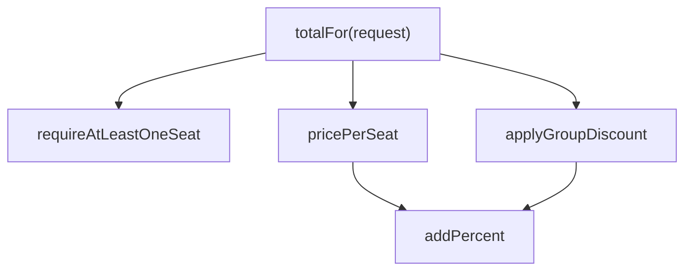
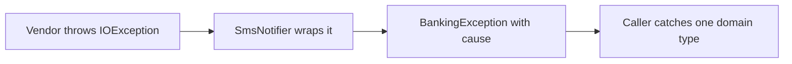
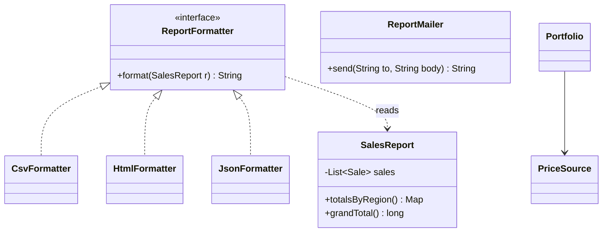
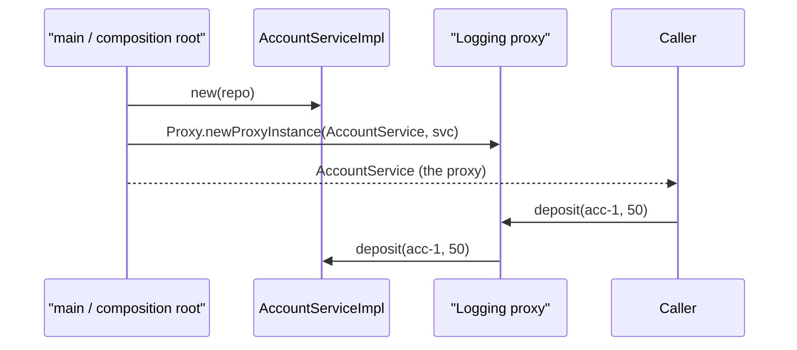
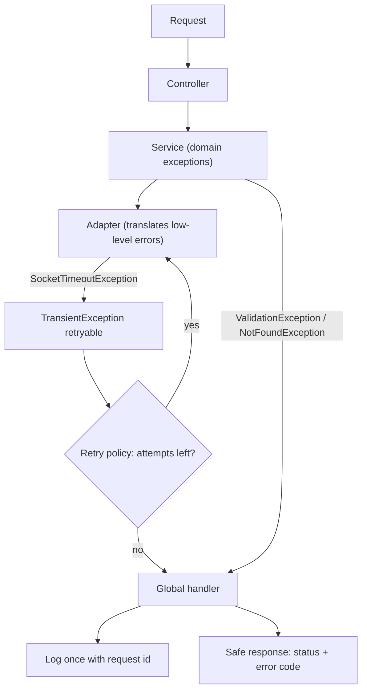
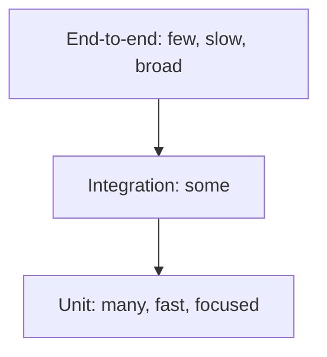

# Chapter 6 — Clean Code (Study Edition)

> **Study Edition.** Every topic of Chapter 6, without the padding. Code blocks are excerpts from the real files (`// ...` marks trimmed parts); full listings and outputs are in the Full Edition (`README.md`). Code lives in `code/lld/ch06/<topic>/`.

Design principles decide *which classes exist*; **clean code** is what happens *inside* them. In machine-coding rounds interviewers read your code line by line, so clean code often separates "hire" from "no hire". This chapter follows Robert C. Martin's *Clean Code* (2008) in order (the case studies are summarised in §13), then adds a **code review checklist**, an **error-handling strategy** and **testing strategies**.

**Key terms.** **Code smell** — a symptom that *usually* signals a deeper problem. **Refactoring** — changing structure, not behaviour (Chapter 7). **Level of abstraction** — `processPayroll()` high, `sb.append(',')` low. **Side effect** — any change besides the return value. **Test double** — a stand-in dependency (dummy, stub, spy, mock, fake). **TDD** — failing test, pass, refactor, in short cycles.

## What is clean code, and why bother?

### What it is
Code that reads like well-written prose, does one thing, has tests, has no duplication, expresses intent and looks written by someone who **cares**. Working definition: *intent obvious to the next reader, easy to change safely.* Analogy: an organised kitchen anyone can cook in.

### The problem it solves
Mess slows teams more and more until productivity nears zero and a "grand redesign" reproduces the mess. We read code far more than we write it (often quoted >10:1). "Clean it later" rarely happens — *later equals never* (LeBlanc's law).

### How it works
Treat readability as a requirement; follow the **Boy Scout Rule** — *leave the code a little cleaner than you found it*; write tests so you can clean without fear; make it work, then make it right, in small steps.

### Trade-offs
Slightly slower the first time; faster on every later read and change. Throwaway scripts differ.

### When not to use it
Unreadable code is never a goal, but avoid **gold-plating** clear, stable code.

### Common mistakes
"Working" = "done"; blaming deadlines (the mess slows you immediately); big-bang rewrites instead of continuous small improvements.

### Real-world examples
Google's readability reviews and certification; linters/formatters in CI (Checkstyle, SpotBugs, SonarQube, google-java-format).

### In the interview
**30-second answer:** "Obvious intent, cheap to change: intention-revealing names, small functions, exceptions not codes, immutable values, a few tests — and time to refactor once it works."

### Self-check
Q: Boy Scout Rule? → A: Leave the code a little cleaner than you found it.

### TL;DR
Obvious intent + safe to change; clean a little every time.

---

## 1. Meaningful Names

### What it is
A good name answers **why it exists, what it does, how it's used**. If it needs a comment, it isn't good enough. Analogy: "Kitchen — glasses — fragile" vs "Box 7".

### The problem it solves
Bad names force a **mental map** ("`d` is elapsed days, 4 means done") that every reader pays for, and misreadings cause bugs.

### How it works — the rules

| Rule | Bad | Good |
|---|---|---|
| Reveal intention | `int d;` | `int elapsedTimeInDays;` |
| Avoid disinformation | `accountList` for a `Set`; `l`/`O` | `accounts` |
| Meaningful distinctions (no number series, noise words) | `a1, a2`; `ProductInfo` vs `ProductData` | `source, destination` |
| Pronounceable | `crtdTs` | `createdAt` |
| Searchable | `7`, `e` | `MAX_LOGIN_ATTEMPTS` |
| No encodings (Hungarian, `m_`, `I` prefix) | `strName`, `IShapeFactory` | `name`, `ShapeFactory` |
| No mental mapping | `r` | `normalizedPath` |
| Classes = nouns | `Manager`, `Data`, `Info` | `Customer`, `AddressParser` |
| Methods = verbs; `get`/`is`/`has` | `data()` | `postPayment()`, `isPosted()` |
| Named static factories | `new Money(23)` | `Money.ofRupees(23)` |
| Don't be cute | `nuke()` | `deleteAll()` |
| One word per concept | `fetch`/`retrieve`/`get` | pick one |
| Don't pun | `add` = sum and append | `append`, `insert` |
| Solution-domain names (technical) | — | `OrderRepository`, `RetryPolicy` |
| Problem-domain names (business) | — | `Premium`, `Claim` |
| Add meaningful context | lone `state` | `shippingState` or an `Address` |
| No gratuitous context | `AcmeShopCustomerAddress` | `Address` |

**The longer the scope, the longer the name** — `i` suits a 3-line loop.

### Java example — before/after
Before: `class DtaRcrd102 { String strNm; int i1; int i2; boolean flg; }` and `Mgr.getThem()` filtering `x.i1 == 4 && x.i2 > 18000 && !x.flg`. After:

```java
// File: code/lld/ch06/names/Main.java
        record Task(String title, TaskStatus status, Duration timeSpent, boolean archived) {
            boolean isCompleted() { return status == TaskStatus.DONE; }           // boolean method reads as a question
            boolean tookLongerThan(Duration limit) { return timeSpent.compareTo(limit) > 0; }
        }
        // ...
            private static final Duration LONG_RUNNING = Duration.ofHours(5);  // named constant, not a magic number
            // ...
            List<Task> findCompletedLongRunningTasks() {                         // says exactly what it returns
```

Full runnable code: code/lld/ch06/names/ (see the Full Edition). The rule now reads aloud; a status code became an enum; `Temperature.ofCelsius(25)` is unambiguous.

### Trade-offs
A few keystrokes (IDEs autocomplete). A very long name may mean the function does too much — split, don't abbreviate.

### When not to use it
Conventional short names: `i`/`j` in tiny loops, `e` for exceptions, `x`/`y`, `T`/`K`/`V`.

### Common mistakes
Not renaming ("everyone knows `tmp2`"); author-only abbreviations (`calcAmtPrc`); `customer`/`client`/`user` for one concept.

### Real-world examples
JDK: `isEmpty()`, `computeIfAbsent()`, `List.of()`, `Duration.ofMinutes()`; Google Java Style casing.

### In the interview
**30-second answer:** "Code should read like the requirement: nouns for classes, verbs for methods, booleans as questions, named constants, enums instead of status codes, one word per concept." *`I` prefix on interfaces?* Not in Java; name the role (`PaymentGateway`), implementations specifically (`RazorpayGateway`).

### Self-check
1. Q: `ProductInfo` and `ProductData` together? → A: Noise words, no real distinction.
2. Q: A naming pun? → A: One word for two meanings.

### TL;DR
Reveal intent, pronounceable, searchable, one word per concept.

---

## 2. Functions

### What it is
Clean functions are **small**, **do one thing**, stay at **one level of abstraction**, take **few arguments**, have **no hidden side effects**, and either **do** or **answer** — never both. Analogy: a recipe of named steps, each with its own sub-recipe.

### The problem it solves
Long functions mix detail levels, hide bugs, can't be named, reused or tested in pieces; flags and output arguments confuse; hidden side effects surprise; error codes clutter callers.

### How it works — the rules
1. **Small, then smaller** — rarely 20 lines; block bodies ideally one call; indentation ≤ 1–2 levels.
2. **Do one thing** — nothing meaningful left to extract; "sections" mean several things.
3. **One level of abstraction** per function. 4. **Stepdown Rule** — read top-down, each function followed by its callees.
5. **Switch statements** — only **once**, buried low (a factory creating polymorphic objects); else polymorphism or enum data.
6. **Descriptive names** beat enigmatic ones and comments.
7. **Few arguments** — zero, one, two; avoid three; more needs justification. One-arg forms: question, transform, event. **Flag arguments** mean two things — split or use an enum. **Argument objects** (`book(BookingRequest)`); varargs count as one; **verbs and keywords** (`copyFromTo(source, target)`).
8. **No side effects** — hidden ones create **temporal coupling**. 9. **No output arguments** — `letter.addSignature()`.
10. **Command-Query Separation** — change state *or* answer (`if (enable("darkMode"))` is ambiguous).
11. **Exceptions, not error codes**. 12. **Extract try/catch** — error handling is one thing. 13. **No "error code magnet"** enum.
14. **DRY**. 15. **Structured programming** matters for big functions; small ones may return early (never `goto`).
16. **How to get there** — rough draft with tests, then refine, keeping tests green.



### Java example — before/after
Before: `static int book(String seatType, int count, boolean weekend, List<String> log)` — returns `-1` on error, switches on seat strings, mutates the caller's `log`, writes a global `SESSION`. After:

```java
// File: code/lld/ch06/functions/Main.java
        /** Argument object: three related arguments become one concept. */
        record BookingRequest(SeatType seat, int seats, DayType day) {}
        // ...
            int totalFor(BookingRequest request) {                        // level 1: the story
                requireAtLeastOneSeat(request);
                int total = pricePerSeat(request) * request.seats();
                return applyGroupDiscount(total, request.seats());
            }
        // ...
            void book(BookingRequest request) {
                // ... price it and append to history (a command: returns nothing)
            }
            List<String> history() { return List.copyOf(history); }
```

Full runnable code: code/lld/ch06/functions/ (see the Full Edition).

Flag → `DayType`; type switch → `SeatType` enum carrying its price, parsed once at the boundary; `-1` → `InvalidBookingException` with a message; output argument and `SESSION` → state owned by `BookingService`; **CQS**: `book` is a void command, `history` a query (returning a created ID is an accepted exception); `bookFromForm` does only error translation.

### Trade-offs

| Many small functions | Few large functions |
|---|---|
| Nameable, testable, reusable | Everything in one place |
| Need good names; over-splitting scatters logic | Hard to understand and test; mixed levels |

### When not to use it
Don't split a clear 8-line function into 8 one-liners; size is rarely a performance excuse (the JIT inlines small methods).

### Common mistakes
Boolean parameters in public APIs; state-changing getters; catching deep and returning `null`; names that say one thing while the body does three.

### Real-world examples
`list.sort(comparator)` returns `void`; `Iterator.next()`/`Queue.poll()` are known CQS exceptions; `Files.readString`.

### In the interview
**30-second answer:** "Small, single-purpose functions at one level, stepdown order; enums instead of flags, parameter objects, CQS, and descriptive exceptions instead of error codes." *How small?* One clear name and level — often 3–10 lines, rarely over ~20.

### Self-check
1. Q: When is a function "one thing"? → A: No meaningful function can be extracted from it.
2. Q: When is a `switch` acceptable? → A: Once, buried in a factory, never repeated.

### TL;DR
Small, one thing, one level, top-down, ≤2–3 args, no flags, CQS, exceptions not codes.

---

## 3. Comments

### What it is
At best a necessary evil — compensation for failing to express ourselves in code. Code changes; comments drift and **lie**. **Explain yourself in code first**. Analogy: a "Bridge closed" sign long after it reopened.

### The problem it solves
Comments as a crutch for unclear code, redundant comments, outdated misleading ones.

### How it works
`// free shipping if big and domestic` + `if (order.total() >= 499 && !order.isInternational())` becomes `if (order.qualifiesForFreeShipping())`.

**Good comments:** legal (licence header); informative (what a regex matches); explanation of intent (*why*); clarification (obscure library values); warning of consequences ("not thread-safe", "billed per call"); TODO (with an owner, reviewed); amplification ("the trim is critical"); Javadoc on public APIs.

**Bad comments:** mumbling; redundant (`i++; // increment i`); misleading; mandated (`@param a the a`); journal; noise; scary noise; comment instead of a function/variable; position markers; closing-brace comments; attributions; **commented-out code** (delete — git remembers); HTML; nonlocal information; too much information; inobvious connection; function headers; Javadoc on non-public code.

### Java example — before/after
Before: journal comment, `@param a the a`, a comment instead of a name over a five-part condition, `return true; // return true`, commented-out code, `} // end eligible`. After:

```java
// File: code/lld/ch06/comments/Main.java
        static boolean isEligibleForPremiumLoan(Applicant a) {
            return isWorkingAge(a) && hasGoodCredit(a) && earnsEnough(a);
        }
        // ...
        // GOOD: informative comment -- clarifies what a regex matches (format: 10-character PAN, e.g. ABCDE1234F)
        private static final Pattern PAN_FORMAT = Pattern.compile("[A-Z]{5}[0-9]{4}[A-Z]");
```

Full runnable code: code/lld/ch06/comments/ (see the Full Edition). The kept comments are the good kinds: legal header, informative, intent, public Javadoc, a billing warning and an owned `TODO(loans-team)`.

### Trade-offs
Cheap to write, expensive to maintain: a few precise "why" comments help; many "what" comments hurt.

### When not to use it
"No comments" isn't the goal: public libraries need Javadoc; complex algorithms deserve an explanation of approach and why.

### Common mistakes
Updating code but not its comment; keeping commented-out code; TODO lists nobody reviews.

### Real-world examples
JDK Javadoc (`HashMap` iteration order, `ConcurrentHashMap` weakly consistent iterators); SonarQube flags commented-out code; linters reject TODOs without tickets.

### In the interview
**30-second answer:** "Expressive code over comments — named functions and constants replace most 'what' comments. I keep why, warnings, legal, owned TODOs and public contracts, and delete commented-out code."

### Self-check
1. Q: Commented-out code? → A: Delete it.
2. Q: Why do comments lie? → A: Code changes, comments don't.

### TL;DR
Say it in code; comment only why, warnings, legal and public contracts.

---

## 4. Formatting

### What it is
Layout communicates what belongs together and what matters. One team style, applied automatically.

### The problem it solves
Random layout makes readers decode structure before logic, and produces noisy diffs.

### How it works
**Vertical:** small files (many Java projects ~200 lines, few >500); **newspaper metaphor**; **openness** (blank lines between concepts); **density** (related lines together); **distance** (locals near first use, instance variables at the top, **caller above callee**, conceptual affinity); **ordering** high-level first.
**Horizontal:** short lines (Martin 120, Google 100); spaces around assignments, none between name and `(`; **no column alignment**; indentation shows scope; make **dummy scopes** (empty loop bodies) visible.
**Team rules:** one style, enforced by a formatter in CI.

### Java example — before/after
Before, `Playlist` is crammed onto a few lines with fields scattered and aligned in columns. After (newspaper order):

```java
// File: code/lld/ch06/formatting/Main.java
            // 1. Fields at the top, together (vertical density for closely related lines).
            // ...
            public String next() {
                if (songs.isEmpty()) {
                    return null;
                }
                String song = displayTitle(cursor);    // caller ABOVE callee (dependent functions close together)
                cursor = (cursor + 1) % songs.size();
                return song;
            }

            // 4. Private helpers just below the functions that use them.
            private String displayTitle(int index) {
```

Full runnable code: code/lld/ch06/formatting/ (see the Full Edition). Behaviour is identical; only reading speed changes.

### Trade-offs
Almost none once automated; agree the rules once.

### When not to use it
Generated code (e.g. Protobuf) — exclude it from formatters.

### Common mistakes
Mixing formatting and logic changes in one commit; personal styles; column alignment.

### Real-world examples
google-java-format, Spotless, Prettier, gofmt, Black; EditorConfig.

### In the interview
**30-second answer:** "Related lines together, concepts separated, callers above callees, fields at the top, one automated team style."

### Self-check
Q: Where does a private helper go? → A: Just below its caller.

### TL;DR
Headline first, related things close, one automated style.

---

## 5. Objects and Data Structures

### What it is
An **object** hides data and exposes behaviour (`Order.isMetroDelivery()`); a **data structure** exposes data with no meaningful behaviour (record `Address`, DTO). **Data abstraction** isn't getters/setters on private fields — it's exposing the *essence* (`fuelPercentRemaining()`, not tank capacity and litres).

### The problem it solves
**Hybrids** (public data *and* behaviour) make both new functions and new types hard. Knowing the difference tells you which change is easy.

### How it works — the data/object anti-symmetry

| | Procedural (data structures + functions) | OO (objects) |
|---|---|---|
| Add a **function** (`perimeter`) | **Easy** — one function | **Hard** — every class |
| Add a **type** (`Triangle`) | **Hard** — every function | **Easy** — one class |

"Everything is an object" is a myth: expect new types → objects; new operations → data + functions (or Visitor). Java 21 `sealed` + records + pattern-matching `switch` make the procedural style compiler-checked. **Demeter** applies to objects (no `order.getCustomer().getAddress().city()`), not strictly to data structures. **DTOs** carry pure data across boundaries (bean form is framework ceremony, not encapsulation). **Active Record** — a DTO with `save()`/`find()`; keep business rules out.

### Java example — before/after

```java
// File: code/lld/ch06/objects/Main.java
            static double perimeter(Shape s) {                 // NEW FUNCTION: easy -- no shape class changes
                return switch (s) {
                    case Square sq -> 4 * sq.side();
                    case Circle c -> 2 * Math.PI * c.radius();
                };
            }
        // ...
        record Triangle(double base, double height) implements Shape {   // NEW TYPE: easy -- nothing else changes
        // ...
            boolean isMetroDelivery() { return shipTo.isMetro(); }        // tell the order what you need
```

Full runnable code: code/lld/ch06/objects/ (see the Full Edition). The train wreck became `order.isMetroDelivery()` while the `Address` record freely exposes `city`; `OrderDto` is a pure data carrier.

### Trade-offs
See the anti-symmetry table: choose by which change you expect more.

### When not to use it
Don't push behaviour into DTOs crossing process boundaries — keep them dumb and versioned.

### Common mistakes
Reflexive getters/setters; hybrids; business logic in JPA entities that are also API bodies.

### Real-world examples
Records; `java.awt.Point` (public fields); `LocalDate` (object); Spring `@RequestBody` DTOs; ActiveRecord / JPA entities.

### In the interview
**30-second answer:** "Objects hide data and expose behaviour; data structures expose data. OO makes new types easy, procedural makes new functions easy. Records for DTOs, rich objects for domain logic, no hybrids or train wrecks." *Pattern for adding operations in OO?* Visitor.

### Self-check
1. Q: Which style makes new shape types easy? → A: OO.
2. Q: A hybrid? → A: Exposed data plus significant behaviour.

### TL;DR
Pick objects or data structures by the change you expect; no hybrids.

---

## 6. Error Handling

### What it is
Important — but if it **obscures the logic** it's wrong. Keep the happy path readable; make failures explicit, informative and hard to ignore.

### The problem it solves
Error codes clutter callers and get forgotten; `null` returns become distant NPEs; checked exceptions leak into every signature; vague messages slow debugging.

### How it works — the rules
1. **Exceptions, not codes.** 2. **Write the `try-catch-finally` first** (a transaction); prefer **try-with-resources**.
3. **Unchecked exceptions** — checked ones break OCP by rippling through signatures; checked only when callers must recover.
4. **Context** — what, which values, why; keep the **cause**. 5. **Define exceptions by the caller's needs**; **wrap third-party APIs**.
6. **Special Case pattern** (Fowler) — an object for expected absence (`NoMembership`). 7. **Don't return `null`**. 8. **Don't pass `null`**.



### Java example — before/after
Before: `transfer` returns `E_NO_ACCOUNT` (which account?), `history` returns `null`, `loyaltyPoints` returns a `null` `Integer` that crashes on unboxing. After:

```java
// File: code/lld/ch06/errors/Main.java
        static final class InsufficientFundsException extends BankingException {
            InsufficientFundsException(String id, long requested, long available) {
                super("account '" + id + "' has " + available + " but " + requested + " was requested");
            }
        }
        // ...
        enum NoMembership implements Loyalty { INSTANCE; public int points() { return 0; } public String tier() { return "NONE"; } }
        // ...
            void send(String phone, String text) {
                try { client.push(phone, text); }
                catch (IOException e) { throw new BankingException("could not send SMS to " + phone, e); }
            }
        // ...
            List<String> history(String id) { return List.of(); }                          // empty, never null
            Optional<Long> findBalance(String id) { return Optional.ofNullable(balances.get(id)); }
```

Full runnable code: code/lld/ch06/errors/ (see the Full Edition).

Output includes `account 'B' has 100 but 900 was requested` and `could not send SMS to 000123 (cause: socket timeout to sms-gw-3)`. An unchecked `BankingException` hierarchy with context; the vendor's checked `IOException` wrapped with its cause; a try-with-resources `AuditFile` is closed even when an exception is thrown.

### Trade-offs

| Choice | Pro | Con |
|---|---|---|
| Unchecked exceptions | Clean signatures, OCP-friendly | No compiler reminder; document them |
| Checked exceptions | Compiler-enforced | Signature ripple; often swallowed |
| `Optional` return | Absence in the type | Not for fields/parameters |
| Special Case | No checks in callers | Can hide absence that *should* be noticed |
| Result/Either | Expected failures as values | Verbose in Java (§16) |

### When not to use it
Exceptions aren't control flow (don't throw to exit a loop); expected, frequent outcomes (row validation) may be cleaner as result values (§16).

### Common mistakes
`catch (Exception e) {}`; log-and-rethrow at every layer; losing the cause (`new MyException(e.getMessage())`); `null` from collection methods.

### Real-world examples
Spring `DataAccessException` translating `SQLException`s (e.g. `DuplicateKeyException`); `Collections.emptyList()`, `Optional.empty()`; `requireNonNull`; `UncheckedIOException`.

### In the interview
**30-second answer:** "Unchecked domain exceptions with context, not codes or null; wrap vendor exceptions; empty collections, `Optional` or special cases for absence; reject nulls at entry; try-with-resources." *Checked?* Only for conditions callers must recover from.

### Self-check
1. Q: Why are error codes bad? → A: Clutter, easily ignored, no context.
2. Q: Why keep the cause? → A: The original stack trace and message.

### TL;DR
Exceptions not codes; unchecked with context; wrap vendors; no null in or out; always clean up.

---

## 7. Boundaries

### What it is
Where your code meets code you don't control (libraries, frameworks, other teams, even general JDK types like `Map`). Keep it at the edge behind interfaces shaped for *your* needs.

### The problem it solves
Providers want broad APIs; users want focused ones. A raw `Map<String, Session>` passed around lets anyone `clear()` it and forces everyone to know the key format; library changes break every usage site.

### How it works
1. **Wrap boundary types** — expose only what the app needs (`SessionRegistry.open/activeSession/close`); keep the boundary type private.
2. **Learning tests** — small tests of the library as you'll use it; free documentation, re-run on upgrades.
3. **Use code that doesn't exist yet** — define the interface you wish you had (`FraudCheck`), use a fake, later write an **Adapter**.
4. Keep boundary knowledge in few places.

### Java example — before/after
Before, an admin tool calls `sessions.clear()` on the shared map. After:

```java
// File: code/lld/ch06/boundaries/Main.java
        static final class SessionRegistry {
            private final Map<String, Session> byToken = new ConcurrentHashMap<>();   // boundary type stays private

            void open(String token, Session session) { byToken.put(token, session); }
            Optional<Session> activeSession(String token, Instant now) {
                return Optional.ofNullable(byToken.get(token)).filter(s -> now.isBefore(s.expiresAt()));
            }
            void close(String token) { byToken.remove(token); }
        // ...
        interface FraudCheck { boolean isSuspicious(String userId, long amountPaise); }
```

Full runnable code: code/lld/ch06/boundaries/ (see the Full Edition). `JdkLearningTest` pins real facts: `HashMap` allows one `null` key, `ConcurrentHashMap` rejects it, `Map.of` rejects duplicates, `"a,b,,".split(",")` drops trailing empties (use limit `-1`).

### Trade-offs
A class and some delegation — worth it once the boundary type is used in more than one place or may change.

### When not to use it
A `Map` used inside one method is fine; the rule is about *passing* boundary types around.

### Common mistakes
Returning vendor types (`StripeCharge` from `PaymentGateway`); discovering library behaviour in production.

### Real-world examples
DDD **Anti-Corruption Layer**; SLF4J; Spring `RestClient`/`WebClient`; Pact contract tests.

### In the interview
**30-second answer:** "Third-party code stays at the edge behind my interfaces; learning tests when adopting a library; for a missing API, my own interface, a fake, and an adapter later."

### Self-check
Q: A learning test? → A: A test that pins down how a third-party API behaves.

### TL;DR
Foreign code at the edge behind your interfaces; learn it with tests.

---

## 8. Unit Tests

### What it is
Small automated tests of one unit of behaviour in isolation. Test code is **as important as production code** — it's what lets you change production code without fear.

### The problem it solves
No tests → fear of change → rot. *Dirty* tests → break constantly, get abandoned → rot anyway.

### How it works
**Three laws of TDD** (a ~30-second cycle): (1) no production code without a failing test; (2) write only enough test to fail (not compiling counts); (3) write only enough code to pass. Beck's coarser **Red → Green → Refactor**.
**Clean tests** enable the "-ilities". Readability: **Build–Operate–Check** (Arrange–Act–Assert, Given–When–Then); a **domain-specific testing language** (`cart("TEA", 3)`); a **dual standard** (clean, not necessarily efficient). **One concept per test** (several asserts are fine for one concept).

| F.I.R.S.T. | Meaning | In our code |
|---|---|---|
| **F**ast | Milliseconds | In-memory doubles |
| **I**ndependent | No order dependence | Fresh instance per test |
| **R**epeatable | Same result anywhere | Fixed `Clock` |
| **S**elf-validating | Pass/fail automatically | Assertions, not `println` |
| **T**imely | Just before the code | TDD |

### Java example — a JUnit-free runner, clean tests and a dirty one
`MiniTest` (~60 lines) finds `@Test` methods by reflection, runs each on a **new instance** and reports PASS/FAIL. `Checkout` has four collaborators behind interfaces (`PriceCatalog`, `CouponRepository`, `ReceiptSender`, `AuditLog`) plus a `Clock`.

```java
// File: code/lld/ch06/testing/CheckoutTest.java
    private static final Clock FIXED_CLOCK = Clock.fixed(Instant.parse("2026-09-28T10:00:00Z"), ZoneOffset.UTC); // Repeatable
    // ...
    @Test void expired_coupon_is_ignored() {
        var coupons = new FakeCoupons().add(new Checkout.Coupon("OLD", 50, TODAY.minusDays(1)));
        long total = checkoutWith(coupons, new DummyAuditLog()).quote(cart("TEA", 1), "OLD");
        assertEquals(12_000L, total);
    }
```

Full runnable code: code/lld/ch06/testing/ (`Checkout`, `CheckoutTest`, `CheckoutIntegrationTest`, `BeforeStyleTest`, `MiniTest`, `Test`, `Main`) (see the Full Edition).

`test1` "passes" but proves nothing: three concepts, real clock, printing, meaningless name. `CheckoutTest` methods test one concept each, are named as specifications, use Given/When/Then and a fixed clock; `CheckoutIntegrationTest` wires real in-memory components. Output: `TOTAL: 8 passed, 0 failed`.

### Trade-offs
Well-tested: fearless refactoring, executable documentation, but test code to maintain. Untested: faster first write, fear of change and knowledge in heads.

### When not to use it
TDD suits spikes and pure UI layout less; don't unit-test trivial getters or code you don't own (learning tests instead).

### Common mistakes
Testing implementation details; shared mutable fixtures; `Thread.sleep` or real clock/network; names like `test1`.

### Real-world examples
JUnit 5 (new instance per test method by default), AssertJ, Mockito; `java.time.Clock` with `Clock.fixed`.

### In the interview
**30-second answer:** "Small, fast, independent tests — one concept each, Given/When/Then, doubles behind interfaces, an injected `Clock`. In a machine-coding round at least a `main` exercising key flows plus a few unit tests."

### Self-check
1. Q: What's wrong with printing in a test? → A: Not self-validating.
2. Q: Repeatable time-based tests? → A: Inject a `Clock`; `Clock.fixed`.

### TL;DR
Tests are first-class: TDD, one concept per test, Given/When/Then, F.I.R.S.T.

---

## 9. Classes

### What it is
Standard **organisation**; **small** (by responsibilities); **one reason to change**; **cohesive**; **organised for change** so new features are new classes.

### The problem it solves
God classes change for many reasons; growing `if/else` over formats reopens the same class repeatedly.

### How it works
1. **Organisation**: public static constants → private static variables → private instance variables → public functions → private helpers after their caller.
2. **Encapsulation**: loosen for tests only as a last resort.
3. **Small** by responsibilities: if the name needs *Manager*/*Processor*/*Super* or "and/or/but", it does too much; describable in ~25 words.
4. **SRP**: many small classes beat a few large ones — same code, better organised.
5. **Cohesion**: maximal when every method uses every field; a subset of methods using a subset of fields wants its own class.
6. **Organise for change**: new features as new classes (OCP) — one `ReportFormatter` per format.
7. **Isolate from change**: depend on abstractions (`Portfolio` → `PriceSource`, DIP).



### Java example — before/after
Before, `ReportManager` totals, renders CSV/HTML in a growing `if/else` and emails — three reasons to change. After:

```java
// File: code/lld/ch06/classes/Main.java
        /** Organised for change: a new format is a NEW class; existing formatters are never reopened (OCP). */
        interface ReportFormatter { String format(SalesReport report); }
        // ...
        static final class JsonFormatter implements ReportFormatter {   // added later, nothing else edited
        // ...
        /** Isolating from change: Portfolio depends on an abstraction, not on a live stock-exchange client. */
        interface PriceSource { long pricePaise(String symbol); }
```

Full runnable code: code/lld/ch06/classes/ (see the Full Edition). `JsonFormatter` was added with no edits; `Portfolio` is tested with fixed prices.

### Trade-offs
Many small classes: easy to understand and test, localised changes, need good names and packages. Few big: fewer files, every change touches the same class, merge conflicts.

### When not to use it
Don't fragment a small cohesive class into micro-classes that always change together.

### Common mistakes
`*Manager`/`*Helper`/`*Utils`; splitting only by technical layer; everything `public` for tests.

### Real-world examples
`java.time` (`LocalDate`, `Duration`, `DateTimeFormatter`…) vs old `Date`/`Calendar`; `JdbcTemplate` delegating to `RowMapper`.

### In the interview
**30-second answer:** "Small by responsibility, highly cohesive; when a feature would add a branch I split so it's a new class; interfaces isolate volatile details."

### Self-check
1. Q: How is class size measured? → A: Responsibilities.
2. Q: Maximal cohesion? → A: Every method uses every field.

### TL;DR
Small, cohesive, open for extension, depending on abstractions.

---

## 10. Systems

### What it is
**Separate startup (construction and wiring) from runtime logic**, use **Dependency Injection**, handle **cross-cutting concerns** in one place, grow the architecture **incrementally**.

### The problem it solves
Lazy init in business code (`if (service == null) service = new MyServiceImpl()`) hard-wires classes and blocks testing; logging copied into every method is noisy.

### How it works
1. **Separate construction from use**: the **composition root** in `main` builds everything; **Abstract Factory** when the app decides *when* to create; **DI** (IoC for dependencies; constructor injection preferred).
2. **Scale up incrementally**. 3. **Cross-cutting concerns** via **dynamic proxies**, **AOP** (Spring `@Transactional`, `@Cacheable`), **AspectJ**, decorators, filters.
4. **Test-drive the architecture** with POJOs; 5. **postpone decisions** to the last responsible moment; 6. **use standards wisely**; 7. **DSLs** make code read like the domain.



### Java example — before/after
Before, `AccountServiceImpl` lazily builds its repository and repeats `LOG enter/exit` in every method. After:

```java
// File: code/lld/ch06/systems/Main.java
            private final AccountRepository repo;
            AccountServiceImpl(AccountRepository repo) { this.repo = repo; }
        // ...
        static <T> T withLogging(Class<T> type, T target) {
            // ... an InvocationHandler logs, calls method.invoke(target, args), and on failure
            // rethrows e.getCause() (the real exception, not the reflection wrapper)
            return (T) Proxy.newProxyInstance(type.getClassLoader(), new Class<?>[]{type}, handler);
        }

        /** Composition root: the ONLY place that knows concrete classes and wires them together (the "main" side). */
        static AccountService buildApplication() {
            AccountRepository repo = new InMemoryAccountRepository();
            AccountService core = new AccountServiceImpl(repo);
            return withLogging(AccountService.class, core);
        }
```

Full runnable code: code/lld/ch06/systems/ (see the Full Edition). Logging is written once; tests wire the core with another repository.

### Trade-offs

| DI + composition root + proxies | Self-constructing objects |
|---|---|
| Testable, swappable, one wiring place; concerns in one place | Simple for tiny programs |
| Framework "magic"; proxies only intercept calls *through* the proxy | Duplicated, inconsistent concerns |

Spring gotcha: self-invocation of a `@Transactional` method bypasses the proxy — no transaction.

### When not to use it
Small programs and interviews need no DI framework — manual constructor injection in `main` is expected.

### Common mistakes
Service Locator calls in business code; `@Autowired` field injection (hidden, blocks immutability); framework annotations everywhere.

### Real-world examples
Spring/Spring Boot, Guice, Dagger, Jakarta CDI; Spring AOP via JDK proxies or CGLIB; servlet filters, `HandlerInterceptor`.

### In the interview
**30-second answer:** "A composition root in `main` builds and wires everything; classes get dependencies through constructors; logging and transactions live once in a decorator, proxy or aspect." *DI vs Service Locator?* DI pushes (explicit); a locator pulls (hidden).

### Self-check
1. Q: Composition root? → A: The one place objects are constructed and wired.
2. Q: Three ways to handle cross-cutting concerns? → A: Dynamic proxies, AOP/AspectJ, decorators (also filters).

### TL;DR
Build in one place and inject; cross-cutting concerns in proxies/aspects; grow incrementally.

---

## 11. Emergence — Kent Beck's Four Rules of Simple Design

### What it is
Good design **emerges** from four rules. *Clean Code* (Jeff Langr's chapter) orders them: **1. runs all the tests, 2. no duplication, 3. expresses intent, 4. minimises classes and methods.** **Beck's own order** (per Fowler's "BeckDesignRules"): **passes the tests, reveals intention, no duplication, fewest elements** — the middle two get swapped and reinforce each other. In interviews, quote Beck's order and mention the swap.

### The problem it solves
An ordered checklist that pushes code toward SRP, DIP and good structure.

### How it works
1. **Runs all the tests** — testability itself drives small, decoupled classes (DI, interfaces).
2. **Refactor with rules 2–4**: remove duplicate lines and implementations (`isEmpty()` as `size() == 0`), higher-level duplication via **Template Method**; be **expressive** (names, small units, pattern names, tests as docs, *care*); **minimise** classes and methods — lowest priority, loses to SRP and no-duplication.

### Java example — before/after
Before, `calcIN` and `calcUS` copy one algorithm with magic `18`/`45` and `15`/`30`, plus a purposeless `LeaveCalcStrategyProvider`. After:

```java
// File: code/lld/ch06/emergence/Main.java
        abstract static class LeavePolicy {
            /** The shared algorithm, written once (rule 2: no duplication). */
            final int earnedLeaveDays(Employee e) {
                if (e.onProbation()) return 0;
                return Math.min(daysPerYear() * e.monthsWorked() / 12, maxCarryForwardDays());
            }
            protected abstract int daysPerYear();              // what varies, with intention-revealing names (rule 3)
            protected abstract int maxCarryForwardDays();
        }
```

Full runnable code: code/lld/ch06/emergence/ (see the Full Edition). `LeavePolicyTest` proves old and new behaviour match (rule 1); the useless interface is gone (rule 4).

### Trade-offs
Rules 2–4 can conflict; resolve by priority or find a design satisfying both.

### When not to use it
Always applicable — a mindset, not a process.

### Common mistakes
Refactoring without tests; minimising classes at SRP's expense.

### Real-world examples
XP teams; `AbstractList` removing duplication like our Template Method.

### In the interview
**30-second answer:** "Beck's rules in priority order: passes the tests, reveals intention, no duplication, fewest elements (*Clean Code* swaps the middle two). Get it working with a quick test, then refactor duplication and names, and add no class that doesn't earn its place."

### Self-check
Q: Lowest-priority rule? → A: Minimal classes and methods.

### TL;DR
Tests pass → no duplication → clear intent → nothing extra.

---

## 12. Concurrency

### What it is
A **decoupling strategy** separating *what* is done from *when*. Clean concurrency keeps concurrency code small, separate and built on library tools.

### The problem it solves
Myths: it always speeds things up (only with waiting or spare cores); design doesn't change; containers make it irrelevant. Reality: overhead, non-repeatable bugs, a different design.

### How it works — defence principles
1. **SRP** — concurrency code separate. 2. **Limit shared data**. 3. **Use copies**. 4. **Independent threads**. 5. **Know your library** (`ConcurrentHashMap`, `ExecutorService`, atomics, `CountDownLatch`/`Semaphore`) — not `wait/notify`. 6. **Execution models** (Chapter 13): producer–consumer, readers–writers, dining philosophers. 7. **Dependencies between synchronised methods** — client- or server-based locking. 8. **Small synchronised sections**. 9. **Plan shutdown** (`shutdown()`, `awaitTermination()`, `shutdownNow()`). 10. **Testing**: one-off failures are bugs; non-threaded code first; pluggable, tunable thread counts; more threads than cores; several platforms; jiggling (jcstress).

Vocabulary: **bound resources**, **mutual exclusion**, **starvation**, **deadlock**, **livelock** (Chapters 12–13; *Clean Code* Appendix A goes deeper).

### Java example — before/after
Before, four threads do `theCount++` on a shared `int` — a read-modify-write race that loses updates. After:

```java
// File: code/lld/ch06/concurrency/Main.java
                    tasks.add(() -> {
                        Map<String, Integer> local = new HashMap<>();       // thread-confined: no sharing, no locks
                        for (int r = 0; r < repeats; r++)
                            for (String page : PAGES) countWords(page).forEach((w, c) -> local.merge(w, c, Integer::sum));
                        return local;
                    });
                // ...
                for (Future<Map<String, Integer>> f : pool.invokeAll(tasks))
                    f.get().forEach((w, c) -> total.merge(w, c, Integer::sum));   // Future.get() safely hands over each result
                return Map.copyOf(total);                                           // publish an immutable copy
            } finally {
                pool.shutdown();                                                    // clean shutdown is part of the design
                if (!pool.awaitTermination(5, TimeUnit.SECONDS)) pool.shutdownNow();
            }
```

Full runnable code: code/lld/ch06/concurrency/ (see the Full Edition).

Before: `count(the) = 182526 expected 320000 -> lost 137474 updates`; after, every thread count matches exactly. The racy count varies per run (and is occasionally right — why such bugs escape tests). The fix separates pure `countWords` from threading, confines data per task, merges once, and is tested with 1, 4 and 16 threads.

### Trade-offs
Confinement + merge: no locks or races, scales, but extra memory and a merge step. Shared state + locks: simple for small cases, but contention, deadlock risk, every access must be synchronised.

### When not to use it
No concurrency without a measured need; prefer parallel streams (pure CPU) or Java 21 virtual threads (blocking I/O) over manual threads.

### Common mistakes
Unsynchronised shared `HashMap`/`ArrayList`; check-then-act (`containsKey` then `put` — use `putIfAbsent`/`computeIfAbsent`); unshut executors; holding locks while calling unknown code.

### Real-world examples
`java.util.concurrent` (Doug Lea), `ForkJoinPool`; MapReduce/Spark; Node.js and Redis event loops.

### In the interview
**30-second answer:** "Concurrency separate from business logic; minimal shared mutable state — confinement, immutability, merging results; `java.util.concurrent` over raw threads; planned shutdown; tests with more threads than cores." *Why isn't `count++` safe?* Read, add, write — updates get lost; use `AtomicInteger`/`LongAdder` or a lock.

### Self-check
1. Q: What does concurrency decouple? → A: What from when.
2. Q: A one-off failure in concurrent code? → A: Treat it as a real threading bug.

### TL;DR
Separate it, share little, use the library, small locks, plan shutdown, test hard.

---

## 13. Successive Refinement and the Case Studies (Chapters 14–16: how clean code is actually written)

These are case studies showing the *process*, not new rules.

**Chapter 14 — Successive Refinement** (an `Args` parser): write it dirty, then clean it — never stop at dirty; stop adding features once the code rots; refactor in tiny tested steps; absorb variation by design (one class per argument type behind a "marshaler" interface — OCP); gather error handling into one exception class.

**Chapter 15 — JUnit Internals** (`ComparisonCompactor`, by Beck and Gamma — already good): drop encoding prefixes (`fExpected` → `expected`, N6); encapsulate and prefer positive conditionals (`canBeCompacted()`, G28/G29); rename functions hiding a second job (`formatCompactedComparison`, N7/G30); make temporal coupling explicit (G31); name `+1`/`-1` boundary arithmetic (G33). Even good code can be left cleaner.

**Chapter 16 — Refactoring SerialDate** (JCommon): first make it work — coverage rose from ~50% to ~92% and exposed real bugs; then make it right — rename (`DayDate`), enums for int constants (`Month`, J3), move methods to their data (G14/G17), an **Abstract Factory** so the base class doesn't know its subclass (G7), delete dead code, duplication and noise (G9, G5, C3); tests green throughout.

*TL;DR:* make it work, then make it right, in small tested steps.

---

## 14. Smells and Heuristics (the checklist)

### What it is
*Clean Code*'s catalogue of coded **smells and heuristics** (C1, G5, N1…), extending Fowler's smells (Chapter 7). Hints, not laws.

### The problem it solves
You must *recognise* problems fast; codes give a shared review vocabulary ("G28 — encapsulate that conditional").

### How it works — the catalogue, grouped (names listed; meaning in our words)

**Comments (C):** C1 inappropriate information (history, authors → VCS); C2 obsolete comment; C3 redundant comment; C4 poorly written comment; C5 commented-out code (delete).

**Environment (E):** E1 build requires more than one step; E2 tests require more than one step.

**Functions (F):** F1 too many arguments; F2 output arguments; F3 flag arguments; F4 dead function.

**General (G):**

| Theme | Heuristics |
|---|---|
| Correctness and safety | G2 obvious behaviour unimplemented (least surprise); G3 incorrect behaviour at the boundaries (test edges); G4 overridden safeties (warnings off, skipped tests); G21 understand the algorithm; G26 be precise (no floating-point currency; nulls, concurrency, ties); G31 hidden temporal couplings (make order explicit); G33 encapsulate boundary conditions (`lastIndex = size - 1`) |
| Duplication and dead weight | **G5 duplication** ("one of the most important rules" — use methods, polymorphism, Template Method, Strategy); G9 dead code; G12 clutter |
| Structure and placement | G1 multiple languages in one file; G6 code at wrong level of abstraction; G7 base classes depending on derivatives; G8 too much information (small interfaces); G10 vertical separation; G13 artificial coupling; G14 feature envy; G17 misplaced responsibility; G18 inappropriate static; G22 make logical dependencies physical; G35 configurable data at high levels; G36 avoid transitive navigation (Demeter) |
| Readability and intent | G11 inconsistency; G15 selector arguments; G16 obscured intent; G19 explanatory variables; G20 names say what functions do (`applyDiscountPercent(5)`); G23 polymorphism over if/switch ("one switch"); G24 conventions; G25 named constants; G27 structure over convention; **G28 encapsulate conditionals** (`isRefundable(order)`); G29 avoid negative conditionals; G30 one thing; G32 don't be arbitrary; G34 one level of abstraction |

**Java (J):** J1 wildcard imports to shorten lists (dated — Google style forbids them; follow your team); J2 don't inherit constants (static imports); J3 enums over `int` constants.

**Names (N):** N1 descriptive; N2 right level of abstraction (`notify(recipient)`, not `sendSms(phone)`); N3 standard nomenclature (`...Decorator`); N4 unambiguous; N5 long names for long scopes; N6 no encodings; N7 names describe side effects (`getOrCreateUser`).

**Tests (T):** T1 insufficient tests; T2 use a coverage tool (JaCoCo); T3 don't skip trivial tests; T4 an ignored test is a question about an ambiguity; T5 test boundary conditions; T6 exhaustively test near bugs; T7 patterns of failure are revealing; T8 coverage patterns are revealing; T9 tests should be fast.

### Java example — several heuristics on one function
Before: `static double calc(Parcel p, boolean express)` with `double` money, a double negative `!(p.membership() != Membership.PRIME)`, a tangled `&& !p.fragile() == false` condition, magic numbers and a flag. After:

```java
// File: code/lld/ch06/smells/Main.java
        static BigDecimal shippingCost(Parcel p, Speed speed) {
            BigDecimal baseFee = isPrime(p) ? BigDecimal.ZERO : BASE_FEE;
            BigDecimal handlingFee = needsSpecialHandling(p) ? SPECIAL_HANDLING_FEE : BigDecimal.ZERO;
            BigDecimal weightCharge = BigDecimal.valueOf(p.weightKg()).multiply(RATE_PER_KG);   // explanatory variables
            BigDecimal cost = baseFee.add(handlingFee).add(weightCharge).multiply(speed.multiplier);
            if (isPrime(p) && speed == Speed.EXPRESS) cost = cost.multiply(PRIME_EXPRESS_DISCOUNT);
            return cost.setScale(2, RoundingMode.HALF_UP);                           // round once, explicitly, to paise
        }

        private static boolean isPrime(Parcel p) { return p.membership() == Membership.PRIME; }   // positive conditional
        private static boolean needsSpecialHandling(Parcel p) {                                 // encapsulated conditional
            boolean heavy = p.weightKg() > HEAVY_KG;
            boolean fragileLongHaul = p.distanceKm() > LONG_HAUL_KM && p.fragile();
            return heavy || fragileLongHaul;
        }
```

Full runnable code: code/lld/ch06/smells/ (see the Full Edition). A "same" column over eight parcel/speed cases proves behaviour unchanged. Fixed: G29, G16/G28, G25, F3 (→ `Speed` enum), G19, N1/G20 (`calc` → `shippingCost`), G26 (`BigDecimal`, one `HALF_UP`).

### Trade-offs
A checklist can be applied dogmatically; when items conflict, favour readability and correctness.

### When not to use it
Don't block a critical fix on nits — log follow-ups.

### Common mistakes
Gaming smell counts; following dated notes like J1 over your team's guide.

### Real-world examples
SonarQube, PMD, Checkstyle, SpotBugs, Error Prone.

### In the interview
**30-second answer:** "I look for duplication, long functions, flag/output arguments, magic numbers, negative or complex conditionals, feature envy, train wrecks, misplaced responsibilities, dead code and weak tests — fixed with small refactorings: extract method, introduce constant, replace conditional with polymorphism."

### Self-check
1. Q: What does G28 ask? → A: Encapsulate conditionals in a named function.
2. Q: What does T4 say about a disabled test? → A: It marks an unresolved requirement ambiguity.

### TL;DR
C/E/F/G/J/N/T as shared review vocabulary; fix with small tested refactorings.

---

## 15. Code Review Checklist (best practices)

### What it is
A peer reading a change before merge to catch defects, share knowledge and keep consistency — and, in interviews, what you run over your own code before saying "done".

### The problem it solves
Unreviewed changes bring bugs, security holes and inconsistency; unfocused reviews chase nits and miss real issues.

### How it works — the checklist (from most to least important)
1. **Correctness** — meets the requirement; edge cases (empty, null, zero, max, duplicates, time zones, rounding); errors handled, resources closed; concurrency (shared state, check-then-act, thread-safe collections).
2. **Design** — fits the architecture; right class/layer (SRP, GRASP); DIP, OCP; no over-engineering (YAGNI) or duplication (DRY).
3. **Readability** — names, small functions, no magic numbers or flags; *why* comments; no commented-out code.
4. **Tests** — new behaviour covered; regression test per bug fix; F.I.R.S.T., one concept each.
5. **Security** — validation; no injection (parameterised queries); output encoding; no secrets in code/logs, PII masked; authorisation on sensitive operations.
6. **Performance and resources** — N+1 queries, repeated work, unbounded collections, missing pagination; timeouts; closing.
7. **Operability** — useful logs and metrics; feature flags; backwards-compatible APIs, messages, migrations.
8. **Style** — automated.

**Reviewing well:** small changes; the author describes what/why/how-tested and self-reviews; the reviewer is specific and kind, explains why, marks "nit:"; automate the mechanical.

### Java example
No separate program: reviewing `Before.book` in §2 would flag F3, error codes, F2, the hidden `SESSION` side effect, G23 and G25 — exactly its *after* fixes.

### Trade-offs
Slightly slower merges; defects caught early, knowledge spread. Too many reviewers or nit-heavy reviews slow teams without quality gains.

### When not to use it
Emergency hotfixes may be reviewed after merge — but still reviewed.

### Common mistakes
Style-only reviews; huge PRs; personal preferences as rules.

### Real-world examples
GitHub PRs, GitLab MRs, Gerrit; Google's published review guidance; CODEOWNERS.

### In the interview
**30-second answer:** "Correctness first — requirements, edge cases, errors, concurrency — then design, readability, tests, security, performance; formatting left to tools; specific feedback, nits marked optional."

### Self-check
Q: Why small PRs? → A: Large diffs get shallow reviews.

### TL;DR
Correctness → design → readability → tests → security → performance → operability; automate style.

---

## 16. Error-Handling Strategy (best practices for real services)

### What it is
§6 covered rules in code; a **strategy** is the system-wide policy: which exception types exist, where errors are translated, which are retried, how they're logged, what callers see.

### The problem it solves
Without one: nulls, log-and-rethrow everywhere, stack traces to users, retried permanent failures overloading services.

### How it works
1. **Classify errors:**

| Class | Examples | Handling |
|---|---|---|
| Validation / client | bad input | Reject, 4xx, no retry |
| Business rule | insufficient funds, seat taken | Domain exception or result, 4xx (409) |
| Not found | unknown id | 404 / empty `Optional` |
| Transient infrastructure | timeouts, 503, deadlock victim | Retry with backoff — only if **idempotent** |
| Permanent infrastructure | DB auth failure, misconfiguration | Fail fast, alert |
| Programming bugs | NPE, index out of bounds | Don't catch locally; generic 500, log, fix |

2. **One exception hierarchy** with an error code and a *retryable* flag. 3. **Translate at boundaries** (adapters), keeping the cause. 4. **Retry only transient** errors: max attempts, **exponential backoff**, **jitter**, plus timeouts and circuit breakers. 5. **Result values for expected per-item failures** (collect all row errors). 6. **Global handler at the edge**: status, stable code, safe message, **log once** with a request id; never leak internals. 7. **Stay consistent**: transactions or compensation; idempotent handlers.



### Java example

```java
// File: code/lld/ch06/errorstrategy/Main.java
    static <T> T withRetry(Supplier<T> action, int maxAttempts, long initialBackoffMs) {
        long backoff = initialBackoffMs;
        for (int attempt = 1; ; attempt++) {
            try {
                return action.get();
            } catch (AppException e) {
                if (!e.retryable || attempt == maxAttempts) throw e;
                // ...
                sleep(backoff);
                backoff *= 2;                                   // exponential backoff (add jitter in production)
            }
        }
    }
```

Full runnable code: code/lld/ch06/errorstrategy/ (see the Full Edition). req-1: a timeout is retried (10 ms, 20 ms) then succeeds; req-2: `NotFoundException` isn't retryable → 404; req-3: gives up after 3 attempts → 503; req-4: a bug → generic 500 with only a request id; a sealed `Result` (`Ok`/`Err`) collects all bulk-import row errors, then the request is rejected with 400.

### Trade-offs

| Choice | Benefit | Cost |
|---|---|---|
| Retries | Survive blips | Duplicate side effects unless idempotent; amplify load |
| Global handler | Consistent responses, log once | Must not swallow context |
| Result types | Explicit expected failures | Verbose in Java; needs a clear rule vs exceptions |

### When not to use it
Don't retry non-idempotent operations ("charge card") without an **idempotency key**; never retry validation or authorisation failures.

### Common mistakes
Log-and-rethrow; catching `Exception` in business code; tight retry loops without backoff; 200 with an error body.

### Real-world examples
Spring `@ControllerAdvice`/`@ExceptionHandler`; RFC 9457 Problem Details (`ProblemDetail`); Resilience4j; AWS SDK backoff with jitter; Stripe idempotency keys.

### In the interview
**30-second answer:** "Classify errors; one hierarchy with codes and a retryable flag; translate in adapters; retry only transient, idempotent calls with backoff and jitter; one global handler returns safe responses and logs once." *Why jitter?* To avoid a thundering herd.

### Self-check
1. Q: Which errors are retried? → A: Transient ones, for idempotent operations.
2. Q: Where are errors logged? → A: Once, at the global handler, with a correlation id.

### TL;DR
Classify, translate, retry transient + idempotent with backoff, results for expected failures, one global handler.

---

## 17. Testing Strategies (unit vs integration, test doubles, mocks)

### What it is
Deciding *which kinds* of tests, *how many*, and *how to isolate* code, building on §8.

### The problem it solves
Too few tests → production bugs; mostly slow E2E tests → flaky pipelines; over-mocking → tests pass while the system is broken.

### How it works

| Kind | Scope | Speed | Catches |
|---|---|---|---|
| **Unit** | One class, doubles for collaborators | ms | Logic errors |
| **Integration** | Real components together (DB, broker) | s | Wiring, queries, serialisation, config |
| **Contract** | Consumer–provider agreement | Fast | API mismatches |
| **End-to-end** | Whole system via UI/API | Slow | User-journey breakage |
| Others | Performance, security, exploratory, property-based, mutation | Varies | Non-functional issues, weak tests |

**Test Pyramid** (Mike Cohn): many unit, some integration, few E2E — not the "ice-cream cone".



**Test doubles** (Meszaros, via Fowler):

| Double | What it does | In our code |
|---|---|---|
| **Dummy** | Fills a parameter; never used | `DummyAuditLog` (throws if called) |
| **Stub** | Canned answers | `StubCatalog` |
| **Spy** | Stub that records calls | `SpySender.sent` |
| **Mock** | Pre-programmed expectations, verifies itself | `MockAuditLog.expect(...).verify()` |
| **Fake** | Working simplified implementation | `FakeCoupons` |

**State vs behaviour verification:** prefer state (stubs/fakes); mocks for unobservable outgoing side effects. **Test** public behaviour, edge cases, error paths, every bug fix — not private methods or the framework. **Mocking:** don't mock types you don't own (wrap them) or value objects; many mocks means too many dependencies. **Coverage** (JaCoCo) is necessary, not sufficient; mutation testing (PIT) checks the tests.

### Java example
The code is in §8 (`lld.ch06.testing`): `CheckoutTest` uses all five doubles, `CheckoutIntegrationTest` wires real in-memory parts, `BeforeStyleTest` shows what to avoid. The mock records calls in `actual` and its `verify()` asserts them against `expected`.

### Trade-offs
More unit tests: fast, precise, may miss wiring bugs; over-mocking couples to implementation. More integration/E2E: higher confidence, slow, flaky, need environments.

### When not to use it
Thin framework glue is better covered by an integration test; push edge cases down from E2E to unit tests.

### Common mistakes
Mocking everything (even value objects or the class under test); leaving flaky tests unfixed; testing internal calls instead of outcomes; no error-path tests.

### Real-world examples
JUnit 5, Mockito, AssertJ, Testcontainers, WireMock, Pact, PIT, JaCoCo; Spring Boot `@WebMvcTest`, `@DataJpaTest`.

### In the interview
**30-second answer:** "The test pyramid: many fast unit tests with doubles, fewer integration tests with real components (Testcontainers), a handful of E2E. State verification with stubs and fakes; mocks only for outgoing side effects; never mock types I don't own." *Mock vs stub?* A stub supplies answers for state checks; a mock verifies the calls itself.

### Self-check
1. Q: The five doubles? → A: Dummy, stub, spy, mock, fake.
2. Q: Is 100% coverage proof? → A: No — mutation testing checks assertions catch bugs.

### TL;DR
Many unit, some integration, few E2E; the right double; state over interactions; don't mock what you don't own.

---

## Chapter summary

| Topic | Remember this |
|---|---|
| Names | Reveal intent, pronounceable, searchable, one word per concept |
| Functions | Small, one thing, one level, stepdown, ≤2–3 args, no flags, CQS, exceptions |
| Comments | Explain in code; comment why/warnings/legal/public API |
| Formatting | Newspaper order, related things close, automated style |
| Objects vs data | Objects hide data; data structures expose it; anti-symmetry decides |
| Error handling | Unchecked with context, wrap vendors, no null in or out |
| Boundaries | Wrap third-party code; learning tests; interfaces you need |
| Unit tests | TDD laws, one concept per test, F.I.R.S.T. |
| Classes | Small by responsibility, cohesive, organised for change |
| Systems | Composition root + DI; cross-cutting via proxies/aspects |
| Emergence | Beck: tests → intent → no duplication → fewest elements (*Clean Code* swaps the middle two) |
| Concurrency | Separate it, share little, use the library, test hard |
| Smells | C/E/F/G/J/N/T checklist |
| Code review | Correctness → design → readability → tests → security → performance |
| Error strategy | Classify, translate, retry transient, handle globally, log once |
| Testing strategy | Pyramid; right double; state over behaviour verification |

### Chapter self-check
1. Q: `boolean saveAndValidate(Order o, boolean sendEmail)` breaks what? → A: Does two things, flag argument (F3), likely breaks CQS.
2. Q: `findOrders(customerId)` with no results? → A: An empty list, never `null`.
3. Q: Testing code that calls `LocalDate.now()`? → A: Inject a `Clock`; `Clock.fixed` in tests.

### TL;DR (chapter)
Write for the next reader: honest names, tiny single-purpose functions, few "why" comments, consistent layout, exceptions instead of codes or nulls, foreign code behind your interfaces, clean fast tests, small cohesive classes wired from one place, simple design through refactoring, careful concurrency — and review against a shared checklist.
