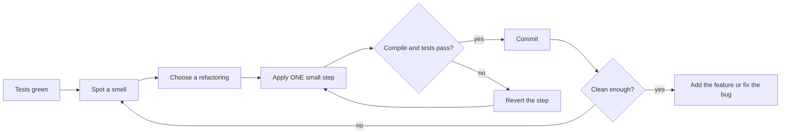
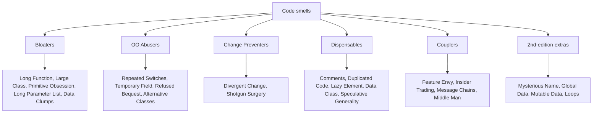
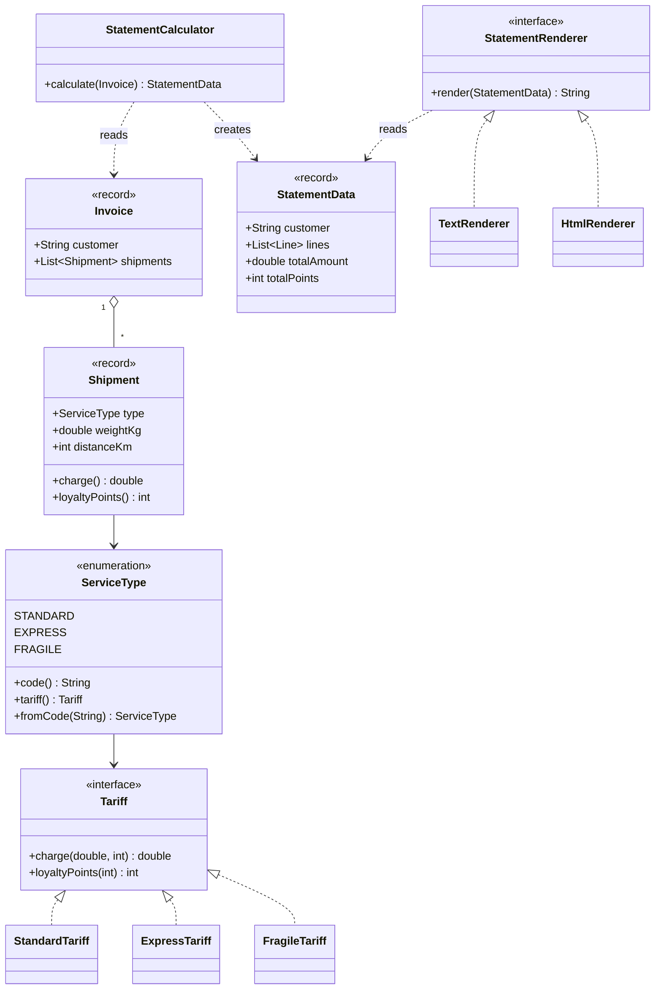
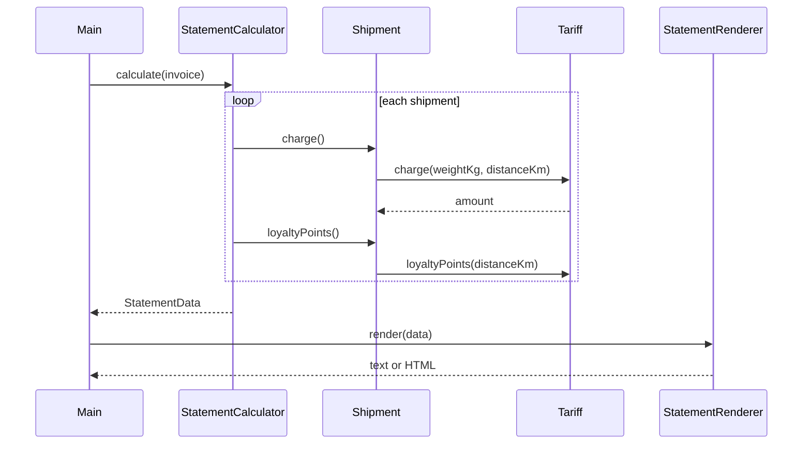
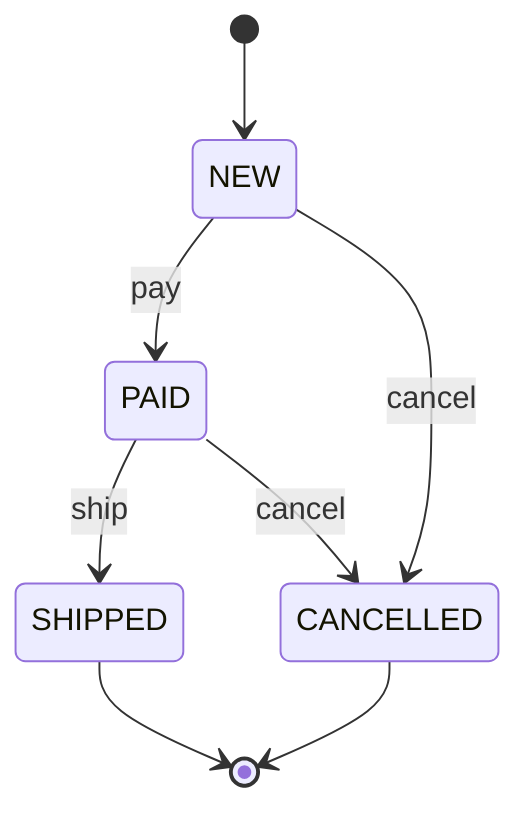

# Chapter 7 — Refactoring

> **What you will learn.** What refactoring is (and is not), when to do it, how tests make it safe, the full catalogue of **code smells** (the signals that tell you *where* to refactor), the full catalogue of **refactorings** from Martin Fowler's *Refactoring* (2nd edition, 2018), a smell → refactoring lookup table, a complete worked example in Java that goes from messy to clean in six compiling steps, and how refactoring leads you toward design patterns.
>
> **Why it matters for LLD interviews.** Machine-coding rounds often end with "now add feature X" or "what would you clean up?". Interviewers want to hear you name a smell ("this switch is repeated in three places — a Repeated Switches smell") and name the fix ("Replace Conditional with Polymorphism, which gives us a Strategy"). This chapter gives you that vocabulary.

**Chapter map**

| Part | Content |
|---|---|
| 7.1 | Refactoring fundamentals — definition, two hats, why, when, when not, tests, performance, rewrite vs refactor, IDE automation, legacy code |
| 7.2 | Code smells — the 24 smells of the 2nd edition, grouped the refactoring.guru way |
| 7.3 | The refactoring catalogue — all 61 named refactorings of the 2nd edition, by book chapter, plus the extra ones on refactoring.com |
| 7.4 | Smell → refactorings lookup table |
| 7.5 | Worked example — a messy invoice class refactored in six compiling steps |
| 7.6 | Refactoring toward patterns — Strategy, State, Special Case, Template Method, Factory |
| 7.7 | Trade-offs, mistakes, real-world examples, interview answers, self-check, TL;DR |
| 7.8 | Full source code and program output |

---

## 7.1 Refactoring fundamentals

### What it is

**Refactoring (noun)** is a change made to the internal structure of software to make it easier to understand and cheaper to modify, *without changing its observable behaviour*.

**Refactoring (verb)** is restructuring software by applying a *series* of such small, behaviour-preserving changes.

Two words in that definition do all the work:

- **Behaviour-preserving.** After the change, the program does the same thing from the outside. Same outputs for the same inputs, same side effects, same errors. The only things that may change are *internal* — names, where code lives, how it is split up. (Performance may change a little; see 7.1.9.)
- **Small steps.** Each step is so small that it is almost impossible to get wrong, and the code compiles and the tests pass after *every* step. You chain many tiny steps to get a big change. If you ever sit with broken code for an hour, you were not refactoring — you were rewriting.

**Everyday analogy.** Think of reorganising a kitchen while the restaurant stays open. You move one shelf at a time. After each move, the cooks can still make every dish. You never tear the whole kitchen down on a Friday night.

> **Term — observable behaviour.** What a user (or calling code) can see: return values, printed output, data written, exceptions thrown. The *call stack*, the *class structure*, and the *names of private methods* are not observable behaviour.

**What refactoring is NOT.**

| Activity | Is it refactoring? | Why |
|---|---|---|
| Renaming a method with the IDE | Yes | Behaviour unchanged, tiny step |
| Fixing a bug | No | Behaviour changes (on purpose) |
| Adding a feature | No | Behaviour changes |
| Performance tuning | No | Goal is speed, not clarity (though behaviour is preserved) |
| "I spent two days restructuring and nothing worked until the end" | No | That is restructuring/rewriting, not refactoring |
| Reformatting code | Borderline | Behaviour-preserving, but it does not improve design |

> **Term — restructuring.** The general word for reorganising code. Refactoring is a *specific kind* of restructuring: small, behaviour-preserving steps.

### The problem it solves

Code decays. Every quick fix, every "just add another `if`", every copy-paste makes the next change a little harder. This is called **design decay** or **technical debt** — the extra cost you pay on every future change because the code is harder to work with than it needs to be.

Refactoring pays down that debt. It keeps the design good *continuously*, instead of hoping to get the design right up front (which never fully works, because requirements change).

### How it works

1. **Make sure you have tests** that pin down current behaviour (7.1.7). Run them — they must be green.
2. **Spot a smell** — a surface sign that the design could be better (7.2).
3. **Pick a named refactoring** that cures the smell (7.3, 7.4).
4. **Apply one small step** of it (ideally with the IDE's automated refactoring).
5. **Compile and run the tests.** Green? Commit (locally). Red? Undo the step (don't debug) and take a smaller step.
6. **Repeat** until the code is clean enough for the job at hand.



### 7.1.1 The two hats

Kent Beck's metaphor: when you program you wear **one of two hats** at any moment.

| Hat | You are allowed to | You are NOT allowed to |
|---|---|---|
| **Adding function** | Add new behaviour, add new tests | Restructure existing code |
| **Refactoring** | Restructure code | Add behaviour or tests for new behaviour (you may add tests for *existing* behaviour you forgot to cover) |

You swap hats often — maybe every few minutes — but you always know which one you are wearing. Mixing them ("I'll just fix this bug while I extract this method") is how refactoring becomes risky: when a test fails you cannot tell which change caused it.

### 7.1.2 Why refactor

- **It improves the design.** Without it, the internal design (architecture) of a program decays as people change code to meet short-term goals. Regular refactoring keeps the code in shape. A big part of this is **removing duplication** — making sure each fact lives in exactly one place.
- **It makes software easier to understand.** Code is read far more often than it is written. Refactoring lets you move your understanding *out of your head and into the code*, so the next reader (including you in six months) does not need to rediscover it.
- **It helps you find bugs.** When you clarify the structure, assumptions become visible and bugs have fewer places to hide.
- **It helps you program faster.** This is the surprising one. Fowler calls it the **Design Stamina Hypothesis**: a team that keeps its internal quality high will, after a short while, add features *faster* than a team that does not, because each feature builds on clean code instead of fighting a mess. Speed is the economic argument for refactoring — not "clean code for its own sake".

### 7.1.3 When to refactor

| Trigger | What it means | Example |
|---|---|---|
| **Rule of Three** (Don Roberts) | First time, just do it. Second time you do something similar, wince but duplicate. Third time, refactor. | Third copy of the same validation code → extract a validator |
| **Preparatory refactoring** | Refactor *just before* adding a feature, to make the feature easy to add. "Make the change easy, then make the easy change." | Before adding HTML output, split calculation from text formatting (see 7.5, step 3) |
| **Comprehension refactoring** | Refactor to understand code you are reading. Rename a variable once you understand it; extract a block once you know what it does. The understanding moves into the code. | Rename `d` to `daysOverdue` after working out what it holds |
| **Litter-pickup refactoring** | You notice mess while working on something else. Fix it if it is quick; if not, note it and come back. The **Boy Scout Rule** — leave the campground cleaner than you found it. | Remove an unused parameter while passing by |
| **Planned vs opportunistic** | Most refactoring should be *opportunistic* — woven into feature work and bug fixes, not scheduled separately. Planned refactoring episodes are sometimes needed when a team has neglected the code, but they should be rare. | Good: every feature PR contains a few small refactoring commits. Warning sign: a "refactoring sprint" every quarter |
| **Long-term refactoring** | Big changes (replacing a library, splitting a module) done gradually over weeks, keeping the system working the whole time — e.g. with **Branch by Abstraction** (introduce an abstraction layer, switch callers to it, swap the implementation behind it, delete the old one). | Moving from one ORM to another behind a repository interface |
| **During code review** | Reviewing is a natural moment to suggest (or pair on) refactorings. Fowler prefers doing it *with the author*, trying the refactoring ideas as you go, rather than only leaving comments. | "This method has four flag parameters — can we Remove Flag Argument?" |

> **Term — Rule of Three.** A heuristic: do not abstract on the first or second occurrence of a pattern (you do not yet know what varies); abstract on the third, when the shape is clear.

**Should you tell your manager?** Fowler's position: for a manager who does not understand technical work, do not ask permission for refactoring any more than you ask permission to write tests. It is part of how professionals deliver features quickly. (For large, planned efforts, of course, discuss them.)

### 7.1.4 When NOT to refactor

- **Code you never need to touch or understand.** Messy code hidden behind a clean API, that works and never changes, can stay messy. Refactor only what gets in your way.
- **When rewriting is cheaper** than refactoring (see 7.1.10). This is a judgement call and usually needs experience.
- **Without a safety net** — if you cannot test it and cannot use safe automated refactorings, first add tests (7.1.11 shows how for legacy code).
- **On a deadline that truly cannot move**, a big refactoring may wait — but note that the Design Stamina Hypothesis says skipping it usually makes you *slower*, even in the short term. Deadlines are rarely a good excuse for small refactorings.
- **Published interfaces** that you do not control the callers of (a public library API, a REST endpoint used by other teams). You can still refactor them, but you must keep the old version working for a while and deprecate it (see *Change Function Declaration*, migration mechanics).

### 7.1.5 Problems and costs of refactoring

| Problem | What goes wrong | Mitigation |
|---|---|---|
| Slowing down new features | Refactoring "takes time away" from features | Refactor *because* it speeds features up; focus on code you are about to change |
| Code ownership | You cannot rename a method whose callers are in another team's repo | Keep the old name as a delegating, `@Deprecated` method; migrate callers later; prefer weak (team-wide) code ownership |
| Long-lived feature branches | Refactoring renames and moves code, which makes merges painful | **Continuous Integration** / trunk-based development: integrate at least daily, so refactorings conflict less |
| Missing tests | Refactoring without tests is risky | Add tests first; use only IDE-automated, provably-safe refactorings until tests exist |
| Legacy code | Big, untested, tangled | Feathers' techniques (7.1.11) |
| Databases | Schema changes are hard to reverse | **Evolutionary database design**: small migration scripts, versioned with the code; use **parallel change** (add new column, copy, switch readers, remove old) |

> **Term — parallel change (expand / contract).** Make a breaking change in three phases: *expand* (add the new thing alongside the old), *migrate* (move all users to the new thing), *contract* (remove the old thing). At no point is anything broken.

### 7.1.6 Refactoring, architecture and YAGNI

In the past people tried to get the architecture "right" before writing code. Refactoring changes that: because you can reshape code safely later, you can build **only what today's requirements need** and evolve the design when new needs appear. This is **YAGNI** ("You Aren't Gonna Need It") — do not add flexibility for imagined future requirements. YAGNI does not mean "never think about architecture"; it means you trust refactoring to add the flexibility when the need becomes real (and you think harder up front only about things that are *truly* hard to change later, like a public API or a database schema).

### 7.1.7 Tests as the safety net

Refactoring is safe only if you can detect a behaviour change immediately. That is what **self-testing code** gives you: a suite of automated tests that checks itself (pass/fail, no human reading output) and runs in seconds.

- Run tests after **every** small step. With fast tests, a failure points at the few lines you just changed.
- If a test fails, **revert** — do not start debugging a refactoring. Then redo it in smaller steps.
- Tests should focus on **behaviour** (public API, outputs), not on private structure. Tests that check private methods break on every refactoring and become a cost instead of a safety net.
- **Characterisation tests** (a term from Michael Feathers): for code without tests, write tests that record what the code *currently does* — even if that looks wrong — so you notice if a refactoring changes it. The worked example in 7.5 uses exactly this: a checker that compares every step's output with the original, byte for byte.
- Consider **mutation testing** (e.g. PIT for Java) to check your tests actually catch changes — it deliberately introduces small bugs and reports any your tests fail to detect.

> **Term — safety net.** Anything that tells you quickly and reliably that you broke something: unit tests, integration tests, the compiler's type checks, and the IDE's automated refactorings (which are proven safe by the tool).

### 7.1.8 IDE automation

Modern IDEs perform many refactorings *automatically and safely*, using the compiler's knowledge of the code (the **syntax tree** and **symbol resolution**), not text search. A text search-and-replace of `name` would also hit comments, strings and unrelated fields; the IDE's Rename only changes that one symbol and all its real references.

History in one line: Bill Opdyke's 1992 PhD thesis formalised refactorings; John Brant and Don Roberts built the Smalltalk *Refactoring Browser*, the first automated tool; Java IDEs (IntelliJ IDEA, Eclipse) popularised it.

| Refactoring | IntelliJ IDEA (Windows/Linux · macOS) | Eclipse (Windows/Linux) |
|---|---|---|
| Rename | Shift+F6 · Shift+F6 | Alt+Shift+R |
| Extract Method (Extract Function) | Ctrl+Alt+M · Cmd+Opt+M | Alt+Shift+M |
| Extract Variable | Ctrl+Alt+V · Cmd+Opt+V | Alt+Shift+L |
| Extract Field / Constant / Parameter | Ctrl+Alt+F / C / P · Cmd+Opt+F / C / P | (Refactor menu) |
| Inline | Ctrl+Alt+N · Cmd+Opt+N | Alt+Shift+I |
| Change Signature | Ctrl+F6 · Cmd+F6 | Alt+Shift+C |
| Move | F6 · F6 | Alt+Shift+V |
| "Refactor This" menu | Ctrl+Alt+Shift+T · Ctrl+T | Alt+Shift+T |

(Shortcuts are the default keymaps; check your IDE if you use a custom keymap.)

Beyond the IDE there are **large-scale automated refactoring tools**, such as OpenRewrite (recipes that, for example, migrate a whole codebase between framework versions) and Google's Refaster templates in Error Prone. These let a company apply the same refactoring across thousands of files.

> **Caution.** Automated refactorings are safe for statically known calls. They can miss **reflection** (`Class.forName("…")`), names used in **configuration files**, **serialised field names** (JSON/Jackson, JPA column names inferred from field names), and code in other repositories. After an IDE rename of a field that is serialised, the JSON your API returns changes — that *is* an observable behaviour change.

### 7.1.9 Performance and refactoring

A common worry: "refactoring adds method calls and small objects, so the program gets slower." Fowler's answer has three parts:

1. **Most refactorings have negligible performance effect.** The JIT compiler inlines small methods; extra method calls are nearly free in modern Java.
2. **Programs spend most of their time in a small fraction of the code.** Optimising everywhere wastes effort on code that is rarely run. (The book retells a story from Ron Jeffries about Chrysler's slow payroll system: nobody's guesses about the cause were right; profiling found the time going to one unexpected spot, and a small fix there made it fast.)
3. **Well-factored code is easier to tune.** When you do need speed, you profile, find the hot spot, and — because the code is well-structured — the hot spot is small and isolated, so it is easy to optimise.

So the recommended order is: **make it work → make it clean (refactor) → make it fast (profile, then optimise only the hot spots)**. Sometimes a refactoring makes code slightly slower; that is fine if it makes the later, targeted optimisation easier.

**Example from this chapter.** In 7.5 step 2 we replace a summing loop with a stream. `DoubleStream.sum()` is allowed to use *compensated summation* (OpenJDK does), so it can give a result that differs in the last bit from a plain loop — a tiny *behaviour change*. To stay a true refactoring we used `reduce(0.0, Double::sum)`, which adds left to right exactly like the loop. Refactoring demands this kind of care.

### 7.1.10 Refactoring vs rewriting

| | Refactoring | Rewriting |
|---|---|---|
| Unit of change | Many tiny, safe steps | One big replacement |
| System works during the change? | Always | Usually not until the end |
| Risk | Low | High — known bugs fixed years ago get reintroduced; the old system keeps evolving while you rewrite |
| Delivers value | Continuously | Only at the end |
| Good when | Code mostly works, needs reshaping | Code is so broken it does not work at all, or the technology must change completely |

Even when you must replace a system, you rarely do it in one go. The **Strangler Fig** approach (named by Fowler after a vine that slowly grows around a tree) builds the new system *around* the old one, routing one feature at a time to the new code until the old code can be switched off. It is the rewrite equivalent of "small steps".

### 7.1.11 Legacy code

Michael Feathers (*Working Effectively with Legacy Code*, 2004) defines **legacy code as code without tests**. Such code is hard to refactor because you have no safety net, and hard to test because it was not designed for it. The way out is a loop:

1. **Identify change points** — where you need to change code.
2. **Find test points** — where you can observe behaviour.
3. **Break dependencies** — using a **seam**: a place where you can change behaviour without editing the code there, e.g. by passing in an interface instead of calling `new Database()` inside a method (constructor injection), or overriding a method in a test subclass.
4. **Write characterisation tests** that pin down current behaviour.
5. **Make the change and refactor** under that safety net.

Other useful techniques from that book:

- **Sprout Method / Sprout Class** — write the new feature as a *new*, fully tested method or class, and call it from the old code with a one-line change.
- **Wrap Method / Wrap Class** — rename the old method and create a new method with the old name that calls the old one plus the new behaviour (a Decorator-like move).
- Use **safe automated refactorings only** (Rename, Extract Method with the IDE) until tests exist.
- Do not try to clean everything. Refactor the areas you touch; over time the most-changed code becomes the cleanest.

---

## 7.2 Code smells

### What it is

A **code smell** (a term coined by Kent Beck) is a *surface sign* in the code that usually points to a deeper design problem. A smell is not a bug — the code works. It is a hint that the code will be hard to understand or change. Like a smell in a fridge, it tells you *where to look*, not exactly what is wrong.

Smells are **heuristics, not rules**. A long method is not always bad; a switch statement is not always bad. The smell tells you to look closer and use judgement.

### The problem it solves

Knowing *how* to refactor is not enough; you must also know *when* and *where*. Fowler and Beck deliberately give no precise metrics ("no method longer than 10 lines"). Instead they give a catalogue of named smells, each with the refactorings that usually cure it. Names matter: in a code review, "Feature Envy" communicates in two words what would otherwise take a paragraph.

### How it works

1. Read the code and notice discomfort: "I had to scroll", "I changed five files for one feature", "I can't tell what `x2` is".
2. Match the discomfort to a named smell (the table below).
3. Look up the refactorings that cure it (each smell below, and 7.4).
4. Apply them in small steps under tests.

### Smell groups (refactoring.guru classification)

refactoring.guru groups smells into five families. It uses mostly the 1st-edition names, so the table maps them to the 2nd-edition names used in this chapter.

| Group | Idea | Smells (2nd-ed name; refactoring.guru name in brackets if different) |
|---|---|---|
| **Bloaters** | Code, methods and classes that have grown so big they are hard to work with. They usually grow slowly. | Long Function *(Long Method)*, Large Class, Primitive Obsession, Long Parameter List, Data Clumps |
| **Object-Orientation Abusers** | Incomplete or wrong use of OO principles. | Repeated Switches *(Switch Statements)*, Temporary Field, Refused Bequest, Alternative Classes with Different Interfaces |
| **Change Preventers** | One change forces many other changes. | Divergent Change, Shotgun Surgery *(also: Parallel Inheritance Hierarchies — a 1st-ed smell)* |
| **Dispensables** | Something pointless whose removal makes the code cleaner. | Comments, Duplicated Code *(Duplicate Code)*, Lazy Element *(Lazy Class)*, Data Class, Speculative Generality *(also: Dead Code — in the 2nd ed. this is the refactoring Remove Dead Code)* |
| **Couplers** | Too much coupling between classes, or too much delegation. | Feature Envy, Insider Trading *(Inappropriate Intimacy)*, Message Chains, Middle Man *(also: Incomplete Library Class — a 1st-ed smell)* |
| *New in the 2nd edition (not in refactoring.guru's five groups)* | | Mysterious Name (a comprehension smell), Global Data and Mutable Data (both about uncontrolled shared state — closest to Couplers/Change Preventers), Loops (closest to Bloaters) |

> **Term — coupling.** How much one piece of code depends on another. High coupling means a change in one place forces changes in others. **Cohesion** is the opposite idea inside one unit: how strongly the things inside a class or module belong together. Good design: low coupling, high cohesion.



Below are all 24 smells from the 2nd edition, in the book's order. Each has: **what it is**, **why it hurts**, a small **Java example** (smelly → cured), and **refactorings that fix it** (the ones Fowler names for that smell; anything extra is marked). The names match the catalogue in 7.3.

> **Note on the snippets.** Several short snippets use `double` for prices or balances to stay tiny. Real money should use `BigDecimal` or a `Money` value object — see 7.2.11 and `code/smells/Money.java`.

---

### 7.2.1 Mysterious Name

**What it is.** A function, variable, field, class or module whose name does not tell you what it does or holds: `data`, `tmp`, `proc()`, `x2`, `Manager`, `handle()`.

**Why it hurts.** Names are the main tool for making code understandable. A bad name forces every reader to decode the implementation. And if you *cannot* think of a good name, that is often a sign of a deeper design problem — the thing does too much or has no clear purpose.

```java
// Smelly
double calc(List<Double> l, int d) { ... }

// Cured
double averageDailyRevenue(List<Double> dailyRevenues, int daysInPeriod) { ... }
```

**Refactorings.** Change Function Declaration (rename), Rename Variable, Rename Field.

---

### 7.2.2 Duplicated Code

**What it is.** The same (or nearly the same) code structure in more than one place.

**Why it hurts.** Every change must be made in every copy, and you must *find* every copy and check whether the small differences matter. Sooner or later one copy is missed and a bug appears.

```java
// Smelly: two methods repeat the same tax rule
double invoiceTotal(double net)  { return net + net * 0.18; }
double quoteTotal(double net)    { return net + net * 0.18; }

// Cured: one place owns the rule
private static final double GST_RATE = 0.18;
double withTax(double net)       { return net + net * GST_RATE; }
double invoiceTotal(double net)  { return withTax(net); }
double quoteTotal(double net)    { return withTax(net); }
```

**Refactorings.** Fowler lists: Extract Function; Slide Statements (to bring similar code together so it can be extracted); Pull Up Method (if the copies are in sibling subclasses). Also useful (not in Fowler's list for this smell): Replace Inline Code with Function Call (if a library already does it); Substitute Algorithm (if two different algorithms do the same thing).

---

### 7.2.3 Long Function

**What it is.** A function that does too much and is too long to understand at a glance. Fowler's heuristic: whenever you feel you need a **comment** to explain a block, extract that block into a function named after the *intent* of the block.

**Why it hurts.** Long functions are hard to understand, hard to reuse partially, and hard to test. Short, well-named functions are self-documenting: you read the name and skip the body.

```java
// Smelly
void printOwing(Invoice inv) {
    System.out.println("*** Customer Owes ***");
    double outstanding = 0;
    for (Order o : inv.orders()) outstanding += o.amount();      // calculate outstanding
    inv.setDueDate(LocalDate.now().plusDays(30));               // record due date
    System.out.println("name: " + inv.customer());               // print details
    System.out.println("amount: " + outstanding);
}

// Cured: each block became a named function
void printOwing(Invoice inv) {
    printBanner();
    double outstanding = outstandingOf(inv);
    recordDueDate(inv);
    printDetails(inv, outstanding);
}
```

**Refactorings.** Extract Function (the main one, ~99% of the time), Replace Temp with Query, Introduce Parameter Object, Preserve Whole Object, Replace Function with Command, Decompose Conditional, Replace Conditional with Polymorphism, Split Loop.

---

### 7.2.4 Long Parameter List

**What it is.** A function that takes many parameters (often more than three or four), especially several of the same type, or boolean flags.

**Why it hurts.** Callers mix up the order (`move(10, 20, 5, 3)` — which is which?), every new parameter changes every caller, and long lists often hide a missing concept.

```java
// Smelly
Booking book(String hotelId, LocalDate from, LocalDate to, int adults, int children, boolean breakfast) { ... }

// Cured: parameter objects for the clumps, and an explicit enum instead of an unreadable boolean flag
record Stay(LocalDate from, LocalDate to) { }
record Guests(int adults, int children) { }
Booking book(Hotel hotel, Stay stay, Guests guests, MealPlan mealPlan) { ... }
```

**Refactorings.** Replace Parameter with Query, Preserve Whole Object, Introduce Parameter Object, Remove Flag Argument, Combine Functions into Class (several functions share the same parameters → make them fields of a class).

---

### 7.2.5 Global Data

**What it is.** Data that can be read and modified from anywhere: global variables, public static mutable fields, and mutable singletons.

**Why it hurts.** Any code anywhere can change it, and there is no way to find *who* changed it. Bugs appear far away from their cause. Fowler calls it one of the most pungent smells; the problems grow with the size of the program. (Class variables and singletons count too.)

```java
// Smelly
public class Config { public static double discountRate = 0.1; }      // anyone can write it

// Cured: Encapsulate Variable - one controlled access point, easy to find every writer.
// (The range check is a NEW rule added afterwards, wearing the "adding function" hat - it is a behaviour change, not part of the refactoring.)
public final class Config {
    private static volatile double discountRate = 0.1;
    public static double discountRate() { return discountRate; }
    public static void setDiscountRate(double rate) {
        if (rate < 0 || rate > 0.5) throw new IllegalArgumentException("rate out of range");
        discountRate = rate;
    }
}
// Even better: pass the value in (dependency injection) instead of reading a static at all.
```

**Refactorings.** Encapsulate Variable (first step, always), then narrow its scope — ideally move it into a class or module so only a few functions can see it.

---

### 7.2.6 Mutable Data

**What it is.** Data that is changed after creation, especially when it is shared, or when the same variable is updated for different purposes.

**Why it hurts.** A change in one place can break code in another place that assumed the value stayed the same. These bugs are hard to find, especially with threads. Functional programming is built on the idea that data should never change; you do not need to go that far, but you should limit where mutation can happen.

```java
// Smelly: callers can change the list inside the object, and total is a stored copy that can go stale
class Cart {
    public List<Item> items = new ArrayList<>();
    public double total;                          // must be updated by hand after every change
}

// Cured
final class Cart {
    private final List<Item> items = new ArrayList<>();
    void add(Item item) { items.add(item); }
    List<Item> items() { return List.copyOf(items); }                       // Encapsulate Collection
    double total() { return items.stream().mapToDouble(Item::price).sum(); } // Replace Derived Variable with Query
}
```

**Refactorings.** Encapsulate Variable, Split Variable, Slide Statements, Extract Function, Separate Query from Modifier, Remove Setting Method, Replace Derived Variable with Query, Combine Functions into Class, Combine Functions into Transform, Change Reference to Value (use immutable value objects such as Java records).

---

### 7.2.7 Divergent Change

**What it is.** **One class is changed for many different reasons.** "I have to edit this class when we add a database, *and* when we add a financial instrument, *and* when we change the report format."

**Why it hurts.** The class mixes several responsibilities (it breaks the **Single Responsibility Principle**, Chapter 4). Each kind of change risks breaking the others, and different people edit the same file for unrelated reasons.

```java
// Smelly: storage, pricing and formatting in one class
class ProductService {
    void saveToMySql(Product p) { ... }         // changes when the database changes
    double priceWithTax(Product p) { ... }      // changes when tax rules change
    String toCsv(Product p) { ... }             // changes when the export format changes
}

// Cured: one reason to change per class
class ProductRepository { void save(Product p) { ... } }
class PricingService    { double priceWithTax(Product p) { ... } }
class ProductCsvWriter  { String toCsv(Product p) { ... } }
```

**Refactorings.** Split Phase (when the changes fall into sequential phases, e.g. parse then compute), Move Function, Extract Function, Extract Class.

---

### 7.2.8 Shotgun Surgery

**What it is.** The opposite of Divergent Change: **one change forces many small edits in many classes.**

**Why it hurts.** You have to find all the places, and it is easy to miss one. The logic for one concept is scattered.

```java
// Smelly: the "free-shipping threshold" rule appears in 4 classes
class CartView      { boolean showBanner(double t)  { return t >= 500; } }
class CheckoutCtrl  { double shipping(double t)     { return t >= 500 ? 0 : 40; } }
class EmailBuilder  { String line(double t)         { return t >= 500 ? "Free shipping!" : ""; } }
class ReportJob     { long freeOrders(List<Double> ts) { return ts.stream().filter(t -> t >= 500).count(); } }

// Cured: the concept lives in one class, and the four callers use it
final class ShippingPolicy {
    static final double FREE_SHIPPING_THRESHOLD = 500;
    static boolean isFree(double total)   { return total >= FREE_SHIPPING_THRESHOLD; }
    static double charge(double total)    { return isFree(total) ? 0 : 40; }
}
```

**Refactorings.** Move Function and Move Field (gather everything into one module), Combine Functions into Class, Combine Functions into Transform, Split Phase; sometimes Inline Function / Inline Class first to pull the scattered bits together, then extract a better-shaped unit.

| | Divergent Change | Shotgun Surgery |
|---|---|---|
| Shape | One class, many reasons to change | One reason to change, many classes |
| Fix | Split the class | Gather the scattered code |

---

### 7.2.9 Feature Envy

**What it is.** A method that is more interested in *another* class's data than in its own — it calls many getters on another object to compute something.

**Why it hurts.** The behaviour lives away from the data it uses, so a change to that data needs changes elsewhere. The basic OO rule: **put behaviour next to the data it uses**. (Exception: patterns like Strategy and Visitor deliberately separate them, to allow swapping behaviour.)

```java
// Smelly: Order computes a line total using only Line's data
class Order {
    double lineTotal(Line line) {
        return line.getUnitPrice() * line.getQuantity() * (1 - line.getDiscount());
    }
}

// Cured: Move Function - Line computes its own total
record Line(double unitPrice, int quantity, double discount) {
    double total() { return unitPrice * quantity * (1 - discount); }
}
```

**Refactorings.** Move Function; Extract Function first if only *part* of the method is envious, then move that part.

---

### 7.2.10 Data Clumps

**What it is.** The same group of data items always appear together — as fields in several classes, or as parameters in many signatures: `(street, city, zip)`, `(startDate, endDate)`, `(x, y)`, `(amount, currency)`.

**Why it hurts.** The group is really a concept that has not been named. Without a class, behaviour about it (e.g. "does this range contain a date?") gets duplicated everywhere. **Test:** delete one item of the clump — if the others no longer make sense alone, they belong in an object.

```java
// Smelly
boolean isAvailable(LocalDate start, LocalDate end) { ... }
double price(LocalDate start, LocalDate end, double nightly) { ... }

// Cured (see code/smells/DateRange.java)
record DateRange(LocalDate start, LocalDate end) {
    boolean contains(LocalDate day) { return !day.isBefore(start) && !day.isAfter(end); }
}
boolean isAvailable(DateRange stay) { ... }
```

**Refactorings.** Extract Class (for clumps of fields), Introduce Parameter Object and Preserve Whole Object (for clumps of parameters). Then look for Feature Envy — behaviour will want to move onto the new class.

---

### 7.2.11 Primitive Obsession

**What it is.** Using primitive types (`int`, `double`, `String`, `boolean`) for domain concepts that deserve their own type: money as `double`, phone numbers as `String`, a status as `"ACTIVE"`, a temperature as a bare `int` without a unit.

**Why it hurts.** No validation (`"banana"` is a valid `String` phone number), no behaviour (formatting and comparing logic is duplicated), easy mix-ups (`transfer(double amount, double fee)` — swap them and nothing complains). Money as `double` also suffers from floating-point error: `0.1 + 0.2` prints `0.30000000000000004` (see the output in 7.8).

```java
// Smelly
void charge(double amount, String currency) { ... }

// Cured (see code/smells/Money.java): validation and arithmetic live in one type
record Money(BigDecimal amount, Currency currency) {
    Money plus(Money other) { /* checks same currency, then adds */ }
}
void charge(Money amount) { ... }
```

**Refactorings.** Replace Primitive with Object, Replace Type Code with Subclasses, Replace Conditional with Polymorphism (for type codes that drive behaviour), Extract Class, Introduce Parameter Object.

---

### 7.2.12 Repeated Switches

**What it is.** The *same* `switch` (or `if/else if` chain) on the same type code appears in several places. (In the 1st edition this smell was "Switch Statements" — *any* switch. In the 2nd edition Fowler narrowed it: a single switch is fine; the problem is the *repetition*.)

**Why it hurts.** Adding a new case means finding and updating every switch — Shotgun Surgery. Miss one and you have a bug.

```java
// Smelly: three switches on the same type
double speed(Bird b)    { switch (b.type) { case "EUROPEAN": ...; case "AFRICAN": ...; case "PARROT": ...; } }
String plumage(Bird b)  { switch (b.type) { case "EUROPEAN": ...; case "AFRICAN": ...; case "PARROT": ...; } }
int    lifespan(Bird b) { switch (b.type) { ... } }

// Cured: Replace Conditional with Polymorphism
sealed interface Bird permits EuropeanSwallow, AfricanSwallow, NorwegianBlueParrot {
    double speed();
    String plumage();
}
```

**Refactorings.** Replace Conditional with Polymorphism. (Java note: with a `sealed` type or an `enum`, a *switch expression* is checked for exhaustiveness by the compiler, which removes much of the risk. A few such switches may be acceptable; polymorphism is still better when the behaviour per case is large.)

---

### 7.2.13 Loops

**What it is.** A classic `for`/`while` loop that filters, maps or aggregates a collection, where a pipeline would state the intent more clearly. (New in the 2nd edition — languages now have good first-class functions; in Java, the Stream API since Java 8.)

**Why it hurts.** A loop makes the reader simulate the steps to see what it does. A pipeline names each step: *filter*, *map*, *collect*.

```java
// Smelly
List<String> names = new ArrayList<>();
for (Employee e : employees) {
    if (e.department().equals("IT")) {
        names.add(e.name());
    }
}

// Cured: Replace Loop with Pipeline
List<String> names = employees.stream()
        .filter(e -> e.department().equals("IT"))
        .map(Employee::name)
        .toList();                      // Java 16+: returns an unmodifiable list
```

**Refactorings.** Replace Loop with Pipeline. (Note: `Stream.toList()` returns an *unmodifiable* list, while the loop built a mutable `ArrayList`. If a caller later adds to the list, that is a behaviour change — use `collect(Collectors.toCollection(ArrayList::new))` in that case.)

---

### 7.2.14 Lazy Element

**What it is.** A class, function or other structure that does not pull its weight — for example a class with one trivial method, a function whose body is as clear as its name, or a subclass that adds nothing. (1st edition: "Lazy Class".)

**Why it hurts.** Every element costs something: a name to learn, a file to open, an indirection to follow. If it adds nothing, it is pure cost. Lazy elements are often left behind after other refactorings, or created for growth that never happened.

```java
// Smelly: a wrapper that adds nothing
class NameFormatter { String format(String s) { return s.trim(); } }

// Cured: Inline Class / Inline Function
String cleanName = rawName.trim();
```

**Refactorings.** Inline Function, Inline Class, Collapse Hierarchy.

---

### 7.2.15 Speculative Generality

**What it is.** Hooks, abstract classes, parameters and special cases added "because we might need them someday" — but nobody uses them. Typical signs: an abstract class with only one subclass, unused parameters, methods only called by tests, a plug-in system with one plug-in.

**Why it hurts.** It makes the code harder to understand and maintain for no benefit. It violates **YAGNI**. If the need does come, refactoring can add the flexibility then — usually in a better shape, because you then know the real requirement.

```java
// Smelly
interface PaymentProcessorFactoryProvider { PaymentProcessorFactory get(); }   // one implementation, ever
void pay(Money m, Map<String, Object> futureOptions) { ... }                  // futureOptions never used

// Cured
void pay(Money m) { processor.process(m); }
```

**Refactorings.** Collapse Hierarchy (useless abstract class), Inline Function and Inline Class (useless delegation), Change Function Declaration (remove unused parameters), Remove Dead Code (for code used only by its own tests — delete the tests too).

---

### 7.2.16 Temporary Field

**What it is.** A field that is set and used only in some situations (e.g. only during one complex calculation) and is empty/null the rest of the time.

**Why it hurts.** Readers expect an object to need all its fields. A field that is usually `null` is confusing — "why is this null? is that a bug?"

```java
// Smelly: these fields are only meaningful while computeRoute() runs
class Planner {
    private Graph graph;
    private Map<Node, Integer> tmpDistances;   // null except inside computeRoute
    private Node tmpTarget;                    // null except inside computeRoute
}

// Cured: Extract Class - the temporary state gets its own short-lived object
class Planner {
    private Graph graph;
    Route computeRoute(Node from, Node to) { return new RouteSearch(graph, from, to).run(); }
}
final class RouteSearch {                      // lives only for one search
    private final Map<Node, Integer> distances = new HashMap<>();
    ...
}
```

**Refactorings.** Extract Class (put the fields and the code that uses them in their own class), Move Function, Introduce Special Case (for the conditional code that checks whether the field is set).

---

### 7.2.17 Message Chains

**What it is.** A client asks one object for another object, then asks that for another, and so on: `order.getCustomer().getAddress().getCity().getName()`. Also a long chain of temporary variables doing the same thing.

**Why it hurts.** The client is coupled to the *whole structure* of the navigation. Any change in an intermediate relationship breaks the client. It violates the **Law of Demeter** ("talk only to your immediate friends", Chapter 5).

```java
// Smelly
String city = order.getCustomer().getAddress().getCity();

// Cured: Hide Delegate (see code/smells/Order.java)
String city = order.shippingCity();
```

Caution: do not blindly hide every delegate — that creates Middle Men. Often better: look at what the final object is *used for*, and Extract Function + Move Function that usage down the chain.

**Refactorings.** Hide Delegate, Extract Function, Move Function.

---

### 7.2.18 Middle Man

**What it is.** A class whose methods mostly just forward calls to another class, adding nothing. (Some delegation is good — that is encapsulation. The smell is when *most* of the class is pass-through.)

**Why it hurts.** An extra layer to read and maintain, with no value. Every new feature of the delegate requires a new forwarding method.

```java
// Smelly
class Person {
    private Department dept;
    Person getManager()           { return dept.getManager(); }
    String getDepartmentCode()    { return dept.getCode(); }
    Budget getDepartmentBudget()  { return dept.getBudget(); }
    // ... ten more forwarding methods
}

// Cured: Remove Middle Man - let clients talk to the Department directly
Department department() { return dept; }
```

**Refactorings.** Remove Middle Man, Inline Function (for a few forwarders), Replace Superclass with Delegate or Replace Subclass with Delegate (if the middle man is tied up in inheritance).

Message Chains and Middle Man pull in opposite directions — Hide Delegate cures one and can cause the other. Use judgement to find the balance.

---

### 7.2.19 Insider Trading

**What it is.** Two modules (classes, packages) that exchange too much private information — they poke at each other's internals. Subclasses that know too much about their parents' internals are a common case. (1st edition: "Inappropriate Intimacy".)

**Why it hurts.** The modules are tightly coupled: you cannot change one without changing the other. Some trading is necessary; the goal is to keep it small and visible.

```java
// Smelly: Invoice reaches into Customer's internal map
double discount = customer.internalLoyaltyTable.get(customer.tierCode) * 0.01;

// Cured: Customer owns its own rule, Invoice asks
double discount = customer.loyaltyDiscount();
```

**Refactorings.** Move Function and Move Field (reduce the need to talk), Hide Delegate (make a third module the go-between), Replace Subclass with Delegate or Replace Superclass with Delegate (when inheritance creates the intimacy).

---

### 7.2.20 Large Class

**What it is.** A class trying to do too much — too many fields, too many methods, too much code. Often called a **God Class**.

**Why it hurts.** It becomes a magnet for duplication and a bottleneck for changes (everyone edits it). It usually violates the Single Responsibility Principle.

```java
// Smelly
class Employee {
    String name; String email;                       // identity
    String street, city, zip;                        // address clump
    double baseSalary, bonus, taxRate;               // payroll
    List<Review> reviews; int rating;                // performance
    ...
}

// Cured: Extract Class for each cohesive subset (look for fields with common prefixes/suffixes,
// or fields used together by the same methods)
class Employee {
    String name; String email;
    Address address;
    Compensation compensation;
    PerformanceRecord performance;
}
```

**Refactorings.** Extract Class, Extract Superclass, Replace Type Code with Subclasses (Extract Subclass). Tip: look at how *clients* use the class — distinct groups of clients using distinct subsets of methods suggest how to split it.

---

### 7.2.21 Alternative Classes with Different Interfaces

**What it is.** Two classes that do the same kind of job but have different method names or signatures, so you cannot substitute one for the other: `EmailSender.sendMail(to, body)` and `SmsGateway.dispatch(msg, phone)`.

**Why it hurts.** You cannot treat them polymorphically, so callers write `if email ... else if sms ...`. It also often hides duplicated code.

```java
// Smelly
class EmailSender { void sendMail(String to, String body) { ... } }
class SmsGateway  { void dispatch(String body, String phone) { ... } }

// Cured: rename and align signatures, then extract a common interface
interface Notifier { void send(String recipient, String message); }
class EmailNotifier implements Notifier { ... }
class SmsNotifier   implements Notifier { ... }
```

**Refactorings.** Change Function Declaration (make signatures match), Move Function (until the protocols match), Extract Superclass (if the implementations then share code). If you cannot edit one of the classes (third-party), wrap it in an **Adapter** (Chapter 9).

---

### 7.2.22 Data Class

**What it is.** A class with only fields and getters/setters, and no behaviour. Other classes manipulate its data in detail.

**Why it hurts.** The behaviour that belongs with the data lives elsewhere (usually as Feature Envy in its clients), often duplicated across several clients. Public setters also allow anyone to break the object's invariants.

**Important exceptions.** Immutable data carriers are fine and often good: a Java **record** that is the *result* of a computation (e.g. the output of Split Phase), a DTO (Data Transfer Object) crossing a network boundary, or a value object. The smell is about *mutable* data classes whose logic is scattered around them.

```java
// Smelly
class Account { private double balance; public double getBalance() {...} public void setBalance(double b) {...} }
// ...and in a service:
if (acc.getBalance() >= amt) acc.setBalance(acc.getBalance() - amt); else throw ...;

// Cured: Remove Setting Method + Move Function - the rule lives with the data
class Account {
    private double balance;
    void withdraw(double amount) {
        if (amount > balance) throw new IllegalStateException("insufficient funds");
        balance -= amount;
    }
}
```

**Refactorings.** Encapsulate Record, Remove Setting Method (for fields that should not change), Move Function and Extract Function (bring behaviour in from the clients), Split Phase (when the data class is the result of a phase — then it is fine as an immutable record). Also useful (not in Fowler's list for this smell): Encapsulate Collection for public collection fields.

---

### 7.2.23 Refused Bequest

**What it is.** A subclass inherits methods and data from its parent but does not want or need them — or worse, refuses the parent's *interface* (overrides methods to throw `UnsupportedOperationException`).

**Why it hurts.** The inheritance relationship is wrong. Refusing *implementation* is a mild smell (Fowler says it is often not worth fixing). Refusing the *interface* is serious: it breaks the **Liskov Substitution Principle** (Chapter 4) — code that uses the parent type will fail with this subclass.

```java
// Smelly: Stack extends a list type, and so inherits add(index, e), remove(index) ... which break stack rules
class Stack<T> extends ArrayList<T> {
    void push(T t) { add(t); }
    T pop() { return remove(size() - 1); }
}
// (java.util.Stack extends Vector - the JDK's own famous example of this smell.)

// Cured: Replace Superclass with Delegate - use a list, don't be one
final class Stack<T> {
    private final Deque<T> items = new ArrayDeque<>();
    void push(T t) { items.push(t); }
    T pop()        { return items.pop(); }
}
// Behaviour check: pop() on an empty stack now throws NoSuchElementException instead of
// IndexOutOfBoundsException, and ArrayDeque rejects null elements. If callers rely on either,
// keep the old behaviour (e.g. an ArrayList delegate) - a refactoring must not change it.
```

**Refactorings.** Push Down Method and Push Down Field (move unused parent members into a sibling that does use them, leaving the parent with only what is shared), Replace Subclass with Delegate, Replace Superclass with Delegate.

---

### 7.2.24 Comments

**What it is.** Comments are not bad in themselves — Fowler calls them a *sweet* smell. The smell is comments used as **deodorant**: a long comment explaining *what* a confusing block does, when the block should have been made clear instead.

**Why it hurts.** Comments go stale — the code changes and the comment does not. A comment that explains *what* code does is a sign the code does not explain itself.

**Good comments** (keep them): *why* something is done a particular way, a warning, a reference to an algorithm or bug ticket, a note about something you are unsure of, public API documentation (Javadoc).

```java
// Smelly
// check if the customer is eligible for the senior discount
if (customer.getAge() >= 60 && customer.getMembershipYears() > 2 && !customer.isBlocked()) { ... }

// Cured: Extract Function - the name replaces the comment
if (isEligibleForSeniorDiscount(customer)) { ... }

// Smelly: comment states an assumption
// rate must never be negative here
// Cured: Introduce Assertion
assert rate >= 0 : "rate must not be negative";
```

**Refactorings.** Extract Function (comment explains a block), Change Function Declaration (comment explains what a function does — rename it), Introduce Assertion (comment states a required condition).

---

### 1st-edition smell names (renamed or dropped in the 2nd edition)

refactoring.guru still uses the 1st-edition (1999) names. You may hear them in interviews:

| 1st-edition smell | Meaning | Where it went / fix |
|---|---|---|
| Long Method | Method too long to understand | Renamed **Long Function** |
| Switch Statements | Any complex switch | Narrowed to **Repeated Switches** |
| Lazy Class | Class that does too little | Generalised to **Lazy Element** |
| Inappropriate Intimacy | Classes too involved in each other's privates | Renamed **Insider Trading** |
| Parallel Inheritance Hierarchies | Every time you add a subclass in one hierarchy you must add one in another | A special case of Shotgun Surgery; fix with Move Function / Move Field so one hierarchy disappears |
| Incomplete Library Class | A library lacks a method you need and you cannot change it | Add a wrapper or utility (Introduce Foreign Method / Introduce Local Extension in the 1st ed.), or an Adapter |
| Dead Code | Unused variables, parameters, methods, classes | The 2nd ed. treats it as the refactoring **Remove Dead Code** |

---

## 7.3 The refactoring catalogue

### What it is

A **named refactoring** is a small, well-defined transformation with a name, a *motivation* (when and why to use it), *mechanics* (the safe steps), and examples. Fowler's 2nd edition catalogues 61 of them in seven chapters (Chapters 6–12 of the book). The same catalogue, with a few extra entries, is online at refactoring.com/catalog. Many 1st-edition names (1999) were changed to be language-neutral ("function" instead of "method") — the old names are shown as *aliases*.

Many refactorings come in **inverse pairs** (Extract Function ↔ Inline Function). There is no "right direction" — you move whichever way makes the code clearer *for the change you are about to make*.

### How to read each entry

- **Motivation** — when and why.
- **Before → After** — a short Java sketch. `// ...` marks irrelevant code. Sketches are illustrative fragments; the fully compiling examples are in `code/` (7.5, 7.6, 7.8).
- **Inverse** — the opposite refactoring, if one exists.

**Catalogue at a glance**

| Book chapter | Refactorings |
|---|---|
| 6 — A First Set | Extract Function, Inline Function, Extract Variable, Inline Variable, Change Function Declaration, Encapsulate Variable, Rename Variable, Introduce Parameter Object, Combine Functions into Class, Combine Functions into Transform, Split Phase |
| 7 — Encapsulation | Encapsulate Record, Encapsulate Collection, Replace Primitive with Object, Replace Temp with Query, Extract Class, Inline Class, Hide Delegate, Remove Middle Man, Substitute Algorithm |
| 8 — Moving Features | Move Function, Move Field, Move Statements into Function, Move Statements to Callers, Replace Inline Code with Function Call, Slide Statements, Split Loop, Replace Loop with Pipeline, Remove Dead Code |
| 9 — Organizing Data | Split Variable, Rename Field, Replace Derived Variable with Query, Change Reference to Value, Change Value to Reference |
| 10 — Simplifying Conditional Logic | Decompose Conditional, Consolidate Conditional Expression, Replace Nested Conditional with Guard Clauses, Replace Conditional with Polymorphism, Introduce Special Case, Introduce Assertion |
| 11 — Refactoring APIs | Separate Query from Modifier, Parameterize Function, Remove Flag Argument, Preserve Whole Object, Replace Parameter with Query, Replace Query with Parameter, Remove Setting Method, Replace Constructor with Factory Function, Replace Function with Command, Replace Command with Function |
| 12 — Dealing with Inheritance | Pull Up Method, Pull Up Field, Pull Up Constructor Body, Push Down Method, Push Down Field, Replace Type Code with Subclasses, Remove Subclass, Extract Superclass, Collapse Hierarchy, Replace Subclass with Delegate, Replace Superclass with Delegate |
| refactoring.com extras (web edition) | Replace Control Flag with Break, Replace Error Code with Exception, Replace Exception with Precheck, Replace Magic Literal, Return Modified Value |

11 + 9 + 9 + 5 + 6 + 10 + 11 = **61** book refactorings.

---

### 7.3.1 A First Set of Refactorings (book chapter 6)

These are the refactorings you will use most — every day.

#### Extract Function *(alias: Extract Method)* · inverse: Inline Function

**Motivation.** Separate *intention* from *implementation*. If you have to spend effort looking at a fragment of code to work out *what* it does, extract it into a function named after that "what". Even a one-line function is worth it if the name says more than the code. Short functions are cheap in Java (the JIT inlines them).

```java
// Before
void printOwing(Invoice invoice) {
    double outstanding = invoice.outstanding();
    System.out.println("name: " + invoice.customer());
    System.out.println("amount: " + outstanding);
}
// After
void printOwing(Invoice invoice) {
    printDetails(invoice, invoice.outstanding());
}
private void printDetails(Invoice invoice, double outstanding) {
    System.out.println("name: " + invoice.customer());
    System.out.println("amount: " + outstanding);
}
```

#### Inline Function *(alias: Inline Method)* · inverse: Extract Function

**Motivation.** When a function's body is as clear as its name, or when you have a tangle of badly factored small functions, put them back together — then extract again in better places. Also useful to remove needless indirection (a function that only delegates).

```java
// Before
int rating(Driver d) { return moreThanFiveLateDeliveries(d) ? 2 : 1; }
boolean moreThanFiveLateDeliveries(Driver d) { return d.lateDeliveries() > 5; }
// After
int rating(Driver d) { return d.lateDeliveries() > 5 ? 2 : 1; }
```

#### Extract Variable *(alias: Introduce Explaining Variable)* · inverse: Inline Variable

**Motivation.** Complex expressions are hard to read. Name the parts with local variables. If the name makes sense beyond this function, prefer Extract Function (or Replace Temp with Query) instead so others can reuse it.

```java
// Before
return order.quantity() * order.itemPrice()
     - Math.max(0, order.quantity() - 500) * order.itemPrice() * 0.05
     + Math.min(order.quantity() * order.itemPrice() * 0.1, 100);
// After
double basePrice = order.quantity() * order.itemPrice();
double quantityDiscount = Math.max(0, order.quantity() - 500) * order.itemPrice() * 0.05;
double shipping = Math.min(basePrice * 0.1, 100);
return basePrice - quantityDiscount + shipping;
```

#### Inline Variable *(alias: Inline Temp)* · inverse: Extract Variable

**Motivation.** A variable whose name says no more than the expression, or which gets in the way of another refactoring (e.g. Extract Function), should be removed.

```java
// Before
double basePrice = order.basePrice();
return basePrice > 1000;
// After
return order.basePrice() > 1000;
```

#### Change Function Declaration *(aliases: Rename Function, Rename Method, Add Parameter, Remove Parameter, Change Signature)*

**Motivation.** Function names and parameters are the joints of the system; bad ones make everything harder. Rename a function the moment you understand it better; add or remove parameters to change what the function depends on. Two ways: the **simple mechanics** (change the declaration and all callers at once — fine when you can see all callers, e.g. with the IDE) and the **migration mechanics** (create the new function, make the old one delegate to it and mark it `@Deprecated`, migrate callers gradually, then delete the old one — needed for published APIs).

```java
// Before
double circum(double radius) { return 2 * Math.PI * radius; }
// After (migration mechanics)
double circumference(double radius) { return 2 * Math.PI * radius; }
@Deprecated(forRemoval = true)
double circum(double radius) { return circumference(radius); }   // delete when no callers remain
```

#### Encapsulate Variable *(aliases: Encapsulate Field, Self-Encapsulate Field)*

**Motivation.** Data is harder to refactor than functions, because every reference must change at once. Wrapping widely accessed data in accessor functions turns "reorganise data" into "reorganise functions" and gives you one place to add validation, logging or change notifications. Always the first step for Global Data.

```java
// Before
public static Owner defaultOwner = new Owner("Martin", "Fowler");
// After
private static Owner defaultOwner = new Owner("Martin", "Fowler");
public static Owner defaultOwner() { return defaultOwner; }
public static void setDefaultOwner(Owner owner) { defaultOwner = owner; }   // add checks later, as a separate change
```

#### Rename Variable

**Motivation.** Good names are the heart of clear code. The wider the scope of a variable, the more its name matters. A short name is fine in a three-line lambda; a field needs a descriptive name.

```java
// Before
double a = height * width;
// After
double area = height * width;
```

#### Introduce Parameter Object

**Motivation.** A group of parameters that always travel together (a Data Clump) becomes one object. Signatures shrink, the relationship between the values is made explicit, and behaviour about them now has a home — often the start of a useful domain class.

```java
// Before
List<Reading> readingsOutsideRange(Station s, int min, int max) { ... }
// After
record NumberRange(int min, int max) {
    boolean contains(int v) { return v >= min && v <= max; }
}
List<Reading> readingsOutsideRange(Station s, NumberRange range) { ... }
```

#### Combine Functions into Class

**Motivation.** When several functions work on the same data (often passed as the same argument to all of them), create a class that holds the data as fields and turns the functions into methods. The shared data and the common environment become explicit, and clients no longer pass the data around.

```java
// Before
double base(Reading r) { ... }
double taxableCharge(Reading r) { ... }
double calculateBaseCharge(Reading r) { ... }
// After
final class ReadingCalculator {
    private final Reading reading;
    ReadingCalculator(Reading reading) { this.reading = reading; }
    double base() { ... }
    double taxableCharge() { ... }
}
```

#### Combine Functions into Transform

**Motivation.** An alternative to Combine Functions into Class when the source data is read-only: a *transform* function takes the raw data and returns an enriched copy with all derived values computed. All derivation logic lives in one place. (Use a class instead if the source data can change, since a transform's copy would go stale.)

```java
// Before (derived values computed in several places)
double base = baseRate(r.month(), r.year()) * r.quantity();
double taxable = Math.max(0, base - taxThreshold(r.year()));
// After
record EnrichedReading(Reading raw, double baseCharge, double taxableCharge) { }
static EnrichedReading enrichReading(Reading r) {
    double base = baseRate(r.month(), r.year()) * r.quantity();
    return new EnrichedReading(r, base, Math.max(0, base - taxThreshold(r.year())));
}
```

#### Split Phase

**Motivation.** When code deals with two different things in sequence (e.g. parse input, then compute; or compute, then format), split it into two phases connected by an intermediate data structure. Each phase can then be understood and changed separately — a classic cure for Divergent Change. Compilers are the textbook example (tokenise → parse → generate code). See the worked example, step 3.

```java
// Before
String priceOrder(String orderLine) {
    String[] parts = orderLine.split("\\s+");
    Product p = catalog.get(parts[0].split("-")[1]);
    int qty = Integer.parseInt(parts[1]);
    return "Total: " + qty * p.price();
}
// After
record OrderRequest(String productId, int quantity) { }            // the intermediate data structure
OrderRequest parse(String line) {                                   // phase 1
    String[] parts = line.split("\\s+");
    return new OrderRequest(parts[0].split("-")[1], Integer.parseInt(parts[1]));
}
String price(OrderRequest req) {                                    // phase 2
    return "Total: " + req.quantity() * catalog.get(req.productId()).price();
}
String priceOrder(String orderLine) { return price(parse(orderLine)); }
```

---

### 7.3.2 Encapsulation (book chapter 7)

The key to modular design is deciding what each module *hides*. These refactorings hide data structures, temporary variables, and relationships between classes.

#### Encapsulate Record *(alias: Replace Record with Data Class)*

**Motivation.** A raw record-like structure (a `Map<String,Object>`, an array, a struct with public fields) forces clients to know its layout and lets anyone change it. Replace it with a class (or a Java `record`) whose accessors hide the storage and can compute derived values.

```java
// Before
Map<String, Object> organization = Map.of("name", "Acme", "country", "GB");
String name = (String) organization.get("name");
// After
record Organization(String name, String country) { }
Organization organization = new Organization("Acme", "GB");
String name = organization.name();
```

#### Encapsulate Collection

**Motivation.** If a getter returns the internal collection, clients can modify it without the owner knowing. Offer `add`/`remove` methods on the owner, and have the getter return a read-only view or a copy.

```java
// Before
class Person {
    private List<Course> courses = new ArrayList<>();
    List<Course> getCourses() { return courses; }                   // caller can add/clear!
    void setCourses(List<Course> c) { courses = c; }
}
// After
class Person {
    private final List<Course> courses = new ArrayList<>();
    List<Course> courses()        { return Collections.unmodifiableList(courses); }
    void addCourse(Course c)      { courses.add(c); }
    void removeCourse(Course c)   { courses.remove(c); }
}
```

#### Replace Primitive with Object *(aliases: Replace Data Value with Object, Replace Type Code with Class)*

**Motivation.** A simple value (a phone number string, a priority `"high"`) soon needs behaviour: validation, formatting, comparison. Wrap it in its own type as soon as you see that. A cure for Primitive Obsession.

```java
// Before
List<Order> urgent = orders.stream().filter(o -> o.priority().equals("high") || o.priority().equals("rush")).toList();
// After
enum Priority { LOW, NORMAL, HIGH, RUSH;
    boolean higherThan(Priority other) { return compareTo(other) > 0; } }
List<Order> urgent = orders.stream().filter(o -> o.priority().higherThan(Priority.NORMAL)).toList();
```

#### Replace Temp with Query

**Motivation.** A temporary variable holding a computed value can only be used inside its function. Turn the computation into a method, and every other method of the class can use it too; it also makes Extract Function easier (fewer locals to pass). Works best when the temp is assigned once and its computation has no side effects.

```java
// Before
double price() {
    double basePrice = quantity * itemPrice;
    return basePrice > 1000 ? basePrice * 0.95 : basePrice * 0.98;
}
// After
double price()     { return basePrice() > 1000 ? basePrice() * 0.95 : basePrice() * 0.98; }
double basePrice() { return quantity * itemPrice; }
```

#### Extract Class · inverse: Inline Class

**Motivation.** Classes grow. When a subset of fields and methods clearly go together (and change together), move them to a new class. A cure for Large Class and Divergent Change.

```java
// Before
class Person {
    String name; String officeAreaCode; String officeNumber;
    String telephoneNumber() { return "(" + officeAreaCode + ") " + officeNumber; }
}
// After
class Person {
    String name; TelephoneNumber officeTelephone;
    String telephoneNumber() { return officeTelephone.toString(); }
}
record TelephoneNumber(String areaCode, String number) {
    @Override public String toString() { return "(" + areaCode + ") " + number; }
}
```

#### Inline Class · inverse: Extract Class

**Motivation.** A class that no longer does enough (often after its responsibilities moved away) should be folded into its main user. Also a useful first step when re-splitting two classes differently: merge them, then extract again.

```java
// Before
class Shipment { TrackingInformation trackingInfo; }
class TrackingInformation { String shippingCompany; String trackingNumber; }
// After
class Shipment { String shippingCompany; String trackingNumber; }
```

#### Hide Delegate · inverse: Remove Middle Man

**Motivation.** If a client calls `a.getB().doSomething()`, it depends on `B`. Adding a delegating method `a.doSomething()` hides `B`; if `B` changes, only `A` changes. A cure for Message Chains and the Law of Demeter.

```java
// Before
Person manager = person.getDepartment().getManager();
// After
class Person { Person manager() { return department.getManager(); } }
Person manager = person.manager();
```

#### Remove Middle Man · inverse: Hide Delegate

**Motivation.** When a class has so many delegating methods that it is just a pass-through, let clients call the delegate directly. The right amount of hiding changes as the system changes.

```java
// Before
Person manager = person.manager();              // manager() only forwards
// After
Person manager = person.department().getManager();
```

#### Substitute Algorithm

**Motivation.** If you find a clearer way to do something, replace the whole body with the clearer algorithm (after decomposing the old one as far as possible, and with tests proving they agree). Also used to replace hand-written code with a library call.

```java
// Before
String foundPerson(List<String> people) {
    for (String p : people) {
        if (p.equals("Don")) return "Don";
        if (p.equals("John")) return "John";
        if (p.equals("Kent")) return "Kent";
    }
    return "";
}
// After
String foundPerson(List<String> people) {
    Set<String> candidates = Set.of("Don", "John", "Kent");
    return people.stream().filter(candidates::contains).findFirst().orElse("");
}
```

---

### 7.3.3 Moving Features (book chapter 8)

These refactorings move code between contexts — between classes, between functions, and around inside a function.

#### Move Function *(alias: Move Method)*

**Motivation.** Put a function in the context (class/module) whose data and functions it references most. A cure for Feature Envy and Shotgun Surgery. Good modules keep related things together.

```java
// Before
class Account {
    double overdraftCharge() {
        if (type.isPremium()) { double base = 10; return daysOverdrawn > 7 ? base + (daysOverdrawn - 7) * 0.85 : base; }
        return daysOverdrawn * 1.75;
    }
}
// After - the rule depends mostly on AccountType, so it moves there
class AccountType {
    double overdraftCharge(int daysOverdrawn) { /* same logic, using isPremium() */ }
}
class Account { double overdraftCharge() { return type.overdraftCharge(daysOverdrawn); } }
```

#### Move Field

**Motivation.** Data structures are the backbone of a program. If you always pass a field of A alongside B, or a change in B forces a change to A's field, the field probably belongs in B. Encapsulate it first (Encapsulate Variable) to make the move easy.

```java
// Before
class Customer { Plan plan; double discountRate; }
class Plan { }
// After - the discount rate is a property of the plan, not of each customer
class Customer { Plan plan; double discountRate() { return plan.discountRate(); } }
class Plan { double discountRate; double discountRate() { return discountRate; } }
```

#### Move Statements into Function · inverse: Move Statements to Callers

**Motivation.** If the same statements run every time a function is called, move them into the function, removing duplication at every call site.

```java
// Before
result.add("<p>title: " + photo.title() + "</p>");
result.addAll(photoData(photo));
List<String> photoData(Photo p) { return List.of("<p>location: " + p.location() + "</p>"); }
// After
result.addAll(photoData(photo));
List<String> photoData(Photo p) {
    return List.of("<p>title: " + p.title() + "</p>", "<p>location: " + p.location() + "</p>");
}
```

#### Move Statements to Callers · inverse: Move Statements into Function

**Motivation.** When a function that was shared starts needing *different* behaviour for different callers, move the varying statements out to the callers.

```java
// Before
void emitPhotoData(Writer out, Photo p) { out.write(p.title()); out.write(p.location()); }
// After - the location line moves out to every caller; behaviour is still identical
void emitPhotoData(Writer out, Photo p) { out.write(p.title()); }
// caller A:
emitPhotoData(out, p); out.write(p.location());
// caller B:
emitPhotoData(out, p); out.write(p.location());
// Now caller B can change its own line later (e.g. hide the location) - as a separate, deliberate behaviour change.
```

#### Replace Inline Code with Function Call

**Motivation.** If code does what an existing function (yours or a library's) already does, call the function. You gain a name and one place to fix bugs.

```java
// Before
boolean appliesToMass = false;
for (String s : states) { if (s.equals("MA")) appliesToMass = true; }
// After
boolean appliesToMass = states.contains("MA");
```

#### Slide Statements *(alias: Consolidate Duplicate Conditional Fragments)*

**Motivation.** Code is easier to understand when related statements are next to each other — e.g. declare a variable right before its first use. Sliding is often a preparation for Extract Function. The 1st-edition alias covers one case: a statement repeated in every branch of a conditional can slide out of the conditional. Be careful: you cannot slide past code that the statement interferes with (shared variables, side effects).

```java
// Before
String pricingPlan = retrievePricingPlan();
Order order = retrieveOrder();
double baseCharge = pricingPlan.base();
// After - declare each value next to its use
Order order = retrieveOrder();
String pricingPlan = retrievePricingPlan();
double baseCharge = pricingPlan.base();
```

#### Split Loop

**Motivation.** A loop that does two things forces you to understand both whenever you change either. Split it into two loops, each doing one thing; then each can be extracted or turned into a pipeline. Worried about performance? Iterating twice is rarely a bottleneck — refactor first, optimise later if the profiler says so.

```java
// Before
int youngest = Integer.MAX_VALUE; double totalSalary = 0;
for (Person p : people) {
    if (p.age() < youngest) youngest = p.age();
    totalSalary += p.salary();
}
// After
double totalSalary = 0;
for (Person p : people) totalSalary += p.salary();
int youngest = Integer.MAX_VALUE;
for (Person p : people) if (p.age() < youngest) youngest = p.age();
```

#### Replace Loop with Pipeline

**Motivation.** Collection pipelines (`filter`, `map`, `reduce`) describe the processing as a series of named operations, which is easier to read than a loop. See the Loops smell.

```java
// Before
List<String> result = new ArrayList<>();
for (String line : lines) {
    if (line.isBlank() || line.startsWith("#")) continue;
    result.add(line.split(",")[1].trim());
}
// After
List<String> result = lines.stream()
        .filter(l -> !l.isBlank() && !l.startsWith("#"))
        .map(l -> l.split(",")[1].trim())
        .toList();
```

#### Remove Dead Code

**Motivation.** Unused code still costs readers time ("is this called somewhere?"). Delete it — version control remembers it if you ever need it back. Do not comment it out.

```java
// Before
if (false) { legacyDiscount(); }
private void legacyDiscount() { /* unused since 2019 */ }
// After
// (gone)
```

---

### 7.3.4 Organizing Data (book chapter 9)

Data structures play an important role; these refactorings improve how data is named and shared.

#### Split Variable *(aliases: Remove Assignments to Parameters, Split Temp)*

**Motivation.** A variable (other than a loop counter or an accumulator) assigned more than once usually has more than one responsibility. Give each responsibility its own variable (ideally `final`). The 1st-ed "Remove Assignments to Parameters" is a special case: do not reuse a parameter as a local.

```java
// Before
double temp = 2 * (height + width);
System.out.println(temp);
temp = height * width;
System.out.println(temp);
// After
final double perimeter = 2 * (height + width);
System.out.println(perimeter);
final double area = height * width;
System.out.println(area);
```

#### Rename Field

**Motivation.** Field names explain the data structure; they deserve as much care as function names. Encapsulate first if the field is widely used, then rename. (For records, the accessor name changes too.)

```java
// Before
record Organization(String nm, String country) { }
// After
record Organization(String name, String country) { }
```

#### Replace Derived Variable with Query

**Motivation.** Mutable data that is *computed from* other data can drift out of sync. Compute it on demand instead. Exception: if the source data is immutable, a stored derived value is safe (e.g. a record computed once).

```java
// Before
class ProductionPlan {
    private double production;
    private final List<Adjustment> adjustments = new ArrayList<>();
    void apply(Adjustment a) { adjustments.add(a); production += a.amount(); }  // two updates to keep in sync
    double production() { return production; }
}
// After
class ProductionPlan {
    private final List<Adjustment> adjustments = new ArrayList<>();
    void apply(Adjustment a) { adjustments.add(a); }
    double production() { return adjustments.stream().mapToDouble(Adjustment::amount).sum(); }
}
```

#### Change Reference to Value · inverse: Change Value to Reference

**Motivation.** If an inner object does not need identity (two telephone numbers with the same digits are "the same"), make it an immutable **value object**: replace it wholesale instead of mutating it, and compare by value (`equals`/`hashCode`). Values are safe to share and to use across threads. Java `record`s are ideal.

```java
// Before
class TelephoneNumber { String areaCode; String number; void setAreaCode(String a) { areaCode = a; } }
person.telephone().setAreaCode("020");
// After
record TelephoneNumber(String areaCode, String number) { }                  // immutable, equals by value
person.setTelephone(new TelephoneNumber("020", person.telephone().number()));
```

#### Change Value to Reference · inverse: Change Reference to Value

**Motivation.** If many objects hold *copies* of the same logical entity (every order holds its own `Customer` copy) and that entity needs to be updated, a change to one copy is not seen by the others. Share **one** reference instead, usually via a **repository** that hands out the single instance per ID.

```java
// Before
Order(String customerId) { this.customer = new Customer(customerId); }      // each order its own copy
// After
Order(String customerId, CustomerRepository repo) { this.customer = repo.findOrCreate(customerId); }
```

---

### 7.3.5 Simplifying Conditional Logic (book chapter 10)

Conditionals are where much of a program's complexity hides.

#### Decompose Conditional

**Motivation.** A complex `if`/`else` mixes *why* (the condition) and *what* (each branch). Extract the condition and each branch into well-named functions. A special case of Extract Function.

```java
// Before
if (!date.isBefore(plan.summerStart()) && !date.isAfter(plan.summerEnd()))
    charge = quantity * plan.summerRate();
else
    charge = quantity * plan.regularRate() + plan.regularServiceCharge();
// After
charge = isSummer(date) ? summerCharge() : regularCharge();
```

#### Consolidate Conditional Expression

**Motivation.** Several checks that all lead to the same result are really one condition. Combine them with `&&`/`||` and extract the result into a named function. (Only when the checks have no side effects and truly form one decision.)

```java
// Before
if (employee.seniority() < 2) return 0;
if (employee.monthsDisabled() > 12) return 0;
if (employee.isPartTime()) return 0;
// After
if (isNotEligibleForDisability(employee)) return 0;
boolean isNotEligibleForDisability(Employee e) {
    return e.seniority() < 2 || e.monthsDisabled() > 12 || e.isPartTime();
}
```

#### Replace Nested Conditional with Guard Clauses

**Motivation.** When one branch is the normal case and the others are unusual, check the unusual cases first and return immediately (**guard clauses**). The normal path then reads straight down, without deep nesting. ("One exit point" is not a rule worth keeping if it hurts clarity.)

```java
// Before
double payAmount(Employee e) {
    double result;
    if (e.isSeparated()) result = 0;
    else { if (e.isRetired()) result = 0; else { result = normalPay(e); } }
    return result;
}
// After
double payAmount(Employee e) {
    if (e.isSeparated()) return 0;
    if (e.isRetired()) return 0;
    return normalPay(e);
}
```

#### Replace Conditional with Polymorphism

**Motivation.** When a switch on a type appears in several places (Repeated Switches), or when there is a base behaviour with variants, create a class per case and let dynamic dispatch pick the behaviour. Adding a new case means adding a class, not editing every switch. This is how you arrive at **Strategy** or **State** (7.6). The worked example's step 5 does exactly this.

```java
// Before
double speed(Bird b) {
    return switch (b.type()) {
        case "EUROPEAN" -> 35;
        case "AFRICAN"  -> 40 - 2 * b.numberOfCoconuts();
        case "PARROT"   -> b.isNailed() ? 0 : 10 + b.voltage() / 10.0;
        default -> throw new IllegalArgumentException(b.type());
    };
}
// After
sealed interface Bird permits EuropeanSwallow, AfricanSwallow, NorwegianBlueParrot { double speed(); }
record EuropeanSwallow() implements Bird { public double speed() { return 35; } }
record AfricanSwallow(int numberOfCoconuts) implements Bird { public double speed() { return 40 - 2 * numberOfCoconuts; } }
record NorwegianBlueParrot(boolean isNailed, int voltage) implements Bird {
    public double speed() { return isNailed ? 0 : 10 + voltage / 10.0; }
}
```

#### Introduce Special Case *(alias: Introduce Null Object)*

**Motivation.** Many clients check for the same special value (usually `null`, or an "unknown customer") and do the same thing. Create a **special-case object** that answers those questions itself. The **Null Object** pattern is the most common form. See 7.6 for a runnable example.

```java
// Before
String name = (customer == null) ? "occupant" : customer.name();
Plan plan  = (customer == null) ? Plan.BASIC : customer.plan();
// After
final class UnknownCustomer implements Customer {
    public String name() { return "occupant"; }
    public Plan plan()   { return Plan.BASIC; }
}
String name = customer.name();          // repository returns UnknownCustomer instead of null
```

(Java's `Optional<T>` is a related tool: it makes "may be absent" visible in the type, but callers still decide what to do. A special case object *centralises* that decision.)

#### Introduce Assertion

**Motivation.** Some code only works if a condition holds (e.g. a discount rate is never negative). Make the assumption explicit with an assertion. An assertion documents the assumption and catches programmer errors early; the program must be correct *without* it. In Java, `assert` is disabled by default (enable with `java -ea`), so do not use it to validate external input — use exceptions for that.

```java
// Before
double applyDiscount(double amount) {
    // discountRate should never be negative here
    return amount - discountRate * amount;
}
// After
double applyDiscount(double amount) {
    assert discountRate >= 0 : "discountRate must not be negative";
    return amount - discountRate * amount;
}
```

---

### 7.3.6 Refactoring APIs (book chapter 11)

Modules and their functions are the building blocks; APIs are the joints. These make APIs easier to understand and use.

#### Separate Query from Modifier

**Motivation.** A function that returns a value should have no observable side effects — then you can call it anywhere, as often as you like, safely. This is **Command–Query Separation** (Bertrand Meyer). If a function both returns something and changes state, split it into a query and a modifier.

```java
// Before
String alertForMiscreant(List<String> people) {
    for (String p : people) {
        if (p.equals("Don") || p.equals("John")) { setOffAlarms(); return p; }
    }
    return "";
}
// After
String findMiscreant(List<String> people) {                       // query - no side effects
    return people.stream().filter(p -> p.equals("Don") || p.equals("John")).findFirst().orElse("");
}
void alertForMiscreant(List<String> people) {                      // modifier
    if (!findMiscreant(people).isEmpty()) setOffAlarms();
}
```

#### Parameterize Function *(alias: Parameterize Method)*

**Motivation.** Several functions with very similar logic that differ only in some literal values can become one function with a parameter.

```java
// Before
void tenPercentRaise(Person p)  { p.setSalary(p.salary() * 1.10); }
void fivePercentRaise(Person p) { p.setSalary(p.salary() * 1.05); }
// After
void raise(Person p, double factor) { p.setSalary(p.salary() * (1 + factor)); }
```

#### Remove Flag Argument *(alias: Replace Parameter with Explicit Methods)*

**Motivation.** A **flag argument** (a boolean or enum literal that the caller passes to choose which code path runs) makes calls unreadable: what does `book(customer, true)` mean? Provide an explicit function per path.

```java
// Before
void setDimension(String name, double value) { if (name.equals("height")) height = value; else if (name.equals("width")) width = value; }
LocalDate deliveryDate(Order o, boolean isRush) { ... }
deliveryDate(order, true);
// After
void setHeight(double value) { height = value; }
void setWidth(double value)  { width = value; }
LocalDate rushDeliveryDate(Order o)    { ... }
LocalDate regularDeliveryDate(Order o) { ... }
```

#### Preserve Whole Object

**Motivation.** If you pull several values out of one object only to pass them to a function, pass the whole object. The function can then take whatever it needs, and signatures stay stable when needs change. (Don't do it if you want to keep the function independent of that object's type.)

```java
// Before
int low = room.daysTempRange().low();
int high = room.daysTempRange().high();
if (!plan.withinRange(low, high)) alerts.add("room temperature out of range");
// After
if (!plan.withinRange(room.daysTempRange())) alerts.add("room temperature out of range");
```

#### Replace Parameter with Query *(alias: Replace Parameter with Method)* · inverse: Replace Query with Parameter

**Motivation.** If the function can easily get a value itself (from its own object, or from another parameter), the caller should not have to pass it. Removing the parameter simplifies every call. (Don't do it if it would add an unwanted dependency.)

```java
// Before
double finalPrice() { return discountedPrice(basePrice(), discountLevel()); }
double discountedPrice(double base, int discountLevel) { return discountLevel == 2 ? base * 0.9 : base * 0.95; }
// After
double finalPrice() { return discountedPrice(basePrice()); }
double discountedPrice(double base) { return discountLevel() == 2 ? base * 0.9 : base * 0.95; }
```

#### Replace Query with Parameter · inverse: Replace Parameter with Query

**Motivation.** If a function reaches out to a global, a singleton or a mutable field, it is harder to test and not **referentially transparent** (same inputs do not always give the same output). Pass the value in as a parameter instead — the caller takes on the dependency.

```java
// Before
double targetTemperature(HeatingPlan plan) {
    double current = Thermostat.INSTANCE.currentTemperature();         // hidden global dependency
    return Math.clamp(current, plan.min(), plan.max());
}
// After
double targetTemperature(HeatingPlan plan, double currentTemperature) {
    return Math.clamp(currentTemperature, plan.min(), plan.max());      // Math.clamp: Java 21+
}
```

#### Remove Setting Method

**Motivation.** If a field should not change after construction, remove its setter and set it in the constructor (make it `final`). The class then clearly communicates immutability.

```java
// Before
class Person { private String id; void setId(String id) { this.id = id; } }
// After
class Person { private final String id; Person(String id) { this.id = id; } String id() { return id; } }
```

#### Replace Constructor with Factory Function *(alias: Replace Constructor with Factory Method)*

**Motivation.** Constructors have limitations: they must return a new instance of exactly that class, their name is fixed, and `new` is needed. A static factory method can have an intention-revealing name, return a subclass or cached instance, and hide construction details. (Joshua Bloch's *Effective Java*, Item 1, makes the same argument. JDK examples: `List.of`, `Integer.valueOf`, `LocalDate.of`.)

```java
// Before
Employee leadEngineer = new Employee(document.leadEngineer(), "E");
// After
static Employee createEngineer(String name) { return new Employee(name, "E"); }
Employee leadEngineer = Employee.createEngineer(document.leadEngineer());
```

#### Replace Function with Command *(alias: Replace Method with Method Object)* · inverse: Replace Command with Function

**Motivation.** Wrap a function in its own object (a **command**, with usually one `execute()` method). The object can hold state across steps, support undo, be queued, and — most commonly in refactoring — lets you break a big function with many local variables into small methods that share those variables as fields.

```java
// Before
int score(Candidate c, MedicalExam exam, ScoringGuide guide) {
    int result = 0; int healthLevel = 0; boolean highMedicalRisk = false;
    // ... 60 lines using result, healthLevel, highMedicalRisk
    return result;
}
// After
final class Scorer {
    private final Candidate candidate; private final MedicalExam exam; private final ScoringGuide guide;
    private int result; private int healthLevel; private boolean highMedicalRisk;
    Scorer(Candidate c, MedicalExam e, ScoringGuide g) { candidate = c; exam = e; guide = g; }
    int execute() { scoreSmoking(); scoreCertification(); return result - Math.max(healthLevel - 5, 0); }
    private void scoreSmoking() { /* uses fields, no parameter passing */ }
    private void scoreCertification() { /* ... */ }
}
int score(Candidate c, MedicalExam exam, ScoringGuide guide) { return new Scorer(c, exam, guide).execute(); }
```

#### Replace Command with Function · inverse: Replace Function with Command

**Motivation.** If a command object is simple and adds nothing a function couldn't do, turn it back into a function. Commands are powerful but cost extra complexity.

```java
// Before
final class ChargeCalculator {
    private final Customer customer; private final int usage;
    ChargeCalculator(Customer c, int usage) { this.customer = c; this.usage = usage; }
    double charge() { return customer.rate() * usage; }
}
double monthCharge = new ChargeCalculator(customer, usage).charge();
// After
static double charge(Customer customer, int usage) { return customer.rate() * usage; }
double monthCharge = charge(customer, usage);
```

---

### 7.3.7 Dealing with Inheritance (book chapter 12)

Inheritance is powerful and easy to misuse. These refactorings move features up and down a hierarchy and replace inheritance with delegation (composition) where needed.

#### Pull Up Method · inverse: Push Down Method

**Motivation.** Duplicate methods in sibling subclasses belong in the superclass. If they are similar but not identical, first make them identical (Parameterize Function), or use a Template Method (7.6).

```java
// Before
class Salesman extends Employee { String name() { return name; } }
class Engineer extends Employee { String name() { return name; } }
// After
class Employee { String name() { return name; } }
```

#### Pull Up Field · inverse: Push Down Field

**Motivation.** Subclasses developed independently often have the same field (maybe with different names). Rename to match, then move the field to the superclass.

```java
// Before
class Salesman extends Employee { protected String name; }
class Engineer extends Employee { protected String name; }
// After
class Employee { protected String name; }
```

#### Pull Up Constructor Body

**Motivation.** Constructors in subclasses that repeat the same initialisation should call a superclass constructor that does it. In Java 21 `super(...)` must be the first statement of a constructor (Java 25 relaxed this with flexible constructor bodies, JEP 513), so the common code goes into the superclass constructor.

```java
// Before
class Manager extends Employee {
    Manager(String name, String id, int grade) { this.name = name; this.id = id; this.grade = grade; }
}
// After
class Employee { Employee(String name, String id) { this.name = name; this.id = id; } }
class Manager extends Employee {
    Manager(String name, String id, int grade) { super(name, id); this.grade = grade; }
}
```

#### Push Down Method · inverse: Pull Up Method

**Motivation.** If a superclass method is only relevant to one (or a few) subclasses, move it down to them. Callers must then know they have that subclass — only do it when they do.

```java
// Before
class Employee { int quota() { ... } }                      // only salesmen have a quota
// After
class Salesman extends Employee { int quota() { ... } }
```

#### Push Down Field · inverse: Pull Up Field

**Motivation.** A field used by only one subclass should live in that subclass.

```java
// Before
class Employee { protected int quota; }
// After
class Salesman extends Employee { private int quota; }
```

#### Replace Type Code with Subclasses *(aliases: Extract Subclass, Replace Type Code with State/Strategy)* · inverse: Remove Subclass

**Motivation.** A type code field (`"engineer"`, `"manager"`) that drives behaviour is a hint that you need subclasses; then conditionals can become polymorphism. Two ways: **direct inheritance** (subclass the class itself) or **indirect** (the class holds a separate type object, e.g. `EmployeeType`, which is subclassed — needed if the type can change at runtime or the class is already subclassed for another reason; this is the old "Replace Type Code with State/Strategy").

```java
// Before
class Employee { String type; Employee(String name, String type) { ... } }
// After (direct)
abstract sealed class Employee permits Engineer, Manager, Salesman { ... }
static Employee create(String name, String type) {
    return switch (type) {
        case "engineer" -> new Engineer(name);
        case "manager"  -> new Manager(name);
        case "salesman" -> new Salesman(name);
        default -> throw new IllegalArgumentException("Employee cannot be of type " + type);
    };
}
```

#### Remove Subclass *(alias: Replace Subclass with Fields)* · inverse: Replace Type Code with Subclasses

**Motivation.** Subclasses that no longer differ in behaviour (e.g. they differ only in a constant) are not worth their cost. Replace them with a field in the superclass.

```java
// Before
abstract class Person { abstract String genderCode(); }
class Male extends Person   { String genderCode() { return "M"; } }
class Female extends Person { String genderCode() { return "F"; } }
// After
class Person {
    private final String genderCode;
    Person(String name, String genderCode) { ...; this.genderCode = genderCode; }
    String genderCode() { return genderCode; }
}
```

#### Extract Superclass

**Motivation.** Two classes doing similar things have duplicated fields and methods. Create a common superclass and pull the shared parts up. (Alternative: Extract Class and use delegation. Fowler notes you can start with inheritance and switch to delegation later with Replace Superclass with Delegate if it becomes a problem.)

```java
// Before
class Department { String name; double totalAnnualCost() { ... } int headCount() { ... } }
class Employee   { String name; double annualCost() { ... } String id() { ... } }
// After
abstract class Party { protected String name; abstract double annualCost(); }
class Department extends Party { ... }
class Employee extends Party { ... }
```

#### Collapse Hierarchy

**Motivation.** When a subclass and its superclass are no longer different enough to be worth keeping separate, merge them. A cure for Lazy Element and Speculative Generality.

```java
// Before
class Employee { ... }
class Salesman extends Employee { }          // adds nothing any more
// After
class Employee { ... }
```

#### Replace Subclass with Delegate

**Motivation.** Inheritance has two limits: you can vary only **one** axis (a person cannot be subclassed by both age-group and income-level), and subclasses are tightly coupled to their parent. Delegation (composition) handles both: the varying behaviour moves to a separate delegate object that can be changed at runtime. This is "favour object composition over class inheritance" (GoF), and the core of the **State** and **Strategy** patterns.

```java
// Before
class Booking { double basePrice() { return show.price(); } }
class PremiumBooking extends Booking { @Override double basePrice() { return super.basePrice() + extras.premiumFee(); } }
// After
class Booking {
    private PremiumDelegate premiumDelegate;           // null unless premium - can be set at runtime
    void bePremium(Extras extras) { premiumDelegate = new PremiumDelegate(this, extras); }
    double basePrice() {
        double result = show.price();
        return premiumDelegate == null ? result : premiumDelegate.extendBasePrice(result);
    }
}
```

#### Replace Superclass with Delegate *(alias: Replace Inheritance with Delegation)*

**Motivation.** If a subclass uses only part of its superclass, or the superclass's methods do not make sense for it (Refused Bequest, broken Liskov substitution), stop inheriting and hold an instance instead, forwarding only what you need. Classic example: a `Stack` that extends a list type (the JDK's `java.util.Stack extends Vector` is often cited).

```java
// Before
class Scroll extends CatalogItem { ... }     // but a scroll is a physical copy, not a catalogue entry
// After
class Scroll {
    private final CatalogItem catalogItem;   // delegate
    String title() { return catalogItem.title(); }
    boolean hasTag(String tag) { return catalogItem.hasTag(tag); }
    LocalDate lastCleaned;                   // scroll's own data
}
```

---

### 7.3.8 Extra refactorings on refactoring.com

The online catalogue (web edition) lists a few more refactorings that are not among the 61 book chapters' entries. They are worth knowing:

#### Replace Control Flag with Break *(alias: Remove Control Flag)*

**Motivation.** A boolean "found" flag that only exists to stop a loop is clumsy. Use `break`, `continue` or `return`.

```java
// Before
boolean found = false;
for (String p : people) {
    if (!found && p.equals("Don")) { sendAlert(); found = true; }
}
// After
for (String p : people) {
    if (p.equals("Don")) { sendAlert(); break; }
}
```

#### Replace Error Code with Exception

**Motivation.** Returning special codes (`-1`, `null`) for errors makes every caller check them — and callers forget. Throw an exception so errors cannot be silently ignored and the normal path stays clean.

```java
// Before
int withdraw(double amount) { if (amount > balance) return -1; balance -= amount; return 0; }
// After
void withdraw(double amount) {
    if (amount > balance) throw new InsufficientFundsException(amount, balance);
    balance -= amount;
}
```

#### Replace Exception with Precheck *(alias: Replace Exception with Test)*

**Motivation.** Exceptions are for *exceptional* behaviour. If the caller can easily check the condition first, check it instead of catching an exception.

```java
// Before
double valueAt(int i) { try { return values[i]; } catch (ArrayIndexOutOfBoundsException e) { return 0; } }
// After
double valueAt(int i) { return (i >= 0 && i < values.length) ? values[i] : 0; }
```

#### Replace Magic Literal *(alias: Replace Magic Number with Symbolic Constant)*

**Motivation.** A literal like `9.81` or `"STD"` with special meaning should get a name, so readers know what it means and there is one place to change it. (Don't bother when the meaning is obvious, e.g. `0` as an initial sum.) The worked example's step 4 does this.

```java
// Before
double potentialEnergy(double mass, double height) { return mass * 9.81 * height; }
// After
static final double STANDARD_GRAVITY = 9.81;
double potentialEnergy(double mass, double height) { return mass * STANDARD_GRAVITY * height; }
```

#### Return Modified Value

**Motivation.** When a function modifies a variable passed in or shared, make it *return* the new value instead and let the caller assign it. The data flow becomes visible.

```java
// Before
double totalAscent = 0;
calculateAscent();                       // secretly updates the field totalAscent
// After
double totalAscent = calculateAscent();
double calculateAscent() {
    double result = 0;
    for (int i = 1; i < points.size(); i++) {
        double diff = points.get(i).elevation() - points.get(i - 1).elevation();
        result += Math.max(diff, 0);
    }
    return result;
}
```

### 1st-edition names you may still hear

| 1st-edition name | 2nd-edition name |
|---|---|
| Extract Method / Inline Method | Extract Function / Inline Function |
| Introduce Explaining Variable / Inline Temp | Extract Variable / Inline Variable |
| Rename Method, Add Parameter, Remove Parameter | Change Function Declaration |
| Self-Encapsulate Field / Encapsulate Field | Encapsulate Variable |
| Replace Record with Data Class | Encapsulate Record |
| Replace Data Value with Object, Replace Type Code with Class | Replace Primitive with Object |
| Move Method | Move Function |
| Consolidate Duplicate Conditional Fragments | Slide Statements |
| Split Temp, Remove Assignments to Parameters | Split Variable |
| Introduce Null Object | Introduce Special Case |
| Parameterize Method | Parameterize Function |
| Replace Parameter with Explicit Methods | Remove Flag Argument |
| Replace Parameter with Method | Replace Parameter with Query |
| Replace Constructor with Factory Method | Replace Constructor with Factory Function |
| Replace Method with Method Object | Replace Function with Command |
| Extract Subclass, Replace Type Code with State/Strategy | Replace Type Code with Subclasses |
| Replace Subclass with Fields | Remove Subclass |
| Replace Inheritance with Delegation | Replace Superclass with Delegate |
| Remove Control Flag | Replace Control Flag with Break (web) |
| Replace Magic Number with Symbolic Constant | Replace Magic Literal (web) |
| Replace Exception with Test | Replace Exception with Precheck (web) |

---

## 7.4 Smell → refactorings lookup table

Use this when you have named a smell and need to choose a cure. **Bold** = the usual first move.

| Smell | Group | Refactorings that cure it |
|---|---|---|
| Mysterious Name | 2nd-ed extra | **Change Function Declaration**, Rename Variable, Rename Field |
| Duplicated Code | Dispensables | **Extract Function**, Slide Statements, Pull Up Method *(also useful, not in Fowler's list: Replace Inline Code with Function Call, Substitute Algorithm)* |
| Long Function | Bloaters | **Extract Function**, Replace Temp with Query, Introduce Parameter Object, Preserve Whole Object, Replace Function with Command, Decompose Conditional, Replace Conditional with Polymorphism, Split Loop |
| Long Parameter List | Bloaters | Replace Parameter with Query, **Preserve Whole Object**, **Introduce Parameter Object**, Remove Flag Argument, Combine Functions into Class |
| Global Data | 2nd-ed extra | **Encapsulate Variable** (then shrink its scope) |
| Mutable Data | 2nd-ed extra | **Encapsulate Variable**, Split Variable, Slide Statements, Extract Function, Separate Query from Modifier, Remove Setting Method, Replace Derived Variable with Query, Combine Functions into Class, Combine Functions into Transform, Change Reference to Value |
| Divergent Change | Change Preventers | **Split Phase**, Move Function, Extract Function, **Extract Class** |
| Shotgun Surgery | Change Preventers | **Move Function**, **Move Field**, Combine Functions into Class, Combine Functions into Transform, Split Phase, Inline Function, Inline Class |
| Feature Envy | Couplers | **Move Function**, Extract Function |
| Data Clumps | Bloaters | **Extract Class**, **Introduce Parameter Object**, Preserve Whole Object |
| Primitive Obsession | Bloaters | **Replace Primitive with Object**, Replace Type Code with Subclasses, Replace Conditional with Polymorphism, Extract Class, Introduce Parameter Object |
| Repeated Switches | OO Abusers | **Replace Conditional with Polymorphism** |
| Loops | 2nd-ed extra | **Replace Loop with Pipeline** |
| Lazy Element | Dispensables | **Inline Function**, **Inline Class**, Collapse Hierarchy |
| Speculative Generality | Dispensables | Collapse Hierarchy, Inline Function, Inline Class, Change Function Declaration, Remove Dead Code |
| Temporary Field | OO Abusers | **Extract Class**, Move Function, Introduce Special Case |
| Message Chains | Couplers | **Hide Delegate**, Extract Function, Move Function |
| Middle Man | Couplers | **Remove Middle Man**, Inline Function, Replace Superclass with Delegate, Replace Subclass with Delegate |
| Insider Trading | Couplers | **Move Function**, **Move Field**, Hide Delegate, Replace Subclass with Delegate, Replace Superclass with Delegate |
| Large Class | Bloaters | **Extract Class**, Extract Superclass, Replace Type Code with Subclasses |
| Alternative Classes with Different Interfaces | OO Abusers | **Change Function Declaration**, Move Function, Extract Superclass |
| Data Class | Dispensables | **Encapsulate Record**, Remove Setting Method, Move Function, Extract Function, Split Phase |
| Refused Bequest | OO Abusers | Push Down Method, Push Down Field, **Replace Subclass with Delegate**, **Replace Superclass with Delegate** |
| Comments | Dispensables | **Extract Function**, Change Function Declaration, Introduce Assertion |

And the reverse view — which **design principle** each family of smells violates (links to Chapters 4–6):

| Smell family | Principle it violates |
|---|---|
| Divergent Change, Large Class | Single Responsibility Principle |
| Repeated Switches, Shotgun Surgery | Open/Closed Principle |
| Refused Bequest | Liskov Substitution Principle |
| Long Parameter List with flags, fat interfaces | Interface Segregation / clean function design |
| Global Data, Mutable Data | Encapsulation / information hiding (control who can change what) |
| Hard-wired `new` of concrete dependencies | Dependency Inversion |
| Duplicated Code | DRY (Don't Repeat Yourself) |
| Speculative Generality | YAGNI |
| Message Chains, Insider Trading | Law of Demeter / encapsulation |
| Feature Envy, Data Class | "Tell, Don't Ask" — put behaviour with data |

---

## 7.5 Worked example — from messy to clean in six compiling steps

### The starting point

A courier company prints invoices. Each shipment has a **service type** (`STD` standard, `EXP` express, `FRG` fragile), a weight and a distance.

Tariffs:

| Type | Charge | Loyalty points |
|---|---|---|
| STD | 5 + 1.2 per kg, plus 0.05 per km beyond 100 km | 1 per full 100 km |
| EXP | 12 + 2.0 per kg, plus 0.10 per km beyond 50 km | 1 per full 100 km, +2 bonus |
| FRG | 8 + 1.5 per kg + 3 handling; ×1.2 if heavier than 10 kg | 1 per full 100 km |

**The new feature request:** "We also need an HTML invoice for the web portal, and next quarter we are adding an OVERNIGHT service."

The current code (step 0, abridged — full file in 7.8):

```java
static String print(Inv inv) {
    double tot = 0;
    int pts = 0;
    int unused = 0;                                   // dead code
    StringBuilder r = new StringBuilder("Invoice for " + inv.cust + "\n");
    for (Shp s : inv.list) {
        double amt = 0;
        switch (s.t) {
            case "STD": amt = 5 + s.kg * 1.2;       if (s.km > 100) amt += (s.km - 100) * 0.05; break;
            case "EXP": amt = 12 + s.kg * 2.0;      if (s.km > 50)  amt += (s.km - 50) * 0.10;  break;
            case "FRG": amt = 8 + s.kg * 1.5 + 3;   if (s.kg > 10)  amt = amt * 1.2;            break;
            default: throw new IllegalArgumentException("unknown type: " + s.t);
        }
        pts += s.km / 100;
        if ("EXP".equals(s.t)) pts += 2;
        r.append("  ").append(s.t).append(" ").append(s.kg).append("kg ")
         .append(s.km).append("km: ").append(String.format(Locale.ROOT, "%.2f", amt)).append("\n");
        tot += amt;
    }
    r.append("Amount owed: ").append(String.format(Locale.ROOT, "%.2f", tot)).append("\n");
    r.append("Points earned: ").append(pts).append("\n");
    return r.toString();
}
```

**Smells spotted.**

| Smell | Where |
|---|---|
| Mysterious Name | `Shp`, `Inv`, `t`, `kg`, `km`, `amt`, `tot`, `pts`, `r` |
| Long Function | `print` calculates charges, calculates points, and formats — three jobs |
| Divergent Change | HTML output would force copying the whole function; a new tariff means editing the formatting function |
| Repeated Switches (waiting to happen) | The type code `"EXP"` is checked in two places already |
| Primitive Obsession | The service type is a `String`; any typo compiles |
| Magic literals | `5`, `1.2`, `100`, `0.05`, `12`, ... |
| Data Class / Mutable Data | Public mutable fields in `Shp` and `Inv` |
| Dead code | `int unused` |

Adding HTML now would mean duplicating everything. So we do **preparatory refactoring** first: make the change easy, then make the easy change.

### The safety net

Before touching anything we write a **characterisation check** — `lld.ch07.worked.Main`. It runs step 0 to record the "golden" output, then runs every later step and compares the output **byte for byte**. The fixture includes boundary cases (exactly 100 km for STD, exactly 10 kg for FRG) because boundaries are where refactorings most often break behaviour. In a real project this would be a JUnit test; here it is a plain `main` so it runs with the JDK alone.

Each step lives in its own package (`step0` … `step5`) so you can compile and diff them. After *every* step the checker prints `SAME output`.

### Step 1 — Extract Function, Rename Variable/Field, Remove Dead Code

- **Rename Field**: `t → type`, `kg → weightKg`, `km → distanceKm`; classes `Shp → Shipment`, `Inv → Invoice`.
- **Rename Variable**: `tot → totalAmount`, `pts → loyaltyPoints`, `r → result`.
- **Extract Function** ×3: the switch becomes `amountFor(shipment)`, the points logic becomes `pointsFor(shipment)`, the formatting becomes `money(amount)`.
- **Remove Dead Code**: `unused` is gone.

```java
for (Shipment shipment : invoice.shipments) {
    double thisAmount = amountFor(shipment);
    loyaltyPoints += pointsFor(shipment);
    result.append(...).append(money(thisAmount)).append("\n");
    totalAmount += thisAmount;
}
```

The switch itself was *moved*, not changed. Moving before changing is a key habit: two small safe steps instead of one risky one.

### Step 2 — Inline Variable, Split Loop, Replace Temp with Query, Replace Loop with Pipeline, Slide Statements

The loop still does three jobs (print a line, add to total, add points). We:

1. **Inline Variable** `thisAmount` — call `amountFor(shipment)` directly.
2. **Split Loop** — one loop for printing, one for the total, one for points.
3. **Replace Temp with Query** — the total and the points become `totalAmount(invoice)` and `totalPoints(invoice)`.
4. **Replace Loop with Pipeline** — those two queries become streams.
5. **Slide Statements** — the declarations disappear; each value is computed where it is used.

```java
static double totalAmount(Invoice invoice) {
    return invoice.shipments.stream().map(Main::amountFor).reduce(0.0, Double::sum);
}
static int totalPoints(Invoice invoice) {
    return invoice.shipments.stream().mapToInt(Main::pointsFor).sum();
}
```

**A subtle trap.** The obvious pipeline is `mapToDouble(...).sum()`. But `DoubleStream.sum()` may use compensated summation, so it can differ from a plain left-to-right loop in the last bit of a `double`. That is a (tiny) behaviour change. `reduce(0.0, Double::sum)` on a sequential stream adds in encounter order — exactly like the loop. (For `int`, addition is exact, so `IntStream.sum()` is safe.) Performance note: we now call `amountFor` twice per shipment — the kind of cost Fowler says to ignore until a profiler shows it matters.

### Step 3 — Split Phase, Encapsulate Record, Encapsulate Collection, Combine Functions into Transform

Now the key preparatory move. Calculation and formatting are two **phases**. We split them with an intermediate data structure:

- `StatementData` (a record) — everything the renderer needs: customer, one `Line` per shipment with its computed amount, total, points.
- `StatementCalculator.calculate(Invoice)` — phase 1, a **transform** (Combine Functions into Transform): raw invoice in, enriched data out.
- `TextRenderer.render(StatementData)` — phase 2. It knows nothing about tariffs.
- `Shipment` and `Invoice` become **records** (Encapsulate Record — no more public mutable fields), and `Invoice` copies its list with `List.copyOf` (Encapsulate Collection).

```java
return new TextRenderer().render(new StatementCalculator().calculate(invoice));
```

### Step 4 — Replace Primitive with Object, Replace Magic Literal

- **Replace Primitive with Object**: the `String` type code becomes `enum ServiceType { STANDARD("STD"), EXPRESS("EXP"), FRAGILE("FRG") }` with `fromCode(String)`. An unknown code now fails *at the boundary* (when the shipment is created) instead of deep inside the calculation. It is the same exception type and message, and in this program shipments are always built and printed together, so the observable behaviour is unchanged; if some caller created invoices without ever printing them, moving the failure earlier would be a behaviour change to check first. The `"STD"` strings survive only where data enters the system and where it is printed.
- **Replace Magic Literal**: every tariff number gets a name (`STD_FREE_KM`, `FRG_HEAVY_FACTOR`, ...).
- The switch becomes a **switch expression** over the enum; with no `default` branch, the compiler checks it is exhaustive.

```java
return switch (s.type()) {
    case STANDARD -> STD_BASE + s.weightKg() * STD_PER_KG
            + (s.distanceKm() > STD_FREE_KM ? (s.distanceKm() - STD_FREE_KM) * STD_PER_EXTRA_KM : 0);
    case EXPRESS  -> ...
    case FRAGILE  -> { double base = ...; yield s.weightKg() > FRG_HEAVY_KG ? base * FRG_HEAVY_FACTOR : base; }
};
```

(Is `x + 0` the same as the old "`if` not taken"? For `double`, adding `+0.0` leaves any value unchanged except `-0.0`, which cannot occur here. The checker confirms it.)

### Step 5 — Replace Conditional with Polymorphism, Move Function, then the new feature

- **Replace Conditional with Polymorphism**: each switch branch becomes a class implementing `sealed interface Tariff { double charge(double weightKg, int distanceKm); default int loyaltyPoints(int distanceKm) }`. `ExpressTariff` overrides `loyaltyPoints` to add its bonus — the second `"EXP"` check disappears too. Each enum constant holds its `Tariff` (a **Strategy**).
- **Move Function**: `Shipment.charge()` and `Shipment.loyaltyPoints()` — the calculator no longer reaches into shipment data (Feature Envy cured).
- `StatementCalculator` has **no conditionals left**.

Then — wearing the *adding function* hat now — the new feature is easy:

- Extract a `StatementRenderer` interface; `TextRenderer` implements it.
- Add `HtmlRenderer` — about 15 lines, reusing phase 1 unchanged.
- Adding OVERNIGHT next quarter = one new `Tariff` record, one new enum constant, and one more name in `Tariff`'s `permits` list (a sealed interface must list every implementation). The calculator and the renderers do not change (Open/Closed Principle for the calculation and rendering code).





### What changed, step by step

| Step | Refactorings | Smells removed |
|---|---|---|
| 1 | Extract Function ×3, Rename Variable, Rename Field, Remove Dead Code | Mysterious Name, part of Long Function, dead code |
| 2 | Inline Variable, Split Loop, Replace Temp with Query, Replace Loop with Pipeline, Slide Statements | Long Function (loop doing 3 jobs), Loops |
| 3 | Split Phase, Combine Functions into Transform, Encapsulate Record, Encapsulate Collection | Divergent Change, Data Class, Mutable Data |
| 4 | Replace Primitive with Object, Replace Magic Literal | Primitive Obsession, magic numbers |
| 5 | Replace Conditional with Polymorphism, Move Function, (then Extract interface for renderers) | Repeated Switches, Feature Envy |

**Checker output** (`java lld.ch07.worked.Main`):

```text
Golden output from step 0:
Invoice for Asha Traders
  STD 4.0kg 250km: 17.30
  EXP 2.5kg 80km: 20.00
  FRG 12.0kg 40km: 34.80
  STD 1.0kg 90km: 6.20
  STD 0.5kg 100km: 5.60
  FRG 10.0kg 150km: 26.00
Amount owed: 109.90
Points earned: 6
---
step0 (messy original)         SAME output
step1 extract + rename         SAME output
step2 split loop + pipeline    SAME output
step3 split phase              SAME output
step4 primitive -> object      SAME output
step5 polymorphism (final)     SAME output
All steps preserve behaviour.
```

**What we deliberately did NOT do.** Money is still a `double`. Switching to `BigDecimal` (or the `Money` type from `code/smells`) would change rounding in some cases — that is a *behaviour change*, so it belongs under the "adding function" hat, with its own tests and a product decision about rounding rules. Refactoring and behaviour changes are kept apart.

---

## 7.6 Refactoring toward patterns

### What it is

Design patterns (Chapters 8–11) are not only designed up front. Very often you **arrive at a pattern by refactoring** when the code asks for it. Joshua Kerievsky's book *Refactoring to Patterns* (2004) catalogues these moves; many are compositions of Fowler's small refactorings. The idea: do not force patterns in early (Speculative Generality); refactor *toward* a pattern when a smell appears, and sometimes *away* from one when it is no longer pulling its weight.

### How it works

| Smell you see | Refactor toward | Via (Fowler's steps) |
|---|---|---|
| A switch/if-chain choosing an algorithm (e.g. discount by customer tier) | **Strategy** | Extract Function per branch → Replace Conditional with Polymorphism (Kerievsky: *Replace Conditional Logic with Strategy*) |
| Methods that check a status field and change it (`if status == PAID then ...`) | **State** | Replace Type Code with Subclasses (indirect, via a state object) → Replace Conditional with Polymorphism (Kerievsky: *Replace State-Altering Conditionals with State*) |
| `if (x == null)` repeated at many call sites | **Null Object / Special Case** | Introduce Special Case (Kerievsky: *Introduce Null Object*) |
| Sibling subclasses with the same algorithm skeleton but different steps | **Template Method** | Extract Function in each → Pull Up Method (Kerievsky: *Form Template Method*) |
| Many constructors with confusing boolean/int parameters | **Factory Method / Creation Methods** | Replace Constructor with Factory Function (Kerievsky: *Replace Constructors with Creation Methods*) |
| Many `new ConcreteX()` calls scattered; clients should not know which class | **Factory** | Replace Constructor with Factory Function + Move Function to a factory class (Kerievsky: *Encapsulate Classes with Factory*) |
| Complex object (in Kerievsky's refactoring, a Composite tree) built step by step with many calls in the right order | **Builder** | Kerievsky: *Encapsulate Composite with Builder* |
| A function too big to decompose because of many shared locals; or you need undo/queueing | **Command** | Replace Function with Command |
| Embellishment code (logging, caching) mixed into a core class | **Decorator** | Kerievsky: *Move Embellishment to Decorator* |
| Many objects polling one object for changes; hard-coded notification | **Observer** | Kerievsky: *Replace Hard-Coded Notifications with Observer* |
| Two classes with different interfaces doing the same job | **Adapter** | Change Function Declaration / Extract Superclass; wrap third-party code (Kerievsky: *Extract Adapter*, *Unify Interfaces with Adapter*) |
| A switch on a type code to create objects | **Factory + polymorphism** | Replace Type Code with Subclasses + Replace Constructor with Factory Function |
| Subclass explosion for combinations of features | **Strategy / Decorator / Bridge** | Replace Subclass with Delegate |
| A pattern that no longer earns its keep (one strategy, one decorator) | *Remove the pattern* | Inline Class, Collapse Hierarchy (Kerievsky: *Inline Singleton* and similar "away from" moves) |

The runnable package `lld.ch07.towardpatterns` shows five of these with the **before** code and the **after** code side by side, and checks that both produce the same results. (The prices and loan amounts there are `double` only to keep the before/after comparison short; in production code use `BigDecimal` or a `Money` type.)

### Replace Conditional Logic with Strategy

**Before:** a `switch (tier)` that every new customer tier must edit. **After:** a `DiscountPolicy` functional interface, one policy per tier (lambdas here; classes if a policy grows), stored in an `EnumMap`. New tiers are *registered*, not coded into a switch.

```java
@FunctionalInterface
interface DiscountPolicy { double apply(double amount); }

double price(Tier tier, double amount) {
    return policies.getOrDefault(tier, fallback).apply(amount);
}
```

### Replace State-Altering Conditionals with State

**Before:** every method checks `status` strings and changes them — the rules of the lifecycle are scattered across methods. **After:** each state is an enum constant implementing `OrderState`; it overrides only the moves it allows. Default methods reject everything else. `Order` just delegates: `state = state.pay(this)`.



```java
enum States implements OrderState {
    NEW {
        @Override public OrderState pay(Order o)    { o.log("paid"); return PAID; }
        @Override public OrderState cancel(Order o) { o.log("cancelled"); return CANCELLED; }
    },
    PAID {
        @Override public OrderState ship(Order o)   { o.log("shipped"); return SHIPPED; }
        @Override public OrderState cancel(Order o) { o.log("cancelled"); return CANCELLED; }
    },
    SHIPPED, CANCELLED
}
```

Strategy vs State: they have the same class structure. The difference is intent — a **strategy** is usually chosen by the client and stays fixed; a **state** changes *itself* as the object moves through its lifecycle.

### Introduce Special Case (Null Object)

**Before:** `(c == null) ? "occupant" : c.name()` in every client. **After:** `find(id)` returns an `UnknownCustomer` that answers `"occupant"` and `"basic"` itself. Clients have no null checks.

### Form Template Method

**Before:** `legacyCsv` and `legacyMarkdown` repeat the same skeleton (header, one row per item, footer). **After:** an abstract `Exporter.export()` (declared `final`) holds the skeleton once and calls abstract `header()`, `row()`, `footer()` steps; `CsvExporter` and `MarkdownExporter` fill them in.

### Replace Constructors with Creation Methods

**Before:** `new LegacyLoan(5000, false, 12)` — what does `false` mean? **After:** a private constructor plus `Loan.termLoan(5000, 12)` and `Loan.revolver(2000)`.

**Output** (`java lld.ch07.towardpatterns.Main`):

```text
Strategy:        GOLD 250 -> 200.0, NEW 250 -> 240.0 | same as switch: true
State:           cannot ship when NEW; paid; cannot pay when PAID; shipped; cannot cancel when SHIPPED; | same as if-chains: true
Special Case:    Hello Ravi on premium / Hello occupant on basic | same: true
Template Method: CSV and Markdown exporters | same: true
Factory:         term 5000.0/12, revolver 2000.0/0 | same: true
All pattern refactorings preserve behaviour.
```

### Small smell cures (package `lld.ch07.smells`)

A separate runnable package shows the cures for several smells from 7.2 as real code: `Money` (Primitive Obsession), `DateRange` (Data Clumps), and `Order` with `shippingCity()` (Message Chains → Hide Delegate), `Line.total()` (Feature Envy → Move Function) and a read-only `lines()` view (Mutable Data → Encapsulate Collection).

**Output** (`java lld.ch07.smells.Main`):

```text
double 0.1+0.2       = 0.30000000000000004
Money  0.10+0.20     = USD 0.30
mixing currencies    -> currency mismatch: USD vs EUR
booking contains 3rd = true, overlaps other = true
ship to Bengaluru, total INR 301.00
outsider tried lines().clear() -> UnsupportedOperationException (collection is encapsulated)
```

---

## 7.7 Putting it together

### Trade-offs

| Benefit | Cost / risk |
|---|---|
| Code easier to read and change; features get faster over time (Design Stamina) | Takes time now; the pay-off is later and hard to measure |
| Bugs become visible | Without tests, you can introduce bugs |
| Design can evolve with requirements (less up-front guessing) | Renames and moves cause merge conflicts on long-lived branches |
| Small steps are safe and can stop at any point | Small steps feel slow to beginners (they get fast with practice and IDE support) |
| More small classes and methods, each easy to understand | More indirection — too much creates Middle Men and Lazy Elements |
| Removes duplication | Premature abstraction (before the Rule of Three) can create the *wrong* abstraction, which is costlier than duplication |

### When not to use it

(Summary of 7.1.4.) Do not refactor code you do not need to touch; do not refactor without a safety net (add tests first); do not refactor instead of a rewrite when the code does not work at all; do not break published interfaces without a migration path; do not mix refactoring with behaviour changes in the same step.

### Common mistakes

| Mistake | Why it is a problem | Do this instead |
|---|---|---|
| Calling any code change "refactoring" | Behaviour changes hide inside "refactoring" commits; reviewers relax | Keep refactoring commits separate from feature/bug-fix commits |
| Big-bang refactoring (days with broken code) | High risk, merge pain, no way to stop halfway | Tiny steps, compile and test after each, commit often |
| Refactoring without tests | Silent behaviour changes | Write characterisation tests first; use IDE-automated refactorings |
| Debugging a failed refactoring step | Wastes time | Revert and redo in smaller steps |
| Tests coupled to private implementation | Every refactoring breaks tests | Test behaviour through public APIs |
| Text search-and-replace for renames | Changes strings, comments, unrelated symbols | IDE Rename (symbol-aware) — and check reflection/config/serialisation |
| Abstracting on the first duplication | Wrong abstraction; many flags later | Rule of Three |
| Changing rounding/ordering "while you're there" (e.g. `DoubleStream.sum()` vs loop, `toList()` vs mutable `ArrayList`) | Subtle behaviour changes | Know the exact semantics of the replacement API |
| Adding patterns everywhere "for flexibility" | Speculative Generality | Refactor toward a pattern when a smell demands it |
| Refactoring sprints as the main approach | Business sees refactoring as a separate, optional cost | Opportunistic refactoring inside every feature |

### Real-world examples

- **IntelliJ IDEA, Eclipse, VS Code (Java extension)** — automated Rename, Extract Method, Inline, Change Signature, Move, Pull Up / Push Down: these are direct implementations of catalogue entries.
- **OpenRewrite** — open-source engine for automated, large-scale source refactoring with "recipes"; used, for example, to migrate codebases between Spring Boot versions or from JUnit 4 to JUnit 5.
- **Google** — Error Prone with Refaster templates, used for large automated changes across its monorepo.
- **JDK history.** `java.util.Stack extends Vector` and `java.util.Properties extends Hashtable` are classic, often-cited cases of inheritance where delegation would have been better (Refused Bequest). For new code, the JDK docs recommend `ArrayDeque` (via the `Deque` interface) over `Stack`. `Date` → `java.time` (Java 8) shows Primitive Obsession/Mutable Data being replaced by immutable value types (`LocalDate`, `Instant`, `Duration`) — a new API alongside the old one rather than an in-place refactor, because the old API is published.
- **Deprecation as migration mechanics.** The JDK and Spring mark old methods `@Deprecated` (Java 9 added `forRemoval`) and keep them delegating for several releases — exactly *Change Function Declaration* with migration mechanics.
- **Java language features that support refactoring**: records (Encapsulate Record, value objects), `sealed` interfaces + switch pattern matching (safe type hierarchies), streams (Replace Loop with Pipeline), `Optional` (making absence explicit), `List.copyOf` / `Collections.unmodifiableList` (Encapsulate Collection).
- **Strangler Fig in industry.** Many companies that split a monolith into services (Fowler's own write-ups describe this pattern) route one feature at a time from the old system to the new, instead of a big-bang rewrite.

### In the interview

**30-second answer — "What is refactoring?"**
"Refactoring is changing the internal structure of code to make it easier to understand and modify, without changing its observable behaviour. You do it in very small steps — each one compiles and passes the tests — so the system is never broken. You use code smells like Long Function, Duplicated Code or Repeated Switches to find where to refactor, and named refactorings like Extract Function, Move Function or Replace Conditional with Polymorphism to fix them. Tests are the safety net. The goal is economic: clean code lets you add features faster."

**Follow-ups (with answers)**

- **Q: How do you refactor code that has no tests?**
  A: Treat it as legacy code. First write characterisation tests that record current behaviour. If the code is hard to test, break dependencies at a seam — for example, pass an interface through the constructor instead of calling `new` inside. Until tests exist, use only IDE-automated, symbol-aware refactorings. Sprout Method/Class lets me add new, tested code without first cleaning everything.

- **Q: Refactor or rewrite?**
  A: Default to refactoring — small safe steps and the system keeps working. Consider a rewrite only when the code really does not work or the platform must change, and even then use a Strangler Fig approach to replace it piece by piece.

- **Q: Doesn't refactoring hurt performance?**
  A: Rarely in a way that matters: small methods are inlined by the JIT, and most time is spent in a small part of the code. I refactor for clarity, then profile and optimise the real hot spots, which is easier in well-factored code.

- **Q: What would you refactor in this code?** (In a machine-coding round.)
  A: Name smells and cures: "`processOrder` is a Long Function — I'd Extract Function for validation, pricing and persistence. The switch on `vehicleType` appears in three places — Repeated Switches — I'd Replace Conditional with Polymorphism, giving a Strategy per vehicle type. `double price` is Primitive Obsession — a `Money` value object. And `getParkingLot().getFloor(1).getSpot(3)` is a Message Chain — Hide Delegate."

- **Q: When do you remove duplication?**
  A: Rule of Three. After three occurrences the shape of what varies is clear, so the abstraction is likely right. Earlier abstraction risks the wrong abstraction.

- **Q: Difference between Divergent Change and Shotgun Surgery?**
  A: Divergent Change: one class changes for many different reasons → split it. Shotgun Surgery: one reason to change touches many classes → gather the code into one place.

- **Q: How do you get from a switch statement to the Strategy or State pattern?**
  A: Extract each branch into a function, then Replace Conditional with Polymorphism: create an interface with one implementation per case and let the object hold the right implementation. If the choice is fixed by the client, it's Strategy; if the object moves between cases itself, it's State.

- **Q: Is a data class always bad?**
  A: No. Immutable records used as values, DTOs or the output of a Split Phase are fine. The smell is a *mutable* class with getters/setters whose behaviour lives in other classes.

- **Q: How do you rename a public API method used by other teams?**
  A: Migration mechanics of Change Function Declaration: add the new method, make the old one delegate to it and mark it `@Deprecated`, migrate callers over time, then remove the old one. For REST APIs, versioning or expand/contract.

### Self-check

1. **Q:** Is fixing a bug while tidying the method one refactoring?
   **A:** No. The bug fix changes behaviour. Do the refactoring and the fix as separate steps (two hats), ideally separate commits.
2. **Q:** A method prints a banner, sums orders, sets a due date and prints details. Which smell and which refactoring?
   **A:** Long Function; Extract Function for each block (and maybe Split Loop / Replace Temp with Query).
3. **Q:** `book(hotel, from, to, 2, 1, true)` — which smells?
   **A:** Long Parameter List, Data Clumps (`from`, `to` and the two guest counts), a flag argument (`true`). Cures: Introduce Parameter Object (`Stay`, `Guests`), Remove Flag Argument (or replace the boolean with an explicit enum such as `MealPlan`).
4. **Q:** What is the inverse of Hide Delegate, and when do you use it?
   **A:** Remove Middle Man — when a class has become mostly forwarding methods.
5. **Q:** Why did the worked example use `reduce(0.0, Double::sum)` instead of `DoubleStream.sum()`?
   **A:** `DoubleStream.sum()` may use compensated summation and can differ from a plain loop in the last bit; `reduce` on a sequential stream adds left to right like the loop, so behaviour is preserved.
6. **Q:** What is a characterisation test?
   **A:** A test that records what existing code currently does (right or wrong), so a refactoring that changes behaviour is detected.
7. **Q:** Which smell does `class Stack extends ArrayList` have, and what is the cure?
   **A:** Refused Bequest (it inherits list operations that break stack rules, violating Liskov). Replace Superclass with Delegate — hold a `Deque` instead.
8. **Q:** Which refactoring turns a status-checking `if` chain into the State pattern?
   **A:** Replace Type Code with Subclasses (via a state object) followed by Replace Conditional with Polymorphism (Kerievsky: Replace State-Altering Conditionals with State).
9. **Q:** Name the five refactoring.guru smell groups.
   **A:** Bloaters, Object-Orientation Abusers, Change Preventers, Dispensables, Couplers.
10. **Q:** What is preparatory refactoring?
    **A:** Refactoring just before a feature so that the feature becomes easy to add — "make the change easy, then make the easy change". Step 3 (Split Phase) of the worked example did this for HTML output.
11. **Q:** When is a comment not a smell?
    **A:** When it explains *why* (a decision, a trade-off, a reference, a warning), not *what* the code does.
12. **Q:** What does Separate Query from Modifier enforce?
    **A:** Command–Query Separation: functions that return values have no observable side effects.
13. **Q:** A Java IDE rename of a field broke the JSON response. Was it a refactoring?
    **A:** It was meant to be, but the JSON field name (observable behaviour) changed, so behaviour was not preserved. Check serialisation, reflection and config when renaming.

### TL;DR

- **Refactoring = small, behaviour-preserving changes** to internal structure, done continuously, with tests after every step. Two hats: never refactor and change behaviour at the same time.
- **When:** Rule of Three, preparatory ("make the change easy, then make the easy change"), comprehension, litter-pickup, during code review. Mostly opportunistic, rarely planned. **Not** for code you never touch, and not without a safety net.
- **Smells** tell you *where*: 24 in the 2nd edition — Mysterious Name, Duplicated Code, Long Function, Long Parameter List, Global Data, Mutable Data, Divergent Change, Shotgun Surgery, Feature Envy, Data Clumps, Primitive Obsession, Repeated Switches, Loops, Lazy Element, Speculative Generality, Temporary Field, Message Chains, Middle Man, Insider Trading, Large Class, Alternative Classes with Different Interfaces, Data Class, Refused Bequest, Comments. Groups: Bloaters, OO Abusers, Change Preventers, Dispensables, Couplers.
- **Refactorings** tell you *how*: 61 named ones in seven families; the everyday core is Extract/Inline Function, Rename, Move Function, Extract Class, Split Phase, Replace Conditional with Polymorphism.
- **Performance:** refactor first, then profile and optimise hot spots. **Rewrite** only rarely, and then with a Strangler Fig. **Legacy code** = code without tests → characterisation tests, seams, sprout/wrap.
- **Patterns** are often reached by refactoring: switch → Strategy/State, null checks → Null Object, duplicated skeleton → Template Method, confusing constructors → Factory methods.

---

## 7.8 Full source code and output

**How to compile and run** (Java 21, standard library only):

```bash
cd chapters/07-refactoring/code
javac --release 21 -d /tmp/lld_07 $(find . -name '*.java')
java -cp /tmp/lld_07 lld.ch07.worked.Main           # characterisation check over all six steps
java -cp /tmp/lld_07 lld.ch07.worked.step5.Main     # final design + new HTML feature
java -cp /tmp/lld_07 lld.ch07.towardpatterns.Main   # refactoring toward patterns
java -cp /tmp/lld_07 lld.ch07.smells.Main           # small smell cures
```

Packages: `lld.ch07.worked` (checker), `lld.ch07.worked.step0` … `step5` (each has its own `Main`; steps 0–4 print the text invoice only), `lld.ch07.towardpatterns`, `lld.ch07.smells`. All 9 `Main` classes compile and run.


### Worked example — characterisation check

```java
// File: code/worked/Main.java
package lld.ch07.worked;

import java.util.LinkedHashMap;
import java.util.Map;
import java.util.function.Supplier;

/**
 * Characterisation check - the safety net for the whole worked example.
 * Every step must print exactly what the messy STEP 0 printed. If one byte differs,
 * that step was not a refactoring (it changed behaviour) and we exit with an error.
 */
public class Main {

    public static void main(String[] args) {
        Map<String, Supplier<String>> steps = new LinkedHashMap<>();
        steps.put("step0 (messy original)", lld.ch07.worked.step0.Main::run);
        steps.put("step1 extract + rename", lld.ch07.worked.step1.Main::run);
        steps.put("step2 split loop + pipeline", lld.ch07.worked.step2.Main::run);
        steps.put("step3 split phase", lld.ch07.worked.step3.Main::run);
        steps.put("step4 primitive -> object", lld.ch07.worked.step4.Main::run);
        steps.put("step5 polymorphism (final)", lld.ch07.worked.step5.Main::run);

        String golden = lld.ch07.worked.step0.Main.run();
        System.out.print("Golden output from step 0:\n" + golden);
        System.out.println("---");
        boolean allSame = true;
        for (Map.Entry<String, Supplier<String>> e : steps.entrySet()) {
            boolean same = golden.equals(e.getValue().get());
            allSame &= same;
            System.out.printf("%-30s %s%n", e.getKey(), same ? "SAME output" : "DIFFERENT output!");
        }
        if (!allSame) {
            System.err.println("A step changed behaviour - that was not a refactoring.");
            System.exit(1);
        }
        System.out.println("All steps preserve behaviour.");
    }
}
```


### Worked example — step 0 (messy original)

```java
// File: code/worked/step0/Main.java
package lld.ch07.worked.step0;

import java.util.ArrayList;
import java.util.List;
import java.util.Locale;

/** STEP 0 - the messy starting point. It works, but it smells. */
public class Main {

    // Mutable public data class (smells: Data Class, Mysterious Name)
    static class Shp {
        public String t;   // "STD", "EXP" or "FRG"
        public double kg;
        public int km;
        Shp(String t, double kg, int km) { this.t = t; this.kg = kg; this.km = km; }
    }

    static class Inv {
        public String cust;
        public List<Shp> list = new ArrayList<>();
    }

    // One Long Function that calculates AND formats (smells: Long Function,
    // Repeated Switches waiting to happen, magic numbers, temps everywhere)
    static String print(Inv inv) {
        double tot = 0;
        int pts = 0;
        int unused = 0;                                   // dead code
        StringBuilder r = new StringBuilder("Invoice for " + inv.cust + "\n");
        for (Shp s : inv.list) {
            double amt = 0;
            switch (s.t) {
                case "STD":
                    amt = 5 + s.kg * 1.2;
                    if (s.km > 100) amt += (s.km - 100) * 0.05;
                    break;
                case "EXP":
                    amt = 12 + s.kg * 2.0;
                    if (s.km > 50) amt += (s.km - 50) * 0.10;
                    break;
                case "FRG":
                    amt = 8 + s.kg * 1.5 + 3;
                    if (s.kg > 10) amt = amt * 1.2;
                    break;
                default:
                    throw new IllegalArgumentException("unknown type: " + s.t);
            }
            // loyalty points
            pts += s.km / 100;
            if ("EXP".equals(s.t)) pts += 2;
            r.append("  ").append(s.t).append(" ").append(s.kg).append("kg ")
             .append(s.km).append("km: ")
             .append(String.format(Locale.ROOT, "%.2f", amt)).append("\n");
            tot += amt;
        }
        r.append("Amount owed: ").append(String.format(Locale.ROOT, "%.2f", tot)).append("\n");
        r.append("Points earned: ").append(pts).append("\n");
        return r.toString();
    }

    /** Used by the characterisation check in lld.ch07.worked.Main. */
    public static String run() {
        Inv inv = new Inv();
        inv.cust = "Asha Traders";
        inv.list.add(new Shp("STD", 4.0, 250));
        inv.list.add(new Shp("EXP", 2.5, 80));
        inv.list.add(new Shp("FRG", 12.0, 40));
        inv.list.add(new Shp("STD", 1.0, 90));
        inv.list.add(new Shp("STD", 0.5, 100));   // boundary: exactly 100 km
        inv.list.add(new Shp("FRG", 10.0, 150));  // boundary: exactly 10 kg
        return print(inv);
    }

    public static void main(String[] args) {
        System.out.print(run());
    }
}
```


### Worked example — step 1

```java
// File: code/worked/step1/Main.java
package lld.ch07.worked.step1;

import java.util.ArrayList;
import java.util.List;
import java.util.Locale;

/**
 * STEP 1 - Extract Function + Rename Variable + Remove Dead Code.
 * The loop body is split into amountFor() and pointsFor(); names now say what they mean.
 */
public class Main {

    static class Shipment {
        public String type;          // Rename Field: t -> type
        public double weightKg;      // kg -> weightKg
        public int distanceKm;       // km -> distanceKm
        Shipment(String type, double weightKg, int distanceKm) {
            this.type = type; this.weightKg = weightKg; this.distanceKm = distanceKm;
        }
    }

    static class Invoice {
        public String customer;
        public List<Shipment> shipments = new ArrayList<>();
    }

    static String statement(Invoice invoice) {
        double totalAmount = 0;
        int loyaltyPoints = 0;
        StringBuilder result = new StringBuilder("Invoice for " + invoice.customer + "\n");
        for (Shipment shipment : invoice.shipments) {
            double thisAmount = amountFor(shipment);
            loyaltyPoints += pointsFor(shipment);
            result.append("  ").append(shipment.type).append(" ").append(shipment.weightKg).append("kg ")
                  .append(shipment.distanceKm).append("km: ").append(money(thisAmount)).append("\n");
            totalAmount += thisAmount;
        }
        result.append("Amount owed: ").append(money(totalAmount)).append("\n");
        result.append("Points earned: ").append(loyaltyPoints).append("\n");
        return result.toString();
    }

    /** Extracted from the loop body. The switch is unchanged - only moved. */
    static double amountFor(Shipment shipment) {
        double result;
        switch (shipment.type) {
            case "STD":
                result = 5 + shipment.weightKg * 1.2;
                if (shipment.distanceKm > 100) result += (shipment.distanceKm - 100) * 0.05;
                break;
            case "EXP":
                result = 12 + shipment.weightKg * 2.0;
                if (shipment.distanceKm > 50) result += (shipment.distanceKm - 50) * 0.10;
                break;
            case "FRG":
                result = 8 + shipment.weightKg * 1.5 + 3;
                if (shipment.weightKg > 10) result = result * 1.2;
                break;
            default:
                throw new IllegalArgumentException("unknown type: " + shipment.type);
        }
        return result;
    }

    static int pointsFor(Shipment shipment) {
        int result = shipment.distanceKm / 100;
        if ("EXP".equals(shipment.type)) result += 2;
        return result;
    }

    static String money(double amount) {
        return String.format(Locale.ROOT, "%.2f", amount);
    }

    public static String run() {
        Invoice invoice = new Invoice();
        invoice.customer = "Asha Traders";
        invoice.shipments.add(new Shipment("STD", 4.0, 250));
        invoice.shipments.add(new Shipment("EXP", 2.5, 80));
        invoice.shipments.add(new Shipment("FRG", 12.0, 40));
        invoice.shipments.add(new Shipment("STD", 1.0, 90));
        invoice.shipments.add(new Shipment("STD", 0.5, 100));
        invoice.shipments.add(new Shipment("FRG", 10.0, 150));
        return statement(invoice);
    }

    public static void main(String[] args) {
        System.out.print(run());
    }
}
```


### Worked example — step 2

```java
// File: code/worked/step2/Main.java
package lld.ch07.worked.step2;

import java.util.ArrayList;
import java.util.List;
import java.util.Locale;

/**
 * STEP 2 - Inline Variable (thisAmount), Split Loop, Replace Temp with Query,
 * Replace Loop with Pipeline, Slide Statements.
 * The printing loop now only prints; totals come from their own small queries.
 */
public class Main {

    static class Shipment {
        public String type;
        public double weightKg;
        public int distanceKm;
        Shipment(String type, double weightKg, int distanceKm) {
            this.type = type; this.weightKg = weightKg; this.distanceKm = distanceKm;
        }
    }

    static class Invoice {
        public String customer;
        public List<Shipment> shipments = new ArrayList<>();
    }

    static String statement(Invoice invoice) {
        StringBuilder result = new StringBuilder("Invoice for " + invoice.customer + "\n");
        for (Shipment shipment : invoice.shipments) {
            result.append("  ").append(shipment.type).append(" ").append(shipment.weightKg).append("kg ")
                  .append(shipment.distanceKm).append("km: ").append(money(amountFor(shipment))).append("\n");
        }
        result.append("Amount owed: ").append(money(totalAmount(invoice))).append("\n");
        result.append("Points earned: ").append(totalPoints(invoice)).append("\n");
        return result.toString();
    }

    // reduce(0.0, Double::sum) is a plain left-to-right sum, exactly like the old loop.
    // DoubleStream.sum() may use compensated summation and could differ in the last bit,
    // which would NOT be a pure refactoring.
    static double totalAmount(Invoice invoice) {
        return invoice.shipments.stream().map(Main::amountFor).reduce(0.0, Double::sum);
    }

    static int totalPoints(Invoice invoice) {
        return invoice.shipments.stream().mapToInt(Main::pointsFor).sum();
    }

    static double amountFor(Shipment shipment) {
        double result;
        switch (shipment.type) {
            case "STD":
                result = 5 + shipment.weightKg * 1.2;
                if (shipment.distanceKm > 100) result += (shipment.distanceKm - 100) * 0.05;
                break;
            case "EXP":
                result = 12 + shipment.weightKg * 2.0;
                if (shipment.distanceKm > 50) result += (shipment.distanceKm - 50) * 0.10;
                break;
            case "FRG":
                result = 8 + shipment.weightKg * 1.5 + 3;
                if (shipment.weightKg > 10) result = result * 1.2;
                break;
            default:
                throw new IllegalArgumentException("unknown type: " + shipment.type);
        }
        return result;
    }

    static int pointsFor(Shipment shipment) {
        int result = shipment.distanceKm / 100;
        if ("EXP".equals(shipment.type)) result += 2;
        return result;
    }

    static String money(double amount) {
        return String.format(Locale.ROOT, "%.2f", amount);
    }

    public static String run() {
        Invoice invoice = new Invoice();
        invoice.customer = "Asha Traders";
        invoice.shipments.add(new Shipment("STD", 4.0, 250));
        invoice.shipments.add(new Shipment("EXP", 2.5, 80));
        invoice.shipments.add(new Shipment("FRG", 12.0, 40));
        invoice.shipments.add(new Shipment("STD", 1.0, 90));
        invoice.shipments.add(new Shipment("STD", 0.5, 100));
        invoice.shipments.add(new Shipment("FRG", 10.0, 150));
        return statement(invoice);
    }

    public static void main(String[] args) {
        System.out.print(run());
    }
}
```


### Worked example — step 3

```java
// File: code/worked/step3/Shipment.java
package lld.ch07.worked.step3;

/** Encapsulate Record: the public mutable class became an immutable record. */
public record Shipment(String type, double weightKg, int distanceKm) { }
```

```java
// File: code/worked/step3/Invoice.java
package lld.ch07.worked.step3;

import java.util.List;

/** Encapsulate Collection: callers get an unmodifiable copy, never the live list. */
public record Invoice(String customer, List<Shipment> shipments) {
    public Invoice {
        shipments = List.copyOf(shipments);
    }
}
```

```java
// File: code/worked/step3/StatementData.java
package lld.ch07.worked.step3;

import java.util.List;

/** The intermediate data structure produced by phase 1 and consumed by phase 2 (Split Phase). */
public record StatementData(String customer, List<Line> lines, double totalAmount, int totalPoints) {
    public record Line(String type, double weightKg, int distanceKm, double amount) { }
}
```

```java
// File: code/worked/step3/StatementCalculator.java
package lld.ch07.worked.step3;

import java.util.List;

/** Phase 1: pure calculation. Combine Functions into Transform - all derived values in one place. */
public final class StatementCalculator {

    public StatementData calculate(Invoice invoice) {
        List<StatementData.Line> lines = invoice.shipments().stream()
                .map(s -> new StatementData.Line(s.type(), s.weightKg(), s.distanceKm(), amountFor(s)))
                .toList();
        double total = lines.stream().map(StatementData.Line::amount).reduce(0.0, Double::sum);
        int points = invoice.shipments().stream().mapToInt(this::pointsFor).sum();
        return new StatementData(invoice.customer(), lines, total, points);
    }

    double amountFor(Shipment shipment) {
        double result;
        switch (shipment.type()) {
            case "STD":
                result = 5 + shipment.weightKg() * 1.2;
                if (shipment.distanceKm() > 100) result += (shipment.distanceKm() - 100) * 0.05;
                break;
            case "EXP":
                result = 12 + shipment.weightKg() * 2.0;
                if (shipment.distanceKm() > 50) result += (shipment.distanceKm() - 50) * 0.10;
                break;
            case "FRG":
                result = 8 + shipment.weightKg() * 1.5 + 3;
                if (shipment.weightKg() > 10) result = result * 1.2;
                break;
            default:
                throw new IllegalArgumentException("unknown type: " + shipment.type());
        }
        return result;
    }

    int pointsFor(Shipment shipment) {
        int result = shipment.distanceKm() / 100;
        if ("EXP".equals(shipment.type())) result += 2;
        return result;
    }
}
```

```java
// File: code/worked/step3/TextRenderer.java
package lld.ch07.worked.step3;

import java.util.Locale;

/** Phase 2: pure formatting. Knows nothing about tariffs. */
public final class TextRenderer {

    public String render(StatementData data) {
        StringBuilder result = new StringBuilder("Invoice for " + data.customer() + "\n");
        for (StatementData.Line line : data.lines()) {
            result.append("  ").append(line.type()).append(" ").append(line.weightKg()).append("kg ")
                  .append(line.distanceKm()).append("km: ").append(money(line.amount())).append("\n");
        }
        result.append("Amount owed: ").append(money(data.totalAmount())).append("\n");
        result.append("Points earned: ").append(data.totalPoints()).append("\n");
        return result.toString();
    }

    static String money(double amount) {
        return String.format(Locale.ROOT, "%.2f", amount);
    }
}
```

```java
// File: code/worked/step3/Main.java
package lld.ch07.worked.step3;

import java.util.List;

/** STEP 3 - Split Phase: calculate (StatementCalculator) then render (TextRenderer). */
public class Main {

    public static String run() {
        Invoice invoice = new Invoice("Asha Traders", List.of(
                new Shipment("STD", 4.0, 250),
                new Shipment("EXP", 2.5, 80),
                new Shipment("FRG", 12.0, 40),
                new Shipment("STD", 1.0, 90),
                new Shipment("STD", 0.5, 100),
                new Shipment("FRG", 10.0, 150)));
        return new TextRenderer().render(new StatementCalculator().calculate(invoice));
    }

    public static void main(String[] args) {
        System.out.print(run());
    }
}
```


### Worked example — step 4

```java
// File: code/worked/step4/ServiceType.java
package lld.ch07.worked.step4;

/** Replace Primitive with Object (type code String -> enum). Invalid codes fail at the boundary. */
public enum ServiceType {
    STANDARD("STD"), EXPRESS("EXP"), FRAGILE("FRG");

    private final String code;

    ServiceType(String code) { this.code = code; }

    public String code() { return code; }

    public static ServiceType fromCode(String code) {
        for (ServiceType t : values()) {
            if (t.code.equals(code)) return t;
        }
        throw new IllegalArgumentException("unknown type: " + code);
    }
}
```

```java
// File: code/worked/step4/Shipment.java
package lld.ch07.worked.step4;

import java.util.Objects;

public record Shipment(ServiceType type, double weightKg, int distanceKm) {
    public Shipment {
        Objects.requireNonNull(type, "type");
    }
}
```

```java
// File: code/worked/step4/Invoice.java
package lld.ch07.worked.step4;

import java.util.List;

public record Invoice(String customer, List<Shipment> shipments) {
    public Invoice {
        shipments = List.copyOf(shipments);
    }
}
```

```java
// File: code/worked/step4/StatementData.java
package lld.ch07.worked.step4;

import java.util.List;

public record StatementData(String customer, List<Line> lines, double totalAmount, int totalPoints) {
    public record Line(ServiceType type, double weightKg, int distanceKm, double amount) { }
}
```

```java
// File: code/worked/step4/StatementCalculator.java
package lld.ch07.worked.step4;

import java.util.List;

/** Replace Magic Literal: every tariff number now has a name. The switch is exhaustive over the enum. */
public final class StatementCalculator {

    static final double STD_BASE = 5, STD_PER_KG = 1.2, STD_FREE_KM = 100, STD_PER_EXTRA_KM = 0.05;
    static final double EXP_BASE = 12, EXP_PER_KG = 2.0, EXP_FREE_KM = 50, EXP_PER_EXTRA_KM = 0.10;
    static final double FRG_BASE = 8, FRG_PER_KG = 1.5, FRG_HANDLING = 3, FRG_HEAVY_KG = 10, FRG_HEAVY_FACTOR = 1.2;
    static final int KM_PER_POINT = 100, EXPRESS_BONUS_POINTS = 2;

    public StatementData calculate(Invoice invoice) {
        List<StatementData.Line> lines = invoice.shipments().stream()
                .map(s -> new StatementData.Line(s.type(), s.weightKg(), s.distanceKm(), amountFor(s)))
                .toList();
        double total = lines.stream().map(StatementData.Line::amount).reduce(0.0, Double::sum);
        int points = invoice.shipments().stream().mapToInt(this::pointsFor).sum();
        return new StatementData(invoice.customer(), lines, total, points);
    }

    double amountFor(Shipment s) {
        return switch (s.type()) {
            case STANDARD -> STD_BASE + s.weightKg() * STD_PER_KG
                    + (s.distanceKm() > STD_FREE_KM ? (s.distanceKm() - STD_FREE_KM) * STD_PER_EXTRA_KM : 0);
            case EXPRESS -> EXP_BASE + s.weightKg() * EXP_PER_KG
                    + (s.distanceKm() > EXP_FREE_KM ? (s.distanceKm() - EXP_FREE_KM) * EXP_PER_EXTRA_KM : 0);
            case FRAGILE -> {
                double base = FRG_BASE + s.weightKg() * FRG_PER_KG + FRG_HANDLING;
                yield s.weightKg() > FRG_HEAVY_KG ? base * FRG_HEAVY_FACTOR : base;
            }
        };
    }

    int pointsFor(Shipment s) {
        int result = s.distanceKm() / KM_PER_POINT;
        if (s.type() == ServiceType.EXPRESS) result += EXPRESS_BONUS_POINTS;
        return result;
    }
}
```

```java
// File: code/worked/step4/TextRenderer.java
package lld.ch07.worked.step4;

import java.util.Locale;

public final class TextRenderer {

    public String render(StatementData data) {
        StringBuilder result = new StringBuilder("Invoice for " + data.customer() + "\n");
        for (StatementData.Line line : data.lines()) {
            result.append("  ").append(line.type().code()).append(" ").append(line.weightKg()).append("kg ")
                  .append(line.distanceKm()).append("km: ").append(money(line.amount())).append("\n");
        }
        result.append("Amount owed: ").append(money(data.totalAmount())).append("\n");
        result.append("Points earned: ").append(data.totalPoints()).append("\n");
        return result.toString();
    }

    static String money(double amount) {
        return String.format(Locale.ROOT, "%.2f", amount);
    }
}
```

```java
// File: code/worked/step4/Main.java
package lld.ch07.worked.step4;

import java.util.List;

/** STEP 4 - Replace Primitive with Object (ServiceType enum) + Replace Magic Literal. */
public class Main {

    public static String run() {
        Invoice invoice = new Invoice("Asha Traders", List.of(
                new Shipment(ServiceType.fromCode("STD"), 4.0, 250),
                new Shipment(ServiceType.fromCode("EXP"), 2.5, 80),
                new Shipment(ServiceType.fromCode("FRG"), 12.0, 40),
                new Shipment(ServiceType.fromCode("STD"), 1.0, 90),
                new Shipment(ServiceType.fromCode("STD"), 0.5, 100),
                new Shipment(ServiceType.fromCode("FRG"), 10.0, 150)));
        return new TextRenderer().render(new StatementCalculator().calculate(invoice));
    }

    public static void main(String[] args) {
        System.out.print(run());
    }
}
```


### Worked example — step 5 (final)

```java
// File: code/worked/step5/Tariff.java
package lld.ch07.worked.step5;

/**
 * Replace Conditional with Polymorphism: each branch of the old switch became a class.
 * A sealed interface lists every permitted implementation, so the compiler knows the full set.
 */
public sealed interface Tariff permits StandardTariff, ExpressTariff, FragileTariff {

    double charge(double weightKg, int distanceKm);

    /** Default behaviour shared by most tariffs; ExpressTariff overrides it. */
    default int loyaltyPoints(int distanceKm) {
        return distanceKm / 100;
    }
}
```

```java
// File: code/worked/step5/StandardTariff.java
package lld.ch07.worked.step5;

public record StandardTariff() implements Tariff {
    private static final double BASE = 5, PER_KG = 1.2, FREE_KM = 100, PER_EXTRA_KM = 0.05;

    @Override
    public double charge(double weightKg, int distanceKm) {
        return BASE + weightKg * PER_KG + (distanceKm > FREE_KM ? (distanceKm - FREE_KM) * PER_EXTRA_KM : 0);
    }
}
```

```java
// File: code/worked/step5/ExpressTariff.java
package lld.ch07.worked.step5;

public record ExpressTariff() implements Tariff {
    private static final double BASE = 12, PER_KG = 2.0, FREE_KM = 50, PER_EXTRA_KM = 0.10;
    private static final int BONUS_POINTS = 2;

    @Override
    public double charge(double weightKg, int distanceKm) {
        return BASE + weightKg * PER_KG + (distanceKm > FREE_KM ? (distanceKm - FREE_KM) * PER_EXTRA_KM : 0);
    }

    @Override
    public int loyaltyPoints(int distanceKm) {
        return Tariff.super.loyaltyPoints(distanceKm) + BONUS_POINTS;
    }
}
```

```java
// File: code/worked/step5/FragileTariff.java
package lld.ch07.worked.step5;

public record FragileTariff() implements Tariff {
    private static final double BASE = 8, PER_KG = 1.5, HANDLING = 3, HEAVY_KG = 10, HEAVY_FACTOR = 1.2;

    @Override
    public double charge(double weightKg, int distanceKm) {
        double base = BASE + weightKg * PER_KG + HANDLING;
        return weightKg > HEAVY_KG ? base * HEAVY_FACTOR : base;
    }
}
```

```java
// File: code/worked/step5/ServiceType.java
package lld.ch07.worked.step5;

/** The enum now just names a service and points at its Tariff (Strategy). */
public enum ServiceType {
    STANDARD("STD", new StandardTariff()),
    EXPRESS("EXP", new ExpressTariff()),
    FRAGILE("FRG", new FragileTariff());

    private final String code;
    private final Tariff tariff;

    ServiceType(String code, Tariff tariff) { this.code = code; this.tariff = tariff; }

    public String code() { return code; }
    public Tariff tariff() { return tariff; }

    public static ServiceType fromCode(String code) {
        for (ServiceType t : values()) {
            if (t.code.equals(code)) return t;
        }
        throw new IllegalArgumentException("unknown type: " + code);
    }
}
```

```java
// File: code/worked/step5/Shipment.java
package lld.ch07.worked.step5;

import java.util.Objects;

/** Move Function: the shipment now answers its own charge and points (cures Feature Envy). */
public record Shipment(ServiceType type, double weightKg, int distanceKm) {
    public Shipment {
        Objects.requireNonNull(type, "type");
    }

    public double charge() { return type.tariff().charge(weightKg, distanceKm); }

    public int loyaltyPoints() { return type.tariff().loyaltyPoints(distanceKm); }
}
```

```java
// File: code/worked/step5/Invoice.java
package lld.ch07.worked.step5;

import java.util.List;

public record Invoice(String customer, List<Shipment> shipments) {
    public Invoice {
        shipments = List.copyOf(shipments);
    }
}
```

```java
// File: code/worked/step5/StatementData.java
package lld.ch07.worked.step5;

import java.util.List;

public record StatementData(String customer, List<Line> lines, double totalAmount, int totalPoints) {
    public record Line(ServiceType type, double weightKg, int distanceKm, double amount) { }
}
```

```java
// File: code/worked/step5/StatementCalculator.java
package lld.ch07.worked.step5;

import java.util.List;

/** Phase 1. No switch left: adding a tariff never touches this class (Open/Closed). */
public final class StatementCalculator {

    public StatementData calculate(Invoice invoice) {
        List<StatementData.Line> lines = invoice.shipments().stream()
                .map(s -> new StatementData.Line(s.type(), s.weightKg(), s.distanceKm(), s.charge()))
                .toList();
        double total = lines.stream().map(StatementData.Line::amount).reduce(0.0, Double::sum);
        int points = invoice.shipments().stream().mapToInt(Shipment::loyaltyPoints).sum();
        return new StatementData(invoice.customer(), lines, total, points);
    }
}
```

```java
// File: code/worked/step5/StatementRenderer.java
package lld.ch07.worked.step5;

import java.util.Locale;

/** Phase 2 abstraction. Extracted once a second renderer (HTML) was needed. */
public interface StatementRenderer {

    String render(StatementData data);

    static String money(double amount) {
        return String.format(Locale.ROOT, "%.2f", amount);
    }
}
```

```java
// File: code/worked/step5/TextRenderer.java
package lld.ch07.worked.step5;

import static lld.ch07.worked.step5.StatementRenderer.money;

public final class TextRenderer implements StatementRenderer {

    @Override
    public String render(StatementData data) {
        StringBuilder result = new StringBuilder("Invoice for " + data.customer() + "\n");
        for (StatementData.Line line : data.lines()) {
            result.append("  ").append(line.type().code()).append(" ").append(line.weightKg()).append("kg ")
                  .append(line.distanceKm()).append("km: ").append(money(line.amount())).append("\n");
        }
        result.append("Amount owed: ").append(money(data.totalAmount())).append("\n");
        result.append("Points earned: ").append(data.totalPoints()).append("\n");
        return result.toString();
    }
}
```

```java
// File: code/worked/step5/HtmlRenderer.java
package lld.ch07.worked.step5;

import static lld.ch07.worked.step5.StatementRenderer.money;

/** The NEW feature. Thanks to Split Phase it reuses the calculator untouched. */
public final class HtmlRenderer implements StatementRenderer {

    @Override
    public String render(StatementData data) {
        StringBuilder result = new StringBuilder("<h1>Invoice for " + data.customer() + "</h1>\n<table>\n");
        for (StatementData.Line line : data.lines()) {
            result.append("  <tr><td>").append(line.type().code()).append("</td><td>")
                  .append(line.weightKg()).append("kg</td><td>").append(line.distanceKm())
                  .append("km</td><td>").append(money(line.amount())).append("</td></tr>\n");
        }
        result.append("</table>\n<p>Amount owed: <b>").append(money(data.totalAmount())).append("</b></p>\n");
        result.append("<p>Points earned: <b>").append(data.totalPoints()).append("</b></p>\n");
        return result.toString();
    }
}
```

```java
// File: code/worked/step5/Main.java
package lld.ch07.worked.step5;

import java.util.List;

/** STEP 5 (final) - Replace Conditional with Polymorphism + Move Function, then add the HTML feature. */
public class Main {

    static Invoice sampleInvoice() {
        return new Invoice("Asha Traders", List.of(
                new Shipment(ServiceType.fromCode("STD"), 4.0, 250),
                new Shipment(ServiceType.fromCode("EXP"), 2.5, 80),
                new Shipment(ServiceType.fromCode("FRG"), 12.0, 40),
                new Shipment(ServiceType.fromCode("STD"), 1.0, 90),
                new Shipment(ServiceType.fromCode("STD"), 0.5, 100),
                new Shipment(ServiceType.fromCode("FRG"), 10.0, 150)));
    }

    public static String run() {
        return new TextRenderer().render(new StatementCalculator().calculate(sampleInvoice()));
    }

    public static void main(String[] args) {
        System.out.print(run());
        System.out.println("--- new feature: HTML statement ---");
        System.out.print(new HtmlRenderer().render(new StatementCalculator().calculate(sampleInvoice())));
    }
}
```

Output (`java -cp /tmp/lld_07 lld.ch07.worked.step5.Main`):

```text
Invoice for Asha Traders
  STD 4.0kg 250km: 17.30
  EXP 2.5kg 80km: 20.00
  FRG 12.0kg 40km: 34.80
  STD 1.0kg 90km: 6.20
  STD 0.5kg 100km: 5.60
  FRG 10.0kg 150km: 26.00
Amount owed: 109.90
Points earned: 6
--- new feature: HTML statement ---
<h1>Invoice for Asha Traders</h1>
<table>
  <tr><td>STD</td><td>4.0kg</td><td>250km</td><td>17.30</td></tr>
  <tr><td>EXP</td><td>2.5kg</td><td>80km</td><td>20.00</td></tr>
  <tr><td>FRG</td><td>12.0kg</td><td>40km</td><td>34.80</td></tr>
  <tr><td>STD</td><td>1.0kg</td><td>90km</td><td>6.20</td></tr>
  <tr><td>STD</td><td>0.5kg</td><td>100km</td><td>5.60</td></tr>
  <tr><td>FRG</td><td>10.0kg</td><td>150km</td><td>26.00</td></tr>
</table>
<p>Amount owed: <b>109.90</b></p>
<p>Points earned: <b>6</b></p>
```

Output of `lld.ch07.worked.Main` is shown in 7.5. Steps 0–4 each print the same text invoice as the first nine lines above.

### Refactoring toward patterns

```java
// File: code/towardpatterns/StrategyRefactoring.java
package lld.ch07.towardpatterns;

import java.util.EnumMap;
import java.util.Map;

/** Replace Conditional Logic with Strategy. */
public final class StrategyRefactoring {

    // ---------- BEFORE: a switch that every new tier must edit ----------
    static double legacyPrice(String tier, double amount) {
        switch (tier) {
            case "GOLD":   return amount * 0.80;
            case "SILVER": return amount * 0.90;
            case "NEW":    return amount > 100 ? amount - 10 : amount;
            default:       return amount;
        }
    }

    // ---------- AFTER: one small class (here a lambda) per rule ----------
    @FunctionalInterface
    interface DiscountPolicy {
        double apply(double amount);
    }

    enum Tier { GOLD, SILVER, NEW, REGULAR }

    static final class PriceCalculator {
        private final Map<Tier, DiscountPolicy> policies = new EnumMap<>(Tier.class);
        private final DiscountPolicy fallback = amount -> amount;

        PriceCalculator() {
            policies.put(Tier.GOLD, amount -> amount * 0.80);
            policies.put(Tier.SILVER, amount -> amount * 0.90);
            policies.put(Tier.NEW, amount -> amount > 100 ? amount - 10 : amount);
        }

        /** New tiers are registered, not coded into a switch (Open/Closed). */
        void register(Tier tier, DiscountPolicy policy) { policies.put(tier, policy); }

        double price(Tier tier, double amount) {
            return policies.getOrDefault(tier, fallback).apply(amount);
        }
    }

    static boolean demo() {
        PriceCalculator calc = new PriceCalculator();
        boolean same = true;
        for (Tier t : Tier.values()) {
            for (double amount : new double[] {50, 100, 250}) {
                double before = legacyPrice(t.name(), amount);
                double after = calc.price(t, amount);
                same &= before == after;
            }
        }
        System.out.println("Strategy:        GOLD 250 -> " + calc.price(Tier.GOLD, 250)
                + ", NEW 250 -> " + calc.price(Tier.NEW, 250) + " | same as switch: " + same);
        return same;
    }
}
```

```java
// File: code/towardpatterns/StateRefactoring.java
package lld.ch07.towardpatterns;

/** Replace State-Altering Conditionals with State. */
public final class StateRefactoring {

    // ---------- BEFORE: every method re-checks a status string ----------
    static final class LegacyOrder {
        String status = "NEW";

        String pay() {
            if (status.equals("NEW")) { status = "PAID"; return "paid"; }
            return "cannot pay when " + status;
        }
        String ship() {
            if (status.equals("PAID")) { status = "SHIPPED"; return "shipped"; }
            return "cannot ship when " + status;
        }
        String cancel() {
            if (status.equals("NEW") || status.equals("PAID")) { status = "CANCELLED"; return "cancelled"; }
            return "cannot cancel when " + status;
        }
    }

    // ---------- AFTER: each state is an object that knows its own legal moves ----------
    interface OrderState {
        String name();
        default OrderState pay(Order o)    { return o.reject("pay", this); }
        default OrderState ship(Order o)   { return o.reject("ship", this); }
        default OrderState cancel(Order o) { return o.reject("cancel", this); }
    }

    enum States implements OrderState {
        NEW {
            @Override public OrderState pay(Order o)    { o.log("paid"); return PAID; }
            @Override public OrderState cancel(Order o) { o.log("cancelled"); return CANCELLED; }
        },
        PAID {
            @Override public OrderState ship(Order o)   { o.log("shipped"); return SHIPPED; }
            @Override public OrderState cancel(Order o) { o.log("cancelled"); return CANCELLED; }
        },
        SHIPPED, CANCELLED
    }

    static final class Order {
        private OrderState state = States.NEW;
        private String lastMessage = "";

        String pay()    { state = state.pay(this);    return lastMessage; }
        String ship()   { state = state.ship(this);   return lastMessage; }
        String cancel() { state = state.cancel(this); return lastMessage; }

        void log(String msg) { lastMessage = msg; }

        OrderState reject(String action, OrderState current) {
            lastMessage = "cannot " + action + " when " + current.name();
            return current;                       // stay in the same state
        }
    }

    static boolean demo() {
        LegacyOrder before = new LegacyOrder();
        Order after = new Order();
        String[] script = {"ship", "pay", "pay", "ship", "cancel"};
        boolean same = true;
        StringBuilder trace = new StringBuilder();
        for (String step : script) {
            String b = switch (step) { case "pay" -> before.pay(); case "ship" -> before.ship(); default -> before.cancel(); };
            String a = switch (step) { case "pay" -> after.pay();  case "ship" -> after.ship();  default -> after.cancel(); };
            same &= a.equals(b);
            trace.append(a).append("; ");
        }
        System.out.println("State:           " + trace + "| same as if-chains: " + same);
        return same;
    }
}
```

```java
// File: code/towardpatterns/SpecialCaseRefactoring.java
package lld.ch07.towardpatterns;

import java.util.Map;

/** Introduce Special Case (Null Object): stop repeating "if (customer == null)" at every call site. */
public final class SpecialCaseRefactoring {

    // ---------- BEFORE ----------
    record LegacyCustomer(String name, String plan) { }

    static final Map<String, LegacyCustomer> LEGACY_DB = Map.of("c1", new LegacyCustomer("Ravi", "premium"));

    static String legacyGreeting(String id) {
        LegacyCustomer c = LEGACY_DB.get(id);
        String name = (c == null) ? "occupant" : c.name();       // null check #1
        String plan = (c == null) ? "basic" : c.plan();          // null check #2 ... and so on in every client
        return "Hello " + name + " on " + plan;
    }

    // ---------- AFTER ----------
    sealed interface Customer permits KnownCustomer, UnknownCustomer {
        String name();
        String plan();
    }
    record KnownCustomer(String name, String plan) implements Customer { }
    /** The special case: one place holds the default behaviour. */
    record UnknownCustomer() implements Customer {
        @Override public String name() { return "occupant"; }
        @Override public String plan() { return "basic"; }
    }

    static final Map<String, Customer> DB = Map.of("c1", new KnownCustomer("Ravi", "premium"));

    static Customer find(String id) {
        return DB.getOrDefault(id, new UnknownCustomer());
    }

    static String greeting(String id) {
        Customer c = find(id);                                    // no null checks at all
        return "Hello " + c.name() + " on " + c.plan();
    }

    static boolean demo() {
        boolean same = legacyGreeting("c1").equals(greeting("c1")) && legacyGreeting("zz").equals(greeting("zz"));
        System.out.println("Special Case:    " + greeting("c1") + " / " + greeting("zz") + " | same: " + same);
        return same;
    }
}
```

```java
// File: code/towardpatterns/TemplateMethodRefactoring.java
package lld.ch07.towardpatterns;

import java.util.List;

/** Form Template Method: two siblings with the same algorithm skeleton but different details. */
public final class TemplateMethodRefactoring {

    // ---------- BEFORE: duplicated skeleton ----------
    static String legacyCsv(List<String> rows) {
        StringBuilder sb = new StringBuilder();
        sb.append("name\n");                                   // header
        for (String r : rows) sb.append(r).append("\n");       // body
        sb.append("# ").append(rows.size()).append(" rows");   // footer
        return sb.toString();
    }
    static String legacyMarkdown(List<String> rows) {
        StringBuilder sb = new StringBuilder();
        sb.append("| name |\n|---|\n");
        for (String r : rows) sb.append("| ").append(r).append(" |\n");
        sb.append("_").append(rows.size()).append(" rows_");
        return sb.toString();
    }

    // ---------- AFTER: the skeleton lives once, subclasses fill in the steps ----------
    abstract static class Exporter {
        /** The template method - final so subclasses cannot change the order of steps. */
        final String export(List<String> rows) {
            StringBuilder sb = new StringBuilder(header());
            for (String r : rows) sb.append(row(r));
            return sb.append(footer(rows.size())).toString();
        }
        protected abstract String header();
        protected abstract String row(String value);
        protected abstract String footer(int count);
    }
    static final class CsvExporter extends Exporter {
        protected String header() { return "name\n"; }
        protected String row(String v) { return v + "\n"; }
        protected String footer(int n) { return "# " + n + " rows"; }
    }
    static final class MarkdownExporter extends Exporter {
        protected String header() { return "| name |\n|---|\n"; }
        protected String row(String v) { return "| " + v + " |\n"; }
        protected String footer(int n) { return "_" + n + " rows_"; }
    }

    static boolean demo() {
        List<String> rows = List.of("Asha", "Ravi");
        boolean same = legacyCsv(rows).equals(new CsvExporter().export(rows))
                && legacyMarkdown(rows).equals(new MarkdownExporter().export(rows));
        System.out.println("Template Method: CSV and Markdown exporters | same: " + same);
        return same;
    }
}
```

```java
// File: code/towardpatterns/FactoryRefactoring.java
package lld.ch07.towardpatterns;

/** Replace Constructor with Factory Function (Kerievsky: Replace Constructors with Creation Methods). */
public final class FactoryRefactoring {

    // ---------- BEFORE: which boolean means what? ----------
    static final class LegacyLoan {
        final double amount; final boolean revolving; final int months;
        LegacyLoan(double amount, boolean revolving, int months) {
            this.amount = amount; this.revolving = revolving; this.months = months;
        }
        @Override public String toString() { return (revolving ? "revolver" : "term") + " " + amount + "/" + months; }
    }

    // ---------- AFTER: intention-revealing creation methods, private constructor ----------
    static final class Loan {
        private final double amount; private final boolean revolving; private final int months;
        private Loan(double amount, boolean revolving, int months) {
            this.amount = amount; this.revolving = revolving; this.months = months;
        }
        static Loan termLoan(double amount, int months) { return new Loan(amount, false, months); }
        static Loan revolver(double limit)             { return new Loan(limit, true, 0); }
        @Override public String toString() { return (revolving ? "revolver" : "term") + " " + amount + "/" + months; }
    }

    static boolean demo() {
        boolean same = new LegacyLoan(5000, false, 12).toString().equals(Loan.termLoan(5000, 12).toString())
                && new LegacyLoan(2000, true, 0).toString().equals(Loan.revolver(2000).toString());
        System.out.println("Factory:         " + Loan.termLoan(5000, 12) + ", " + Loan.revolver(2000) + " | same: " + same);
        return same;
    }
}
```

```java
// File: code/towardpatterns/Main.java
package lld.ch07.towardpatterns;

/** Refactoring toward patterns: each demo runs the BEFORE and AFTER code and checks they agree. */
public class Main {
    public static void main(String[] args) {
        boolean ok = StrategyRefactoring.demo()
                & StateRefactoring.demo()
                & SpecialCaseRefactoring.demo()
                & TemplateMethodRefactoring.demo()
                & FactoryRefactoring.demo();
        System.out.println(ok ? "All pattern refactorings preserve behaviour." : "BEHAVIOUR CHANGED!");
        if (!ok) System.exit(1);
    }
}
```

Output:

```text
Strategy:        GOLD 250 -> 200.0, NEW 250 -> 240.0 | same as switch: true
State:           cannot ship when NEW; paid; cannot pay when PAID; shipped; cannot cancel when SHIPPED; | same as if-chains: true
Special Case:    Hello Ravi on premium / Hello occupant on basic | same: true
Template Method: CSV and Markdown exporters | same: true
Factory:         term 5000.0/12, revolver 2000.0/0 | same: true
All pattern refactorings preserve behaviour.
```


### Smell cures

```java
// File: code/smells/Money.java
package lld.ch07.smells;

import java.math.BigDecimal;
import java.math.RoundingMode;
import java.util.Currency;
import java.util.Objects;

/** Cure for Primitive Obsession: a value object instead of a bare double. */
public record Money(BigDecimal amount, Currency currency) {

    public Money {
        Objects.requireNonNull(amount, "amount");
        Objects.requireNonNull(currency, "currency");
        amount = amount.setScale(currency.getDefaultFractionDigits(), RoundingMode.HALF_EVEN);
    }

    public static Money of(String amount, String currencyCode) {
        return new Money(new BigDecimal(amount), Currency.getInstance(currencyCode));
    }

    public Money plus(Money other) {
        requireSameCurrency(other);
        return new Money(amount.add(other.amount), currency);
    }

    public Money times(int quantity) {
        return new Money(amount.multiply(BigDecimal.valueOf(quantity)), currency);
    }

    private void requireSameCurrency(Money other) {
        if (!currency.equals(other.currency)) {
            throw new IllegalArgumentException("currency mismatch: " + currency + " vs " + other.currency);
        }
    }

    @Override public String toString() { return currency.getCurrencyCode() + " " + amount.toPlainString(); }
}
```

```java
// File: code/smells/DateRange.java
package lld.ch07.smells;

import java.time.LocalDate;

/** Cure for Data Clumps: start and end always travelled together, so they become one object. */
public record DateRange(LocalDate start, LocalDate end) {

    public DateRange {
        if (end.isBefore(start)) throw new IllegalArgumentException("end before start");
    }

    public boolean contains(LocalDate day) {
        return !day.isBefore(start) && !day.isAfter(end);
    }

    public boolean overlaps(DateRange other) {
        return !other.end.isBefore(start) && !other.start.isAfter(end);
    }
}
```

```java
// File: code/smells/Order.java
package lld.ch07.smells;

import java.util.ArrayList;
import java.util.Collections;
import java.util.List;

/**
 * Cures for Message Chains (Hide Delegate), Feature Envy (Move Function)
 * and Mutable Data (Encapsulate Collection).
 */
public final class Order {

    public record Address(String street, String city) { }
    public record Customer(String name, Address address) { }
    public record Line(String sku, Money unitPrice, int quantity) {
        /** Moved here from Order: it only used Line's data (Feature Envy cured). */
        public Money total() { return unitPrice.times(quantity); }
    }

    private final Customer customer;
    private final List<Line> lines = new ArrayList<>();

    public Order(Customer customer) { this.customer = customer; }

    /** Hide Delegate: callers ask the order, not order.customer().address().city(). */
    public String shippingCity() { return customer.address().city(); }

    /** Encapsulate Collection: modification goes through the owner... */
    public void add(Line line) { lines.add(line); }

    /** ...and readers get a read-only view. */
    public List<Line> lines() { return Collections.unmodifiableList(lines); }

    public Money total() {
        return lines.stream().map(Line::total).reduce(Money::plus).orElse(Money.of("0", "INR"));
    }
}
```

```java
// File: code/smells/Main.java
package lld.ch07.smells;

import java.time.LocalDate;

/** Small, runnable cures for common smells. */
public class Main {
    public static void main(String[] args) {
        // Primitive Obsession -> Money: 0.1 + 0.2 is exact, currencies cannot be mixed by accident
        System.out.println("double 0.1+0.2       = " + (0.1 + 0.2));
        System.out.println("Money  0.10+0.20     = " + Money.of("0.10", "USD").plus(Money.of("0.20", "USD")));
        try {
            Money.of("1", "USD").plus(Money.of("1", "EUR"));
        } catch (IllegalArgumentException e) {
            System.out.println("mixing currencies    -> " + e.getMessage());
        }

        // Data Clumps -> DateRange
        DateRange booking = new DateRange(LocalDate.of(2026, 10, 1), LocalDate.of(2026, 10, 5));
        DateRange other = new DateRange(LocalDate.of(2026, 10, 5), LocalDate.of(2026, 10, 8));
        System.out.println("booking contains 3rd = " + booking.contains(LocalDate.of(2026, 10, 3))
                + ", overlaps other = " + booking.overlaps(other));

        // Message Chains, Feature Envy, Mutable Data
        Order order = new Order(new Order.Customer("Asha", new Order.Address("MG Road", "Bengaluru")));
        order.add(new Order.Line("PEN", Money.of("25.50", "INR"), 4));
        order.add(new Order.Line("BOOK", Money.of("199", "INR"), 1));
        System.out.println("ship to " + order.shippingCity() + ", total " + order.total());
        try {
            order.lines().clear();
        } catch (UnsupportedOperationException e) {
            System.out.println("outsider tried lines().clear() -> UnsupportedOperationException (collection is encapsulated)");
        }
    }
}
```

Output:

```text
double 0.1+0.2       = 0.30000000000000004
Money  0.10+0.20     = USD 0.30
mixing currencies    -> currency mismatch: USD vs EUR
booking contains 3rd = true, overlaps other = true
ship to Bengaluru, total INR 301.00
outsider tried lines().clear() -> UnsupportedOperationException (collection is encapsulated)
```


---

### Sources combined in this chapter

Martin Fowler, *Refactoring: Improving the Design of Existing Code*, 2nd ed. (2018) and the online catalogue at refactoring.com; refactoring.guru's smell groups; Michael Feathers, *Working Effectively with Legacy Code* (2004); Joshua Kerievsky, *Refactoring to Patterns* (2004). All explanations and code are original.
